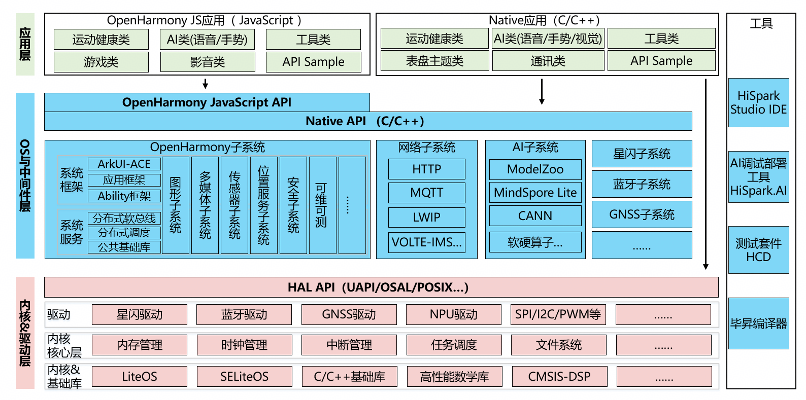

## 代码仓介绍

谛听穿戴解决方案是面向智能穿戴的星闪多模穿戴解决方案，采用CPU/GPU/DSP多核架构与端侧NPU（50Gops），支持星闪SLE2.0（16Mbps双向传输）、仿3D GPU、H.264视频播放及AI降噪、模糊命令词识别等特性，为穿戴设备提供高性能计算与丰富多媒体体验。该方案基于OpenHarmony 5.1操作系统，提供完整的应用开发工具、表盘设计工具、兼容性评测及Watch SIG认证，并构建了可运营的应用商店与表盘市场，已聚合40+轻应用，支持视频表盘、2.5D动效等。谛听集成GNSS、NFC、4G Cat1等套片方案，支持精准定位与多模通信。目前已有多家厂商基于谛听推出多款蓝牙/4G运动表及康养手表，实现离线智能语音、矢量地图等创新功能。

## 目录结构
```
├── COPYRIGHT                    # 项目基础版权声明文件
├── COPYRIGHT.OpenSource         # 第三方开源组件版权声明
├── docs                         # 正式文档根目录
│   └── docs-zh_CN                   # 中文官方文档
├── samples                      # 项目示例工程合集
│   ├── js_samples                     # OpenHarmony JS应用示例工程
│   ├── native_samples                 # Native C应用示例代码
│   └── README.md                      # 示例目录说明
├── LICENSE                      # 项目主开源许可证
├── LICENSE.OpenSource           # 第三方开源组件许可证
├── README.md                    # HiDiTing项目README
├── src                          # 核心业务与底层源码根目录
│   ├── application                  # 上层业务应用代码
│   ├── bootloader                   # 系统启动引导代码
│   ├── build                        # 编译构建配置与脚本
│   ├── build.py                     # 工程一键编译入口脚本
│   ├── CMakeLists.txt               # 顶层编译规则配置
│   ├── config.in                    # 全局编译宏配置文件
│   ├── drivers                      # 外设驱动（UART/DMA/GPIO等硬件）
│   ├── include                      # 全局公共头文件
│   ├── interim_binary               # 编译中间产物缓存目录
│   ├── kernel                       # LiteOS内核适配层
│   ├── libs_url                     # 第三方预编译库下载配置
│   ├── middleware                   # 系统中间件、通用组件
│   ├── ohos                         # OpenHarmony系统适配层
│   ├── open_source                  # 内置第三方开源组件
│   ├── protocol                     # 自定义通信协议栈
│   └── tools                        # 源码配套调试/打包工具
├── tools                        # 项目顶层公共工具集
│   ├── cat1.tar.gz                  # Cat1模组开发配套工具
│   ├── graphic_tools.tar.gz         # 图形调试工具压缩包
│   ├── ProductionLine.tar.gz        # 产线量产烧录测试工具
│   └── README.md                    # tools目录说明
└── vendor                       # 硬件厂商板级适配层
    ├── HiDiTingV100                 # HiDiTingV100平台硬件接线
    └── README.md                    # vendor目录说明
```

## 架构总览


## 快速入门

### 环境搭建（开发者首次接触 HiDiTing 解决方案，推荐通过 WSL_DOCKER 开发环境串通 Hello World 以实现快速入门）

HiDiTing解决方案提供了完整的开发环境快速入门指南，用于指导开发者完成代码下载与编译、工具获取、镜像烧写以及Hello World调试全流程：

| 开发环境 | 支持平台 | 说明 | 文档链接 |
| :------: | :------: | :------: | :------: |
| WSL_DOCKER | Linux | Windows PC 快速搭建Linux开发环境 | [使用指南](docs/docs-zh_CN/HiDiTingV100/get-started/HiDiTingV100%20开发环境快速入门/HiDiTingV100%20WSL_DOCKER环境使用指南/HiDiTingV100%20WSL_DOCKER环境使用指南.md) |
| HiSpark Studio for VS Code | Windows | VS Code IDE插件 | [使用指南](docs/docs-zh_CN/HiDiTingV100/get-started/HiDiTingV100%20开发环境快速入门/HiDiTingV100%20HiSpark%20Studio%20for%20VS%20Code使用指南/HiDiTingV100%20HiSpark%20Studio%20for%20VS%20Code开发环境使用指南.md) |
| 一站式CLI | Linux / Windows | CLI命令行 | [使用指南](docs/docs-zh_CN/HiDiTingV100/get-started/HiDiTingV100%20开发环境快速入门/HiDiTingV100%20一站式CLI开发环境使用指南/HiDiTingV100%20一站式CLI开发环境使用指南.md) |

## 软件资料

### 进阶指南

如需进一步进行Native/Native-js应用或外设驱动开发，请参考HiDiTing开发文档，快速入口如下：

- [开发文档快速入口](docs/docs-zh_CN/HiDiTingV100/overview/HiDiTingV100%20开发文档快速入门/HiDiTingV100%20开发文档快速入门.md) - 平台文档概述

### 工具使用
如需进一步进行进行调测，如CAT1，蓝牙等专业测试，请参考相关工具说明，工具入口如下：
- [开发工具总览](tools/README.md) - 开发工具下载与使用说明
- [产测工具 使用指南](docs/docs-zh_CN/HiDiTingV100/tools/HiDiTingV100%20产测工具%20使用指南/HiDiTingV100%20产测工具%20使用指南.md)

## 开发板资料

### 开发板详情（待补充）
| 开发板名称 | 案例开发指南 | 硬件原理图 |
| :--------: | :----------: | :--------: |
| - | - | - |

## 参与贡献

- 参考 [HiSpark 开发者社区](https://developers.hisilicon.com)