# 前言<a name="ZH-CN_TOPIC_0000002518632411"></a>

**概述<a name="section4537382116410"></a>**

本文档主要介绍HiDiTing解决方案中常见的问题处理和解决办法。

**读者对象<a name="section4378592816410"></a>**

本文档主要适用于以下工程师：

-   技术支持工程师
-   软件开发工程师

**符号约定<a name="section133020216410"></a>**

在本文中可能出现下列标志，它们所代表的含义如下。

<a name="table2622507016410"></a>
<table><thead align="left"><tr id="row1530720816410"><th class="cellrowborder" valign="top" width="20.580000000000002%" id="mcps1.1.3.1.1"><p id="p6450074116410"><a name="p6450074116410"></a><a name="p6450074116410"></a><strong id="b2136615816410"><a name="b2136615816410"></a><a name="b2136615816410"></a>符号</strong></p>
</th>
<th class="cellrowborder" valign="top" width="79.42%" id="mcps1.1.3.1.2"><p id="p5435366816410"><a name="p5435366816410"></a><a name="p5435366816410"></a><strong id="b5941558116410"><a name="b5941558116410"></a><a name="b5941558116410"></a>说明</strong></p>
</th>
</tr>
</thead>
<tbody><tr id="row1372280416410"><td class="cellrowborder" valign="top" width="20.580000000000002%" headers="mcps1.1.3.1.1 "><p id="p3734547016410"><a name="p3734547016410"></a><a name="p3734547016410"></a><a name="image2670064316410"></a><a name="image2670064316410"></a><span></span></p>
</td>
<td class="cellrowborder" valign="top" width="79.42%" headers="mcps1.1.3.1.2 "><p id="p1757432116410"><a name="p1757432116410"></a><a name="p1757432116410"></a>表示如不避免则将会导致死亡或严重伤害的具有高等级风险的危害。</p>
</td>
</tr>
<tr id="row466863216410"><td class="cellrowborder" valign="top" width="20.580000000000002%" headers="mcps1.1.3.1.1 "><p id="p1432579516410"><a name="p1432579516410"></a><a name="p1432579516410"></a><a name="image4895582316410"></a><a name="image4895582316410"></a><span></span></p>
</td>
<td class="cellrowborder" valign="top" width="79.42%" headers="mcps1.1.3.1.2 "><p id="p959197916410"><a name="p959197916410"></a><a name="p959197916410"></a>表示如不避免则可能导致死亡或严重伤害的具有中等级风险的危害。</p>
</td>
</tr>
<tr id="row123863216410"><td class="cellrowborder" valign="top" width="20.580000000000002%" headers="mcps1.1.3.1.1 "><p id="p1232579516410"><a name="p1232579516410"></a><a name="p1232579516410"></a><a name="image1235582316410"></a><a name="image1235582316410"></a><span></span></p>
</td>
<td class="cellrowborder" valign="top" width="79.42%" headers="mcps1.1.3.1.2 "><p id="p123197916410"><a name="p123197916410"></a><a name="p123197916410"></a>表示如不避免则可能导致轻微或中度伤害的具有低等级风险的危害。</p>
</td>
</tr>
<tr id="row5786682116410"><td class="cellrowborder" valign="top" width="20.580000000000002%" headers="mcps1.1.3.1.1 "><p id="p2204984716410"><a name="p2204984716410"></a><a name="p2204984716410"></a><a name="image4504446716410"></a><a name="image4504446716410"></a><span></span></p>
</td>
<td class="cellrowborder" valign="top" width="79.42%" headers="mcps1.1.3.1.2 "><p id="p4388861916410"><a name="p4388861916410"></a><a name="p4388861916410"></a>用于传递设备或环境安全警示信息。如不避免则可能会导致设备损坏、数据丢失、设备性能降低或其它不可预知的结果。</p>
<p id="p1238861916410"><a name="p1238861916410"></a><a name="p1238861916410"></a>“须知”不涉及人身伤害。</p>
</td>
</tr>
<tr id="row2856923116410"><td class="cellrowborder" valign="top" width="20.580000000000002%" headers="mcps1.1.3.1.1 "><p id="p5555360116410"><a name="p5555360116410"></a><a name="p5555360116410"></a><a name="image799324016410"></a><a name="image799324016410"></a><span></span></p>
</td>
<td class="cellrowborder" valign="top" width="79.42%" headers="mcps1.1.3.1.2 "><p id="p4612588116410"><a name="p4612588116410"></a><a name="p4612588116410"></a>对正文中重点信息的补充说明。</p>
<p id="p1232588116410"><a name="p1232588116410"></a><a name="p1232588116410"></a>“说明”不是安全警示信息，不涉及人身、设备及环境伤害信息。</p>
</td>
</tr>
</tbody>
</table>

# 媒体常见问题FAQ<a name="ZH-CN_TOPIC_0000002518632979"></a>

-   **[其他视频格式转换成当前支持的视频格式问题](#ZH-CN_TOPIC_0000002486313116)**  

-   **[媒体sample限制说明](#ZH-CN_TOPIC_0000002486473094)**  

-   **[媒体常见问题定位解答](#ZH-CN_TOPIC_0000002518513001)**  

## 其他视频格式转换成当前支持的视频格式问题<a name="ZH-CN_TOPIC_0000002486313116"></a>

> **须知：** 
>-   目前只支持MP4封装格式的视频文件。
>-   目前支持MJPEG格式和H264格式的视频流。

1.  准备FFMPEG工具。

    下载网址：[https://github.com/BtbN/FFmpeg-Builds/releases](https://github.com/BtbN/FFmpeg-Builds/releases)

    直接取最新版本即可，下载压缩包，解压到本地，如下图所示：

    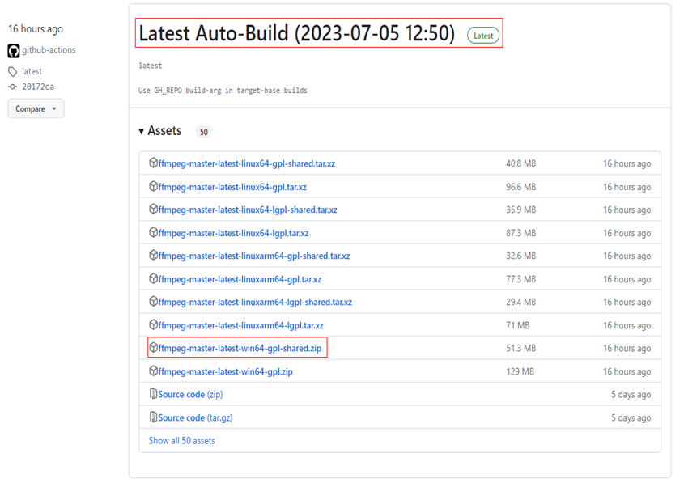

2.  使用FFMPEG程序转换视频。

    将视频裁剪成方的（比例1：1），原视频：1920×816，裁剪后：816×816；

    将mov格式转成mp4格式，在“ffmpeg-master-latest-win64-gpl-shared\\bin”目录，shift+鼠标右键打开PowerShell终端，在终端中输入ffmpeg命令。

    ffmpeg命令如下：.\\ffmpeg.exe -i .\\14\_AVC\_Main@L4.0\_9517Kbps\_1920x816\_29.970fps\_8bits\_AAC\_96.0Kbps\_2ch.mov -vf crop=816:816 -threads 4 -preset ultrafast -strict -2 .\\816x816.mp4

    命令里面的参数命令都是ffmpeg的标准命令，可自行查询。

    > **说明：** 
    >裁剪会损失部分视频内容，请据实际视频内容划定crop区域（例子是居中裁剪）。

3.  将视频缩放到454×454，同时调整量化因子，保证画质。

    ffmpeg命令如下：.\\ffmpeg.exe -i .\\816x816.mp4 -vf scale=454:454,setdar=1:1 -c:v mjpeg -b:v 0 -q:v 9 -qmin 6 -qmax 15 454x454.mp4

    > **说明：** 
    >1.  量化因子根据实际画质调整，理论上量化因子参数越小画质越好。
    >2.  由于量化因子调整会涉及码率变化，量化因子越小码率越高。
    >综上：画面和码率需要客户调整，可能存在取舍。

4.  去除视频的音频流：

    ffmpeg命令如下**：**.\\ffmpeg.exe -i input.mp4 -c copy -an output.mp4

    其中：

    -   -i：输入视频路径
    -   -c：copy使用原视频的视频流编码格式
    -   -an：去掉音频流

5.  修改mp4文件里面的视频流的帧率：

    ffmpeg命令如下：.\\ffmpeg.exe -i input\_video.mp4 -r 25 output\_video.mp4

    其中：

    -   -i：输入视频路径
    -   -r：修改帧率

6.  按照原始视频文件时长截取视频：

    ffmpeg命令如下：.\\ffmpeg.exe -i .\\454x454.mp4 -vcodec copy -acodec copy -ss 00:00 -to 00:57 .\\454x454\_57s.mp4

    原始视频文件时长查看方法，将文件直接拖到“ffmpeg-master-latest-win64-gpl-shared\\bin\\ffplay.exe”上面，查看“Duration: ”字段。

    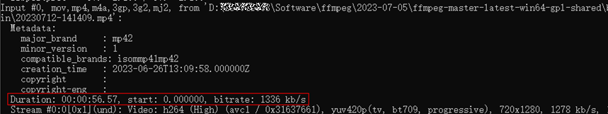

## 媒体sample限制说明<a name="ZH-CN_TOPIC_0000002486473094"></a>

-   音频播放sample

    路径：middleware\\services\\media\\foundation\\sample\\wrapper\\player\_sample\_wrapper.cpp

    对外接口：

    -   PlayerSample：用于播放本地音乐，包含本地蓝牙音乐。
    -   TonePlayerSampleTest：用于播放本地系统提示音。

    > **说明：** 
    >-   PlayerSample和TonePlayerSampleTest目前退出模式也是同步的，也就是传入stop指令以后会等待资源销毁完全再返回，同步就要求start指令和stop指令需要在同一个线程被调用，否则stop指令会被卡住。
    >-   PlayerSample和TonePlayerSampleTest可被同时调用，每个接口里面就会创建两个线程，需要注意资源、空间的消耗。
    >-   目前播放器支持的音频文件格式为：AAC、mp3、FLAC、OGG、WAV、SBC。

-   视频播放sample

    路径：middleware\\services\\media\\foundation\\sample\\wrapper\\video\_play\_wrapper.cpp

    对外接口：

    -   int32\_t StartVideoPlay\(void\)：开始播放视频。
    -   int32\_t StopVideoPlay\(void\)：停止播放视频。
    -   int32\_t PauseVideoPlay\(void\)：暂停播放视频。
    -   int32\_t ResumeVideoPlay\(void\)：继续播放视频。
    -   void SetVideoPlayLoop\(bool isLoop\)：设置视频循环播放，此接口需要在StartVideoPlay之前调用才会生效。
    -   void SetSyncExitMode\(bool isSyncExitMode\)：设置视频退出的模式。
    -   bool IsExitCompletely\(void\)：获取是否是完全退出的状态。

    > **说明：** 
    >-   因资源的限制目前最多支持一路视频，所以MediaVideoPlay的对象，最好只有一个，必须要先StopVideoPlay退出视频播放，再StartVideoPlay开始播放。
    >-   默认是循环播放视频，可通过接口SetVideoPlayLoop修改，可在StartVideoPlay以后设置。
    >-   默认视频退出模式是同步的，也就是调用StopVideoPlay接口会等待所有的视频播放资源销毁再返回，这里有一个限制就是StartVideoPlay和StopVideoPlay必须在同一个线程被调用，否则会被卡住，如果使用接口SetSyncExitMode改成不同步的，则无此限制，但是需要保证时序，因为StopVideoPlay销毁资源是异步的会有一定的耗时。

-   音频录制sample说明

    路径：middleware\\services\\media\\foundation\\sample\\wrapper\\audio\_capture\_wrapper.cpp

    对外接口：

    int32\_t AudioCaptureSample\(int32\_t argc, const char \*argv\[\]\)：此接口是AT命令的入口，包含了所有的相关指令。

    > **说明：** 
    >-   音频录制，目前只支持mp3、pcm、silk这个3种格式的录制。
    >-   音频录制过程中可以下发stop指令停止。
    >-   音频录制目前录制1000帧，完成后自动结束，暂时无法设置录制时长，可自行修改代码适配。
    >-   音频录制过程中原则上不允许再播放音频。

## 媒体常见问题定位解答<a name="ZH-CN_TOPIC_0000002518513001"></a>

目前版本是没有打开媒体的日志，要定位媒体的问题最好先打开媒体日志。

打开方式：

1.  找到日志文件：middleware\\services\\media\\foundation\\utils\\src\\media\_log.cpp。
2.  找到“g\_enabledLevel”变量并修改其值为MEDIA\_LOG\_INFO。
3.  重新编译生成。

**问题一：文件错误导致的异常**

-   文件路径错误

    在媒体日志中查找“Realpath input file failed”，如果有则说明文件路径错误，需要排查文件路径是否正确，文件是否存在。

-   IO相关的报错：

    一般是文件有问题导致，可以在其他播放器上面试一下，也有可能是文件系统出了问题，如果确认文件没问题，可以排查下文件系统。

-   需要做视频表盘的时候，播放带音频的视频文件导致的异常：

    目前对纯视频播放做了限制，如果创建的是纯视频的MediaVideoPlay的对象，但是视频文件是带音频的就会出现报错，所以如果是做视频表盘一定要注意排查视频是否是带音频流的。

-   播放不支持的格式导致的错误：

    需要提前去确认此格式的音视频是否都支持，不支持的格式也会有相应的报错。

**问题二：场景的限制导致的异常**

媒体这里所有的音频流之间都是有策略的。

举例：通话会打断所有的音乐，提示音和音乐可以混音。

不同的场景之间媒体配置了不同策略。

具体场景策略请参考《多媒体软件 开发指南》的“音频中断策略管理”章节的详细说明。

# JS应用常见问题FAQ<a name="ZH-CN_TOPIC_0000002518632981"></a>

-   **[canvas基本用法](#ZH-CN_TOPIC_0000002486313118)**  

-   **[动画设置background-image设置](#ZH-CN_TOPIC_0000002486473096)**  

-   **[css样式中设置样式可以通过动态绑定](#ZH-CN_TOPIC_0000002518513003)**  

-   **[组件设置背景图](#ZH-CN_TOPIC_0000002518632983)**  

-   **[JS文件超过30KB报错“xxx.js is bigger than 30 KB.”](#ZH-CN_TOPIC_0000002486313120)**  

-   **[player设置streamType](#ZH-CN_TOPIC_0000002486473098)**  

## canvas基本用法<a name="ZH-CN_TOPIC_0000002486313118"></a>

推荐使用OH IDE 5.0：

SDK中已包含canvas组件，可直接使用。

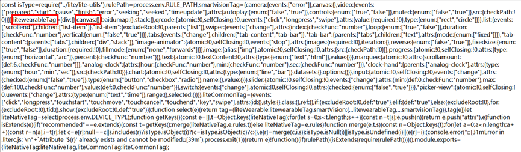

如果使用历史版本OH IDE 2.1：

检查IDE中是否包含canvas组件，在IDE中进入目录：“File”→ “Settings” →“Appearance & Behavior”→“System Settings”→“HarmonyOS SDK”，获取HarmonyOS SDK Location目录，在SDK目录下进入“js\\2.1.1.21\\build-tools\\ace-loader\\lib\\templater\\lite-validator.js”文件中，查看litewearableTag中是否包含canvas组件。如果没有canvas请参见《OpenHarmony JS应用开发 用户指南》的“扩展组件”章节扩展canvas。

canvas基本用法如下：

**hml：**

```
<canvas class=”canvas” ref=”canvas_ref”/>
```

**css：**

```
.canvas{
    width:100%;
    height:100%;
    background-color:transparent;
}
```

**js：**

```
let canvas = this.$refs.canvas_ref;
let ctx = canvas.getContext(‘2d’);
ctx.beginPath();
//绘制逻辑
ctx.strokeStyle = ‘#857f61’//绘制画笔颜色
ctx.moveTo(x1,y1);//移动画笔坐标
ctx.lineTo(x2,y2);//绘制线条坐标
ctx.stroke();
```

## 动画设置background-image设置<a name="ZH-CN_TOPIC_0000002486473096"></a>

Background-image设置url不加“”，静态检查告警可以忽略。

**** 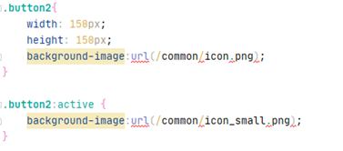

## css样式中设置样式可以通过动态绑定<a name="ZH-CN_TOPIC_0000002518513003"></a>

**hml：**


**js：**

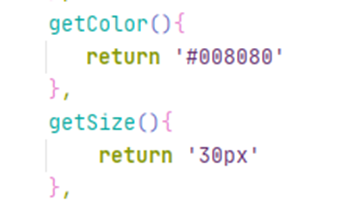

## 组件设置背景图<a name="ZH-CN_TOPIC_0000002518632983"></a>

目前容器组件不能设置背景图，有需求可以是用stack组件，这个组件的特征是后一个子组件会覆盖前一个。

**hml：**

```
<stack class="stack-parent">
<div class="back-child bd-radius"></div>
<div class="positioned-child bd-radius"></div>
<div class="front-child bd-radius"></div>
</stack>
```

**css：**

```
.stack-parent {
    width: 400px;
    height: 400px;
    background-color: #ffffff;
    border-width: 1px;
    border-style: solid;
}
.back-child {
    width: 300px;
    height: 300px;
    background-color: #3f56ea;
}
.front-child {
    width: 100px;
    height: 100px;
    background-color: #00bfc9;
}
.positioned-child {
    width: 100px;
    height: 100px;
    left: 50px;
    top: 50px;
    background-color: #47cc47;
}
.bd-radius {
    border-radius: 16px;
}
```

**图 1**  效果图<a name="zh-cn_topic_0000002507250993_fig647136413"></a>  


可以将第一个元素设置为image，充满屏幕，设置图片，就可以达到背景图的效果。

## JS文件超过30KB报错“xxx.js is bigger than 30 KB.”<a name="ZH-CN_TOPIC_0000002486313120"></a>

建议精简代码，可以从减少js声明方法，减少js方法调用，减少外部引入方法来解决js文件大小，将配置数据可以使用Storage或者file存储也可以控制js文件大小。

如果报错日志中出现“file doesn't exit or it's empty, \[/user/app/user/ace/run/xxx/assets/js/default/pages/xxx/x.bc\]”日志，则是IDE打包时候，没有对应生成js文件对应的快照文件，需要重新打包。在IDE中先清理编译环境：“Build”→“Clean Project”，然后重新打包：“Build”→ “Build Hap\(s\)/APP\(s\)”→“Build Hap\(s\)”。打包过程中需要查看编译日志是否出现“Failed to convert the xxx.js file to a snapshot.”，如果出现表示对应js文件的bc文件生成失败，需要对该js代码进行精简和配置数据存储化。

## player设置streamType<a name="ZH-CN_TOPIC_0000002486473098"></a>

设置streamType不支持player在播放过程中设置，建议player从init初始化时设置媒体类型，player释放reset后再次播放也需要重新设置媒体类型。

# 图形常见问题FAQ<a name="ZH-CN_TOPIC_0000002518513005"></a>

-   **[图形显示问题及建议](#ZH-CN_TOPIC_0000002518632985)**  

-   **[视频显示问题](#ZH-CN_TOPIC_0000002518513043)**  

-   **[内存问题](#ZH-CN_TOPIC_0000002518633027)**  

## 图形显示问题及建议<a name="ZH-CN_TOPIC_0000002518632985"></a>

-   **[花屏问题](#ZH-CN_TOPIC_0000002486313122)**  

-   **[黑屏问题](#ZH-CN_TOPIC_0000002486473100)**  

-   **[冻屏问题](#ZH-CN_TOPIC_0000002518513007)**  

-   **[一级跳转建议](#ZH-CN_TOPIC_0000002518632987)**  

-   **[控件内容未显示](#ZH-CN_TOPIC_0000002486313126)**  

-   **[按钮图标太小，不易点击](#ZH-CN_TOPIC_0000002486473122)**  

-   **[支付宝认证：将无法显示的文字替换为特定的字符](#ZH-CN_TOPIC_0000002518513033)**  

-   **[UIList滑动到页面底部时，进度条显示不到100%](#ZH-CN_TOPIC_0000002518633019)**  

-   **[控件析构时报错：parent is not nullptr](#ZH-CN_TOPIC_0000002486313152)**  

-   **[UIChartPolyLine如何合理呈现心率数据](#ZH-CN_TOPIC_0000002486473130)**  

-   **[UIScrollView使用建议](#ZH-CN_TOPIC_0000002518513039)**  

-   **[事件分发和响应流程](#ZH-CN_TOPIC_0000002518633021)**  

-   **[自适应刷新频率](#ZH-CN_TOPIC_0000002518633023)**  

-   **[功能宏配置约束](#ZH-CN_TOPIC_0000002486313156)**  

-   **[多行文字换行时，截断单词](#ZH-CN_TOPIC_0000002486473136)**  

### 花屏问题<a name="ZH-CN_TOPIC_0000002486313122"></a>

花屏问题常见的原因和排查思路如下：

1.  局部花屏
    -   如果出现局部花屏，且与特定控件位置相近，则大概率是控件绘制出现问题。需要排查日志中是否包含VAU ERROR和GRAPHIC ERROR，一旦发现该类型的报错，请联系GUI的同事确认问题。

2.  全屏花屏
    -   一级滑动过程中出现花屏，松手后即可恢复。这一类问题通常是内部流程异常导致，可以排查日志中异常报错并记录复现路径，联系GUI的同事确认问题。
    -   界面花屏时，日志中包含内存不足的异常时，通常需要先优化内存类问题。

3.  视频花屏
    -   串口输入“AT+GPU=screen\_cap,1”保存视频截图，确认是否是视频内容不正确。如果视频截图不正确，请联系媒体的同事确认问题。
    -   串口输入“AT+GPU=dpu\_hide,0”，隐藏图形层，确认是否因为图形层导致的花屏。如果隐藏后，能正常显示，则需要确认colorkey值是否配置合理。colorkey的值应该是图形层中不会存在的像素颜色值。
    -   通过“AT+GPU=screen\_cap,0/1”分别截取视频层和图形层的内容，并通过“AT+GPU=dpu\_hide,0/1”和“AT+GPU=dpu\_show,0/1”分别开关视频层和图形层，确认单个图层显示是否符合预期。如果任意一个图层的内容均符合预期，则可能是后端合成出现问题，请联系GPU的同事确认问题。

### 黑屏问题<a name="ZH-CN_TOPIC_0000002486473100"></a>

黑屏问题常见的原因和排查思路如下：

1.  灭屏
    -   串口输入“AT+GUI=UIKIT\_DFX,dumpstate”，确认IsScreenOn的值。如果是0，则代表是符合预期的灭屏。如果是1，则需要继续往下排查。

2.  Native-JS切换异常
    -   串口输入“AT+GUI=UIKIT\_DFX,dumpstate”，确认NativeRunninng的值。如果是0，则代表仍处于JS应用中，请联系JS的同事确认问题。如果是1，则代表处于Native应用中，需要继续往下排查。

3.  控件状态异常
    -   串口输入“AT+GUI=UIKIT\_DFX,dump\_root\_view”，确认是否包含有效的控件信息。如果没有，则需要排查业务流程，确保控件被添加到控件树上。如果有符合预期的控件信息，却没有正确地显示，则需要继续往下排查。

4.  后端问题
    -   串口输入“AT+GUI=UIKIT\_DFX,screencap,-f,filepath”。该命令会触发实时重绘截图，而并非捞帧拷贝。这意味着，截图数据只能代表当前帧配置的控件内容，但仍然可能因为各种原因与实际送显内容存在差异。
    -   串口输入“AT+GPU=screen\_cap,0”，该命令会保存实际送显的内容。
    -   通过DebugKits下载截图文件，并通过HiImgReviser打开，对比UIKIT和DPU的截图内容。如果内容一致，均为有效内容，则可能是后端的问题，需要联系GPU相关的同事确认。如果内容不一致，DPU的截图内容是纯黑，而UIKIT的截图内容并非纯黑，则需要联系GUI的同事确认问题。

### 冻屏问题<a name="ZH-CN_TOPIC_0000002518513007"></a>

冻屏问题常见的排查方向如下：

1.  如果是静态界面，串口输入“AT+GUI=UIKIT\_DFX,showtime,tp”，滑动屏幕确认是否有tp上报的打印，确认是否因为tp异常导致的冻屏。
2.  串口输入3次“AT+GUI=UIKIT\_DFX,dumpstate”，确认GraphicTaskTriggeredCount是否一直为2。如果是，则代表被GraphicEventQueue中的Event阻塞住了，需要排查业务通过PostGraphicEvent函数加入队列的任务是否有阻塞的风险。
3.  串口输入1次“AT^STACKINFO”，确认是否有媒体线程，且状态一直为8。如果2和3均满足，则大概率是视频导致的冻屏，需要联系媒体的同事确认问题。

### 一级跳转建议<a name="ZH-CN_TOPIC_0000002518632987"></a>

如果从菜单列表或是表盘选择界面选择表盘后跳转至一级界面有明显的延迟，建议适时加载相邻卡片：void SetHorCurrentPage\(uint16\_t index, bool loadAdjacent = true\)

如上所示，UICrossView::SetHorCurrentPage函数的第二个参数支持配置是否加载相邻卡片。

建议在一级OnStart中调用SetHorCurrentPage时，将loadAdjacent设置为false，节省切换动画准备过程中加载相邻卡片的耗时。在OnResume中再次调用SetHorCurrentPage，将loadAdjacent设置为true。

### 控件内容未显示<a name="ZH-CN_TOPIC_0000002486313126"></a>

串口输入“AT+GUI=UIKIT\_DFX,dump\_root\_view”，根据串口打印的日志确认控件配置：

1.  确认控件是否透明。
2.  确认控件是否可见。
3.  根据父子关系，推导控件是否被其他控件遮挡住。

### 按钮图标太小，不易点击<a name="ZH-CN_TOPIC_0000002486473122"></a>

按照以下方式，扩大交互区域保持显示效果不变：

1.  扩大控件区域：UIImageView-\>Resize/SetPosition
2.  关闭图片自适应模式：UIImageView-\> SetAutoEnable \(false\)
3.  设置图片显示模式：UIImageView –\>SetResizeMode\(Center\)

### 支付宝认证：将无法显示的文字替换为特定的字符<a name="ZH-CN_TOPIC_0000002518513033"></a>

支付宝认证时，给定的字符串中可能包含表情，要求将不可显示的表情替换为特定的字符。建议对文本进行预处理，完成字符替换后，再设置给UILabel进行显示：

1.  将const char\*转unicode：

    ```
    letter = TypedText::GetUTF8Next(labelLine.text, i, i);
    ```

2.  确认字符是否存在于字库中：

    ```
    UIFont* fontEngine = UIFont::GetInstance();
    GlyphPathData path;
    if (!fontEngine->GetGlyphPathData(0x0664, 0, path)) {
        GRAPHIC_LOGE("********************* 0x0664 not exist");
    }
    if (!fontEngine->GetGlyphPathData(0x4E2D, 0, path)) {
        GRAPHIC_LOGE("********************* 0x4e2d not exist");
    }
    ```

1.  如果GetGlyphPathData返回true，代表字库中可以查询到当前字符信息；如果返回false，代表字库中无法查询到当前字符信息，将对应的字符替换为需要显示的字符即可。

### UIList滑动到页面底部时，进度条显示不到100%<a name="ZH-CN_TOPIC_0000002518633019"></a>

UIList的进度计算考虑了scrollBlankSize。如果配置了scrollBlankSize，且滑到最后的子项时需要显示进度为100%。需要移除middleware\\services\\gui\\uikit\\ui\\frameworks\\components\\ui\_list.cpp文件中，替换UIList::UpdateScrollBar函数中“scrollBlankSizeTop\_”, "scrollBlankSizeBottom\_", "scrollBlankSizeLeft\_", "scrollBlankSizeRight\_"的值为0。

### 控件析构时报错：parent is not nullptr<a name="ZH-CN_TOPIC_0000002486313152"></a>

该报错仅用于提示当控件析构时其父控件不为空，并不会导致控件析构失败。如果后续通过父控件获取子节点并进行操作，会访问被释放的指针进而触发异常。建议按照标准流程释放控件，尽可能清除这种报错：先Remove后Delete；先子后父。

### UIChartPolyLine如何合理呈现心率数据<a name="ZH-CN_TOPIC_0000002486473130"></a>

没佩戴手表期间，没有产生心率数据。如果用0代表没有数据的时候，并且使用一组数据去显示的话，0会被判定为谷值，被绘制出对应的谷值点，这并不符合预期。

这种情况下，可以剔除0，仅使用有效数据，按照时间段分成多组，提前识别包含峰值和谷值的组，对其进行特殊处理：

允许包含峰值的数据组绘制峰值点：EnableTopPoint（true）

允许包含谷值的数据组绘制谷值点：EnableBottomPoint（true）

### UIScrollView使用建议<a name="ZH-CN_TOPIC_0000002518513039"></a>

使用UIScrollView时，建议只添加一个UIViewGroup，起始坐标为\[0, 0\]，尺寸为内部控件所需的大小。随后再在UIViewGroup中添加其他子控件。

常见问题：

判断UIScrollView是否滑动到顶部或底部？

当按照上述方式操作后，仅需要判断唯一的子控件的相对坐标即可：

```
if  (childrenHead_.GetBottom() <= GetHeight() – 1) {
    // 已经滑到或超过底部
}
if  (childrenHead_.GetTop() >= 0）{
    // 已经滑到或超过顶部
}
```

### 事件分发和响应流程<a name="ZH-CN_TOPIC_0000002518633021"></a>

-   **[表冠事件](#ZH-CN_TOPIC_0000002486313154)**  

-   **[按键事件](#ZH-CN_TOPIC_0000002486473134)**  

-   **[触屏类事件](#ZH-CN_TOPIC_0000002518513041)**  

#### 表冠事件<a name="ZH-CN_TOPIC_0000002486313154"></a>

同一时期仅有一个控件能获焦，可以通过以下函数设置焦点相关：

-   使控件可获焦：SetFocusable\(bool focusable\)
-   使控件获焦：RequestFocus\(\)
-   使控件失焦：ClearFocus\(\)
-   设置焦点监听：SetOnFocusListener\(OnFocusListener\* onFocusListener\)
-   设置表冠监听：SetOnRotateListener\(OnRotateListener\* onRotateListener\)

表冠事件会被分发给当前获焦的控件处理。以下控件包含默认的表冠响应逻辑：

1.  UIPicker
2.  UIList
3.  UIScrollView
4.  UISlider
5.  UIKaleidoscope
6.  UIHexagonsList

#### 按键事件<a name="ZH-CN_TOPIC_0000002486473134"></a>

物理按键事件会被分发给RootView处理，默认不作任何处理。如需处理，需要注册按键监听：void SetOnKeyActListener\(OnKeyActListener\* onKeyActListener\)

#### 触屏类事件<a name="ZH-CN_TOPIC_0000002518513041"></a>

触屏类事件会根据其限定条件，分发给最上层可响应的控件进行处理：

1.  点击或按下等事件要求控件是可点击的。

    设置控件是否可触摸：SetTouchable\(bool touch\)

2.  滑动类事件要求控件是可点击且可滑动的。

    设置控件是否可滑动：SetDraggable\(bool draggable\)

如果控件未处理完成，会将事件传递给其父进行处理，至到该事件被处理完毕：

-   如果注册了对应的监听，则以Callback的返回值判定事件是否已经处理完毕：true代表事件已经处理完毕；false代表事件仍需传递给父处理。
-   如果没有注册监听，则以“isIntercept\_”的值为准。可通过SetIntercept函数配置是否需要拦截事件。

常见问题：

1.  嵌套多级可滑动的控件时，可能会触发多个控件一起滑动。根据实际需求，参考以上方式，适时拦截事件传递。
2.  嵌套不同滑动方向的控件时，需要根据滑动方向决策当前控件是否处理该事件。

    示例：UICrossView中嵌套了垂直向的List。垂直向的滑动事件需要给List处理，而水平向的滑动事件需要给UICrossView处理。事件会被优先分发给List处理。因为List默认的响应逻辑不会区分滑动事件的方向，所以需要继承List，重写以下三个函数：

    -   OnDragStart：获取并记录滑动方向，如果滑动方向与控件响应的滑动方向不符，则返回false，使事件传递给UICrossView处理。
    -   OnDrag：如果滑动方向与控件响应的滑动方向不符，则返回false，使事件传递给UICrossView处理。
    -   OnDragEnd：如果滑动方向与控件响应的滑动方向不符，则返回false，使事件传递给UICrossView处理。清除滑动方向标记。

### 自适应刷新频率<a name="ZH-CN_TOPIC_0000002518633023"></a>

UIKit会根据当前UI任务状态，自动调节刷新频率。当业务空闲时（没有运行中的动画、没有视频、没有待绘制刷新的内容等），刷新频率会自动降为较低的值，从而达到降低功耗的效果。自适应刷新频率对业务代码编写有以下限制：

-   Animator：用于生成动画效果，按照最高频率执行动画回调。当动画内容不可见时，需要及时停止动画。不建议通过Animator周期性查询数据。
-   Task：用户可以控制频率，用于周期性获取数据或处理业务逻辑。任意界面都可按需使用。

### 功能宏配置约束<a name="ZH-CN_TOPIC_0000002486313156"></a>

严禁修改以下两个文件中定义的功能宏配置：

middleware\\services\\gui\\uikit\\utils\\interfaces\\innerkits\\graphic\_config.h

middleware\\services\\gui\\uikit\\config\\3322\_graphic\_lite\_config.h

middleware\\services\\gui\\hal\\common\\include\\graphic\_hardware\_config\_wearable.h

### 多行文字换行时，截断单词<a name="ZH-CN_TOPIC_0000002486473136"></a>

**图 1**  文本换行单词截断示意图<a name="zh-cn_topic_0000002507211061_fig14286315163519"></a>  
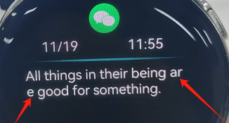

多行文字换行时，出现截断单词的原因是缺少line\_cj.brk资源，需要将“code\\sdk\\middleware\\services\\gui\\uikit\\res\\”路径下的line\_cj.brk烧录进板子。

## 视频显示问题<a name="ZH-CN_TOPIC_0000002518513043"></a>

-   **[视频播放状态异常](#ZH-CN_TOPIC_0000002518633025)**  

### 视频播放状态异常<a name="ZH-CN_TOPIC_0000002518633025"></a>

-   **[媒体线程创建失败](#ZH-CN_TOPIC_0000002486313158)**  

-   **[内存不足，申请不到视频帧](#ZH-CN_TOPIC_0000002486473138)**  

-   **[视频状态错误](#ZH-CN_TOPIC_0000002518513045)**  

#### 媒体线程创建失败<a name="ZH-CN_TOPIC_0000002486313158"></a>

媒体线程创建失败，视频没有起播，日志中包含以下错误：

**图 1**  媒体线程创建失败日志示意图<a name="zh-cn_topic_0000002507211049_fig14508128134218"></a>  
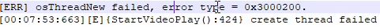

错误码0x3000200代表创建线程所需要的资源不足，无法创建线程。分为内存空间不足和栈总量不足两种情况，。可采取以下两个手段：

1.  合理分配自己的线程栈大小：在最大业务场景下，串口输入“AT^STACKINFO”，查看自己线程的Total Size和Peak Size，如果PeakSize远小于Total Size，则可以考虑将Total Size降低，但在Peak Size的基础上仍需预留一定空间。
2.  修改线程部署：联系产品SDK接口人协助。

#### 内存不足，申请不到视频帧<a name="ZH-CN_TOPIC_0000002486473138"></a>

播放一个视频需要H264大于2.5M,JPEG需要大于1M内存，图形内存（文字绘制、CanvasExt绘制、图片资源、截图、视频帧等）严重不足时，可能导致申请视频帧失败。

排查方式：

串口输入“AT+GUI=UIKIT\_DFX,dumpstate”，确认图形内存使用情况，排查是否有不合理的使用或泄露。

#### 视频状态错误<a name="ZH-CN_TOPIC_0000002518513045"></a>

视频状态需要结合业务场景进行适当的处理，尤其需要关注以下几个场景：

-   主页面CrossView卡片滑动的生命周期处理：

    可以参考“DialVideoView.cpp”中对“video\_”的处理。

-   量灭屏视频状态的管理：

    注册量灭屏通知，可以参考“DialVideoView.cpp”中ScreenStatusNotify函数的处理。

-   弹窗视频状态的管理：

    注意时序问题，确保视频停播且删除后，再创建新的视频。

## 内存问题<a name="ZH-CN_TOPIC_0000002518633027"></a>

-   **[如何使用liteos定位踩内存](#ZH-CN_TOPIC_0000002486313160)**  

-   **[运行期间越来越卡](#ZH-CN_TOPIC_0000002486473140)**  

-   **[一级卡片左右滑动时，卡片内容呈现方形而非圆形](#ZH-CN_TOPIC_0000002518513047)**  

-   **[多线程操作UI](#ZH-CN_TOPIC_0000002518633029)**  

### 如何使用liteos定位踩内存<a name="ZH-CN_TOPIC_0000002486313160"></a>

使用liteos定位踩内存使用步骤如下：

1.  <a name="zh-cn_topic_0000002507251007_li483831615212"></a>在“./kernel/liteos/liteos\_v208.8.0\_b010/Huawei\_LiteOS/kernel/base/mem/bestfit/los\_memory\_internal.h”头文件中添加如下代码：

    ```
    #define LOSCFG_MEM_LEAKCHECK 1
    #define LOSCFG_BASE_MEM_NODE_INTEGRITY_CHECK 1
    #define LOSCFG_MEM_RECORD_LR_CNT 4
    #define LOSCFG_MEM_OMIT_LR_CNT 2
    ```

    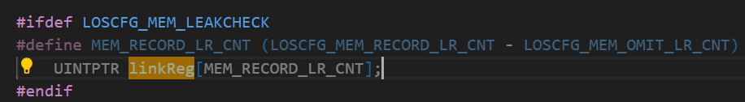

    需要配置调用栈层数可配置“LOSCFG\_MEM\_RECORD\_LR\_CNT”和“LOSCFG\_MEM\_OMIT\_LR\_CNT”两个参数，目前调用栈只有两层。

1.  <a name="zh-cn_topic_0000002507251007_li5838191615216"></a>在“./kernel/liteos/liteos\_v208.8.0\_b010/Huawei\_LiteOS/tools/build/config/3322.config”文件内修改如下，修改后将output目录删除再进行编译。

    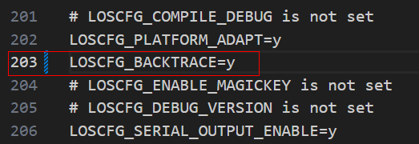

2.  完成[1](#zh-cn_topic_0000002507251007_li483831615212)和[2](#zh-cn_topic_0000002507251007_li5838191615216)后，编译时需把“-release”编译选项去掉，通过生成的lst文件查看调用栈。
3.  如若有踩内存（数组写越界）引起的死机问题，在产生正常的死机文件前会打印相关的内存地址。

示例：

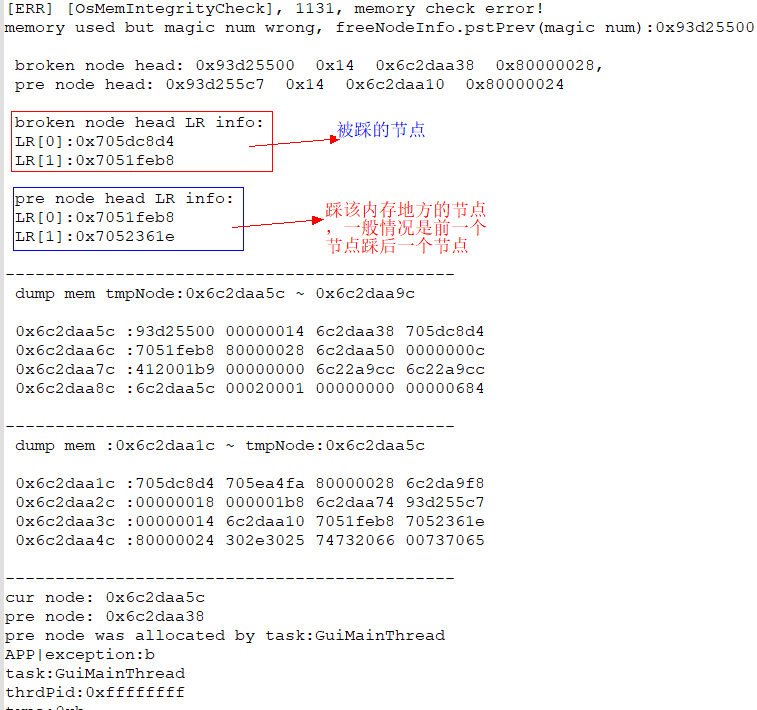

Broken node LR0

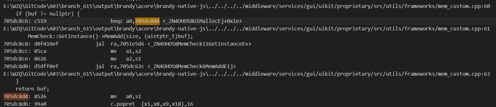

Broken node LR1

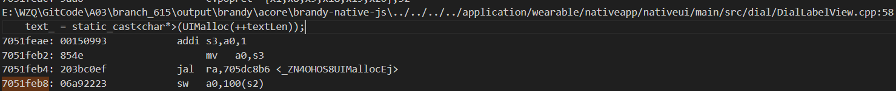

pre node LR0

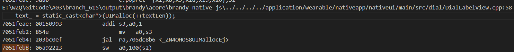

pre node LR1

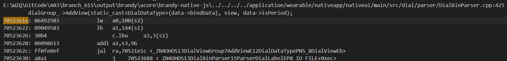

根据调用栈信息查看相应位置，最终排查到是DialLabelView.cpp中出现数组越界和踩内存（这里定义的数组出现越界，应该写法是text\_\[textLen-1\] = '\\0';）。

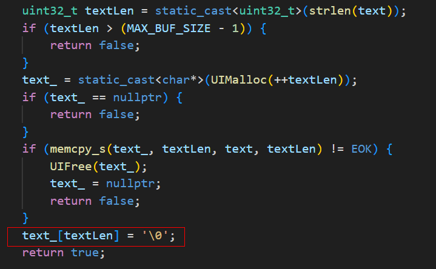

### 运行期间越来越卡<a name="ZH-CN_TOPIC_0000002486473140"></a>

随着运行时间增长，页面操作越来越卡。这种问题通常是由于内存泄露或内存碎片过多，导致申请释放内存越来越慢。

可以结合内存泄露定位手段排查泄露点，优化内存使用。

查看系统内存使用情况AT命令：AT^HEAPINFO

查看图形内存使用情况AT命令：AT+GUI=UIKIT\_DFX,dumpmem

### 一级卡片左右滑动时，卡片内容呈现方形而非圆形<a name="ZH-CN_TOPIC_0000002518513047"></a>

一级卡片滑动动效默认使用方形截图，而非圆形截图。如果要使用圆形截图，需要修改CardSwipe对应的派生类的“isNeedClip\_”成员变量，将其设置为true。

**图 1**  CardSwipe截图形状配置示意图<a name="zh-cn_topic_0000002507251001_fig617554433619"></a>  
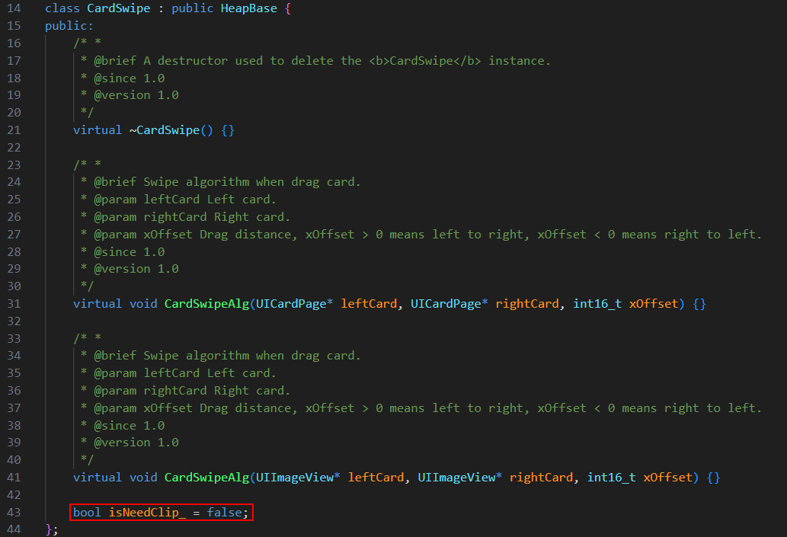

当配置一级滑动动画的isNeedClip为true时，卡片滑动截图应呈现圆形。如果滑动过程中卡片截图仍呈现方形，日志中会打印内存分配失败，并打印当前内存使用情况。需要结合当前场景，合理优化内存使用。

优化措施：

1.  一级界面卡片滑动时容易出现资源过多，内存不足的问题，需对资源做如下处理：

    PreLoad：加载资源，创建控件。

    Unload：释放控件，卸载资源。

2.  修改图片压缩配置：

    提升图片资源压缩倍率。

    可指定不带透明像素的图片输出格式为RGB888或RGB565。

3.  客户界面优化方案，裁剪图片使用：

    序列帧资源占用较大时，可以需要抽帧处理。

### 多线程操作UI<a name="ZH-CN_TOPIC_0000002518633029"></a>

UIKIT非线程安全，在其他线程中操作UI的动作需要通过PostGraphicEvent抛到UI队列中执行。UI队列是周期性执行，并不会立即执行。如有必要，客户需要考虑同步机制。

常见问题：

1.  不要在OsTimer的Callback中直接操作UI。UI侧需谨慎使用OsTimer，建议替换为事件订阅或是UIKit中的Task。
2.  不要在MsgCenterNotifyProc中直接操作UI。
3.  需多加注意因异步执行，时序问题等引起的野指针和空指针问题。可以使用shared\_ptr 以及 weakptr判断内存是否释放。

# BTH特性使用建议<a name="ZH-CN_TOPIC_0000002486313162"></a>

-   **[对外接口回调函数使用约束](#ZH-CN_TOPIC_0000002486473142)**  

-   **[数传传输场景使用建议](#ZH-CN_TOPIC_0000002518513049)**  

-   **[蓝牙连接相关](#ZH-CN_TOPIC_0000002518633031)**  

-   **[BLE GATT相关](#ZH-CN_TOPIC_0000002486313166)**  

-   **[协议栈开关](#ZH-CN_TOPIC_0000002486473144)**  

-   **[通话相关使用建议](#ZH-CN_TOPIC_0000002518513051)**  

## 对外接口回调函数使用约束<a name="ZH-CN_TOPIC_0000002486473142"></a>

1.  回调函数中的指针内容要拷贝走，不能直接操作回调函数中的指针数据内容。
2.  不能释放回调函数中传入的指针参数。
3.  回调函数实现里建议切换到APP任务，避免直接在回调函数中执行复杂流程导致BTH栈栈溢出；在回调处理中也不能有sleep等耗时的操作。
4.  不能在回调函数中直接调用BTH提供的对外接口，切换任务后由APP任务调用。

## 数传传输场景使用建议<a name="ZH-CN_TOPIC_0000002518513049"></a>

1.  使用BR SPP或者BLE GATT写命令或者通知功能实现数据传输协议时，建议上层应用实现数传校验功能。例如一次传输n包后等待接收端校验，校验通过后再继续下一轮传输，否则根据校验结果进行数据重传。
2.  OTA升级传输过程中建议停止蓝牙相关的其他业务，例如微信消息同步、表盘传输、音乐播放、通话接听等。
3.  通话过程中建议不进行大数据的传输，例如表盘传输、微信消息推送等。
4.  音乐场景下建议不进行大数据的传输，例如表盘传输、微信消息推送等。
5.  建议SPP数据传输和BLE GATT数据传输不同时进行。

## 蓝牙连接相关<a name="ZH-CN_TOPIC_0000002518633031"></a>

1.  BT回连策略建议APP层根据具体需求自己实现，默认提供的回连策略不一定能满足特定场景会连接效率、连接功耗的要求。
2.  BLE的回连策略由上层应用实现，断连后自动打开广播待手机连接。
3.  BT连接/回连过程中不建议同步做BLE空口业务，例如服务发现、GATT数据读写通知等。
4.  BLE配对过程中不建议做大批量数据传输和sink音乐播放。
5.  一键双连仅限双模设备与苹果系统ios13以上使用的功能，与安卓手机连接，建议关闭一键双连功能。
6.  以下场景，蓝牙协议栈会打开BR广播，上层应用使用关闭广播方式实现关闭蓝牙时，需要在以下逻辑之后再关闭广播：

    在回调函数typedef void \(\*gap\_scan\_mode\_changed\_callback\)\(int mode\)中，判断是关闭蓝牙场景且上报的是打开广播且是ACL断连时，再关闭广播。

    1.  断连之后，如果有配对信息，会把BR广播模式设置成可连接；如果没有配对信息，会把BR广播模式设置成可扫描可连接。
    2.  配置蓝牙地址接口，会把BR广播模式设置成可扫描可连接。

7.  对于双模设备，配置蓝牙地址和配置蓝牙名称的时机，建议在enable\_bt\_stack之后、gatts\_register\_server之前执行。

## BLE GATT相关<a name="ZH-CN_TOPIC_0000002486313166"></a>

1.  添加服务不宜太多，特征不能太大，所有服务占用的内存空间建议不超过2KB。
2.  为了提升数据传输效率，连接后建议先更新MTU值到最大（517Byte），具体更新方法如下：

    GATT MTU交换需要client端发起，如果板侧作client端，请调用gattc\_exchange\_mtu\_req接口发起MTU交换请求。如果板侧作server，只能等对端client发起MTU交换请求，协商结果通过回调函数gatts\_mtu\_changed\_callback上报。

    > **说明：** 
    >MTU值是两端设备协商的结果，对于一些低版本的蓝牙设备，可能不支持517Byte的MTU，需根据实际情况选择合适的值进行更新。

3.  不建议使用如下服务异步添加接口，改用4中同步接口。

1.  服务同步添加接口：

    gatts\_add\_service\_sync、gatts\_add\_characteristic\_sync、gatts\_add\_descriptor\_sync均为同步添加接口。函数返回后即表示添加成功。

2.  服务端数据传输反压：

    gatts\_notify\_indicate、gatts\_notify\_indicate\_by\_uuid接口在返回值ERRCODE\_BT\_BUSY时，代表B核数传繁忙，本次传输失败。建议此时等待并重试。

3.  客户端服务发现：

    gattc\_discovery\_service、gattc\_discovery\_character、gattc\_discovery\_descriptor接口依赖空口响应，建议使用时指定对应的UUID。

4.  客户端数据传输反压：

    gattc\_write\_req、gattc\_write\_cmd接口在返回值为ERRCODE\_BT\_BUSY时，代表B核数传繁忙，本次传输失败。建议此时等待并重试。

## 协议栈开关<a name="ZH-CN_TOPIC_0000002486473144"></a>

1.  enable\_ble、disable\_ble接口只在BLE ONLY的版本使用。
2.  enable\_bt\_stack入参为bitmap，参考枚举类bt\_transport\_type\_t，不支持打开双模后仅关闭BLE或者BR，请同时开同时关。
3.  在关闭蓝牙协议栈之前，建议先主动停止当前数据传输业务，主动注销应用层注册的GATT client，然后再关闭蓝牙协议栈。
4.  在一些低功耗业务场景下，只需要关闭广播和断开蓝牙连接即可，不调用disable\_bt\_stack关闭蓝牙协议栈。
5.  A2DP SNK服务开关，请参照以下内容：
    1.  打开A2DP SNK服务，请先调用a2dp\_snk\_service\_register接口注册服A2DP SNK服务，接着再根据场景判断是否调用a2dp\_snk\_connect接口发起A2DP SNK服务连接。
    2.  关闭A2DP SNK服务，请先判断A2DP SNK是否处于已连接状态，如果是，请先调用a2dp\_snk\_disconnect接口断开A2DP SNK连接，再调用a2dp\_snk\_service\_unregister接口。

## 通话相关使用建议<a name="ZH-CN_TOPIC_0000002518513051"></a>

1.  SCO的创建与销毁
    -   收到HFP\_SCO\_STATE\_CONNECTING回调时，调用媒体接口创建音频通路。
    -   收到HFP\_SCO\_STATE\_DISCONNECTED回调时，调用媒体接口销毁音频通路。
    -   其他流程不可以主动调用媒体接口创建或者销毁通路。
    -   可以调用hfp\_hf\_disconnect\_sco接口主动断开SCO，收到回调后销毁音频通路。

2.  通话状态
    -   收到HFP\_HF\_CALL\_STATE\_INCOMING回调时，手表可以显示来电中。
    -   收到HFP\_HF\_CALL\_STATE\_INCOMING回调时，有SCO连接通话在手表端，手表可以显示通话中；无sco连接通话在手机端，手表端可以不显示通话中。
    -   收到HFP\_HF\_CALL\_STATE\_FINISHED回调时时，手表退出通话中显示。
    -   Hfp断连时，手表要退出来电中、通话中等显示。

3.  微信通话
    -   正常手表拨打电话会经过HFP\_HF\_CALL\_STATE\_ALERTING状态，再进入HFP\_HF\_CALL\_STATE\_ACTIVE状态。
    -   正常手表接听电话会经过HFP\_HF\_CALL\_STATE\_INCOMING状态，再进入HFP\_HF\_CALL\_STATE\_ACTIVE状态。
    -   微信通话的简易识别方法：微信通话时，不会经过HFP\_HF\_CALL\_STATE\_ALERTING状态或者HFP\_HF\_CALL\_STATE\_INCOMING状态，而是直接入HFP\_HF\_CALL\_STATE\_ACTIVE状态。但是对于蜂窝通话进行中才开始连接手表的场景会误识别为微信通话的情况。

4.  带内带外铃声
    -   带外铃声本地响铃实现方案：

        实现hfp\_hf\_in\_band\_ring\_tone\_changed\_callback回调函数并注册回调函数，实现举例如下：

        ```
        static void sample_handle_inband_ringtone_changed(const bd_addr_t *bd_addr, int32_t status)
        {
            if ((status & HFP_HF_IN_BAND_TONG) == 0) { /* 带外铃声 */
                if ((status & HFP_HF_INCOMING_CALL) != 0) { /* 带外铃声来电振铃 */
                    /* 调用媒体接口本地媒体响AUDIO_STREAM_RING */
                } else if ((status & HFP_HF_TERMINATE_LOCAL_RINGTONE) != 0) { /* 终止本地生成的振铃音 */
                    /* 调用媒体接口本地媒体结束响铃AUDIO_STREAM_RING */
                }
            }
        }
        ```

    -   带内铃声本地响铃实现方案

        实现hfp\_hf\_in\_band\_ring\_tone\_changed\_callback回调函数并注册回调函数，实现举例如下：

        ```
        static void sample_handle_inband_ringtone_changed(const bd_addr_t *bd_addr, int32_t status)
        {
            if ((status & HFP_HF_IN_BAND_TONG) != 0) { /* 带内铃声 */
                if ((status & HFP_HF_INCOMING_CALL) != 0) { /* 带内铃声来电振铃 */
                    /* 调用媒体接口静音通话带内铃声AUDIO_STREAM_VOICE_CALL_BT_SCO，本地媒体响铃AUDIO_STREAM_RING */
                } else if ((status & HFP_HF_TERMINATE_LOCAL_RINGTONE) != 0) { /* 终止本地生成的振铃音 */
                    /* 调用媒体接口取消静音通话带内铃声AUDIO_STREAM_VOICE_CALL_BT_SCO，本地媒体结束响铃AUDIO_STREAM_RING */
                }
            }
        }
        ```

# 音频常见问题FAQ<a name="ZH-CN_TOPIC_0000002518633033"></a>

-   **[音频问题定位方法](#ZH-CN_TOPIC_0000002486313168)**  

-   **[无声问题](#ZH-CN_TOPIC_0000002486473148)**  

-   **[卡顿问题](#ZH-CN_TOPIC_0000002518513055)**  

-   **[音量问题](#ZH-CN_TOPIC_0000002518633035)**  

## 音频问题定位方法<a name="ZH-CN_TOPIC_0000002486313168"></a>

**表 1**  各场景的音频通路及最低主频要求

<a name="zh-cn_topic_0000002475011118_table342945212711"></a>
<table><thead align="left"><tr id="zh-cn_topic_0000002475011118_row10430105210714"><th class="cellrowborder" valign="top" width="16.831683168316832%" id="mcps1.2.4.1.1"><p id="zh-cn_topic_0000002475011118_p19253561574"><a name="zh-cn_topic_0000002475011118_p19253561574"></a><a name="zh-cn_topic_0000002475011118_p19253561574"></a>场景</p>
</th>
<th class="cellrowborder" valign="top" width="67.41674167416743%" id="mcps1.2.4.1.2"><p id="zh-cn_topic_0000002475011118_p1292505610720"><a name="zh-cn_topic_0000002475011118_p1292505610720"></a><a name="zh-cn_topic_0000002475011118_p1292505610720"></a>音频通路（加粗部分为DSP中的音频通路）</p>
</th>
<th class="cellrowborder" valign="top" width="15.751575157515752%" id="mcps1.2.4.1.3"><p id="zh-cn_topic_0000002475011118_p392519561972"><a name="zh-cn_topic_0000002475011118_p392519561972"></a><a name="zh-cn_topic_0000002475011118_p392519561972"></a>主频</p>
</th>
</tr>
</thead>
<tbody><tr id="zh-cn_topic_0000002475011118_row1943020525712"><td class="cellrowborder" valign="top" width="16.831683168316832%" headers="mcps1.2.4.1.1 "><p id="zh-cn_topic_0000002475011118_p2925056974"><a name="zh-cn_topic_0000002475011118_p2925056974"></a><a name="zh-cn_topic_0000002475011118_p2925056974"></a>蓝牙音乐</p>
</td>
<td class="cellrowborder" valign="top" width="67.41674167416743%" headers="mcps1.2.4.1.2 "><p id="zh-cn_topic_0000002475011118_p12925056370"><a name="zh-cn_topic_0000002475011118_p12925056370"></a><a name="zh-cn_topic_0000002475011118_p12925056370"></a>Acore→<strong id="zh-cn_topic_0000002475011118_b7925556172"><a name="zh-cn_topic_0000002475011118_b7925556172"></a><a name="zh-cn_topic_0000002475011118_b7925556172"></a>ADP→ADEC→TRACK→SOUND→AENC→ADP</strong>→BTcore</p>
</td>
<td class="cellrowborder" valign="top" width="15.751575157515752%" headers="mcps1.2.4.1.3 "><p id="zh-cn_topic_0000002475011118_p992515561378"><a name="zh-cn_topic_0000002475011118_p992515561378"></a><a name="zh-cn_topic_0000002475011118_p992515561378"></a>64M</p>
</td>
</tr>
<tr id="zh-cn_topic_0000002475011118_row443012521072"><td class="cellrowborder" valign="top" width="16.831683168316832%" headers="mcps1.2.4.1.1 "><p id="zh-cn_topic_0000002475011118_p692516568710"><a name="zh-cn_topic_0000002475011118_p692516568710"></a><a name="zh-cn_topic_0000002475011118_p692516568710"></a>本地音乐</p>
</td>
<td class="cellrowborder" valign="top" width="67.41674167416743%" headers="mcps1.2.4.1.2 "><p id="zh-cn_topic_0000002475011118_p392518563712"><a name="zh-cn_topic_0000002475011118_p392518563712"></a><a name="zh-cn_topic_0000002475011118_p392518563712"></a>Acore→<strong id="zh-cn_topic_0000002475011118_b139257561477"><a name="zh-cn_topic_0000002475011118_b139257561477"></a><a name="zh-cn_topic_0000002475011118_b139257561477"></a>ADP→ADEC→TRACK→SOUND</strong>→PA</p>
</td>
<td class="cellrowborder" valign="top" width="15.751575157515752%" headers="mcps1.2.4.1.3 "><p id="zh-cn_topic_0000002475011118_p2092515616717"><a name="zh-cn_topic_0000002475011118_p2092515616717"></a><a name="zh-cn_topic_0000002475011118_p2092515616717"></a>133M</p>
</td>
</tr>
<tr id="zh-cn_topic_0000002475011118_row84305526715"><td class="cellrowborder" valign="top" width="16.831683168316832%" headers="mcps1.2.4.1.1 "><p id="zh-cn_topic_0000002475011118_p139257561279"><a name="zh-cn_topic_0000002475011118_p139257561279"></a><a name="zh-cn_topic_0000002475011118_p139257561279"></a>录音</p>
</td>
<td class="cellrowborder" valign="top" width="67.41674167416743%" headers="mcps1.2.4.1.2 "><p id="zh-cn_topic_0000002475011118_p119252563715"><a name="zh-cn_topic_0000002475011118_p119252563715"></a><a name="zh-cn_topic_0000002475011118_p119252563715"></a>MIC→<strong id="zh-cn_topic_0000002475011118_b1492545616715"><a name="zh-cn_topic_0000002475011118_b1492545616715"></a><a name="zh-cn_topic_0000002475011118_b1492545616715"></a>AI→SEA→AENC→ADP</strong>→Acore</p>
</td>
<td class="cellrowborder" valign="top" width="15.751575157515752%" headers="mcps1.2.4.1.3 "><p id="zh-cn_topic_0000002475011118_p89254564716"><a name="zh-cn_topic_0000002475011118_p89254564716"></a><a name="zh-cn_topic_0000002475011118_p89254564716"></a>133M</p>
</td>
</tr>
<tr id="zh-cn_topic_0000002475011118_row18430115214713"><td class="cellrowborder" valign="top" width="16.831683168316832%" headers="mcps1.2.4.1.1 "><p id="zh-cn_topic_0000002475011118_p139252568718"><a name="zh-cn_topic_0000002475011118_p139252568718"></a><a name="zh-cn_topic_0000002475011118_p139252568718"></a>CAT1通话</p>
</td>
<td class="cellrowborder" valign="top" width="67.41674167416743%" headers="mcps1.2.4.1.2 "><p id="zh-cn_topic_0000002475011118_p6925195616710"><a name="zh-cn_topic_0000002475011118_p6925195616710"></a><a name="zh-cn_topic_0000002475011118_p6925195616710"></a>上行：MIC→<strong id="zh-cn_topic_0000002475011118_b592565612718"><a name="zh-cn_topic_0000002475011118_b592565612718"></a><a name="zh-cn_topic_0000002475011118_b592565612718"></a>AI→SEA→TRACK→SOUND→</strong>CAT1</p>
<p id="zh-cn_topic_0000002475011118_p59251561771"><a name="zh-cn_topic_0000002475011118_p59251561771"></a><a name="zh-cn_topic_0000002475011118_p59251561771"></a>下行：CAT1<strong id="zh-cn_topic_0000002475011118_b1892514568714"><a name="zh-cn_topic_0000002475011118_b1892514568714"></a><a name="zh-cn_topic_0000002475011118_b1892514568714"></a>→AI→TRACK→SOUND</strong>→PA</p>
</td>
<td class="cellrowborder" valign="top" width="15.751575157515752%" headers="mcps1.2.4.1.3 "><p id="zh-cn_topic_0000002475011118_p69262561678"><a name="zh-cn_topic_0000002475011118_p69262561678"></a><a name="zh-cn_topic_0000002475011118_p69262561678"></a>200M</p>
</td>
</tr>
<tr id="zh-cn_topic_0000002475011118_row11430852570"><td class="cellrowborder" valign="top" width="16.831683168316832%" headers="mcps1.2.4.1.1 "><p id="zh-cn_topic_0000002475011118_p7926125613710"><a name="zh-cn_topic_0000002475011118_p7926125613710"></a><a name="zh-cn_topic_0000002475011118_p7926125613710"></a>蓝牙通话</p>
</td>
<td class="cellrowborder" valign="top" width="67.41674167416743%" headers="mcps1.2.4.1.2 "><p id="zh-cn_topic_0000002475011118_p29261056978"><a name="zh-cn_topic_0000002475011118_p29261056978"></a><a name="zh-cn_topic_0000002475011118_p29261056978"></a>上行：MIC→<strong id="zh-cn_topic_0000002475011118_b159269560717"><a name="zh-cn_topic_0000002475011118_b159269560717"></a><a name="zh-cn_topic_0000002475011118_b159269560717"></a>AI→SEA→AENC→ADP</strong>→BTcore</p>
<p id="zh-cn_topic_0000002475011118_p19926135615713"><a name="zh-cn_topic_0000002475011118_p19926135615713"></a><a name="zh-cn_topic_0000002475011118_p19926135615713"></a>下行：BTcore<strong id="zh-cn_topic_0000002475011118_b1592665618712"><a name="zh-cn_topic_0000002475011118_b1592665618712"></a><a name="zh-cn_topic_0000002475011118_b1592665618712"></a>→ADP→ADEC→TRACK→SOUND</strong>→PA</p>
</td>
<td class="cellrowborder" valign="top" width="15.751575157515752%" headers="mcps1.2.4.1.3 "><p id="zh-cn_topic_0000002475011118_p15926135618711"><a name="zh-cn_topic_0000002475011118_p15926135618711"></a><a name="zh-cn_topic_0000002475011118_p15926135618711"></a>200M</p>
</td>
</tr>
<tr id="zh-cn_topic_0000002475011118_row14307520712"><td class="cellrowborder" valign="top" width="16.831683168316832%" headers="mcps1.2.4.1.1 "><p id="zh-cn_topic_0000002475011118_p992665619714"><a name="zh-cn_topic_0000002475011118_p992665619714"></a><a name="zh-cn_topic_0000002475011118_p992665619714"></a>命令词识别</p>
</td>
<td class="cellrowborder" valign="top" width="67.41674167416743%" headers="mcps1.2.4.1.2 "><p id="zh-cn_topic_0000002475011118_p3926205619720"><a name="zh-cn_topic_0000002475011118_p3926205619720"></a><a name="zh-cn_topic_0000002475011118_p3926205619720"></a>MIC→<strong id="zh-cn_topic_0000002475011118_b10926556879"><a name="zh-cn_topic_0000002475011118_b10926556879"></a><a name="zh-cn_topic_0000002475011118_b10926556879"></a>AI→SEA</strong></p>
</td>
<td class="cellrowborder" valign="top" width="15.751575157515752%" headers="mcps1.2.4.1.3 "><p id="zh-cn_topic_0000002475011118_p192685617716"><a name="zh-cn_topic_0000002475011118_p192685617716"></a><a name="zh-cn_topic_0000002475011118_p192685617716"></a>266M</p>
</td>
</tr>
</tbody>
</table>

> **说明：** 
>以下场景的音频通路一致，在分析音频问题时可视为同一场景：
>1.  本地音乐＝视频播放＝微信语音
>2.  录音＝微信录音

1.  通过proc命令查询AB模块信息，检查音频通路是否创建、DSP主频配置是否正确（请参见《音频驱动 调试指南》“AB模块”章节）。
2.  沿音频通路逐级通过proc命令查询数据量是否有过载、欠载现象。
3.  沿音频通路逐级通过dump工具抓取输出数据分析。

## 无声问题<a name="ZH-CN_TOPIC_0000002486473148"></a>

根据错误码分类，常见无声问题的可能原因及解决方法如下：

> **说明：** 
>若需查询音频报错，请在串口日志中搜索关键字：\[A\]\[ERROR\]

-   串口有0x8000502D报错，后续创建通路时概率出现创建失败且有0x80005037报错：

    销毁通路时有时序问题。请咨询媒体和蓝牙同事，保证接口调用时序。

-   串口无音频报错：
    1.  使用了错误的音频输出端口。请检查“drivers\\boards\\3322\_evb\\product\\product\_evb\_standard.h”中的音频输入端口宏BUILTIN\_AI\_PORT和音频输出端口宏BUILTIN\_SND\_OUT\_PORT是否与硬件接线一致。
    2.  如果输出喇叭采用I2S对接SmartPA方案，SmartPA芯片驱动未正确适配，导致SmartPA芯片未启动。请参考《软件开发指南》“音频相关特性”章节正确适配SmartPA芯片驱动。
    3.  错误地在音乐播放后调用了SmartPA芯片驱动的stop或deinit接口。请参考《软件开发指南》“音频相关特性”章节，把需要关闭SmartPA芯片的函数实现注册到deinit接口中即可，不需要额外调用。

## 卡顿问题<a name="ZH-CN_TOPIC_0000002518513055"></a>

根据错误码分类，常见卡顿问题的可能原因及解决方法如下：

> **说明：** 
>若需查询音频报错，请在串口日志中搜索关键字：\[A\]\[ERROR\]

-   串口无音频报错：
    1.  检查前级送入的数据是否卡顿。
    2.  通过proc命令查询AB模块信息，检查DSP主频是否设置正确，请参见《音频驱动 调试指南》“AB模块”章节。
    3.  左右声道混音输出引起卡顿：大部分使用场景，手表本地接单喇叭播放，只支持单声道输出（DAC对接模拟PA或者I2S对接SmartPA），此时DSP会将原始的双声道音频的左右声道混音成单声道输出，此时如果使用的双声道码流的左右声道的音频刚好幅度接近但是相位相反，混音后就会变成声音很小的音频，听感上就像是卡顿一样，其实是声音忽大忽小；

        这种码流可以使用蓝牙音乐播放确认下，蓝牙音乐播放就不会混音输出，不会有这个问题；

        比如：下面这个音频的左右声道放大后：

        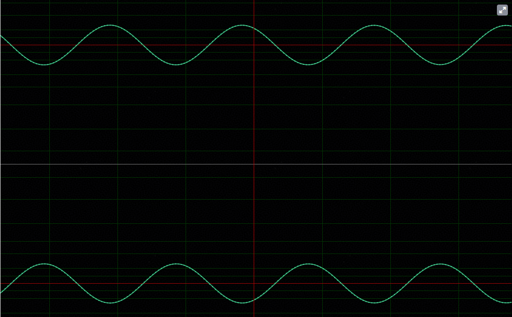

        左右声道混音播放后就会出现声音很小的情况，忽大忽小，听感上就类似是卡顿；属于正常情况。

## 音量问题<a name="ZH-CN_TOPIC_0000002518633035"></a>

-   上行音量问题（通话、录音）

    上行目前未向上层暴露音量设置接口。

-   下行音量问题（通话、音乐、提示音）

    先将音量值调到最大，然后沿音频通路逐级通过dump工具抓取输出数据分析。（请参见《音频驱动 调试指南》“音频DUMP工具”章节）

    1.  若经过track模块后，音量降低：

        请检查proc信息（请参见《音频驱动 调试指南》“音频PROC工具-AO模块”章节）中的volume\_integer是否为0。

    2.  若经过sound模块后，音量仍未降低：

        请联系PA厂商帮忙调试。

# 网络常见问题FAQ<a name="ZH-CN_TOPIC_0000002486313172"></a>

-   **[DNS报错问题](#ZH-CN_TOPIC_0000002486473150)**  

-   **[无法访问网络问题](#ZH-CN_TOPIC_0000002518513057)**  

-   **[HTTP报错问题](#ZH-CN_TOPIC_0000002518633037)**  

-   **[LwIP日志开启说明](#ZH-CN_TOPIC_0000002577721078)**  

-   **[IFCONFIG开启查询上下行数据量功能](#ZH-CN_TOPIC_0000002608081015)**  

## DNS报错问题<a name="ZH-CN_TOPIC_0000002486473150"></a>

使用域名访问外网遇到DNS域名解析错误，可排查以下场景：

-   首先检查网络通信是否正常，可使用LWIP自带ping工具ping外网域名，测试是否网络连通性是否正常。Ping工具默认集成到AT命令中，AT命令示例：AT+OHOS=OHOSNETSTACK\_PING,www.xxxx.com
-   检查DNS超时配置是否合理。偶现DNS解析失败，可能是网络延迟较大超时导致。可增大“ohos/third\_party/lwip/lwip\_adapter/liteos/src/include/lwip/lwipopts\_default.h”文件中DNS\_TMR\_INTERVAL配置，当前默认3s超时时间。

    **图 1**  DNS超时宏配置<a name="zh-cn_topic_0000002518427993_fig1444391218327"></a>  
    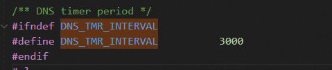

-   存在并发的网络访问。检查是否存在并发访问网络的业务场景，如果存在，可检查“ohos/third\_party/lwip/lwip\_adapter/liteos/src/include/lwip/lwipopts\_default.h”文件中的MEMP\_NUM\_NETDB和DNS\_TABLE\_SIZE配置是否满足并发需求。

    **图 2**  网络并发访问宏配置<a name="zh-cn_topic_0000002518427993_fig517221423212"></a>  
    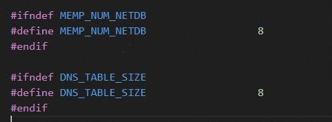

> **须知：** 
>在使用4G CAT1访问公网时，LWIP使用默认的208.67.222.222 （OpenDNS ）DNS服务器IP地址。

## 无法访问网络问题<a name="ZH-CN_TOPIC_0000002518513057"></a>

使用BT PAN存在网络访问失败，可排查以下场景：

-   确认手机是否打开蓝牙网络共享，打开共享网络后，重连蓝牙确认是否可以访问网络。

-   确认本地网口是否配置IP地址。如果本地网口未获取到IP，即手机未给单板配置IP地址，确认是否初始化LWIP。系统启动后是否调用tcpip\_init接口，且tcpip\_thread线程已经正常启动。

## HTTP报错问题<a name="ZH-CN_TOPIC_0000002518633037"></a>

HTTP recv接口报“-7”网络连接断开错误，可排查以下场景：

-   HTTP服务端存在连接超时检测，如果客户端一直保持和服务端的连接，超过服务端的超时限制，服务端会自动断开HTTP连接，报“-7”错误。
-   HTTP服务端数据发送已经完成自动断开连接。如果HTTP服务端确认数据已经传输完毕，主动断开连接，此时客户端再调用recv接口会得到“-7”连接断开错误。

HTTP访问服务端失败，服务器返回403：

-   原因：服务端校验客户端发送的报文http header失败。
-   解决方案：通过HttpClientSetCustomHeader接口，配置服务端要求的http header参数。

    例：HTTP访问http://www.163.com/，服务端返回403。然后通过HttpClientSetCustomHeader接口配置代码如[图1](#zh-cn_topic_0000002518571181_fig1060911511171)所示。

    **图 1**  配置HTTP Header代码sample<a name="zh-cn_topic_0000002518571181_fig1060911511171"></a>  
    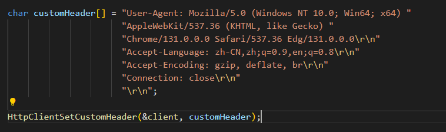

-   **[HTTPS挂死问题](#ZH-CN_TOPIC_0000002486313174)**  

### HTTPS挂死问题<a name="ZH-CN_TOPIC_0000002486313174"></a>

HTTPS访问必现挂死在mbedtls的证书解析函数中，可排查以下场景：

检查“httpclient.h”头文件编译是否配置CONFIG\_HTTP\_SECURE宏，若没有配置会导致HttpClient结构体存在被越界访问的风险。

## LwIP日志开启说明<a name="ZH-CN_TOPIC_0000002577721078"></a>

针对HiDiTing使用LiteOS操作系统，协议栈使用LwIP。开启日志调试打印方法如下：

日志总开关路径：ohos/third\_party/lwip/lwip\_adapter/liteos/src/include/lwip/lwipopts\_default.h。

1.  在上述文件路径中定义“LWIP\_DEBUG”宏，表示开启LwIP日志调试功能。
2.  “LWIP\_DBG\_TYPES\_ON”宏定义修改为“LWIP\_DBG\_ON”，表示开启debug日志。

    **图 1**  LwIP日志宏LWIP\_DEBUG<a name="zh-cn_topic_0000002572000431_zh-cn_topic_0000002548616073_fig1546384694919"></a>  
    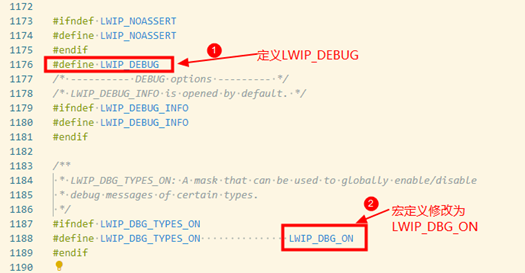

3.  开启相关模块日志功能。路径：ohos/third\_party/lwip/lwip\_v2.1.3/src/include/lwip/opt.h。

    例如开启TCP模块日志，需要修改如[图2](#zh-cn_topic_0000002572000431_zh-cn_topic_0000002548616073_fig43770965418)所示，将相关宏开启后重洗编译版本，运行相关程序，则会打印TCP相关日志。

    **图 2**  TCP模块相关宏定义开启<a name="zh-cn_topic_0000002572000431_zh-cn_topic_0000002548616073_fig43770965418"></a>  
    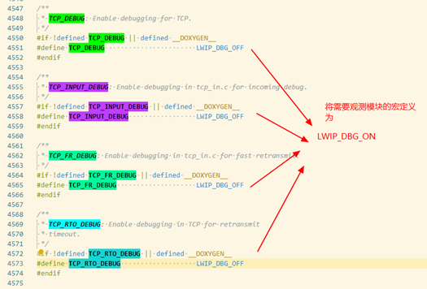

## IFCONFIG开启查询上下行数据量功能<a name="ZH-CN_TOPIC_0000002608081015"></a>

因LWIP\_STATS宏影响范围较大，当前ifconfig的查询上下行数据量功能默认不开放。若需要开放需要在“open\_source/openharmony/third\_party/lwip/lwip\_adapter/liteos/src/include/lwip/lwipopts\_default.h”和“open\_source/openharmony/third\_party/lwip/lwip\_adapter/liteos/src/include/lwip/lwipopts\_shared.h”文件中开启LWIP\_STATS、IP\_STATS和IP6\_STATS三个宏，开宏方式如下：

**图 1**  lwipopts\_default.h文件<a name="zh-cn_topic_0000002571840469_fig68585091013"></a>  
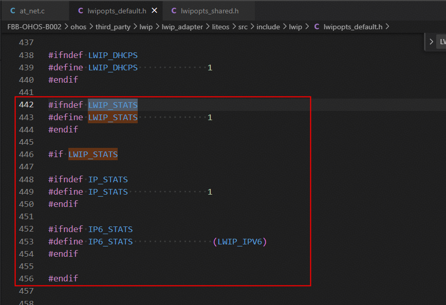

**图 2**  lwipopts\_shared.h文件<a name="zh-cn_topic_0000002571840469_fig1483013211101"></a>  
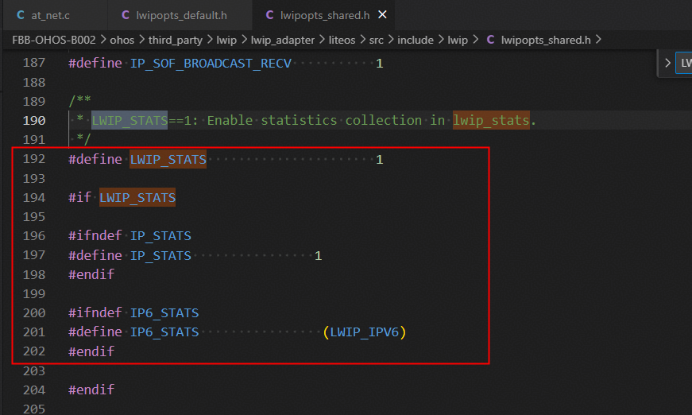

# Modem常见问题FAQ<a name="ZH-CN_TOPIC_0000002571753340"></a>

-   **[下电2131E参考代码](#ZH-CN_TOPIC_0000002571753410)**  

## 下电2131E参考代码<a name="ZH-CN_TOPIC_0000002571753410"></a>

> **说明：** 
>S\_AGPIO1在硬件上需要与2131E VBAT管脚相连。

```
#include "pinctrl.h"
#include "gpio.h"
#include "product_pin.h"
#include "ril_interface.h"

#define MODEM_VBAT_PIN       S_AGPIO1
#define MODEM_RST_PIN        S_AGPIO26
#define MODEM_UART_TX_PIN   S_MGPIO19
#define MODEM_UART_RX_PIN   S_MGPIO20
#define MODEM_UART_CTS_PIN  S_MGPIO21
#define MODEM_UART_RTS_PIN  S_MGPIO22
#define MODEM_SPI_RXD       S_MGPIO23
#define MODEM_SPI_TXD       S_MGPIO24
#define MODEM_SPI_CK        S_MGPIO25
#define MODEM_SPI_CSN       S_MGPIO26
#define MODEM_SPI_WAKEUP_PIN_TX             S_AGPIO34
#define MODEM_UART_WAKEUP_PIN_TX            S_AGPIO32
#define MODEM_SPI_WAKEUP_PIN_RX             S_AGPIO33
#define MODEM_UART_WAKEUP_PIN_RX            S_AGPIO31

typedef enum : uint8_t {
    IMSA_PIP_CONN_FSM_NONE = 0x00,
    IMSA_PIP_CONN_FSM_WAIT_CONN,
    IMSA_PIP_CONN_FSM_CONNECTED,
    IMSA_PIP_CONN_FSM_DISCONNECT,
    IMSA_PIP_CONN_FSM_OFFLINE,
} connect_status_imsa_pip_t;
void imsa_pip_conn_status_change(connect_status_imsa_pip_t status);
int32_t ril_set_cat1_power_high(void)
{
    uapi_pin_set_ie(MODEM_UART_TX_PIN, PIN_IE_ENABLE);
    uapi_pin_set_mode(MODEM_UART_TX_PIN, PIN_MODE_1);
    uapi_pin_set_pull(MODEM_UART_TX_PIN, PIN_PULL_NONE);
    uapi_pin_set_ie(MODEM_UART_RX_PIN, PIN_IE_ENABLE);
    uapi_pin_set_mode(MODEM_UART_RX_PIN, PIN_MODE_1);
    uapi_pin_set_pull(MODEM_UART_RX_PIN, PIN_PULL_NONE);
    uapi_pin_set_ie(MODEM_UART_CTS_PIN, PIN_IE_ENABLE);
    uapi_pin_set_mode(MODEM_UART_CTS_PIN, PIN_MODE_1);
    uapi_pin_set_pull(MODEM_UART_CTS_PIN, PIN_PULL_NONE);
    uapi_pin_set_ie(MODEM_UART_RTS_PIN, PIN_IE_ENABLE);
    uapi_pin_set_mode(MODEM_UART_RTS_PIN, PIN_MODE_1);
    uapi_pin_set_pull(MODEM_UART_RTS_PIN, PIN_PULL_NONE);
    uapi_pin_set_ie(MODEM_SPI_RXD, PIN_IE_ENABLE);
    uapi_pin_set_mode(MODEM_SPI_RXD, PIN_MODE_1);
    uapi_pin_set_pull(MODEM_SPI_RXD, PIN_PULL_NONE);
    uapi_pin_set_ie(MODEM_SPI_TXD, PIN_IE_ENABLE);
    uapi_pin_set_mode(MODEM_SPI_TXD, PIN_MODE_1);
    uapi_pin_set_pull(MODEM_SPI_TXD, PIN_PULL_NONE);
    uapi_pin_set_ie(MODEM_SPI_CK, PIN_IE_ENABLE);
    uapi_pin_set_mode(MODEM_SPI_CK, PIN_MODE_1);
    uapi_pin_set_pull(MODEM_SPI_CK, PIN_PULL_NONE);
    uapi_pin_set_ie(MODEM_SPI_CSN, PIN_IE_ENABLE);
    uapi_pin_set_mode(MODEM_SPI_CSN, PIN_MODE_1);
    uapi_pin_set_pull(MODEM_SPI_CSN, PIN_PULL_NONE);
    uapi_pin_set_ie(MODEM_SPI_WAKEUP_PIN_TX, PIN_IE_ENABLE);
    uapi_pin_set_pull(MODEM_SPI_WAKEUP_PIN_TX, PIN_PULL_NONE);
    uapi_pin_set_ie(MODEM_UART_WAKEUP_PIN_TX, PIN_IE_ENABLE);
    uapi_pin_set_pull(MODEM_UART_WAKEUP_PIN_TX, PIN_PULL_NONE);
    uapi_pin_set_ie(MODEM_SPI_WAKEUP_PIN_RX, PIN_IE_ENABLE);
    uapi_pin_set_pull(MODEM_SPI_WAKEUP_PIN_RX, PIN_PULL_NONE);
    uapi_pin_set_ie(MODEM_UART_WAKEUP_PIN_RX, PIN_IE_ENABLE);
    uapi_pin_set_pull(MODEM_UART_WAKEUP_PIN_RX, PIN_PULL_NONE);
    uapi_pin_set_ie(MODEM_RST_PIN, PIN_IE_ENABLE);
    uapi_gpio_set_val(MODEM_RST_PIN, GPIO_LEVEL_HIGH);
    uapi_pin_set_pull(MODEM_RST_PIN, PIN_PULL_UP);
    
    uapi_gpio_set_val(MODEM_VBAT_PIN, GPIO_LEVEL_HIGH);
    return RIL_RET_SUCCESS;
}
int32_t ril_set_cat1_power_low(void)
{
    uint8_t cfun_ret = 0xFF;
    int32_t ret = ril_set_cfun_status(0, &cfun_ret);
    if (ret != RIL_RET_SUCCESS && cfun_ret != 0) {
        return RIL_RET_FAIL_PROCESS;
    }
    imsa_pip_conn_status_change(IMSA_PIP_CONN_FSM_OFFLINE);     // 下电2131后不允许发送RIL命令

    uapi_gpio_set_val(MODEM_VBAT_PIN, GPIO_LEVEL_LOW);

    uapi_pin_set_ie(MODEM_UART_TX_PIN, PIN_IE_DISABLE);
    uapi_pin_set_mode(MODEM_UART_TX_PIN, PIN_MODE_0);
    uapi_gpio_set_val(MODEM_UART_TX_PIN, GPIO_LEVEL_LOW);
    uapi_pin_set_pull(MODEM_UART_TX_PIN, PIN_PULL_DOWN);
    uapi_pin_set_ie(MODEM_UART_RX_PIN, PIN_IE_DISABLE);
    uapi_pin_set_mode(MODEM_UART_RX_PIN, PIN_MODE_0);
    uapi_gpio_set_val(MODEM_UART_RX_PIN, GPIO_LEVEL_LOW);
    uapi_pin_set_pull(MODEM_UART_RX_PIN, PIN_PULL_DOWN);
    uapi_pin_set_ie(MODEM_UART_CTS_PIN, PIN_IE_DISABLE);
    uapi_pin_set_mode(MODEM_UART_CTS_PIN, PIN_MODE_0);
    uapi_gpio_set_val(MODEM_UART_CTS_PIN, GPIO_LEVEL_LOW);
    uapi_pin_set_pull(MODEM_UART_CTS_PIN, PIN_PULL_DOWN);
    uapi_pin_set_ie(MODEM_UART_RTS_PIN, PIN_IE_DISABLE);
    uapi_pin_set_mode(MODEM_UART_RTS_PIN, PIN_MODE_0);
    uapi_gpio_set_val(MODEM_UART_RTS_PIN, GPIO_LEVEL_LOW);
    uapi_pin_set_pull(MODEM_UART_RTS_PIN, PIN_PULL_DOWN);
    uapi_pin_set_ie(MODEM_SPI_RXD, PIN_IE_DISABLE);
    uapi_pin_set_mode(MODEM_SPI_RXD, PIN_MODE_0);
    uapi_gpio_set_val(MODEM_SPI_RXD, GPIO_LEVEL_LOW);
    uapi_pin_set_pull(MODEM_SPI_RXD, PIN_PULL_DOWN);
    uapi_pin_set_ie(MODEM_SPI_TXD, PIN_IE_DISABLE);
    uapi_pin_set_mode(MODEM_SPI_TXD, PIN_MODE_0);
    uapi_gpio_set_val(MODEM_SPI_TXD, GPIO_LEVEL_LOW);
    uapi_pin_set_pull(MODEM_SPI_TXD, PIN_PULL_DOWN);
    uapi_pin_set_ie(MODEM_SPI_CK, PIN_IE_DISABLE);
    uapi_pin_set_mode(MODEM_SPI_CK, PIN_MODE_0);
    uapi_gpio_set_val(MODEM_SPI_CK, GPIO_LEVEL_LOW);
    uapi_pin_set_pull(MODEM_SPI_CK, PIN_PULL_DOWN);
    uapi_pin_set_ie(MODEM_SPI_CSN, PIN_IE_DISABLE);
    uapi_pin_set_mode(MODEM_SPI_CSN, PIN_MODE_0);
    uapi_gpio_set_val(MODEM_SPI_CSN, GPIO_LEVEL_LOW);
    uapi_pin_set_pull(MODEM_SPI_CSN, PIN_PULL_DOWN);
    uapi_pin_set_ie(MODEM_SPI_WAKEUP_PIN_TX, PIN_IE_DISABLE);
    uapi_gpio_set_val(MODEM_SPI_WAKEUP_PIN_TX, GPIO_LEVEL_LOW);
    uapi_pin_set_pull(MODEM_SPI_WAKEUP_PIN_TX, PIN_PULL_DOWN);
    uapi_pin_set_ie(MODEM_UART_WAKEUP_PIN_TX, PIN_IE_DISABLE);
    uapi_gpio_set_val(MODEM_UART_WAKEUP_PIN_TX, GPIO_LEVEL_LOW);
    uapi_pin_set_pull(MODEM_UART_WAKEUP_PIN_TX, PIN_PULL_DOWN);
    uapi_pin_set_ie(MODEM_SPI_WAKEUP_PIN_RX, PIN_IE_DISABLE);
    uapi_gpio_set_val(MODEM_SPI_WAKEUP_PIN_RX, GPIO_LEVEL_LOW);
    uapi_pin_set_pull(MODEM_SPI_WAKEUP_PIN_RX, PIN_PULL_DOWN);
    uapi_pin_set_ie(MODEM_UART_WAKEUP_PIN_RX, PIN_IE_DISABLE);
    uapi_gpio_set_val(MODEM_UART_WAKEUP_PIN_RX, GPIO_LEVEL_LOW);
    uapi_pin_set_pull(MODEM_UART_WAKEUP_PIN_RX, PIN_PULL_DOWN);
    uapi_pin_set_ie(MODEM_RST_PIN, PIN_IE_DISABLE);
    uapi_pin_set_mode(MODEM_RST_PIN, (pin_mode_t)HAL_PIO_FUNC_GPIO);
    uapi_gpio_set_dir(MODEM_RST_PIN, GPIO_DIRECTION_OUTPUT);
    uapi_gpio_set_val(MODEM_RST_PIN, GPIO_LEVEL_LOW);
    uapi_pin_set_pull(MODEM_RST_PIN, PIN_PULL_DOWN);
    return RIL_RET_SUCCESS;
}
```

