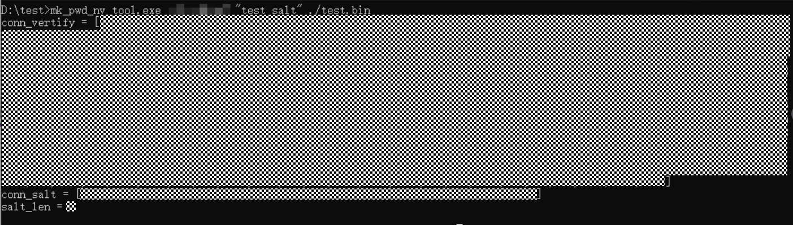
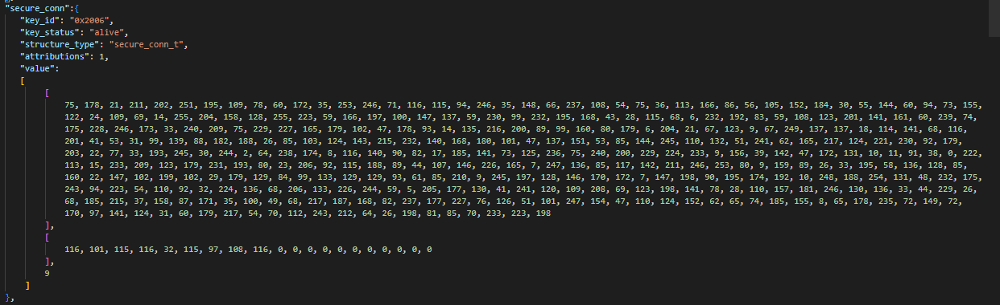
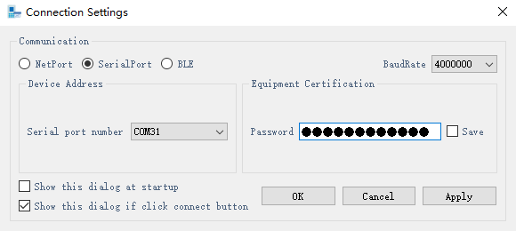
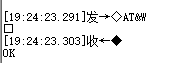
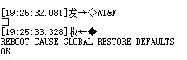
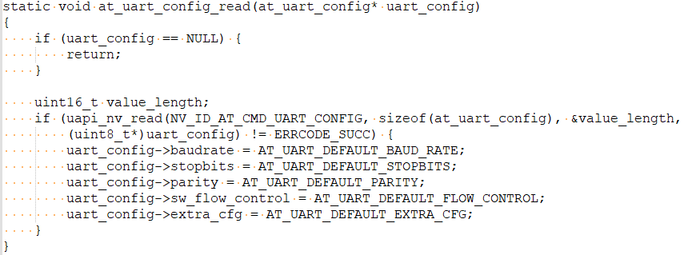

# 前言<a name="ZH-CN_TOPIC_0000002258228249"></a>

**概述<a name="zh-cn_topic_0000002043403234_section4537382116410"></a>**

本文档主要针对Hi2131E系列中NV存储模块的使用进行介绍。用于指导工程人员能够快速使用NV模块进行二次开发。

> **注意：** 
>**本手册只针对通过USB单独连接Hi2131E，否则请忽略。**

**读者对象<a name="zh-cn_topic_0000002043403234_section4378592816410"></a>**

本文档主要适用于以下工程师：

-   技术支持工程师
-   软件工程师

**符号约定<a name="zh-cn_topic_0000002043403234_section133020216410"></a>**

在本文中可能出现下列标志，它们所代表的含义如下。

<a name="zh-cn_topic_0000002043403234_table2622507016410"></a>
<table><thead align="left"><tr id="zh-cn_topic_0000002043403234_row1530720816410"><th class="cellrowborder" valign="top" width="20.580000000000002%" id="mcps1.1.3.1.1"><p id="zh-cn_topic_0000002043403234_p6450074116410"><a name="zh-cn_topic_0000002043403234_p6450074116410"></a><a name="zh-cn_topic_0000002043403234_p6450074116410"></a><strong id="zh-cn_topic_0000002043403234_b2136615816410"><a name="zh-cn_topic_0000002043403234_b2136615816410"></a><a name="zh-cn_topic_0000002043403234_b2136615816410"></a>符号</strong></p>
</th>
<th class="cellrowborder" valign="top" width="79.42%" id="mcps1.1.3.1.2"><p id="zh-cn_topic_0000002043403234_p5435366816410"><a name="zh-cn_topic_0000002043403234_p5435366816410"></a><a name="zh-cn_topic_0000002043403234_p5435366816410"></a><strong id="zh-cn_topic_0000002043403234_b5941558116410"><a name="zh-cn_topic_0000002043403234_b5941558116410"></a><a name="zh-cn_topic_0000002043403234_b5941558116410"></a>说明</strong></p>
</th>
</tr>
</thead>
<tbody><tr id="zh-cn_topic_0000002043403234_row1372280416410"><td class="cellrowborder" valign="top" width="20.580000000000002%" headers="mcps1.1.3.1.1 "><p id="zh-cn_topic_0000002043403234_p3734547016410"><a name="zh-cn_topic_0000002043403234_p3734547016410"></a><a name="zh-cn_topic_0000002043403234_p3734547016410"></a><a name="zh-cn_topic_0000002043403234_image2670064316410"></a><a name="zh-cn_topic_0000002043403234_image2670064316410"></a><span></span></p>
</td>
<td class="cellrowborder" valign="top" width="79.42%" headers="mcps1.1.3.1.2 "><p id="zh-cn_topic_0000002043403234_p1757432116410"><a name="zh-cn_topic_0000002043403234_p1757432116410"></a><a name="zh-cn_topic_0000002043403234_p1757432116410"></a>表示如不避免则将会导致死亡或严重伤害的具有高等级风险的危害。</p>
</td>
</tr>
<tr id="zh-cn_topic_0000002043403234_row466863216410"><td class="cellrowborder" valign="top" width="20.580000000000002%" headers="mcps1.1.3.1.1 "><p id="zh-cn_topic_0000002043403234_p1432579516410"><a name="zh-cn_topic_0000002043403234_p1432579516410"></a><a name="zh-cn_topic_0000002043403234_p1432579516410"></a><a name="zh-cn_topic_0000002043403234_image4895582316410"></a><a name="zh-cn_topic_0000002043403234_image4895582316410"></a><span></span></p>
</td>
<td class="cellrowborder" valign="top" width="79.42%" headers="mcps1.1.3.1.2 "><p id="zh-cn_topic_0000002043403234_p959197916410"><a name="zh-cn_topic_0000002043403234_p959197916410"></a><a name="zh-cn_topic_0000002043403234_p959197916410"></a>表示如不避免则可能导致死亡或严重伤害的具有中等级风险的危害。</p>
</td>
</tr>
<tr id="zh-cn_topic_0000002043403234_row123863216410"><td class="cellrowborder" valign="top" width="20.580000000000002%" headers="mcps1.1.3.1.1 "><p id="zh-cn_topic_0000002043403234_p1232579516410"><a name="zh-cn_topic_0000002043403234_p1232579516410"></a><a name="zh-cn_topic_0000002043403234_p1232579516410"></a><a name="zh-cn_topic_0000002043403234_image1235582316410"></a><a name="zh-cn_topic_0000002043403234_image1235582316410"></a><span></span></p>
</td>
<td class="cellrowborder" valign="top" width="79.42%" headers="mcps1.1.3.1.2 "><p id="zh-cn_topic_0000002043403234_p123197916410"><a name="zh-cn_topic_0000002043403234_p123197916410"></a><a name="zh-cn_topic_0000002043403234_p123197916410"></a>表示如不避免则可能导致轻微或中度伤害的具有低等级风险的危害。</p>
</td>
</tr>
<tr id="zh-cn_topic_0000002043403234_row5786682116410"><td class="cellrowborder" valign="top" width="20.580000000000002%" headers="mcps1.1.3.1.1 "><p id="zh-cn_topic_0000002043403234_p2204984716410"><a name="zh-cn_topic_0000002043403234_p2204984716410"></a><a name="zh-cn_topic_0000002043403234_p2204984716410"></a><a name="zh-cn_topic_0000002043403234_image4504446716410"></a><a name="zh-cn_topic_0000002043403234_image4504446716410"></a><span></span></p>
</td>
<td class="cellrowborder" valign="top" width="79.42%" headers="mcps1.1.3.1.2 "><p id="zh-cn_topic_0000002043403234_p4388861916410"><a name="zh-cn_topic_0000002043403234_p4388861916410"></a><a name="zh-cn_topic_0000002043403234_p4388861916410"></a>用于传递设备或环境安全警示信息。如不避免则可能会导致设备损坏、数据丢失、设备性能降低或其它不可预知的结果。</p>
<p id="zh-cn_topic_0000002043403234_p1238861916410"><a name="zh-cn_topic_0000002043403234_p1238861916410"></a><a name="zh-cn_topic_0000002043403234_p1238861916410"></a>“须知”不涉及人身伤害。</p>
</td>
</tr>
<tr id="zh-cn_topic_0000002043403234_row2856923116410"><td class="cellrowborder" valign="top" width="20.580000000000002%" headers="mcps1.1.3.1.1 "><p id="zh-cn_topic_0000002043403234_p5555360116410"><a name="zh-cn_topic_0000002043403234_p5555360116410"></a><a name="zh-cn_topic_0000002043403234_p5555360116410"></a><a name="zh-cn_topic_0000002043403234_image799324016410"></a><a name="zh-cn_topic_0000002043403234_image799324016410"></a><span></span></p>
</td>
<td class="cellrowborder" valign="top" width="79.42%" headers="mcps1.1.3.1.2 "><p id="zh-cn_topic_0000002043403234_p4612588116410"><a name="zh-cn_topic_0000002043403234_p4612588116410"></a><a name="zh-cn_topic_0000002043403234_p4612588116410"></a>对正文中重点信息的补充说明。</p>
<p id="zh-cn_topic_0000002043403234_p1232588116410"><a name="zh-cn_topic_0000002043403234_p1232588116410"></a><a name="zh-cn_topic_0000002043403234_p1232588116410"></a>“说明”不是安全警示信息，不涉及人身、设备及环境伤害信息。</p>
</td>
</tr>
</tbody>
</table>

# NV存储<a name="ZH-CN_TOPIC_0000002258628509"></a>

-   **[NV简介](#ZH-CN_TOPIC_0000002223509020)**  

-   **[设置DebugKits连接密钥](#ZH-CN_TOPIC_0000002258628517)**  

-   **[恢复出厂设置](#ZH-CN_TOPIC_0000002223668872)**  

-   **[NV 黑名单机制](#ZH-CN_TOPIC_0000002517465158)**  

## NV简介<a name="ZH-CN_TOPIC_0000002223509020"></a>

NV模块应用于用户在Flash中存储非易失性数据。NV中的每项数据以类似map的方式进行定义，数据项中包含唯一的索引Key和自定义数据类型的NVvalue。模块与NV的定义存储在json文件中，数据类型结构体定义在代码目录“middleware/chips/cat1/nv/nv\_config/acore/include/nv\_common.h”的头文件中。用户可通过json配置文件和编写代码的方式设置NV。

> **说明：** 
>-   通常情况下，在使用NV模块时需预先定义NV的ID、属性及结构类型，便于业务使用及工具解析。
>-   定义新的NV需要修改配置文件，如果存在自定义的结构类型，需要添加到“nv\_common.h”文件，供NV模块使用。

## 设置DebugKits连接密钥<a name="ZH-CN_TOPIC_0000002258628517"></a>

当前，DebugKits与芯片进行安全连接需要进行密钥验证。如[图1](#zh-cn_topic_0000002043561530_fig5509205534520)所示。

> **说明：** 
>注意连接过程中使用了用户名为“user”的登录用户名，此用户名不需要通过界面输入。注意SDK包内无预置口令，需手动自定义口令添加，建议定期更新预置口令。

**图 1**  DebugKits与芯片进行安全连接设置界面一<a name="zh-cn_topic_0000002043561530_fig5509205534520"></a>  


密钥的生成和验证需要通过预置NV进行设置。主要包括以下三个步骤：

1.  <a name="zh-cn_topic_0000002043561530_li690415374187"></a>生成连接密钥及盐值。

    工具路径：tools\\DebugKits\\mk\_pwd\_nv\_tool.exe

    通过命令行执行“mk\_pwd\_nv\_tool.exe XXXXXX "test salt" ./test.bin”命令，可在命令窗口或“test.bin”中生成密钥和盐值，如[图2](#zh-cn_topic_0000002043561530_fig128019294225)所示。

    **图 2**  生成密钥和盐值<a name="zh-cn_topic_0000002043561530_fig128019294225"></a>  
    

    输入参数说明：

    -   mk\_pwd\_nv\_tool.exe：密钥生成工具。
    -   XXXXXX：示例口令，即DebugKits连接时的输入密码。
    -   "test salt"：示例盐值（建议用户设置长度为20Byte个数的真随机数）。
    -   ./test.bin：输出路径。

    输出参数说明：

    -   conn\_vertify：连接密钥，用于板端芯片。
    -   conn\_salt：连接盐值，用于板端芯片。
    -   salt\_len：盐值长度，用于板端芯片。

    密钥生成设置说明：

    -   口令长度至少8个字符，最长不超过32个字符。
    -   口令必须包含至少两种字符的组合（小写字母、大写字母、数字、特殊字符）。
    -   盐值可任意设置，盐值长度不能为0，最长不超过20。

2.  设置安全连接Key。

    设置安全连接key需在“middleware/chips/cat1/nv/nv\_config/acore/cfg/acore/common.json”中新增一个名称为“secure\_conn”的NV。设置安全连接key即预置“secure\_conn”的NVvalue，其中NVvalue为[1](#zh-cn_topic_0000002043561530_li690415374187)生成的连接参数，NV配置格式如下：

    ```
    "secure_conn":{
        "key_id": "0x2006",
        "key_status": "alive",
        "structure_type": "secure_conn_t",
        "attributions": 1,
        "value": [[conn_vertify],[conn_salt],salt_len]
    },
    ```

    

3.  烧写NV进行密钥连接。

    通过镜像烧写，将重新生成包含安全连接密钥Key的NV镜像烧写到单板中，可使用新密钥进行DebugKits连接。

    **图 3**  DebugKits与芯片进行安全连接设置界面二<a name="zh-cn_topic_0000002043561530_fig1226619479314"></a>  
    

## 恢复出厂设置<a name="ZH-CN_TOPIC_0000002223668872"></a>

恢复出厂设置主要提供一种NV异常恢复机制，主动将芯片的NV区恢复为初始备份状态。当芯片的NV区出现异常，即不能访问和修改时，可以通过AT命令使NV区的数据全部清除并恢复至原始出厂状态。备份区在出厂状态数据为空，需要用户主动进行备份，否则执行恢复出厂设置时，可能会导致NV恢复为空。

恢复出厂设置主要包含NV备份和NV恢复两个流程。

> **注意：** 
>恢复出厂设置时，仅恢复和备份区重复的NV，新增NV不删除。

**NV备份<a name="zh-cn_topic_0000002043561518_section42102599557"></a>**

AT命令：

```
AT&W
```

应用核启动后，在非入网状态，发送特定AT命令，使芯片开始备份当前NV区的所有NV数据。AT命令返回“OK”，则证明全量NV备份已完成。NV备份操作可重复执行，避免因数据遗漏或备份失败导致无法二次备份。备份区的数据永远以最后一次备份时的NV区数据为模板。

**图 1**  NV备份指令<a name="zh-cn_topic_0000002043561518_fig17314172745715"></a>  


**NV恢复<a name="zh-cn_topic_0000002043561518_section10813512579"></a>**

AT命令：

```
AT&F
```

当NV区发生异常，无法对其进行操作时，可以发送“AT&F”，进行恢复出厂设置。恢复操作会将芯片复位，NV区的所有数据将会被擦除，并以备份区的数据为模板进行恢复。

**图 2**  NV恢复指令<a name="zh-cn_topic_0000002043561518_fig10926122510572"></a>  


> **说明：** 
>-   NV恢复出厂设置优先级最高，恢复时当前NV区的永久Key也会被擦除。
>-   NV区备份时应在关机状态下进行备份，保证备份区NV的可靠性。量产后不应再使用备份功能。

## NV 黑名单机制<a name="ZH-CN_TOPIC_0000002517465158"></a>

在“nv\_blacklist.h”的数组g\_blacklist\_array中配置不需要备份的NV\_ID，配置后，当正常工作区找不到该NV后不会从备份区去读，同时该NV也不会进行备份和恢复动作。

# 预定义Key<a name="ZH-CN_TOPIC_0000002258468637"></a>

-   **[简介](#ZH-CN_TOPIC_0000002258628521)**  

-   **[Key默认值](#ZH-CN_TOPIC_0000002223509032)**  

-   **[Key取值范围](#ZH-CN_TOPIC_0000002223668876)**  

-   **[可定制NV](#ZH-CN_TOPIC_0000002258468641)**  

## 简介<a name="ZH-CN_TOPIC_0000002258628521"></a>

本节主要针对json配置文件中预定义的Key进行解释说明，便于用户在使用中进行二次开发。文中列出了所有外部出厂预定义的Key，包括Key的所属模块，含义及NVvalue的结构定义，方便开发人员在不同的场景下对Key进行预置和修改。

## Key默认值<a name="ZH-CN_TOPIC_0000002223509032"></a>

在以下Key说明中，“默认值”的概念是Key在没有预置值时，软件读取NV失败后使用的软件默认值。

以[图1](#zh-cn_topic_0000002079520861_fig29541559115810)中AT UART配置相关的NV\_ID\_ATCMD\_UART\_CONFIG为例，当NVvalue无预置时，UART波特率会使用软件默认的AT\_UART\_DEFAULT\_BAUD\_RATE，即9600；其余UART配置同理。

**图 1**  AT UART配置读取<a name="zh-cn_topic_0000002079520861_fig29541559115810"></a>  


实际使用中，大部分NV都没有预置，使用软件的默认值。

建议默认值满足使用需求时，保留预置值为空，而非将默认值填入预置中。

## Key取值范围<a name="ZH-CN_TOPIC_0000002223668876"></a>

在以下说明中，Key的取值范围同时满足：

-   数据类型本身范围。即首先满足整型范围，如果是枚举型必须是某一枚举成员，如果是bool型可能取值仅有false \(0\) 和true \(1\)。
-   结构类型中代码注释和备注中额外说明的范围。

NV配置是开发者行为，超出范围的配置可能导致非预期的UE行为。

使用DebugKits工具修改NV值无法进行非法参数拦截，必现按有效值配置。

## 可定制NV<a name="ZH-CN_TOPIC_0000002258468641"></a>

-   **[BASE](#ZH-CN_TOPIC_0000002258628525)**  

-   **[USIM](#ZH-CN_TOPIC_0000002223509036)**  

-   **[RRC](#ZH-CN_TOPIC_0000002223668880)**  

-   **[SOC\_UE](#ZH-CN_TOPIC_0000002258468645)**  

-   **[LL1](#ZH-CN_TOPIC_0000002258628529)**  

-   **[NAS](#ZH-CN_TOPIC_0000002223509040)**  

-   **[LPC](#ZH-CN_TOPIC_0000002223668884)**  

-   **[DEBUG](#ZH-CN_TOPIC_0000002258468653)**  

-   **[SMS](#ZH-CN_TOPIC_0000002258628533)**  

-   **[TAF](#ZH-CN_TOPIC_0000002223509044)**  

-   **[USB](#ZH-CN_TOPIC_0000002223668888)**  

-   **[LWIP](#ZH-CN_TOPIC_0000002533053203)**  

### BASE<a name="ZH-CN_TOPIC_0000002258628525"></a>

**模块说明<a name="zh-cn_topic_0000002079520881_section88522043194615"></a>**

<a name="zh-cn_topic_0000002079520881_table589183419304"></a>
<table><thead align="left"><tr id="zh-cn_topic_0000002079520881_row13891103433012"><th class="cellrowborder" valign="top" width="49.88%" id="mcps1.1.3.1.1"><p id="zh-cn_topic_0000002079520881_p13891153412303"><a name="zh-cn_topic_0000002079520881_p13891153412303"></a><a name="zh-cn_topic_0000002079520881_p13891153412303"></a>参数</p>
</th>
<th class="cellrowborder" valign="top" width="50.12%" id="mcps1.1.3.1.2"><p id="zh-cn_topic_0000002079520881_p78911347301"><a name="zh-cn_topic_0000002079520881_p78911347301"></a><a name="zh-cn_topic_0000002079520881_p78911347301"></a>说明</p>
</th>
</tr>
</thead>
<tbody><tr id="zh-cn_topic_0000002079520881_row1789119348309"><td class="cellrowborder" valign="top" width="49.88%" headers="mcps1.1.3.1.1 "><p id="zh-cn_topic_0000002079520881_p128911934133013"><a name="zh-cn_topic_0000002079520881_p128911934133013"></a><a name="zh-cn_topic_0000002079520881_p128911934133013"></a>模块ID</p>
</td>
<td class="cellrowborder" valign="top" width="50.12%" headers="mcps1.1.3.1.2 "><p id="zh-cn_topic_0000002079520881_p489173411303"><a name="zh-cn_topic_0000002079520881_p489173411303"></a><a name="zh-cn_topic_0000002079520881_p489173411303"></a>0</p>
</td>
</tr>
<tr id="zh-cn_topic_0000002079520881_row6785175843414"><td class="cellrowborder" valign="top" width="49.88%" headers="mcps1.1.3.1.1 "><p id="zh-cn_topic_0000002079520881_p18624224123520"><a name="zh-cn_topic_0000002079520881_p18624224123520"></a><a name="zh-cn_topic_0000002079520881_p18624224123520"></a>模块名</p>
</td>
<td class="cellrowborder" valign="top" width="50.12%" headers="mcps1.1.3.1.2 "><p id="zh-cn_topic_0000002079520881_p11786135833419"><a name="zh-cn_topic_0000002079520881_p11786135833419"></a><a name="zh-cn_topic_0000002079520881_p11786135833419"></a>BASE</p>
</td>
</tr>
<tr id="zh-cn_topic_0000002079520881_row620110313356"><td class="cellrowborder" valign="top" width="49.88%" headers="mcps1.1.3.1.1 "><p id="zh-cn_topic_0000002079520881_p12201931357"><a name="zh-cn_topic_0000002079520881_p12201931357"></a><a name="zh-cn_topic_0000002079520881_p12201931357"></a>模块描述</p>
</td>
<td class="cellrowborder" valign="top" width="50.12%" headers="mcps1.1.3.1.2 "><p id="zh-cn_topic_0000002079520881_p122018373512"><a name="zh-cn_topic_0000002079520881_p122018373512"></a><a name="zh-cn_topic_0000002079520881_p122018373512"></a>通用基础模块</p>
</td>
</tr>
<tr id="zh-cn_topic_0000002079520881_row2891113416309"><td class="cellrowborder" valign="top" width="49.88%" headers="mcps1.1.3.1.1 "><p id="zh-cn_topic_0000002079520881_p178911134173019"><a name="zh-cn_topic_0000002079520881_p178911134173019"></a><a name="zh-cn_topic_0000002079520881_p178911134173019"></a>模块类型</p>
</td>
<td class="cellrowborder" valign="top" width="50.12%" headers="mcps1.1.3.1.2 "><p id="zh-cn_topic_0000002079520881_p2891143413301"><a name="zh-cn_topic_0000002079520881_p2891143413301"></a><a name="zh-cn_topic_0000002079520881_p2891143413301"></a>Custom</p>
</td>
</tr>
</tbody>
</table>

**模块Key<a name="zh-cn_topic_0000002079520881_section0618183514815"></a>**

<a name="zh-cn_topic_0000002079520881_table1239310213400"></a>
<table><thead align="left"><tr id="zh-cn_topic_0000002079520881_row3393132154015"><th class="cellrowborder" colspan="2" valign="top" id="mcps1.1.3.1.1"><p id="zh-cn_topic_0000002079520881_p19789161153811"><a name="zh-cn_topic_0000002079520881_p19789161153811"></a><a name="zh-cn_topic_0000002079520881_p19789161153811"></a>NV_ID_MANUFACTURER_IDENTIFIER</p>
</th>
</tr>
</thead>
<tbody><tr id="zh-cn_topic_0000002079520881_row15393172114011"><td class="cellrowborder" valign="top" width="25.430000000000003%" headers="mcps1.1.3.1.1 "><p id="zh-cn_topic_0000002079520881_p83932217403"><a name="zh-cn_topic_0000002079520881_p83932217403"></a><a name="zh-cn_topic_0000002079520881_p83932217403"></a>Key ID</p>
</td>
<td class="cellrowborder" valign="top" width="74.57000000000001%" headers="mcps1.1.3.1.1 "><p id="zh-cn_topic_0000002079520881_p16393152144013"><a name="zh-cn_topic_0000002079520881_p16393152144013"></a><a name="zh-cn_topic_0000002079520881_p16393152144013"></a>0x0002</p>
</td>
</tr>
<tr id="zh-cn_topic_0000002079520881_row14393192114013"><td class="cellrowborder" valign="top" width="25.430000000000003%" headers="mcps1.1.3.1.1 "><p id="zh-cn_topic_0000002079520881_p163932294011"><a name="zh-cn_topic_0000002079520881_p163932294011"></a><a name="zh-cn_topic_0000002079520881_p163932294011"></a>Key状态</p>
</td>
<td class="cellrowborder" valign="top" width="74.57000000000001%" headers="mcps1.1.3.1.1 "><p id="zh-cn_topic_0000002079520881_p1239311224017"><a name="zh-cn_topic_0000002079520881_p1239311224017"></a><a name="zh-cn_topic_0000002079520881_p1239311224017"></a>alive</p>
</td>
</tr>
<tr id="zh-cn_topic_0000002079520881_row23931927404"><td class="cellrowborder" valign="top" width="25.430000000000003%" headers="mcps1.1.3.1.1 "><p id="zh-cn_topic_0000002079520881_p14393320404"><a name="zh-cn_topic_0000002079520881_p14393320404"></a><a name="zh-cn_topic_0000002079520881_p14393320404"></a>Key描述</p>
</td>
<td class="cellrowborder" valign="top" width="74.57000000000001%" headers="mcps1.1.3.1.1 "><p id="zh-cn_topic_0000002079520881_p16393112204011"><a name="zh-cn_topic_0000002079520881_p16393112204011"></a><a name="zh-cn_topic_0000002079520881_p16393112204011"></a>制造商标识Key。</p>
</td>
</tr>
<tr id="zh-cn_topic_0000002079520881_row43930234018"><td class="cellrowborder" valign="top" width="25.430000000000003%" headers="mcps1.1.3.1.1 "><p id="zh-cn_topic_0000002079520881_p153933254011"><a name="zh-cn_topic_0000002079520881_p153933254011"></a><a name="zh-cn_topic_0000002079520881_p153933254011"></a>结构类型</p>
</td>
<td class="cellrowborder" valign="top" width="74.57000000000001%" headers="mcps1.1.3.1.1 "><p id="zh-cn_topic_0000002079520881_p53931829400"><a name="zh-cn_topic_0000002079520881_p53931829400"></a><a name="zh-cn_topic_0000002079520881_p53931829400"></a>undetermined_size_buffer：不定长字符数组。</p>
</td>
</tr>
<tr id="zh-cn_topic_0000002079520881_row1652123920311"><td class="cellrowborder" valign="top" width="25.430000000000003%" headers="mcps1.1.3.1.1 "><p id="zh-cn_topic_0000002079520881_p205221639736"><a name="zh-cn_topic_0000002079520881_p205221639736"></a><a name="zh-cn_topic_0000002079520881_p205221639736"></a>默认值</p>
</td>
<td class="cellrowborder" valign="top" width="74.57000000000001%" headers="mcps1.1.3.1.1 "><p id="zh-cn_topic_0000002079520881_p16522739135"><a name="zh-cn_topic_0000002079520881_p16522739135"></a><a name="zh-cn_topic_0000002079520881_p16522739135"></a>-</p>
</td>
</tr>
<tr id="zh-cn_topic_0000002079520881_row113933264015"><td class="cellrowborder" valign="top" width="25.430000000000003%" headers="mcps1.1.3.1.1 "><p id="zh-cn_topic_0000002079520881_p1539317211403"><a name="zh-cn_topic_0000002079520881_p1539317211403"></a><a name="zh-cn_topic_0000002079520881_p1539317211403"></a>备注</p>
</td>
<td class="cellrowborder" valign="top" width="74.57000000000001%" headers="mcps1.1.3.1.1 "><p id="zh-cn_topic_0000002079520881_p2393192114013"><a name="zh-cn_topic_0000002079520881_p2393192114013"></a><a name="zh-cn_topic_0000002079520881_p2393192114013"></a>最大长度为40，取值可以为任意字符串（存在ASCII码即可）。</p>
</td>
</tr>
</tbody>
</table>

<a name="zh-cn_topic_0000002079520881_table53935264013"></a>
<table><thead align="left"><tr id="zh-cn_topic_0000002079520881_row1939310211401"><th class="cellrowborder" colspan="2" valign="top" id="mcps1.1.3.1.1"><p id="zh-cn_topic_0000002079520881_p14393821401"><a name="zh-cn_topic_0000002079520881_p14393821401"></a><a name="zh-cn_topic_0000002079520881_p14393821401"></a>NV_ID_MANUFACTURER_MODEL_IDENTIFIER</p>
</th>
</tr>
</thead>
<tbody><tr id="zh-cn_topic_0000002079520881_row1239317224018"><td class="cellrowborder" valign="top" width="25.619999999999997%" headers="mcps1.1.3.1.1 "><p id="zh-cn_topic_0000002079520881_p6393328407"><a name="zh-cn_topic_0000002079520881_p6393328407"></a><a name="zh-cn_topic_0000002079520881_p6393328407"></a>Key ID</p>
</td>
<td class="cellrowborder" valign="top" width="74.38%" headers="mcps1.1.3.1.1 "><p id="zh-cn_topic_0000002079520881_p163931926400"><a name="zh-cn_topic_0000002079520881_p163931926400"></a><a name="zh-cn_topic_0000002079520881_p163931926400"></a>0x0003</p>
</td>
</tr>
<tr id="zh-cn_topic_0000002079520881_row1339332124010"><td class="cellrowborder" valign="top" width="25.619999999999997%" headers="mcps1.1.3.1.1 "><p id="zh-cn_topic_0000002079520881_p1839312194015"><a name="zh-cn_topic_0000002079520881_p1839312194015"></a><a name="zh-cn_topic_0000002079520881_p1839312194015"></a>Key状态</p>
</td>
<td class="cellrowborder" valign="top" width="74.38%" headers="mcps1.1.3.1.1 "><p id="zh-cn_topic_0000002079520881_p839311210405"><a name="zh-cn_topic_0000002079520881_p839311210405"></a><a name="zh-cn_topic_0000002079520881_p839311210405"></a>alive</p>
</td>
</tr>
<tr id="zh-cn_topic_0000002079520881_row133935274016"><td class="cellrowborder" valign="top" width="25.619999999999997%" headers="mcps1.1.3.1.1 "><p id="zh-cn_topic_0000002079520881_p239318274012"><a name="zh-cn_topic_0000002079520881_p239318274012"></a><a name="zh-cn_topic_0000002079520881_p239318274012"></a>Key描述</p>
</td>
<td class="cellrowborder" valign="top" width="74.38%" headers="mcps1.1.3.1.1 "><p id="zh-cn_topic_0000002079520881_p1239372184013"><a name="zh-cn_topic_0000002079520881_p1239372184013"></a><a name="zh-cn_topic_0000002079520881_p1239372184013"></a>芯片版本标识Key。</p>
</td>
</tr>
<tr id="zh-cn_topic_0000002079520881_row13931224019"><td class="cellrowborder" valign="top" width="25.619999999999997%" headers="mcps1.1.3.1.1 "><p id="zh-cn_topic_0000002079520881_p143930214010"><a name="zh-cn_topic_0000002079520881_p143930214010"></a><a name="zh-cn_topic_0000002079520881_p143930214010"></a>结构类型</p>
</td>
<td class="cellrowborder" valign="top" width="74.38%" headers="mcps1.1.3.1.1 "><p id="zh-cn_topic_0000002079520881_p639316218403"><a name="zh-cn_topic_0000002079520881_p639316218403"></a><a name="zh-cn_topic_0000002079520881_p639316218403"></a>undetermined_size_buffer：不定长字符数组。</p>
</td>
</tr>
<tr id="zh-cn_topic_0000002079520881_row17823101415"><td class="cellrowborder" valign="top" width="25.619999999999997%" headers="mcps1.1.3.1.1 "><p id="zh-cn_topic_0000002079520881_p118211014411"><a name="zh-cn_topic_0000002079520881_p118211014411"></a><a name="zh-cn_topic_0000002079520881_p118211014411"></a>默认值</p>
</td>
<td class="cellrowborder" valign="top" width="74.38%" headers="mcps1.1.3.1.1 "><p id="zh-cn_topic_0000002079520881_p592117565143"><a name="zh-cn_topic_0000002079520881_p592117565143"></a><a name="zh-cn_topic_0000002079520881_p592117565143"></a>-</p>
</td>
</tr>
<tr id="zh-cn_topic_0000002079520881_row339315215402"><td class="cellrowborder" valign="top" width="25.619999999999997%" headers="mcps1.1.3.1.1 "><p id="zh-cn_topic_0000002079520881_p9393162164011"><a name="zh-cn_topic_0000002079520881_p9393162164011"></a><a name="zh-cn_topic_0000002079520881_p9393162164011"></a>备注</p>
</td>
<td class="cellrowborder" valign="top" width="74.38%" headers="mcps1.1.3.1.1 "><p id="zh-cn_topic_0000002079520881_p12704115319180"><a name="zh-cn_topic_0000002079520881_p12704115319180"></a><a name="zh-cn_topic_0000002079520881_p12704115319180"></a>最大长度为40，取值可以为任意字符串（存在ASCII码即可）。</p>
</td>
</tr>
</tbody>
</table>

<a name="zh-cn_topic_0000002079520881_table1936243011189"></a>
<table><thead align="left"><tr id="zh-cn_topic_0000002079520881_row1836213001811"><th class="cellrowborder" colspan="2" valign="top" id="mcps1.1.3.1.1"><p id="zh-cn_topic_0000002079520881_p256125174016"><a name="zh-cn_topic_0000002079520881_p256125174016"></a><a name="zh-cn_topic_0000002079520881_p256125174016"></a>NV_ID_UART_AT_CONFIG</p>
</th>
</tr>
</thead>
<tbody><tr id="zh-cn_topic_0000002079520881_row17362123051815"><td class="cellrowborder" valign="top" width="25.6%" headers="mcps1.1.3.1.1 "><p id="zh-cn_topic_0000002079520881_p936283013180"><a name="zh-cn_topic_0000002079520881_p936283013180"></a><a name="zh-cn_topic_0000002079520881_p936283013180"></a>Key ID</p>
</td>
<td class="cellrowborder" valign="top" width="74.4%" headers="mcps1.1.3.1.1 "><p id="zh-cn_topic_0000002079520881_p136283019182"><a name="zh-cn_topic_0000002079520881_p136283019182"></a><a name="zh-cn_topic_0000002079520881_p136283019182"></a>0x000A</p>
</td>
</tr>
<tr id="zh-cn_topic_0000002079520881_row93621030181818"><td class="cellrowborder" valign="top" width="25.6%" headers="mcps1.1.3.1.1 "><p id="zh-cn_topic_0000002079520881_p1136243091812"><a name="zh-cn_topic_0000002079520881_p1136243091812"></a><a name="zh-cn_topic_0000002079520881_p1136243091812"></a>Key状态</p>
</td>
<td class="cellrowborder" valign="top" width="74.4%" headers="mcps1.1.3.1.1 "><p id="zh-cn_topic_0000002079520881_p036210306186"><a name="zh-cn_topic_0000002079520881_p036210306186"></a><a name="zh-cn_topic_0000002079520881_p036210306186"></a>alive</p>
</td>
</tr>
<tr id="zh-cn_topic_0000002079520881_row2362103015188"><td class="cellrowborder" valign="top" width="25.6%" headers="mcps1.1.3.1.1 "><p id="zh-cn_topic_0000002079520881_p4362153012184"><a name="zh-cn_topic_0000002079520881_p4362153012184"></a><a name="zh-cn_topic_0000002079520881_p4362153012184"></a>Key描述</p>
</td>
<td class="cellrowborder" valign="top" width="74.4%" headers="mcps1.1.3.1.1 "><p id="zh-cn_topic_0000002079520881_p4362113021819"><a name="zh-cn_topic_0000002079520881_p4362113021819"></a><a name="zh-cn_topic_0000002079520881_p4362113021819"></a>AT串口引脚配置。</p>
</td>
</tr>
<tr id="zh-cn_topic_0000002079520881_row336213303184"><td class="cellrowborder" valign="top" width="25.6%" headers="mcps1.1.3.1.1 "><p id="zh-cn_topic_0000002079520881_p436210308183"><a name="zh-cn_topic_0000002079520881_p436210308183"></a><a name="zh-cn_topic_0000002079520881_p436210308183"></a>结构类型</p>
</td>
<td class="cellrowborder" valign="top" width="74.4%" headers="mcps1.1.3.1.1 "><pre class="codeblock" id="zh-cn_topic_0000002079520881_codeblock43621030141817"><a name="zh-cn_topic_0000002079520881_codeblock43621030141817"></a><a name="zh-cn_topic_0000002079520881_codeblock43621030141817"></a>typedef struct {
    pin_t tx_pin;
    pin_t rx_pin;
    pin_t cts_pin;
    pin_t rts_pin;
} uart_pin_config_t;</pre>
</td>
</tr>
<tr id="zh-cn_topic_0000002079520881_row1736223010185"><td class="cellrowborder" valign="top" width="25.6%" headers="mcps1.1.3.1.1 "><p id="zh-cn_topic_0000002079520881_p736223014185"><a name="zh-cn_topic_0000002079520881_p736223014185"></a><a name="zh-cn_topic_0000002079520881_p736223014185"></a>默认值</p>
</td>
<td class="cellrowborder" valign="top" width="74.4%" headers="mcps1.1.3.1.1 "><a name="zh-cn_topic_0000002079520881_ul18362730111820"></a><a name="zh-cn_topic_0000002079520881_ul18362730111820"></a><ul id="zh-cn_topic_0000002079520881_ul18362730111820"><li>tx_pin=S_MGPIO20</li><li>rx_pin=S_MGPIO21</li><li>rts_pin=PIN_NONE</li><li>cts_pin=PIN_NONE</li></ul>
</td>
</tr>
<tr id="zh-cn_topic_0000002079520881_row1136243041811"><td class="cellrowborder" valign="top" width="25.6%" headers="mcps1.1.3.1.1 "><p id="zh-cn_topic_0000002079520881_p113621630191811"><a name="zh-cn_topic_0000002079520881_p113621630191811"></a><a name="zh-cn_topic_0000002079520881_p113621630191811"></a>备注</p>
</td>
<td class="cellrowborder" valign="top" width="74.4%" headers="mcps1.1.3.1.1 "><p id="p1394712569586"><a name="p1394712569586"></a><a name="p1394712569586"></a>-</p>
</td>
</tr>
</tbody>
</table>

<a name="zh-cn_topic_0000002079520881_table61817664120"></a>
<table><thead align="left"><tr id="zh-cn_topic_0000002079520881_row121811167412"><th class="cellrowborder" colspan="2" valign="top" id="mcps1.1.3.1.1"><p id="zh-cn_topic_0000002079520881_p61812644112"><a name="zh-cn_topic_0000002079520881_p61812644112"></a><a name="zh-cn_topic_0000002079520881_p61812644112"></a>NV_ID_AT_CMD_UART_CONFIG</p>
</th>
</tr>
</thead>
<tbody><tr id="zh-cn_topic_0000002079520881_row1181106144113"><td class="cellrowborder" valign="top" width="25.05%" headers="mcps1.1.3.1.1 "><p id="zh-cn_topic_0000002079520881_p11812612415"><a name="zh-cn_topic_0000002079520881_p11812612415"></a><a name="zh-cn_topic_0000002079520881_p11812612415"></a>Key ID</p>
</td>
<td class="cellrowborder" valign="top" width="74.95%" headers="mcps1.1.3.1.1 "><p id="zh-cn_topic_0000002079520881_p41815654111"><a name="zh-cn_topic_0000002079520881_p41815654111"></a><a name="zh-cn_topic_0000002079520881_p41815654111"></a>0x0600</p>
</td>
</tr>
<tr id="zh-cn_topic_0000002079520881_row318110614411"><td class="cellrowborder" valign="top" width="25.05%" headers="mcps1.1.3.1.1 "><p id="zh-cn_topic_0000002079520881_p111814684113"><a name="zh-cn_topic_0000002079520881_p111814684113"></a><a name="zh-cn_topic_0000002079520881_p111814684113"></a>Key状态</p>
</td>
<td class="cellrowborder" valign="top" width="74.95%" headers="mcps1.1.3.1.1 "><p id="zh-cn_topic_0000002079520881_p4181156124119"><a name="zh-cn_topic_0000002079520881_p4181156124119"></a><a name="zh-cn_topic_0000002079520881_p4181156124119"></a>alive</p>
</td>
</tr>
<tr id="zh-cn_topic_0000002079520881_row12181136104113"><td class="cellrowborder" valign="top" width="25.05%" headers="mcps1.1.3.1.1 "><p id="zh-cn_topic_0000002079520881_p1218136114113"><a name="zh-cn_topic_0000002079520881_p1218136114113"></a><a name="zh-cn_topic_0000002079520881_p1218136114113"></a>Key描述</p>
</td>
<td class="cellrowborder" valign="top" width="74.95%" headers="mcps1.1.3.1.1 "><p id="zh-cn_topic_0000002079520881_p918115634117"><a name="zh-cn_topic_0000002079520881_p918115634117"></a><a name="zh-cn_topic_0000002079520881_p918115634117"></a>AT配置。</p>
</td>
</tr>
<tr id="zh-cn_topic_0000002079520881_row201814617410"><td class="cellrowborder" valign="top" width="25.05%" headers="mcps1.1.3.1.1 "><p id="zh-cn_topic_0000002079520881_p201811763410"><a name="zh-cn_topic_0000002079520881_p201811763410"></a><a name="zh-cn_topic_0000002079520881_p201811763410"></a>结构类型</p>
</td>
<td class="cellrowborder" valign="top" width="74.95%" headers="mcps1.1.3.1.1 "><pre class="codeblock" id="zh-cn_topic_0000002079520881_codeblock918116612419"><a name="zh-cn_topic_0000002079520881_codeblock918116612419"></a><a name="zh-cn_topic_0000002079520881_codeblock918116612419"></a>typedef struct {
    uint32_t baudrate;
    uint8_t stopbits;
    uint8_t parity;
    uint8_t sw_flow_control;
    uint8_t lpextra_xo_encfg;
} at_uart_config;</pre>
</td>
</tr>
<tr id="zh-cn_topic_0000002079520881_row618111644113"><td class="cellrowborder" valign="top" width="25.05%" headers="mcps1.1.3.1.1 "><p id="zh-cn_topic_0000002079520881_p151812654116"><a name="zh-cn_topic_0000002079520881_p151812654116"></a><a name="zh-cn_topic_0000002079520881_p151812654116"></a>默认值</p>
</td>
<td class="cellrowborder" valign="top" width="74.95%" headers="mcps1.1.3.1.1 "><a name="zh-cn_topic_0000002079520881_ul61819664117"></a><a name="zh-cn_topic_0000002079520881_ul61819664117"></a><ul id="zh-cn_topic_0000002079520881_ul61819664117"><li>baudrate=9600</li><li>stopbits=0，停止位为1。</li><li>parity=0，无奇偶校验。</li><li>sw_flow_control=0，无流控。</li><li>lpextra_xo_encfg=0，深睡不开启XO时钟ATUART额外属性配置，默认为0。</li></ul>
</td>
</tr>
<tr id="zh-cn_topic_0000002079520881_row918106144112"><td class="cellrowborder" valign="top" width="25.05%" headers="mcps1.1.3.1.1 "><p id="zh-cn_topic_0000002079520881_p131811964416"><a name="zh-cn_topic_0000002079520881_p131811964416"></a><a name="zh-cn_topic_0000002079520881_p131811964416"></a>备注</p>
</td>
<td class="cellrowborder" valign="top" width="74.95%" headers="mcps1.1.3.1.1 "><p id="zh-cn_topic_0000002079520881_p8867310183519"><a name="zh-cn_topic_0000002079520881_p8867310183519"></a><a name="zh-cn_topic_0000002079520881_p8867310183519"></a>baudrate有效值：4800/9600/57600/115200/230400/921600/1000000/2000000/4000000。</p>
<p id="zh-cn_topic_0000002079520881_p12446142742618"><a name="zh-cn_topic_0000002079520881_p12446142742618"></a><a name="zh-cn_topic_0000002079520881_p12446142742618"></a>stopbits有效值：0，对应停止位为1。</p>
<p id="zh-cn_topic_0000002079520881_p141441145152620"><a name="zh-cn_topic_0000002079520881_p141441145152620"></a><a name="zh-cn_topic_0000002079520881_p141441145152620"></a>parity有效值：0/1/2，对应无校验位/奇校验/偶校验。</p>
<p id="zh-cn_topic_0000002079520881_p15851887278"><a name="zh-cn_topic_0000002079520881_p15851887278"></a><a name="zh-cn_topic_0000002079520881_p15851887278"></a>sw_flow_control有效值：0，对应无流控。</p>
<p id="zh-cn_topic_0000002079520881_p191571669362"><a name="zh-cn_topic_0000002079520881_p191571669362"></a><a name="zh-cn_topic_0000002079520881_p191571669362"></a></p>
<p id="p133179341131"><a name="p133179341131"></a><a name="p133179341131"></a>lpextra_xo_en有效值cfg：bits[7:0/1，对应深睡]分别控制ATUART不开启XO时钟/开启XO时钟，9600波特率下该配置无效同属性。</p>
<a name="ul7553138121311"></a><a name="ul7553138121311"></a><ul id="ul7553138121311"><li>bit[7:3]：预留，均为0。</li><li>bit[2]：ATUART自适应模式开关，单板复位时启动生效。<p id="p6611074564"><a name="p6611074564"></a><a name="p6611074564"></a>0：ATUART不进入自适应模式；</p>
<p id="p8659155910561"><a name="p8659155910561"></a><a name="p8659155910561"></a>1：ATUART进入自适应模式。</p>
</li><li>bit[1]：LPUART时钟选择开关。<p id="p226174115262"><a name="p226174115262"></a><a name="p226174115262"></a>0：波特率小于等于9600时使用RTC时钟分频，大于9600且小于等于230400使用XO时钟分频；</p>
<p id="p4465438102612"><a name="p4465438102612"></a><a name="p4465438102612"></a>1：LP_UART全波特率使用XO时钟分频。</p>
</li><li>bit[0]：深睡XO使能开关。0/1对应深睡不开启XO时钟/开启XO时钟，波特率大于230400或bit[1]为0且波特率小于等于9600该配置无效。</li></ul>
<p id="zh-cn_topic_0000002079520881_p17571143813144"><a name="zh-cn_topic_0000002079520881_p17571143813144"></a><a name="zh-cn_topic_0000002079520881_p17571143813144"></a>该NV涉及FOTA升级进度显示，不支持变更该NV数据结构体类型，否则可能出现显示异常。同时baudrate不支持预置为0，否则会导致FOTA打印异常。</p>
</td>
</tr>
</tbody>
</table>

<a name="zh-cn_topic_0000002079520881_table437365954417"></a>
<table><thead align="left"><tr id="zh-cn_topic_0000002079520881_row12373135917442"><th class="cellrowborder" colspan="2" valign="top" id="mcps1.1.3.1.1"><p id="zh-cn_topic_0000002079520881_p19373145913440"><a name="zh-cn_topic_0000002079520881_p19373145913440"></a><a name="zh-cn_topic_0000002079520881_p19373145913440"></a>NV_ID_AT_NV_CTRL_URC_CONFIG</p>
</th>
</tr>
</thead>
<tbody><tr id="zh-cn_topic_0000002079520881_row037345919446"><td class="cellrowborder" valign="top" width="25.6%" headers="mcps1.1.3.1.1 "><p id="zh-cn_topic_0000002079520881_p17373135911444"><a name="zh-cn_topic_0000002079520881_p17373135911444"></a><a name="zh-cn_topic_0000002079520881_p17373135911444"></a>Key ID</p>
</td>
<td class="cellrowborder" valign="top" width="74.4%" headers="mcps1.1.3.1.1 "><p id="zh-cn_topic_0000002079520881_p937311598442"><a name="zh-cn_topic_0000002079520881_p937311598442"></a><a name="zh-cn_topic_0000002079520881_p937311598442"></a>0x2004</p>
</td>
</tr>
<tr id="zh-cn_topic_0000002079520881_row14373559124410"><td class="cellrowborder" valign="top" width="25.6%" headers="mcps1.1.3.1.1 "><p id="zh-cn_topic_0000002079520881_p1037385912441"><a name="zh-cn_topic_0000002079520881_p1037385912441"></a><a name="zh-cn_topic_0000002079520881_p1037385912441"></a>Key状态</p>
</td>
<td class="cellrowborder" valign="top" width="74.4%" headers="mcps1.1.3.1.1 "><p id="zh-cn_topic_0000002079520881_p6373165919440"><a name="zh-cn_topic_0000002079520881_p6373165919440"></a><a name="zh-cn_topic_0000002079520881_p6373165919440"></a>alive</p>
</td>
</tr>
<tr id="zh-cn_topic_0000002079520881_row113731059144417"><td class="cellrowborder" valign="top" width="25.6%" headers="mcps1.1.3.1.1 "><p id="zh-cn_topic_0000002079520881_p1837405964416"><a name="zh-cn_topic_0000002079520881_p1837405964416"></a><a name="zh-cn_topic_0000002079520881_p1837405964416"></a>Key描述</p>
</td>
<td class="cellrowborder" valign="top" width="74.4%" headers="mcps1.1.3.1.1 "><p id="zh-cn_topic_0000002079520881_p15374185954419"><a name="zh-cn_topic_0000002079520881_p15374185954419"></a><a name="zh-cn_topic_0000002079520881_p15374185954419"></a>AT主动上报配置。</p>
</td>
</tr>
<tr id="zh-cn_topic_0000002079520881_row3374859194410"><td class="cellrowborder" valign="top" width="25.6%" headers="mcps1.1.3.1.1 "><p id="zh-cn_topic_0000002079520881_p6374185917446"><a name="zh-cn_topic_0000002079520881_p6374185917446"></a><a name="zh-cn_topic_0000002079520881_p6374185917446"></a>结构类型</p>
</td>
<td class="cellrowborder" valign="top" width="74.4%" headers="mcps1.1.3.1.1 "><pre class="codeblock" id="zh-cn_topic_0000002079520881_codeblock203741359124417"><a name="zh-cn_topic_0000002079520881_codeblock203741359124417"></a><a name="zh-cn_topic_0000002079520881_codeblock203741359124417"></a>uint32_t</pre>
</td>
</tr>
<tr id="zh-cn_topic_0000002079520881_row18374165964415"><td class="cellrowborder" valign="top" width="25.6%" headers="mcps1.1.3.1.1 "><p id="zh-cn_topic_0000002079520881_p437419593441"><a name="zh-cn_topic_0000002079520881_p437419593441"></a><a name="zh-cn_topic_0000002079520881_p437419593441"></a>默认值</p>
</td>
<td class="cellrowborder" valign="top" width="74.4%" headers="mcps1.1.3.1.1 "><p id="zh-cn_topic_0000002079520881_p436414501713"><a name="zh-cn_topic_0000002079520881_p436414501713"></a><a name="zh-cn_topic_0000002079520881_p436414501713"></a>0xFFFFFFFF</p>
</td>
</tr>
<tr id="zh-cn_topic_0000002079520881_row12374159144418"><td class="cellrowborder" valign="top" width="25.6%" headers="mcps1.1.3.1.1 "><p id="zh-cn_topic_0000002079520881_p19374175984411"><a name="zh-cn_topic_0000002079520881_p19374175984411"></a><a name="zh-cn_topic_0000002079520881_p19374175984411"></a>备注</p>
</td>
<td class="cellrowborder" valign="top" width="74.4%" headers="mcps1.1.3.1.1 "><p id="zh-cn_topic_0000002079520881_p3374195919444"><a name="zh-cn_topic_0000002079520881_p3374195919444"></a><a name="zh-cn_topic_0000002079520881_p3374195919444"></a>NV_ID_AT_NV_CTRL_URC_CONFIG配置在使用uapi_sw_ctrl_urc_to_channel接口时生效。</p>
<pre class="codeblock" id="zh-cn_topic_0000002079520881_codeblock1655155912617"><a name="zh-cn_topic_0000002079520881_codeblock1655155912617"></a><a name="zh-cn_topic_0000002079520881_codeblock1655155912617"></a>uapi_sw_ctrl_urc_to_channel(const char *msg, uint32_t msg_len, bool nv_ctrl, at_nv_urc_ctrl_offset_t nv_offset)</pre>
<p id="zh-cn_topic_0000002079520881_p182193241612"><a name="zh-cn_topic_0000002079520881_p182193241612"></a><a name="zh-cn_topic_0000002079520881_p182193241612"></a>若nv_ctrl使能且nv_offset对应NV偏移位为1，则AT主动上报信息，否则不进行上报。</p>
</td>
</tr>
</tbody>
</table>

<a name="zh-cn_topic_0000002079520881_table78441330194513"></a>
<table><thead align="left"><tr id="zh-cn_topic_0000002079520881_row1884433054518"><th class="cellrowborder" colspan="2" valign="top" id="mcps1.1.3.1.1"><p id="zh-cn_topic_0000002079520881_p18448307451"><a name="zh-cn_topic_0000002079520881_p18448307451"></a><a name="zh-cn_topic_0000002079520881_p18448307451"></a>NV_ID_DIAG_CON_UART_ATTR</p>
</th>
</tr>
</thead>
<tbody><tr id="zh-cn_topic_0000002079520881_row1084416304453"><td class="cellrowborder" valign="top" width="25.6%" headers="mcps1.1.3.1.1 "><p id="zh-cn_topic_0000002079520881_p1984413010452"><a name="zh-cn_topic_0000002079520881_p1984413010452"></a><a name="zh-cn_topic_0000002079520881_p1984413010452"></a>Key ID</p>
</td>
<td class="cellrowborder" valign="top" width="74.4%" headers="mcps1.1.3.1.1 "><p id="zh-cn_topic_0000002079520881_p188441230154514"><a name="zh-cn_topic_0000002079520881_p188441230154514"></a><a name="zh-cn_topic_0000002079520881_p188441230154514"></a>0x2005</p>
</td>
</tr>
<tr id="zh-cn_topic_0000002079520881_row1884593084519"><td class="cellrowborder" valign="top" width="25.6%" headers="mcps1.1.3.1.1 "><p id="zh-cn_topic_0000002079520881_p5845173064513"><a name="zh-cn_topic_0000002079520881_p5845173064513"></a><a name="zh-cn_topic_0000002079520881_p5845173064513"></a>Key状态</p>
</td>
<td class="cellrowborder" valign="top" width="74.4%" headers="mcps1.1.3.1.1 "><p id="zh-cn_topic_0000002079520881_p7845133084514"><a name="zh-cn_topic_0000002079520881_p7845133084514"></a><a name="zh-cn_topic_0000002079520881_p7845133084514"></a>alive</p>
</td>
</tr>
<tr id="zh-cn_topic_0000002079520881_row108457302451"><td class="cellrowborder" valign="top" width="25.6%" headers="mcps1.1.3.1.1 "><p id="zh-cn_topic_0000002079520881_p7845103034512"><a name="zh-cn_topic_0000002079520881_p7845103034512"></a><a name="zh-cn_topic_0000002079520881_p7845103034512"></a>Key描述</p>
</td>
<td class="cellrowborder" valign="top" width="74.4%" headers="mcps1.1.3.1.1 "><p id="zh-cn_topic_0000002079520881_p17845183013454"><a name="zh-cn_topic_0000002079520881_p17845183013454"></a><a name="zh-cn_topic_0000002079520881_p17845183013454"></a>DebugKits使用UART连接方式时的串口属性配置。</p>
</td>
</tr>
<tr id="zh-cn_topic_0000002079520881_row584593018454"><td class="cellrowborder" valign="top" width="25.6%" headers="mcps1.1.3.1.1 "><p id="zh-cn_topic_0000002079520881_p2845930154510"><a name="zh-cn_topic_0000002079520881_p2845930154510"></a><a name="zh-cn_topic_0000002079520881_p2845930154510"></a>结构类型</p>
</td>
<td class="cellrowborder" valign="top" width="74.4%" headers="mcps1.1.3.1.1 "><pre class="codeblock" id="zh-cn_topic_0000002079520881_codeblock1884533012459"><a name="zh-cn_topic_0000002079520881_codeblock1884533012459"></a><a name="zh-cn_topic_0000002079520881_codeblock1884533012459"></a>typedef struct {
    uint32_t baud_rate;
    uint8_t data_bits;
    uint8_t stop_bits;
    uint8_t parity;
    uint8_t flow_ctrl;
} diag_uart_attr;</pre>
</td>
</tr>
<tr id="zh-cn_topic_0000002079520881_row1584593054514"><td class="cellrowborder" valign="top" width="25.6%" headers="mcps1.1.3.1.1 "><p id="zh-cn_topic_0000002079520881_p158452304453"><a name="zh-cn_topic_0000002079520881_p158452304453"></a><a name="zh-cn_topic_0000002079520881_p158452304453"></a>默认值</p>
</td>
<td class="cellrowborder" valign="top" width="74.4%" headers="mcps1.1.3.1.1 "><a name="zh-cn_topic_0000002079520881_ul2084553074516"></a><a name="zh-cn_topic_0000002079520881_ul2084553074516"></a><ul id="zh-cn_topic_0000002079520881_ul2084553074516"><li>baud_rate=4000000</li><li>data_bits=3，数据位为8。</li><li>stop_bits=0，停止位为1。</li><li>parity=0，无奇偶校验。</li><li>flow_ctrl=0，无流控。</li></ul>
</td>
</tr>
<tr id="zh-cn_topic_0000002079520881_row6845133010450"><td class="cellrowborder" valign="top" width="25.6%" headers="mcps1.1.3.1.1 "><p id="zh-cn_topic_0000002079520881_p10845430134510"><a name="zh-cn_topic_0000002079520881_p10845430134510"></a><a name="zh-cn_topic_0000002079520881_p10845430134510"></a>备注</p>
</td>
<td class="cellrowborder" valign="top" width="74.4%" headers="mcps1.1.3.1.1 "><a name="zh-cn_topic_0000002079520881_ul61747592811"></a><a name="zh-cn_topic_0000002079520881_ul61747592811"></a><ul id="zh-cn_topic_0000002079520881_ul61747592811"><li>baud_rate可配置如下值：4800、9600、57600、115200、230400、460800、921600、1000000、2000000、4000000（默认）。</li><li>其余字段固定使用默认值，不支持修改。</li></ul>
</td>
</tr>
</tbody>
</table>

<a name="zh-cn_topic_0000002079520881_table20910132517469"></a>
<table><thead align="left"><tr id="zh-cn_topic_0000002079520881_row19910825204612"><th class="cellrowborder" colspan="2" valign="top" id="mcps1.1.3.1.1"><p id="zh-cn_topic_0000002079520881_p1891018255462"><a name="zh-cn_topic_0000002079520881_p1891018255462"></a><a name="zh-cn_topic_0000002079520881_p1891018255462"></a>NV_ID_SECURE_CONN</p>
</th>
</tr>
</thead>
<tbody><tr id="zh-cn_topic_0000002079520881_row139101525184612"><td class="cellrowborder" valign="top" width="25.6%" headers="mcps1.1.3.1.1 "><p id="zh-cn_topic_0000002079520881_p159101225164616"><a name="zh-cn_topic_0000002079520881_p159101225164616"></a><a name="zh-cn_topic_0000002079520881_p159101225164616"></a>Key ID</p>
</td>
<td class="cellrowborder" valign="top" width="74.4%" headers="mcps1.1.3.1.1 "><p id="zh-cn_topic_0000002079520881_p19910225114616"><a name="zh-cn_topic_0000002079520881_p19910225114616"></a><a name="zh-cn_topic_0000002079520881_p19910225114616"></a>0x2006</p>
</td>
</tr>
<tr id="zh-cn_topic_0000002079520881_row7910925194613"><td class="cellrowborder" valign="top" width="25.6%" headers="mcps1.1.3.1.1 "><p id="zh-cn_topic_0000002079520881_p8910172544614"><a name="zh-cn_topic_0000002079520881_p8910172544614"></a><a name="zh-cn_topic_0000002079520881_p8910172544614"></a>Key状态</p>
</td>
<td class="cellrowborder" valign="top" width="74.4%" headers="mcps1.1.3.1.1 "><p id="zh-cn_topic_0000002079520881_p1391042514617"><a name="zh-cn_topic_0000002079520881_p1391042514617"></a><a name="zh-cn_topic_0000002079520881_p1391042514617"></a>alive</p>
</td>
</tr>
<tr id="zh-cn_topic_0000002079520881_row1591052512462"><td class="cellrowborder" valign="top" width="25.6%" headers="mcps1.1.3.1.1 "><p id="zh-cn_topic_0000002079520881_p391032515468"><a name="zh-cn_topic_0000002079520881_p391032515468"></a><a name="zh-cn_topic_0000002079520881_p391032515468"></a>Key描述</p>
</td>
<td class="cellrowborder" valign="top" width="74.4%" headers="mcps1.1.3.1.1 "><p id="zh-cn_topic_0000002079520881_p291062584620"><a name="zh-cn_topic_0000002079520881_p291062584620"></a><a name="zh-cn_topic_0000002079520881_p291062584620"></a>DIAG安全连接参数。</p>
</td>
</tr>
<tr id="zh-cn_topic_0000002079520881_row0910525174610"><td class="cellrowborder" valign="top" width="25.6%" headers="mcps1.1.3.1.1 "><p id="zh-cn_topic_0000002079520881_p7910172554617"><a name="zh-cn_topic_0000002079520881_p7910172554617"></a><a name="zh-cn_topic_0000002079520881_p7910172554617"></a>结构类型</p>
</td>
<td class="cellrowborder" valign="top" width="74.4%" headers="mcps1.1.3.1.1 "><pre class="codeblock" id="zh-cn_topic_0000002079520881_codeblock1091042513463"><a name="zh-cn_topic_0000002079520881_codeblock1091042513463"></a><a name="zh-cn_topic_0000002079520881_codeblock1091042513463"></a>typedef struct {
    uint8_t conn_vertify[384];
    uint8_t conn_salt[20];
    uint32_t salt_len;
} secure_conn_t;</pre>
</td>
</tr>
<tr id="zh-cn_topic_0000002079520881_row89101925134614"><td class="cellrowborder" valign="top" width="25.6%" headers="mcps1.1.3.1.1 "><p id="zh-cn_topic_0000002079520881_p7911132554617"><a name="zh-cn_topic_0000002079520881_p7911132554617"></a><a name="zh-cn_topic_0000002079520881_p7911132554617"></a>默认值</p>
</td>
<td class="cellrowborder" valign="top" width="74.4%" headers="mcps1.1.3.1.1 "><p id="zh-cn_topic_0000002079520881_p580720565224"><a name="zh-cn_topic_0000002079520881_p580720565224"></a><a name="zh-cn_topic_0000002079520881_p580720565224"></a>-</p>
</td>
</tr>
<tr id="zh-cn_topic_0000002079520881_row191119259468"><td class="cellrowborder" valign="top" width="25.6%" headers="mcps1.1.3.1.1 "><p id="zh-cn_topic_0000002079520881_p891113253460"><a name="zh-cn_topic_0000002079520881_p891113253460"></a><a name="zh-cn_topic_0000002079520881_p891113253460"></a>备注</p>
</td>
<td class="cellrowborder" valign="top" width="74.4%" headers="mcps1.1.3.1.1 "><p id="zh-cn_topic_0000002079520881_p13397122104013"><a name="zh-cn_topic_0000002079520881_p13397122104013"></a><a name="zh-cn_topic_0000002079520881_p13397122104013"></a>SDK包内无默认值，需要预置此NV，否则DIAG模块无法正常使用。</p>
</td>
</tr>
</tbody>
</table>

<a name="table73581417475"></a>
<table><thead align="left"><tr id="row11358415472"><th class="cellrowborder" colspan="2" valign="top" id="mcps1.1.3.1.1"><p id="p2358213472"><a name="p2358213472"></a><a name="p2358213472"></a>NV_ID_RATE_MODE</p>
</th>
</tr>
</thead>
<tbody><tr id="row10358419476"><td class="cellrowborder" valign="top" width="25.6%" headers="mcps1.1.3.1.1 "><p id="p1935912119473"><a name="p1935912119473"></a><a name="p1935912119473"></a>Key ID</p>
</td>
<td class="cellrowborder" valign="top" width="74.4%" headers="mcps1.1.3.1.1 "><p id="p203593134719"><a name="p203593134719"></a><a name="p203593134719"></a>0x2007</p>
</td>
</tr>
<tr id="row1035910174713"><td class="cellrowborder" valign="top" width="25.6%" headers="mcps1.1.3.1.1 "><p id="p11359211472"><a name="p11359211472"></a><a name="p11359211472"></a>Key状态</p>
</td>
<td class="cellrowborder" valign="top" width="74.4%" headers="mcps1.1.3.1.1 "><p id="p43593154714"><a name="p43593154714"></a><a name="p43593154714"></a>alive</p>
</td>
</tr>
<tr id="row135915134719"><td class="cellrowborder" valign="top" width="25.6%" headers="mcps1.1.3.1.1 "><p id="p1359151144719"><a name="p1359151144719"></a><a name="p1359151144719"></a>Key描述</p>
</td>
<td class="cellrowborder" valign="top" width="74.4%" headers="mcps1.1.3.1.1 "><p id="p53592111471"><a name="p53592111471"></a><a name="p53592111471"></a>速率模式。</p>
</td>
</tr>
<tr id="row1935914112477"><td class="cellrowborder" valign="top" width="25.6%" headers="mcps1.1.3.1.1 "><p id="p53599154713"><a name="p53599154713"></a><a name="p53599154713"></a>结构类型</p>
</td>
<td class="cellrowborder" valign="top" width="74.4%" headers="mcps1.1.3.1.1 "><p id="p11246952124819"><a name="p11246952124819"></a><a name="p11246952124819"></a>uint32_t</p>
</td>
</tr>
<tr id="row6359191194713"><td class="cellrowborder" valign="top" width="25.6%" headers="mcps1.1.3.1.1 "><p id="p15359181104712"><a name="p15359181104712"></a><a name="p15359181104712"></a>默认值</p>
</td>
<td class="cellrowborder" valign="top" width="74.4%" headers="mcps1.1.3.1.1 "><p id="p1035911114718"><a name="p1035911114718"></a><a name="p1035911114718"></a>-</p>
</td>
</tr>
<tr id="row153591019476"><td class="cellrowborder" valign="top" width="25.6%" headers="mcps1.1.3.1.1 "><p id="p19359171174716"><a name="p19359171174716"></a><a name="p19359171174716"></a>备注</p>
</td>
<td class="cellrowborder" valign="top" width="74.4%" headers="mcps1.1.3.1.1 "><p id="p23596144717"><a name="p23596144717"></a><a name="p23596144717"></a>NV在重新开机后生效。</p>
<p id="p819192810509"><a name="p819192810509"></a><a name="p819192810509"></a>可配置值0、1。</p>
<p id="p62191151165919"><a name="p62191151165919"></a><a name="p62191151165919"></a>0：高速模式；</p>
<p id="p10972205715593"><a name="p10972205715593"></a><a name="p10972205715593"></a>1：低速模式。</p>
</td>
</tr>
</tbody>
</table>

<a name="zh-cn_topic_0000002079520881_table169511147154618"></a>
<table><thead align="left"><tr id="zh-cn_topic_0000002079520881_row209513470468"><th class="cellrowborder" colspan="2" valign="top" id="mcps1.1.3.1.1"><p id="zh-cn_topic_0000002079520881_p195184724617"><a name="zh-cn_topic_0000002079520881_p195184724617"></a><a name="zh-cn_topic_0000002079520881_p195184724617"></a>NV_ID_SYSERR_UNREBOOT</p>
</th>
</tr>
</thead>
<tbody><tr id="zh-cn_topic_0000002079520881_row8952347104611"><td class="cellrowborder" valign="top" width="25.6%" headers="mcps1.1.3.1.1 "><p id="zh-cn_topic_0000002079520881_p13952747194620"><a name="zh-cn_topic_0000002079520881_p13952747194620"></a><a name="zh-cn_topic_0000002079520881_p13952747194620"></a>Key ID</p>
</td>
<td class="cellrowborder" valign="top" width="74.4%" headers="mcps1.1.3.1.1 "><p id="zh-cn_topic_0000002079520881_p9952174794611"><a name="zh-cn_topic_0000002079520881_p9952174794611"></a><a name="zh-cn_topic_0000002079520881_p9952174794611"></a>0x3001</p>
</td>
</tr>
<tr id="zh-cn_topic_0000002079520881_row14952184712467"><td class="cellrowborder" valign="top" width="25.6%" headers="mcps1.1.3.1.1 "><p id="zh-cn_topic_0000002079520881_p9952104774611"><a name="zh-cn_topic_0000002079520881_p9952104774611"></a><a name="zh-cn_topic_0000002079520881_p9952104774611"></a>Key状态</p>
</td>
<td class="cellrowborder" valign="top" width="74.4%" headers="mcps1.1.3.1.1 "><p id="zh-cn_topic_0000002079520881_p11952104764617"><a name="zh-cn_topic_0000002079520881_p11952104764617"></a><a name="zh-cn_topic_0000002079520881_p11952104764617"></a>alive</p>
</td>
</tr>
<tr id="zh-cn_topic_0000002079520881_row169521147104611"><td class="cellrowborder" valign="top" width="25.6%" headers="mcps1.1.3.1.1 "><p id="zh-cn_topic_0000002079520881_p16952194764612"><a name="zh-cn_topic_0000002079520881_p16952194764612"></a><a name="zh-cn_topic_0000002079520881_p16952194764612"></a>Key描述</p>
</td>
<td class="cellrowborder" valign="top" width="74.4%" headers="mcps1.1.3.1.1 "><p id="zh-cn_topic_0000002079520881_p1995211479469"><a name="zh-cn_topic_0000002079520881_p1995211479469"></a><a name="zh-cn_topic_0000002079520881_p1995211479469"></a>设置系统异常恢复模式。</p>
</td>
</tr>
<tr id="zh-cn_topic_0000002079520881_row18952947164610"><td class="cellrowborder" valign="top" width="25.6%" headers="mcps1.1.3.1.1 "><p id="zh-cn_topic_0000002079520881_p89529479466"><a name="zh-cn_topic_0000002079520881_p89529479466"></a><a name="zh-cn_topic_0000002079520881_p89529479466"></a>结构类型</p>
</td>
<td class="cellrowborder" valign="top" width="74.4%" headers="mcps1.1.3.1.1 "><pre class="codeblock" id="zh-cn_topic_0000002079520881_codeblock2597113962113"><a name="zh-cn_topic_0000002079520881_codeblock2597113962113"></a><a name="zh-cn_topic_0000002079520881_codeblock2597113962113"></a>uint32_t</pre>
</td>
</tr>
<tr id="zh-cn_topic_0000002079520881_row15952847144611"><td class="cellrowborder" valign="top" width="25.6%" headers="mcps1.1.3.1.1 "><p id="zh-cn_topic_0000002079520881_p13952547194614"><a name="zh-cn_topic_0000002079520881_p13952547194614"></a><a name="zh-cn_topic_0000002079520881_p13952547194614"></a>默认值</p>
</td>
<td class="cellrowborder" valign="top" width="74.4%" headers="mcps1.1.3.1.1 "><p id="zh-cn_topic_0000002079520881_p53301836122016"><a name="zh-cn_topic_0000002079520881_p53301836122016"></a><a name="zh-cn_topic_0000002079520881_p53301836122016"></a>-</p>
</td>
</tr>
<tr id="zh-cn_topic_0000002079520881_row2952104704612"><td class="cellrowborder" valign="top" width="25.6%" headers="mcps1.1.3.1.1 "><p id="zh-cn_topic_0000002079520881_p1952134734612"><a name="zh-cn_topic_0000002079520881_p1952134734612"></a><a name="zh-cn_topic_0000002079520881_p1952134734612"></a>备注</p>
</td>
<td class="cellrowborder" valign="top" width="74.4%" headers="mcps1.1.3.1.1 "><p id="zh-cn_topic_0000002079520881_p411817135610"><a name="zh-cn_topic_0000002079520881_p411817135610"></a><a name="zh-cn_topic_0000002079520881_p411817135610"></a>预置值：</p>
<p id="zh-cn_topic_0000002079520881_p488954265413"><a name="zh-cn_topic_0000002079520881_p488954265413"></a><a name="zh-cn_topic_0000002079520881_p488954265413"></a>0x554E5253：系统异常时不复位，保留死机现场；</p>
<p id="zh-cn_topic_0000002079520881_p1788918422548"><a name="zh-cn_topic_0000002079520881_p1788918422548"></a><a name="zh-cn_topic_0000002079520881_p1788918422548"></a>非0x554E5253：系统异常时复位，防外场挂死。</p>
</td>
</tr>
</tbody>
</table>

<a name="table97111610161515"></a>
<table><thead align="left"><tr id="row5711101051510"><th class="cellrowborder" colspan="2" valign="top" id="mcps1.1.3.1.1"><p id="p14711101021513"><a name="p14711101021513"></a><a name="p14711101021513"></a>NV_ID_RTC_CALI_INTERVAL_KEY</p>
</th>
</tr>
</thead>
<tbody><tr id="row16711910101510"><td class="cellrowborder" valign="top" width="25.6%" headers="mcps1.1.3.1.1 "><p id="p12711610161511"><a name="p12711610161511"></a><a name="p12711610161511"></a>Key ID</p>
</td>
<td class="cellrowborder" valign="top" width="74.4%" headers="mcps1.1.3.1.1 "><p id="p2711910161518"><a name="p2711910161518"></a><a name="p2711910161518"></a>0x4006</p>
</td>
</tr>
<tr id="row1971112104150"><td class="cellrowborder" valign="top" width="25.6%" headers="mcps1.1.3.1.1 "><p id="p2711610151517"><a name="p2711610151517"></a><a name="p2711610151517"></a>Key状态</p>
</td>
<td class="cellrowborder" valign="top" width="74.4%" headers="mcps1.1.3.1.1 "><p id="p14711141015155"><a name="p14711141015155"></a><a name="p14711141015155"></a>alive</p>
</td>
</tr>
<tr id="row1271118102153"><td class="cellrowborder" valign="top" width="25.6%" headers="mcps1.1.3.1.1 "><p id="p18712310191511"><a name="p18712310191511"></a><a name="p18712310191511"></a>Key描述</p>
</td>
<td class="cellrowborder" valign="top" width="74.4%" headers="mcps1.1.3.1.1 "><p id="p1771221081518"><a name="p1771221081518"></a><a name="p1771221081518"></a>配置深睡场景下自动校准RTC的周期。</p>
</td>
</tr>
<tr id="row671261011513"><td class="cellrowborder" valign="top" width="25.6%" headers="mcps1.1.3.1.1 "><p id="p471231041518"><a name="p471231041518"></a><a name="p471231041518"></a>结构类型</p>
</td>
<td class="cellrowborder" valign="top" width="74.4%" headers="mcps1.1.3.1.1 "><pre class="codeblock" id="codeblock471251020156"><a name="codeblock471251020156"></a><a name="codeblock471251020156"></a>uint32_t</pre>
</td>
</tr>
<tr id="row12712410191519"><td class="cellrowborder" valign="top" width="25.6%" headers="mcps1.1.3.1.1 "><p id="p77128100151"><a name="p77128100151"></a><a name="p77128100151"></a>默认值</p>
</td>
<td class="cellrowborder" valign="top" width="74.4%" headers="mcps1.1.3.1.1 "><p id="p8712101031513"><a name="p8712101031513"></a><a name="p8712101031513"></a>0</p>
</td>
</tr>
<tr id="row571219103157"><td class="cellrowborder" valign="top" width="25.6%" headers="mcps1.1.3.1.1 "><p id="p771210105155"><a name="p771210105155"></a><a name="p771210105155"></a>备注</p>
</td>
<td class="cellrowborder" valign="top" width="74.4%" headers="mcps1.1.3.1.1 "><p id="p771212106153"><a name="p771212106153"></a><a name="p771212106153"></a>周期单位：s，配置为0代表关闭该功能。（PSM场景下配置为非0值时，会周期性唤醒进行校准，此时查询核状态会显示为唤醒态。不建议配置太小的值，频繁唤醒会影响功耗。）</p>
</td>
</tr>
</tbody>
</table>

<a name="table10712141015151"></a>
<table><thead align="left"><tr id="row1371221061514"><th class="cellrowborder" colspan="2" valign="top" id="mcps1.1.3.1.1"><p id="p171215107151"><a name="p171215107151"></a><a name="p171215107151"></a>NV_ID_TX_POWER_VALIDITY_KEY</p>
</th>
</tr>
</thead>
<tbody><tr id="row27121510191511"><td class="cellrowborder" valign="top" width="25.6%" headers="mcps1.1.3.1.1 "><p id="p07121710201510"><a name="p07121710201510"></a><a name="p07121710201510"></a>Key ID</p>
</td>
<td class="cellrowborder" valign="top" width="74.4%" headers="mcps1.1.3.1.1 "><p id="p7712210101514"><a name="p7712210101514"></a><a name="p7712210101514"></a>0x4007</p>
</td>
</tr>
<tr id="row19712151061510"><td class="cellrowborder" valign="top" width="25.6%" headers="mcps1.1.3.1.1 "><p id="p1471251019157"><a name="p1471251019157"></a><a name="p1471251019157"></a>Key状态</p>
</td>
<td class="cellrowborder" valign="top" width="74.4%" headers="mcps1.1.3.1.1 "><p id="p1871218103151"><a name="p1871218103151"></a><a name="p1871218103151"></a>alive</p>
</td>
</tr>
<tr id="row10712151051516"><td class="cellrowborder" valign="top" width="25.6%" headers="mcps1.1.3.1.1 "><p id="p1271219103153"><a name="p1271219103153"></a><a name="p1271219103153"></a>Key描述</p>
</td>
<td class="cellrowborder" valign="top" width="74.4%" headers="mcps1.1.3.1.1 "><p id="p10713310171512"><a name="p10713310171512"></a><a name="p10713310171512"></a>配置AT+NTXPOWER可获取的最近一次TX发射功率的时间范围。</p>
</td>
</tr>
<tr id="row207135105151"><td class="cellrowborder" valign="top" width="25.6%" headers="mcps1.1.3.1.1 "><p id="p671311103151"><a name="p671311103151"></a><a name="p671311103151"></a>结构类型</p>
</td>
<td class="cellrowborder" valign="top" width="74.4%" headers="mcps1.1.3.1.1 "><pre class="codeblock" id="codeblock771317106151"><a name="codeblock771317106151"></a><a name="codeblock771317106151"></a>uint32_t</pre>
</td>
</tr>
<tr id="row12713141051519"><td class="cellrowborder" valign="top" width="25.6%" headers="mcps1.1.3.1.1 "><p id="p271341091517"><a name="p271341091517"></a><a name="p271341091517"></a>默认值</p>
</td>
<td class="cellrowborder" valign="top" width="74.4%" headers="mcps1.1.3.1.1 "><p id="p8713111031513"><a name="p8713111031513"></a><a name="p8713111031513"></a>10000</p>
</td>
</tr>
<tr id="row19713111091514"><td class="cellrowborder" valign="top" width="25.6%" headers="mcps1.1.3.1.1 "><p id="p197131210121519"><a name="p197131210121519"></a><a name="p197131210121519"></a>备注</p>
</td>
<td class="cellrowborder" valign="top" width="74.4%" headers="mcps1.1.3.1.1 "><p id="p1371311019159"><a name="p1371311019159"></a><a name="p1371311019159"></a>周期单位：ms，最小值为10，NV配置小于10时，实际使用10；最大值为10000，NV配置大于10000时，实际使用10000。</p>
</td>
</tr>
</tbody>
</table>

<a name="table3151121193819"></a>
<table><thead align="left"><tr id="row31542193814"><th class="cellrowborder" colspan="2" valign="top" id="mcps1.1.3.1.1"><p id="p1888010122412"><a name="p1888010122412"></a><a name="p1888010122412"></a>NV_ID_BANKAD_OFF_MIN_TIME_KEY</p>
</th>
</tr>
</thead>
<tbody><tr id="row101618219382"><td class="cellrowborder" valign="top" width="25.6%" headers="mcps1.1.3.1.1 "><p id="p01612123811"><a name="p01612123811"></a><a name="p01612123811"></a>Key ID</p>
</td>
<td class="cellrowborder" valign="top" width="74.4%" headers="mcps1.1.3.1.1 "><p id="p11161521123816"><a name="p11161521123816"></a><a name="p11161521123816"></a>0x400B</p>
</td>
</tr>
<tr id="row12161521133813"><td class="cellrowborder" valign="top" width="25.6%" headers="mcps1.1.3.1.1 "><p id="p131672113385"><a name="p131672113385"></a><a name="p131672113385"></a>Key状态</p>
</td>
<td class="cellrowborder" valign="top" width="74.4%" headers="mcps1.1.3.1.1 "><p id="p141612217381"><a name="p141612217381"></a><a name="p141612217381"></a>alive</p>
</td>
</tr>
<tr id="row816172183817"><td class="cellrowborder" valign="top" width="25.6%" headers="mcps1.1.3.1.1 "><p id="p91682120389"><a name="p91682120389"></a><a name="p91682120389"></a>Key描述</p>
</td>
<td class="cellrowborder" valign="top" width="74.4%" headers="mcps1.1.3.1.1 "><p id="p2016182111384"><a name="p2016182111384"></a><a name="p2016182111384"></a>BankA\D上电距离上次下电的低电平最小保持时间，单位：ms。</p>
</td>
</tr>
<tr id="row416152119389"><td class="cellrowborder" valign="top" width="25.6%" headers="mcps1.1.3.1.1 "><p id="p016321173812"><a name="p016321173812"></a><a name="p016321173812"></a>结构类型</p>
</td>
<td class="cellrowborder" valign="top" width="74.4%" headers="mcps1.1.3.1.1 "><pre class="codeblock" id="codeblock916152183816"><a name="codeblock916152183816"></a><a name="codeblock916152183816"></a>uint8_t</pre>
</td>
</tr>
<tr id="row81622110387"><td class="cellrowborder" valign="top" width="25.6%" headers="mcps1.1.3.1.1 "><p id="p1816221143817"><a name="p1816221143817"></a><a name="p1816221143817"></a>默认值</p>
</td>
<td class="cellrowborder" valign="top" width="74.4%" headers="mcps1.1.3.1.1 "><p id="p62013251415"><a name="p62013251415"></a><a name="p62013251415"></a>-</p>
</td>
</tr>
<tr id="row16161121193813"><td class="cellrowborder" valign="top" width="25.6%" headers="mcps1.1.3.1.1 "><p id="p31612216388"><a name="p31612216388"></a><a name="p31612216388"></a>备注</p>
</td>
<td class="cellrowborder" valign="top" width="74.4%" headers="mcps1.1.3.1.1 "><p id="p516202163815"><a name="p516202163815"></a><a name="p516202163815"></a>本NV默认不配置，不配置时使用默认值0。配置值小于系统实际低电平保持时间时不生效。</p>
</td>
</tr>
</tbody>
</table>

<a name="zh-cn_topic_0000002079520881_table19752740201814"></a>
<table><thead align="left"><tr id="zh-cn_topic_0000002079520881_row175264015180"><th class="cellrowborder" colspan="2" valign="top" id="mcps1.1.3.1.1"><p id="zh-cn_topic_0000002079520881_p2075219400184"><a name="zh-cn_topic_0000002079520881_p2075219400184"></a><a name="zh-cn_topic_0000002079520881_p2075219400184"></a>NV_ID_UL_SCHEDULE_LIMIT_THRD_KEY</p>
</th>
</tr>
</thead>
<tbody><tr id="zh-cn_topic_0000002079520881_row1875220409185"><td class="cellrowborder" valign="top" width="25.6%" headers="mcps1.1.3.1.1 "><p id="zh-cn_topic_0000002079520881_p1075219409182"><a name="zh-cn_topic_0000002079520881_p1075219409182"></a><a name="zh-cn_topic_0000002079520881_p1075219409182"></a>Key ID</p>
</td>
<td class="cellrowborder" valign="top" width="74.4%" headers="mcps1.1.3.1.1 "><p id="zh-cn_topic_0000002079520881_p67521140111810"><a name="zh-cn_topic_0000002079520881_p67521140111810"></a><a name="zh-cn_topic_0000002079520881_p67521140111810"></a>0x400C</p>
</td>
</tr>
<tr id="zh-cn_topic_0000002079520881_row19752114017183"><td class="cellrowborder" valign="top" width="25.6%" headers="mcps1.1.3.1.1 "><p id="zh-cn_topic_0000002079520881_p6753194021813"><a name="zh-cn_topic_0000002079520881_p6753194021813"></a><a name="zh-cn_topic_0000002079520881_p6753194021813"></a>Key状态</p>
</td>
<td class="cellrowborder" valign="top" width="74.4%" headers="mcps1.1.3.1.1 "><p id="zh-cn_topic_0000002079520881_p87531640111820"><a name="zh-cn_topic_0000002079520881_p87531640111820"></a><a name="zh-cn_topic_0000002079520881_p87531640111820"></a>alive</p>
</td>
</tr>
<tr id="zh-cn_topic_0000002079520881_row5753194051820"><td class="cellrowborder" valign="top" width="25.6%" headers="mcps1.1.3.1.1 "><p id="zh-cn_topic_0000002079520881_p175344041818"><a name="zh-cn_topic_0000002079520881_p175344041818"></a><a name="zh-cn_topic_0000002079520881_p175344041818"></a>Key描述</p>
</td>
<td class="cellrowborder" valign="top" width="74.4%" headers="mcps1.1.3.1.1 "><p id="zh-cn_topic_0000002079520881_p7753154041818"><a name="zh-cn_topic_0000002079520881_p7753154041818"></a><a name="zh-cn_topic_0000002079520881_p7753154041818"></a>配置UE在连续收到小调度时逃逸处理的相关参数。</p>
</td>
</tr>
<tr id="zh-cn_topic_0000002079520881_row1675364020181"><td class="cellrowborder" valign="top" width="25.6%" headers="mcps1.1.3.1.1 "><p id="zh-cn_topic_0000002079520881_p47531240181819"><a name="zh-cn_topic_0000002079520881_p47531240181819"></a><a name="zh-cn_topic_0000002079520881_p47531240181819"></a>结构类型</p>
</td>
<td class="cellrowborder" valign="top" width="74.4%" headers="mcps1.1.3.1.1 "><pre class="codeblock" id="zh-cn_topic_0000002079520881_codeblock18753940141812"><a name="zh-cn_topic_0000002079520881_codeblock18753940141812"></a><a name="zh-cn_topic_0000002079520881_codeblock18753940141812"></a>typedef struct {
    uint16_t schedule_limit_min_cnt;
    int16_t schedule_limit_rsrp_value;
} schedule_limit_thrd_t;</pre>
</td>
</tr>
<tr id="zh-cn_topic_0000002079520881_row12753184010186"><td class="cellrowborder" valign="top" width="25.6%" headers="mcps1.1.3.1.1 "><p id="zh-cn_topic_0000002079520881_p1775316409189"><a name="zh-cn_topic_0000002079520881_p1775316409189"></a><a name="zh-cn_topic_0000002079520881_p1775316409189"></a>默认值</p>
</td>
<td class="cellrowborder" valign="top" width="74.4%" headers="mcps1.1.3.1.1 "><p id="zh-cn_topic_0000002079520881_p975316408185"><a name="zh-cn_topic_0000002079520881_p975316408185"></a><a name="zh-cn_topic_0000002079520881_p975316408185"></a>-</p>
</td>
</tr>
<tr id="zh-cn_topic_0000002079520881_row2075374031810"><td class="cellrowborder" valign="top" width="25.6%" headers="mcps1.1.3.1.1 "><p id="zh-cn_topic_0000002079520881_p1575310408183"><a name="zh-cn_topic_0000002079520881_p1575310408183"></a><a name="zh-cn_topic_0000002079520881_p1575310408183"></a>备注</p>
</td>
<td class="cellrowborder" valign="top" width="74.4%" headers="mcps1.1.3.1.1 "><p id="p71725810105"><a name="p71725810105"></a><a name="p71725810105"></a>本NV默认不配置，不配置时schedule_limit_min_cnt使用默认值50，schedule_limit_rsrp_value使用默认值-120。schedule_limit_min_cnt最小值为10，schedule_limit_rsrp_value范围在(-140,-30)，超过范围使用默认值。</p>
</td>
</tr>
</tbody>
</table>

<a name="zh-cn_topic_0000002079520881_table1849583416583"></a>
<table><thead align="left"><tr id="zh-cn_topic_0000002079520881_row1149518343582"><th class="cellrowborder" colspan="2" valign="top" id="mcps1.1.3.1.1"><p id="p208584260394"><a name="p208584260394"></a><a name="p208584260394"></a>NV_ID_SPURIOUS_EMISSIONS_SUPPRESSION_CENTRY_FREQUENCIES_KEY</p>
</th>
</tr>
</thead>
<tbody><tr id="zh-cn_topic_0000002079520881_row14495113413586"><td class="cellrowborder" valign="top" width="25.6%" headers="mcps1.1.3.1.1 "><p id="zh-cn_topic_0000002079520881_p134951934135818"><a name="zh-cn_topic_0000002079520881_p134951934135818"></a><a name="zh-cn_topic_0000002079520881_p134951934135818"></a>Key ID</p>
</td>
<td class="cellrowborder" valign="top" width="74.4%" headers="mcps1.1.3.1.1 "><p id="zh-cn_topic_0000002079520881_p6495934105813"><a name="zh-cn_topic_0000002079520881_p6495934105813"></a><a name="zh-cn_topic_0000002079520881_p6495934105813"></a>0x400D</p>
</td>
</tr>
<tr id="zh-cn_topic_0000002079520881_row4495134195819"><td class="cellrowborder" valign="top" width="25.6%" headers="mcps1.1.3.1.1 "><p id="zh-cn_topic_0000002079520881_p15495183414584"><a name="zh-cn_topic_0000002079520881_p15495183414584"></a><a name="zh-cn_topic_0000002079520881_p15495183414584"></a>Key状态</p>
</td>
<td class="cellrowborder" valign="top" width="74.4%" headers="mcps1.1.3.1.1 "><p id="zh-cn_topic_0000002079520881_p1349516345589"><a name="zh-cn_topic_0000002079520881_p1349516345589"></a><a name="zh-cn_topic_0000002079520881_p1349516345589"></a>alive</p>
</td>
</tr>
<tr id="zh-cn_topic_0000002079520881_row124952348589"><td class="cellrowborder" valign="top" width="25.6%" headers="mcps1.1.3.1.1 "><p id="zh-cn_topic_0000002079520881_p124951834185812"><a name="zh-cn_topic_0000002079520881_p124951834185812"></a><a name="zh-cn_topic_0000002079520881_p124951834185812"></a>Key描述</p>
</td>
<td class="cellrowborder" valign="top" width="74.4%" headers="mcps1.1.3.1.1 "><p id="zh-cn_topic_0000002079520881_p749543455810"><a name="zh-cn_topic_0000002079520881_p749543455810"></a><a name="zh-cn_topic_0000002079520881_p749543455810"></a>配置杂散抑制的中心频点。</p>
</td>
</tr>
<tr id="zh-cn_topic_0000002079520881_row4495734125811"><td class="cellrowborder" valign="top" width="25.6%" headers="mcps1.1.3.1.1 "><p id="zh-cn_topic_0000002079520881_p1849523420583"><a name="zh-cn_topic_0000002079520881_p1849523420583"></a><a name="zh-cn_topic_0000002079520881_p1849523420583"></a>结构类型</p>
</td>
<td class="cellrowborder" valign="top" width="74.4%" headers="mcps1.1.3.1.1 "><pre class="codeblock" id="zh-cn_topic_0000002079520881_codeblock449517343585"><a name="zh-cn_topic_0000002079520881_codeblock449517343585"></a><a name="zh-cn_topic_0000002079520881_codeblock449517343585"></a>typedef struct {
    uint32_t len;
    uint32_t list[5];
} centry_frequencies_list;</pre>
</td>
</tr>
<tr id="zh-cn_topic_0000002079520881_row9496934125814"><td class="cellrowborder" valign="top" width="25.6%" headers="mcps1.1.3.1.1 "><p id="zh-cn_topic_0000002079520881_p749693415588"><a name="zh-cn_topic_0000002079520881_p749693415588"></a><a name="zh-cn_topic_0000002079520881_p749693415588"></a>默认值</p>
</td>
<td class="cellrowborder" valign="top" width="74.4%" headers="mcps1.1.3.1.1 "><p id="zh-cn_topic_0000002079520881_p19496203445814"><a name="zh-cn_topic_0000002079520881_p19496203445814"></a><a name="zh-cn_topic_0000002079520881_p19496203445814"></a>-</p>
</td>
</tr>
<tr id="zh-cn_topic_0000002079520881_row1349633435811"><td class="cellrowborder" valign="top" width="25.6%" headers="mcps1.1.3.1.1 "><p id="zh-cn_topic_0000002079520881_p14961934195820"><a name="zh-cn_topic_0000002079520881_p14961934195820"></a><a name="zh-cn_topic_0000002079520881_p14961934195820"></a>备注</p>
</td>
<td class="cellrowborder" valign="top" width="74.4%" headers="mcps1.1.3.1.1 "><p id="zh-cn_topic_0000002079520881_p204968342588"><a name="zh-cn_topic_0000002079520881_p204968342588"></a><a name="zh-cn_topic_0000002079520881_p204968342588"></a>len是频点个数配置，最大不能超过5；list是小区的中心频点（单位：Hz），而不是杂散的频点，配置完后单板重启才能生效。</p>
</td>
</tr>
</tbody>
</table>

<a name="zh-cn_topic_0000002079520881_table1880772755718"></a>
<table><thead align="left"><tr id="zh-cn_topic_0000002079520881_row28081627135718"><th class="cellrowborder" colspan="2" valign="top" id="mcps1.1.3.1.1"><p id="zh-cn_topic_0000002079520881_p12808162713574"><a name="zh-cn_topic_0000002079520881_p12808162713574"></a><a name="zh-cn_topic_0000002079520881_p12808162713574"></a>NV_ID_LOG_LEVEL_KEY</p>
</th>
</tr>
</thead>
<tbody><tr id="zh-cn_topic_0000002079520881_row1380832725716"><td class="cellrowborder" valign="top" width="25.6%" headers="mcps1.1.3.1.1 "><p id="zh-cn_topic_0000002079520881_p11808122710578"><a name="zh-cn_topic_0000002079520881_p11808122710578"></a><a name="zh-cn_topic_0000002079520881_p11808122710578"></a>Key ID</p>
</td>
<td class="cellrowborder" valign="top" width="74.4%" headers="mcps1.1.3.1.1 "><p id="zh-cn_topic_0000002079520881_p880812710576"><a name="zh-cn_topic_0000002079520881_p880812710576"></a><a name="zh-cn_topic_0000002079520881_p880812710576"></a>0x4100</p>
</td>
</tr>
<tr id="zh-cn_topic_0000002079520881_row19808102710571"><td class="cellrowborder" valign="top" width="25.6%" headers="mcps1.1.3.1.1 "><p id="zh-cn_topic_0000002079520881_p1080814275579"><a name="zh-cn_topic_0000002079520881_p1080814275579"></a><a name="zh-cn_topic_0000002079520881_p1080814275579"></a>Key状态</p>
</td>
<td class="cellrowborder" valign="top" width="74.4%" headers="mcps1.1.3.1.1 "><p id="zh-cn_topic_0000002079520881_p48088276576"><a name="zh-cn_topic_0000002079520881_p48088276576"></a><a name="zh-cn_topic_0000002079520881_p48088276576"></a>alive</p>
</td>
</tr>
<tr id="zh-cn_topic_0000002079520881_row1809927185720"><td class="cellrowborder" valign="top" width="25.6%" headers="mcps1.1.3.1.1 "><p id="zh-cn_topic_0000002079520881_p7809182716574"><a name="zh-cn_topic_0000002079520881_p7809182716574"></a><a name="zh-cn_topic_0000002079520881_p7809182716574"></a>Key描述</p>
</td>
<td class="cellrowborder" valign="top" width="74.4%" headers="mcps1.1.3.1.1 "><p id="zh-cn_topic_0000002079520881_p10809927115718"><a name="zh-cn_topic_0000002079520881_p10809927115718"></a><a name="zh-cn_topic_0000002079520881_p10809927115718"></a>LOG等级。</p>
</td>
</tr>
<tr id="zh-cn_topic_0000002079520881_row1380962795713"><td class="cellrowborder" valign="top" width="25.6%" headers="mcps1.1.3.1.1 "><p id="zh-cn_topic_0000002079520881_p4809927195712"><a name="zh-cn_topic_0000002079520881_p4809927195712"></a><a name="zh-cn_topic_0000002079520881_p4809927195712"></a>结构类型</p>
</td>
<td class="cellrowborder" valign="top" width="74.4%" headers="mcps1.1.3.1.1 "><pre class="codeblock" id="zh-cn_topic_0000002079520881_codeblock12809192719575"><a name="zh-cn_topic_0000002079520881_codeblock12809192719575"></a><a name="zh-cn_topic_0000002079520881_codeblock12809192719575"></a>uint8_t</pre>
</td>
</tr>
<tr id="zh-cn_topic_0000002079520881_row11809122775712"><td class="cellrowborder" valign="top" width="25.6%" headers="mcps1.1.3.1.1 "><p id="zh-cn_topic_0000002079520881_p1080916273572"><a name="zh-cn_topic_0000002079520881_p1080916273572"></a><a name="zh-cn_topic_0000002079520881_p1080916273572"></a>默认值</p>
</td>
<td class="cellrowborder" valign="top" width="74.4%" headers="mcps1.1.3.1.1 "><p id="zh-cn_topic_0000002079520881_p128091727155719"><a name="zh-cn_topic_0000002079520881_p128091727155719"></a><a name="zh-cn_topic_0000002079520881_p128091727155719"></a>0</p>
</td>
</tr>
<tr id="zh-cn_topic_0000002079520881_row28091427105719"><td class="cellrowborder" valign="top" width="25.6%" headers="mcps1.1.3.1.1 "><p id="zh-cn_topic_0000002079520881_p9809172718578"><a name="zh-cn_topic_0000002079520881_p9809172718578"></a><a name="zh-cn_topic_0000002079520881_p9809172718578"></a>备注</p>
</td>
<td class="cellrowborder" valign="top" width="74.4%" headers="mcps1.1.3.1.1 "><p id="p1937162363916"><a name="p1937162363916"></a><a name="p1937162363916"></a>0：VERBOSE，冗长；</p>
<p id="p3818mcpsimp"><a name="p3818mcpsimp"></a><a name="p3818mcpsimp"></a>1：NORMAL，正常；</p>
<p id="p3819mcpsimp"><a name="p3819mcpsimp"></a><a name="p3819mcpsimp"></a>2：WARNING，警告；</p>
<p id="p3820mcpsimp"><a name="p3820mcpsimp"></a><a name="p3820mcpsimp"></a>3：ERROR，错误；</p>
<p id="p3821mcpsimp"><a name="p3821mcpsimp"></a><a name="p3821mcpsimp"></a>4：NONE， 无。</p>
</td>
</tr>
</tbody>
</table>

<a name="table1115593816812"></a>
<table><thead align="left"><tr id="row1215533819820"><th class="cellrowborder" colspan="2" valign="top" id="mcps1.1.3.1.1"><p id="p715512381685"><a name="p715512381685"></a><a name="p715512381685"></a>NV_ID_BANKD_LEVEL_KEY</p>
</th>
</tr>
</thead>
<tbody><tr id="row61559385814"><td class="cellrowborder" valign="top" width="25.6%" headers="mcps1.1.3.1.1 "><p id="p915512388817"><a name="p915512388817"></a><a name="p915512388817"></a>Key ID</p>
</td>
<td class="cellrowborder" valign="top" width="74.4%" headers="mcps1.1.3.1.1 "><p id="p5155538883"><a name="p5155538883"></a><a name="p5155538883"></a>0x4200</p>
</td>
</tr>
<tr id="row1315510383815"><td class="cellrowborder" valign="top" width="25.6%" headers="mcps1.1.3.1.1 "><p id="p1015517383814"><a name="p1015517383814"></a><a name="p1015517383814"></a>Key状态</p>
</td>
<td class="cellrowborder" valign="top" width="74.4%" headers="mcps1.1.3.1.1 "><p id="p1715514381386"><a name="p1715514381386"></a><a name="p1715514381386"></a>alive</p>
</td>
</tr>
<tr id="row91551638489"><td class="cellrowborder" valign="top" width="25.6%" headers="mcps1.1.3.1.1 "><p id="p171552382814"><a name="p171552382814"></a><a name="p171552382814"></a>Key描述</p>
</td>
<td class="cellrowborder" valign="top" width="74.4%" headers="mcps1.1.3.1.1 "><p id="p15155103815811"><a name="p15155103815811"></a><a name="p15155103815811"></a></p>
<p id="p749543455810"><a name="p749543455810"></a><a name="p749543455810"></a>配置BANKD电压。</p>
</td>
</tr>
<tr id="row1615512384819"><td class="cellrowborder" valign="top" width="25.6%" headers="mcps1.1.3.1.1 "><p id="p61558381884"><a name="p61558381884"></a><a name="p61558381884"></a>结构类型</p>
</td>
<td class="cellrowborder" valign="top" width="74.4%" headers="mcps1.1.3.1.1 "><pre class="codeblock" id="codeblock815613381889"><a name="codeblock815613381889"></a><a name="codeblock815613381889"></a>uint32_t</pre>
</td>
</tr>
<tr id="row111560381484"><td class="cellrowborder" valign="top" width="25.6%" headers="mcps1.1.3.1.1 "><p id="p17156103820810"><a name="p17156103820810"></a><a name="p17156103820810"></a>默认值</p>
</td>
<td class="cellrowborder" valign="top" width="74.4%" headers="mcps1.1.3.1.1 "><p id="p19496203445814"><a name="p19496203445814"></a><a name="p19496203445814"></a>3300</p>
</td>
</tr>
<tr id="row41561738781"><td class="cellrowborder" valign="top" width="25.6%" headers="mcps1.1.3.1.1 "><p id="p151561638582"><a name="p151561638582"></a><a name="p151561638582"></a>备注</p>
</td>
<td class="cellrowborder" valign="top" width="74.4%" headers="mcps1.1.3.1.1 "><p id="p204968342588"><a name="p204968342588"></a><a name="p204968342588"></a>仅可以预置2800，3000，3300，单位：mV，其余值预置不生效。</p>
</td>
</tr>
</tbody>
</table>

### USIM<a name="ZH-CN_TOPIC_0000002223509036"></a>

**模块说明<a name="zh-cn_topic_0000002079642241_section88522043194615"></a>**

<a name="zh-cn_topic_0000002079642241_table589183419304"></a>
<table><thead align="left"><tr id="zh-cn_topic_0000002079642241_row13891103433012"><th class="cellrowborder" valign="top" width="50%" id="mcps1.1.3.1.1"><p id="zh-cn_topic_0000002079642241_p13891153412303"><a name="zh-cn_topic_0000002079642241_p13891153412303"></a><a name="zh-cn_topic_0000002079642241_p13891153412303"></a>参数</p>
</th>
<th class="cellrowborder" valign="top" width="50%" id="mcps1.1.3.1.2"><p id="zh-cn_topic_0000002079642241_p78911347301"><a name="zh-cn_topic_0000002079642241_p78911347301"></a><a name="zh-cn_topic_0000002079642241_p78911347301"></a>说明</p>
</th>
</tr>
</thead>
<tbody><tr id="zh-cn_topic_0000002079642241_row78662119484"><td class="cellrowborder" valign="top" width="50%" headers="mcps1.1.3.1.1 "><p id="zh-cn_topic_0000002079642241_p1586620174820"><a name="zh-cn_topic_0000002079642241_p1586620174820"></a><a name="zh-cn_topic_0000002079642241_p1586620174820"></a>模块ID</p>
</td>
<td class="cellrowborder" valign="top" width="50%" headers="mcps1.1.3.1.2 "><p id="zh-cn_topic_0000002079642241_p1486615111482"><a name="zh-cn_topic_0000002079642241_p1486615111482"></a><a name="zh-cn_topic_0000002079642241_p1486615111482"></a>0</p>
</td>
</tr>
<tr id="zh-cn_topic_0000002079642241_row6785175843414"><td class="cellrowborder" valign="top" width="50%" headers="mcps1.1.3.1.1 "><p id="zh-cn_topic_0000002079642241_p18624224123520"><a name="zh-cn_topic_0000002079642241_p18624224123520"></a><a name="zh-cn_topic_0000002079642241_p18624224123520"></a>模块名</p>
</td>
<td class="cellrowborder" valign="top" width="50%" headers="mcps1.1.3.1.2 "><p id="zh-cn_topic_0000002079642241_p11786135833419"><a name="zh-cn_topic_0000002079642241_p11786135833419"></a><a name="zh-cn_topic_0000002079642241_p11786135833419"></a>USIM</p>
</td>
</tr>
<tr id="zh-cn_topic_0000002079642241_row620110313356"><td class="cellrowborder" valign="top" width="50%" headers="mcps1.1.3.1.1 "><p id="zh-cn_topic_0000002079642241_p12201931357"><a name="zh-cn_topic_0000002079642241_p12201931357"></a><a name="zh-cn_topic_0000002079642241_p12201931357"></a>模块描述</p>
</td>
<td class="cellrowborder" valign="top" width="50%" headers="mcps1.1.3.1.2 "><p id="zh-cn_topic_0000002079642241_p122018373512"><a name="zh-cn_topic_0000002079642241_p122018373512"></a><a name="zh-cn_topic_0000002079642241_p122018373512"></a>全球用户身份模块（Universal Subscriber Identity Module）</p>
</td>
</tr>
<tr id="zh-cn_topic_0000002079642241_row1637710613485"><td class="cellrowborder" valign="top" width="50%" headers="mcps1.1.3.1.1 "><p id="zh-cn_topic_0000002079642241_p1337714613486"><a name="zh-cn_topic_0000002079642241_p1337714613486"></a><a name="zh-cn_topic_0000002079642241_p1337714613486"></a>模块类型</p>
</td>
<td class="cellrowborder" valign="top" width="50%" headers="mcps1.1.3.1.2 "><p id="zh-cn_topic_0000002079642241_p1437712612486"><a name="zh-cn_topic_0000002079642241_p1437712612486"></a><a name="zh-cn_topic_0000002079642241_p1437712612486"></a>Common</p>
</td>
</tr>
</tbody>
</table>

**模块Key<a name="zh-cn_topic_0000002079642241_section0618183514815"></a>**

<a name="zh-cn_topic_0000002079642241_table2085747164015"></a>
<table><thead align="left"><tr id="zh-cn_topic_0000002079642241_row1785164744014"><th class="cellrowborder" colspan="2" valign="top" id="mcps1.1.3.1.1"><p id="zh-cn_topic_0000002079642241_p168564710401"><a name="zh-cn_topic_0000002079642241_p168564710401"></a><a name="zh-cn_topic_0000002079642241_p168564710401"></a>NV_ID_USIM_SIM_LOCK_CONFIG</p>
</th>
</tr>
</thead>
<tbody><tr id="zh-cn_topic_0000002079642241_row1685114720405"><td class="cellrowborder" valign="top" width="22.13%" headers="mcps1.1.3.1.1 "><p id="zh-cn_topic_0000002079642241_p11851347124010"><a name="zh-cn_topic_0000002079642241_p11851347124010"></a><a name="zh-cn_topic_0000002079642241_p11851347124010"></a>Key ID</p>
</td>
<td class="cellrowborder" valign="top" width="77.86999999999999%" headers="mcps1.1.3.1.1 "><p id="zh-cn_topic_0000002079642241_p118554719402"><a name="zh-cn_topic_0000002079642241_p118554719402"></a><a name="zh-cn_topic_0000002079642241_p118554719402"></a>0x6001</p>
</td>
</tr>
<tr id="zh-cn_topic_0000002079642241_row1585164712407"><td class="cellrowborder" valign="top" width="22.13%" headers="mcps1.1.3.1.1 "><p id="zh-cn_topic_0000002079642241_p1085124754016"><a name="zh-cn_topic_0000002079642241_p1085124754016"></a><a name="zh-cn_topic_0000002079642241_p1085124754016"></a>Key状态</p>
</td>
<td class="cellrowborder" valign="top" width="77.86999999999999%" headers="mcps1.1.3.1.1 "><p id="zh-cn_topic_0000002079642241_p10852476404"><a name="zh-cn_topic_0000002079642241_p10852476404"></a><a name="zh-cn_topic_0000002079642241_p10852476404"></a>alive</p>
</td>
</tr>
<tr id="zh-cn_topic_0000002079642241_row1785114794011"><td class="cellrowborder" valign="top" width="22.13%" headers="mcps1.1.3.1.1 "><p id="zh-cn_topic_0000002079642241_p78584794019"><a name="zh-cn_topic_0000002079642241_p78584794019"></a><a name="zh-cn_topic_0000002079642241_p78584794019"></a>Key描述</p>
</td>
<td class="cellrowborder" valign="top" width="77.86999999999999%" headers="mcps1.1.3.1.1 "><p id="zh-cn_topic_0000002079642241_p131975549410"><a name="zh-cn_topic_0000002079642241_p131975549410"></a><a name="zh-cn_topic_0000002079642241_p131975549410"></a>simlock锁卡模式和号段配置。</p>
</td>
</tr>
<tr id="zh-cn_topic_0000002079642241_row48594764015"><td class="cellrowborder" valign="top" width="22.13%" headers="mcps1.1.3.1.1 "><p id="zh-cn_topic_0000002079642241_p148511477401"><a name="zh-cn_topic_0000002079642241_p148511477401"></a><a name="zh-cn_topic_0000002079642241_p148511477401"></a>结构类型</p>
</td>
<td class="cellrowborder" valign="top" width="77.86999999999999%" headers="mcps1.1.3.1.1 "><pre class="codeblock" id="zh-cn_topic_0000002079642241_codeblock182211352131818"><a name="zh-cn_topic_0000002079642241_codeblock182211352131818"></a><a name="zh-cn_topic_0000002079642241_codeblock182211352131818"></a>typedef struct {
    sim_lock_mode       mode;    /* 锁卡模式 */
    uint8_t             intervals_num;  /* 号段组数 */
    uint8_t             res[2];   /* 预留位 */
    imsi_mask_interval  intervals[20];  /* 号段配置 */
} sim_lock_config;

typedef struct {
    uint8_t len;        /* 检查imsi的长度 */
    uint8_t start[15];  /* 号段起始imsi */
    uint8_t end[15];    /* 号段结束imsi */
    uint8_t res;        /* 预留位 */
} imsi_mask_interval;</pre>
</td>
</tr>
<tr id="zh-cn_topic_0000002079642241_row4780125314479"><td class="cellrowborder" valign="top" width="22.13%" headers="mcps1.1.3.1.1 "><p id="zh-cn_topic_0000002079642241_p12780165314714"><a name="zh-cn_topic_0000002079642241_p12780165314714"></a><a name="zh-cn_topic_0000002079642241_p12780165314714"></a>默认值</p>
</td>
<td class="cellrowborder" valign="top" width="77.86999999999999%" headers="mcps1.1.3.1.1 "><p id="zh-cn_topic_0000002079642241_p378017535479"><a name="zh-cn_topic_0000002079642241_p378017535479"></a><a name="zh-cn_topic_0000002079642241_p378017535479"></a>0</p>
</td>
</tr>
<tr id="zh-cn_topic_0000002079642241_row17859473409"><td class="cellrowborder" valign="top" width="22.13%" headers="mcps1.1.3.1.1 "><p id="zh-cn_topic_0000002079642241_p5851047104019"><a name="zh-cn_topic_0000002079642241_p5851047104019"></a><a name="zh-cn_topic_0000002079642241_p5851047104019"></a>备注</p>
</td>
<td class="cellrowborder" valign="top" width="77.86999999999999%" headers="mcps1.1.3.1.1 "><a name="zh-cn_topic_0000002079642241_ul658654161919"></a><a name="zh-cn_topic_0000002079642241_ul658654161919"></a><ul id="zh-cn_topic_0000002079642241_ul658654161919"><li>mode取值（默认为0）：<p id="zh-cn_topic_0000002079642241_p178137482192"><a name="zh-cn_topic_0000002079642241_p178137482192"></a><a name="zh-cn_topic_0000002079642241_p178137482192"></a>0：不开启；</p>
<p id="zh-cn_topic_0000002079642241_p1223350111919"><a name="zh-cn_topic_0000002079642241_p1223350111919"></a><a name="zh-cn_topic_0000002079642241_p1223350111919"></a>1：黑名单模式；</p>
<p id="zh-cn_topic_0000002079642241_p108701746161918"><a name="zh-cn_topic_0000002079642241_p108701746161918"></a><a name="zh-cn_topic_0000002079642241_p108701746161918"></a>2：白名单模式。</p>
</li><li>intervals_num：取值为 0～20；mode不为0时，不能为0，否则返回配置错误。</li><li>len：0～15，假如mode不为0，intervals_num为1，则第0组的len不能为0，否则返回配置错误，因为只配置了1组数据，则其他的imsi号段配置不检测。</li><li>start/end：0～9的15位数组，start≤end，否则，返回配置错误。</li></ul>
</td>
</tr>
</tbody>
</table>

<a name="zh-cn_topic_0000002079642241_table1376118434181"></a>
<table><thead align="left"><tr id="zh-cn_topic_0000002079642241_row176154317186"><th class="cellrowborder" colspan="2" valign="top" id="mcps1.1.3.1.1"><p id="zh-cn_topic_0000002079642241_p117611043101817"><a name="zh-cn_topic_0000002079642241_p117611043101817"></a><a name="zh-cn_topic_0000002079642241_p117611043101817"></a>NV_ID_USIM_RETRY_TIMES</p>
</th>
</tr>
</thead>
<tbody><tr id="zh-cn_topic_0000002079642241_row14761154319187"><td class="cellrowborder" valign="top" width="22.13%" headers="mcps1.1.3.1.1 "><p id="zh-cn_topic_0000002079642241_p47611643111818"><a name="zh-cn_topic_0000002079642241_p47611643111818"></a><a name="zh-cn_topic_0000002079642241_p47611643111818"></a>Key ID</p>
</td>
<td class="cellrowborder" valign="top" width="77.86999999999999%" headers="mcps1.1.3.1.1 "><p id="zh-cn_topic_0000002079642241_p47611743151819"><a name="zh-cn_topic_0000002079642241_p47611743151819"></a><a name="zh-cn_topic_0000002079642241_p47611743151819"></a>0x6010</p>
</td>
</tr>
<tr id="zh-cn_topic_0000002079642241_row1076104381815"><td class="cellrowborder" valign="top" width="22.13%" headers="mcps1.1.3.1.1 "><p id="zh-cn_topic_0000002079642241_p5761184317180"><a name="zh-cn_topic_0000002079642241_p5761184317180"></a><a name="zh-cn_topic_0000002079642241_p5761184317180"></a>Key状态</p>
</td>
<td class="cellrowborder" valign="top" width="77.86999999999999%" headers="mcps1.1.3.1.1 "><p id="zh-cn_topic_0000002079642241_p1576154319188"><a name="zh-cn_topic_0000002079642241_p1576154319188"></a><a name="zh-cn_topic_0000002079642241_p1576154319188"></a>alive</p>
</td>
</tr>
<tr id="zh-cn_topic_0000002079642241_row1176154381815"><td class="cellrowborder" valign="top" width="22.13%" headers="mcps1.1.3.1.1 "><p id="zh-cn_topic_0000002079642241_p3761154320181"><a name="zh-cn_topic_0000002079642241_p3761154320181"></a><a name="zh-cn_topic_0000002079642241_p3761154320181"></a>Key描述</p>
</td>
<td class="cellrowborder" valign="top" width="77.86999999999999%" headers="mcps1.1.3.1.1 "><p id="zh-cn_topic_0000002079642241_p1076194371812"><a name="zh-cn_topic_0000002079642241_p1076194371812"></a><a name="zh-cn_topic_0000002079642241_p1076194371812"></a>usim救卡次数。</p>
</td>
</tr>
<tr id="zh-cn_topic_0000002079642241_row107611743121819"><td class="cellrowborder" valign="top" width="22.13%" headers="mcps1.1.3.1.1 "><p id="zh-cn_topic_0000002079642241_p187613432183"><a name="zh-cn_topic_0000002079642241_p187613432183"></a><a name="zh-cn_topic_0000002079642241_p187613432183"></a>结构类型</p>
</td>
<td class="cellrowborder" valign="top" width="77.86999999999999%" headers="mcps1.1.3.1.1 "><pre class="codeblock" id="zh-cn_topic_0000002079642241_codeblock1476116434181"><a name="zh-cn_topic_0000002079642241_codeblock1476116434181"></a><a name="zh-cn_topic_0000002079642241_codeblock1476116434181"></a>typedef struct {
    uint8_t             times;  
} usim_retry_times;</pre>
</td>
</tr>
<tr id="zh-cn_topic_0000002079642241_row77616434186"><td class="cellrowborder" valign="top" width="22.13%" headers="mcps1.1.3.1.1 "><p id="zh-cn_topic_0000002079642241_p27611243141816"><a name="zh-cn_topic_0000002079642241_p27611243141816"></a><a name="zh-cn_topic_0000002079642241_p27611243141816"></a>默认值</p>
</td>
<td class="cellrowborder" valign="top" width="77.86999999999999%" headers="mcps1.1.3.1.1 "><p id="zh-cn_topic_0000002079642241_p17761154315185"><a name="zh-cn_topic_0000002079642241_p17761154315185"></a><a name="zh-cn_topic_0000002079642241_p17761154315185"></a>3</p>
</td>
</tr>
<tr id="zh-cn_topic_0000002079642241_row117611343141811"><td class="cellrowborder" valign="top" width="22.13%" headers="mcps1.1.3.1.1 "><p id="zh-cn_topic_0000002079642241_p1276115433182"><a name="zh-cn_topic_0000002079642241_p1276115433182"></a><a name="zh-cn_topic_0000002079642241_p1276115433182"></a>备注</p>
</td>
<td class="cellrowborder" valign="top" width="77.86999999999999%" headers="mcps1.1.3.1.1 "><p id="zh-cn_topic_0000002079642241_p9546135314018"><a name="zh-cn_topic_0000002079642241_p9546135314018"></a><a name="zh-cn_topic_0000002079642241_p9546135314018"></a>times取值（默认为3）：0～3，次数为0不救卡。</p>
</td>
</tr>
</tbody>
</table>

<a name="zh-cn_topic_0000002079642241_table1612216114177"></a>
<table><thead align="left"><tr id="zh-cn_topic_0000002079642241_row012231119173"><th class="cellrowborder" colspan="2" valign="top" id="mcps1.1.3.1.1"><p id="zh-cn_topic_0000002079642241_p512214111177"><a name="zh-cn_topic_0000002079642241_p512214111177"></a><a name="zh-cn_topic_0000002079642241_p512214111177"></a>NV_ID_USIM_DELAY_UPDATE_FILE</p>
</th>
</tr>
</thead>
<tbody><tr id="zh-cn_topic_0000002079642241_row612201113172"><td class="cellrowborder" valign="top" width="22.13%" headers="mcps1.1.3.1.1 "><p id="zh-cn_topic_0000002079642241_p101232119179"><a name="zh-cn_topic_0000002079642241_p101232119179"></a><a name="zh-cn_topic_0000002079642241_p101232119179"></a>Key ID</p>
</td>
<td class="cellrowborder" valign="top" width="77.86999999999999%" headers="mcps1.1.3.1.1 "><p id="zh-cn_topic_0000002079642241_p10933193731711"><a name="zh-cn_topic_0000002079642241_p10933193731711"></a><a name="zh-cn_topic_0000002079642241_p10933193731711"></a>0x6011</p>
</td>
</tr>
<tr id="zh-cn_topic_0000002079642241_row3123181151717"><td class="cellrowborder" valign="top" width="22.13%" headers="mcps1.1.3.1.1 "><p id="zh-cn_topic_0000002079642241_p151231411151715"><a name="zh-cn_topic_0000002079642241_p151231411151715"></a><a name="zh-cn_topic_0000002079642241_p151231411151715"></a>Key状态</p>
</td>
<td class="cellrowborder" valign="top" width="77.86999999999999%" headers="mcps1.1.3.1.1 "><p id="zh-cn_topic_0000002079642241_p2123191112171"><a name="zh-cn_topic_0000002079642241_p2123191112171"></a><a name="zh-cn_topic_0000002079642241_p2123191112171"></a>alive</p>
</td>
</tr>
<tr id="zh-cn_topic_0000002079642241_row4123191111173"><td class="cellrowborder" valign="top" width="22.13%" headers="mcps1.1.3.1.1 "><p id="zh-cn_topic_0000002079642241_p1712371141717"><a name="zh-cn_topic_0000002079642241_p1712371141717"></a><a name="zh-cn_topic_0000002079642241_p1712371141717"></a>Key描述</p>
</td>
<td class="cellrowborder" valign="top" width="77.86999999999999%" headers="mcps1.1.3.1.1 "><p id="zh-cn_topic_0000002079642241_p15123151141710"><a name="zh-cn_topic_0000002079642241_p15123151141710"></a><a name="zh-cn_topic_0000002079642241_p15123151141710"></a>USIM延迟更新文件开关和最大次数配置。</p>
</td>
</tr>
<tr id="zh-cn_topic_0000002079642241_row712315118171"><td class="cellrowborder" valign="top" width="22.13%" headers="mcps1.1.3.1.1 "><p id="zh-cn_topic_0000002079642241_p141237117172"><a name="zh-cn_topic_0000002079642241_p141237117172"></a><a name="zh-cn_topic_0000002079642241_p141237117172"></a>结构类型</p>
</td>
<td class="cellrowborder" valign="top" width="77.86999999999999%" headers="mcps1.1.3.1.1 "><pre class="codeblock" id="zh-cn_topic_0000002079642241_codeblock3240104921619"><a name="zh-cn_topic_0000002079642241_codeblock3240104921619"></a><a name="zh-cn_topic_0000002079642241_codeblock3240104921619"></a>typedef struct {
    _Bool       delay_switch;
    uint8_t       rsv[3];
    uint16_t      effplmn_count;
    uint16_t      efepsloci_count;
    uint16_t      efepsnsc_count;
    uint16_t      efplmnwact_count;
} usim_delay_update_file;</pre>
</td>
</tr>
<tr id="zh-cn_topic_0000002079642241_row20123131112173"><td class="cellrowborder" valign="top" width="22.13%" headers="mcps1.1.3.1.1 "><p id="zh-cn_topic_0000002079642241_p012391116179"><a name="zh-cn_topic_0000002079642241_p012391116179"></a><a name="zh-cn_topic_0000002079642241_p012391116179"></a>默认值</p>
</td>
<td class="cellrowborder" valign="top" width="77.86999999999999%" headers="mcps1.1.3.1.1 "><p id="zh-cn_topic_0000002079642241_p1043615751818"><a name="zh-cn_topic_0000002079642241_p1043615751818"></a><a name="zh-cn_topic_0000002079642241_p1043615751818"></a>0</p>
</td>
</tr>
<tr id="zh-cn_topic_0000002079642241_row10123911181713"><td class="cellrowborder" valign="top" width="22.13%" headers="mcps1.1.3.1.1 "><p id="zh-cn_topic_0000002079642241_p612361110176"><a name="zh-cn_topic_0000002079642241_p612361110176"></a><a name="zh-cn_topic_0000002079642241_p612361110176"></a>备注</p>
</td>
<td class="cellrowborder" valign="top" width="77.86999999999999%" headers="mcps1.1.3.1.1 "><p id="zh-cn_topic_0000002079642241_p191209153189"><a name="zh-cn_topic_0000002079642241_p191209153189"></a><a name="zh-cn_topic_0000002079642241_p191209153189"></a>delay_switch（默认为0）：</p>
<p id="zh-cn_topic_0000002079642241_p1012016158182"><a name="zh-cn_topic_0000002079642241_p1012016158182"></a><a name="zh-cn_topic_0000002079642241_p1012016158182"></a>0：不开启；</p>
<p id="zh-cn_topic_0000002079642241_p191202150184"><a name="zh-cn_topic_0000002079642241_p191202150184"></a><a name="zh-cn_topic_0000002079642241_p191202150184"></a>1：开启。</p>
<p id="zh-cn_topic_0000002079642241_p1812011581818"><a name="zh-cn_topic_0000002079642241_p1812011581818"></a><a name="zh-cn_topic_0000002079642241_p1812011581818"></a>xxx_count（默认值为100）：对应卡文件最大保存次数，达到该次数后会触发一次写卡。</p>
<p id="zh-cn_topic_0000002079642241_p1120131518189"><a name="zh-cn_topic_0000002079642241_p1120131518189"></a><a name="zh-cn_topic_0000002079642241_p1120131518189"></a>开关关闭时，每次收到更新文件请求就会进行一次写卡；</p>
<p id="zh-cn_topic_0000002079642241_p2012010151182"><a name="zh-cn_topic_0000002079642241_p2012010151182"></a><a name="zh-cn_topic_0000002079642241_p2012010151182"></a>开关打开时，如果对应文件count小于等于1则每次都会写卡，大于1后在ram中保存次数达到count时，触发一次写卡。</p>
</td>
</tr>
</tbody>
</table>

### RRC<a name="ZH-CN_TOPIC_0000002223668880"></a>

**模块说明<a name="zh-cn_topic_0000002043403226_section88522043194615"></a>**

<a name="zh-cn_topic_0000002043403226_table589183419304"></a>
<table><thead align="left"><tr id="zh-cn_topic_0000002043403226_row13891103433012"><th class="cellrowborder" valign="top" width="50%" id="mcps1.1.3.1.1"><p id="zh-cn_topic_0000002043403226_p13891153412303"><a name="zh-cn_topic_0000002043403226_p13891153412303"></a><a name="zh-cn_topic_0000002043403226_p13891153412303"></a>参数</p>
</th>
<th class="cellrowborder" valign="top" width="50%" id="mcps1.1.3.1.2"><p id="zh-cn_topic_0000002043403226_p78911347301"><a name="zh-cn_topic_0000002043403226_p78911347301"></a><a name="zh-cn_topic_0000002043403226_p78911347301"></a>说明</p>
</th>
</tr>
</thead>
<tbody><tr id="zh-cn_topic_0000002043403226_row1789119348309"><td class="cellrowborder" valign="top" width="50%" headers="mcps1.1.3.1.1 "><p id="zh-cn_topic_0000002043403226_p128911934133013"><a name="zh-cn_topic_0000002043403226_p128911934133013"></a><a name="zh-cn_topic_0000002043403226_p128911934133013"></a>模块ID</p>
</td>
<td class="cellrowborder" valign="top" width="50%" headers="mcps1.1.3.1.2 "><p id="zh-cn_topic_0000002043403226_p489173411303"><a name="zh-cn_topic_0000002043403226_p489173411303"></a><a name="zh-cn_topic_0000002043403226_p489173411303"></a>12</p>
</td>
</tr>
<tr id="zh-cn_topic_0000002043403226_row6785175843414"><td class="cellrowborder" valign="top" width="50%" headers="mcps1.1.3.1.1 "><p id="zh-cn_topic_0000002043403226_p18624224123520"><a name="zh-cn_topic_0000002043403226_p18624224123520"></a><a name="zh-cn_topic_0000002043403226_p18624224123520"></a>模块名</p>
</td>
<td class="cellrowborder" valign="top" width="50%" headers="mcps1.1.3.1.2 "><p id="zh-cn_topic_0000002043403226_p11786135833419"><a name="zh-cn_topic_0000002043403226_p11786135833419"></a><a name="zh-cn_topic_0000002043403226_p11786135833419"></a>RRC</p>
</td>
</tr>
<tr id="zh-cn_topic_0000002043403226_row620110313356"><td class="cellrowborder" valign="top" width="50%" headers="mcps1.1.3.1.1 "><p id="zh-cn_topic_0000002043403226_p12201931357"><a name="zh-cn_topic_0000002043403226_p12201931357"></a><a name="zh-cn_topic_0000002043403226_p12201931357"></a>模块描述</p>
</td>
<td class="cellrowborder" valign="top" width="50%" headers="mcps1.1.3.1.2 "><p id="zh-cn_topic_0000002043403226_p122018373512"><a name="zh-cn_topic_0000002043403226_p122018373512"></a><a name="zh-cn_topic_0000002043403226_p122018373512"></a>无线资源控制模块（Radio Resource Control）</p>
</td>
</tr>
<tr id="zh-cn_topic_0000002043403226_row2891113416309"><td class="cellrowborder" valign="top" width="50%" headers="mcps1.1.3.1.1 "><p id="zh-cn_topic_0000002043403226_p178911134173019"><a name="zh-cn_topic_0000002043403226_p178911134173019"></a><a name="zh-cn_topic_0000002043403226_p178911134173019"></a>模块类型</p>
</td>
<td class="cellrowborder" valign="top" width="50%" headers="mcps1.1.3.1.2 "><p id="zh-cn_topic_0000002043403226_p2891143413301"><a name="zh-cn_topic_0000002043403226_p2891143413301"></a><a name="zh-cn_topic_0000002043403226_p2891143413301"></a>Custom</p>
</td>
</tr>
</tbody>
</table>

**模块Key<a name="zh-cn_topic_0000002043403226_section18553017153713"></a>**

<a name="zh-cn_topic_0000002043403226_table719882210460"></a>
<table><thead align="left"><tr id="zh-cn_topic_0000002043403226_row11981822144611"><th class="cellrowborder" colspan="2" valign="top" id="mcps1.1.3.1.1"><p id="zh-cn_topic_0000002043403226_p1091053554613"><a name="zh-cn_topic_0000002043403226_p1091053554613"></a><a name="zh-cn_topic_0000002043403226_p1091053554613"></a>NV_ID_RRC_PCELL_ESIB_FAILURE_BARRING_TIME</p>
</th>
</tr>
</thead>
<tbody><tr id="zh-cn_topic_0000002043403226_row151988225465"><td class="cellrowborder" valign="top" width="26.090000000000003%" headers="mcps1.1.3.1.1 "><p id="zh-cn_topic_0000002043403226_p14198132213469"><a name="zh-cn_topic_0000002043403226_p14198132213469"></a><a name="zh-cn_topic_0000002043403226_p14198132213469"></a>Key ID</p>
</td>
<td class="cellrowborder" valign="top" width="73.91%" headers="mcps1.1.3.1.1 "><p id="zh-cn_topic_0000002043403226_p21982225463"><a name="zh-cn_topic_0000002043403226_p21982225463"></a><a name="zh-cn_topic_0000002043403226_p21982225463"></a>0x7207</p>
</td>
</tr>
<tr id="zh-cn_topic_0000002043403226_row8198622184614"><td class="cellrowborder" valign="top" width="26.090000000000003%" headers="mcps1.1.3.1.1 "><p id="zh-cn_topic_0000002043403226_p14198162294616"><a name="zh-cn_topic_0000002043403226_p14198162294616"></a><a name="zh-cn_topic_0000002043403226_p14198162294616"></a>Key状态</p>
</td>
<td class="cellrowborder" valign="top" width="73.91%" headers="mcps1.1.3.1.1 "><p id="zh-cn_topic_0000002043403226_p191985222461"><a name="zh-cn_topic_0000002043403226_p191985222461"></a><a name="zh-cn_topic_0000002043403226_p191985222461"></a>alive</p>
</td>
</tr>
<tr id="zh-cn_topic_0000002043403226_row1198172215464"><td class="cellrowborder" valign="top" width="26.090000000000003%" headers="mcps1.1.3.1.1 "><p id="zh-cn_topic_0000002043403226_p181981022114610"><a name="zh-cn_topic_0000002043403226_p181981022114610"></a><a name="zh-cn_topic_0000002043403226_p181981022114610"></a>Key描述</p>
</td>
<td class="cellrowborder" valign="top" width="73.91%" headers="mcps1.1.3.1.1 "><p id="zh-cn_topic_0000002043403226_p151982022164618"><a name="zh-cn_topic_0000002043403226_p151982022164618"></a><a name="zh-cn_topic_0000002043403226_p151982022164618"></a>服务小区读ESIB失败bar小区的时间，单位：s。</p>
</td>
</tr>
<tr id="zh-cn_topic_0000002043403226_row019852211462"><td class="cellrowborder" valign="top" width="26.090000000000003%" headers="mcps1.1.3.1.1 "><p id="zh-cn_topic_0000002043403226_p14198102217461"><a name="zh-cn_topic_0000002043403226_p14198102217461"></a><a name="zh-cn_topic_0000002043403226_p14198102217461"></a>结构类型</p>
</td>
<td class="cellrowborder" valign="top" width="73.91%" headers="mcps1.1.3.1.1 "><pre class="codeblock" id="zh-cn_topic_0000002043403226_codeblock11198422194614"><a name="zh-cn_topic_0000002043403226_codeblock11198422194614"></a><a name="zh-cn_topic_0000002043403226_codeblock11198422194614"></a>uint16_t</pre>
</td>
</tr>
<tr id="zh-cn_topic_0000002043403226_row1819819227461"><td class="cellrowborder" valign="top" width="26.090000000000003%" headers="mcps1.1.3.1.1 "><p id="zh-cn_topic_0000002043403226_p171986227465"><a name="zh-cn_topic_0000002043403226_p171986227465"></a><a name="zh-cn_topic_0000002043403226_p171986227465"></a>默认值</p>
</td>
<td class="cellrowborder" valign="top" width="73.91%" headers="mcps1.1.3.1.1 "><pre class="codeblock" id="zh-cn_topic_0000002043403226_codeblock12198822154619"><a name="zh-cn_topic_0000002043403226_codeblock12198822154619"></a><a name="zh-cn_topic_0000002043403226_codeblock12198822154619"></a>#define ESIB_FAILURE_BARRING_DEFAULT_TIME   5</pre>
</td>
</tr>
<tr id="zh-cn_topic_0000002043403226_row8198192212461"><td class="cellrowborder" valign="top" width="26.090000000000003%" headers="mcps1.1.3.1.1 "><p id="zh-cn_topic_0000002043403226_p18198152244619"><a name="zh-cn_topic_0000002043403226_p18198152244619"></a><a name="zh-cn_topic_0000002043403226_p18198152244619"></a>备注</p>
</td>
<td class="cellrowborder" valign="top" width="73.91%" headers="mcps1.1.3.1.1 "><p id="zh-cn_topic_0000002043403226_p219842264610"><a name="zh-cn_topic_0000002043403226_p219842264610"></a><a name="zh-cn_topic_0000002043403226_p219842264610"></a>NV在重新开机后生效。</p>
<p id="zh-cn_topic_0000002043403226_p115818419482"><a name="zh-cn_topic_0000002043403226_p115818419482"></a><a name="zh-cn_topic_0000002043403226_p115818419482"></a>用户可在开机前配置该值，范围0~300（单位：s），若超出范围则返回默认值5（单位：s）。</p>
</td>
</tr>
</tbody>
</table>

<a name="zh-cn_topic_0000002043403226_table4121224514"></a>
<table><thead align="left"><tr id="zh-cn_topic_0000002043403226_row4121922155113"><th class="cellrowborder" colspan="2" valign="top" id="mcps1.1.3.1.1"><p id="zh-cn_topic_0000002043403226_p18296173595119"><a name="zh-cn_topic_0000002043403226_p18296173595119"></a><a name="zh-cn_topic_0000002043403226_p18296173595119"></a>NV_ID_RRC_NCELL_ESIB_FAILURE_BARRING_TIME</p>
</th>
</tr>
</thead>
<tbody><tr id="zh-cn_topic_0000002043403226_row113152213512"><td class="cellrowborder" valign="top" width="26.090000000000003%" headers="mcps1.1.3.1.1 "><p id="zh-cn_topic_0000002043403226_p1213102218513"><a name="zh-cn_topic_0000002043403226_p1213102218513"></a><a name="zh-cn_topic_0000002043403226_p1213102218513"></a>Key ID</p>
</td>
<td class="cellrowborder" valign="top" width="73.91%" headers="mcps1.1.3.1.1 "><p id="zh-cn_topic_0000002043403226_p14131122165113"><a name="zh-cn_topic_0000002043403226_p14131122165113"></a><a name="zh-cn_topic_0000002043403226_p14131122165113"></a>0x7208</p>
</td>
</tr>
<tr id="zh-cn_topic_0000002043403226_row41362255111"><td class="cellrowborder" valign="top" width="26.090000000000003%" headers="mcps1.1.3.1.1 "><p id="zh-cn_topic_0000002043403226_p16139229515"><a name="zh-cn_topic_0000002043403226_p16139229515"></a><a name="zh-cn_topic_0000002043403226_p16139229515"></a>Key状态</p>
</td>
<td class="cellrowborder" valign="top" width="73.91%" headers="mcps1.1.3.1.1 "><p id="zh-cn_topic_0000002043403226_p71392217513"><a name="zh-cn_topic_0000002043403226_p71392217513"></a><a name="zh-cn_topic_0000002043403226_p71392217513"></a>alive</p>
</td>
</tr>
<tr id="zh-cn_topic_0000002043403226_row17131322175114"><td class="cellrowborder" valign="top" width="26.090000000000003%" headers="mcps1.1.3.1.1 "><p id="zh-cn_topic_0000002043403226_p14131322155112"><a name="zh-cn_topic_0000002043403226_p14131322155112"></a><a name="zh-cn_topic_0000002043403226_p14131322155112"></a>Key描述</p>
</td>
<td class="cellrowborder" valign="top" width="73.91%" headers="mcps1.1.3.1.1 "><p id="zh-cn_topic_0000002043403226_p131392275113"><a name="zh-cn_topic_0000002043403226_p131392275113"></a><a name="zh-cn_topic_0000002043403226_p131392275113"></a>邻区读ESIB失败bar小区的时间，单位：s。</p>
</td>
</tr>
<tr id="zh-cn_topic_0000002043403226_row18132022155114"><td class="cellrowborder" valign="top" width="26.090000000000003%" headers="mcps1.1.3.1.1 "><p id="zh-cn_topic_0000002043403226_p121318223514"><a name="zh-cn_topic_0000002043403226_p121318223514"></a><a name="zh-cn_topic_0000002043403226_p121318223514"></a>结构类型</p>
</td>
<td class="cellrowborder" valign="top" width="73.91%" headers="mcps1.1.3.1.1 "><pre class="codeblock" id="zh-cn_topic_0000002043403226_codeblock91392217515"><a name="zh-cn_topic_0000002043403226_codeblock91392217515"></a><a name="zh-cn_topic_0000002043403226_codeblock91392217515"></a>uint16_t</pre>
</td>
</tr>
<tr id="zh-cn_topic_0000002043403226_row1413132285119"><td class="cellrowborder" valign="top" width="26.090000000000003%" headers="mcps1.1.3.1.1 "><p id="zh-cn_topic_0000002043403226_p81342235112"><a name="zh-cn_topic_0000002043403226_p81342235112"></a><a name="zh-cn_topic_0000002043403226_p81342235112"></a>默认值</p>
</td>
<td class="cellrowborder" valign="top" width="73.91%" headers="mcps1.1.3.1.1 "><pre class="codeblock" id="zh-cn_topic_0000002043403226_codeblock813722185110"><a name="zh-cn_topic_0000002043403226_codeblock813722185110"></a><a name="zh-cn_topic_0000002043403226_codeblock813722185110"></a>#define ESIB_FAILURE_BARRING_DEFAULT_TIME   5</pre>
</td>
</tr>
<tr id="zh-cn_topic_0000002043403226_row1513182225113"><td class="cellrowborder" valign="top" width="26.090000000000003%" headers="mcps1.1.3.1.1 "><p id="zh-cn_topic_0000002043403226_p41342219516"><a name="zh-cn_topic_0000002043403226_p41342219516"></a><a name="zh-cn_topic_0000002043403226_p41342219516"></a>备注</p>
</td>
<td class="cellrowborder" valign="top" width="73.91%" headers="mcps1.1.3.1.1 "><p id="zh-cn_topic_0000002043403226_p7139226514"><a name="zh-cn_topic_0000002043403226_p7139226514"></a><a name="zh-cn_topic_0000002043403226_p7139226514"></a>NV在重新开机后生效。</p>
<p id="zh-cn_topic_0000002043403226_p113152212513"><a name="zh-cn_topic_0000002043403226_p113152212513"></a><a name="zh-cn_topic_0000002043403226_p113152212513"></a>用户可在开机前配置该值，范围1~300（单位：s），配置值在范围之外则返回默认值5（单位：s）。</p>
</td>
</tr>
</tbody>
</table>

### SOC\_UE<a name="ZH-CN_TOPIC_0000002258468645"></a>

**模块说明<a name="zh-cn_topic_0000002043561534_section88522043194615"></a>**

<a name="zh-cn_topic_0000002043561534_table589183419304"></a>
<table><thead align="left"><tr id="zh-cn_topic_0000002043561534_row13891103433012"><th class="cellrowborder" valign="top" width="50%" id="mcps1.1.3.1.1"><p id="zh-cn_topic_0000002043561534_p13891153412303"><a name="zh-cn_topic_0000002043561534_p13891153412303"></a><a name="zh-cn_topic_0000002043561534_p13891153412303"></a>参数</p>
</th>
<th class="cellrowborder" valign="top" width="50%" id="mcps1.1.3.1.2"><p id="zh-cn_topic_0000002043561534_p78911347301"><a name="zh-cn_topic_0000002043561534_p78911347301"></a><a name="zh-cn_topic_0000002043561534_p78911347301"></a>说明</p>
</th>
</tr>
</thead>
<tbody><tr id="zh-cn_topic_0000002043561534_row1789119348309"><td class="cellrowborder" valign="top" width="50%" headers="mcps1.1.3.1.1 "><p id="zh-cn_topic_0000002043561534_p128911934133013"><a name="zh-cn_topic_0000002043561534_p128911934133013"></a><a name="zh-cn_topic_0000002043561534_p128911934133013"></a>模块ID</p>
</td>
<td class="cellrowborder" valign="top" width="50%" headers="mcps1.1.3.1.2 "><p id="zh-cn_topic_0000002043561534_p489173411303"><a name="zh-cn_topic_0000002043561534_p489173411303"></a><a name="zh-cn_topic_0000002043561534_p489173411303"></a>16</p>
</td>
</tr>
<tr id="zh-cn_topic_0000002043561534_row6785175843414"><td class="cellrowborder" valign="top" width="50%" headers="mcps1.1.3.1.1 "><p id="zh-cn_topic_0000002043561534_p18624224123520"><a name="zh-cn_topic_0000002043561534_p18624224123520"></a><a name="zh-cn_topic_0000002043561534_p18624224123520"></a>模块名</p>
</td>
<td class="cellrowborder" valign="top" width="50%" headers="mcps1.1.3.1.2 "><p id="zh-cn_topic_0000002043561534_p11786135833419"><a name="zh-cn_topic_0000002043561534_p11786135833419"></a><a name="zh-cn_topic_0000002043561534_p11786135833419"></a>SOC_UE（system on a chip）</p>
</td>
</tr>
<tr id="zh-cn_topic_0000002043561534_row620110313356"><td class="cellrowborder" valign="top" width="50%" headers="mcps1.1.3.1.1 "><p id="zh-cn_topic_0000002043561534_p12201931357"><a name="zh-cn_topic_0000002043561534_p12201931357"></a><a name="zh-cn_topic_0000002043561534_p12201931357"></a>模块描述</p>
</td>
<td class="cellrowborder" valign="top" width="50%" headers="mcps1.1.3.1.2 "><p id="zh-cn_topic_0000002043561534_p122018373512"><a name="zh-cn_topic_0000002043561534_p122018373512"></a><a name="zh-cn_topic_0000002043561534_p122018373512"></a>终端模块</p>
</td>
</tr>
<tr id="zh-cn_topic_0000002043561534_row2891113416309"><td class="cellrowborder" valign="top" width="50%" headers="mcps1.1.3.1.1 "><p id="zh-cn_topic_0000002043561534_p178911134173019"><a name="zh-cn_topic_0000002043561534_p178911134173019"></a><a name="zh-cn_topic_0000002043561534_p178911134173019"></a>模块类型</p>
</td>
<td class="cellrowborder" valign="top" width="50%" headers="mcps1.1.3.1.2 "><p id="zh-cn_topic_0000002043561534_p2891143413301"><a name="zh-cn_topic_0000002043561534_p2891143413301"></a><a name="zh-cn_topic_0000002043561534_p2891143413301"></a>Custom</p>
</td>
</tr>
</tbody>
</table>

**模块Key<a name="zh-cn_topic_0000002043561534_section0618183514815"></a>**

<a name="zh-cn_topic_0000002043561534_table1888451015510"></a>
<table><thead align="left"><tr id="zh-cn_topic_0000002043561534_row17885710105517"><th class="cellrowborder" colspan="2" valign="top" id="mcps1.1.3.1.1"><p id="zh-cn_topic_0000002043561534_p158132515719"><a name="zh-cn_topic_0000002043561534_p158132515719"></a><a name="zh-cn_topic_0000002043561534_p158132515719"></a>NV_ID_UE_SUPPORTED_BANDS</p>
</th>
</tr>
</thead>
<tbody><tr id="zh-cn_topic_0000002043561534_row1688551019557"><td class="cellrowborder" valign="top" width="26.090000000000003%" headers="mcps1.1.3.1.1 "><p id="zh-cn_topic_0000002043561534_p3885410155510"><a name="zh-cn_topic_0000002043561534_p3885410155510"></a><a name="zh-cn_topic_0000002043561534_p3885410155510"></a>Key ID</p>
</td>
<td class="cellrowborder" valign="top" width="73.91%" headers="mcps1.1.3.1.1 "><p id="zh-cn_topic_0000002043561534_p1388581019557"><a name="zh-cn_topic_0000002043561534_p1388581019557"></a><a name="zh-cn_topic_0000002043561534_p1388581019557"></a>0x7000</p>
</td>
</tr>
<tr id="zh-cn_topic_0000002043561534_row20885191025513"><td class="cellrowborder" valign="top" width="26.090000000000003%" headers="mcps1.1.3.1.1 "><p id="zh-cn_topic_0000002043561534_p4885171019551"><a name="zh-cn_topic_0000002043561534_p4885171019551"></a><a name="zh-cn_topic_0000002043561534_p4885171019551"></a>Key状态</p>
</td>
<td class="cellrowborder" valign="top" width="73.91%" headers="mcps1.1.3.1.1 "><p id="zh-cn_topic_0000002043561534_p488520102559"><a name="zh-cn_topic_0000002043561534_p488520102559"></a><a name="zh-cn_topic_0000002043561534_p488520102559"></a>alive</p>
</td>
</tr>
<tr id="zh-cn_topic_0000002043561534_row2885131015514"><td class="cellrowborder" valign="top" width="26.090000000000003%" headers="mcps1.1.3.1.1 "><p id="zh-cn_topic_0000002043561534_p988531005511"><a name="zh-cn_topic_0000002043561534_p988531005511"></a><a name="zh-cn_topic_0000002043561534_p988531005511"></a>Key描述</p>
</td>
<td class="cellrowborder" valign="top" width="73.91%" headers="mcps1.1.3.1.1 "><p id="zh-cn_topic_0000002043561534_p1188531075513"><a name="zh-cn_topic_0000002043561534_p1188531075513"></a><a name="zh-cn_topic_0000002043561534_p1188531075513"></a>UE工作的EUTRA频段。</p>
</td>
</tr>
<tr id="zh-cn_topic_0000002043561534_row1188541017557"><td class="cellrowborder" valign="top" width="26.090000000000003%" headers="mcps1.1.3.1.1 "><p id="zh-cn_topic_0000002043561534_p7885141055511"><a name="zh-cn_topic_0000002043561534_p7885141055511"></a><a name="zh-cn_topic_0000002043561534_p7885141055511"></a>结构类型</p>
</td>
<td class="cellrowborder" valign="top" width="73.91%" headers="mcps1.1.3.1.1 "><pre class="codeblock" id="zh-cn_topic_0000002043561534_codeblock7341102453218"><a name="zh-cn_topic_0000002043561534_codeblock7341102453218"></a><a name="zh-cn_topic_0000002043561534_codeblock7341102453218"></a>#define NUM_SUPPORTED_BANDS_MAX  18
typedef struct {
    uint8_t  len;                            /*!&lt; Number of supported bands */
    uint8_t  list[NUM_SUPPORTED_BANDS_MAX];  /*!&lt; List of 1 to NUM_SUPPORTED_BANDS_MAX band IDs */
} eutra_band_list;</pre>
</td>
</tr>
<tr id="zh-cn_topic_0000002043561534_row9987191212480"><td class="cellrowborder" valign="top" width="26.090000000000003%" headers="mcps1.1.3.1.1 "><p id="zh-cn_topic_0000002043561534_p1598711204812"><a name="zh-cn_topic_0000002043561534_p1598711204812"></a><a name="zh-cn_topic_0000002043561534_p1598711204812"></a>默认值</p>
</td>
<td class="cellrowborder" valign="top" width="73.91%" headers="mcps1.1.3.1.1 "><pre class="codeblock" id="zh-cn_topic_0000002043561534_codeblock137142013143610"><a name="zh-cn_topic_0000002043561534_codeblock137142013143610"></a><a name="zh-cn_topic_0000002043561534_codeblock137142013143610"></a>len = 18;
list = {1, 2, 3, 4, 5, 7, 8, 18, 19, 20, 26, 28, 34, 38, 39, 40, 41, 66};</pre>
</td>
</tr>
<tr id="zh-cn_topic_0000002043561534_row13240163555916"><td class="cellrowborder" valign="top" width="26.090000000000003%" headers="mcps1.1.3.1.1 "><p id="zh-cn_topic_0000002043561534_p124113359596"><a name="zh-cn_topic_0000002043561534_p124113359596"></a><a name="zh-cn_topic_0000002043561534_p124113359596"></a>备注</p>
</td>
<td class="cellrowborder" valign="top" width="73.91%" headers="mcps1.1.3.1.1 "><p id="zh-cn_topic_0000002043561534_p2241435175912"><a name="zh-cn_topic_0000002043561534_p2241435175912"></a><a name="zh-cn_topic_0000002043561534_p2241435175912"></a>一般选取默认值的一个子集，根据运营商频段部署进行预置。</p>
</td>
</tr>
</tbody>
</table>

<a name="zh-cn_topic_0000002043561534_table3767197172711"></a>
<table><thead align="left"><tr id="zh-cn_topic_0000002043561534_row876747122716"><th class="cellrowborder" colspan="2" valign="top" id="mcps1.1.3.1.1"><p id="zh-cn_topic_0000002043561534_p076714715277"><a name="zh-cn_topic_0000002043561534_p076714715277"></a><a name="zh-cn_topic_0000002043561534_p076714715277"></a>NV_ID_UE_AUTOSTART_CONFIG</p>
</th>
</tr>
</thead>
<tbody><tr id="zh-cn_topic_0000002043561534_row47672782717"><td class="cellrowborder" valign="top" width="26.090000000000003%" headers="mcps1.1.3.1.1 "><p id="zh-cn_topic_0000002043561534_p157679712273"><a name="zh-cn_topic_0000002043561534_p157679712273"></a><a name="zh-cn_topic_0000002043561534_p157679712273"></a>Key ID</p>
</td>
<td class="cellrowborder" valign="top" width="73.91%" headers="mcps1.1.3.1.1 "><p id="zh-cn_topic_0000002043561534_p6767157152714"><a name="zh-cn_topic_0000002043561534_p6767157152714"></a><a name="zh-cn_topic_0000002043561534_p6767157152714"></a>0x7001</p>
</td>
</tr>
<tr id="zh-cn_topic_0000002043561534_row2076711782716"><td class="cellrowborder" valign="top" width="26.090000000000003%" headers="mcps1.1.3.1.1 "><p id="zh-cn_topic_0000002043561534_p18767197122714"><a name="zh-cn_topic_0000002043561534_p18767197122714"></a><a name="zh-cn_topic_0000002043561534_p18767197122714"></a>Key状态</p>
</td>
<td class="cellrowborder" valign="top" width="73.91%" headers="mcps1.1.3.1.1 "><p id="zh-cn_topic_0000002043561534_p16767117142712"><a name="zh-cn_topic_0000002043561534_p16767117142712"></a><a name="zh-cn_topic_0000002043561534_p16767117142712"></a>alive</p>
</td>
</tr>
<tr id="zh-cn_topic_0000002043561534_row1876719718273"><td class="cellrowborder" valign="top" width="26.090000000000003%" headers="mcps1.1.3.1.1 "><p id="zh-cn_topic_0000002043561534_p17767117112714"><a name="zh-cn_topic_0000002043561534_p17767117112714"></a><a name="zh-cn_topic_0000002043561534_p17767117112714"></a>Key描述</p>
</td>
<td class="cellrowborder" valign="top" width="73.91%" headers="mcps1.1.3.1.1 "><p id="zh-cn_topic_0000002043561534_p5767117112710"><a name="zh-cn_topic_0000002043561534_p5767117112710"></a><a name="zh-cn_topic_0000002043561534_p5767117112710"></a>复位或上电后是否自动开机入网，及入网选择的默认PLMN。</p>
</td>
</tr>
<tr id="zh-cn_topic_0000002043561534_row1976715712717"><td class="cellrowborder" valign="top" width="26.090000000000003%" headers="mcps1.1.3.1.1 "><p id="zh-cn_topic_0000002043561534_p37674762716"><a name="zh-cn_topic_0000002043561534_p37674762716"></a><a name="zh-cn_topic_0000002043561534_p37674762716"></a>结构类型</p>
</td>
<td class="cellrowborder" valign="top" width="73.91%" headers="mcps1.1.3.1.1 "><pre class="codeblock" id="zh-cn_topic_0000002043561534_codeblock2032773804918"><a name="zh-cn_topic_0000002043561534_codeblock2032773804918"></a><a name="zh-cn_topic_0000002043561534_codeblock2032773804918"></a>#define PLMN_ID_LEN  3
typedef struct {
    uint8_t  autostart_mode;  /*!&lt; 1 - automatically start registration on power on, 2 - automatically start NDIS registration on power on */
    uint8_t  default_plmn[PLMN_ID_LEN];       /*!&lt; if autostart_mode=1 then defines manual PLMN, or FF FF FF to use automatic mode */
} nb_iot_ue_nvconfig_autostart_config_t;</pre>
</td>
</tr>
<tr id="zh-cn_topic_0000002043561534_row376712792711"><td class="cellrowborder" valign="top" width="26.090000000000003%" headers="mcps1.1.3.1.1 "><p id="zh-cn_topic_0000002043561534_p9767157112720"><a name="zh-cn_topic_0000002043561534_p9767157112720"></a><a name="zh-cn_topic_0000002043561534_p9767157112720"></a>默认值</p>
</td>
<td class="cellrowborder" valign="top" width="73.91%" headers="mcps1.1.3.1.1 "><pre class="codeblock" id="zh-cn_topic_0000002043561534_codeblock595510567502"><a name="zh-cn_topic_0000002043561534_codeblock595510567502"></a><a name="zh-cn_topic_0000002043561534_codeblock595510567502"></a>autostart_mode = 0;
default_plmn = {0xFF, 0xFF, 0xFF};</pre>
</td>
</tr>
<tr id="zh-cn_topic_0000002043561534_row1076714732713"><td class="cellrowborder" valign="top" width="26.090000000000003%" headers="mcps1.1.3.1.1 "><p id="zh-cn_topic_0000002043561534_p187673720271"><a name="zh-cn_topic_0000002043561534_p187673720271"></a><a name="zh-cn_topic_0000002043561534_p187673720271"></a>备注</p>
</td>
<td class="cellrowborder" valign="top" width="73.91%" headers="mcps1.1.3.1.1 "><p id="zh-cn_topic_0000002043561534_p97671976272"><a name="zh-cn_topic_0000002043561534_p97671976272"></a><a name="zh-cn_topic_0000002043561534_p97671976272"></a>autostart_mode = 0，关闭自动入网功能；</p>
<p id="zh-cn_topic_0000002043561534_p14727161254015"><a name="zh-cn_topic_0000002043561534_p14727161254015"></a><a name="zh-cn_topic_0000002043561534_p14727161254015"></a>autostart_mode = 1，自动内置拨号打开；</p>
<p id="zh-cn_topic_0000002043561534_p15805633154017"><a name="zh-cn_topic_0000002043561534_p15805633154017"></a><a name="zh-cn_topic_0000002043561534_p15805633154017"></a>autostart_mode = 2，自动外置NDIS拨号打开，此时default plmn不可用；</p>
<p id="zh-cn_topic_0000002043561534_p189157542409"><a name="zh-cn_topic_0000002043561534_p189157542409"></a><a name="zh-cn_topic_0000002043561534_p189157542409"></a>预置其他非法值会导致UE非预期行为，不建议预置。</p>
</td>
</tr>
</tbody>
</table>

<a name="zh-cn_topic_0000002043561534_table83928942713"></a>
<table><thead align="left"><tr id="zh-cn_topic_0000002043561534_row163927932720"><th class="cellrowborder" colspan="2" valign="top" id="mcps1.1.3.1.1"><p id="zh-cn_topic_0000002043561534_p1839216915278"><a name="zh-cn_topic_0000002043561534_p1839216915278"></a><a name="zh-cn_topic_0000002043561534_p1839216915278"></a>NV_ID_UE_IPV6_GET_PREFIX_TIME</p>
</th>
</tr>
</thead>
<tbody><tr id="zh-cn_topic_0000002043561534_row439269112719"><td class="cellrowborder" valign="top" width="26.090000000000003%" headers="mcps1.1.3.1.1 "><p id="zh-cn_topic_0000002043561534_p1839219917275"><a name="zh-cn_topic_0000002043561534_p1839219917275"></a><a name="zh-cn_topic_0000002043561534_p1839219917275"></a>Key ID</p>
</td>
<td class="cellrowborder" valign="top" width="73.91%" headers="mcps1.1.3.1.1 "><p id="zh-cn_topic_0000002043561534_p939217912275"><a name="zh-cn_topic_0000002043561534_p939217912275"></a><a name="zh-cn_topic_0000002043561534_p939217912275"></a>0x7002</p>
</td>
</tr>
<tr id="zh-cn_topic_0000002043561534_row839289122713"><td class="cellrowborder" valign="top" width="26.090000000000003%" headers="mcps1.1.3.1.1 "><p id="zh-cn_topic_0000002043561534_p139214916270"><a name="zh-cn_topic_0000002043561534_p139214916270"></a><a name="zh-cn_topic_0000002043561534_p139214916270"></a>Key状态</p>
</td>
<td class="cellrowborder" valign="top" width="73.91%" headers="mcps1.1.3.1.1 "><p id="zh-cn_topic_0000002043561534_p5392169142719"><a name="zh-cn_topic_0000002043561534_p5392169142719"></a><a name="zh-cn_topic_0000002043561534_p5392169142719"></a>alive</p>
</td>
</tr>
<tr id="zh-cn_topic_0000002043561534_row93925942715"><td class="cellrowborder" valign="top" width="26.090000000000003%" headers="mcps1.1.3.1.1 "><p id="zh-cn_topic_0000002043561534_p639210982716"><a name="zh-cn_topic_0000002043561534_p639210982716"></a><a name="zh-cn_topic_0000002043561534_p639210982716"></a>Key描述</p>
</td>
<td class="cellrowborder" valign="top" width="73.91%" headers="mcps1.1.3.1.1 "><p id="zh-cn_topic_0000002043561534_p1393397273"><a name="zh-cn_topic_0000002043561534_p1393397273"></a><a name="zh-cn_topic_0000002043561534_p1393397273"></a>IPv6前缀获取的最大时间（<span>单位：s</span>）。</p>
</td>
</tr>
<tr id="zh-cn_topic_0000002043561534_row153932992720"><td class="cellrowborder" valign="top" width="26.090000000000003%" headers="mcps1.1.3.1.1 "><p id="zh-cn_topic_0000002043561534_p163931932713"><a name="zh-cn_topic_0000002043561534_p163931932713"></a><a name="zh-cn_topic_0000002043561534_p163931932713"></a>结构类型</p>
</td>
<td class="cellrowborder" valign="top" width="73.91%" headers="mcps1.1.3.1.1 "><pre class="codeblock" id="zh-cn_topic_0000002043561534_codeblock34721650111815"><a name="zh-cn_topic_0000002043561534_codeblock34721650111815"></a><a name="zh-cn_topic_0000002043561534_codeblock34721650111815"></a>uint16_t</pre>
</td>
</tr>
<tr id="zh-cn_topic_0000002043561534_row539314922718"><td class="cellrowborder" valign="top" width="26.090000000000003%" headers="mcps1.1.3.1.1 "><p id="zh-cn_topic_0000002043561534_p83937912274"><a name="zh-cn_topic_0000002043561534_p83937912274"></a><a name="zh-cn_topic_0000002043561534_p83937912274"></a>默认值</p>
</td>
<td class="cellrowborder" valign="top" width="73.91%" headers="mcps1.1.3.1.1 "><p id="zh-cn_topic_0000002043561534_p339329162711"><a name="zh-cn_topic_0000002043561534_p339329162711"></a><a name="zh-cn_topic_0000002043561534_p339329162711"></a>0xFFFF</p>
</td>
</tr>
<tr id="zh-cn_topic_0000002043561534_row1839319102713"><td class="cellrowborder" valign="top" width="26.090000000000003%" headers="mcps1.1.3.1.1 "><p id="zh-cn_topic_0000002043561534_p33937962718"><a name="zh-cn_topic_0000002043561534_p33937962718"></a><a name="zh-cn_topic_0000002043561534_p33937962718"></a>备注</p>
</td>
<td class="cellrowborder" valign="top" width="73.91%" headers="mcps1.1.3.1.1 "><p id="zh-cn_topic_0000002043561534_p5393189142718"><a name="zh-cn_topic_0000002043561534_p5393189142718"></a><a name="zh-cn_topic_0000002043561534_p5393189142718"></a>-</p>
</td>
</tr>
</tbody>
</table>

<a name="zh-cn_topic_0000002043561534_table04397141273"></a>
<table><thead align="left"><tr id="zh-cn_topic_0000002043561534_row7439314132714"><th class="cellrowborder" colspan="2" valign="top" id="mcps1.1.3.1.1"><p id="zh-cn_topic_0000002043561534_p1543921412272"><a name="zh-cn_topic_0000002043561534_p1543921412272"></a><a name="zh-cn_topic_0000002043561534_p1543921412272"></a>NV_ID_UE_SYNC_TIME_PERIOD</p>
</th>
</tr>
</thead>
<tbody><tr id="zh-cn_topic_0000002043561534_row10439101415270"><td class="cellrowborder" valign="top" width="26.090000000000003%" headers="mcps1.1.3.1.1 "><p id="zh-cn_topic_0000002043561534_p1143918142274"><a name="zh-cn_topic_0000002043561534_p1143918142274"></a><a name="zh-cn_topic_0000002043561534_p1143918142274"></a>Key ID</p>
</td>
<td class="cellrowborder" valign="top" width="73.91%" headers="mcps1.1.3.1.1 "><p id="zh-cn_topic_0000002043561534_p8439914102718"><a name="zh-cn_topic_0000002043561534_p8439914102718"></a><a name="zh-cn_topic_0000002043561534_p8439914102718"></a>0x7003</p>
</td>
</tr>
<tr id="zh-cn_topic_0000002043561534_row1543931432714"><td class="cellrowborder" valign="top" width="26.090000000000003%" headers="mcps1.1.3.1.1 "><p id="zh-cn_topic_0000002043561534_p164392142276"><a name="zh-cn_topic_0000002043561534_p164392142276"></a><a name="zh-cn_topic_0000002043561534_p164392142276"></a>Key状态</p>
</td>
<td class="cellrowborder" valign="top" width="73.91%" headers="mcps1.1.3.1.1 "><p id="zh-cn_topic_0000002043561534_p1943917149272"><a name="zh-cn_topic_0000002043561534_p1943917149272"></a><a name="zh-cn_topic_0000002043561534_p1943917149272"></a>alive</p>
</td>
</tr>
<tr id="zh-cn_topic_0000002043561534_row11439101413278"><td class="cellrowborder" valign="top" width="26.090000000000003%" headers="mcps1.1.3.1.1 "><p id="zh-cn_topic_0000002043561534_p5439201462715"><a name="zh-cn_topic_0000002043561534_p5439201462715"></a><a name="zh-cn_topic_0000002043561534_p5439201462715"></a>Key描述</p>
</td>
<td class="cellrowborder" valign="top" width="73.91%" headers="mcps1.1.3.1.1 "><p id="zh-cn_topic_0000002043561534_p10439131420274"><a name="zh-cn_topic_0000002043561534_p10439131420274"></a><a name="zh-cn_topic_0000002043561534_p10439131420274"></a>获取SIB16同步网络时间的周期（<span>单位：min</span>）。</p>
</td>
</tr>
<tr id="zh-cn_topic_0000002043561534_row1343913147278"><td class="cellrowborder" valign="top" width="26.090000000000003%" headers="mcps1.1.3.1.1 "><p id="zh-cn_topic_0000002043561534_p1843915141271"><a name="zh-cn_topic_0000002043561534_p1843915141271"></a><a name="zh-cn_topic_0000002043561534_p1843915141271"></a>结构类型</p>
</td>
<td class="cellrowborder" valign="top" width="73.91%" headers="mcps1.1.3.1.1 "><pre class="codeblock" id="zh-cn_topic_0000002043561534_codeblock17618522181916"><a name="zh-cn_topic_0000002043561534_codeblock17618522181916"></a><a name="zh-cn_topic_0000002043561534_codeblock17618522181916"></a>uint16_t</pre>
</td>
</tr>
<tr id="zh-cn_topic_0000002043561534_row8440214112719"><td class="cellrowborder" valign="top" width="26.090000000000003%" headers="mcps1.1.3.1.1 "><p id="zh-cn_topic_0000002043561534_p744041422713"><a name="zh-cn_topic_0000002043561534_p744041422713"></a><a name="zh-cn_topic_0000002043561534_p744041422713"></a>默认值</p>
</td>
<td class="cellrowborder" valign="top" width="73.91%" headers="mcps1.1.3.1.1 "><p id="zh-cn_topic_0000002043561534_p2440814182712"><a name="zh-cn_topic_0000002043561534_p2440814182712"></a><a name="zh-cn_topic_0000002043561534_p2440814182712"></a>0</p>
</td>
</tr>
<tr id="zh-cn_topic_0000002043561534_row644091414272"><td class="cellrowborder" valign="top" width="26.090000000000003%" headers="mcps1.1.3.1.1 "><p id="zh-cn_topic_0000002043561534_p84401414122711"><a name="zh-cn_topic_0000002043561534_p84401414122711"></a><a name="zh-cn_topic_0000002043561534_p84401414122711"></a>备注</p>
</td>
<td class="cellrowborder" valign="top" width="73.91%" headers="mcps1.1.3.1.1 "><p id="zh-cn_topic_0000002043561534_p944031415275"><a name="zh-cn_topic_0000002043561534_p944031415275"></a><a name="zh-cn_topic_0000002043561534_p944031415275"></a>取0时关闭同步。</p>
</td>
</tr>
</tbody>
</table>

<a name="zh-cn_topic_0000002043561534_table16538415182717"></a>
<table><thead align="left"><tr id="zh-cn_topic_0000002043561534_row135391154277"><th class="cellrowborder" colspan="2" valign="top" id="mcps1.1.3.1.1"><p id="zh-cn_topic_0000002043561534_p18539111514279"><a name="zh-cn_topic_0000002043561534_p18539111514279"></a><a name="zh-cn_topic_0000002043561534_p18539111514279"></a>NV_ID_UE_T3324_T3412_EXT_VALUE_REPORT_ENABLED</p>
</th>
</tr>
</thead>
<tbody><tr id="zh-cn_topic_0000002043561534_row75397156279"><td class="cellrowborder" valign="top" width="26.090000000000003%" headers="mcps1.1.3.1.1 "><p id="zh-cn_topic_0000002043561534_p12539181510271"><a name="zh-cn_topic_0000002043561534_p12539181510271"></a><a name="zh-cn_topic_0000002043561534_p12539181510271"></a>Key ID</p>
</td>
<td class="cellrowborder" valign="top" width="73.91%" headers="mcps1.1.3.1.1 "><p id="zh-cn_topic_0000002043561534_p1853961572718"><a name="zh-cn_topic_0000002043561534_p1853961572718"></a><a name="zh-cn_topic_0000002043561534_p1853961572718"></a>0x7004</p>
</td>
</tr>
<tr id="zh-cn_topic_0000002043561534_row17539141513278"><td class="cellrowborder" valign="top" width="26.090000000000003%" headers="mcps1.1.3.1.1 "><p id="zh-cn_topic_0000002043561534_p5539181512272"><a name="zh-cn_topic_0000002043561534_p5539181512272"></a><a name="zh-cn_topic_0000002043561534_p5539181512272"></a>Key状态</p>
</td>
<td class="cellrowborder" valign="top" width="73.91%" headers="mcps1.1.3.1.1 "><p id="zh-cn_topic_0000002043561534_p5539171522711"><a name="zh-cn_topic_0000002043561534_p5539171522711"></a><a name="zh-cn_topic_0000002043561534_p5539171522711"></a>alive</p>
</td>
</tr>
<tr id="zh-cn_topic_0000002043561534_row16539715172720"><td class="cellrowborder" valign="top" width="26.090000000000003%" headers="mcps1.1.3.1.1 "><p id="zh-cn_topic_0000002043561534_p19539115142717"><a name="zh-cn_topic_0000002043561534_p19539115142717"></a><a name="zh-cn_topic_0000002043561534_p19539115142717"></a>Key描述</p>
</td>
<td class="cellrowborder" valign="top" width="73.91%" headers="mcps1.1.3.1.1 "><p id="zh-cn_topic_0000002043561534_p205395154274"><a name="zh-cn_topic_0000002043561534_p205395154274"></a><a name="zh-cn_topic_0000002043561534_p205395154274"></a>T3324和扩展T3412变更上报使能开关。</p>
</td>
</tr>
<tr id="zh-cn_topic_0000002043561534_row853951592715"><td class="cellrowborder" valign="top" width="26.090000000000003%" headers="mcps1.1.3.1.1 "><p id="zh-cn_topic_0000002043561534_p195397157275"><a name="zh-cn_topic_0000002043561534_p195397157275"></a><a name="zh-cn_topic_0000002043561534_p195397157275"></a>结构类型</p>
</td>
<td class="cellrowborder" valign="top" width="73.91%" headers="mcps1.1.3.1.1 "><pre class="codeblock" id="zh-cn_topic_0000002043561534_codeblock748318334199"><a name="zh-cn_topic_0000002043561534_codeblock748318334199"></a><a name="zh-cn_topic_0000002043561534_codeblock748318334199"></a>bool</pre>
</td>
</tr>
<tr id="zh-cn_topic_0000002043561534_row153941542710"><td class="cellrowborder" valign="top" width="26.090000000000003%" headers="mcps1.1.3.1.1 "><p id="zh-cn_topic_0000002043561534_p7539161519277"><a name="zh-cn_topic_0000002043561534_p7539161519277"></a><a name="zh-cn_topic_0000002043561534_p7539161519277"></a>默认值</p>
</td>
<td class="cellrowborder" valign="top" width="73.91%" headers="mcps1.1.3.1.1 "><pre class="codeblock" id="zh-cn_topic_0000002043561534_codeblock5394143614195"><a name="zh-cn_topic_0000002043561534_codeblock5394143614195"></a><a name="zh-cn_topic_0000002043561534_codeblock5394143614195"></a>false</pre>
</td>
</tr>
<tr id="zh-cn_topic_0000002043561534_row55391715182718"><td class="cellrowborder" valign="top" width="26.090000000000003%" headers="mcps1.1.3.1.1 "><p id="zh-cn_topic_0000002043561534_p353911513273"><a name="zh-cn_topic_0000002043561534_p353911513273"></a><a name="zh-cn_topic_0000002043561534_p353911513273"></a>备注</p>
</td>
<td class="cellrowborder" valign="top" width="73.91%" headers="mcps1.1.3.1.1 "><p id="zh-cn_topic_0000002043561534_p1253941511272"><a name="zh-cn_topic_0000002043561534_p1253941511272"></a><a name="zh-cn_topic_0000002043561534_p1253941511272"></a>-</p>
</td>
</tr>
</tbody>
</table>

<a name="zh-cn_topic_0000002043561534_table16446151632714"></a>
<table><thead align="left"><tr id="zh-cn_topic_0000002043561534_row1344621612272"><th class="cellrowborder" colspan="2" valign="top" id="mcps1.1.3.1.1"><p id="zh-cn_topic_0000002043561534_p1644614162277"><a name="zh-cn_topic_0000002043561534_p1644614162277"></a><a name="zh-cn_topic_0000002043561534_p1644614162277"></a>NV_ID_UE_REG_MONITOR_TIMER_LEN</p>
</th>
</tr>
</thead>
<tbody><tr id="zh-cn_topic_0000002043561534_row124467167278"><td class="cellrowborder" valign="top" width="26.090000000000003%" headers="mcps1.1.3.1.1 "><p id="zh-cn_topic_0000002043561534_p11446121642720"><a name="zh-cn_topic_0000002043561534_p11446121642720"></a><a name="zh-cn_topic_0000002043561534_p11446121642720"></a>Key ID</p>
</td>
<td class="cellrowborder" valign="top" width="73.91%" headers="mcps1.1.3.1.1 "><p id="zh-cn_topic_0000002043561534_p744610167279"><a name="zh-cn_topic_0000002043561534_p744610167279"></a><a name="zh-cn_topic_0000002043561534_p744610167279"></a>0x7005</p>
</td>
</tr>
<tr id="zh-cn_topic_0000002043561534_row124461169271"><td class="cellrowborder" valign="top" width="26.090000000000003%" headers="mcps1.1.3.1.1 "><p id="zh-cn_topic_0000002043561534_p644619162277"><a name="zh-cn_topic_0000002043561534_p644619162277"></a><a name="zh-cn_topic_0000002043561534_p644619162277"></a>Key状态</p>
</td>
<td class="cellrowborder" valign="top" width="73.91%" headers="mcps1.1.3.1.1 "><p id="zh-cn_topic_0000002043561534_p1644601618273"><a name="zh-cn_topic_0000002043561534_p1644601618273"></a><a name="zh-cn_topic_0000002043561534_p1644601618273"></a>alive</p>
</td>
</tr>
<tr id="zh-cn_topic_0000002043561534_row3446121618279"><td class="cellrowborder" valign="top" width="26.090000000000003%" headers="mcps1.1.3.1.1 "><p id="zh-cn_topic_0000002043561534_p1644631662711"><a name="zh-cn_topic_0000002043561534_p1644631662711"></a><a name="zh-cn_topic_0000002043561534_p1644631662711"></a>Key描述</p>
</td>
<td class="cellrowborder" valign="top" width="73.91%" headers="mcps1.1.3.1.1 "><p id="zh-cn_topic_0000002043561534_p12446101616278"><a name="zh-cn_topic_0000002043561534_p12446101616278"></a><a name="zh-cn_topic_0000002043561534_p12446101616278"></a>入网保护定时器功能使能及时长配置（单位：h）。</p>
</td>
</tr>
<tr id="zh-cn_topic_0000002043561534_row20446181612710"><td class="cellrowborder" valign="top" width="26.090000000000003%" headers="mcps1.1.3.1.1 "><p id="zh-cn_topic_0000002043561534_p144461161270"><a name="zh-cn_topic_0000002043561534_p144461161270"></a><a name="zh-cn_topic_0000002043561534_p144461161270"></a>结构类型</p>
</td>
<td class="cellrowborder" valign="top" width="73.91%" headers="mcps1.1.3.1.1 "><pre class="codeblock" id="zh-cn_topic_0000002043561534_codeblock318862619212"><a name="zh-cn_topic_0000002043561534_codeblock318862619212"></a><a name="zh-cn_topic_0000002043561534_codeblock318862619212"></a>uint16_t</pre>
</td>
</tr>
<tr id="zh-cn_topic_0000002043561534_row13446816102712"><td class="cellrowborder" valign="top" width="26.090000000000003%" headers="mcps1.1.3.1.1 "><p id="zh-cn_topic_0000002043561534_p144461616102717"><a name="zh-cn_topic_0000002043561534_p144461616102717"></a><a name="zh-cn_topic_0000002043561534_p144461616102717"></a>默认值</p>
</td>
<td class="cellrowborder" valign="top" width="73.91%" headers="mcps1.1.3.1.1 "><p id="zh-cn_topic_0000002043561534_p34461163273"><a name="zh-cn_topic_0000002043561534_p34461163273"></a><a name="zh-cn_topic_0000002043561534_p34461163273"></a>24（打开功能且时长为24h。）</p>
</td>
</tr>
<tr id="zh-cn_topic_0000002043561534_row744616163275"><td class="cellrowborder" valign="top" width="26.090000000000003%" headers="mcps1.1.3.1.1 "><p id="zh-cn_topic_0000002043561534_p5446131618277"><a name="zh-cn_topic_0000002043561534_p5446131618277"></a><a name="zh-cn_topic_0000002043561534_p5446131618277"></a>备注</p>
</td>
<td class="cellrowborder" valign="top" width="73.91%" headers="mcps1.1.3.1.1 "><p id="zh-cn_topic_0000002043561534_p1089093214713"><a name="zh-cn_topic_0000002043561534_p1089093214713"></a><a name="zh-cn_topic_0000002043561534_p1089093214713"></a>配置在下次开机后生效。</p>
<p id="zh-cn_topic_0000002043561534_p3626133318477"><a name="zh-cn_topic_0000002043561534_p3626133318477"></a><a name="zh-cn_topic_0000002043561534_p3626133318477"></a>配置为0时，功能关闭；</p>
<p id="zh-cn_topic_0000002043561534_p6236193413474"><a name="zh-cn_topic_0000002043561534_p6236193413474"></a><a name="zh-cn_topic_0000002043561534_p6236193413474"></a>配置为24～320时，使用配置值；</p>
<p id="zh-cn_topic_0000002043561534_p1572213415473"><a name="zh-cn_topic_0000002043561534_p1572213415473"></a><a name="zh-cn_topic_0000002043561534_p1572213415473"></a>配置小于24的非0值时，生效值为24；</p>
<p id="zh-cn_topic_0000002043561534_p1537243574720"><a name="zh-cn_topic_0000002043561534_p1537243574720"></a><a name="zh-cn_topic_0000002043561534_p1537243574720"></a>配置大于320的值时，生效值为320。</p>
</td>
</tr>
</tbody>
</table>

<a name="zh-cn_topic_0000002043561534_table15779111922710"></a>
<table><thead align="left"><tr id="zh-cn_topic_0000002043561534_row127801819202710"><th class="cellrowborder" colspan="2" valign="top" id="mcps1.1.3.1.1"><p id="zh-cn_topic_0000002043561534_p12780201972712"><a name="zh-cn_topic_0000002043561534_p12780201972712"></a><a name="zh-cn_topic_0000002043561534_p12780201972712"></a>NV_ID_UE_SIB_ATTEMPT_COUNTER</p>
</th>
</tr>
</thead>
<tbody><tr id="zh-cn_topic_0000002043561534_row1178031918271"><td class="cellrowborder" valign="top" width="26.090000000000003%" headers="mcps1.1.3.1.1 "><p id="zh-cn_topic_0000002043561534_p57801619172712"><a name="zh-cn_topic_0000002043561534_p57801619172712"></a><a name="zh-cn_topic_0000002043561534_p57801619172712"></a>Key ID</p>
</td>
<td class="cellrowborder" valign="top" width="73.91%" headers="mcps1.1.3.1.1 "><p id="zh-cn_topic_0000002043561534_p177805191275"><a name="zh-cn_topic_0000002043561534_p177805191275"></a><a name="zh-cn_topic_0000002043561534_p177805191275"></a>0x7009</p>
</td>
</tr>
<tr id="zh-cn_topic_0000002043561534_row07807194274"><td class="cellrowborder" valign="top" width="26.090000000000003%" headers="mcps1.1.3.1.1 "><p id="zh-cn_topic_0000002043561534_p5780171911273"><a name="zh-cn_topic_0000002043561534_p5780171911273"></a><a name="zh-cn_topic_0000002043561534_p5780171911273"></a>Key状态</p>
</td>
<td class="cellrowborder" valign="top" width="73.91%" headers="mcps1.1.3.1.1 "><p id="zh-cn_topic_0000002043561534_p2780191952714"><a name="zh-cn_topic_0000002043561534_p2780191952714"></a><a name="zh-cn_topic_0000002043561534_p2780191952714"></a>alive</p>
</td>
</tr>
<tr id="zh-cn_topic_0000002043561534_row1578081913270"><td class="cellrowborder" valign="top" width="26.090000000000003%" headers="mcps1.1.3.1.1 "><p id="zh-cn_topic_0000002043561534_p97801219112717"><a name="zh-cn_topic_0000002043561534_p97801219112717"></a><a name="zh-cn_topic_0000002043561534_p97801219112717"></a>Key描述</p>
</td>
<td class="cellrowborder" valign="top" width="73.91%" headers="mcps1.1.3.1.1 "><p id="zh-cn_topic_0000002043561534_p20780201915276"><a name="zh-cn_topic_0000002043561534_p20780201915276"></a><a name="zh-cn_topic_0000002043561534_p20780201915276"></a>服务小区MIB或SIB1尝试读取最大次数。</p>
</td>
</tr>
<tr id="zh-cn_topic_0000002043561534_row1178081982715"><td class="cellrowborder" valign="top" width="26.090000000000003%" headers="mcps1.1.3.1.1 "><p id="zh-cn_topic_0000002043561534_p0780919142713"><a name="zh-cn_topic_0000002043561534_p0780919142713"></a><a name="zh-cn_topic_0000002043561534_p0780919142713"></a>结构类型</p>
</td>
<td class="cellrowborder" valign="top" width="73.91%" headers="mcps1.1.3.1.1 "><pre class="codeblock" id="zh-cn_topic_0000002043561534_codeblock974612842320"><a name="zh-cn_topic_0000002043561534_codeblock974612842320"></a><a name="zh-cn_topic_0000002043561534_codeblock974612842320"></a>uint8_t</pre>
</td>
</tr>
<tr id="zh-cn_topic_0000002043561534_row117801119112711"><td class="cellrowborder" valign="top" width="26.090000000000003%" headers="mcps1.1.3.1.1 "><p id="zh-cn_topic_0000002043561534_p20780619152718"><a name="zh-cn_topic_0000002043561534_p20780619152718"></a><a name="zh-cn_topic_0000002043561534_p20780619152718"></a>默认值</p>
</td>
<td class="cellrowborder" valign="top" width="73.91%" headers="mcps1.1.3.1.1 "><p id="zh-cn_topic_0000002043561534_p97801019172719"><a name="zh-cn_topic_0000002043561534_p97801019172719"></a><a name="zh-cn_topic_0000002043561534_p97801019172719"></a>5</p>
</td>
</tr>
<tr id="zh-cn_topic_0000002043561534_row978014192272"><td class="cellrowborder" valign="top" width="26.090000000000003%" headers="mcps1.1.3.1.1 "><p id="zh-cn_topic_0000002043561534_p57802192273"><a name="zh-cn_topic_0000002043561534_p57802192273"></a><a name="zh-cn_topic_0000002043561534_p57802192273"></a>备注</p>
</td>
<td class="cellrowborder" valign="top" width="73.91%" headers="mcps1.1.3.1.1 "><p id="zh-cn_topic_0000002043561534_p8780219132711"><a name="zh-cn_topic_0000002043561534_p8780219132711"></a><a name="zh-cn_topic_0000002043561534_p8780219132711"></a>允许配置范围是[1,0xFF]。</p>
<p id="zh-cn_topic_0000002043561534_p316616402914"><a name="zh-cn_topic_0000002043561534_p316616402914"></a><a name="zh-cn_topic_0000002043561534_p316616402914"></a>其他SIB总是仅允许尝试读取1次。</p>
</td>
</tr>
</tbody>
</table>

<a name="zh-cn_topic_0000002043561534_table05381420182719"></a>
<table><thead align="left"><tr id="zh-cn_topic_0000002043561534_row1553862082715"><th class="cellrowborder" colspan="2" valign="top" id="mcps1.1.3.1.1"><p id="zh-cn_topic_0000002043561534_p35381820192720"><a name="zh-cn_topic_0000002043561534_p35381820192720"></a><a name="zh-cn_topic_0000002043561534_p35381820192720"></a>NV_ID_UE_NCELL_SIB_ATTEMPT_COUNTER</p>
</th>
</tr>
</thead>
<tbody><tr id="zh-cn_topic_0000002043561534_row20538132012272"><td class="cellrowborder" valign="top" width="26.090000000000003%" headers="mcps1.1.3.1.1 "><p id="zh-cn_topic_0000002043561534_p10538102016270"><a name="zh-cn_topic_0000002043561534_p10538102016270"></a><a name="zh-cn_topic_0000002043561534_p10538102016270"></a>Key ID</p>
</td>
<td class="cellrowborder" valign="top" width="73.91%" headers="mcps1.1.3.1.1 "><p id="zh-cn_topic_0000002043561534_p1953802052718"><a name="zh-cn_topic_0000002043561534_p1953802052718"></a><a name="zh-cn_topic_0000002043561534_p1953802052718"></a>0x700A</p>
</td>
</tr>
<tr id="zh-cn_topic_0000002043561534_row1953802082712"><td class="cellrowborder" valign="top" width="26.090000000000003%" headers="mcps1.1.3.1.1 "><p id="zh-cn_topic_0000002043561534_p15538182012272"><a name="zh-cn_topic_0000002043561534_p15538182012272"></a><a name="zh-cn_topic_0000002043561534_p15538182012272"></a>Key状态</p>
</td>
<td class="cellrowborder" valign="top" width="73.91%" headers="mcps1.1.3.1.1 "><p id="zh-cn_topic_0000002043561534_p353882019271"><a name="zh-cn_topic_0000002043561534_p353882019271"></a><a name="zh-cn_topic_0000002043561534_p353882019271"></a>alive</p>
</td>
</tr>
<tr id="zh-cn_topic_0000002043561534_row195384202270"><td class="cellrowborder" valign="top" width="26.090000000000003%" headers="mcps1.1.3.1.1 "><p id="zh-cn_topic_0000002043561534_p353872062719"><a name="zh-cn_topic_0000002043561534_p353872062719"></a><a name="zh-cn_topic_0000002043561534_p353872062719"></a>Key描述</p>
</td>
<td class="cellrowborder" valign="top" width="73.91%" headers="mcps1.1.3.1.1 "><p id="zh-cn_topic_0000002043561534_p18538172062719"><a name="zh-cn_topic_0000002043561534_p18538172062719"></a><a name="zh-cn_topic_0000002043561534_p18538172062719"></a>邻小区MIB或SIB1尝试读取最大次数。</p>
</td>
</tr>
<tr id="zh-cn_topic_0000002043561534_row1353872016277"><td class="cellrowborder" valign="top" width="26.090000000000003%" headers="mcps1.1.3.1.1 "><p id="zh-cn_topic_0000002043561534_p35385204278"><a name="zh-cn_topic_0000002043561534_p35385204278"></a><a name="zh-cn_topic_0000002043561534_p35385204278"></a>结构类型</p>
</td>
<td class="cellrowborder" valign="top" width="73.91%" headers="mcps1.1.3.1.1 "><pre class="codeblock" id="zh-cn_topic_0000002043561534_codeblock6521536182314"><a name="zh-cn_topic_0000002043561534_codeblock6521536182314"></a><a name="zh-cn_topic_0000002043561534_codeblock6521536182314"></a>uint8_t</pre>
</td>
</tr>
<tr id="zh-cn_topic_0000002043561534_row853815209272"><td class="cellrowborder" valign="top" width="26.090000000000003%" headers="mcps1.1.3.1.1 "><p id="zh-cn_topic_0000002043561534_p153814207278"><a name="zh-cn_topic_0000002043561534_p153814207278"></a><a name="zh-cn_topic_0000002043561534_p153814207278"></a>默认值</p>
</td>
<td class="cellrowborder" valign="top" width="73.91%" headers="mcps1.1.3.1.1 "><p id="zh-cn_topic_0000002043561534_p105381520142714"><a name="zh-cn_topic_0000002043561534_p105381520142714"></a><a name="zh-cn_topic_0000002043561534_p105381520142714"></a>5</p>
</td>
</tr>
<tr id="zh-cn_topic_0000002043561534_row153814202273"><td class="cellrowborder" valign="top" width="26.090000000000003%" headers="mcps1.1.3.1.1 "><p id="zh-cn_topic_0000002043561534_p15382207274"><a name="zh-cn_topic_0000002043561534_p15382207274"></a><a name="zh-cn_topic_0000002043561534_p15382207274"></a>备注</p>
</td>
<td class="cellrowborder" valign="top" width="73.91%" headers="mcps1.1.3.1.1 "><p id="zh-cn_topic_0000002043561534_p1153872092717"><a name="zh-cn_topic_0000002043561534_p1153872092717"></a><a name="zh-cn_topic_0000002043561534_p1153872092717"></a>允许配置范围是[1,0xFF]。</p>
<p id="zh-cn_topic_0000002043561534_p155981232152918"><a name="zh-cn_topic_0000002043561534_p155981232152918"></a><a name="zh-cn_topic_0000002043561534_p155981232152918"></a>其他SIB总是仅允许尝试读取1次。</p>
</td>
</tr>
</tbody>
</table>

<a name="zh-cn_topic_0000002043561534_table19886142114273"></a>
<table><thead align="left"><tr id="zh-cn_topic_0000002043561534_row1788719219277"><th class="cellrowborder" colspan="2" valign="top" id="mcps1.1.3.1.1"><p id="zh-cn_topic_0000002043561534_p18887112115273"><a name="zh-cn_topic_0000002043561534_p18887112115273"></a><a name="zh-cn_topic_0000002043561534_p18887112115273"></a>NV_ID_UE_SEMI_PERSISTENT_SCHEDULING_SUPPORTED</p>
</th>
</tr>
</thead>
<tbody><tr id="zh-cn_topic_0000002043561534_row98878210278"><td class="cellrowborder" valign="top" width="26.090000000000003%" headers="mcps1.1.3.1.1 "><p id="zh-cn_topic_0000002043561534_p68871221162719"><a name="zh-cn_topic_0000002043561534_p68871221162719"></a><a name="zh-cn_topic_0000002043561534_p68871221162719"></a>Key ID</p>
</td>
<td class="cellrowborder" valign="top" width="73.91%" headers="mcps1.1.3.1.1 "><p id="zh-cn_topic_0000002043561534_p48876212276"><a name="zh-cn_topic_0000002043561534_p48876212276"></a><a name="zh-cn_topic_0000002043561534_p48876212276"></a>0x700C</p>
</td>
</tr>
<tr id="zh-cn_topic_0000002043561534_row15887221182710"><td class="cellrowborder" valign="top" width="26.090000000000003%" headers="mcps1.1.3.1.1 "><p id="zh-cn_topic_0000002043561534_p1388718219270"><a name="zh-cn_topic_0000002043561534_p1388718219270"></a><a name="zh-cn_topic_0000002043561534_p1388718219270"></a>Key状态</p>
</td>
<td class="cellrowborder" valign="top" width="73.91%" headers="mcps1.1.3.1.1 "><p id="zh-cn_topic_0000002043561534_p18887162115277"><a name="zh-cn_topic_0000002043561534_p18887162115277"></a><a name="zh-cn_topic_0000002043561534_p18887162115277"></a>alive</p>
</td>
</tr>
<tr id="zh-cn_topic_0000002043561534_row48871921132714"><td class="cellrowborder" valign="top" width="26.090000000000003%" headers="mcps1.1.3.1.1 "><p id="zh-cn_topic_0000002043561534_p38871421172719"><a name="zh-cn_topic_0000002043561534_p38871421172719"></a><a name="zh-cn_topic_0000002043561534_p38871421172719"></a>Key描述</p>
</td>
<td class="cellrowborder" valign="top" width="73.91%" headers="mcps1.1.3.1.1 "><p id="zh-cn_topic_0000002043561534_p168871621202710"><a name="zh-cn_topic_0000002043561534_p168871621202710"></a><a name="zh-cn_topic_0000002043561534_p168871621202710"></a>半静态调度功能支持开关。</p>
</td>
</tr>
<tr id="zh-cn_topic_0000002043561534_row12887172115274"><td class="cellrowborder" valign="top" width="26.090000000000003%" headers="mcps1.1.3.1.1 "><p id="zh-cn_topic_0000002043561534_p78871321152710"><a name="zh-cn_topic_0000002043561534_p78871321152710"></a><a name="zh-cn_topic_0000002043561534_p78871321152710"></a>结构类型</p>
</td>
<td class="cellrowborder" valign="top" width="73.91%" headers="mcps1.1.3.1.1 "><pre class="codeblock" id="zh-cn_topic_0000002043561534_codeblock375025114238"><a name="zh-cn_topic_0000002043561534_codeblock375025114238"></a><a name="zh-cn_topic_0000002043561534_codeblock375025114238"></a>bool</pre>
</td>
</tr>
<tr id="zh-cn_topic_0000002043561534_row17887182152710"><td class="cellrowborder" valign="top" width="26.090000000000003%" headers="mcps1.1.3.1.1 "><p id="zh-cn_topic_0000002043561534_p1388772132716"><a name="zh-cn_topic_0000002043561534_p1388772132716"></a><a name="zh-cn_topic_0000002043561534_p1388772132716"></a>默认值</p>
</td>
<td class="cellrowborder" valign="top" width="73.91%" headers="mcps1.1.3.1.1 "><pre class="codeblock" id="zh-cn_topic_0000002043561534_codeblock214875522318"><a name="zh-cn_topic_0000002043561534_codeblock214875522318"></a><a name="zh-cn_topic_0000002043561534_codeblock214875522318"></a>true</pre>
</td>
</tr>
<tr id="zh-cn_topic_0000002043561534_row16887152142718"><td class="cellrowborder" valign="top" width="26.090000000000003%" headers="mcps1.1.3.1.1 "><p id="zh-cn_topic_0000002043561534_p168871721112711"><a name="zh-cn_topic_0000002043561534_p168871721112711"></a><a name="zh-cn_topic_0000002043561534_p168871721112711"></a>备注</p>
</td>
<td class="cellrowborder" valign="top" width="73.91%" headers="mcps1.1.3.1.1 "><p id="zh-cn_topic_0000002043561534_p148872212270"><a name="zh-cn_topic_0000002043561534_p148872212270"></a><a name="zh-cn_topic_0000002043561534_p148872212270"></a>-</p>
</td>
</tr>
</tbody>
</table>

<a name="zh-cn_topic_0000002043561534_table733472023014"></a>
<table><thead align="left"><tr id="zh-cn_topic_0000002043561534_row153341205303"><th class="cellrowborder" colspan="2" valign="top" id="mcps1.1.3.1.1"><p id="zh-cn_topic_0000002043561534_p7334120113017"><a name="zh-cn_topic_0000002043561534_p7334120113017"></a><a name="zh-cn_topic_0000002043561534_p7334120113017"></a>NV_ID_UE_DATA_INACTIVITY_TIMEOUT</p>
</th>
</tr>
</thead>
<tbody><tr id="zh-cn_topic_0000002043561534_row1233412083012"><td class="cellrowborder" valign="top" width="26.090000000000003%" headers="mcps1.1.3.1.1 "><p id="zh-cn_topic_0000002043561534_p1733432017300"><a name="zh-cn_topic_0000002043561534_p1733432017300"></a><a name="zh-cn_topic_0000002043561534_p1733432017300"></a>Key ID</p>
</td>
<td class="cellrowborder" valign="top" width="73.91%" headers="mcps1.1.3.1.1 "><p id="zh-cn_topic_0000002043561534_p233418206304"><a name="zh-cn_topic_0000002043561534_p233418206304"></a><a name="zh-cn_topic_0000002043561534_p233418206304"></a>0x7010</p>
</td>
</tr>
<tr id="zh-cn_topic_0000002043561534_row733472010301"><td class="cellrowborder" valign="top" width="26.090000000000003%" headers="mcps1.1.3.1.1 "><p id="zh-cn_topic_0000002043561534_p633417206301"><a name="zh-cn_topic_0000002043561534_p633417206301"></a><a name="zh-cn_topic_0000002043561534_p633417206301"></a>Key状态</p>
</td>
<td class="cellrowborder" valign="top" width="73.91%" headers="mcps1.1.3.1.1 "><p id="zh-cn_topic_0000002043561534_p433416205304"><a name="zh-cn_topic_0000002043561534_p433416205304"></a><a name="zh-cn_topic_0000002043561534_p433416205304"></a>alive</p>
</td>
</tr>
<tr id="zh-cn_topic_0000002043561534_row933442017303"><td class="cellrowborder" valign="top" width="26.090000000000003%" headers="mcps1.1.3.1.1 "><p id="zh-cn_topic_0000002043561534_p0334152023013"><a name="zh-cn_topic_0000002043561534_p0334152023013"></a><a name="zh-cn_topic_0000002043561534_p0334152023013"></a>Key描述</p>
</td>
<td class="cellrowborder" valign="top" width="73.91%" headers="mcps1.1.3.1.1 "><p id="zh-cn_topic_0000002043561534_p143341720193016"><a name="zh-cn_topic_0000002043561534_p143341720193016"></a><a name="zh-cn_topic_0000002043561534_p143341720193016"></a>UE数据不活动定时器时长。</p>
</td>
</tr>
<tr id="zh-cn_topic_0000002043561534_row17334142093017"><td class="cellrowborder" valign="top" width="26.090000000000003%" headers="mcps1.1.3.1.1 "><p id="zh-cn_topic_0000002043561534_p333482033012"><a name="zh-cn_topic_0000002043561534_p333482033012"></a><a name="zh-cn_topic_0000002043561534_p333482033012"></a>结构类型</p>
</td>
<td class="cellrowborder" valign="top" width="73.91%" headers="mcps1.1.3.1.1 "><pre class="codeblock" id="zh-cn_topic_0000002043561534_codeblock1833417205308"><a name="zh-cn_topic_0000002043561534_codeblock1833417205308"></a><a name="zh-cn_topic_0000002043561534_codeblock1833417205308"></a>uint8_t</pre>
</td>
</tr>
<tr id="zh-cn_topic_0000002043561534_row6334192083015"><td class="cellrowborder" valign="top" width="26.090000000000003%" headers="mcps1.1.3.1.1 "><p id="zh-cn_topic_0000002043561534_p233417202303"><a name="zh-cn_topic_0000002043561534_p233417202303"></a><a name="zh-cn_topic_0000002043561534_p233417202303"></a>默认值</p>
</td>
<td class="cellrowborder" valign="top" width="73.91%" headers="mcps1.1.3.1.1 "><pre class="codeblock" id="zh-cn_topic_0000002043561534_codeblock3334172016303"><a name="zh-cn_topic_0000002043561534_codeblock3334172016303"></a><a name="zh-cn_topic_0000002043561534_codeblock3334172016303"></a>180</pre>
</td>
</tr>
<tr id="zh-cn_topic_0000002043561534_row0334182023018"><td class="cellrowborder" valign="top" width="26.090000000000003%" headers="mcps1.1.3.1.1 "><p id="zh-cn_topic_0000002043561534_p20334122033010"><a name="zh-cn_topic_0000002043561534_p20334122033010"></a><a name="zh-cn_topic_0000002043561534_p20334122033010"></a>备注</p>
</td>
<td class="cellrowborder" valign="top" width="73.91%" headers="mcps1.1.3.1.1 "><p id="zh-cn_topic_0000002043561534_p1597334712340"><a name="zh-cn_topic_0000002043561534_p1597334712340"></a><a name="zh-cn_topic_0000002043561534_p1597334712340"></a>当网络配置了DataInactivityTimer-r14 (3GPP TS 36.331) 时使用网络配置值，否则使用NV取值。</p>
<p id="zh-cn_topic_0000002043561534_p1633442043017"><a name="zh-cn_topic_0000002043561534_p1633442043017"></a><a name="zh-cn_topic_0000002043561534_p1633442043017"></a>单位：s。不可以配置为0，配置为0时使用默认值。</p>
</td>
</tr>
</tbody>
</table>

<a name="zh-cn_topic_0000002043561534_table1366911119599"></a>
<table><thead align="left"><tr id="zh-cn_topic_0000002043561534_row186695116599"><th class="cellrowborder" colspan="2" valign="top" id="mcps1.1.3.1.1"><p id="zh-cn_topic_0000002043561534_p266981112592"><a name="zh-cn_topic_0000002043561534_p266981112592"></a><a name="zh-cn_topic_0000002043561534_p266981112592"></a>NV_ID_UE_UPDATE_TPUT_ENABLED</p>
</th>
</tr>
</thead>
<tbody><tr id="zh-cn_topic_0000002043561534_row1466961119596"><td class="cellrowborder" valign="top" width="26.090000000000003%" headers="mcps1.1.3.1.1 "><p id="zh-cn_topic_0000002043561534_p6669141125914"><a name="zh-cn_topic_0000002043561534_p6669141125914"></a><a name="zh-cn_topic_0000002043561534_p6669141125914"></a>Key ID</p>
</td>
<td class="cellrowborder" valign="top" width="73.91%" headers="mcps1.1.3.1.1 "><p id="zh-cn_topic_0000002043561534_p2669211145912"><a name="zh-cn_topic_0000002043561534_p2669211145912"></a><a name="zh-cn_topic_0000002043561534_p2669211145912"></a>0x7013</p>
</td>
</tr>
<tr id="zh-cn_topic_0000002043561534_row36691911125913"><td class="cellrowborder" valign="top" width="26.090000000000003%" headers="mcps1.1.3.1.1 "><p id="zh-cn_topic_0000002043561534_p366971185919"><a name="zh-cn_topic_0000002043561534_p366971185919"></a><a name="zh-cn_topic_0000002043561534_p366971185919"></a>Key状态</p>
</td>
<td class="cellrowborder" valign="top" width="73.91%" headers="mcps1.1.3.1.1 "><p id="zh-cn_topic_0000002043561534_p56693117595"><a name="zh-cn_topic_0000002043561534_p56693117595"></a><a name="zh-cn_topic_0000002043561534_p56693117595"></a>alive</p>
</td>
</tr>
<tr id="zh-cn_topic_0000002043561534_row1366961112592"><td class="cellrowborder" valign="top" width="26.090000000000003%" headers="mcps1.1.3.1.1 "><p id="zh-cn_topic_0000002043561534_p9669101145919"><a name="zh-cn_topic_0000002043561534_p9669101145919"></a><a name="zh-cn_topic_0000002043561534_p9669101145919"></a>Key描述</p>
</td>
<td class="cellrowborder" valign="top" width="73.91%" headers="mcps1.1.3.1.1 "><p id="zh-cn_topic_0000002043561534_p106691111205914"><a name="zh-cn_topic_0000002043561534_p106691111205914"></a><a name="zh-cn_topic_0000002043561534_p106691111205914"></a>UE更新误码率和吞吐量上下文、输出TPUT相关log的开关。</p>
</td>
</tr>
<tr id="zh-cn_topic_0000002043561534_row8669311145915"><td class="cellrowborder" valign="top" width="26.090000000000003%" headers="mcps1.1.3.1.1 "><p id="zh-cn_topic_0000002043561534_p26691911115913"><a name="zh-cn_topic_0000002043561534_p26691911115913"></a><a name="zh-cn_topic_0000002043561534_p26691911115913"></a>结构类型</p>
</td>
<td class="cellrowborder" valign="top" width="73.91%" headers="mcps1.1.3.1.1 "><pre class="codeblock" id="zh-cn_topic_0000002043561534_codeblock1366916111598"><a name="zh-cn_topic_0000002043561534_codeblock1366916111598"></a><a name="zh-cn_topic_0000002043561534_codeblock1366916111598"></a>bool</pre>
</td>
</tr>
<tr id="zh-cn_topic_0000002043561534_row2669311165914"><td class="cellrowborder" valign="top" width="26.090000000000003%" headers="mcps1.1.3.1.1 "><p id="zh-cn_topic_0000002043561534_p1566918115596"><a name="zh-cn_topic_0000002043561534_p1566918115596"></a><a name="zh-cn_topic_0000002043561534_p1566918115596"></a>默认值</p>
</td>
<td class="cellrowborder" valign="top" width="73.91%" headers="mcps1.1.3.1.1 "><pre class="codeblock" id="zh-cn_topic_0000002043561534_codeblock11669161155912"><a name="zh-cn_topic_0000002043561534_codeblock11669161155912"></a><a name="zh-cn_topic_0000002043561534_codeblock11669161155912"></a>true</pre>
</td>
</tr>
<tr id="zh-cn_topic_0000002043561534_row10669311105913"><td class="cellrowborder" valign="top" width="26.090000000000003%" headers="mcps1.1.3.1.1 "><p id="zh-cn_topic_0000002043561534_p146705118591"><a name="zh-cn_topic_0000002043561534_p146705118591"></a><a name="zh-cn_topic_0000002043561534_p146705118591"></a>备注</p>
</td>
<td class="cellrowborder" valign="top" width="73.91%" headers="mcps1.1.3.1.1 "><p id="zh-cn_topic_0000002043561534_p107341643411"><a name="zh-cn_topic_0000002043561534_p107341643411"></a><a name="zh-cn_topic_0000002043561534_p107341643411"></a>开关开启时，UE会更新误码率和吞吐量上下文，此时可通过NUESTATS=BLER和NUESTATS=THP查询误码率和吞吐量，而且能输出TPUT相关log：</p>
<p id="zh-cn_topic_0000002043561534_p07347431918"><a name="zh-cn_topic_0000002043561534_p07347431918"></a><a name="zh-cn_topic_0000002043561534_p07347431918"></a>PROTO_UE_STATS_MDL_TPUT_BLER_REPORT</p>
<p id="zh-cn_topic_0000002043561534_p37341543311"><a name="zh-cn_topic_0000002043561534_p37341543311"></a><a name="zh-cn_topic_0000002043561534_p37341543311"></a>PROTO_UE_STATS_MUL_TPUT_BLER_REPORT</p>
<p id="zh-cn_topic_0000002043561534_p12734243613"><a name="zh-cn_topic_0000002043561534_p12734243613"></a><a name="zh-cn_topic_0000002043561534_p12734243613"></a>PROTO_UE_STATS_RDL_TPUT_BLER_REPORT</p>
<p id="zh-cn_topic_0000002043561534_p1573416431117"><a name="zh-cn_topic_0000002043561534_p1573416431117"></a><a name="zh-cn_topic_0000002043561534_p1573416431117"></a>PROTO_UE_STATS_RUL_TPUT_BLER_REPORT</p>
<p id="zh-cn_topic_0000002043561534_p743811569561"><a name="zh-cn_topic_0000002043561534_p743811569561"></a><a name="zh-cn_topic_0000002043561534_p743811569561"></a>开关关闭时，UE不更新误码率和吞吐量上下文，此时通过NUESTATS=BLER和NUESTATS=THP查询误码率和吞吐量的数据不正确，且不输出TPUT相关log。</p>
<p id="zh-cn_topic_0000002043561534_p1346895515711"><a name="zh-cn_topic_0000002043561534_p1346895515711"></a><a name="zh-cn_topic_0000002043561534_p1346895515711"></a>该NV开关手动配置后不会立即生效，可通过上下电或开关机使其生效。</p>
</td>
</tr>
</tbody>
</table>

<a name="zh-cn_topic_0000002043561534_table0119616191813"></a>
<table><thead align="left"><tr id="zh-cn_topic_0000002043561534_row211991661817"><th class="cellrowborder" colspan="2" valign="top" id="mcps1.1.3.1.1"><p id="zh-cn_topic_0000002043561534_p15119816161811"><a name="zh-cn_topic_0000002043561534_p15119816161811"></a><a name="zh-cn_topic_0000002043561534_p15119816161811"></a>NV_ID_UE_RESELECTION_ENABLED</p>
</th>
</tr>
</thead>
<tbody><tr id="zh-cn_topic_0000002043561534_row1911971621812"><td class="cellrowborder" valign="top" width="26.090000000000003%" headers="mcps1.1.3.1.1 "><p id="zh-cn_topic_0000002043561534_p19119111613186"><a name="zh-cn_topic_0000002043561534_p19119111613186"></a><a name="zh-cn_topic_0000002043561534_p19119111613186"></a>Key ID</p>
</td>
<td class="cellrowborder" valign="top" width="73.91%" headers="mcps1.1.3.1.1 "><p id="zh-cn_topic_0000002043561534_p41198160183"><a name="zh-cn_topic_0000002043561534_p41198160183"></a><a name="zh-cn_topic_0000002043561534_p41198160183"></a>0x7014</p>
</td>
</tr>
<tr id="zh-cn_topic_0000002043561534_row91191116101814"><td class="cellrowborder" valign="top" width="26.090000000000003%" headers="mcps1.1.3.1.1 "><p id="zh-cn_topic_0000002043561534_p3119131641814"><a name="zh-cn_topic_0000002043561534_p3119131641814"></a><a name="zh-cn_topic_0000002043561534_p3119131641814"></a>Key状态</p>
</td>
<td class="cellrowborder" valign="top" width="73.91%" headers="mcps1.1.3.1.1 "><p id="zh-cn_topic_0000002043561534_p161201516191818"><a name="zh-cn_topic_0000002043561534_p161201516191818"></a><a name="zh-cn_topic_0000002043561534_p161201516191818"></a>alive</p>
</td>
</tr>
<tr id="zh-cn_topic_0000002043561534_row19120161610184"><td class="cellrowborder" valign="top" width="26.090000000000003%" headers="mcps1.1.3.1.1 "><p id="zh-cn_topic_0000002043561534_p1012061613185"><a name="zh-cn_topic_0000002043561534_p1012061613185"></a><a name="zh-cn_topic_0000002043561534_p1012061613185"></a>Key描述</p>
</td>
<td class="cellrowborder" valign="top" width="73.91%" headers="mcps1.1.3.1.1 "><p id="zh-cn_topic_0000002043561534_p121203163184"><a name="zh-cn_topic_0000002043561534_p121203163184"></a><a name="zh-cn_topic_0000002043561534_p121203163184"></a>是否开启空闲态测量和小区重选。</p>
</td>
</tr>
<tr id="zh-cn_topic_0000002043561534_row31201816171810"><td class="cellrowborder" valign="top" width="26.090000000000003%" headers="mcps1.1.3.1.1 "><p id="zh-cn_topic_0000002043561534_p9120191621818"><a name="zh-cn_topic_0000002043561534_p9120191621818"></a><a name="zh-cn_topic_0000002043561534_p9120191621818"></a>结构类型</p>
</td>
<td class="cellrowborder" valign="top" width="73.91%" headers="mcps1.1.3.1.1 "><pre class="codeblock" id="zh-cn_topic_0000002043561534_codeblock171209165186"><a name="zh-cn_topic_0000002043561534_codeblock171209165186"></a><a name="zh-cn_topic_0000002043561534_codeblock171209165186"></a>bool</pre>
</td>
</tr>
<tr id="zh-cn_topic_0000002043561534_row71202016181814"><td class="cellrowborder" valign="top" width="26.090000000000003%" headers="mcps1.1.3.1.1 "><p id="zh-cn_topic_0000002043561534_p17120111610181"><a name="zh-cn_topic_0000002043561534_p17120111610181"></a><a name="zh-cn_topic_0000002043561534_p17120111610181"></a>默认值</p>
</td>
<td class="cellrowborder" valign="top" width="73.91%" headers="mcps1.1.3.1.1 "><pre class="codeblock" id="zh-cn_topic_0000002043561534_codeblock712014169186"><a name="zh-cn_topic_0000002043561534_codeblock712014169186"></a><a name="zh-cn_topic_0000002043561534_codeblock712014169186"></a>true</pre>
</td>
</tr>
<tr id="zh-cn_topic_0000002043561534_row912018167188"><td class="cellrowborder" valign="top" width="26.090000000000003%" headers="mcps1.1.3.1.1 "><p id="zh-cn_topic_0000002043561534_p16120161613189"><a name="zh-cn_topic_0000002043561534_p16120161613189"></a><a name="zh-cn_topic_0000002043561534_p16120161613189"></a>备注</p>
</td>
<td class="cellrowborder" valign="top" width="73.91%" headers="mcps1.1.3.1.1 "><p id="zh-cn_topic_0000002043561534_p2120916151818"><a name="zh-cn_topic_0000002043561534_p2120916151818"></a><a name="zh-cn_topic_0000002043561534_p2120916151818"></a>关闭空闲态测量和小区重选将产生违背协议行为，严重影响UE在空闲态的移动性。</p>
<p id="zh-cn_topic_0000002043561534_p1455175192316"><a name="zh-cn_topic_0000002043561534_p1455175192316"></a><a name="zh-cn_topic_0000002043561534_p1455175192316"></a>仅在完全静止稳定环境下，可以谨慎考虑关闭。</p>
<p id="zh-cn_topic_0000002043561534_p1855417065416"><a name="zh-cn_topic_0000002043561534_p1855417065416"></a><a name="zh-cn_topic_0000002043561534_p1855417065416"></a>可以通过命令AT+NCONFIG=CELL_RESELECTION操作写入该NV并实时开启/关闭功能。</p>
<p id="zh-cn_topic_0000002043561534_p29871123205513"><a name="zh-cn_topic_0000002043561534_p29871123205513"></a><a name="zh-cn_topic_0000002043561534_p29871123205513"></a>使用DebugKits工具实时修改NV不能达到实时开启/关闭功能目的，重启后才生效。</p>
</td>
</tr>
</tbody>
</table>

<a name="zh-cn_topic_0000002043561534_table11409193394916"></a>
<table><thead align="left"><tr id="zh-cn_topic_0000002043561534_row3409123314496"><th class="cellrowborder" colspan="2" valign="top" id="mcps1.1.3.1.1"><p id="zh-cn_topic_0000002043561534_p940943316491"><a name="zh-cn_topic_0000002043561534_p940943316491"></a><a name="zh-cn_topic_0000002043561534_p940943316491"></a>NV_ID_UE_CONNECTED_MEAS_ENABLED</p>
</th>
</tr>
</thead>
<tbody><tr id="zh-cn_topic_0000002043561534_row7409123334912"><td class="cellrowborder" valign="top" width="26.090000000000003%" headers="mcps1.1.3.1.1 "><p id="zh-cn_topic_0000002043561534_p840916338496"><a name="zh-cn_topic_0000002043561534_p840916338496"></a><a name="zh-cn_topic_0000002043561534_p840916338496"></a>Key ID</p>
</td>
<td class="cellrowborder" valign="top" width="73.91%" headers="mcps1.1.3.1.1 "><p id="zh-cn_topic_0000002043561534_p240963344917"><a name="zh-cn_topic_0000002043561534_p240963344917"></a><a name="zh-cn_topic_0000002043561534_p240963344917"></a>0x7015</p>
</td>
</tr>
<tr id="zh-cn_topic_0000002043561534_row94091733104910"><td class="cellrowborder" valign="top" width="26.090000000000003%" headers="mcps1.1.3.1.1 "><p id="zh-cn_topic_0000002043561534_p15409133317498"><a name="zh-cn_topic_0000002043561534_p15409133317498"></a><a name="zh-cn_topic_0000002043561534_p15409133317498"></a>Key状态</p>
</td>
<td class="cellrowborder" valign="top" width="73.91%" headers="mcps1.1.3.1.1 "><p id="zh-cn_topic_0000002043561534_p1340923394914"><a name="zh-cn_topic_0000002043561534_p1340923394914"></a><a name="zh-cn_topic_0000002043561534_p1340923394914"></a>alive</p>
</td>
</tr>
<tr id="zh-cn_topic_0000002043561534_row20409113304915"><td class="cellrowborder" valign="top" width="26.090000000000003%" headers="mcps1.1.3.1.1 "><p id="zh-cn_topic_0000002043561534_p540923394914"><a name="zh-cn_topic_0000002043561534_p540923394914"></a><a name="zh-cn_topic_0000002043561534_p540923394914"></a>Key描述</p>
</td>
<td class="cellrowborder" valign="top" width="73.91%" headers="mcps1.1.3.1.1 "><p id="zh-cn_topic_0000002043561534_p8409333194913"><a name="zh-cn_topic_0000002043561534_p8409333194913"></a><a name="zh-cn_topic_0000002043561534_p8409333194913"></a>是否开启连接态测量和小区切换。</p>
</td>
</tr>
<tr id="zh-cn_topic_0000002043561534_row18409233144916"><td class="cellrowborder" valign="top" width="26.090000000000003%" headers="mcps1.1.3.1.1 "><p id="zh-cn_topic_0000002043561534_p19409113374911"><a name="zh-cn_topic_0000002043561534_p19409113374911"></a><a name="zh-cn_topic_0000002043561534_p19409113374911"></a>结构类型</p>
</td>
<td class="cellrowborder" valign="top" width="73.91%" headers="mcps1.1.3.1.1 "><pre class="codeblock" id="zh-cn_topic_0000002043561534_codeblock16410153317490"><a name="zh-cn_topic_0000002043561534_codeblock16410153317490"></a><a name="zh-cn_topic_0000002043561534_codeblock16410153317490"></a>bool</pre>
</td>
</tr>
<tr id="zh-cn_topic_0000002043561534_row441023394920"><td class="cellrowborder" valign="top" width="26.090000000000003%" headers="mcps1.1.3.1.1 "><p id="zh-cn_topic_0000002043561534_p15410173364919"><a name="zh-cn_topic_0000002043561534_p15410173364919"></a><a name="zh-cn_topic_0000002043561534_p15410173364919"></a>默认值</p>
</td>
<td class="cellrowborder" valign="top" width="73.91%" headers="mcps1.1.3.1.1 "><pre class="codeblock" id="zh-cn_topic_0000002043561534_codeblock1141093314498"><a name="zh-cn_topic_0000002043561534_codeblock1141093314498"></a><a name="zh-cn_topic_0000002043561534_codeblock1141093314498"></a>true</pre>
</td>
</tr>
<tr id="zh-cn_topic_0000002043561534_row1041073315490"><td class="cellrowborder" valign="top" width="26.090000000000003%" headers="mcps1.1.3.1.1 "><p id="zh-cn_topic_0000002043561534_p144109339498"><a name="zh-cn_topic_0000002043561534_p144109339498"></a><a name="zh-cn_topic_0000002043561534_p144109339498"></a>备注</p>
</td>
<td class="cellrowborder" valign="top" width="73.91%" headers="mcps1.1.3.1.1 "><p id="zh-cn_topic_0000002043561534_p1722712533592"><a name="zh-cn_topic_0000002043561534_p1722712533592"></a><a name="zh-cn_topic_0000002043561534_p1722712533592"></a>关闭连接态测量和小区切换将产生违背协议行为，严重影响UE在连接态的移动性。</p>
<p id="zh-cn_topic_0000002043561534_p62271753165916"><a name="zh-cn_topic_0000002043561534_p62271753165916"></a><a name="zh-cn_topic_0000002043561534_p62271753165916"></a>仅在完全静止稳定环境下，可以谨慎考虑关闭。</p>
<p id="zh-cn_topic_0000002043561534_p111115900"><a name="zh-cn_topic_0000002043561534_p111115900"></a><a name="zh-cn_topic_0000002043561534_p111115900"></a>可以通过命令AT+NCONFIG=CONNECTED_MEASUREMENTS操作写入该NV并实时开启/关闭功能。</p>
<p id="zh-cn_topic_0000002043561534_p5110155010"><a name="zh-cn_topic_0000002043561534_p5110155010"></a><a name="zh-cn_topic_0000002043561534_p5110155010"></a>使用DebugKits工具实时修改NV不能达到实时开启/关闭功能目的，重启后才生效。</p>
</td>
</tr>
</tbody>
</table>

<a name="zh-cn_topic_0000002043561534_table08534110511"></a>
<table><thead align="left"><tr id="zh-cn_topic_0000002043561534_row085124113516"><th class="cellrowborder" colspan="2" valign="top" id="mcps1.1.3.1.1"><p id="zh-cn_topic_0000002043561534_p198584117514"><a name="zh-cn_topic_0000002043561534_p198584117514"></a><a name="zh-cn_topic_0000002043561534_p198584117514"></a>NV_ID_UE_OVERSEAS_SEARCH_OPT</p>
</th>
</tr>
</thead>
<tbody><tr id="zh-cn_topic_0000002043561534_row168514112518"><td class="cellrowborder" valign="top" width="26.090000000000003%" headers="mcps1.1.3.1.1 "><p id="zh-cn_topic_0000002043561534_p168515412517"><a name="zh-cn_topic_0000002043561534_p168515412517"></a><a name="zh-cn_topic_0000002043561534_p168515412517"></a>Key ID</p>
</td>
<td class="cellrowborder" valign="top" width="73.91%" headers="mcps1.1.3.1.1 "><p id="zh-cn_topic_0000002043561534_p98544120518"><a name="zh-cn_topic_0000002043561534_p98544120518"></a><a name="zh-cn_topic_0000002043561534_p98544120518"></a>0x7017</p>
</td>
</tr>
<tr id="zh-cn_topic_0000002043561534_row188564165115"><td class="cellrowborder" valign="top" width="26.090000000000003%" headers="mcps1.1.3.1.1 "><p id="zh-cn_topic_0000002043561534_p148664111516"><a name="zh-cn_topic_0000002043561534_p148664111516"></a><a name="zh-cn_topic_0000002043561534_p148664111516"></a>Key状态</p>
</td>
<td class="cellrowborder" valign="top" width="73.91%" headers="mcps1.1.3.1.1 "><p id="zh-cn_topic_0000002043561534_p78614411515"><a name="zh-cn_topic_0000002043561534_p78614411515"></a><a name="zh-cn_topic_0000002043561534_p78614411515"></a>alive</p>
</td>
</tr>
<tr id="zh-cn_topic_0000002043561534_row1886194115519"><td class="cellrowborder" valign="top" width="26.090000000000003%" headers="mcps1.1.3.1.1 "><p id="zh-cn_topic_0000002043561534_p186141115114"><a name="zh-cn_topic_0000002043561534_p186141115114"></a><a name="zh-cn_topic_0000002043561534_p186141115114"></a>Key描述</p>
</td>
<td class="cellrowborder" valign="top" width="73.91%" headers="mcps1.1.3.1.1 "><p id="zh-cn_topic_0000002043561534_p486184120518"><a name="zh-cn_topic_0000002043561534_p486184120518"></a><a name="zh-cn_topic_0000002043561534_p486184120518"></a>漫游场景搜网优化开关。</p>
</td>
</tr>
<tr id="zh-cn_topic_0000002043561534_row17861241195117"><td class="cellrowborder" valign="top" width="26.090000000000003%" headers="mcps1.1.3.1.1 "><p id="zh-cn_topic_0000002043561534_p198617419512"><a name="zh-cn_topic_0000002043561534_p198617419512"></a><a name="zh-cn_topic_0000002043561534_p198617419512"></a>结构类型</p>
</td>
<td class="cellrowborder" valign="top" width="73.91%" headers="mcps1.1.3.1.1 "><pre class="codeblock" id="zh-cn_topic_0000002043561534_codeblock18614110518"><a name="zh-cn_topic_0000002043561534_codeblock18614110518"></a><a name="zh-cn_topic_0000002043561534_codeblock18614110518"></a>bool</pre>
</td>
</tr>
<tr id="zh-cn_topic_0000002043561534_row18861241135110"><td class="cellrowborder" valign="top" width="26.090000000000003%" headers="mcps1.1.3.1.1 "><p id="zh-cn_topic_0000002043561534_p1086041185118"><a name="zh-cn_topic_0000002043561534_p1086041185118"></a><a name="zh-cn_topic_0000002043561534_p1086041185118"></a>默认值</p>
</td>
<td class="cellrowborder" valign="top" width="73.91%" headers="mcps1.1.3.1.1 "><pre class="codeblock" id="zh-cn_topic_0000002043561534_codeblock786174135118"><a name="zh-cn_topic_0000002043561534_codeblock786174135118"></a><a name="zh-cn_topic_0000002043561534_codeblock786174135118"></a>false</pre>
</td>
</tr>
<tr id="zh-cn_topic_0000002043561534_row7861541195115"><td class="cellrowborder" valign="top" width="26.090000000000003%" headers="mcps1.1.3.1.1 "><p id="zh-cn_topic_0000002043561534_p108619415519"><a name="zh-cn_topic_0000002043561534_p108619415519"></a><a name="zh-cn_topic_0000002043561534_p108619415519"></a>备注</p>
</td>
<td class="cellrowborder" valign="top" width="73.91%" headers="mcps1.1.3.1.1 "><p id="zh-cn_topic_0000002043561534_p1686841105115"><a name="zh-cn_topic_0000002043561534_p1686841105115"></a><a name="zh-cn_topic_0000002043561534_p1686841105115"></a>-</p>
</td>
</tr>
</tbody>
</table>

<a name="zh-cn_topic_0000002043561534_table959612710305"></a>
<table><thead align="left"><tr id="zh-cn_topic_0000002043561534_row16596172712301"><th class="cellrowborder" colspan="2" valign="top" id="mcps1.1.3.1.1"><p id="zh-cn_topic_0000002043561534_p1459622717309"><a name="zh-cn_topic_0000002043561534_p1459622717309"></a><a name="zh-cn_topic_0000002043561534_p1459622717309"></a>NV_ID_UE_USER_BLACKCELLS</p>
</th>
</tr>
</thead>
<tbody><tr id="zh-cn_topic_0000002043561534_row17596132773019"><td class="cellrowborder" valign="top" width="26.090000000000003%" headers="mcps1.1.3.1.1 "><p id="zh-cn_topic_0000002043561534_p185961827153020"><a name="zh-cn_topic_0000002043561534_p185961827153020"></a><a name="zh-cn_topic_0000002043561534_p185961827153020"></a>Key ID</p>
</td>
<td class="cellrowborder" valign="top" width="73.91%" headers="mcps1.1.3.1.1 "><p id="zh-cn_topic_0000002043561534_p11596202716309"><a name="zh-cn_topic_0000002043561534_p11596202716309"></a><a name="zh-cn_topic_0000002043561534_p11596202716309"></a>0x7021</p>
</td>
</tr>
<tr id="zh-cn_topic_0000002043561534_row165962027153014"><td class="cellrowborder" valign="top" width="26.090000000000003%" headers="mcps1.1.3.1.1 "><p id="zh-cn_topic_0000002043561534_p185961627133013"><a name="zh-cn_topic_0000002043561534_p185961627133013"></a><a name="zh-cn_topic_0000002043561534_p185961627133013"></a>Key状态</p>
</td>
<td class="cellrowborder" valign="top" width="73.91%" headers="mcps1.1.3.1.1 "><p id="zh-cn_topic_0000002043561534_p1459614273303"><a name="zh-cn_topic_0000002043561534_p1459614273303"></a><a name="zh-cn_topic_0000002043561534_p1459614273303"></a>alive</p>
</td>
</tr>
<tr id="zh-cn_topic_0000002043561534_row10596927193013"><td class="cellrowborder" valign="top" width="26.090000000000003%" headers="mcps1.1.3.1.1 "><p id="zh-cn_topic_0000002043561534_p1596112713301"><a name="zh-cn_topic_0000002043561534_p1596112713301"></a><a name="zh-cn_topic_0000002043561534_p1596112713301"></a>Key描述</p>
</td>
<td class="cellrowborder" valign="top" width="73.91%" headers="mcps1.1.3.1.1 "><p id="zh-cn_topic_0000002043561534_p1596727153017"><a name="zh-cn_topic_0000002043561534_p1596727153017"></a><a name="zh-cn_topic_0000002043561534_p1596727153017"></a>存储用户添加的黑名单小区信息。</p>
</td>
</tr>
<tr id="zh-cn_topic_0000002043561534_row1059632723014"><td class="cellrowborder" valign="top" width="26.090000000000003%" headers="mcps1.1.3.1.1 "><p id="zh-cn_topic_0000002043561534_p95968270300"><a name="zh-cn_topic_0000002043561534_p95968270300"></a><a name="zh-cn_topic_0000002043561534_p95968270300"></a>结构类型</p>
</td>
<td class="cellrowborder" valign="top" width="73.91%" headers="mcps1.1.3.1.1 "><pre class="codeblock" id="zh-cn_topic_0000002043561534_codeblock1596122713013"><a name="zh-cn_topic_0000002043561534_codeblock1596122713013"></a><a name="zh-cn_topic_0000002043561534_codeblock1596122713013"></a>typedef struct {
    soc_ue_user_blackcell_item  item[20]; /*!&lt; 黑名单小区数组*/
} soc_ue_user_blackcells;
typedef struct {
    uint8_t    mode;
    uint8_t    plmn[3];
    uint32_t   earfcn_cellid;
    uint16_t   pci_tac;
    uint16_t   reserved;   /*!&lt; 预留用与结构体对齐，无意义*/
} soc_ue_user_blackcell_item;</pre>
</td>
</tr>
<tr id="zh-cn_topic_0000002043561534_row185961127133014"><td class="cellrowborder" valign="top" width="26.090000000000003%" headers="mcps1.1.3.1.1 "><p id="zh-cn_topic_0000002043561534_p1159611271309"><a name="zh-cn_topic_0000002043561534_p1159611271309"></a><a name="zh-cn_topic_0000002043561534_p1159611271309"></a>默认值</p>
</td>
<td class="cellrowborder" valign="top" width="73.91%" headers="mcps1.1.3.1.1 "><pre class="codeblock" id="zh-cn_topic_0000002043561534_codeblock175961627113012"><a name="zh-cn_topic_0000002043561534_codeblock175961627113012"></a><a name="zh-cn_topic_0000002043561534_codeblock175961627113012"></a>黑名单小区数组中的每一项：
mode = 0;
plmn = {0xFF, 0xFF, 0xFF};
earfcn_cellid = 0;
pci_tac = 0;</pre>
</td>
</tr>
<tr id="zh-cn_topic_0000002043561534_row105961827203015"><td class="cellrowborder" valign="top" width="26.090000000000003%" headers="mcps1.1.3.1.1 "><p id="zh-cn_topic_0000002043561534_p05961527123014"><a name="zh-cn_topic_0000002043561534_p05961527123014"></a><a name="zh-cn_topic_0000002043561534_p05961527123014"></a>备注</p>
</td>
<td class="cellrowborder" valign="top" width="73.91%" headers="mcps1.1.3.1.1 "><a name="zh-cn_topic_0000002043561534_ul466618183210"></a><a name="zh-cn_topic_0000002043561534_ul466618183210"></a><ul id="zh-cn_topic_0000002043561534_ul466618183210"><li>mode：<p id="zh-cn_topic_0000002043561534_p46612188321"><a name="zh-cn_topic_0000002043561534_p46612188321"></a><a name="zh-cn_topic_0000002043561534_p46612188321"></a>存储黑名单小区信息的模式：</p>
<p id="zh-cn_topic_0000002043561534_p96621811327"><a name="zh-cn_topic_0000002043561534_p96621811327"></a><a name="zh-cn_topic_0000002043561534_p96621811327"></a>1=&gt;earfcn+pci；2=&gt;cellid+tac+plmn。</p>
<p id="zh-cn_topic_0000002043561534_p46618189323"><a name="zh-cn_topic_0000002043561534_p46618189323"></a><a name="zh-cn_topic_0000002043561534_p46618189323"></a><strong id="zh-cn_topic_0000002043561534_b41338438464"><a name="zh-cn_topic_0000002043561534_b41338438464"></a><a name="zh-cn_topic_0000002043561534_b41338438464"></a>【注】mode=0表示该条目无效，请勿添加mode非1、2的条目（不生效、AT查询不打印）。</strong></p>
</li><li>plmn：<p id="zh-cn_topic_0000002043561534_p106661815323"><a name="zh-cn_topic_0000002043561534_p106661815323"></a><a name="zh-cn_topic_0000002043561534_p106661815323"></a>小区SIB1中的plmn，3字节格式：</p>
<p id="zh-cn_topic_0000002043561534_p196619185325"><a name="zh-cn_topic_0000002043561534_p196619185325"></a><a name="zh-cn_topic_0000002043561534_p196619185325"></a>e.g. “45001” =&gt; 0x54, 0xF0, 0x10。 “302104” =&gt; 0x03, 0x42, 0x01。</p>
</li><li>earfcn_cellid：<p id="zh-cn_topic_0000002043561534_p5661918203220"><a name="zh-cn_topic_0000002043561534_p5661918203220"></a><a name="zh-cn_topic_0000002043561534_p5661918203220"></a>当mode=1时，为小区频点earfcn；</p>
<p id="zh-cn_topic_0000002043561534_p1866111813323"><a name="zh-cn_topic_0000002043561534_p1866111813323"></a><a name="zh-cn_topic_0000002043561534_p1866111813323"></a>当mode=2时，为小区SIB1中的CellIdentity。</p>
</li><li>pci_tac：<p id="zh-cn_topic_0000002043561534_p13912733183219"><a name="zh-cn_topic_0000002043561534_p13912733183219"></a><a name="zh-cn_topic_0000002043561534_p13912733183219"></a>当mode=1时，为物理小区标识pci；</p>
<p id="zh-cn_topic_0000002043561534_p56691817322"><a name="zh-cn_topic_0000002043561534_p56691817322"></a><a name="zh-cn_topic_0000002043561534_p56691817322"></a>当mode=2时，为小区SIB1中的TrackingAreaCode。</p>
</li></ul>
</td>
</tr>
</tbody>
</table>

<a name="zh-cn_topic_0000002043561534_table95210363535"></a>
<table><thead align="left"><tr id="zh-cn_topic_0000002043561534_row16521636135310"><th class="cellrowborder" colspan="2" valign="top" id="mcps1.1.3.1.1"><p id="zh-cn_topic_0000002043561534_p1752133635318"><a name="zh-cn_topic_0000002043561534_p1752133635318"></a><a name="zh-cn_topic_0000002043561534_p1752133635318"></a>NV_ID_UE_PROHIBIT_PLMN_REPORT_TIMER_LENGTH</p>
</th>
</tr>
</thead>
<tbody><tr id="zh-cn_topic_0000002043561534_row17521836115312"><td class="cellrowborder" valign="top" width="26.090000000000003%" headers="mcps1.1.3.1.1 "><p id="zh-cn_topic_0000002043561534_p195273605313"><a name="zh-cn_topic_0000002043561534_p195273605313"></a><a name="zh-cn_topic_0000002043561534_p195273605313"></a>Key ID</p>
</td>
<td class="cellrowborder" valign="top" width="73.91%" headers="mcps1.1.3.1.1 "><p id="zh-cn_topic_0000002043561534_p1652163635310"><a name="zh-cn_topic_0000002043561534_p1652163635310"></a><a name="zh-cn_topic_0000002043561534_p1652163635310"></a>0x7022</p>
</td>
</tr>
<tr id="zh-cn_topic_0000002043561534_row1952193615319"><td class="cellrowborder" valign="top" width="26.090000000000003%" headers="mcps1.1.3.1.1 "><p id="zh-cn_topic_0000002043561534_p155216369537"><a name="zh-cn_topic_0000002043561534_p155216369537"></a><a name="zh-cn_topic_0000002043561534_p155216369537"></a>Key状态</p>
</td>
<td class="cellrowborder" valign="top" width="73.91%" headers="mcps1.1.3.1.1 "><p id="zh-cn_topic_0000002043561534_p9521136155316"><a name="zh-cn_topic_0000002043561534_p9521136155316"></a><a name="zh-cn_topic_0000002043561534_p9521136155316"></a>alive</p>
</td>
</tr>
<tr id="zh-cn_topic_0000002043561534_row18523366538"><td class="cellrowborder" valign="top" width="26.090000000000003%" headers="mcps1.1.3.1.1 "><p id="zh-cn_topic_0000002043561534_p35213675318"><a name="zh-cn_topic_0000002043561534_p35213675318"></a><a name="zh-cn_topic_0000002043561534_p35213675318"></a>Key描述</p>
</td>
<td class="cellrowborder" valign="top" width="73.91%" headers="mcps1.1.3.1.1 "><p id="zh-cn_topic_0000002043561534_p752153655316"><a name="zh-cn_topic_0000002043561534_p752153655316"></a><a name="zh-cn_topic_0000002043561534_p752153655316"></a>漫游场景进全频段搜索后，不被打断的时间。（单位：秒）</p>
</td>
</tr>
<tr id="zh-cn_topic_0000002043561534_row125215365537"><td class="cellrowborder" valign="top" width="26.090000000000003%" headers="mcps1.1.3.1.1 "><p id="zh-cn_topic_0000002043561534_p16521836145314"><a name="zh-cn_topic_0000002043561534_p16521836145314"></a><a name="zh-cn_topic_0000002043561534_p16521836145314"></a>结构类型</p>
</td>
<td class="cellrowborder" valign="top" width="73.91%" headers="mcps1.1.3.1.1 "><pre class="codeblock" id="zh-cn_topic_0000002043561534_codeblock952133613531"><a name="zh-cn_topic_0000002043561534_codeblock952133613531"></a><a name="zh-cn_topic_0000002043561534_codeblock952133613531"></a>uint16_t</pre>
</td>
</tr>
<tr id="zh-cn_topic_0000002043561534_row6525366531"><td class="cellrowborder" valign="top" width="26.090000000000003%" headers="mcps1.1.3.1.1 "><p id="zh-cn_topic_0000002043561534_p8525366536"><a name="zh-cn_topic_0000002043561534_p8525366536"></a><a name="zh-cn_topic_0000002043561534_p8525366536"></a>默认值</p>
</td>
<td class="cellrowborder" valign="top" width="73.91%" headers="mcps1.1.3.1.1 "><pre class="codeblock" id="zh-cn_topic_0000002043561534_codeblock175211360539"><a name="zh-cn_topic_0000002043561534_codeblock175211360539"></a><a name="zh-cn_topic_0000002043561534_codeblock175211360539"></a>0</pre>
</td>
</tr>
<tr id="zh-cn_topic_0000002043561534_row2052153611532"><td class="cellrowborder" valign="top" width="26.090000000000003%" headers="mcps1.1.3.1.1 "><p id="zh-cn_topic_0000002043561534_p115253614530"><a name="zh-cn_topic_0000002043561534_p115253614530"></a><a name="zh-cn_topic_0000002043561534_p115253614530"></a>备注</p>
</td>
<td class="cellrowborder" valign="top" width="73.91%" headers="mcps1.1.3.1.1 "><p id="zh-cn_topic_0000002043561534_p9521136155319"><a name="zh-cn_topic_0000002043561534_p9521136155319"></a><a name="zh-cn_topic_0000002043561534_p9521136155319"></a>-</p>
</td>
</tr>
</tbody>
</table>

<a name="zh-cn_topic_0000002043561534_table857343718558"></a>
<table><thead align="left"><tr id="zh-cn_topic_0000002043561534_row6573203714557"><th class="cellrowborder" colspan="2" valign="top" id="mcps1.1.3.1.1"><p id="zh-cn_topic_0000002043561534_p1057315379557"><a name="zh-cn_topic_0000002043561534_p1057315379557"></a><a name="zh-cn_topic_0000002043561534_p1057315379557"></a>NV_ID_UE_INTERFERENCE_DETECTION_NBRSSI_THRESH</p>
</th>
</tr>
</thead>
<tbody><tr id="zh-cn_topic_0000002043561534_row1857373755519"><td class="cellrowborder" valign="top" width="26.090000000000003%" headers="mcps1.1.3.1.1 "><p id="zh-cn_topic_0000002043561534_p1657453712555"><a name="zh-cn_topic_0000002043561534_p1657453712555"></a><a name="zh-cn_topic_0000002043561534_p1657453712555"></a>Key ID</p>
</td>
<td class="cellrowborder" valign="top" width="73.91%" headers="mcps1.1.3.1.1 "><p id="zh-cn_topic_0000002043561534_p105741037125519"><a name="zh-cn_topic_0000002043561534_p105741037125519"></a><a name="zh-cn_topic_0000002043561534_p105741037125519"></a>0x701D</p>
</td>
</tr>
<tr id="zh-cn_topic_0000002043561534_row16574173725512"><td class="cellrowborder" valign="top" width="26.090000000000003%" headers="mcps1.1.3.1.1 "><p id="zh-cn_topic_0000002043561534_p18574163710555"><a name="zh-cn_topic_0000002043561534_p18574163710555"></a><a name="zh-cn_topic_0000002043561534_p18574163710555"></a>Key状态</p>
</td>
<td class="cellrowborder" valign="top" width="73.91%" headers="mcps1.1.3.1.1 "><p id="zh-cn_topic_0000002043561534_p957413712557"><a name="zh-cn_topic_0000002043561534_p957413712557"></a><a name="zh-cn_topic_0000002043561534_p957413712557"></a>alive</p>
</td>
</tr>
<tr id="zh-cn_topic_0000002043561534_row3574143710552"><td class="cellrowborder" valign="top" width="26.090000000000003%" headers="mcps1.1.3.1.1 "><p id="zh-cn_topic_0000002043561534_p957413373552"><a name="zh-cn_topic_0000002043561534_p957413373552"></a><a name="zh-cn_topic_0000002043561534_p957413373552"></a>Key描述</p>
</td>
<td class="cellrowborder" valign="top" width="73.91%" headers="mcps1.1.3.1.1 "><p id="zh-cn_topic_0000002043561534_p18574183711553"><a name="zh-cn_topic_0000002043561534_p18574183711553"></a><a name="zh-cn_topic_0000002043561534_p18574183711553"></a>异常干扰监测门限。单位：dBm</p>
</td>
</tr>
<tr id="zh-cn_topic_0000002043561534_row8574173715553"><td class="cellrowborder" valign="top" width="26.090000000000003%" headers="mcps1.1.3.1.1 "><p id="zh-cn_topic_0000002043561534_p18574837165517"><a name="zh-cn_topic_0000002043561534_p18574837165517"></a><a name="zh-cn_topic_0000002043561534_p18574837165517"></a>结构类型</p>
</td>
<td class="cellrowborder" valign="top" width="73.91%" headers="mcps1.1.3.1.1 "><pre class="codeblock" id="zh-cn_topic_0000002043561534_codeblock9574143717558"><a name="zh-cn_topic_0000002043561534_codeblock9574143717558"></a><a name="zh-cn_topic_0000002043561534_codeblock9574143717558"></a>uint16_t</pre>
</td>
</tr>
<tr id="zh-cn_topic_0000002043561534_row1957423765511"><td class="cellrowborder" valign="top" width="26.090000000000003%" headers="mcps1.1.3.1.1 "><p id="zh-cn_topic_0000002043561534_p195747376551"><a name="zh-cn_topic_0000002043561534_p195747376551"></a><a name="zh-cn_topic_0000002043561534_p195747376551"></a>默认值</p>
</td>
<td class="cellrowborder" valign="top" width="73.91%" headers="mcps1.1.3.1.1 "><p id="zh-cn_topic_0000002043561534_p010794517575"><a name="zh-cn_topic_0000002043561534_p010794517575"></a><a name="zh-cn_topic_0000002043561534_p010794517575"></a>-40</p>
</td>
</tr>
<tr id="zh-cn_topic_0000002043561534_row13574837165518"><td class="cellrowborder" valign="top" width="26.090000000000003%" headers="mcps1.1.3.1.1 "><p id="zh-cn_topic_0000002043561534_p1257453715513"><a name="zh-cn_topic_0000002043561534_p1257453715513"></a><a name="zh-cn_topic_0000002043561534_p1257453715513"></a>备注</p>
</td>
<td class="cellrowborder" valign="top" width="73.91%" headers="mcps1.1.3.1.1 "><p id="zh-cn_topic_0000002043561534_p957493717553"><a name="zh-cn_topic_0000002043561534_p957493717553"></a><a name="zh-cn_topic_0000002043561534_p957493717553"></a>该NV用以配置对应AT命令 +INTDET 中干扰判决的门限。</p>
<p id="zh-cn_topic_0000002043561534_p76478194599"><a name="zh-cn_topic_0000002043561534_p76478194599"></a><a name="zh-cn_topic_0000002043561534_p76478194599"></a>当所有无线频率上的NBRSSI均超过配置值时，认为周围环境中有异常的干扰屏蔽。</p>
</td>
</tr>
</tbody>
</table>

<a name="zh-cn_topic_0000002043561534_table13725312118"></a>
<table><thead align="left"><tr id="zh-cn_topic_0000002043561534_row1072531513"><th class="cellrowborder" colspan="2" valign="top" id="mcps1.1.3.1.1"><p id="zh-cn_topic_0000002043561534_p87252111118"><a name="zh-cn_topic_0000002043561534_p87252111118"></a><a name="zh-cn_topic_0000002043561534_p87252111118"></a>NV_ID_UE_EARFCN_LOCKING_STATUS_STORED_IN_NV</p>
</th>
</tr>
</thead>
<tbody><tr id="zh-cn_topic_0000002043561534_row672515114120"><td class="cellrowborder" valign="top" width="26.090000000000003%" headers="mcps1.1.3.1.1 "><p id="zh-cn_topic_0000002043561534_p1772516117112"><a name="zh-cn_topic_0000002043561534_p1772516117112"></a><a name="zh-cn_topic_0000002043561534_p1772516117112"></a>Key ID</p>
</td>
<td class="cellrowborder" valign="top" width="73.91%" headers="mcps1.1.3.1.1 "><p id="zh-cn_topic_0000002043561534_p5725511716"><a name="zh-cn_topic_0000002043561534_p5725511716"></a><a name="zh-cn_topic_0000002043561534_p5725511716"></a>0x7023</p>
</td>
</tr>
<tr id="zh-cn_topic_0000002043561534_row167251114120"><td class="cellrowborder" valign="top" width="26.090000000000003%" headers="mcps1.1.3.1.1 "><p id="zh-cn_topic_0000002043561534_p1072517115117"><a name="zh-cn_topic_0000002043561534_p1072517115117"></a><a name="zh-cn_topic_0000002043561534_p1072517115117"></a>Key状态</p>
</td>
<td class="cellrowborder" valign="top" width="73.91%" headers="mcps1.1.3.1.1 "><p id="zh-cn_topic_0000002043561534_p117251517114"><a name="zh-cn_topic_0000002043561534_p117251517114"></a><a name="zh-cn_topic_0000002043561534_p117251517114"></a>alive</p>
</td>
</tr>
<tr id="zh-cn_topic_0000002043561534_row47251011012"><td class="cellrowborder" valign="top" width="26.090000000000003%" headers="mcps1.1.3.1.1 "><p id="zh-cn_topic_0000002043561534_p157251513111"><a name="zh-cn_topic_0000002043561534_p157251513111"></a><a name="zh-cn_topic_0000002043561534_p157251513111"></a>Key描述</p>
</td>
<td class="cellrowborder" valign="top" width="73.91%" headers="mcps1.1.3.1.1 "><p id="zh-cn_topic_0000002043561534_p27251311719"><a name="zh-cn_topic_0000002043561534_p27251311719"></a><a name="zh-cn_topic_0000002043561534_p27251311719"></a>AT+NEARFCN锁频配置是否掉电保存。</p>
</td>
</tr>
<tr id="zh-cn_topic_0000002043561534_row187251618113"><td class="cellrowborder" valign="top" width="26.090000000000003%" headers="mcps1.1.3.1.1 "><p id="zh-cn_topic_0000002043561534_p072551611"><a name="zh-cn_topic_0000002043561534_p072551611"></a><a name="zh-cn_topic_0000002043561534_p072551611"></a>结构类型</p>
</td>
<td class="cellrowborder" valign="top" width="73.91%" headers="mcps1.1.3.1.1 "><pre class="codeblock" id="zh-cn_topic_0000002043561534_codeblock167253112113"><a name="zh-cn_topic_0000002043561534_codeblock167253112113"></a><a name="zh-cn_topic_0000002043561534_codeblock167253112113"></a>bool</pre>
</td>
</tr>
<tr id="zh-cn_topic_0000002043561534_row137251911516"><td class="cellrowborder" valign="top" width="26.090000000000003%" headers="mcps1.1.3.1.1 "><p id="zh-cn_topic_0000002043561534_p9725611312"><a name="zh-cn_topic_0000002043561534_p9725611312"></a><a name="zh-cn_topic_0000002043561534_p9725611312"></a>默认值</p>
</td>
<td class="cellrowborder" valign="top" width="73.91%" headers="mcps1.1.3.1.1 "><pre class="codeblock" id="zh-cn_topic_0000002043561534_codeblock191441523184"><a name="zh-cn_topic_0000002043561534_codeblock191441523184"></a><a name="zh-cn_topic_0000002043561534_codeblock191441523184"></a>false</pre>
</td>
</tr>
<tr id="zh-cn_topic_0000002043561534_row8725516113"><td class="cellrowborder" valign="top" width="26.090000000000003%" headers="mcps1.1.3.1.1 "><p id="zh-cn_topic_0000002043561534_p1725911411"><a name="zh-cn_topic_0000002043561534_p1725911411"></a><a name="zh-cn_topic_0000002043561534_p1725911411"></a>备注</p>
</td>
<td class="cellrowborder" valign="top" width="73.91%" headers="mcps1.1.3.1.1 "><p id="zh-cn_topic_0000002043561534_p167251511317"><a name="zh-cn_topic_0000002043561534_p167251511317"></a><a name="zh-cn_topic_0000002043561534_p167251511317"></a>-</p>
</td>
</tr>
</tbody>
</table>

<a name="zh-cn_topic_0000002043561534_table1296234413380"></a>
<table><thead align="left"><tr id="zh-cn_topic_0000002043561534_row18274503819"><th class="cellrowborder" colspan="2" valign="top" id="mcps1.1.3.1.1"><p id="zh-cn_topic_0000002043561534_p1924451382"><a name="zh-cn_topic_0000002043561534_p1924451382"></a><a name="zh-cn_topic_0000002043561534_p1924451382"></a>NV_ID_UE_FAKE_CELL_DETECT_CONFIG</p>
</th>
</tr>
</thead>
<tbody><tr id="zh-cn_topic_0000002043561534_row132045103813"><td class="cellrowborder" valign="top" width="25.94%" headers="mcps1.1.3.1.1 "><p id="zh-cn_topic_0000002043561534_p32124553817"><a name="zh-cn_topic_0000002043561534_p32124553817"></a><a name="zh-cn_topic_0000002043561534_p32124553817"></a>Key ID</p>
</td>
<td class="cellrowborder" valign="top" width="74.06%" headers="mcps1.1.3.1.1 "><p id="zh-cn_topic_0000002043561534_p1218456386"><a name="zh-cn_topic_0000002043561534_p1218456386"></a><a name="zh-cn_topic_0000002043561534_p1218456386"></a>0x7026</p>
</td>
</tr>
<tr id="zh-cn_topic_0000002043561534_row9284514387"><td class="cellrowborder" valign="top" width="25.94%" headers="mcps1.1.3.1.1 "><p id="zh-cn_topic_0000002043561534_p62184573813"><a name="zh-cn_topic_0000002043561534_p62184573813"></a><a name="zh-cn_topic_0000002043561534_p62184573813"></a>Key状态</p>
</td>
<td class="cellrowborder" valign="top" width="74.06%" headers="mcps1.1.3.1.1 "><p id="zh-cn_topic_0000002043561534_p132174513811"><a name="zh-cn_topic_0000002043561534_p132174513811"></a><a name="zh-cn_topic_0000002043561534_p132174513811"></a>alive</p>
</td>
</tr>
<tr id="zh-cn_topic_0000002043561534_row32194543810"><td class="cellrowborder" valign="top" width="25.94%" headers="mcps1.1.3.1.1 "><p id="zh-cn_topic_0000002043561534_p1264583812"><a name="zh-cn_topic_0000002043561534_p1264583812"></a><a name="zh-cn_topic_0000002043561534_p1264583812"></a>Key描述</p>
</td>
<td class="cellrowborder" valign="top" width="74.06%" headers="mcps1.1.3.1.1 "><p id="zh-cn_topic_0000002043561534_p142245183816"><a name="zh-cn_topic_0000002043561534_p142245183816"></a><a name="zh-cn_topic_0000002043561534_p142245183816"></a>保存伪基站检测配置</p>
</td>
</tr>
<tr id="zh-cn_topic_0000002043561534_row021245173810"><td class="cellrowborder" valign="top" width="25.94%" headers="mcps1.1.3.1.1 "><p id="zh-cn_topic_0000002043561534_p52114583812"><a name="zh-cn_topic_0000002043561534_p52114583812"></a><a name="zh-cn_topic_0000002043561534_p52114583812"></a>结构类型</p>
</td>
<td class="cellrowborder" valign="top" width="74.06%" headers="mcps1.1.3.1.1 "><pre class="codeblock" id="zh-cn_topic_0000002043561534_codeblock1744820169586"><a name="zh-cn_topic_0000002043561534_codeblock1744820169586"></a><a name="zh-cn_topic_0000002043561534_codeblock1744820169586"></a>typedef struct {
    uint16_t     bar_time;             /*!&lt; Unit: second(s) */
    uint8_t      max_fake_cell_num;
    bool          enable_zero_imsi;
} soc_ue_fake_cell_detect_config_t;</pre>
</td>
</tr>
<tr id="zh-cn_topic_0000002043561534_row13144512384"><td class="cellrowborder" valign="top" width="25.94%" headers="mcps1.1.3.1.1 "><p id="zh-cn_topic_0000002043561534_p3394563817"><a name="zh-cn_topic_0000002043561534_p3394563817"></a><a name="zh-cn_topic_0000002043561534_p3394563817"></a>默认值</p>
</td>
<td class="cellrowborder" valign="top" width="74.06%" headers="mcps1.1.3.1.1 "><pre class="codeblock" id="zh-cn_topic_0000002043561534_codeblock18867233145810"><a name="zh-cn_topic_0000002043561534_codeblock18867233145810"></a><a name="zh-cn_topic_0000002043561534_codeblock18867233145810"></a>bar_time = 900s
max_fake_cell_num = 1
enable_zero_imsi = false</pre>
</td>
</tr>
<tr id="zh-cn_topic_0000002043561534_row19384593813"><td class="cellrowborder" valign="top" width="25.94%" headers="mcps1.1.3.1.1 "><p id="zh-cn_topic_0000002043561534_p183104511381"><a name="zh-cn_topic_0000002043561534_p183104511381"></a><a name="zh-cn_topic_0000002043561534_p183104511381"></a>备注</p>
</td>
<td class="cellrowborder" valign="top" width="74.06%" headers="mcps1.1.3.1.1 "><p id="zh-cn_topic_0000002043561534_p531745153819"><a name="zh-cn_topic_0000002043561534_p531745153819"></a><a name="zh-cn_topic_0000002043561534_p531745153819"></a>bar_time：检测到某小区是伪基站后多长时间内不尝试接入该小区；</p>
<p id="zh-cn_topic_0000002043561534_p34796377618"><a name="zh-cn_topic_0000002043561534_p34796377618"></a><a name="zh-cn_topic_0000002043561534_p34796377618"></a>max_fake_cell_num：周围最大的伪基站数量；</p>
<p id="zh-cn_topic_0000002043561534_p138338379"><a name="zh-cn_topic_0000002043561534_p138338379"></a><a name="zh-cn_topic_0000002043561534_p138338379"></a>enable_zero_imsi：是否使用全0 imsi。</p>
</td>
</tr>
</tbody>
</table>

### LL1<a name="ZH-CN_TOPIC_0000002258628529"></a>

**模块说明<a name="zh-cn_topic_0000002079642249_section88522043194615"></a>**

<a name="zh-cn_topic_0000002079642249_table589183419304"></a>
<table><thead align="left"><tr id="zh-cn_topic_0000002079642249_row13891103433012"><th class="cellrowborder" valign="top" width="50%" id="mcps1.1.3.1.1"><p id="zh-cn_topic_0000002079642249_p13891153412303"><a name="zh-cn_topic_0000002079642249_p13891153412303"></a><a name="zh-cn_topic_0000002079642249_p13891153412303"></a>参数</p>
</th>
<th class="cellrowborder" valign="top" width="50%" id="mcps1.1.3.1.2"><p id="zh-cn_topic_0000002079642249_p78911347301"><a name="zh-cn_topic_0000002079642249_p78911347301"></a><a name="zh-cn_topic_0000002079642249_p78911347301"></a>说明</p>
</th>
</tr>
</thead>
<tbody><tr id="zh-cn_topic_0000002079642249_row1789119348309"><td class="cellrowborder" valign="top" width="50%" headers="mcps1.1.3.1.1 "><p id="zh-cn_topic_0000002079642249_p128911934133013"><a name="zh-cn_topic_0000002079642249_p128911934133013"></a><a name="zh-cn_topic_0000002079642249_p128911934133013"></a>模块ID</p>
</td>
<td class="cellrowborder" valign="top" width="50%" headers="mcps1.1.3.1.2 "><p id="zh-cn_topic_0000002079642249_p489173411303"><a name="zh-cn_topic_0000002079642249_p489173411303"></a><a name="zh-cn_topic_0000002079642249_p489173411303"></a>21</p>
</td>
</tr>
<tr id="zh-cn_topic_0000002079642249_row6785175843414"><td class="cellrowborder" valign="top" width="50%" headers="mcps1.1.3.1.1 "><p id="zh-cn_topic_0000002079642249_p18624224123520"><a name="zh-cn_topic_0000002079642249_p18624224123520"></a><a name="zh-cn_topic_0000002079642249_p18624224123520"></a>模块名</p>
</td>
<td class="cellrowborder" valign="top" width="50%" headers="mcps1.1.3.1.2 "><p id="zh-cn_topic_0000002079642249_p11786135833419"><a name="zh-cn_topic_0000002079642249_p11786135833419"></a><a name="zh-cn_topic_0000002079642249_p11786135833419"></a>LL1</p>
</td>
</tr>
<tr id="zh-cn_topic_0000002079642249_row620110313356"><td class="cellrowborder" valign="top" width="50%" headers="mcps1.1.3.1.1 "><p id="zh-cn_topic_0000002079642249_p12201931357"><a name="zh-cn_topic_0000002079642249_p12201931357"></a><a name="zh-cn_topic_0000002079642249_p12201931357"></a>模块描述</p>
</td>
<td class="cellrowborder" valign="top" width="50%" headers="mcps1.1.3.1.2 "><p id="zh-cn_topic_0000002079642249_p122018373512"><a name="zh-cn_topic_0000002079642249_p122018373512"></a><a name="zh-cn_topic_0000002079642249_p122018373512"></a>逻辑物理层模块</p>
</td>
</tr>
<tr id="zh-cn_topic_0000002079642249_row2891113416309"><td class="cellrowborder" valign="top" width="50%" headers="mcps1.1.3.1.1 "><p id="zh-cn_topic_0000002079642249_p178911134173019"><a name="zh-cn_topic_0000002079642249_p178911134173019"></a><a name="zh-cn_topic_0000002079642249_p178911134173019"></a>模块类型</p>
</td>
<td class="cellrowborder" valign="top" width="50%" headers="mcps1.1.3.1.2 "><p id="zh-cn_topic_0000002079642249_p2891143413301"><a name="zh-cn_topic_0000002079642249_p2891143413301"></a><a name="zh-cn_topic_0000002079642249_p2891143413301"></a>Custom</p>
</td>
</tr>
</tbody>
</table>

**模块Key<a name="zh-cn_topic_0000002079642249_section1981914478422"></a>**

<a name="zh-cn_topic_0000002079642249_table156873196156"></a>
<table><thead align="left"><tr id="zh-cn_topic_0000002079642249_row568715199151"><th class="cellrowborder" colspan="2" valign="top" id="mcps1.1.3.1.1"><p id="zh-cn_topic_0000002079642249_p58042561168"><a name="zh-cn_topic_0000002079642249_p58042561168"></a><a name="zh-cn_topic_0000002079642249_p58042561168"></a>NV_ID_RF_GOLD_BOARD_CABLE_LOSS_DEFAULT_VALUE</p>
</th>
</tr>
</thead>
<tbody><tr id="zh-cn_topic_0000002079642249_row146871319131515"><td class="cellrowborder" valign="top" width="26.090000000000003%" headers="mcps1.1.3.1.1 "><p id="zh-cn_topic_0000002079642249_p18687171910159"><a name="zh-cn_topic_0000002079642249_p18687171910159"></a><a name="zh-cn_topic_0000002079642249_p18687171910159"></a>Key ID</p>
</td>
<td class="cellrowborder" valign="top" width="73.91%" headers="mcps1.1.3.1.1 "><p id="zh-cn_topic_0000002079642249_p268781919158"><a name="zh-cn_topic_0000002079642249_p268781919158"></a><a name="zh-cn_topic_0000002079642249_p268781919158"></a>0x9000</p>
</td>
</tr>
<tr id="zh-cn_topic_0000002079642249_row14687919101519"><td class="cellrowborder" valign="top" width="26.090000000000003%" headers="mcps1.1.3.1.1 "><p id="zh-cn_topic_0000002079642249_p168718197159"><a name="zh-cn_topic_0000002079642249_p168718197159"></a><a name="zh-cn_topic_0000002079642249_p168718197159"></a>Key状态</p>
</td>
<td class="cellrowborder" valign="top" width="73.91%" headers="mcps1.1.3.1.1 "><p id="zh-cn_topic_0000002079642249_p1068731941519"><a name="zh-cn_topic_0000002079642249_p1068731941519"></a><a name="zh-cn_topic_0000002079642249_p1068731941519"></a>alive</p>
</td>
</tr>
<tr id="zh-cn_topic_0000002079642249_row16687181921514"><td class="cellrowborder" valign="top" width="26.090000000000003%" headers="mcps1.1.3.1.1 "><p id="zh-cn_topic_0000002079642249_p46873198151"><a name="zh-cn_topic_0000002079642249_p46873198151"></a><a name="zh-cn_topic_0000002079642249_p46873198151"></a>Key描述</p>
</td>
<td class="cellrowborder" valign="top" width="73.91%" headers="mcps1.1.3.1.1 "><p id="zh-cn_topic_0000002079642249_p15687161910151"><a name="zh-cn_topic_0000002079642249_p15687161910151"></a><a name="zh-cn_topic_0000002079642249_p15687161910151"></a>金板数据起始地址。</p>
</td>
</tr>
<tr id="zh-cn_topic_0000002079642249_row18687151919151"><td class="cellrowborder" valign="top" width="26.090000000000003%" headers="mcps1.1.3.1.1 "><p id="zh-cn_topic_0000002079642249_p46871119151510"><a name="zh-cn_topic_0000002079642249_p46871119151510"></a><a name="zh-cn_topic_0000002079642249_p46871119151510"></a>结构类型</p>
</td>
<td class="cellrowborder" valign="top" width="73.91%" headers="mcps1.1.3.1.1 "><pre class="codeblock" id="zh-cn_topic_0000002079642249_codeblock128088832414"><a name="zh-cn_topic_0000002079642249_codeblock128088832414"></a><a name="zh-cn_topic_0000002079642249_codeblock128088832414"></a>uint8_t</pre>
</td>
</tr>
<tr id="zh-cn_topic_0000002079642249_row1068712199153"><td class="cellrowborder" valign="top" width="26.090000000000003%" headers="mcps1.1.3.1.1 "><p id="zh-cn_topic_0000002079642249_p19687171911152"><a name="zh-cn_topic_0000002079642249_p19687171911152"></a><a name="zh-cn_topic_0000002079642249_p19687171911152"></a>默认值</p>
</td>
<td class="cellrowborder" valign="top" width="73.91%" headers="mcps1.1.3.1.1 "><pre class="codeblock" id="zh-cn_topic_0000002079642249_codeblock13974171112246"><a name="zh-cn_topic_0000002079642249_codeblock13974171112246"></a><a name="zh-cn_topic_0000002079642249_codeblock13974171112246"></a>0</pre>
</td>
</tr>
<tr id="zh-cn_topic_0000002079642249_row668719191158"><td class="cellrowborder" valign="top" width="26.090000000000003%" headers="mcps1.1.3.1.1 "><p id="zh-cn_topic_0000002079642249_p156870199152"><a name="zh-cn_topic_0000002079642249_p156870199152"></a><a name="zh-cn_topic_0000002079642249_p156870199152"></a>备注</p>
</td>
<td class="cellrowborder" valign="top" width="73.91%" headers="mcps1.1.3.1.1 "><p id="zh-cn_topic_0000002079642249_p176874196156"><a name="zh-cn_topic_0000002079642249_p176874196156"></a><a name="zh-cn_topic_0000002079642249_p176874196156"></a>金板数据最大支持512Byte，起始地址的值指金板数据所属band的数量，置0为空。</p>
</td>
</tr>
</tbody>
</table>

### NAS<a name="ZH-CN_TOPIC_0000002223509040"></a>

**模块说明<a name="zh-cn_topic_0000002079520865_section88522043194615"></a>**

<a name="zh-cn_topic_0000002079520865_table589183419304"></a>
<table><thead align="left"><tr id="zh-cn_topic_0000002079520865_row13891103433012"><th class="cellrowborder" valign="top" width="50%" id="mcps1.1.3.1.1"><p id="zh-cn_topic_0000002079520865_p13891153412303"><a name="zh-cn_topic_0000002079520865_p13891153412303"></a><a name="zh-cn_topic_0000002079520865_p13891153412303"></a>参数</p>
</th>
<th class="cellrowborder" valign="top" width="50%" id="mcps1.1.3.1.2"><p id="zh-cn_topic_0000002079520865_p78911347301"><a name="zh-cn_topic_0000002079520865_p78911347301"></a><a name="zh-cn_topic_0000002079520865_p78911347301"></a>说明</p>
</th>
</tr>
</thead>
<tbody><tr id="zh-cn_topic_0000002079520865_row1789119348309"><td class="cellrowborder" valign="top" width="50%" headers="mcps1.1.3.1.1 "><p id="zh-cn_topic_0000002079520865_p128911934133013"><a name="zh-cn_topic_0000002079520865_p128911934133013"></a><a name="zh-cn_topic_0000002079520865_p128911934133013"></a>模块ID</p>
</td>
<td class="cellrowborder" valign="top" width="50%" headers="mcps1.1.3.1.2 "><p id="zh-cn_topic_0000002079520865_p489173411303"><a name="zh-cn_topic_0000002079520865_p489173411303"></a><a name="zh-cn_topic_0000002079520865_p489173411303"></a>24</p>
</td>
</tr>
<tr id="zh-cn_topic_0000002079520865_row6785175843414"><td class="cellrowborder" valign="top" width="50%" headers="mcps1.1.3.1.1 "><p id="zh-cn_topic_0000002079520865_p18624224123520"><a name="zh-cn_topic_0000002079520865_p18624224123520"></a><a name="zh-cn_topic_0000002079520865_p18624224123520"></a>模块名</p>
</td>
<td class="cellrowborder" valign="top" width="50%" headers="mcps1.1.3.1.2 "><p id="zh-cn_topic_0000002079520865_p11786135833419"><a name="zh-cn_topic_0000002079520865_p11786135833419"></a><a name="zh-cn_topic_0000002079520865_p11786135833419"></a>NAS</p>
</td>
</tr>
<tr id="zh-cn_topic_0000002079520865_row620110313356"><td class="cellrowborder" valign="top" width="50%" headers="mcps1.1.3.1.1 "><p id="zh-cn_topic_0000002079520865_p12201931357"><a name="zh-cn_topic_0000002079520865_p12201931357"></a><a name="zh-cn_topic_0000002079520865_p12201931357"></a>模块描述</p>
</td>
<td class="cellrowborder" valign="top" width="50%" headers="mcps1.1.3.1.2 "><p id="zh-cn_topic_0000002079520865_p269083718121"><a name="zh-cn_topic_0000002079520865_p269083718121"></a><a name="zh-cn_topic_0000002079520865_p269083718121"></a>非接入层模块（Non-Access Stratum）</p>
</td>
</tr>
<tr id="zh-cn_topic_0000002079520865_row2891113416309"><td class="cellrowborder" valign="top" width="50%" headers="mcps1.1.3.1.1 "><p id="zh-cn_topic_0000002079520865_p178911134173019"><a name="zh-cn_topic_0000002079520865_p178911134173019"></a><a name="zh-cn_topic_0000002079520865_p178911134173019"></a>模块类型</p>
</td>
<td class="cellrowborder" valign="top" width="50%" headers="mcps1.1.3.1.2 "><p id="zh-cn_topic_0000002079520865_p2891143413301"><a name="zh-cn_topic_0000002079520865_p2891143413301"></a><a name="zh-cn_topic_0000002079520865_p2891143413301"></a>Custom</p>
</td>
</tr>
</tbody>
</table>

**模块Key<a name="zh-cn_topic_0000002079520865_section0618183514815"></a>**

<a name="zh-cn_topic_0000002079520865_table156873196156"></a>
<table><thead align="left"><tr id="zh-cn_topic_0000002079520865_row568715199151"><th class="cellrowborder" colspan="2" valign="top" id="mcps1.1.3.1.1"><p id="zh-cn_topic_0000002079520865_p146871519171514"><a name="zh-cn_topic_0000002079520865_p146871519171514"></a><a name="zh-cn_topic_0000002079520865_p146871519171514"></a>NV_ID_NAS_SIM_PRESENCE_ENABLE</p>
</th>
</tr>
</thead>
<tbody><tr id="zh-cn_topic_0000002079520865_row146871319131515"><td class="cellrowborder" valign="top" width="26.090000000000003%" headers="mcps1.1.3.1.1 "><p id="zh-cn_topic_0000002079520865_p18687171910159"><a name="zh-cn_topic_0000002079520865_p18687171910159"></a><a name="zh-cn_topic_0000002079520865_p18687171910159"></a>Key ID</p>
</td>
<td class="cellrowborder" valign="top" width="73.91%" headers="mcps1.1.3.1.1 "><p id="zh-cn_topic_0000002079520865_p268781919158"><a name="zh-cn_topic_0000002079520865_p268781919158"></a><a name="zh-cn_topic_0000002079520865_p268781919158"></a>0x7107</p>
</td>
</tr>
<tr id="zh-cn_topic_0000002079520865_row14687919101519"><td class="cellrowborder" valign="top" width="26.090000000000003%" headers="mcps1.1.3.1.1 "><p id="zh-cn_topic_0000002079520865_p168718197159"><a name="zh-cn_topic_0000002079520865_p168718197159"></a><a name="zh-cn_topic_0000002079520865_p168718197159"></a>Key状态</p>
</td>
<td class="cellrowborder" valign="top" width="73.91%" headers="mcps1.1.3.1.1 "><p id="zh-cn_topic_0000002079520865_p1068731941519"><a name="zh-cn_topic_0000002079520865_p1068731941519"></a><a name="zh-cn_topic_0000002079520865_p1068731941519"></a>alive</p>
</td>
</tr>
<tr id="zh-cn_topic_0000002079520865_row16687181921514"><td class="cellrowborder" valign="top" width="26.090000000000003%" headers="mcps1.1.3.1.1 "><p id="zh-cn_topic_0000002079520865_p46873198151"><a name="zh-cn_topic_0000002079520865_p46873198151"></a><a name="zh-cn_topic_0000002079520865_p46873198151"></a>Key描述</p>
</td>
<td class="cellrowborder" valign="top" width="73.91%" headers="mcps1.1.3.1.1 "><p id="zh-cn_topic_0000002079520865_p15687161910151"><a name="zh-cn_topic_0000002079520865_p15687161910151"></a><a name="zh-cn_topic_0000002079520865_p15687161910151"></a>SIM卡在位检查使能。</p>
</td>
</tr>
<tr id="zh-cn_topic_0000002079520865_row18687151919151"><td class="cellrowborder" valign="top" width="26.090000000000003%" headers="mcps1.1.3.1.1 "><p id="zh-cn_topic_0000002079520865_p46871119151510"><a name="zh-cn_topic_0000002079520865_p46871119151510"></a><a name="zh-cn_topic_0000002079520865_p46871119151510"></a>结构类型</p>
</td>
<td class="cellrowborder" valign="top" width="73.91%" headers="mcps1.1.3.1.1 "><pre class="codeblock" id="zh-cn_topic_0000002079520865_codeblock128088832414"><a name="zh-cn_topic_0000002079520865_codeblock128088832414"></a><a name="zh-cn_topic_0000002079520865_codeblock128088832414"></a>bool</pre>
</td>
</tr>
<tr id="zh-cn_topic_0000002079520865_row1068712199153"><td class="cellrowborder" valign="top" width="26.090000000000003%" headers="mcps1.1.3.1.1 "><p id="zh-cn_topic_0000002079520865_p19687171911152"><a name="zh-cn_topic_0000002079520865_p19687171911152"></a><a name="zh-cn_topic_0000002079520865_p19687171911152"></a>默认值</p>
</td>
<td class="cellrowborder" valign="top" width="73.91%" headers="mcps1.1.3.1.1 "><pre class="codeblock" id="zh-cn_topic_0000002079520865_codeblock13974171112246"><a name="zh-cn_topic_0000002079520865_codeblock13974171112246"></a><a name="zh-cn_topic_0000002079520865_codeblock13974171112246"></a>true</pre>
</td>
</tr>
<tr id="zh-cn_topic_0000002079520865_row668719191158"><td class="cellrowborder" valign="top" width="26.090000000000003%" headers="mcps1.1.3.1.1 "><p id="zh-cn_topic_0000002079520865_p156870199152"><a name="zh-cn_topic_0000002079520865_p156870199152"></a><a name="zh-cn_topic_0000002079520865_p156870199152"></a>备注</p>
</td>
<td class="cellrowborder" valign="top" width="73.91%" headers="mcps1.1.3.1.1 "><p id="zh-cn_topic_0000002079520865_p176874196156"><a name="zh-cn_topic_0000002079520865_p176874196156"></a><a name="zh-cn_topic_0000002079520865_p176874196156"></a>-</p>
</td>
</tr>
</tbody>
</table>

<a name="zh-cn_topic_0000002079520865_table1473992041512"></a>
<table><thead align="left"><tr id="zh-cn_topic_0000002079520865_row873972021514"><th class="cellrowborder" colspan="2" valign="top" id="mcps1.1.3.1.1"><p id="zh-cn_topic_0000002079520865_p7739220131510"><a name="zh-cn_topic_0000002079520865_p7739220131510"></a><a name="zh-cn_topic_0000002079520865_p7739220131510"></a>NV_ID_NAS_SIM_POWER_SAVING_ENABLE</p>
</th>
</tr>
</thead>
<tbody><tr id="zh-cn_topic_0000002079520865_row177391620201516"><td class="cellrowborder" valign="top" width="26.090000000000003%" headers="mcps1.1.3.1.1 "><p id="zh-cn_topic_0000002079520865_p12739142031520"><a name="zh-cn_topic_0000002079520865_p12739142031520"></a><a name="zh-cn_topic_0000002079520865_p12739142031520"></a>Key ID</p>
</td>
<td class="cellrowborder" valign="top" width="73.91%" headers="mcps1.1.3.1.1 "><p id="zh-cn_topic_0000002079520865_p157391220171519"><a name="zh-cn_topic_0000002079520865_p157391220171519"></a><a name="zh-cn_topic_0000002079520865_p157391220171519"></a>0x7108</p>
</td>
</tr>
<tr id="zh-cn_topic_0000002079520865_row57395208157"><td class="cellrowborder" valign="top" width="26.090000000000003%" headers="mcps1.1.3.1.1 "><p id="zh-cn_topic_0000002079520865_p17739620121519"><a name="zh-cn_topic_0000002079520865_p17739620121519"></a><a name="zh-cn_topic_0000002079520865_p17739620121519"></a>Key状态</p>
</td>
<td class="cellrowborder" valign="top" width="73.91%" headers="mcps1.1.3.1.1 "><p id="zh-cn_topic_0000002079520865_p1773972051512"><a name="zh-cn_topic_0000002079520865_p1773972051512"></a><a name="zh-cn_topic_0000002079520865_p1773972051512"></a>alive</p>
</td>
</tr>
<tr id="zh-cn_topic_0000002079520865_row57391620191516"><td class="cellrowborder" valign="top" width="26.090000000000003%" headers="mcps1.1.3.1.1 "><p id="zh-cn_topic_0000002079520865_p47394209155"><a name="zh-cn_topic_0000002079520865_p47394209155"></a><a name="zh-cn_topic_0000002079520865_p47394209155"></a>Key描述</p>
</td>
<td class="cellrowborder" valign="top" width="73.91%" headers="mcps1.1.3.1.1 "><p id="zh-cn_topic_0000002079520865_p67393208159"><a name="zh-cn_topic_0000002079520865_p67393208159"></a><a name="zh-cn_topic_0000002079520865_p67393208159"></a>SIM卡节能模式使能开关。</p>
</td>
</tr>
<tr id="zh-cn_topic_0000002079520865_row273962011519"><td class="cellrowborder" valign="top" width="26.090000000000003%" headers="mcps1.1.3.1.1 "><p id="zh-cn_topic_0000002079520865_p1173952081517"><a name="zh-cn_topic_0000002079520865_p1173952081517"></a><a name="zh-cn_topic_0000002079520865_p1173952081517"></a>结构类型</p>
</td>
<td class="cellrowborder" valign="top" width="73.91%" headers="mcps1.1.3.1.1 "><pre class="codeblock" id="zh-cn_topic_0000002079520865_codeblock1377162019244"><a name="zh-cn_topic_0000002079520865_codeblock1377162019244"></a><a name="zh-cn_topic_0000002079520865_codeblock1377162019244"></a>bool</pre>
</td>
</tr>
<tr id="zh-cn_topic_0000002079520865_row47390205151"><td class="cellrowborder" valign="top" width="26.090000000000003%" headers="mcps1.1.3.1.1 "><p id="zh-cn_topic_0000002079520865_p14739102021512"><a name="zh-cn_topic_0000002079520865_p14739102021512"></a><a name="zh-cn_topic_0000002079520865_p14739102021512"></a>默认值</p>
</td>
<td class="cellrowborder" valign="top" width="73.91%" headers="mcps1.1.3.1.1 "><pre class="codeblock" id="zh-cn_topic_0000002079520865_codeblock418222372411"><a name="zh-cn_topic_0000002079520865_codeblock418222372411"></a><a name="zh-cn_topic_0000002079520865_codeblock418222372411"></a>true</pre>
</td>
</tr>
<tr id="zh-cn_topic_0000002079520865_row12739142019159"><td class="cellrowborder" valign="top" width="26.090000000000003%" headers="mcps1.1.3.1.1 "><p id="zh-cn_topic_0000002079520865_p1373913202153"><a name="zh-cn_topic_0000002079520865_p1373913202153"></a><a name="zh-cn_topic_0000002079520865_p1373913202153"></a>备注</p>
</td>
<td class="cellrowborder" valign="top" width="73.91%" headers="mcps1.1.3.1.1 "><p id="zh-cn_topic_0000002079520865_p1373962071518"><a name="zh-cn_topic_0000002079520865_p1373962071518"></a><a name="zh-cn_topic_0000002079520865_p1373962071518"></a>打开后，SIM卡仅在按需使用时（如进行NAS鉴权或Pin码校验）或轮询在位检查时激活，且业务完成后马上会去激活。</p>
</td>
</tr>
</tbody>
</table>

<a name="zh-cn_topic_0000002079520865_table17647102181519"></a>
<table><thead align="left"><tr id="zh-cn_topic_0000002079520865_row9647621191516"><th class="cellrowborder" colspan="2" valign="top" id="mcps1.1.3.1.1"><p id="zh-cn_topic_0000002079520865_p10647202101513"><a name="zh-cn_topic_0000002079520865_p10647202101513"></a><a name="zh-cn_topic_0000002079520865_p10647202101513"></a>NV_ID_NAS_NAS_CONFIG</p>
</th>
</tr>
</thead>
<tbody><tr id="zh-cn_topic_0000002079520865_row1564782191513"><td class="cellrowborder" valign="top" width="26.090000000000003%" headers="mcps1.1.3.1.1 "><p id="zh-cn_topic_0000002079520865_p13647621161515"><a name="zh-cn_topic_0000002079520865_p13647621161515"></a><a name="zh-cn_topic_0000002079520865_p13647621161515"></a>Key ID</p>
</td>
<td class="cellrowborder" valign="top" width="73.91%" headers="mcps1.1.3.1.1 "><p id="zh-cn_topic_0000002079520865_p116471921161512"><a name="zh-cn_topic_0000002079520865_p116471921161512"></a><a name="zh-cn_topic_0000002079520865_p116471921161512"></a>0x7109</p>
</td>
</tr>
<tr id="zh-cn_topic_0000002079520865_row1647172119156"><td class="cellrowborder" valign="top" width="26.090000000000003%" headers="mcps1.1.3.1.1 "><p id="zh-cn_topic_0000002079520865_p96471821111514"><a name="zh-cn_topic_0000002079520865_p96471821111514"></a><a name="zh-cn_topic_0000002079520865_p96471821111514"></a>Key状态</p>
</td>
<td class="cellrowborder" valign="top" width="73.91%" headers="mcps1.1.3.1.1 "><p id="zh-cn_topic_0000002079520865_p764719214153"><a name="zh-cn_topic_0000002079520865_p764719214153"></a><a name="zh-cn_topic_0000002079520865_p764719214153"></a>alive</p>
</td>
</tr>
<tr id="zh-cn_topic_0000002079520865_row6647162111510"><td class="cellrowborder" valign="top" width="26.090000000000003%" headers="mcps1.1.3.1.1 "><p id="zh-cn_topic_0000002079520865_p6647112110152"><a name="zh-cn_topic_0000002079520865_p6647112110152"></a><a name="zh-cn_topic_0000002079520865_p6647112110152"></a>Key描述</p>
</td>
<td class="cellrowborder" valign="top" width="73.91%" headers="mcps1.1.3.1.1 "><p id="zh-cn_topic_0000002079520865_p7647172118157"><a name="zh-cn_topic_0000002079520865_p7647172118157"></a><a name="zh-cn_topic_0000002079520865_p7647172118157"></a>当SIM卡EF文件的NAS配置不存在时所使用的NAS配置。</p>
</td>
</tr>
<tr id="zh-cn_topic_0000002079520865_row064711214151"><td class="cellrowborder" valign="top" width="26.090000000000003%" headers="mcps1.1.3.1.1 "><p id="zh-cn_topic_0000002079520865_p156476217151"><a name="zh-cn_topic_0000002079520865_p156476217151"></a><a name="zh-cn_topic_0000002079520865_p156476217151"></a>结构类型</p>
</td>
<td class="cellrowborder" valign="top" width="73.91%" headers="mcps1.1.3.1.1 "><pre class="codeblock" id="zh-cn_topic_0000002079520865_codeblock1621515812511"><a name="zh-cn_topic_0000002079520865_codeblock1621515812511"></a><a name="zh-cn_topic_0000002079520865_codeblock1621515812511"></a>typedef struct {
    bool  nslpi_configured;                /*!&lt; Whether NAS signalling low priority configured */
    bool  nslpi_override_configured;       /*!&lt; Whether UE can override the NAS signalling low priority indicator */
    bool  fast_first_hpplmn_configured;    /*!&lt; Whether the UE can perform Fast First HPPLMN Search upon selecting a VPLMN */
    bool  min_periodic_search_time_available; /*!&lt; Whether the minimum HPPLMN search time present on SIM */
    uint8_t  min_periodic_search_time;     /*!&lt; a minimum value in minutes for the HPPLMN search timer */
    bool  t3245_behaviour;                 /*!&lt; T3245 used/not used */
    bool  attach_with_imsi;                /*!&lt; Attach with IMSI on change to non-EPLMN */
    bool  eab_configured;                  /*!&lt; Whether Extended access barring configured */
    bool  eab_override_configured;         /*!&lt; Whether UE can override the Extended access barring indicator */
} nas_kv_nas_config_t;</pre>
</td>
</tr>
<tr id="zh-cn_topic_0000002079520865_row064712111159"><td class="cellrowborder" valign="top" width="26.090000000000003%" headers="mcps1.1.3.1.1 "><p id="zh-cn_topic_0000002079520865_p136471521121514"><a name="zh-cn_topic_0000002079520865_p136471521121514"></a><a name="zh-cn_topic_0000002079520865_p136471521121514"></a>默认值</p>
</td>
<td class="cellrowborder" valign="top" width="73.91%" headers="mcps1.1.3.1.1 "><pre class="codeblock" id="zh-cn_topic_0000002079520865_codeblock15163612161013"><a name="zh-cn_topic_0000002079520865_codeblock15163612161013"></a><a name="zh-cn_topic_0000002079520865_codeblock15163612161013"></a>nslpi_configured                   = false;
nslpi_override_configured          = false;
fast_first_hpplmn_configured       = false;
min_periodic_search_time_available = false;
min_periodic_search_time           = 0;
t3245_behaviour                    = false;
attach_with_imsi                   = false;
eab_configured                     = false;
eab_override_configured            = false;</pre>
</td>
</tr>
<tr id="zh-cn_topic_0000002079520865_row206471921151518"><td class="cellrowborder" valign="top" width="26.090000000000003%" headers="mcps1.1.3.1.1 "><p id="zh-cn_topic_0000002079520865_p116471521121512"><a name="zh-cn_topic_0000002079520865_p116471521121512"></a><a name="zh-cn_topic_0000002079520865_p116471521121512"></a>备注</p>
</td>
<td class="cellrowborder" valign="top" width="73.91%" headers="mcps1.1.3.1.1 "><p id="zh-cn_topic_0000002079520865_p164718210157"><a name="zh-cn_topic_0000002079520865_p164718210157"></a><a name="zh-cn_topic_0000002079520865_p164718210157"></a>-</p>
</td>
</tr>
</tbody>
</table>

<a name="zh-cn_topic_0000002079520865_table3352022191512"></a>
<table><thead align="left"><tr id="zh-cn_topic_0000002079520865_row9352102212156"><th class="cellrowborder" colspan="2" valign="top" id="mcps1.1.3.1.1"><p id="zh-cn_topic_0000002079520865_p19352162211518"><a name="zh-cn_topic_0000002079520865_p19352162211518"></a><a name="zh-cn_topic_0000002079520865_p19352162211518"></a>NV_ID_NAS_CONTEXT_CONFIG</p>
</th>
</tr>
</thead>
<tbody><tr id="zh-cn_topic_0000002079520865_row1235212212157"><td class="cellrowborder" valign="top" width="26.090000000000003%" headers="mcps1.1.3.1.1 "><p id="zh-cn_topic_0000002079520865_p335212201510"><a name="zh-cn_topic_0000002079520865_p335212201510"></a><a name="zh-cn_topic_0000002079520865_p335212201510"></a>Key ID</p>
</td>
<td class="cellrowborder" valign="top" width="73.91%" headers="mcps1.1.3.1.1 "><p id="zh-cn_topic_0000002079520865_p3352102271516"><a name="zh-cn_topic_0000002079520865_p3352102271516"></a><a name="zh-cn_topic_0000002079520865_p3352102271516"></a>0x710A</p>
</td>
</tr>
<tr id="zh-cn_topic_0000002079520865_row16352152271512"><td class="cellrowborder" valign="top" width="26.090000000000003%" headers="mcps1.1.3.1.1 "><p id="zh-cn_topic_0000002079520865_p9352522121517"><a name="zh-cn_topic_0000002079520865_p9352522121517"></a><a name="zh-cn_topic_0000002079520865_p9352522121517"></a>Key状态</p>
</td>
<td class="cellrowborder" valign="top" width="73.91%" headers="mcps1.1.3.1.1 "><p id="zh-cn_topic_0000002079520865_p19352182218153"><a name="zh-cn_topic_0000002079520865_p19352182218153"></a><a name="zh-cn_topic_0000002079520865_p19352182218153"></a>alive</p>
</td>
</tr>
<tr id="zh-cn_topic_0000002079520865_row1352422191510"><td class="cellrowborder" valign="top" width="26.090000000000003%" headers="mcps1.1.3.1.1 "><p id="zh-cn_topic_0000002079520865_p3352142219159"><a name="zh-cn_topic_0000002079520865_p3352142219159"></a><a name="zh-cn_topic_0000002079520865_p3352142219159"></a>Key描述</p>
</td>
<td class="cellrowborder" valign="top" width="73.91%" headers="mcps1.1.3.1.1 "><p id="zh-cn_topic_0000002079520865_p1928585035113"><a name="zh-cn_topic_0000002079520865_p1928585035113"></a><a name="zh-cn_topic_0000002079520865_p1928585035113"></a>NAS默认PDP上下文信息。</p>
</td>
</tr>
<tr id="zh-cn_topic_0000002079520865_row7352122291513"><td class="cellrowborder" valign="top" width="26.090000000000003%" headers="mcps1.1.3.1.1 "><p id="zh-cn_topic_0000002079520865_p2352822131513"><a name="zh-cn_topic_0000002079520865_p2352822131513"></a><a name="zh-cn_topic_0000002079520865_p2352822131513"></a>结构类型</p>
</td>
<td class="cellrowborder" valign="top" width="73.91%" headers="mcps1.1.3.1.1 "><pre class="codeblock" id="zh-cn_topic_0000002079520865_codeblock12285115085111"><a name="zh-cn_topic_0000002079520865_codeblock12285115085111"></a><a name="zh-cn_topic_0000002079520865_codeblock12285115085111"></a>#define NAS_NV_PDN_CONTEXT_NUM  3
typedef nas_kv_context_config_t nas_kv_context_config_nv_t[NAS_NV_PDN_CONTEXT_NUM];

typedef struct {

    uint8_t      pdn_type;            /*!&lt; IPv4, IPv6, non-IP  */
    uint8_t      request_type;        /*!&lt; 0:normal, 1:emergency */
    uint8_t      apn_len;             /*!&lt; &gt;0 if optional APN defined */
    uint8_t      apn[KV_MAX_APN_LEN]; /*!&lt; up to 100  bytes, in length/label format as 23.003 section 9 */
    uint8_t      auth_port;           /*!&lt; 0 none 1 pap 2 chap */
    uint8_t      auth_username_len;   /*!&lt; &gt;0 if optional autch username defined */
    uint8_t      auth_password_len;   /*!&lt; &gt;0 if optional autch password defined */
    uint8_t      auth_username[MAX_AUTH_USERNAME_PASSWORD_PLUS_1]; /*!&lt; up to 60  bytes */
    uint8_t      auth_password[MAX_AUTH_USERNAME_PASSWORD_PLUS_1]; /*!&lt; up to 60  bytes */
    uint8_t      h_comp;              /* controls PDP header compression */
    uint8_t      p_cscf_discovery;    /* 0:not influenced by +CGDCONT, 1:NAS signalling, 2:DHCP  */
    bool         nslpi;               /*  NAS signalling low priority */
    bool         im_cn_signaling;
} nas_kv_context_config_t;

typedef enum IP_TYPE_e_ {
    INVALID_PDN = 0x0,
    IPV4        = 0x1,
    IPV6        = 0x2,
    IPV4V6      = 0x3,
    NON_IP      = 0x5
} nas_pdn_type;

#define KV_MAX_APN_LEN 101
#define MAX_AUTH_USERNAME_PASSWORD_PLUS_1 61</pre>
</td>
</tr>
<tr id="zh-cn_topic_0000002079520865_row23521022151516"><td class="cellrowborder" valign="top" width="26.090000000000003%" headers="mcps1.1.3.1.1 "><p id="zh-cn_topic_0000002079520865_p103521822161514"><a name="zh-cn_topic_0000002079520865_p103521822161514"></a><a name="zh-cn_topic_0000002079520865_p103521822161514"></a>默认值</p>
</td>
<td class="cellrowborder" valign="top" width="73.91%" headers="mcps1.1.3.1.1 "><pre class="codeblock" id="zh-cn_topic_0000002079520865_codeblock14620105314521"><a name="zh-cn_topic_0000002079520865_codeblock14620105314521"></a><a name="zh-cn_topic_0000002079520865_codeblock14620105314521"></a>pdn_type = IPV4V6;
request_type = 0;
apn_len = 0;
auth_port = 0;
auth_username_len = 0;
auth_password_len = 0;
h_comp = 0;
p_cscf_discovery = 0;
nslpi = 0;
im_cn_signaling = 0;</pre>
</td>
</tr>
<tr id="zh-cn_topic_0000002079520865_row135292231519"><td class="cellrowborder" valign="top" width="26.090000000000003%" headers="mcps1.1.3.1.1 "><p id="zh-cn_topic_0000002079520865_p15352192219157"><a name="zh-cn_topic_0000002079520865_p15352192219157"></a><a name="zh-cn_topic_0000002079520865_p15352192219157"></a>备注</p>
</td>
<td class="cellrowborder" valign="top" width="73.91%" headers="mcps1.1.3.1.1 "><a name="zh-cn_topic_0000002079520865_ul421375543211"></a><a name="zh-cn_topic_0000002079520865_ul421375543211"></a><ul id="zh-cn_topic_0000002079520865_ul421375543211"><li>共有三个PDN上下文可以存NV，cid分别为0、9、10，上述默认值为cid0的默认值，且仅cid为0的上下文有默认值。</li><li>配置APN时请务必遵循协议 23.003 第九章节，例如需要配置APN为test，则apn_len = 5，apn= {4,116,101,115,116}，第一个字符4为test字节数，后面四个数字为test的ASCII码。</li><li>该NV为加密NV，不能通过DebugKits配置，DebugKits里不显示，用户可在SDK中修改，可以使用AT+CGDCONT命令和AT+CGAUTH命令修改。</li></ul>
</td>
</tr>
</tbody>
</table>

<a name="zh-cn_topic_0000002079520865_table1565142318153"></a>
<table><thead align="left"><tr id="zh-cn_topic_0000002079520865_row965132321518"><th class="cellrowborder" colspan="2" valign="top" id="mcps1.1.3.1.1"><p id="zh-cn_topic_0000002079520865_p1965023101514"><a name="zh-cn_topic_0000002079520865_p1965023101514"></a><a name="zh-cn_topic_0000002079520865_p1965023101514"></a>NV_ID_NAS_UE_CAPABILITY_CONFIG</p>
</th>
</tr>
</thead>
<tbody><tr id="zh-cn_topic_0000002079520865_row465423151516"><td class="cellrowborder" valign="top" width="26.090000000000003%" headers="mcps1.1.3.1.1 "><p id="zh-cn_topic_0000002079520865_p06516235155"><a name="zh-cn_topic_0000002079520865_p06516235155"></a><a name="zh-cn_topic_0000002079520865_p06516235155"></a>Key ID</p>
</td>
<td class="cellrowborder" valign="top" width="73.91%" headers="mcps1.1.3.1.1 "><p id="zh-cn_topic_0000002079520865_p365172312153"><a name="zh-cn_topic_0000002079520865_p365172312153"></a><a name="zh-cn_topic_0000002079520865_p365172312153"></a>0x710B</p>
</td>
</tr>
<tr id="zh-cn_topic_0000002079520865_row186572319157"><td class="cellrowborder" valign="top" width="26.090000000000003%" headers="mcps1.1.3.1.1 "><p id="zh-cn_topic_0000002079520865_p17652237158"><a name="zh-cn_topic_0000002079520865_p17652237158"></a><a name="zh-cn_topic_0000002079520865_p17652237158"></a>Key状态</p>
</td>
<td class="cellrowborder" valign="top" width="73.91%" headers="mcps1.1.3.1.1 "><p id="zh-cn_topic_0000002079520865_p16652236159"><a name="zh-cn_topic_0000002079520865_p16652236159"></a><a name="zh-cn_topic_0000002079520865_p16652236159"></a>alive</p>
</td>
</tr>
<tr id="zh-cn_topic_0000002079520865_row15659235155"><td class="cellrowborder" valign="top" width="26.090000000000003%" headers="mcps1.1.3.1.1 "><p id="zh-cn_topic_0000002079520865_p156542312159"><a name="zh-cn_topic_0000002079520865_p156542312159"></a><a name="zh-cn_topic_0000002079520865_p156542312159"></a>Key描述</p>
</td>
<td class="cellrowborder" valign="top" width="73.91%" headers="mcps1.1.3.1.1 "><p id="zh-cn_topic_0000002079520865_p365123161519"><a name="zh-cn_topic_0000002079520865_p365123161519"></a><a name="zh-cn_topic_0000002079520865_p365123161519"></a>UE部分NAS CIoT能力配置。</p>
</td>
</tr>
<tr id="zh-cn_topic_0000002079520865_row1965182314151"><td class="cellrowborder" valign="top" width="26.090000000000003%" headers="mcps1.1.3.1.1 "><p id="zh-cn_topic_0000002079520865_p466162317155"><a name="zh-cn_topic_0000002079520865_p466162317155"></a><a name="zh-cn_topic_0000002079520865_p466162317155"></a>结构类型</p>
</td>
<td class="cellrowborder" valign="top" width="73.91%" headers="mcps1.1.3.1.1 "><pre class="codeblock" id="zh-cn_topic_0000002079520865_codeblock771435421519"><a name="zh-cn_topic_0000002079520865_codeblock771435421519"></a><a name="zh-cn_topic_0000002079520865_codeblock771435421519"></a>typedef struct {
    bool    psm_supported;
    uint8_t req_psm_active_timer;    /* T3324    GPRS timer 2 encoded value as 24.008 10.5.7.4 octet 3 */
    bool    ext_timer_support;       /* UE supports extended periodic timer */
    uint8_t req_ext_periodic_timer;  /* T3412ext GPRS timer 3 encoded value as 24.008 10.5.7.4a octet 3 */
} nas_ue_capability_config_t;</pre>
</td>
</tr>
<tr id="zh-cn_topic_0000002079520865_row66662351519"><td class="cellrowborder" valign="top" width="26.090000000000003%" headers="mcps1.1.3.1.1 "><p id="zh-cn_topic_0000002079520865_p06692315156"><a name="zh-cn_topic_0000002079520865_p06692315156"></a><a name="zh-cn_topic_0000002079520865_p06692315156"></a>默认值</p>
</td>
<td class="cellrowborder" valign="top" width="73.91%" headers="mcps1.1.3.1.1 "><pre class="codeblock" id="zh-cn_topic_0000002079520865_codeblock1193273213167"><a name="zh-cn_topic_0000002079520865_codeblock1193273213167"></a><a name="zh-cn_topic_0000002079520865_codeblock1193273213167"></a>psm_supported = true;
req_psm_active_timer = 0x05;   /* 10 seconds */
req_ext_periodic_timer = 0x41; /* 10 hrs */

ext_timer_support = true;</pre>
</td>
</tr>
<tr id="zh-cn_topic_0000002079520865_row17661323111510"><td class="cellrowborder" valign="top" width="26.090000000000003%" headers="mcps1.1.3.1.1 "><p id="zh-cn_topic_0000002079520865_p106692381510"><a name="zh-cn_topic_0000002079520865_p106692381510"></a><a name="zh-cn_topic_0000002079520865_p106692381510"></a>备注</p>
</td>
<td class="cellrowborder" valign="top" width="73.91%" headers="mcps1.1.3.1.1 "><p id="zh-cn_topic_0000002079520865_p96652310156"><a name="zh-cn_topic_0000002079520865_p96652310156"></a><a name="zh-cn_topic_0000002079520865_p96652310156"></a>-</p>
</td>
</tr>
</tbody>
</table>

<a name="zh-cn_topic_0000002079520865_table4786122312158"></a>
<table><thead align="left"><tr id="zh-cn_topic_0000002079520865_row1278662316150"><th class="cellrowborder" colspan="2" valign="top" id="mcps1.1.3.1.1"><p id="zh-cn_topic_0000002079520865_p47863234159"><a name="zh-cn_topic_0000002079520865_p47863234159"></a><a name="zh-cn_topic_0000002079520865_p47863234159"></a>NV_ID_NAS_PCO_IE_TYPE</p>
</th>
</tr>
</thead>
<tbody><tr id="zh-cn_topic_0000002079520865_row1578612361513"><td class="cellrowborder" valign="top" width="26.090000000000003%" headers="mcps1.1.3.1.1 "><p id="zh-cn_topic_0000002079520865_p18786723171515"><a name="zh-cn_topic_0000002079520865_p18786723171515"></a><a name="zh-cn_topic_0000002079520865_p18786723171515"></a>Key ID</p>
</td>
<td class="cellrowborder" valign="top" width="73.91%" headers="mcps1.1.3.1.1 "><p id="zh-cn_topic_0000002079520865_p1878612361518"><a name="zh-cn_topic_0000002079520865_p1878612361518"></a><a name="zh-cn_topic_0000002079520865_p1878612361518"></a>0x710C</p>
</td>
</tr>
<tr id="zh-cn_topic_0000002079520865_row478652313153"><td class="cellrowborder" valign="top" width="26.090000000000003%" headers="mcps1.1.3.1.1 "><p id="zh-cn_topic_0000002079520865_p16786223151515"><a name="zh-cn_topic_0000002079520865_p16786223151515"></a><a name="zh-cn_topic_0000002079520865_p16786223151515"></a>Key状态</p>
</td>
<td class="cellrowborder" valign="top" width="73.91%" headers="mcps1.1.3.1.1 "><p id="zh-cn_topic_0000002079520865_p9786523181513"><a name="zh-cn_topic_0000002079520865_p9786523181513"></a><a name="zh-cn_topic_0000002079520865_p9786523181513"></a>alive</p>
</td>
</tr>
<tr id="zh-cn_topic_0000002079520865_row4786162311152"><td class="cellrowborder" valign="top" width="26.090000000000003%" headers="mcps1.1.3.1.1 "><p id="zh-cn_topic_0000002079520865_p37861023201512"><a name="zh-cn_topic_0000002079520865_p37861023201512"></a><a name="zh-cn_topic_0000002079520865_p37861023201512"></a>Key描述</p>
</td>
<td class="cellrowborder" valign="top" width="73.91%" headers="mcps1.1.3.1.1 "><p id="zh-cn_topic_0000002079520865_p197867234158"><a name="zh-cn_topic_0000002079520865_p197867234158"></a><a name="zh-cn_topic_0000002079520865_p197867234158"></a>默认PCO类型。</p>
</td>
</tr>
<tr id="zh-cn_topic_0000002079520865_row1878692311515"><td class="cellrowborder" valign="top" width="26.090000000000003%" headers="mcps1.1.3.1.1 "><p id="zh-cn_topic_0000002079520865_p1378652341515"><a name="zh-cn_topic_0000002079520865_p1378652341515"></a><a name="zh-cn_topic_0000002079520865_p1378652341515"></a>结构类型</p>
</td>
<td class="cellrowborder" valign="top" width="73.91%" headers="mcps1.1.3.1.1 "><pre class="codeblock" id="zh-cn_topic_0000002079520865_codeblock3113737132215"><a name="zh-cn_topic_0000002079520865_codeblock3113737132215"></a><a name="zh-cn_topic_0000002079520865_codeblock3113737132215"></a>typedef enum {
    PCO_IE      = 1,
    EXT_PCO_IE  = 2
} nas_kv_pco_ie_type_t;</pre>
</td>
</tr>
<tr id="zh-cn_topic_0000002079520865_row197865238159"><td class="cellrowborder" valign="top" width="26.090000000000003%" headers="mcps1.1.3.1.1 "><p id="zh-cn_topic_0000002079520865_p8786102315159"><a name="zh-cn_topic_0000002079520865_p8786102315159"></a><a name="zh-cn_topic_0000002079520865_p8786102315159"></a>默认值</p>
</td>
<td class="cellrowborder" valign="top" width="73.91%" headers="mcps1.1.3.1.1 "><pre class="codeblock" id="zh-cn_topic_0000002079520865_codeblock1285803212312"><a name="zh-cn_topic_0000002079520865_codeblock1285803212312"></a><a name="zh-cn_topic_0000002079520865_codeblock1285803212312"></a>pco_ie_type = PCO_IE;</pre>
</td>
</tr>
<tr id="zh-cn_topic_0000002079520865_row1678616237150"><td class="cellrowborder" valign="top" width="26.090000000000003%" headers="mcps1.1.3.1.1 "><p id="zh-cn_topic_0000002079520865_p6786323161516"><a name="zh-cn_topic_0000002079520865_p6786323161516"></a><a name="zh-cn_topic_0000002079520865_p6786323161516"></a>备注</p>
</td>
<td class="cellrowborder" valign="top" width="73.91%" headers="mcps1.1.3.1.1 "><p id="zh-cn_topic_0000002079520865_p17869239159"><a name="zh-cn_topic_0000002079520865_p17869239159"></a><a name="zh-cn_topic_0000002079520865_p17869239159"></a>-</p>
</td>
</tr>
</tbody>
</table>

<a name="zh-cn_topic_0000002079520865_table7459142415159"></a>
<table><thead align="left"><tr id="zh-cn_topic_0000002079520865_row15459102415156"><th class="cellrowborder" colspan="2" valign="top" id="mcps1.1.3.1.1"><p id="zh-cn_topic_0000002079520865_p1445952418154"><a name="zh-cn_topic_0000002079520865_p1445952418154"></a><a name="zh-cn_topic_0000002079520865_p1445952418154"></a>NV_ID_NAS_SUPPORT_SMS</p>
</th>
</tr>
</thead>
<tbody><tr id="zh-cn_topic_0000002079520865_row3459124111510"><td class="cellrowborder" valign="top" width="26.090000000000003%" headers="mcps1.1.3.1.1 "><p id="zh-cn_topic_0000002079520865_p845942415150"><a name="zh-cn_topic_0000002079520865_p845942415150"></a><a name="zh-cn_topic_0000002079520865_p845942415150"></a>Key ID</p>
</td>
<td class="cellrowborder" valign="top" width="73.91%" headers="mcps1.1.3.1.1 "><p id="zh-cn_topic_0000002079520865_p19459112419155"><a name="zh-cn_topic_0000002079520865_p19459112419155"></a><a name="zh-cn_topic_0000002079520865_p19459112419155"></a>0x710D</p>
</td>
</tr>
<tr id="zh-cn_topic_0000002079520865_row19459122401520"><td class="cellrowborder" valign="top" width="26.090000000000003%" headers="mcps1.1.3.1.1 "><p id="zh-cn_topic_0000002079520865_p1545972418152"><a name="zh-cn_topic_0000002079520865_p1545972418152"></a><a name="zh-cn_topic_0000002079520865_p1545972418152"></a>Key状态</p>
</td>
<td class="cellrowborder" valign="top" width="73.91%" headers="mcps1.1.3.1.1 "><p id="zh-cn_topic_0000002079520865_p124591124151517"><a name="zh-cn_topic_0000002079520865_p124591124151517"></a><a name="zh-cn_topic_0000002079520865_p124591124151517"></a>alive</p>
</td>
</tr>
<tr id="zh-cn_topic_0000002079520865_row1445972481512"><td class="cellrowborder" valign="top" width="26.090000000000003%" headers="mcps1.1.3.1.1 "><p id="zh-cn_topic_0000002079520865_p5459024171519"><a name="zh-cn_topic_0000002079520865_p5459024171519"></a><a name="zh-cn_topic_0000002079520865_p5459024171519"></a>Key描述</p>
</td>
<td class="cellrowborder" valign="top" width="73.91%" headers="mcps1.1.3.1.1 "><p id="zh-cn_topic_0000002079520865_p64591224131520"><a name="zh-cn_topic_0000002079520865_p64591224131520"></a><a name="zh-cn_topic_0000002079520865_p64591224131520"></a>SMS功能使能开关。</p>
</td>
</tr>
<tr id="zh-cn_topic_0000002079520865_row2459162471510"><td class="cellrowborder" valign="top" width="26.090000000000003%" headers="mcps1.1.3.1.1 "><p id="zh-cn_topic_0000002079520865_p16459132441511"><a name="zh-cn_topic_0000002079520865_p16459132441511"></a><a name="zh-cn_topic_0000002079520865_p16459132441511"></a>结构类型</p>
</td>
<td class="cellrowborder" valign="top" width="73.91%" headers="mcps1.1.3.1.1 "><pre class="codeblock" id="zh-cn_topic_0000002079520865_codeblock39975802512"><a name="zh-cn_topic_0000002079520865_codeblock39975802512"></a><a name="zh-cn_topic_0000002079520865_codeblock39975802512"></a>bool</pre>
</td>
</tr>
<tr id="zh-cn_topic_0000002079520865_row124591224191519"><td class="cellrowborder" valign="top" width="26.090000000000003%" headers="mcps1.1.3.1.1 "><p id="zh-cn_topic_0000002079520865_p1045919245153"><a name="zh-cn_topic_0000002079520865_p1045919245153"></a><a name="zh-cn_topic_0000002079520865_p1045919245153"></a>默认值</p>
</td>
<td class="cellrowborder" valign="top" width="73.91%" headers="mcps1.1.3.1.1 "><pre class="codeblock" id="zh-cn_topic_0000002079520865_codeblock262311218252"><a name="zh-cn_topic_0000002079520865_codeblock262311218252"></a><a name="zh-cn_topic_0000002079520865_codeblock262311218252"></a>false</pre>
</td>
</tr>
<tr id="zh-cn_topic_0000002079520865_row745922411515"><td class="cellrowborder" valign="top" width="26.090000000000003%" headers="mcps1.1.3.1.1 "><p id="zh-cn_topic_0000002079520865_p194591424181512"><a name="zh-cn_topic_0000002079520865_p194591424181512"></a><a name="zh-cn_topic_0000002079520865_p194591424181512"></a>备注</p>
</td>
<td class="cellrowborder" valign="top" width="73.91%" headers="mcps1.1.3.1.1 "><p id="zh-cn_topic_0000002079520865_p15459172471516"><a name="zh-cn_topic_0000002079520865_p15459172471516"></a><a name="zh-cn_topic_0000002079520865_p15459172471516"></a>需要在CFUN0状态配置此NV。</p>
</td>
</tr>
</tbody>
</table>

<a name="zh-cn_topic_0000002079520865_table141487258157"></a>
<table><thead align="left"><tr id="zh-cn_topic_0000002079520865_row51481425161519"><th class="cellrowborder" colspan="2" valign="top" id="mcps1.1.3.1.1"><p id="zh-cn_topic_0000002079520865_p6148132517151"><a name="zh-cn_topic_0000002079520865_p6148132517151"></a><a name="zh-cn_topic_0000002079520865_p6148132517151"></a>NV_ID_NAS_NAS_HPPLMN_SEARCH_ENABLED</p>
</th>
</tr>
</thead>
<tbody><tr id="zh-cn_topic_0000002079520865_row31481425131511"><td class="cellrowborder" valign="top" width="26.090000000000003%" headers="mcps1.1.3.1.1 "><p id="zh-cn_topic_0000002079520865_p1614812521511"><a name="zh-cn_topic_0000002079520865_p1614812521511"></a><a name="zh-cn_topic_0000002079520865_p1614812521511"></a>Key ID</p>
</td>
<td class="cellrowborder" valign="top" width="73.91%" headers="mcps1.1.3.1.1 "><p id="zh-cn_topic_0000002079520865_p11487253154"><a name="zh-cn_topic_0000002079520865_p11487253154"></a><a name="zh-cn_topic_0000002079520865_p11487253154"></a>0x710E</p>
</td>
</tr>
<tr id="zh-cn_topic_0000002079520865_row1814852513158"><td class="cellrowborder" valign="top" width="26.090000000000003%" headers="mcps1.1.3.1.1 "><p id="zh-cn_topic_0000002079520865_p3148142515159"><a name="zh-cn_topic_0000002079520865_p3148142515159"></a><a name="zh-cn_topic_0000002079520865_p3148142515159"></a>Key状态</p>
</td>
<td class="cellrowborder" valign="top" width="73.91%" headers="mcps1.1.3.1.1 "><p id="zh-cn_topic_0000002079520865_p514842511512"><a name="zh-cn_topic_0000002079520865_p514842511512"></a><a name="zh-cn_topic_0000002079520865_p514842511512"></a>alive</p>
</td>
</tr>
<tr id="zh-cn_topic_0000002079520865_row141481725151514"><td class="cellrowborder" valign="top" width="26.090000000000003%" headers="mcps1.1.3.1.1 "><p id="zh-cn_topic_0000002079520865_p4148725151517"><a name="zh-cn_topic_0000002079520865_p4148725151517"></a><a name="zh-cn_topic_0000002079520865_p4148725151517"></a>Key描述</p>
</td>
<td class="cellrowborder" valign="top" width="73.91%" headers="mcps1.1.3.1.1 "><p id="zh-cn_topic_0000002079520865_p1148112517153"><a name="zh-cn_topic_0000002079520865_p1148112517153"></a><a name="zh-cn_topic_0000002079520865_p1148112517153"></a>HPPLMN搜索使能开关。</p>
</td>
</tr>
<tr id="zh-cn_topic_0000002079520865_row131481025141511"><td class="cellrowborder" valign="top" width="26.090000000000003%" headers="mcps1.1.3.1.1 "><p id="zh-cn_topic_0000002079520865_p1814815257156"><a name="zh-cn_topic_0000002079520865_p1814815257156"></a><a name="zh-cn_topic_0000002079520865_p1814815257156"></a>结构类型</p>
</td>
<td class="cellrowborder" valign="top" width="73.91%" headers="mcps1.1.3.1.1 "><pre class="codeblock" id="zh-cn_topic_0000002079520865_codeblock1757861602515"><a name="zh-cn_topic_0000002079520865_codeblock1757861602515"></a><a name="zh-cn_topic_0000002079520865_codeblock1757861602515"></a>bool</pre>
</td>
</tr>
<tr id="zh-cn_topic_0000002079520865_row15148425191518"><td class="cellrowborder" valign="top" width="26.090000000000003%" headers="mcps1.1.3.1.1 "><p id="zh-cn_topic_0000002079520865_p31480259152"><a name="zh-cn_topic_0000002079520865_p31480259152"></a><a name="zh-cn_topic_0000002079520865_p31480259152"></a>默认值</p>
</td>
<td class="cellrowborder" valign="top" width="73.91%" headers="mcps1.1.3.1.1 "><pre class="codeblock" id="zh-cn_topic_0000002079520865_codeblock1267015191251"><a name="zh-cn_topic_0000002079520865_codeblock1267015191251"></a><a name="zh-cn_topic_0000002079520865_codeblock1267015191251"></a>false</pre>
</td>
</tr>
<tr id="zh-cn_topic_0000002079520865_row17148025191513"><td class="cellrowborder" valign="top" width="26.090000000000003%" headers="mcps1.1.3.1.1 "><p id="zh-cn_topic_0000002079520865_p314872521512"><a name="zh-cn_topic_0000002079520865_p314872521512"></a><a name="zh-cn_topic_0000002079520865_p314872521512"></a>备注</p>
</td>
<td class="cellrowborder" valign="top" width="73.91%" headers="mcps1.1.3.1.1 "><p id="zh-cn_topic_0000002079520865_p914842516151"><a name="zh-cn_topic_0000002079520865_p914842516151"></a><a name="zh-cn_topic_0000002079520865_p914842516151"></a>-</p>
</td>
</tr>
</tbody>
</table>

<a name="zh-cn_topic_0000002079520865_table126466266156"></a>
<table><thead align="left"><tr id="zh-cn_topic_0000002079520865_row6646122613158"><th class="cellrowborder" colspan="2" valign="top" id="mcps1.1.3.1.1"><p id="zh-cn_topic_0000002079520865_p126467262156"><a name="zh-cn_topic_0000002079520865_p126467262156"></a><a name="zh-cn_topic_0000002079520865_p126467262156"></a>NV_ID_NAS_POWER_OFF_GUARD_TIMER</p>
</th>
</tr>
</thead>
<tbody><tr id="zh-cn_topic_0000002079520865_row1164612671514"><td class="cellrowborder" valign="top" width="26.090000000000003%" headers="mcps1.1.3.1.1 "><p id="zh-cn_topic_0000002079520865_p1864792631519"><a name="zh-cn_topic_0000002079520865_p1864792631519"></a><a name="zh-cn_topic_0000002079520865_p1864792631519"></a>Key ID</p>
</td>
<td class="cellrowborder" valign="top" width="73.91%" headers="mcps1.1.3.1.1 "><p id="zh-cn_topic_0000002079520865_p1064722614155"><a name="zh-cn_topic_0000002079520865_p1064722614155"></a><a name="zh-cn_topic_0000002079520865_p1064722614155"></a>0x7110</p>
</td>
</tr>
<tr id="zh-cn_topic_0000002079520865_row7647102618158"><td class="cellrowborder" valign="top" width="26.090000000000003%" headers="mcps1.1.3.1.1 "><p id="zh-cn_topic_0000002079520865_p1647142671511"><a name="zh-cn_topic_0000002079520865_p1647142671511"></a><a name="zh-cn_topic_0000002079520865_p1647142671511"></a>Key状态</p>
</td>
<td class="cellrowborder" valign="top" width="73.91%" headers="mcps1.1.3.1.1 "><p id="zh-cn_topic_0000002079520865_p464702631517"><a name="zh-cn_topic_0000002079520865_p464702631517"></a><a name="zh-cn_topic_0000002079520865_p464702631517"></a>alive</p>
</td>
</tr>
<tr id="zh-cn_topic_0000002079520865_row11647122661514"><td class="cellrowborder" valign="top" width="26.090000000000003%" headers="mcps1.1.3.1.1 "><p id="zh-cn_topic_0000002079520865_p3647162616151"><a name="zh-cn_topic_0000002079520865_p3647162616151"></a><a name="zh-cn_topic_0000002079520865_p3647162616151"></a>Key描述</p>
</td>
<td class="cellrowborder" valign="top" width="73.91%" headers="mcps1.1.3.1.1 "><p id="zh-cn_topic_0000002079520865_p20764575271"><a name="zh-cn_topic_0000002079520865_p20764575271"></a><a name="zh-cn_topic_0000002079520865_p20764575271"></a>关机前尝试去注册的最大时长（s）。</p>
</td>
</tr>
<tr id="zh-cn_topic_0000002079520865_row106471426131518"><td class="cellrowborder" valign="top" width="26.090000000000003%" headers="mcps1.1.3.1.1 "><p id="zh-cn_topic_0000002079520865_p6647172616154"><a name="zh-cn_topic_0000002079520865_p6647172616154"></a><a name="zh-cn_topic_0000002079520865_p6647172616154"></a>结构类型</p>
</td>
<td class="cellrowborder" valign="top" width="73.91%" headers="mcps1.1.3.1.1 "><pre class="codeblock" id="zh-cn_topic_0000002079520865_codeblock34068226278"><a name="zh-cn_topic_0000002079520865_codeblock34068226278"></a><a name="zh-cn_topic_0000002079520865_codeblock34068226278"></a>uint16_t</pre>
</td>
</tr>
<tr id="zh-cn_topic_0000002079520865_row14647102613156"><td class="cellrowborder" valign="top" width="26.090000000000003%" headers="mcps1.1.3.1.1 "><p id="zh-cn_topic_0000002079520865_p7647626181516"><a name="zh-cn_topic_0000002079520865_p7647626181516"></a><a name="zh-cn_topic_0000002079520865_p7647626181516"></a>默认值</p>
</td>
<td class="cellrowborder" valign="top" width="73.91%" headers="mcps1.1.3.1.1 "><p id="zh-cn_topic_0000002079520865_p1964782641519"><a name="zh-cn_topic_0000002079520865_p1964782641519"></a><a name="zh-cn_topic_0000002079520865_p1964782641519"></a>5</p>
</td>
</tr>
<tr id="zh-cn_topic_0000002079520865_row564762612154"><td class="cellrowborder" valign="top" width="26.090000000000003%" headers="mcps1.1.3.1.1 "><p id="zh-cn_topic_0000002079520865_p1164717265157"><a name="zh-cn_topic_0000002079520865_p1164717265157"></a><a name="zh-cn_topic_0000002079520865_p1164717265157"></a>备注</p>
</td>
<td class="cellrowborder" valign="top" width="73.91%" headers="mcps1.1.3.1.1 "><p id="zh-cn_topic_0000002079520865_p9595204514277"><a name="zh-cn_topic_0000002079520865_p9595204514277"></a><a name="zh-cn_topic_0000002079520865_p9595204514277"></a>可以配置0～5s。</p>
<p id="zh-cn_topic_0000002079520865_p759564572716"><a name="zh-cn_topic_0000002079520865_p759564572716"></a><a name="zh-cn_topic_0000002079520865_p759564572716"></a>配置超过5的值时会使用默认值5s。</p>
<p id="zh-cn_topic_0000002079520865_p175951645202717"><a name="zh-cn_topic_0000002079520865_p175951645202717"></a><a name="zh-cn_topic_0000002079520865_p175951645202717"></a>入网后执行关机，如果超过配置的时长没有从网络去注册成功会强制关机。</p>
<p id="zh-cn_topic_0000002079520865_p65951545132711"><a name="zh-cn_topic_0000002079520865_p65951545132711"></a><a name="zh-cn_topic_0000002079520865_p65951545132711"></a>配置成0时立即关机。</p>
</td>
</tr>
</tbody>
</table>

<a name="zh-cn_topic_0000002079520865_table20303527181519"></a>
<table><thead align="left"><tr id="zh-cn_topic_0000002079520865_row1130342741516"><th class="cellrowborder" colspan="2" valign="top" id="mcps1.1.3.1.1"><p id="zh-cn_topic_0000002079520865_p17303727161515"><a name="zh-cn_topic_0000002079520865_p17303727161515"></a><a name="zh-cn_topic_0000002079520865_p17303727161515"></a>NV_ID_NAS_ALWAYS_ON_ANYCELL</p>
</th>
</tr>
</thead>
<tbody><tr id="zh-cn_topic_0000002079520865_row830382720154"><td class="cellrowborder" valign="top" width="26.090000000000003%" headers="mcps1.1.3.1.1 "><p id="zh-cn_topic_0000002079520865_p17303122731511"><a name="zh-cn_topic_0000002079520865_p17303122731511"></a><a name="zh-cn_topic_0000002079520865_p17303122731511"></a>Key ID</p>
</td>
<td class="cellrowborder" valign="top" width="73.91%" headers="mcps1.1.3.1.1 "><p id="zh-cn_topic_0000002079520865_p5303427141512"><a name="zh-cn_topic_0000002079520865_p5303427141512"></a><a name="zh-cn_topic_0000002079520865_p5303427141512"></a>0x7111</p>
</td>
</tr>
<tr id="zh-cn_topic_0000002079520865_row230312731516"><td class="cellrowborder" valign="top" width="26.090000000000003%" headers="mcps1.1.3.1.1 "><p id="zh-cn_topic_0000002079520865_p11303162721513"><a name="zh-cn_topic_0000002079520865_p11303162721513"></a><a name="zh-cn_topic_0000002079520865_p11303162721513"></a>Key状态</p>
</td>
<td class="cellrowborder" valign="top" width="73.91%" headers="mcps1.1.3.1.1 "><p id="zh-cn_topic_0000002079520865_p19303192771519"><a name="zh-cn_topic_0000002079520865_p19303192771519"></a><a name="zh-cn_topic_0000002079520865_p19303192771519"></a>alive</p>
</td>
</tr>
<tr id="zh-cn_topic_0000002079520865_row1303927141519"><td class="cellrowborder" valign="top" width="26.090000000000003%" headers="mcps1.1.3.1.1 "><p id="zh-cn_topic_0000002079520865_p3303162716151"><a name="zh-cn_topic_0000002079520865_p3303162716151"></a><a name="zh-cn_topic_0000002079520865_p3303162716151"></a>Key描述</p>
</td>
<td class="cellrowborder" valign="top" width="73.91%" headers="mcps1.1.3.1.1 "><p id="zh-cn_topic_0000002079520865_p1830312771517"><a name="zh-cn_topic_0000002079520865_p1830312771517"></a><a name="zh-cn_topic_0000002079520865_p1830312771517"></a>有卡状态脱离覆盖后是否尝试anycell驻留。打开可能增加功耗。</p>
</td>
</tr>
<tr id="zh-cn_topic_0000002079520865_row330382721519"><td class="cellrowborder" valign="top" width="26.090000000000003%" headers="mcps1.1.3.1.1 "><p id="zh-cn_topic_0000002079520865_p103034274154"><a name="zh-cn_topic_0000002079520865_p103034274154"></a><a name="zh-cn_topic_0000002079520865_p103034274154"></a>结构类型</p>
</td>
<td class="cellrowborder" valign="top" width="73.91%" headers="mcps1.1.3.1.1 "><pre class="codeblock" id="zh-cn_topic_0000002079520865_codeblock1037572716259"><a name="zh-cn_topic_0000002079520865_codeblock1037572716259"></a><a name="zh-cn_topic_0000002079520865_codeblock1037572716259"></a>bool</pre>
</td>
</tr>
<tr id="zh-cn_topic_0000002079520865_row143037272155"><td class="cellrowborder" valign="top" width="26.090000000000003%" headers="mcps1.1.3.1.1 "><p id="zh-cn_topic_0000002079520865_p1430342781515"><a name="zh-cn_topic_0000002079520865_p1430342781515"></a><a name="zh-cn_topic_0000002079520865_p1430342781515"></a>默认值</p>
</td>
<td class="cellrowborder" valign="top" width="73.91%" headers="mcps1.1.3.1.1 "><pre class="codeblock" id="zh-cn_topic_0000002079520865_codeblock14845113014255"><a name="zh-cn_topic_0000002079520865_codeblock14845113014255"></a><a name="zh-cn_topic_0000002079520865_codeblock14845113014255"></a>false</pre>
</td>
</tr>
<tr id="zh-cn_topic_0000002079520865_row8303142715156"><td class="cellrowborder" valign="top" width="26.090000000000003%" headers="mcps1.1.3.1.1 "><p id="zh-cn_topic_0000002079520865_p15303327131514"><a name="zh-cn_topic_0000002079520865_p15303327131514"></a><a name="zh-cn_topic_0000002079520865_p15303327131514"></a>备注</p>
</td>
<td class="cellrowborder" valign="top" width="73.91%" headers="mcps1.1.3.1.1 "><p id="zh-cn_topic_0000002079520865_p14303152712152"><a name="zh-cn_topic_0000002079520865_p14303152712152"></a><a name="zh-cn_topic_0000002079520865_p14303152712152"></a>-</p>
</td>
</tr>
</tbody>
</table>

<a name="zh-cn_topic_0000002079520865_table1775393151515"></a>
<table><thead align="left"><tr id="zh-cn_topic_0000002079520865_row19753531111519"><th class="cellrowborder" colspan="2" valign="top" id="mcps1.1.3.1.1"><p id="zh-cn_topic_0000002079520865_p075353151513"><a name="zh-cn_topic_0000002079520865_p075353151513"></a><a name="zh-cn_topic_0000002079520865_p075353151513"></a>NV_ID_NAS_PDP_CONTEXT_DYNAMIC_PARAM_REQUEST_ITEM_CONFIG</p>
</th>
</tr>
</thead>
<tbody><tr id="zh-cn_topic_0000002079520865_row1675313110150"><td class="cellrowborder" valign="top" width="26.090000000000003%" headers="mcps1.1.3.1.1 "><p id="zh-cn_topic_0000002079520865_p3753193101514"><a name="zh-cn_topic_0000002079520865_p3753193101514"></a><a name="zh-cn_topic_0000002079520865_p3753193101514"></a>Key ID</p>
</td>
<td class="cellrowborder" valign="top" width="73.91%" headers="mcps1.1.3.1.1 "><p id="zh-cn_topic_0000002079520865_p1575343141513"><a name="zh-cn_topic_0000002079520865_p1575343141513"></a><a name="zh-cn_topic_0000002079520865_p1575343141513"></a>0x7118</p>
</td>
</tr>
<tr id="zh-cn_topic_0000002079520865_row7753031151512"><td class="cellrowborder" valign="top" width="26.090000000000003%" headers="mcps1.1.3.1.1 "><p id="zh-cn_topic_0000002079520865_p1875313118154"><a name="zh-cn_topic_0000002079520865_p1875313118154"></a><a name="zh-cn_topic_0000002079520865_p1875313118154"></a>Key状态</p>
</td>
<td class="cellrowborder" valign="top" width="73.91%" headers="mcps1.1.3.1.1 "><p id="zh-cn_topic_0000002079520865_p975373191520"><a name="zh-cn_topic_0000002079520865_p975373191520"></a><a name="zh-cn_topic_0000002079520865_p975373191520"></a>alive</p>
</td>
</tr>
<tr id="zh-cn_topic_0000002079520865_row57531931101517"><td class="cellrowborder" valign="top" width="26.090000000000003%" headers="mcps1.1.3.1.1 "><p id="zh-cn_topic_0000002079520865_p2075313111511"><a name="zh-cn_topic_0000002079520865_p2075313111511"></a><a name="zh-cn_topic_0000002079520865_p2075313111511"></a>Key描述</p>
</td>
<td class="cellrowborder" valign="top" width="73.91%" headers="mcps1.1.3.1.1 "><p id="zh-cn_topic_0000002079520865_p15753731141517"><a name="zh-cn_topic_0000002079520865_p15753731141517"></a><a name="zh-cn_topic_0000002079520865_p15753731141517"></a>DNS服务器地址请求配置。</p>
</td>
</tr>
<tr id="zh-cn_topic_0000002079520865_row675313161513"><td class="cellrowborder" valign="top" width="26.090000000000003%" headers="mcps1.1.3.1.1 "><p id="zh-cn_topic_0000002079520865_p1575317317152"><a name="zh-cn_topic_0000002079520865_p1575317317152"></a><a name="zh-cn_topic_0000002079520865_p1575317317152"></a>结构类型</p>
</td>
<td class="cellrowborder" valign="top" width="73.91%" headers="mcps1.1.3.1.1 "><pre class="codeblock" id="zh-cn_topic_0000002079520865_codeblock198556424534"><a name="zh-cn_topic_0000002079520865_codeblock198556424534"></a><a name="zh-cn_topic_0000002079520865_codeblock198556424534"></a>typedef struct {
    bool dns_server_ipv4_addr_request; /* 是否请求ipv4地址 */
    bool dns_server_ipv6_addr_request; /* 是否请求ipv6地址 */
} nas_pdp_context_dynamic_param_request_item_config_t;</pre>
</td>
</tr>
<tr id="zh-cn_topic_0000002079520865_row1475373113151"><td class="cellrowborder" valign="top" width="26.090000000000003%" headers="mcps1.1.3.1.1 "><p id="zh-cn_topic_0000002079520865_p97531031141511"><a name="zh-cn_topic_0000002079520865_p97531031141511"></a><a name="zh-cn_topic_0000002079520865_p97531031141511"></a>默认值</p>
</td>
<td class="cellrowborder" valign="top" width="73.91%" headers="mcps1.1.3.1.1 "><pre class="codeblock" id="zh-cn_topic_0000002079520865_codeblock2855742145315"><a name="zh-cn_topic_0000002079520865_codeblock2855742145315"></a><a name="zh-cn_topic_0000002079520865_codeblock2855742145315"></a>dns_server_ipv4_addr_request = true;
dns_server_ipv6_addr_request = true;</pre>
</td>
</tr>
<tr id="zh-cn_topic_0000002079520865_row14753133112153"><td class="cellrowborder" valign="top" width="26.090000000000003%" headers="mcps1.1.3.1.1 "><p id="zh-cn_topic_0000002079520865_p275433141512"><a name="zh-cn_topic_0000002079520865_p275433141512"></a><a name="zh-cn_topic_0000002079520865_p275433141512"></a>备注</p>
</td>
<td class="cellrowborder" valign="top" width="73.91%" headers="mcps1.1.3.1.1 "><p id="zh-cn_topic_0000002079520865_p1775423171512"><a name="zh-cn_topic_0000002079520865_p1775423171512"></a><a name="zh-cn_topic_0000002079520865_p1775423171512"></a>-</p>
</td>
</tr>
</tbody>
</table>

<a name="zh-cn_topic_0000002079520865_table121431033161515"></a>
<table><thead align="left"><tr id="zh-cn_topic_0000002079520865_row414303312151"><th class="cellrowborder" colspan="2" valign="top" id="mcps1.1.3.1.1"><p id="zh-cn_topic_0000002079520865_p11143433141515"><a name="zh-cn_topic_0000002079520865_p11143433141515"></a><a name="zh-cn_topic_0000002079520865_p11143433141515"></a>NV_ID_NAS_RPM_ENABLED</p>
</th>
</tr>
</thead>
<tbody><tr id="zh-cn_topic_0000002079520865_row15143143315151"><td class="cellrowborder" valign="top" width="26.090000000000003%" headers="mcps1.1.3.1.1 "><p id="zh-cn_topic_0000002079520865_p111431533181517"><a name="zh-cn_topic_0000002079520865_p111431533181517"></a><a name="zh-cn_topic_0000002079520865_p111431533181517"></a>Key ID</p>
</td>
<td class="cellrowborder" valign="top" width="73.91%" headers="mcps1.1.3.1.1 "><p id="zh-cn_topic_0000002079520865_p1414443321512"><a name="zh-cn_topic_0000002079520865_p1414443321512"></a><a name="zh-cn_topic_0000002079520865_p1414443321512"></a>0x711A</p>
</td>
</tr>
<tr id="zh-cn_topic_0000002079520865_row131444332159"><td class="cellrowborder" valign="top" width="26.090000000000003%" headers="mcps1.1.3.1.1 "><p id="zh-cn_topic_0000002079520865_p151442033121518"><a name="zh-cn_topic_0000002079520865_p151442033121518"></a><a name="zh-cn_topic_0000002079520865_p151442033121518"></a>Key状态</p>
</td>
<td class="cellrowborder" valign="top" width="73.91%" headers="mcps1.1.3.1.1 "><p id="zh-cn_topic_0000002079520865_p12144833111511"><a name="zh-cn_topic_0000002079520865_p12144833111511"></a><a name="zh-cn_topic_0000002079520865_p12144833111511"></a>alive</p>
</td>
</tr>
<tr id="zh-cn_topic_0000002079520865_row16144173319152"><td class="cellrowborder" valign="top" width="26.090000000000003%" headers="mcps1.1.3.1.1 "><p id="zh-cn_topic_0000002079520865_p9144133191512"><a name="zh-cn_topic_0000002079520865_p9144133191512"></a><a name="zh-cn_topic_0000002079520865_p9144133191512"></a>Key描述</p>
</td>
<td class="cellrowborder" valign="top" width="73.91%" headers="mcps1.1.3.1.1 "><p id="zh-cn_topic_0000002079520865_p12742301918"><a name="zh-cn_topic_0000002079520865_p12742301918"></a><a name="zh-cn_topic_0000002079520865_p12742301918"></a>RPM功能使能开关。</p>
</td>
</tr>
<tr id="zh-cn_topic_0000002079520865_row131441933111515"><td class="cellrowborder" valign="top" width="26.090000000000003%" headers="mcps1.1.3.1.1 "><p id="zh-cn_topic_0000002079520865_p1114443313156"><a name="zh-cn_topic_0000002079520865_p1114443313156"></a><a name="zh-cn_topic_0000002079520865_p1114443313156"></a>结构类型</p>
</td>
<td class="cellrowborder" valign="top" width="73.91%" headers="mcps1.1.3.1.1 "><pre class="codeblock" id="zh-cn_topic_0000002079520865_codeblock3811639172614"><a name="zh-cn_topic_0000002079520865_codeblock3811639172614"></a><a name="zh-cn_topic_0000002079520865_codeblock3811639172614"></a>bool</pre>
</td>
</tr>
<tr id="zh-cn_topic_0000002079520865_row41441733131519"><td class="cellrowborder" valign="top" width="26.090000000000003%" headers="mcps1.1.3.1.1 "><p id="zh-cn_topic_0000002079520865_p1914473351512"><a name="zh-cn_topic_0000002079520865_p1914473351512"></a><a name="zh-cn_topic_0000002079520865_p1914473351512"></a>默认值</p>
</td>
<td class="cellrowborder" valign="top" width="73.91%" headers="mcps1.1.3.1.1 "><pre class="codeblock" id="zh-cn_topic_0000002079520865_codeblock195144282618"><a name="zh-cn_topic_0000002079520865_codeblock195144282618"></a><a name="zh-cn_topic_0000002079520865_codeblock195144282618"></a>false</pre>
</td>
</tr>
<tr id="zh-cn_topic_0000002079520865_row0144163381518"><td class="cellrowborder" valign="top" width="26.090000000000003%" headers="mcps1.1.3.1.1 "><p id="zh-cn_topic_0000002079520865_p11441633121513"><a name="zh-cn_topic_0000002079520865_p11441633121513"></a><a name="zh-cn_topic_0000002079520865_p11441633121513"></a>备注</p>
</td>
<td class="cellrowborder" valign="top" width="73.91%" headers="mcps1.1.3.1.1 "><p id="zh-cn_topic_0000002079520865_p414463341511"><a name="zh-cn_topic_0000002079520865_p414463341511"></a><a name="zh-cn_topic_0000002079520865_p414463341511"></a>-</p>
</td>
</tr>
</tbody>
</table>

<a name="zh-cn_topic_0000002079520865_table13848433191516"></a>
<table><thead align="left"><tr id="zh-cn_topic_0000002079520865_row2848193312158"><th class="cellrowborder" colspan="2" valign="top" id="mcps1.1.3.1.1"><p id="zh-cn_topic_0000002079520865_p17848153310159"><a name="zh-cn_topic_0000002079520865_p17848153310159"></a><a name="zh-cn_topic_0000002079520865_p17848153310159"></a>NV_ID_NAS_RPM_PARAMS</p>
</th>
</tr>
</thead>
<tbody><tr id="zh-cn_topic_0000002079520865_row48481233191510"><td class="cellrowborder" valign="top" width="26.090000000000003%" headers="mcps1.1.3.1.1 "><p id="zh-cn_topic_0000002079520865_p1484873381515"><a name="zh-cn_topic_0000002079520865_p1484873381515"></a><a name="zh-cn_topic_0000002079520865_p1484873381515"></a>Key ID</p>
</td>
<td class="cellrowborder" valign="top" width="73.91%" headers="mcps1.1.3.1.1 "><p id="zh-cn_topic_0000002079520865_p8848173331517"><a name="zh-cn_topic_0000002079520865_p8848173331517"></a><a name="zh-cn_topic_0000002079520865_p8848173331517"></a>0x711B</p>
</td>
</tr>
<tr id="zh-cn_topic_0000002079520865_row1384811335153"><td class="cellrowborder" valign="top" width="26.090000000000003%" headers="mcps1.1.3.1.1 "><p id="zh-cn_topic_0000002079520865_p1384919335157"><a name="zh-cn_topic_0000002079520865_p1384919335157"></a><a name="zh-cn_topic_0000002079520865_p1384919335157"></a>Key状态</p>
</td>
<td class="cellrowborder" valign="top" width="73.91%" headers="mcps1.1.3.1.1 "><p id="zh-cn_topic_0000002079520865_p13849133316151"><a name="zh-cn_topic_0000002079520865_p13849133316151"></a><a name="zh-cn_topic_0000002079520865_p13849133316151"></a>alive</p>
</td>
</tr>
<tr id="zh-cn_topic_0000002079520865_row184913331152"><td class="cellrowborder" valign="top" width="26.090000000000003%" headers="mcps1.1.3.1.1 "><p id="zh-cn_topic_0000002079520865_p384943331516"><a name="zh-cn_topic_0000002079520865_p384943331516"></a><a name="zh-cn_topic_0000002079520865_p384943331516"></a>Key描述</p>
</td>
<td class="cellrowborder" valign="top" width="73.91%" headers="mcps1.1.3.1.1 "><p id="zh-cn_topic_0000002079520865_p18491233191511"><a name="zh-cn_topic_0000002079520865_p18491233191511"></a><a name="zh-cn_topic_0000002079520865_p18491233191511"></a>RPM功能参数。</p>
</td>
</tr>
<tr id="zh-cn_topic_0000002079520865_row148493330159"><td class="cellrowborder" valign="top" width="26.090000000000003%" headers="mcps1.1.3.1.1 "><p id="zh-cn_topic_0000002079520865_p38497332152"><a name="zh-cn_topic_0000002079520865_p38497332152"></a><a name="zh-cn_topic_0000002079520865_p38497332152"></a>结构类型</p>
</td>
<td class="cellrowborder" valign="top" width="73.91%" headers="mcps1.1.3.1.1 "><pre class="codeblock" id="zh-cn_topic_0000002079520865_codeblock128312473214"><a name="zh-cn_topic_0000002079520865_codeblock128312473214"></a><a name="zh-cn_topic_0000002079520865_codeblock128312473214"></a>typedef struct {
    uint8_t   rpm_n1;  /* Max number of SW resets per Hour allowed by RPM following “permanent” EMM reject */
    uint8_t   rpm_t1;  /* Average time before RPM resets modem following permanent MM/GMM/EMM reject */
    uint8_t   rpm_f1;  /* Max number of PDP Activation Requests per Hour allowed by RPM following a PDP Activation Ignore Scenario */
    uint8_t   rpm_f2;  /* Max number of PDP Activation Requests per Hour allowed by RPM following a “Permanent” PDP Activation Reject */
    uint8_t   rpm_f3;  /* Max number of PDP Activation Requests per Hour allowed by RPM following a “Temporary” PDP Activation Reject */
    uint8_t   rpm_f4;  /* Max number of PDP Activation/ Deactivation Requests per Hour allowed by RPM */
    uint8_t   rpm_lr1; /* number of hours before C-BR-1 is decremented by 1 */
    uint8_t   rpm_lr2; /* number of hours before C-R-1 is decremented by 1 */
    uint8_t   rpm_lr3; /* number of hours before C-PDP-1 TO C-PDP-4 is decremented by 1 */
} nas_kv_rpm_params_t;</pre>
</td>
</tr>
<tr id="zh-cn_topic_0000002079520865_row5849173331514"><td class="cellrowborder" valign="top" width="26.090000000000003%" headers="mcps1.1.3.1.1 "><p id="zh-cn_topic_0000002079520865_p4849203319152"><a name="zh-cn_topic_0000002079520865_p4849203319152"></a><a name="zh-cn_topic_0000002079520865_p4849203319152"></a>默认值</p>
</td>
<td class="cellrowborder" valign="top" width="73.91%" headers="mcps1.1.3.1.1 "><pre class="codeblock" id="zh-cn_topic_0000002079520865_codeblock1152592234"><a name="zh-cn_topic_0000002079520865_codeblock1152592234"></a><a name="zh-cn_topic_0000002079520865_codeblock1152592234"></a>#define NAS_CONFIG_RPM_DEFAULT_T1    10
#define NAS_CONFIG_RPM_DEFAULT_F1    60
#define NAS_CONFIG_RPM_DEFAULT_F2    30
#define NAS_CONFIG_RPM_DEFAULT_F3    60
#define NAS_CONFIG_RPM_DEFAULT_F4    30
/** Default values from TS.34 V5.0 */
rpm_n1 = 1;
rpm_t1 = NAS_CONFIG_RPM_DEFAULT_T1;
rpm_f1 = NAS_CONFIG_RPM_DEFAULT_F1;
rpm_f2 = NAS_CONFIG_RPM_DEFAULT_F2;
rpm_f3 = NAS_CONFIG_RPM_DEFAULT_F3;
rpm_f4 = NAS_CONFIG_RPM_DEFAULT_F4;
/* leak rate defaults not specified */
rpm_lr1 = 0;
rpm_lr2 = 0;
rpm_lr3 = 0;</pre>
</td>
</tr>
<tr id="zh-cn_topic_0000002079520865_row28491933201512"><td class="cellrowborder" valign="top" width="26.090000000000003%" headers="mcps1.1.3.1.1 "><p id="zh-cn_topic_0000002079520865_p384973320151"><a name="zh-cn_topic_0000002079520865_p384973320151"></a><a name="zh-cn_topic_0000002079520865_p384973320151"></a>备注</p>
</td>
<td class="cellrowborder" valign="top" width="73.91%" headers="mcps1.1.3.1.1 "><p id="zh-cn_topic_0000002079520865_p784933381512"><a name="zh-cn_topic_0000002079520865_p784933381512"></a><a name="zh-cn_topic_0000002079520865_p784933381512"></a>-</p>
</td>
</tr>
</tbody>
</table>

<a name="zh-cn_topic_0000002079520865_table64081937171020"></a>
<table><thead align="left"><tr id="zh-cn_topic_0000002079520865_row0408737131014"><th class="cellrowborder" colspan="2" valign="top" id="mcps1.1.3.1.1"><p id="zh-cn_topic_0000002079520865_p1040814376104"><a name="zh-cn_topic_0000002079520865_p1040814376104"></a><a name="zh-cn_topic_0000002079520865_p1040814376104"></a>NV_ID_NAS_RPM_COUNTS</p>
</th>
</tr>
</thead>
<tbody><tr id="zh-cn_topic_0000002079520865_row10408133716107"><td class="cellrowborder" valign="top" width="26.090000000000003%" headers="mcps1.1.3.1.1 "><p id="zh-cn_topic_0000002079520865_p2408237121011"><a name="zh-cn_topic_0000002079520865_p2408237121011"></a><a name="zh-cn_topic_0000002079520865_p2408237121011"></a>Key ID</p>
</td>
<td class="cellrowborder" valign="top" width="73.91%" headers="mcps1.1.3.1.1 "><p id="zh-cn_topic_0000002079520865_p134081137111017"><a name="zh-cn_topic_0000002079520865_p134081137111017"></a><a name="zh-cn_topic_0000002079520865_p134081137111017"></a>0x711C</p>
</td>
</tr>
<tr id="zh-cn_topic_0000002079520865_row12408037161020"><td class="cellrowborder" valign="top" width="26.090000000000003%" headers="mcps1.1.3.1.1 "><p id="zh-cn_topic_0000002079520865_p340843751011"><a name="zh-cn_topic_0000002079520865_p340843751011"></a><a name="zh-cn_topic_0000002079520865_p340843751011"></a>Key状态</p>
</td>
<td class="cellrowborder" valign="top" width="73.91%" headers="mcps1.1.3.1.1 "><p id="zh-cn_topic_0000002079520865_p12408173761016"><a name="zh-cn_topic_0000002079520865_p12408173761016"></a><a name="zh-cn_topic_0000002079520865_p12408173761016"></a>alive</p>
</td>
</tr>
<tr id="zh-cn_topic_0000002079520865_row1840823791016"><td class="cellrowborder" valign="top" width="26.090000000000003%" headers="mcps1.1.3.1.1 "><p id="zh-cn_topic_0000002079520865_p1140833741012"><a name="zh-cn_topic_0000002079520865_p1140833741012"></a><a name="zh-cn_topic_0000002079520865_p1140833741012"></a>Key描述</p>
</td>
<td class="cellrowborder" valign="top" width="73.91%" headers="mcps1.1.3.1.1 "><p id="zh-cn_topic_0000002079520865_p1840817379109"><a name="zh-cn_topic_0000002079520865_p1840817379109"></a><a name="zh-cn_topic_0000002079520865_p1840817379109"></a>RPM计数。</p>
</td>
</tr>
<tr id="zh-cn_topic_0000002079520865_row140815377100"><td class="cellrowborder" valign="top" width="26.090000000000003%" headers="mcps1.1.3.1.1 "><p id="zh-cn_topic_0000002079520865_p15408203751013"><a name="zh-cn_topic_0000002079520865_p15408203751013"></a><a name="zh-cn_topic_0000002079520865_p15408203751013"></a>结构类型</p>
</td>
<td class="cellrowborder" valign="top" width="73.91%" headers="mcps1.1.3.1.1 "><pre class="codeblock" id="zh-cn_topic_0000002079520865_codeblock164081837181015"><a name="zh-cn_topic_0000002079520865_codeblock164081837181015"></a><a name="zh-cn_topic_0000002079520865_codeblock164081837181015"></a>typedef struct {
    uint8_t   rpm_c_br1;  /* C-BR-1计数 */
    uint8_t   rpm_c_r1;   /* C-R-1计数 */
    uint8_t   rpm_c_pdn1; /* C-PDP-1计数 */
    uint8_t   rpm_c_pdn2; /* C-PDP-2计数 */
    uint8_t   rpm_c_pdn3; /* C-PDP-3计数 */
    uint8_t   rpm_c_pdn4; /* C-PDP-4计数 */
} nas_kv_rpm_counts_t;</pre>
</td>
</tr>
<tr id="zh-cn_topic_0000002079520865_row164089376105"><td class="cellrowborder" valign="top" width="26.090000000000003%" headers="mcps1.1.3.1.1 "><p id="zh-cn_topic_0000002079520865_p1840823741010"><a name="zh-cn_topic_0000002079520865_p1840823741010"></a><a name="zh-cn_topic_0000002079520865_p1840823741010"></a>默认值</p>
</td>
<td class="cellrowborder" valign="top" width="73.91%" headers="mcps1.1.3.1.1 "><pre class="codeblock" id="zh-cn_topic_0000002079520865_codeblock144081637101014"><a name="zh-cn_topic_0000002079520865_codeblock144081637101014"></a><a name="zh-cn_topic_0000002079520865_codeblock144081637101014"></a>rpm_c_br1 = 0;
rpm_c_r1 = 0;
rpm_c_pdn1 = 0;
rpm_c_pdn2 = 0;
rpm_c_pdn3 = 0;
rpm_c_pdn4 = 0;</pre>
</td>
</tr>
<tr id="zh-cn_topic_0000002079520865_row18408173717106"><td class="cellrowborder" valign="top" width="26.090000000000003%" headers="mcps1.1.3.1.1 "><p id="zh-cn_topic_0000002079520865_p040823761014"><a name="zh-cn_topic_0000002079520865_p040823761014"></a><a name="zh-cn_topic_0000002079520865_p040823761014"></a>备注</p>
</td>
<td class="cellrowborder" valign="top" width="73.91%" headers="mcps1.1.3.1.1 "><p id="zh-cn_topic_0000002079520865_p1540973712105"><a name="zh-cn_topic_0000002079520865_p1540973712105"></a><a name="zh-cn_topic_0000002079520865_p1540973712105"></a>-</p>
</td>
</tr>
</tbody>
</table>

<a name="zh-cn_topic_0000002079520865_table18999207014"></a>
<table><thead align="left"><tr id="zh-cn_topic_0000002079520865_row99995014010"><th class="cellrowborder" colspan="2" valign="top" id="mcps1.1.3.1.1"><p id="zh-cn_topic_0000002079520865_p199998015012"><a name="zh-cn_topic_0000002079520865_p199998015012"></a><a name="zh-cn_topic_0000002079520865_p199998015012"></a>NV_ID_NAS_IMSI_CATCHER_PROTECT</p>
</th>
</tr>
</thead>
<tbody><tr id="zh-cn_topic_0000002079520865_row799940201"><td class="cellrowborder" valign="top" width="26.090000000000003%" headers="mcps1.1.3.1.1 "><p id="zh-cn_topic_0000002079520865_p999915012012"><a name="zh-cn_topic_0000002079520865_p999915012012"></a><a name="zh-cn_topic_0000002079520865_p999915012012"></a>Key ID</p>
</td>
<td class="cellrowborder" valign="top" width="73.91%" headers="mcps1.1.3.1.1 "><p id="zh-cn_topic_0000002079520865_p13999170403"><a name="zh-cn_topic_0000002079520865_p13999170403"></a><a name="zh-cn_topic_0000002079520865_p13999170403"></a>0x7120</p>
</td>
</tr>
<tr id="zh-cn_topic_0000002079520865_row1299950404"><td class="cellrowborder" valign="top" width="26.090000000000003%" headers="mcps1.1.3.1.1 "><p id="zh-cn_topic_0000002079520865_p499980609"><a name="zh-cn_topic_0000002079520865_p499980609"></a><a name="zh-cn_topic_0000002079520865_p499980609"></a>Key状态</p>
</td>
<td class="cellrowborder" valign="top" width="73.91%" headers="mcps1.1.3.1.1 "><p id="zh-cn_topic_0000002079520865_p199991102004"><a name="zh-cn_topic_0000002079520865_p199991102004"></a><a name="zh-cn_topic_0000002079520865_p199991102004"></a>alive</p>
</td>
</tr>
<tr id="zh-cn_topic_0000002079520865_row5999170607"><td class="cellrowborder" valign="top" width="26.090000000000003%" headers="mcps1.1.3.1.1 "><p id="zh-cn_topic_0000002079520865_p90311000"><a name="zh-cn_topic_0000002079520865_p90311000"></a><a name="zh-cn_topic_0000002079520865_p90311000"></a>Key描述</p>
</td>
<td class="cellrowborder" valign="top" width="73.91%" headers="mcps1.1.3.1.1 "><p id="zh-cn_topic_0000002079520865_p128318391824"><a name="zh-cn_topic_0000002079520865_p128318391824"></a><a name="zh-cn_topic_0000002079520865_p128318391824"></a>防伪基站功能使能开关。</p>
</td>
</tr>
<tr id="zh-cn_topic_0000002079520865_row609111015"><td class="cellrowborder" valign="top" width="26.090000000000003%" headers="mcps1.1.3.1.1 "><p id="zh-cn_topic_0000002079520865_p1801711404"><a name="zh-cn_topic_0000002079520865_p1801711404"></a><a name="zh-cn_topic_0000002079520865_p1801711404"></a>结构类型</p>
</td>
<td class="cellrowborder" valign="top" width="73.91%" headers="mcps1.1.3.1.1 "><pre class="codeblock" id="zh-cn_topic_0000002079520865_codeblock80416019"><a name="zh-cn_topic_0000002079520865_codeblock80416019"></a><a name="zh-cn_topic_0000002079520865_codeblock80416019"></a>uint8_t
0: 关闭功能
1: 使用模式1
2: 使用模式2</pre>
</td>
</tr>
<tr id="zh-cn_topic_0000002079520865_row40141209"><td class="cellrowborder" valign="top" width="26.090000000000003%" headers="mcps1.1.3.1.1 "><p id="zh-cn_topic_0000002079520865_p201417018"><a name="zh-cn_topic_0000002079520865_p201417018"></a><a name="zh-cn_topic_0000002079520865_p201417018"></a>默认值</p>
</td>
<td class="cellrowborder" valign="top" width="73.91%" headers="mcps1.1.3.1.1 "><p id="p1461113216433"><a name="p1461113216433"></a><a name="p1461113216433"></a>0</p>
</td>
</tr>
<tr id="zh-cn_topic_0000002079520865_row20313019"><td class="cellrowborder" valign="top" width="26.090000000000003%" headers="mcps1.1.3.1.1 "><p id="zh-cn_topic_0000002079520865_p1402120011"><a name="zh-cn_topic_0000002079520865_p1402120011"></a><a name="zh-cn_topic_0000002079520865_p1402120011"></a>备注</p>
</td>
<td class="cellrowborder" valign="top" width="73.91%" headers="mcps1.1.3.1.1 "><p id="zh-cn_topic_0000002079520865_p122851220125816"><a name="zh-cn_topic_0000002079520865_p122851220125816"></a><a name="zh-cn_topic_0000002079520865_p122851220125816"></a>关闭防伪基站功能时，被bar防伪基站小区列表不会删除，需要调用AT指令AT+NCSBLACKCELL清除所有防伪基站小区。</p>
<p id="zh-cn_topic_0000002079520865_p1117781314416"><a name="zh-cn_topic_0000002079520865_p1117781314416"></a><a name="zh-cn_topic_0000002079520865_p1117781314416"></a>模式1会尝试接入网络一次，模式2不会尝试接入网络。</p>
<p id="p1521391416"><a name="p1521391416"></a><a name="p1521391416"></a>模式2不能在漫游场景下使用。</p>
</td>
</tr>
</tbody>
</table>

<a name="zh-cn_topic_0000002079520865_table1532213111387"></a>
<table><thead align="left"><tr id="zh-cn_topic_0000002079520865_row3434173173818"><th class="cellrowborder" colspan="2" valign="top" id="mcps1.1.3.1.1"><p id="zh-cn_topic_0000002079520865_p24341531163815"><a name="zh-cn_topic_0000002079520865_p24341531163815"></a><a name="zh-cn_topic_0000002079520865_p24341531163815"></a>NV_ID_NAS_SUPPORT_ROAMING</p>
</th>
</tr>
</thead>
<tbody><tr id="zh-cn_topic_0000002079520865_row34341331193811"><td class="cellrowborder" valign="top" width="29.86%" headers="mcps1.1.3.1.1 "><p id="zh-cn_topic_0000002079520865_p543417316382"><a name="zh-cn_topic_0000002079520865_p543417316382"></a><a name="zh-cn_topic_0000002079520865_p543417316382"></a>Key ID</p>
</td>
<td class="cellrowborder" valign="top" width="70.14%" headers="mcps1.1.3.1.1 "><p id="zh-cn_topic_0000002079520865_p1343433113810"><a name="zh-cn_topic_0000002079520865_p1343433113810"></a><a name="zh-cn_topic_0000002079520865_p1343433113810"></a>0x7121</p>
</td>
</tr>
<tr id="zh-cn_topic_0000002079520865_row1343493113384"><td class="cellrowborder" valign="top" width="29.86%" headers="mcps1.1.3.1.1 "><p id="zh-cn_topic_0000002079520865_p3434031183818"><a name="zh-cn_topic_0000002079520865_p3434031183818"></a><a name="zh-cn_topic_0000002079520865_p3434031183818"></a>Key状态</p>
</td>
<td class="cellrowborder" valign="top" width="70.14%" headers="mcps1.1.3.1.1 "><p id="zh-cn_topic_0000002079520865_p9434331133818"><a name="zh-cn_topic_0000002079520865_p9434331133818"></a><a name="zh-cn_topic_0000002079520865_p9434331133818"></a>alive</p>
</td>
</tr>
<tr id="zh-cn_topic_0000002079520865_row134342318382"><td class="cellrowborder" valign="top" width="29.86%" headers="mcps1.1.3.1.1 "><p id="zh-cn_topic_0000002079520865_p743423133814"><a name="zh-cn_topic_0000002079520865_p743423133814"></a><a name="zh-cn_topic_0000002079520865_p743423133814"></a>Key描述</p>
</td>
<td class="cellrowborder" valign="top" width="70.14%" headers="mcps1.1.3.1.1 "><p id="zh-cn_topic_0000002079520865_p144343313388"><a name="zh-cn_topic_0000002079520865_p144343313388"></a><a name="zh-cn_topic_0000002079520865_p144343313388"></a>是否开启漫游功能。</p>
</td>
</tr>
<tr id="zh-cn_topic_0000002079520865_row6434131163816"><td class="cellrowborder" valign="top" width="29.86%" headers="mcps1.1.3.1.1 "><p id="zh-cn_topic_0000002079520865_p1943453183810"><a name="zh-cn_topic_0000002079520865_p1943453183810"></a><a name="zh-cn_topic_0000002079520865_p1943453183810"></a>结构类型</p>
</td>
<td class="cellrowborder" valign="top" width="70.14%" headers="mcps1.1.3.1.1 "><pre class="codeblock" id="zh-cn_topic_0000002079520865_codeblock6714652238"><a name="zh-cn_topic_0000002079520865_codeblock6714652238"></a><a name="zh-cn_topic_0000002079520865_codeblock6714652238"></a>uint8_t
0：关闭功能
1：开启功能</pre>
</td>
</tr>
<tr id="zh-cn_topic_0000002079520865_row15434231123816"><td class="cellrowborder" valign="top" width="29.86%" headers="mcps1.1.3.1.1 "><p id="zh-cn_topic_0000002079520865_p15434731143815"><a name="zh-cn_topic_0000002079520865_p15434731143815"></a><a name="zh-cn_topic_0000002079520865_p15434731143815"></a>默认值</p>
</td>
<td class="cellrowborder" valign="top" width="70.14%" headers="mcps1.1.3.1.1 "><p id="zh-cn_topic_0000002079520865_p043415312385"><a name="zh-cn_topic_0000002079520865_p043415312385"></a><a name="zh-cn_topic_0000002079520865_p043415312385"></a>1</p>
</td>
</tr>
<tr id="zh-cn_topic_0000002079520865_row14434231123812"><td class="cellrowborder" valign="top" width="29.86%" headers="mcps1.1.3.1.1 "><p id="zh-cn_topic_0000002079520865_p1943413183812"><a name="zh-cn_topic_0000002079520865_p1943413183812"></a><a name="zh-cn_topic_0000002079520865_p1943413183812"></a>备注</p>
</td>
<td class="cellrowborder" valign="top" width="70.14%" headers="mcps1.1.3.1.1 "><p id="zh-cn_topic_0000002079520865_p1043483110388"><a name="zh-cn_topic_0000002079520865_p1043483110388"></a><a name="zh-cn_topic_0000002079520865_p1043483110388"></a>默认开启漫游功能，仅关机状态下可更改配置（开机时更改不生效）。</p>
</td>
</tr>
</tbody>
</table>

<a name="zh-cn_topic_0000002079520865_table186163319383"></a>
<table><thead align="left"><tr id="zh-cn_topic_0000002079520865_row1761611317386"><th class="cellrowborder" colspan="2" valign="top" id="mcps1.1.3.1.1"><p id="zh-cn_topic_0000002079520865_p161619383817"><a name="zh-cn_topic_0000002079520865_p161619383817"></a><a name="zh-cn_topic_0000002079520865_p161619383817"></a>NV_ID_NAS_SUPPORT_SIM_INSERT_AUTO_CON</p>
</th>
</tr>
</thead>
<tbody><tr id="zh-cn_topic_0000002079520865_row1961610353816"><td class="cellrowborder" valign="top" width="29.86%" headers="mcps1.1.3.1.1 "><p id="zh-cn_topic_0000002079520865_p56164312382"><a name="zh-cn_topic_0000002079520865_p56164312382"></a><a name="zh-cn_topic_0000002079520865_p56164312382"></a>Key ID</p>
</td>
<td class="cellrowborder" valign="top" width="70.14%" headers="mcps1.1.3.1.1 "><p id="zh-cn_topic_0000002079520865_p86161438384"><a name="zh-cn_topic_0000002079520865_p86161438384"></a><a name="zh-cn_topic_0000002079520865_p86161438384"></a>0x7122</p>
</td>
</tr>
<tr id="zh-cn_topic_0000002079520865_row26171334384"><td class="cellrowborder" valign="top" width="29.86%" headers="mcps1.1.3.1.1 "><p id="zh-cn_topic_0000002079520865_p106178343811"><a name="zh-cn_topic_0000002079520865_p106178343811"></a><a name="zh-cn_topic_0000002079520865_p106178343811"></a>Key状态</p>
</td>
<td class="cellrowborder" valign="top" width="70.14%" headers="mcps1.1.3.1.1 "><p id="zh-cn_topic_0000002079520865_p146174373810"><a name="zh-cn_topic_0000002079520865_p146174373810"></a><a name="zh-cn_topic_0000002079520865_p146174373810"></a>alive</p>
</td>
</tr>
<tr id="zh-cn_topic_0000002079520865_row96176303817"><td class="cellrowborder" valign="top" width="29.86%" headers="mcps1.1.3.1.1 "><p id="zh-cn_topic_0000002079520865_p19617143163814"><a name="zh-cn_topic_0000002079520865_p19617143163814"></a><a name="zh-cn_topic_0000002079520865_p19617143163814"></a>Key描述</p>
</td>
<td class="cellrowborder" valign="top" width="70.14%" headers="mcps1.1.3.1.1 "><p id="zh-cn_topic_0000002079520865_p5617136380"><a name="zh-cn_topic_0000002079520865_p5617136380"></a><a name="zh-cn_topic_0000002079520865_p5617136380"></a>是否开启插卡自动入网功能。</p>
</td>
</tr>
<tr id="zh-cn_topic_0000002079520865_row4617153113816"><td class="cellrowborder" valign="top" width="29.86%" headers="mcps1.1.3.1.1 "><p id="zh-cn_topic_0000002079520865_p1161743133813"><a name="zh-cn_topic_0000002079520865_p1161743133813"></a><a name="zh-cn_topic_0000002079520865_p1161743133813"></a>结构类型</p>
</td>
<td class="cellrowborder" valign="top" width="70.14%" headers="mcps1.1.3.1.1 "><pre class="codeblock" id="zh-cn_topic_0000002079520865_codeblock126176319386"><a name="zh-cn_topic_0000002079520865_codeblock126176319386"></a><a name="zh-cn_topic_0000002079520865_codeblock126176319386"></a>uint8_t
0：关闭功能
1：开启功能</pre>
</td>
</tr>
<tr id="zh-cn_topic_0000002079520865_row1261733163815"><td class="cellrowborder" valign="top" width="29.86%" headers="mcps1.1.3.1.1 "><p id="zh-cn_topic_0000002079520865_p761711363811"><a name="zh-cn_topic_0000002079520865_p761711363811"></a><a name="zh-cn_topic_0000002079520865_p761711363811"></a>默认值</p>
</td>
<td class="cellrowborder" valign="top" width="70.14%" headers="mcps1.1.3.1.1 "><p id="zh-cn_topic_0000002079520865_p136170313815"><a name="zh-cn_topic_0000002079520865_p136170313815"></a><a name="zh-cn_topic_0000002079520865_p136170313815"></a>0</p>
</td>
</tr>
<tr id="zh-cn_topic_0000002079520865_row6617143113813"><td class="cellrowborder" valign="top" width="29.86%" headers="mcps1.1.3.1.1 "><p id="zh-cn_topic_0000002079520865_p261717313383"><a name="zh-cn_topic_0000002079520865_p261717313383"></a><a name="zh-cn_topic_0000002079520865_p261717313383"></a>备注</p>
</td>
<td class="cellrowborder" valign="top" width="70.14%" headers="mcps1.1.3.1.1 "><p id="zh-cn_topic_0000002079520865_p84591936154012"><a name="zh-cn_topic_0000002079520865_p84591936154012"></a><a name="zh-cn_topic_0000002079520865_p84591936154012"></a>默认关闭插卡自动入网。</p>
<p id="zh-cn_topic_0000002079520865_p126171538384"><a name="zh-cn_topic_0000002079520865_p126171538384"></a><a name="zh-cn_topic_0000002079520865_p126171538384"></a>若开启插卡自动入网，需要在拔卡前发起过入网，插卡自动入网功能才会生效。</p>
</td>
</tr>
</tbody>
</table>

<a name="zh-cn_topic_0000002079520865_table178097614400"></a>
<table><thead align="left"><tr id="zh-cn_topic_0000002079520865_row180936134019"><th class="cellrowborder" colspan="2" valign="top" id="mcps1.1.3.1.1"><p id="zh-cn_topic_0000002079520865_p5809765408"><a name="zh-cn_topic_0000002079520865_p5809765408"></a><a name="zh-cn_topic_0000002079520865_p5809765408"></a>NV_ID_NAS_UPDATE_REG_UNKNOWN_STAT_TIMER_LEN</p>
</th>
</tr>
</thead>
<tbody><tr id="zh-cn_topic_0000002079520865_row118092613406"><td class="cellrowborder" valign="top" width="29.86%" headers="mcps1.1.3.1.1 "><p id="zh-cn_topic_0000002079520865_p178097694014"><a name="zh-cn_topic_0000002079520865_p178097694014"></a><a name="zh-cn_topic_0000002079520865_p178097694014"></a>Key ID</p>
</td>
<td class="cellrowborder" valign="top" width="70.14%" headers="mcps1.1.3.1.1 "><p id="zh-cn_topic_0000002079520865_p18098611406"><a name="zh-cn_topic_0000002079520865_p18098611406"></a><a name="zh-cn_topic_0000002079520865_p18098611406"></a>0x7124</p>
</td>
</tr>
<tr id="zh-cn_topic_0000002079520865_row180917612402"><td class="cellrowborder" valign="top" width="29.86%" headers="mcps1.1.3.1.1 "><p id="zh-cn_topic_0000002079520865_p16809364400"><a name="zh-cn_topic_0000002079520865_p16809364400"></a><a name="zh-cn_topic_0000002079520865_p16809364400"></a>Key状态</p>
</td>
<td class="cellrowborder" valign="top" width="70.14%" headers="mcps1.1.3.1.1 "><p id="zh-cn_topic_0000002079520865_p280976114017"><a name="zh-cn_topic_0000002079520865_p280976114017"></a><a name="zh-cn_topic_0000002079520865_p280976114017"></a>alive</p>
</td>
</tr>
<tr id="zh-cn_topic_0000002079520865_row118091767403"><td class="cellrowborder" valign="top" width="29.86%" headers="mcps1.1.3.1.1 "><p id="zh-cn_topic_0000002079520865_p680966114011"><a name="zh-cn_topic_0000002079520865_p680966114011"></a><a name="zh-cn_topic_0000002079520865_p680966114011"></a>Key描述</p>
</td>
<td class="cellrowborder" valign="top" width="70.14%" headers="mcps1.1.3.1.1 "><p id="zh-cn_topic_0000002079520865_p1080913694018"><a name="zh-cn_topic_0000002079520865_p1080913694018"></a><a name="zh-cn_topic_0000002079520865_p1080913694018"></a>设置cereg:4后定时更新搜网状态。</p>
</td>
</tr>
<tr id="zh-cn_topic_0000002079520865_row128092624019"><td class="cellrowborder" valign="top" width="29.86%" headers="mcps1.1.3.1.1 "><p id="zh-cn_topic_0000002079520865_p1480914612407"><a name="zh-cn_topic_0000002079520865_p1480914612407"></a><a name="zh-cn_topic_0000002079520865_p1480914612407"></a>结构类型</p>
</td>
<td class="cellrowborder" valign="top" width="70.14%" headers="mcps1.1.3.1.1 "><pre class="codeblock" id="zh-cn_topic_0000002079520865_codeblock1080913610404"><a name="zh-cn_topic_0000002079520865_codeblock1080913610404"></a><a name="zh-cn_topic_0000002079520865_codeblock1080913610404"></a>uint8_t     timer_len;  /* 定时器时长（单位：s）*/</pre>
</td>
</tr>
<tr id="zh-cn_topic_0000002079520865_row1480916619404"><td class="cellrowborder" valign="top" width="29.86%" headers="mcps1.1.3.1.1 "><p id="zh-cn_topic_0000002079520865_p781046174019"><a name="zh-cn_topic_0000002079520865_p781046174019"></a><a name="zh-cn_topic_0000002079520865_p781046174019"></a>默认值</p>
</td>
<td class="cellrowborder" valign="top" width="70.14%" headers="mcps1.1.3.1.1 "><p id="zh-cn_topic_0000002079520865_p12905102115434"><a name="zh-cn_topic_0000002079520865_p12905102115434"></a><a name="zh-cn_topic_0000002079520865_p12905102115434"></a>timer_len = 0，不开启定时更新。</p>
</td>
</tr>
<tr id="zh-cn_topic_0000002079520865_row4810263402"><td class="cellrowborder" valign="top" width="29.86%" headers="mcps1.1.3.1.1 "><p id="zh-cn_topic_0000002079520865_p181016154019"><a name="zh-cn_topic_0000002079520865_p181016154019"></a><a name="zh-cn_topic_0000002079520865_p181016154019"></a>备注</p>
</td>
<td class="cellrowborder" valign="top" width="70.14%" headers="mcps1.1.3.1.1 "><p id="zh-cn_topic_0000002079520865_p9381183444410"><a name="zh-cn_topic_0000002079520865_p9381183444410"></a><a name="zh-cn_topic_0000002079520865_p9381183444410"></a>允许时长0～60s。超出范围按20s处理。</p>
<p id="zh-cn_topic_0000002079520865_p9769815105713"><a name="zh-cn_topic_0000002079520865_p9769815105713"></a><a name="zh-cn_topic_0000002079520865_p9769815105713"></a>开启更新，注册态脱网上报cereg:4后，设置时长内未完成搜索上报cereg:2，未搜到可用网络报cereg:0。</p>
<p id="zh-cn_topic_0000002079520865_p476531419447"><a name="zh-cn_topic_0000002079520865_p476531419447"></a><a name="zh-cn_topic_0000002079520865_p476531419447"></a>更改后开机生效。</p>
</td>
</tr>
</tbody>
</table>

<a name="zh-cn_topic_0000002079520865_table177393559123"></a>
<table><thead align="left"><tr id="zh-cn_topic_0000002079520865_row9739155181219"><th class="cellrowborder" colspan="2" valign="top" id="mcps1.1.3.1.1"><p id="zh-cn_topic_0000002079520865_p10740205514120"><a name="zh-cn_topic_0000002079520865_p10740205514120"></a><a name="zh-cn_topic_0000002079520865_p10740205514120"></a>NV_ID_NAS_UPLMN_CHANGE_WRITE_TO_SIM_ENABLED</p>
</th>
</tr>
</thead>
<tbody><tr id="zh-cn_topic_0000002079520865_row074045510128"><td class="cellrowborder" valign="top" width="29.86%" headers="mcps1.1.3.1.1 "><p id="zh-cn_topic_0000002079520865_p3740555201219"><a name="zh-cn_topic_0000002079520865_p3740555201219"></a><a name="zh-cn_topic_0000002079520865_p3740555201219"></a>Key ID</p>
</td>
<td class="cellrowborder" valign="top" width="70.14%" headers="mcps1.1.3.1.1 "><p id="zh-cn_topic_0000002079520865_p207401955161211"><a name="zh-cn_topic_0000002079520865_p207401955161211"></a><a name="zh-cn_topic_0000002079520865_p207401955161211"></a>0x7126</p>
</td>
</tr>
<tr id="zh-cn_topic_0000002079520865_row1374017553121"><td class="cellrowborder" valign="top" width="29.86%" headers="mcps1.1.3.1.1 "><p id="zh-cn_topic_0000002079520865_p19740855131216"><a name="zh-cn_topic_0000002079520865_p19740855131216"></a><a name="zh-cn_topic_0000002079520865_p19740855131216"></a>Key状态</p>
</td>
<td class="cellrowborder" valign="top" width="70.14%" headers="mcps1.1.3.1.1 "><p id="zh-cn_topic_0000002079520865_p0740175531213"><a name="zh-cn_topic_0000002079520865_p0740175531213"></a><a name="zh-cn_topic_0000002079520865_p0740175531213"></a>alive</p>
</td>
</tr>
<tr id="zh-cn_topic_0000002079520865_row174055518126"><td class="cellrowborder" valign="top" width="29.86%" headers="mcps1.1.3.1.1 "><p id="zh-cn_topic_0000002079520865_p3740455191218"><a name="zh-cn_topic_0000002079520865_p3740455191218"></a><a name="zh-cn_topic_0000002079520865_p3740455191218"></a>Key描述</p>
</td>
<td class="cellrowborder" valign="top" width="70.14%" headers="mcps1.1.3.1.1 "><p id="zh-cn_topic_0000002079520865_p1674045511123"><a name="zh-cn_topic_0000002079520865_p1674045511123"></a><a name="zh-cn_topic_0000002079520865_p1674045511123"></a>设置使用+CPOL修改用户优选PLMN列表后，修改是否写入SIM卡。</p>
</td>
</tr>
<tr id="zh-cn_topic_0000002079520865_row157401055151216"><td class="cellrowborder" valign="top" width="29.86%" headers="mcps1.1.3.1.1 "><p id="zh-cn_topic_0000002079520865_p774025541210"><a name="zh-cn_topic_0000002079520865_p774025541210"></a><a name="zh-cn_topic_0000002079520865_p774025541210"></a>结构类型</p>
</td>
<td class="cellrowborder" valign="top" width="70.14%" headers="mcps1.1.3.1.1 "><pre class="codeblock" id="zh-cn_topic_0000002079520865_codeblock1048892412151"><a name="zh-cn_topic_0000002079520865_codeblock1048892412151"></a><a name="zh-cn_topic_0000002079520865_codeblock1048892412151"></a>uint8_t
0：关闭功能
1：开启功能</pre>
</td>
</tr>
<tr id="zh-cn_topic_0000002079520865_row1740105531220"><td class="cellrowborder" valign="top" width="29.86%" headers="mcps1.1.3.1.1 "><p id="zh-cn_topic_0000002079520865_p374015557123"><a name="zh-cn_topic_0000002079520865_p374015557123"></a><a name="zh-cn_topic_0000002079520865_p374015557123"></a>默认值</p>
</td>
<td class="cellrowborder" valign="top" width="70.14%" headers="mcps1.1.3.1.1 "><p id="zh-cn_topic_0000002079520865_p1745183119153"><a name="zh-cn_topic_0000002079520865_p1745183119153"></a><a name="zh-cn_topic_0000002079520865_p1745183119153"></a>0</p>
</td>
</tr>
<tr id="zh-cn_topic_0000002079520865_row1174115501214"><td class="cellrowborder" valign="top" width="29.86%" headers="mcps1.1.3.1.1 "><p id="zh-cn_topic_0000002079520865_p1874105591218"><a name="zh-cn_topic_0000002079520865_p1874105591218"></a><a name="zh-cn_topic_0000002079520865_p1874105591218"></a>备注</p>
</td>
<td class="cellrowborder" valign="top" width="70.14%" headers="mcps1.1.3.1.1 "><p id="zh-cn_topic_0000002079520865_p774115513128"><a name="zh-cn_topic_0000002079520865_p774115513128"></a><a name="zh-cn_topic_0000002079520865_p774115513128"></a>默认不写入SIM卡。</p>
</td>
</tr>
</tbody>
</table>

<a name="table550152375211"></a>
<table><thead align="left"><tr id="row1762622355215"><th class="cellrowborder" colspan="2" valign="top" id="mcps1.1.3.1.1"><p id="p8626823115216"><a name="p8626823115216"></a><a name="p8626823115216"></a>NV_ID_NAS_HPPLMN_SEARCH_OVERRIDE</p>
</th>
</tr>
</thead>
<tbody><tr id="row1626172325212"><td class="cellrowborder" valign="top" width="29.38%" headers="mcps1.1.3.1.1 "><p id="p1962602365215"><a name="p1962602365215"></a><a name="p1962602365215"></a>Key ID</p>
</td>
<td class="cellrowborder" valign="top" width="70.62%" headers="mcps1.1.3.1.1 "><p id="p136261823185219"><a name="p136261823185219"></a><a name="p136261823185219"></a>0x7129</p>
</td>
</tr>
<tr id="row15626132316528"><td class="cellrowborder" valign="top" width="29.38%" headers="mcps1.1.3.1.1 "><p id="p106265239527"><a name="p106265239527"></a><a name="p106265239527"></a>Key状态</p>
</td>
<td class="cellrowborder" valign="top" width="70.62%" headers="mcps1.1.3.1.1 "><p id="p2626132315210"><a name="p2626132315210"></a><a name="p2626132315210"></a>alive</p>
</td>
</tr>
<tr id="row116268232528"><td class="cellrowborder" valign="top" width="29.38%" headers="mcps1.1.3.1.1 "><p id="p1462662385217"><a name="p1462662385217"></a><a name="p1462662385217"></a>Key描述</p>
</td>
<td class="cellrowborder" valign="top" width="70.62%" headers="mcps1.1.3.1.1 "><p id="p06263231528"><a name="p06263231528"></a><a name="p06263231528"></a>覆写HPPLMN搜索配置。</p>
</td>
</tr>
<tr id="row9626132315218"><td class="cellrowborder" valign="top" width="29.38%" headers="mcps1.1.3.1.1 "><p id="p1762692325213"><a name="p1762692325213"></a><a name="p1762692325213"></a>结构类型</p>
</td>
<td class="cellrowborder" valign="top" width="70.62%" headers="mcps1.1.3.1.1 "><pre class="codeblock" id="codeblock1452314555810"><a name="codeblock1452314555810"></a><a name="codeblock1452314555810"></a>typedef struct {
    bool       fast_first_hpplmn_configured;
    uint8_t    hpplmn_timer_length;
} nas_kv_nas_hpplmn_search_override_t;</pre>
</td>
</tr>
<tr id="row16626132345213"><td class="cellrowborder" valign="top" width="29.38%" headers="mcps1.1.3.1.1 "><p id="p18627423195214"><a name="p18627423195214"></a><a name="p18627423195214"></a>默认值</p>
</td>
<td class="cellrowborder" valign="top" width="70.62%" headers="mcps1.1.3.1.1 "><p id="p162712317525"><a name="p162712317525"></a><a name="p162712317525"></a>fast_first_hpplmn_configured = false;</p>
<p id="p16627152318524"><a name="p16627152318524"></a><a name="p16627152318524"></a>hpplmn_timer_length          = 0;</p>
</td>
</tr>
<tr id="row562702319520"><td class="cellrowborder" valign="top" width="29.38%" headers="mcps1.1.3.1.1 "><p id="p146271523155213"><a name="p146271523155213"></a><a name="p146271523155213"></a>备注</p>
</td>
<td class="cellrowborder" valign="top" width="70.62%" headers="mcps1.1.3.1.1 "><p id="p6627122325216"><a name="p6627122325216"></a><a name="p6627122325216"></a>fast_first_hpplmn_configured：当KV或SIM卡中配置为true时，使能此项。</p>
<p id="p12627182318521"><a name="p12627182318521"></a><a name="p12627182318521"></a>hpplmn_timer_length：允许配置范围[2,60]，单位：分钟。当KV配置非0时，使用KV配置；当KV配置为0时，使用SIM卡配置。</p>
</td>
</tr>
</tbody>
</table>

<a name="table96617575716"></a>
<table><thead align="left"><tr id="row1777315579720"><th class="cellrowborder" colspan="2" valign="top" id="mcps1.1.3.1.1"><p id="p197731057775"><a name="p197731057775"></a><a name="p197731057775"></a>NV_ID_NAS_USER_HIGH_PRIO_PLMNS</p>
</th>
</tr>
</thead>
<tbody><tr id="row17739571678"><td class="cellrowborder" valign="top" width="29.17%" headers="mcps1.1.3.1.1 "><p id="p0773135714716"><a name="p0773135714716"></a><a name="p0773135714716"></a>Key ID</p>
</td>
<td class="cellrowborder" valign="top" width="70.83%" headers="mcps1.1.3.1.1 "><p id="p147731257374"><a name="p147731257374"></a><a name="p147731257374"></a>0x712A</p>
</td>
</tr>
<tr id="row14773195716714"><td class="cellrowborder" valign="top" width="29.17%" headers="mcps1.1.3.1.1 "><p id="p57731857873"><a name="p57731857873"></a><a name="p57731857873"></a>Key状态</p>
</td>
<td class="cellrowborder" valign="top" width="70.83%" headers="mcps1.1.3.1.1 "><p id="p117739576715"><a name="p117739576715"></a><a name="p117739576715"></a>alive</p>
</td>
</tr>
<tr id="row1977311571773"><td class="cellrowborder" valign="top" width="29.17%" headers="mcps1.1.3.1.1 "><p id="p577315571371"><a name="p577315571371"></a><a name="p577315571371"></a>Key描述</p>
</td>
<td class="cellrowborder" valign="top" width="70.83%" headers="mcps1.1.3.1.1 "><p id="p117736571975"><a name="p117736571975"></a><a name="p117736571975"></a>用户配置的最高/次高优先级PLMN。</p>
</td>
</tr>
<tr id="row13773125717716"><td class="cellrowborder" valign="top" width="29.17%" headers="mcps1.1.3.1.1 "><p id="p1177314571374"><a name="p1177314571374"></a><a name="p1177314571374"></a>结构类型</p>
</td>
<td class="cellrowborder" valign="top" width="70.83%" headers="mcps1.1.3.1.1 "><pre class="codeblock" id="codeblock19635453155"><a name="codeblock19635453155"></a><a name="codeblock19635453155"></a>typedef struct {
      uint8_t          user_top_prio_plmn_num;
      uint8_t          user_sec_prio_plmn_num;
      plmn_id          user_top_prio_plmn[8];
      plmn_id          user_sec_prio_plmn[8];
} nas_kv_user_high_prio_plmn_t;</pre>
</td>
</tr>
<tr id="row127738579710"><td class="cellrowborder" valign="top" width="29.17%" headers="mcps1.1.3.1.1 "><p id="p167748576714"><a name="p167748576714"></a><a name="p167748576714"></a>默认值</p>
</td>
<td class="cellrowborder" valign="top" width="70.83%" headers="mcps1.1.3.1.1 "><p id="p1677412571379"><a name="p1677412571379"></a><a name="p1677412571379"></a>数量0。</p>
</td>
</tr>
<tr id="row377415579718"><td class="cellrowborder" valign="top" width="29.17%" headers="mcps1.1.3.1.1 "><p id="p777412571975"><a name="p777412571975"></a><a name="p777412571975"></a>备注</p>
</td>
<td class="cellrowborder" valign="top" width="70.83%" headers="mcps1.1.3.1.1 "><p id="p27741657274"><a name="p27741657274"></a><a name="p27741657274"></a>用户可配置高优先级PLMN和次高优先级PLMN。优先级高于SIM卡中的EHPLMN，配置的PLMN在FPLMN列表中且不是EHPLMN时不可用。</p>
</td>
</tr>
</tbody>
</table>

<a name="table2068218283410"></a>
<table><thead align="left"><tr id="row26831211348"><th class="cellrowborder" colspan="2" valign="top" id="mcps1.1.3.1.1"><p id="p37812381349"><a name="p37812381349"></a><a name="p37812381349"></a>NV_ID_NAS_AUTO_APN_CONFIG</p>
</th>
</tr>
</thead>
<tbody><tr id="row668319233414"><td class="cellrowborder" valign="top" width="29.17%" headers="mcps1.1.3.1.1 "><p id="p11683122133413"><a name="p11683122133413"></a><a name="p11683122133413"></a>Key ID</p>
</td>
<td class="cellrowborder" valign="top" width="70.83%" headers="mcps1.1.3.1.1 "><p id="p126831829343"><a name="p126831829343"></a><a name="p126831829343"></a>0x713B</p>
</td>
</tr>
<tr id="row1868320263419"><td class="cellrowborder" valign="top" width="29.17%" headers="mcps1.1.3.1.1 "><p id="p16831218342"><a name="p16831218342"></a><a name="p16831218342"></a>Key状态</p>
</td>
<td class="cellrowborder" valign="top" width="70.83%" headers="mcps1.1.3.1.1 "><p id="p106838213420"><a name="p106838213420"></a><a name="p106838213420"></a>alive</p>
</td>
</tr>
<tr id="row1668342193415"><td class="cellrowborder" valign="top" width="29.17%" headers="mcps1.1.3.1.1 "><p id="p14683192143420"><a name="p14683192143420"></a><a name="p14683192143420"></a>Key描述</p>
</td>
<td class="cellrowborder" valign="top" width="70.83%" headers="mcps1.1.3.1.1 "><p id="p2068382183419"><a name="p2068382183419"></a><a name="p2068382183419"></a>APN自适配功能配置。</p>
</td>
</tr>
<tr id="row96831020344"><td class="cellrowborder" valign="top" width="29.17%" headers="mcps1.1.3.1.1 "><p id="p1368318203419"><a name="p1368318203419"></a><a name="p1368318203419"></a>结构类型</p>
</td>
<td class="cellrowborder" valign="top" width="70.83%" headers="mcps1.1.3.1.1 "><pre class="codeblock" id="codeblock13683152113418"><a name="codeblock13683152113418"></a><a name="codeblock13683152113418"></a>typedef struct {
    uint8_t     enable_auto_apn;
    uint8_t     reattempt_times;        /* apn reattempt times when no response */
    uint8_t     reserve1;
    uint8_t     reserve2;
} nas_kv_auto_apn_config_t;</pre>
</td>
</tr>
<tr id="row15683922345"><td class="cellrowborder" valign="top" width="29.17%" headers="mcps1.1.3.1.1 "><p id="p13684620342"><a name="p13684620342"></a><a name="p13684620342"></a>默认值</p>
</td>
<td class="cellrowborder" valign="top" width="70.83%" headers="mcps1.1.3.1.1 "><p id="p768492143418"><a name="p768492143418"></a><a name="p768492143418"></a>enable_auto_apn = 1，默认开启APN自适配功能（编译版本时要添加编译宏AUTO_APN_MATCH_SUPPORT）；</p>
<p id="p22475683612"><a name="p22475683612"></a><a name="p22475683612"></a>reattempt_times = 1，默认网络无响应时，用当前APN再次发起1次尝试。</p>
</td>
</tr>
<tr id="row429203012104"><td class="cellrowborder" valign="top" width="29.17%" headers="mcps1.1.3.1.1 "><p id="p029830131013"><a name="p029830131013"></a><a name="p029830131013"></a>备注</p>
</td>
<td class="cellrowborder" valign="top" width="70.83%" headers="mcps1.1.3.1.1 "><p id="p1529103041010"><a name="p1529103041010"></a><a name="p1529103041010"></a>reattempt_times配置范围：0～4</p>
</td>
</tr>
</tbody>
</table>

<a name="table128996391134"></a>
<table><thead align="left"><tr id="row18900173915137"><th class="cellrowborder" colspan="2" valign="top" id="mcps1.1.3.1.1"><p id="p189009393132"><a name="p189009393132"></a><a name="p189009393132"></a>NV_ID_NAS_SINGLE_IP_STACK_CONFIG</p>
</th>
</tr>
</thead>
<tbody><tr id="row49001339141318"><td class="cellrowborder" valign="top" width="29.17%" headers="mcps1.1.3.1.1 "><p id="p12900153921317"><a name="p12900153921317"></a><a name="p12900153921317"></a>Key ID</p>
</td>
<td class="cellrowborder" valign="top" width="70.83%" headers="mcps1.1.3.1.1 "><p id="p10900183917138"><a name="p10900183917138"></a><a name="p10900183917138"></a>0x713F</p>
</td>
</tr>
<tr id="row13900939171312"><td class="cellrowborder" valign="top" width="29.17%" headers="mcps1.1.3.1.1 "><p id="p13900193951319"><a name="p13900193951319"></a><a name="p13900193951319"></a>Key状态</p>
</td>
<td class="cellrowborder" valign="top" width="70.83%" headers="mcps1.1.3.1.1 "><p id="p89001339191318"><a name="p89001339191318"></a><a name="p89001339191318"></a>alive</p>
</td>
</tr>
<tr id="row59001339151318"><td class="cellrowborder" valign="top" width="29.17%" headers="mcps1.1.3.1.1 "><p id="p1390020392132"><a name="p1390020392132"></a><a name="p1390020392132"></a>Key描述</p>
</td>
<td class="cellrowborder" valign="top" width="70.83%" headers="mcps1.1.3.1.1 "><p id="p2900123971314"><a name="p2900123971314"></a><a name="p2900123971314"></a>配置网络下发只允许单栈（esm cause#52）时，是否只建立一路承载。</p>
</td>
</tr>
<tr id="row3900143914132"><td class="cellrowborder" valign="top" width="29.17%" headers="mcps1.1.3.1.1 "><p id="p890013910132"><a name="p890013910132"></a><a name="p890013910132"></a>结构类型</p>
</td>
<td class="cellrowborder" valign="top" width="70.83%" headers="mcps1.1.3.1.1 "><pre class="codeblock" id="codeblock11900939161310"><a name="codeblock11900939161310"></a><a name="codeblock11900939161310"></a>bool</pre>
</td>
</tr>
<tr id="row49016396136"><td class="cellrowborder" valign="top" width="29.17%" headers="mcps1.1.3.1.1 "><p id="p8901193910133"><a name="p8901193910133"></a><a name="p8901193910133"></a>默认值</p>
</td>
<td class="cellrowborder" valign="top" width="70.83%" headers="mcps1.1.3.1.1 "><p id="p29011939171313"><a name="p29011939171313"></a><a name="p29011939171313"></a>false</p>
</td>
</tr>
<tr id="row3901139171318"><td class="cellrowborder" valign="top" width="29.17%" headers="mcps1.1.3.1.1 "><p id="p49016399130"><a name="p49016399130"></a><a name="p49016399130"></a>备注</p>
</td>
<td class="cellrowborder" valign="top" width="70.83%" headers="mcps1.1.3.1.1 "><p id="p18901163911133"><a name="p18901163911133"></a><a name="p18901163911133"></a>-</p>
</td>
</tr>
</tbody>
</table>

<a name="table068118581917"></a>
<table><thead align="left"><tr id="row3681955195"><th class="cellrowborder" colspan="2" valign="top" id="mcps1.1.3.1.1"><p id="p206812511197"><a name="p206812511197"></a><a name="p206812511197"></a>NV_ID_NAS_PDN_REMAP_ENABLE</p>
</th>
</tr>
</thead>
<tbody><tr id="row156818551915"><td class="cellrowborder" valign="top" width="29.17%" headers="mcps1.1.3.1.1 "><p id="p2068116521910"><a name="p2068116521910"></a><a name="p2068116521910"></a>Key ID</p>
</td>
<td class="cellrowborder" valign="top" width="70.83%" headers="mcps1.1.3.1.1 "><p id="p13681175151913"><a name="p13681175151913"></a><a name="p13681175151913"></a>0x7140</p>
</td>
</tr>
<tr id="row13681555191"><td class="cellrowborder" valign="top" width="29.17%" headers="mcps1.1.3.1.1 "><p id="p76817551917"><a name="p76817551917"></a><a name="p76817551917"></a>Key状态</p>
</td>
<td class="cellrowborder" valign="top" width="70.83%" headers="mcps1.1.3.1.1 "><p id="p3681125171920"><a name="p3681125171920"></a><a name="p3681125171920"></a>alive</p>
</td>
</tr>
<tr id="row668265111919"><td class="cellrowborder" valign="top" width="29.17%" headers="mcps1.1.3.1.1 "><p id="p168295171914"><a name="p168295171914"></a><a name="p168295171914"></a>Key描述</p>
</td>
<td class="cellrowborder" valign="top" width="70.83%" headers="mcps1.1.3.1.1 "><p id="p106821953197"><a name="p106821953197"></a><a name="p106821953197"></a>配置是否支持承载remap。</p>
</td>
</tr>
<tr id="row668215131915"><td class="cellrowborder" valign="top" width="29.17%" headers="mcps1.1.3.1.1 "><p id="p068211516191"><a name="p068211516191"></a><a name="p068211516191"></a>结构类型</p>
</td>
<td class="cellrowborder" valign="top" width="70.83%" headers="mcps1.1.3.1.1 "><pre class="codeblock" id="codeblock196829541917"><a name="codeblock196829541917"></a><a name="codeblock196829541917"></a>bool</pre>
</td>
</tr>
<tr id="row156821511912"><td class="cellrowborder" valign="top" width="29.17%" headers="mcps1.1.3.1.1 "><p id="p068245171911"><a name="p068245171911"></a><a name="p068245171911"></a>默认值</p>
</td>
<td class="cellrowborder" valign="top" width="70.83%" headers="mcps1.1.3.1.1 "><p id="p1968210521918"><a name="p1968210521918"></a><a name="p1968210521918"></a>false</p>
</td>
</tr>
<tr id="row18682459190"><td class="cellrowborder" valign="top" width="29.17%" headers="mcps1.1.3.1.1 "><p id="p1068216511911"><a name="p1068216511911"></a><a name="p1068216511911"></a>备注</p>
</td>
<td class="cellrowborder" valign="top" width="70.83%" headers="mcps1.1.3.1.1 "><p id="p46826581918"><a name="p46826581918"></a><a name="p46826581918"></a>-</p>
</td>
</tr>
</tbody>
</table>

### LPC<a name="ZH-CN_TOPIC_0000002223668884"></a>

**模块说明<a name="zh-cn_topic_0000002079642253_section88522043194615"></a>**

<a name="zh-cn_topic_0000002079642253_table589183419304"></a>
<table><thead align="left"><tr id="zh-cn_topic_0000002079642253_row13891103433012"><th class="cellrowborder" valign="top" width="50%" id="mcps1.1.3.1.1"><p id="zh-cn_topic_0000002079642253_p13891153412303"><a name="zh-cn_topic_0000002079642253_p13891153412303"></a><a name="zh-cn_topic_0000002079642253_p13891153412303"></a>参数</p>
</th>
<th class="cellrowborder" valign="top" width="50%" id="mcps1.1.3.1.2"><p id="zh-cn_topic_0000002079642253_p78911347301"><a name="zh-cn_topic_0000002079642253_p78911347301"></a><a name="zh-cn_topic_0000002079642253_p78911347301"></a>说明</p>
</th>
</tr>
</thead>
<tbody><tr id="zh-cn_topic_0000002079642253_row1789119348309"><td class="cellrowborder" valign="top" width="50%" headers="mcps1.1.3.1.1 "><p id="zh-cn_topic_0000002079642253_p128911934133013"><a name="zh-cn_topic_0000002079642253_p128911934133013"></a><a name="zh-cn_topic_0000002079642253_p128911934133013"></a>模块ID</p>
</td>
<td class="cellrowborder" valign="top" width="50%" headers="mcps1.1.3.1.2 "><p id="zh-cn_topic_0000002079642253_p489173411303"><a name="zh-cn_topic_0000002079642253_p489173411303"></a><a name="zh-cn_topic_0000002079642253_p489173411303"></a>0</p>
</td>
</tr>
<tr id="zh-cn_topic_0000002079642253_row6785175843414"><td class="cellrowborder" valign="top" width="50%" headers="mcps1.1.3.1.1 "><p id="zh-cn_topic_0000002079642253_p18624224123520"><a name="zh-cn_topic_0000002079642253_p18624224123520"></a><a name="zh-cn_topic_0000002079642253_p18624224123520"></a>模块名</p>
</td>
<td class="cellrowborder" valign="top" width="50%" headers="mcps1.1.3.1.2 "><p id="zh-cn_topic_0000002079642253_p11786135833419"><a name="zh-cn_topic_0000002079642253_p11786135833419"></a><a name="zh-cn_topic_0000002079642253_p11786135833419"></a>LPC</p>
</td>
</tr>
<tr id="zh-cn_topic_0000002079642253_row620110313356"><td class="cellrowborder" valign="top" width="50%" headers="mcps1.1.3.1.1 "><p id="zh-cn_topic_0000002079642253_p12201931357"><a name="zh-cn_topic_0000002079642253_p12201931357"></a><a name="zh-cn_topic_0000002079642253_p12201931357"></a>模块描述</p>
</td>
<td class="cellrowborder" valign="top" width="50%" headers="mcps1.1.3.1.2 "><p id="zh-cn_topic_0000002079642253_p122018373512"><a name="zh-cn_topic_0000002079642253_p122018373512"></a><a name="zh-cn_topic_0000002079642253_p122018373512"></a>低功耗</p>
</td>
</tr>
<tr id="zh-cn_topic_0000002079642253_row2891113416309"><td class="cellrowborder" valign="top" width="50%" headers="mcps1.1.3.1.1 "><p id="zh-cn_topic_0000002079642253_p178911134173019"><a name="zh-cn_topic_0000002079642253_p178911134173019"></a><a name="zh-cn_topic_0000002079642253_p178911134173019"></a>模块类型</p>
</td>
<td class="cellrowborder" valign="top" width="50%" headers="mcps1.1.3.1.2 "><p id="zh-cn_topic_0000002079642253_p2891143413301"><a name="zh-cn_topic_0000002079642253_p2891143413301"></a><a name="zh-cn_topic_0000002079642253_p2891143413301"></a>System</p>
</td>
</tr>
</tbody>
</table>

**模块Key<a name="zh-cn_topic_0000002079642253_section195561312080"></a>**

<a name="zh-cn_topic_0000002079642253_table18862171234918"></a>
<table><thead align="left"><tr id="zh-cn_topic_0000002079642253_row11862512104918"><th class="cellrowborder" colspan="2" valign="top" id="mcps1.1.3.1.1"><p id="zh-cn_topic_0000002079642253_p16976131463011"><a name="zh-cn_topic_0000002079642253_p16976131463011"></a><a name="zh-cn_topic_0000002079642253_p16976131463011"></a>NV_ID_LPC_DS_BASE_ATTR</p>
</th>
</tr>
</thead>
<tbody><tr id="zh-cn_topic_0000002079642253_row15862201254916"><td class="cellrowborder" valign="top" width="25.31%" headers="mcps1.1.3.1.1 "><p id="zh-cn_topic_0000002079642253_p586211244913"><a name="zh-cn_topic_0000002079642253_p586211244913"></a><a name="zh-cn_topic_0000002079642253_p586211244913"></a>Key ID</p>
</td>
<td class="cellrowborder" valign="top" width="74.69%" headers="mcps1.1.3.1.1 "><p id="zh-cn_topic_0000002079642253_p13862112134910"><a name="zh-cn_topic_0000002079642253_p13862112134910"></a><a name="zh-cn_topic_0000002079642253_p13862112134910"></a>0x2003</p>
</td>
</tr>
<tr id="zh-cn_topic_0000002079642253_row286213124497"><td class="cellrowborder" valign="top" width="25.31%" headers="mcps1.1.3.1.1 "><p id="zh-cn_topic_0000002079642253_p148621412114918"><a name="zh-cn_topic_0000002079642253_p148621412114918"></a><a name="zh-cn_topic_0000002079642253_p148621412114918"></a>Key状态</p>
</td>
<td class="cellrowborder" valign="top" width="74.69%" headers="mcps1.1.3.1.1 "><p id="zh-cn_topic_0000002079642253_p1686211244920"><a name="zh-cn_topic_0000002079642253_p1686211244920"></a><a name="zh-cn_topic_0000002079642253_p1686211244920"></a>alive</p>
</td>
</tr>
<tr id="zh-cn_topic_0000002079642253_row386215128498"><td class="cellrowborder" valign="top" width="25.31%" headers="mcps1.1.3.1.1 "><p id="zh-cn_topic_0000002079642253_p1986219129494"><a name="zh-cn_topic_0000002079642253_p1986219129494"></a><a name="zh-cn_topic_0000002079642253_p1986219129494"></a>Key描述</p>
</td>
<td class="cellrowborder" valign="top" width="74.69%" headers="mcps1.1.3.1.1 "><p id="zh-cn_topic_0000002079642253_p986211127495"><a name="zh-cn_topic_0000002079642253_p986211127495"></a><a name="zh-cn_topic_0000002079642253_p986211127495"></a>深睡保护配置。</p>
</td>
</tr>
<tr id="zh-cn_topic_0000002079642253_row886211126499"><td class="cellrowborder" valign="top" width="25.31%" headers="mcps1.1.3.1.1 "><p id="zh-cn_topic_0000002079642253_p168645123499"><a name="zh-cn_topic_0000002079642253_p168645123499"></a><a name="zh-cn_topic_0000002079642253_p168645123499"></a>结构类型</p>
</td>
<td class="cellrowborder" valign="top" width="74.69%" headers="mcps1.1.3.1.1 "><pre class="codeblock" id="zh-cn_topic_0000002079642253_codeblock8864412164913"><a name="zh-cn_topic_0000002079642253_codeblock8864412164913"></a><a name="zh-cn_topic_0000002079642253_codeblock8864412164913"></a>typedef struct {
    uint8_t ds_protect_switch;  // 深睡保护开关
    uint8_t ds_protect_length;  // 深睡保护时长
    uint8_t nds_after_boot;  // boot启动后的不进深睡时间
    uint8_t reserved;
} ds_basic_attr_config;</pre>
</td>
</tr>
<tr id="zh-cn_topic_0000002079642253_row14864141224917"><td class="cellrowborder" valign="top" width="25.31%" headers="mcps1.1.3.1.1 "><p id="zh-cn_topic_0000002079642253_p18864121284913"><a name="zh-cn_topic_0000002079642253_p18864121284913"></a><a name="zh-cn_topic_0000002079642253_p18864121284913"></a>默认值</p>
</td>
<td class="cellrowborder" valign="top" width="74.69%" headers="mcps1.1.3.1.1 "><p id="zh-cn_topic_0000002079642253_p14864191216494"><a name="zh-cn_topic_0000002079642253_p14864191216494"></a><a name="zh-cn_topic_0000002079642253_p14864191216494"></a>ds_protect_switch = 0;</p>
<p id="zh-cn_topic_0000002079642253_p2086451213496"><a name="zh-cn_topic_0000002079642253_p2086451213496"></a><a name="zh-cn_topic_0000002079642253_p2086451213496"></a>ds_protect_length = 48;</p>
<p id="zh-cn_topic_0000002079642253_p1486491210493"><a name="zh-cn_topic_0000002079642253_p1486491210493"></a><a name="zh-cn_topic_0000002079642253_p1486491210493"></a>nds_after_boot = 5;</p>
</td>
</tr>
<tr id="zh-cn_topic_0000002079642253_row98641512164917"><td class="cellrowborder" valign="top" width="25.31%" headers="mcps1.1.3.1.1 "><p id="zh-cn_topic_0000002079642253_p8864141294911"><a name="zh-cn_topic_0000002079642253_p8864141294911"></a><a name="zh-cn_topic_0000002079642253_p8864141294911"></a>备注</p>
</td>
<td class="cellrowborder" valign="top" width="74.69%" headers="mcps1.1.3.1.1 "><p id="zh-cn_topic_0000002079642253_p986410127497"><a name="zh-cn_topic_0000002079642253_p986410127497"></a><a name="zh-cn_topic_0000002079642253_p986410127497"></a>深睡保护默认关闭。nds_after_boot的最小值为8，低于8可以配置但是值不生效。（SPC105基线以后的版本，最小值为1。）</p>
</td>
</tr>
</tbody>
</table>

### DEBUG<a name="ZH-CN_TOPIC_0000002258468653"></a>

**模块说明<a name="zh-cn_topic_0000002043561542_section88522043194615"></a>**

<a name="zh-cn_topic_0000002043561542_table589183419304"></a>
<table><thead align="left"><tr id="zh-cn_topic_0000002043561542_row13891103433012"><th class="cellrowborder" valign="top" width="50%" id="mcps1.1.3.1.1"><p id="zh-cn_topic_0000002043561542_p13891153412303"><a name="zh-cn_topic_0000002043561542_p13891153412303"></a><a name="zh-cn_topic_0000002043561542_p13891153412303"></a>参数</p>
</th>
<th class="cellrowborder" valign="top" width="50%" id="mcps1.1.3.1.2"><p id="zh-cn_topic_0000002043561542_p78911347301"><a name="zh-cn_topic_0000002043561542_p78911347301"></a><a name="zh-cn_topic_0000002043561542_p78911347301"></a>说明</p>
</th>
</tr>
</thead>
<tbody><tr id="zh-cn_topic_0000002043561542_row1789119348309"><td class="cellrowborder" valign="top" width="50%" headers="mcps1.1.3.1.1 "><p id="zh-cn_topic_0000002043561542_p128911934133013"><a name="zh-cn_topic_0000002043561542_p128911934133013"></a><a name="zh-cn_topic_0000002043561542_p128911934133013"></a>模块ID</p>
</td>
<td class="cellrowborder" valign="top" width="50%" headers="mcps1.1.3.1.2 "><p id="zh-cn_topic_0000002043561542_p489173411303"><a name="zh-cn_topic_0000002043561542_p489173411303"></a><a name="zh-cn_topic_0000002043561542_p489173411303"></a>66</p>
</td>
</tr>
<tr id="zh-cn_topic_0000002043561542_row6785175843414"><td class="cellrowborder" valign="top" width="50%" headers="mcps1.1.3.1.1 "><p id="zh-cn_topic_0000002043561542_p18624224123520"><a name="zh-cn_topic_0000002043561542_p18624224123520"></a><a name="zh-cn_topic_0000002043561542_p18624224123520"></a>模块名</p>
</td>
<td class="cellrowborder" valign="top" width="50%" headers="mcps1.1.3.1.2 "><p id="zh-cn_topic_0000002043561542_p11786135833419"><a name="zh-cn_topic_0000002043561542_p11786135833419"></a><a name="zh-cn_topic_0000002043561542_p11786135833419"></a>DEBUG</p>
</td>
</tr>
<tr id="zh-cn_topic_0000002043561542_row620110313356"><td class="cellrowborder" valign="top" width="50%" headers="mcps1.1.3.1.1 "><p id="zh-cn_topic_0000002043561542_p12201931357"><a name="zh-cn_topic_0000002043561542_p12201931357"></a><a name="zh-cn_topic_0000002043561542_p12201931357"></a>模块描述</p>
</td>
<td class="cellrowborder" valign="top" width="50%" headers="mcps1.1.3.1.2 "><p id="zh-cn_topic_0000002043561542_p122018373512"><a name="zh-cn_topic_0000002043561542_p122018373512"></a><a name="zh-cn_topic_0000002043561542_p122018373512"></a>调试模块</p>
</td>
</tr>
<tr id="zh-cn_topic_0000002043561542_row2891113416309"><td class="cellrowborder" valign="top" width="50%" headers="mcps1.1.3.1.1 "><p id="zh-cn_topic_0000002043561542_p178911134173019"><a name="zh-cn_topic_0000002043561542_p178911134173019"></a><a name="zh-cn_topic_0000002043561542_p178911134173019"></a>模块类型</p>
</td>
<td class="cellrowborder" valign="top" width="50%" headers="mcps1.1.3.1.2 "><p id="zh-cn_topic_0000002043561542_p2891143413301"><a name="zh-cn_topic_0000002043561542_p2891143413301"></a><a name="zh-cn_topic_0000002043561542_p2891143413301"></a>System</p>
</td>
</tr>
</tbody>
</table>

### SMS<a name="ZH-CN_TOPIC_0000002258628533"></a>

<a name="zh-cn_topic_0000002079520853_table070119509245"></a>
<table><thead align="left"><tr id="zh-cn_topic_0000002079520853_row1870195092420"><th class="cellrowborder" colspan="2" valign="top" id="mcps1.1.3.1.1"><p id="zh-cn_topic_0000002079520853_p14701165012411"><a name="zh-cn_topic_0000002079520853_p14701165012411"></a><a name="zh-cn_topic_0000002079520853_p14701165012411"></a>NV_ID_SMS_NV_CONFIG</p>
</th>
</tr>
</thead>
<tbody><tr id="zh-cn_topic_0000002079520853_row167028506248"><td class="cellrowborder" valign="top" width="26.27%" headers="mcps1.1.3.1.1 "><p id="zh-cn_topic_0000002079520853_p17702165010249"><a name="zh-cn_topic_0000002079520853_p17702165010249"></a><a name="zh-cn_topic_0000002079520853_p17702165010249"></a>Key ID</p>
</td>
<td class="cellrowborder" valign="top" width="73.72999999999999%" headers="mcps1.1.3.1.1 "><p id="zh-cn_topic_0000002079520853_p0702165010241"><a name="zh-cn_topic_0000002079520853_p0702165010241"></a><a name="zh-cn_topic_0000002079520853_p0702165010241"></a>0x8101</p>
</td>
</tr>
<tr id="zh-cn_topic_0000002079520853_row1670275015246"><td class="cellrowborder" valign="top" width="26.27%" headers="mcps1.1.3.1.1 "><p id="zh-cn_topic_0000002079520853_p070235020245"><a name="zh-cn_topic_0000002079520853_p070235020245"></a><a name="zh-cn_topic_0000002079520853_p070235020245"></a>Key状态</p>
</td>
<td class="cellrowborder" valign="top" width="73.72999999999999%" headers="mcps1.1.3.1.1 "><p id="zh-cn_topic_0000002079520853_p170255052414"><a name="zh-cn_topic_0000002079520853_p170255052414"></a><a name="zh-cn_topic_0000002079520853_p170255052414"></a>alive</p>
</td>
</tr>
<tr id="zh-cn_topic_0000002079520853_row1570205012411"><td class="cellrowborder" valign="top" width="26.27%" headers="mcps1.1.3.1.1 "><p id="zh-cn_topic_0000002079520853_p7702155012241"><a name="zh-cn_topic_0000002079520853_p7702155012241"></a><a name="zh-cn_topic_0000002079520853_p7702155012241"></a>Key描述</p>
</td>
<td class="cellrowborder" valign="top" width="73.72999999999999%" headers="mcps1.1.3.1.1 "><p id="zh-cn_topic_0000002079520853_p570275042413"><a name="zh-cn_topic_0000002079520853_p570275042413"></a><a name="zh-cn_topic_0000002079520853_p570275042413"></a>SMS短信配置。</p>
</td>
</tr>
<tr id="zh-cn_topic_0000002079520853_row3702115018248"><td class="cellrowborder" valign="top" width="26.27%" headers="mcps1.1.3.1.1 "><p id="zh-cn_topic_0000002079520853_p127020509244"><a name="zh-cn_topic_0000002079520853_p127020509244"></a><a name="zh-cn_topic_0000002079520853_p127020509244"></a>结构类型</p>
</td>
<td class="cellrowborder" valign="top" width="73.72999999999999%" headers="mcps1.1.3.1.1 "><pre class="codeblock" id="zh-cn_topic_0000002079520853_codeblock77024509245"><a name="zh-cn_topic_0000002079520853_codeblock77024509245"></a><a name="zh-cn_topic_0000002079520853_codeblock77024509245"></a>#define SMS_NV_BCD_NUM_LEN 10
typedef struct {
    uint8_t           bcd_len;
    uint8_t           addr_type;
    uint8_t           bcd_num[SMS_NV_BCD_NUM_LEN];
} sms_store_bcd_addr;
typedef struct {
    sms_store_bcd_addr  sc_addr;
    uint8_t             cmgf;
    uint8_t             csdh;
    uint8_t             cpms;
    uint8_t             csmp_fo;
    uint8_t             csmp_pid;
    uint8_t             csmp_dcs;
    uint8_t             csmp_vp;
    uint8_t             reserve;
} sms_nv_config_para;</pre>
</td>
</tr>
<tr id="zh-cn_topic_0000002079520853_row2702155014245"><td class="cellrowborder" valign="top" width="26.27%" headers="mcps1.1.3.1.1 "><p id="zh-cn_topic_0000002079520853_p6702175015244"><a name="zh-cn_topic_0000002079520853_p6702175015244"></a><a name="zh-cn_topic_0000002079520853_p6702175015244"></a>默认值</p>
</td>
<td class="cellrowborder" valign="top" width="73.72999999999999%" headers="mcps1.1.3.1.1 "><p id="zh-cn_topic_0000002079520853_p197021150132411"><a name="zh-cn_topic_0000002079520853_p197021150132411"></a><a name="zh-cn_topic_0000002079520853_p197021150132411"></a>{0}</p>
</td>
</tr>
<tr id="zh-cn_topic_0000002079520853_row770265052410"><td class="cellrowborder" valign="top" width="26.27%" headers="mcps1.1.3.1.1 "><p id="zh-cn_topic_0000002079520853_p167021850152411"><a name="zh-cn_topic_0000002079520853_p167021850152411"></a><a name="zh-cn_topic_0000002079520853_p167021850152411"></a>备注</p>
</td>
<td class="cellrowborder" valign="top" width="73.72999999999999%" headers="mcps1.1.3.1.1 "><p id="zh-cn_topic_0000002079520853_p5702185072418"><a name="zh-cn_topic_0000002079520853_p5702185072418"></a><a name="zh-cn_topic_0000002079520853_p5702185072418"></a>默认不存在该NV项，当配置+CMPS/+CMGF/+CSMP/+CSDH/+CSCA的AT命令时，将会保存这些命令的配置值至此NV中。</p>
</td>
</tr>
</tbody>
</table>

### TAF<a name="ZH-CN_TOPIC_0000002223509044"></a>

<a name="zh-cn_topic_0000002225198201_table070119509245"></a>
<table><thead align="left"><tr id="zh-cn_topic_0000002225198201_row1870195092420"><th class="cellrowborder" colspan="2" valign="top" id="mcps1.1.3.1.1"><p id="zh-cn_topic_0000002225198201_p14701165012411"><a name="zh-cn_topic_0000002225198201_p14701165012411"></a><a name="zh-cn_topic_0000002225198201_p14701165012411"></a>NV_ID_TAF_NV_CONFIG</p>
</th>
</tr>
</thead>
<tbody><tr id="zh-cn_topic_0000002225198201_row167028506248"><td class="cellrowborder" valign="top" width="26.27%" headers="mcps1.1.3.1.1 "><p id="zh-cn_topic_0000002225198201_p17702165010249"><a name="zh-cn_topic_0000002225198201_p17702165010249"></a><a name="zh-cn_topic_0000002225198201_p17702165010249"></a>Key ID</p>
</td>
<td class="cellrowborder" valign="top" width="73.72999999999999%" headers="mcps1.1.3.1.1 "><p id="zh-cn_topic_0000002225198201_p0702165010241"><a name="zh-cn_topic_0000002225198201_p0702165010241"></a><a name="zh-cn_topic_0000002225198201_p0702165010241"></a>0x7400</p>
</td>
</tr>
<tr id="zh-cn_topic_0000002225198201_row1670275015246"><td class="cellrowborder" valign="top" width="26.27%" headers="mcps1.1.3.1.1 "><p id="zh-cn_topic_0000002225198201_p070235020245"><a name="zh-cn_topic_0000002225198201_p070235020245"></a><a name="zh-cn_topic_0000002225198201_p070235020245"></a>Key状态</p>
</td>
<td class="cellrowborder" valign="top" width="73.72999999999999%" headers="mcps1.1.3.1.1 "><p id="zh-cn_topic_0000002225198201_p170255052414"><a name="zh-cn_topic_0000002225198201_p170255052414"></a><a name="zh-cn_topic_0000002225198201_p170255052414"></a>alive</p>
</td>
</tr>
<tr id="zh-cn_topic_0000002225198201_row1570205012411"><td class="cellrowborder" valign="top" width="26.27%" headers="mcps1.1.3.1.1 "><p id="zh-cn_topic_0000002225198201_p7702155012241"><a name="zh-cn_topic_0000002225198201_p7702155012241"></a><a name="zh-cn_topic_0000002225198201_p7702155012241"></a>Key描述</p>
</td>
<td class="cellrowborder" valign="top" width="73.72999999999999%" headers="mcps1.1.3.1.1 "><p id="zh-cn_topic_0000002225198201_p570275042413"><a name="zh-cn_topic_0000002225198201_p570275042413"></a><a name="zh-cn_topic_0000002225198201_p570275042413"></a>taf功能配置。</p>
</td>
</tr>
<tr id="zh-cn_topic_0000002225198201_row3702115018248"><td class="cellrowborder" valign="top" width="26.27%" headers="mcps1.1.3.1.1 "><p id="zh-cn_topic_0000002225198201_p127020509244"><a name="zh-cn_topic_0000002225198201_p127020509244"></a><a name="zh-cn_topic_0000002225198201_p127020509244"></a>结构类型</p>
</td>
<td class="cellrowborder" valign="top" width="73.72999999999999%" headers="mcps1.1.3.1.1 "><pre class="codeblock" id="zh-cn_topic_0000002225198201_codeblock77024509245"><a name="zh-cn_topic_0000002225198201_codeblock77024509245"></a><a name="zh-cn_topic_0000002225198201_codeblock77024509245"></a>typedef struct {
    uint8_t fast_sleep_switch;
    uint8_t rsv[3];
    uint32_t fast_sleep_time;
    uint8_t trans_monitor_switch;
    uint8_t trans_monitor_time;
    uint8_t dhcp_flowctl_switch;
    uint8_t dhcp_flowctl_time;
    uint16_t dhcp_lease_time;
    uint8_t ppp_auth_type;
    uint8_t ppp_echo_max_lost_cnt;
    uint8_t net_discon_is_drop_ul_pkt;
    uint8_t ndis_conn_hold_switch;
    uint8_t ecm_netcard_dial_succ_switch;
    uint8_t flow_ctl_shr_mem_byte;
<span id="zh-cn_topic_0000002225198201_ph57927179718"><a name="zh-cn_topic_0000002225198201_ph57927179718"></a><a name="zh-cn_topic_0000002225198201_ph57927179718"></a>    uint8_t spi_dial_type;</span>
<span id="zh-cn_topic_0000002225198201_ph17925171777"><a name="zh-cn_topic_0000002225198201_ph17925171777"></a><a name="zh-cn_topic_0000002225198201_ph17925171777"></a>    uint8_t resv[NUM_THREE_SIZE];</span>
} taf_nv_config;</pre>
</td>
</tr>
<tr id="zh-cn_topic_0000002225198201_row2702155014245"><td class="cellrowborder" valign="top" width="26.27%" headers="mcps1.1.3.1.1 "><p id="zh-cn_topic_0000002225198201_p6702175015244"><a name="zh-cn_topic_0000002225198201_p6702175015244"></a><a name="zh-cn_topic_0000002225198201_p6702175015244"></a>默认值</p>
</td>
<td class="cellrowborder" valign="top" width="73.72999999999999%" headers="mcps1.1.3.1.1 "><p id="zh-cn_topic_0000002225198201_p197021150132411"><a name="zh-cn_topic_0000002225198201_p197021150132411"></a><a name="zh-cn_topic_0000002225198201_p197021150132411"></a>{0, 0, 0, 0, 0, 1, 5, 1, 1, 72, 1, 0, 1, 0, 1, 90<span id="zh-cn_topic_0000002225198201_ph19580171312718"><a name="zh-cn_topic_0000002225198201_ph19580171312718"></a><a name="zh-cn_topic_0000002225198201_ph19580171312718"></a>, 0</span><span id="zh-cn_topic_0000002225198201_ph1198410138710"><a name="zh-cn_topic_0000002225198201_ph1198410138710"></a><a name="zh-cn_topic_0000002225198201_ph1198410138710"></a>, 0</span><span id="zh-cn_topic_0000002225198201_ph1444371412712"><a name="zh-cn_topic_0000002225198201_ph1444371412712"></a><a name="zh-cn_topic_0000002225198201_ph1444371412712"></a>, 0</span><span id="zh-cn_topic_0000002225198201_ph387311141577"><a name="zh-cn_topic_0000002225198201_ph387311141577"></a><a name="zh-cn_topic_0000002225198201_ph387311141577"></a>, 0</span>}</p>
</td>
</tr>
<tr id="zh-cn_topic_0000002225198201_row770265052410"><td class="cellrowborder" valign="top" width="26.27%" headers="mcps1.1.3.1.1 "><p id="zh-cn_topic_0000002225198201_p167021850152411"><a name="zh-cn_topic_0000002225198201_p167021850152411"></a><a name="zh-cn_topic_0000002225198201_p167021850152411"></a>备注</p>
</td>
<td class="cellrowborder" valign="top" width="73.72999999999999%" headers="mcps1.1.3.1.1 "><a name="zh-cn_topic_0000002225198201_ul198386521415"></a><a name="zh-cn_topic_0000002225198201_ul198386521415"></a><ul id="zh-cn_topic_0000002225198201_ul198386521415"><li>fast_sleep_switch：是否开启增强休眠功能，默认关闭。</li><li>fast_sleep_time：开启增强休眠功能后无数传时快速进入idle态时间，单位：ms，最小100ms，功能开启后默认5s，不建议设置时间小于1s，时间太短可能会导致数传失败。</li><li>trans_monitor_switch：是否开启数传防呆功能，默认开启。</li><li>trans_monitor_time：开启数传防呆后保护时间，单位：min，最小1min，最大30min，默认5min 。</li><li>dhcp_flowctl_switch：是否开启上行dhcp流控功能，默认开启。</li><li>dhcp_flowctl_time：开启上行dhcp流控后保护时间，单位：h，最小1h，最大24h，默认1h。</li><li>dhcp_lease_time：dhcp租期，单位：h，默认72h，最大8784h。</li><li>ppp_auth_type：ppp鉴权类型，默认PAP。<p id="zh-cn_topic_0000002225198201_p166001013128"><a name="zh-cn_topic_0000002225198201_p166001013128"></a><a name="zh-cn_topic_0000002225198201_p166001013128"></a>0：不鉴权；</p>
<p id="zh-cn_topic_0000002225198201_p86001131421"><a name="zh-cn_topic_0000002225198201_p86001131421"></a><a name="zh-cn_topic_0000002225198201_p86001131421"></a>1：pap；</p>
<p id="zh-cn_topic_0000002225198201_p4600913520"><a name="zh-cn_topic_0000002225198201_p4600913520"></a><a name="zh-cn_topic_0000002225198201_p4600913520"></a>2：chap。</p>
</li><li>ppp_echo_max_lost_cnt：ppp最大丢失echo报文次数，默认0次。</li><li>net_discon_is_drop_ul_pkt：脱网状态下收到上行数据包后是否丢弃。<p id="zh-cn_topic_0000002225198201_p61576574132"><a name="zh-cn_topic_0000002225198201_p61576574132"></a><a name="zh-cn_topic_0000002225198201_p61576574132"></a>0：不丢弃；</p>
<p id="zh-cn_topic_0000002225198201_p5609955151315"><a name="zh-cn_topic_0000002225198201_p5609955151315"></a><a name="zh-cn_topic_0000002225198201_p5609955151315"></a>1：丢弃。</p>
</li><li>ndis_conn_hold_switch：USB连接断开是否保持NDIS拨号连接状态开关，默认关闭。<p id="zh-cn_topic_0000002225198201_p4974111710347"><a name="zh-cn_topic_0000002225198201_p4974111710347"></a><a name="zh-cn_topic_0000002225198201_p4974111710347"></a>0：开关关闭，断开NDIS拨号连接；</p>
<p id="zh-cn_topic_0000002225198201_p479255263412"><a name="zh-cn_topic_0000002225198201_p479255263412"></a><a name="zh-cn_topic_0000002225198201_p479255263412"></a>1：开关打开，保持NDIS拨号连接。</p>
<p id="zh-cn_topic_0000002225198201_p0448111316355"><a name="zh-cn_topic_0000002225198201_p0448111316355"></a><a name="zh-cn_topic_0000002225198201_p0448111316355"></a>其它值按开关关闭处理。</p>
</li><li>ecm_netcard_dial_succ_switch：ECM网卡connect状态通知消息发送失败，是否保持拨号开关。该开关用于控制Windows上位机ECM自动拨号场景下，是否释放默认承载，使得支持继续使用其他模式拨号。开关默认打开。<p id="zh-cn_topic_0000002225198201_p9687811114216"><a name="zh-cn_topic_0000002225198201_p9687811114216"></a><a name="zh-cn_topic_0000002225198201_p9687811114216"></a>0：开关关闭，connect状态通知消息发送失败时，ECM拨号失败，释放默认承载，支持继续使用其他模式拨号；</p>
<p id="zh-cn_topic_0000002225198201_p768761134216"><a name="zh-cn_topic_0000002225198201_p768761134216"></a><a name="zh-cn_topic_0000002225198201_p768761134216"></a>1：开关打开，connect状态通知消息发送失败时，ECM拨号成功，不释放默认承载。</p>
<p id="zh-cn_topic_0000002225198201_p17687171119421"><a name="zh-cn_topic_0000002225198201_p17687171119421"></a><a name="zh-cn_topic_0000002225198201_p17687171119421"></a>其它值按开关打开处理。</p>
</li><li>flow_ctl_shr_mem_byte：TAF上行内存流控门限，最小90K，最大110K，默认90K，低速模式下不生效。</li><li>spi_dial_type：<p id="zh-cn_topic_0000002225198201_p18418217185916"><a name="zh-cn_topic_0000002225198201_p18418217185916"></a><a name="zh-cn_topic_0000002225198201_p18418217185916"></a>0：STICK模式</p>
<p id="zh-cn_topic_0000002225198201_p1441917179592"><a name="zh-cn_topic_0000002225198201_p1441917179592"></a><a name="zh-cn_topic_0000002225198201_p1441917179592"></a>1：E5模式</p>
<p id="zh-cn_topic_0000002225198201_p194190178597"><a name="zh-cn_topic_0000002225198201_p194190178597"></a><a name="zh-cn_topic_0000002225198201_p194190178597"></a>2～255：E5模式</p>
</li></ul>
</td>
</tr>
</tbody>
</table>

<a name="zh-cn_topic_0000002225198201_table6400059182411"></a>
<table><thead align="left"><tr id="zh-cn_topic_0000002225198201_row14400259112415"><th class="cellrowborder" colspan="2" valign="top" id="mcps1.1.3.1.1"><p id="zh-cn_topic_0000002225198201_p540016592249"><a name="zh-cn_topic_0000002225198201_p540016592249"></a><a name="zh-cn_topic_0000002225198201_p540016592249"></a>NV_ID_TAF_TCP_WS_CONFIG</p>
</th>
</tr>
</thead>
<tbody><tr id="zh-cn_topic_0000002225198201_row17400159152419"><td class="cellrowborder" valign="top" width="26.27%" headers="mcps1.1.3.1.1 "><p id="zh-cn_topic_0000002225198201_p12400459152412"><a name="zh-cn_topic_0000002225198201_p12400459152412"></a><a name="zh-cn_topic_0000002225198201_p12400459152412"></a>Key ID</p>
</td>
<td class="cellrowborder" valign="top" width="73.72999999999999%" headers="mcps1.1.3.1.1 "><p id="zh-cn_topic_0000002225198201_p8400205912245"><a name="zh-cn_topic_0000002225198201_p8400205912245"></a><a name="zh-cn_topic_0000002225198201_p8400205912245"></a>0x7402</p>
</td>
</tr>
<tr id="zh-cn_topic_0000002225198201_row1240005922413"><td class="cellrowborder" valign="top" width="26.27%" headers="mcps1.1.3.1.1 "><p id="zh-cn_topic_0000002225198201_p1400115911247"><a name="zh-cn_topic_0000002225198201_p1400115911247"></a><a name="zh-cn_topic_0000002225198201_p1400115911247"></a>Key状态</p>
</td>
<td class="cellrowborder" valign="top" width="73.72999999999999%" headers="mcps1.1.3.1.1 "><p id="zh-cn_topic_0000002225198201_p1140085913248"><a name="zh-cn_topic_0000002225198201_p1140085913248"></a><a name="zh-cn_topic_0000002225198201_p1140085913248"></a>alive</p>
</td>
</tr>
<tr id="zh-cn_topic_0000002225198201_row440055982411"><td class="cellrowborder" valign="top" width="26.27%" headers="mcps1.1.3.1.1 "><p id="zh-cn_topic_0000002225198201_p540065972417"><a name="zh-cn_topic_0000002225198201_p540065972417"></a><a name="zh-cn_topic_0000002225198201_p540065972417"></a>Key描述</p>
</td>
<td class="cellrowborder" valign="top" width="73.72999999999999%" headers="mcps1.1.3.1.1 "><p id="zh-cn_topic_0000002225198201_p046025974818"><a name="zh-cn_topic_0000002225198201_p046025974818"></a><a name="zh-cn_topic_0000002225198201_p046025974818"></a>配置RNDIS拨号场景下，优化普通子帧场景（normal_sa_config）和特殊子帧（ssp_sa_config）场景下，不同的基站SA子帧配比时的TCP上行和下行的TCP数据的传输窗口。</p>
<p id="zh-cn_topic_0000002225198201_p12678435122711"><a name="zh-cn_topic_0000002225198201_p12678435122711"></a><a name="zh-cn_topic_0000002225198201_p12678435122711"></a>该仅在RNDIS传输TCP类型数据下生效。</p>
<p id="zh-cn_topic_0000002225198201_p475791516459"><a name="zh-cn_topic_0000002225198201_p475791516459"></a><a name="zh-cn_topic_0000002225198201_p475791516459"></a>配置值范围为1~800，单位：KB。</p>
</td>
</tr>
<tr id="zh-cn_topic_0000002225198201_row19400135942417"><td class="cellrowborder" valign="top" width="26.27%" headers="mcps1.1.3.1.1 "><p id="zh-cn_topic_0000002225198201_p164001159202412"><a name="zh-cn_topic_0000002225198201_p164001159202412"></a><a name="zh-cn_topic_0000002225198201_p164001159202412"></a>结构类型</p>
</td>
<td class="cellrowborder" valign="top" width="73.72999999999999%" headers="mcps1.1.3.1.1 "><pre class="codeblock" id="zh-cn_topic_0000002225198201_codeblock13400145914246"><a name="zh-cn_topic_0000002225198201_codeblock13400145914246"></a><a name="zh-cn_topic_0000002225198201_codeblock13400145914246"></a>typedef struct {
    uint16_t taf_tdd_sa0_dl;
    uint16_t taf_tdd_sa0_ul;
    uint16_t taf_tdd_sa1_dl;
    uint16_t taf_tdd_sa1_ul;
    uint16_t taf_tdd_sa2_dl;
    uint16_t taf_tdd_sa2_ul;
    uint16_t taf_tdd_sa3_dl;
    uint16_t taf_tdd_sa3_ul;
    uint16_t taf_tdd_sa4_dl;
    uint16_t taf_tdd_sa4_ul;
    uint16_t taf_tdd_sa5_dl;
    uint16_t taf_tdd_sa5_ul;
    uint16_t taf_tdd_sa6_dl;
    uint16_t taf_tdd_sa6_ul;
} taf_tdd_ws_config;
typedef struct {
    uint16_t taf_fdd_dl;
    uint16_t taf_fdd_ul;
    uint16_t taf_fdd_scale_thd;
    uint16_t taf_tdd_scale_thd;
    taf_tdd_ws_config normal_sa_config;
    taf_tdd_ws_config ssp_sa_config;
} taf_nv_tcp_ws_config;</pre>
</td>
</tr>
<tr id="zh-cn_topic_0000002225198201_row24001259152416"><td class="cellrowborder" valign="top" width="26.27%" headers="mcps1.1.3.1.1 "><p id="zh-cn_topic_0000002225198201_p154001559122410"><a name="zh-cn_topic_0000002225198201_p154001559122410"></a><a name="zh-cn_topic_0000002225198201_p154001559122410"></a>默认值</p>
</td>
<td class="cellrowborder" valign="top" width="73.72999999999999%" headers="mcps1.1.3.1.1 "><p id="zh-cn_topic_0000002225198201_p1440075918248"><a name="zh-cn_topic_0000002225198201_p1440075918248"></a><a name="zh-cn_topic_0000002225198201_p1440075918248"></a>{0}</p>
</td>
</tr>
<tr id="zh-cn_topic_0000002225198201_row1240025942418"><td class="cellrowborder" valign="top" width="26.27%" headers="mcps1.1.3.1.1 "><p id="zh-cn_topic_0000002225198201_p1440015919241"><a name="zh-cn_topic_0000002225198201_p1440015919241"></a><a name="zh-cn_topic_0000002225198201_p1440015919241"></a>备注</p>
</td>
<td class="cellrowborder" valign="top" width="73.72999999999999%" headers="mcps1.1.3.1.1 "><p id="zh-cn_topic_0000002225198201_p440095919247"><a name="zh-cn_topic_0000002225198201_p440095919247"></a><a name="zh-cn_topic_0000002225198201_p440095919247"></a>当该NV不存在或配置项的值为0时，芯片会采用默认TCP传输窗口配置，此NV项非必配项。</p>
<p id="zh-cn_topic_0000002225198201_p11869324184511"><a name="zh-cn_topic_0000002225198201_p11869324184511"></a><a name="zh-cn_topic_0000002225198201_p11869324184511"></a>此NV值为调试NV，仅支持在测试场景下修改，请在海思研发指导下使用。默认值请勿修改。</p>
</td>
</tr>
</tbody>
</table>

<a name="zh-cn_topic_0000002225198201_table1173314223353"></a>
<table><thead align="left"><tr id="zh-cn_topic_0000002225198201_row11733112218351"><th class="cellrowborder" colspan="2" valign="top" id="mcps1.1.3.1.1"><p id="zh-cn_topic_0000002225198201_p157331922173517"><a name="zh-cn_topic_0000002225198201_p157331922173517"></a><a name="zh-cn_topic_0000002225198201_p157331922173517"></a>NV_ID_UE_APP_DATA_RETX_NUM</p>
</th>
</tr>
</thead>
<tbody><tr id="zh-cn_topic_0000002225198201_row473312213517"><td class="cellrowborder" valign="top" width="26.27%" headers="mcps1.1.3.1.1 "><p id="zh-cn_topic_0000002225198201_p2733722123512"><a name="zh-cn_topic_0000002225198201_p2733722123512"></a><a name="zh-cn_topic_0000002225198201_p2733722123512"></a>Key ID</p>
</td>
<td class="cellrowborder" valign="top" width="73.72999999999999%" headers="mcps1.1.3.1.1 "><p id="zh-cn_topic_0000002225198201_p8733182211354"><a name="zh-cn_topic_0000002225198201_p8733182211354"></a><a name="zh-cn_topic_0000002225198201_p8733182211354"></a>0x7404</p>
</td>
</tr>
<tr id="zh-cn_topic_0000002225198201_row3733182214353"><td class="cellrowborder" valign="top" width="26.27%" headers="mcps1.1.3.1.1 "><p id="zh-cn_topic_0000002225198201_p167331522143513"><a name="zh-cn_topic_0000002225198201_p167331522143513"></a><a name="zh-cn_topic_0000002225198201_p167331522143513"></a>Key状态</p>
</td>
<td class="cellrowborder" valign="top" width="73.72999999999999%" headers="mcps1.1.3.1.1 "><p id="zh-cn_topic_0000002225198201_p67331222183516"><a name="zh-cn_topic_0000002225198201_p67331222183516"></a><a name="zh-cn_topic_0000002225198201_p67331222183516"></a>alive</p>
</td>
</tr>
<tr id="zh-cn_topic_0000002225198201_row11733122216356"><td class="cellrowborder" valign="top" width="26.27%" headers="mcps1.1.3.1.1 "><p id="zh-cn_topic_0000002225198201_p1273312273516"><a name="zh-cn_topic_0000002225198201_p1273312273516"></a><a name="zh-cn_topic_0000002225198201_p1273312273516"></a>Key描述</p>
</td>
<td class="cellrowborder" valign="top" width="73.72999999999999%" headers="mcps1.1.3.1.1 "><p id="zh-cn_topic_0000002225198201_p373352210352"><a name="zh-cn_topic_0000002225198201_p373352210352"></a><a name="zh-cn_topic_0000002225198201_p373352210352"></a>应用层上行数据包重传次数。</p>
</td>
</tr>
<tr id="zh-cn_topic_0000002225198201_row0733162233519"><td class="cellrowborder" valign="top" width="26.27%" headers="mcps1.1.3.1.1 "><p id="zh-cn_topic_0000002225198201_p973352218351"><a name="zh-cn_topic_0000002225198201_p973352218351"></a><a name="zh-cn_topic_0000002225198201_p973352218351"></a>结构类型</p>
</td>
<td class="cellrowborder" valign="top" width="73.72999999999999%" headers="mcps1.1.3.1.1 "><pre class="codeblock" id="zh-cn_topic_0000002225198201_codeblock1773342215351"><a name="zh-cn_topic_0000002225198201_codeblock1773342215351"></a><a name="zh-cn_topic_0000002225198201_codeblock1773342215351"></a>uint8_t</pre>
</td>
</tr>
<tr id="zh-cn_topic_0000002225198201_row1773472213519"><td class="cellrowborder" valign="top" width="26.27%" headers="mcps1.1.3.1.1 "><p id="zh-cn_topic_0000002225198201_p57341222103517"><a name="zh-cn_topic_0000002225198201_p57341222103517"></a><a name="zh-cn_topic_0000002225198201_p57341222103517"></a>默认值</p>
</td>
<td class="cellrowborder" valign="top" width="73.72999999999999%" headers="mcps1.1.3.1.1 "><p id="zh-cn_topic_0000002225198201_p177341622133515"><a name="zh-cn_topic_0000002225198201_p177341622133515"></a><a name="zh-cn_topic_0000002225198201_p177341622133515"></a>{1}</p>
</td>
</tr>
<tr id="zh-cn_topic_0000002225198201_row0734172215355"><td class="cellrowborder" valign="top" width="26.27%" headers="mcps1.1.3.1.1 "><p id="zh-cn_topic_0000002225198201_p1173420222358"><a name="zh-cn_topic_0000002225198201_p1173420222358"></a><a name="zh-cn_topic_0000002225198201_p1173420222358"></a>备注</p>
</td>
<td class="cellrowborder" valign="top" width="73.72999999999999%" headers="mcps1.1.3.1.1 "><p id="zh-cn_topic_0000002225198201_p18734162210353"><a name="zh-cn_topic_0000002225198201_p18734162210353"></a><a name="zh-cn_topic_0000002225198201_p18734162210353"></a>默认值为1，可配范围1～5。打开该功能后，RRC释放会触发协议栈把数据包回滚到TAF，TAF进行重传处理，如果开启ROHC功能，则不会进行数据包的回滚和重传。</p>
</td>
</tr>
</tbody>
</table>

### USB<a name="ZH-CN_TOPIC_0000002223668888"></a>

<a name="zh-cn_topic_0000002190111942_table070119509245"></a>
<table><thead align="left"><tr id="zh-cn_topic_0000002190111942_row1870195092420"><th class="cellrowborder" colspan="2" valign="top" id="mcps1.1.3.1.1"><p id="zh-cn_topic_0000002190111942_p888054719506"><a name="zh-cn_topic_0000002190111942_p888054719506"></a><a name="zh-cn_topic_0000002190111942_p888054719506"></a>NV_ID_USB_INIT_CONFIG</p>
</th>
</tr>
</thead>
<tbody><tr id="zh-cn_topic_0000002190111942_row167028506248"><td class="cellrowborder" valign="top" width="26.27%" headers="mcps1.1.3.1.1 "><p id="zh-cn_topic_0000002190111942_p17702165010249"><a name="zh-cn_topic_0000002190111942_p17702165010249"></a><a name="zh-cn_topic_0000002190111942_p17702165010249"></a>Key ID</p>
</td>
<td class="cellrowborder" valign="top" width="73.72999999999999%" headers="mcps1.1.3.1.1 "><p id="zh-cn_topic_0000002190111942_p0702165010241"><a name="zh-cn_topic_0000002190111942_p0702165010241"></a><a name="zh-cn_topic_0000002190111942_p0702165010241"></a>0x3002</p>
</td>
</tr>
<tr id="zh-cn_topic_0000002190111942_row1670275015246"><td class="cellrowborder" valign="top" width="26.27%" headers="mcps1.1.3.1.1 "><p id="zh-cn_topic_0000002190111942_p070235020245"><a name="zh-cn_topic_0000002190111942_p070235020245"></a><a name="zh-cn_topic_0000002190111942_p070235020245"></a>Key状态</p>
</td>
<td class="cellrowborder" valign="top" width="73.72999999999999%" headers="mcps1.1.3.1.1 "><p id="zh-cn_topic_0000002190111942_p170255052414"><a name="zh-cn_topic_0000002190111942_p170255052414"></a><a name="zh-cn_topic_0000002190111942_p170255052414"></a>alive</p>
</td>
</tr>
<tr id="zh-cn_topic_0000002190111942_row1570205012411"><td class="cellrowborder" valign="top" width="26.27%" headers="mcps1.1.3.1.1 "><p id="zh-cn_topic_0000002190111942_p7702155012241"><a name="zh-cn_topic_0000002190111942_p7702155012241"></a><a name="zh-cn_topic_0000002190111942_p7702155012241"></a>Key描述</p>
</td>
<td class="cellrowborder" valign="top" width="73.72999999999999%" headers="mcps1.1.3.1.1 "><p id="zh-cn_topic_0000002190111942_p570275042413"><a name="zh-cn_topic_0000002190111942_p570275042413"></a><a name="zh-cn_topic_0000002190111942_p570275042413"></a>USB功能配置。</p>
</td>
</tr>
<tr id="zh-cn_topic_0000002190111942_row3702115018248"><td class="cellrowborder" valign="top" width="26.27%" headers="mcps1.1.3.1.1 "><p id="zh-cn_topic_0000002190111942_p127020509244"><a name="zh-cn_topic_0000002190111942_p127020509244"></a><a name="zh-cn_topic_0000002190111942_p127020509244"></a>结构类型</p>
</td>
<td class="cellrowborder" valign="top" width="73.72999999999999%" headers="mcps1.1.3.1.1 "><pre class="codeblock" id="zh-cn_topic_0000002190111942_codeblock77024509245"><a name="zh-cn_topic_0000002190111942_codeblock77024509245"></a><a name="zh-cn_topic_0000002190111942_codeblock77024509245"></a>typedef struct {
    uint8_t remote_wakeup_type; /* 远程唤醒类型 */
    uint8_t ndis_dial_type;     /* NDIS拨号模式(STICK/E5) */
    uint8_t net_card_type;      /* 网卡类型 */
    uint8_t ppp_dial_type;     /* PPP拨号模式(STICK/E5) */
}&nbsp;usb_init_config;</pre>
</td>
</tr>
<tr id="zh-cn_topic_0000002190111942_row2702155014245"><td class="cellrowborder" valign="top" width="26.27%" headers="mcps1.1.3.1.1 "><p id="zh-cn_topic_0000002190111942_p6702175015244"><a name="zh-cn_topic_0000002190111942_p6702175015244"></a><a name="zh-cn_topic_0000002190111942_p6702175015244"></a>默认值</p>
</td>
<td class="cellrowborder" valign="top" width="73.72999999999999%" headers="mcps1.1.3.1.1 "><p id="zh-cn_topic_0000002190111942_p197021150132411"><a name="zh-cn_topic_0000002190111942_p197021150132411"></a><a name="zh-cn_topic_0000002190111942_p197021150132411"></a>{0, 0, 0<span id="zh-cn_topic_0000002190111942_ph176848259541"><a name="zh-cn_topic_0000002190111942_ph176848259541"></a><a name="zh-cn_topic_0000002190111942_ph176848259541"></a>, 0</span>}</p>
</td>
</tr>
<tr id="zh-cn_topic_0000002190111942_row770265052410"><td class="cellrowborder" valign="top" width="26.27%" headers="mcps1.1.3.1.1 "><p id="zh-cn_topic_0000002190111942_p167021850152411"><a name="zh-cn_topic_0000002190111942_p167021850152411"></a><a name="zh-cn_topic_0000002190111942_p167021850152411"></a>备注</p>
</td>
<td class="cellrowborder" valign="top" width="73.72999999999999%" headers="mcps1.1.3.1.1 "><a name="zh-cn_topic_0000002190111942_ul465205372719"></a><a name="zh-cn_topic_0000002190111942_ul465205372719"></a><ul id="zh-cn_topic_0000002190111942_ul465205372719"><li>remote_wakeup_type：<p id="zh-cn_topic_0000002190111942_p125379383019"><a name="zh-cn_topic_0000002190111942_p125379383019"></a><a name="zh-cn_topic_0000002190111942_p125379383019"></a>0：支持远程唤醒。</p>
</li><li>ndis_dial_type：<p id="zh-cn_topic_0000002190111942_p11851032489"><a name="zh-cn_topic_0000002190111942_p11851032489"></a><a name="zh-cn_topic_0000002190111942_p11851032489"></a>0：STICK模式</p>
<p id="zh-cn_topic_0000002190111942_p1962020854813"><a name="zh-cn_topic_0000002190111942_p1962020854813"></a><a name="zh-cn_topic_0000002190111942_p1962020854813"></a>1：E5模式</p>
<p id="zh-cn_topic_0000002190111942_p72591251630"><a name="zh-cn_topic_0000002190111942_p72591251630"></a><a name="zh-cn_topic_0000002190111942_p72591251630"></a>2～255：E5模式</p>
</li><li>net_card_type：<p id="zh-cn_topic_0000002190111942_p8957155718270"><a name="zh-cn_topic_0000002190111942_p8957155718270"></a><a name="zh-cn_topic_0000002190111942_p8957155718270"></a>0：AT+LOG+RNDIS</p>
<p id="zh-cn_topic_0000002190111942_p175391321152819"><a name="zh-cn_topic_0000002190111942_p175391321152819"></a><a name="zh-cn_topic_0000002190111942_p175391321152819"></a>1：AT+LOG+ECM</p>
<p id="zh-cn_topic_0000002190111942_p53474117282"><a name="zh-cn_topic_0000002190111942_p53474117282"></a><a name="zh-cn_topic_0000002190111942_p53474117282"></a>2：AT+LOG+PPP</p>
<p id="zh-cn_topic_0000002190111942_p174695220282"><a name="zh-cn_topic_0000002190111942_p174695220282"></a><a name="zh-cn_topic_0000002190111942_p174695220282"></a>3：AT+PPP+RNDIS</p>
<p id="zh-cn_topic_0000002190111942_p1658010536285"><a name="zh-cn_topic_0000002190111942_p1658010536285"></a><a name="zh-cn_topic_0000002190111942_p1658010536285"></a>4：AT+PPP+ECM</p>
<p id="zh-cn_topic_0000002190111942_p591311213316"><a name="zh-cn_topic_0000002190111942_p591311213316"></a><a name="zh-cn_topic_0000002190111942_p591311213316"></a>5～255：AT+LOG+RNDIS</p>
</li><li>ppp_dial_type：<p id="zh-cn_topic_0000002190111942_p16720143143211"><a name="zh-cn_topic_0000002190111942_p16720143143211"></a><a name="zh-cn_topic_0000002190111942_p16720143143211"></a>0：STICK模式；</p>
<p id="zh-cn_topic_0000002190111942_p87207383217"><a name="zh-cn_topic_0000002190111942_p87207383217"></a><a name="zh-cn_topic_0000002190111942_p87207383217"></a>1：E5模式；</p>
<p id="zh-cn_topic_0000002190111942_p272011315327"><a name="zh-cn_topic_0000002190111942_p272011315327"></a><a name="zh-cn_topic_0000002190111942_p272011315327"></a>2～255：E5模式。</p>
</li></ul>
<p id="zh-cn_topic_0000002190111942_p8415134102720"><a name="zh-cn_topic_0000002190111942_p8415134102720"></a><a name="zh-cn_topic_0000002190111942_p8415134102720"></a>NV修改后，复位生效。</p>
</td>
</tr>
</tbody>
</table>

### LWIP<a name="ZH-CN_TOPIC_0000002533053203"></a>

<a name="zh-cn_topic_0000002283668176_table070119509245"></a>
<table><thead align="left"><tr id="zh-cn_topic_0000002283668176_row1870195092420"><th class="cellrowborder" colspan="2" valign="top" id="mcps1.1.3.1.1"><p id="zh-cn_topic_0000002283668176_p888054719506"><a name="zh-cn_topic_0000002283668176_p888054719506"></a><a name="zh-cn_topic_0000002283668176_p888054719506"></a>NV_ID_LWIP_CLEAR_SOCKET_CONFIG</p>
</th>
</tr>
</thead>
<tbody><tr id="zh-cn_topic_0000002283668176_row167028506248"><td class="cellrowborder" valign="top" width="26.27%" headers="mcps1.1.3.1.1 "><p id="zh-cn_topic_0000002283668176_p17702165010249"><a name="zh-cn_topic_0000002283668176_p17702165010249"></a><a name="zh-cn_topic_0000002283668176_p17702165010249"></a>Key ID</p>
</td>
<td class="cellrowborder" valign="top" width="73.72999999999999%" headers="mcps1.1.3.1.1 "><p id="zh-cn_topic_0000002283668176_p0702165010241"><a name="zh-cn_topic_0000002283668176_p0702165010241"></a><a name="zh-cn_topic_0000002283668176_p0702165010241"></a>0x7403</p>
</td>
</tr>
<tr id="zh-cn_topic_0000002283668176_row1670275015246"><td class="cellrowborder" valign="top" width="26.27%" headers="mcps1.1.3.1.1 "><p id="zh-cn_topic_0000002283668176_p070235020245"><a name="zh-cn_topic_0000002283668176_p070235020245"></a><a name="zh-cn_topic_0000002283668176_p070235020245"></a>Key状态</p>
</td>
<td class="cellrowborder" valign="top" width="73.72999999999999%" headers="mcps1.1.3.1.1 "><p id="zh-cn_topic_0000002283668176_p170255052414"><a name="zh-cn_topic_0000002283668176_p170255052414"></a><a name="zh-cn_topic_0000002283668176_p170255052414"></a>alive</p>
</td>
</tr>
<tr id="zh-cn_topic_0000002283668176_row1570205012411"><td class="cellrowborder" valign="top" width="26.27%" headers="mcps1.1.3.1.1 "><p id="zh-cn_topic_0000002283668176_p7702155012241"><a name="zh-cn_topic_0000002283668176_p7702155012241"></a><a name="zh-cn_topic_0000002283668176_p7702155012241"></a>Key描述</p>
</td>
<td class="cellrowborder" valign="top" width="73.72999999999999%" headers="mcps1.1.3.1.1 "><p id="zh-cn_topic_0000002283668176_p570275042413"><a name="zh-cn_topic_0000002283668176_p570275042413"></a><a name="zh-cn_topic_0000002283668176_p570275042413"></a>用于控制LWIP缓存数据是否清除，保留时间可配置，功能默认关闭。</p>
</td>
</tr>
<tr id="zh-cn_topic_0000002283668176_row3702115018248"><td class="cellrowborder" valign="top" width="26.27%" headers="mcps1.1.3.1.1 "><p id="zh-cn_topic_0000002283668176_p127020509244"><a name="zh-cn_topic_0000002283668176_p127020509244"></a><a name="zh-cn_topic_0000002283668176_p127020509244"></a>结构类型</p>
</td>
<td class="cellrowborder" valign="top" width="73.72999999999999%" headers="mcps1.1.3.1.1 "><pre class="codeblock" id="zh-cn_topic_0000002283668176_codeblock77024509245"><a name="zh-cn_topic_0000002283668176_codeblock77024509245"></a><a name="zh-cn_topic_0000002283668176_codeblock77024509245"></a>typedef struct {
    uint8_t support; /* 控制开关 */
    uint8_t rsv1;     /* 保留位无意义 */
    uint16_t timer_len;      /* 定时器时长 */
}&nbsp;lwip_socket_nv;</pre>
</td>
</tr>
<tr id="zh-cn_topic_0000002283668176_row2702155014245"><td class="cellrowborder" valign="top" width="26.27%" headers="mcps1.1.3.1.1 "><p id="zh-cn_topic_0000002283668176_p6702175015244"><a name="zh-cn_topic_0000002283668176_p6702175015244"></a><a name="zh-cn_topic_0000002283668176_p6702175015244"></a>默认值</p>
</td>
<td class="cellrowborder" valign="top" width="73.72999999999999%" headers="mcps1.1.3.1.1 "><p id="zh-cn_topic_0000002283668176_p197021150132411"><a name="zh-cn_topic_0000002283668176_p197021150132411"></a><a name="zh-cn_topic_0000002283668176_p197021150132411"></a>{0}</p>
</td>
</tr>
<tr id="zh-cn_topic_0000002283668176_row770265052410"><td class="cellrowborder" valign="top" width="26.27%" headers="mcps1.1.3.1.1 "><p id="zh-cn_topic_0000002283668176_p167021850152411"><a name="zh-cn_topic_0000002283668176_p167021850152411"></a><a name="zh-cn_topic_0000002283668176_p167021850152411"></a>备注</p>
</td>
<td class="cellrowborder" valign="top" width="73.72999999999999%" headers="mcps1.1.3.1.1 "><a name="zh-cn_topic_0000002283668176_ul465205372719"></a><a name="zh-cn_topic_0000002283668176_ul465205372719"></a><ul id="zh-cn_topic_0000002283668176_ul465205372719"><li>support：<p id="zh-cn_topic_0000002283668176_p125379383019"><a name="zh-cn_topic_0000002283668176_p125379383019"></a><a name="zh-cn_topic_0000002283668176_p125379383019"></a>0：关闭；</p>
<p id="zh-cn_topic_0000002283668176_p217952144814"><a name="zh-cn_topic_0000002283668176_p217952144814"></a><a name="zh-cn_topic_0000002283668176_p217952144814"></a>1：打开，定时清除LWIP缓存数据。</p>
</li><li>timer_len：定时器时长，不配置默认是最小值1s，最大是3600s。</li></ul>
</td>
</tr>
</tbody>
</table>

# 缩略语<a name="ZH-CN_TOPIC_0000002258468657"></a>

<a name="zh-cn_topic_0000002043403230_table11476112614816"></a>
<table><tbody><tr id="zh-cn_topic_0000002043403230_row18199735182"><td class="cellrowborder" style="border:none" valign="top" width="26.69%"><p id="zh-cn_topic_0000002043403230_p12776mcpsimp"><a name="zh-cn_topic_0000002043403230_p12776mcpsimp"></a><a name="zh-cn_topic_0000002043403230_p12776mcpsimp"></a><strong id="zh-cn_topic_0000002043403230_b12777mcpsimp"><a name="zh-cn_topic_0000002043403230_b12777mcpsimp"></a><a name="zh-cn_topic_0000002043403230_b12777mcpsimp"></a>3GPP</strong></p>
</td>
<td class="cellrowborder" style="border:none" valign="top" width="38.95%"><p id="zh-cn_topic_0000002043403230_p12779mcpsimp"><a name="zh-cn_topic_0000002043403230_p12779mcpsimp"></a><a name="zh-cn_topic_0000002043403230_p12779mcpsimp"></a>3rd Generation Partnership Project</p>
</td>
<td class="cellrowborder" style="border:none" valign="top" width="34.36%"><p id="zh-cn_topic_0000002043403230_p12863231914"><a name="zh-cn_topic_0000002043403230_p12863231914"></a><a name="zh-cn_topic_0000002043403230_p12863231914"></a>第三代合作伙伴计划</p>
</td>
</tr>
<tr id="zh-cn_topic_0000002043403230_row27341158112910"><td class="cellrowborder" style="border:none" valign="top" width="26.69%">&nbsp;&nbsp;</td>
<td class="cellrowborder" style="border:none" valign="top" width="38.95%">&nbsp;&nbsp;</td>
<td class="cellrowborder" style="border:none" valign="top" width="34.36%">&nbsp;&nbsp;</td>
</tr>
<tr id="zh-cn_topic_0000002043403230_row467193193613"><td class="cellrowborder" style="border:none" valign="top" width="26.69%"><p id="zh-cn_topic_0000002043403230_p767193163610"><a name="zh-cn_topic_0000002043403230_p767193163610"></a><a name="zh-cn_topic_0000002043403230_p767193163610"></a><strong id="zh-cn_topic_0000002043403230_b54921476367"><a name="zh-cn_topic_0000002043403230_b54921476367"></a><a name="zh-cn_topic_0000002043403230_b54921476367"></a>D</strong></p>
</td>
<td class="cellrowborder" style="border:none" valign="top" width="38.95%">&nbsp;&nbsp;</td>
<td class="cellrowborder" style="border:none" valign="top" width="34.36%">&nbsp;&nbsp;</td>
</tr>
<tr id="zh-cn_topic_0000002043403230_row396285882910"><td class="cellrowborder" style="border:none" valign="top" width="26.69%"><p id="zh-cn_topic_0000002043403230_p12942mcpsimp"><a name="zh-cn_topic_0000002043403230_p12942mcpsimp"></a><a name="zh-cn_topic_0000002043403230_p12942mcpsimp"></a><strong id="zh-cn_topic_0000002043403230_b12943mcpsimp"><a name="zh-cn_topic_0000002043403230_b12943mcpsimp"></a><a name="zh-cn_topic_0000002043403230_b12943mcpsimp"></a>DNS</strong></p>
</td>
<td class="cellrowborder" style="border:none" valign="top" width="38.95%"><p id="zh-cn_topic_0000002043403230_p12945mcpsimp"><a name="zh-cn_topic_0000002043403230_p12945mcpsimp"></a><a name="zh-cn_topic_0000002043403230_p12945mcpsimp"></a>Domain Name Server</p>
</td>
<td class="cellrowborder" style="border:none" valign="top" width="34.36%"><p id="zh-cn_topic_0000002043403230_p136119122017"><a name="zh-cn_topic_0000002043403230_p136119122017"></a><a name="zh-cn_topic_0000002043403230_p136119122017"></a>网域名称服务器</p>
</td>
</tr>
<tr id="zh-cn_topic_0000002043403230_row2224836101911"><td class="cellrowborder" style="border:none" valign="top" width="26.69%">&nbsp;&nbsp;</td>
<td class="cellrowborder" style="border:none" valign="top" width="38.95%">&nbsp;&nbsp;</td>
<td class="cellrowborder" style="border:none" valign="top" width="34.36%">&nbsp;&nbsp;</td>
</tr>
<tr id="zh-cn_topic_0000002043403230_row18885206192"><td class="cellrowborder" style="border:none" valign="top" width="26.69%"><p id="zh-cn_topic_0000002043403230_p088172016196"><a name="zh-cn_topic_0000002043403230_p088172016196"></a><a name="zh-cn_topic_0000002043403230_p088172016196"></a><strong id="zh-cn_topic_0000002043403230_b691014335194"><a name="zh-cn_topic_0000002043403230_b691014335194"></a><a name="zh-cn_topic_0000002043403230_b691014335194"></a>E</strong></p>
</td>
<td class="cellrowborder" style="border:none" valign="top" width="38.95%">&nbsp;&nbsp;</td>
<td class="cellrowborder" style="border:none" valign="top" width="34.36%">&nbsp;&nbsp;</td>
</tr>
<tr id="zh-cn_topic_0000002043403230_row219219214194"><td class="cellrowborder" style="border:none" valign="top" width="26.69%"><p id="zh-cn_topic_0000002043403230_p12994mcpsimp"><a name="zh-cn_topic_0000002043403230_p12994mcpsimp"></a><a name="zh-cn_topic_0000002043403230_p12994mcpsimp"></a><strong id="zh-cn_topic_0000002043403230_b12995mcpsimp"><a name="zh-cn_topic_0000002043403230_b12995mcpsimp"></a><a name="zh-cn_topic_0000002043403230_b12995mcpsimp"></a>eDRX</strong></p>
</td>
<td class="cellrowborder" style="border:none" valign="top" width="38.95%"><p id="zh-cn_topic_0000002043403230_p12997mcpsimp"><a name="zh-cn_topic_0000002043403230_p12997mcpsimp"></a><a name="zh-cn_topic_0000002043403230_p12997mcpsimp"></a>extended Discontinuous Reception</p>
</td>
<td class="cellrowborder" style="border:none" valign="top" width="34.36%"><p id="zh-cn_topic_0000002043403230_p63618121708"><a name="zh-cn_topic_0000002043403230_p63618121708"></a><a name="zh-cn_topic_0000002043403230_p63618121708"></a>扩展非连续接收</p>
</td>
</tr>
<tr id="zh-cn_topic_0000002043403230_row7531335383"><td class="cellrowborder" style="border:none" valign="top" width="26.69%">&nbsp;&nbsp;</td>
<td class="cellrowborder" style="border:none" valign="top" width="38.95%">&nbsp;&nbsp;</td>
<td class="cellrowborder" style="border:none" valign="top" width="34.36%">&nbsp;&nbsp;</td>
</tr>
<tr id="zh-cn_topic_0000002043403230_row1189151742511"><td class="cellrowborder" style="border:none" valign="top" width="26.69%"><p id="zh-cn_topic_0000002043403230_p1289131715252"><a name="zh-cn_topic_0000002043403230_p1289131715252"></a><a name="zh-cn_topic_0000002043403230_p1289131715252"></a><strong id="zh-cn_topic_0000002043403230_b456712732516"><a name="zh-cn_topic_0000002043403230_b456712732516"></a><a name="zh-cn_topic_0000002043403230_b456712732516"></a>I</strong></p>
</td>
<td class="cellrowborder" style="border:none" valign="top" width="38.95%">&nbsp;&nbsp;</td>
<td class="cellrowborder" style="border:none" valign="top" width="34.36%">&nbsp;&nbsp;</td>
</tr>
<tr id="zh-cn_topic_0000002043403230_row991151232517"><td class="cellrowborder" style="border:none" valign="top" width="26.69%"><p id="zh-cn_topic_0000002043403230_p13231mcpsimp"><a name="zh-cn_topic_0000002043403230_p13231mcpsimp"></a><a name="zh-cn_topic_0000002043403230_p13231mcpsimp"></a><strong id="zh-cn_topic_0000002043403230_b35216536261"><a name="zh-cn_topic_0000002043403230_b35216536261"></a><a name="zh-cn_topic_0000002043403230_b35216536261"></a>IMSI</strong></p>
</td>
<td class="cellrowborder" style="border:none" valign="top" width="38.95%"><p id="zh-cn_topic_0000002043403230_p13234mcpsimp"><a name="zh-cn_topic_0000002043403230_p13234mcpsimp"></a><a name="zh-cn_topic_0000002043403230_p13234mcpsimp"></a>International Mobile Subscriber Identity</p>
</td>
<td class="cellrowborder" style="border:none" valign="top" width="34.36%"><p id="zh-cn_topic_0000002043403230_p1836217121908"><a name="zh-cn_topic_0000002043403230_p1836217121908"></a><a name="zh-cn_topic_0000002043403230_p1836217121908"></a>国际移动用户识别码</p>
</td>
</tr>
<tr id="zh-cn_topic_0000002043403230_row898445224017"><td class="cellrowborder" style="border:none" valign="top" width="26.69%">&nbsp;&nbsp;</td>
<td class="cellrowborder" style="border:none" valign="top" width="38.95%">&nbsp;&nbsp;</td>
<td class="cellrowborder" style="border:none" valign="top" width="34.36%">&nbsp;&nbsp;</td>
</tr>
<tr id="zh-cn_topic_0000002043403230_row1568892816415"><td class="cellrowborder" style="border:none" valign="top" width="26.69%"><p id="zh-cn_topic_0000002043403230_p168862864116"><a name="zh-cn_topic_0000002043403230_p168862864116"></a><a name="zh-cn_topic_0000002043403230_p168862864116"></a><strong id="zh-cn_topic_0000002043403230_b781003313416"><a name="zh-cn_topic_0000002043403230_b781003313416"></a><a name="zh-cn_topic_0000002043403230_b781003313416"></a>L</strong></p>
</td>
<td class="cellrowborder" style="border:none" valign="top" width="38.95%">&nbsp;&nbsp;</td>
<td class="cellrowborder" style="border:none" valign="top" width="34.36%">&nbsp;&nbsp;</td>
</tr>
<tr id="zh-cn_topic_0000002043403230_row93172053184011"><td class="cellrowborder" style="border:none" valign="top" width="26.69%"><p id="zh-cn_topic_0000002043403230_p11786135833419"><a name="zh-cn_topic_0000002043403230_p11786135833419"></a><a name="zh-cn_topic_0000002043403230_p11786135833419"></a><strong id="zh-cn_topic_0000002043403230_b6305526154112"><a name="zh-cn_topic_0000002043403230_b6305526154112"></a><a name="zh-cn_topic_0000002043403230_b6305526154112"></a>LWIP</strong></p>
</td>
<td class="cellrowborder" style="border:none" valign="top" width="38.95%"><p id="zh-cn_topic_0000002043403230_p1231735319403"><a name="zh-cn_topic_0000002043403230_p1231735319403"></a><a name="zh-cn_topic_0000002043403230_p1231735319403"></a>Lightweight IP</p>
</td>
<td class="cellrowborder" style="border:none" valign="top" width="34.36%"><p id="zh-cn_topic_0000002043403230_p331785315408"><a name="zh-cn_topic_0000002043403230_p331785315408"></a><a name="zh-cn_topic_0000002043403230_p331785315408"></a>轻量级IP协议</p>
</td>
</tr>
<tr id="zh-cn_topic_0000002043403230_row11849117162019"><td class="cellrowborder" style="border:none" valign="top" width="26.69%">&nbsp;&nbsp;</td>
<td class="cellrowborder" style="border:none" valign="top" width="38.95%">&nbsp;&nbsp;</td>
<td class="cellrowborder" style="border:none" valign="top" width="34.36%">&nbsp;&nbsp;</td>
</tr>
<tr id="zh-cn_topic_0000002043403230_row15521882018"><td class="cellrowborder" style="border:none" valign="top" width="26.69%"><p id="zh-cn_topic_0000002043403230_p17552180205"><a name="zh-cn_topic_0000002043403230_p17552180205"></a><a name="zh-cn_topic_0000002043403230_p17552180205"></a><strong id="zh-cn_topic_0000002043403230_b26283249203"><a name="zh-cn_topic_0000002043403230_b26283249203"></a><a name="zh-cn_topic_0000002043403230_b26283249203"></a>N</strong></p>
</td>
<td class="cellrowborder" style="border:none" valign="top" width="38.95%">&nbsp;&nbsp;</td>
<td class="cellrowborder" style="border:none" valign="top" width="34.36%">&nbsp;&nbsp;</td>
</tr>
<tr id="zh-cn_topic_0000002043403230_row97062255200"><td class="cellrowborder" style="border:none" valign="top" width="26.69%"><p id="zh-cn_topic_0000002043403230_p17706112514207"><a name="zh-cn_topic_0000002043403230_p17706112514207"></a><a name="zh-cn_topic_0000002043403230_p17706112514207"></a><strong id="zh-cn_topic_0000002043403230_b413255016209"><a name="zh-cn_topic_0000002043403230_b413255016209"></a><a name="zh-cn_topic_0000002043403230_b413255016209"></a>NAS</strong></p>
</td>
<td class="cellrowborder" style="border:none" valign="top" width="38.95%"><p id="zh-cn_topic_0000002043403230_p187069258206"><a name="zh-cn_topic_0000002043403230_p187069258206"></a><a name="zh-cn_topic_0000002043403230_p187069258206"></a>Non-Access Stratum</p>
</td>
<td class="cellrowborder" style="border:none" valign="top" width="34.36%"><p id="zh-cn_topic_0000002043403230_p870682512019"><a name="zh-cn_topic_0000002043403230_p870682512019"></a><a name="zh-cn_topic_0000002043403230_p870682512019"></a>非接入层模块</p>
</td>
</tr>
<tr id="zh-cn_topic_0000002043403230_row169871221181"><td class="cellrowborder" style="border:none" valign="top" width="26.69%">&nbsp;&nbsp;</td>
<td class="cellrowborder" style="border:none" valign="top" width="38.95%">&nbsp;&nbsp;</td>
<td class="cellrowborder" style="border:none" valign="top" width="34.36%">&nbsp;&nbsp;</td>
</tr>
<tr id="zh-cn_topic_0000002043403230_row938640491"><td class="cellrowborder" style="border:none" valign="top" width="26.69%"><p id="zh-cn_topic_0000002043403230_p1538614011913"><a name="zh-cn_topic_0000002043403230_p1538614011913"></a><a name="zh-cn_topic_0000002043403230_p1538614011913"></a><strong id="zh-cn_topic_0000002043403230_b91701011291"><a name="zh-cn_topic_0000002043403230_b91701011291"></a><a name="zh-cn_topic_0000002043403230_b91701011291"></a>P</strong></p>
</td>
<td class="cellrowborder" style="border:none" valign="top" width="38.95%">&nbsp;&nbsp;</td>
<td class="cellrowborder" style="border:none" valign="top" width="34.36%">&nbsp;&nbsp;</td>
</tr>
<tr id="zh-cn_topic_0000002043403230_row075717545364"><td class="cellrowborder" style="border:none" valign="top" width="26.69%"><p id="zh-cn_topic_0000002043403230_p13390mcpsimp"><a name="zh-cn_topic_0000002043403230_p13390mcpsimp"></a><a name="zh-cn_topic_0000002043403230_p13390mcpsimp"></a><strong id="zh-cn_topic_0000002043403230_b13391mcpsimp"><a name="zh-cn_topic_0000002043403230_b13391mcpsimp"></a><a name="zh-cn_topic_0000002043403230_b13391mcpsimp"></a>PCO</strong></p>
</td>
<td class="cellrowborder" style="border:none" valign="top" width="38.95%"><p id="zh-cn_topic_0000002043403230_p13393mcpsimp"><a name="zh-cn_topic_0000002043403230_p13393mcpsimp"></a><a name="zh-cn_topic_0000002043403230_p13393mcpsimp"></a>Protocol Configuration Option</p>
</td>
<td class="cellrowborder" style="border:none" valign="top" width="34.36%"><p id="zh-cn_topic_0000002043403230_p183623123012"><a name="zh-cn_topic_0000002043403230_p183623123012"></a><a name="zh-cn_topic_0000002043403230_p183623123012"></a>协议配置选项</p>
</td>
</tr>
<tr id="zh-cn_topic_0000002043403230_row14184153014217"><td class="cellrowborder" style="border:none" valign="top" width="26.69%"><p id="zh-cn_topic_0000002043403230_p13404mcpsimp"><a name="zh-cn_topic_0000002043403230_p13404mcpsimp"></a><a name="zh-cn_topic_0000002043403230_p13404mcpsimp"></a><strong id="zh-cn_topic_0000002043403230_b13405mcpsimp"><a name="zh-cn_topic_0000002043403230_b13405mcpsimp"></a><a name="zh-cn_topic_0000002043403230_b13405mcpsimp"></a>PDP</strong></p>
</td>
<td class="cellrowborder" style="border:none" valign="top" width="38.95%"><p id="zh-cn_topic_0000002043403230_p13407mcpsimp"><a name="zh-cn_topic_0000002043403230_p13407mcpsimp"></a><a name="zh-cn_topic_0000002043403230_p13407mcpsimp"></a>Packet Data Protocol</p>
</td>
<td class="cellrowborder" style="border:none" valign="top" width="34.36%"><p id="zh-cn_topic_0000002043403230_p103623129019"><a name="zh-cn_topic_0000002043403230_p103623129019"></a><a name="zh-cn_topic_0000002043403230_p103623129019"></a>分组数据协议</p>
</td>
</tr>
<tr id="zh-cn_topic_0000002043403230_row169223592087"><td class="cellrowborder" style="border:none" valign="top" width="26.69%"><p id="zh-cn_topic_0000002043403230_p1992275917817"><a name="zh-cn_topic_0000002043403230_p1992275917817"></a><a name="zh-cn_topic_0000002043403230_p1992275917817"></a><strong id="zh-cn_topic_0000002043403230_b1118114111696"><a name="zh-cn_topic_0000002043403230_b1118114111696"></a><a name="zh-cn_topic_0000002043403230_b1118114111696"></a>PLMN</strong></p>
</td>
<td class="cellrowborder" style="border:none" valign="top" width="38.95%"><p id="zh-cn_topic_0000002043403230_p89221159284"><a name="zh-cn_topic_0000002043403230_p89221159284"></a><a name="zh-cn_topic_0000002043403230_p89221159284"></a>Public Land Mobile Network</p>
</td>
<td class="cellrowborder" style="border:none" valign="top" width="34.36%"><p id="zh-cn_topic_0000002043403230_p1792235915813"><a name="zh-cn_topic_0000002043403230_p1792235915813"></a><a name="zh-cn_topic_0000002043403230_p1792235915813"></a>公共陆地移动网</p>
</td>
</tr>
<tr id="zh-cn_topic_0000002043403230_row16506183819248"><td class="cellrowborder" style="border:none" valign="top" width="26.69%"><p id="zh-cn_topic_0000002043403230_p13449mcpsimp"><a name="zh-cn_topic_0000002043403230_p13449mcpsimp"></a><a name="zh-cn_topic_0000002043403230_p13449mcpsimp"></a><strong id="zh-cn_topic_0000002043403230_b13450mcpsimp"><a name="zh-cn_topic_0000002043403230_b13450mcpsimp"></a><a name="zh-cn_topic_0000002043403230_b13450mcpsimp"></a>PSM</strong></p>
</td>
<td class="cellrowborder" style="border:none" valign="top" width="38.95%"><p id="zh-cn_topic_0000002043403230_p13452mcpsimp"><a name="zh-cn_topic_0000002043403230_p13452mcpsimp"></a><a name="zh-cn_topic_0000002043403230_p13452mcpsimp"></a>Power Saving Mode</p>
</td>
<td class="cellrowborder" style="border:none" valign="top" width="34.36%"><p id="zh-cn_topic_0000002043403230_p43626121303"><a name="zh-cn_topic_0000002043403230_p43626121303"></a><a name="zh-cn_topic_0000002043403230_p43626121303"></a>节电模式</p>
</td>
</tr>
<tr id="zh-cn_topic_0000002043403230_row1633305610814"><td class="cellrowborder" style="border:none" valign="top" width="26.69%">&nbsp;&nbsp;</td>
<td class="cellrowborder" style="border:none" valign="top" width="38.95%">&nbsp;&nbsp;</td>
<td class="cellrowborder" style="border:none" valign="top" width="34.36%">&nbsp;&nbsp;</td>
</tr>
<tr id="zh-cn_topic_0000002043403230_row8476226089"><td class="nocellnorowborder" style="border:none" valign="top" width="26.69%"><p id="zh-cn_topic_0000002043403230_p1647722615814"><a name="zh-cn_topic_0000002043403230_p1647722615814"></a><a name="zh-cn_topic_0000002043403230_p1647722615814"></a><strong id="zh-cn_topic_0000002043403230_b135365531919"><a name="zh-cn_topic_0000002043403230_b135365531919"></a><a name="zh-cn_topic_0000002043403230_b135365531919"></a>R</strong></p>
</td>
<td class="nocellnorowborder" style="border:none" valign="top" width="38.95%">&nbsp;&nbsp;</td>
<td class="cell-norowborder" style="border:none" valign="top" width="34.36%">&nbsp;&nbsp;</td>
</tr>
<tr id="zh-cn_topic_0000002043403230_row164779261881"><td class="nocellnorowborder" style="border:none" valign="top" width="26.69%"><p id="zh-cn_topic_0000002043403230_p1347717261584"><a name="zh-cn_topic_0000002043403230_p1347717261584"></a><a name="zh-cn_topic_0000002043403230_p1347717261584"></a><strong id="zh-cn_topic_0000002043403230_b5537165316919"><a name="zh-cn_topic_0000002043403230_b5537165316919"></a><a name="zh-cn_topic_0000002043403230_b5537165316919"></a>RRC</strong></p>
</td>
<td class="nocellnorowborder" style="border:none" valign="top" width="38.95%"><p id="zh-cn_topic_0000002043403230_p18477102618813"><a name="zh-cn_topic_0000002043403230_p18477102618813"></a><a name="zh-cn_topic_0000002043403230_p18477102618813"></a>Radio Resource Control</p>
</td>
<td class="cell-norowborder" style="border:none" valign="top" width="34.36%"><p id="zh-cn_topic_0000002043403230_p3477132615818"><a name="zh-cn_topic_0000002043403230_p3477132615818"></a><a name="zh-cn_topic_0000002043403230_p3477132615818"></a>无线资源控制模块</p>
</td>
</tr>
<tr id="zh-cn_topic_0000002043403230_row15787141617101"><td class="cellrowborder" style="border:none" valign="top" width="26.69%">&nbsp;&nbsp;</td>
<td class="cellrowborder" style="border:none" valign="top" width="38.95%">&nbsp;&nbsp;</td>
<td class="cellrowborder" style="border:none" valign="top" width="34.36%">&nbsp;&nbsp;</td>
</tr>
<tr id="zh-cn_topic_0000002043403230_row1047716261385"><td class="nocellnorowborder" style="border:none" valign="top" width="26.69%"><p id="zh-cn_topic_0000002043403230_p94779263810"><a name="zh-cn_topic_0000002043403230_p94779263810"></a><a name="zh-cn_topic_0000002043403230_p94779263810"></a><strong id="zh-cn_topic_0000002043403230_b095810381593"><a name="zh-cn_topic_0000002043403230_b095810381593"></a><a name="zh-cn_topic_0000002043403230_b095810381593"></a>U</strong></p>
</td>
<td class="nocellnorowborder" style="border:none" valign="top" width="38.95%">&nbsp;&nbsp;</td>
<td class="cell-norowborder" style="border:none" valign="top" width="34.36%">&nbsp;&nbsp;</td>
</tr>
<tr id="zh-cn_topic_0000002043403230_row153862223227"><td class="cellrowborder" style="border:none" valign="top" width="26.69%"><p id="zh-cn_topic_0000002043403230_p13709mcpsimp"><a name="zh-cn_topic_0000002043403230_p13709mcpsimp"></a><a name="zh-cn_topic_0000002043403230_p13709mcpsimp"></a><strong id="zh-cn_topic_0000002043403230_b13710mcpsimp"><a name="zh-cn_topic_0000002043403230_b13710mcpsimp"></a><a name="zh-cn_topic_0000002043403230_b13710mcpsimp"></a>UE</strong></p>
</td>
<td class="cellrowborder" style="border:none" valign="top" width="38.95%"><p id="zh-cn_topic_0000002043403230_p13712mcpsimp"><a name="zh-cn_topic_0000002043403230_p13712mcpsimp"></a><a name="zh-cn_topic_0000002043403230_p13712mcpsimp"></a>User Equipment</p>
</td>
<td class="cellrowborder" style="border:none" valign="top" width="34.36%"><p id="zh-cn_topic_0000002043403230_p73632121602"><a name="zh-cn_topic_0000002043403230_p73632121602"></a><a name="zh-cn_topic_0000002043403230_p73632121602"></a>用户设备</p>
</td>
</tr>
<tr id="zh-cn_topic_0000002043403230_row54772261812"><td class="row-nocellborder" style="border:none" valign="top" width="26.69%"><p id="zh-cn_topic_0000002043403230_p847713261482"><a name="zh-cn_topic_0000002043403230_p847713261482"></a><a name="zh-cn_topic_0000002043403230_p847713261482"></a><strong id="zh-cn_topic_0000002043403230_b1640419411792"><a name="zh-cn_topic_0000002043403230_b1640419411792"></a><a name="zh-cn_topic_0000002043403230_b1640419411792"></a>UICC</strong></p>
</td>
<td class="row-nocellborder" style="border:none" valign="top" width="38.95%"><p id="zh-cn_topic_0000002043403230_p1347714268814"><a name="zh-cn_topic_0000002043403230_p1347714268814"></a><a name="zh-cn_topic_0000002043403230_p1347714268814"></a>Universal Integrated Circuit Card</p>
</td>
<td class="cellrowborder" style="border:none" valign="top" width="34.36%"><p id="zh-cn_topic_0000002043403230_p1247714261386"><a name="zh-cn_topic_0000002043403230_p1247714261386"></a><a name="zh-cn_topic_0000002043403230_p1247714261386"></a>通用集成电路卡</p>
</td>
</tr>
</tbody>
</table>

