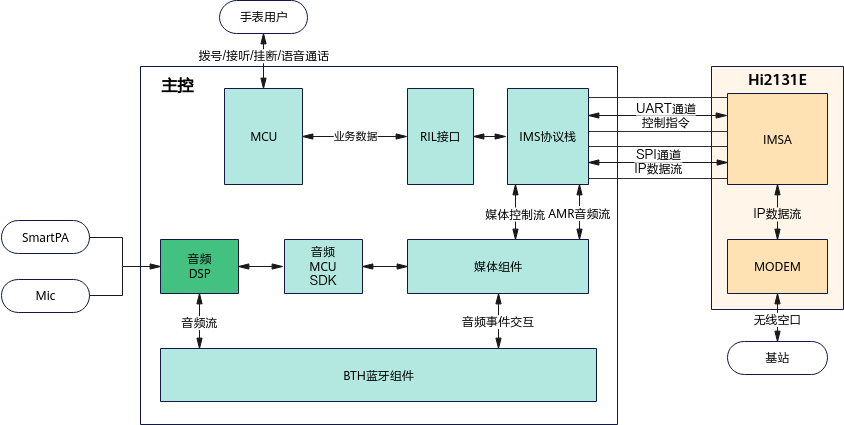

# 前言

**概述**

本文档主要介绍通过主控芯片和Hi2131E搭配，实现VoLTE功能的开发相关内容，包括SDK软硬件架构、驱动&接口、系统管理、协议软件和应用软件等，简要描述了VoLTE各接口、功能模块的功能和工作原理，通过实例按场景介绍各接口和功能模块的开发过程及注意事项。

**读者对象**

本文档主要适用于以下工程师：

-   技术支持工程师
-   软件开发工程师

**符号约定**

在本文中可能出现下列标志，它们所代表的含义如下。

<table><thead align="left"><tr id="zh-cn_topic_0000002175160621_row1530720816410"><th class="cellrowborder" valign="top" width="20.580000000000002%" id="mcps1.1.3.1.1">
<strong id="zh-cn_topic_0000002175160621_b2136615816410">符号</strong>

</th>
<th class="cellrowborder" valign="top" width="79.42%" id="mcps1.1.3.1.2">
<strong id="zh-cn_topic_0000002175160621_b5941558116410">说明</strong>

</th>
</tr>
</thead>
<tbody><tr id="zh-cn_topic_0000002175160621_row1372280416410"><td class="cellrowborder" valign="top" width="20.580000000000002%" headers="mcps1.1.3.1.1 ">

</td>
<td class="cellrowborder" valign="top" width="79.42%" headers="mcps1.1.3.1.2 ">
表示如不避免则将会导致死亡或严重伤害的具有高等级风险的危害。

</td>
</tr>
<tr id="zh-cn_topic_0000002175160621_row466863216410"><td class="cellrowborder" valign="top" width="20.580000000000002%" headers="mcps1.1.3.1.1 ">

</td>
<td class="cellrowborder" valign="top" width="79.42%" headers="mcps1.1.3.1.2 ">
表示如不避免则可能导致死亡或严重伤害的具有中等级风险的危害。

</td>
</tr>
<tr id="zh-cn_topic_0000002175160621_row123863216410"><td class="cellrowborder" valign="top" width="20.580000000000002%" headers="mcps1.1.3.1.1 ">

</td>
<td class="cellrowborder" valign="top" width="79.42%" headers="mcps1.1.3.1.2 ">
表示如不避免则可能导致轻微或中度伤害的具有低等级风险的危害。

</td>
</tr>
<tr id="zh-cn_topic_0000002175160621_row5786682116410"><td class="cellrowborder" valign="top" width="20.580000000000002%" headers="mcps1.1.3.1.1 ">

</td>
<td class="cellrowborder" valign="top" width="79.42%" headers="mcps1.1.3.1.2 ">
用于传递设备或环境安全警示信息。如不避免则可能会导致设备损坏、数据丢失、设备性能降低或其它不可预知的结果。

“须知”不涉及人身伤害。

</td>
</tr>
<tr id="zh-cn_topic_0000002175160621_row2856923116410"><td class="cellrowborder" valign="top" width="20.580000000000002%" headers="mcps1.1.3.1.1 ">

</td>
<td class="cellrowborder" valign="top" width="79.42%" headers="mcps1.1.3.1.2 ">
对正文中重点信息的补充说明。

“说明”不是安全警示信息，不涉及人身、设备及环境伤害信息。

</td>
</tr>
</tbody>
</table>

# 概述

-   **[VoLTE架构说明](#ZH-CN_TOPIC_0000002223667848)**  

-   **[开发规范和约束](#ZH-CN_TOPIC_0000002258467613)**  

## VoLTE架构说明

VoLTE（Voice over LTE，长期演进语音承载）是3GPP标准定义的，基于IMS网络的LTE语音解决方案。通过IMS网络，移动运营商不仅可以无缝的继承传统的语音、短消息业务，还可以将语音通话与丰富的增强功能相整合，提供多样化的服务。本章节描述VoLTE场景下主控芯片和Hi2131E芯片如何实现软件及硬件的二次开发，以最终完成通话业务。

Hi2131E作为支持4G Cat1的Modem蜂窝芯片，提供4G入网数传能力。主控芯片作为穿戴芯片，可提供语音编解码的处理能力。二者配合成为的VoLTE终端，如[图1](#zh-cn_topic_0000002139919432_fig18919270253)所示。

**图 1**  VoLTE系统架构图  

IMS协议栈（VoLTE基础功能的协议栈）主体代码位于主控芯片，Hi2131E侧支持4G入网功能。和Hi2131E之间存在UART通路和SPI数据传输通路，UART通路传输芯片间的控制指令，SPI通路传输芯片间的数据信息。

**表 1**  VoLTE系统模块描述

<table><thead align="left"><tr id="zh-cn_topic_0000002139919432_row16897151685518"><th class="cellrowborder" valign="top" width="22.63%" id="mcps1.2.4.1.1">
组件名称

</th>
<th class="cellrowborder" valign="top" width="17.78%" id="mcps1.2.4.1.2">
归属

</th>
<th class="cellrowborder" valign="top" width="59.589999999999996%" id="mcps1.2.4.1.3">
说明

</th>
</tr>
</thead>
<tbody><tr id="zh-cn_topic_0000002139919432_row17897101612556"><td class="cellrowborder" valign="top" width="22.63%" headers="mcps1.2.4.1.1 ">
IMS协议栈

</td>
<td class="cellrowborder" valign="top" width="17.78%" headers="mcps1.2.4.1.2 ">
主控芯片

</td>
<td class="cellrowborder" valign="top" width="59.589999999999996%" headers="mcps1.2.4.1.3 ">
通过“libims.a”文件，集成编译在主控芯片 SDK版本中。

</td>
</tr>
<tr id="zh-cn_topic_0000002139919432_row168971316155517"><td class="cellrowborder" valign="top" width="22.63%" headers="mcps1.2.4.1.1 ">
RIL接口

</td>
<td class="cellrowborder" valign="top" width="17.78%" headers="mcps1.2.4.1.2 ">
主控芯片

</td>
<td class="cellrowborder" valign="top" width="59.589999999999996%" headers="mcps1.2.4.1.3 ">
需要通过主控芯片侧RIL头文件调用。

</td>
</tr>
<tr id="zh-cn_topic_0000002139919432_row430024129"><td class="cellrowborder" valign="top" width="22.63%" headers="mcps1.2.4.1.1 ">
VoLTE相关AT命令

</td>
<td class="cellrowborder" valign="top" width="17.78%" headers="mcps1.2.4.1.2 ">
Hi2131E

</td>
<td class="cellrowborder" valign="top" width="59.589999999999996%" headers="mcps1.2.4.1.3 ">
VoLTE相关AT命令功能，需要通过接入Hi2131E侧的UART串口才可进行发送。

</td>
</tr>
</tbody>
</table>

当前VoLTE终端提供的自能力如[表2](#zh-cn_topic_0000002139919432_table867758163013)所示。

**表 2**  IMS子系统模块划分

<table><thead align="left"><tr id="zh-cn_topic_0000002139919432_row46781587301"><th class="cellrowborder" valign="top" width="26.19%" id="mcps1.2.3.1.1">
VoLTE功能分类

</th>
<th class="cellrowborder" valign="top" width="73.81%" id="mcps1.2.3.1.2">
说明

</th>
</tr>
</thead>
<tbody><tr id="zh-cn_topic_0000002139919432_row66781684307"><td class="cellrowborder" valign="top" width="26.19%" headers="mcps1.2.3.1.1 ">
基本音频呼叫

</td>
<td class="cellrowborder" valign="top" width="73.81%" headers="mcps1.2.3.1.2 ">
支持。

</td>
</tr>
<tr id="zh-cn_topic_0000002139919432_row2678198193010"><td class="cellrowborder" valign="top" width="26.19%" headers="mcps1.2.3.1.1 ">
有卡紧急呼叫

</td>
<td class="cellrowborder" valign="top" width="73.81%" headers="mcps1.2.3.1.2 ">
支持。

</td>
</tr>
<tr id="zh-cn_topic_0000002139919432_row95701223153015"><td class="cellrowborder" valign="top" width="26.19%" headers="mcps1.2.3.1.1 ">
呼叫方式

</td>
<td class="cellrowborder" valign="top" width="73.81%" headers="mcps1.2.3.1.2 ">
支持Precondition资源预留。

</td>
</tr>
<tr id="zh-cn_topic_0000002139919432_row16678158143017"><td class="cellrowborder" valign="top" width="26.19%" headers="mcps1.2.3.1.1 ">
短信主被叫

</td>
<td class="cellrowborder" valign="top" width="73.81%" headers="mcps1.2.3.1.2 ">
支持。

</td>
</tr>
<tr id="zh-cn_topic_0000002139919432_row0678158123016"><td class="cellrowborder" valign="top" width="26.19%" headers="mcps1.2.3.1.1 ">
语音编解码

</td>
<td class="cellrowborder" valign="top" width="73.81%" headers="mcps1.2.3.1.2 ">
仅支持AMR-WB（mode-set=0-8）编解码。

</td>
</tr>
<tr id="zh-cn_topic_0000002139919432_row55841927181015"><td class="cellrowborder" valign="top" width="26.19%" headers="mcps1.2.3.1.1 ">
彩铃/漫游

</td>
<td class="cellrowborder" valign="top" width="73.81%" headers="mcps1.2.3.1.2 ">
支持（IMS网络需支持)。

</td>
</tr>
<tr id="zh-cn_topic_0000002139919432_row2511203710103"><td class="cellrowborder" valign="top" width="26.19%" headers="mcps1.2.3.1.1 ">
SRVCC

</td>
<td class="cellrowborder" valign="top" width="73.81%" headers="mcps1.2.3.1.2 ">
不支持，仅支持4G网络，无法切换回落。

</td>
</tr>
<tr id="zh-cn_topic_0000002139919432_row1146433111104"><td class="cellrowborder" valign="top" width="26.19%" headers="mcps1.2.3.1.1 ">
呼叫转移

</td>
<td class="cellrowborder" valign="top" width="73.81%" headers="mcps1.2.3.1.2 ">
不支持。

</td>
</tr>
<tr id="zh-cn_topic_0000002139919432_row021357151419"><td class="cellrowborder" valign="top" width="26.19%" headers="mcps1.2.3.1.1 ">
呼叫保持

</td>
<td class="cellrowborder" valign="top" width="73.81%" headers="mcps1.2.3.1.2 ">
不支持。

</td>
</tr>
<tr id="zh-cn_topic_0000002139919432_row6266151131110"><td class="cellrowborder" valign="top" width="26.19%" headers="mcps1.2.3.1.1 ">
三方会议

</td>
<td class="cellrowborder" valign="top" width="73.81%" headers="mcps1.2.3.1.2 ">
不支持。

</td>
</tr>
</tbody>
</table>

## 开发规范和约束

仅在主控芯片的diting版本下支持和Hi2131E芯片的对接调试。

# 环境搭建

VoLTE开发包含Hi2131E侧和主控芯片侧两个部分，两个系统分别独立构建版本，通过UART、SPI、GPIO等连线建立通讯。

-   **[编译构建](#ZH-CN_TOPIC_0000002223508012)**  

-   **[DiTing单板外接连线说明](#ZH-CN_TOPIC_0000002223508016)**  

-   **[VoLTE拨号通话流程](#ZH-CN_TOPIC_0000002223508020)**  

## 编译构建

-   **[Hi2131E侧版本编译](#ZH-CN_TOPIC_0000002258627521)**  

### Hi2131E侧版本编译

当前版本中，Hi2131E单板不提供二次开发界面和接口，功能接口和AT命令均已实现。软件版本已经烧录至单板中，直接使用即可。

## DiTing单板外接连线说明

现DiTing单板已将主控芯片与Hi2131E芯片整合在同一单板上，以下对该单板外接串口小板以及连线进行说明。

**表 1**  DiTing单板外接连线说明

<table><thead align="left"><tr id="row58359275513"><th class="cellrowborder" valign="top" width="33.33333333333333%" id="mcps1.2.4.1.1">
DiTing单板模块

</th>
<th class="cellrowborder" valign="top" width="33.33333333333333%" id="mcps1.2.4.1.2">
连接外设

</th>
<th class="cellrowborder" valign="top" width="33.33333333333333%" id="mcps1.2.4.1.3">
说明

</th>
</tr>
</thead>
<tbody><tr id="row1183582713511"><td class="cellrowborder" valign="top" width="33.33333333333333%" headers="mcps1.2.4.1.1 ">
HSUART

</td>
<td class="cellrowborder" valign="top" width="33.33333333333333%" headers="mcps1.2.4.1.2 ">
串口小板

</td>
<td class="cellrowborder" valign="top" width="33.33333333333333%" headers="mcps1.2.4.1.3 ">
HSUART1、2、3分别连接串口小板TX、RX、GND。

负责主控芯片版本烧录。

</td>
</tr>
<tr id="row1683522785117"><td class="cellrowborder" valign="top" width="33.33333333333333%" headers="mcps1.2.4.1.1 ">
UART2

</td>
<td class="cellrowborder" valign="top" width="33.33333333333333%" headers="mcps1.2.4.1.2 ">
串口小板

</td>
<td class="cellrowborder" valign="top" width="33.33333333333333%" headers="mcps1.2.4.1.3 ">
UART2的1、2、3分别连接串口小板TX、RX、GND。

负责AT口打印。

</td>
</tr>
<tr id="row1783532775112"><td class="cellrowborder" valign="top" width="33.33333333333333%" headers="mcps1.2.4.1.1 ">
USB

</td>
<td class="cellrowborder" valign="top" width="33.33333333333333%" headers="mcps1.2.4.1.2 ">
Micro USB线

</td>
<td class="cellrowborder" valign="top" width="33.33333333333333%" headers="mcps1.2.4.1.3 ">
负责Hi2131E的烧录以及AT日志。

</td>
</tr>
<tr id="row1397872915615"><td class="cellrowborder" valign="top" width="33.33333333333333%" headers="mcps1.2.4.1.1 ">
USB-C

</td>
<td class="cellrowborder" valign="top" width="33.33333333333333%" headers="mcps1.2.4.1.2 ">
USB TYPE C

</td>
<td class="cellrowborder" valign="top" width="33.33333333333333%" headers="mcps1.2.4.1.3 ">
电源线。

</td>
</tr>
</tbody>
</table>

## VoLTE拨号通话流程

Hi2131E为实现正常的入网功能，需要一张可通过核心网鉴权的USIM卡。

-   **[通过AT命令拨打电话](#ZH-CN_TOPIC_0000002223667872)**  

-   **[通过RIL接口拨打电话](#ZH-CN_TOPIC_0000002258467637)**  

### 通过AT命令拨打电话

AT命令模块在Hi2131E侧，通过在Hi2131E侧调用相关AT命令，可以实现VoLTE通话。

**主叫：**

1.  开机。

    AT+CFUN=1

    预期返回：OK

2.  发起注册。

    AT+CGATT=1

    预期返回：OK

    IMSSRVSTATUS：0，2（请参见“[IMS服务状态更新指示：+IMSSRVSTATUS](#ZH-CN_TOPIC_0000002258467693)”章节。）

3.  拨打电话。

    ATDxxx；

    预期返回：OK

    +ORIG: 1,0（请参见“[发起语音呼叫指示：+ORIG](#ZH-CN_TOPIC_0000002223508080)”章节。）

    +CCALLSTATE: 1,0,1（请参见“[呼叫状态上报：+CALLSTATE](#ZH-CN_TOPIC_0000002223508084)”章节。）

    +CCALLSTATE: 1,1,1（收到网侧100trying）

    +CONF: 1（请参见“[UE收到网络指示：+CONF](#ZH-CN_TOPIC_0000002223667920)”章节。）

    +CHANNELINFO: 0,1（请参见“[主动上报语音带宽信息：+CHANNELINFO](#ZH-CN_TOPIC_0000002223667924)”章节。）

    > **说明：** 
    >无带内音信息，需本地回铃音上报。此时需要自己制作铃声。

    +CCALLSTATE: 1,2,1（收到180ringing。）

    IRING（请参见“[来电指示：IRING](#ZH-CN_TOPIC_0000002258627577)”章节。）

    +CCALLSTATE: 1,3,1（收到invite 200OK，呼叫已经接通。）

    +CONN: 1,0（请参见“[呼叫接通指示：+CONN](#ZH-CN_TOPIC_0000002258467697)”章节。）

4.  挂断电话。

    ATH

    预期返回：OK

    +CCALLSTATE: 1,4,1（通话结束）

    +CEND: 1,100,0（请参见“[通话结束指示：+CEND](#ZH-CN_TOPIC_0000002258627581)”章节。）

**被叫**：

1.  开机。

    AT+CFUN=1

    预期返回：OK

2.  发起注册。

    AT+CGATT=1

    预期返回：OK

    IMSSRVSTATUS：0，2（请参见“[IMS服务状态更新指示：+IMSSRVSTATUS](#ZH-CN_TOPIC_0000002258467693)”章节。）

3.  接听。

    手动接听：ATA（请参见“[接听来电：A](#ZH-CN_TOPIC_0000002258627569)”章节。）

    自动接听：ATS0=x（请参见[设置自动接听：S0](#ZH-CN_TOPIC_0000002223667912)”章节。）

    预期返回：OK

    > **说明：** 
    >自动接听命令建议在注册成功后执行，也可以在开机后执行。
    >手动接听则是在收到有来电提示（+CALLSTATE: 1,5,1）后执行。

4.  挂断电话。

    ATH

    预期返回：OK

    +CCALLSTATE: 1,4,1（通话结束）

    +CEND: 1,100,0

### 通过RIL接口拨打电话

RIL接口存在于主控芯片侧，通过在调用相关RIL接口，可以实现VoLTE通话。

**主叫：**

1.  开机。

    调用ril\_at\_cmd\_sync\_get\_info接口（请参见“[同步AT命令发送](#ZH-CN_TOPIC_0000002223508068)”章节）。

    > **说明：** 
    >AT命令：AT+CFUN=1
    >预期返回结果：OK

2.  注册入网。

    调用ril\_at\_cmd\_sync\_get\_info接口。

    > **说明：** 
    >AT命令：AT+CGATT=1
    >预期返回结果：OK
    >IMSSRVSTATUS：0，2

3.  拨打电话。

    调用ril\_set\_call\_orig\_req接口（请参见“[拨打电话](#ZH-CN_TOPIC_0000002258627557)”章节）。

4.  挂断电话。

    调用ril\_set\_call\_rel\_req接口（请参见“[挂断电话](#ZH-CN_TOPIC_0000002223667896)”章节）。

**被叫：**

1.  开机。

    调用ril\_at\_cmd\_sync\_get\_info接口（请参见“[同步AT命令发送](#ZH-CN_TOPIC_0000002223508068)”章节）。

2.  注册入网。

    调用ril\_at\_cmd\_sync\_get\_info接口。

3.  手动接听。

    调用ril\_set\_call\_mt\_accept\_req接口（请参见“[手动接听电话](#ZH-CN_TOPIC_0000002223508064)”章节）。

4.  自动接听。

    调用ril\_set\_auto\_answer接口（请参见“[设置自动接听](#ZH-CN_TOPIC_0000002258467677)”章节）。

5.  挂断电话。

    调用ril\_set\_call\_rel\_req接口（请参见“[挂断电话](#ZH-CN_TOPIC_0000002223667896)”章节）。

# 对外接口描述

**表 1**  RIL接口实现方式

<table><thead align="left"><tr id="zh-cn_topic_0000002175160637_row1095115344318"><th class="cellrowborder" valign="top" width="25%" id="mcps1.2.5.1.1">
一级菜单

</th>
<th class="cellrowborder" valign="top" width="25%" id="mcps1.2.5.1.2">
二级菜单

</th>
<th class="cellrowborder" valign="top" width="25%" id="mcps1.2.5.1.3">
描述

</th>
<th class="cellrowborder" valign="top" width="25%" id="mcps1.2.5.1.4">
实现方式

</th>
</tr>
</thead>
<tbody><tr id="zh-cn_topic_0000002175160637_row19511034534"><td class="cellrowborder" rowspan="2" valign="top" width="25%" headers="mcps1.2.5.1.1 ">
设备信息

</td>
<td class="cellrowborder" valign="top" width="25%" headers="mcps1.2.5.1.2 ">
软件版本号

</td>
<td class="cellrowborder" valign="top" width="25%" headers="mcps1.2.5.1.3 ">
获取Modem的软件版本信息。

</td>
<td class="cellrowborder" valign="top" width="25%" headers="mcps1.2.5.1.4 ">
核内交互

</td>
</tr>
<tr id="zh-cn_topic_0000002175160637_row295119341313"><td class="cellrowborder" valign="top" headers="mcps1.2.5.1.1 ">
IMEI设备识别码

</td>
<td class="cellrowborder" valign="top" headers="mcps1.2.5.1.2 ">
获取Modem设备的识别码。

</td>
<td class="cellrowborder" valign="top" headers="mcps1.2.5.1.3 ">
核内交互

</td>
</tr>
<tr id="zh-cn_topic_0000002175160637_row189528341031"><td class="cellrowborder" rowspan="3" valign="top" width="25%" headers="mcps1.2.5.1.1 ">
(U)SIM卡信息

</td>
<td class="cellrowborder" valign="top" width="25%" headers="mcps1.2.5.1.2 ">
是否在位，Pin-block，Puk-block

</td>
<td class="cellrowborder" valign="top" width="25%" headers="mcps1.2.5.1.3 ">
获取Modem (U)SIM卡是否在位的信息，Pin码和PUK码是否锁定状态。

</td>
<td class="cellrowborder" valign="top" width="25%" headers="mcps1.2.5.1.4 ">
核内交互

</td>
</tr>
<tr id="zh-cn_topic_0000002175160637_row895220341534"><td class="cellrowborder" valign="top" headers="mcps1.2.5.1.1 ">
IMSI

</td>
<td class="cellrowborder" valign="top" headers="mcps1.2.5.1.2 ">
获取 (U)SIM卡的IMSI信息。

</td>
<td class="cellrowborder" valign="top" headers="mcps1.2.5.1.3 ">
核内交互

</td>
</tr>
<tr id="zh-cn_topic_0000002175160637_row29525341732"><td class="cellrowborder" valign="top" headers="mcps1.2.5.1.1 ">
本机号码显示

</td>
<td class="cellrowborder" valign="top" headers="mcps1.2.5.1.2 ">
获取保存在 (U)SIM中的本机号码。

</td>
<td class="cellrowborder" valign="top" headers="mcps1.2.5.1.3 ">
核内交互

</td>
</tr>
<tr id="zh-cn_topic_0000002175160637_row1495263417317"><td class="cellrowborder" rowspan="5" valign="top" width="25%" headers="mcps1.2.5.1.1 ">
驻网状态

</td>
<td class="cellrowborder" valign="top" width="25%" headers="mcps1.2.5.1.2 ">
是否驻网

</td>
<td class="cellrowborder" valign="top" width="25%" headers="mcps1.2.5.1.3 ">
获取终端是否已经驻网。

</td>
<td class="cellrowborder" valign="top" width="25%" headers="mcps1.2.5.1.4 ">
核内交互

</td>
</tr>
<tr id="zh-cn_topic_0000002175160637_row695253416315"><td class="cellrowborder" valign="top" headers="mcps1.2.5.1.1 ">
显示运营商名称

</td>
<td class="cellrowborder" valign="top" headers="mcps1.2.5.1.2 ">
获取终端驻网的运营商信息。

</td>
<td class="cellrowborder" valign="top" headers="mcps1.2.5.1.3 ">
核内交互

</td>
</tr>
<tr id="zh-cn_topic_0000002175160637_row14952133417312"><td class="cellrowborder" valign="top" headers="mcps1.2.5.1.1 ">
是否IMS（VoLTE）驻网

</td>
<td class="cellrowborder" valign="top" headers="mcps1.2.5.1.2 ">
获取终端是否IMS驻网信息。

</td>
<td class="cellrowborder" valign="top" headers="mcps1.2.5.1.3 ">
核内交互

</td>
</tr>
<tr id="zh-cn_topic_0000002175160637_row159521534333"><td class="cellrowborder" valign="top" headers="mcps1.2.5.1.1 ">
是否PDP驻网，显示当前IP地址

</td>
<td class="cellrowborder" valign="top" headers="mcps1.2.5.1.2 ">
获取终端是否PDP驻网，并显示IP地址。

</td>
<td class="cellrowborder" valign="top" headers="mcps1.2.5.1.3 ">
核内交互

</td>
</tr>
<tr id="zh-cn_topic_0000002175160637_row79527345314"><td class="cellrowborder" valign="top" headers="mcps1.2.5.1.1 ">
手动搜网，并显示可选网络

</td>
<td class="cellrowborder" valign="top" headers="mcps1.2.5.1.2 ">
触发手动搜网，并返回搜网结果。

</td>
<td class="cellrowborder" valign="top" headers="mcps1.2.5.1.3 ">
核间通信

</td>
</tr>
<tr id="zh-cn_topic_0000002175160637_row11953133419316"><td class="cellrowborder" rowspan="2" valign="top" width="25%" headers="mcps1.2.5.1.1 ">
通话设置

</td>
<td class="cellrowborder" valign="top" width="25%" headers="mcps1.2.5.1.2 ">
通话自动接听开关

</td>
<td class="cellrowborder" valign="top" width="25%" headers="mcps1.2.5.1.3 ">
设置是否通话自动接听。

</td>
<td class="cellrowborder" valign="top" width="25%" headers="mcps1.2.5.1.4 ">
核间通信

</td>
</tr>
<tr id="zh-cn_topic_0000002175160637_row109531834539"><td class="cellrowborder" valign="top" headers="mcps1.2.5.1.1 ">
拨打电话，如“10086”

</td>
<td class="cellrowborder" valign="top" headers="mcps1.2.5.1.2 ">
通知Modem进行拨打电话。

</td>
<td class="cellrowborder" valign="top" headers="mcps1.2.5.1.3 ">
核间通信

</td>
</tr>
<tr id="zh-cn_topic_0000002175160637_row14953034435"><td class="cellrowborder" valign="top" width="25%" headers="mcps1.2.5.1.1 ">
短信设置

</td>
<td class="cellrowborder" valign="top" width="25%" headers="mcps1.2.5.1.2 ">
显示短信中心号码

</td>
<td class="cellrowborder" valign="top" width="25%" headers="mcps1.2.5.1.3 ">
获取短信中心号码。

</td>
<td class="cellrowborder" valign="top" width="25%" headers="mcps1.2.5.1.4 ">
核内交互

</td>
</tr>
</tbody>
</table>

-   **[RIL相关接口](#ZH-CN_TOPIC_0000002223508028)**  

-   **[VoLTE相关AT命令](#ZH-CN_TOPIC_0000002223667908)**  

-   **[VoLTE相关NV](#ZH-CN_TOPIC_0000002223508088)**  

## RIL相关接口

RIL相关接口存在于主控芯片 SDK版本中，头文件路径：protocol\\ims\\include\\ril\_interface.h

-   **[设备信息接口](#ZH-CN_TOPIC_0000002223667876)**  

-   **[2131E异常信息回调](#ZH-CN_TOPIC_0000002538513722)**  

-   **[SIM卡信息接口](#ZH-CN_TOPIC_0000002223667880)**  

-   **[小区信息](#ZH-CN_TOPIC_0000002509848179)**  

-   **[驻网状态接口](#ZH-CN_TOPIC_0000002258627549)**  

-   **[通话接口](#ZH-CN_TOPIC_0000002223667892)**  

-   **[AT指令通道](#ZH-CN_TOPIC_0000002258467681)**  

-   **[短信接口](#ZH-CN_TOPIC_0000002509728291)**  

-   **[升级接口](#ZH-CN_TOPIC_0000002436334706)**  

### 设备信息接口

-   **[获取软件版本号](#ZH-CN_TOPIC_0000002258467645)**  

-   **[获取IMEI设备识别号](#ZH-CN_TOPIC_0000002258627537)**  

-   **[设定VoLTE维测日志级别](#ZH-CN_TOPIC_0000002223508036)**  

-   **[判断Hi2131E是否校准](#ZH-CN_TOPIC_0000002509728151)**  

-   **[获取基站UTC时间](#ZH-CN_TOPIC_0000002566425755)**  

#### 获取软件版本号

函数原型：int32\_t ril\_get\_software\_version\(char\* ver, size\_t size\)

函数功能：获取Hi2131E软件版本号，核内交互。

**表 1**  参数说明

<table><thead align="left"><tr id="zh-cn_topic_0000002227350729_row12908457921"><th class="cellrowborder" valign="top" width="25%" id="mcps1.2.5.1.1">
参数

</th>
<th class="cellrowborder" valign="top" width="25%" id="mcps1.2.5.1.2">
参数描述类型

</th>
<th class="cellrowborder" valign="top" width="21.78%" id="mcps1.2.5.1.3">
参数结构类型

</th>
<th class="cellrowborder" valign="top" width="28.22%" id="mcps1.2.5.1.4">
说明

</th>
</tr>
</thead>
<tbody><tr id="zh-cn_topic_0000002227350729_row49086571217"><td class="cellrowborder" valign="top" width="25%" headers="mcps1.2.5.1.1 ">
ver

</td>
<td class="cellrowborder" valign="top" width="25%" headers="mcps1.2.5.1.2 ">
出参

</td>
<td class="cellrowborder" valign="top" width="21.78%" headers="mcps1.2.5.1.3 ">
char*

</td>
<td class="cellrowborder" valign="top" width="28.22%" headers="mcps1.2.5.1.4 ">
软件版本号，字符串格式。

</td>
</tr>
<tr id="zh-cn_topic_0000002227350729_row169088571825"><td class="cellrowborder" valign="top" width="25%" headers="mcps1.2.5.1.1 ">
size

</td>
<td class="cellrowborder" valign="top" width="25%" headers="mcps1.2.5.1.2 ">
入参

</td>
<td class="cellrowborder" valign="top" width="21.78%" headers="mcps1.2.5.1.3 ">
size_t

</td>
<td class="cellrowborder" valign="top" width="28.22%" headers="mcps1.2.5.1.4 ">
软件版本号长度。

</td>
</tr>
</tbody>
</table>

**表 2**  返回值说明

<table><thead align="left"><tr id="zh-cn_topic_0000002227350729_row82122391941"><th class="cellrowborder" valign="top" width="25.182518251825186%" id="mcps1.2.4.1.1">
返回值

</th>
<th class="cellrowborder" valign="top" width="31.863186318631865%" id="mcps1.2.4.1.2">
参数结构类型

</th>
<th class="cellrowborder" valign="top" width="42.95429542954295%" id="mcps1.2.4.1.3">
说明

</th>
</tr>
</thead>
<tbody><tr id="zh-cn_topic_0000002227350729_row5213113915410"><td class="cellrowborder" valign="top" width="25.182518251825186%" headers="mcps1.2.4.1.1 ">
0

</td>
<td class="cellrowborder" valign="top" width="31.863186318631865%" headers="mcps1.2.4.1.2 ">
int32_t

</td>
<td class="cellrowborder" valign="top" width="42.95429542954295%" headers="mcps1.2.4.1.3 ">
获取Hi2131E软件版本号接口处理成功。

</td>
</tr>
<tr id="zh-cn_topic_0000002227350729_row82131139142"><td class="cellrowborder" valign="top" width="25.182518251825186%" headers="mcps1.2.4.1.1 ">
&gt;0

</td>
<td class="cellrowborder" valign="top" width="31.863186318631865%" headers="mcps1.2.4.1.2 ">
int32_t

</td>
<td class="cellrowborder" valign="top" width="42.95429542954295%" headers="mcps1.2.4.1.3 ">
获取Hi2131E软件版本号接口处理失败。

</td>
</tr>
</tbody>
</table>

#### 获取IMEI设备识别号

函数原型：int32\_t ril\_get\_imei\(char\* imei, size\_t len\)

函数功能：获取Hi2131E的IMEI号，核内交互。

**表 1**  参数说明

<table><thead align="left"><tr id="zh-cn_topic_0000002191825232_row12908457921"><th class="cellrowborder" valign="top" width="25%" id="mcps1.2.5.1.1">
参数

</th>
<th class="cellrowborder" valign="top" width="25%" id="mcps1.2.5.1.2">
参数描述类型

</th>
<th class="cellrowborder" valign="top" width="25%" id="mcps1.2.5.1.3">
参数结构类型

</th>
<th class="cellrowborder" valign="top" width="25%" id="mcps1.2.5.1.4">
说明

</th>
</tr>
</thead>
<tbody><tr id="zh-cn_topic_0000002191825232_row49086571217"><td class="cellrowborder" valign="top" width="25%" headers="mcps1.2.5.1.1 ">
imei

</td>
<td class="cellrowborder" valign="top" width="25%" headers="mcps1.2.5.1.2 ">
出参

</td>
<td class="cellrowborder" valign="top" width="25%" headers="mcps1.2.5.1.3 ">
char*

</td>
<td class="cellrowborder" valign="top" width="25%" headers="mcps1.2.5.1.4 ">
IMEI号，字符串格式。

</td>
</tr>
<tr id="zh-cn_topic_0000002191825232_row169088571825"><td class="cellrowborder" valign="top" width="25%" headers="mcps1.2.5.1.1 ">
len

</td>
<td class="cellrowborder" valign="top" width="25%" headers="mcps1.2.5.1.2 ">
入参

</td>
<td class="cellrowborder" valign="top" width="25%" headers="mcps1.2.5.1.3 ">
size_t

</td>
<td class="cellrowborder" valign="top" width="25%" headers="mcps1.2.5.1.4 ">
IMEI号长度。

</td>
</tr>
</tbody>
</table>

**表 2**  返回值说明

<table><thead align="left"><tr id="zh-cn_topic_0000002191825232_row82122391941"><th class="cellrowborder" valign="top" width="24.782478247824784%" id="mcps1.2.4.1.1">
返回值

</th>
<th class="cellrowborder" valign="top" width="29.27292729272927%" id="mcps1.2.4.1.2">
参数结构类型

</th>
<th class="cellrowborder" valign="top" width="45.944594459445945%" id="mcps1.2.4.1.3">
说明

</th>
</tr>
</thead>
<tbody><tr id="zh-cn_topic_0000002191825232_row5213113915410"><td class="cellrowborder" valign="top" width="24.782478247824784%" headers="mcps1.2.4.1.1 ">
0

</td>
<td class="cellrowborder" valign="top" width="29.27292729272927%" headers="mcps1.2.4.1.2 ">
int32_t

</td>
<td class="cellrowborder" valign="top" width="45.944594459445945%" headers="mcps1.2.4.1.3 ">
获取Hi2131E IMEI号函数接口处理成功。

</td>
</tr>
<tr id="zh-cn_topic_0000002191825232_row82131139142"><td class="cellrowborder" valign="top" width="24.782478247824784%" headers="mcps1.2.4.1.1 ">
&gt;0

</td>
<td class="cellrowborder" valign="top" width="29.27292729272927%" headers="mcps1.2.4.1.2 ">
int32_t

</td>
<td class="cellrowborder" valign="top" width="45.944594459445945%" headers="mcps1.2.4.1.3 ">
获取Hi2131E IMEI号函数接口处理失败。

</td>
</tr>
</tbody>
</table>

#### 设定VoLTE维测日志级别

函数原型：int32\_t ril\_set\_user\_log\_level\(ril\_user\_log\_level level\)

函数功能：设定VoLTE维测功能的日志级别。

**表 1**  参数说明

<table><thead align="left"><tr id="zh-cn_topic_0000002207624714_row12908457921"><th class="cellrowborder" valign="top" width="12.379999999999999%" id="mcps1.2.5.1.1">
参数

</th>
<th class="cellrowborder" valign="top" width="14.49%" id="mcps1.2.5.1.2">
参数描述类型

</th>
<th class="cellrowborder" valign="top" width="22.71%" id="mcps1.2.5.1.3">
参数结构类型

</th>
<th class="cellrowborder" valign="top" width="50.42%" id="mcps1.2.5.1.4">
说明

</th>
</tr>
</thead>
<tbody><tr id="zh-cn_topic_0000002207624714_row49086571217"><td class="cellrowborder" valign="top" width="12.379999999999999%" headers="mcps1.2.5.1.1 ">
level

</td>
<td class="cellrowborder" valign="top" width="14.49%" headers="mcps1.2.5.1.2 ">
入参

</td>
<td class="cellrowborder" valign="top" width="22.71%" headers="mcps1.2.5.1.3 ">
ril_user_log_level

</td>
<td class="cellrowborder" valign="top" width="50.42%" headers="mcps1.2.5.1.4 ">
RIL_USER_LEVEL_NULL：关闭日志。

RIL_USER_LEVEL_INFO：打印INFO级别及更高级别日志。

RIL_USER_LEVEL_WARN：打印WARN级别及更高级别日志。

RIL_USER_LEVEL_ERROR：打印ERROR级别及更高级别日志。

RIL_USER_LEVEL_ALL：打印所有日志。

</td>
</tr>
</tbody>
</table>

> **说明：** 
>当前版本日志级别默认为RIL\_USER\_LEVEL\_ERROR级别。

#### 判断Hi2131E是否校准

函数原型：int32\_t ril\_get\_if\_ue\_calibrated\(bool \*calibrate\)

函数功能：获取当前Hi2131E是否已经校准。

**表 1**  参数说明

<table><thead align="left"><tr id="zh-cn_topic_0000002345003593_row12908457921"><th class="cellrowborder" valign="top" width="18.2%" id="mcps1.2.5.1.1">
参数

</th>
<th class="cellrowborder" valign="top" width="20.28%" id="mcps1.2.5.1.2">
参数描述类型

</th>
<th class="cellrowborder" valign="top" width="32.029999999999994%" id="mcps1.2.5.1.3">
参数结构类型

</th>
<th class="cellrowborder" valign="top" width="29.49%" id="mcps1.2.5.1.4">
说明

</th>
</tr>
</thead>
<tbody><tr id="zh-cn_topic_0000002345003593_row49086571217"><td class="cellrowborder" valign="top" width="18.2%" headers="mcps1.2.5.1.1 ">
calibrate

</td>
<td class="cellrowborder" valign="top" width="20.28%" headers="mcps1.2.5.1.2 ">
出参

</td>
<td class="cellrowborder" valign="top" width="32.029999999999994%" headers="mcps1.2.5.1.3 ">
bool*

</td>
<td class="cellrowborder" valign="top" width="29.49%" headers="mcps1.2.5.1.4 ">
Hi2131E是否已经校准：

true：Hi2131E已校准l；

false：Hi2131E未校准。

</td>
</tr>
</tbody>
</table>

**表 2**  返回值说明

<table><thead align="left"><tr id="zh-cn_topic_0000002345003593_row82122391941"><th class="cellrowborder" valign="top" width="27.82278227822782%" id="mcps1.2.4.1.1">
返回值

</th>
<th class="cellrowborder" valign="top" width="31.47314731473147%" id="mcps1.2.4.1.2">
参数结构类型

</th>
<th class="cellrowborder" valign="top" width="40.704070407040696%" id="mcps1.2.4.1.3">
说明

</th>
</tr>
</thead>
<tbody><tr id="zh-cn_topic_0000002345003593_row5213113915410"><td class="cellrowborder" valign="top" width="27.82278227822782%" headers="mcps1.2.4.1.1 ">
0

</td>
<td class="cellrowborder" valign="top" width="31.47314731473147%" headers="mcps1.2.4.1.2 ">
int32_t

</td>
<td class="cellrowborder" valign="top" width="40.704070407040696%" headers="mcps1.2.4.1.3 ">
获取Hi2131E是否校准处理成功。

</td>
</tr>
<tr id="zh-cn_topic_0000002345003593_row82131139142"><td class="cellrowborder" valign="top" width="27.82278227822782%" headers="mcps1.2.4.1.1 ">
&gt;0

</td>
<td class="cellrowborder" valign="top" width="31.47314731473147%" headers="mcps1.2.4.1.2 ">
int32_t

</td>
<td class="cellrowborder" valign="top" width="40.704070407040696%" headers="mcps1.2.4.1.3 ">
获取Hi2131E是否校准处理失败。

</td>
</tr>
</tbody>
</table>

#### 获取基站UTC时间

函数原型：int32\_t ril\_get\_utc\_time\(const char\* utc\_str, uint16\_t size\);

函数功能：获取当前基站UTC时间。

**表 1**  参数说明

<table><thead align="left"><tr id="zh-cn_topic_0000002345003593_row12908457921"><th class="cellrowborder" valign="top" width="18.2%" id="mcps1.2.5.1.1">
参数

</th>
<th class="cellrowborder" valign="top" width="20.28%" id="mcps1.2.5.1.2">
参数描述类型

</th>
<th class="cellrowborder" valign="top" width="32.029999999999994%" id="mcps1.2.5.1.3">
参数结构类型

</th>
<th class="cellrowborder" valign="top" width="29.49%" id="mcps1.2.5.1.4">
说明

</th>
</tr>
</thead>
<tbody><tr id="zh-cn_topic_0000002345003593_row49086571217"><td class="cellrowborder" valign="top" width="18.2%" headers="mcps1.2.5.1.1 ">
utc_str

</td>
<td class="cellrowborder" valign="top" width="20.28%" headers="mcps1.2.5.1.2 ">
出参

</td>
<td class="cellrowborder" valign="top" width="32.029999999999994%" headers="mcps1.2.5.1.3 ">
char*

</td>
<td class="cellrowborder" valign="top" width="29.49%" headers="mcps1.2.5.1.4 ">
返回的UTC时间字符串。

</td>
</tr>
<tr id="row848142904918"><td class="cellrowborder" valign="top" width="18.2%" headers="mcps1.2.5.1.1 ">
size

</td>
<td class="cellrowborder" valign="top" width="20.28%" headers="mcps1.2.5.1.2 ">
入参

</td>
<td class="cellrowborder" valign="top" width="32.029999999999994%" headers="mcps1.2.5.1.3 ">
uint16_t

</td>
<td class="cellrowborder" valign="top" width="29.49%" headers="mcps1.2.5.1.4 ">
出参最大长度。

</td>
</tr>
</tbody>
</table>

**表 2**  返回值说明

<table><thead align="left"><tr id="zh-cn_topic_0000002345003593_row82122391941"><th class="cellrowborder" valign="top" width="27.82278227822782%" id="mcps1.2.4.1.1">
返回值

</th>
<th class="cellrowborder" valign="top" width="31.47314731473147%" id="mcps1.2.4.1.2">
参数结构类型

</th>
<th class="cellrowborder" valign="top" width="40.704070407040696%" id="mcps1.2.4.1.3">
说明

</th>
</tr>
</thead>
<tbody><tr id="zh-cn_topic_0000002345003593_row5213113915410"><td class="cellrowborder" valign="top" width="27.82278227822782%" headers="mcps1.2.4.1.1 ">
0

</td>
<td class="cellrowborder" valign="top" width="31.47314731473147%" headers="mcps1.2.4.1.2 ">
int32_t

</td>
<td class="cellrowborder" valign="top" width="40.704070407040696%" headers="mcps1.2.4.1.3 ">
获取UTC时间处理成功。

</td>
</tr>
<tr id="zh-cn_topic_0000002345003593_row82131139142"><td class="cellrowborder" valign="top" width="27.82278227822782%" headers="mcps1.2.4.1.1 ">
&gt;0

</td>
<td class="cellrowborder" valign="top" width="31.47314731473147%" headers="mcps1.2.4.1.2 ">
int32_t

</td>
<td class="cellrowborder" valign="top" width="40.704070407040696%" headers="mcps1.2.4.1.3 ">
获取UTC时间处理失败。

</td>
</tr>
</tbody>
</table>

### 2131E异常信息回调

函数原型：void ril\_register\_sys\_err\_report\_callback\(respond\_callback\_t rsp\_callback\);

函数功能：注册回调函数，当2131E发生异常时上报异常原因。

回调函数：typedef int32\_t \(\*respond\_callback\_t\)\(uint8\_t\* data, size\_t len\);

**表 1**  参数说明

<table><thead align="left"><tr id="zh-cn_topic_0000002227350737_row12908457921"><th class="cellrowborder" valign="top" width="17.4%" id="mcps1.2.5.1.1">
参数

</th>
<th class="cellrowborder" valign="top" width="20.96%" id="mcps1.2.5.1.2">
参数描述类型

</th>
<th class="cellrowborder" valign="top" width="26.279999999999998%" id="mcps1.2.5.1.3">
参数结构类型

</th>
<th class="cellrowborder" valign="top" width="35.36%" id="mcps1.2.5.1.4">
说明

</th>
</tr>
</thead>
<tbody><tr id="zh-cn_topic_0000002227350737_row49086571217"><td class="cellrowborder" valign="top" width="17.4%" headers="mcps1.2.5.1.1 ">
rsp_callback

</td>
<td class="cellrowborder" valign="top" width="20.96%" headers="mcps1.2.5.1.2 ">
入参

</td>
<td class="cellrowborder" valign="top" width="26.279999999999998%" headers="mcps1.2.5.1.3 ">
respond_callback_t

</td>
<td class="cellrowborder" valign="top" width="35.36%" headers="mcps1.2.5.1.4 ">
注册函数。

</td>
</tr>
</tbody>
</table>

**表 2**  回调函数respond\_callback\_t说明

<table><thead align="left"><tr id="row478313405319"><th class="cellrowborder" valign="top" width="16.8%" id="mcps1.2.5.1.1">
参数

</th>
<th class="cellrowborder" valign="top" width="21.33%" id="mcps1.2.5.1.2">
参数描述类型

</th>
<th class="cellrowborder" valign="top" width="26.400000000000002%" id="mcps1.2.5.1.3">
参数结构类型

</th>
<th class="cellrowborder" valign="top" width="35.47%" id="mcps1.2.5.1.4">
说明

</th>
</tr>
</thead>
<tbody><tr id="row0783240153111"><td class="cellrowborder" valign="top" width="16.8%" headers="mcps1.2.5.1.1 ">
data

</td>
<td class="cellrowborder" valign="top" width="21.33%" headers="mcps1.2.5.1.2 ">
入参

</td>
<td class="cellrowborder" valign="top" width="26.400000000000002%" headers="mcps1.2.5.1.3 ">
uint8_t*

</td>
<td class="cellrowborder" valign="top" width="35.47%" headers="mcps1.2.5.1.4 ">
异常打印字符串（真实类型为char*）。

</td>
</tr>
<tr id="row20783164053115"><td class="cellrowborder" valign="top" width="16.8%" headers="mcps1.2.5.1.1 ">
len

</td>
<td class="cellrowborder" valign="top" width="21.33%" headers="mcps1.2.5.1.2 ">
入参

</td>
<td class="cellrowborder" valign="top" width="26.400000000000002%" headers="mcps1.2.5.1.3 ">
size_t

</td>
<td class="cellrowborder" valign="top" width="35.47%" headers="mcps1.2.5.1.4 ">
异常打印字符串长度。

</td>
</tr>
</tbody>
</table>

### SIM卡信息接口

-   **[判断Hi2131E的SIM卡是否在位](#ZH-CN_TOPIC_0000002258467649)**  

-   **[判断Hi2131E的SIM卡PIN码是否被锁](#ZH-CN_TOPIC_0000002258627545)**  

-   **[判断Hi2131E的SIM卡PUK码是否被锁](#ZH-CN_TOPIC_0000002223508040)**  

-   **[获取Hi2131E的SIM卡IMSI号](#ZH-CN_TOPIC_0000002223667884)**  

-   **[获取Hi2131E的SIM卡msisdn](#ZH-CN_TOPIC_0000002258467657)**  

-   **[获取CCHO返回结果](#ZH-CN_TOPIC_0000002566337577)**  

#### 判断Hi2131E的SIM卡是否在位

函数原型：int32\_t ril\_get\_is\_usim\_in\_position\(bool \*status\);

函数功能：获取Hi2131E的\(U\)SIM是否在位，核内交互。

**表 1**  参数说明

<table><thead align="left"><tr id="zh-cn_topic_0000002227350737_row12908457921"><th class="cellrowborder" valign="top" width="18.82%" id="mcps1.2.5.1.1">
参数

</th>
<th class="cellrowborder" valign="top" width="21.05%" id="mcps1.2.5.1.2">
参数描述类型

</th>
<th class="cellrowborder" valign="top" width="27.12%" id="mcps1.2.5.1.3">
参数结构类型

</th>
<th class="cellrowborder" valign="top" width="33.01%" id="mcps1.2.5.1.4">
说明

</th>
</tr>
</thead>
<tbody><tr id="zh-cn_topic_0000002227350737_row49086571217"><td class="cellrowborder" valign="top" width="18.82%" headers="mcps1.2.5.1.1 ">
status

</td>
<td class="cellrowborder" valign="top" width="21.05%" headers="mcps1.2.5.1.2 ">
出参

</td>
<td class="cellrowborder" valign="top" width="27.12%" headers="mcps1.2.5.1.3 ">
bool*

</td>
<td class="cellrowborder" valign="top" width="33.01%" headers="mcps1.2.5.1.4 ">
是否在位。

</td>
</tr>
</tbody>
</table>

**表 2**  返回值说明

<table><thead align="left"><tr id="zh-cn_topic_0000002227350737_row82122391941"><th class="cellrowborder" valign="top" width="19.131913191319132%" id="mcps1.2.4.1.1">
返回值

</th>
<th class="cellrowborder" valign="top" width="30.773077307730766%" id="mcps1.2.4.1.2">
参数结构类型

</th>
<th class="cellrowborder" valign="top" width="50.09500950095009%" id="mcps1.2.4.1.3">
说明

</th>
</tr>
</thead>
<tbody><tr id="zh-cn_topic_0000002227350737_row5213113915410"><td class="cellrowborder" valign="top" width="19.131913191319132%" headers="mcps1.2.4.1.1 ">
0

</td>
<td class="cellrowborder" valign="top" width="30.773077307730766%" headers="mcps1.2.4.1.2 ">
int32_t

</td>
<td class="cellrowborder" valign="top" width="50.09500950095009%" headers="mcps1.2.4.1.3 ">
获取Hi2131E的SIM卡是否在位接口处理成功。

</td>
</tr>
<tr id="zh-cn_topic_0000002227350737_row82131139142"><td class="cellrowborder" valign="top" width="19.131913191319132%" headers="mcps1.2.4.1.1 ">
&gt;0

</td>
<td class="cellrowborder" valign="top" width="30.773077307730766%" headers="mcps1.2.4.1.2 ">
int32_t

</td>
<td class="cellrowborder" valign="top" width="50.09500950095009%" headers="mcps1.2.4.1.3 ">
获取Hi2131E的SIM卡是否在位接口处理失败。

</td>
</tr>
</tbody>
</table>

#### 判断Hi2131E的SIM卡PIN码是否被锁

函数原型：int32\_t ril\_get\_is\_usim\_pin\_block\(bool \*status\);

函数功能：获取Hi2131E的\(U\)SIM卡PIN码是否被锁，核内交互。

**表 1**  参数说明

<table><thead align="left"><tr id="zh-cn_topic_0000002191825240_row12908457921"><th class="cellrowborder" valign="top" width="25%" id="mcps1.2.5.1.1">
参数

</th>
<th class="cellrowborder" valign="top" width="25%" id="mcps1.2.5.1.2">
参数描述类型

</th>
<th class="cellrowborder" valign="top" width="25%" id="mcps1.2.5.1.3">
参数结构类型

</th>
<th class="cellrowborder" valign="top" width="25%" id="mcps1.2.5.1.4">
说明

</th>
</tr>
</thead>
<tbody><tr id="zh-cn_topic_0000002191825240_row49086571217"><td class="cellrowborder" valign="top" width="25%" headers="mcps1.2.5.1.1 ">
status

</td>
<td class="cellrowborder" valign="top" width="25%" headers="mcps1.2.5.1.2 ">
出参

</td>
<td class="cellrowborder" valign="top" width="25%" headers="mcps1.2.5.1.3 ">
bool*

</td>
<td class="cellrowborder" valign="top" width="25%" headers="mcps1.2.5.1.4 ">
true：PIN码被锁。

false：PIN码没有被锁。

</td>
</tr>
</tbody>
</table>

**表 2**  返回值说明

<table><thead align="left"><tr id="zh-cn_topic_0000002191825240_row82122391941"><th class="cellrowborder" valign="top" width="24.652465246524653%" id="mcps1.2.4.1.1">
返回值

</th>
<th class="cellrowborder" valign="top" width="29.192919291929194%" id="mcps1.2.4.1.2">
参数结构类型

</th>
<th class="cellrowborder" valign="top" width="46.15461546154616%" id="mcps1.2.4.1.3">
说明

</th>
</tr>
</thead>
<tbody><tr id="zh-cn_topic_0000002191825240_row5213113915410"><td class="cellrowborder" valign="top" width="24.652465246524653%" headers="mcps1.2.4.1.1 ">
0

</td>
<td class="cellrowborder" valign="top" width="29.192919291929194%" headers="mcps1.2.4.1.2 ">
int32_t

</td>
<td class="cellrowborder" valign="top" width="46.15461546154616%" headers="mcps1.2.4.1.3 ">
获取Hi2131E的(U)SIM卡PIN码是否被锁接口处理成功。

</td>
</tr>
<tr id="zh-cn_topic_0000002191825240_row82131139142"><td class="cellrowborder" valign="top" width="24.652465246524653%" headers="mcps1.2.4.1.1 ">
&gt;0

</td>
<td class="cellrowborder" valign="top" width="29.192919291929194%" headers="mcps1.2.4.1.2 ">
int32_t

</td>
<td class="cellrowborder" valign="top" width="46.15461546154616%" headers="mcps1.2.4.1.3 ">
获取Hi2131E的(U)SIM卡PIN码是否被锁接口处理失败。

</td>
</tr>
</tbody>
</table>

#### 判断Hi2131E的SIM卡PUK码是否被锁

函数原型：int32\_t ril\_get\_is\_usim\_puk\_block\(bool \*status\);

函数功能：获取Hi2131E的\(U\)SIM卡PUK码是否被锁，核内交互。

**表 1**  参数说明

<table><thead align="left"><tr id="zh-cn_topic_0000002191984868_row12908457921"><th class="cellrowborder" valign="top" width="25%" id="mcps1.2.5.1.1">
参数

</th>
<th class="cellrowborder" valign="top" width="25%" id="mcps1.2.5.1.2">
参数描述类型

</th>
<th class="cellrowborder" valign="top" width="25%" id="mcps1.2.5.1.3">
参数结构类型

</th>
<th class="cellrowborder" valign="top" width="25%" id="mcps1.2.5.1.4">
说明

</th>
</tr>
</thead>
<tbody><tr id="zh-cn_topic_0000002191984868_row49086571217"><td class="cellrowborder" valign="top" width="25%" headers="mcps1.2.5.1.1 ">
status

</td>
<td class="cellrowborder" valign="top" width="25%" headers="mcps1.2.5.1.2 ">
出参

</td>
<td class="cellrowborder" valign="top" width="25%" headers="mcps1.2.5.1.3 ">
bool*

</td>
<td class="cellrowborder" valign="top" width="25%" headers="mcps1.2.5.1.4 ">
true：PUK码被锁。

false：PUK码没有被锁。

</td>
</tr>
</tbody>
</table>

**表 2**  返回值说明

<table><thead align="left"><tr id="zh-cn_topic_0000002191984868_row82122391941"><th class="cellrowborder" valign="top" width="33.33333333333333%" id="mcps1.2.4.1.1">
返回值

</th>
<th class="cellrowborder" valign="top" width="33.33333333333333%" id="mcps1.2.4.1.2">
参数结构类型

</th>
<th class="cellrowborder" valign="top" width="33.33333333333333%" id="mcps1.2.4.1.3">
说明

</th>
</tr>
</thead>
<tbody><tr id="zh-cn_topic_0000002191984868_row5213113915410"><td class="cellrowborder" valign="top" width="33.33333333333333%" headers="mcps1.2.4.1.1 ">
0

</td>
<td class="cellrowborder" valign="top" width="33.33333333333333%" headers="mcps1.2.4.1.2 ">
int32_t

</td>
<td class="cellrowborder" valign="top" width="33.33333333333333%" headers="mcps1.2.4.1.3 ">
获取Hi2131E的(U)SIM卡PUK码是否被锁接口处理成功。

</td>
</tr>
<tr id="zh-cn_topic_0000002191984868_row82131139142"><td class="cellrowborder" valign="top" width="33.33333333333333%" headers="mcps1.2.4.1.1 ">
&gt;0

</td>
<td class="cellrowborder" valign="top" width="33.33333333333333%" headers="mcps1.2.4.1.2 ">
int32_t

</td>
<td class="cellrowborder" valign="top" width="33.33333333333333%" headers="mcps1.2.4.1.3 ">
获取Hi2131E的(U)SIM卡PUK码是否被锁接口处理失败。

</td>
</tr>
</tbody>
</table>

#### 获取Hi2131E的SIM卡IMSI号

函数原型：int32\_t ril\_get\_imsi\(char\* imsi, size\_t len\);

函数功能：获取Hi2131E的\(U\)SIM卡IMSI号，核内交互。

**表 1**  参数说明

<table><thead align="left"><tr id="zh-cn_topic_0000002227225221_row12908457921"><th class="cellrowborder" valign="top" width="25%" id="mcps1.2.5.1.1">
参数

</th>
<th class="cellrowborder" valign="top" width="25%" id="mcps1.2.5.1.2">
参数描述类型

</th>
<th class="cellrowborder" valign="top" width="25%" id="mcps1.2.5.1.3">
参数结构类型

</th>
<th class="cellrowborder" valign="top" width="25%" id="mcps1.2.5.1.4">
说明

</th>
</tr>
</thead>
<tbody><tr id="zh-cn_topic_0000002227225221_row1830174962413"><td class="cellrowborder" valign="top" width="25%" headers="mcps1.2.5.1.1 ">
imsi

</td>
<td class="cellrowborder" valign="top" width="25%" headers="mcps1.2.5.1.2 ">
出参

</td>
<td class="cellrowborder" valign="top" width="25%" headers="mcps1.2.5.1.3 ">
char*

</td>
<td class="cellrowborder" valign="top" width="25%" headers="mcps1.2.5.1.4 ">
IMSI号，字符串格式。

</td>
</tr>
<tr id="zh-cn_topic_0000002227225221_row49086571217"><td class="cellrowborder" valign="top" width="25%" headers="mcps1.2.5.1.1 ">
len

</td>
<td class="cellrowborder" valign="top" width="25%" headers="mcps1.2.5.1.2 ">
入参

</td>
<td class="cellrowborder" valign="top" width="25%" headers="mcps1.2.5.1.3 ">
size_t

</td>
<td class="cellrowborder" valign="top" width="25%" headers="mcps1.2.5.1.4 ">
IMSI号长度。

</td>
</tr>
</tbody>
</table>

**表 2**  返回值说明

<table><thead align="left"><tr id="zh-cn_topic_0000002227225221_row82122391941"><th class="cellrowborder" valign="top" width="33.33333333333333%" id="mcps1.2.4.1.1">
返回值

</th>
<th class="cellrowborder" valign="top" width="33.33333333333333%" id="mcps1.2.4.1.2">
参数结构类型

</th>
<th class="cellrowborder" valign="top" width="33.33333333333333%" id="mcps1.2.4.1.3">
说明

</th>
</tr>
</thead>
<tbody><tr id="zh-cn_topic_0000002227225221_row5213113915410"><td class="cellrowborder" valign="top" width="33.33333333333333%" headers="mcps1.2.4.1.1 ">
0

</td>
<td class="cellrowborder" valign="top" width="33.33333333333333%" headers="mcps1.2.4.1.2 ">
int32_t

</td>
<td class="cellrowborder" valign="top" width="33.33333333333333%" headers="mcps1.2.4.1.3 ">
获取Hi2131E的(U)SIM卡IMSI号接口处理成功。

</td>
</tr>
<tr id="zh-cn_topic_0000002227225221_row82131139142"><td class="cellrowborder" valign="top" width="33.33333333333333%" headers="mcps1.2.4.1.1 ">
&gt;0

</td>
<td class="cellrowborder" valign="top" width="33.33333333333333%" headers="mcps1.2.4.1.2 ">
int32_t

</td>
<td class="cellrowborder" valign="top" width="33.33333333333333%" headers="mcps1.2.4.1.3 ">
获取Hi2131E的(U)SIM卡IMSI号接口处理失败。

</td>
</tr>
</tbody>
</table>

#### 获取Hi2131E的SIM卡msisdn

函数原型：int32\_t ril\_get\_usim\_msisdn\(char\* msisdn, size\_t len\);

函数功能：获取Hi2131E的\(U\)SIM卡msisdn信息，核内交互。

**表 1**  参数说明

<table><thead align="left"><tr id="zh-cn_topic_0000002227350745_row12908457921"><th class="cellrowborder" valign="top" width="25%" id="mcps1.2.5.1.1">
参数

</th>
<th class="cellrowborder" valign="top" width="25%" id="mcps1.2.5.1.2">
参数描述类型

</th>
<th class="cellrowborder" valign="top" width="25%" id="mcps1.2.5.1.3">
参数结构类型

</th>
<th class="cellrowborder" valign="top" width="25%" id="mcps1.2.5.1.4">
说明

</th>
</tr>
</thead>
<tbody><tr id="zh-cn_topic_0000002227350745_row1830174962413"><td class="cellrowborder" valign="top" width="25%" headers="mcps1.2.5.1.1 ">
imsi

</td>
<td class="cellrowborder" valign="top" width="25%" headers="mcps1.2.5.1.2 ">
出参

</td>
<td class="cellrowborder" valign="top" width="25%" headers="mcps1.2.5.1.3 ">
char*

</td>
<td class="cellrowborder" valign="top" width="25%" headers="mcps1.2.5.1.4 ">
msisdn，字符串格式。

</td>
</tr>
<tr id="zh-cn_topic_0000002227350745_row49086571217"><td class="cellrowborder" valign="top" width="25%" headers="mcps1.2.5.1.1 ">
len

</td>
<td class="cellrowborder" valign="top" width="25%" headers="mcps1.2.5.1.2 ">
入参

</td>
<td class="cellrowborder" valign="top" width="25%" headers="mcps1.2.5.1.3 ">
size_t

</td>
<td class="cellrowborder" valign="top" width="25%" headers="mcps1.2.5.1.4 ">
msisdn长度。

</td>
</tr>
</tbody>
</table>

**表 2**  返回值说明

<table><thead align="left"><tr id="zh-cn_topic_0000002227350745_row82122391941"><th class="cellrowborder" valign="top" width="33.33333333333333%" id="mcps1.2.4.1.1">
返回值

</th>
<th class="cellrowborder" valign="top" width="33.33333333333333%" id="mcps1.2.4.1.2">
参数结构类型

</th>
<th class="cellrowborder" valign="top" width="33.33333333333333%" id="mcps1.2.4.1.3">
说明

</th>
</tr>
</thead>
<tbody><tr id="zh-cn_topic_0000002227350745_row5213113915410"><td class="cellrowborder" valign="top" width="33.33333333333333%" headers="mcps1.2.4.1.1 ">
0

</td>
<td class="cellrowborder" valign="top" width="33.33333333333333%" headers="mcps1.2.4.1.2 ">
int32_t

</td>
<td class="cellrowborder" valign="top" width="33.33333333333333%" headers="mcps1.2.4.1.3 ">
获取Hi2131E的(U)SIM卡msisdn信息接口处理成功。

</td>
</tr>
<tr id="zh-cn_topic_0000002227350745_row82131139142"><td class="cellrowborder" valign="top" width="33.33333333333333%" headers="mcps1.2.4.1.1 ">
&gt;0

</td>
<td class="cellrowborder" valign="top" width="33.33333333333333%" headers="mcps1.2.4.1.2 ">
int32_t

</td>
<td class="cellrowborder" valign="top" width="33.33333333333333%" headers="mcps1.2.4.1.3 ">
获取Hi2131E的(U)SIM卡msisdn信息接口处理失败。

</td>
</tr>
</tbody>
</table>

#### 获取CCHO返回结果

函数原型：int32\_t ril\_get\_ccho\(char\* ccho, size\_t len, char\* ccho\_str, uint16\_t str\_len\)；

函数功能：获取Hi2131E的“AT+CCHO”命令返回结果。

**表 1**  参数说明

<table><thead align="left"><tr id="zh-cn_topic_0000002227350745_row12908457921"><th class="cellrowborder" valign="top" width="19.12%" id="mcps1.2.5.1.1">
参数

</th>
<th class="cellrowborder" valign="top" width="24.08%" id="mcps1.2.5.1.2">
参数描述类型

</th>
<th class="cellrowborder" valign="top" width="22.939999999999998%" id="mcps1.2.5.1.3">
参数结构类型

</th>
<th class="cellrowborder" valign="top" width="33.86%" id="mcps1.2.5.1.4">
说明

</th>
</tr>
</thead>
<tbody><tr id="zh-cn_topic_0000002227350745_row1830174962413"><td class="cellrowborder" valign="top" width="19.12%" headers="mcps1.2.5.1.1 ">
ccho

</td>
<td class="cellrowborder" valign="top" width="24.08%" headers="mcps1.2.5.1.2 ">
出参

</td>
<td class="cellrowborder" valign="top" width="22.939999999999998%" headers="mcps1.2.5.1.3 ">
char*

</td>
<td class="cellrowborder" valign="top" width="33.86%" headers="mcps1.2.5.1.4 ">
CCHO命令返回结果，字符串格式。

</td>
</tr>
<tr id="zh-cn_topic_0000002227350745_row49086571217"><td class="cellrowborder" valign="top" width="19.12%" headers="mcps1.2.5.1.1 ">
len

</td>
<td class="cellrowborder" valign="top" width="24.08%" headers="mcps1.2.5.1.2 ">
出参

</td>
<td class="cellrowborder" valign="top" width="22.939999999999998%" headers="mcps1.2.5.1.3 ">
size_t

</td>
<td class="cellrowborder" valign="top" width="33.86%" headers="mcps1.2.5.1.4 ">
CCHO命令返回结果长度。

</td>
</tr>
<tr id="row1336141310388"><td class="cellrowborder" valign="top" width="19.12%" headers="mcps1.2.5.1.1 ">
ccho_str

</td>
<td class="cellrowborder" valign="top" width="24.08%" headers="mcps1.2.5.1.2 ">
入参

</td>
<td class="cellrowborder" valign="top" width="22.939999999999998%" headers="mcps1.2.5.1.3 ">
char*

</td>
<td class="cellrowborder" valign="top" width="33.86%" headers="mcps1.2.5.1.4 ">
CCHO命令。

</td>
</tr>
<tr id="row17955151389"><td class="cellrowborder" valign="top" width="19.12%" headers="mcps1.2.5.1.1 ">
str_len

</td>
<td class="cellrowborder" valign="top" width="24.08%" headers="mcps1.2.5.1.2 ">
入参

</td>
<td class="cellrowborder" valign="top" width="22.939999999999998%" headers="mcps1.2.5.1.3 ">
size_t

</td>
<td class="cellrowborder" valign="top" width="33.86%" headers="mcps1.2.5.1.4 ">
CCHO命令长度。

</td>
</tr>
</tbody>
</table>

**表 2**  返回值说明

<table><thead align="left"><tr id="zh-cn_topic_0000002227350745_row82122391941"><th class="cellrowborder" valign="top" width="19.371937193719376%" id="mcps1.2.4.1.1">
返回值

</th>
<th class="cellrowborder" valign="top" width="28.682868286828683%" id="mcps1.2.4.1.2">
参数结构类型

</th>
<th class="cellrowborder" valign="top" width="51.945194519451945%" id="mcps1.2.4.1.3">
说明

</th>
</tr>
</thead>
<tbody><tr id="zh-cn_topic_0000002227350745_row5213113915410"><td class="cellrowborder" valign="top" width="19.371937193719376%" headers="mcps1.2.4.1.1 ">
0

</td>
<td class="cellrowborder" valign="top" width="28.682868286828683%" headers="mcps1.2.4.1.2 ">
int32_t

</td>
<td class="cellrowborder" valign="top" width="51.945194519451945%" headers="mcps1.2.4.1.3 ">
获取Hi2131E的“AT+CCHO”命令返回结果接口处理成功。

</td>
</tr>
<tr id="zh-cn_topic_0000002227350745_row82131139142"><td class="cellrowborder" valign="top" width="19.371937193719376%" headers="mcps1.2.4.1.1 ">
&gt;0

</td>
<td class="cellrowborder" valign="top" width="28.682868286828683%" headers="mcps1.2.4.1.2 ">
int32_t

</td>
<td class="cellrowborder" valign="top" width="51.945194519451945%" headers="mcps1.2.4.1.3 ">
获取Hi2131E的“AT+CCHO”命令返回结果接口处理失败。

</td>
</tr>
</tbody>
</table>

### 小区信息

-   **[查询当前小区信号状态](#ZH-CN_TOPIC_0000002477648212)**  

-   **[查询当前小区信息](#ZH-CN_TOPIC_0000002477808186)**  

-   **[查询邻区信息](#ZH-CN_TOPIC_0000002509728153)**  

-   **[查询网络下行速率](#ZH-CN_TOPIC_0000002509848181)**  

-   **[查询网络上行速率](#ZH-CN_TOPIC_0000002477648214)**  

-   **[查询上行发数状态](#ZH-CN_TOPIC_0000002477808188)**  

#### 查询当前小区信号状态

函数原型：int32\_t ril\_get\_radio\_signal\_info\(soc\_ue\_cell\_radio\_info \*signal\_info\);

函数功能：获取Hi2131E的当前小区信号状态，核内交互。

**表 1**  参数说明

<table><thead align="left"><tr id="zh-cn_topic_0000002311124532_row12908457921"><th class="cellrowborder" valign="top" width="16.43%" id="mcps1.2.5.1.1">
参数

</th>
<th class="cellrowborder" valign="top" width="22.650000000000002%" id="mcps1.2.5.1.2">
参数描述类型

</th>
<th class="cellrowborder" valign="top" width="26.71%" id="mcps1.2.5.1.3">
参数结构类型

</th>
<th class="cellrowborder" valign="top" width="34.21%" id="mcps1.2.5.1.4">
说明

</th>
</tr>
</thead>
<tbody><tr id="zh-cn_topic_0000002311124532_row1830174962413"><td class="cellrowborder" valign="top" width="16.43%" headers="mcps1.2.5.1.1 ">
signal_info

</td>
<td class="cellrowborder" valign="top" width="22.650000000000002%" headers="mcps1.2.5.1.2 ">
出参

</td>
<td class="cellrowborder" valign="top" width="26.71%" headers="mcps1.2.5.1.3 ">
soc_ue_cell_radio_info*

</td>
<td class="cellrowborder" valign="top" width="34.21%" headers="mcps1.2.5.1.4 ">
int16_t rsrp：参考信号接收功率。单位：1/10dB。

int16_t rsrq：参考信号接收质量。单位：1/10dB。

int16_t rssi：接收信号强度指示。单位：1/10dB。

int16_t snr：信噪比。单位：1/10dB。

</td>
</tr>
</tbody>
</table>

**表 2**  返回值说明

<table><thead align="left"><tr id="zh-cn_topic_0000002311124532_row82122391941"><th class="cellrowborder" valign="top" width="16.811681168116813%" id="mcps1.2.4.1.1">
返回值

</th>
<th class="cellrowborder" valign="top" width="32.363236323632364%" id="mcps1.2.4.1.2">
参数结构类型

</th>
<th class="cellrowborder" valign="top" width="50.825082508250816%" id="mcps1.2.4.1.3">
说明

</th>
</tr>
</thead>
<tbody><tr id="zh-cn_topic_0000002311124532_row5213113915410"><td class="cellrowborder" valign="top" width="16.811681168116813%" headers="mcps1.2.4.1.1 ">
0

</td>
<td class="cellrowborder" valign="top" width="32.363236323632364%" headers="mcps1.2.4.1.2 ">
int32_t

</td>
<td class="cellrowborder" valign="top" width="50.825082508250816%" headers="mcps1.2.4.1.3 ">
获取Hi2131E的(U)SIM卡msisdn信息接口处理成功。

</td>
</tr>
<tr id="zh-cn_topic_0000002311124532_row82131139142"><td class="cellrowborder" valign="top" width="16.811681168116813%" headers="mcps1.2.4.1.1 ">
&gt;0

</td>
<td class="cellrowborder" valign="top" width="32.363236323632364%" headers="mcps1.2.4.1.2 ">
int32_t

</td>
<td class="cellrowborder" valign="top" width="50.825082508250816%" headers="mcps1.2.4.1.3 ">
获取Hi2131E的(U)SIM卡msisdn信息接口处理失败。

</td>
</tr>
</tbody>
</table>

#### 查询当前小区信息

函数原型：int32\_t ril\_get\_ue\_registration\_status\(soc\_ue\_cell\_info \*reg\_status\);

函数功能：获取Hi2131E的当前小区信息，核内交互。

**表 1**  参数说明

<table><thead align="left"><tr id="zh-cn_topic_0000002345123793_row12908457921"><th class="cellrowborder" valign="top" width="16.77%" id="mcps1.2.5.1.1">
参数

</th>
<th class="cellrowborder" valign="top" width="22.650000000000002%" id="mcps1.2.5.1.2">
参数描述类型

</th>
<th class="cellrowborder" valign="top" width="26.369999999999997%" id="mcps1.2.5.1.3">
参数结构类型

</th>
<th class="cellrowborder" valign="top" width="34.21%" id="mcps1.2.5.1.4">
说明

</th>
</tr>
</thead>
<tbody><tr id="zh-cn_topic_0000002345123793_row1830174962413"><td class="cellrowborder" valign="top" width="16.77%" headers="mcps1.2.5.1.1 ">
reg_status

</td>
<td class="cellrowborder" valign="top" width="22.650000000000002%" headers="mcps1.2.5.1.2 ">
出参

</td>
<td class="cellrowborder" valign="top" width="26.369999999999997%" headers="mcps1.2.5.1.3 ">
soc_ue_cell_info *

</td>
<td class="cellrowborder" valign="top" width="34.21%" headers="mcps1.2.5.1.4 ">
uint8_t version

bool primary_cell：0，搜索到的邻近小区；1，当前服务小区。

bool valid：0，无效；1，有效。

uint16_t pci：物理小区标识。范围：0~503。

uint32_t earfcn：E-UTRA绝对射频信道号。

int16_t rsrp：参考信号接收功率。单位：1/10dB。

int16_t rsrq：参考信号接收质量。单位：1/10dB。

int16_t rssi：接收信号强度指示。单位：1/10dB。

int16_t snr：信噪比。单位：1/10dB。

int16_t srxlev：小区选择接收电平值。单位：dB。

</td>
</tr>
</tbody>
</table>

**表 2**  返回值说明

<table><thead align="left"><tr id="zh-cn_topic_0000002345123793_row82122391941"><th class="cellrowborder" valign="top" width="17.47174717471747%" id="mcps1.2.4.1.1">
返回值

</th>
<th class="cellrowborder" valign="top" width="31.6031603160316%" id="mcps1.2.4.1.2">
参数结构类型

</th>
<th class="cellrowborder" valign="top" width="50.92509250925092%" id="mcps1.2.4.1.3">
说明

</th>
</tr>
</thead>
<tbody><tr id="zh-cn_topic_0000002345123793_row5213113915410"><td class="cellrowborder" valign="top" width="17.47174717471747%" headers="mcps1.2.4.1.1 ">
0

</td>
<td class="cellrowborder" valign="top" width="31.6031603160316%" headers="mcps1.2.4.1.2 ">
int32_t

</td>
<td class="cellrowborder" valign="top" width="50.92509250925092%" headers="mcps1.2.4.1.3 ">
获取Hi2131E的(U)SIM卡msisdn信息接口处理成功。

</td>
</tr>
<tr id="zh-cn_topic_0000002345123793_row82131139142"><td class="cellrowborder" valign="top" width="17.47174717471747%" headers="mcps1.2.4.1.1 ">
&gt;0

</td>
<td class="cellrowborder" valign="top" width="31.6031603160316%" headers="mcps1.2.4.1.2 ">
int32_t

</td>
<td class="cellrowborder" valign="top" width="50.92509250925092%" headers="mcps1.2.4.1.3 ">
获取Hi2131E的(U)SIM卡msisdn信息接口处理失败。

</td>
</tr>
</tbody>
</table>

#### 查询邻区信息

函数原型：int32\_t ril\_get\_ue\_neighbor\_cell\_info\(soc\_ue\_neighbor\_info \*neighbor\_info\);

函数功能：获取Hi2131E的临区信息，核内交互。

**表 1**  参数说明

<table><thead align="left"><tr id="zh-cn_topic_0000002345003597_row12908457921"><th class="cellrowborder" valign="top" width="17.96%" id="mcps1.2.5.1.1">
参数

</th>
<th class="cellrowborder" valign="top" width="21.57%" id="mcps1.2.5.1.2">
参数描述类型

</th>
<th class="cellrowborder" valign="top" width="27.43%" id="mcps1.2.5.1.3">
参数结构类型

</th>
<th class="cellrowborder" valign="top" width="33.040000000000006%" id="mcps1.2.5.1.4">
说明

</th>
</tr>
</thead>
<tbody><tr id="zh-cn_topic_0000002345003597_row1830174962413"><td class="cellrowborder" valign="top" width="17.96%" headers="mcps1.2.5.1.1 ">
neighbor_info

</td>
<td class="cellrowborder" valign="top" width="21.57%" headers="mcps1.2.5.1.2 ">
出参

</td>
<td class="cellrowborder" valign="top" width="27.43%" headers="mcps1.2.5.1.3 ">
soc_ue_neighbor_info  *

</td>
<td class="cellrowborder" valign="top" width="33.040000000000006%" headers="mcps1.2.5.1.4 ">
uint8_t neighbor_cell_num：邻区个数。

soc_ue_cell_info cell_info[10]：小区信息。

</td>
</tr>
</tbody>
</table>

**表 2**  返回值说明

<table><thead align="left"><tr id="zh-cn_topic_0000002345003597_row82122391941"><th class="cellrowborder" valign="top" width="18.011801180118013%" id="mcps1.2.4.1.1">
返回值

</th>
<th class="cellrowborder" valign="top" width="35.02350235023503%" id="mcps1.2.4.1.2">
参数结构类型

</th>
<th class="cellrowborder" valign="top" width="46.96469646964697%" id="mcps1.2.4.1.3">
说明

</th>
</tr>
</thead>
<tbody><tr id="zh-cn_topic_0000002345003597_row5213113915410"><td class="cellrowborder" valign="top" width="18.011801180118013%" headers="mcps1.2.4.1.1 ">
0

</td>
<td class="cellrowborder" valign="top" width="35.02350235023503%" headers="mcps1.2.4.1.2 ">
int32_t

</td>
<td class="cellrowborder" valign="top" width="46.96469646964697%" headers="mcps1.2.4.1.3 ">
获取Hi2131E的临区信息接口处理成功。

</td>
</tr>
<tr id="zh-cn_topic_0000002345003597_row82131139142"><td class="cellrowborder" valign="top" width="18.011801180118013%" headers="mcps1.2.4.1.1 ">
&gt;0

</td>
<td class="cellrowborder" valign="top" width="35.02350235023503%" headers="mcps1.2.4.1.2 ">
int32_t

</td>
<td class="cellrowborder" valign="top" width="46.96469646964697%" headers="mcps1.2.4.1.3 ">
获取Hi2131E的临区信息接口处理失败。

</td>
</tr>
</tbody>
</table>

#### 查询网络下行速率

函数原型：int32\_t ril\_get\_network\_dl\_rate\(uint32\_t \*dl\_rate\)

函数功能：获取Hi2131E当前网络下行速率信息，核内交互。

**表 1**  参数说明

<table><thead align="left"><tr id="zh-cn_topic_0000002310964784_row12908457921"><th class="cellrowborder" valign="top" width="18.14%" id="mcps1.2.5.1.1">
参数

</th>
<th class="cellrowborder" valign="top" width="23.01%" id="mcps1.2.5.1.2">
参数描述类型

</th>
<th class="cellrowborder" valign="top" width="26.8%" id="mcps1.2.5.1.3">
参数结构类型

</th>
<th class="cellrowborder" valign="top" width="32.05%" id="mcps1.2.5.1.4">
说明

</th>
</tr>
</thead>
<tbody><tr id="zh-cn_topic_0000002310964784_row1830174962413"><td class="cellrowborder" valign="top" width="18.14%" headers="mcps1.2.5.1.1 ">
dl_rate

</td>
<td class="cellrowborder" valign="top" width="23.01%" headers="mcps1.2.5.1.2 ">
出参

</td>
<td class="cellrowborder" valign="top" width="26.8%" headers="mcps1.2.5.1.3 ">
uint32_t *

</td>
<td class="cellrowborder" valign="top" width="32.05%" headers="mcps1.2.5.1.4 ">
下行实际速率。

</td>
</tr>
</tbody>
</table>

**表 2**  返回值说明

<table><thead align="left"><tr id="zh-cn_topic_0000002310964784_row82122391941"><th class="cellrowborder" valign="top" width="18.28182818281828%" id="mcps1.2.4.1.1">
返回值

</th>
<th class="cellrowborder" valign="top" width="35.74357435743574%" id="mcps1.2.4.1.2">
参数结构类型

</th>
<th class="cellrowborder" valign="top" width="45.97459745974597%" id="mcps1.2.4.1.3">
说明

</th>
</tr>
</thead>
<tbody><tr id="zh-cn_topic_0000002310964784_row5213113915410"><td class="cellrowborder" valign="top" width="18.28182818281828%" headers="mcps1.2.4.1.1 ">
0

</td>
<td class="cellrowborder" valign="top" width="35.74357435743574%" headers="mcps1.2.4.1.2 ">
int32_t

</td>
<td class="cellrowborder" valign="top" width="45.97459745974597%" headers="mcps1.2.4.1.3 ">
获取Hi2131E当前网络下行速率信息成功。

</td>
</tr>
<tr id="zh-cn_topic_0000002310964784_row82131139142"><td class="cellrowborder" valign="top" width="18.28182818281828%" headers="mcps1.2.4.1.1 ">
&gt;0

</td>
<td class="cellrowborder" valign="top" width="35.74357435743574%" headers="mcps1.2.4.1.2 ">
int32_t

</td>
<td class="cellrowborder" valign="top" width="45.97459745974597%" headers="mcps1.2.4.1.3 ">
获取Hi2131E当前网络下行速率信息失败。

</td>
</tr>
</tbody>
</table>

#### 查询网络上行速率

函数原型：int32\_t ril\_get\_network\_ul\_rate\(uint32\_t \*ul\_rate\)

函数功能：获取Hi2131E当前网络上行速率信息，核内交互。

**表 1**  参数说明

<table><thead align="left"><tr id="zh-cn_topic_0000002311124536_row12908457921"><th class="cellrowborder" valign="top" width="19.49%" id="mcps1.2.5.1.1">
参数

</th>
<th class="cellrowborder" valign="top" width="22.830000000000002%" id="mcps1.2.5.1.2">
参数描述类型

</th>
<th class="cellrowborder" valign="top" width="25.16%" id="mcps1.2.5.1.3">
参数结构类型

</th>
<th class="cellrowborder" valign="top" width="32.519999999999996%" id="mcps1.2.5.1.4">
说明

</th>
</tr>
</thead>
<tbody><tr id="zh-cn_topic_0000002311124536_row1830174962413"><td class="cellrowborder" valign="top" width="19.49%" headers="mcps1.2.5.1.1 ">
ul_rate

</td>
<td class="cellrowborder" valign="top" width="22.830000000000002%" headers="mcps1.2.5.1.2 ">
出参

</td>
<td class="cellrowborder" valign="top" width="25.16%" headers="mcps1.2.5.1.3 ">
uint32_t *

</td>
<td class="cellrowborder" valign="top" width="32.519999999999996%" headers="mcps1.2.5.1.4 ">
上行实际速率。

</td>
</tr>
</tbody>
</table>

**表 2**  返回值说明

<table><thead align="left"><tr id="zh-cn_topic_0000002311124536_row82122391941"><th class="cellrowborder" valign="top" width="19.621962196219624%" id="mcps1.2.4.1.1">
返回值

</th>
<th class="cellrowborder" valign="top" width="35.21352135213521%" id="mcps1.2.4.1.2">
参数结构类型

</th>
<th class="cellrowborder" valign="top" width="45.16451645164516%" id="mcps1.2.4.1.3">
说明

</th>
</tr>
</thead>
<tbody><tr id="zh-cn_topic_0000002311124536_row5213113915410"><td class="cellrowborder" valign="top" width="19.621962196219624%" headers="mcps1.2.4.1.1 ">
0

</td>
<td class="cellrowborder" valign="top" width="35.21352135213521%" headers="mcps1.2.4.1.2 ">
int32_t

</td>
<td class="cellrowborder" valign="top" width="45.16451645164516%" headers="mcps1.2.4.1.3 ">
获取Hi2131E当前网络上行速率信息成功。

</td>
</tr>
<tr id="zh-cn_topic_0000002311124536_row82131139142"><td class="cellrowborder" valign="top" width="19.621962196219624%" headers="mcps1.2.4.1.1 ">
&gt;0

</td>
<td class="cellrowborder" valign="top" width="35.21352135213521%" headers="mcps1.2.4.1.2 ">
int32_t

</td>
<td class="cellrowborder" valign="top" width="45.16451645164516%" headers="mcps1.2.4.1.3 ">
获取Hi2131E当前网络上行速率信息失败。

</td>
</tr>
</tbody>
</table>

#### 查询上行发数状态

函数原型：int32\_t ril\_get\_network\_ul\_tx\_stats\(bool \*status\)

函数功能：获取Hi2131E上行发数状态，核内交互。

**表 1**  参数说明

<table><thead align="left"><tr id="zh-cn_topic_0000002345123797_row12908457921"><th class="cellrowborder" valign="top" width="19.49%" id="mcps1.2.5.1.1">
参数

</th>
<th class="cellrowborder" valign="top" width="22.2%" id="mcps1.2.5.1.2">
参数描述类型

</th>
<th class="cellrowborder" valign="top" width="24.73%" id="mcps1.2.5.1.3">
参数结构类型

</th>
<th class="cellrowborder" valign="top" width="33.58%" id="mcps1.2.5.1.4">
说明

</th>
</tr>
</thead>
<tbody><tr id="zh-cn_topic_0000002345123797_row1830174962413"><td class="cellrowborder" valign="top" width="19.49%" headers="mcps1.2.5.1.1 ">
status

</td>
<td class="cellrowborder" valign="top" width="22.2%" headers="mcps1.2.5.1.2 ">
出参

</td>
<td class="cellrowborder" valign="top" width="24.73%" headers="mcps1.2.5.1.3 ">
bool*

</td>
<td class="cellrowborder" valign="top" width="33.58%" headers="mcps1.2.5.1.4 ">
true：当前处于发数状态；

false：当前未处于发数状态。

</td>
</tr>
</tbody>
</table>

**表 2**  返回值说明

<table><thead align="left"><tr id="zh-cn_topic_0000002345123797_row82122391941"><th class="cellrowborder" valign="top" width="19.801980198019802%" id="mcps1.2.4.1.1">
返回值

</th>
<th class="cellrowborder" valign="top" width="35.21352135213521%" id="mcps1.2.4.1.2">
参数结构类型

</th>
<th class="cellrowborder" valign="top" width="44.984498449844985%" id="mcps1.2.4.1.3">
说明

</th>
</tr>
</thead>
<tbody><tr id="zh-cn_topic_0000002345123797_row5213113915410"><td class="cellrowborder" valign="top" width="19.801980198019802%" headers="mcps1.2.4.1.1 ">
0

</td>
<td class="cellrowborder" valign="top" width="35.21352135213521%" headers="mcps1.2.4.1.2 ">
int32_t

</td>
<td class="cellrowborder" valign="top" width="44.984498449844985%" headers="mcps1.2.4.1.3 ">
获取Hi2131E上行发数状态成功。

</td>
</tr>
<tr id="zh-cn_topic_0000002345123797_row82131139142"><td class="cellrowborder" valign="top" width="19.801980198019802%" headers="mcps1.2.4.1.1 ">
&gt;0

</td>
<td class="cellrowborder" valign="top" width="35.21352135213521%" headers="mcps1.2.4.1.2 ">
int32_t

</td>
<td class="cellrowborder" valign="top" width="44.984498449844985%" headers="mcps1.2.4.1.3 ">
获取Hi2131E上行发数状态失败。

</td>
</tr>
</tbody>
</table>

### 驻网状态接口

-   **[获取驻网状态](#ZH-CN_TOPIC_0000002223508048)**  

-   **[显示运营商信息](#ZH-CN_TOPIC_0000002223667888)**  

-   **[获取IMS驻网状态](#ZH-CN_TOPIC_0000002258467669)**  

-   **[是否PDP驻网，显示IP地址](#ZH-CN_TOPIC_0000002258627553)**  

-   **[手动搜网，并显示可选网络](#ZH-CN_TOPIC_0000002223508052)**  

-   **[设置快速休眠时间](#ZH-CN_TOPIC_0000002533154426)**  

#### 获取驻网状态

函数原型：int32\_t ril\_get\_radio\_reg\_status\(uint8\_t \*status\);

函数功能：获取Hi2131E的驻网状态，核内交互。

**表 1**  参数说明

<table><thead align="left"><tr id="zh-cn_topic_0000002227896305_row12908457921"><th class="cellrowborder" valign="top" width="25%" id="mcps1.2.5.1.1">
参数

</th>
<th class="cellrowborder" valign="top" width="25%" id="mcps1.2.5.1.2">
参数描述类型

</th>
<th class="cellrowborder" valign="top" width="25%" id="mcps1.2.5.1.3">
参数结构类型

</th>
<th class="cellrowborder" valign="top" width="25%" id="mcps1.2.5.1.4">
说明

</th>
</tr>
</thead>
<tbody><tr id="zh-cn_topic_0000002227896305_row1830174962413"><td class="cellrowborder" valign="top" width="25%" headers="mcps1.2.5.1.1 ">
status

</td>
<td class="cellrowborder" valign="top" width="25%" headers="mcps1.2.5.1.2 ">
出参

</td>
<td class="cellrowborder" valign="top" width="25%" headers="mcps1.2.5.1.3 ">
uint8_t*

</td>
<td class="cellrowborder" valign="top" width="25%" headers="mcps1.2.5.1.4 ">
0：EMM detached。

1：EMM attached。

</td>
</tr>
</tbody>
</table>

**表 2**  返回值说明

<table><thead align="left"><tr id="zh-cn_topic_0000002227896305_row82122391941"><th class="cellrowborder" valign="top" width="33.33333333333333%" id="mcps1.2.4.1.1">
返回值

</th>
<th class="cellrowborder" valign="top" width="32.22322232223222%" id="mcps1.2.4.1.2">
参数结构类型

</th>
<th class="cellrowborder" valign="top" width="34.44344434443444%" id="mcps1.2.4.1.3">
说明

</th>
</tr>
</thead>
<tbody><tr id="zh-cn_topic_0000002227896305_row5213113915410"><td class="cellrowborder" valign="top" width="33.33333333333333%" headers="mcps1.2.4.1.1 ">
0

</td>
<td class="cellrowborder" valign="top" width="32.22322232223222%" headers="mcps1.2.4.1.2 ">
uint8_t

</td>
<td class="cellrowborder" valign="top" width="34.44344434443444%" headers="mcps1.2.4.1.3 ">
获取Hi2131E的驻网状态接口处理成功。

</td>
</tr>
<tr id="zh-cn_topic_0000002227896305_row82131139142"><td class="cellrowborder" valign="top" width="33.33333333333333%" headers="mcps1.2.4.1.1 ">
&gt;0

</td>
<td class="cellrowborder" valign="top" width="32.22322232223222%" headers="mcps1.2.4.1.2 ">
uint8_t

</td>
<td class="cellrowborder" valign="top" width="34.44344434443444%" headers="mcps1.2.4.1.3 ">
获取Hi2131E的驻网状态接口处理失败。

</td>
</tr>
</tbody>
</table>

#### 显示运营商信息

函数原型：int32\_t ril\_get\_radio\_operator\_info\(ril\_operator\_info \*operator\_info\);

函数功能：显示Hi2131E的运营商信息，核内交互。

**表 1**  参数说明

<table><thead align="left"><tr id="zh-cn_topic_0000002192250848_row12908457921"><th class="cellrowborder" valign="top" width="25%" id="mcps1.2.5.1.1">
参数

</th>
<th class="cellrowborder" valign="top" width="25%" id="mcps1.2.5.1.2">
参数描述类型

</th>
<th class="cellrowborder" valign="top" width="25%" id="mcps1.2.5.1.3">
参数结构类型

</th>
<th class="cellrowborder" valign="top" width="25%" id="mcps1.2.5.1.4">
说明

</th>
</tr>
</thead>
<tbody><tr id="zh-cn_topic_0000002192250848_row1830174962413"><td class="cellrowborder" valign="top" width="25%" headers="mcps1.2.5.1.1 ">
operator_info

</td>
<td class="cellrowborder" valign="top" width="25%" headers="mcps1.2.5.1.2 ">
出参

</td>
<td class="cellrowborder" valign="top" width="25%" headers="mcps1.2.5.1.3 ">
ril_operator_info*

</td>
<td class="cellrowborder" valign="top" width="25%" headers="mcps1.2.5.1.4 ">
运营商信息。

</td>
</tr>
</tbody>
</table>

**表 2**  ril\_operator\_info结构体说明

<table><thead align="left"><tr id="zh-cn_topic_0000002192250848_row82122391941"><th class="cellrowborder" valign="top" width="33.33333333333333%" id="mcps1.2.4.1.1">
字段

</th>
<th class="cellrowborder" valign="top" width="33.33333333333333%" id="mcps1.2.4.1.2">
参数结构类型

</th>
<th class="cellrowborder" valign="top" width="33.33333333333333%" id="mcps1.2.4.1.3">
说明

</th>
</tr>
</thead>
<tbody><tr id="zh-cn_topic_0000002192250848_row1450319093113"><td class="cellrowborder" valign="top" width="33.33333333333333%" headers="mcps1.2.4.1.1 ">
numeric

</td>
<td class="cellrowborder" valign="top" width="33.33333333333333%" headers="mcps1.2.4.1.2 ">
char[20]

</td>
<td class="cellrowborder" valign="top" width="33.33333333333333%" headers="mcps1.2.4.1.3 ">
数字格式的运营商信息。

</td>
</tr>
<tr id="zh-cn_topic_0000002192250848_row5213113915410"><td class="cellrowborder" valign="top" width="33.33333333333333%" headers="mcps1.2.4.1.1 ">
name_short

</td>
<td class="cellrowborder" valign="top" width="33.33333333333333%" headers="mcps1.2.4.1.2 ">
char[20]

</td>
<td class="cellrowborder" valign="top" width="33.33333333333333%" headers="mcps1.2.4.1.3 ">
短字符串格式的运营商信息。

</td>
</tr>
<tr id="zh-cn_topic_0000002192250848_row82131139142"><td class="cellrowborder" valign="top" width="33.33333333333333%" headers="mcps1.2.4.1.1 ">
name_long

</td>
<td class="cellrowborder" valign="top" width="33.33333333333333%" headers="mcps1.2.4.1.2 ">
char[20]

</td>
<td class="cellrowborder" valign="top" width="33.33333333333333%" headers="mcps1.2.4.1.3 ">
长字符串格式的运营商信息。

</td>
</tr>
</tbody>
</table>

**表 3**  返回值说明

<table><thead align="left"><tr id="zh-cn_topic_0000002192250848_row847403414435"><th class="cellrowborder" valign="top" width="33.33333333333333%" id="mcps1.2.4.1.1">
返回值

</th>
<th class="cellrowborder" valign="top" width="33.33333333333333%" id="mcps1.2.4.1.2">
参数结构类型

</th>
<th class="cellrowborder" valign="top" width="33.33333333333333%" id="mcps1.2.4.1.3">
说明

</th>
</tr>
</thead>
<tbody><tr id="zh-cn_topic_0000002192250848_row147423474312"><td class="cellrowborder" valign="top" width="33.33333333333333%" headers="mcps1.2.4.1.1 ">
0

</td>
<td class="cellrowborder" valign="top" width="33.33333333333333%" headers="mcps1.2.4.1.2 ">
int32_t

</td>
<td class="cellrowborder" valign="top" width="33.33333333333333%" headers="mcps1.2.4.1.3 ">
显示运营商信息接口处理成功。

</td>
</tr>
<tr id="zh-cn_topic_0000002192250848_row11474134204312"><td class="cellrowborder" valign="top" width="33.33333333333333%" headers="mcps1.2.4.1.1 ">
&gt;0

</td>
<td class="cellrowborder" valign="top" width="33.33333333333333%" headers="mcps1.2.4.1.2 ">
int32_t

</td>
<td class="cellrowborder" valign="top" width="33.33333333333333%" headers="mcps1.2.4.1.3 ">
显示运营商信息接口处理失败。

</td>
</tr>
</tbody>
</table>

#### 获取IMS驻网状态

函数原型：int32\_t ril\_get\_radio\_ims\_reg\(bool \*status\);

函数功能：获取IMS的驻网状态，核内交互。

**表 1**  参数说明

<table><thead align="left"><tr id="zh-cn_topic_0000002227770753_row12908457921"><th class="cellrowborder" valign="top" width="25%" id="mcps1.2.5.1.1">
参数

</th>
<th class="cellrowborder" valign="top" width="25%" id="mcps1.2.5.1.2">
参数描述类型

</th>
<th class="cellrowborder" valign="top" width="25%" id="mcps1.2.5.1.3">
参数结构类型

</th>
<th class="cellrowborder" valign="top" width="25%" id="mcps1.2.5.1.4">
说明

</th>
</tr>
</thead>
<tbody><tr id="zh-cn_topic_0000002227770753_row1830174962413"><td class="cellrowborder" valign="top" width="25%" headers="mcps1.2.5.1.1 ">
status

</td>
<td class="cellrowborder" valign="top" width="25%" headers="mcps1.2.5.1.2 ">
出参

</td>
<td class="cellrowborder" valign="top" width="25%" headers="mcps1.2.5.1.3 ">
bool*

</td>
<td class="cellrowborder" valign="top" width="25%" headers="mcps1.2.5.1.4 ">
IMS注册状态。

true：已注册；

false：未注册。

</td>
</tr>
</tbody>
</table>

**表 2**  返回值说明

<table><thead align="left"><tr id="zh-cn_topic_0000002227770753_row82122391941"><th class="cellrowborder" valign="top" width="33.33333333333333%" id="mcps1.2.4.1.1">
返回值

</th>
<th class="cellrowborder" valign="top" width="33.33333333333333%" id="mcps1.2.4.1.2">
参数结构类型

</th>
<th class="cellrowborder" valign="top" width="33.33333333333333%" id="mcps1.2.4.1.3">
说明

</th>
</tr>
</thead>
<tbody><tr id="zh-cn_topic_0000002227770753_row5213113915410"><td class="cellrowborder" valign="top" width="33.33333333333333%" headers="mcps1.2.4.1.1 ">
0

</td>
<td class="cellrowborder" valign="top" width="33.33333333333333%" headers="mcps1.2.4.1.2 ">
int32_t

</td>
<td class="cellrowborder" valign="top" width="33.33333333333333%" headers="mcps1.2.4.1.3 ">
获取IMS的驻网状态接口处理成功。

</td>
</tr>
<tr id="zh-cn_topic_0000002227770753_row82131139142"><td class="cellrowborder" valign="top" width="33.33333333333333%" headers="mcps1.2.4.1.1 ">
&gt;0

</td>
<td class="cellrowborder" valign="top" width="33.33333333333333%" headers="mcps1.2.4.1.2 ">
int32_t

</td>
<td class="cellrowborder" valign="top" width="33.33333333333333%" headers="mcps1.2.4.1.3 ">
获取IMS的驻网状态接口处理失败。

</td>
</tr>
</tbody>
</table>

#### 是否PDP驻网，显示IP地址

函数原型：int32\_t ril\_get\_ue\_addr\(ril\_ip\_addr\_info \*ip\_addr\_info\);

函数功能：获取PDP地址，核内交互（相当于执行：AT+CGPADDR）。

**表 1**  参数说明

<table><thead align="left"><tr id="row152057269148"><th class="cellrowborder" valign="top" width="25%" id="mcps1.2.5.1.1">
参数

</th>
<th class="cellrowborder" valign="top" width="25%" id="mcps1.2.5.1.2">
参数描述类型

</th>
<th class="cellrowborder" valign="top" width="25%" id="mcps1.2.5.1.3">
参数结构类型

</th>
<th class="cellrowborder" valign="top" width="25%" id="mcps1.2.5.1.4">
说明

</th>
</tr>
</thead>
<tbody><tr id="row122051826111411"><td class="cellrowborder" valign="top" width="25%" headers="mcps1.2.5.1.1 ">
ril_ip_addr_info

</td>
<td class="cellrowborder" valign="top" width="25%" headers="mcps1.2.5.1.2 ">
出参

</td>
<td class="cellrowborder" valign="top" width="25%" headers="mcps1.2.5.1.3 ">
ril_ip_addr_info

</td>
<td class="cellrowborder" valign="top" width="25%" headers="mcps1.2.5.1.4 ">
IP地址信息。

</td>
</tr>
</tbody>
</table>

**表 2**  ril\_ip\_addr\_info结构体说明

<table><thead align="left"><tr id="row92051626171414"><th class="cellrowborder" valign="top" width="25.202520252025202%" id="mcps1.2.4.1.1">
字段

</th>
<th class="cellrowborder" valign="top" width="29.722972297229727%" id="mcps1.2.4.1.2">
参数结构类型

</th>
<th class="cellrowborder" valign="top" width="45.074507450745074%" id="mcps1.2.4.1.3">
说明

</th>
</tr>
</thead>
<tbody><tr id="row1120515269141"><td class="cellrowborder" valign="top" width="25.202520252025202%" headers="mcps1.2.4.1.1 ">
ip_addr

</td>
<td class="cellrowborder" valign="top" width="29.722972297229727%" headers="mcps1.2.4.1.2 ">
ip_addr_t [2]

</td>
<td class="cellrowborder" valign="top" width="45.074507450745074%" headers="mcps1.2.4.1.3 ">
IP地址信息。

</td>
</tr>
<tr id="row152051726171410"><td class="cellrowborder" valign="top" width="25.202520252025202%" headers="mcps1.2.4.1.1 ">
ip_num

</td>
<td class="cellrowborder" valign="top" width="29.722972297229727%" headers="mcps1.2.4.1.2 ">
uint8_t

</td>
<td class="cellrowborder" valign="top" width="45.074507450745074%" headers="mcps1.2.4.1.3 ">
IP数量。

</td>
</tr>
</tbody>
</table>

**表 3**  ip\_addr\_t结构体说明

<table><thead align="left"><tr id="row32051526121418"><th class="cellrowborder" valign="top" width="25.502550255025504%" id="mcps1.2.4.1.1">
字段

</th>
<th class="cellrowborder" valign="top" width="30.323032303230324%" id="mcps1.2.4.1.2">
参数结构类型

</th>
<th class="cellrowborder" valign="top" width="44.174417441744176%" id="mcps1.2.4.1.3">
说明

</th>
</tr>
</thead>
<tbody><tr id="row1220614268143"><td class="cellrowborder" valign="top" width="25.502550255025504%" headers="mcps1.2.4.1.1 ">
u_addr

</td>
<td class="cellrowborder" valign="top" width="30.323032303230324%" headers="mcps1.2.4.1.2 ">
union

</td>
<td class="cellrowborder" valign="top" width="44.174417441744176%" headers="mcps1.2.4.1.3 ">
地址信息，联合体。

</td>
</tr>
<tr id="row6206142641411"><td class="cellrowborder" valign="top" width="25.502550255025504%" headers="mcps1.2.4.1.1 ">
ip6

</td>
<td class="cellrowborder" valign="top" width="30.323032303230324%" headers="mcps1.2.4.1.2 ">
ip6_addr_t

</td>
<td class="cellrowborder" valign="top" width="44.174417441744176%" headers="mcps1.2.4.1.3 ">
IPv6地址：

u32_t addr[4]。

</td>
</tr>
<tr id="row1920682618145"><td class="cellrowborder" valign="top" width="25.502550255025504%" headers="mcps1.2.4.1.1 ">
ip4

</td>
<td class="cellrowborder" valign="top" width="30.323032303230324%" headers="mcps1.2.4.1.2 ">
ip4_addr_t

</td>
<td class="cellrowborder" valign="top" width="44.174417441744176%" headers="mcps1.2.4.1.3 ">
IPv4地址：

u32_t addr。

</td>
</tr>
<tr id="row320672651417"><td class="cellrowborder" valign="top" width="25.502550255025504%" headers="mcps1.2.4.1.1 ">
type

</td>
<td class="cellrowborder" valign="top" width="30.323032303230324%" headers="mcps1.2.4.1.2 ">
uint8_t

</td>
<td class="cellrowborder" valign="top" width="44.174417441744176%" headers="mcps1.2.4.1.3 ">
IP地址类型。

</td>
</tr>
</tbody>
</table>

**表 4**  返回值说明

<table><thead align="left"><tr id="row620617265146"><th class="cellrowborder" valign="top" width="25.082508250825086%" id="mcps1.2.4.1.1">
返回值

</th>
<th class="cellrowborder" valign="top" width="30.853085308530854%" id="mcps1.2.4.1.2">
参数结构类型

</th>
<th class="cellrowborder" valign="top" width="44.06440644064406%" id="mcps1.2.4.1.3">
说明

</th>
</tr>
</thead>
<tbody><tr id="row9206112681418"><td class="cellrowborder" valign="top" width="25.082508250825086%" headers="mcps1.2.4.1.1 ">
0

</td>
<td class="cellrowborder" valign="top" width="30.853085308530854%" headers="mcps1.2.4.1.2 ">
int32_t

</td>
<td class="cellrowborder" valign="top" width="44.06440644064406%" headers="mcps1.2.4.1.3 ">
获取PDP接口处理成功。

</td>
</tr>
<tr id="row16206132631411"><td class="cellrowborder" valign="top" width="25.082508250825086%" headers="mcps1.2.4.1.1 ">
&gt;0

</td>
<td class="cellrowborder" valign="top" width="30.853085308530854%" headers="mcps1.2.4.1.2 ">
int32_t

</td>
<td class="cellrowborder" valign="top" width="44.06440644064406%" headers="mcps1.2.4.1.3 ">
获取PDP接口处理失败。

</td>
</tr>
</tbody>
</table>

#### 手动搜网，并显示可选网络

函数原型：int32\_t ril\_get\_radio\_search\_start\(respond\_callback\_t rsp\_callback\);

函数功能：获取在网络中搜索到的PLMN清单，核内交互（相当于执行：AT+COPS=?）。

**表 1**  参数说明

<table><thead align="left"><tr id="zh-cn_topic_0000002227896309_row12908457921"><th class="cellrowborder" valign="top" width="21.25%" id="mcps1.2.5.1.1">
参数

</th>
<th class="cellrowborder" valign="top" width="22.86%" id="mcps1.2.5.1.2">
参数描述类型

</th>
<th class="cellrowborder" valign="top" width="27.13%" id="mcps1.2.5.1.3">
参数结构类型

</th>
<th class="cellrowborder" valign="top" width="28.76%" id="mcps1.2.5.1.4">
说明

</th>
</tr>
</thead>
<tbody><tr id="zh-cn_topic_0000002227896309_row1830174962413"><td class="cellrowborder" valign="top" width="21.25%" headers="mcps1.2.5.1.1 ">
rsp_callback

</td>
<td class="cellrowborder" valign="top" width="22.86%" headers="mcps1.2.5.1.2 ">
入参

</td>
<td class="cellrowborder" valign="top" width="27.13%" headers="mcps1.2.5.1.3 ">
respond_callback_t

</td>
<td class="cellrowborder" valign="top" width="28.76%" headers="mcps1.2.5.1.4 ">
回调函数：

typedef int32_t (*respond_callback_t)(uint8_t* data, size_t len);

</td>
</tr>
</tbody>
</table>

**表 2**  返回值说明

<table><thead align="left"><tr id="zh-cn_topic_0000002227896309_row82122391941"><th class="cellrowborder" valign="top" width="33.33333333333333%" id="mcps1.2.4.1.1">
返回值

</th>
<th class="cellrowborder" valign="top" width="33.33333333333333%" id="mcps1.2.4.1.2">
参数结构类型

</th>
<th class="cellrowborder" valign="top" width="33.33333333333333%" id="mcps1.2.4.1.3">
说明

</th>
</tr>
</thead>
<tbody><tr id="zh-cn_topic_0000002227896309_row5213113915410"><td class="cellrowborder" valign="top" width="33.33333333333333%" headers="mcps1.2.4.1.1 ">
0

</td>
<td class="cellrowborder" valign="top" width="33.33333333333333%" headers="mcps1.2.4.1.2 ">
int32_t

</td>
<td class="cellrowborder" valign="top" width="33.33333333333333%" headers="mcps1.2.4.1.3 ">
获取PLMN清单接口处理成功。

</td>
</tr>
<tr id="zh-cn_topic_0000002227896309_row82131139142"><td class="cellrowborder" valign="top" width="33.33333333333333%" headers="mcps1.2.4.1.1 ">
&gt;0

</td>
<td class="cellrowborder" valign="top" width="33.33333333333333%" headers="mcps1.2.4.1.2 ">
int32_t

</td>
<td class="cellrowborder" valign="top" width="33.33333333333333%" headers="mcps1.2.4.1.3 ">
获取PLMN清单接口处理失败。

</td>
</tr>
</tbody>
</table>

#### 设置快速休眠时间

函数原型：int32\_t ril\_set\_fast\_sleep\_time\(ril\_set\_fast\_sleep\_t fast\_sleep\);

函数功能：开启增强休眠功能后没有数传时快速进入idle态时间，单位ms，最小100ms。不建议设置时间小于1s，时间太短可能会导致数传失败。

**表 1**  参数说明

<table><thead align="left"><tr id="row11344171003315"><th class="cellrowborder" valign="top" width="19.39%" id="mcps1.2.5.1.1">
参数

</th>
<th class="cellrowborder" valign="top" width="22.45%" id="mcps1.2.5.1.2">
参数描述类型

</th>
<th class="cellrowborder" valign="top" width="22.770000000000003%" id="mcps1.2.5.1.3">
参数结构类型

</th>
<th class="cellrowborder" valign="top" width="35.39%" id="mcps1.2.5.1.4">
说明

</th>
</tr>
</thead>
<tbody><tr id="row1334431053315"><td class="cellrowborder" valign="top" width="19.39%" headers="mcps1.2.5.1.1 ">
fast_sleep

</td>
<td class="cellrowborder" valign="top" width="22.45%" headers="mcps1.2.5.1.2 ">
入参

</td>
<td class="cellrowborder" valign="top" width="22.770000000000003%" headers="mcps1.2.5.1.3 ">
ril_set_fast_sleep_t

</td>
<td class="cellrowborder" valign="top" width="35.39%" headers="mcps1.2.5.1.4 ">
设置条件结构体。

</td>
</tr>
</tbody>
</table>

**表 2**  ril\_set\_fast\_sleep\_t结构体说明

<table><thead align="left"><tr id="row143441210143319"><th class="cellrowborder" valign="top" width="19.39%" id="mcps1.2.5.1.1">
参数

</th>
<th class="cellrowborder" valign="top" width="22.45%" id="mcps1.2.5.1.2">
参数描述类型

</th>
<th class="cellrowborder" valign="top" width="23.1%" id="mcps1.2.5.1.3">
参数结构类型

</th>
<th class="cellrowborder" valign="top" width="35.06%" id="mcps1.2.5.1.4">
说明

</th>
</tr>
</thead>
<tbody><tr id="row163441610123314"><td class="cellrowborder" valign="top" width="19.39%" headers="mcps1.2.5.1.1 ">
fast_sleep_switch

</td>
<td class="cellrowborder" valign="top" width="22.45%" headers="mcps1.2.5.1.2 ">
入参

</td>
<td class="cellrowborder" valign="top" width="23.1%" headers="mcps1.2.5.1.3 ">
bool

</td>
<td class="cellrowborder" valign="top" width="35.06%" headers="mcps1.2.5.1.4 ">
是否开启快速睡眠。

</td>
</tr>
<tr id="row163441010133312"><td class="cellrowborder" valign="top" width="19.39%" headers="mcps1.2.5.1.1 ">
fast_sleep_time

</td>
<td class="cellrowborder" valign="top" width="22.45%" headers="mcps1.2.5.1.2 ">
入参

</td>
<td class="cellrowborder" valign="top" width="23.1%" headers="mcps1.2.5.1.3 ">
uint32_t *

</td>
<td class="cellrowborder" valign="top" width="35.06%" headers="mcps1.2.5.1.4 ">
进入快速睡眠的时间，单位ms（默认5000ms）。

</td>
</tr>
</tbody>
</table>

**表 3**  返回值说明

<table><thead align="left"><tr id="row1134513103339"><th class="cellrowborder" valign="top" width="19.19191919191919%" id="mcps1.2.4.1.1">
返回值

</th>
<th class="cellrowborder" valign="top" width="31.083108310831086%" id="mcps1.2.4.1.2">
参数结构类型

</th>
<th class="cellrowborder" valign="top" width="49.72497249724972%" id="mcps1.2.4.1.3">
说明

</th>
</tr>
</thead>
<tbody><tr id="row17345910113317"><td class="cellrowborder" valign="top" width="19.19191919191919%" headers="mcps1.2.4.1.1 ">
0

</td>
<td class="cellrowborder" valign="top" width="31.083108310831086%" headers="mcps1.2.4.1.2 ">
int32_t

</td>
<td class="cellrowborder" valign="top" width="49.72497249724972%" headers="mcps1.2.4.1.3 ">
设置进入休眠的时间成功。

</td>
</tr>
<tr id="row534520109336"><td class="cellrowborder" valign="top" width="19.19191919191919%" headers="mcps1.2.4.1.1 ">
&gt;0

</td>
<td class="cellrowborder" valign="top" width="31.083108310831086%" headers="mcps1.2.4.1.2 ">
int32_t

</td>
<td class="cellrowborder" valign="top" width="49.72497249724972%" headers="mcps1.2.4.1.3 ">
设置进入休眠的时间失败。

</td>
</tr>
</tbody>
</table>

### 通话接口

-   **[设置自动接听](#ZH-CN_TOPIC_0000002258467677)**  

-   **[拨打电话](#ZH-CN_TOPIC_0000002258627557)**  

-   **[手动接听电话](#ZH-CN_TOPIC_0000002223508064)**  

-   **[挂断电话](#ZH-CN_TOPIC_0000002223667896)**  

#### 设置自动接听

函数原型：int32\_t ril\_set\_auto\_answer\(uint8\_t time\_s\);

函数功能：设置自动应答，核内交互（相当于执行：ATS0=）。

**表 1**  参数说明

<table><thead align="left"><tr id="zh-cn_topic_0000002227770757_row12908457921"><th class="cellrowborder" valign="top" width="18.82%" id="mcps1.2.5.1.1">
参数

</th>
<th class="cellrowborder" valign="top" width="23.44%" id="mcps1.2.5.1.2">
参数描述类型

</th>
<th class="cellrowborder" valign="top" width="25.66%" id="mcps1.2.5.1.3">
参数结构类型

</th>
<th class="cellrowborder" valign="top" width="32.08%" id="mcps1.2.5.1.4">
说明

</th>
</tr>
</thead>
<tbody><tr id="zh-cn_topic_0000002227770757_row1830174962413"><td class="cellrowborder" valign="top" width="18.82%" headers="mcps1.2.5.1.1 ">
time_s

</td>
<td class="cellrowborder" valign="top" width="23.44%" headers="mcps1.2.5.1.2 ">
入参

</td>
<td class="cellrowborder" valign="top" width="25.66%" headers="mcps1.2.5.1.3 ">
uint8_t

</td>
<td class="cellrowborder" valign="top" width="32.08%" headers="mcps1.2.5.1.4 ">
S0定时器时长。

0：关闭自动接听；

1～255：启动自动应答的时间，单位：s。

</td>
</tr>
</tbody>
</table>

**表 2**  返回值说明

<table><thead align="left"><tr id="zh-cn_topic_0000002227770757_row82122391941"><th class="cellrowborder" valign="top" width="33.33333333333333%" id="mcps1.2.4.1.1">
返回值

</th>
<th class="cellrowborder" valign="top" width="33.33333333333333%" id="mcps1.2.4.1.2">
参数结构类型

</th>
<th class="cellrowborder" valign="top" width="33.33333333333333%" id="mcps1.2.4.1.3">
说明

</th>
</tr>
</thead>
<tbody><tr id="zh-cn_topic_0000002227770757_row5213113915410"><td class="cellrowborder" valign="top" width="33.33333333333333%" headers="mcps1.2.4.1.1 ">
0

</td>
<td class="cellrowborder" valign="top" width="33.33333333333333%" headers="mcps1.2.4.1.2 ">
int32_t

</td>
<td class="cellrowborder" valign="top" width="33.33333333333333%" headers="mcps1.2.4.1.3 ">
设置自动接听接口处理成功。

</td>
</tr>
<tr id="zh-cn_topic_0000002227770757_row82131139142"><td class="cellrowborder" valign="top" width="33.33333333333333%" headers="mcps1.2.4.1.1 ">
&gt;0

</td>
<td class="cellrowborder" valign="top" width="33.33333333333333%" headers="mcps1.2.4.1.2 ">
int32_t

</td>
<td class="cellrowborder" valign="top" width="33.33333333333333%" headers="mcps1.2.4.1.3 ">
设置自动接听接口处理失败。

</td>
</tr>
</tbody>
</table>

#### 拨打电话

函数原型：int32\_t ril\_set\_call\_orig\_req\(const char\* call\_str, respond\_callback\_t rsp\_callback\);

函数功能：拨打电话，核内交互（相当于执行：ATDxxx;）。

**表 1**  参数说明

<table><thead align="left"><tr id="zh-cn_topic_0000002192410448_row12908457921"><th class="cellrowborder" valign="top" width="25%" id="mcps1.2.5.1.1">
参数

</th>
<th class="cellrowborder" valign="top" width="23.11%" id="mcps1.2.5.1.2">
参数描述类型

</th>
<th class="cellrowborder" valign="top" width="26.889999999999997%" id="mcps1.2.5.1.3">
参数结构类型

</th>
<th class="cellrowborder" valign="top" width="25%" id="mcps1.2.5.1.4">
说明

</th>
</tr>
</thead>
<tbody><tr id="zh-cn_topic_0000002192410448_row2184164910226"><td class="cellrowborder" valign="top" width="25%" headers="mcps1.2.5.1.1 ">
call_str

</td>
<td class="cellrowborder" valign="top" width="23.11%" headers="mcps1.2.5.1.2 ">
入参

</td>
<td class="cellrowborder" valign="top" width="26.889999999999997%" headers="mcps1.2.5.1.3 ">
char*

</td>
<td class="cellrowborder" valign="top" width="25%" headers="mcps1.2.5.1.4 ">
拨打的电话号码。

</td>
</tr>
<tr id="zh-cn_topic_0000002192410448_row1830174962413"><td class="cellrowborder" valign="top" width="25%" headers="mcps1.2.5.1.1 ">
rsp_callback

</td>
<td class="cellrowborder" valign="top" width="23.11%" headers="mcps1.2.5.1.2 ">
入参

</td>
<td class="cellrowborder" valign="top" width="26.889999999999997%" headers="mcps1.2.5.1.3 ">
respond_callback_t

</td>
<td class="cellrowborder" valign="top" width="25%" headers="mcps1.2.5.1.4 ">
回调函数：

typedef int32_t (*respond_callback_t)(uint8_t* data, size_t len);

</td>
</tr>
</tbody>
</table>

**表 2**  返回值说明

<table><thead align="left"><tr id="zh-cn_topic_0000002192410448_row82122391941"><th class="cellrowborder" valign="top" width="33.33333333333333%" id="mcps1.2.4.1.1">
返回值

</th>
<th class="cellrowborder" valign="top" width="33.33333333333333%" id="mcps1.2.4.1.2">
参数结构类型

</th>
<th class="cellrowborder" valign="top" width="33.33333333333333%" id="mcps1.2.4.1.3">
说明

</th>
</tr>
</thead>
<tbody><tr id="zh-cn_topic_0000002192410448_row5213113915410"><td class="cellrowborder" valign="top" width="33.33333333333333%" headers="mcps1.2.4.1.1 ">
0

</td>
<td class="cellrowborder" valign="top" width="33.33333333333333%" headers="mcps1.2.4.1.2 ">
int32_t

</td>
<td class="cellrowborder" valign="top" width="33.33333333333333%" headers="mcps1.2.4.1.3 ">
拨打电话接口处理成功。

</td>
</tr>
<tr id="zh-cn_topic_0000002192410448_row82131139142"><td class="cellrowborder" valign="top" width="33.33333333333333%" headers="mcps1.2.4.1.1 ">
&gt;0

</td>
<td class="cellrowborder" valign="top" width="33.33333333333333%" headers="mcps1.2.4.1.2 ">
int32_t

</td>
<td class="cellrowborder" valign="top" width="33.33333333333333%" headers="mcps1.2.4.1.3 ">
拨打电话接口处理失败。

</td>
</tr>
</tbody>
</table>

#### 手动接听电话

函数原型：int32\_t ril\_set\_call\_mt\_accept\_req\(void\);

函数功能：手动接听电话，核内交互（相当于执行：ATA）。

**表 1**  返回值说明

<table><thead align="left"><tr id="row1458605221417"><th class="cellrowborder" valign="top" width="27.222722272227223%" id="mcps1.2.4.1.1">
返回值

</th>
<th class="cellrowborder" valign="top" width="34.9034903490349%" id="mcps1.2.4.1.2">
参数结构类型

</th>
<th class="cellrowborder" valign="top" width="37.87378737873787%" id="mcps1.2.4.1.3">
说明

</th>
</tr>
</thead>
<tbody><tr id="row7586195251413"><td class="cellrowborder" valign="top" width="27.222722272227223%" headers="mcps1.2.4.1.1 ">
0

</td>
<td class="cellrowborder" valign="top" width="34.9034903490349%" headers="mcps1.2.4.1.2 ">
int32_t

</td>
<td class="cellrowborder" valign="top" width="37.87378737873787%" headers="mcps1.2.4.1.3 ">
接听电话接口处理成功。

</td>
</tr>
<tr id="row658695210147"><td class="cellrowborder" valign="top" width="27.222722272227223%" headers="mcps1.2.4.1.1 ">
&gt;0

</td>
<td class="cellrowborder" valign="top" width="34.9034903490349%" headers="mcps1.2.4.1.2 ">
int32_t

</td>
<td class="cellrowborder" valign="top" width="37.87378737873787%" headers="mcps1.2.4.1.3 ">
接听电话接口处理失败。

</td>
</tr>
</tbody>
</table>

#### 挂断电话

函数原型：int32\_t ril\_set\_call\_rel\_req\(void\);

函数功能：挂断电话，核内交互（相当于执行：ATH）。

**表 1**  返回值说明

<table><thead align="left"><tr id="row1830617914155"><th class="cellrowborder" valign="top" width="28.232823282328233%" id="mcps1.2.4.1.1">
返回值

</th>
<th class="cellrowborder" valign="top" width="34.573457345734575%" id="mcps1.2.4.1.2">
参数结构类型

</th>
<th class="cellrowborder" valign="top" width="37.19371937193719%" id="mcps1.2.4.1.3">
说明

</th>
</tr>
</thead>
<tbody><tr id="row183068910159"><td class="cellrowborder" valign="top" width="28.232823282328233%" headers="mcps1.2.4.1.1 ">
0

</td>
<td class="cellrowborder" valign="top" width="34.573457345734575%" headers="mcps1.2.4.1.2 ">
int32_t

</td>
<td class="cellrowborder" valign="top" width="37.19371937193719%" headers="mcps1.2.4.1.3 ">
挂断电话接口处理成功。

</td>
</tr>
<tr id="row1307894151"><td class="cellrowborder" valign="top" width="28.232823282328233%" headers="mcps1.2.4.1.1 ">
&gt;0

</td>
<td class="cellrowborder" valign="top" width="34.573457345734575%" headers="mcps1.2.4.1.2 ">
int32_t

</td>
<td class="cellrowborder" valign="top" width="37.19371937193719%" headers="mcps1.2.4.1.3 ">
挂断电话接口处理失败。

</td>
</tr>
</tbody>
</table>

### AT指令通道

Hi2131E侧AT命令遵循3GPP TS 27.007和27.005规范。

-   **[AT指令发送](#ZH-CN_TOPIC_0000002258627565)**  

-   **[同步AT命令发送](#ZH-CN_TOPIC_0000002223508068)**  

-   **[AT命令注册回调](#ZH-CN_TOPIC_0000002492261636)**  

#### AT指令发送

函数原型：int32\_t ril\_at\_cmd\_exc\(const char \*str\);

函数功能：执行AT命令，核内交互。

**表 1**  参数说明

<table><thead align="left"><tr id="zh-cn_topic_0000002192250864_row12908457921"><th class="cellrowborder" valign="top" width="25%" id="mcps1.2.5.1.1">
参数

</th>
<th class="cellrowborder" valign="top" width="25%" id="mcps1.2.5.1.2">
参数描述类型

</th>
<th class="cellrowborder" valign="top" width="25%" id="mcps1.2.5.1.3">
参数结构类型

</th>
<th class="cellrowborder" valign="top" width="25%" id="mcps1.2.5.1.4">
说明

</th>
</tr>
</thead>
<tbody><tr id="zh-cn_topic_0000002192250864_row2184164910226"><td class="cellrowborder" valign="top" width="25%" headers="mcps1.2.5.1.1 ">
str

</td>
<td class="cellrowborder" valign="top" width="25%" headers="mcps1.2.5.1.2 ">
入参

</td>
<td class="cellrowborder" valign="top" width="25%" headers="mcps1.2.5.1.3 ">
char*

</td>
<td class="cellrowborder" valign="top" width="25%" headers="mcps1.2.5.1.4 ">
AT命令字符串。

</td>
</tr>
</tbody>
</table>

**表 2**  返回值说明

<table><thead align="left"><tr id="zh-cn_topic_0000002192250864_row82122391941"><th class="cellrowborder" valign="top" width="33.33333333333333%" id="mcps1.2.4.1.1">
返回值

</th>
<th class="cellrowborder" valign="top" width="33.33333333333333%" id="mcps1.2.4.1.2">
参数结构类型

</th>
<th class="cellrowborder" valign="top" width="33.33333333333333%" id="mcps1.2.4.1.3">
说明

</th>
</tr>
</thead>
<tbody><tr id="zh-cn_topic_0000002192250864_row5213113915410"><td class="cellrowborder" valign="top" width="33.33333333333333%" headers="mcps1.2.4.1.1 ">
0

</td>
<td class="cellrowborder" valign="top" width="33.33333333333333%" headers="mcps1.2.4.1.2 ">
int32_t

</td>
<td class="cellrowborder" valign="top" width="33.33333333333333%" headers="mcps1.2.4.1.3 ">
执行AT命令接口处理成功。

</td>
</tr>
<tr id="zh-cn_topic_0000002192250864_row82131139142"><td class="cellrowborder" valign="top" width="33.33333333333333%" headers="mcps1.2.4.1.1 ">
&gt;0

</td>
<td class="cellrowborder" valign="top" width="33.33333333333333%" headers="mcps1.2.4.1.2 ">
int32_t

</td>
<td class="cellrowborder" valign="top" width="33.33333333333333%" headers="mcps1.2.4.1.3 ">
执行AT命令接口处理失败。

</td>
</tr>
</tbody>
</table>

#### 同步AT命令发送

-   函数原型：int32\_t ril\_at\_cmd\_sync\_get\_info\(const char \*at\_str, uint8\_t \*data, uint16\_t size, uint32\_t timeout\);

    函数功能：同步执行AT命令，核内交互。

    **表 1**  参数说明

    
    <table><thead align="left"><tr id="row104006424152"><th class="cellrowborder" valign="top" width="17.349999999999998%" id="mcps1.2.5.1.1">
参数

    </th>
    <th class="cellrowborder" valign="top" width="23.24%" id="mcps1.2.5.1.2">
参数描述类型

    </th>
    <th class="cellrowborder" valign="top" width="26.76%" id="mcps1.2.5.1.3">
参数结构类型

    </th>
    <th class="cellrowborder" valign="top" width="32.65%" id="mcps1.2.5.1.4">
说明

    </th>
    </tr>
    </thead>
    <tbody><tr id="row164003422153"><td class="cellrowborder" valign="top" width="17.349999999999998%" headers="mcps1.2.5.1.1 ">
at_str

    </td>
    <td class="cellrowborder" valign="top" width="23.24%" headers="mcps1.2.5.1.2 ">
入参

    </td>
    <td class="cellrowborder" valign="top" width="26.76%" headers="mcps1.2.5.1.3 ">
char*

    </td>
    <td class="cellrowborder" valign="top" width="32.65%" headers="mcps1.2.5.1.4 ">
AT命令字符串。

    </td>
    </tr>
    <tr id="row194001842161520"><td class="cellrowborder" valign="top" width="17.349999999999998%" headers="mcps1.2.5.1.1 ">
data

    </td>
    <td class="cellrowborder" valign="top" width="23.24%" headers="mcps1.2.5.1.2 ">
出参

    </td>
    <td class="cellrowborder" valign="top" width="26.76%" headers="mcps1.2.5.1.3 ">
uint8_t*

    </td>
    <td class="cellrowborder" valign="top" width="32.65%" headers="mcps1.2.5.1.4 ">
AT命令返回的结果字符串。

    </td>
    </tr>
    <tr id="row1640017425159"><td class="cellrowborder" valign="top" width="17.349999999999998%" headers="mcps1.2.5.1.1 ">
size

    </td>
    <td class="cellrowborder" valign="top" width="23.24%" headers="mcps1.2.5.1.2 ">
入参

    </td>
    <td class="cellrowborder" valign="top" width="26.76%" headers="mcps1.2.5.1.3 ">
uint16_t

    </td>
    <td class="cellrowborder" valign="top" width="32.65%" headers="mcps1.2.5.1.4 ">
AT命令结果字符串的长度。

    </td>
    </tr>
    <tr id="row24001242161513"><td class="cellrowborder" valign="top" width="17.349999999999998%" headers="mcps1.2.5.1.1 ">
timeout

    </td>
    <td class="cellrowborder" valign="top" width="23.24%" headers="mcps1.2.5.1.2 ">
入参

    </td>
    <td class="cellrowborder" valign="top" width="26.76%" headers="mcps1.2.5.1.3 ">
uint32_t

    </td>
    <td class="cellrowborder" valign="top" width="32.65%" headers="mcps1.2.5.1.4 ">
同步执行AT命令超时时间。

    </td>
    </tr>
    </tbody>
    </table>

    **表 2**  返回值说明

    
    <table><thead align="left"><tr id="row94002425154"><th class="cellrowborder" valign="top" width="17.349999999999998%" id="mcps1.2.4.1.1">
返回值

    </th>
    <th class="cellrowborder" valign="top" width="29.59%" id="mcps1.2.4.1.2">
参数结构类型

    </th>
    <th class="cellrowborder" valign="top" width="53.059999999999995%" id="mcps1.2.4.1.3">
说明

    </th>
    </tr>
    </thead>
    <tbody><tr id="row34013421156"><td class="cellrowborder" valign="top" width="17.349999999999998%" headers="mcps1.2.4.1.1 ">
0

    </td>
    <td class="cellrowborder" valign="top" width="29.59%" headers="mcps1.2.4.1.2 ">
int32_t

    </td>
    <td class="cellrowborder" valign="top" width="53.059999999999995%" headers="mcps1.2.4.1.3 ">
执行同步AT命令接口处理成功。

    </td>
    </tr>
    <tr id="row8401342171517"><td class="cellrowborder" valign="top" width="17.349999999999998%" headers="mcps1.2.4.1.1 ">
&gt;0

    </td>
    <td class="cellrowborder" valign="top" width="29.59%" headers="mcps1.2.4.1.2 ">
int32_t

    </td>
    <td class="cellrowborder" valign="top" width="53.059999999999995%" headers="mcps1.2.4.1.3 ">
执行同步AT命令接口处理失败。

    </td>
    </tr>
    </tbody>
    </table>

-   函数原型：int32\_t ril\_at\_sync\_multiple\_get\_info\(const char \*at\_str, uint8\_t \*data, uint32\_t size, uint32\_t times, uint32\_t timeout\)

    函数功能：同步执行AT命令，接收多条AT指令回复内容。

    **表 3**  参数说明

    
    <table><thead align="left"><tr id="row2040134211515"><th class="cellrowborder" valign="top" width="17.349999999999998%" id="mcps1.2.5.1.1">
参数

    </th>
    <th class="cellrowborder" valign="top" width="24.14%" id="mcps1.2.5.1.2">
参数描述类型

    </th>
    <th class="cellrowborder" valign="top" width="26.700000000000003%" id="mcps1.2.5.1.3">
参数结构类型

    </th>
    <th class="cellrowborder" valign="top" width="31.81%" id="mcps1.2.5.1.4">
说明

    </th>
    </tr>
    </thead>
    <tbody><tr id="row640214261515"><td class="cellrowborder" valign="top" width="17.349999999999998%" headers="mcps1.2.5.1.1 ">
at_str

    </td>
    <td class="cellrowborder" valign="top" width="24.14%" headers="mcps1.2.5.1.2 ">
入参

    </td>
    <td class="cellrowborder" valign="top" width="26.700000000000003%" headers="mcps1.2.5.1.3 ">
char*

    </td>
    <td class="cellrowborder" valign="top" width="31.81%" headers="mcps1.2.5.1.4 ">
AT命令字符串。

    </td>
    </tr>
    <tr id="row840254291514"><td class="cellrowborder" valign="top" width="17.349999999999998%" headers="mcps1.2.5.1.1 ">
data

    </td>
    <td class="cellrowborder" valign="top" width="24.14%" headers="mcps1.2.5.1.2 ">
出参

    </td>
    <td class="cellrowborder" valign="top" width="26.700000000000003%" headers="mcps1.2.5.1.3 ">
uint8_t*

    </td>
    <td class="cellrowborder" valign="top" width="31.81%" headers="mcps1.2.5.1.4 ">
AT命令返回的结果字符串。

    </td>
    </tr>
    <tr id="row0402174281512"><td class="cellrowborder" valign="top" width="17.349999999999998%" headers="mcps1.2.5.1.1 ">
size

    </td>
    <td class="cellrowborder" valign="top" width="24.14%" headers="mcps1.2.5.1.2 ">
入参

    </td>
    <td class="cellrowborder" valign="top" width="26.700000000000003%" headers="mcps1.2.5.1.3 ">
uint16_t

    </td>
    <td class="cellrowborder" valign="top" width="31.81%" headers="mcps1.2.5.1.4 ">
AT命令结果字符串的长度。

    </td>
    </tr>
    <tr id="row74025423154"><td class="cellrowborder" valign="top" width="17.349999999999998%" headers="mcps1.2.5.1.1 ">
times

    </td>
    <td class="cellrowborder" valign="top" width="24.14%" headers="mcps1.2.5.1.2 ">
入参

    </td>
    <td class="cellrowborder" valign="top" width="26.700000000000003%" headers="mcps1.2.5.1.3 ">
uint32_t

    </td>
    <td class="cellrowborder" valign="top" width="31.81%" headers="mcps1.2.5.1.4 ">
指定接收多少条AT命令执行回复结果。

    </td>
    </tr>
    <tr id="row174021242181511"><td class="cellrowborder" valign="top" width="17.349999999999998%" headers="mcps1.2.5.1.1 ">
timeout

    </td>
    <td class="cellrowborder" valign="top" width="24.14%" headers="mcps1.2.5.1.2 ">
入参

    </td>
    <td class="cellrowborder" valign="top" width="26.700000000000003%" headers="mcps1.2.5.1.3 ">
uint32_t

    </td>
    <td class="cellrowborder" valign="top" width="31.81%" headers="mcps1.2.5.1.4 ">
同步执行AT命令超时时间。

    </td>
    </tr>
    </tbody>
    </table>

    **表 4**  返回值说明

    
    <table><thead align="left"><tr id="row1340234220152"><th class="cellrowborder" valign="top" width="18.37%" id="mcps1.2.4.1.1">
返回值

    </th>
    <th class="cellrowborder" valign="top" width="28.57%" id="mcps1.2.4.1.2">
参数结构类型

    </th>
    <th class="cellrowborder" valign="top" width="53.059999999999995%" id="mcps1.2.4.1.3">
说明

    </th>
    </tr>
    </thead>
    <tbody><tr id="row140214420151"><td class="cellrowborder" valign="top" width="18.37%" headers="mcps1.2.4.1.1 ">
0

    </td>
    <td class="cellrowborder" valign="top" width="28.57%" headers="mcps1.2.4.1.2 ">
int32_t

    </td>
    <td class="cellrowborder" valign="top" width="53.059999999999995%" headers="mcps1.2.4.1.3 ">
执行同步AT命令接口处理成功。

    </td>
    </tr>
    <tr id="row3403942161517"><td class="cellrowborder" valign="top" width="18.37%" headers="mcps1.2.4.1.1 ">
&gt;0

    </td>
    <td class="cellrowborder" valign="top" width="28.57%" headers="mcps1.2.4.1.2 ">
int32_t

    </td>
    <td class="cellrowborder" valign="top" width="53.059999999999995%" headers="mcps1.2.4.1.3 ">
执行同步AT命令接口处理失败。

    </td>
    </tr>
    </tbody>
    </table>

#### AT命令注册回调

函数原型：void ril\_register\_at\_reply\_callback\(respond\_callback\_t rsp\_callback\);

函数功能：向AT注册回调。

**表 1**  参数说明

<table><thead align="left"><tr id="zh-cn_topic_0000002230881137_row12908457921"><th class="cellrowborder" valign="top" width="17.740000000000002%" id="mcps1.2.5.1.1">
参数

</th>
<th class="cellrowborder" valign="top" width="29.330000000000002%" id="mcps1.2.5.1.2">
参数描述类型

</th>
<th class="cellrowborder" valign="top" width="20.580000000000002%" id="mcps1.2.5.1.3">
参数结构类型

</th>
<th class="cellrowborder" valign="top" width="32.35%" id="mcps1.2.5.1.4">
说明

</th>
</tr>
</thead>
<tbody><tr id="zh-cn_topic_0000002230881137_row2184164910226"><td class="cellrowborder" valign="top" width="17.740000000000002%" headers="mcps1.2.5.1.1 ">
rsp_callback

</td>
<td class="cellrowborder" valign="top" width="29.330000000000002%" headers="mcps1.2.5.1.2 ">
入参

</td>
<td class="cellrowborder" valign="top" width="20.580000000000002%" headers="mcps1.2.5.1.3 ">
respond_callback_t

</td>
<td class="cellrowborder" valign="top" width="32.35%" headers="mcps1.2.5.1.4 ">
回调函数：

typedef int32_t (*respond_callback_t)(uint8_t* data, size_t len);

</td>
</tr>
</tbody>
</table>

### 短信接口

-   **[查询短信中心号码](#ZH-CN_TOPIC_0000002477808340)**  

-   **[接收单条短信](#ZH-CN_TOPIC_0000002477648366)**  

-   **[发送单条短信](#ZH-CN_TOPIC_0000002509848323)**  

#### 查询短信中心号码

函数原型：int32\_t  ril\_get\_sms\_smsc\(char\* smsc, size\_t len\);

函数功能：查询当前短信地址。

**表 1**  参数说明

<table><thead align="left"><tr id="zh-cn_topic_0000002311124540_row12908457921"><th class="cellrowborder" valign="top" width="21.29%" id="mcps1.2.5.1.1">
参数

</th>
<th class="cellrowborder" valign="top" width="28.71%" id="mcps1.2.5.1.2">
参数描述类型

</th>
<th class="cellrowborder" valign="top" width="25%" id="mcps1.2.5.1.3">
参数结构类型

</th>
<th class="cellrowborder" valign="top" width="25%" id="mcps1.2.5.1.4">
说明

</th>
</tr>
</thead>
<tbody><tr id="zh-cn_topic_0000002311124540_row720819260296"><td class="cellrowborder" valign="top" width="21.29%" headers="mcps1.2.5.1.1 ">
smsc

</td>
<td class="cellrowborder" valign="top" width="28.71%" headers="mcps1.2.5.1.2 ">
出参

</td>
<td class="cellrowborder" valign="top" width="25%" headers="mcps1.2.5.1.3 ">
char*

</td>
<td class="cellrowborder" valign="top" width="25%" headers="mcps1.2.5.1.4 ">
短信中心号码。

</td>
</tr>
<tr id="zh-cn_topic_0000002311124540_row1830174962413"><td class="cellrowborder" valign="top" width="21.29%" headers="mcps1.2.5.1.1 ">
len

</td>
<td class="cellrowborder" valign="top" width="28.71%" headers="mcps1.2.5.1.2 ">
入参

</td>
<td class="cellrowborder" valign="top" width="25%" headers="mcps1.2.5.1.3 ">
size_t

</td>
<td class="cellrowborder" valign="top" width="25%" headers="mcps1.2.5.1.4 ">
smsc长度。

</td>
</tr>
</tbody>
</table>

**表 2**  返回值说明

<table><thead align="left"><tr id="zh-cn_topic_0000002311124540_row82122391941"><th class="cellrowborder" valign="top" width="28.622862286228624%" id="mcps1.2.4.1.1">
返回值

</th>
<th class="cellrowborder" valign="top" width="32.34323432343235%" id="mcps1.2.4.1.2">
参数结构类型

</th>
<th class="cellrowborder" valign="top" width="39.033903390339034%" id="mcps1.2.4.1.3">
说明

</th>
</tr>
</thead>
<tbody><tr id="zh-cn_topic_0000002311124540_row5213113915410"><td class="cellrowborder" valign="top" width="28.622862286228624%" headers="mcps1.2.4.1.1 ">
0

</td>
<td class="cellrowborder" valign="top" width="32.34323432343235%" headers="mcps1.2.4.1.2 ">
int32_t

</td>
<td class="cellrowborder" valign="top" width="39.033903390339034%" headers="mcps1.2.4.1.3 ">
执行查询短信中心号码接口处理成功。

</td>
</tr>
<tr id="zh-cn_topic_0000002311124540_row82131139142"><td class="cellrowborder" valign="top" width="28.622862286228624%" headers="mcps1.2.4.1.1 ">
&gt;0

</td>
<td class="cellrowborder" valign="top" width="32.34323432343235%" headers="mcps1.2.4.1.2 ">
int32_t

</td>
<td class="cellrowborder" valign="top" width="39.033903390339034%" headers="mcps1.2.4.1.3 ">
执行查询短信中心号码接口处理失败。

</td>
</tr>
</tbody>
</table>

#### 接收单条短信

函数原型：int32\_t ril\_ue\_read\_short\_message\(int8\_t sms\_index, uint8\_t \*sms\_data, int16\_t read\_max\_length\);

函数功能：接收单条短信，核内交互。

**表 1**  参数说明

<table><thead align="left"><tr id="zh-cn_topic_0000002345123801_row105711317161615"><th class="cellrowborder" valign="top" width="25%" id="mcps1.2.5.1.1">
参数

</th>
<th class="cellrowborder" valign="top" width="25%" id="mcps1.2.5.1.2">
参数描述类型

</th>
<th class="cellrowborder" valign="top" width="25%" id="mcps1.2.5.1.3">
参数结构类型

</th>
<th class="cellrowborder" valign="top" width="25%" id="mcps1.2.5.1.4">
说明

</th>
</tr>
</thead>
<tbody><tr id="zh-cn_topic_0000002345123801_row7571191716162"><td class="cellrowborder" valign="top" width="25%" headers="mcps1.2.5.1.1 ">
sms_index

</td>
<td class="cellrowborder" valign="top" width="25%" headers="mcps1.2.5.1.2 ">
入参

</td>
<td class="cellrowborder" valign="top" width="25%" headers="mcps1.2.5.1.3 ">
int8_t

</td>
<td class="cellrowborder" valign="top" width="25%" headers="mcps1.2.5.1.4 ">
查询短信的索引。

</td>
</tr>
<tr id="zh-cn_topic_0000002345123801_row1757131771614"><td class="cellrowborder" valign="top" width="25%" headers="mcps1.2.5.1.1 ">
sms_data

</td>
<td class="cellrowborder" valign="top" width="25%" headers="mcps1.2.5.1.2 ">
出参

</td>
<td class="cellrowborder" valign="top" width="25%" headers="mcps1.2.5.1.3 ">
uint8_t *

</td>
<td class="cellrowborder" valign="top" width="25%" headers="mcps1.2.5.1.4 ">
短信内容。

</td>
</tr>
<tr id="zh-cn_topic_0000002345123801_row257113177169"><td class="cellrowborder" valign="top" width="25%" headers="mcps1.2.5.1.1 ">
read_max_length

</td>
<td class="cellrowborder" valign="top" width="25%" headers="mcps1.2.5.1.2 ">
入参

</td>
<td class="cellrowborder" valign="top" width="25%" headers="mcps1.2.5.1.3 ">
int16_t

</td>
<td class="cellrowborder" valign="top" width="25%" headers="mcps1.2.5.1.4 ">
短信内容接收长度。

</td>
</tr>
</tbody>
</table>

**表 2**  返回值说明

<table><thead align="left"><tr id="zh-cn_topic_0000002345123801_row35710174168"><th class="cellrowborder" valign="top" width="24.490000000000002%" id="mcps1.2.4.1.1">
返回值

</th>
<th class="cellrowborder" valign="top" width="27.55%" id="mcps1.2.4.1.2">
参数结构类型

</th>
<th class="cellrowborder" valign="top" width="47.96%" id="mcps1.2.4.1.3">
说明

</th>
</tr>
</thead>
<tbody><tr id="zh-cn_topic_0000002345123801_row75713172168"><td class="cellrowborder" valign="top" width="24.490000000000002%" headers="mcps1.2.4.1.1 ">
0

</td>
<td class="cellrowborder" valign="top" width="27.55%" headers="mcps1.2.4.1.2 ">
int32_t

</td>
<td class="cellrowborder" valign="top" width="47.96%" headers="mcps1.2.4.1.3 ">
执行接收单条短信接口处理成功。

</td>
</tr>
<tr id="zh-cn_topic_0000002345123801_row757210178161"><td class="cellrowborder" valign="top" width="24.490000000000002%" headers="mcps1.2.4.1.1 ">
&gt;0

</td>
<td class="cellrowborder" valign="top" width="27.55%" headers="mcps1.2.4.1.2 ">
int32_t

</td>
<td class="cellrowborder" valign="top" width="47.96%" headers="mcps1.2.4.1.3 ">
执行接收单条短信接口处理失败。

</td>
</tr>
</tbody>
</table>

#### 发送单条短信

函数原型：int32\_t ril\_ue\_send\_short\_message\(const char\* number, const char \*sms\_data, uint16\_t sms\_len\)

函数功能：发送单条短信，核内交互。

**表 1**  参数说明

<table><thead align="left"><tr id="zh-cn_topic_0000002345003605_row12908457921"><th class="cellrowborder" valign="top" width="25%" id="mcps1.2.5.1.1">
参数

</th>
<th class="cellrowborder" valign="top" width="21.83%" id="mcps1.2.5.1.2">
参数描述类型

</th>
<th class="cellrowborder" valign="top" width="23.46%" id="mcps1.2.5.1.3">
参数结构类型

</th>
<th class="cellrowborder" valign="top" width="29.709999999999997%" id="mcps1.2.5.1.4">
说明

</th>
</tr>
</thead>
<tbody><tr id="zh-cn_topic_0000002345003605_row2184164910226"><td class="cellrowborder" valign="top" width="25%" headers="mcps1.2.5.1.1 ">
number

</td>
<td class="cellrowborder" valign="top" width="21.83%" headers="mcps1.2.5.1.2 ">
入参

</td>
<td class="cellrowborder" valign="top" width="23.46%" headers="mcps1.2.5.1.3 ">
const char*

</td>
<td class="cellrowborder" valign="top" width="29.709999999999997%" headers="mcps1.2.5.1.4 ">
短信发送目的号码。

</td>
</tr>
<tr id="zh-cn_topic_0000002345003605_row720819260296"><td class="cellrowborder" valign="top" width="25%" headers="mcps1.2.5.1.1 ">
sms_data

</td>
<td class="cellrowborder" valign="top" width="21.83%" headers="mcps1.2.5.1.2 ">
入参

</td>
<td class="cellrowborder" valign="top" width="23.46%" headers="mcps1.2.5.1.3 ">
const char*

</td>
<td class="cellrowborder" valign="top" width="29.709999999999997%" headers="mcps1.2.5.1.4 ">
短信内容。

</td>
</tr>
<tr id="zh-cn_topic_0000002345003605_row1830174962413"><td class="cellrowborder" valign="top" width="25%" headers="mcps1.2.5.1.1 ">
sms_len

</td>
<td class="cellrowborder" valign="top" width="21.83%" headers="mcps1.2.5.1.2 ">
入参

</td>
<td class="cellrowborder" valign="top" width="23.46%" headers="mcps1.2.5.1.3 ">
uint16_t

</td>
<td class="cellrowborder" valign="top" width="29.709999999999997%" headers="mcps1.2.5.1.4 ">
短信内容长度。

</td>
</tr>
</tbody>
</table>

**表 2**  返回值说明

<table><thead align="left"><tr id="zh-cn_topic_0000002345003605_row82122391941"><th class="cellrowborder" valign="top" width="25.302530253025303%" id="mcps1.2.4.1.1">
返回值

</th>
<th class="cellrowborder" valign="top" width="32.24322432243225%" id="mcps1.2.4.1.2">
参数结构类型

</th>
<th class="cellrowborder" valign="top" width="42.45424542454245%" id="mcps1.2.4.1.3">
说明

</th>
</tr>
</thead>
<tbody><tr id="zh-cn_topic_0000002345003605_row5213113915410"><td class="cellrowborder" valign="top" width="25.302530253025303%" headers="mcps1.2.4.1.1 ">
0

</td>
<td class="cellrowborder" valign="top" width="32.24322432243225%" headers="mcps1.2.4.1.2 ">
int32_t

</td>
<td class="cellrowborder" valign="top" width="42.45424542454245%" headers="mcps1.2.4.1.3 ">
执行发送单条短信接口处理成功。

</td>
</tr>
<tr id="zh-cn_topic_0000002345003605_row82131139142"><td class="cellrowborder" valign="top" width="25.302530253025303%" headers="mcps1.2.4.1.1 ">
&gt;0

</td>
<td class="cellrowborder" valign="top" width="32.24322432243225%" headers="mcps1.2.4.1.2 ">
int32_t

</td>
<td class="cellrowborder" valign="top" width="42.45424542454245%" headers="mcps1.2.4.1.3 ">
执行发送单条短信接口处理失败。

</td>
</tr>
</tbody>
</table>

### 升级接口

Hi2131升级包可参考《HiDiTingV100 FOTA升级包制作工具 用户指南》制作，通过ril升级接口，可实现Hi2131芯片的版本更新、固件升级，升级流程：开始升级 -\> 发送数据包1 -\> 发送数据包2 -\> 发送数据包n -\> 结束升级。

> **须知：** 
>Hi2131差分升级包大小不能大于350KByte。

-   **[开始升级通知](#ZH-CN_TOPIC_0000002436494538)**  

-   **[升级完成通知](#ZH-CN_TOPIC_0000002469973005)**  

-   **[发送升级包数据](#ZH-CN_TOPIC_0000002469853157)**  

#### 开始升级通知

函数原型：int32\_t ril\_systerm\_updated\_start\(void\)

函数功能：升级开始通知，Hi2131开启升级。

**表 1**  返回值说明

<table><thead align="left"><tr id="row1092063610154"><th class="cellrowborder" valign="top" width="33.33333333333333%" id="mcps1.2.4.1.1">
<strong id="b1692083621511">返回值</strong>

</th>
<th class="cellrowborder" valign="top" width="33.33333333333333%" id="mcps1.2.4.1.2">
<strong id="b1692093691519">参数结构类型</strong>

</th>
<th class="cellrowborder" valign="top" width="33.33333333333333%" id="mcps1.2.4.1.3">
<strong id="b11921536151519">说明</strong>

</th>
</tr>
</thead>
<tbody><tr id="row1592110366152"><td class="cellrowborder" valign="top" width="33.33333333333333%" headers="mcps1.2.4.1.1 ">
0

</td>
<td class="cellrowborder" valign="top" width="33.33333333333333%" headers="mcps1.2.4.1.2 ">
int32_t

</td>
<td class="cellrowborder" valign="top" width="33.33333333333333%" headers="mcps1.2.4.1.3 ">
执行升级开始通知成功。

</td>
</tr>
<tr id="row4921136181514"><td class="cellrowborder" valign="top" width="33.33333333333333%" headers="mcps1.2.4.1.1 ">
&gt;0

</td>
<td class="cellrowborder" valign="top" width="33.33333333333333%" headers="mcps1.2.4.1.2 ">
int32_t

</td>
<td class="cellrowborder" valign="top" width="33.33333333333333%" headers="mcps1.2.4.1.3 ">
执行升级开始通知失败。

</td>
</tr>
</tbody>
</table>

#### 升级完成通知

函数原型：int32\_t ril\_systerm\_updated\_end\(void\)

函数功能：升级完成通知，Hi2131完成升级。

**表 1**  返回值说明

<table><thead align="left"><tr id="row12611111221616"><th class="cellrowborder" valign="top" width="26.862686268626863%" id="mcps1.2.4.1.1">
<strong id="b1061151219169">返回值</strong>

</th>
<th class="cellrowborder" valign="top" width="36.19361936193619%" id="mcps1.2.4.1.2">
<strong id="b861111218162">参数结构类型</strong>

</th>
<th class="cellrowborder" valign="top" width="36.94369436943694%" id="mcps1.2.4.1.3">
<strong id="b061151217168">说明</strong>

</th>
</tr>
</thead>
<tbody><tr id="row06111129165"><td class="cellrowborder" valign="top" width="26.862686268626863%" headers="mcps1.2.4.1.1 ">
0

</td>
<td class="cellrowborder" valign="top" width="36.19361936193619%" headers="mcps1.2.4.1.2 ">
int32_t

</td>
<td class="cellrowborder" valign="top" width="36.94369436943694%" headers="mcps1.2.4.1.3 ">
执行升级完成通知成功。

</td>
</tr>
<tr id="row1861112124163"><td class="cellrowborder" valign="top" width="26.862686268626863%" headers="mcps1.2.4.1.1 ">
&gt;0

</td>
<td class="cellrowborder" valign="top" width="36.19361936193619%" headers="mcps1.2.4.1.2 ">
int32_t

</td>
<td class="cellrowborder" valign="top" width="36.94369436943694%" headers="mcps1.2.4.1.3 ">
执行升级完成通知失败。

</td>
</tr>
</tbody>
</table>

#### 发送升级包数据

函数原型：int32\_t ril\_systerm\_updated\_download\_package\(ril\_upadated\_package\_t  \*upadated\_package\)

函数功能：发送升级包到Hi2131。

**表 1**  参数说明

<table><thead align="left"><tr id="row1799410348168"><th class="cellrowborder" valign="top" width="25.510000000000005%" id="mcps1.2.5.1.1">
<strong id="b9994123414167">参数</strong>

</th>
<th class="cellrowborder" valign="top" width="19.39%" id="mcps1.2.5.1.2">
<strong id="b1994113417167">参数描述类型</strong>

</th>
<th class="cellrowborder" valign="top" width="20.720000000000002%" id="mcps1.2.5.1.3">
<strong id="b19941334181615">参数结构类型</strong>

</th>
<th class="cellrowborder" valign="top" width="34.38%" id="mcps1.2.5.1.4">
<strong id="b899583411613">说明</strong>

</th>
</tr>
</thead>
<tbody><tr id="row199951134141610"><td class="cellrowborder" valign="top" width="25.510000000000005%" headers="mcps1.2.5.1.1 ">
upadated_package

</td>
<td class="cellrowborder" valign="top" width="19.39%" headers="mcps1.2.5.1.2 ">
入参

</td>
<td class="cellrowborder" valign="top" width="20.720000000000002%" headers="mcps1.2.5.1.3 ">
ril_upadated_package_t;

</td>
<td class="cellrowborder" valign="top" width="34.38%" headers="mcps1.2.5.1.4 ">
download_type：当前固定为1，默认升级包数据保存到文件系统中。

Sn：序列号。应从0开始，每个数据包段递增1

Len：数据长度，应为32/64/128/256/512。

Crc：data段数据校验值crc8（数据包段中每个字节的xor8）。

Data：升级包数据。

</td>
</tr>
</tbody>
</table>

**表 2**  返回值说明

<table><thead align="left"><tr id="row0995534141615"><th class="cellrowborder" valign="top" width="24.28242824282428%" id="mcps1.2.4.1.1">
<strong id="b1199518346162">返回值</strong>

</th>
<th class="cellrowborder" valign="top" width="28.062806280628067%" id="mcps1.2.4.1.2">
<strong id="b1499516343167">参数结构类型</strong>

</th>
<th class="cellrowborder" valign="top" width="47.65476547654765%" id="mcps1.2.4.1.3">
<strong id="b119959348163">说明</strong>

</th>
</tr>
</thead>
<tbody><tr id="row1995103412169"><td class="cellrowborder" valign="top" width="24.28242824282428%" headers="mcps1.2.4.1.1 ">
0

</td>
<td class="cellrowborder" valign="top" width="28.062806280628067%" headers="mcps1.2.4.1.2 ">
int32_t

</td>
<td class="cellrowborder" valign="top" width="47.65476547654765%" headers="mcps1.2.4.1.3 ">
执行升级包发送接口处理成功。

</td>
</tr>
<tr id="row14995934181611"><td class="cellrowborder" valign="top" width="24.28242824282428%" headers="mcps1.2.4.1.1 ">
&gt;0

</td>
<td class="cellrowborder" valign="top" width="28.062806280628067%" headers="mcps1.2.4.1.2 ">
int32_t

</td>
<td class="cellrowborder" valign="top" width="47.65476547654765%" headers="mcps1.2.4.1.3 ">
执行升级包发送接口处理失败。

</td>
</tr>
</tbody>
</table>

## VoLTE相关AT命令

-   **[发起呼叫请求：D](#ZH-CN_TOPIC_0000002258467685)**  

-   **[接听来电：A](#ZH-CN_TOPIC_0000002258627569)**  

-   **[挂断电话：H](#ZH-CN_TOPIC_0000002223508072)**  

-   **[设置自动接听：S0](#ZH-CN_TOPIC_0000002223667912)**  

-   **[查询当前呼叫信息：+CLCC](#ZH-CN_TOPIC_0000002258467689)**  

-   **[查询IMS域注册状态：+CIREG](#ZH-CN_TOPIC_0000002258627573)**  

-   **[主动上报IMS域注册状态：+CIREGU](#ZH-CN_TOPIC_0000002223508076)**  

-   **[查询IMS域的虚拟号码：+VOLTEIMPU](#ZH-CN_TOPIC_0000002223667916)**  

-   **[IMS服务状态更新指示：+IMSSRVSTATUS](#ZH-CN_TOPIC_0000002258467693)**  

-   **[来电指示：IRING](#ZH-CN_TOPIC_0000002258627577)**  

-   **[发起语音呼叫指示：+ORIG](#ZH-CN_TOPIC_0000002223508080)**  

-   **[UE收到网络指示：+CONF](#ZH-CN_TOPIC_0000002223667920)**  

-   **[呼叫接通指示：+CONN](#ZH-CN_TOPIC_0000002258467697)**  

-   **[通话结束指示：+CEND](#ZH-CN_TOPIC_0000002258627581)**  

-   **[呼叫状态上报：+CALLSTATE](#ZH-CN_TOPIC_0000002223508084)**  

-   **[主动上报语音带宽信息：+CHANNELINFO](#ZH-CN_TOPIC_0000002223667924)**  

-   **[上报IMS注册失败原因：+IMSREGERR](#ZH-CN_TOPIC_0000002258467701)**  

-   **[IMS域被叫处理状态信息主动上报：+IMSMTRPT](#ZH-CN_TOPIC_0000002258627585)**  

-   **[关闭IMS功能开关：+IMSSWITCH](#ZH-CN_TOPIC_0000002392384649)**  

### 发起呼叫请求：D

**命令描述**

发起一个呼叫。

**命令语法**

<table><thead align="left"><tr id="zh-cn_topic_0000002175433040_row139817074814"><th class="cellrowborder" valign="top" width="33.3033303330333%" id="mcps1.1.4.1.1">
命令

</th>
<th class="cellrowborder" valign="top" width="33.36333633363336%" id="mcps1.1.4.1.2">
返回结果

</th>
<th class="cellrowborder" valign="top" width="33.33333333333333%" id="mcps1.1.4.1.3">
示例

</th>
</tr>
</thead>
<tbody><tr id="zh-cn_topic_0000002175433040_row23995014487"><td class="cellrowborder" valign="top" width="33.3033303330333%" headers="mcps1.1.4.1.1 ">
D[&lt;dial_string&gt;][I][G][;]

</td>
<td class="cellrowborder" valign="top" width="33.36333633363336%" headers="mcps1.1.4.1.2 ">
OK

错误情况：

+CME ERROR: &lt;err&gt;

</td>
<td class="cellrowborder" valign="top" width="33.33333333333333%" headers="mcps1.1.4.1.3 ">
atd13900000000;

OK

atd13900000000i;

OK

atd13900000000I;

OK

</td>
</tr>
</tbody>
</table>

**参数描述**

<table><thead align="left"><tr id="zh-cn_topic_0000002175433040_row1881723154712"><th class="cellrowborder" valign="top" width="24.57%" id="mcps1.1.3.1.1">
参数

</th>
<th class="cellrowborder" valign="top" width="75.42999999999999%" id="mcps1.1.3.1.2">
描述

</th>
</tr>
</thead>
<tbody><tr id="zh-cn_topic_0000002175433040_row488023104710"><td class="cellrowborder" valign="top" width="24.57%" headers="mcps1.1.3.1.1 ">
&lt;dial_string&gt;

</td>
<td class="cellrowborder" valign="top" width="75.42999999999999%" headers="mcps1.1.3.1.2 ">
字符串类型。呼叫号码。

</td>
</tr>
<tr id="zh-cn_topic_0000002175433040_row38515511417"><td class="cellrowborder" valign="top" width="24.57%" headers="mcps1.1.3.1.1 ">
[I]

</td>
<td class="cellrowborder" valign="top" width="75.42999999999999%" headers="mcps1.1.3.1.2 ">
如果命令中带有I，表示在这次呼叫中禁止显示主叫号码；

如果命令中带有i，表示在这次呼叫中允许显示主叫号码。

</td>
</tr>
<tr id="zh-cn_topic_0000002175433040_row46721735193618"><td class="cellrowborder" valign="top" width="24.57%" headers="mcps1.1.3.1.1 ">
[G]

</td>
<td class="cellrowborder" valign="top" width="75.42999999999999%" headers="mcps1.1.3.1.2 ">
暂不支持。一般表示在这次呼叫中使能CUG补充业务。

</td>
</tr>
</tbody>
</table>

### 接听来电：A

**命令描述**

接听当前的来电。

**命令语法**

<table><thead align="left"><tr id="zh-cn_topic_0000002175273328_row139817074814"><th class="cellrowborder" valign="top" width="33.33333333333333%" id="mcps1.1.4.1.1">
命令

</th>
<th class="cellrowborder" valign="top" width="33.33333333333333%" id="mcps1.1.4.1.2">
返回结果

</th>
<th class="cellrowborder" valign="top" width="33.33333333333333%" id="mcps1.1.4.1.3">
示例

</th>
</tr>
</thead>
<tbody><tr id="zh-cn_topic_0000002175273328_row23995014487"><td class="cellrowborder" valign="top" width="33.33333333333333%" headers="mcps1.1.4.1.1 ">
A

</td>
<td class="cellrowborder" valign="top" width="33.33333333333333%" headers="mcps1.1.4.1.2 ">
OK

错误情况：

+CME ERROR: &lt;err&gt;

</td>
<td class="cellrowborder" valign="top" width="33.33333333333333%" headers="mcps1.1.4.1.3 ">
ATA

OK

</td>
</tr>
</tbody>
</table>

### 挂断电话：H

**命令描述**

挂断电话。

**命令语法**

<table><thead align="left"><tr id="zh-cn_topic_0000002210793761_row139817074814"><th class="cellrowborder" valign="top" width="33.33333333333333%" id="mcps1.1.4.1.1">
命令

</th>
<th class="cellrowborder" valign="top" width="33.33333333333333%" id="mcps1.1.4.1.2">
返回结果

</th>
<th class="cellrowborder" valign="top" width="33.33333333333333%" id="mcps1.1.4.1.3">
示例

</th>
</tr>
</thead>
<tbody><tr id="zh-cn_topic_0000002210793761_row23995014487"><td class="cellrowborder" valign="top" width="33.33333333333333%" headers="mcps1.1.4.1.1 ">
H[&lt;value&gt;]

</td>
<td class="cellrowborder" valign="top" width="33.33333333333333%" headers="mcps1.1.4.1.2 ">
OK

错误情况：

+CME ERROR: &lt;err&gt;

</td>
<td class="cellrowborder" valign="top" width="33.33333333333333%" headers="mcps1.1.4.1.3 ">
ATH

OK

</td>
</tr>
</tbody>
</table>

**参数描述**

<table><thead align="left"><tr id="zh-cn_topic_0000002210793761_row1881723154712"><th class="cellrowborder" valign="top" width="24.64%" id="mcps1.1.3.1.1">
参数

</th>
<th class="cellrowborder" valign="top" width="75.36%" id="mcps1.1.3.1.2">
描述

</th>
</tr>
</thead>
<tbody><tr id="zh-cn_topic_0000002210793761_row488023104710"><td class="cellrowborder" valign="top" width="24.64%" headers="mcps1.1.3.1.1 ">
&lt;value&gt;

</td>
<td class="cellrowborder" valign="top" width="75.36%" headers="mcps1.1.3.1.2 ">
整型值，仅支持取值为0。

取其他值时，响应结果均为ERROR。

</td>
</tr>
</tbody>
</table>

### 设置自动接听：S0

**命令描述**

设置自动应答。

**命令语法**

<table><thead align="left"><tr id="zh-cn_topic_0000002210639397_row139817074814"><th class="cellrowborder" valign="top" width="33.333333333333336%" id="mcps1.1.4.1.1">
命令

</th>
<th class="cellrowborder" valign="top" width="33.29332933293329%" id="mcps1.1.4.1.2">
返回结果

</th>
<th class="cellrowborder" valign="top" width="33.373337333733375%" id="mcps1.1.4.1.3">
示例

</th>
</tr>
</thead>
<tbody><tr id="zh-cn_topic_0000002210639397_row23995014487"><td class="cellrowborder" valign="top" width="33.333333333333336%" headers="mcps1.1.4.1.1 ">
S0=&lt;n&gt;

</td>
<td class="cellrowborder" valign="top" width="33.29332933293329%" headers="mcps1.1.4.1.2 ">
OK

错误情况：

+CME ERROR: &lt;err&gt;

</td>
<td class="cellrowborder" valign="top" width="33.373337333733375%" headers="mcps1.1.4.1.3 ">
ATS0=5

OK

</td>
</tr>
<tr id="zh-cn_topic_0000002210639397_row165365198451"><td class="cellrowborder" valign="top" width="33.333333333333336%" headers="mcps1.1.4.1.1 ">
S0?

</td>
<td class="cellrowborder" valign="top" width="33.29332933293329%" headers="mcps1.1.4.1.2 ">
&lt;CR&gt;&lt;LF&gt;&lt;n&gt;&lt;CR&gt;&lt;LF&gt;

&lt;CR&gt;&lt;LF&gt;OK&lt;CR&gt;&lt;LF&gt;

</td>
<td class="cellrowborder" valign="top" width="33.373337333733375%" headers="mcps1.1.4.1.3 ">
ATS0?

5

OK

</td>
</tr>
<tr id="zh-cn_topic_0000002210639397_row1531755165811"><td class="cellrowborder" valign="top" width="33.333333333333336%" headers="mcps1.1.4.1.1 ">
S0=?

</td>
<td class="cellrowborder" valign="top" width="33.29332933293329%" headers="mcps1.1.4.1.2 ">
&lt;CR&gt;&lt;LF&gt;S0: (list of supported &lt;n&gt;s) &lt;CR&gt;&lt;LF&gt;

&lt;CR&gt;&lt;LF&gt;OK&lt;CR&gt;&lt;LF&gt;

</td>
<td class="cellrowborder" valign="top" width="33.373337333733375%" headers="mcps1.1.4.1.3 ">
ATS0=?

S0: (0-255)

OK

</td>
</tr>
</tbody>
</table>

**参数描述**

<table><thead align="left"><tr id="zh-cn_topic_0000002210639397_row1881723154712"><th class="cellrowborder" valign="top" width="19.71%" id="mcps1.1.3.1.1">
参数

</th>
<th class="cellrowborder" valign="top" width="80.28999999999999%" id="mcps1.1.3.1.2">
描述

</th>
</tr>
</thead>
<tbody><tr id="zh-cn_topic_0000002210639397_row488023104710"><td class="cellrowborder" valign="top" width="19.71%" headers="mcps1.1.3.1.1 ">
&lt;n&gt;

</td>
<td class="cellrowborder" valign="top" width="80.28999999999999%" headers="mcps1.1.3.1.2 ">
整型值，默认值为0。

0：关闭自动应答；

1～255：启动自动应答的时间，单位：s。

<strong id="zh-cn_topic_0000002210639397_b1984243153217">注：不同的核心网规定的振铃超时时间不同，设置的自动应答时间过长可能会导致核心网“Altering timeout”异常，从而拒绝呼叫。</strong>

<strong id="zh-cn_topic_0000002210639397_b192451758016">IMS核心网网元通常配置被叫侧呼叫振铃超时定时器时长为60s，建议此命令配置时长不要超过该值。</strong>

</td>
</tr>
</tbody>
</table>

### 查询当前呼叫信息：+CLCC

**命令描述**

列出当前所有的呼叫。

**命令语法**

<table><thead align="left"><tr id="zh-cn_topic_0000002175433044_row139817074814"><th class="cellrowborder" valign="top" width="33.33333333333333%" id="mcps1.1.4.1.1">
命令

</th>
<th class="cellrowborder" valign="top" width="33.33333333333333%" id="mcps1.1.4.1.2">
返回结果

</th>
<th class="cellrowborder" valign="top" width="33.33333333333333%" id="mcps1.1.4.1.3">
示例

</th>
</tr>
</thead>
<tbody><tr id="zh-cn_topic_0000002175433044_row23995014487"><td class="cellrowborder" valign="top" width="33.33333333333333%" headers="mcps1.1.4.1.1 ">
+CLCC

</td>
<td class="cellrowborder" valign="top" width="33.33333333333333%" headers="mcps1.1.4.1.2 ">
+CLCC: &lt;id1&gt;,&lt;dir&gt;,&lt;stat&gt;,&lt;mode&gt;,&lt;mpty&gt;[,

&lt;number&gt;,&lt;type&gt;[,&lt;alpha&gt;]]

&lt;id2&gt;,&lt;dir&gt;,&lt;stat&gt;,&lt;mode&gt;,&lt;mpty&gt;[,

&lt;number&gt;,&lt;type&gt;

......

</td>
<td class="cellrowborder" valign="top" width="33.33333333333333%" headers="mcps1.1.4.1.3 ">
AT+CLCC

+CLCC: 1,0,0,0,0,"888",129

OK

</td>
</tr>
<tr id="zh-cn_topic_0000002175433044_row165365198451"><td class="cellrowborder" valign="top" width="33.33333333333333%" headers="mcps1.1.4.1.1 ">
+CLCC=?

</td>
<td class="cellrowborder" valign="top" width="33.33333333333333%" headers="mcps1.1.4.1.2 ">
&lt;CR&gt;&lt;LF&gt;&lt;n&gt;&lt;CR&gt;&lt;LF&gt;

&lt;CR&gt;&lt;LF&gt;OK&lt;CR&gt;&lt;LF&gt;

</td>
<td class="cellrowborder" valign="top" width="33.33333333333333%" headers="mcps1.1.4.1.3 ">
AT+CLCC=?

OK

</td>
</tr>
</tbody>
</table>

**参数描述**

<table><thead align="left"><tr id="zh-cn_topic_0000002175433044_row1881723154712"><th class="cellrowborder" valign="top" width="25.15%" id="mcps1.1.3.1.1">
参数

</th>
<th class="cellrowborder" valign="top" width="74.85000000000001%" id="mcps1.1.3.1.2">
描述

</th>
</tr>
</thead>
<tbody><tr id="zh-cn_topic_0000002175433044_row188458243208"><td class="cellrowborder" valign="top" width="25.15%" headers="mcps1.1.3.1.1 ">
&lt;id<em id="zh-cn_topic_0000002175433044_i1575413263207">x</em>&gt;

</td>
<td class="cellrowborder" valign="top" width="74.85000000000001%" headers="mcps1.1.3.1.2 ">
整型值，呼叫标识。

</td>
</tr>
<tr id="zh-cn_topic_0000002175433044_row488023104710"><td class="cellrowborder" valign="top" width="25.15%" headers="mcps1.1.3.1.1 ">
&lt;dir&gt;

</td>
<td class="cellrowborder" valign="top" width="74.85000000000001%" headers="mcps1.1.3.1.2 ">
整型值，呼叫方向。

0：主叫；

1：被叫。

</td>
</tr>
<tr id="zh-cn_topic_0000002175433044_row128101115212"><td class="cellrowborder" valign="top" width="25.15%" headers="mcps1.1.3.1.1 ">
&lt;state&gt;

</td>
<td class="cellrowborder" valign="top" width="74.85000000000001%" headers="mcps1.1.3.1.2 ">
整型值，呼叫状态。

0：激活状态；

1：呼叫保持状态

2：主叫，拨号状态；

3：主叫，回铃音状态；

4：被叫，来电状态；

</td>
</tr>
<tr id="zh-cn_topic_0000002175433044_row17810811102112"><td class="cellrowborder" valign="top" width="25.15%" headers="mcps1.1.3.1.1 ">
&lt;mode&gt;

</td>
<td class="cellrowborder" valign="top" width="74.85000000000001%" headers="mcps1.1.3.1.2 ">
整型值，呼叫模式。（当前仅支持语音呼叫模式。）

0：语音呼叫。

</td>
</tr>
<tr id="zh-cn_topic_0000002175433044_row87492782220"><td class="cellrowborder" valign="top" width="25.15%" headers="mcps1.1.3.1.1 ">
&lt;mpty&gt;

</td>
<td class="cellrowborder" valign="top" width="74.85000000000001%" headers="mcps1.1.3.1.2 ">
整型值，多方通话状态。

0：不在多方通话中。

</td>
</tr>
<tr id="zh-cn_topic_0000002175433044_row37419277227"><td class="cellrowborder" valign="top" width="25.15%" headers="mcps1.1.3.1.1 ">
&lt;number&gt;

</td>
<td class="cellrowborder" valign="top" width="74.85000000000001%" headers="mcps1.1.3.1.2 ">
字符串类型，电话号码。

主叫侧显示被叫号码，被叫侧显示主叫号码。

</td>
</tr>
<tr id="zh-cn_topic_0000002175433044_row1622117612110"><td class="cellrowborder" valign="top" width="25.15%" headers="mcps1.1.3.1.1 ">
&lt;type&gt;

</td>
<td class="cellrowborder" valign="top" width="74.85000000000001%" headers="mcps1.1.3.1.2 ">
号码地址类型，整型值。

129：普通号码；

145：国际号码（以“+”开头）。

</td>
</tr>
</tbody>
</table>

### 查询IMS域注册状态：+CIREG

**命令描述**

查询当前IMS域网络注册状态以及设置状态上报方式。

**命令语法**

<table><thead align="left"><tr id="zh-cn_topic_0000002219438641_row139817074814"><th class="cellrowborder" valign="top" width="33.333333333333336%" id="mcps1.1.4.1.1">
命令

</th>
<th class="cellrowborder" valign="top" width="33.29332933293329%" id="mcps1.1.4.1.2">
返回结果

</th>
<th class="cellrowborder" valign="top" width="33.373337333733375%" id="mcps1.1.4.1.3">
示例

</th>
</tr>
</thead>
<tbody><tr id="zh-cn_topic_0000002219438641_row23995014487"><td class="cellrowborder" valign="top" width="33.333333333333336%" headers="mcps1.1.4.1.1 ">
+CIREG=[&lt;n&gt;]

</td>
<td class="cellrowborder" valign="top" width="33.29332933293329%" headers="mcps1.1.4.1.2 ">
OK

错误情况：

+CME ERROR: &lt;err&gt;

</td>
<td class="cellrowborder" valign="top" width="33.373337333733375%" headers="mcps1.1.4.1.3 ">
AT+CIREG=1

OK

</td>
</tr>
<tr id="zh-cn_topic_0000002219438641_row165365198451"><td class="cellrowborder" valign="top" width="33.333333333333336%" headers="mcps1.1.4.1.1 ">
+CIREG?

</td>
<td class="cellrowborder" valign="top" width="33.29332933293329%" headers="mcps1.1.4.1.2 ">
+CIREG: &lt;n&gt;,&lt;reg_info&gt;[,&lt;ext_info&gt;]

错误情况：

+CME ERROR: &lt;err&gt;

</td>
<td class="cellrowborder" valign="top" width="33.373337333733375%" headers="mcps1.1.4.1.3 ">
AT+CIREG？

+CIREG:0,1,5（IMS已注册且支持语音和短信）

OK

</td>
</tr>
<tr id="zh-cn_topic_0000002219438641_row1531755165811"><td class="cellrowborder" valign="top" width="33.333333333333336%" headers="mcps1.1.4.1.1 ">
+CIREG=？

</td>
<td class="cellrowborder" valign="top" width="33.29332933293329%" headers="mcps1.1.4.1.2 ">
+CIREG: (list of supported &lt;n&gt;s)

OK

</td>
<td class="cellrowborder" valign="top" width="33.373337333733375%" headers="mcps1.1.4.1.3 ">
AT+CIREG=?

+CIREG: (0-2)

OK

</td>
</tr>
</tbody>
</table>

**参数描述**

<table><thead align="left"><tr id="zh-cn_topic_0000002219438641_row1881723154712"><th class="cellrowborder" valign="top" width="25.509999999999998%" id="mcps1.1.3.1.1">
参数

</th>
<th class="cellrowborder" valign="top" width="74.49%" id="mcps1.1.3.1.2">
描述

</th>
</tr>
</thead>
<tbody><tr id="zh-cn_topic_0000002219438641_row1716315410495"><td class="cellrowborder" valign="top" width="25.509999999999998%" headers="mcps1.1.3.1.1 ">
&lt;n&gt;

</td>
<td class="cellrowborder" valign="top" width="74.49%" headers="mcps1.1.3.1.2 ">
整型值，主动上报方式，默认值为0。

0：禁止+CIREGU的主动上报；

1：使能+CIREGU: &lt;reg_info&gt;的主动上报；

2：使能+CIREGU: &lt;reg_info&gt;[,&lt;ext_info&gt;]的主动上报。

</td>
</tr>
<tr id="zh-cn_topic_0000002219438641_row488023104710"><td class="cellrowborder" valign="top" width="25.509999999999998%" headers="mcps1.1.3.1.1 ">
&lt;reg_info&gt;

</td>
<td class="cellrowborder" valign="top" width="74.49%" headers="mcps1.1.3.1.2 ">
整型值，注册状态。

0：未注册IMS网络；

1：已注册IMS网络。

</td>
</tr>
<tr id="zh-cn_topic_0000002219438641_row8822112574915"><td class="cellrowborder" valign="top" width="25.509999999999998%" headers="mcps1.1.3.1.1 ">
&lt;ext_info&gt;

</td>
<td class="cellrowborder" valign="top" width="74.49%" headers="mcps1.1.3.1.2 ">
整型值，IMS域能力值，取值范围[1,0xFFFFFFFF]，每个bit位表示不同的能力。

1：RTP-based transfer of voice；

2：RTP-based transfer of text；

4：SMS using IMS functionality；

8：RTP-based transfer of video。

例如，等于5的时候，表示支持RTP-based transfer of voice和SMS using IMS functionality。

<strong id="zh-cn_topic_0000002219438641_b1431411813287">注：IMS已注册才显示该值</strong>

</td>
</tr>
</tbody>
</table>

### 主动上报IMS域注册状态：+CIREGU

**命令描述**

主动上报当前IMS域网络注册状态，能否主动上报受+CIREG命令控制。

**命令语法**

<table><thead align="left"><tr id="zh-cn_topic_0000002236189641_row139817074814"><th class="cellrowborder" valign="top" width="33.33333333333333%" id="mcps1.1.4.1.1">
命令

</th>
<th class="cellrowborder" valign="top" width="33.33333333333333%" id="mcps1.1.4.1.2">
返回结果

</th>
<th class="cellrowborder" valign="top" width="33.33333333333333%" id="mcps1.1.4.1.3">
示例

</th>
</tr>
</thead>
<tbody><tr id="zh-cn_topic_0000002236189641_row23995014487"><td class="cellrowborder" valign="top" width="33.33333333333333%" headers="mcps1.1.4.1.1 ">
-

</td>
<td class="cellrowborder" valign="top" width="33.33333333333333%" headers="mcps1.1.4.1.2 ">
+CIREGU: &lt;reg_info&gt;[,&lt;ext_info&gt;]

</td>
<td class="cellrowborder" valign="top" width="33.33333333333333%" headers="mcps1.1.4.1.3 ">
+CIREGU：1,5

OK

</td>
</tr>
</tbody>
</table>

**参数描述**

<table><thead align="left"><tr id="zh-cn_topic_0000002236189641_row1881723154712"><th class="cellrowborder" valign="top" width="29.86%" id="mcps1.1.3.1.1">
参数

</th>
<th class="cellrowborder" valign="top" width="70.14%" id="mcps1.1.3.1.2">
描述

</th>
</tr>
</thead>
<tbody><tr id="zh-cn_topic_0000002236189641_row488023104710"><td class="cellrowborder" valign="top" width="29.86%" headers="mcps1.1.3.1.1 ">
&lt;reg_info&gt;

</td>
<td class="cellrowborder" valign="top" width="70.14%" headers="mcps1.1.3.1.2 ">
整型值，注册状态。

0：未注册IMS网络；

1：注册了IMS网络。

</td>
</tr>
<tr id="zh-cn_topic_0000002236189641_row8822112574915"><td class="cellrowborder" valign="top" width="29.86%" headers="mcps1.1.3.1.1 ">
&lt;ext_info&gt;

</td>
<td class="cellrowborder" valign="top" width="70.14%" headers="mcps1.1.3.1.2 ">
整型值，IMS域能力值，取值范围[1,0xFFFFFFFF]，每个bit位表示不同的能力。

1:  RTP-based transfer of voice；

2:  RTP-based transfer of text；

4:  SMS using IMS functionality；

8：RTP-based transfer of video。

例如，等于5时，表示支持RTP-based transfer of voice和SMS using IMS functionality。

</td>
</tr>
</tbody>
</table>

### 查询IMS域的虚拟号码：+VOLTEIMPU

**命令描述**

该命令用于查询IMS域的IMPU信息以及虚拟号码。

**命令语法**

<table><thead align="left"><tr id="zh-cn_topic_0000002175273332_row139817074814"><th class="cellrowborder" valign="top" width="28.46%" id="mcps1.1.4.1.1">
命令

</th>
<th class="cellrowborder" valign="top" width="29.01%" id="mcps1.1.4.1.2">
返回结果

</th>
<th class="cellrowborder" valign="top" width="42.53%" id="mcps1.1.4.1.3">
示例

</th>
</tr>
</thead>
<tbody><tr id="zh-cn_topic_0000002175273332_row23995014487"><td class="cellrowborder" valign="top" width="28.46%" headers="mcps1.1.4.1.1 ">
+VOLTEIMPU

</td>
<td class="cellrowborder" valign="top" width="29.01%" headers="mcps1.1.4.1.2 ">
&lt;CR&gt;&lt;LF&gt;OK&lt;CR&gt;&lt;LF&gt;

&lt;CR&gt;&lt;LF&gt;+VOLTEIMPU: &lt; IMPU&gt;[,&lt;Virtual_Number  &gt;]&lt;CR&gt;&lt;LF&gt;

错误情况：

&lt;CR&gt;&lt;LF&gt;+CME ERROR: &lt;err&gt;&lt;CR&gt;&lt;LF&gt;

</td>
<td class="cellrowborder" valign="top" width="42.53%" headers="mcps1.1.4.1.3 ">
AT+VOLTEIMPU

+VOLTEIMPU: abcd,123456

OK

</td>
</tr>
<tr id="zh-cn_topic_0000002175273332_row45571214390"><td class="cellrowborder" valign="top" width="28.46%" headers="mcps1.1.4.1.1 ">
+VOLTEIMPU?

</td>
<td class="cellrowborder" valign="top" width="29.01%" headers="mcps1.1.4.1.2 ">
OK

</td>
<td class="cellrowborder" valign="top" width="42.53%" headers="mcps1.1.4.1.3 ">
AT+VOLTEIMPU?

OK

</td>
</tr>
<tr id="zh-cn_topic_0000002175273332_row9584442124116"><td class="cellrowborder" valign="top" width="28.46%" headers="mcps1.1.4.1.1 ">
+VOLTEIMPU=?

</td>
<td class="cellrowborder" valign="top" width="29.01%" headers="mcps1.1.4.1.2 ">
OK

</td>
<td class="cellrowborder" valign="top" width="42.53%" headers="mcps1.1.4.1.3 ">
AT+VOLTEIMPU=?

OK

</td>
</tr>
</tbody>
</table>

**参数描述**

<table><thead align="left"><tr id="zh-cn_topic_0000002175273332_row166129916216"><th class="cellrowborder" valign="top" width="50%" id="mcps1.1.3.1.1">
参数

</th>
<th class="cellrowborder" valign="top" width="50%" id="mcps1.1.3.1.2">
说明

</th>
</tr>
</thead>
<tbody><tr id="zh-cn_topic_0000002175273332_row196121191024"><td class="cellrowborder" valign="top" width="50%" headers="mcps1.1.3.1.1 ">
&lt;IMPU&gt;

</td>
<td class="cellrowborder" valign="top" width="50%" headers="mcps1.1.3.1.2 ">
字符串类型，IMPU信息，取值范围0～128Byte。

</td>
</tr>
<tr id="zh-cn_topic_0000002175273332_row15612139427"><td class="cellrowborder" valign="top" width="50%" headers="mcps1.1.3.1.1 ">
&lt;Virtual_Number&gt;

</td>
<td class="cellrowborder" valign="top" width="50%" headers="mcps1.1.3.1.2 ">
字符串类型，网络分配的虚拟电话号码，最大长度为127Byte。

</td>
</tr>
</tbody>
</table>

### IMS服务状态更新指示：+IMSSRVSTATUS

**命令描述**

IMS服务状态或者注册状态发生变化的主动上报。

**命令语法**

<table><thead align="left"><tr id="zh-cn_topic_0000002210793765_row139817074814"><th class="cellrowborder" valign="top" width="50%" id="mcps1.1.3.1.1">
命令

</th>
<th class="cellrowborder" valign="top" width="50%" id="mcps1.1.3.1.2">
示例

</th>
</tr>
</thead>
<tbody><tr id="zh-cn_topic_0000002210793765_row23995014487"><td class="cellrowborder" valign="top" width="50%" headers="mcps1.1.3.1.1 ">
+IMSSRVSTATUS: &lt;sms_srv_status&gt;,&lt;voip_srv_status&gt;

</td>
<td class="cellrowborder" valign="top" width="50%" headers="mcps1.1.3.1.2 ">
+IMSSRVSTATUS: 2,0

</td>
</tr>
</tbody>
</table>

**参数描述**

<table><thead align="left"><tr id="zh-cn_topic_0000002210793765_row1881723154712"><th class="cellrowborder" valign="top" width="25%" id="mcps1.1.3.1.1">
参数

</th>
<th class="cellrowborder" valign="top" width="75%" id="mcps1.1.3.1.2">
描述

</th>
</tr>
</thead>
<tbody><tr id="zh-cn_topic_0000002210793765_row1716315410495"><td class="cellrowborder" valign="top" width="25%" headers="mcps1.1.3.1.1 ">
&lt;sms_srv_status&gt;

</td>
<td class="cellrowborder" valign="top" width="75%" headers="mcps1.1.3.1.2 ">
整型值，IMS短信的服务状态：

0：IMS SMS service is not available；

1：IMS SMS is in limited service；

2：IMS SMS is in full service。

</td>
</tr>
<tr id="zh-cn_topic_0000002210793765_row1612611592514"><td class="cellrowborder" valign="top" width="25%" headers="mcps1.1.3.1.1 ">
&lt;voip_srv_status&gt;

</td>
<td class="cellrowborder" valign="top" width="75%" headers="mcps1.1.3.1.2 ">
整型值，IMS VoIP的服务状态：

0：IMS VoIP service is not available；

1：IMS VoIP is in limited service；

2：IMS VoIP is in full service。

</td>
</tr>
</tbody>
</table>

### 来电指示：IRING

**命令描述**

IMS域来电指示。

**命令语法**

<table><thead align="left"><tr id="zh-cn_topic_0000002210639401_row139817074814"><th class="cellrowborder" valign="top" width="50%" id="mcps1.1.3.1.1">
命令

</th>
<th class="cellrowborder" valign="top" width="50%" id="mcps1.1.3.1.2">
示例

</th>
</tr>
</thead>
<tbody><tr id="zh-cn_topic_0000002210639401_row23995014487"><td class="cellrowborder" valign="top" width="50%" headers="mcps1.1.3.1.1 ">
IRING

</td>
<td class="cellrowborder" valign="top" width="50%" headers="mcps1.1.3.1.2 ">
有IMS域来电

IRING。

</td>
</tr>
</tbody>
</table>

### 发起语音呼叫指示：+ORIG

**命令描述**

主动上报命令，在用户发起电路域呼叫时，通知用户UE正在向网络发起呼叫。

**命令语法**

<table><thead align="left"><tr id="zh-cn_topic_0000002175433048_row139817074814"><th class="cellrowborder" valign="top" width="50%" id="mcps1.1.3.1.1">
命令

</th>
<th class="cellrowborder" valign="top" width="50%" id="mcps1.1.3.1.2">
示例

</th>
</tr>
</thead>
<tbody><tr id="zh-cn_topic_0000002175433048_row23995014487"><td class="cellrowborder" valign="top" width="50%" headers="mcps1.1.3.1.1 ">
+ORIG: &lt;call_id&gt;,&lt;call_type&gt;

</td>
<td class="cellrowborder" valign="top" width="50%" headers="mcps1.1.3.1.2 ">
UE向网络发起一个语音呼叫

+ORIG: 1,0。

</td>
</tr>
</tbody>
</table>

**参数描述**

<table><thead align="left"><tr id="zh-cn_topic_0000002175433048_row453114201943"><th class="cellrowborder" valign="top" width="50%" id="mcps1.1.3.1.1">
参数

</th>
<th class="cellrowborder" valign="top" width="50%" id="mcps1.1.3.1.2">
说明

</th>
</tr>
</thead>
<tbody><tr id="zh-cn_topic_0000002175433048_row353102010411"><td class="cellrowborder" valign="top" width="50%" headers="mcps1.1.3.1.1 ">
call_id

</td>
<td class="cellrowborder" valign="top" width="50%" headers="mcps1.1.3.1.2 ">
整型值，呼叫ID。

</td>
</tr>
<tr id="zh-cn_topic_0000002175433048_row8402823191413"><td class="cellrowborder" valign="top" width="50%" headers="mcps1.1.3.1.1 ">
call_type

</td>
<td class="cellrowborder" valign="top" width="50%" headers="mcps1.1.3.1.2 ">
整型值，呼叫类型。

0：语音呼叫；

9：紧急呼叫。

</td>
</tr>
</tbody>
</table>

### UE收到网络指示：+CONF

**命令描述**

主动上报命令，通知用户发起呼叫后，UE收到了网络接通指示。

**命令语法**

<table><thead align="left"><tr id="zh-cn_topic_0000002175273336_row139817074814"><th class="cellrowborder" valign="top" width="50%" id="mcps1.1.3.1.1">
命令

</th>
<th class="cellrowborder" valign="top" width="50%" id="mcps1.1.3.1.2">
示例

</th>
</tr>
</thead>
<tbody><tr id="zh-cn_topic_0000002175273336_row23995014487"><td class="cellrowborder" valign="top" width="50%" headers="mcps1.1.3.1.1 ">
+CONF: &lt;call_id&gt;

</td>
<td class="cellrowborder" valign="top" width="50%" headers="mcps1.1.3.1.2 ">
UE收到网络接通指示

+CONF: 1。

</td>
</tr>
</tbody>
</table>

**参数描述**

<table><thead align="left"><tr id="zh-cn_topic_0000002175273336_row453114201943"><th class="cellrowborder" valign="top" width="50%" id="mcps1.1.3.1.1">
参数

</th>
<th class="cellrowborder" valign="top" width="50%" id="mcps1.1.3.1.2">
说明

</th>
</tr>
</thead>
<tbody><tr id="zh-cn_topic_0000002175273336_row353102010411"><td class="cellrowborder" valign="top" width="50%" headers="mcps1.1.3.1.1 ">
call_id

</td>
<td class="cellrowborder" valign="top" width="50%" headers="mcps1.1.3.1.2 ">
整型值，呼叫ID。

</td>
</tr>
</tbody>
</table>

### 呼叫接通指示：+CONN

**命令描述**

主动上报命令，当呼叫接通后，UE通知用户呼叫已经接通。

**命令语法**

<table><thead align="left"><tr id="zh-cn_topic_0000002210793769_row139817074814"><th class="cellrowborder" valign="top" width="50%" id="mcps1.1.3.1.1">
命令

</th>
<th class="cellrowborder" valign="top" width="50%" id="mcps1.1.3.1.2">
示例

</th>
</tr>
</thead>
<tbody><tr id="zh-cn_topic_0000002210793769_row23995014487"><td class="cellrowborder" valign="top" width="50%" headers="mcps1.1.3.1.1 ">
+CONN:&lt;call_id&gt;, &lt;call_type&gt;

</td>
<td class="cellrowborder" valign="top" width="50%" headers="mcps1.1.3.1.2 ">
语音呼叫已经接通

+CONN:1,0。

</td>
</tr>
</tbody>
</table>

**参数描述**

<table><thead align="left"><tr id="zh-cn_topic_0000002210793769_row453114201943"><th class="cellrowborder" valign="top" width="50%" id="mcps1.1.3.1.1">
参数

</th>
<th class="cellrowborder" valign="top" width="50%" id="mcps1.1.3.1.2">
说明

</th>
</tr>
</thead>
<tbody><tr id="zh-cn_topic_0000002210793769_row353102010411"><td class="cellrowborder" valign="top" width="50%" headers="mcps1.1.3.1.1 ">
call_id

</td>
<td class="cellrowborder" valign="top" width="50%" headers="mcps1.1.3.1.2 ">
整型值，呼叫ID。

</td>
</tr>
<tr id="zh-cn_topic_0000002210793769_row8402823191413"><td class="cellrowborder" valign="top" width="50%" headers="mcps1.1.3.1.1 ">
call_type

</td>
<td class="cellrowborder" valign="top" width="50%" headers="mcps1.1.3.1.2 ">
整型值，呼叫类型。

0：语音呼叫；

9：紧急呼叫。

</td>
</tr>
</tbody>
</table>

### 通话结束指示：+CEND

**命令描述**

主动上报命令，在通话结束后，UE通知用户通话结束原因和通话时长。

**命令语法**

<table><thead align="left"><tr id="zh-cn_topic_0000002210639405_row139817074814"><th class="cellrowborder" valign="top" width="50%" id="mcps1.1.3.1.1">
命令

</th>
<th class="cellrowborder" valign="top" width="50%" id="mcps1.1.3.1.2">
示例

</th>
</tr>
</thead>
<tbody><tr id="zh-cn_topic_0000002210639405_row23995014487"><td class="cellrowborder" valign="top" width="50%" headers="mcps1.1.3.1.1 ">
+CEND: &lt;call_id&gt;, &lt;duration&gt;,&lt;cause&gt;

</td>
<td class="cellrowborder" valign="top" width="50%" headers="mcps1.1.3.1.2 ">
通话结束

+CEND: 1,10,0

</td>
</tr>
</tbody>
</table>

**参数描述**

<table><thead align="left"><tr id="zh-cn_topic_0000002210639405_row453114201943"><th class="cellrowborder" valign="top" width="50%" id="mcps1.1.3.1.1">
参数

</th>
<th class="cellrowborder" valign="top" width="50%" id="mcps1.1.3.1.2">
说明

</th>
</tr>
</thead>
<tbody><tr id="zh-cn_topic_0000002210639405_row353102010411"><td class="cellrowborder" valign="top" width="50%" headers="mcps1.1.3.1.1 ">
call_id

</td>
<td class="cellrowborder" valign="top" width="50%" headers="mcps1.1.3.1.2 ">
整型值，呼叫ID。

</td>
</tr>
<tr id="zh-cn_topic_0000002210639405_row953112209417"><td class="cellrowborder" valign="top" width="50%" headers="mcps1.1.3.1.1 ">
duration

</td>
<td class="cellrowborder" valign="top" width="50%" headers="mcps1.1.3.1.2 ">
整型值，通话时长，单位：s。

</td>
</tr>
<tr id="zh-cn_topic_0000002210639405_row253115201840"><td class="cellrowborder" valign="top" width="50%" headers="mcps1.1.3.1.1 ">
cause

</td>
<td class="cellrowborder" valign="top" width="50%" headers="mcps1.1.3.1.2 ">
整型值，呼叫错误原因值；如<a href="#zh-cn_topic_0000002210639405_table2069216212572">表1</a>所示。

</td>
</tr>
</tbody>
</table>

**表 1**  错误码说明

<table><thead align="left"><tr id="zh-cn_topic_0000002210639405_row1069317212576"><th class="cellrowborder" valign="top" width="38.53385338533853%" id="mcps1.2.4.1.1">
错误码

</th>
<th class="cellrowborder" valign="top" width="8.02080208020802%" id="mcps1.2.4.1.2">
数值

</th>
<th class="cellrowborder" valign="top" width="53.44534453445344%" id="mcps1.2.4.1.3">
说明

</th>
</tr>
</thead>
<tbody><tr id="zh-cn_topic_0000002210639405_row669310218574"><td class="cellrowborder" valign="top" width="38.53385338533853%" headers="mcps1.2.4.1.1 ">
IMSA_CALL_CAUSE_SUCCESS

</td>
<td class="cellrowborder" valign="top" width="8.02080208020802%" headers="mcps1.2.4.1.2 ">
0

</td>
<td class="cellrowborder" valign="top" width="53.44534453445344%" headers="mcps1.2.4.1.3 ">
正常挂断。

</td>
</tr>
<tr id="zh-cn_topic_0000002210639405_row56930216571"><td class="cellrowborder" valign="top" width="38.53385338533853%" headers="mcps1.2.4.1.1 ">
IMSA_CALL_CAUSE_IMSA_ERROR

</td>
<td class="cellrowborder" valign="top" width="8.02080208020802%" headers="mcps1.2.4.1.2 ">
1

</td>
<td class="cellrowborder" valign="top" width="53.44534453445344%" headers="mcps1.2.4.1.3 ">
IMSA特殊无服务异常。IMSA_INTRA_CALL_SRV_STATUS_IND消息中no_srv_cause不是IMSA_CALL_NO_SRV_CAUSE_MEDIA_PDP_RELEASE、

IMSA_CALL_NO_SRV_CAUSE_SIP_PDP_ERR、IMSA_CALL_NO_SRV_CAUSE_REG_ERR、IMSA_CALL_NO_SRV_CAUSE_EMC_SIP_PDP_NO_PCSCF。

</td>
</tr>
<tr id="zh-cn_topic_0000002210639405_row1444218385597"><td class="cellrowborder" valign="top" width="38.53385338533853%" headers="mcps1.2.4.1.1 ">
IMSA_CALL_CAUSE_IMSA_TCALL_TIMEOUT

</td>
<td class="cellrowborder" valign="top" width="8.02080208020802%" headers="mcps1.2.4.1.2 ">
2

</td>
<td class="cellrowborder" valign="top" width="53.44534453445344%" headers="mcps1.2.4.1.3 ">
IMSA Tcall超时。

</td>
</tr>
<tr id="zh-cn_topic_0000002210639405_row1797373111599"><td class="cellrowborder" valign="top" width="38.53385338533853%" headers="mcps1.2.4.1.1 ">
IMSA_CALL_CAUSE_IMSA_WAIT_RES_TIMEOUT

</td>
<td class="cellrowborder" valign="top" width="8.02080208020802%" headers="mcps1.2.4.1.2 ">
3

</td>
<td class="cellrowborder" valign="top" width="53.44534453445344%" headers="mcps1.2.4.1.3 ">
等待资源预留成功定时器超时。

</td>
</tr>
<tr id="zh-cn_topic_0000002210639405_row4974731135911"><td class="cellrowborder" valign="top" width="38.53385338533853%" headers="mcps1.2.4.1.1 ">
IMSA_CALL_CAUSE_IMS_EMC_REG_FAIL

</td>
<td class="cellrowborder" valign="top" width="8.02080208020802%" headers="mcps1.2.4.1.2 ">
4

</td>
<td class="cellrowborder" valign="top" width="53.44534453445344%" headers="mcps1.2.4.1.3 ">
紧急注册失败引起紧急呼叫失败。

</td>
</tr>
<tr id="zh-cn_topic_0000002210639405_row38934152113"><td class="cellrowborder" valign="top" width="38.53385338533853%" headers="mcps1.2.4.1.1 ">
IMSA_CALL_CAUSE_IMS_INNER_ERROR

</td>
<td class="cellrowborder" valign="top" width="8.02080208020802%" headers="mcps1.2.4.1.2 ">
5

</td>
<td class="cellrowborder" valign="top" width="53.44534453445344%" headers="mcps1.2.4.1.3 ">
IMS协议栈内部异常，IMS侧sip_status_code&lt;100。

</td>
</tr>
<tr id="zh-cn_topic_0000002210639405_row1569312155712"><td class="cellrowborder" valign="top" width="38.53385338533853%" headers="mcps1.2.4.1.1 ">
IMSA_CALL_CAUSE_IMSA_STRM_RTP_BREAK

</td>
<td class="cellrowborder" valign="top" width="8.02080208020802%" headers="mcps1.2.4.1.2 ">
6

</td>
<td class="cellrowborder" valign="top" width="53.44534453445344%" headers="mcps1.2.4.1.3 ">
IMS侧sip_status_code=100。

</td>
</tr>
<tr id="zh-cn_topic_0000002210639405_row2693921175719"><td class="cellrowborder" valign="top" width="38.53385338533853%" headers="mcps1.2.4.1.1 ">
IMSA_CALL_CAUSE_IMSA_IMS_ERROR

</td>
<td class="cellrowborder" valign="top" width="8.02080208020802%" headers="mcps1.2.4.1.2 ">
7

</td>
<td class="cellrowborder" valign="top" width="53.44534453445344%" headers="mcps1.2.4.1.3 ">
IMS侧100&lt;sip_status_code&lt;300或者sip_status_code≥700。

</td>
</tr>
<tr id="zh-cn_topic_0000002210639405_row2028814610492"><td class="cellrowborder" valign="top" width="38.53385338533853%" headers="mcps1.2.4.1.1 ">
IMSA_CALL_CAUSE_NOR_DIAL_ERROR

</td>
<td class="cellrowborder" valign="top" width="8.02080208020802%" headers="mcps1.2.4.1.2 ">
8

</td>
<td class="cellrowborder" valign="top" width="53.44534453445344%" headers="mcps1.2.4.1.3 ">
IMSA普通呼叫dial请求创建失败。

</td>
</tr>
<tr id="zh-cn_topic_0000002210639405_row634315415462"><td class="cellrowborder" valign="top" width="38.53385338533853%" headers="mcps1.2.4.1.1 ">
IMSA_CALL_CAUSE_EMC_DIAL_ERROR

</td>
<td class="cellrowborder" valign="top" width="8.02080208020802%" headers="mcps1.2.4.1.2 ">
9

</td>
<td class="cellrowborder" valign="top" width="53.44534453445344%" headers="mcps1.2.4.1.3 ">
IMSA紧急呼叫dial请求创建失败。

</td>
</tr>
<tr id="zh-cn_topic_0000002210639405_row6139241431"><td class="cellrowborder" valign="top" width="38.53385338533853%" headers="mcps1.2.4.1.1 ">
IMSA_CALL_CAUSE_SIGNAL_PDP_ERR

</td>
<td class="cellrowborder" valign="top" width="8.02080208020802%" headers="mcps1.2.4.1.2 ">
10

</td>
<td class="cellrowborder" valign="top" width="53.44534453445344%" headers="mcps1.2.4.1.3 ">
默认承载被释放。

</td>
</tr>
<tr id="zh-cn_topic_0000002210639405_row8139341931"><td class="cellrowborder" valign="top" width="38.53385338533853%" headers="mcps1.2.4.1.1 ">
IMSA_CALL_CAUSE_MEDIA_PDP_ERR

</td>
<td class="cellrowborder" valign="top" width="8.02080208020802%" headers="mcps1.2.4.1.2 ">
11

</td>
<td class="cellrowborder" valign="top" width="53.44534453445344%" headers="mcps1.2.4.1.3 ">
专有承载被释放。

</td>
</tr>
<tr id="zh-cn_topic_0000002210639405_row1399833418310"><td class="cellrowborder" valign="top" width="38.53385338533853%" headers="mcps1.2.4.1.1 ">
300～700

</td>
<td class="cellrowborder" valign="top" width="8.02080208020802%" headers="mcps1.2.4.1.2 ">
300～700

</td>
<td class="cellrowborder" valign="top" width="53.44534453445344%" headers="mcps1.2.4.1.3 ">
IMS侧300≤sip_status_code&lt;700。

</td>
</tr>
</tbody>
</table>

### 呼叫状态上报：+CALLSTATE

**命令描述**

主动上报命令，呼叫过程中，主动上报呼叫状态的变化。

**命令语法**

<table><thead align="left"><tr id="zh-cn_topic_0000002175433052_row139817074814"><th class="cellrowborder" valign="top" width="47.39%" id="mcps1.1.3.1.1">
命令

</th>
<th class="cellrowborder" valign="top" width="52.61%" id="mcps1.1.3.1.2">
示例

</th>
</tr>
</thead>
<tbody><tr id="zh-cn_topic_0000002175433052_row23995014487"><td class="cellrowborder" valign="top" width="47.39%" headers="mcps1.1.3.1.1 ">
+CALLSTATE: &lt;call_id&gt;, &lt;state&gt;,&lt;domain&gt;

</td>
<td class="cellrowborder" valign="top" width="52.61%" headers="mcps1.1.3.1.2 ">
有IMS域来电

+CALLSTATE: 1,5,1

</td>
</tr>
</tbody>
</table>

**参数描述**

<table><thead align="left"><tr id="zh-cn_topic_0000002175433052_row453114201943"><th class="cellrowborder" valign="top" width="36.09%" id="mcps1.1.3.1.1">
参数

</th>
<th class="cellrowborder" valign="top" width="63.91%" id="mcps1.1.3.1.2">
说明

</th>
</tr>
</thead>
<tbody><tr id="zh-cn_topic_0000002175433052_row353102010411"><td class="cellrowborder" valign="top" width="36.09%" headers="mcps1.1.3.1.1 ">
call_id

</td>
<td class="cellrowborder" valign="top" width="63.91%" headers="mcps1.1.3.1.2 ">
整型值，呼叫ID。

</td>
</tr>
<tr id="zh-cn_topic_0000002175433052_row953112209417"><td class="cellrowborder" valign="top" width="36.09%" headers="mcps1.1.3.1.1 ">
state

</td>
<td class="cellrowborder" valign="top" width="63.91%" headers="mcps1.1.3.1.2 ">
整数型，指示对应call_id的呼叫状态。

0：Call originate（MO），向网络发起呼叫；

1：Call is Proceeding，呼叫发起，网络已经开始处理；

2：Alerting，振铃；

3：Connected，呼叫已经接通；

4：Released，呼叫被释放；

5：InComing，有来电；

6：Waiting，有一个等待的来电；

7：Hold，呼叫保持；

8：Retrieve，呼叫恢复。

</td>
</tr>
<tr id="zh-cn_topic_0000002175433052_row253115201840"><td class="cellrowborder" valign="top" width="36.09%" headers="mcps1.1.3.1.1 ">
domain

</td>
<td class="cellrowborder" valign="top" width="63.91%" headers="mcps1.1.3.1.2 ">
整型值，语音电话的呼叫域。

0：CS域语音电话；

1：IMS域语音电话。

</td>
</tr>
</tbody>
</table>

### 主动上报语音带宽信息：+CHANNELINFO

**命令描述**

主动上报命令，呼叫过程中，主动上报语音带宽的信息。

**命令语法**

<table><thead align="left"><tr id="zh-cn_topic_0000002175273340_row139817074814"><th class="cellrowborder" valign="top" width="50%" id="mcps1.1.3.1.1">
命令

</th>
<th class="cellrowborder" valign="top" width="50%" id="mcps1.1.3.1.2">
示例

</th>
</tr>
</thead>
<tbody><tr id="zh-cn_topic_0000002175273340_row23995014487"><td class="cellrowborder" valign="top" width="50%" headers="mcps1.1.3.1.1 ">
+CHANNELINFO: &lt;status&gt;,&lt;domain&gt;

</td>
<td class="cellrowborder" valign="top" width="50%" headers="mcps1.1.3.1.2 ">
IMS域语音电话，当前语音处于宽带语音时，主动上报

+CHANNELINFO: 2,1

</td>
</tr>
</tbody>
</table>

**参数描述**

<table><thead align="left"><tr id="zh-cn_topic_0000002175273340_row166129916216"><th class="cellrowborder" valign="top" width="50%" id="mcps1.1.3.1.1">
参数

</th>
<th class="cellrowborder" valign="top" width="50%" id="mcps1.1.3.1.2">
说明

</th>
</tr>
</thead>
<tbody><tr id="zh-cn_topic_0000002175273340_row196121191024"><td class="cellrowborder" valign="top" width="50%" headers="mcps1.1.3.1.1 ">
status

</td>
<td class="cellrowborder" valign="top" width="50%" headers="mcps1.1.3.1.2 ">
整型值，语音信道的状态。

0：振铃，无带内音信息（本地回铃音上报）；

1：带内音可用，窄带语音（网侧携带铃音）；

2：带内音可用，宽带语音（网侧携带铃音）。

</td>
</tr>
<tr id="zh-cn_topic_0000002175273340_row15612139427"><td class="cellrowborder" valign="top" width="50%" headers="mcps1.1.3.1.1 ">
domain

</td>
<td class="cellrowborder" valign="top" width="50%" headers="mcps1.1.3.1.2 ">
整型值，语音电话的呼叫域。

0：CS域语音电话（本产品无CS）；

1：IMS域语音电话。

</td>
</tr>
</tbody>
</table>

### 上报IMS注册失败原因：+IMSREGERR

**命令描述**

该命令用于上报IMS注册失败原因。

**命令语法**

<table><thead align="left"><tr id="zh-cn_topic_0000002210793773_row139817074814"><th class="cellrowborder" valign="top" width="50%" id="mcps1.1.3.1.1">
命令

</th>
<th class="cellrowborder" valign="top" width="50%" id="mcps1.1.3.1.2">
示例

</th>
</tr>
</thead>
<tbody><tr id="zh-cn_topic_0000002210793773_row23995014487"><td class="cellrowborder" valign="top" width="50%" headers="mcps1.1.3.1.1 ">
+IMSREGERR: &lt;err_type&gt;, &lt;err_code&gt;,&lt;sip_reason&gt;

</td>
<td class="cellrowborder" valign="top" width="50%" headers="mcps1.1.3.1.2 ">
通话结束

+IMSREGERR: 1,3,

</td>
</tr>
</tbody>
</table>

**参数描述**

<table><thead align="left"><tr id="zh-cn_topic_0000002210793773_row453114201943"><th class="cellrowborder" valign="top" width="50%" id="mcps1.1.3.1.1">
参数

</th>
<th class="cellrowborder" valign="top" width="50%" id="mcps1.1.3.1.2">
说明

</th>
</tr>
</thead>
<tbody><tr id="zh-cn_topic_0000002210793773_row353102010411"><td class="cellrowborder" valign="top" width="50%" headers="mcps1.1.3.1.1 ">
err_type

</td>
<td class="cellrowborder" valign="top" width="50%" headers="mcps1.1.3.1.2 ">
整型值，错误类型。

0：PDN建立失败；

1：IMS注册失败。

</td>
</tr>
<tr id="zh-cn_topic_0000002210793773_row953112209417"><td class="cellrowborder" valign="top" width="50%" headers="mcps1.1.3.1.1 ">
err_code

</td>
<td class="cellrowborder" valign="top" width="50%" headers="mcps1.1.3.1.2 ">
整数型，失败原因值。

当err_type为0时：PDN建立失败原因。

当err_type为1时：

0：注册模块命令执行成功（不会出现）；

1：注册模块命令执行失败；

2：网侧SIP拒绝，具体原因见sip_reason；

3：发送或接收SIP报文超时；

4：发送或接收SIP报文时，底层传输发生错误；

5：注册成功后，网侧发起的去注册；

6：没有可以再使用的注册地址对；

7：注册被禁止（暂时仅作预留，不会出现）；

8：周期注册，被网侧拒绝；

300～700：IMS失败原因值。

</td>
</tr>
<tr id="zh-cn_topic_0000002210793773_row253115201840"><td class="cellrowborder" valign="top" width="50%" headers="mcps1.1.3.1.1 ">
sip_reason

</td>
<td class="cellrowborder" valign="top" width="50%" headers="mcps1.1.3.1.2 ">
字符串值类型，网侧SIP消息拒绝携带的原因值。

</td>
</tr>
</tbody>
</table>

### IMS域被叫处理状态信息主动上报：+IMSMTRPT

**命令描述**

该命令用于上报IMSA开始处理被叫。

**命令语法**

<table><thead align="left"><tr id="zh-cn_topic_0000002210639409_row139817074814"><th class="cellrowborder" valign="top" width="50%" id="mcps1.1.3.1.1">
命令

</th>
<th class="cellrowborder" valign="top" width="50%" id="mcps1.1.3.1.2">
示例

</th>
</tr>
</thead>
<tbody><tr id="zh-cn_topic_0000002210639409_row23995014487"><td class="cellrowborder" valign="top" width="50%" headers="mcps1.1.3.1.1 ">
+IMSMTRPT: &lt;number&gt;,&lt;status&gt;,&lt;cause&gt;

</td>
<td class="cellrowborder" valign="top" width="50%" headers="mcps1.1.3.1.2 ">
IMSA开始处理被叫主动上报：

+IMSMTRPT: +8618000009193,0,0

</td>
</tr>
</tbody>
</table>

**参数描述**

<table><thead align="left"><tr id="zh-cn_topic_0000002210639409_row14726172914553"><th class="cellrowborder" valign="top" width="50%" id="mcps1.1.3.1.1">
参数

</th>
<th class="cellrowborder" valign="top" width="50%" id="mcps1.1.3.1.2">
说明

</th>
</tr>
</thead>
<tbody><tr id="zh-cn_topic_0000002210639409_row11726172935518"><td class="cellrowborder" valign="top" width="50%" headers="mcps1.1.3.1.1 ">
number

</td>
<td class="cellrowborder" valign="top" width="50%" headers="mcps1.1.3.1.2 ">
字符串，被叫来电号码。

</td>
</tr>
<tr id="zh-cn_topic_0000002210639409_row57261298552"><td class="cellrowborder" valign="top" width="50%" headers="mcps1.1.3.1.1 ">
status

</td>
<td class="cellrowborder" valign="top" width="50%" headers="mcps1.1.3.1.2 ">
整型值，状态。

0：收到被叫，开始处理被叫过程；

1：被叫异常，未收到RING就结束。

</td>
</tr>
<tr id="zh-cn_topic_0000002210639409_row572602975514"><td class="cellrowborder" valign="top" width="50%" headers="mcps1.1.3.1.1 ">
cause

</td>
<td class="cellrowborder" valign="top" width="50%" headers="mcps1.1.3.1.2 ">
整型值，呼叫错误原因值；如<a href="#zh-cn_topic_0000002210639409_table2069216212572">表1</a>所示。

</td>
</tr>
</tbody>
</table>

**表 1**  错误码说明

<table><thead align="left"><tr id="zh-cn_topic_0000002210639409_row1069317212576"><th class="cellrowborder" valign="top" width="37.14371437143714%" id="mcps1.2.4.1.1">
错误码

</th>
<th class="cellrowborder" valign="top" width="8.330833083308331%" id="mcps1.2.4.1.2">
数值

</th>
<th class="cellrowborder" valign="top" width="54.525452545254524%" id="mcps1.2.4.1.3">
说明

</th>
</tr>
</thead>
<tbody><tr id="zh-cn_topic_0000002210639409_row669310218574"><td class="cellrowborder" valign="top" width="37.14371437143714%" headers="mcps1.2.4.1.1 ">
IMSA_CALL_CAUSE_SUCCESS

</td>
<td class="cellrowborder" valign="top" width="8.330833083308331%" headers="mcps1.2.4.1.2 ">
0

</td>
<td class="cellrowborder" valign="top" width="54.525452545254524%" headers="mcps1.2.4.1.3 ">
正常挂断。

</td>
</tr>
<tr id="zh-cn_topic_0000002210639409_row56930216571"><td class="cellrowborder" valign="top" width="37.14371437143714%" headers="mcps1.2.4.1.1 ">
IMSA_CALL_CAUSE_IMSA_ERROR

</td>
<td class="cellrowborder" valign="top" width="8.330833083308331%" headers="mcps1.2.4.1.2 ">
1

</td>
<td class="cellrowborder" valign="top" width="54.525452545254524%" headers="mcps1.2.4.1.3 ">
IMSA特殊无服务异常。IMSA_INTRA_CALL_SRV_STATUS_IND消息中no_srv_cause不是IMSA_CALL_NO_SRV_CAUSE_MEDIA_PDP_RELEASE，IMSA_CALL_NO_SRV_CAUSE_SIP_PDP_ERR，IMSA_CALL_NO_SRV_CAUSE_REG_ERR，IMSA_CALL_NO_SRV_CAUSE_EMC_SIP_PDP_NO_PCSCF。

</td>
</tr>
<tr id="zh-cn_topic_0000002210639409_row1444218385597"><td class="cellrowborder" valign="top" width="37.14371437143714%" headers="mcps1.2.4.1.1 ">
IMSA_CALL_CAUSE_IMSA_TCALL_TIMEOUT

</td>
<td class="cellrowborder" valign="top" width="8.330833083308331%" headers="mcps1.2.4.1.2 ">
2

</td>
<td class="cellrowborder" valign="top" width="54.525452545254524%" headers="mcps1.2.4.1.3 ">
IMSA Tcall超时。

</td>
</tr>
<tr id="zh-cn_topic_0000002210639409_row1797373111599"><td class="cellrowborder" valign="top" width="37.14371437143714%" headers="mcps1.2.4.1.1 ">
IMSA_CALL_CAUSE_IMSA_WAIT_RES_TIMEOUT

</td>
<td class="cellrowborder" valign="top" width="8.330833083308331%" headers="mcps1.2.4.1.2 ">
3

</td>
<td class="cellrowborder" valign="top" width="54.525452545254524%" headers="mcps1.2.4.1.3 ">
等待资源预留成功定时器超时。

</td>
</tr>
<tr id="zh-cn_topic_0000002210639409_row13974103111595"><td class="cellrowborder" valign="top" width="37.14371437143714%" headers="mcps1.2.4.1.1 ">
IMSA_CALL_CAUSE_IMS_EMC_REG_FAIL

</td>
<td class="cellrowborder" valign="top" width="8.330833083308331%" headers="mcps1.2.4.1.2 ">
4

</td>
<td class="cellrowborder" valign="top" width="54.525452545254524%" headers="mcps1.2.4.1.3 ">
紧急注册失败引起紧急呼叫失败。

</td>
</tr>
<tr id="zh-cn_topic_0000002210639409_row4974731135911"><td class="cellrowborder" valign="top" width="37.14371437143714%" headers="mcps1.2.4.1.1 ">
IMSA_CALL_CAUSE_IMS_INNER_ERROR

</td>
<td class="cellrowborder" valign="top" width="8.330833083308331%" headers="mcps1.2.4.1.2 ">
5

</td>
<td class="cellrowborder" valign="top" width="54.525452545254524%" headers="mcps1.2.4.1.3 ">
IMS协议栈内部异常，IMS侧sip_status_code&lt;100。

</td>
</tr>
<tr id="zh-cn_topic_0000002210639409_row29741231105911"><td class="cellrowborder" valign="top" width="37.14371437143714%" headers="mcps1.2.4.1.1 ">
IMSA_CALL_CAUSE_IMSA_STRM_RTP_BREAK

</td>
<td class="cellrowborder" valign="top" width="8.330833083308331%" headers="mcps1.2.4.1.2 ">
6

</td>
<td class="cellrowborder" valign="top" width="54.525452545254524%" headers="mcps1.2.4.1.3 ">
IMS侧sip_status_code=100。

</td>
</tr>
<tr id="zh-cn_topic_0000002210639409_row1197453115590"><td class="cellrowborder" valign="top" width="37.14371437143714%" headers="mcps1.2.4.1.1 ">
IMSA_CALL_CAUSE_IMSA_IMS_ERROR

</td>
<td class="cellrowborder" valign="top" width="8.330833083308331%" headers="mcps1.2.4.1.2 ">
7

</td>
<td class="cellrowborder" valign="top" width="54.525452545254524%" headers="mcps1.2.4.1.3 ">
IMS侧100&lt;sip_status_code&lt;300或者sip_status_code≥700。

</td>
</tr>
<tr id="zh-cn_topic_0000002210639409_row17693192120576"><td class="cellrowborder" valign="top" width="37.14371437143714%" headers="mcps1.2.4.1.1 ">
IMSA_CALL_CAUSE_NOR_DIAL_ERROR

</td>
<td class="cellrowborder" valign="top" width="8.330833083308331%" headers="mcps1.2.4.1.2 ">
8

</td>
<td class="cellrowborder" valign="top" width="54.525452545254524%" headers="mcps1.2.4.1.3 ">
IMSA普通呼叫dial请求创建失败。

</td>
</tr>
<tr id="zh-cn_topic_0000002210639409_row1569312155712"><td class="cellrowborder" valign="top" width="37.14371437143714%" headers="mcps1.2.4.1.1 ">
IMSA_CALL_CAUSE_EMC_DIAL_ERROR

</td>
<td class="cellrowborder" valign="top" width="8.330833083308331%" headers="mcps1.2.4.1.2 ">
9

</td>
<td class="cellrowborder" valign="top" width="54.525452545254524%" headers="mcps1.2.4.1.3 ">
IMSA紧急呼叫dial请求创建失败。

</td>
</tr>
<tr id="zh-cn_topic_0000002210639409_row2693921175719"><td class="cellrowborder" valign="top" width="37.14371437143714%" headers="mcps1.2.4.1.1 ">
IMSA_CALL_CAUSE_SIGNAL_PDP_ERR

</td>
<td class="cellrowborder" valign="top" width="8.330833083308331%" headers="mcps1.2.4.1.2 ">
10

</td>
<td class="cellrowborder" valign="top" width="54.525452545254524%" headers="mcps1.2.4.1.3 ">
默认承载被释放。

</td>
</tr>
<tr id="zh-cn_topic_0000002210639409_row206931721185711"><td class="cellrowborder" valign="top" width="37.14371437143714%" headers="mcps1.2.4.1.1 ">
IMSA_CALL_CAUSE_MEDIA_PDP_ERR

</td>
<td class="cellrowborder" valign="top" width="8.330833083308331%" headers="mcps1.2.4.1.2 ">
11

</td>
<td class="cellrowborder" valign="top" width="54.525452545254524%" headers="mcps1.2.4.1.3 ">
专有承载被释放。

</td>
</tr>
<tr id="zh-cn_topic_0000002210639409_row6139241431"><td class="cellrowborder" valign="top" width="37.14371437143714%" headers="mcps1.2.4.1.1 ">
IMSA_CALL_CAUSE_EMM_EST_ERR

</td>
<td class="cellrowborder" valign="top" width="8.330833083308331%" headers="mcps1.2.4.1.2 ">
12

</td>
<td class="cellrowborder" valign="top" width="54.525452545254524%" headers="mcps1.2.4.1.3 ">
EMM建链失败引起呼叫失败。

</td>
</tr>
<tr id="zh-cn_topic_0000002210639409_row8139341931"><td class="cellrowborder" valign="top" width="37.14371437143714%" headers="mcps1.2.4.1.1 ">
300～700

</td>
<td class="cellrowborder" valign="top" width="8.330833083308331%" headers="mcps1.2.4.1.2 ">
300～700

</td>
<td class="cellrowborder" valign="top" width="54.525452545254524%" headers="mcps1.2.4.1.3 ">
IMS侧300≤sip_status_code&lt;700。

</td>
</tr>
</tbody>
</table>

### 关闭IMS功能开关：+IMSSWITCH

**命令描述**

配置开启/关闭IMS协议栈。

**命令语法**

<table><thead align="left"><tr id="zh-cn_topic_0000002392193713_row139817074814"><th class="cellrowborder" valign="top" width="33.333333333333336%" id="mcps1.1.4.1.1">
命令

</th>
<th class="cellrowborder" valign="top" width="33.29332933293329%" id="mcps1.1.4.1.2">
返回结果

</th>
<th class="cellrowborder" valign="top" width="33.373337333733375%" id="mcps1.1.4.1.3">
示例

</th>
</tr>
</thead>
<tbody><tr id="zh-cn_topic_0000002392193713_row23995014487"><td class="cellrowborder" valign="top" width="33.333333333333336%" headers="mcps1.1.4.1.1 ">
+IMSSWITCH=[&lt;n&gt;]

</td>
<td class="cellrowborder" valign="top" width="33.29332933293329%" headers="mcps1.1.4.1.2 ">
OK

错误情况：

+CME ERROR: &lt;err&gt;

</td>
<td class="cellrowborder" valign="top" width="33.373337333733375%" headers="mcps1.1.4.1.3 ">
AT+IMSSWITCH=1

OK

</td>
</tr>
<tr id="zh-cn_topic_0000002392193713_row1531755165811"><td class="cellrowborder" valign="top" width="33.333333333333336%" headers="mcps1.1.4.1.1 ">
+IMSSWITCH=？

</td>
<td class="cellrowborder" valign="top" width="33.29332933293329%" headers="mcps1.1.4.1.2 ">
+IMSSWITCH: (list of supported &lt;n&gt;s)

OK

</td>
<td class="cellrowborder" valign="top" width="33.373337333733375%" headers="mcps1.1.4.1.3 ">
AT+IMSSWITCH=?

+IMSSWITCH: (0-1)

OK

</td>
</tr>
</tbody>
</table>

**参数描述**

<table><thead align="left"><tr id="zh-cn_topic_0000002392193713_row1881723154712"><th class="cellrowborder" valign="top" width="19.71%" id="mcps1.1.3.1.1">
参数

</th>
<th class="cellrowborder" valign="top" width="80.28999999999999%" id="mcps1.1.3.1.2">
描述

</th>
</tr>
</thead>
<tbody><tr id="zh-cn_topic_0000002392193713_row488023104710"><td class="cellrowborder" valign="top" width="19.71%" headers="mcps1.1.3.1.1 ">
&lt;n&gt;

</td>
<td class="cellrowborder" valign="top" width="80.28999999999999%" headers="mcps1.1.3.1.2 ">
整型值，默认值为1。

0：关闭IMS协议栈；

1：打开IMS协议栈。

</td>
</tr>
</tbody>
</table>

## VoLTE相关NV

VoLTE支持的NV配置，均存在Hi2131E上，可以通过Hi2131E的DebugKits工具对这些NV进行配置修改，建议VoLTE相关的NV全部保持默认值配置。

**定义路径**

-   公共配置文件：middleware/chips/cat1/nv/nv\_config/acore/cfg/acore/common.json
-   Hi2131E独有配置文件：middleware/chips/cat1/nv/nv\_config/acore/cfg/acore/acore\_ims.json

-   客户自定义配置文件：middleware/chips/cat1/nv/nv\_config/acore/cfg/acore/customer.json

**定义约束**

-   用户新定义的module\_id应位于1～255之间。

-   用户新定义的module\_id应按顺序编号，避免重复。

**模块说明**

<table><thead align="left"><tr id="zh-cn_topic_0000002146510138_row13891103433012"><th class="cellrowborder" valign="top" width="50%" id="mcps1.1.3.1.1">
参数

</th>
<th class="cellrowborder" valign="top" width="50%" id="mcps1.1.3.1.2">
说明

</th>
</tr>
</thead>
<tbody><tr id="zh-cn_topic_0000002146510138_row1789119348309"><td class="cellrowborder" valign="top" width="50%" headers="mcps1.1.3.1.1 ">
模块 ID

</td>
<td class="cellrowborder" valign="top" width="50%" headers="mcps1.1.3.1.2 ">
31

</td>
</tr>
<tr id="zh-cn_topic_0000002146510138_row6785175843414"><td class="cellrowborder" valign="top" width="50%" headers="mcps1.1.3.1.1 ">
模块名

</td>
<td class="cellrowborder" valign="top" width="50%" headers="mcps1.1.3.1.2 ">
IMSA

</td>
</tr>
<tr id="zh-cn_topic_0000002146510138_row620110313356"><td class="cellrowborder" valign="top" width="50%" headers="mcps1.1.3.1.1 ">
模块描述

</td>
<td class="cellrowborder" valign="top" width="50%" headers="mcps1.1.3.1.2 ">
IMS适配层

</td>
</tr>
<tr id="zh-cn_topic_0000002146510138_row2891113416309"><td class="cellrowborder" valign="top" width="50%" headers="mcps1.1.3.1.1 ">
模块类型

</td>
<td class="cellrowborder" valign="top" width="50%" headers="mcps1.1.3.1.2 ">
Custom

</td>
</tr>
</tbody>
</table>

**模块Key**

<table><thead align="left"><tr id="zh-cn_topic_0000002146510138_row17885710105517"><th class="cellrowborder" colspan="2" valign="top" id="mcps1.1.3.1.1">
IMS_SIP_CONFIG

</th>
</tr>
</thead>
<tbody><tr id="zh-cn_topic_0000002146510138_row1688551019557"><td class="cellrowborder" valign="top" width="26.38%" headers="mcps1.1.3.1.1 ">
Key ID

</td>
<td class="cellrowborder" valign="top" width="73.61999999999999%" headers="mcps1.1.3.1.1 ">
0x5001

</td>
</tr>
<tr id="zh-cn_topic_0000002146510138_row20885191025513"><td class="cellrowborder" valign="top" width="26.38%" headers="mcps1.1.3.1.1 ">
Key 状态

</td>
<td class="cellrowborder" valign="top" width="73.61999999999999%" headers="mcps1.1.3.1.1 ">
alive

</td>
</tr>
<tr id="zh-cn_topic_0000002146510138_row2885131015514"><td class="cellrowborder" valign="top" width="26.38%" headers="mcps1.1.3.1.1 ">
Key 描述

</td>
<td class="cellrowborder" valign="top" width="73.61999999999999%" headers="mcps1.1.3.1.1 ">
IMS NV配置。

</td>
</tr>
<tr id="zh-cn_topic_0000002146510138_row1188541017557"><td class="cellrowborder" valign="top" width="26.38%" headers="mcps1.1.3.1.1 ">
结构类型

</td>
<td class="cellrowborder" valign="top" width="73.61999999999999%" headers="mcps1.1.3.1.1 "><pre class="codeblock" id="zh-cn_topic_0000002146510138_codeblock19269277166">#define IMS_PARM_STRING_SIZE  129
#define NUM_TWO_SIZE          2
typedef enum {
    IMS_PARM_URI_FORMAT_TYPE_DEFAULT = 0,        /* default */
    IMS_PARM_URI_FORMAT_TYPE_SIP,                   /* sip */
    IMS_PARM_URI_FORMAT_TYPE_TEL,                   /* tel */
    IMS_PARM_URI_BUTT = 0xFF,
} ims_parm_uri_format_type;
typedef enum {
    IMS_PARM_TRANSPORT_TYPE_UDP = 0,
    IMS_PARM_TRANSPORT_TYPE_TCP,
    IMS_PARM_TRANSPORT_TYPE_BUTT = 0xFF,
} ims_parm_transport_type;
typedef struct {
    ims_parm_transport_type transport_type;
    ims_parm_uri_format_type uri_format;
    uint8_t                 header_compact_enabled;
    uint8_t                 forking_flag;
    uint32_t                server_port;
    uint32_t                timer_sip_reg_value;
    uint32_t                subs_reg_expires;
    uint32_t                rsv1;
    uint32_t                rsv2;
    uint32_t                rsv3;
    uint32_t                rsv4;
    uint32_t                sip_socket_keep_alive_value;
    int8_t                  user_agent[IMS_PARM_STRING_SIZE];
    int8_t                  timer_reg;
    int8_t                  sms_format_timer_dereg[NUM_TWO_SIZE];
    uint32_t                tcp_threshold;
} ims_parm_sip;</pre>
</td>
</tr>
<tr id="zh-cn_topic_0000002146510138_row1598712391795"><td class="cellrowborder" valign="top" width="26.38%" headers="mcps1.1.3.1.1 ">
默认值

</td>
<td class="cellrowborder" valign="top" width="73.61999999999999%" headers="mcps1.1.3.1.1 "><pre class="codeblock" id="zh-cn_topic_0000002146510138_codeblock14421183114477">transport_type					=IMS_PARM_TRANSPORT_TYPE_UDP
uri_format					=IMS_PARM_URI_FORMAT_TYPE_DEFAULT
header_compact_enabled				=0
forking_flag					=0(不支持修改)
server_port					=5060
timer_sip_reg_value				=600000
subs_reg_expires				=2000
rsv1						=16000（不支持修改）
rsv2						=17000（不支持修改）
rsv3						=128000（不支持修改）
rsv4						=128000（不支持修改）
sip_socket_keep_alive_value			=0（不支持修改）
user_agent[IMS_PARM_STRING_SIZE]		={0}（不支持修改）
timer_reg					=0（不支持修改）
sms_format_timer_dereg[NUM_TWO_SIZE]		={2,0}（不支持修改）
tcp_threshold					=16500</pre>
</td>
</tr>
<tr id="zh-cn_topic_0000002146510138_row13240163555916"><td class="cellrowborder" valign="top" width="26.38%" headers="mcps1.1.3.1.1 ">
备注

</td>
<td class="cellrowborder" valign="top" width="73.61999999999999%" headers="mcps1.1.3.1.1 ">
-

</td>
</tr>
</tbody>
</table>

<table><thead align="left"><tr id="zh-cn_topic_0000002146510138_row92251017162413"><th class="cellrowborder" colspan="2" valign="top" id="mcps1.1.3.1.1">
IMS_PARM_VOIP

</th>
</tr>
</thead>
<tbody><tr id="zh-cn_topic_0000002146510138_row32251717102415"><td class="cellrowborder" valign="top" width="26.3%" headers="mcps1.1.3.1.1 ">
Key ID

</td>
<td class="cellrowborder" valign="top" width="73.7%" headers="mcps1.1.3.1.1 ">
0x5002

</td>
</tr>
<tr id="zh-cn_topic_0000002146510138_row1822571722419"><td class="cellrowborder" valign="top" width="26.3%" headers="mcps1.1.3.1.1 ">
Key 状态

</td>
<td class="cellrowborder" valign="top" width="73.7%" headers="mcps1.1.3.1.1 ">
alive

</td>
</tr>
<tr id="zh-cn_topic_0000002146510138_row152251317162420"><td class="cellrowborder" valign="top" width="26.3%" headers="mcps1.1.3.1.1 ">
Key 描述

</td>
<td class="cellrowborder" valign="top" width="73.7%" headers="mcps1.1.3.1.1 ">
IMS VoIP配置。

</td>
</tr>
<tr id="zh-cn_topic_0000002146510138_row522561715244"><td class="cellrowborder" valign="top" width="26.3%" headers="mcps1.1.3.1.1 ">
结构类型

</td>
<td class="cellrowborder" valign="top" width="73.7%" headers="mcps1.1.3.1.1 "><pre class="codeblock" id="zh-cn_topic_0000002146510138_codeblock6498123620278">typedef enum {
    IMS_PARM_SESSION_REFRESH_TYPE_UAC = 0x00,        /* Client Refresh */
    IMS_PARM_SESSION_REFRESH_TYPE_UAS,               /* Server Refresh */
    IMS_PARM_SESSION_REFRESH_TYPE_BUTT = 0xFF,
} ims_parm_session_refresh_type;
typedef enum {
    IMS_PARM_SESSION_REFRESH_METHOD_UPDATE = 0x00,         /* Update */
    IMS_PARM_SESSION_REFRESH_METHOD_REINVITE,              /* Reinvite */
    IMS_PARM_SESSION_REFRESH_METHOD_BUTT = 0xFF,
} ims_parm_session_refresh_method;
typedef struct {
    uint8_t                             session_timer_enabled;
    uint8_t                             pre_condition_enable;
    ims_parm_session_refresh_type       session_refresh_type;
    ims_parm_session_refresh_method     session_refresh_method;
    uint16_t                            session_expires;
    uint8_t                             rtp_inactive_timer[2];
} ims_parm_voip;</pre>
</td>
</tr>
<tr id="zh-cn_topic_0000002146510138_row178481414384"><td class="cellrowborder" valign="top" width="26.3%" headers="mcps1.1.3.1.1 ">
默认值

</td>
<td class="cellrowborder" valign="top" width="73.7%" headers="mcps1.1.3.1.1 "><pre class="codeblock" id="zh-cn_topic_0000002146510138_codeblock314181420116">session_timer_enabled			=1（不支持修改）
pre_condition_enable			=1
session_refresh_type			=IMS_PARM_SESSION_REFRESH_TYPE_UAC（不支持修改）
session_refresh_method			=IMS_PARM_SESSION_REFRESH_METHOD_UPDATE（不支持修改）
session_expires				=1800（不支持修改）
rtp_inactive_timer[2]			={10,1}（不支持修改）</pre>
</td>
</tr>
<tr id="zh-cn_topic_0000002146510138_row1822501752418"><td class="cellrowborder" valign="top" width="26.3%" headers="mcps1.1.3.1.1 ">
备注

</td>
<td class="cellrowborder" valign="top" width="73.7%" headers="mcps1.1.3.1.1 ">
-

</td>
</tr>
</tbody>
</table>

<table><thead align="left"><tr id="zh-cn_topic_0000002146510138_row1441313467386"><th class="cellrowborder" colspan="2" valign="top" id="mcps1.1.3.1.1">
IMS_PARM_VOIP_CODE

</th>
</tr>
</thead>
<tbody><tr id="zh-cn_topic_0000002146510138_row13413134663811"><td class="cellrowborder" valign="top" width="26.3%" headers="mcps1.1.3.1.1 ">
Key ID

</td>
<td class="cellrowborder" valign="top" width="73.7%" headers="mcps1.1.3.1.1 ">
0x5003

</td>
</tr>
<tr id="zh-cn_topic_0000002146510138_row1841364614387"><td class="cellrowborder" valign="top" width="26.3%" headers="mcps1.1.3.1.1 ">
Key 状态

</td>
<td class="cellrowborder" valign="top" width="73.7%" headers="mcps1.1.3.1.1 ">
alive

</td>
</tr>
<tr id="zh-cn_topic_0000002146510138_row44131046203813"><td class="cellrowborder" valign="top" width="26.3%" headers="mcps1.1.3.1.1 ">
Key 描述

</td>
<td class="cellrowborder" valign="top" width="73.7%" headers="mcps1.1.3.1.1 ">
IMS VoIP语音编码配置。

</td>
</tr>
<tr id="zh-cn_topic_0000002146510138_row1414114620383"><td class="cellrowborder" valign="top" width="26.3%" headers="mcps1.1.3.1.1 ">
结构类型

</td>
<td class="cellrowborder" valign="top" width="73.7%" headers="mcps1.1.3.1.1 "><pre class="codeblock" id="zh-cn_topic_0000002146510138_codeblock61932383396">typedef enum {
    IMS_PARM_AUDIO_CAP_AMR_NB_AND_WB = 0x00,        /* AMR-NB and AMR-WB (AMR-NB preferred) */
    IMS_PARM_AUDIO_CAP_AMR_WB_AND_NB,               /* AMR-WB and AMR-NB (AMR-WB preferred) */
    IMS_PARM_AUDIO_CAP_AMR_NB,                      /* AMR-NB */
    IMS_PARM_AUDIO_CAP_AMR_WB,                      /* AMR-WB */
    IMS_PARM_AUDIO_CAP_EVS_AND_AMR_NB_AND_WB,       /* AMR-NB and AMR-WB and EVS (EVS preferred) */
    IMS_PARM_AUDIO_CAP_EVS = 5,
    IMS_PARM_AUDIO_CAP_TYPE_BUTT
} ims_parm_audio_cap;
typedef enum {
    IMS_PARM_AUDIO_CODE_MODE_OCTECT_ALIGN = 0x00,       /* Octet-aligned Mode */
    IMS_PARM_AUDIO_CODE_MODE_BAND_EFFICIENT,            /* Bandwidth-Efficient Mode */
    IMS_PARM_AUDIO_CODE_MODE_EF_AND_OC,                 /* bandwidth-efficient and octet-aligned Mode */
    IMS_PARM_AUDIO_CODE_MODE_OC_AND_EF,                 /* octet-aligned and bandwidth-efficient Mode */
    IMS_PARM_AUDIO_CODE_TYPE_BUTT
} ims_parm_audio_code_mode;
typedef struct {
    ims_parm_audio_cap                  comm_audio_cap;
    uint8_t                             set_nb_amr_mode_flag;
    uint8_t                             set_wb_amr_mode_flag;
    ims_parm_audio_cap                  nr_audio_cap;
    uint32_t                            nb_amr_mode_set;
    uint32_t                            wb_amr_mode_set;
    ims_parm_audio_code_mode            nb_amr_audio_code_mode;
    ims_parm_audio_code_mode            wb_amr_audio_code_mode;
    uint16_t                            ptimer_value;
    uint8_t                             video_resolution; // 以下参数为保持和IMS一致
    uint8_t                             h264_level;
    uint8_t                             video_fps;
    uint8_t                             cvo_flag;
    uint32_t                            video_bitrate;
} ims_parm_voip_code;</pre>
</td>
</tr>
<tr id="zh-cn_topic_0000002146510138_row13414204613386"><td class="cellrowborder" valign="top" width="26.3%" headers="mcps1.1.3.1.1 ">
默认值

</td>
<td class="cellrowborder" valign="top" width="73.7%" headers="mcps1.1.3.1.1 "><pre class="codeblock" id="zh-cn_topic_0000002146510138_codeblock77175332218">comm_audio_cap			=IMS_PARM_AUDIO_CAP_AMR_WB_AND_NB
set_nb_amr_mode_flag		=0
set_wb_amr_mode_flag		=0
nr_audio_cap			=IMS_PARM_AUDIO_CAP_AMR_NB_AND_WB
nb_amr_mode_set			=0
wb_amr_mode_set			=0
nb_amr_audio_code_mode		=IMS_PARM_AUDIO_CODE_MODE_EF_AND_OC
wb_amr_audio_code_mode		=IMS_PARM_AUDIO_CODE_MODE_EF_AND_OC
ptimer_value		        =20
video_resolution		=0
h264_level			=1
video_fps			=30
cvo_flag			=0
video_bitrate			=640000</pre>
</td>
</tr>
<tr id="zh-cn_topic_0000002146510138_row541414613382"><td class="cellrowborder" valign="top" width="26.3%" headers="mcps1.1.3.1.1 ">
备注

</td>
<td class="cellrowborder" valign="top" width="73.7%" headers="mcps1.1.3.1.1 ">
不支持修改。

</td>
</tr>
</tbody>
</table>

<table><thead align="left"><tr id="zh-cn_topic_0000002146510138_row275063713471"><th class="cellrowborder" colspan="2" valign="top" id="mcps1.1.3.1.1">
IMS_PARM_SS_CONF

</th>
</tr>
</thead>
<tbody><tr id="zh-cn_topic_0000002146510138_row1275123764715"><td class="cellrowborder" valign="top" width="26.3%" headers="mcps1.1.3.1.1 ">
Key ID

</td>
<td class="cellrowborder" valign="top" width="73.7%" headers="mcps1.1.3.1.1 ">
0x5004

</td>
</tr>
<tr id="zh-cn_topic_0000002146510138_row5751937104712"><td class="cellrowborder" valign="top" width="26.3%" headers="mcps1.1.3.1.1 ">
Key 状态

</td>
<td class="cellrowborder" valign="top" width="73.7%" headers="mcps1.1.3.1.1 ">
alive

</td>
</tr>
<tr id="zh-cn_topic_0000002146510138_row207511937204710"><td class="cellrowborder" valign="top" width="26.3%" headers="mcps1.1.3.1.1 ">
Key 描述

</td>
<td class="cellrowborder" valign="top" width="73.7%" headers="mcps1.1.3.1.1 ">
IMS VoIP语音编码配置。

</td>
</tr>
<tr id="zh-cn_topic_0000002146510138_row77515373474"><td class="cellrowborder" valign="top" width="26.3%" headers="mcps1.1.3.1.1 ">
结构类型

</td>
<td class="cellrowborder" valign="top" width="73.7%" headers="mcps1.1.3.1.1 "><pre class="codeblock" id="zh-cn_topic_0000002146510138_codeblock14758171917507">#define IMS_PARM_STRING_SIZE 129
typedef struct {
    uint8_t     conf_factory_uri[IMS_PARM_STRING_SIZE];
    uint8_t     reject_with_486[3];
} ims_parm_ss_conf;</pre>
</td>
</tr>
<tr id="zh-cn_topic_0000002146510138_row1751173724711"><td class="cellrowborder" valign="top" width="26.3%" headers="mcps1.1.3.1.1 ">
默认值

</td>
<td class="cellrowborder" valign="top" width="73.7%" headers="mcps1.1.3.1.1 "><pre class="codeblock" id="zh-cn_topic_0000002146510138_codeblock12551194520319">conf_factory_uri                       ={0}
reject_with_486                        ={0}</pre>
</td>
</tr>
<tr id="zh-cn_topic_0000002146510138_row13751133764715"><td class="cellrowborder" valign="top" width="26.3%" headers="mcps1.1.3.1.1 ">
备注

</td>
<td class="cellrowborder" valign="top" width="73.7%" headers="mcps1.1.3.1.1 ">
不支持修改。

</td>
</tr>
</tbody>
</table>

<table><thead align="left"><tr id="zh-cn_topic_0000002146510138_row1926283518538"><th class="cellrowborder" colspan="2" valign="top" id="mcps1.1.3.1.1">
IMS_PARM_SS_SECURITY

</th>
</tr>
</thead>
<tbody><tr id="zh-cn_topic_0000002146510138_row19262143510532"><td class="cellrowborder" valign="top" width="26.3%" headers="mcps1.1.3.1.1 ">
Key ID

</td>
<td class="cellrowborder" valign="top" width="73.7%" headers="mcps1.1.3.1.1 ">
0x5005

</td>
</tr>
<tr id="zh-cn_topic_0000002146510138_row1326283575320"><td class="cellrowborder" valign="top" width="26.3%" headers="mcps1.1.3.1.1 ">
Key 状态

</td>
<td class="cellrowborder" valign="top" width="73.7%" headers="mcps1.1.3.1.1 ">
alive

</td>
</tr>
<tr id="zh-cn_topic_0000002146510138_row7262635155315"><td class="cellrowborder" valign="top" width="26.3%" headers="mcps1.1.3.1.1 ">
Key 描述

</td>
<td class="cellrowborder" valign="top" width="73.7%" headers="mcps1.1.3.1.1 ">
IMS IPSEC配置。

</td>
</tr>
<tr id="zh-cn_topic_0000002146510138_row826210356532"><td class="cellrowborder" valign="top" width="26.3%" headers="mcps1.1.3.1.1 ">
结构类型

</td>
<td class="cellrowborder" valign="top" width="73.7%" headers="mcps1.1.3.1.1 "><pre class="codeblock" id="zh-cn_topic_0000002146510138_codeblock176013484558">typedef struct {
    uint8_t     null;
    uint8_t     aes;
    uint8_t     des;（不支持修改）
    uint8_t     rsv[1];
} ealgo_capability;
typedef struct {
    uint8_t     md5;（不支持修改）
    uint8_t     sha;
    uint8_t     rsv[2];
} algo_capability;
typedef struct {
    uint8_t                     srtp_flag;（不支持修改）
    uint8_t                     sock_support_linger[3];（不支持修改）
    ealgo_capability            ealgo;
    algo_capability             algo;
} ims_parm_security;</pre>
</td>
</tr>
<tr id="zh-cn_topic_0000002146510138_row4263153525317"><td class="cellrowborder" valign="top" width="26.3%" headers="mcps1.1.3.1.1 ">
默认值

</td>
<td class="cellrowborder" valign="top" width="73.7%" headers="mcps1.1.3.1.1 "><pre class="codeblock" id="zh-cn_topic_0000002146510138_codeblock6322334413">srtp_flag					=0
sock_support_linger[3]				={2,0,0}
ealgo						={1,0,0,{0}}
algo						={0,1,{0,0}}</pre>
</td>
</tr>
<tr id="zh-cn_topic_0000002146510138_row2263143518535"><td class="cellrowborder" valign="top" width="26.3%" headers="mcps1.1.3.1.1 ">
备注

</td>
<td class="cellrowborder" valign="top" width="73.7%" headers="mcps1.1.3.1.1 ">
-

</td>
</tr>
</tbody>
</table>

<table><thead align="left"><tr id="zh-cn_topic_0000002146510138_row211210925718"><th class="cellrowborder" colspan="2" valign="top" id="mcps1.1.3.1.1">
IMS_PARM_MEDIA

</th>
</tr>
</thead>
<tbody><tr id="zh-cn_topic_0000002146510138_row3112179195719"><td class="cellrowborder" valign="top" width="26.3%" headers="mcps1.1.3.1.1 ">
Key ID

</td>
<td class="cellrowborder" valign="top" width="73.7%" headers="mcps1.1.3.1.1 ">
0x5006

</td>
</tr>
<tr id="zh-cn_topic_0000002146510138_row181121197575"><td class="cellrowborder" valign="top" width="26.3%" headers="mcps1.1.3.1.1 ">
Key 状态

</td>
<td class="cellrowborder" valign="top" width="73.7%" headers="mcps1.1.3.1.1 ">
alive

</td>
</tr>
<tr id="zh-cn_topic_0000002146510138_row1211219911575"><td class="cellrowborder" valign="top" width="26.3%" headers="mcps1.1.3.1.1 ">
Key 描述

</td>
<td class="cellrowborder" valign="top" width="73.7%" headers="mcps1.1.3.1.1 ">
IMS媒体配置。

</td>
</tr>
<tr id="zh-cn_topic_0000002146510138_row81121985717"><td class="cellrowborder" valign="top" width="26.3%" headers="mcps1.1.3.1.1 ">
结构类型

</td>
<td class="cellrowborder" valign="top" width="73.7%" headers="mcps1.1.3.1.1 "><pre class="codeblock" id="zh-cn_topic_0000002146510138_codeblock81124955713">typedef struct {
    uint8_t        dtx_enable;
    uint8_t        rsv[3];
} ims_parm_media;</pre>
</td>
</tr>
<tr id="zh-cn_topic_0000002146510138_row2112297572"><td class="cellrowborder" valign="top" width="26.3%" headers="mcps1.1.3.1.1 ">
默认值

</td>
<td class="cellrowborder" valign="top" width="73.7%" headers="mcps1.1.3.1.1 "><pre class="codeblock" id="zh-cn_topic_0000002146510138_codeblock46511558420">dtx_enable                   = 1
rsv[3]                       ={0}</pre>
</td>
</tr>
<tr id="zh-cn_topic_0000002146510138_row711218995712"><td class="cellrowborder" valign="top" width="26.3%" headers="mcps1.1.3.1.1 ">
备注

</td>
<td class="cellrowborder" valign="top" width="73.7%" headers="mcps1.1.3.1.1 ">
不支持修改。

</td>
</tr>
</tbody>
</table>

<table><thead align="left"><tr id="zh-cn_topic_0000002146510138_row654961813591"><th class="cellrowborder" colspan="2" valign="top" id="mcps1.1.3.1.1">
IMS_PARM_UE_CAPABILITY

</th>
</tr>
</thead>
<tbody><tr id="zh-cn_topic_0000002146510138_row255071817591"><td class="cellrowborder" valign="top" width="26.3%" headers="mcps1.1.3.1.1 ">
Key ID

</td>
<td class="cellrowborder" valign="top" width="73.7%" headers="mcps1.1.3.1.1 ">
0x5007

</td>
</tr>
<tr id="zh-cn_topic_0000002146510138_row9550121812598"><td class="cellrowborder" valign="top" width="26.3%" headers="mcps1.1.3.1.1 ">
Key 状态

</td>
<td class="cellrowborder" valign="top" width="73.7%" headers="mcps1.1.3.1.1 ">
alive

</td>
</tr>
<tr id="zh-cn_topic_0000002146510138_row85501618185911"><td class="cellrowborder" valign="top" width="26.3%" headers="mcps1.1.3.1.1 ">
Key 描述

</td>
<td class="cellrowborder" valign="top" width="73.7%" headers="mcps1.1.3.1.1 ">
IMS UE能力配置。

</td>
</tr>
<tr id="zh-cn_topic_0000002146510138_row1955010187591"><td class="cellrowborder" valign="top" width="26.3%" headers="mcps1.1.3.1.1 ">
结构类型

</td>
<td class="cellrowborder" valign="top" width="73.7%" headers="mcps1.1.3.1.1 "><pre class="codeblock" id="zh-cn_topic_0000002146510138_codeblock1555011818594">typedef struct {
    uint8_t     reserved0;
    uint8_t     reserved1;
    uint8_t     reserved2;
    uint8_t     reserved3;
    uint8_t     reserved4;
    uint8_t     reserved5;
    uint8_t     reserved6;
    uint8_t     reserved7;
    uint8_t     reserved8;
    uint8_t     reserved9;
    uint8_t     reserved10;
    uint8_t     reserved11;
    uint8_t     reserved12;
    uint8_t     reserved13;
    uint8_t     reserved14;
    uint8_t     reserved15;
} uint8_nv_stru;
typedef struct {
    uint16_t     reserved0;
    uint16_t     reserved1;
    uint16_t     reserved2;
    uint16_t     reserved3;
    uint16_t     reserved4;
    uint16_t     reserved5;
    uint16_t     reserved6;
    uint16_t     reserved7;
} uint16_nv_stru;
typedef struct {
    uint32_t     reserved0;
    uint32_t     reserved1;
    uint32_t     reserved2;
    uint32_t     reserved3;
    uint32_t     reserved4;
    uint32_t     reserved5;
    uint32_t     reserved6;
    uint32_t     reserved7;
} uint32_nv_stru;
typedef struct {
    uint8_t                 rsp_sip_timeout;
    uint8_t                 image_attr_flag;
    uint8_t                 att_feature_flag;
    uint8_t                 vdf_switch;
    uint8_t                 keep_alive_flag;
    uint8_t                 ipsec_flag;
    uint8_t                 rsv[2];
    uint8_nv_stru           uint8_nv_para[16];
    uint16_nv_stru          uint16_nv_para[16];
    uint32_nv_stru          uint32_nv_para[8];
} ims_parm_ue_capability;</pre>
</td>
</tr>
<tr id="zh-cn_topic_0000002146510138_row9550218105915"><td class="cellrowborder" valign="top" width="26.3%" headers="mcps1.1.3.1.1 ">
默认值

</td>
<td class="cellrowborder" valign="top" width="73.7%" headers="mcps1.1.3.1.1 "><pre class="codeblock" id="zh-cn_topic_0000002146510138_codeblock59892013510">rsp_sip_timeout				=0
image_attr_flag				=0
att_feature_flag			=0
vdf_switch				=0
keep_alive_flag				=1
ipsec_flag				=0
rsv[2]					={0}
uint8_nv_para[16]
={{0, 0, 0, 0, 0, 0, 0, 0, 0, 0, 0, 0, 0, 10, 0, 0}, {0}, {0}, {0}, {0}, {0}, {0}, {0}, {0}, {0}, {0}, {0}, {0}, {0}, {0}, {0}}
uint16_nv_para[16]			 ={0}
uint32_nv_para[8]			 ={{0, 0, 0, 0, 64, 536870912, 0, 0}, {0}, {0}, {0}, }, {0}, {0}, {0}}</pre>
</td>
</tr>
<tr id="zh-cn_topic_0000002146510138_row1355081812593"><td class="cellrowborder" valign="top" width="26.3%" headers="mcps1.1.3.1.1 ">
备注

</td>
<td class="cellrowborder" valign="top" width="73.7%" headers="mcps1.1.3.1.1 ">
仅支持ipsec_flag。

</td>
</tr>
</tbody>
</table>

<table><thead align="left"><tr id="zh-cn_topic_0000002146510138_row1375819281257"><th class="cellrowborder" colspan="2" valign="top" id="mcps1.1.3.1.1">
IMS_PARM_SIP_TIMER

</th>
</tr>
</thead>
<tbody><tr id="zh-cn_topic_0000002146510138_row17759828959"><td class="cellrowborder" valign="top" width="26.3%" headers="mcps1.1.3.1.1 ">
Key ID

</td>
<td class="cellrowborder" valign="top" width="73.7%" headers="mcps1.1.3.1.1 ">
0x5008

</td>
</tr>
<tr id="zh-cn_topic_0000002146510138_row27592028853"><td class="cellrowborder" valign="top" width="26.3%" headers="mcps1.1.3.1.1 ">
Key 状态

</td>
<td class="cellrowborder" valign="top" width="73.7%" headers="mcps1.1.3.1.1 ">
alive

</td>
</tr>
<tr id="zh-cn_topic_0000002146510138_row275916281454"><td class="cellrowborder" valign="top" width="26.3%" headers="mcps1.1.3.1.1 ">
Key 描述

</td>
<td class="cellrowborder" valign="top" width="73.7%" headers="mcps1.1.3.1.1 ">
IMS SIP定时器配置。

</td>
</tr>
<tr id="zh-cn_topic_0000002146510138_row975916283517"><td class="cellrowborder" valign="top" width="26.3%" headers="mcps1.1.3.1.1 ">
结构类型

</td>
<td class="cellrowborder" valign="top" width="73.7%" headers="mcps1.1.3.1.1 "><pre class="codeblock" id="zh-cn_topic_0000002146510138_codeblock8759162810516">typedef struct {
    uint32_t    timer_t1_value;
    uint32_t    timer_t2_value;
    uint32_t    timer_t4_value;
    uint32_t    timer_ta_value;
    uint32_t    timer_tb_value;
    uint32_t    timer_tc_value;
    uint32_t    timer_td_value;
    uint32_t    timer_te_value;
    uint32_t    timer_tf_value;
    uint32_t    timer_tg_value;
    uint32_t    timer_th_value;
    uint32_t    timer_ti_value;
    uint32_t    timer_tj_value;
    uint32_t    timer_tk_value;
} ims_parm_sip_timer;</pre>
</td>
</tr>
<tr id="zh-cn_topic_0000002146510138_row4760128557"><td class="cellrowborder" valign="top" width="26.3%" headers="mcps1.1.3.1.1 ">
默认值

</td>
<td class="cellrowborder" valign="top" width="73.7%" headers="mcps1.1.3.1.1 "><pre class="codeblock" id="zh-cn_topic_0000002146510138_codeblock14617218262">timer_t1_value	=2000
timer_t2_value	=16000
timer_t4_value	=17000
timer_ta_value	=2000
timer_tb_value	=128000
timer_tc_value	=200000
timer_td_value	=200000
timer_te_value	=2000
timer_tf_value	=128000
timer_tg_value	=2000
timer_th_value	=128000
timer_ti_value	=17000
timer_tj_value	=128000
timer_tk_value	=128000</pre>
</td>
</tr>
<tr id="zh-cn_topic_0000002146510138_row127601283516"><td class="cellrowborder" valign="top" width="26.3%" headers="mcps1.1.3.1.1 ">
备注

</td>
<td class="cellrowborder" valign="top" width="73.7%" headers="mcps1.1.3.1.1 ">
不支持修改。

</td>
</tr>
</tbody>
</table>

<table><thead align="left"><tr id="zh-cn_topic_0000002146510138_row7155723151611"><th class="cellrowborder" colspan="2" valign="top" id="mcps1.1.3.1.1">
IMS_NV_EMERGENCY_URN

</th>
</tr>
</thead>
<tbody><tr id="zh-cn_topic_0000002146510138_row1115511239169"><td class="cellrowborder" valign="top" width="26.27%" headers="mcps1.1.3.1.1 ">
Key ID

</td>
<td class="cellrowborder" valign="top" width="73.72999999999999%" headers="mcps1.1.3.1.1 ">
0x5009

</td>
</tr>
<tr id="zh-cn_topic_0000002146510138_row8155152315169"><td class="cellrowborder" valign="top" width="26.27%" headers="mcps1.1.3.1.1 ">
Key 状态

</td>
<td class="cellrowborder" valign="top" width="73.72999999999999%" headers="mcps1.1.3.1.1 ">
alive

</td>
</tr>
<tr id="zh-cn_topic_0000002146510138_row615513232166"><td class="cellrowborder" valign="top" width="26.27%" headers="mcps1.1.3.1.1 ">
Key 描述

</td>
<td class="cellrowborder" valign="top" width="73.72999999999999%" headers="mcps1.1.3.1.1 ">
IMS紧急呼叫URN。

</td>
</tr>
<tr id="zh-cn_topic_0000002146510138_row915512351615"><td class="cellrowborder" valign="top" width="26.27%" headers="mcps1.1.3.1.1 ">
结构类型

</td>
<td class="cellrowborder" valign="top" width="73.72999999999999%" headers="mcps1.1.3.1.1 "><pre class="codeblock" id="zh-cn_topic_0000002146510138_codeblock15155923191618">#define EMC_CATEGOTY_URN_SIZE 6
#define EMC_URN_SIZE 65
typedef struct {
    uint8_t     category;
    uint8_t     urn[EMC_URN_SIZE];
    uint8_t     rsv[2];
} ims_emc_category_urn;
typedef struct {
    ims_emc_category_urn    emc_cat_urn[EMC_CATEGOTY_URN_SIZE];
} ims_nv_emergency_urn;</pre>
</td>
</tr>
<tr id="zh-cn_topic_0000002146510138_row1115582311618"><td class="cellrowborder" valign="top" width="26.27%" headers="mcps1.1.3.1.1 ">
默认值

</td>
<td class="cellrowborder" valign="top" width="73.72999999999999%" headers="mcps1.1.3.1.1 ">
{0}

</td>
</tr>
<tr id="zh-cn_topic_0000002146510138_row1215502311615"><td class="cellrowborder" valign="top" width="26.27%" headers="mcps1.1.3.1.1 ">
备注

</td>
<td class="cellrowborder" valign="top" width="73.72999999999999%" headers="mcps1.1.3.1.1 ">
不支持修改。

</td>
</tr>
</tbody>
</table>

<table><thead align="left"><tr id="zh-cn_topic_0000002146510138_row1870195092420"><th class="cellrowborder" colspan="2" valign="top" id="mcps1.1.3.1.1">
IMS_PARM_STRING_SWITCH_VALUE

</th>
</tr>
</thead>
<tbody><tr id="zh-cn_topic_0000002146510138_row167028506248"><td class="cellrowborder" valign="top" width="26.27%" headers="mcps1.1.3.1.1 ">
Key ID

</td>
<td class="cellrowborder" valign="top" width="73.72999999999999%" headers="mcps1.1.3.1.1 ">
0x500A

</td>
</tr>
<tr id="zh-cn_topic_0000002146510138_row1670275015246"><td class="cellrowborder" valign="top" width="26.27%" headers="mcps1.1.3.1.1 ">
Key 状态

</td>
<td class="cellrowborder" valign="top" width="73.72999999999999%" headers="mcps1.1.3.1.1 ">
alive

</td>
</tr>
<tr id="zh-cn_topic_0000002146510138_row1570205012411"><td class="cellrowborder" valign="top" width="26.27%" headers="mcps1.1.3.1.1 ">
Key 描述

</td>
<td class="cellrowborder" valign="top" width="73.72999999999999%" headers="mcps1.1.3.1.1 ">
IMS字符串配置。

</td>
</tr>
<tr id="zh-cn_topic_0000002146510138_row3702115018248"><td class="cellrowborder" valign="top" width="26.27%" headers="mcps1.1.3.1.1 ">
结构类型

</td>
<td class="cellrowborder" valign="top" width="73.72999999999999%" headers="mcps1.1.3.1.1 "><pre class="codeblock" id="zh-cn_topic_0000002146510138_codeblock77024509245">#define IMS_PARM_STRING_SIZE 129
typedef struct {
    char            phone_context[IMS_PARM_STRING_SIZE];
    char            phone_context_impu[IMS_PARM_STRING_SIZE];
    char            dislay_name[IMS_PARM_STRING_SIZE];
    uint8_t         rsv[1];
} ims_parm_string_switch_value;</pre>
</td>
</tr>
<tr id="zh-cn_topic_0000002146510138_row2702155014245"><td class="cellrowborder" valign="top" width="26.27%" headers="mcps1.1.3.1.1 ">
默认值

</td>
<td class="cellrowborder" valign="top" width="73.72999999999999%" headers="mcps1.1.3.1.1 ">
{0}

</td>
</tr>
<tr id="zh-cn_topic_0000002146510138_row770265052410"><td class="cellrowborder" valign="top" width="26.27%" headers="mcps1.1.3.1.1 ">
备注

</td>
<td class="cellrowborder" valign="top" width="73.72999999999999%" headers="mcps1.1.3.1.1 ">
暂未使用。

</td>
</tr>
</tbody>
</table>

<table><thead align="left"><tr id="zh-cn_topic_0000002146510138_row131861751192717"><th class="cellrowborder" colspan="2" valign="top" id="mcps1.1.3.1.1">
IMSA_NV_IMS_CTRL

</th>
</tr>
</thead>
<tbody><tr id="zh-cn_topic_0000002146510138_row81861851122712"><td class="cellrowborder" valign="top" width="26.240000000000002%" headers="mcps1.1.3.1.1 ">
Key ID

</td>
<td class="cellrowborder" valign="top" width="73.76%" headers="mcps1.1.3.1.1 ">
0x500B

</td>
</tr>
<tr id="zh-cn_topic_0000002146510138_row9186115172717"><td class="cellrowborder" valign="top" width="26.240000000000002%" headers="mcps1.1.3.1.1 ">
Key 状态

</td>
<td class="cellrowborder" valign="top" width="73.76%" headers="mcps1.1.3.1.1 ">
alive

</td>
</tr>
<tr id="zh-cn_topic_0000002146510138_row18186115118275"><td class="cellrowborder" valign="top" width="26.240000000000002%" headers="mcps1.1.3.1.1 ">
Key 描述

</td>
<td class="cellrowborder" valign="top" width="73.76%" headers="mcps1.1.3.1.1 ">
IMSA参数配置。

</td>
</tr>
<tr id="zh-cn_topic_0000002146510138_row018785115277"><td class="cellrowborder" valign="top" width="26.240000000000002%" headers="mcps1.1.3.1.1 ">
结构类型

</td>
<td class="cellrowborder" valign="top" width="73.76%" headers="mcps1.1.3.1.1 "><pre class="codeblock" id="zh-cn_topic_0000002146510138_codeblock15187135142718">typedef struct {
    uint8_t                            single_cause_num;     // 临时被禁原因数量
    uint8_t                            single_cause_list[IMSA_NV_MAX_TEMP_PDN_SINGLE_CAUSE_NUM];     // 临时被禁列表
} imsa_nv_pdn_temp_rej_cause_list;
typedef struct {
    uint8_t                            single_cause_num;     // 永久被禁原因数量
    uint8_t                            single_cause_list[IMSA_NV_MAX_PERM_PDN_SINGLE_CAUSE_NUM];     // 永久被禁列表
} imsa_nv_pdn_perm_rej_cause_list;
typedef struct {
    uint8_t                             temp_forb_feature_flag;     // 临时被禁特性控制开关
    uint8_t                             perm_forb_feature_flag;     // 永久被禁特性控制开关
    uint8_t                             rsv[2];
    imsa_nv_pdn_temp_rej_cause_list     pdn_temp_rej_cause_list;    // PDN临时被拒原因值列表
    imsa_nv_pdn_perm_rej_cause_list     pdn_perm_rej_cause_list;    // pdn永久被拒原因值列表
} imsa_pdn_rej_forbidden_ctrl;
typedef struct {
    uint32_t    max_time;           // RFC5626计算重试时间时的maxtime，单位：s
    uint32_t    base_time;          // RFC5626计算重试时间时的basetime，单位：s
    uint32_t    retry_period;        // 注册失败后周期性重试时间间隔，单位：s
    uint32_t    save_retry_times;    // 保存NV配置的IMS注册失败重新尝试次数,0表示无限次尝试
   imsa_pdn_rej_forbidden_ctrl pdn_rej_forb_ctrl;  // 承载被拒控制模块
} imsa_nv_ims_ctrl;</pre>
</td>
</tr>
<tr id="zh-cn_topic_0000002146510138_row111873519274"><td class="cellrowborder" valign="top" width="26.240000000000002%" headers="mcps1.1.3.1.1 ">
默认值

</td>
<td class="cellrowborder" valign="top" width="73.76%" headers="mcps1.1.3.1.1 "><pre class="codeblock" id="zh-cn_topic_0000002146510138_codeblock263115431572">max_time           			=1800
base_time          			=30
retry_period       			=0
save_retry_times   			=5
pdn_rej_forb_ctrl                       =[18, [8, 26, 27, 29, 30, 31, 32, 34, 38, 54, 95, 96, 97, 98, 99, 100, 101, 111, 0, 0, 0, 0, 0]], [2, [28, 33, 0, 0, 0, 0, 0]]</pre>
</td>
</tr>
<tr id="zh-cn_topic_0000002146510138_row2187135114277"><td class="cellrowborder" valign="top" width="26.240000000000002%" headers="mcps1.1.3.1.1 ">
备注

</td>
<td class="cellrowborder" valign="top" width="73.76%" headers="mcps1.1.3.1.1 ">
-

</td>
</tr>
</tbody>
</table>

<table><thead align="left"><tr id="zh-cn_topic_0000002146510138_row859315413016"><th class="cellrowborder" colspan="2" valign="top" id="mcps1.1.3.1.1">
IMSA_NV_IMS_CONFIG

</th>
</tr>
</thead>
<tbody><tr id="zh-cn_topic_0000002146510138_row55938463020"><td class="cellrowborder" valign="top" width="26.27%" headers="mcps1.1.3.1.1 ">
Key ID

</td>
<td class="cellrowborder" valign="top" width="73.72999999999999%" headers="mcps1.1.3.1.1 ">
0x500C

</td>
</tr>
<tr id="zh-cn_topic_0000002146510138_row05931641304"><td class="cellrowborder" valign="top" width="26.27%" headers="mcps1.1.3.1.1 ">
Key 状态

</td>
<td class="cellrowborder" valign="top" width="73.72999999999999%" headers="mcps1.1.3.1.1 ">
alive

</td>
</tr>
<tr id="zh-cn_topic_0000002146510138_row1259415453015"><td class="cellrowborder" valign="top" width="26.27%" headers="mcps1.1.3.1.1 ">
Key 描述

</td>
<td class="cellrowborder" valign="top" width="73.72999999999999%" headers="mcps1.1.3.1.1 ">
IMSA参数配置。

</td>
</tr>
<tr id="zh-cn_topic_0000002146510138_row05945493010"><td class="cellrowborder" valign="top" width="26.27%" headers="mcps1.1.3.1.1 ">
结构类型

</td>
<td class="cellrowborder" valign="top" width="73.72999999999999%" headers="mcps1.1.3.1.1 "><pre class="codeblock" id="zh-cn_topic_0000002146510138_codeblock15594194173016">typedef struct {
    uint8_t user_info_flag;
    uint8_t auth_type;
    
    uint8_t esim_switch;
    uint8_t attach_for_ims;
    char impi[128];
    char impu[128];
    char domain[128];
    char pass_word[128];
} imsa_nv_ims_config;</pre>
</td>
</tr>
<tr id="zh-cn_topic_0000002146510138_row75941748306"><td class="cellrowborder" valign="top" width="26.27%" headers="mcps1.1.3.1.1 ">
默认值

</td>
<td class="cellrowborder" valign="top" width="73.72999999999999%" headers="mcps1.1.3.1.1 ">
{0}

</td>
</tr>
<tr id="zh-cn_topic_0000002146510138_row859474203019"><td class="cellrowborder" valign="top" width="26.27%" headers="mcps1.1.3.1.1 ">
备注

</td>
<td class="cellrowborder" valign="top" width="73.72999999999999%" headers="mcps1.1.3.1.1 ">
attach_for_ims默认值为0，设置为1表示ue入网时使用ims上下文。

PCT用例3GPP TS 34.229-1 19.5.9和3GPP TS 36.523-1 9.2.1.1.28需将attach_for_ims设置为1。

</td>
</tr>
</tbody>
</table>

<table><thead align="left"><tr id="zh-cn_topic_0000002146510138_row344311015359"><th class="cellrowborder" colspan="2" valign="top" id="mcps1.1.3.1.1">
IMSA_UE_CAP

</th>
</tr>
</thead>
<tbody><tr id="zh-cn_topic_0000002146510138_row18443151053515"><td class="cellrowborder" valign="top" width="26.27%" headers="mcps1.1.3.1.1 ">
Key ID

</td>
<td class="cellrowborder" valign="top" width="73.72999999999999%" headers="mcps1.1.3.1.1 ">
0x500D

</td>
</tr>
<tr id="zh-cn_topic_0000002146510138_row8443131043514"><td class="cellrowborder" valign="top" width="26.27%" headers="mcps1.1.3.1.1 ">
Key 状态

</td>
<td class="cellrowborder" valign="top" width="73.72999999999999%" headers="mcps1.1.3.1.1 ">
alive

</td>
</tr>
<tr id="zh-cn_topic_0000002146510138_row944361017359"><td class="cellrowborder" valign="top" width="26.27%" headers="mcps1.1.3.1.1 ">
Key 描述

</td>
<td class="cellrowborder" valign="top" width="73.72999999999999%" headers="mcps1.1.3.1.1 ">
IMSA UE能力配置。

</td>
</tr>
<tr id="zh-cn_topic_0000002146510138_row1044412108351"><td class="cellrowborder" valign="top" width="26.27%" headers="mcps1.1.3.1.1 ">
结构类型

</td>
<td class="cellrowborder" valign="top" width="73.72999999999999%" headers="mcps1.1.3.1.1 "><pre class="codeblock" id="codeblock167711837135811">typedef struct {
    uint8_t voice_call_on_ims_support_flag; // IMS语音使能项，1:支持，0:不支持
    uint8_t sms_on_ims_support_flag;  // IMS短信使能项，1:支持，0:不支持
    int16_t call_rsrp_threhold;       // 呼叫门限值
    uint32_t res_ready_timer_len;    // 资源预留定时器时长(2500~3000)
} imsa_ue_cap;</pre>
</td>
</tr>
<tr id="zh-cn_topic_0000002146510138_row244412105359"><td class="cellrowborder" valign="top" width="26.27%" headers="mcps1.1.3.1.1 ">
默认值

</td>
<td class="cellrowborder" valign="top" width="73.72999999999999%" headers="mcps1.1.3.1.1 "><pre class="codeblock" id="zh-cn_topic_0000002146510138_codeblock17638510188">voice_call_on_ims_support_flag		=1
sms_on_ims_support_flag       		=1
call_rsrp_threhold	=-120
res_ready_timer_len                     =2500</pre>
</td>
</tr>
<tr id="zh-cn_topic_0000002146510138_row154443103353"><td class="cellrowborder" valign="top" width="26.27%" headers="mcps1.1.3.1.1 ">
备注

</td>
<td class="cellrowborder" valign="top" width="73.72999999999999%" headers="mcps1.1.3.1.1 ">
-

</td>
</tr>
</tbody>
</table>

<table><thead align="left"><tr id="zh-cn_topic_0000002146510138_row11326843183620"><th class="cellrowborder" colspan="2" valign="top" id="mcps1.1.3.1.1">
IMS_PCSCF_DISCOVERY_POLICY

</th>
</tr>
</thead>
<tbody><tr id="zh-cn_topic_0000002146510138_row632674318367"><td class="cellrowborder" valign="top" width="26.27%" headers="mcps1.1.3.1.1 ">
Key ID

</td>
<td class="cellrowborder" valign="top" width="73.72999999999999%" headers="mcps1.1.3.1.1 ">
0x500E

</td>
</tr>
<tr id="zh-cn_topic_0000002146510138_row43261943113611"><td class="cellrowborder" valign="top" width="26.27%" headers="mcps1.1.3.1.1 ">
Key 状态

</td>
<td class="cellrowborder" valign="top" width="73.72999999999999%" headers="mcps1.1.3.1.1 ">
alive

</td>
</tr>
<tr id="zh-cn_topic_0000002146510138_row183271943103613"><td class="cellrowborder" valign="top" width="26.27%" headers="mcps1.1.3.1.1 ">
Key 描述

</td>
<td class="cellrowborder" valign="top" width="73.72999999999999%" headers="mcps1.1.3.1.1 ">
IMSA NV配置PCSCF地址。

</td>
</tr>
<tr id="zh-cn_topic_0000002146510138_row1932744320364"><td class="cellrowborder" valign="top" width="26.27%" headers="mcps1.1.3.1.1 ">
结构类型

</td>
<td class="cellrowborder" valign="top" width="73.72999999999999%" headers="mcps1.1.3.1.1 "><pre class="codeblock" id="zh-cn_topic_0000002146510138_codeblock832704312363">#define IMSA_NV_IPV4_ADDR_LEN            4
#define IMSA_NV_IPV6_ADDR_LEN            16
typedef struct {
    uint32_t                          bit_op_prim_pcscf_addr  : 1;
    uint32_t                          bit_op_sec_pcscf_addr   : 1; // 如果bitOpSecPcscfAddr为1，bitOpPrimPcscfAddr也必须为1
    uint32_t                          bit_op_spare          : 30;
    uint8_t                           prim_pcscf_addr[IMSA_NV_IPV4_ADDR_LEN];
    uint8_t                           sec_pcscf_addr[IMSA_NV_IPV4_ADDR_LEN];
} imsa_nv_pdp_ipv4_pcscf;
typedef struct {
    uint32_t                          bit_op_prim_pcscf_addr  : 1;
    uint32_t                          bit_op_sec_pcscf_addr   : 1; // 如果bitOpSecPcscfAddr为1，bitOpPrimPcscfAddr也必须为1
    uint32_t                          bit_op_spare          : 30;
    uint8_t                           prim_pcscf_addr[IMSA_NV_IPV6_ADDR_LEN];
    uint8_t                           sec_pcscf_addr[IMSA_NV_IPV6_ADDR_LEN];
} imsa_nv_pdp_ipv6_pcscf;
typedef struct {
    imsa_pcscf_discovery_policy pcscf_discover_policy;  // P-CSCF获取策略
    uint8_t                     rsv[3];
    imsa_nv_pdp_ipv4_pcscf       ipv4_pcscf;            // 承载IPv4 P-CSCF信息
    imsa_nv_pdp_ipv6_pcscf       ipv6_pcscf;            // 承载IPv6 P-CSCF信息
} imsa_nv_pcscsf_discovery_policy;</pre>
</td>
</tr>
<tr id="zh-cn_topic_0000002146510138_row183271643193620"><td class="cellrowborder" valign="top" width="26.27%" headers="mcps1.1.3.1.1 ">
默认值

</td>
<td class="cellrowborder" valign="top" width="73.72999999999999%" headers="mcps1.1.3.1.1 "><pre class="codeblock" id="zh-cn_topic_0000002146510138_codeblock076419275818">pcscf_discover_policy		=IMSA_PCSCF_DISCOVERY_POLICY_PCO
rsv[3]				={0}
ipv4_pcscf           		={0}
ipv6_pcscf           		={0}</pre>
</td>
</tr>
<tr id="zh-cn_topic_0000002146510138_row13271043163611"><td class="cellrowborder" valign="top" width="26.27%" headers="mcps1.1.3.1.1 ">
备注

</td>
<td class="cellrowborder" valign="top" width="73.72999999999999%" headers="mcps1.1.3.1.1 ">
不支持修改。

</td>
</tr>
</tbody>
</table>

<table><thead align="left"><tr id="zh-cn_topic_0000002146510138_row3952192144116"><th class="cellrowborder" colspan="2" valign="top" id="mcps1.1.3.1.1">
IMS_SIP_PORT

</th>
</tr>
</thead>
<tbody><tr id="zh-cn_topic_0000002146510138_row9952226415"><td class="cellrowborder" valign="top" width="26.27%" headers="mcps1.1.3.1.1 ">
Key ID

</td>
<td class="cellrowborder" valign="top" width="73.72999999999999%" headers="mcps1.1.3.1.1 ">
0x500F

</td>
</tr>
<tr id="zh-cn_topic_0000002146510138_row1495217214415"><td class="cellrowborder" valign="top" width="26.27%" headers="mcps1.1.3.1.1 ">
Key 状态

</td>
<td class="cellrowborder" valign="top" width="73.72999999999999%" headers="mcps1.1.3.1.1 ">
alive

</td>
</tr>
<tr id="zh-cn_topic_0000002146510138_row195213216414"><td class="cellrowborder" valign="top" width="26.27%" headers="mcps1.1.3.1.1 ">
Key 描述

</td>
<td class="cellrowborder" valign="top" width="73.72999999999999%" headers="mcps1.1.3.1.1 ">
IMS注册端口范围。

</td>
</tr>
<tr id="zh-cn_topic_0000002146510138_row149529264117"><td class="cellrowborder" valign="top" width="26.27%" headers="mcps1.1.3.1.1 ">
结构类型

</td>
<td class="cellrowborder" valign="top" width="73.72999999999999%" headers="mcps1.1.3.1.1 "><pre class="codeblock" id="zh-cn_topic_0000002146510138_codeblock2952192184115">typedef struct {
    uint16_t    ims_min_port;
    uint16_t    ims_max_port;
} ims_sip_port;</pre>
</td>
</tr>
<tr id="zh-cn_topic_0000002146510138_row495310294116"><td class="cellrowborder" valign="top" width="26.27%" headers="mcps1.1.3.1.1 ">
默认值

</td>
<td class="cellrowborder" valign="top" width="73.72999999999999%" headers="mcps1.1.3.1.1 "><pre class="codeblock" id="zh-cn_topic_0000002146510138_codeblock521218503813">ims_min_port                =5000
ims_max_port                =32000</pre>
</td>
</tr>
<tr id="zh-cn_topic_0000002146510138_row995315213411"><td class="cellrowborder" valign="top" width="26.27%" headers="mcps1.1.3.1.1 ">
备注

</td>
<td class="cellrowborder" valign="top" width="73.72999999999999%" headers="mcps1.1.3.1.1 ">
不支持修改。

</td>
</tr>
</tbody>
</table>

<table><thead align="left"><tr id="zh-cn_topic_0000002146510138_row118131818124219"><th class="cellrowborder" colspan="2" valign="top" id="mcps1.1.3.1.1">
IMS_COMM_PARA_CONFIG

</th>
</tr>
</thead>
<tbody><tr id="zh-cn_topic_0000002146510138_row7814111819424"><td class="cellrowborder" valign="top" width="26.27%" headers="mcps1.1.3.1.1 ">
Key ID

</td>
<td class="cellrowborder" valign="top" width="73.72999999999999%" headers="mcps1.1.3.1.1 ">
0x5010

</td>
</tr>
<tr id="zh-cn_topic_0000002146510138_row5814151874218"><td class="cellrowborder" valign="top" width="26.27%" headers="mcps1.1.3.1.1 ">
Key 状态

</td>
<td class="cellrowborder" valign="top" width="73.72999999999999%" headers="mcps1.1.3.1.1 ">
alive

</td>
</tr>
<tr id="zh-cn_topic_0000002146510138_row7814121824217"><td class="cellrowborder" valign="top" width="26.27%" headers="mcps1.1.3.1.1 ">
Key 描述

</td>
<td class="cellrowborder" valign="top" width="73.72999999999999%" headers="mcps1.1.3.1.1 ">
IMS语音端口号范围。

</td>
</tr>
<tr id="zh-cn_topic_0000002146510138_row9814181844213"><td class="cellrowborder" valign="top" width="26.27%" headers="mcps1.1.3.1.1 ">
结构类型

</td>
<td class="cellrowborder" valign="top" width="73.72999999999999%" headers="mcps1.1.3.1.1 "><pre class="codeblock" id="zh-cn_topic_0000002146510138_codeblock18141718144214">typedef struct {
    uint32_t    speech_start;
    uint32_t    speech_end;
    uint32_t    video_start;
    uint32_t    video_end;
} ims_comm_para_config;</pre>
</td>
</tr>
<tr id="zh-cn_topic_0000002146510138_row128141418134218"><td class="cellrowborder" valign="top" width="26.27%" headers="mcps1.1.3.1.1 ">
默认值

</td>
<td class="cellrowborder" valign="top" width="73.72999999999999%" headers="mcps1.1.3.1.1 ">
{0}

</td>
</tr>
<tr id="zh-cn_topic_0000002146510138_row681451894213"><td class="cellrowborder" valign="top" width="26.27%" headers="mcps1.1.3.1.1 ">
备注

</td>
<td class="cellrowborder" valign="top" width="73.72999999999999%" headers="mcps1.1.3.1.1 ">
暂未使用。

</td>
</tr>
</tbody>
</table>

<table><thead align="left"><tr id="zh-cn_topic_0000002146510138_row418212914113"><th class="cellrowborder" colspan="2" valign="top" id="mcps1.1.3.1.1">
IMSA_NV_CALL_IMS_CCWA_CTRL_MODE

</th>
</tr>
</thead>
<tbody><tr id="zh-cn_topic_0000002146510138_row171821829171112"><td class="cellrowborder" valign="top" width="26.27%" headers="mcps1.1.3.1.1 ">
Key ID

</td>
<td class="cellrowborder" valign="top" width="73.72999999999999%" headers="mcps1.1.3.1.1 ">
0x5011

</td>
</tr>
<tr id="zh-cn_topic_0000002146510138_row418219297113"><td class="cellrowborder" valign="top" width="26.27%" headers="mcps1.1.3.1.1 ">
Key 状态

</td>
<td class="cellrowborder" valign="top" width="73.72999999999999%" headers="mcps1.1.3.1.1 ">
alive

</td>
</tr>
<tr id="zh-cn_topic_0000002146510138_row118372931118"><td class="cellrowborder" valign="top" width="26.27%" headers="mcps1.1.3.1.1 ">
Key 描述

</td>
<td class="cellrowborder" valign="top" width="73.72999999999999%" headers="mcps1.1.3.1.1 ">
-

</td>
</tr>
<tr id="zh-cn_topic_0000002146510138_row2183182913111"><td class="cellrowborder" valign="top" width="26.27%" headers="mcps1.1.3.1.1 ">
结构类型

</td>
<td class="cellrowborder" valign="top" width="73.72999999999999%" headers="mcps1.1.3.1.1 "><pre class="codeblock" id="zh-cn_topic_0000002146510138_codeblock131838297115">typedef enum {
    IMSA_CALL_CCWA_CTRL_BY_NW = 0,
    IMSA_CALL_CCWA_CTRL_BY_UE = 1,
    IMSA_CALL_CCWA_CTRL_MODE_BUTT = 0xFF,
} imsa_call_ccwa_ctrl_mode;
typedef enum {
    IMSA_CALL_CCWAI_MODE_DISABLE = 0,
    IMSA_CALL_CCWAI_MODE_ENABLE = 1,
    IMSA_CALL_CCWAI_MODE_BUTT = 0xFF,
} imsa_call_ccwai_mode;
typedef struct {
    imsa_call_ccwa_ctrl_mode    ccwa_ctrl_mode;
    imsa_call_ccwai_mode        ccwai_mode;
    uint8_t                     rsv[2];
} imsa_nv_call_ims_ccwa_ctrl_mode;</pre>
</td>
</tr>
<tr id="zh-cn_topic_0000002146510138_row9183172921115"><td class="cellrowborder" valign="top" width="26.27%" headers="mcps1.1.3.1.1 ">
默认值

</td>
<td class="cellrowborder" valign="top" width="73.72999999999999%" headers="mcps1.1.3.1.1 "><pre class="codeblock" id="zh-cn_topic_0000002146510138_codeblock87984295819">ccwa_ctrl_mode                      =IMSA_CALL_CCWA_CTRL_BY_UE
ccwai_mode                            =IMSA_CALL_CCWAI_MODE_ENABLE
rsv[2]                                       ={0}</pre>
</td>
</tr>
<tr id="zh-cn_topic_0000002146510138_row20183122971116"><td class="cellrowborder" valign="top" width="26.27%" headers="mcps1.1.3.1.1 ">
备注

</td>
<td class="cellrowborder" valign="top" width="73.72999999999999%" headers="mcps1.1.3.1.1 ">
不支持修改。

</td>
</tr>
</tbody>
</table>

