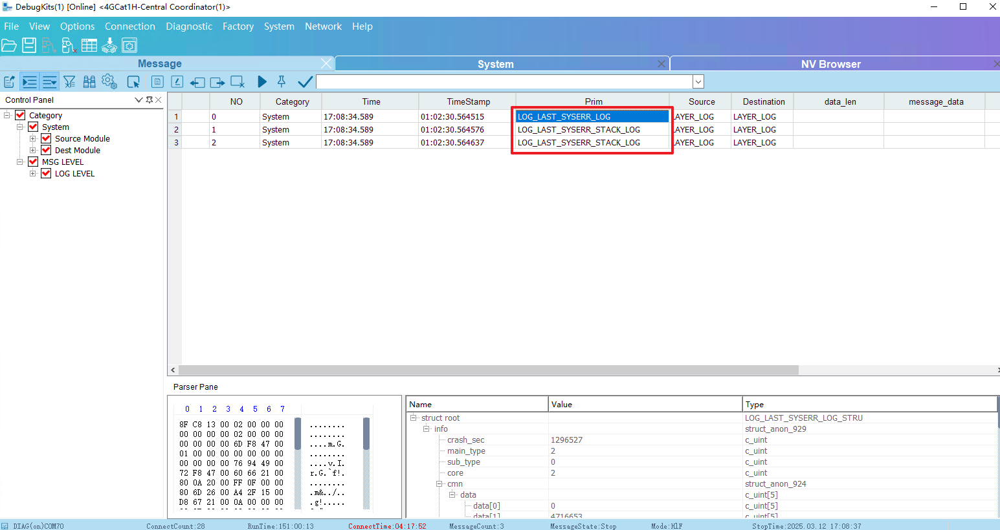
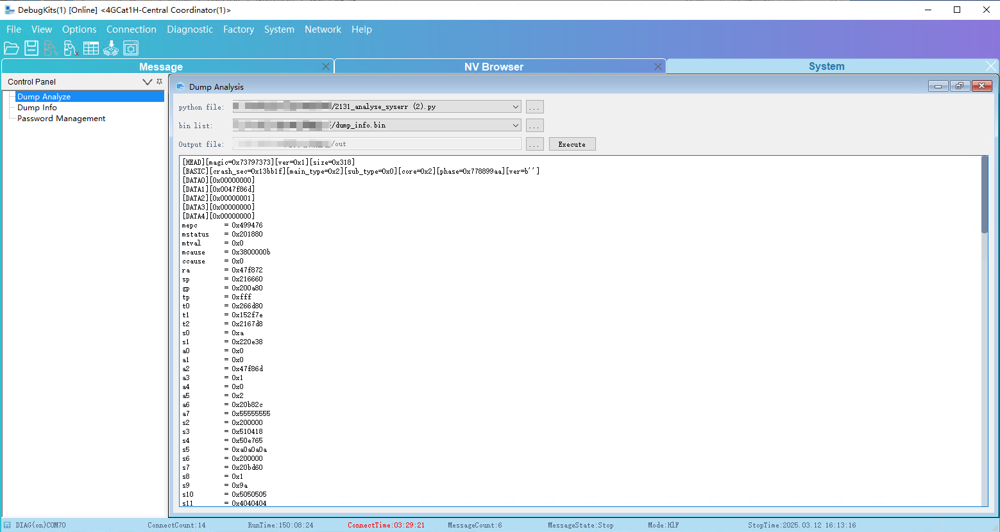
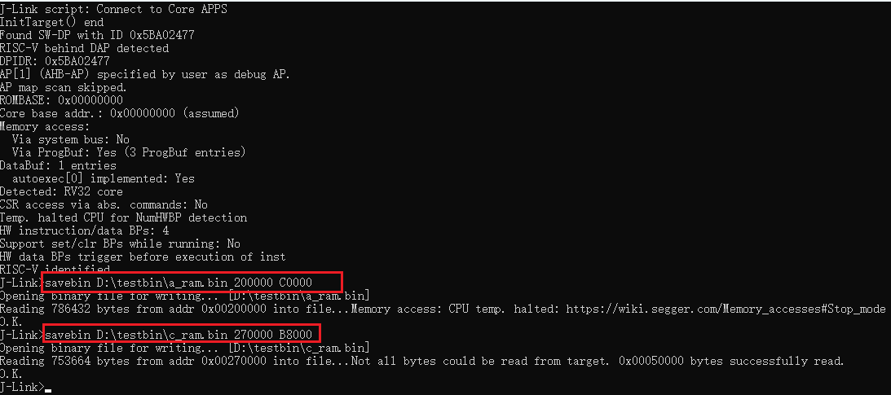
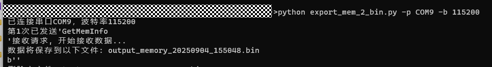
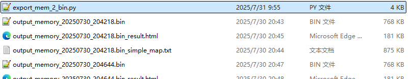

# 前言<a name="ZH-CN_TOPIC_0000002223228498"></a>

**概述<a name="zh-cn_topic_0000002015524980_section4626mcpsimp"></a>**

本文档主要介绍Hi2131EV100所支持的维测相关功能，主要为死机维测问题定位指导，以支撑对设备死机问题进行基本的问题定位。

**读者对象<a name="zh-cn_topic_0000002015524980_section4648mcpsimp"></a>**

本文档主要适用于以下工程师：

-   软件开发工程师
-   技术支持工程师

**符号约定<a name="zh-cn_topic_0000002015524980_section4654mcpsimp"></a>**

在本文中可能出现下列标志，它们所代表的含义如下。

<a name="zh-cn_topic_0000002015524980_table2622507016410"></a>
<table><thead align="left"><tr id="zh-cn_topic_0000002015524980_row1530720816410"><th class="cellrowborder" valign="top" width="20.580000000000002%" id="mcps1.1.3.1.1"><p id="zh-cn_topic_0000002015524980_p6450074116410"><a name="zh-cn_topic_0000002015524980_p6450074116410"></a><a name="zh-cn_topic_0000002015524980_p6450074116410"></a><strong id="zh-cn_topic_0000002015524980_b2136615816410"><a name="zh-cn_topic_0000002015524980_b2136615816410"></a><a name="zh-cn_topic_0000002015524980_b2136615816410"></a>符号</strong></p>
</th>
<th class="cellrowborder" valign="top" width="79.42%" id="mcps1.1.3.1.2"><p id="zh-cn_topic_0000002015524980_p5435366816410"><a name="zh-cn_topic_0000002015524980_p5435366816410"></a><a name="zh-cn_topic_0000002015524980_p5435366816410"></a><strong id="zh-cn_topic_0000002015524980_b5941558116410"><a name="zh-cn_topic_0000002015524980_b5941558116410"></a><a name="zh-cn_topic_0000002015524980_b5941558116410"></a>说明</strong></p>
</th>
</tr>
</thead>
<tbody><tr id="zh-cn_topic_0000002015524980_row1372280416410"><td class="cellrowborder" valign="top" width="20.580000000000002%" headers="mcps1.1.3.1.1 "><p id="zh-cn_topic_0000002015524980_p3734547016410"><a name="zh-cn_topic_0000002015524980_p3734547016410"></a><a name="zh-cn_topic_0000002015524980_p3734547016410"></a><a name="zh-cn_topic_0000002015524980_image2670064316410"></a><a name="zh-cn_topic_0000002015524980_image2670064316410"></a><span></span></p>
</td>
<td class="cellrowborder" valign="top" width="79.42%" headers="mcps1.1.3.1.2 "><p id="zh-cn_topic_0000002015524980_p1757432116410"><a name="zh-cn_topic_0000002015524980_p1757432116410"></a><a name="zh-cn_topic_0000002015524980_p1757432116410"></a>表示如不避免则将会导致死亡或严重伤害的具有高等级风险的危害。</p>
</td>
</tr>
<tr id="zh-cn_topic_0000002015524980_row466863216410"><td class="cellrowborder" valign="top" width="20.580000000000002%" headers="mcps1.1.3.1.1 "><p id="zh-cn_topic_0000002015524980_p1432579516410"><a name="zh-cn_topic_0000002015524980_p1432579516410"></a><a name="zh-cn_topic_0000002015524980_p1432579516410"></a><a name="zh-cn_topic_0000002015524980_image4895582316410"></a><a name="zh-cn_topic_0000002015524980_image4895582316410"></a><span></span></p>
</td>
<td class="cellrowborder" valign="top" width="79.42%" headers="mcps1.1.3.1.2 "><p id="zh-cn_topic_0000002015524980_p959197916410"><a name="zh-cn_topic_0000002015524980_p959197916410"></a><a name="zh-cn_topic_0000002015524980_p959197916410"></a>表示如不避免则可能导致死亡或严重伤害的具有中等级风险的危害。</p>
</td>
</tr>
<tr id="zh-cn_topic_0000002015524980_row123863216410"><td class="cellrowborder" valign="top" width="20.580000000000002%" headers="mcps1.1.3.1.1 "><p id="zh-cn_topic_0000002015524980_p1232579516410"><a name="zh-cn_topic_0000002015524980_p1232579516410"></a><a name="zh-cn_topic_0000002015524980_p1232579516410"></a><a name="zh-cn_topic_0000002015524980_image1235582316410"></a><a name="zh-cn_topic_0000002015524980_image1235582316410"></a><span></span></p>
</td>
<td class="cellrowborder" valign="top" width="79.42%" headers="mcps1.1.3.1.2 "><p id="zh-cn_topic_0000002015524980_p123197916410"><a name="zh-cn_topic_0000002015524980_p123197916410"></a><a name="zh-cn_topic_0000002015524980_p123197916410"></a>表示如不避免则可能导致轻微或中度伤害的具有低等级风险的危害。</p>
</td>
</tr>
<tr id="zh-cn_topic_0000002015524980_row5786682116410"><td class="cellrowborder" valign="top" width="20.580000000000002%" headers="mcps1.1.3.1.1 "><p id="zh-cn_topic_0000002015524980_p2204984716410"><a name="zh-cn_topic_0000002015524980_p2204984716410"></a><a name="zh-cn_topic_0000002015524980_p2204984716410"></a><a name="zh-cn_topic_0000002015524980_image4504446716410"></a><a name="zh-cn_topic_0000002015524980_image4504446716410"></a><span></span></p>
</td>
<td class="cellrowborder" valign="top" width="79.42%" headers="mcps1.1.3.1.2 "><p id="zh-cn_topic_0000002015524980_p4388861916410"><a name="zh-cn_topic_0000002015524980_p4388861916410"></a><a name="zh-cn_topic_0000002015524980_p4388861916410"></a>用于传递设备或环境安全警示信息。如不避免则可能会导致设备损坏、数据丢失、设备性能降低或其它不可预知的结果。</p>
<p id="zh-cn_topic_0000002015524980_p1238861916410"><a name="zh-cn_topic_0000002015524980_p1238861916410"></a><a name="zh-cn_topic_0000002015524980_p1238861916410"></a>“须知”不涉及人身伤害。</p>
</td>
</tr>
<tr id="zh-cn_topic_0000002015524980_row2856923116410"><td class="cellrowborder" valign="top" width="20.580000000000002%" headers="mcps1.1.3.1.1 "><p id="zh-cn_topic_0000002015524980_p5555360116410"><a name="zh-cn_topic_0000002015524980_p5555360116410"></a><a name="zh-cn_topic_0000002015524980_p5555360116410"></a><a name="zh-cn_topic_0000002015524980_image799324016410"></a><a name="zh-cn_topic_0000002015524980_image799324016410"></a><span></span></p>
</td>
<td class="cellrowborder" valign="top" width="79.42%" headers="mcps1.1.3.1.2 "><p id="zh-cn_topic_0000002015524980_p4612588116410"><a name="zh-cn_topic_0000002015524980_p4612588116410"></a><a name="zh-cn_topic_0000002015524980_p4612588116410"></a>对正文中重点信息的补充说明。</p>
<p id="zh-cn_topic_0000002015524980_p1232588116410"><a name="zh-cn_topic_0000002015524980_p1232588116410"></a><a name="zh-cn_topic_0000002015524980_p1232588116410"></a>“说明”不是安全警示信息，不涉及人身、设备及环境伤害信息。</p>
</td>
</tr>
</tbody>
</table>

# 概述<a name="ZH-CN_TOPIC_0000002223664584"></a>

本文档主要描述了使用单板死机维测问题定位指导，包括死机信息获取、死机信息的解析以及死机问题的定位等内容。

# 死机维测<a name="ZH-CN_TOPIC_0000002223504748"></a>

-   **[死机信息获取](#ZH-CN_TOPIC_0000002258624249)**  

-   **[死机信息内容描述](#ZH-CN_TOPIC_0000002258624253)**  

-   **[死机问题定位](#ZH-CN_TOPIC_0000002258624261)**  

## 死机信息获取<a name="ZH-CN_TOPIC_0000002258624249"></a>

死机信息可通过以下方法获取：

-   通过DebugKits工具的Message界面输出。
-   通过DebugKits工具的宕机信息查看功能导出。
-   连接J-Link调试器导出。

在研发测试实验室调试测试场景下，上述3种方法都适用；现网外场场景下适用DebugKits工具导出方法获取；各场景下连接MCU则可在MCU侧获取死机信息。

> **须知：** 
>在连接J-Link调试器定位死机问题的过程中，为防止单板发生异常后自动重启，导致获取的死机信息无法查看，需要在定位问题之前将A核中死机不重启NV项（NV\_ID\_SYSERR\_UNREBOOT）的值修改为0x554E5253，NV值的修改请参见《HiDiTingV100 NV 用户指南》，并重启单板。
>由于单板发生异常后，不能正常重启是高风险问题，因此该功能仅可在实验室使用。

-   **[DBK工具Message界面输出](#ZH-CN_TOPIC_0000002258464357)**  

-   **[DBK工具导出死机信息](#ZH-CN_TOPIC_0000002223664588)**  

-   **[连接J-Link调试器导出](#ZH-CN_TOPIC_0000002223504752)**  

-   **[通过DBG\_UART导出](#ZH-CN_TOPIC_0000002533054471)**  

### DBK工具Message界面输出<a name="ZH-CN_TOPIC_0000002258464357"></a>

当单板与DebugKits工具处于连接状态时，如果单板发生了死机，DebugKits工具会在单板重启后进行重新连接，并将死机信息输出到DebugKits工具的Message界面中，如[图1](#zh-cn_topic_0000002082055704_fig1028316315202)所示，死机信息将由3条日志组成，分别为1条死机原因日志（消息ID为LOG\_LAST\_SYSERR\_LOG）和2条死机调用栈日志（消息ID为LOG\_LAST\_SYSERR\_STACK\_LOG）。

**图 1**  Message界面中输出的死机信息<a name="zh-cn_topic_0000002082055704_fig1028316315202"></a>  


### DBK工具导出死机信息<a name="ZH-CN_TOPIC_0000002223664588"></a>

通过下方步骤，使用DebugKits工具导出Flash中的死机信息。

1.  连接DebugKits工具，参考《HiDiTingV100 DebugKits工具 用户指南》文档中的“导出内存数据”章节，选择System选项下的宕机信息查看，完成以下信息：
    -   选择保存文件的路径。
    -   选择导出名称。
        -   soc\_dump\_acore\_crash\_memory：导出A核死机信息。
        -   soc\_dump\_pcore\_crash\_memory：导出C核死机信息。
        -   soc\_dump\_crash\_flash：导出最近一次A/C核死机信息。

2.  单击“开始Dump\(<u>B</u>\)”按钮进行死机信息的导出。
3.  使用“build/script/2131\_analyse\_syserr.py”脚本解析导出的bin文件，得到死机信息的log文件。该log文件中包含的死机信息可通过“[死机信息内容描述](#ZH-CN_TOPIC_0000002258624253)”中的字段解读死机信息。

    

### 连接J-Link调试器导出<a name="ZH-CN_TOPIC_0000002223504752"></a>

1.  导出死机内存前，需要确保单板不会因死机导致重启，因此需要提前修改A核中syserr\_unreboot这个KV项的值为0x554E5253，配置单板在发生异常时不会重启。
2.  确保当前环境已连接J-Link。
3.  使用J-Link命令脚本连接到J-Link工具，通过J-Link工具导出全内存信息。其中执行命令包括：

    -   halt或h：暂停CPU运行。
    -   savebin文件名（完整路径）地址（默认16进制）大小（默认16进制）：导出内存内容。A核RAM的起始地址为0x200000，大小0xC0000；C核RAM起始地址为0x270000，大小为0xB8000。具体命令执行如下：

        ```
        halt
        savebin D:\testbin\a_ram.bin 200000 C0000
        savebin D:\testbin\c_ram.bin 270000 B8000
        ```

        **图 1**  执行结果<a name="zh-cn_topic_0000002082210506_fig9824101312611"></a>  
        

    将导出的bin文件以及编译版本时生成的“application\_cat1.map/application\_cat1.elf/application\_cat1.lst”,“protocol\_cat1.map/protocol\_cat1.elf/protocol\_cat1.lst”文件一起打包发送给FAE，获取解析结果。

### 通过DBG\_UART导出<a name="ZH-CN_TOPIC_0000002533054471"></a>

1.  该功能需要开启SUPPORT\_DBG\_UART\_EXPORT\_SYSERR\_MEM特性宏。导出死机内存前，需确保单板不会因死机而导致重启，因此需提前将A核中NV\_ID\_SYSTEM\_SYSERR\_UNREBOOT这个KV项的值修改为0x554E5253，配置单板在发生异常时不会重启。
2.  确保当前环境DBG\_UART接线正常。
3.  通过FAE获取内存导出脚本“export\_mem\_2\_bin.py”，使用方式如下。

    在脚本所在的路径下打开cmd并执行以下命令：

    ```
    python export_mem_2_bin.py -p COMX -b 115200
    ```

    COMX：DBG\_UART对应的COM口编号。

    -b ：导出内存所用的波特率，默认115200。

    **图 1**  执行命令<a name="zh-cn_topic_0000002461431285_fig2022817414118"></a>  
    

    **图 2**  导出的文件<a name="zh-cn_topic_0000002461431285_fig0442335131114"></a>  
    

将导出的bin文件及编译版本时生成的“application\_cat1.map/application\_cat1.elf/application\_cat1.lst”文件一起打包发送给FAE，获取解析结果。

## 死机信息内容描述<a name="ZH-CN_TOPIC_0000002258624253"></a>

-   **[soc\_syserr\_head](#ZH-CN_TOPIC_0000002258464361)**  

-   **[soc\_syserr\_basic](#ZH-CN_TOPIC_0000002223664592)**  

-   **[soc\_syserr\_cmn\_data](#ZH-CN_TOPIC_0000002223504756)**  

-   **[soc\_syserr\_context](#ZH-CN_TOPIC_0000002258624257)**  

-   **[soc\_mem\_info](#ZH-CN_TOPIC_0000002258464365)**  

-   **[soc\_syserr\_stack](#ZH-CN_TOPIC_0000002223664596)**  

-   **[soc\_syserr\_tail](#ZH-CN_TOPIC_0000002223504760)**  

### soc\_syserr\_head<a name="ZH-CN_TOPIC_0000002258464361"></a>

可在生成解析结果文件中搜索以下成员名查看相关数据。

<a name="zh-cn_topic_0000002079832144_table20938122116225"></a>
<table><thead align="left"><tr id="zh-cn_topic_0000002079832144_row189571121122218"><th class="cellrowborder" valign="top" width="18.18%" id="mcps1.1.3.1.1"><p id="zh-cn_topic_0000002079832144_p19957162110224"><a name="zh-cn_topic_0000002079832144_p19957162110224"></a><a name="zh-cn_topic_0000002079832144_p19957162110224"></a>成员</p>
</th>
<th class="cellrowborder" valign="top" width="81.82000000000001%" id="mcps1.1.3.1.2"><p id="zh-cn_topic_0000002079832144_p109571921152210"><a name="zh-cn_topic_0000002079832144_p109571921152210"></a><a name="zh-cn_topic_0000002079832144_p109571921152210"></a>描述</p>
</th>
</tr>
</thead>
<tbody><tr id="zh-cn_topic_0000002079832144_row895792117224"><td class="cellrowborder" valign="top" width="18.18%" headers="mcps1.1.3.1.1 "><p id="zh-cn_topic_0000002079832144_p3957162114223"><a name="zh-cn_topic_0000002079832144_p3957162114223"></a><a name="zh-cn_topic_0000002079832144_p3957162114223"></a>magic</p>
</td>
<td class="cellrowborder" valign="top" width="81.82000000000001%" headers="mcps1.1.3.1.2 "><p id="zh-cn_topic_0000002079832144_p199576217221"><a name="zh-cn_topic_0000002079832144_p199576217221"></a><a name="zh-cn_topic_0000002079832144_p199576217221"></a>完整有效的死机信息对应该值为：EXT_SYS_ERR_START_MAGIC(0x73797373)。</p>
</td>
</tr>
<tr id="zh-cn_topic_0000002079832144_row295722111225"><td class="cellrowborder" valign="top" width="18.18%" headers="mcps1.1.3.1.1 "><p id="zh-cn_topic_0000002079832144_p59578211228"><a name="zh-cn_topic_0000002079832144_p59578211228"></a><a name="zh-cn_topic_0000002079832144_p59578211228"></a>ver</p>
</td>
<td class="cellrowborder" valign="top" width="81.82000000000001%" headers="mcps1.1.3.1.2 "><p id="zh-cn_topic_0000002079832144_p095742112223"><a name="zh-cn_topic_0000002079832144_p095742112223"></a><a name="zh-cn_topic_0000002079832144_p095742112223"></a>死机结构版本。</p>
</td>
</tr>
<tr id="zh-cn_topic_0000002079832144_row209571721102214"><td class="cellrowborder" valign="top" width="18.18%" headers="mcps1.1.3.1.1 "><p id="zh-cn_topic_0000002079832144_p10957621122211"><a name="zh-cn_topic_0000002079832144_p10957621122211"></a><a name="zh-cn_topic_0000002079832144_p10957621122211"></a>size</p>
</td>
<td class="cellrowborder" valign="top" width="81.82000000000001%" headers="mcps1.1.3.1.2 "><p id="zh-cn_topic_0000002079832144_p99571521132212"><a name="zh-cn_topic_0000002079832144_p99571521132212"></a><a name="zh-cn_topic_0000002079832144_p99571521132212"></a>soc_syserr_info对应的大小。</p>
</td>
</tr>
</tbody>
</table>

### soc\_syserr\_basic<a name="ZH-CN_TOPIC_0000002223664592"></a>

可在生成解析结果文件中搜索以下成员名查看相关数据。

<a name="zh-cn_topic_0000002079986912_table78962497229"></a>
<table><thead align="left"><tr id="zh-cn_topic_0000002079986912_row793544922216"><th class="cellrowborder" valign="top" width="18.18%" id="mcps1.1.3.1.1"><p id="zh-cn_topic_0000002079986912_p2093513495225"><a name="zh-cn_topic_0000002079986912_p2093513495225"></a><a name="zh-cn_topic_0000002079986912_p2093513495225"></a>成员</p>
</th>
<th class="cellrowborder" valign="top" width="81.82000000000001%" id="mcps1.1.3.1.2"><p id="zh-cn_topic_0000002079986912_p1193524942218"><a name="zh-cn_topic_0000002079986912_p1193524942218"></a><a name="zh-cn_topic_0000002079986912_p1193524942218"></a>描述</p>
</th>
</tr>
</thead>
<tbody><tr id="zh-cn_topic_0000002079986912_row109359493228"><td class="cellrowborder" valign="top" width="18.18%" headers="mcps1.1.3.1.1 "><p id="zh-cn_topic_0000002079986912_p79351849102217"><a name="zh-cn_topic_0000002079986912_p79351849102217"></a><a name="zh-cn_topic_0000002079986912_p79351849102217"></a>crash_sec</p>
</td>
<td class="cellrowborder" valign="top" width="81.82000000000001%" headers="mcps1.1.3.1.2 "><p id="zh-cn_topic_0000002079986912_p29351149202217"><a name="zh-cn_topic_0000002079986912_p29351149202217"></a><a name="zh-cn_topic_0000002079986912_p29351149202217"></a>死机发生的时间（此处为距离上电后的绝对时间，包含深睡时间）。</p>
</td>
</tr>
<tr id="zh-cn_topic_0000002079986912_row10935649172217"><td class="cellrowborder" valign="top" width="18.18%" headers="mcps1.1.3.1.1 "><p id="zh-cn_topic_0000002079986912_p1893534932219"><a name="zh-cn_topic_0000002079986912_p1893534932219"></a><a name="zh-cn_topic_0000002079986912_p1893534932219"></a>ver</p>
</td>
<td class="cellrowborder" valign="top" width="81.82000000000001%" headers="mcps1.1.3.1.2 "><p id="zh-cn_topic_0000002079986912_p12935164914228"><a name="zh-cn_topic_0000002079986912_p12935164914228"></a><a name="zh-cn_topic_0000002079986912_p12935164914228"></a>死机发生时的image版本号。暂未记录。</p>
</td>
</tr>
<tr id="zh-cn_topic_0000002079986912_row1993554992211"><td class="cellrowborder" valign="top" width="18.18%" headers="mcps1.1.3.1.1 "><p id="zh-cn_topic_0000002079986912_p593511499224"><a name="zh-cn_topic_0000002079986912_p593511499224"></a><a name="zh-cn_topic_0000002079986912_p593511499224"></a>main_type</p>
</td>
<td class="cellrowborder" valign="top" width="81.82000000000001%" headers="mcps1.1.3.1.2 "><p id="zh-cn_topic_0000002079986912_p119352498228"><a name="zh-cn_topic_0000002079986912_p119352498228"></a><a name="zh-cn_topic_0000002079986912_p119352498228"></a>死机的主类型：</p>
<a name="zh-cn_topic_0000002079986912_ul18935949172213"></a><a name="zh-cn_topic_0000002079986912_ul18935949172213"></a><ul id="zh-cn_topic_0000002079986912_ul18935949172213"><li>SOC_SYSERR_WATCH_DOG(1)：看门狗到期触发的重启。详细内容请参见“<a href="#ZH-CN_TOPIC_0000002223504764">看门狗重启问题定位</a>”章节。</li><li>SOC_SYSERR_PANIC(2)：主动调用panic的重启。</li><li>SOC_SYSERR_CPU_EXEC(3)：CPU异常触发的重启。</li><li>SOC_SYSERR_OS_ERR(4)：OS异常重启，暂未使用。</li><li>SOC_SYSERR_LOS_PANIC(5)：OS异常触发的重启。</li></ul>
</td>
</tr>
<tr id="zh-cn_topic_0000002079986912_row18935154962218"><td class="cellrowborder" valign="top" width="18.18%" headers="mcps1.1.3.1.1 "><p id="zh-cn_topic_0000002079986912_p17935194962212"><a name="zh-cn_topic_0000002079986912_p17935194962212"></a><a name="zh-cn_topic_0000002079986912_p17935194962212"></a>sub_type</p>
</td>
<td class="cellrowborder" valign="top" width="81.82000000000001%" headers="mcps1.1.3.1.2 "><p id="zh-cn_topic_0000002079986912_p129351549192219"><a name="zh-cn_topic_0000002079986912_p129351549192219"></a><a name="zh-cn_topic_0000002079986912_p129351549192219"></a>死机发生子类型（当main_type为5时，可表示父函数地址、任务名称、任务ID等内容，需要结合其他死机信息综合判断）。</p>
</td>
</tr>
<tr id="zh-cn_topic_0000002079986912_row1935124915229"><td class="cellrowborder" valign="top" width="18.18%" headers="mcps1.1.3.1.1 "><p id="zh-cn_topic_0000002079986912_p199351449122213"><a name="zh-cn_topic_0000002079986912_p199351449122213"></a><a name="zh-cn_topic_0000002079986912_p199351449122213"></a>core</p>
</td>
<td class="cellrowborder" valign="top" width="81.82000000000001%" headers="mcps1.1.3.1.2 "><p id="zh-cn_topic_0000002079986912_p14935204902211"><a name="zh-cn_topic_0000002079986912_p14935204902211"></a><a name="zh-cn_topic_0000002079986912_p14935204902211"></a>死机发生的核。</p>
<p id="zh-cn_topic_0000002079986912_p11799228366"><a name="zh-cn_topic_0000002079986912_p11799228366"></a><a name="zh-cn_topic_0000002079986912_p11799228366"></a>1：C核；</p>
<p id="zh-cn_topic_0000002079986912_p816721383615"><a name="zh-cn_topic_0000002079986912_p816721383615"></a><a name="zh-cn_topic_0000002079986912_p816721383615"></a>2：A核。</p>
</td>
</tr>
<tr id="zh-cn_topic_0000002079986912_row109351449142216"><td class="cellrowborder" valign="top" width="18.18%" headers="mcps1.1.3.1.1 "><p id="zh-cn_topic_0000002079986912_p6935184992210"><a name="zh-cn_topic_0000002079986912_p6935184992210"></a><a name="zh-cn_topic_0000002079986912_p6935184992210"></a>phase</p>
</td>
<td class="cellrowborder" valign="top" width="81.82000000000001%" headers="mcps1.1.3.1.2 "><p id="zh-cn_topic_0000002079986912_p119357495228"><a name="zh-cn_topic_0000002079986912_p119357495228"></a><a name="zh-cn_topic_0000002079986912_p119357495228"></a>死机信息记录的存储阶段。存储死机过程中可能发生2次异常，从而导致死机信息存储不完整（例如，踩内存场景，遍历内存池造成2次死机），当该值为SOC_SYSERR_SAVE_PHASE_FINISH（0x778899AA）时，表示进行了完整的死机存储。</p>
</td>
</tr>
</tbody>
</table>

### soc\_syserr\_cmn\_data<a name="ZH-CN_TOPIC_0000002223504756"></a>

可在生成解析结果文件中搜索以下成员名查看相关数据。

<a name="zh-cn_topic_0000002115471213_table158961230194416"></a>
<table><thead align="left"><tr id="zh-cn_topic_0000002115471213_row15896123013443"><th class="cellrowborder" valign="top" width="18.27%" id="mcps1.1.3.1.1"><p id="zh-cn_topic_0000002115471213_p1789693015443"><a name="zh-cn_topic_0000002115471213_p1789693015443"></a><a name="zh-cn_topic_0000002115471213_p1789693015443"></a>成员</p>
</th>
<th class="cellrowborder" valign="top" width="81.73%" id="mcps1.1.3.1.2"><p id="zh-cn_topic_0000002115471213_p19896173034414"><a name="zh-cn_topic_0000002115471213_p19896173034414"></a><a name="zh-cn_topic_0000002115471213_p19896173034414"></a>描述</p>
</th>
</tr>
</thead>
<tbody><tr id="zh-cn_topic_0000002115471213_row148968302446"><td class="cellrowborder" valign="top" width="18.27%" headers="mcps1.1.3.1.1 "><p id="zh-cn_topic_0000002115471213_p151371884620"><a name="zh-cn_topic_0000002115471213_p151371884620"></a><a name="zh-cn_topic_0000002115471213_p151371884620"></a>data[4]</p>
</td>
<td class="cellrowborder" valign="top" width="81.73%" headers="mcps1.1.3.1.2 "><p id="zh-cn_topic_0000002115471213_p1389693034412"><a name="zh-cn_topic_0000002115471213_p1389693034412"></a><a name="zh-cn_topic_0000002115471213_p1389693034412"></a>不同的崩溃场景存储不同的信息，常用于panic定位。</p>
</td>
</tr>
</tbody>
</table>

### soc\_syserr\_context<a name="ZH-CN_TOPIC_0000002258624257"></a>

soc\_syserr\_context中记录了死机时的CPU状态，[表1](#zh-cn_topic_0000002115506169_table13582179172313)中仅对具有特殊功能的成员进行描述，且只有在SOC\_SYSERR\_CPU\_EXEC和SOC\_SYSERR\_WATCH\_DOG场景下意义准确。可在生成解析结果文件中搜索以下成员名查看相关数据。

**表 1**  soc\_syserr\_context成员描述

<a name="zh-cn_topic_0000002115506169_table13582179172313"></a>
<table><thead align="left"><tr id="zh-cn_topic_0000002115506169_row1160829152317"><th class="cellrowborder" valign="top" width="18.18%" id="mcps1.2.3.1.1"><p id="zh-cn_topic_0000002115506169_p19608149162311"><a name="zh-cn_topic_0000002115506169_p19608149162311"></a><a name="zh-cn_topic_0000002115506169_p19608149162311"></a>成员</p>
</th>
<th class="cellrowborder" valign="top" width="81.82000000000001%" id="mcps1.2.3.1.2"><p id="zh-cn_topic_0000002115506169_p146088916235"><a name="zh-cn_topic_0000002115506169_p146088916235"></a><a name="zh-cn_topic_0000002115506169_p146088916235"></a>描述</p>
</th>
</tr>
</thead>
<tbody><tr id="zh-cn_topic_0000002115506169_row11608897237"><td class="cellrowborder" valign="top" width="18.18%" headers="mcps1.2.3.1.1 "><p id="zh-cn_topic_0000002115506169_p660819911239"><a name="zh-cn_topic_0000002115506169_p660819911239"></a><a name="zh-cn_topic_0000002115506169_p660819911239"></a>mepc</p>
</td>
<td class="cellrowborder" valign="top" width="81.82000000000001%" headers="mcps1.2.3.1.2 "><p id="zh-cn_topic_0000002115506169_p9608139142311"><a name="zh-cn_topic_0000002115506169_p9608139142311"></a><a name="zh-cn_topic_0000002115506169_p9608139142311"></a>死机发生时的pc值。</p>
</td>
</tr>
<tr id="zh-cn_topic_0000002115506169_row560812972318"><td class="cellrowborder" valign="top" width="18.18%" headers="mcps1.2.3.1.1 "><p id="zh-cn_topic_0000002115506169_p1060829202315"><a name="zh-cn_topic_0000002115506169_p1060829202315"></a><a name="zh-cn_topic_0000002115506169_p1060829202315"></a>ra</p>
</td>
<td class="cellrowborder" valign="top" width="81.82000000000001%" headers="mcps1.2.3.1.2 "><p id="zh-cn_topic_0000002115506169_p76081698236"><a name="zh-cn_topic_0000002115506169_p76081698236"></a><a name="zh-cn_topic_0000002115506169_p76081698236"></a>调用死机发生函数的地址（返回地址）。例如，死机发生在A函数，在x地址调用的A函数，则ra为x指令的下一条指令。</p>
</td>
</tr>
<tr id="zh-cn_topic_0000002115506169_row56080920234"><td class="cellrowborder" valign="top" width="18.18%" headers="mcps1.2.3.1.1 "><p id="zh-cn_topic_0000002115506169_p116081914235"><a name="zh-cn_topic_0000002115506169_p116081914235"></a><a name="zh-cn_topic_0000002115506169_p116081914235"></a>sp</p>
</td>
<td class="cellrowborder" valign="top" width="81.82000000000001%" headers="mcps1.2.3.1.2 "><p id="zh-cn_topic_0000002115506169_p1060810972319"><a name="zh-cn_topic_0000002115506169_p1060810972319"></a><a name="zh-cn_topic_0000002115506169_p1060810972319"></a>死机发生时的栈指针。</p>
</td>
</tr>
<tr id="zh-cn_topic_0000002115506169_row1608594230"><td class="cellrowborder" valign="top" width="18.18%" headers="mcps1.2.3.1.1 "><p id="zh-cn_topic_0000002115506169_p1360829152318"><a name="zh-cn_topic_0000002115506169_p1360829152318"></a><a name="zh-cn_topic_0000002115506169_p1360829152318"></a>mstatus</p>
</td>
<td class="cellrowborder" valign="top" width="81.82000000000001%" headers="mcps1.2.3.1.2 "><p id="zh-cn_topic_0000002115506169_p16608493234"><a name="zh-cn_topic_0000002115506169_p16608493234"></a><a name="zh-cn_topic_0000002115506169_p16608493234"></a>死机发生时的CPU状态寄存器。</p>
</td>
</tr>
<tr id="zh-cn_topic_0000002115506169_row1660812919231"><td class="cellrowborder" valign="top" width="18.18%" headers="mcps1.2.3.1.1 "><p id="zh-cn_topic_0000002115506169_p36088982317"><a name="zh-cn_topic_0000002115506169_p36088982317"></a><a name="zh-cn_topic_0000002115506169_p36088982317"></a>mtval</p>
</td>
<td class="cellrowborder" valign="top" width="81.82000000000001%" headers="mcps1.2.3.1.2 "><p id="zh-cn_topic_0000002115506169_p156081891238"><a name="zh-cn_topic_0000002115506169_p156081891238"></a><a name="zh-cn_topic_0000002115506169_p156081891238"></a>死机发生时程序预访问但CPU和逻辑限制访问的目标地址，Load、store异常时，该值有意义。</p>
</td>
</tr>
<tr id="zh-cn_topic_0000002115506169_row26084962318"><td class="cellrowborder" valign="top" width="18.18%" headers="mcps1.2.3.1.1 "><p id="zh-cn_topic_0000002115506169_p4608189172320"><a name="zh-cn_topic_0000002115506169_p4608189172320"></a><a name="zh-cn_topic_0000002115506169_p4608189172320"></a>mcause</p>
</td>
<td class="cellrowborder" valign="top" width="81.82000000000001%" headers="mcps1.2.3.1.2 "><p id="zh-cn_topic_0000002115506169_p860819916236"><a name="zh-cn_topic_0000002115506169_p860819916236"></a><a name="zh-cn_topic_0000002115506169_p860819916236"></a>死机原因，已经转换为sub_type。</p>
</td>
</tr>
<tr id="zh-cn_topic_0000002115506169_row36089922312"><td class="cellrowborder" valign="top" width="18.18%" headers="mcps1.2.3.1.1 "><p id="zh-cn_topic_0000002115506169_p66083972315"><a name="zh-cn_topic_0000002115506169_p66083972315"></a><a name="zh-cn_topic_0000002115506169_p66083972315"></a>ccause</p>
</td>
<td class="cellrowborder" valign="top" width="81.82000000000001%" headers="mcps1.2.3.1.2 "><p id="zh-cn_topic_0000002115506169_p1560812932310"><a name="zh-cn_topic_0000002115506169_p1560812932310"></a><a name="zh-cn_topic_0000002115506169_p1560812932310"></a>死机原因，CPU子类。</p>
</td>
</tr>
</tbody>
</table>

### soc\_mem\_info<a name="ZH-CN_TOPIC_0000002258464365"></a>

死机发生时的内存池状态。mem\_info的具体成员信息请参见头文件“soc\_mem.h”中的“soc\_mem\_info”结构体定义。

### soc\_syserr\_stack<a name="ZH-CN_TOPIC_0000002223664596"></a>

可在生成解析结果文件中搜索以下成员名查看相关数据。

<a name="zh-cn_topic_0000002079986916_table9329242182317"></a>
<table><thead align="left"><tr id="zh-cn_topic_0000002079986916_row10353174216238"><th class="cellrowborder" valign="top" width="18.18%" id="mcps1.1.3.1.1"><p id="zh-cn_topic_0000002079986916_p113538423232"><a name="zh-cn_topic_0000002079986916_p113538423232"></a><a name="zh-cn_topic_0000002079986916_p113538423232"></a>成员</p>
</th>
<th class="cellrowborder" valign="top" width="81.82000000000001%" id="mcps1.1.3.1.2"><p id="zh-cn_topic_0000002079986916_p635374210231"><a name="zh-cn_topic_0000002079986916_p635374210231"></a><a name="zh-cn_topic_0000002079986916_p635374210231"></a>描述</p>
</th>
</tr>
</thead>
<tbody><tr id="zh-cn_topic_0000002079986916_row6353184218234"><td class="cellrowborder" valign="top" width="18.18%" headers="mcps1.1.3.1.1 "><p id="zh-cn_topic_0000002079986916_p1635354282312"><a name="zh-cn_topic_0000002079986916_p1635354282312"></a><a name="zh-cn_topic_0000002079986916_p1635354282312"></a>in_isr</p>
</td>
<td class="cellrowborder" valign="top" width="81.82000000000001%" headers="mcps1.1.3.1.2 "><p id="zh-cn_topic_0000002079986916_p1335324282316"><a name="zh-cn_topic_0000002079986916_p1335324282316"></a><a name="zh-cn_topic_0000002079986916_p1335324282316"></a>死机是否发生在中断中。</p>
</td>
</tr>
<tr id="zh-cn_topic_0000002079986916_row135364232310"><td class="cellrowborder" valign="top" width="18.18%" headers="mcps1.1.3.1.1 "><p id="zh-cn_topic_0000002079986916_p635394217233"><a name="zh-cn_topic_0000002079986916_p635394217233"></a><a name="zh-cn_topic_0000002079986916_p635394217233"></a>sp_in_stack</p>
</td>
<td class="cellrowborder" valign="top" width="81.82000000000001%" headers="mcps1.1.3.1.2 "><p id="zh-cn_topic_0000002079986916_p123531642192316"><a name="zh-cn_topic_0000002079986916_p123531642192316"></a><a name="zh-cn_topic_0000002079986916_p123531642192316"></a>死机发生时的sp是否在合法栈空间中。</p>
</td>
</tr>
<tr id="zh-cn_topic_0000002079986916_row9353442102315"><td class="cellrowborder" valign="top" width="18.18%" headers="mcps1.1.3.1.1 "><p id="zh-cn_topic_0000002079986916_p11353194217231"><a name="zh-cn_topic_0000002079986916_p11353194217231"></a><a name="zh-cn_topic_0000002079986916_p11353194217231"></a>id</p>
</td>
<td class="cellrowborder" valign="top" width="81.82000000000001%" headers="mcps1.1.3.1.2 "><p id="zh-cn_topic_0000002079986916_p735312420233"><a name="zh-cn_topic_0000002079986916_p735312420233"></a><a name="zh-cn_topic_0000002079986916_p735312420233"></a>死机发生时的任务ID。即保存当前线程任务执行状态的地址，具体可参考LosTaskCB结构体。</p>
</td>
</tr>
<tr id="zh-cn_topic_0000002079986916_row19353442152316"><td class="cellrowborder" valign="top" width="18.18%" headers="mcps1.1.3.1.1 "><p id="zh-cn_topic_0000002079986916_p183531042132314"><a name="zh-cn_topic_0000002079986916_p183531042132314"></a><a name="zh-cn_topic_0000002079986916_p183531042132314"></a>top</p>
</td>
<td class="cellrowborder" valign="top" width="81.82000000000001%" headers="mcps1.1.3.1.2 "><p id="zh-cn_topic_0000002079986916_p235315429237"><a name="zh-cn_topic_0000002079986916_p235315429237"></a><a name="zh-cn_topic_0000002079986916_p235315429237"></a>栈上边界。</p>
</td>
</tr>
<tr id="zh-cn_topic_0000002079986916_row7353164262312"><td class="cellrowborder" valign="top" width="18.18%" headers="mcps1.1.3.1.1 "><p id="zh-cn_topic_0000002079986916_p13531642152312"><a name="zh-cn_topic_0000002079986916_p13531642152312"></a><a name="zh-cn_topic_0000002079986916_p13531642152312"></a>bottom</p>
</td>
<td class="cellrowborder" valign="top" width="81.82000000000001%" headers="mcps1.1.3.1.2 "><p id="zh-cn_topic_0000002079986916_p535384215233"><a name="zh-cn_topic_0000002079986916_p535384215233"></a><a name="zh-cn_topic_0000002079986916_p535384215233"></a>栈下边界。</p>
</td>
</tr>
<tr id="zh-cn_topic_0000002079986916_row335324292317"><td class="cellrowborder" valign="top" width="18.18%" headers="mcps1.1.3.1.1 "><p id="zh-cn_topic_0000002079986916_p1735319424238"><a name="zh-cn_topic_0000002079986916_p1735319424238"></a><a name="zh-cn_topic_0000002079986916_p1735319424238"></a>sp</p>
</td>
<td class="cellrowborder" valign="top" width="81.82000000000001%" headers="mcps1.1.3.1.2 "><p id="zh-cn_topic_0000002079986916_p1635314424233"><a name="zh-cn_topic_0000002079986916_p1635314424233"></a><a name="zh-cn_topic_0000002079986916_p1635314424233"></a>栈指针。</p>
</td>
</tr>
<tr id="zh-cn_topic_0000002079986916_row835316429235"><td class="cellrowborder" valign="top" width="18.18%" headers="mcps1.1.3.1.1 "><p id="zh-cn_topic_0000002079986916_p15353104292316"><a name="zh-cn_topic_0000002079986916_p15353104292316"></a><a name="zh-cn_topic_0000002079986916_p15353104292316"></a>Peek</p>
</td>
<td class="cellrowborder" valign="top" width="81.82000000000001%" headers="mcps1.1.3.1.2 "><p id="zh-cn_topic_0000002079986916_p9353154217235"><a name="zh-cn_topic_0000002079986916_p9353154217235"></a><a name="zh-cn_topic_0000002079986916_p9353154217235"></a>栈峰值。死机发生在任务中时，该值有意义。</p>
</td>
</tr>
<tr id="zh-cn_topic_0000002079986916_row235374212314"><td class="cellrowborder" valign="top" width="18.18%" headers="mcps1.1.3.1.1 "><p id="zh-cn_topic_0000002079986916_p1353242192313"><a name="zh-cn_topic_0000002079986916_p1353242192313"></a><a name="zh-cn_topic_0000002079986916_p1353242192313"></a>Name</p>
</td>
<td class="cellrowborder" valign="top" width="81.82000000000001%" headers="mcps1.1.3.1.2 "><p id="zh-cn_topic_0000002079986916_p19353114242319"><a name="zh-cn_topic_0000002079986916_p19353114242319"></a><a name="zh-cn_topic_0000002079986916_p19353114242319"></a>发生死机的栈的名称。</p>
</td>
</tr>
<tr id="zh-cn_topic_0000002079986916_row15353342142314"><td class="cellrowborder" valign="top" width="18.18%" headers="mcps1.1.3.1.1 "><p id="zh-cn_topic_0000002079986916_p535384211230"><a name="zh-cn_topic_0000002079986916_p535384211230"></a><a name="zh-cn_topic_0000002079986916_p535384211230"></a>Stack</p>
</td>
<td class="cellrowborder" valign="top" width="81.82000000000001%" headers="mcps1.1.3.1.2 "><p id="zh-cn_topic_0000002079986916_p6353204214233"><a name="zh-cn_topic_0000002079986916_p6353204214233"></a><a name="zh-cn_topic_0000002079986916_p6353204214233"></a>死机时刻的函数调用栈。</p>
</td>
</tr>
</tbody>
</table>

### soc\_syserr\_tail<a name="ZH-CN_TOPIC_0000002223504760"></a>

可在生成解析结果文件中搜索以下成员名查看相关数据。

<a name="zh-cn_topic_0000002115471217_table12120573245"></a>
<table><thead align="left"><tr id="zh-cn_topic_0000002115471217_row191303713246"><th class="cellrowborder" valign="top" width="18.18%" id="mcps1.1.3.1.1"><p id="zh-cn_topic_0000002115471217_p1113087132416"><a name="zh-cn_topic_0000002115471217_p1113087132416"></a><a name="zh-cn_topic_0000002115471217_p1113087132416"></a>成员</p>
</th>
<th class="cellrowborder" valign="top" width="81.82000000000001%" id="mcps1.1.3.1.2"><p id="zh-cn_topic_0000002115471217_p1213012712247"><a name="zh-cn_topic_0000002115471217_p1213012712247"></a><a name="zh-cn_topic_0000002115471217_p1213012712247"></a>描述</p>
</th>
</tr>
</thead>
<tbody><tr id="zh-cn_topic_0000002115471217_row1513097202415"><td class="cellrowborder" valign="top" width="18.18%" headers="mcps1.1.3.1.1 "><p id="zh-cn_topic_0000002115471217_p191309711244"><a name="zh-cn_topic_0000002115471217_p191309711244"></a><a name="zh-cn_topic_0000002115471217_p191309711244"></a>magic</p>
</td>
<td class="cellrowborder" valign="top" width="81.82000000000001%" headers="mcps1.1.3.1.2 "><p id="zh-cn_topic_0000002115471217_p16130107102415"><a name="zh-cn_topic_0000002115471217_p16130107102415"></a><a name="zh-cn_topic_0000002115471217_p16130107102415"></a>完整有效的死机信息对应该值为：EXT_SYS_ERR_END_MAGIC（0x73797365）。</p>
</td>
</tr>
</tbody>
</table>

## 死机问题定位<a name="ZH-CN_TOPIC_0000002258624261"></a>

-   **[查看死机信息有效位](#ZH-CN_TOPIC_0000002258464369)**  

-   **[查看main\_type](#ZH-CN_TOPIC_0000002223664600)**  

-   **[看门狗重启问题定位](#ZH-CN_TOPIC_0000002223504764)**  

-   **[CPU异常触发重启问题定位](#ZH-CN_TOPIC_0000002258624265)**  

-   **[liteos panic异常定位](#ZH-CN_TOPIC_0000002258464373)**  

-   **[panic异常定位](#ZH-CN_TOPIC_0000002223664604)**  

### 查看死机信息有效位<a name="ZH-CN_TOPIC_0000002258464369"></a>

<a name="zh-cn_topic_0000002115468893_table12843151721819"></a>
<table><thead align="left"><tr id="zh-cn_topic_0000002115468893_row118446177184"><th class="cellrowborder" valign="top" width="21.72%" id="mcps1.1.3.1.1"><p id="zh-cn_topic_0000002115468893_p18844417171817"><a name="zh-cn_topic_0000002115468893_p18844417171817"></a><a name="zh-cn_topic_0000002115468893_p18844417171817"></a>成员</p>
</th>
<th class="cellrowborder" valign="top" width="78.28%" id="mcps1.1.3.1.2"><p id="zh-cn_topic_0000002115468893_p14844101761820"><a name="zh-cn_topic_0000002115468893_p14844101761820"></a><a name="zh-cn_topic_0000002115468893_p14844101761820"></a>描述</p>
</th>
</tr>
</thead>
<tbody><tr id="zh-cn_topic_0000002115468893_row6844917151812"><td class="cellrowborder" valign="top" width="21.72%" headers="mcps1.1.3.1.1 "><p id="zh-cn_topic_0000002115468893_p1854018177196"><a name="zh-cn_topic_0000002115468893_p1854018177196"></a><a name="zh-cn_topic_0000002115468893_p1854018177196"></a>soc_syserr_head[magic]</p>
</td>
<td class="cellrowborder" valign="top" width="78.28%" headers="mcps1.1.3.1.2 "><p id="zh-cn_topic_0000002115468893_p1784412172180"><a name="zh-cn_topic_0000002115468893_p1784412172180"></a><a name="zh-cn_topic_0000002115468893_p1784412172180"></a>EXT_SYS_ERR_START_MAGIC（0x73797373）：死机信息有效。</p>
</td>
</tr>
<tr id="zh-cn_topic_0000002115468893_row178442179185"><td class="cellrowborder" valign="top" width="21.72%" headers="mcps1.1.3.1.1 "><p id="zh-cn_topic_0000002115468893_p1084417174181"><a name="zh-cn_topic_0000002115468893_p1084417174181"></a><a name="zh-cn_topic_0000002115468893_p1084417174181"></a>soc_syserr_tail[magic]</p>
</td>
<td class="cellrowborder" valign="top" width="78.28%" headers="mcps1.1.3.1.2 "><p id="zh-cn_topic_0000002115468893_p584451718182"><a name="zh-cn_topic_0000002115468893_p584451718182"></a><a name="zh-cn_topic_0000002115468893_p584451718182"></a>EXT_SYS_ERR_END_MAGIC（0x73797365）：死机信息有效。</p>
</td>
</tr>
<tr id="zh-cn_topic_0000002115468893_row6505152722516"><td class="cellrowborder" valign="top" width="21.72%" headers="mcps1.1.3.1.1 "><p id="zh-cn_topic_0000002115468893_p9506182792519"><a name="zh-cn_topic_0000002115468893_p9506182792519"></a><a name="zh-cn_topic_0000002115468893_p9506182792519"></a>soc_syserr_basic[phase]</p>
</td>
<td class="cellrowborder" valign="top" width="78.28%" headers="mcps1.1.3.1.2 "><a name="zh-cn_topic_0000002115468893_ul209058963112"></a><a name="zh-cn_topic_0000002115468893_ul209058963112"></a><ul id="zh-cn_topic_0000002115468893_ul209058963112"><li>SOC_SYSERR_SAVE_PHASE_HEAD_TAIL（0x01）：soc_syserr_head值有效。</li><li>SOC_SYSERR_SAVE_PHASE_BASIC（0x02）：soc_syserr_basic及以上的值有效。</li><li>SOC_SYSERR_SAVE_PHASE_CMN（0x03）：soc_syserr_cmn_data及以上的值有效。</li><li>SOC_SYSERR_SAVE_PHASE_CPU_CONTEXT（0x04）：soc_syserr_context及以上的值有效。</li><li>SOC_SYSERR_SAVE_PHASE_MEM_INFO（0x05）：soc_mem_info及以上的值有效。</li><li>SOC_SYSERR_SAVE_PHASE_SYS_STATUS（0x06）：soc_syserr_sys_status及以上的值有效。</li><li>SOC_SYSERR_SAVE_PHASE_STACK（0x07）：soc_syserr_stack及以上的值有效。</li><li>SOC_SYSERR_SAVE_PHASE_FINISH（0x778899AA）：死机信息完整有效。</li></ul>
</td>
</tr>
</tbody>
</table>

### 查看main\_type<a name="ZH-CN_TOPIC_0000002223664600"></a>

通过查看死机信息中的main\_type字段，判断当前死机的主类型，确定定位方向。

<a name="zh-cn_topic_0000002115503837_table1988024182417"></a>
<table><thead align="left"><tr id="zh-cn_topic_0000002115503837_row1472025132418"><th class="cellrowborder" valign="top" width="18.18%" id="mcps1.1.3.1.1"><p id="zh-cn_topic_0000002115503837_p1171325122419"><a name="zh-cn_topic_0000002115503837_p1171325122419"></a><a name="zh-cn_topic_0000002115503837_p1171325122419"></a>成员</p>
</th>
<th class="cellrowborder" valign="top" width="81.82000000000001%" id="mcps1.1.3.1.2"><p id="zh-cn_topic_0000002115503837_p177172572418"><a name="zh-cn_topic_0000002115503837_p177172572418"></a><a name="zh-cn_topic_0000002115503837_p177172572418"></a>描述</p>
</th>
</tr>
</thead>
<tbody><tr id="zh-cn_topic_0000002115503837_row1719257249"><td class="cellrowborder" valign="top" width="18.18%" headers="mcps1.1.3.1.1 "><p id="zh-cn_topic_0000002115503837_p107122515245"><a name="zh-cn_topic_0000002115503837_p107122515245"></a><a name="zh-cn_topic_0000002115503837_p107122515245"></a>main_type</p>
</td>
<td class="cellrowborder" valign="top" width="81.82000000000001%" headers="mcps1.1.3.1.2 "><a name="zh-cn_topic_0000002115503837_ul127132532416"></a><a name="zh-cn_topic_0000002115503837_ul127132532416"></a><ul id="zh-cn_topic_0000002115503837_ul127132532416"><li>SOC_SYSERR_WATCH_DOG(1)：看门狗到期触发的重启。详细内容请参见“<a href="#ZH-CN_TOPIC_0000002223504764">看门狗重启问题定位</a>”章节。</li><li>SOC_SYSERR_PANIC(2)：主动调用panic重启。</li><li>SOC_SYSERR_CPU_EXEC(3)：CPU异常触发重启。</li><li>SOC_SYSERR_OS_ERR(4)：OS异常触发的重启，暂未使用。</li><li>SOC_SYSERR_LOS_PANIC(5)：OS异常触发重启。</li></ul>
</td>
</tr>
</tbody>
</table>

### 看门狗重启问题定位<a name="ZH-CN_TOPIC_0000002223504764"></a>

看门狗死机导致的重启问题，大概率为代码中存在死循环（包含次数很大的循环）或某个业务一直被执行（如灌包），使得IDLE任务无法及时得到调度，在规定时间内没有进行踢狗而导致看门狗超时造成的重启。通常可以通过[表1](#zh-cn_topic_0000002079984580_table23412448246)中的信息并结合lst文件确定具体的死机位置。

**表 1**  看门狗死机的关键信息

<a name="zh-cn_topic_0000002079984580_table23412448246"></a>
<table><thead align="left"><tr id="zh-cn_topic_0000002079984580_row135474472420"><th class="cellrowborder" valign="top" width="18.18%" id="mcps1.2.3.1.1"><p id="zh-cn_topic_0000002079984580_p335484442418"><a name="zh-cn_topic_0000002079984580_p335484442418"></a><a name="zh-cn_topic_0000002079984580_p335484442418"></a>成员</p>
</th>
<th class="cellrowborder" valign="top" width="81.82000000000001%" id="mcps1.2.3.1.2"><p id="zh-cn_topic_0000002079984580_p143547446244"><a name="zh-cn_topic_0000002079984580_p143547446244"></a><a name="zh-cn_topic_0000002079984580_p143547446244"></a>描述</p>
</th>
</tr>
</thead>
<tbody><tr id="zh-cn_topic_0000002079984580_row163541944152416"><td class="cellrowborder" valign="top" width="18.18%" headers="mcps1.2.3.1.1 "><p id="zh-cn_topic_0000002079984580_p17354114417242"><a name="zh-cn_topic_0000002079984580_p17354114417242"></a><a name="zh-cn_topic_0000002079984580_p17354114417242"></a>mepc</p>
</td>
<td class="cellrowborder" valign="top" width="81.82000000000001%" headers="mcps1.2.3.1.2 "><p id="zh-cn_topic_0000002079984580_p14354344142418"><a name="zh-cn_topic_0000002079984580_p14354344142418"></a><a name="zh-cn_topic_0000002079984580_p14354344142418"></a>通过mepc确定看门狗到期时的pc。根据概率推测可知，该代码基本为死循环中会调用的代码。</p>
</td>
</tr>
<tr id="zh-cn_topic_0000002079984580_row1354244162412"><td class="cellrowborder" valign="top" width="18.18%" headers="mcps1.2.3.1.1 "><p id="zh-cn_topic_0000002079984580_p1135414419241"><a name="zh-cn_topic_0000002079984580_p1135414419241"></a><a name="zh-cn_topic_0000002079984580_p1135414419241"></a>ra和栈</p>
</td>
<td class="cellrowborder" valign="top" width="81.82000000000001%" headers="mcps1.2.3.1.2 "><p id="zh-cn_topic_0000002079984580_p7354104462419"><a name="zh-cn_topic_0000002079984580_p7354104462419"></a><a name="zh-cn_topic_0000002079984580_p7354104462419"></a>如果mepc在通用函数中，如memcpy函数中，可以通过ra和栈内容进一步确认函数调用流程。</p>
</td>
</tr>
</tbody>
</table>

### CPU异常触发重启问题定位<a name="ZH-CN_TOPIC_0000002258624265"></a>

通过sub\_type成员描述内容，可确认CPU异常触发重启具体的死机原因。

<a name="zh-cn_topic_0000002079829820_table125725910243"></a>
<table><thead align="left"><tr id="zh-cn_topic_0000002079829820_row17290759142411"><th class="cellrowborder" valign="top" width="18.18%" id="mcps1.1.3.1.1"><p id="zh-cn_topic_0000002079829820_p72901859132411"><a name="zh-cn_topic_0000002079829820_p72901859132411"></a><a name="zh-cn_topic_0000002079829820_p72901859132411"></a>成员</p>
</th>
<th class="cellrowborder" valign="top" width="81.82000000000001%" id="mcps1.1.3.1.2"><p id="zh-cn_topic_0000002079829820_p029015590241"><a name="zh-cn_topic_0000002079829820_p029015590241"></a><a name="zh-cn_topic_0000002079829820_p029015590241"></a>描述</p>
</th>
</tr>
</thead>
<tbody><tr id="zh-cn_topic_0000002079829820_row132909596248"><td class="cellrowborder" valign="top" width="18.18%" headers="mcps1.1.3.1.1 "><p id="zh-cn_topic_0000002079829820_p10290195911242"><a name="zh-cn_topic_0000002079829820_p10290195911242"></a><a name="zh-cn_topic_0000002079829820_p10290195911242"></a>sub_type</p>
</td>
<td class="cellrowborder" valign="top" width="81.82000000000001%" headers="mcps1.1.3.1.2 "><a name="zh-cn_topic_0000002079829820_ul12901659112411"></a><a name="zh-cn_topic_0000002079829820_ul12901659112411"></a><ul id="zh-cn_topic_0000002079829820_ul12901659112411"><li>0：Instruction address misaligned，取指地址未对齐，riscv要求指令在双字节对齐位置。</li><li>1：Instruction access fault，取指地址异常。</li><li>2：Illegal instruction，非法指令。</li><li>4：Load address misaligned，读取数据的目标地址未对齐。</li><li>5：Load access fault，读取数据的目的地址禁止进行读操作。</li><li>6：Store/AMO address misaligned，存储数据的目标地址未对齐。</li><li>7：Store/AMO access fault，存储数据的目的地址禁止进行写操作。</li></ul>
</td>
</tr>
</tbody>
</table>

### liteos panic异常定位<a name="ZH-CN_TOPIC_0000002258464373"></a>

<a name="zh-cn_topic_0000002115468897_table42451550162512"></a>
<table><thead align="left"><tr id="zh-cn_topic_0000002115468897_row526212509257"><th class="cellrowborder" valign="top" width="18.18%" id="mcps1.1.3.1.1"><p id="zh-cn_topic_0000002115468897_p626218509259"><a name="zh-cn_topic_0000002115468897_p626218509259"></a><a name="zh-cn_topic_0000002115468897_p626218509259"></a>成员</p>
</th>
<th class="cellrowborder" valign="top" width="81.82000000000001%" id="mcps1.1.3.1.2"><p id="zh-cn_topic_0000002115468897_p726265022517"><a name="zh-cn_topic_0000002115468897_p726265022517"></a><a name="zh-cn_topic_0000002115468897_p726265022517"></a>描述</p>
</th>
</tr>
</thead>
<tbody><tr id="zh-cn_topic_0000002115468897_row16733110756"><td class="cellrowborder" valign="top" width="18.18%" headers="mcps1.1.3.1.1 "><p id="zh-cn_topic_0000002115468897_p19733161010514"><a name="zh-cn_topic_0000002115468897_p19733161010514"></a><a name="zh-cn_topic_0000002115468897_p19733161010514"></a>sub_type</p>
</td>
<td class="cellrowborder" valign="top" width="81.82000000000001%" headers="mcps1.1.3.1.2 "><p id="zh-cn_topic_0000002115468897_p87331710256"><a name="zh-cn_topic_0000002115468897_p87331710256"></a><a name="zh-cn_topic_0000002115468897_p87331710256"></a>存储reson、LiteOS panic死机的子类型。</p>
<a name="zh-cn_topic_0000002115468897_ul16445511965"></a><a name="zh-cn_topic_0000002115468897_ul16445511965"></a><ul id="zh-cn_topic_0000002115468897_ul16445511965"><li>EXT_PANIC_MALLOC_FAIL（110）：内存分配失败。</li><li>EXT_PANIC_MUTEX_ERROR（111）：创建/获取/释放互斥锁失败。</li></ul>
</td>
</tr>
<tr id="zh-cn_topic_0000002115468897_row142621550142514"><td class="cellrowborder" valign="top" width="18.18%" headers="mcps1.1.3.1.1 "><p id="zh-cn_topic_0000002115468897_p82622505254"><a name="zh-cn_topic_0000002115468897_p82622505254"></a><a name="zh-cn_topic_0000002115468897_p82622505254"></a>cmn.data[0]~cmn.data[4]</p>
</td>
<td class="cellrowborder" valign="top" width="81.82000000000001%" headers="mcps1.1.3.1.2 "><p id="zh-cn_topic_0000002115468897_p1053532341410"><a name="zh-cn_topic_0000002115468897_p1053532341410"></a><a name="zh-cn_topic_0000002115468897_p1053532341410"></a>存储死机相关信息，如父函数地址、任务名称、任务ID等内容，需要结合其他死机信息综合判断。</p>
</td>
</tr>
</tbody>
</table>

### panic异常定位<a name="ZH-CN_TOPIC_0000002223664604"></a>

调用void panic\(panic\_id\_t source,  uint32\_t code\)函数触发的异常。

<a name="zh-cn_topic_0000002115503841_table1174418742610"></a>
<table><thead align="left"><tr id="zh-cn_topic_0000002115503841_row1080113772616"><th class="cellrowborder" valign="top" width="18.18%" id="mcps1.1.3.1.1"><p id="zh-cn_topic_0000002115503841_p1080167192616"><a name="zh-cn_topic_0000002115503841_p1080167192616"></a><a name="zh-cn_topic_0000002115503841_p1080167192616"></a>成员</p>
</th>
<th class="cellrowborder" valign="top" width="81.82000000000001%" id="mcps1.1.3.1.2"><p id="zh-cn_topic_0000002115503841_p18801187172612"><a name="zh-cn_topic_0000002115503841_p18801187172612"></a><a name="zh-cn_topic_0000002115503841_p18801187172612"></a>描述</p>
</th>
</tr>
</thead>
<tbody><tr id="zh-cn_topic_0000002115503841_row18801571265"><td class="cellrowborder" valign="top" width="18.18%" headers="mcps1.1.3.1.1 "><p id="zh-cn_topic_0000002115503841_p108014715264"><a name="zh-cn_topic_0000002115503841_p108014715264"></a><a name="zh-cn_topic_0000002115503841_p108014715264"></a>sub_type</p>
</td>
<td class="cellrowborder" valign="top" width="81.82000000000001%" headers="mcps1.1.3.1.2 "><p id="zh-cn_topic_0000002115503841_p280187162613"><a name="zh-cn_topic_0000002115503841_p280187162613"></a><a name="zh-cn_topic_0000002115503841_p280187162613"></a>存储触发的panic的模块id（panic_id_t ），可参考“protocol/cat1/lte/infra/comm/inc/panic.h”内部panic_id定义，panic死机的子类型。</p>
<a name="zh-cn_topic_0000002115503841_ul188011273263"></a><a name="zh-cn_topic_0000002115503841_ul188011273263"></a><ul id="zh-cn_topic_0000002115503841_ul188011273263"><li>EXT_PANIC_ADAPT_OLD_PANIC（112）：产品内部独有的panic类型。</li><li>EXT_PANIC_PD_MALLOC_FAIL（114）：调用以panicing_sw_pd或panicing_hw_pd结尾的内存接口，且内存申请失败。</li><li>EXT_PANIC_DOUBLE_FREE（115）：内存重复释放。</li><li>EXT_PANIC_IPC_TIME_OUT（116）：C核发送IPC消息超时。</li><li>EXT_PANIC_STACK_PROTECT_GUARD（120）：A核栈被踩。</li><li>EXT_PANIC_NV_INIT_FAIL（122）：NV分区信息获取失败。</li><li>EXT_PANIC_EXCEED_MAX_TASK_NUM（130）：C核创建的任务数量超出最大限制。</li></ul>
</td>
</tr>
</tbody>
</table>

