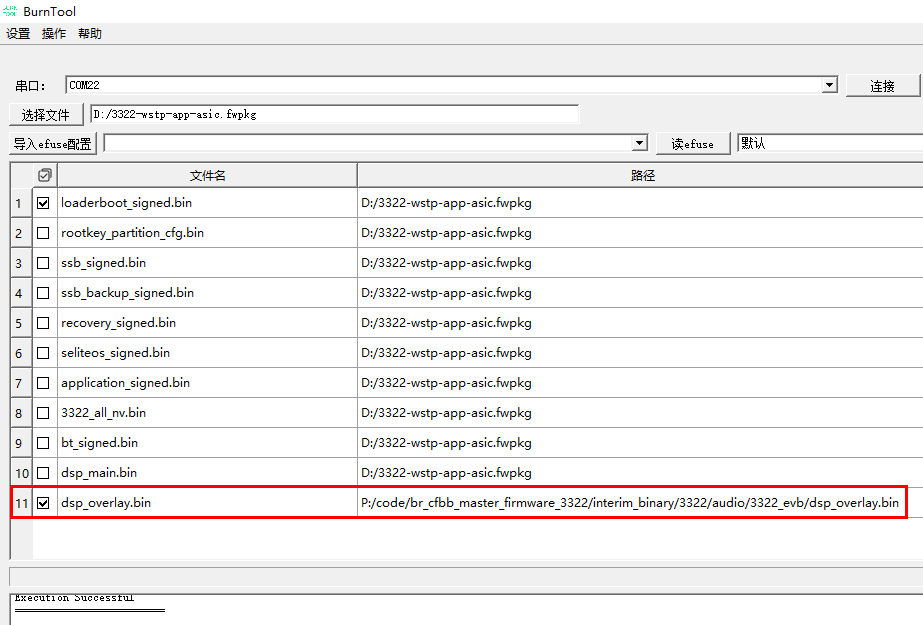

# 前言<a name="ZH-CN_TOPIC_0000002466382180"></a>

**概述<a name="zh-cn_topic_0000002411046796_section4537382116410"></a>**

本文档主要介绍AEF overlay集成调试相关内容，包括使用方法和注意事项，用于指导客户更换使用第三方AEF算法。

**读者对象<a name="zh-cn_topic_0000002411046796_section4378592816410"></a>**

本文档主要适用于以下工程师：

-   技术支持工程师
-   软件开发工程师

**符号约定<a name="zh-cn_topic_0000002411046796_section133020216410"></a>**

在本文中可能出现下列标志，它们所代表的含义如下。

<a name="zh-cn_topic_0000002411046796_table2622507016410"></a>
<table><thead align="left"><tr id="zh-cn_topic_0000002411046796_row1530720816410"><th class="cellrowborder" valign="top" width="20.580000000000002%" id="mcps1.1.3.1.1"><p id="zh-cn_topic_0000002411046796_p6450074116410"><a name="zh-cn_topic_0000002411046796_p6450074116410"></a><a name="zh-cn_topic_0000002411046796_p6450074116410"></a><strong id="zh-cn_topic_0000002411046796_b2136615816410"><a name="zh-cn_topic_0000002411046796_b2136615816410"></a><a name="zh-cn_topic_0000002411046796_b2136615816410"></a>符号</strong></p>
</th>
<th class="cellrowborder" valign="top" width="79.42%" id="mcps1.1.3.1.2"><p id="zh-cn_topic_0000002411046796_p5435366816410"><a name="zh-cn_topic_0000002411046796_p5435366816410"></a><a name="zh-cn_topic_0000002411046796_p5435366816410"></a><strong id="zh-cn_topic_0000002411046796_b5941558116410"><a name="zh-cn_topic_0000002411046796_b5941558116410"></a><a name="zh-cn_topic_0000002411046796_b5941558116410"></a>说明</strong></p>
</th>
</tr>
</thead>
<tbody><tr id="zh-cn_topic_0000002411046796_row1372280416410"><td class="cellrowborder" valign="top" width="20.580000000000002%" headers="mcps1.1.3.1.1 "><p id="zh-cn_topic_0000002411046796_p3734547016410"><a name="zh-cn_topic_0000002411046796_p3734547016410"></a><a name="zh-cn_topic_0000002411046796_p3734547016410"></a><a name="zh-cn_topic_0000002411046796_image2670064316410"></a><a name="zh-cn_topic_0000002411046796_image2670064316410"></a><span></span></p>
</td>
<td class="cellrowborder" valign="top" width="79.42%" headers="mcps1.1.3.1.2 "><p id="zh-cn_topic_0000002411046796_p1757432116410"><a name="zh-cn_topic_0000002411046796_p1757432116410"></a><a name="zh-cn_topic_0000002411046796_p1757432116410"></a>表示如不避免则将会导致死亡或严重伤害的具有高等级风险的危害。</p>
</td>
</tr>
<tr id="zh-cn_topic_0000002411046796_row466863216410"><td class="cellrowborder" valign="top" width="20.580000000000002%" headers="mcps1.1.3.1.1 "><p id="zh-cn_topic_0000002411046796_p1432579516410"><a name="zh-cn_topic_0000002411046796_p1432579516410"></a><a name="zh-cn_topic_0000002411046796_p1432579516410"></a><a name="zh-cn_topic_0000002411046796_image4895582316410"></a><a name="zh-cn_topic_0000002411046796_image4895582316410"></a><span></span></p>
</td>
<td class="cellrowborder" valign="top" width="79.42%" headers="mcps1.1.3.1.2 "><p id="zh-cn_topic_0000002411046796_p959197916410"><a name="zh-cn_topic_0000002411046796_p959197916410"></a><a name="zh-cn_topic_0000002411046796_p959197916410"></a>表示如不避免则可能导致死亡或严重伤害的具有中等级风险的危害。</p>
</td>
</tr>
<tr id="zh-cn_topic_0000002411046796_row123863216410"><td class="cellrowborder" valign="top" width="20.580000000000002%" headers="mcps1.1.3.1.1 "><p id="zh-cn_topic_0000002411046796_p1232579516410"><a name="zh-cn_topic_0000002411046796_p1232579516410"></a><a name="zh-cn_topic_0000002411046796_p1232579516410"></a><a name="zh-cn_topic_0000002411046796_image1235582316410"></a><a name="zh-cn_topic_0000002411046796_image1235582316410"></a><span></span></p>
</td>
<td class="cellrowborder" valign="top" width="79.42%" headers="mcps1.1.3.1.2 "><p id="zh-cn_topic_0000002411046796_p123197916410"><a name="zh-cn_topic_0000002411046796_p123197916410"></a><a name="zh-cn_topic_0000002411046796_p123197916410"></a>表示如不避免则可能导致轻微或中度伤害的具有低等级风险的危害。</p>
</td>
</tr>
<tr id="zh-cn_topic_0000002411046796_row5786682116410"><td class="cellrowborder" valign="top" width="20.580000000000002%" headers="mcps1.1.3.1.1 "><p id="zh-cn_topic_0000002411046796_p2204984716410"><a name="zh-cn_topic_0000002411046796_p2204984716410"></a><a name="zh-cn_topic_0000002411046796_p2204984716410"></a><a name="zh-cn_topic_0000002411046796_image4504446716410"></a><a name="zh-cn_topic_0000002411046796_image4504446716410"></a><span></span></p>
</td>
<td class="cellrowborder" valign="top" width="79.42%" headers="mcps1.1.3.1.2 "><p id="zh-cn_topic_0000002411046796_p4388861916410"><a name="zh-cn_topic_0000002411046796_p4388861916410"></a><a name="zh-cn_topic_0000002411046796_p4388861916410"></a>用于传递设备或环境安全警示信息。如不避免则可能会导致设备损坏、数据丢失、设备性能降低或其它不可预知的结果。</p>
<p id="zh-cn_topic_0000002411046796_p1238861916410"><a name="zh-cn_topic_0000002411046796_p1238861916410"></a><a name="zh-cn_topic_0000002411046796_p1238861916410"></a>“须知”不涉及人身伤害。</p>
</td>
</tr>
<tr id="zh-cn_topic_0000002411046796_row2856923116410"><td class="cellrowborder" valign="top" width="20.580000000000002%" headers="mcps1.1.3.1.1 "><p id="zh-cn_topic_0000002411046796_p5555360116410"><a name="zh-cn_topic_0000002411046796_p5555360116410"></a><a name="zh-cn_topic_0000002411046796_p5555360116410"></a><a name="zh-cn_topic_0000002411046796_image799324016410"></a><a name="zh-cn_topic_0000002411046796_image799324016410"></a><span></span></p>
</td>
<td class="cellrowborder" valign="top" width="79.42%" headers="mcps1.1.3.1.2 "><p id="zh-cn_topic_0000002411046796_p4612588116410"><a name="zh-cn_topic_0000002411046796_p4612588116410"></a><a name="zh-cn_topic_0000002411046796_p4612588116410"></a>对正文中重点信息的补充说明。</p>
<p id="zh-cn_topic_0000002411046796_p1232588116410"><a name="zh-cn_topic_0000002411046796_p1232588116410"></a><a name="zh-cn_topic_0000002411046796_p1232588116410"></a>“说明”不是安全警示信息，不涉及人身、设备及环境伤害信息。</p>
</td>
</tr>
</tbody>
</table>

# 概述<a name="ZH-CN_TOPIC_0000002466541772"></a>

本文档主要介绍AEF overlay集成相关内容，重点介绍了算法集成开发包、开发算法环境配置、开发算法插件、加载和运行算法等。AEF（Affect or Post process）算法是指音效算法或音频后处理算法。

# 算法集成开发包<a name="ZH-CN_TOPIC_0000002466382108"></a>

-   **[集成开发包说明](#ZH-CN_TOPIC_0000002466541744)**  

-   **[开发环境配置](#ZH-CN_TOPIC_0000002466382164)**  

-   **[编译命令](#ZH-CN_TOPIC_0000002466541788)**  

-   **[增加或删除C库函数](#ZH-CN_TOPIC_0000002466541720)**  

-   **[示例插件介绍](#ZH-CN_TOPIC_0000002499501117)**  

## 集成开发包说明<a name="ZH-CN_TOPIC_0000002466541744"></a>

集成开发包所在路径：工程根目录/application/audio/sample\_dsp\_overlay/aef

-   **[build目录](#ZH-CN_TOPIC_0000002466541684)**  

-   **[include目录](#ZH-CN_TOPIC_0000002499501101)**  

-   **[overlay目录](#ZH-CN_TOPIC_0000002499501085)**  

-   **[component目录](#ZH-CN_TOPIC_0000002499501025)**  

### build目录<a name="ZH-CN_TOPIC_0000002466541684"></a>

build目录：

-   xtensa子目录：存放DSP相关的配置文件和编译脚本，建议只引用不修改。
    -   hifi\_rules.mak：配置编译规则、overlay打包规则和依赖关系。
    -   hifi\_lsp.mak：配置overlay打包规则，被hifi\_rules.mak调用。
    -   xtensa\_cfg.mak：配置HiFi工具链和overlay打包工具。

-   xtensa/arch子目录：各个overlay的memmap配置。
-   xtensa/tool子目录：overlay打包工具。

### include目录<a name="ZH-CN_TOPIC_0000002499501101"></a>

include目录：

td\_type.h：C语言变量类型重定义。

### overlay目录<a name="ZH-CN_TOPIC_0000002499501085"></a>

overlay目录：

-   component头文件，必须在插件源文件中包含。

    component.h：通用算法插件注册接口，通过define\_component接口将插件entry地址注册到.component内存段中。

-   core\_overlay模块作为插件统一入口和C库依赖，被编译到各个算法插件的bin文件中。

    core\_overlay.c：重定向C库函数到相应的钩子函数，以及将overlay引导地址.start指向可访问.component内存的接口。

### component目录<a name="ZH-CN_TOPIC_0000002499501025"></a>

component目录：

-   aef/plugins子目录：AEF插件工程目录。
    -   aef\_lib0：AEF插件示例工程，开发者可参考该工程创建新的AEF插件工程。

## 开发环境配置<a name="ZH-CN_TOPIC_0000002466382164"></a>

进入集成开发包所在路径：工程根目录/application/audio/sample\_dsp\_overlay/aef

-   工程路径配置

    sap\_idp.mak路径：工程根目录/application/audio/sample\_dsp\_overlay/aef/sap\_idp.mak。

    修改sap\_idp.mak：

    -   IDP\_OUT\_DIR：编译输出目录，可修改到开发者自定义目录，建议使用默认目录。

-   Xtensa编译工具链配置

    xtensa\_cfg.mak路径：工程根目录/application/audio/sample\_dsp\_overlay/aef/build/xtensa/xtensa\_cfg.mak。

    修改xtensa\_cfg.mak：

    -   XTENSA\_HOME：配置HiFi编译工具链安装路径。
    -   XTENSAD\_LICENSE\_FILE：配置HiFi工具链XTENSA License文件。

## 编译命令<a name="ZH-CN_TOPIC_0000002466541788"></a>

在算法集成开发包所在路径下，执行以下命令：

1.  清除历史编译结果：make clean
2.  编译算法静态库：make lib
3.  编译算法插件bin文件：make all

    > **须知：** 
    >按照当前代码，编译make all会出现编译报错，以下是修改步骤：
    >1.  在工程目录“/application/audio/sample\_dsp\_overlay/aef/build/xstensa/xtensa\_cfg.mak”中添加“export XTENSA\_LSP\_FILE=lsp\_sea”。
    >2.  在工程目录“/application/audio/sample\_dsp\_overlay/aef/build/xstensa/”中将Makefile文件中的socmn2替换为3322。

## 增加或删除C库函数<a name="ZH-CN_TOPIC_0000002466541720"></a>

> **说明：** 
>如果主镜像未注册相应的C库函数到该新增的“overlay\_func-\>func”函数指针，会导致overlay新增C库函数钩子。开发者可自行实现C库函数，或是知会主镜像发布者发布新的镜像将相应的C库函数注册到“overlay\_func-\>func”函数指针。

修改集成开发包的overlay目录下的“core\_overlay.h”文件和“core\_overlay.c”文件：

```
/* 在core_overlay.h的overlay_func结构体中，新增一个C库同名函数类型定义 */
typedef struct {
    int (*func)(void);
} overlay_func;
/* 在core_overlay.c源码中，新增一个C库同名函数实现，重定向到主镜像的钩子上 */
int func(void)
{
    return g_overlay_func->func();
}
```

## 示例插件介绍<a name="ZH-CN_TOPIC_0000002499501117"></a>

示例插件路径：工程根目录/application/audio/sample\_dsp\_overlay/aef/component/aef/plugins/aef\_lib0

-   **[插件目录结构](#ZH-CN_TOPIC_0000002499581149)**  

-   **[插件编译脚本配置](#ZH-CN_TOPIC_0000002499581093)**  

### 插件目录结构<a name="ZH-CN_TOPIC_0000002499581149"></a>

“component/aef/plugins/aef\_lib0”工程目录结构如下：

-   aef\_lib0/include目录：放置AEF算法的头文件。
-   aef\_lib0/lib目录：放置AEF算法的依赖库文件。
-   aef\_lib0/src目录：放置AEF算法的源码文件。
-   aef\_lib0/xaaef\_lib0\_comp.c源文件：AEF算法适配样例。
-   aef\_lib0/xaaef\_lib0\_comp.h头文件：AEF算法适配头文件。

本示例插件仅包含“xaaef\_lib0\_comp.c”源文件和“xaaef\_lib0\_comp.h”头文件。include目录、lib目录、src目录仅作为目录结构参考，开发者创建算法工程时，可按如上目录结构说明放置文件。

### 插件编译脚本配置<a name="ZH-CN_TOPIC_0000002499581093"></a>

-   在“component/aef/plugins/Makefile”编译脚本中，增加新增的AEF插件aef\_lib0：

    ```
    #=========================================================================
    aef_libx = aef_lib0
    #=========================================================================
    ```

-   component/aef/plugins/aef\_lib0/Makefile编译脚本内容如下：

    ```
    CUR_DIR := $(shell if [ "$$PWD" != "" ]; then echo $$PWD; else pwd; fi)
    # 从当前目录回退到集成开发包所在路径
    IDP_TOP_DIR := $(realpath $(CUR_DIR)/../../../..)
    # 包含集成开发包编译环境配置和编译工具链配置文件
    include $(IDP_TOP_DIR)/sap_idp.mak
    include $(IDP_BUILD_DIR)/xtensa_cfg.mak
    # 编译待集成的AEF算法源码成静态库 libaef_lib0.a
    ifdef BUILD_LIB
    TARGET := libaef_lib0
    CFLAGS_EXT :=
    INCLUDES := -Iinclude -I$(IDP_TOP_DIR)/include
    LIB_INSTALL_DIR := lib
    /* 只编译待集成AEF算法的源文件 */
    SRCFILE := $(wildcard src/*.c)
    # 编译待集成的AEF插件，并链接算法静态库libaef_lib0.a 到 aef_lib0.bin中
    else
    TARGET := aef_lib0
    CFLAGS_EXT :=
    INCLUDES := -Iinclude -I$(IDP_TOP_DIR)/include
    # 链接待集成AEF算法的静态库 libaef_lib0.a，如还依赖其他静态库也链接进来。
    LIBS := -l:lib/libaef_lib0.a
    # 只编译待集成AEF算法的插件适配源文件
    SRCFILE := xaaef_lib0_comp.c
    endif
    # 包含编译规则和打包规则配置文件
    include ../rules.mak
    ```

# 创建AEF插件工程<a name="ZH-CN_TOPIC_0000002499501053"></a>

-   **[AEF插件工程命名要求](#ZH-CN_TOPIC_0000002466541704)**  

-   **[新建AEF插件工程目录](#ZH-CN_TOPIC_0000002466541760)**  

-   **[AEF插件编译脚本](#ZH-CN_TOPIC_0000002499581165)**  

## AEF插件工程命名要求<a name="ZH-CN_TOPIC_0000002466541704"></a>

AEF插件镜像bin文件命名要求：AEF插件工程命名建议与插件镜像bin文件名一致。如工程命名为“aef\_lib0”，则插件镜像命名为“aef\_lib0.bin”。

## 新建AEF插件工程目录<a name="ZH-CN_TOPIC_0000002466541760"></a>

请参考“[插件目录结构](#ZH-CN_TOPIC_0000002499581149)”，新建工程aef\_lib1。

新建工程aef\_lib1到“component/aef/plugins”，工程目录结构如下：

-   aef\_lib1/include目录：放置AEF算法的头文件。
-   aef\_lib1/lib目录：放置AEF算法的依赖库文件。
-   aef\_lib1/src目录：放置AEF算法的源码文件。
-   aef\_lib1/xaaef\_lib1\_comp.c源文件：AEF算法适配源文件。
-   aef\_lib1/xaaef\_lib1\_comp.h头文件：AEF算法适配头文件。

## AEF插件编译脚本<a name="ZH-CN_TOPIC_0000002499581165"></a>

在“component/aef/plugins/Makefile”编译脚本中，增加新增的AEF插件命令如下：aef\_libx += aef\_lib1

请参考“[插件编译脚本配置](#ZH-CN_TOPIC_0000002499581093)”示例插件“component/aef/plugins/aef\_lib0/Makefile”的编译脚本，创建新增插件aef\_lib1的编译脚本。

# 开发AEF插件<a name="ZH-CN_TOPIC_0000002466382072"></a>

-   **[AEF插件接口说明](#ZH-CN_TOPIC_0000002499581109)**  

-   **[AEF插件适配样例](#ZH-CN_TOPIC_0000002466382092)**  

-   **[AEF插件注册方法](#ZH-CN_TOPIC_0000002466382132)**  

## AEF插件接口说明<a name="ZH-CN_TOPIC_0000002499581109"></a>

AEF插件接口说明如下：

-   xaaef\_lib0\_comp.h定义结构体aef\_component成员变量（即AEF插件属性）：
    -   reserved：保留，不用配置。
    -   name：字符串，算法库名称。
    -   aef\_type：AEF插件类型，参考枚举类型aef\_type。
    -   version：版本。

-   xaaef\_lib0\_comp.h定义结构体aef\_component成员接口（即AEF插件适配接口）：
    -   create：创建算法实例并输出唯一的实例句柄给AEF。（必备接口）
    -   destroy：销毁实例句柄对应的算法实例，并释放相关资源。（必备接口）
    -   set\_config：设置算法配置。（可选接口）
    -   get\_config：获取算法配置。（可选接口）
    -   set\_parameter：设置实例句柄对应的算法实例的参数。（可选接口）
    -   get\_parameter：获取实例句柄对应的算法实例的参数。（可选接口）
    -   set\_enable：使能或停止实例句柄对应的算法实例。（可选接口）
    -   get\_enable：获取实例句柄对应的算法实例的使能状态。（可选接口）
    -   get\_max\_pcm\_in\_size：获取输入PCM数据的最大帧长。（可选接口）
    -   get\_max\_pcm\_out\_size：获取输出PCM数据的最大帧长。（可选接口）
    -   get\_input\_pcm\_attr：获取输入PCM数据的属性。（必备接口）
    -   proc\_frame： 执行实例句柄对应的算法实例来处理输入的PCM数据。（必备接口）

        **表 1**  音效算法audio\_frame结构体说明

        <a name="zh-cn_topic_0000002444645845_table2946182154820"></a>
        <table><thead align="left"><tr id="zh-cn_topic_0000002444645845_row79721925483"><th class="cellrowborder" valign="top" width="28.28%" id="mcps1.2.3.1.1"><p id="zh-cn_topic_0000002444645845_p1097222184812"><a name="zh-cn_topic_0000002444645845_p1097222184812"></a><a name="zh-cn_topic_0000002444645845_p1097222184812"></a>属性项</p>
        </th>
        <th class="cellrowborder" valign="top" width="71.72%" id="mcps1.2.3.1.2"><p id="zh-cn_topic_0000002444645845_p1972182124815"><a name="zh-cn_topic_0000002444645845_p1972182124815"></a><a name="zh-cn_topic_0000002444645845_p1972182124815"></a>说明</p>
        </th>
        </tr>
        </thead>
        <tbody><tr id="zh-cn_topic_0000002444645845_row1797214214811"><td class="cellrowborder" valign="top" width="28.28%" headers="mcps1.2.3.1.1 "><p id="zh-cn_topic_0000002444645845_p15972182164815"><a name="zh-cn_topic_0000002444645845_p15972182164815"></a><a name="zh-cn_topic_0000002444645845_p15972182164815"></a>interleaved</p>
        </td>
        <td class="cellrowborder" valign="top" width="71.72%" headers="mcps1.2.3.1.2 "><p id="zh-cn_topic_0000002444645845_p159727211487"><a name="zh-cn_topic_0000002444645845_p159727211487"></a><a name="zh-cn_topic_0000002444645845_p159727211487"></a>数据是否交织。</p>
        </td>
        </tr>
        <tr id="zh-cn_topic_0000002444645845_row129729211485"><td class="cellrowborder" valign="top" width="28.28%" headers="mcps1.2.3.1.1 "><p id="zh-cn_topic_0000002444645845_p99721529485"><a name="zh-cn_topic_0000002444645845_p99721529485"></a><a name="zh-cn_topic_0000002444645845_p99721529485"></a>channels</p>
        </td>
        <td class="cellrowborder" valign="top" width="71.72%" headers="mcps1.2.3.1.2 "><p id="zh-cn_topic_0000002444645845_p1697212174819"><a name="zh-cn_topic_0000002444645845_p1697212174819"></a><a name="zh-cn_topic_0000002444645845_p1697212174819"></a>声道。</p>
        </td>
        </tr>
        <tr id="zh-cn_topic_0000002444645845_row149723294815"><td class="cellrowborder" valign="top" width="28.28%" headers="mcps1.2.3.1.1 "><p id="zh-cn_topic_0000002444645845_p1297210244813"><a name="zh-cn_topic_0000002444645845_p1297210244813"></a><a name="zh-cn_topic_0000002444645845_p1297210244813"></a>bit_depth</p>
        </td>
        <td class="cellrowborder" valign="top" width="71.72%" headers="mcps1.2.3.1.2 "><p id="zh-cn_topic_0000002444645845_p2972524483"><a name="zh-cn_topic_0000002444645845_p2972524483"></a><a name="zh-cn_topic_0000002444645845_p2972524483"></a>位宽。</p>
        </td>
        </tr>
        <tr id="zh-cn_topic_0000002444645845_row39721224480"><td class="cellrowborder" valign="top" width="28.28%" headers="mcps1.2.3.1.1 "><p id="zh-cn_topic_0000002444645845_p169721215483"><a name="zh-cn_topic_0000002444645845_p169721215483"></a><a name="zh-cn_topic_0000002444645845_p169721215483"></a>sample_rate</p>
        </td>
        <td class="cellrowborder" valign="top" width="71.72%" headers="mcps1.2.3.1.2 "><p id="zh-cn_topic_0000002444645845_p1597212204820"><a name="zh-cn_topic_0000002444645845_p1597212204820"></a><a name="zh-cn_topic_0000002444645845_p1597212204820"></a>采样率。</p>
        </td>
        </tr>
        <tr id="zh-cn_topic_0000002444645845_row797210213486"><td class="cellrowborder" valign="top" width="28.28%" headers="mcps1.2.3.1.1 "><p id="zh-cn_topic_0000002444645845_p897222184814"><a name="zh-cn_topic_0000002444645845_p897222184814"></a><a name="zh-cn_topic_0000002444645845_p897222184814"></a>pts</p>
        </td>
        <td class="cellrowborder" valign="top" width="71.72%" headers="mcps1.2.3.1.2 "><p id="zh-cn_topic_0000002444645845_p4972192164817"><a name="zh-cn_topic_0000002444645845_p4972192164817"></a><a name="zh-cn_topic_0000002444645845_p4972192164817"></a>帧时间戳。</p>
        </td>
        </tr>
        <tr id="zh-cn_topic_0000002444645845_row18972132104812"><td class="cellrowborder" valign="top" width="28.28%" headers="mcps1.2.3.1.1 "><p id="zh-cn_topic_0000002444645845_p119721922489"><a name="zh-cn_topic_0000002444645845_p119721922489"></a><a name="zh-cn_topic_0000002444645845_p119721922489"></a>pcm_buffer</p>
        </td>
        <td class="cellrowborder" valign="top" width="71.72%" headers="mcps1.2.3.1.2 "><p id="zh-cn_topic_0000002444645845_p15972152104814"><a name="zh-cn_topic_0000002444645845_p15972152104814"></a><a name="zh-cn_topic_0000002444645845_p15972152104814"></a>未使用，待扩展。</p>
        </td>
        </tr>
        <tr id="zh-cn_topic_0000002444645845_row179725218480"><td class="cellrowborder" valign="top" width="28.28%" headers="mcps1.2.3.1.1 "><p id="zh-cn_topic_0000002444645845_p69721524482"><a name="zh-cn_topic_0000002444645845_p69721524482"></a><a name="zh-cn_topic_0000002444645845_p69721524482"></a>bits_buffer</p>
        </td>
        <td class="cellrowborder" valign="top" width="71.72%" headers="mcps1.2.3.1.2 "><p id="zh-cn_topic_0000002444645845_p129725234820"><a name="zh-cn_topic_0000002444645845_p129725234820"></a><a name="zh-cn_topic_0000002444645845_p129725234820"></a>音频PCM数据缓存指针。</p>
        </td>
        </tr>
        <tr id="zh-cn_topic_0000002444645845_row09727254811"><td class="cellrowborder" valign="top" width="28.28%" headers="mcps1.2.3.1.1 "><p id="zh-cn_topic_0000002444645845_p19724216485"><a name="zh-cn_topic_0000002444645845_p19724216485"></a><a name="zh-cn_topic_0000002444645845_p19724216485"></a>bits_bytes</p>
        </td>
        <td class="cellrowborder" valign="top" width="71.72%" headers="mcps1.2.3.1.2 "><p id="zh-cn_topic_0000002444645845_p197242144815"><a name="zh-cn_topic_0000002444645845_p197242144815"></a><a name="zh-cn_topic_0000002444645845_p197242144815"></a>音频PCM数据大小。</p>
        </td>
        </tr>
        <tr id="zh-cn_topic_0000002444645845_row497219214487"><td class="cellrowborder" valign="top" width="28.28%" headers="mcps1.2.3.1.1 "><p id="zh-cn_topic_0000002444645845_p2097212204812"><a name="zh-cn_topic_0000002444645845_p2097212204812"></a><a name="zh-cn_topic_0000002444645845_p2097212204812"></a>pcm_samples</p>
        </td>
        <td class="cellrowborder" valign="top" width="71.72%" headers="mcps1.2.3.1.2 "><p id="zh-cn_topic_0000002444645845_p197292134811"><a name="zh-cn_topic_0000002444645845_p197292134811"></a><a name="zh-cn_topic_0000002444645845_p197292134811"></a>音频PCM数据采样点数。</p>
        </td>
        </tr>
        <tr id="zh-cn_topic_0000002444645845_row1397215234815"><td class="cellrowborder" valign="top" width="28.28%" headers="mcps1.2.3.1.1 "><p id="zh-cn_topic_0000002444645845_p1997220204815"><a name="zh-cn_topic_0000002444645845_p1997220204815"></a><a name="zh-cn_topic_0000002444645845_p1997220204815"></a>frame_index</p>
        </td>
        <td class="cellrowborder" valign="top" width="71.72%" headers="mcps1.2.3.1.2 "><p id="zh-cn_topic_0000002444645845_p39729215481"><a name="zh-cn_topic_0000002444645845_p39729215481"></a><a name="zh-cn_topic_0000002444645845_p39729215481"></a>音频帧索引编号。</p>
        </td>
        </tr>
        <tr id="zh-cn_topic_0000002444645845_row1497322194813"><td class="cellrowborder" valign="top" width="28.28%" headers="mcps1.2.3.1.1 "><p id="zh-cn_topic_0000002444645845_p1697322144813"><a name="zh-cn_topic_0000002444645845_p1697322144813"></a><a name="zh-cn_topic_0000002444645845_p1697322144813"></a>eos</p>
        </td>
        <td class="cellrowborder" valign="top" width="71.72%" headers="mcps1.2.3.1.2 "><p id="zh-cn_topic_0000002444645845_p89737244811"><a name="zh-cn_topic_0000002444645845_p89737244811"></a><a name="zh-cn_topic_0000002444645845_p89737244811"></a>帧结束标志。</p>
        </td>
        </tr>
        <tr id="zh-cn_topic_0000002444645845_row16973172114813"><td class="cellrowborder" valign="top" width="28.28%" headers="mcps1.2.3.1.1 "><p id="zh-cn_topic_0000002444645845_p1797319204813"><a name="zh-cn_topic_0000002444645845_p1797319204813"></a><a name="zh-cn_topic_0000002444645845_p1797319204813"></a>pkg_loss</p>
        </td>
        <td class="cellrowborder" valign="top" width="71.72%" headers="mcps1.2.3.1.2 "><p id="zh-cn_topic_0000002444645845_p797310224815"><a name="zh-cn_topic_0000002444645845_p797310224815"></a><a name="zh-cn_topic_0000002444645845_p797310224815"></a>丢包标志。</p>
        </td>
        </tr>
        </tbody>
        </table>

## AEF插件适配样例<a name="ZH-CN_TOPIC_0000002466382092"></a>

请参考算法集成开发包路径下的适配样例：工程根目录/application/audio/sample\_dsp\_overlay/aef/component/aef/plugins/aef\_lib0/xaaef\_lib0\_comp.c

## AEF插件注册方法<a name="ZH-CN_TOPIC_0000002466382132"></a>

AEF插件注册参考样例及说明如下。

```
/* 定义一个全局的插件 entry结构体 */
static aef_component ha_aef_lib_entry = {
    .name = (const td_char *)"aef_lib0",
    .type = AEF_TYPE_XXX,
    .create = aef_lib_create,
    .destroy = aef_lib_destroy,
    .set_config = aef_lib_set_config,
    .get_config = aef_lib_get_config,
    .set_parameter = aef_lib_set_parameter,
    .get_parameter = aef_lib_get_parameter,
    .set_enable = aef_lib_set_enable,
    .get_enable = aef_lib_get_enable,
    .get_max_pcm_in_size = aef_lib_get_max_pcm_in_size,
    .set_max_pcm_in_size = aef_lib_set_max_pcm_in_size,
    .get_input_pcm_attr = aef_lib_get_input_pcm_attr,
    .proc_frame = aef_lib_proc_frame,
};
/* 将插件entry地址注册到.component地址段中 */
define_component(AEF, ha_aef_lib_entry)
```

> **说明：** 
>自定义的entry结构体中，成员变量type必须定义为AEF\_TYPE\_SMARTPA或者AEF\_TYPE\_SWS1。

# 加载和运行算法<a name="ZH-CN_TOPIC_0000002499581077"></a>

-   **[生成算法镜像包](#ZH-CN_TOPIC_0000002499581129)**  

-   **[启动Sample\_ao程序加载和运行算法](#ZH-CN_TOPIC_0000002466382148)**  

## 生成算法镜像包<a name="ZH-CN_TOPIC_0000002499581129"></a>

例如，在DSP版本类型为normal、AEF插件镜像bin文件为“aef\_lib0.bin”的情况下：

在算法集成开发包所在路径中执行命令：./replace\_overlay.sh 3322 evb aef\_lib0 aef

打包生成的“dsp\_overlay.bin”文件的路径：工程根目录/interim\_binary/3322/bin/audio/3322\_evb/dsp\_overlay.bin

> **说明：** 
>命令参数说明：./replace\_overlay.sh chip\_type dsp\_vertion src\_lib\_name dest\_lib\_name
>-   chip\_type：芯片类型，请选择3322。
>-   dsp\_vertion：DSP的版本类型。如：evb。
>-   src\_lib\_name：生成的AEF插件镜像bin文件名称，如：aef\_lib0、aef\_lib1。
>-   dest\_lib\_name：替换的目标插件镜像bin文件名称，请选择aef。

## 启动Sample\_ao程序加载和运行算法<a name="ZH-CN_TOPIC_0000002466382148"></a>

1.  烧录“dsp\_overlay.bin”文件到指定的Flash分区：

    1.  启动BurnTool工具，完成一次整机镜像烧写。
    2.  如[图1](#zh-cn_topic_0000002411206652_fig271311152228)所示，点击“dsp\_overlay.bin”对应的Path文本框，选择“[生成算法镜像包](#ZH-CN_TOPIC_0000002499581129)”中打包生成的“dsp\_overlay.bin”文件的路径。
    3.  点击“Start burn”启动烧写“dsp\_overlay.bin”。

    **图 1**  烧写完成示意图<a name="zh-cn_topic_0000002411206652_fig271311152228"></a>  
    
    

2.  执行“sample\_ao”命令测试插件。

    输入AT命令：AT^audio=sample\_ao /user/stream/pcm/PCM\_16k\_1ch\_16bit.pcm 0 16000 16 1

    （sample\_ao的AT命令格式需要遵循格式：AT^audio=sample\_ao pcm\_file volume sample\_rate bit\_width channels。命令中的pcm\_file文件需提前上传至文件系统，或替换为文件系统中已有的pcm文件）

3.  测试结果：能够正常播放并且声音无异常。

# 缩略语<a name="ZH-CN_TOPIC_0000002499501069"></a>

<a name="zh-cn_topic_0000002432385448_table1039612745819"></a>
<table><tbody><tr id="zh-cn_topic_0000002432385448_row439610712589"><td class="nocellnorowborder" style="border:none" valign="top" width="23.18231823182318%"><p id="zh-cn_topic_0000002432385448_p13969705815"><a name="zh-cn_topic_0000002432385448_p13969705815"></a><a name="zh-cn_topic_0000002432385448_p13969705815"></a><strong id="zh-cn_topic_0000002432385448_b5183173411414"><a name="zh-cn_topic_0000002432385448_b5183173411414"></a><a name="zh-cn_topic_0000002432385448_b5183173411414"></a>A</strong></p>
</td>
<td class="nocellnorowborder" style="border:none" valign="top" width="41.83418341834184%">&nbsp;&nbsp;</td>
<td class="cell-norowborder" style="border:none" valign="top" width="34.98349834983499%">&nbsp;&nbsp;</td>
</tr>
<tr id="zh-cn_topic_0000002432385448_row18396771588"><td class="nocellnorowborder" style="border:none" valign="top" width="23.18231823182318%"><p id="zh-cn_topic_0000002432385448_p173961705810"><a name="zh-cn_topic_0000002432385448_p173961705810"></a><a name="zh-cn_topic_0000002432385448_p173961705810"></a><strong id="zh-cn_topic_0000002432385448_b4184134134119"><a name="zh-cn_topic_0000002432385448_b4184134134119"></a><a name="zh-cn_topic_0000002432385448_b4184134134119"></a>AEF</strong></p>
</td>
<td class="nocellnorowborder" style="border:none" valign="top" width="41.83418341834184%"><p id="zh-cn_topic_0000002432385448_p18396177195815"><a name="zh-cn_topic_0000002432385448_p18396177195815"></a><a name="zh-cn_topic_0000002432385448_p18396177195815"></a>Affect or Post process</p>
</td>
<td class="cell-norowborder" style="border:none" valign="top" width="34.98349834983499%"><p id="zh-cn_topic_0000002432385448_p133968755820"><a name="zh-cn_topic_0000002432385448_p133968755820"></a><a name="zh-cn_topic_0000002432385448_p133968755820"></a>音效算法/音频后处理算法</p>
</td>
</tr>
<tr id="zh-cn_topic_0000002432385448_row839617715810"><td class="nocellnorowborder" style="border:none" valign="top" width="23.18231823182318%">&nbsp;&nbsp;</td>
<td class="nocellnorowborder" style="border:none" valign="top" width="41.83418341834184%">&nbsp;&nbsp;</td>
<td class="cell-norowborder" style="border:none" valign="top" width="34.98349834983499%">&nbsp;&nbsp;</td>
</tr>
<tr id="zh-cn_topic_0000002432385448_row153968715580"><td class="nocellnorowborder" style="border:none" valign="top" width="23.18231823182318%"><p id="zh-cn_topic_0000002432385448_p23967717580"><a name="zh-cn_topic_0000002432385448_p23967717580"></a><a name="zh-cn_topic_0000002432385448_p23967717580"></a><strong id="zh-cn_topic_0000002432385448_b13185153411412"><a name="zh-cn_topic_0000002432385448_b13185153411412"></a><a name="zh-cn_topic_0000002432385448_b13185153411412"></a>D</strong></p>
</td>
<td class="nocellnorowborder" style="border:none" valign="top" width="41.83418341834184%">&nbsp;&nbsp;</td>
<td class="cell-norowborder" style="border:none" valign="top" width="34.98349834983499%">&nbsp;&nbsp;</td>
</tr>
<tr id="zh-cn_topic_0000002432385448_row11396970580"><td class="nocellnorowborder" style="border:none" valign="top" width="23.18231823182318%"><p id="zh-cn_topic_0000002432385448_p10396579582"><a name="zh-cn_topic_0000002432385448_p10396579582"></a><a name="zh-cn_topic_0000002432385448_p10396579582"></a><strong id="zh-cn_topic_0000002432385448_b1318613341411"><a name="zh-cn_topic_0000002432385448_b1318613341411"></a><a name="zh-cn_topic_0000002432385448_b1318613341411"></a>DSP</strong></p>
</td>
<td class="nocellnorowborder" style="border:none" valign="top" width="41.83418341834184%"><p id="zh-cn_topic_0000002432385448_p53961573585"><a name="zh-cn_topic_0000002432385448_p53961573585"></a><a name="zh-cn_topic_0000002432385448_p53961573585"></a>Digital signal processor</p>
</td>
<td class="cell-norowborder" style="border:none" valign="top" width="34.98349834983499%"><p id="zh-cn_topic_0000002432385448_p11396117175820"><a name="zh-cn_topic_0000002432385448_p11396117175820"></a><a name="zh-cn_topic_0000002432385448_p11396117175820"></a>数字信号处理器</p>
</td>
</tr>
<tr id="zh-cn_topic_0000002432385448_row1539615735817"><td class="nocellnorowborder" style="border:none" valign="top" width="23.18231823182318%">&nbsp;&nbsp;</td>
<td class="nocellnorowborder" style="border:none" valign="top" width="41.83418341834184%">&nbsp;&nbsp;</td>
<td class="cell-norowborder" style="border:none" valign="top" width="34.98349834983499%">&nbsp;&nbsp;</td>
</tr>
<tr id="zh-cn_topic_0000002432385448_row739747135812"><td class="nocellnorowborder" style="border:none" valign="top" width="23.18231823182318%"><p id="zh-cn_topic_0000002432385448_p1039757185816"><a name="zh-cn_topic_0000002432385448_p1039757185816"></a><a name="zh-cn_topic_0000002432385448_p1039757185816"></a><strong id="zh-cn_topic_0000002432385448_b1318763484115"><a name="zh-cn_topic_0000002432385448_b1318763484115"></a><a name="zh-cn_topic_0000002432385448_b1318763484115"></a>P</strong></p>
</td>
<td class="nocellnorowborder" style="border:none" valign="top" width="41.83418341834184%">&nbsp;&nbsp;</td>
<td class="cell-norowborder" style="border:none" valign="top" width="34.98349834983499%">&nbsp;&nbsp;</td>
</tr>
<tr id="zh-cn_topic_0000002432385448_row123978719588"><td class="row-nocellborder" style="border:none" valign="top" width="23.18231823182318%"><p id="zh-cn_topic_0000002432385448_p5397197135814"><a name="zh-cn_topic_0000002432385448_p5397197135814"></a><a name="zh-cn_topic_0000002432385448_p5397197135814"></a><strong id="zh-cn_topic_0000002432385448_b17187143414413"><a name="zh-cn_topic_0000002432385448_b17187143414413"></a><a name="zh-cn_topic_0000002432385448_b17187143414413"></a>PCM</strong></p>
</td>
<td class="row-nocellborder" style="border:none" valign="top" width="41.83418341834184%"><p id="zh-cn_topic_0000002432385448_p573112289015"><a name="zh-cn_topic_0000002432385448_p573112289015"></a><a name="zh-cn_topic_0000002432385448_p573112289015"></a>Pulse Code Modulation</p>
</td>
<td class="cellrowborder" style="border:none" valign="top" width="34.98349834983499%"><p id="zh-cn_topic_0000002432385448_p4731528305"><a name="zh-cn_topic_0000002432385448_p4731528305"></a><a name="zh-cn_topic_0000002432385448_p4731528305"></a>脉冲编码调制</p>
</td>
</tr>
</tbody>
</table>

