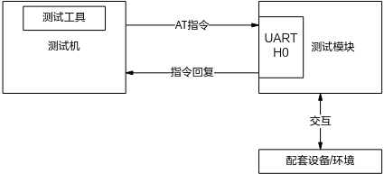
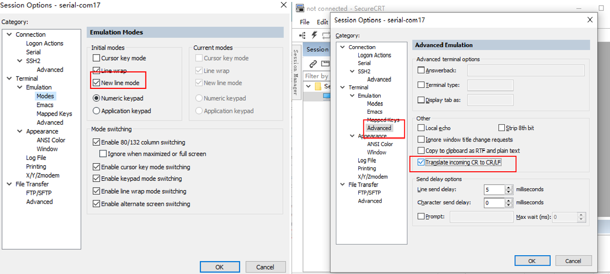

# 前言<a name="ZH-CN_TOPIC_0000002536628039"></a>

**概述<a name="zh-cn_topic_0000002503963262_section4537382116410"></a>**

本文档详细描述了HiDiTingV100项目的AT指令格式及其应用场景，为用户提供相应的指令格式和参数示例解释。

**读者对象<a name="zh-cn_topic_0000002503963262_section4378592816410"></a>**

本文档主要适用于以下工程师：

-   技术支持工程师
-   软件开发工程师

**符号约定<a name="zh-cn_topic_0000002503963262_section133020216410"></a>**

在本文中可能出现下列标志，它们所代表的含义如下。

<a name="zh-cn_topic_0000002503963262_table2622507016410"></a>
<table><thead align="left"><tr id="zh-cn_topic_0000002503963262_row1530720816410"><th class="cellrowborder" valign="top" width="20.580000000000002%" id="mcps1.1.3.1.1"><p id="zh-cn_topic_0000002503963262_p6450074116410"><a name="zh-cn_topic_0000002503963262_p6450074116410"></a><a name="zh-cn_topic_0000002503963262_p6450074116410"></a><strong id="zh-cn_topic_0000002503963262_b2136615816410"><a name="zh-cn_topic_0000002503963262_b2136615816410"></a><a name="zh-cn_topic_0000002503963262_b2136615816410"></a>符号</strong></p>
</th>
<th class="cellrowborder" valign="top" width="79.42%" id="mcps1.1.3.1.2"><p id="zh-cn_topic_0000002503963262_p5435366816410"><a name="zh-cn_topic_0000002503963262_p5435366816410"></a><a name="zh-cn_topic_0000002503963262_p5435366816410"></a><strong id="zh-cn_topic_0000002503963262_b5941558116410"><a name="zh-cn_topic_0000002503963262_b5941558116410"></a><a name="zh-cn_topic_0000002503963262_b5941558116410"></a>说明</strong></p>
</th>
</tr>
</thead>
<tbody><tr id="zh-cn_topic_0000002503963262_row1372280416410"><td class="cellrowborder" valign="top" width="20.580000000000002%" headers="mcps1.1.3.1.1 "><p id="zh-cn_topic_0000002503963262_p3734547016410"><a name="zh-cn_topic_0000002503963262_p3734547016410"></a><a name="zh-cn_topic_0000002503963262_p3734547016410"></a><a name="zh-cn_topic_0000002503963262_image2670064316410"></a><a name="zh-cn_topic_0000002503963262_image2670064316410"></a><span></span></p>
</td>
<td class="cellrowborder" valign="top" width="79.42%" headers="mcps1.1.3.1.2 "><p id="zh-cn_topic_0000002503963262_p1757432116410"><a name="zh-cn_topic_0000002503963262_p1757432116410"></a><a name="zh-cn_topic_0000002503963262_p1757432116410"></a>表示如不避免则将会导致死亡或严重伤害的具有高等级风险的危害。</p>
</td>
</tr>
<tr id="zh-cn_topic_0000002503963262_row466863216410"><td class="cellrowborder" valign="top" width="20.580000000000002%" headers="mcps1.1.3.1.1 "><p id="zh-cn_topic_0000002503963262_p1432579516410"><a name="zh-cn_topic_0000002503963262_p1432579516410"></a><a name="zh-cn_topic_0000002503963262_p1432579516410"></a><a name="zh-cn_topic_0000002503963262_image4895582316410"></a><a name="zh-cn_topic_0000002503963262_image4895582316410"></a><span></span></p>
</td>
<td class="cellrowborder" valign="top" width="79.42%" headers="mcps1.1.3.1.2 "><p id="zh-cn_topic_0000002503963262_p959197916410"><a name="zh-cn_topic_0000002503963262_p959197916410"></a><a name="zh-cn_topic_0000002503963262_p959197916410"></a>表示如不避免则可能导致死亡或严重伤害的具有中等级风险的危害。</p>
</td>
</tr>
<tr id="zh-cn_topic_0000002503963262_row123863216410"><td class="cellrowborder" valign="top" width="20.580000000000002%" headers="mcps1.1.3.1.1 "><p id="zh-cn_topic_0000002503963262_p1232579516410"><a name="zh-cn_topic_0000002503963262_p1232579516410"></a><a name="zh-cn_topic_0000002503963262_p1232579516410"></a><a name="zh-cn_topic_0000002503963262_image1235582316410"></a><a name="zh-cn_topic_0000002503963262_image1235582316410"></a><span></span></p>
</td>
<td class="cellrowborder" valign="top" width="79.42%" headers="mcps1.1.3.1.2 "><p id="zh-cn_topic_0000002503963262_p123197916410"><a name="zh-cn_topic_0000002503963262_p123197916410"></a><a name="zh-cn_topic_0000002503963262_p123197916410"></a>表示如不避免则可能导致轻微或中度伤害的具有低等级风险的危害。</p>
</td>
</tr>
<tr id="zh-cn_topic_0000002503963262_row5786682116410"><td class="cellrowborder" valign="top" width="20.580000000000002%" headers="mcps1.1.3.1.1 "><p id="zh-cn_topic_0000002503963262_p2204984716410"><a name="zh-cn_topic_0000002503963262_p2204984716410"></a><a name="zh-cn_topic_0000002503963262_p2204984716410"></a><a name="zh-cn_topic_0000002503963262_image4504446716410"></a><a name="zh-cn_topic_0000002503963262_image4504446716410"></a><span></span></p>
</td>
<td class="cellrowborder" valign="top" width="79.42%" headers="mcps1.1.3.1.2 "><p id="zh-cn_topic_0000002503963262_p4388861916410"><a name="zh-cn_topic_0000002503963262_p4388861916410"></a><a name="zh-cn_topic_0000002503963262_p4388861916410"></a>用于传递设备或环境安全警示信息。如不避免则可能会导致设备损坏、数据丢失、设备性能降低或其它不可预知的结果。</p>
<p id="zh-cn_topic_0000002503963262_p1238861916410"><a name="zh-cn_topic_0000002503963262_p1238861916410"></a><a name="zh-cn_topic_0000002503963262_p1238861916410"></a>“须知”不涉及人身伤害。</p>
</td>
</tr>
<tr id="zh-cn_topic_0000002503963262_row2856923116410"><td class="cellrowborder" valign="top" width="20.580000000000002%" headers="mcps1.1.3.1.1 "><p id="zh-cn_topic_0000002503963262_p5555360116410"><a name="zh-cn_topic_0000002503963262_p5555360116410"></a><a name="zh-cn_topic_0000002503963262_p5555360116410"></a><a name="zh-cn_topic_0000002503963262_image799324016410"></a><a name="zh-cn_topic_0000002503963262_image799324016410"></a><span></span></p>
</td>
<td class="cellrowborder" valign="top" width="79.42%" headers="mcps1.1.3.1.2 "><p id="zh-cn_topic_0000002503963262_p4612588116410"><a name="zh-cn_topic_0000002503963262_p4612588116410"></a><a name="zh-cn_topic_0000002503963262_p4612588116410"></a>对正文中重点信息的补充说明。</p>
<p id="zh-cn_topic_0000002503963262_p1232588116410"><a name="zh-cn_topic_0000002503963262_p1232588116410"></a><a name="zh-cn_topic_0000002503963262_p1232588116410"></a>“说明”不是安全警示信息，不涉及人身、设备及环境伤害信息。</p>
</td>
</tr>
</tbody>
</table>

# 指令说明<a name="ZH-CN_TOPIC_0000002538636813"></a>

-   **[网络安全风险说明](#ZH-CN_TOPIC_0000002538716839)**  

-   **[指令简介](#ZH-CN_TOPIC_0000002506757098)**  

-   **[指令类型](#ZH-CN_TOPIC_0000002506916944)**  

-   **[语法格式](#ZH-CN_TOPIC_0000002538636815)**  

-   **[注意事项](#ZH-CN_TOPIC_0000002538716843)**  

## 网络安全风险说明<a name="ZH-CN_TOPIC_0000002538716839"></a>

针对如下命令，需要客户在商用版本关闭，避免现网设备网络安全风险：

**表 1**  网络安全风险AT说明

<a name="zh-cn_topic_0000002537691575_table127941923131816"></a>
<table><thead align="left"><tr id="zh-cn_topic_0000002537691575_row1979452391813"><th class="cellrowborder" valign="top" width="15.808419158084192%" id="mcps1.2.5.1.1"><p id="zh-cn_topic_0000002537691575_p10794142391815"><a name="zh-cn_topic_0000002537691575_p10794142391815"></a><a name="zh-cn_topic_0000002537691575_p10794142391815"></a>类型</p>
</th>
<th class="cellrowborder" valign="top" width="26.037396260373963%" id="mcps1.2.5.1.2"><p id="zh-cn_topic_0000002537691575_p10794112341813"><a name="zh-cn_topic_0000002537691575_p10794112341813"></a><a name="zh-cn_topic_0000002537691575_p10794112341813"></a>指令</p>
</th>
<th class="cellrowborder" valign="top" width="26.52734726527347%" id="mcps1.2.5.1.3"><p id="zh-cn_topic_0000002537691575_p56971535446"><a name="zh-cn_topic_0000002537691575_p56971535446"></a><a name="zh-cn_topic_0000002537691575_p56971535446"></a>示例</p>
</th>
<th class="cellrowborder" valign="top" width="31.626837316268375%" id="mcps1.2.5.1.4"><p id="zh-cn_topic_0000002537691575_p1679517232182"><a name="zh-cn_topic_0000002537691575_p1679517232182"></a><a name="zh-cn_topic_0000002537691575_p1679517232182"></a>说明</p>
</th>
</tr>
</thead>
<tbody><tr id="zh-cn_topic_0000002537691575_row91461612113916"><td class="cellrowborder" valign="top" width="15.808419158084192%" headers="mcps1.2.5.1.1 "><p id="zh-cn_topic_0000002537691575_p15283161919398"><a name="zh-cn_topic_0000002537691575_p15283161919398"></a><a name="zh-cn_topic_0000002537691575_p15283161919398"></a>设置指令</p>
</td>
<td class="cellrowborder" valign="top" width="26.037396260373963%" headers="mcps1.2.5.1.2 "><p id="zh-cn_topic_0000002537691575_p17834164382916"><a name="zh-cn_topic_0000002537691575_p17834164382916"></a><a name="zh-cn_topic_0000002537691575_p17834164382916"></a>AT+OHOS=OHOSFWK_BM_SET</p>
</td>
<td class="cellrowborder" valign="top" width="26.52734726527347%" headers="mcps1.2.5.1.3 "><p id="zh-cn_topic_0000002537691575_p15443227132319"><a name="zh-cn_topic_0000002537691575_p15443227132319"></a><a name="zh-cn_topic_0000002537691575_p15443227132319"></a>AT+OHOS=OHOSFWK_BM_SET,disable</p>
</td>
<td class="cellrowborder" valign="top" width="31.626837316268375%" headers="mcps1.2.5.1.4 "><p id="zh-cn_topic_0000002537691575_p14441927192318"><a name="zh-cn_topic_0000002537691575_p14441927192318"></a><a name="zh-cn_topic_0000002537691575_p14441927192318"></a>此命令会关闭应用验签，导致来源不可信的应用可以安装到设备上，所以商用版本需要关闭。</p>
<p id="zh-cn_topic_0000002537691575_p3558311173212"><a name="zh-cn_topic_0000002537691575_p3558311173212"></a><a name="zh-cn_topic_0000002537691575_p3558311173212"></a>参数说明：</p>
<p id="zh-cn_topic_0000002537691575_p12211645325"><a name="zh-cn_topic_0000002537691575_p12211645325"></a><a name="zh-cn_topic_0000002537691575_p12211645325"></a>使能验签：enable；</p>
<p id="zh-cn_topic_0000002537691575_p106381115103220"><a name="zh-cn_topic_0000002537691575_p106381115103220"></a><a name="zh-cn_topic_0000002537691575_p106381115103220"></a>关闭验签：disable。</p>
</td>
</tr>
<tr id="zh-cn_topic_0000002537691575_row08921038183317"><td class="cellrowborder" valign="top" width="15.808419158084192%" headers="mcps1.2.5.1.1 "><p id="zh-cn_topic_0000002537691575_p32611348122217"><a name="zh-cn_topic_0000002537691575_p32611348122217"></a><a name="zh-cn_topic_0000002537691575_p32611348122217"></a>设置指令</p>
</td>
<td class="cellrowborder" valign="top" width="26.037396260373963%" headers="mcps1.2.5.1.2 "><p id="zh-cn_topic_0000002537691575_p1582942618223"><a name="zh-cn_topic_0000002537691575_p1582942618223"></a><a name="zh-cn_topic_0000002537691575_p1582942618223"></a>AT+FSFORMAT</p>
</td>
<td class="cellrowborder" valign="top" width="26.52734726527347%" headers="mcps1.2.5.1.3 "><p id="zh-cn_topic_0000002537691575_p282992662217"><a name="zh-cn_topic_0000002537691575_p282992662217"></a><a name="zh-cn_topic_0000002537691575_p282992662217"></a>AT+FSFORMAT</p>
</td>
<td class="cellrowborder" valign="top" width="31.626837316268375%" headers="mcps1.2.5.1.4 "><p id="zh-cn_topic_0000002537691575_p4828112610229"><a name="zh-cn_topic_0000002537691575_p4828112610229"></a><a name="zh-cn_topic_0000002537691575_p4828112610229"></a>此命令用于文件系统格式化。此命令执行需谨慎，可造成版本资源丢失。</p>
</td>
</tr>
<tr id="zh-cn_topic_0000002537691575_row469175753010"><td class="cellrowborder" valign="top" width="15.808419158084192%" headers="mcps1.2.5.1.1 "><p id="zh-cn_topic_0000002537691575_p826054882217"><a name="zh-cn_topic_0000002537691575_p826054882217"></a><a name="zh-cn_topic_0000002537691575_p826054882217"></a>设置指令</p>
</td>
<td class="cellrowborder" valign="top" width="26.037396260373963%" headers="mcps1.2.5.1.2 "><p id="zh-cn_topic_0000002537691575_p2082652622212"><a name="zh-cn_topic_0000002537691575_p2082652622212"></a><a name="zh-cn_topic_0000002537691575_p2082652622212"></a>AT+FSFORMATFORCE</p>
</td>
<td class="cellrowborder" valign="top" width="26.52734726527347%" headers="mcps1.2.5.1.3 "><p id="zh-cn_topic_0000002537691575_p282614265229"><a name="zh-cn_topic_0000002537691575_p282614265229"></a><a name="zh-cn_topic_0000002537691575_p282614265229"></a>AT+FSFORMATFORCE</p>
</td>
<td class="cellrowborder" valign="top" width="31.626837316268375%" headers="mcps1.2.5.1.4 "><p id="zh-cn_topic_0000002537691575_p138259264224"><a name="zh-cn_topic_0000002537691575_p138259264224"></a><a name="zh-cn_topic_0000002537691575_p138259264224"></a>此命令用于文件系统格式化。此命令执行需谨慎，可造成nand存储资源丢失。</p>
</td>
</tr>
<tr id="zh-cn_topic_0000002537691575_row1473664202416"><td class="cellrowborder" valign="top" width="15.808419158084192%" headers="mcps1.2.5.1.1 "><p id="zh-cn_topic_0000002537691575_p115039372415"><a name="zh-cn_topic_0000002537691575_p115039372415"></a><a name="zh-cn_topic_0000002537691575_p115039372415"></a>设置指令</p>
</td>
<td class="cellrowborder" valign="top" width="26.037396260373963%" headers="mcps1.2.5.1.2 "><p id="zh-cn_topic_0000002537691575_p121605462410"><a name="zh-cn_topic_0000002537691575_p121605462410"></a><a name="zh-cn_topic_0000002537691575_p121605462410"></a>AT+OHOS=OHOSFWK_OPEN_BTPAN</p>
</td>
<td class="cellrowborder" valign="top" width="26.52734726527347%" headers="mcps1.2.5.1.3 "><p id="zh-cn_topic_0000002537691575_p12134112382416"><a name="zh-cn_topic_0000002537691575_p12134112382416"></a><a name="zh-cn_topic_0000002537691575_p12134112382416"></a>AT+OHOS=OHOSFWK_OPEN_BTPAN</p>
</td>
<td class="cellrowborder" valign="top" width="31.626837316268375%" headers="mcps1.2.5.1.4 "><p id="zh-cn_topic_0000002537691575_p95032311246"><a name="zh-cn_topic_0000002537691575_p95032311246"></a><a name="zh-cn_topic_0000002537691575_p95032311246"></a>此命令执行需谨慎，可造成网络功能不可用。</p>
</td>
</tr>
<tr id="zh-cn_topic_0000002537691575_row58201312515"><td class="cellrowborder" valign="top" width="15.808419158084192%" headers="mcps1.2.5.1.1 "><p id="zh-cn_topic_0000002537691575_p119811722250"><a name="zh-cn_topic_0000002537691575_p119811722250"></a><a name="zh-cn_topic_0000002537691575_p119811722250"></a>设置指令</p>
</td>
<td class="cellrowborder" valign="top" width="26.037396260373963%" headers="mcps1.2.5.1.2 "><p id="zh-cn_topic_0000002537691575_p147139521098"><a name="zh-cn_topic_0000002537691575_p147139521098"></a><a name="zh-cn_topic_0000002537691575_p147139521098"></a>AT+OHOS=OHOSNETSTACK_SWITCH,netType</p>
</td>
<td class="cellrowborder" valign="top" width="26.52734726527347%" headers="mcps1.2.5.1.3 "><p id="zh-cn_topic_0000002537691575_p1798242172520"><a name="zh-cn_topic_0000002537691575_p1798242172520"></a><a name="zh-cn_topic_0000002537691575_p1798242172520"></a>AT+OHOS=OHOSNETSTACK_SWITCH,netType</p>
</td>
<td class="cellrowborder" valign="top" width="31.626837316268375%" headers="mcps1.2.5.1.4 "><p id="zh-cn_topic_0000002537691575_p1798211242517"><a name="zh-cn_topic_0000002537691575_p1798211242517"></a><a name="zh-cn_topic_0000002537691575_p1798211242517"></a>此命令执行需谨慎，可造成网络功能不可用。</p>
</td>
</tr>
<tr id="zh-cn_topic_0000002537691575_row276818495256"><td class="cellrowborder" valign="top" width="15.808419158084192%" headers="mcps1.2.5.1.1 "><p id="zh-cn_topic_0000002537691575_p2071614852511"><a name="zh-cn_topic_0000002537691575_p2071614852511"></a><a name="zh-cn_topic_0000002537691575_p2071614852511"></a>设置指令</p>
</td>
<td class="cellrowborder" valign="top" width="26.037396260373963%" headers="mcps1.2.5.1.2 "><p id="zh-cn_topic_0000002537691575_p765618295227"><a name="zh-cn_topic_0000002537691575_p765618295227"></a><a name="zh-cn_topic_0000002537691575_p765618295227"></a>AT+OHOS=OHOSNETSTACK_SLE,0</p>
</td>
<td class="cellrowborder" valign="top" width="26.52734726527347%" headers="mcps1.2.5.1.3 "><p id="zh-cn_topic_0000002537691575_p77803211262"><a name="zh-cn_topic_0000002537691575_p77803211262"></a><a name="zh-cn_topic_0000002537691575_p77803211262"></a>AT+OHOS=OHOSNETSTACK_SLE,0</p>
</td>
<td class="cellrowborder" valign="top" width="31.626837316268375%" headers="mcps1.2.5.1.4 "><p id="zh-cn_topic_0000002537691575_p1571619489252"><a name="zh-cn_topic_0000002537691575_p1571619489252"></a><a name="zh-cn_topic_0000002537691575_p1571619489252"></a>此命令执行需谨慎，可造成网络功能不可用，且打开星闪扫描发现。可能和附近其他星闪设备连接通信。</p>
</td>
</tr>
</tbody>
</table>

## 指令简介<a name="ZH-CN_TOPIC_0000002506757098"></a>

AT指令用于测试机和测试模块之间控制信息的交互，典型环境如[图1](#zh-cn_topic_0000002535643279_fig20789185911405)所示。

**图 1**  AT指令示意图<a name="zh-cn_topic_0000002535643279_fig20789185911405"></a>  


## 指令类型<a name="ZH-CN_TOPIC_0000002506916944"></a>

AT指令类型如[表1](#zh-cn_topic_0000002503803448_table122344101333)所示。

**表 1**  AT指令类型说明

<a name="zh-cn_topic_0000002503803448_table122344101333"></a>
<table><thead align="left"><tr id="zh-cn_topic_0000002503803448_row1234121023312"><th class="cellrowborder" valign="top" width="21.602160216021602%" id="mcps1.2.4.1.1"><p id="zh-cn_topic_0000002503803448_p18234101073319"><a name="zh-cn_topic_0000002503803448_p18234101073319"></a><a name="zh-cn_topic_0000002503803448_p18234101073319"></a>类型</p>
</th>
<th class="cellrowborder" valign="top" width="34.75347534753475%" id="mcps1.2.4.1.2"><p id="zh-cn_topic_0000002503803448_p15234610143312"><a name="zh-cn_topic_0000002503803448_p15234610143312"></a><a name="zh-cn_topic_0000002503803448_p15234610143312"></a>格式</p>
</th>
<th class="cellrowborder" valign="top" width="43.644364436443645%" id="mcps1.2.4.1.3"><p id="zh-cn_topic_0000002503803448_p6234111063318"><a name="zh-cn_topic_0000002503803448_p6234111063318"></a><a name="zh-cn_topic_0000002503803448_p6234111063318"></a>说明</p>
</th>
</tr>
</thead>
<tbody><tr id="zh-cn_topic_0000002503803448_row1823416105333"><td class="cellrowborder" valign="top" width="21.602160216021602%" headers="mcps1.2.4.1.1 "><p id="zh-cn_topic_0000002503803448_p523451013319"><a name="zh-cn_topic_0000002503803448_p523451013319"></a><a name="zh-cn_topic_0000002503803448_p523451013319"></a>执行指令</p>
</td>
<td class="cellrowborder" valign="top" width="34.75347534753475%" headers="mcps1.2.4.1.2 "><p id="zh-cn_topic_0000002503803448_p8234181013332"><a name="zh-cn_topic_0000002503803448_p8234181013332"></a><a name="zh-cn_topic_0000002503803448_p8234181013332"></a>AT+&lt;cmd&gt;</p>
</td>
<td class="cellrowborder" valign="top" width="43.644364436443645%" headers="mcps1.2.4.1.3 "><p id="zh-cn_topic_0000002503803448_p122348108331"><a name="zh-cn_topic_0000002503803448_p122348108331"></a><a name="zh-cn_topic_0000002503803448_p122348108331"></a>该类指令用于控制被测模块执行特定行为。</p>
</td>
</tr>
<tr id="zh-cn_topic_0000002503803448_row9234141013310"><td class="cellrowborder" valign="top" width="21.602160216021602%" headers="mcps1.2.4.1.1 "><p id="zh-cn_topic_0000002503803448_p4234141013311"><a name="zh-cn_topic_0000002503803448_p4234141013311"></a><a name="zh-cn_topic_0000002503803448_p4234141013311"></a>查询指令</p>
</td>
<td class="cellrowborder" valign="top" width="34.75347534753475%" headers="mcps1.2.4.1.2 "><p id="zh-cn_topic_0000002503803448_p2235121011337"><a name="zh-cn_topic_0000002503803448_p2235121011337"></a><a name="zh-cn_topic_0000002503803448_p2235121011337"></a>AT+&lt;cmd&gt;? 或 AT^&lt;cmd&gt;?=</p>
</td>
<td class="cellrowborder" valign="top" width="43.644364436443645%" headers="mcps1.2.4.1.3 "><p id="zh-cn_topic_0000002503803448_p123519105337"><a name="zh-cn_topic_0000002503803448_p123519105337"></a><a name="zh-cn_topic_0000002503803448_p123519105337"></a>该类指令用于查询被测模块的指令参数下的状态或当前值。</p>
</td>
</tr>
<tr id="zh-cn_topic_0000002503803448_row182356108336"><td class="cellrowborder" valign="top" width="21.602160216021602%" headers="mcps1.2.4.1.1 "><p id="zh-cn_topic_0000002503803448_p10235161015332"><a name="zh-cn_topic_0000002503803448_p10235161015332"></a><a name="zh-cn_topic_0000002503803448_p10235161015332"></a>设置指令</p>
</td>
<td class="cellrowborder" valign="top" width="34.75347534753475%" headers="mcps1.2.4.1.2 "><p id="zh-cn_topic_0000002503803448_p5235510143310"><a name="zh-cn_topic_0000002503803448_p5235510143310"></a><a name="zh-cn_topic_0000002503803448_p5235510143310"></a>AT+&lt;cmd&gt;=&lt;parameter&gt;,…</p>
</td>
<td class="cellrowborder" valign="top" width="43.644364436443645%" headers="mcps1.2.4.1.3 "><p id="zh-cn_topic_0000002503803448_p7235111017335"><a name="zh-cn_topic_0000002503803448_p7235111017335"></a><a name="zh-cn_topic_0000002503803448_p7235111017335"></a>该类指令用于设置参数值。</p>
</td>
</tr>
</tbody>
</table>

## 语法格式<a name="ZH-CN_TOPIC_0000002538636815"></a>

-   所有自定义命令必须以“AT+”为前缀。
-   AT命令的字符串不区分大小写，建议统一为大写字符。
-   AT指令以<CR\><LF\>为结尾，表明一条指令结束。
-   AT指令的返回值包括两部分：响应信息和结果码。
-   响应信息以“+”开头，冒号之后有一个空格，响应信息可以多行，并以<CR\><LF\>为结尾。
-   结果码“OK/ERROR”独立一行输出。

1.  执行指令举例：

    ```
    AT+CMD
    OK
    ```

2.  查询指令举例：

    ```
    AT+CMD?
    ^CMD: 1
    OK
    ```

3.  查询具体参数指令举例：

    ```
    AT+CMD?=PARA
    ^PARA: 1
    OK
    ```

4.  设置指令举例：

    ```
    AT+CMD=1
    OK
    ```

## 注意事项<a name="ZH-CN_TOPIC_0000002538716843"></a>

-   最长支持56Byte AT指令。
-   当前软件版本不支持的AT指令会返回ERROR。
-   串口通信默认：串口H0，波特率为115200、8个数据位、1个停止位，无校验。
-   命令中的参数以“,”作为分隔符，除双引号括起来的字符串参数外，不支持参数本身带“,”。
-   AT指令中的参数不能有多余的空格。
-   AT指令须以回车换行符作为结尾（<CR\><LF\>），部分串口工具在用户敲击键盘回车键时只有回车符（CR）没有换行符（LF），导致AT指令无法识别，如需使用串口工具手动输入AT指令，需在串口工具中将回车键设置为回车符（CR）＋换行符（LF）。以SecureCRT8.1为例，配置如[图1](#zh-cn_topic_0000002503963258_fig465413335475)所示。

    **图 1**  SecureCRT8.1 CR+LF设置示例<a name="zh-cn_topic_0000002503963258_fig465413335475"></a>  
    

> **说明：** 
>客户须根据自己的业务场景，对海思提供的AT命令及参数进行二次开发，包括但不限于：修改、删除、增加等。

# 通用<a name="ZH-CN_TOPIC_0000002506757100"></a>

-   **[常规指令](#ZH-CN_TOPIC_0000002506916946)**  

-   **[系统相关指令](#ZH-CN_TOPIC_0000002538636817)**  

-   **[UX模块指令](#ZH-CN_TOPIC_0000002538636819)**  

-   **[产测指令](#ZH-CN_TOPIC_0000002538716859)**  

## 常规指令<a name="ZH-CN_TOPIC_0000002506916946"></a>

**表 1**  通用指令一览表

<a name="zh-cn_topic_0000002535523199_table1881209464"></a>
<table><thead align="left"><tr id="zh-cn_topic_0000002535523199_row13811392614"><th class="cellrowborder" valign="top" width="14.280000000000001%" id="mcps1.2.5.1.1"><p id="zh-cn_topic_0000002535523199_p128149261"><a name="zh-cn_topic_0000002535523199_p128149261"></a><a name="zh-cn_topic_0000002535523199_p128149261"></a>类型</p>
</th>
<th class="cellrowborder" valign="top" width="22.02%" id="mcps1.2.5.1.2"><p id="zh-cn_topic_0000002535523199_p281169767"><a name="zh-cn_topic_0000002535523199_p281169767"></a><a name="zh-cn_topic_0000002535523199_p281169767"></a>指令</p>
</th>
<th class="cellrowborder" valign="top" width="35.620000000000005%" id="mcps1.2.5.1.3"><p id="zh-cn_topic_0000002535523199_p1751082416419"><a name="zh-cn_topic_0000002535523199_p1751082416419"></a><a name="zh-cn_topic_0000002535523199_p1751082416419"></a>示例</p>
</th>
<th class="cellrowborder" valign="top" width="28.08%" id="mcps1.2.5.1.4"><p id="zh-cn_topic_0000002535523199_p08116913619"><a name="zh-cn_topic_0000002535523199_p08116913619"></a><a name="zh-cn_topic_0000002535523199_p08116913619"></a>说明</p>
</th>
</tr>
</thead>
<tbody><tr id="zh-cn_topic_0000002535523199_row1881494614"><td class="cellrowborder" valign="top" width="14.280000000000001%" headers="mcps1.2.5.1.1 "><p id="zh-cn_topic_0000002535523199_p138431235182710"><a name="zh-cn_topic_0000002535523199_p138431235182710"></a><a name="zh-cn_topic_0000002535523199_p138431235182710"></a>系统版本信息查询</p>
</td>
<td class="cellrowborder" valign="top" width="22.02%" headers="mcps1.2.5.1.2 "><p id="zh-cn_topic_0000002535523199_p151941419162116"><a name="zh-cn_topic_0000002535523199_p151941419162116"></a><a name="zh-cn_topic_0000002535523199_p151941419162116"></a>AT+GETWSTPVER</p>
</td>
<td class="cellrowborder" valign="top" width="35.620000000000005%" headers="mcps1.2.5.1.3 "><p id="zh-cn_topic_0000002535523199_p9837246102719"><a name="zh-cn_topic_0000002535523199_p9837246102719"></a><a name="zh-cn_topic_0000002535523199_p9837246102719"></a>AT+GETWSTPVER</p>
<p id="zh-cn_topic_0000002535523199_p4837174619272"><a name="zh-cn_topic_0000002535523199_p4837174619272"></a><a name="zh-cn_topic_0000002535523199_p4837174619272"></a>执行成功：</p>
<p id="zh-cn_topic_0000002535523199_p1483734615273"><a name="zh-cn_topic_0000002535523199_p1483734615273"></a><a name="zh-cn_topic_0000002535523199_p1483734615273"></a>REE SDK Version is Hi3322 V100R001C10SPC090T</p>
<p id="zh-cn_topic_0000002535523199_p2837134602720"><a name="zh-cn_topic_0000002535523199_p2837134602720"></a><a name="zh-cn_topic_0000002535523199_p2837134602720"></a>TEE SDK Version is S200</p>
<p id="zh-cn_topic_0000002535523199_p1083784612720"><a name="zh-cn_topic_0000002535523199_p1083784612720"></a><a name="zh-cn_topic_0000002535523199_p1083784612720"></a>flashboot image key ver is 0x0, code ver is 0x0</p>
<p id="zh-cn_topic_0000002535523199_p2837146132713"><a name="zh-cn_topic_0000002535523199_p2837146132713"></a><a name="zh-cn_topic_0000002535523199_p2837146132713"></a>seliteos image key ver is 0x0, code ver is 0x0</p>
<p id="zh-cn_topic_0000002535523199_p168375465275"><a name="zh-cn_topic_0000002535523199_p168375465275"></a><a name="zh-cn_topic_0000002535523199_p168375465275"></a>Recovery image key ver is 0x0, code ver is 0x0</p>
<p id="zh-cn_topic_0000002535523199_p12837134618278"><a name="zh-cn_topic_0000002535523199_p12837134618278"></a><a name="zh-cn_topic_0000002535523199_p12837134618278"></a>Application image key ver is 0x0, code ver is 0x0</p>
<p id="zh-cn_topic_0000002535523199_p3837174613277"><a name="zh-cn_topic_0000002535523199_p3837174613277"></a><a name="zh-cn_topic_0000002535523199_p3837174613277"></a>Chip Version is 332200</p>
<p id="zh-cn_topic_0000002535523199_p083719466273"><a name="zh-cn_topic_0000002535523199_p083719466273"></a><a name="zh-cn_topic_0000002535523199_p083719466273"></a>OK</p>
<p id="zh-cn_topic_0000002535523199_p2837144616277"><a name="zh-cn_topic_0000002535523199_p2837144616277"></a><a name="zh-cn_topic_0000002535523199_p2837144616277"></a>执行失败：ERROR</p>
</td>
<td class="cellrowborder" valign="top" width="28.08%" headers="mcps1.2.5.1.4 "><p id="zh-cn_topic_0000002535523199_p892813384213"><a name="zh-cn_topic_0000002535523199_p892813384213"></a><a name="zh-cn_topic_0000002535523199_p892813384213"></a>系统版本信息查询。</p>
</td>
</tr>
<tr id="zh-cn_topic_0000002535523199_row856454035212"><td class="cellrowborder" valign="top" width="14.280000000000001%" headers="mcps1.2.5.1.1 "><p id="zh-cn_topic_0000002535523199_p1245155915476"><a name="zh-cn_topic_0000002535523199_p1245155915476"></a><a name="zh-cn_topic_0000002535523199_p1245155915476"></a>删除目录或者文件</p>
</td>
<td class="cellrowborder" valign="top" width="22.02%" headers="mcps1.2.5.1.2 "><p id="zh-cn_topic_0000002535523199_p154565915479"><a name="zh-cn_topic_0000002535523199_p154565915479"></a><a name="zh-cn_topic_0000002535523199_p154565915479"></a>AT+FSRM=&lt;path&gt;,&lt;len&gt;</p>
</td>
<td class="cellrowborder" valign="top" width="35.620000000000005%" headers="mcps1.2.5.1.3 "><p id="zh-cn_topic_0000002535523199_p3453593475"><a name="zh-cn_topic_0000002535523199_p3453593475"></a><a name="zh-cn_topic_0000002535523199_p3453593475"></a>AT+FSRM=/user/test, 1048576</p>
<p id="zh-cn_topic_0000002535523199_p1645359114719"><a name="zh-cn_topic_0000002535523199_p1645359114719"></a><a name="zh-cn_topic_0000002535523199_p1645359114719"></a>执行成功：</p>
<p id="zh-cn_topic_0000002535523199_p14525934715"><a name="zh-cn_topic_0000002535523199_p14525934715"></a><a name="zh-cn_topic_0000002535523199_p14525934715"></a>excute rm path:/user/test</p>
<p id="zh-cn_topic_0000002535523199_p845155915470"><a name="zh-cn_topic_0000002535523199_p845155915470"></a><a name="zh-cn_topic_0000002535523199_p845155915470"></a>rm path: /user/test</p>
<p id="zh-cn_topic_0000002535523199_p84511599479"><a name="zh-cn_topic_0000002535523199_p84511599479"></a><a name="zh-cn_topic_0000002535523199_p84511599479"></a>OK</p>
<p id="zh-cn_topic_0000002535523199_p24575944715"><a name="zh-cn_topic_0000002535523199_p24575944715"></a><a name="zh-cn_topic_0000002535523199_p24575944715"></a>执行失败：ERROR</p>
</td>
<td class="cellrowborder" valign="top" width="28.08%" headers="mcps1.2.5.1.4 "><p id="zh-cn_topic_0000002535523199_p164565913476"><a name="zh-cn_topic_0000002535523199_p164565913476"></a><a name="zh-cn_topic_0000002535523199_p164565913476"></a>第二个参数实际未用到，删除目录或者文件。</p>
</td>
</tr>
<tr id="zh-cn_topic_0000002535523199_row71232105417"><td class="cellrowborder" valign="top" width="14.280000000000001%" headers="mcps1.2.5.1.1 "><p id="zh-cn_topic_0000002535523199_p71428263285"><a name="zh-cn_topic_0000002535523199_p71428263285"></a><a name="zh-cn_topic_0000002535523199_p71428263285"></a>低功耗管理开关</p>
</td>
<td class="cellrowborder" valign="top" width="22.02%" headers="mcps1.2.5.1.2 "><p id="zh-cn_topic_0000002535523199_p7982112112217"><a name="zh-cn_topic_0000002535523199_p7982112112217"></a><a name="zh-cn_topic_0000002535523199_p7982112112217"></a>AT+PM=&lt;cmd&gt;</p>
</td>
<td class="cellrowborder" valign="top" width="35.620000000000005%" headers="mcps1.2.5.1.3 "><p id="zh-cn_topic_0000002535523199_p472974542818"><a name="zh-cn_topic_0000002535523199_p472974542818"></a><a name="zh-cn_topic_0000002535523199_p472974542818"></a>AT+PM=0</p>
<p id="zh-cn_topic_0000002535523199_p1073024510286"><a name="zh-cn_topic_0000002535523199_p1073024510286"></a><a name="zh-cn_topic_0000002535523199_p1073024510286"></a>执行成功：OK</p>
<p id="zh-cn_topic_0000002535523199_p13730845132815"><a name="zh-cn_topic_0000002535523199_p13730845132815"></a><a name="zh-cn_topic_0000002535523199_p13730845132815"></a>执行失败：ERROR</p>
</td>
<td class="cellrowborder" valign="top" width="28.08%" headers="mcps1.2.5.1.4 "><p id="zh-cn_topic_0000002535523199_p1851052111212"><a name="zh-cn_topic_0000002535523199_p1851052111212"></a><a name="zh-cn_topic_0000002535523199_p1851052111212"></a>cmd：</p>
<p id="zh-cn_topic_0000002535523199_p178862116358"><a name="zh-cn_topic_0000002535523199_p178862116358"></a><a name="zh-cn_topic_0000002535523199_p178862116358"></a>0：关闭低功耗模式；</p>
<p id="zh-cn_topic_0000002535523199_p992783817218"><a name="zh-cn_topic_0000002535523199_p992783817218"></a><a name="zh-cn_topic_0000002535523199_p992783817218"></a>非0：开启低功耗模式。</p>
</td>
</tr>
<tr id="zh-cn_topic_0000002535523199_row17311315816"><td class="cellrowborder" valign="top" width="14.280000000000001%" headers="mcps1.2.5.1.1 "><p id="zh-cn_topic_0000002535523199_p73118120819"><a name="zh-cn_topic_0000002535523199_p73118120819"></a><a name="zh-cn_topic_0000002535523199_p73118120819"></a>重启系统功能</p>
</td>
<td class="cellrowborder" valign="top" width="22.02%" headers="mcps1.2.5.1.2 "><p id="zh-cn_topic_0000002535523199_p1947552413212"><a name="zh-cn_topic_0000002535523199_p1947552413212"></a><a name="zh-cn_topic_0000002535523199_p1947552413212"></a>AT+REBOOT</p>
</td>
<td class="cellrowborder" valign="top" width="35.620000000000005%" headers="mcps1.2.5.1.3 "><p id="zh-cn_topic_0000002535523199_p1997202992918"><a name="zh-cn_topic_0000002535523199_p1997202992918"></a><a name="zh-cn_topic_0000002535523199_p1997202992918"></a>AT+REBOOT</p>
<p id="zh-cn_topic_0000002535523199_p1597112914292"><a name="zh-cn_topic_0000002535523199_p1597112914292"></a><a name="zh-cn_topic_0000002535523199_p1597112914292"></a>执行成功：打印开机日志</p>
<p id="zh-cn_topic_0000002535523199_p159772932912"><a name="zh-cn_topic_0000002535523199_p159772932912"></a><a name="zh-cn_topic_0000002535523199_p159772932912"></a>执行失败：ERROR</p>
</td>
<td class="cellrowborder" valign="top" width="28.08%" headers="mcps1.2.5.1.4 "><p id="zh-cn_topic_0000002535523199_p5926438172116"><a name="zh-cn_topic_0000002535523199_p5926438172116"></a><a name="zh-cn_topic_0000002535523199_p5926438172116"></a>重启。</p>
</td>
</tr>
<tr id="zh-cn_topic_0000002535523199_row588512335379"><td class="cellrowborder" valign="top" width="14.280000000000001%" headers="mcps1.2.5.1.1 "><p id="zh-cn_topic_0000002535523199_p42849358378"><a name="zh-cn_topic_0000002535523199_p42849358378"></a><a name="zh-cn_topic_0000002535523199_p42849358378"></a>关机</p>
</td>
<td class="cellrowborder" valign="top" width="22.02%" headers="mcps1.2.5.1.2 "><p id="zh-cn_topic_0000002535523199_p192841335103718"><a name="zh-cn_topic_0000002535523199_p192841335103718"></a><a name="zh-cn_topic_0000002535523199_p192841335103718"></a>AT+SHIPMODE</p>
</td>
<td class="cellrowborder" valign="top" width="35.620000000000005%" headers="mcps1.2.5.1.3 "><p id="zh-cn_topic_0000002535523199_p1628413523714"><a name="zh-cn_topic_0000002535523199_p1628413523714"></a><a name="zh-cn_topic_0000002535523199_p1628413523714"></a>AT+SHIPMODE</p>
<p id="zh-cn_topic_0000002535523199_p1228414354375"><a name="zh-cn_topic_0000002535523199_p1228414354375"></a><a name="zh-cn_topic_0000002535523199_p1228414354375"></a>执行成功：板子关机</p>
<p id="zh-cn_topic_0000002535523199_p2284103583719"><a name="zh-cn_topic_0000002535523199_p2284103583719"></a><a name="zh-cn_topic_0000002535523199_p2284103583719"></a>执行失败：ERROR</p>
</td>
<td class="cellrowborder" valign="top" width="28.08%" headers="mcps1.2.5.1.4 "><p id="zh-cn_topic_0000002535523199_p132841635193718"><a name="zh-cn_topic_0000002535523199_p132841635193718"></a><a name="zh-cn_topic_0000002535523199_p132841635193718"></a>关机。</p>
</td>
</tr>
<tr id="zh-cn_topic_0000002535523199_row96887435231"><td class="cellrowborder" valign="top" width="14.280000000000001%" headers="mcps1.2.5.1.1 "><p id="zh-cn_topic_0000002535523199_p17688154322316"><a name="zh-cn_topic_0000002535523199_p17688154322316"></a><a name="zh-cn_topic_0000002535523199_p17688154322316"></a>板端文件系统格式化</p>
</td>
<td class="cellrowborder" valign="top" width="22.02%" headers="mcps1.2.5.1.2 "><p id="zh-cn_topic_0000002535523199_p2047332462117"><a name="zh-cn_topic_0000002535523199_p2047332462117"></a><a name="zh-cn_topic_0000002535523199_p2047332462117"></a>AT+FSFORMAT</p>
</td>
<td class="cellrowborder" valign="top" width="35.620000000000005%" headers="mcps1.2.5.1.3 "><p id="zh-cn_topic_0000002535523199_p9817126183018"><a name="zh-cn_topic_0000002535523199_p9817126183018"></a><a name="zh-cn_topic_0000002535523199_p9817126183018"></a>AT+FSFORMAT</p>
<p id="zh-cn_topic_0000002535523199_p98172064307"><a name="zh-cn_topic_0000002535523199_p98172064307"></a><a name="zh-cn_topic_0000002535523199_p98172064307"></a>执行成功：</p>
<p id="zh-cn_topic_0000002535523199_p19414431115"><a name="zh-cn_topic_0000002535523199_p19414431115"></a><a name="zh-cn_topic_0000002535523199_p19414431115"></a>nand format,wait a moment!</p>
<p id="zh-cn_topic_0000002535523199_p188017416113"><a name="zh-cn_topic_0000002535523199_p188017416113"></a><a name="zh-cn_topic_0000002535523199_p188017416113"></a>或者</p>
<p id="zh-cn_topic_0000002535523199_p1981718610306"><a name="zh-cn_topic_0000002535523199_p1981718610306"></a><a name="zh-cn_topic_0000002535523199_p1981718610306"></a>emmc format,wait a moment!</p>
<p id="zh-cn_topic_0000002535523199_p481813643013"><a name="zh-cn_topic_0000002535523199_p481813643013"></a><a name="zh-cn_topic_0000002535523199_p481813643013"></a>OK</p>
<p id="zh-cn_topic_0000002535523199_p18818166193015"><a name="zh-cn_topic_0000002535523199_p18818166193015"></a><a name="zh-cn_topic_0000002535523199_p18818166193015"></a>执行失败：ERROR</p>
</td>
<td class="cellrowborder" valign="top" width="28.08%" headers="mcps1.2.5.1.4 "><p id="zh-cn_topic_0000002535523199_p392518382217"><a name="zh-cn_topic_0000002535523199_p392518382217"></a><a name="zh-cn_topic_0000002535523199_p392518382217"></a>文件系统格式化。</p>
</td>
</tr>
<tr id="zh-cn_topic_0000002535523199_row152341447182319"><td class="cellrowborder" valign="top" width="14.280000000000001%" headers="mcps1.2.5.1.1 "><p id="zh-cn_topic_0000002535523199_p788012811457"><a name="zh-cn_topic_0000002535523199_p788012811457"></a><a name="zh-cn_topic_0000002535523199_p788012811457"></a>强制格式化nand</p>
</td>
<td class="cellrowborder" valign="top" width="22.02%" headers="mcps1.2.5.1.2 "><p id="zh-cn_topic_0000002535523199_p11880787458"><a name="zh-cn_topic_0000002535523199_p11880787458"></a><a name="zh-cn_topic_0000002535523199_p11880787458"></a>AT+FSFORMATFORCE</p>
</td>
<td class="cellrowborder" valign="top" width="35.620000000000005%" headers="mcps1.2.5.1.3 "><p id="zh-cn_topic_0000002535523199_p114940174014"><a name="zh-cn_topic_0000002535523199_p114940174014"></a><a name="zh-cn_topic_0000002535523199_p114940174014"></a>AT+FSFORMATFORCE</p>
<p id="zh-cn_topic_0000002535523199_p688078194515"><a name="zh-cn_topic_0000002535523199_p688078194515"></a><a name="zh-cn_topic_0000002535523199_p688078194515"></a>执行成功：OK</p>
<p id="zh-cn_topic_0000002535523199_p15880287457"><a name="zh-cn_topic_0000002535523199_p15880287457"></a><a name="zh-cn_topic_0000002535523199_p15880287457"></a>执行失败：ERROR</p>
</td>
<td class="cellrowborder" valign="top" width="28.08%" headers="mcps1.2.5.1.4 "><p id="zh-cn_topic_0000002535523199_p2088013820453"><a name="zh-cn_topic_0000002535523199_p2088013820453"></a><a name="zh-cn_topic_0000002535523199_p2088013820453"></a>格式化nand，擦除block0以外的块。</p>
</td>
</tr>
</tbody>
</table>

> **须知：** 
>更多常用命令及参数，请见“middleware/utils/at/at\_wear\_cmd/at/at\_wear\_cmd\_table.h”中的at\_wear\_cmd\_parse\_table中对应的命令及参数定义。

**表 2**  设置查询板端时间指令

<a name="zh-cn_topic_0000002535523199_table117202884617"></a>
<table><thead align="left"><tr id="zh-cn_topic_0000002535523199_row11852884611"><th class="cellrowborder" valign="top" width="14.17%" id="mcps1.2.5.1.1"><p id="zh-cn_topic_0000002535523199_p7816283465"><a name="zh-cn_topic_0000002535523199_p7816283465"></a><a name="zh-cn_topic_0000002535523199_p7816283465"></a>类型</p>
</th>
<th class="cellrowborder" valign="top" width="20.02%" id="mcps1.2.5.1.2"><p id="zh-cn_topic_0000002535523199_p168162864616"><a name="zh-cn_topic_0000002535523199_p168162864616"></a><a name="zh-cn_topic_0000002535523199_p168162864616"></a>指令</p>
</th>
<th class="cellrowborder" valign="top" width="33.95%" id="mcps1.2.5.1.3"><p id="zh-cn_topic_0000002535523199_p48152815466"><a name="zh-cn_topic_0000002535523199_p48152815466"></a><a name="zh-cn_topic_0000002535523199_p48152815466"></a>示例</p>
</th>
<th class="cellrowborder" valign="top" width="31.86%" id="mcps1.2.5.1.4"><p id="zh-cn_topic_0000002535523199_p68728154618"><a name="zh-cn_topic_0000002535523199_p68728154618"></a><a name="zh-cn_topic_0000002535523199_p68728154618"></a>说明</p>
</th>
</tr>
</thead>
<tbody><tr id="zh-cn_topic_0000002535523199_row16892844613"><td class="cellrowborder" valign="top" width="14.17%" headers="mcps1.2.5.1.1 "><p id="zh-cn_topic_0000002535523199_p11882894612"><a name="zh-cn_topic_0000002535523199_p11882894612"></a><a name="zh-cn_topic_0000002535523199_p11882894612"></a>设置板端时间</p>
</td>
<td class="cellrowborder" valign="top" width="20.02%" headers="mcps1.2.5.1.2 "><p id="zh-cn_topic_0000002535523199_p2718135162216"><a name="zh-cn_topic_0000002535523199_p2718135162216"></a><a name="zh-cn_topic_0000002535523199_p2718135162216"></a>AT+TIMESET=&lt;year&gt;,&lt;month&gt;,&lt;day&gt;,&lt;hour&gt;,&lt;min&gt;,&lt;sec&gt;</p>
</td>
<td class="cellrowborder" valign="top" width="33.95%" headers="mcps1.2.5.1.3 "><p id="zh-cn_topic_0000002535523199_p450615513323"><a name="zh-cn_topic_0000002535523199_p450615513323"></a><a name="zh-cn_topic_0000002535523199_p450615513323"></a>AT+TIMESET=2026,1,4,16,35,1</p>
<p id="zh-cn_topic_0000002535523199_p1850685133210"><a name="zh-cn_topic_0000002535523199_p1850685133210"></a><a name="zh-cn_topic_0000002535523199_p1850685133210"></a>执行成功：</p>
<p id="zh-cn_topic_0000002535523199_p135062051193216"><a name="zh-cn_topic_0000002535523199_p135062051193216"></a><a name="zh-cn_topic_0000002535523199_p135062051193216"></a>tv_sec: 0x695a2635</p>
<p id="zh-cn_topic_0000002535523199_p1850635103218"><a name="zh-cn_topic_0000002535523199_p1850635103218"></a><a name="zh-cn_topic_0000002535523199_p1850635103218"></a>[PMU_ALARM I/] alarm_sync_timestamp: cur time=1767515701</p>
<p id="zh-cn_topic_0000002535523199_p15506165117322"><a name="zh-cn_topic_0000002535523199_p15506165117322"></a><a name="zh-cn_topic_0000002535523199_p15506165117322"></a>[PMU_ALARM I/] exec_alarm_schedule: no handle, alarm disable</p>
<p id="zh-cn_topic_0000002535523199_p150635183212"><a name="zh-cn_topic_0000002535523199_p150635183212"></a><a name="zh-cn_topic_0000002535523199_p150635183212"></a>at_time_set: 2026/1/4 16:35:1</p>
<p id="zh-cn_topic_0000002535523199_p650619516329"><a name="zh-cn_topic_0000002535523199_p650619516329"></a><a name="zh-cn_topic_0000002535523199_p650619516329"></a>OK</p>
<p id="zh-cn_topic_0000002535523199_p11506105112328"><a name="zh-cn_topic_0000002535523199_p11506105112328"></a><a name="zh-cn_topic_0000002535523199_p11506105112328"></a>执行失败：ERROR</p>
</td>
<td class="cellrowborder" valign="top" width="31.86%" headers="mcps1.2.5.1.4 "><p id="zh-cn_topic_0000002535523199_p07165519223"><a name="zh-cn_topic_0000002535523199_p07165519223"></a><a name="zh-cn_topic_0000002535523199_p07165519223"></a>设置时间，参数是年月日时分秒。</p>
</td>
</tr>
<tr id="zh-cn_topic_0000002535523199_row19814288466"><td class="cellrowborder" valign="top" width="14.17%" headers="mcps1.2.5.1.1 "><p id="zh-cn_topic_0000002535523199_p181528204617"><a name="zh-cn_topic_0000002535523199_p181528204617"></a><a name="zh-cn_topic_0000002535523199_p181528204617"></a>查询板端时间</p>
</td>
<td class="cellrowborder" valign="top" width="20.02%" headers="mcps1.2.5.1.2 "><p id="zh-cn_topic_0000002535523199_p18715259226"><a name="zh-cn_topic_0000002535523199_p18715259226"></a><a name="zh-cn_topic_0000002535523199_p18715259226"></a>AT+TIMEGET</p>
</td>
<td class="cellrowborder" valign="top" width="33.95%" headers="mcps1.2.5.1.3 "><p id="zh-cn_topic_0000002535523199_p381684612402"><a name="zh-cn_topic_0000002535523199_p381684612402"></a><a name="zh-cn_topic_0000002535523199_p381684612402"></a>AT+TIMEGET</p>
<p id="zh-cn_topic_0000002535523199_p84811221103212"><a name="zh-cn_topic_0000002535523199_p84811221103212"></a><a name="zh-cn_topic_0000002535523199_p84811221103212"></a>执行成功：</p>
<p id="zh-cn_topic_0000002535523199_p34813214322"><a name="zh-cn_topic_0000002535523199_p34813214322"></a><a name="zh-cn_topic_0000002535523199_p34813214322"></a>cur date: 2000-01-01 08:27:50</p>
<p id="zh-cn_topic_0000002535523199_p104811821203219"><a name="zh-cn_topic_0000002535523199_p104811821203219"></a><a name="zh-cn_topic_0000002535523199_p104811821203219"></a>cur timestamp: 946686470</p>
<p id="zh-cn_topic_0000002535523199_p5481182183210"><a name="zh-cn_topic_0000002535523199_p5481182183210"></a><a name="zh-cn_topic_0000002535523199_p5481182183210"></a>OK</p>
<p id="zh-cn_topic_0000002535523199_p1048172113325"><a name="zh-cn_topic_0000002535523199_p1048172113325"></a><a name="zh-cn_topic_0000002535523199_p1048172113325"></a>执行失败：ERROR</p>
</td>
<td class="cellrowborder" valign="top" width="31.86%" headers="mcps1.2.5.1.4 "><p id="zh-cn_topic_0000002535523199_p136951158221"><a name="zh-cn_topic_0000002535523199_p136951158221"></a><a name="zh-cn_topic_0000002535523199_p136951158221"></a>获取当前时间。</p>
</td>
</tr>
</tbody>
</table>

## 系统相关指令<a name="ZH-CN_TOPIC_0000002538636817"></a>

> **须知：** 
>更多常用命令及参数，请见“middleware/utils/at/at\_wear\_cmd/at/at\_wear\_cmd\_table.h”中的at\_wear\_cmd\_parse\_table中对应的命令及参数定义。

-   **[设置指令](#ZH-CN_TOPIC_0000002538716845)**  

-   **[查询指令](#ZH-CN_TOPIC_0000002506757102)**  

-   **[测试指令](#ZH-CN_TOPIC_0000002506916948)**  

### 设置指令<a name="ZH-CN_TOPIC_0000002538716845"></a>

**表 1**  设置指令一览表

<a name="zh-cn_topic_0000002535643235_table127941923131816"></a>
<table><thead align="left"><tr id="zh-cn_topic_0000002535643235_row1979452391813"><th class="cellrowborder" valign="top" width="15.808419158084192%" id="mcps1.2.5.1.1"><p id="zh-cn_topic_0000002535643235_p10794142391815"><a name="zh-cn_topic_0000002535643235_p10794142391815"></a><a name="zh-cn_topic_0000002535643235_p10794142391815"></a>类型</p>
</th>
<th class="cellrowborder" valign="top" width="20.6979302069793%" id="mcps1.2.5.1.2"><p id="zh-cn_topic_0000002535643235_p10794112341813"><a name="zh-cn_topic_0000002535643235_p10794112341813"></a><a name="zh-cn_topic_0000002535643235_p10794112341813"></a>指令</p>
</th>
<th class="cellrowborder" valign="top" width="31.726827317268274%" id="mcps1.2.5.1.3"><p id="zh-cn_topic_0000002535643235_p56971535446"><a name="zh-cn_topic_0000002535643235_p56971535446"></a><a name="zh-cn_topic_0000002535643235_p56971535446"></a>示例</p>
</th>
<th class="cellrowborder" valign="top" width="31.76682331766823%" id="mcps1.2.5.1.4"><p id="zh-cn_topic_0000002535643235_p1679517232182"><a name="zh-cn_topic_0000002535643235_p1679517232182"></a><a name="zh-cn_topic_0000002535643235_p1679517232182"></a>说明</p>
</th>
</tr>
</thead>
<tbody><tr id="zh-cn_topic_0000002535643235_row91461612113916"><td class="cellrowborder" valign="top" width="15.808419158084192%" headers="mcps1.2.5.1.1 "><p id="zh-cn_topic_0000002535643235_p1520422215442"><a name="zh-cn_topic_0000002535643235_p1520422215442"></a><a name="zh-cn_topic_0000002535643235_p1520422215442"></a>切换睡眠模式</p>
</td>
<td class="cellrowborder" valign="top" width="20.6979302069793%" headers="mcps1.2.5.1.2 "><p id="zh-cn_topic_0000002535643235_p112041522164410"><a name="zh-cn_topic_0000002535643235_p112041522164410"></a><a name="zh-cn_topic_0000002535643235_p112041522164410"></a>AT+SLP=&lt;cmd&gt;</p>
</td>
<td class="cellrowborder" valign="top" width="31.726827317268274%" headers="mcps1.2.5.1.3 "><p id="zh-cn_topic_0000002535643235_p13204172234412"><a name="zh-cn_topic_0000002535643235_p13204172234412"></a><a name="zh-cn_topic_0000002535643235_p13204172234412"></a>AT+SLP=1</p>
<p id="zh-cn_topic_0000002535643235_p3204112214443"><a name="zh-cn_topic_0000002535643235_p3204112214443"></a><a name="zh-cn_topic_0000002535643235_p3204112214443"></a>执行成功：OK</p>
<p id="zh-cn_topic_0000002535643235_p1920411226440"><a name="zh-cn_topic_0000002535643235_p1920411226440"></a><a name="zh-cn_topic_0000002535643235_p1920411226440"></a>执行失败：ERROR</p>
</td>
<td class="cellrowborder" valign="top" width="31.76682331766823%" headers="mcps1.2.5.1.4 "><p id="zh-cn_topic_0000002535643235_p15751324101513"><a name="zh-cn_topic_0000002535643235_p15751324101513"></a><a name="zh-cn_topic_0000002535643235_p15751324101513"></a>cmd：</p>
<p id="zh-cn_topic_0000002535643235_p11204132294411"><a name="zh-cn_topic_0000002535643235_p11204132294411"></a><a name="zh-cn_topic_0000002535643235_p11204132294411"></a>0：关闭低功耗；</p>
<p id="zh-cn_topic_0000002535643235_p82040227449"><a name="zh-cn_topic_0000002535643235_p82040227449"></a><a name="zh-cn_topic_0000002535643235_p82040227449"></a>1：进入浅睡模式；</p>
<p id="zh-cn_topic_0000002535643235_p11204522174412"><a name="zh-cn_topic_0000002535643235_p11204522174412"></a><a name="zh-cn_topic_0000002535643235_p11204522174412"></a>2：进入深睡模式。</p>
</td>
</tr>
<tr id="zh-cn_topic_0000002535643235_row08921038183317"><td class="cellrowborder" valign="top" width="15.808419158084192%" headers="mcps1.2.5.1.1 "><p id="zh-cn_topic_0000002535643235_p182041622164412"><a name="zh-cn_topic_0000002535643235_p182041622164412"></a><a name="zh-cn_topic_0000002535643235_p182041622164412"></a>设置日志串口波特率</p>
</td>
<td class="cellrowborder" valign="top" width="20.6979302069793%" headers="mcps1.2.5.1.2 "><p id="zh-cn_topic_0000002535643235_p1204162234417"><a name="zh-cn_topic_0000002535643235_p1204162234417"></a><a name="zh-cn_topic_0000002535643235_p1204162234417"></a>AT+LOGUARTBAUD=&lt;baud&gt;</p>
</td>
<td class="cellrowborder" valign="top" width="31.726827317268274%" headers="mcps1.2.5.1.3 "><p id="zh-cn_topic_0000002535643235_p18204172215443"><a name="zh-cn_topic_0000002535643235_p18204172215443"></a><a name="zh-cn_topic_0000002535643235_p18204172215443"></a>AT+LOGUARTBAUD=115200</p>
<p id="zh-cn_topic_0000002535643235_p10204222174414"><a name="zh-cn_topic_0000002535643235_p10204222174414"></a><a name="zh-cn_topic_0000002535643235_p10204222174414"></a>执行成功：</p>
<p id="zh-cn_topic_0000002535643235_p1420422224411"><a name="zh-cn_topic_0000002535643235_p1420422224411"></a><a name="zh-cn_topic_0000002535643235_p1420422224411"></a>log uart baud=1C200</p>
<p id="zh-cn_topic_0000002535643235_p620410227446"><a name="zh-cn_topic_0000002535643235_p620410227446"></a><a name="zh-cn_topic_0000002535643235_p620410227446"></a>OK</p>
<p id="zh-cn_topic_0000002535643235_p1620414222449"><a name="zh-cn_topic_0000002535643235_p1620414222449"></a><a name="zh-cn_topic_0000002535643235_p1620414222449"></a>执行失败：ERROR</p>
</td>
<td class="cellrowborder" valign="top" width="31.76682331766823%" headers="mcps1.2.5.1.4 "><p id="zh-cn_topic_0000002535643235_p14204122274411"><a name="zh-cn_topic_0000002535643235_p14204122274411"></a><a name="zh-cn_topic_0000002535643235_p14204122274411"></a>baud：波特率。</p>
</td>
</tr>
<tr id="zh-cn_topic_0000002535643235_row469175753010"><td class="cellrowborder" valign="top" width="15.808419158084192%" headers="mcps1.2.5.1.1 "><p id="zh-cn_topic_0000002535643235_p12041322104412"><a name="zh-cn_topic_0000002535643235_p12041322104412"></a><a name="zh-cn_topic_0000002535643235_p12041322104412"></a>控制处理器核心上下电</p>
</td>
<td class="cellrowborder" valign="top" width="20.6979302069793%" headers="mcps1.2.5.1.2 "><p id="zh-cn_topic_0000002535643235_p620492217445"><a name="zh-cn_topic_0000002535643235_p620492217445"></a><a name="zh-cn_topic_0000002535643235_p620492217445"></a>AT+SLVCOREPWR=&lt;type&gt;,&lt;param&gt;</p>
</td>
<td class="cellrowborder" valign="top" width="31.726827317268274%" headers="mcps1.2.5.1.3 "><p id="zh-cn_topic_0000002535643235_p172047222444"><a name="zh-cn_topic_0000002535643235_p172047222444"></a><a name="zh-cn_topic_0000002535643235_p172047222444"></a>AT+SLVCOREPWR=1,0</p>
<p id="zh-cn_topic_0000002535643235_p420492217447"><a name="zh-cn_topic_0000002535643235_p420492217447"></a><a name="zh-cn_topic_0000002535643235_p420492217447"></a>执行成功：</p>
<p id="zh-cn_topic_0000002535643235_p220502224413"><a name="zh-cn_topic_0000002535643235_p220502224413"></a><a name="zh-cn_topic_0000002535643235_p220502224413"></a>at_core_power_handle core[1], sw[0]</p>
<p id="zh-cn_topic_0000002535643235_p122051622184419"><a name="zh-cn_topic_0000002535643235_p122051622184419"></a><a name="zh-cn_topic_0000002535643235_p122051622184419"></a>OK</p>
<p id="zh-cn_topic_0000002535643235_p720511221443"><a name="zh-cn_topic_0000002535643235_p720511221443"></a><a name="zh-cn_topic_0000002535643235_p720511221443"></a>执行失败：ERROR</p>
</td>
<td class="cellrowborder" valign="top" width="31.76682331766823%" headers="mcps1.2.5.1.4 "><a name="zh-cn_topic_0000002535643235_ul643710326419"></a><a name="zh-cn_topic_0000002535643235_ul643710326419"></a><ul id="zh-cn_topic_0000002535643235_ul643710326419"><li>type取值请参考<p id="zh-cn_topic_0000002535643235_p3182103464112"><a name="zh-cn_topic_0000002535643235_p3182103464112"></a><a name="zh-cn_topic_0000002535643235_p3182103464112"></a>pmu_control_type_t枚举值。</p>
</li><li>param取值请参考<p id="zh-cn_topic_0000002535643235_p9758203514117"><a name="zh-cn_topic_0000002535643235_p9758203514117"></a><a name="zh-cn_topic_0000002535643235_p9758203514117"></a>pmu_control_param_t枚举值。</p>
</li></ul>
</td>
</tr>
<tr id="zh-cn_topic_0000002535643235_row172893150435"><td class="cellrowborder" valign="top" width="15.808419158084192%" headers="mcps1.2.5.1.1 "><p id="zh-cn_topic_0000002535643235_p596232894420"><a name="zh-cn_topic_0000002535643235_p596232894420"></a><a name="zh-cn_topic_0000002535643235_p596232894420"></a>设置单个引脚的属性</p>
</td>
<td class="cellrowborder" valign="top" width="20.6979302069793%" headers="mcps1.2.5.1.2 "><p id="zh-cn_topic_0000002535643235_p119621128114416"><a name="zh-cn_topic_0000002535643235_p119621128114416"></a><a name="zh-cn_topic_0000002535643235_p119621128114416"></a>AT+SETPIN=&lt;pin&gt;, &lt;mode&gt;,  &lt;pull&gt;,  &lt;ie&gt;,  &lt;slpie&gt;, &lt;ds&gt;</p>
</td>
<td class="cellrowborder" valign="top" width="31.726827317268274%" headers="mcps1.2.5.1.3 "><p id="zh-cn_topic_0000002535643235_p209627289446"><a name="zh-cn_topic_0000002535643235_p209627289446"></a><a name="zh-cn_topic_0000002535643235_p209627289446"></a>AT+SETPIN=0,0,0,0,0,2</p>
<p id="zh-cn_topic_0000002535643235_p169621928174411"><a name="zh-cn_topic_0000002535643235_p169621928174411"></a><a name="zh-cn_topic_0000002535643235_p169621928174411"></a>执行成功：OK</p>
<p id="zh-cn_topic_0000002535643235_p199629284449"><a name="zh-cn_topic_0000002535643235_p199629284449"></a><a name="zh-cn_topic_0000002535643235_p199629284449"></a>执行失败：ERROR</p>
</td>
<td class="cellrowborder" valign="top" width="31.76682331766823%" headers="mcps1.2.5.1.4 "><p id="zh-cn_topic_0000002535643235_p9962192818441"><a name="zh-cn_topic_0000002535643235_p9962192818441"></a><a name="zh-cn_topic_0000002535643235_p9962192818441"></a>设置单个引脚的属性。</p>
<p id="zh-cn_topic_0000002535643235_p209621286445"><a name="zh-cn_topic_0000002535643235_p209621286445"></a><a name="zh-cn_topic_0000002535643235_p209621286445"></a>参数依次为：引脚、引脚复用功能、上下拉电阻、输入使能、休眠时输入使能、驱动强度。</p>
</td>
</tr>
<tr id="zh-cn_topic_0000002535643235_row4289151574312"><td class="cellrowborder" valign="top" width="15.808419158084192%" headers="mcps1.2.5.1.1 "><p id="zh-cn_topic_0000002535643235_p207951354443"><a name="zh-cn_topic_0000002535643235_p207951354443"></a><a name="zh-cn_topic_0000002535643235_p207951354443"></a>开启/关闭某个日志级别</p>
</td>
<td class="cellrowborder" valign="top" width="20.6979302069793%" headers="mcps1.2.5.1.2 "><p id="zh-cn_topic_0000002535643235_p1795153517446"><a name="zh-cn_topic_0000002535643235_p1795153517446"></a><a name="zh-cn_topic_0000002535643235_p1795153517446"></a>AT+SETLVLMSG=&lt;level&gt;,&lt;switch_code&gt;</p>
</td>
<td class="cellrowborder" valign="top" width="31.726827317268274%" headers="mcps1.2.5.1.3 "><p id="zh-cn_topic_0000002535643235_p4795123515442"><a name="zh-cn_topic_0000002535643235_p4795123515442"></a><a name="zh-cn_topic_0000002535643235_p4795123515442"></a>AT+SETLVLMSG=1,1</p>
<p id="zh-cn_topic_0000002535643235_p15795133554416"><a name="zh-cn_topic_0000002535643235_p15795133554416"></a><a name="zh-cn_topic_0000002535643235_p15795133554416"></a>执行成功：OK</p>
<p id="zh-cn_topic_0000002535643235_p1179553510442"><a name="zh-cn_topic_0000002535643235_p1179553510442"></a><a name="zh-cn_topic_0000002535643235_p1179553510442"></a>执行失败：ERROR</p>
</td>
<td class="cellrowborder" valign="top" width="31.76682331766823%" headers="mcps1.2.5.1.4 "><p id="zh-cn_topic_0000002535643235_p971163317280"><a name="zh-cn_topic_0000002535643235_p971163317280"></a><a name="zh-cn_topic_0000002535643235_p971163317280"></a>参数说明举例：</p>
<a name="zh-cn_topic_0000002535643235_ul1996735719417"></a><a name="zh-cn_topic_0000002535643235_ul1996735719417"></a><ul id="zh-cn_topic_0000002535643235_ul1996735719417"><li>level：<p id="zh-cn_topic_0000002535643235_p8425201212513"><a name="zh-cn_topic_0000002535643235_p8425201212513"></a><a name="zh-cn_topic_0000002535643235_p8425201212513"></a>0：ALERT；</p>
<p id="zh-cn_topic_0000002535643235_p9295181452520"><a name="zh-cn_topic_0000002535643235_p9295181452520"></a><a name="zh-cn_topic_0000002535643235_p9295181452520"></a>1：FATAL；</p>
<p id="zh-cn_topic_0000002535643235_p470651519251"><a name="zh-cn_topic_0000002535643235_p470651519251"></a><a name="zh-cn_topic_0000002535643235_p470651519251"></a>2：ERROR；</p>
<p id="zh-cn_topic_0000002535643235_p1387910179257"><a name="zh-cn_topic_0000002535643235_p1387910179257"></a><a name="zh-cn_topic_0000002535643235_p1387910179257"></a>3：WARN；</p>
<p id="zh-cn_topic_0000002535643235_p183297193257"><a name="zh-cn_topic_0000002535643235_p183297193257"></a><a name="zh-cn_topic_0000002535643235_p183297193257"></a>4：NOTICE；</p>
<p id="zh-cn_topic_0000002535643235_p194191320132514"><a name="zh-cn_topic_0000002535643235_p194191320132514"></a><a name="zh-cn_topic_0000002535643235_p194191320132514"></a>5：INFO；</p>
<p id="zh-cn_topic_0000002535643235_p177951231256"><a name="zh-cn_topic_0000002535643235_p177951231256"></a><a name="zh-cn_topic_0000002535643235_p177951231256"></a>6：DBG；</p>
<p id="zh-cn_topic_0000002535643235_p77951735134414"><a name="zh-cn_topic_0000002535643235_p77951735134414"></a><a name="zh-cn_topic_0000002535643235_p77951735134414"></a>7：TRACE。</p>
</li><li>switch_code：<p id="zh-cn_topic_0000002535643235_p1950643018429"><a name="zh-cn_topic_0000002535643235_p1950643018429"></a><a name="zh-cn_topic_0000002535643235_p1950643018429"></a>0：关闭；</p>
<p id="zh-cn_topic_0000002535643235_p716417344277"><a name="zh-cn_topic_0000002535643235_p716417344277"></a><a name="zh-cn_topic_0000002535643235_p716417344277"></a>1：开启。</p>
</li></ul>
</td>
</tr>
<tr id="zh-cn_topic_0000002535643235_row9288191516434"><td class="cellrowborder" valign="top" width="15.808419158084192%" headers="mcps1.2.5.1.1 "><p id="zh-cn_topic_0000002535643235_p20795103584420"><a name="zh-cn_topic_0000002535643235_p20795103584420"></a><a name="zh-cn_topic_0000002535643235_p20795103584420"></a>开启或者关闭模块日志</p>
</td>
<td class="cellrowborder" valign="top" width="20.6979302069793%" headers="mcps1.2.5.1.2 "><p id="zh-cn_topic_0000002535643235_p9795153512445"><a name="zh-cn_topic_0000002535643235_p9795153512445"></a><a name="zh-cn_topic_0000002535643235_p9795153512445"></a>AT+SETSYSMSG=&lt;module_id&gt;,&lt;switch_code&gt;</p>
</td>
<td class="cellrowborder" valign="top" width="31.726827317268274%" headers="mcps1.2.5.1.3 "><p id="zh-cn_topic_0000002535643235_p37954356443"><a name="zh-cn_topic_0000002535643235_p37954356443"></a><a name="zh-cn_topic_0000002535643235_p37954356443"></a>AT+SETSYSMSG=1,1</p>
<p id="zh-cn_topic_0000002535643235_p9795203515441"><a name="zh-cn_topic_0000002535643235_p9795203515441"></a><a name="zh-cn_topic_0000002535643235_p9795203515441"></a>执行成功：OK</p>
<p id="zh-cn_topic_0000002535643235_p8795635134415"><a name="zh-cn_topic_0000002535643235_p8795635134415"></a><a name="zh-cn_topic_0000002535643235_p8795635134415"></a>执行失败：ERROR</p>
</td>
<td class="cellrowborder" valign="top" width="31.76682331766823%" headers="mcps1.2.5.1.4 "><a name="zh-cn_topic_0000002535643235_ul2438195024215"></a><a name="zh-cn_topic_0000002535643235_ul2438195024215"></a><ul id="zh-cn_topic_0000002535643235_ul2438195024215"><li>module_id参考“middleware/utils/dfx/log/include/log_module_id.h”中OML_LOG_MODULEID_ENUM枚举。</li><li>switch_code：<p id="zh-cn_topic_0000002535643235_p85333654319"><a name="zh-cn_topic_0000002535643235_p85333654319"></a><a name="zh-cn_topic_0000002535643235_p85333654319"></a>0：关闭；</p>
<p id="zh-cn_topic_0000002535643235_p55333614317"><a name="zh-cn_topic_0000002535643235_p55333614317"></a><a name="zh-cn_topic_0000002535643235_p55333614317"></a>1：开启。</p>
</li></ul>
</td>
</tr>
<tr id="zh-cn_topic_0000002535643235_row489001620434"><td class="cellrowborder" valign="top" width="15.808419158084192%" headers="mcps1.2.5.1.1 "><p id="zh-cn_topic_0000002535643235_p188231126164518"><a name="zh-cn_topic_0000002535643235_p188231126164518"></a><a name="zh-cn_topic_0000002535643235_p188231126164518"></a>USB DFU使能</p>
</td>
<td class="cellrowborder" valign="top" width="20.6979302069793%" headers="mcps1.2.5.1.2 "><p id="zh-cn_topic_0000002535643235_p1882362620454"><a name="zh-cn_topic_0000002535643235_p1882362620454"></a><a name="zh-cn_topic_0000002535643235_p1882362620454"></a>AT+USBDFU</p>
</td>
<td class="cellrowborder" valign="top" width="31.726827317268274%" headers="mcps1.2.5.1.3 "><p id="zh-cn_topic_0000002535643235_p3823142694520"><a name="zh-cn_topic_0000002535643235_p3823142694520"></a><a name="zh-cn_topic_0000002535643235_p3823142694520"></a>AT+USBDFU</p>
<p id="zh-cn_topic_0000002535643235_p1982352694517"><a name="zh-cn_topic_0000002535643235_p1982352694517"></a><a name="zh-cn_topic_0000002535643235_p1982352694517"></a>执行成功：</p>
<p id="zh-cn_topic_0000002535643235_p148231426204517"><a name="zh-cn_topic_0000002535643235_p148231426204517"></a><a name="zh-cn_topic_0000002535643235_p148231426204517"></a>usb dfu enable!</p>
<p id="zh-cn_topic_0000002535643235_p11823152610458"><a name="zh-cn_topic_0000002535643235_p11823152610458"></a><a name="zh-cn_topic_0000002535643235_p11823152610458"></a>OK</p>
<p id="zh-cn_topic_0000002535643235_p582311263450"><a name="zh-cn_topic_0000002535643235_p582311263450"></a><a name="zh-cn_topic_0000002535643235_p582311263450"></a>执行失败：ERROR</p>
</td>
<td class="cellrowborder" valign="top" width="31.76682331766823%" headers="mcps1.2.5.1.4 "><p id="zh-cn_topic_0000002535643235_p276364613293"><a name="zh-cn_topic_0000002535643235_p276364613293"></a><a name="zh-cn_topic_0000002535643235_p276364613293"></a>USB DFU使能。</p>
</td>
</tr>
<tr id="zh-cn_topic_0000002535643235_row1289015166436"><td class="cellrowborder" valign="top" width="15.808419158084192%" headers="mcps1.2.5.1.1 "><p id="zh-cn_topic_0000002535643235_p182352624510"><a name="zh-cn_topic_0000002535643235_p182352624510"></a><a name="zh-cn_topic_0000002535643235_p182352624510"></a>SSI使能</p>
</td>
<td class="cellrowborder" valign="top" width="20.6979302069793%" headers="mcps1.2.5.1.2 "><p id="zh-cn_topic_0000002535643235_p1082332620455"><a name="zh-cn_topic_0000002535643235_p1082332620455"></a><a name="zh-cn_topic_0000002535643235_p1082332620455"></a>AT+SSIEN</p>
</td>
<td class="cellrowborder" valign="top" width="31.726827317268274%" headers="mcps1.2.5.1.3 "><p id="zh-cn_topic_0000002535643235_p08231726194512"><a name="zh-cn_topic_0000002535643235_p08231726194512"></a><a name="zh-cn_topic_0000002535643235_p08231726194512"></a>AT+SSIEN</p>
<p id="zh-cn_topic_0000002535643235_p1082310267457"><a name="zh-cn_topic_0000002535643235_p1082310267457"></a><a name="zh-cn_topic_0000002535643235_p1082310267457"></a>执行成功：</p>
<p id="zh-cn_topic_0000002535643235_p2082312613456"><a name="zh-cn_topic_0000002535643235_p2082312613456"></a><a name="zh-cn_topic_0000002535643235_p2082312613456"></a>frc sleep</p>
<p id="zh-cn_topic_0000002535643235_p138232026114511"><a name="zh-cn_topic_0000002535643235_p138232026114511"></a><a name="zh-cn_topic_0000002535643235_p138232026114511"></a>OK</p>
<p id="zh-cn_topic_0000002535643235_p982372654512"><a name="zh-cn_topic_0000002535643235_p982372654512"></a><a name="zh-cn_topic_0000002535643235_p982372654512"></a>执行失败：ERROR</p>
</td>
<td class="cellrowborder" valign="top" width="31.76682331766823%" headers="mcps1.2.5.1.4 "><p id="zh-cn_topic_0000002535643235_p118231226194517"><a name="zh-cn_topic_0000002535643235_p118231226194517"></a><a name="zh-cn_topic_0000002535643235_p118231226194517"></a>关闭唤醒源，进入深睡。</p>
</td>
</tr>
<tr id="zh-cn_topic_0000002535643235_row1989010165433"><td class="cellrowborder" valign="top" width="15.808419158084192%" headers="mcps1.2.5.1.1 "><p id="zh-cn_topic_0000002535643235_p182332614459"><a name="zh-cn_topic_0000002535643235_p182332614459"></a><a name="zh-cn_topic_0000002535643235_p182332614459"></a>设置长按重启按键时间</p>
</td>
<td class="cellrowborder" valign="top" width="20.6979302069793%" headers="mcps1.2.5.1.2 "><p id="zh-cn_topic_0000002535643235_p15823142624511"><a name="zh-cn_topic_0000002535643235_p15823142624511"></a><a name="zh-cn_topic_0000002535643235_p15823142624511"></a>AT+PWRKEYCFG=&lt;mode&gt;,&lt;time&gt;</p>
</td>
<td class="cellrowborder" valign="top" width="31.726827317268274%" headers="mcps1.2.5.1.3 "><p id="zh-cn_topic_0000002535643235_p18823112613454"><a name="zh-cn_topic_0000002535643235_p18823112613454"></a><a name="zh-cn_topic_0000002535643235_p18823112613454"></a>AT+PWRKEYCFG=0,2</p>
<p id="zh-cn_topic_0000002535643235_p19823826144510"><a name="zh-cn_topic_0000002535643235_p19823826144510"></a><a name="zh-cn_topic_0000002535643235_p19823826144510"></a>执行成功：OK</p>
<p id="zh-cn_topic_0000002535643235_p168231726154517"><a name="zh-cn_topic_0000002535643235_p168231726154517"></a><a name="zh-cn_topic_0000002535643235_p168231726154517"></a>执行失败：ERROR</p>
</td>
<td class="cellrowborder" valign="top" width="31.76682331766823%" headers="mcps1.2.5.1.4 "><a name="zh-cn_topic_0000002535643235_ul9892232194319"></a><a name="zh-cn_topic_0000002535643235_ul9892232194319"></a><ul id="zh-cn_topic_0000002535643235_ul9892232194319"><li>mode：无意义，设为0。</li><li>time取值：<p id="zh-cn_topic_0000002535643235_p582302616451"><a name="zh-cn_topic_0000002535643235_p582302616451"></a><a name="zh-cn_topic_0000002535643235_p582302616451"></a>LONG_PRESS_8S = 0x0</p>
<p id="zh-cn_topic_0000002535643235_p0823026124516"><a name="zh-cn_topic_0000002535643235_p0823026124516"></a><a name="zh-cn_topic_0000002535643235_p0823026124516"></a>LONG_PRESS_10S = 0x1</p>
<p id="zh-cn_topic_0000002535643235_p208231426104519"><a name="zh-cn_topic_0000002535643235_p208231426104519"></a><a name="zh-cn_topic_0000002535643235_p208231426104519"></a>LONG_PRESS_12S = 0x2</p>
<p id="zh-cn_topic_0000002535643235_p16823172614454"><a name="zh-cn_topic_0000002535643235_p16823172614454"></a><a name="zh-cn_topic_0000002535643235_p16823172614454"></a>LONG_PRESS_16S = 0x3</p>
</li></ul>
</td>
</tr>
<tr id="zh-cn_topic_0000002535643235_row14634141812436"><td class="cellrowborder" valign="top" width="15.808419158084192%" headers="mcps1.2.5.1.1 "><p id="zh-cn_topic_0000002535643235_p1186125011459"><a name="zh-cn_topic_0000002535643235_p1186125011459"></a><a name="zh-cn_topic_0000002535643235_p1186125011459"></a>进行XO trim</p>
</td>
<td class="cellrowborder" valign="top" width="20.6979302069793%" headers="mcps1.2.5.1.2 "><p id="zh-cn_topic_0000002535643235_p58695094513"><a name="zh-cn_topic_0000002535643235_p58695094513"></a><a name="zh-cn_topic_0000002535643235_p58695094513"></a>AT+XOCALI=&lt;type&gt;,&lt;step&gt;</p>
</td>
<td class="cellrowborder" valign="top" width="31.726827317268274%" headers="mcps1.2.5.1.3 "><p id="zh-cn_topic_0000002535643235_p286125064512"><a name="zh-cn_topic_0000002535643235_p286125064512"></a><a name="zh-cn_topic_0000002535643235_p286125064512"></a>AT+XOCALI=0,1</p>
<p id="zh-cn_topic_0000002535643235_p1186750194511"><a name="zh-cn_topic_0000002535643235_p1186750194511"></a><a name="zh-cn_topic_0000002535643235_p1186750194511"></a>执行成功：</p>
<p id="zh-cn_topic_0000002535643235_p18862509457"><a name="zh-cn_topic_0000002535643235_p18862509457"></a><a name="zh-cn_topic_0000002535643235_p18862509457"></a>xo_ctrim_reg_val:0x48</p>
<p id="zh-cn_topic_0000002535643235_p1864505450"><a name="zh-cn_topic_0000002535643235_p1864505450"></a><a name="zh-cn_topic_0000002535643235_p1864505450"></a>OK</p>
<p id="zh-cn_topic_0000002535643235_p08675010455"><a name="zh-cn_topic_0000002535643235_p08675010455"></a><a name="zh-cn_topic_0000002535643235_p08675010455"></a>执行失败：ERROR</p>
</td>
<td class="cellrowborder" valign="top" width="31.76682331766823%" headers="mcps1.2.5.1.4 "><p id="zh-cn_topic_0000002535643235_p786450154514"><a name="zh-cn_topic_0000002535643235_p786450154514"></a><a name="zh-cn_topic_0000002535643235_p786450154514"></a>进行XO校准，写入NV。</p>
<a name="zh-cn_topic_0000002535643235_ul149631619124513"></a><a name="zh-cn_topic_0000002535643235_ul149631619124513"></a><ul id="zh-cn_topic_0000002535643235_ul149631619124513"><li>type：<p id="zh-cn_topic_0000002535643235_p788511225459"><a name="zh-cn_topic_0000002535643235_p788511225459"></a><a name="zh-cn_topic_0000002535643235_p788511225459"></a>0：当前trim值减小step；</p>
<p id="zh-cn_topic_0000002535643235_p10398423184513"><a name="zh-cn_topic_0000002535643235_p10398423184513"></a><a name="zh-cn_topic_0000002535643235_p10398423184513"></a>1：当前trim值增加step。</p>
</li><li>step：trim增减值。</li></ul>
</td>
</tr>
<tr id="zh-cn_topic_0000002535643235_row763413184431"><td class="cellrowborder" valign="top" width="15.808419158084192%" headers="mcps1.2.5.1.1 "><p id="zh-cn_topic_0000002535643235_p88615502451"><a name="zh-cn_topic_0000002535643235_p88615502451"></a><a name="zh-cn_topic_0000002535643235_p88615502451"></a>配置低功耗调试日志级别</p>
</td>
<td class="cellrowborder" valign="top" width="20.6979302069793%" headers="mcps1.2.5.1.2 "><p id="zh-cn_topic_0000002535643235_p386125034517"><a name="zh-cn_topic_0000002535643235_p386125034517"></a><a name="zh-cn_topic_0000002535643235_p386125034517"></a>AT+PMDEBUGLEVEL=&lt;level&gt;</p>
</td>
<td class="cellrowborder" valign="top" width="31.726827317268274%" headers="mcps1.2.5.1.3 "><p id="zh-cn_topic_0000002535643235_p1997093610368"><a name="zh-cn_topic_0000002535643235_p1997093610368"></a><a name="zh-cn_topic_0000002535643235_p1997093610368"></a>AT+PMDEBUGLEVEL=2</p>
<p id="zh-cn_topic_0000002535643235_p13861250144515"><a name="zh-cn_topic_0000002535643235_p13861250144515"></a><a name="zh-cn_topic_0000002535643235_p13861250144515"></a>执行成功：</p>
<p id="zh-cn_topic_0000002535643235_p158625012453"><a name="zh-cn_topic_0000002535643235_p158625012453"></a><a name="zh-cn_topic_0000002535643235_p158625012453"></a>g_pm_debug_level:2.</p>
<p id="zh-cn_topic_0000002535643235_p1886750154513"><a name="zh-cn_topic_0000002535643235_p1886750154513"></a><a name="zh-cn_topic_0000002535643235_p1886750154513"></a>OK</p>
<p id="zh-cn_topic_0000002535643235_p15861650184512"><a name="zh-cn_topic_0000002535643235_p15861650184512"></a><a name="zh-cn_topic_0000002535643235_p15861650184512"></a>执行失败：ERROR</p>
</td>
<td class="cellrowborder" valign="top" width="31.76682331766823%" headers="mcps1.2.5.1.4 "><p id="zh-cn_topic_0000002535643235_p1540375113615"><a name="zh-cn_topic_0000002535643235_p1540375113615"></a><a name="zh-cn_topic_0000002535643235_p1540375113615"></a>用于调试，参见“<a href="#ZH-CN_TOPIC_0000002538636817">系统相关指令</a>”的须知所示文件的代码。</p>
<p id="zh-cn_topic_0000002535643235_p1786150114518"><a name="zh-cn_topic_0000002535643235_p1786150114518"></a><a name="zh-cn_topic_0000002535643235_p1786150114518"></a>level取值：0～2。</p>
</td>
</tr>
<tr id="zh-cn_topic_0000002535643235_row116344186436"><td class="cellrowborder" valign="top" width="15.808419158084192%" headers="mcps1.2.5.1.1 "><p id="zh-cn_topic_0000002535643235_p1092814596459"><a name="zh-cn_topic_0000002535643235_p1092814596459"></a><a name="zh-cn_topic_0000002535643235_p1092814596459"></a>IO管脚配置</p>
</td>
<td class="cellrowborder" valign="top" width="20.6979302069793%" headers="mcps1.2.5.1.2 "><p id="zh-cn_topic_0000002535643235_p7138115210421"><a name="zh-cn_topic_0000002535643235_p7138115210421"></a><a name="zh-cn_topic_0000002535643235_p7138115210421"></a>AT+IOCONFIG=&lt;type&gt;,&lt;pin&gt;,&lt;val&gt;</p>
</td>
<td class="cellrowborder" valign="top" width="31.726827317268274%" headers="mcps1.2.5.1.3 "><p id="zh-cn_topic_0000002535643235_p18928115910451"><a name="zh-cn_topic_0000002535643235_p18928115910451"></a><a name="zh-cn_topic_0000002535643235_p18928115910451"></a>AT+IOCONFIG=0,1,0</p>
<p id="zh-cn_topic_0000002535643235_p1792865934518"><a name="zh-cn_topic_0000002535643235_p1792865934518"></a><a name="zh-cn_topic_0000002535643235_p1792865934518"></a>执行成功：</p>
<p id="zh-cn_topic_0000002535643235_p1992845915454"><a name="zh-cn_topic_0000002535643235_p1992845915454"></a><a name="zh-cn_topic_0000002535643235_p1992845915454"></a>set mode pin:1 mode:0</p>
<p id="zh-cn_topic_0000002535643235_p119281259144515"><a name="zh-cn_topic_0000002535643235_p119281259144515"></a><a name="zh-cn_topic_0000002535643235_p119281259144515"></a>OK</p>
<p id="zh-cn_topic_0000002535643235_p109281559154515"><a name="zh-cn_topic_0000002535643235_p109281559154515"></a><a name="zh-cn_topic_0000002535643235_p109281559154515"></a>执行失败：ERROR</p>
</td>
<td class="cellrowborder" valign="top" width="31.76682331766823%" headers="mcps1.2.5.1.4 "><a name="zh-cn_topic_0000002535643235_ul1950110219461"></a><a name="zh-cn_topic_0000002535643235_ul1950110219461"></a><ul id="zh-cn_topic_0000002535643235_ul1950110219461"><li>type：取值请参考at_io_config_t枚举值。</li><li>pin：取值请参考pin_t枚举值。</li><li>val：请参见“<a href="#ZH-CN_TOPIC_0000002538636817">系统相关指令</a>”的须知所示文件的代码。</li></ul>
</td>
</tr>
<tr id="zh-cn_topic_0000002535643235_row19955922144316"><td class="cellrowborder" valign="top" width="15.808419158084192%" headers="mcps1.2.5.1.1 "><p id="zh-cn_topic_0000002535643235_p129281859154515"><a name="zh-cn_topic_0000002535643235_p129281859154515"></a><a name="zh-cn_topic_0000002535643235_p129281859154515"></a>删除低功耗唤醒投票</p>
</td>
<td class="cellrowborder" valign="top" width="20.6979302069793%" headers="mcps1.2.5.1.2 "><p id="zh-cn_topic_0000002535643235_p1192835912458"><a name="zh-cn_topic_0000002535643235_p1192835912458"></a><a name="zh-cn_topic_0000002535643235_p1192835912458"></a>AT+PMRMVOTE</p>
</td>
<td class="cellrowborder" valign="top" width="31.726827317268274%" headers="mcps1.2.5.1.3 "><p id="zh-cn_topic_0000002535643235_p1192805914455"><a name="zh-cn_topic_0000002535643235_p1192805914455"></a><a name="zh-cn_topic_0000002535643235_p1192805914455"></a>AT+PMRMVOTE</p>
<p id="zh-cn_topic_0000002535643235_p2928165916451"><a name="zh-cn_topic_0000002535643235_p2928165916451"></a><a name="zh-cn_topic_0000002535643235_p2928165916451"></a>执行成功：OK</p>
<p id="zh-cn_topic_0000002535643235_p18928195918451"><a name="zh-cn_topic_0000002535643235_p18928195918451"></a><a name="zh-cn_topic_0000002535643235_p18928195918451"></a>执行失败：ERROR</p>
</td>
<td class="cellrowborder" valign="top" width="31.76682331766823%" headers="mcps1.2.5.1.4 "><p id="zh-cn_topic_0000002535643235_p2092815934519"><a name="zh-cn_topic_0000002535643235_p2092815934519"></a><a name="zh-cn_topic_0000002535643235_p2092815934519"></a>删除投票，进入深睡。</p>
</td>
</tr>
<tr id="zh-cn_topic_0000002535643235_row1595514229438"><td class="cellrowborder" valign="top" width="15.808419158084192%" headers="mcps1.2.5.1.1 "><p id="zh-cn_topic_0000002535643235_p15928135920451"><a name="zh-cn_topic_0000002535643235_p15928135920451"></a><a name="zh-cn_topic_0000002535643235_p15928135920451"></a>添加低功耗唤醒投票</p>
</td>
<td class="cellrowborder" valign="top" width="20.6979302069793%" headers="mcps1.2.5.1.2 "><p id="zh-cn_topic_0000002535643235_p692919592453"><a name="zh-cn_topic_0000002535643235_p692919592453"></a><a name="zh-cn_topic_0000002535643235_p692919592453"></a>AT+PMADDVOTE</p>
</td>
<td class="cellrowborder" valign="top" width="31.726827317268274%" headers="mcps1.2.5.1.3 "><p id="zh-cn_topic_0000002535643235_p109299598455"><a name="zh-cn_topic_0000002535643235_p109299598455"></a><a name="zh-cn_topic_0000002535643235_p109299598455"></a>AT+PMADDVOTE</p>
<p id="zh-cn_topic_0000002535643235_p79298594450"><a name="zh-cn_topic_0000002535643235_p79298594450"></a><a name="zh-cn_topic_0000002535643235_p79298594450"></a>执行成功：OK</p>
<p id="zh-cn_topic_0000002535643235_p5929195964517"><a name="zh-cn_topic_0000002535643235_p5929195964517"></a><a name="zh-cn_topic_0000002535643235_p5929195964517"></a>执行失败：ERROR</p>
</td>
<td class="cellrowborder" valign="top" width="31.76682331766823%" headers="mcps1.2.5.1.4 "><p id="zh-cn_topic_0000002535643235_p17929205954518"><a name="zh-cn_topic_0000002535643235_p17929205954518"></a><a name="zh-cn_topic_0000002535643235_p17929205954518"></a>添加投票，不进入深睡。</p>
</td>
</tr>
<tr id="zh-cn_topic_0000002535643235_row6955112234311"><td class="cellrowborder" valign="top" width="15.808419158084192%" headers="mcps1.2.5.1.1 "><p id="zh-cn_topic_0000002535643235_p124535126461"><a name="zh-cn_topic_0000002535643235_p124535126461"></a><a name="zh-cn_topic_0000002535643235_p124535126461"></a>设置msg_center消息通道</p>
</td>
<td class="cellrowborder" valign="top" width="20.6979302069793%" headers="mcps1.2.5.1.2 "><p id="zh-cn_topic_0000002535643235_p545371217466"><a name="zh-cn_topic_0000002535643235_p545371217466"></a><a name="zh-cn_topic_0000002535643235_p545371217466"></a>AT+SETTRANSCHAN=&lt;channel&gt;</p>
</td>
<td class="cellrowborder" valign="top" width="31.726827317268274%" headers="mcps1.2.5.1.3 "><p id="zh-cn_topic_0000002535643235_p1145341220461"><a name="zh-cn_topic_0000002535643235_p1145341220461"></a><a name="zh-cn_topic_0000002535643235_p1145341220461"></a>AT+SETTRANSCHAN=3</p>
<p id="zh-cn_topic_0000002535643235_p14532127465"><a name="zh-cn_topic_0000002535643235_p14532127465"></a><a name="zh-cn_topic_0000002535643235_p14532127465"></a>执行成功：</p>
<p id="zh-cn_topic_0000002535643235_p194532129467"><a name="zh-cn_topic_0000002535643235_p194532129467"></a><a name="zh-cn_topic_0000002535643235_p194532129467"></a>[WEARABLE I/] set trans_channel = 3</p>
<p id="zh-cn_topic_0000002535643235_p3453151294615"><a name="zh-cn_topic_0000002535643235_p3453151294615"></a><a name="zh-cn_topic_0000002535643235_p3453151294615"></a>OK</p>
<p id="zh-cn_topic_0000002535643235_p64535127463"><a name="zh-cn_topic_0000002535643235_p64535127463"></a><a name="zh-cn_topic_0000002535643235_p64535127463"></a>执行失败：ERROR</p>
</td>
<td class="cellrowborder" valign="top" width="31.76682331766823%" headers="mcps1.2.5.1.4 "><p id="zh-cn_topic_0000002535643235_p1162716168407"><a name="zh-cn_topic_0000002535643235_p1162716168407"></a><a name="zh-cn_topic_0000002535643235_p1162716168407"></a>channel：取值请参见diag_frame_fid_t枚举值。</p>
</td>
</tr>
<tr id="zh-cn_topic_0000002535643235_row79551422194315"><td class="cellrowborder" valign="top" width="15.808419158084192%" headers="mcps1.2.5.1.1 "><p id="zh-cn_topic_0000002535643235_p73971039154619"><a name="zh-cn_topic_0000002535643235_p73971039154619"></a><a name="zh-cn_topic_0000002535643235_p73971039154619"></a>设置xotrim</p>
</td>
<td class="cellrowborder" valign="top" width="20.6979302069793%" headers="mcps1.2.5.1.2 "><p id="zh-cn_topic_0000002535643235_p185091834184316"><a name="zh-cn_topic_0000002535643235_p185091834184316"></a><a name="zh-cn_topic_0000002535643235_p185091834184316"></a>AT+XOTRIMSET=&lt;value&gt;</p>
</td>
<td class="cellrowborder" valign="top" width="31.726827317268274%" headers="mcps1.2.5.1.3 "><p id="zh-cn_topic_0000002535643235_p1088143918433"><a name="zh-cn_topic_0000002535643235_p1088143918433"></a><a name="zh-cn_topic_0000002535643235_p1088143918433"></a>AT+XOTRIMSET=73</p>
<p id="zh-cn_topic_0000002535643235_p203974397463"><a name="zh-cn_topic_0000002535643235_p203974397463"></a><a name="zh-cn_topic_0000002535643235_p203974397463"></a>执行成功：</p>
<p id="zh-cn_topic_0000002535643235_p13397133913463"><a name="zh-cn_topic_0000002535643235_p13397133913463"></a><a name="zh-cn_topic_0000002535643235_p13397133913463"></a>to set XO TRIM eFuse Value is: 0x49</p>
<p id="zh-cn_topic_0000002535643235_p1639717399467"><a name="zh-cn_topic_0000002535643235_p1639717399467"></a><a name="zh-cn_topic_0000002535643235_p1639717399467"></a>OK</p>
<p id="zh-cn_topic_0000002535643235_p4397123974613"><a name="zh-cn_topic_0000002535643235_p4397123974613"></a><a name="zh-cn_topic_0000002535643235_p4397123974613"></a>执行失败：ERROR</p>
</td>
<td class="cellrowborder" valign="top" width="31.76682331766823%" headers="mcps1.2.5.1.4 "><p id="zh-cn_topic_0000002535643235_p12397939124618"><a name="zh-cn_topic_0000002535643235_p12397939124618"></a><a name="zh-cn_topic_0000002535643235_p12397939124618"></a>设置xotrim值，写入到eFuse（一次性操作，写入后无法再更改）。</p>
</td>
</tr>
<tr id="zh-cn_topic_0000002535643235_row695510222438"><td class="cellrowborder" valign="top" width="15.808419158084192%" headers="mcps1.2.5.1.1 "><p id="zh-cn_topic_0000002535643235_p1924071915477"><a name="zh-cn_topic_0000002535643235_p1924071915477"></a><a name="zh-cn_topic_0000002535643235_p1924071915477"></a>智慧语言服务启动</p>
</td>
<td class="cellrowborder" valign="top" width="20.6979302069793%" headers="mcps1.2.5.1.2 "><p id="zh-cn_topic_0000002535643235_p8240131910478"><a name="zh-cn_topic_0000002535643235_p8240131910478"></a><a name="zh-cn_topic_0000002535643235_p8240131910478"></a>AT+AIVOICESTART</p>
</td>
<td class="cellrowborder" valign="top" width="31.726827317268274%" headers="mcps1.2.5.1.3 "><p id="zh-cn_topic_0000002535643235_p5240161910471"><a name="zh-cn_topic_0000002535643235_p5240161910471"></a><a name="zh-cn_topic_0000002535643235_p5240161910471"></a>AT+AIVOICESTART</p>
<p id="zh-cn_topic_0000002535643235_p924015192474"><a name="zh-cn_topic_0000002535643235_p924015192474"></a><a name="zh-cn_topic_0000002535643235_p924015192474"></a>执行成功：</p>
<p id="zh-cn_topic_0000002535643235_p1624071915470"><a name="zh-cn_topic_0000002535643235_p1624071915470"></a><a name="zh-cn_topic_0000002535643235_p1624071915470"></a>[WEARABLE I/] [IntelligentVoiceSeriviceStart] start</p>
<p id="zh-cn_topic_0000002535643235_p17240111910477"><a name="zh-cn_topic_0000002535643235_p17240111910477"></a><a name="zh-cn_topic_0000002535643235_p17240111910477"></a>[WEARABLE E/] [IntelligentVoiceSeriviceStart] already start</p>
<p id="zh-cn_topic_0000002535643235_p1624010198472"><a name="zh-cn_topic_0000002535643235_p1624010198472"></a><a name="zh-cn_topic_0000002535643235_p1624010198472"></a>OK</p>
<p id="zh-cn_topic_0000002535643235_p8240161964710"><a name="zh-cn_topic_0000002535643235_p8240161964710"></a><a name="zh-cn_topic_0000002535643235_p8240161964710"></a>执行失败：ERROR</p>
</td>
<td class="cellrowborder" valign="top" width="31.76682331766823%" headers="mcps1.2.5.1.4 "><p id="zh-cn_topic_0000002535643235_p42401319174713"><a name="zh-cn_topic_0000002535643235_p42401319174713"></a><a name="zh-cn_topic_0000002535643235_p42401319174713"></a>开启智能语音服务，建议在亮屏时候开启，服务开启后，可以通过“小艺小艺”唤醒，弹出语音识别弹框，说模糊命令词如“查看天气”，智能语音服务会打开天气应用并播报天气。</p>
</td>
</tr>
<tr id="zh-cn_topic_0000002535643235_row0955722124310"><td class="cellrowborder" valign="top" width="15.808419158084192%" headers="mcps1.2.5.1.1 "><p id="zh-cn_topic_0000002535643235_p12240119144713"><a name="zh-cn_topic_0000002535643235_p12240119144713"></a><a name="zh-cn_topic_0000002535643235_p12240119144713"></a>智慧语言服务停止</p>
</td>
<td class="cellrowborder" valign="top" width="20.6979302069793%" headers="mcps1.2.5.1.2 "><p id="zh-cn_topic_0000002535643235_p6240719114719"><a name="zh-cn_topic_0000002535643235_p6240719114719"></a><a name="zh-cn_topic_0000002535643235_p6240719114719"></a>AT+AIVOICESTOP</p>
</td>
<td class="cellrowborder" valign="top" width="31.726827317268274%" headers="mcps1.2.5.1.3 "><p id="zh-cn_topic_0000002535643235_p024081954712"><a name="zh-cn_topic_0000002535643235_p024081954712"></a><a name="zh-cn_topic_0000002535643235_p024081954712"></a>AT+AIVOICESTOP</p>
<p id="zh-cn_topic_0000002535643235_p19240121964710"><a name="zh-cn_topic_0000002535643235_p19240121964710"></a><a name="zh-cn_topic_0000002535643235_p19240121964710"></a>执行成功：</p>
<p id="zh-cn_topic_0000002535643235_p22400195475"><a name="zh-cn_topic_0000002535643235_p22400195475"></a><a name="zh-cn_topic_0000002535643235_p22400195475"></a>[WEARABLE I/] [IntelligentVoiceSeriviceStop] start</p>
<p id="zh-cn_topic_0000002535643235_p42402019204717"><a name="zh-cn_topic_0000002535643235_p42402019204717"></a><a name="zh-cn_topic_0000002535643235_p42402019204717"></a>OK</p>
<p id="zh-cn_topic_0000002535643235_p162401619144715"><a name="zh-cn_topic_0000002535643235_p162401619144715"></a><a name="zh-cn_topic_0000002535643235_p162401619144715"></a>执行失败：ERROR</p>
</td>
<td class="cellrowborder" valign="top" width="31.76682331766823%" headers="mcps1.2.5.1.4 "><p id="zh-cn_topic_0000002535643235_p1240191919472"><a name="zh-cn_topic_0000002535643235_p1240191919472"></a><a name="zh-cn_topic_0000002535643235_p1240191919472"></a>关闭智能语音服务。</p>
<p id="zh-cn_topic_0000002535643235_p424091914716"><a name="zh-cn_topic_0000002535643235_p424091914716"></a><a name="zh-cn_topic_0000002535643235_p424091914716"></a>建议在灭屏时候关闭。</p>
</td>
</tr>
<tr id="zh-cn_topic_0000002535643235_row179552022114316"><td class="cellrowborder" valign="top" width="15.808419158084192%" headers="mcps1.2.5.1.1 "><p id="zh-cn_topic_0000002535643235_p017482654712"><a name="zh-cn_topic_0000002535643235_p017482654712"></a><a name="zh-cn_topic_0000002535643235_p017482654712"></a>亮灭屏显示配置</p>
</td>
<td class="cellrowborder" valign="top" width="20.6979302069793%" headers="mcps1.2.5.1.2 "><p id="zh-cn_topic_0000002535643235_p18991175013339"><a name="zh-cn_topic_0000002535643235_p18991175013339"></a><a name="zh-cn_topic_0000002535643235_p18991175013339"></a>AT+PMSSET=&lt;type&gt;,&lt;value&gt;</p>
</td>
<td class="cellrowborder" valign="top" width="31.726827317268274%" headers="mcps1.2.5.1.3 "><p id="zh-cn_topic_0000002535643235_p14533453111413"><a name="zh-cn_topic_0000002535643235_p14533453111413"></a><a name="zh-cn_topic_0000002535643235_p14533453111413"></a>AT+PMSSET=1,1</p>
<p id="zh-cn_topic_0000002535643235_p10619133814146"><a name="zh-cn_topic_0000002535643235_p10619133814146"></a><a name="zh-cn_topic_0000002535643235_p10619133814146"></a>执行成功：</p>
<p id="zh-cn_topic_0000002535643235_p3469171217166"><a name="zh-cn_topic_0000002535643235_p3469171217166"></a><a name="zh-cn_topic_0000002535643235_p3469171217166"></a>at_pms_set_info,type:1,value:1.</p>
<p id="zh-cn_topic_0000002535643235_p446931211613"><a name="zh-cn_topic_0000002535643235_p446931211613"></a><a name="zh-cn_topic_0000002535643235_p446931211613"></a>excute:0.</p>
<p id="zh-cn_topic_0000002535643235_p9469161231616"><a name="zh-cn_topic_0000002535643235_p9469161231616"></a><a name="zh-cn_topic_0000002535643235_p9469161231616"></a>OK</p>
<p id="zh-cn_topic_0000002535643235_p61741265473"><a name="zh-cn_topic_0000002535643235_p61741265473"></a><a name="zh-cn_topic_0000002535643235_p61741265473"></a>执行失败：ERROR</p>
</td>
<td class="cellrowborder" valign="top" width="31.76682331766823%" headers="mcps1.2.5.1.4 "><a name="zh-cn_topic_0000002535643235_ul139351053104612"></a><a name="zh-cn_topic_0000002535643235_ul139351053104612"></a><ul id="zh-cn_topic_0000002535643235_ul139351053104612"><li>type：取值请参见pmu_mem_type_t枚举值。</li><li>value：取值请参见pmu_control_param_t枚举值。</li></ul>
</td>
</tr>
<tr id="zh-cn_topic_0000002535643235_row149551322124310"><td class="cellrowborder" valign="top" width="15.808419158084192%" headers="mcps1.2.5.1.1 "><p id="zh-cn_topic_0000002535643235_p181744264473"><a name="zh-cn_topic_0000002535643235_p181744264473"></a><a name="zh-cn_topic_0000002535643235_p181744264473"></a>内存电源管理，对内存进行功耗配置</p>
</td>
<td class="cellrowborder" valign="top" width="20.6979302069793%" headers="mcps1.2.5.1.2 "><p id="zh-cn_topic_0000002535643235_p11741263479"><a name="zh-cn_topic_0000002535643235_p11741263479"></a><a name="zh-cn_topic_0000002535643235_p11741263479"></a>AT+PMMEMSET=&lt;id&gt;,&lt;value&gt;</p>
</td>
<td class="cellrowborder" valign="top" width="31.726827317268274%" headers="mcps1.2.5.1.3 "><p id="zh-cn_topic_0000002535643235_p917419261477"><a name="zh-cn_topic_0000002535643235_p917419261477"></a><a name="zh-cn_topic_0000002535643235_p917419261477"></a>AT+PMMEMSET=0,0</p>
<p id="zh-cn_topic_0000002535643235_p1217420263476"><a name="zh-cn_topic_0000002535643235_p1217420263476"></a><a name="zh-cn_topic_0000002535643235_p1217420263476"></a>执行成功：OK</p>
<p id="zh-cn_topic_0000002535643235_p11741626204720"><a name="zh-cn_topic_0000002535643235_p11741626204720"></a><a name="zh-cn_topic_0000002535643235_p11741626204720"></a>执行失败：ERROR</p>
</td>
<td class="cellrowborder" valign="top" width="31.76682331766823%" headers="mcps1.2.5.1.4 "><a name="zh-cn_topic_0000002535643235_ul126212164718"></a><a name="zh-cn_topic_0000002535643235_ul126212164718"></a><ul id="zh-cn_topic_0000002535643235_ul126212164718"><li>id：取值请参见at_pms_config_t枚举值。</li><li>value：请参考at_pms_set_info函数实现。</li></ul>
</td>
</tr>
<tr id="zh-cn_topic_0000002535643235_row792975823612"><td class="cellrowborder" valign="top" width="15.808419158084192%" headers="mcps1.2.5.1.1 "><p id="zh-cn_topic_0000002535643235_p19071122374"><a name="zh-cn_topic_0000002535643235_p19071122374"></a><a name="zh-cn_topic_0000002535643235_p19071122374"></a>配置安全启动</p>
</td>
<td class="cellrowborder" valign="top" width="20.6979302069793%" headers="mcps1.2.5.1.2 "><p id="zh-cn_topic_0000002535643235_p129071726372"><a name="zh-cn_topic_0000002535643235_p129071726372"></a><a name="zh-cn_topic_0000002535643235_p129071726372"></a>AT+SECUREBOOT</p>
</td>
<td class="cellrowborder" valign="top" width="31.726827317268274%" headers="mcps1.2.5.1.3 "><p id="zh-cn_topic_0000002535643235_p69074210375"><a name="zh-cn_topic_0000002535643235_p69074210375"></a><a name="zh-cn_topic_0000002535643235_p69074210375"></a>AT+SECUREBOOT</p>
<p id="zh-cn_topic_0000002535643235_p1090720212379"><a name="zh-cn_topic_0000002535643235_p1090720212379"></a><a name="zh-cn_topic_0000002535643235_p1090720212379"></a>执行成功：OK</p>
<p id="zh-cn_topic_0000002535643235_p49072293717"><a name="zh-cn_topic_0000002535643235_p49072293717"></a><a name="zh-cn_topic_0000002535643235_p49072293717"></a>执行失败：ERROR</p>
</td>
<td class="cellrowborder" valign="top" width="31.76682331766823%" headers="mcps1.2.5.1.4 "><p id="zh-cn_topic_0000002535643235_p179071219376"><a name="zh-cn_topic_0000002535643235_p179071219376"></a><a name="zh-cn_topic_0000002535643235_p179071219376"></a>设置根公钥哈希、根公钥哈希锁、MSID、MSID锁、安全启动使能、生命周期状态、SFC寄存器保护控制。</p>
</td>
</tr>
<tr id="zh-cn_topic_0000002535643235_row967213173719"><td class="cellrowborder" valign="top" width="15.808419158084192%" headers="mcps1.2.5.1.1 "><p id="zh-cn_topic_0000002535643235_p16907624372"><a name="zh-cn_topic_0000002535643235_p16907624372"></a><a name="zh-cn_topic_0000002535643235_p16907624372"></a>eFuse bit写入</p>
</td>
<td class="cellrowborder" valign="top" width="20.6979302069793%" headers="mcps1.2.5.1.2 "><p id="zh-cn_topic_0000002535643235_p109079211373"><a name="zh-cn_topic_0000002535643235_p109079211373"></a><a name="zh-cn_topic_0000002535643235_p109079211373"></a>AT+EFUSEBITWRITE=&lt;start_byte&gt;,&lt;bit_offset&gt;</p>
</td>
<td class="cellrowborder" valign="top" width="31.726827317268274%" headers="mcps1.2.5.1.3 "><p id="zh-cn_topic_0000002535643235_p4907527373"><a name="zh-cn_topic_0000002535643235_p4907527373"></a><a name="zh-cn_topic_0000002535643235_p4907527373"></a>AT+EFUSEBITWRITE=5,3</p>
<p id="zh-cn_topic_0000002535643235_p79079211377"><a name="zh-cn_topic_0000002535643235_p79079211377"></a><a name="zh-cn_topic_0000002535643235_p79079211377"></a>执行成功：</p>
<p id="zh-cn_topic_0000002535643235_p14907152133717"><a name="zh-cn_topic_0000002535643235_p14907152133717"></a><a name="zh-cn_topic_0000002535643235_p14907152133717"></a>set efuse byte: 5, bit: 3</p>
<p id="zh-cn_topic_0000002535643235_p1990711213710"><a name="zh-cn_topic_0000002535643235_p1990711213710"></a><a name="zh-cn_topic_0000002535643235_p1990711213710"></a>OK</p>
<p id="zh-cn_topic_0000002535643235_p1590792153715"><a name="zh-cn_topic_0000002535643235_p1590792153715"></a><a name="zh-cn_topic_0000002535643235_p1590792153715"></a>执行失败：ERROR</p>
</td>
<td class="cellrowborder" valign="top" width="31.76682331766823%" headers="mcps1.2.5.1.4 "><a name="zh-cn_topic_0000002535643235_ul15613162418473"></a><a name="zh-cn_topic_0000002535643235_ul15613162418473"></a><ul id="zh-cn_topic_0000002535643235_ul15613162418473"><li>start_byte：操作字节。</li><li>bit_offset：位偏移量。</li></ul>
<p id="zh-cn_topic_0000002535643235_p690716243714"><a name="zh-cn_topic_0000002535643235_p690716243714"></a><a name="zh-cn_topic_0000002535643235_p690716243714"></a>例如：AT+EFUSEBITWRITE=5,3”表示将eFuse中第5个字节的第3位设置为1。</p>
</td>
</tr>
<tr id="zh-cn_topic_0000002535643235_row14731682383"><td class="cellrowborder" valign="top" width="15.808419158084192%" headers="mcps1.2.5.1.1 "><p id="zh-cn_topic_0000002535643235_p18199294386"><a name="zh-cn_topic_0000002535643235_p18199294386"></a><a name="zh-cn_topic_0000002535643235_p18199294386"></a>调整芯片频率模式</p>
</td>
<td class="cellrowborder" valign="top" width="20.6979302069793%" headers="mcps1.2.5.1.2 "><p id="zh-cn_topic_0000002535643235_p1519929163818"><a name="zh-cn_topic_0000002535643235_p1519929163818"></a><a name="zh-cn_topic_0000002535643235_p1519929163818"></a>AT+PMMODE=&lt;mode&gt;</p>
</td>
<td class="cellrowborder" valign="top" width="31.726827317268274%" headers="mcps1.2.5.1.3 "><p id="zh-cn_topic_0000002535643235_p1419989193816"><a name="zh-cn_topic_0000002535643235_p1419989193816"></a><a name="zh-cn_topic_0000002535643235_p1419989193816"></a>AT+PMMODE=NORMAL</p>
<p id="zh-cn_topic_0000002535643235_p101991796389"><a name="zh-cn_topic_0000002535643235_p101991796389"></a><a name="zh-cn_topic_0000002535643235_p101991796389"></a>执行成功：</p>
<p id="zh-cn_topic_0000002535643235_p1419914923815"><a name="zh-cn_topic_0000002535643235_p1419914923815"></a><a name="zh-cn_topic_0000002535643235_p1419914923815"></a>config NORMAL mode</p>
<p id="zh-cn_topic_0000002535643235_p11199792385"><a name="zh-cn_topic_0000002535643235_p11199792385"></a><a name="zh-cn_topic_0000002535643235_p11199792385"></a>OK</p>
<p id="zh-cn_topic_0000002535643235_p1019949163816"><a name="zh-cn_topic_0000002535643235_p1019949163816"></a><a name="zh-cn_topic_0000002535643235_p1019949163816"></a>执行失败：ERROR</p>
</td>
<td class="cellrowborder" valign="top" width="31.76682331766823%" headers="mcps1.2.5.1.4 "><p id="zh-cn_topic_0000002535643235_p9199179113817"><a name="zh-cn_topic_0000002535643235_p9199179113817"></a><a name="zh-cn_topic_0000002535643235_p9199179113817"></a>mode：芯片频率模式。</p>
<a name="zh-cn_topic_0000002535643235_ul163579474470"></a><a name="zh-cn_topic_0000002535643235_ul163579474470"></a><ul id="zh-cn_topic_0000002535643235_ul163579474470"><li>LP：低频模式；</li><li>PERFORMACE：高频模式；</li><li>NORMAL：常规模式；</li><li>MIDDLE：中频模式。</li></ul>
</td>
</tr>
<tr id="zh-cn_topic_0000002535643235_row590414250391"><td class="cellrowborder" valign="top" width="15.808419158084192%" headers="mcps1.2.5.1.1 "><p id="zh-cn_topic_0000002535643235_p190918266393"><a name="zh-cn_topic_0000002535643235_p190918266393"></a><a name="zh-cn_topic_0000002535643235_p190918266393"></a>设置模块时钟频率</p>
</td>
<td class="cellrowborder" valign="top" width="20.6979302069793%" headers="mcps1.2.5.1.2 "><p id="zh-cn_topic_0000002535643235_p177462015575"><a name="zh-cn_topic_0000002535643235_p177462015575"></a><a name="zh-cn_topic_0000002535643235_p177462015575"></a>AT+SETFRQ=&lt;module&gt;,&lt;value&gt;</p>
</td>
<td class="cellrowborder" valign="top" width="31.726827317268274%" headers="mcps1.2.5.1.3 "><p id="zh-cn_topic_0000002535643235_p1909192663915"><a name="zh-cn_topic_0000002535643235_p1909192663915"></a><a name="zh-cn_topic_0000002535643235_p1909192663915"></a>AT+SETFRQ=MCU,400</p>
<p id="zh-cn_topic_0000002535643235_p199096269399"><a name="zh-cn_topic_0000002535643235_p199096269399"></a><a name="zh-cn_topic_0000002535643235_p199096269399"></a>执行成功：</p>
<p id="zh-cn_topic_0000002535643235_p29091226113920"><a name="zh-cn_topic_0000002535643235_p29091226113920"></a><a name="zh-cn_topic_0000002535643235_p29091226113920"></a>APP|at_set_module_frq set module: MCU, frequency:400.</p>
<p id="zh-cn_topic_0000002535643235_p1690932617394"><a name="zh-cn_topic_0000002535643235_p1690932617394"></a><a name="zh-cn_topic_0000002535643235_p1690932617394"></a>APP|at_set_module_frq set module: 0, clk: 2, dive: 2.</p>
<p id="zh-cn_topic_0000002535643235_p49091269397"><a name="zh-cn_topic_0000002535643235_p49091269397"></a><a name="zh-cn_topic_0000002535643235_p49091269397"></a>OK</p>
<p id="zh-cn_topic_0000002535643235_p0909182683918"><a name="zh-cn_topic_0000002535643235_p0909182683918"></a><a name="zh-cn_topic_0000002535643235_p0909182683918"></a>执行失败：ERROR</p>
</td>
<td class="cellrowborder" valign="top" width="31.76682331766823%" headers="mcps1.2.5.1.4 "><a name="zh-cn_topic_0000002535643235_ul021681913487"></a><a name="zh-cn_topic_0000002535643235_ul021681913487"></a><ul id="zh-cn_topic_0000002535643235_ul021681913487"><li>module：请参考frq_module_list数组。</li><li>value：含义请参考at_set_module_frq函数。</li></ul>
</td>
</tr>
</tbody>
</table>

### 查询指令<a name="ZH-CN_TOPIC_0000002506757102"></a>

**表 1**  查询指令一览表

<a name="zh-cn_topic_0000002535643269_table127941923131816"></a>
<table><thead align="left"><tr id="zh-cn_topic_0000002535643269_row1979452391813"><th class="cellrowborder" valign="top" width="15.698430156984303%" id="mcps1.2.5.1.1"><p id="zh-cn_topic_0000002535643269_p10794142391815"><a name="zh-cn_topic_0000002535643269_p10794142391815"></a><a name="zh-cn_topic_0000002535643269_p10794142391815"></a>类型</p>
</th>
<th class="cellrowborder" valign="top" width="25.407459254074595%" id="mcps1.2.5.1.2"><p id="zh-cn_topic_0000002535643269_p10794112341813"><a name="zh-cn_topic_0000002535643269_p10794112341813"></a><a name="zh-cn_topic_0000002535643269_p10794112341813"></a>指令</p>
</th>
<th class="cellrowborder" valign="top" width="27.73722627737226%" id="mcps1.2.5.1.3"><p id="zh-cn_topic_0000002535643269_p56971535446"><a name="zh-cn_topic_0000002535643269_p56971535446"></a><a name="zh-cn_topic_0000002535643269_p56971535446"></a>示例</p>
</th>
<th class="cellrowborder" valign="top" width="31.156884311568845%" id="mcps1.2.5.1.4"><p id="zh-cn_topic_0000002535643269_p1679517232182"><a name="zh-cn_topic_0000002535643269_p1679517232182"></a><a name="zh-cn_topic_0000002535643269_p1679517232182"></a>说明</p>
</th>
</tr>
</thead>
<tbody><tr id="zh-cn_topic_0000002535643269_row91461612113916"><td class="cellrowborder" valign="top" width="15.698430156984303%" headers="mcps1.2.5.1.1 "><p id="zh-cn_topic_0000002535643269_p834712167317"><a name="zh-cn_topic_0000002535643269_p834712167317"></a><a name="zh-cn_topic_0000002535643269_p834712167317"></a>文件系统信息查询</p>
</td>
<td class="cellrowborder" valign="top" width="25.407459254074595%" headers="mcps1.2.5.1.2 "><p id="zh-cn_topic_0000002535643269_p1560318673513"><a name="zh-cn_topic_0000002535643269_p1560318673513"></a><a name="zh-cn_topic_0000002535643269_p1560318673513"></a>AT+FSINFO</p>
</td>
<td class="cellrowborder" valign="top" width="27.73722627737226%" headers="mcps1.2.5.1.3 "><p id="zh-cn_topic_0000002535643269_p10603364351"><a name="zh-cn_topic_0000002535643269_p10603364351"></a><a name="zh-cn_topic_0000002535643269_p10603364351"></a>AT+FSINFO</p>
<p id="zh-cn_topic_0000002535643269_p386535918482"><a name="zh-cn_topic_0000002535643269_p386535918482"></a><a name="zh-cn_topic_0000002535643269_p386535918482"></a>执行成功：</p>
<p id="zh-cn_topic_0000002535643269_p1760316619350"><a name="zh-cn_topic_0000002535643269_p1760316619350"></a><a name="zh-cn_topic_0000002535643269_p1760316619350"></a>/boot/:</p>
<p id="zh-cn_topic_0000002535643269_p1460376143515"><a name="zh-cn_topic_0000002535643269_p1460376143515"></a><a name="zh-cn_topic_0000002535643269_p1460376143515"></a>total size=25472KB used size=3298KB free size=22174KB</p>
<p id="zh-cn_topic_0000002535643269_p176031861358"><a name="zh-cn_topic_0000002535643269_p176031861358"></a><a name="zh-cn_topic_0000002535643269_p176031861358"></a>/system/:</p>
<p id="zh-cn_topic_0000002535643269_p1960396183511"><a name="zh-cn_topic_0000002535643269_p1960396183511"></a><a name="zh-cn_topic_0000002535643269_p1960396183511"></a>total size=130432KB used size=808KB free size=129624KB</p>
<p id="zh-cn_topic_0000002535643269_p156041160359"><a name="zh-cn_topic_0000002535643269_p156041160359"></a><a name="zh-cn_topic_0000002535643269_p156041160359"></a>/user/:</p>
<p id="zh-cn_topic_0000002535643269_p1560496143511"><a name="zh-cn_topic_0000002535643269_p1560496143511"></a><a name="zh-cn_topic_0000002535643269_p1560496143511"></a>total size=366336KB used size=170250KB free size=196086KB</p>
<p id="zh-cn_topic_0000002535643269_p146040683513"><a name="zh-cn_topic_0000002535643269_p146040683513"></a><a name="zh-cn_topic_0000002535643269_p146040683513"></a>OK</p>
<p id="zh-cn_topic_0000002535643269_p4604567354"><a name="zh-cn_topic_0000002535643269_p4604567354"></a><a name="zh-cn_topic_0000002535643269_p4604567354"></a>执行失败：ERROR</p>
</td>
<td class="cellrowborder" valign="top" width="31.156884311568845%" headers="mcps1.2.5.1.4 "><p id="zh-cn_topic_0000002535643269_p76048693514"><a name="zh-cn_topic_0000002535643269_p76048693514"></a><a name="zh-cn_topic_0000002535643269_p76048693514"></a>显示每个分区的总空间、已用空间、剩余空间。</p>
</td>
</tr>
<tr id="zh-cn_topic_0000002535643269_row08921038183317"><td class="cellrowborder" valign="top" width="15.698430156984303%" headers="mcps1.2.5.1.1 "><p id="zh-cn_topic_0000002535643269_p153702018193111"><a name="zh-cn_topic_0000002535643269_p153702018193111"></a><a name="zh-cn_topic_0000002535643269_p153702018193111"></a>DTCM和PSRAM堆的使用情况</p>
</td>
<td class="cellrowborder" valign="top" width="25.407459254074595%" headers="mcps1.2.5.1.2 "><p id="zh-cn_topic_0000002535643269_p299144453517"><a name="zh-cn_topic_0000002535643269_p299144453517"></a><a name="zh-cn_topic_0000002535643269_p299144453517"></a>AT+HEAPINFO</p>
</td>
<td class="cellrowborder" valign="top" width="27.73722627737226%" headers="mcps1.2.5.1.3 "><p id="zh-cn_topic_0000002535643269_p1399944103518"><a name="zh-cn_topic_0000002535643269_p1399944103518"></a><a name="zh-cn_topic_0000002535643269_p1399944103518"></a>AT+HEAPINFO</p>
<p id="zh-cn_topic_0000002535643269_p1599844203513"><a name="zh-cn_topic_0000002535643269_p1599844203513"></a><a name="zh-cn_topic_0000002535643269_p1599844203513"></a>执行成功：</p>
<p id="zh-cn_topic_0000002535643269_p599944183511"><a name="zh-cn_topic_0000002535643269_p599944183511"></a><a name="zh-cn_topic_0000002535643269_p599944183511"></a>========== [statistics heap] pool start: 0x22170000 ==========</p>
<p id="zh-cn_topic_0000002535643269_p499104413519"><a name="zh-cn_topic_0000002535643269_p499104413519"></a><a name="zh-cn_topic_0000002535643269_p499104413519"></a>[SysHeap stat] total:0x48fec4, used:0x294b78, current free:0x1fb34c, peak usage:0x31535c, peak free:0x17ab68</p>
<p id="zh-cn_topic_0000002535643269_p1699134463516"><a name="zh-cn_topic_0000002535643269_p1699134463516"></a><a name="zh-cn_topic_0000002535643269_p1699134463516"></a>Done</p>
<p id="zh-cn_topic_0000002535643269_p1799174419350"><a name="zh-cn_topic_0000002535643269_p1799174419350"></a><a name="zh-cn_topic_0000002535643269_p1799174419350"></a>========== [statistics heap] pool start: 0x1002f498 ==========</p>
<p id="zh-cn_topic_0000002535643269_p599184443518"><a name="zh-cn_topic_0000002535643269_p599184443518"></a><a name="zh-cn_topic_0000002535643269_p599184443518"></a>[SysHeap stat] total:0x70a2c, used:0x37890, current free:0x3919c, peak usage:0x3f8f4, peak free:0x31138</p>
<p id="zh-cn_topic_0000002535643269_p29904403514"><a name="zh-cn_topic_0000002535643269_p29904403514"></a><a name="zh-cn_topic_0000002535643269_p29904403514"></a>Done</p>
<p id="zh-cn_topic_0000002535643269_p599144433514"><a name="zh-cn_topic_0000002535643269_p599144433514"></a><a name="zh-cn_topic_0000002535643269_p599144433514"></a>OK</p>
<p id="zh-cn_topic_0000002535643269_p11991444153511"><a name="zh-cn_topic_0000002535643269_p11991444153511"></a><a name="zh-cn_topic_0000002535643269_p11991444153511"></a>执行失败：ERROR</p>
</td>
<td class="cellrowborder" valign="top" width="31.156884311568845%" headers="mcps1.2.5.1.4 "><p id="zh-cn_topic_0000002535643269_p129994412354"><a name="zh-cn_topic_0000002535643269_p129994412354"></a><a name="zh-cn_topic_0000002535643269_p129994412354"></a>DTCM和PSRAM堆的使用情况。</p>
</td>
</tr>
<tr id="zh-cn_topic_0000002535643269_row7128192718325"><td class="cellrowborder" valign="top" width="15.698430156984303%" headers="mcps1.2.5.1.1 "><p id="zh-cn_topic_0000002535643269_p17318855103518"><a name="zh-cn_topic_0000002535643269_p17318855103518"></a><a name="zh-cn_topic_0000002535643269_p17318855103518"></a>栈使用情况</p>
</td>
<td class="cellrowborder" valign="top" width="25.407459254074595%" headers="mcps1.2.5.1.2 "><p id="zh-cn_topic_0000002535643269_p14318105513511"><a name="zh-cn_topic_0000002535643269_p14318105513511"></a><a name="zh-cn_topic_0000002535643269_p14318105513511"></a>AT+STACKINFO</p>
</td>
<td class="cellrowborder" valign="top" width="27.73722627737226%" headers="mcps1.2.5.1.3 "><p id="zh-cn_topic_0000002535643269_p133186554353"><a name="zh-cn_topic_0000002535643269_p133186554353"></a><a name="zh-cn_topic_0000002535643269_p133186554353"></a>AT+STACKINFO</p>
<p id="zh-cn_topic_0000002535643269_p1731810555358"><a name="zh-cn_topic_0000002535643269_p1731810555358"></a><a name="zh-cn_topic_0000002535643269_p1731810555358"></a>执行成功：</p>
<p id="zh-cn_topic_0000002535643269_p43185558359"><a name="zh-cn_topic_0000002535643269_p43185558359"></a><a name="zh-cn_topic_0000002535643269_p43185558359"></a>Name                   TaskEntryAddr       TID    Priority   Status       StackSize    WaterLine      StackPoint             TopOfStack             SemID        EventMask  CPUP  CPUP100.0s  CPUP 10.0s     MEMUSE   PeakStackRatio</p>
<p id="zh-cn_topic_0000002535643269_p531845513359"><a name="zh-cn_topic_0000002535643269_p531845513359"></a><a name="zh-cn_topic_0000002535643269_p531845513359"></a>----                   -------------       ---    --------   --------     ---------    ----------     ----------             ----------             ----------   ---------  ----  ----------  ----------     ------   -------------</p>
<p id="zh-cn_topic_0000002535643269_p1031815558355"><a name="zh-cn_topic_0000002535643269_p1031815558355"></a><a name="zh-cn_topic_0000002535643269_p1031815558355"></a>VsyncEventThread       0x261d735a          0x0    7          Pend         0x800        0x3c0          0x1003ee70             0x1003e8a0             0xffffffff   0xf         0.0      0.0        0.0          4128</p>
<p id="zh-cn_topic_0000002535643269_p53181255163511"><a name="zh-cn_topic_0000002535643269_p53181255163511"></a><a name="zh-cn_topic_0000002535643269_p53181255163511"></a>Int_Bottom_Half_Task   0x0002173e          0x1    1          Pend         0x800        0x200          0x10022fe0             0x100229d0             0xffffffff   0x1         0.0      0.0        0.0          0</p>
<p id="zh-cn_topic_0000002535643269_p11318155183512"><a name="zh-cn_topic_0000002535643269_p11318155183512"></a><a name="zh-cn_topic_0000002535643269_p11318155183512"></a>Swt_Task               0x00023190          0x2    0          Suspend      0xc00        0x318          0x1001e7e0             0x1001ddb0             0xffffffff   0x0         0.0      0.0        0.0          0</p>
<p id="zh-cn_topic_0000002535643269_p1831875510350"><a name="zh-cn_topic_0000002535643269_p1831875510350"></a><a name="zh-cn_topic_0000002535643269_p1831875510350"></a>IdleCore000            0x00018984          0x3    31         Ready        0xc00        0x3c0          0x1001da50             0x1001d1b0             0xffffffff   0x0        91.5     79.8       79.6          0</p>
<p id="zh-cn_topic_0000002535643269_p8318115512353"><a name="zh-cn_topic_0000002535643269_p8318115512353"></a><a name="zh-cn_topic_0000002535643269_p8318115512353"></a>system_wq              0x2647d7da          0x4    1          Pend         0x800        0x3c0          0x10033570             0x10032f40             0xffffffff   0x0         0.0      0.0        0.0          0</p>
<p id="zh-cn_topic_0000002535643269_p12318105511354"><a name="zh-cn_topic_0000002535643269_p12318105511354"></a><a name="zh-cn_topic_0000002535643269_p12318105511354"></a>OK</p>
<p id="zh-cn_topic_0000002535643269_p133181355123513"><a name="zh-cn_topic_0000002535643269_p133181355123513"></a><a name="zh-cn_topic_0000002535643269_p133181355123513"></a>执行失败：ERROR</p>
</td>
<td class="cellrowborder" valign="top" width="31.156884311568845%" headers="mcps1.2.5.1.4 "><p id="zh-cn_topic_0000002535643269_p1231817554354"><a name="zh-cn_topic_0000002535643269_p1231817554354"></a><a name="zh-cn_topic_0000002535643269_p1231817554354"></a>栈使用情况。</p>
</td>
</tr>
<tr id="zh-cn_topic_0000002535643269_row17644154316249"><td class="cellrowborder" valign="top" width="15.698430156984303%" headers="mcps1.2.5.1.1 "><p id="zh-cn_topic_0000002535643269_p108704102367"><a name="zh-cn_topic_0000002535643269_p108704102367"></a><a name="zh-cn_topic_0000002535643269_p108704102367"></a>查询单个引脚的属性</p>
</td>
<td class="cellrowborder" valign="top" width="25.407459254074595%" headers="mcps1.2.5.1.2 "><p id="zh-cn_topic_0000002535643269_p208703106362"><a name="zh-cn_topic_0000002535643269_p208703106362"></a><a name="zh-cn_topic_0000002535643269_p208703106362"></a>AT+GETPIN=&lt;pin&gt;</p>
</td>
<td class="cellrowborder" valign="top" width="27.73722627737226%" headers="mcps1.2.5.1.3 "><p id="zh-cn_topic_0000002535643269_p1387011102365"><a name="zh-cn_topic_0000002535643269_p1387011102365"></a><a name="zh-cn_topic_0000002535643269_p1387011102365"></a>AT+GETPIN=1</p>
<p id="zh-cn_topic_0000002535643269_p7870191083610"><a name="zh-cn_topic_0000002535643269_p7870191083610"></a><a name="zh-cn_topic_0000002535643269_p7870191083610"></a>执行成功：</p>
<p id="zh-cn_topic_0000002535643269_p18705105366"><a name="zh-cn_topic_0000002535643269_p18705105366"></a><a name="zh-cn_topic_0000002535643269_p18705105366"></a>pin 1, mode 0, pull 0, ie 0, slp_ie 0, ds 2</p>
<p id="zh-cn_topic_0000002535643269_p158708109369"><a name="zh-cn_topic_0000002535643269_p158708109369"></a><a name="zh-cn_topic_0000002535643269_p158708109369"></a>OK</p>
<p id="zh-cn_topic_0000002535643269_p1387011104363"><a name="zh-cn_topic_0000002535643269_p1387011104363"></a><a name="zh-cn_topic_0000002535643269_p1387011104363"></a>执行失败：ERROR</p>
</td>
<td class="cellrowborder" valign="top" width="31.156884311568845%" headers="mcps1.2.5.1.4 "><p id="zh-cn_topic_0000002535643269_p1287081020365"><a name="zh-cn_topic_0000002535643269_p1287081020365"></a><a name="zh-cn_topic_0000002535643269_p1287081020365"></a>pin：请参考pin_t枚举。</p>
</td>
</tr>
<tr id="zh-cn_topic_0000002535643269_row162176443348"><td class="cellrowborder" valign="top" width="15.698430156984303%" headers="mcps1.2.5.1.1 "><p id="zh-cn_topic_0000002535643269_p2015073710366"><a name="zh-cn_topic_0000002535643269_p2015073710366"></a><a name="zh-cn_topic_0000002535643269_p2015073710366"></a>查询所有引脚的属性</p>
</td>
<td class="cellrowborder" valign="top" width="25.407459254074595%" headers="mcps1.2.5.1.2 "><p id="zh-cn_topic_0000002535643269_p615013733620"><a name="zh-cn_topic_0000002535643269_p615013733620"></a><a name="zh-cn_topic_0000002535643269_p615013733620"></a>AT+GETALLPIN</p>
</td>
<td class="cellrowborder" valign="top" width="27.73722627737226%" headers="mcps1.2.5.1.3 "><p id="zh-cn_topic_0000002535643269_p17150203718363"><a name="zh-cn_topic_0000002535643269_p17150203718363"></a><a name="zh-cn_topic_0000002535643269_p17150203718363"></a>AT+GETALLPIN</p>
<p id="zh-cn_topic_0000002535643269_p1515018371368"><a name="zh-cn_topic_0000002535643269_p1515018371368"></a><a name="zh-cn_topic_0000002535643269_p1515018371368"></a>执行成功：</p>
<p id="zh-cn_topic_0000002535643269_p18150133743615"><a name="zh-cn_topic_0000002535643269_p18150133743615"></a><a name="zh-cn_topic_0000002535643269_p18150133743615"></a>pin   mode   pull   ie   slp ie   ds</p>
<p id="zh-cn_topic_0000002535643269_p01501037113618"><a name="zh-cn_topic_0000002535643269_p01501037113618"></a><a name="zh-cn_topic_0000002535643269_p01501037113618"></a>---   ----   ----   --   ------   --</p>
<p id="zh-cn_topic_0000002535643269_p136008311374"><a name="zh-cn_topic_0000002535643269_p136008311374"></a><a name="zh-cn_topic_0000002535643269_p136008311374"></a>0     0      none   0    0        2</p>
<p id="zh-cn_topic_0000002535643269_p81508377368"><a name="zh-cn_topic_0000002535643269_p81508377368"></a><a name="zh-cn_topic_0000002535643269_p81508377368"></a>...</p>
<p id="zh-cn_topic_0000002535643269_p15150837163615"><a name="zh-cn_topic_0000002535643269_p15150837163615"></a><a name="zh-cn_topic_0000002535643269_p15150837163615"></a>6     1      none   1    0        2</p>
<p id="zh-cn_topic_0000002535643269_p12150163723617"><a name="zh-cn_topic_0000002535643269_p12150163723617"></a><a name="zh-cn_topic_0000002535643269_p12150163723617"></a>7     1      down   1    0        2</p>
<p id="zh-cn_topic_0000002535643269_p11150203753612"><a name="zh-cn_topic_0000002535643269_p11150203753612"></a><a name="zh-cn_topic_0000002535643269_p11150203753612"></a>8     1      up     1    0        2</p>
<p id="zh-cn_topic_0000002535643269_p1115043713615"><a name="zh-cn_topic_0000002535643269_p1115043713615"></a><a name="zh-cn_topic_0000002535643269_p1115043713615"></a>9     1      up     1    0        2</p>
<p id="zh-cn_topic_0000002535643269_p9438181020375"><a name="zh-cn_topic_0000002535643269_p9438181020375"></a><a name="zh-cn_topic_0000002535643269_p9438181020375"></a>...</p>
<p id="zh-cn_topic_0000002535643269_p315173716369"><a name="zh-cn_topic_0000002535643269_p315173716369"></a><a name="zh-cn_topic_0000002535643269_p315173716369"></a>OK</p>
<p id="zh-cn_topic_0000002535643269_p1015163717367"><a name="zh-cn_topic_0000002535643269_p1015163717367"></a><a name="zh-cn_topic_0000002535643269_p1015163717367"></a>执行失败：ERROR</p>
</td>
<td class="cellrowborder" valign="top" width="31.156884311568845%" headers="mcps1.2.5.1.4 "><p id="zh-cn_topic_0000002535643269_p1315110373366"><a name="zh-cn_topic_0000002535643269_p1315110373366"></a><a name="zh-cn_topic_0000002535643269_p1315110373366"></a>查询所有引脚的属性。</p>
</td>
</tr>
<tr id="zh-cn_topic_0000002535643269_row43711839193813"><td class="cellrowborder" valign="top" width="15.698430156984303%" headers="mcps1.2.5.1.1 "><p id="zh-cn_topic_0000002535643269_p780644033813"><a name="zh-cn_topic_0000002535643269_p780644033813"></a><a name="zh-cn_topic_0000002535643269_p780644033813"></a>获取diag日志级别</p>
</td>
<td class="cellrowborder" valign="top" width="25.407459254074595%" headers="mcps1.2.5.1.2 "><p id="zh-cn_topic_0000002535643269_p880610404381"><a name="zh-cn_topic_0000002535643269_p880610404381"></a><a name="zh-cn_topic_0000002535643269_p880610404381"></a>AT+GETLOG</p>
</td>
<td class="cellrowborder" valign="top" width="27.73722627737226%" headers="mcps1.2.5.1.3 "><p id="zh-cn_topic_0000002535643269_p118067409389"><a name="zh-cn_topic_0000002535643269_p118067409389"></a><a name="zh-cn_topic_0000002535643269_p118067409389"></a>AT+GETLOG</p>
<p id="zh-cn_topic_0000002535643269_p88061440133814"><a name="zh-cn_topic_0000002535643269_p88061440133814"></a><a name="zh-cn_topic_0000002535643269_p88061440133814"></a>执行成功：</p>
<p id="zh-cn_topic_0000002535643269_p198065409384"><a name="zh-cn_topic_0000002535643269_p198065409384"></a><a name="zh-cn_topic_0000002535643269_p198065409384"></a>log level is 0x2</p>
<p id="zh-cn_topic_0000002535643269_p8806140143819"><a name="zh-cn_topic_0000002535643269_p8806140143819"></a><a name="zh-cn_topic_0000002535643269_p8806140143819"></a>OK</p>
<p id="zh-cn_topic_0000002535643269_p180624017382"><a name="zh-cn_topic_0000002535643269_p180624017382"></a><a name="zh-cn_topic_0000002535643269_p180624017382"></a>执行失败：ERROR</p>
</td>
<td class="cellrowborder" valign="top" width="31.156884311568845%" headers="mcps1.2.5.1.4 "><p id="zh-cn_topic_0000002535643269_p980694012388"><a name="zh-cn_topic_0000002535643269_p980694012388"></a><a name="zh-cn_topic_0000002535643269_p980694012388"></a>获取diag日志级别。</p>
</td>
</tr>
<tr id="zh-cn_topic_0000002535643269_row10987174573814"><td class="cellrowborder" valign="top" width="15.698430156984303%" headers="mcps1.2.5.1.1 "><p id="zh-cn_topic_0000002535643269_p5433357133820"><a name="zh-cn_topic_0000002535643269_p5433357133820"></a><a name="zh-cn_topic_0000002535643269_p5433357133820"></a>获取pmp配置信息</p>
</td>
<td class="cellrowborder" valign="top" width="25.407459254074595%" headers="mcps1.2.5.1.2 "><p id="zh-cn_topic_0000002535643269_p12433125710384"><a name="zh-cn_topic_0000002535643269_p12433125710384"></a><a name="zh-cn_topic_0000002535643269_p12433125710384"></a>AT+PMPDUMP</p>
</td>
<td class="cellrowborder" valign="top" width="27.73722627737226%" headers="mcps1.2.5.1.3 "><p id="zh-cn_topic_0000002535643269_p4433557143820"><a name="zh-cn_topic_0000002535643269_p4433557143820"></a><a name="zh-cn_topic_0000002535643269_p4433557143820"></a>AT+PMPDUMP</p>
<p id="zh-cn_topic_0000002535643269_p7433155713386"><a name="zh-cn_topic_0000002535643269_p7433155713386"></a><a name="zh-cn_topic_0000002535643269_p7433155713386"></a>执行成功：打印当前pmp配置</p>
<p id="zh-cn_topic_0000002535643269_p1143305712385"><a name="zh-cn_topic_0000002535643269_p1143305712385"></a><a name="zh-cn_topic_0000002535643269_p1143305712385"></a>执行失败：ERROR</p>
</td>
<td class="cellrowborder" valign="top" width="31.156884311568845%" headers="mcps1.2.5.1.4 "><p id="zh-cn_topic_0000002535643269_p343313578385"><a name="zh-cn_topic_0000002535643269_p343313578385"></a><a name="zh-cn_topic_0000002535643269_p343313578385"></a>获取pmp配置信息。</p>
</td>
</tr>
<tr id="zh-cn_topic_0000002535643269_row81601749143815"><td class="cellrowborder" valign="top" width="15.698430156984303%" headers="mcps1.2.5.1.1 "><p id="zh-cn_topic_0000002535643269_p94560363918"><a name="zh-cn_topic_0000002535643269_p94560363918"></a><a name="zh-cn_topic_0000002535643269_p94560363918"></a>获取芯片Die ID</p>
</td>
<td class="cellrowborder" valign="top" width="25.407459254074595%" headers="mcps1.2.5.1.2 "><p id="zh-cn_topic_0000002535643269_p1245611318392"><a name="zh-cn_topic_0000002535643269_p1245611318392"></a><a name="zh-cn_topic_0000002535643269_p1245611318392"></a>AT+GETDIEID</p>
</td>
<td class="cellrowborder" valign="top" width="27.73722627737226%" headers="mcps1.2.5.1.3 "><p id="zh-cn_topic_0000002535643269_p3456113153912"><a name="zh-cn_topic_0000002535643269_p3456113153912"></a><a name="zh-cn_topic_0000002535643269_p3456113153912"></a>AT+GETDIEID</p>
<p id="zh-cn_topic_0000002535643269_p1945623123916"><a name="zh-cn_topic_0000002535643269_p1945623123916"></a><a name="zh-cn_topic_0000002535643269_p1945623123916"></a>执行成功：</p>
<p id="zh-cn_topic_0000002535643269_p64566343914"><a name="zh-cn_topic_0000002535643269_p64566343914"></a><a name="zh-cn_topic_0000002535643269_p64566343914"></a>Chip DIE ID is:0x4 0x11 0x8 0x57 0x14 0x37 0xe2 0x60 0x32 0xed 0x66 0xda 0xa0 0x12 0x4 0x3e 0xa 0x0 0x1 0x0</p>
<p id="zh-cn_topic_0000002535643269_p1145616318395"><a name="zh-cn_topic_0000002535643269_p1145616318395"></a><a name="zh-cn_topic_0000002535643269_p1145616318395"></a>OK</p>
<p id="zh-cn_topic_0000002535643269_p14569319396"><a name="zh-cn_topic_0000002535643269_p14569319396"></a><a name="zh-cn_topic_0000002535643269_p14569319396"></a>执行失败：ERROR</p>
</td>
<td class="cellrowborder" valign="top" width="31.156884311568845%" headers="mcps1.2.5.1.4 "><p id="zh-cn_topic_0000002535643269_p545603173912"><a name="zh-cn_topic_0000002535643269_p545603173912"></a><a name="zh-cn_topic_0000002535643269_p545603173912"></a>获取芯片Die ID。</p>
</td>
</tr>
<tr id="zh-cn_topic_0000002535643269_row640581212394"><td class="cellrowborder" valign="top" width="15.698430156984303%" headers="mcps1.2.5.1.1 "><p id="zh-cn_topic_0000002535643269_p149781323913"><a name="zh-cn_topic_0000002535643269_p149781323913"></a><a name="zh-cn_topic_0000002535643269_p149781323913"></a>获取安全启动状态</p>
</td>
<td class="cellrowborder" valign="top" width="25.407459254074595%" headers="mcps1.2.5.1.2 "><p id="zh-cn_topic_0000002535643269_p9497151373911"><a name="zh-cn_topic_0000002535643269_p9497151373911"></a><a name="zh-cn_topic_0000002535643269_p9497151373911"></a>AT+GETSECURESTATE</p>
</td>
<td class="cellrowborder" valign="top" width="27.73722627737226%" headers="mcps1.2.5.1.3 "><p id="zh-cn_topic_0000002535643269_p798061092115"><a name="zh-cn_topic_0000002535643269_p798061092115"></a><a name="zh-cn_topic_0000002535643269_p798061092115"></a>AT+GETSECURESTATE</p>
<p id="zh-cn_topic_0000002535643269_p164971713133914"><a name="zh-cn_topic_0000002535643269_p164971713133914"></a><a name="zh-cn_topic_0000002535643269_p164971713133914"></a>执行成功：</p>
<p id="zh-cn_topic_0000002535643269_p18497191314393"><a name="zh-cn_topic_0000002535643269_p18497191314393"></a><a name="zh-cn_topic_0000002535643269_p18497191314393"></a>sec boot status is disable</p>
<p id="zh-cn_topic_0000002535643269_p184977132397"><a name="zh-cn_topic_0000002535643269_p184977132397"></a><a name="zh-cn_topic_0000002535643269_p184977132397"></a>life cycle is Blank state</p>
<p id="zh-cn_topic_0000002535643269_p16497191315395"><a name="zh-cn_topic_0000002535643269_p16497191315395"></a><a name="zh-cn_topic_0000002535643269_p16497191315395"></a>pubkey lock is 0x0</p>
<p id="zh-cn_topic_0000002535643269_p3497213193910"><a name="zh-cn_topic_0000002535643269_p3497213193910"></a><a name="zh-cn_topic_0000002535643269_p3497213193910"></a>pubkey hash is:0x0 0x0 0x0 0x0 0x0 0x0 0x0 0x0 0x0 0x0 0x0 0x0 0x0 0x0 0x0 0x0 0x0 0x0 0x0 0x0 0x0 0x0 0x0 0x0 0x0 0x0 0x0 0x0 0x0 0x0 0x0 0x0</p>
<p id="zh-cn_topic_0000002535643269_p174974134398"><a name="zh-cn_topic_0000002535643269_p174974134398"></a><a name="zh-cn_topic_0000002535643269_p174974134398"></a>OK</p>
<p id="zh-cn_topic_0000002535643269_p24971513113914"><a name="zh-cn_topic_0000002535643269_p24971513113914"></a><a name="zh-cn_topic_0000002535643269_p24971513113914"></a>执行失败：ERROR</p>
</td>
<td class="cellrowborder" valign="top" width="31.156884311568845%" headers="mcps1.2.5.1.4 "><p id="zh-cn_topic_0000002535643269_p14497131323911"><a name="zh-cn_topic_0000002535643269_p14497131323911"></a><a name="zh-cn_topic_0000002535643269_p14497131323911"></a>获取安全启动使能状态。</p>
</td>
</tr>
<tr id="zh-cn_topic_0000002535643269_row10235203718395"><td class="cellrowborder" valign="top" width="15.698430156984303%" headers="mcps1.2.5.1.1 "><p id="zh-cn_topic_0000002535643269_p1924073811397"><a name="zh-cn_topic_0000002535643269_p1924073811397"></a><a name="zh-cn_topic_0000002535643269_p1924073811397"></a>获取外设ID</p>
</td>
<td class="cellrowborder" valign="top" width="25.407459254074595%" headers="mcps1.2.5.1.2 "><p id="zh-cn_topic_0000002535643269_p9241238123917"><a name="zh-cn_topic_0000002535643269_p9241238123917"></a><a name="zh-cn_topic_0000002535643269_p9241238123917"></a>AT+PERIPHERALSID=&lt;type&gt;</p>
</td>
<td class="cellrowborder" valign="top" width="27.73722627737226%" headers="mcps1.2.5.1.3 "><p id="zh-cn_topic_0000002535643269_p224013388397"><a name="zh-cn_topic_0000002535643269_p224013388397"></a><a name="zh-cn_topic_0000002535643269_p224013388397"></a>AT+PERIPHERALSID=1</p>
<p id="zh-cn_topic_0000002535643269_p14240143823916"><a name="zh-cn_topic_0000002535643269_p14240143823916"></a><a name="zh-cn_topic_0000002535643269_p14240143823916"></a>执行成功：</p>
<p id="zh-cn_topic_0000002535643269_p524053813911"><a name="zh-cn_topic_0000002535643269_p524053813911"></a><a name="zh-cn_topic_0000002535643269_p524053813911"></a>APP|nand ID 0xe5a4</p>
<p id="zh-cn_topic_0000002535643269_p1124011386391"><a name="zh-cn_topic_0000002535643269_p1124011386391"></a><a name="zh-cn_topic_0000002535643269_p1124011386391"></a>OK</p>
<p id="zh-cn_topic_0000002535643269_p112401738183919"><a name="zh-cn_topic_0000002535643269_p112401738183919"></a><a name="zh-cn_topic_0000002535643269_p112401738183919"></a>执行失败：ERROR</p>
</td>
<td class="cellrowborder" valign="top" width="31.156884311568845%" headers="mcps1.2.5.1.4 "><p id="zh-cn_topic_0000002535643269_p12412380391"><a name="zh-cn_topic_0000002535643269_p12412380391"></a><a name="zh-cn_topic_0000002535643269_p12412380391"></a>type：</p>
<a name="zh-cn_topic_0000002535643269_ul5508151565011"></a><a name="zh-cn_topic_0000002535643269_ul5508151565011"></a><ul id="zh-cn_topic_0000002535643269_ul5508151565011"><li>0：eMMC；</li><li>1：NAND；</li><li>2：NOR；</li><li>3：PSRAM。</li></ul>
</td>
</tr>
<tr id="zh-cn_topic_0000002535643269_row163512511401"><td class="cellrowborder" valign="top" width="15.698430156984303%" headers="mcps1.2.5.1.1 "><p id="zh-cn_topic_0000002535643269_p187241353401"><a name="zh-cn_topic_0000002535643269_p187241353401"></a><a name="zh-cn_topic_0000002535643269_p187241353401"></a>获取msg_center消息通道</p>
</td>
<td class="cellrowborder" valign="top" width="25.407459254074595%" headers="mcps1.2.5.1.2 "><p id="zh-cn_topic_0000002535643269_p157244584012"><a name="zh-cn_topic_0000002535643269_p157244584012"></a><a name="zh-cn_topic_0000002535643269_p157244584012"></a>AT+GETTRANSCHAN</p>
</td>
<td class="cellrowborder" valign="top" width="27.73722627737226%" headers="mcps1.2.5.1.3 "><p id="zh-cn_topic_0000002535643269_p2724155174019"><a name="zh-cn_topic_0000002535643269_p2724155174019"></a><a name="zh-cn_topic_0000002535643269_p2724155174019"></a>AT+GETTRANSCHAN</p>
<p id="zh-cn_topic_0000002535643269_p127241957407"><a name="zh-cn_topic_0000002535643269_p127241957407"></a><a name="zh-cn_topic_0000002535643269_p127241957407"></a>执行成功：</p>
<p id="zh-cn_topic_0000002535643269_p1272418524015"><a name="zh-cn_topic_0000002535643269_p1272418524015"></a><a name="zh-cn_topic_0000002535643269_p1272418524015"></a>[WEARABLE I/] get trans_channel = 4</p>
<p id="zh-cn_topic_0000002535643269_p19724145164018"><a name="zh-cn_topic_0000002535643269_p19724145164018"></a><a name="zh-cn_topic_0000002535643269_p19724145164018"></a>OK</p>
<p id="zh-cn_topic_0000002535643269_p187247584015"><a name="zh-cn_topic_0000002535643269_p187247584015"></a><a name="zh-cn_topic_0000002535643269_p187247584015"></a>执行失败：ERROR</p>
</td>
<td class="cellrowborder" valign="top" width="31.156884311568845%" headers="mcps1.2.5.1.4 "><p id="zh-cn_topic_0000002535643269_p17724956402"><a name="zh-cn_topic_0000002535643269_p17724956402"></a><a name="zh-cn_topic_0000002535643269_p17724956402"></a>获取msg_center消息通道。</p>
</td>
</tr>
<tr id="zh-cn_topic_0000002535643269_row99383583409"><td class="cellrowborder" valign="top" width="15.698430156984303%" headers="mcps1.2.5.1.1 "><p id="zh-cn_topic_0000002535643269_p577205974018"><a name="zh-cn_topic_0000002535643269_p577205974018"></a><a name="zh-cn_topic_0000002535643269_p577205974018"></a>获取xotrim值</p>
</td>
<td class="cellrowborder" valign="top" width="25.407459254074595%" headers="mcps1.2.5.1.2 "><p id="zh-cn_topic_0000002535643269_p16772459174016"><a name="zh-cn_topic_0000002535643269_p16772459174016"></a><a name="zh-cn_topic_0000002535643269_p16772459174016"></a>AT+XOTRIMGET</p>
</td>
<td class="cellrowborder" valign="top" width="27.73722627737226%" headers="mcps1.2.5.1.3 "><p id="zh-cn_topic_0000002535643269_p195955571204"><a name="zh-cn_topic_0000002535643269_p195955571204"></a><a name="zh-cn_topic_0000002535643269_p195955571204"></a>AT+XOTRIMGET</p>
<p id="zh-cn_topic_0000002535643269_p1277285917400"><a name="zh-cn_topic_0000002535643269_p1277285917400"></a><a name="zh-cn_topic_0000002535643269_p1277285917400"></a>执行成功：</p>
<p id="zh-cn_topic_0000002535643269_p1577211596404"><a name="zh-cn_topic_0000002535643269_p1577211596404"></a><a name="zh-cn_topic_0000002535643269_p1577211596404"></a>get XO TRIM eFuse Value:0x49</p>
<p id="zh-cn_topic_0000002535643269_p0772759204019"><a name="zh-cn_topic_0000002535643269_p0772759204019"></a><a name="zh-cn_topic_0000002535643269_p0772759204019"></a>OK</p>
<p id="zh-cn_topic_0000002535643269_p17772135911409"><a name="zh-cn_topic_0000002535643269_p17772135911409"></a><a name="zh-cn_topic_0000002535643269_p17772135911409"></a>执行失败：ERROR</p>
</td>
<td class="cellrowborder" valign="top" width="31.156884311568845%" headers="mcps1.2.5.1.4 "><p id="zh-cn_topic_0000002535643269_p19772185974015"><a name="zh-cn_topic_0000002535643269_p19772185974015"></a><a name="zh-cn_topic_0000002535643269_p19772185974015"></a>获取trim值。</p>
</td>
</tr>
<tr id="zh-cn_topic_0000002535643269_row158601712417"><td class="cellrowborder" valign="top" width="15.698430156984303%" headers="mcps1.2.5.1.1 "><p id="zh-cn_topic_0000002535643269_p4992181716416"><a name="zh-cn_topic_0000002535643269_p4992181716416"></a><a name="zh-cn_topic_0000002535643269_p4992181716416"></a>获取sub上电次数</p>
</td>
<td class="cellrowborder" valign="top" width="25.407459254074595%" headers="mcps1.2.5.1.2 "><p id="zh-cn_topic_0000002535643269_p1199231784118"><a name="zh-cn_topic_0000002535643269_p1199231784118"></a><a name="zh-cn_topic_0000002535643269_p1199231784118"></a>AT+SUBPOWERSINFO</p>
</td>
<td class="cellrowborder" valign="top" width="27.73722627737226%" headers="mcps1.2.5.1.3 "><p id="zh-cn_topic_0000002535643269_p7131245132011"><a name="zh-cn_topic_0000002535643269_p7131245132011"></a><a name="zh-cn_topic_0000002535643269_p7131245132011"></a>AT+SUBPOWERINFO</p>
<p id="zh-cn_topic_0000002535643269_p12992181754117"><a name="zh-cn_topic_0000002535643269_p12992181754117"></a><a name="zh-cn_topic_0000002535643269_p12992181754117"></a>执行成功：</p>
<p id="zh-cn_topic_0000002535643269_p4992161754118"><a name="zh-cn_topic_0000002535643269_p4992161754118"></a><a name="zh-cn_topic_0000002535643269_p4992161754118"></a>APP|power on count bt:1, audio:1, display:2, vau:2, h</p>
<p id="zh-cn_topic_0000002535643269_p59924171414"><a name="zh-cn_topic_0000002535643269_p59924171414"></a><a name="zh-cn_topic_0000002535643269_p59924171414"></a>264:0, hsperp:2,</p>
<p id="zh-cn_topic_0000002535643269_p13992111744114"><a name="zh-cn_topic_0000002535643269_p13992111744114"></a><a name="zh-cn_topic_0000002535643269_p13992111744114"></a>APP|power off count bt:0, audio:1, display:1, vau:1, h264:0, hsperp:1,</p>
<p id="zh-cn_topic_0000002535643269_p1299261774111"><a name="zh-cn_topic_0000002535643269_p1299261774111"></a><a name="zh-cn_topic_0000002535643269_p1299261774111"></a>执行失败：ERROR</p>
</td>
<td class="cellrowborder" valign="top" width="31.156884311568845%" headers="mcps1.2.5.1.4 "><p id="zh-cn_topic_0000002535643269_p7402012135510"><a name="zh-cn_topic_0000002535643269_p7402012135510"></a><a name="zh-cn_topic_0000002535643269_p7402012135510"></a>获取sub上电次数。</p>
</td>
</tr>
<tr id="zh-cn_topic_0000002535643269_row8833111433713"><td class="cellrowborder" valign="top" width="15.698430156984303%" headers="mcps1.2.5.1.1 "><p id="zh-cn_topic_0000002535643269_p9740015113711"><a name="zh-cn_topic_0000002535643269_p9740015113711"></a><a name="zh-cn_topic_0000002535643269_p9740015113711"></a>eFuse bit读取</p>
</td>
<td class="cellrowborder" valign="top" width="25.407459254074595%" headers="mcps1.2.5.1.2 "><p id="zh-cn_topic_0000002535643269_p13740141510373"><a name="zh-cn_topic_0000002535643269_p13740141510373"></a><a name="zh-cn_topic_0000002535643269_p13740141510373"></a>AT+EFUSEBITREAD=&lt;start_byte&gt;,&lt;bit_offset&gt;</p>
</td>
<td class="cellrowborder" valign="top" width="27.73722627737226%" headers="mcps1.2.5.1.3 "><p id="zh-cn_topic_0000002535643269_p074091518374"><a name="zh-cn_topic_0000002535643269_p074091518374"></a><a name="zh-cn_topic_0000002535643269_p074091518374"></a>AT+EFUSEBITREAD=5,3</p>
<p id="zh-cn_topic_0000002535643269_p1374001593716"><a name="zh-cn_topic_0000002535643269_p1374001593716"></a><a name="zh-cn_topic_0000002535643269_p1374001593716"></a>执行成功：</p>
<p id="zh-cn_topic_0000002535643269_p4740181520371"><a name="zh-cn_topic_0000002535643269_p4740181520371"></a><a name="zh-cn_topic_0000002535643269_p4740181520371"></a>get efuse byte: 5, bit: 3</p>
<p id="zh-cn_topic_0000002535643269_p13740151583712"><a name="zh-cn_topic_0000002535643269_p13740151583712"></a><a name="zh-cn_topic_0000002535643269_p13740151583712"></a>value is 0x0</p>
<p id="zh-cn_topic_0000002535643269_p1874071515379"><a name="zh-cn_topic_0000002535643269_p1874071515379"></a><a name="zh-cn_topic_0000002535643269_p1874071515379"></a>OK</p>
<p id="zh-cn_topic_0000002535643269_p127401715103718"><a name="zh-cn_topic_0000002535643269_p127401715103718"></a><a name="zh-cn_topic_0000002535643269_p127401715103718"></a>执行失败：ERROR</p>
</td>
<td class="cellrowborder" valign="top" width="31.156884311568845%" headers="mcps1.2.5.1.4 "><a name="zh-cn_topic_0000002535643269_ul18652526165011"></a><a name="zh-cn_topic_0000002535643269_ul18652526165011"></a><ul id="zh-cn_topic_0000002535643269_ul18652526165011"><li>start_byte：操作字节。</li><li>bit_offset：位偏移量。</li></ul>
<p id="zh-cn_topic_0000002535643269_p85422188918"><a name="zh-cn_topic_0000002535643269_p85422188918"></a><a name="zh-cn_topic_0000002535643269_p85422188918"></a>例如，“AT+EFUSEBITREAD=5,3”表示读取eFuse第5个字节的第3位值。</p>
</td>
</tr>
<tr id="zh-cn_topic_0000002535643269_row14580352123719"><td class="cellrowborder" valign="top" width="15.698430156984303%" headers="mcps1.2.5.1.1 "><p id="zh-cn_topic_0000002535643269_p968155333718"><a name="zh-cn_topic_0000002535643269_p968155333718"></a><a name="zh-cn_topic_0000002535643269_p968155333718"></a>获取低功耗投票信息</p>
</td>
<td class="cellrowborder" valign="top" width="25.407459254074595%" headers="mcps1.2.5.1.2 "><p id="zh-cn_topic_0000002535643269_p126815535374"><a name="zh-cn_topic_0000002535643269_p126815535374"></a><a name="zh-cn_topic_0000002535643269_p126815535374"></a>AT+PMGETVETOINFO</p>
</td>
<td class="cellrowborder" valign="top" width="27.73722627737226%" headers="mcps1.2.5.1.3 "><p id="zh-cn_topic_0000002535643269_p562119591699"><a name="zh-cn_topic_0000002535643269_p562119591699"></a><a name="zh-cn_topic_0000002535643269_p562119591699"></a>AT+PMGETVETOINFO</p>
<p id="zh-cn_topic_0000002535643269_p17682053193720"><a name="zh-cn_topic_0000002535643269_p17682053193720"></a><a name="zh-cn_topic_0000002535643269_p17682053193720"></a>执行成功：</p>
<p id="zh-cn_topic_0000002535643269_p1468125373717"><a name="zh-cn_topic_0000002535643269_p1468125373717"></a><a name="zh-cn_topic_0000002535643269_p1468125373717"></a>pm veto total counts: [0]</p>
<p id="zh-cn_topic_0000002535643269_p1068155319371"><a name="zh-cn_topic_0000002535643269_p1068155319371"></a><a name="zh-cn_topic_0000002535643269_p1068155319371"></a>pm veto lastveto id: [14], lastveto lr: [3db16], timeout_timestamp: [33787]</p>
<p id="zh-cn_topic_0000002535643269_p268185363719"><a name="zh-cn_topic_0000002535643269_p268185363719"></a><a name="zh-cn_topic_0000002535643269_p268185363719"></a>OK</p>
<p id="zh-cn_topic_0000002535643269_p16681653203713"><a name="zh-cn_topic_0000002535643269_p16681653203713"></a><a name="zh-cn_topic_0000002535643269_p16681653203713"></a>执行失败：ERROR</p>
</td>
<td class="cellrowborder" valign="top" width="31.156884311568845%" headers="mcps1.2.5.1.4 "><p id="zh-cn_topic_0000002535643269_p568145323712"><a name="zh-cn_topic_0000002535643269_p568145323712"></a><a name="zh-cn_topic_0000002535643269_p568145323712"></a>获取低功耗投票信息。</p>
</td>
</tr>
<tr id="zh-cn_topic_0000002535643269_row14402729143812"><td class="cellrowborder" valign="top" width="15.698430156984303%" headers="mcps1.2.5.1.1 "><p id="zh-cn_topic_0000002535643269_p1874023023811"><a name="zh-cn_topic_0000002535643269_p1874023023811"></a><a name="zh-cn_topic_0000002535643269_p1874023023811"></a>查看低功耗信息</p>
</td>
<td class="cellrowborder" valign="top" width="25.407459254074595%" headers="mcps1.2.5.1.2 "><p id="zh-cn_topic_0000002535643269_p12740730143814"><a name="zh-cn_topic_0000002535643269_p12740730143814"></a><a name="zh-cn_topic_0000002535643269_p12740730143814"></a>AT+PMDUMP</p>
</td>
<td class="cellrowborder" valign="top" width="27.73722627737226%" headers="mcps1.2.5.1.3 "><p id="zh-cn_topic_0000002535643269_p1974023013819"><a name="zh-cn_topic_0000002535643269_p1974023013819"></a><a name="zh-cn_topic_0000002535643269_p1974023013819"></a>AT+PMDUMP</p>
<p id="zh-cn_topic_0000002535643269_p4740133053816"><a name="zh-cn_topic_0000002535643269_p4740133053816"></a><a name="zh-cn_topic_0000002535643269_p4740133053816"></a>执行成功：</p>
<p id="zh-cn_topic_0000002535643269_p9740183016383"><a name="zh-cn_topic_0000002535643269_p9740183016383"></a><a name="zh-cn_topic_0000002535643269_p9740183016383"></a>clk_name     src    div  freq</p>
<p id="zh-cn_topic_0000002535643269_p1374083013389"><a name="zh-cn_topic_0000002535643269_p1374083013389"></a><a name="zh-cn_topic_0000002535643269_p1374083013389"></a>--------     -----  ---  --------</p>
<p id="zh-cn_topic_0000002535643269_p574013053811"><a name="zh-cn_topic_0000002535643269_p574013053811"></a><a name="zh-cn_topic_0000002535643269_p574013053811"></a>mcpu         dll    1    64000000</p>
<p id="zh-cn_topic_0000002535643269_p20740143019386"><a name="zh-cn_topic_0000002535643269_p20740143019386"></a><a name="zh-cn_topic_0000002535643269_p20740143019386"></a>perp ls      xo_rc  1    32000000</p>
<p id="zh-cn_topic_0000002535643269_p974013013816"><a name="zh-cn_topic_0000002535643269_p974013013816"></a><a name="zh-cn_topic_0000002535643269_p974013013816"></a>perp uart    xo_rc  1    32000000</p>
<p id="zh-cn_topic_0000002535643269_p177401730133814"><a name="zh-cn_topic_0000002535643269_p177401730133814"></a><a name="zh-cn_topic_0000002535643269_p177401730133814"></a>perp spi     xo_rc  1    32000000</p>
<p id="zh-cn_topic_0000002535643269_p1974013083812"><a name="zh-cn_topic_0000002535643269_p1974013083812"></a><a name="zh-cn_topic_0000002535643269_p1974013083812"></a>com bus      xo_rc  1    32000000</p>
<p id="zh-cn_topic_0000002535643269_p1474033073810"><a name="zh-cn_topic_0000002535643269_p1474033073810"></a><a name="zh-cn_topic_0000002535643269_p1474033073810"></a>sec          xo_rc  1    32000000</p>
<p id="zh-cn_topic_0000002535643269_p37401530143814"><a name="zh-cn_topic_0000002535643269_p37401530143814"></a><a name="zh-cn_topic_0000002535643269_p37401530143814"></a>sdiom        NG     1    0</p>
<p id="zh-cn_topic_0000002535643269_p074073014388"><a name="zh-cn_topic_0000002535643269_p074073014388"></a><a name="zh-cn_topic_0000002535643269_p074073014388"></a>fmc          dll    1    64000000</p>
<p id="zh-cn_topic_0000002535643269_p197401830113819"><a name="zh-cn_topic_0000002535643269_p197401830113819"></a><a name="zh-cn_topic_0000002535643269_p197401830113819"></a>can          NG     1    0</p>
<p id="zh-cn_topic_0000002535643269_p0740123053811"><a name="zh-cn_topic_0000002535643269_p0740123053811"></a><a name="zh-cn_topic_0000002535643269_p0740123053811"></a>usb          NG     1    0</p>
<p id="zh-cn_topic_0000002535643269_p18740430183820"><a name="zh-cn_topic_0000002535643269_p18740430183820"></a><a name="zh-cn_topic_0000002535643269_p18740430183820"></a>hifi         NG     1    0</p>
<p id="zh-cn_topic_0000002535643269_p187401930113813"><a name="zh-cn_topic_0000002535643269_p187401930113813"></a><a name="zh-cn_topic_0000002535643269_p187401930113813"></a>codec        NG     1    0</p>
<p id="zh-cn_topic_0000002535643269_p20740153063817"><a name="zh-cn_topic_0000002535643269_p20740153063817"></a><a name="zh-cn_topic_0000002535643269_p20740153063817"></a>sfc          dll    1    64000000</p>
<p id="zh-cn_topic_0000002535643269_p16740153083818"><a name="zh-cn_topic_0000002535643269_p16740153083818"></a><a name="zh-cn_topic_0000002535643269_p16740153083818"></a>psram        dll    1    64000000</p>
<p id="zh-cn_topic_0000002535643269_p16740030183819"><a name="zh-cn_topic_0000002535643269_p16740030183819"></a><a name="zh-cn_topic_0000002535643269_p16740030183819"></a>dpu          NG     1    0</p>
<p id="zh-cn_topic_0000002535643269_p0740163043815"><a name="zh-cn_topic_0000002535643269_p0740163043815"></a><a name="zh-cn_topic_0000002535643269_p0740163043815"></a>qspi_lcd     NG     1    0</p>
<p id="zh-cn_topic_0000002535643269_p37401130173813"><a name="zh-cn_topic_0000002535643269_p37401130173813"></a><a name="zh-cn_topic_0000002535643269_p37401130173813"></a>npu          NG     1    0</p>
<p id="zh-cn_topic_0000002535643269_p7740143018389"><a name="zh-cn_topic_0000002535643269_p7740143018389"></a><a name="zh-cn_topic_0000002535643269_p7740143018389"></a>clkout0      NG     1    0</p>
<p id="zh-cn_topic_0000002535643269_p1974083003818"><a name="zh-cn_topic_0000002535643269_p1974083003818"></a><a name="zh-cn_topic_0000002535643269_p1974083003818"></a>clkout1      NG     1    0</p>
<p id="zh-cn_topic_0000002535643269_p1274083093819"><a name="zh-cn_topic_0000002535643269_p1274083093819"></a><a name="zh-cn_topic_0000002535643269_p1274083093819"></a>uid 0 vote normal mode</p>
<p id="zh-cn_topic_0000002535643269_p674010308382"><a name="zh-cn_topic_0000002535643269_p674010308382"></a><a name="zh-cn_topic_0000002535643269_p674010308382"></a>uid 1 vote normal mode</p>
<p id="zh-cn_topic_0000002535643269_p20740153073820"><a name="zh-cn_topic_0000002535643269_p20740153073820"></a><a name="zh-cn_topic_0000002535643269_p20740153073820"></a>uid 2 vote normal mode</p>
<p id="zh-cn_topic_0000002535643269_p1574093019384"><a name="zh-cn_topic_0000002535643269_p1574093019384"></a><a name="zh-cn_topic_0000002535643269_p1574093019384"></a>uid 3 vote normal mode</p>
<p id="zh-cn_topic_0000002535643269_p8740123073814"><a name="zh-cn_topic_0000002535643269_p8740123073814"></a><a name="zh-cn_topic_0000002535643269_p8740123073814"></a>uid 4 vote normal mode</p>
<p id="zh-cn_topic_0000002535643269_p574014308385"><a name="zh-cn_topic_0000002535643269_p574014308385"></a><a name="zh-cn_topic_0000002535643269_p574014308385"></a>uid 5 vote normal mode</p>
<p id="zh-cn_topic_0000002535643269_p674083093816"><a name="zh-cn_topic_0000002535643269_p674083093816"></a><a name="zh-cn_topic_0000002535643269_p674083093816"></a>uid 6 vote normal mode</p>
<p id="zh-cn_topic_0000002535643269_p674063033813"><a name="zh-cn_topic_0000002535643269_p674063033813"></a><a name="zh-cn_topic_0000002535643269_p674063033813"></a>uid 7 vote normal mode</p>
<p id="zh-cn_topic_0000002535643269_p9740430153814"><a name="zh-cn_topic_0000002535643269_p9740430153814"></a><a name="zh-cn_topic_0000002535643269_p9740430153814"></a>uid 8 vote normal mode</p>
<p id="zh-cn_topic_0000002535643269_p974053053814"><a name="zh-cn_topic_0000002535643269_p974053053814"></a><a name="zh-cn_topic_0000002535643269_p974053053814"></a>uid 9 vote normal mode</p>
<p id="zh-cn_topic_0000002535643269_p9740153010385"><a name="zh-cn_topic_0000002535643269_p9740153010385"></a><a name="zh-cn_topic_0000002535643269_p9740153010385"></a>uid 10 vote normal mode</p>
<p id="zh-cn_topic_0000002535643269_p1774033023818"><a name="zh-cn_topic_0000002535643269_p1774033023818"></a><a name="zh-cn_topic_0000002535643269_p1774033023818"></a>uid 11 vote normal mode</p>
<p id="zh-cn_topic_0000002535643269_p374013083810"><a name="zh-cn_topic_0000002535643269_p374013083810"></a><a name="zh-cn_topic_0000002535643269_p374013083810"></a>uid 12 vote normal mode</p>
<p id="zh-cn_topic_0000002535643269_p1774053073817"><a name="zh-cn_topic_0000002535643269_p1774053073817"></a><a name="zh-cn_topic_0000002535643269_p1774053073817"></a>uid 13 vote normal mode</p>
<p id="zh-cn_topic_0000002535643269_p20740183015383"><a name="zh-cn_topic_0000002535643269_p20740183015383"></a><a name="zh-cn_topic_0000002535643269_p20740183015383"></a>uid 14 vote normal mode</p>
<p id="zh-cn_topic_0000002535643269_p574063012384"><a name="zh-cn_topic_0000002535643269_p574063012384"></a><a name="zh-cn_topic_0000002535643269_p574063012384"></a>uid 15 vote normal mode</p>
<p id="zh-cn_topic_0000002535643269_p1374063033811"><a name="zh-cn_topic_0000002535643269_p1374063033811"></a><a name="zh-cn_topic_0000002535643269_p1374063033811"></a>uid 16 vote normal mode</p>
<p id="zh-cn_topic_0000002535643269_p97407303387"><a name="zh-cn_topic_0000002535643269_p97407303387"></a><a name="zh-cn_topic_0000002535643269_p97407303387"></a>uid 17 vote normal mode</p>
<p id="zh-cn_topic_0000002535643269_p674003018385"><a name="zh-cn_topic_0000002535643269_p674003018385"></a><a name="zh-cn_topic_0000002535643269_p674003018385"></a>uid 18 vote normal mode</p>
<p id="zh-cn_topic_0000002535643269_p3740103093814"><a name="zh-cn_topic_0000002535643269_p3740103093814"></a><a name="zh-cn_topic_0000002535643269_p3740103093814"></a>uid 19 vote normal mode</p>
<p id="zh-cn_topic_0000002535643269_p1974033010389"><a name="zh-cn_topic_0000002535643269_p1974033010389"></a><a name="zh-cn_topic_0000002535643269_p1974033010389"></a>uid 20 vote normal mode</p>
<p id="zh-cn_topic_0000002535643269_p1074053014388"><a name="zh-cn_topic_0000002535643269_p1074053014388"></a><a name="zh-cn_topic_0000002535643269_p1074053014388"></a>uid 21 vote normal mode</p>
<p id="zh-cn_topic_0000002535643269_p1074063013814"><a name="zh-cn_topic_0000002535643269_p1074063013814"></a><a name="zh-cn_topic_0000002535643269_p1074063013814"></a>uid 22 vote normal mode</p>
<p id="zh-cn_topic_0000002535643269_p47401930153814"><a name="zh-cn_topic_0000002535643269_p47401930153814"></a><a name="zh-cn_topic_0000002535643269_p47401930153814"></a>uid 23 vote normal mode</p>
<p id="zh-cn_topic_0000002535643269_p1074012307382"><a name="zh-cn_topic_0000002535643269_p1074012307382"></a><a name="zh-cn_topic_0000002535643269_p1074012307382"></a>uid 24 vote normal mode</p>
<p id="zh-cn_topic_0000002535643269_p1174033014387"><a name="zh-cn_topic_0000002535643269_p1174033014387"></a><a name="zh-cn_topic_0000002535643269_p1174033014387"></a>uid 25 vote normal mode</p>
<p id="zh-cn_topic_0000002535643269_p17401530203811"><a name="zh-cn_topic_0000002535643269_p17401530203811"></a><a name="zh-cn_topic_0000002535643269_p17401530203811"></a>uid 26 vote normal mode</p>
<p id="zh-cn_topic_0000002535643269_p6740103033810"><a name="zh-cn_topic_0000002535643269_p6740103033810"></a><a name="zh-cn_topic_0000002535643269_p6740103033810"></a>uid 27 vote normal mode</p>
<p id="zh-cn_topic_0000002535643269_p12740203012386"><a name="zh-cn_topic_0000002535643269_p12740203012386"></a><a name="zh-cn_topic_0000002535643269_p12740203012386"></a>uid 28 vote normal mode</p>
<p id="zh-cn_topic_0000002535643269_p19740103043810"><a name="zh-cn_topic_0000002535643269_p19740103043810"></a><a name="zh-cn_topic_0000002535643269_p19740103043810"></a>uid 29 vote normal mode</p>
<p id="zh-cn_topic_0000002535643269_p17402030193819"><a name="zh-cn_topic_0000002535643269_p17402030193819"></a><a name="zh-cn_topic_0000002535643269_p17402030193819"></a>uid 30 vote normal mode</p>
<p id="zh-cn_topic_0000002535643269_p137401830153812"><a name="zh-cn_topic_0000002535643269_p137401830153812"></a><a name="zh-cn_topic_0000002535643269_p137401830153812"></a>uid 31 vote normal mode</p>
<p id="zh-cn_topic_0000002535643269_p11740193013814"><a name="zh-cn_topic_0000002535643269_p11740193013814"></a><a name="zh-cn_topic_0000002535643269_p11740193013814"></a>uid 32 vote normal mode</p>
<p id="zh-cn_topic_0000002535643269_p57407303386"><a name="zh-cn_topic_0000002535643269_p57407303386"></a><a name="zh-cn_topic_0000002535643269_p57407303386"></a>uid 33 vote normal mode</p>
<p id="zh-cn_topic_0000002535643269_p374018302382"><a name="zh-cn_topic_0000002535643269_p374018302382"></a><a name="zh-cn_topic_0000002535643269_p374018302382"></a>uid 34 vote normal mode</p>
<p id="zh-cn_topic_0000002535643269_p5740203012385"><a name="zh-cn_topic_0000002535643269_p5740203012385"></a><a name="zh-cn_topic_0000002535643269_p5740203012385"></a>uid 35 vote normal mode</p>
<p id="zh-cn_topic_0000002535643269_p1574023011389"><a name="zh-cn_topic_0000002535643269_p1574023011389"></a><a name="zh-cn_topic_0000002535643269_p1574023011389"></a>uid 36 vote normal mode</p>
<p id="zh-cn_topic_0000002535643269_p77401130163816"><a name="zh-cn_topic_0000002535643269_p77401130163816"></a><a name="zh-cn_topic_0000002535643269_p77401130163816"></a>uid 37 vote normal mode</p>
<p id="zh-cn_topic_0000002535643269_p47401730113810"><a name="zh-cn_topic_0000002535643269_p47401730113810"></a><a name="zh-cn_topic_0000002535643269_p47401730113810"></a>Buck 0P8 vol: 8</p>
<p id="zh-cn_topic_0000002535643269_p5740123083813"><a name="zh-cn_topic_0000002535643269_p5740123083813"></a><a name="zh-cn_topic_0000002535643269_p5740123083813"></a>Buck 1P9 vol: 24</p>
<p id="zh-cn_topic_0000002535643269_p574033053816"><a name="zh-cn_topic_0000002535643269_p574033053816"></a><a name="zh-cn_topic_0000002535643269_p574033053816"></a>Buck 1P0 vol: 16</p>
<p id="zh-cn_topic_0000002535643269_p2740030123811"><a name="zh-cn_topic_0000002535643269_p2740030123811"></a><a name="zh-cn_topic_0000002535643269_p2740030123811"></a>pm veto total counts: [0]</p>
<p id="zh-cn_topic_0000002535643269_p11740630203811"><a name="zh-cn_topic_0000002535643269_p11740630203811"></a><a name="zh-cn_topic_0000002535643269_p11740630203811"></a>pm veto lastveto id: [2], lastveto lr: [3f192], timeout_timestamp: [33787]</p>
<p id="zh-cn_topic_0000002535643269_p474013011385"><a name="zh-cn_topic_0000002535643269_p474013011385"></a><a name="zh-cn_topic_0000002535643269_p474013011385"></a>wkup src: rtc, count: 4</p>
<p id="zh-cn_topic_0000002535643269_p474053014383"><a name="zh-cn_topic_0000002535643269_p474053014383"></a><a name="zh-cn_topic_0000002535643269_p474053014383"></a>wkup src: uart l0, count: 5</p>
<p id="zh-cn_topic_0000002535643269_p1774083017386"><a name="zh-cn_topic_0000002535643269_p1774083017386"></a><a name="zh-cn_topic_0000002535643269_p1774083017386"></a>OK</p>
<p id="zh-cn_topic_0000002535643269_p87404303388"><a name="zh-cn_topic_0000002535643269_p87404303388"></a><a name="zh-cn_topic_0000002535643269_p87404303388"></a>执行失败：ERROR</p>
</td>
<td class="cellrowborder" valign="top" width="31.156884311568845%" headers="mcps1.2.5.1.4 "><p id="zh-cn_topic_0000002535643269_p1574013305386"><a name="zh-cn_topic_0000002535643269_p1574013305386"></a><a name="zh-cn_topic_0000002535643269_p1574013305386"></a>输出低功耗信息。</p>
</td>
</tr>
<tr id="zh-cn_topic_0000002535643269_row12399104616388"><td class="cellrowborder" valign="top" width="15.698430156984303%" headers="mcps1.2.5.1.1 "><p id="zh-cn_topic_0000002535643269_p16772910113918"><a name="zh-cn_topic_0000002535643269_p16772910113918"></a><a name="zh-cn_topic_0000002535643269_p16772910113918"></a>查看计时器信息</p>
</td>
<td class="cellrowborder" valign="top" width="25.407459254074595%" headers="mcps1.2.5.1.2 "><p id="zh-cn_topic_0000002535643269_p5772710193911"><a name="zh-cn_topic_0000002535643269_p5772710193911"></a><a name="zh-cn_topic_0000002535643269_p5772710193911"></a>AT+LISTTIMER</p>
</td>
<td class="cellrowborder" valign="top" width="27.73722627737226%" headers="mcps1.2.5.1.3 "><p id="zh-cn_topic_0000002535643269_p1577271017392"><a name="zh-cn_topic_0000002535643269_p1577271017392"></a><a name="zh-cn_topic_0000002535643269_p1577271017392"></a>AT+LISTTIMER</p>
<p id="zh-cn_topic_0000002535643269_p107721710193911"><a name="zh-cn_topic_0000002535643269_p107721710193911"></a><a name="zh-cn_topic_0000002535643269_p107721710193911"></a>执行成功：</p>
<p id="zh-cn_topic_0000002535643269_p5772151013916"><a name="zh-cn_topic_0000002535643269_p5772151013916"></a><a name="zh-cn_topic_0000002535643269_p5772151013916"></a>SwTmrID     State    Mode    Interval  Arg                 handlerAddr</p>
<p id="zh-cn_topic_0000002535643269_p1377214106399"><a name="zh-cn_topic_0000002535643269_p1377214106399"></a><a name="zh-cn_topic_0000002535643269_p1377214106399"></a>----------  -------  ------- --------- ----------          --------</p>
<p id="zh-cn_topic_0000002535643269_p1277212107396"><a name="zh-cn_topic_0000002535643269_p1277212107396"></a><a name="zh-cn_topic_0000002535643269_p1277212107396"></a>0x00000000  Created  Period  1         0x00000002          0x26498cb2</p>
<p id="zh-cn_topic_0000002535643269_p077291019399"><a name="zh-cn_topic_0000002535643269_p077291019399"></a><a name="zh-cn_topic_0000002535643269_p077291019399"></a>0x00000001  Created  NSD     1000      0x00000000          0x2649d9d2</p>
<p id="zh-cn_topic_0000002535643269_p6772121033917"><a name="zh-cn_topic_0000002535643269_p6772121033917"></a><a name="zh-cn_topic_0000002535643269_p6772121033917"></a>0x00000002  Ticking  Period  10000     0x00000000          0x263d1d14</p>
<p id="zh-cn_topic_0000002535643269_p187721710143914"><a name="zh-cn_topic_0000002535643269_p187721710143914"></a><a name="zh-cn_topic_0000002535643269_p187721710143914"></a>0x00000003  Created  Period  1         0x00000000          0x263cf94e</p>
<p id="zh-cn_topic_0000002535643269_p677211011396"><a name="zh-cn_topic_0000002535643269_p677211011396"></a><a name="zh-cn_topic_0000002535643269_p677211011396"></a>0x00000004  Ticking  Period  20000     0x00000000          0x42176</p>
<p id="zh-cn_topic_0000002535643269_p10772191012398"><a name="zh-cn_topic_0000002535643269_p10772191012398"></a><a name="zh-cn_topic_0000002535643269_p10772191012398"></a>0x00000005  Created  NSD     1         0x00000000          0x263c6cd0</p>
<p id="zh-cn_topic_0000002535643269_p17772131015393"><a name="zh-cn_topic_0000002535643269_p17772131015393"></a><a name="zh-cn_topic_0000002535643269_p17772131015393"></a>0x00000006  Created  NSD     1         0x00000000          0x263c6cea</p>
<p id="zh-cn_topic_0000002535643269_p15772131003915"><a name="zh-cn_topic_0000002535643269_p15772131003915"></a><a name="zh-cn_topic_0000002535643269_p15772131003915"></a>0x00000007  Created  NSD     1         0x00000000          0x263c6d28</p>
<p id="zh-cn_topic_0000002535643269_p12772910133917"><a name="zh-cn_topic_0000002535643269_p12772910133917"></a><a name="zh-cn_topic_0000002535643269_p12772910133917"></a>OK</p>
<p id="zh-cn_topic_0000002535643269_p177721010173912"><a name="zh-cn_topic_0000002535643269_p177721010173912"></a><a name="zh-cn_topic_0000002535643269_p177721010173912"></a>执行失败：ERROR</p>
</td>
<td class="cellrowborder" valign="top" width="31.156884311568845%" headers="mcps1.2.5.1.4 "><p id="zh-cn_topic_0000002535643269_p1277211102395"><a name="zh-cn_topic_0000002535643269_p1277211102395"></a><a name="zh-cn_topic_0000002535643269_p1277211102395"></a>查看计时器信息。</p>
</td>
</tr>
<tr id="zh-cn_topic_0000002535643269_row3931185617381"><td class="cellrowborder" valign="top" width="15.698430156984303%" headers="mcps1.2.5.1.1 "><p id="zh-cn_topic_0000002535643269_p127721510203911"><a name="zh-cn_topic_0000002535643269_p127721510203911"></a><a name="zh-cn_topic_0000002535643269_p127721510203911"></a>查看任务信息</p>
</td>
<td class="cellrowborder" valign="top" width="25.407459254074595%" headers="mcps1.2.5.1.2 "><p id="zh-cn_topic_0000002535643269_p11772210173910"><a name="zh-cn_topic_0000002535643269_p11772210173910"></a><a name="zh-cn_topic_0000002535643269_p11772210173910"></a>AT+SHOWTSKWTL</p>
</td>
<td class="cellrowborder" valign="top" width="27.73722627737226%" headers="mcps1.2.5.1.3 "><p id="zh-cn_topic_0000002535643269_p15772310173916"><a name="zh-cn_topic_0000002535643269_p15772310173916"></a><a name="zh-cn_topic_0000002535643269_p15772310173916"></a>AT+SHOWTSKWTL</p>
<p id="zh-cn_topic_0000002535643269_p97721210113911"><a name="zh-cn_topic_0000002535643269_p97721210113911"></a><a name="zh-cn_topic_0000002535643269_p97721210113911"></a>执行成功：</p>
<p id="zh-cn_topic_0000002535643269_p5772510143913"><a name="zh-cn_topic_0000002535643269_p5772510143913"></a><a name="zh-cn_topic_0000002535643269_p5772510143913"></a>id  taskName          stackTop   stackLen   peakUsage    sp       peakRatio</p>
<p id="zh-cn_topic_0000002535643269_p277291003917"><a name="zh-cn_topic_0000002535643269_p277291003917"></a><a name="zh-cn_topic_0000002535643269_p277291003917"></a>OK</p>
<p id="zh-cn_topic_0000002535643269_p157727101399"><a name="zh-cn_topic_0000002535643269_p157727101399"></a><a name="zh-cn_topic_0000002535643269_p157727101399"></a>执行失败：ERROR</p>
</td>
<td class="cellrowborder" valign="top" width="31.156884311568845%" headers="mcps1.2.5.1.4 "><p id="zh-cn_topic_0000002535643269_p7772101017398"><a name="zh-cn_topic_0000002535643269_p7772101017398"></a><a name="zh-cn_topic_0000002535643269_p7772101017398"></a>查看任务信息。</p>
</td>
</tr>
<tr id="zh-cn_topic_0000002535643269_row44671459183819"><td class="cellrowborder" valign="top" width="15.698430156984303%" headers="mcps1.2.5.1.1 "><p id="zh-cn_topic_0000002535643269_p15772710143913"><a name="zh-cn_topic_0000002535643269_p15772710143913"></a><a name="zh-cn_topic_0000002535643269_p15772710143913"></a>查看所有内存信息</p>
</td>
<td class="cellrowborder" valign="top" width="25.407459254074595%" headers="mcps1.2.5.1.2 "><p id="zh-cn_topic_0000002535643269_p107721310153919"><a name="zh-cn_topic_0000002535643269_p107721310153919"></a><a name="zh-cn_topic_0000002535643269_p107721310153919"></a>AT+SHOWALLMEMINFO</p>
</td>
<td class="cellrowborder" valign="top" width="27.73722627737226%" headers="mcps1.2.5.1.3 "><p id="zh-cn_topic_0000002535643269_p1577261093920"><a name="zh-cn_topic_0000002535643269_p1577261093920"></a><a name="zh-cn_topic_0000002535643269_p1577261093920"></a>AT+SHOWALLMEMINFO</p>
<p id="zh-cn_topic_0000002535643269_p877212101392"><a name="zh-cn_topic_0000002535643269_p877212101392"></a><a name="zh-cn_topic_0000002535643269_p877212101392"></a>执行成功：</p>
<p id="zh-cn_topic_0000002535643269_p37721310163919"><a name="zh-cn_topic_0000002535643269_p37721310163919"></a><a name="zh-cn_topic_0000002535643269_p37721310163919"></a>输出任务堆栈、内存等信息</p>
<p id="zh-cn_topic_0000002535643269_p1977241053914"><a name="zh-cn_topic_0000002535643269_p1977241053914"></a><a name="zh-cn_topic_0000002535643269_p1977241053914"></a>OK</p>
<p id="zh-cn_topic_0000002535643269_p477201016398"><a name="zh-cn_topic_0000002535643269_p477201016398"></a><a name="zh-cn_topic_0000002535643269_p477201016398"></a>执行失败：ERROR</p>
</td>
<td class="cellrowborder" valign="top" width="31.156884311568845%" headers="mcps1.2.5.1.4 "><p id="zh-cn_topic_0000002535643269_p137726103396"><a name="zh-cn_topic_0000002535643269_p137726103396"></a><a name="zh-cn_topic_0000002535643269_p137726103396"></a>查看所有内存信息。</p>
</td>
</tr>
<tr id="zh-cn_topic_0000002535643269_row1167552163915"><td class="cellrowborder" valign="top" width="15.698430156984303%" headers="mcps1.2.5.1.1 "><p id="zh-cn_topic_0000002535643269_p87721610203912"><a name="zh-cn_topic_0000002535643269_p87721610203912"></a><a name="zh-cn_topic_0000002535643269_p87721610203912"></a>查看所有任务heap信息</p>
</td>
<td class="cellrowborder" valign="top" width="25.407459254074595%" headers="mcps1.2.5.1.2 "><p id="zh-cn_topic_0000002535643269_p377210101399"><a name="zh-cn_topic_0000002535643269_p377210101399"></a><a name="zh-cn_topic_0000002535643269_p377210101399"></a>AT+SHOWALLTSKHEAP</p>
</td>
<td class="cellrowborder" valign="top" width="27.73722627737226%" headers="mcps1.2.5.1.3 "><p id="zh-cn_topic_0000002535643269_p177201043917"><a name="zh-cn_topic_0000002535643269_p177201043917"></a><a name="zh-cn_topic_0000002535643269_p177201043917"></a>AT+SHOWALLTSKHEAP</p>
<p id="zh-cn_topic_0000002535643269_p147721810203912"><a name="zh-cn_topic_0000002535643269_p147721810203912"></a><a name="zh-cn_topic_0000002535643269_p147721810203912"></a>执行成功：</p>
<p id="zh-cn_topic_0000002535643269_p877281023910"><a name="zh-cn_topic_0000002535643269_p877281023910"></a><a name="zh-cn_topic_0000002535643269_p877281023910"></a>打印heap信息</p>
<p id="zh-cn_topic_0000002535643269_p4772151033913"><a name="zh-cn_topic_0000002535643269_p4772151033913"></a><a name="zh-cn_topic_0000002535643269_p4772151033913"></a>OK</p>
<p id="zh-cn_topic_0000002535643269_p1477281003918"><a name="zh-cn_topic_0000002535643269_p1477281003918"></a><a name="zh-cn_topic_0000002535643269_p1477281003918"></a>执行失败：ERROR</p>
</td>
<td class="cellrowborder" valign="top" width="31.156884311568845%" headers="mcps1.2.5.1.4 "><p id="zh-cn_topic_0000002535643269_p47720105399"><a name="zh-cn_topic_0000002535643269_p47720105399"></a><a name="zh-cn_topic_0000002535643269_p47720105399"></a>查看所有任务heap信息。</p>
</td>
</tr>
<tr id="zh-cn_topic_0000002535643269_row148716573913"><td class="cellrowborder" valign="top" width="15.698430156984303%" headers="mcps1.2.5.1.1 "><p id="zh-cn_topic_0000002535643269_p117721110143914"><a name="zh-cn_topic_0000002535643269_p117721110143914"></a><a name="zh-cn_topic_0000002535643269_p117721110143914"></a>查看任务heap信息</p>
</td>
<td class="cellrowborder" valign="top" width="25.407459254074595%" headers="mcps1.2.5.1.2 "><p id="zh-cn_topic_0000002535643269_p422013317538"><a name="zh-cn_topic_0000002535643269_p422013317538"></a><a name="zh-cn_topic_0000002535643269_p422013317538"></a>AT+SHOWTSKHEAP=&lt;task_id&gt;</p>
</td>
<td class="cellrowborder" valign="top" width="27.73722627737226%" headers="mcps1.2.5.1.3 "><p id="zh-cn_topic_0000002535643269_p577215109392"><a name="zh-cn_topic_0000002535643269_p577215109392"></a><a name="zh-cn_topic_0000002535643269_p577215109392"></a>AT+SHOWTSKHEAP=12</p>
<p id="zh-cn_topic_0000002535643269_p67721810163917"><a name="zh-cn_topic_0000002535643269_p67721810163917"></a><a name="zh-cn_topic_0000002535643269_p67721810163917"></a>执行成功：</p>
<p id="zh-cn_topic_0000002535643269_p67721810133911"><a name="zh-cn_topic_0000002535643269_p67721810133911"></a><a name="zh-cn_topic_0000002535643269_p67721810133911"></a>打印heap信息</p>
<p id="zh-cn_topic_0000002535643269_p5772910113920"><a name="zh-cn_topic_0000002535643269_p5772910113920"></a><a name="zh-cn_topic_0000002535643269_p5772910113920"></a>OK</p>
<p id="zh-cn_topic_0000002535643269_p37727109395"><a name="zh-cn_topic_0000002535643269_p37727109395"></a><a name="zh-cn_topic_0000002535643269_p37727109395"></a>执行失败：ERROR</p>
</td>
<td class="cellrowborder" valign="top" width="31.156884311568845%" headers="mcps1.2.5.1.4 "><p id="zh-cn_topic_0000002535643269_p117728101395"><a name="zh-cn_topic_0000002535643269_p117728101395"></a><a name="zh-cn_topic_0000002535643269_p117728101395"></a>task_id：任务ID。</p>
</td>
</tr>
</tbody>
</table>

### 测试指令<a name="ZH-CN_TOPIC_0000002506916948"></a>

**表 1**  测试指令一览表

<a name="zh-cn_topic_0000002506163098_table127941923131816"></a>
<table><thead align="left"><tr id="zh-cn_topic_0000002506163098_row1979452391813"><th class="cellrowborder" valign="top" width="15.808419158084192%" id="mcps1.2.5.1.1"><p id="zh-cn_topic_0000002506163098_p10794142391815"><a name="zh-cn_topic_0000002506163098_p10794142391815"></a><a name="zh-cn_topic_0000002506163098_p10794142391815"></a>类型</p>
</th>
<th class="cellrowborder" valign="top" width="25.2974702529747%" id="mcps1.2.5.1.2"><p id="zh-cn_topic_0000002506163098_p10794112341813"><a name="zh-cn_topic_0000002506163098_p10794112341813"></a><a name="zh-cn_topic_0000002506163098_p10794112341813"></a>指令</p>
</th>
<th class="cellrowborder" valign="top" width="27.267273272672732%" id="mcps1.2.5.1.3"><p id="zh-cn_topic_0000002506163098_p56971535446"><a name="zh-cn_topic_0000002506163098_p56971535446"></a><a name="zh-cn_topic_0000002506163098_p56971535446"></a>示例</p>
</th>
<th class="cellrowborder" valign="top" width="31.626837316268375%" id="mcps1.2.5.1.4"><p id="zh-cn_topic_0000002506163098_p1679517232182"><a name="zh-cn_topic_0000002506163098_p1679517232182"></a><a name="zh-cn_topic_0000002506163098_p1679517232182"></a>说明</p>
</th>
</tr>
</thead>
<tbody><tr id="zh-cn_topic_0000002506163098_row91461612113916"><td class="cellrowborder" valign="top" width="15.808419158084192%" headers="mcps1.2.5.1.1 "><p id="zh-cn_topic_0000002506163098_p1053195215217"><a name="zh-cn_topic_0000002506163098_p1053195215217"></a><a name="zh-cn_topic_0000002506163098_p1053195215217"></a>文件系统写入测试</p>
</td>
<td class="cellrowborder" valign="top" width="25.2974702529747%" headers="mcps1.2.5.1.2 "><p id="zh-cn_topic_0000002506163098_p155311521528"><a name="zh-cn_topic_0000002506163098_p155311521528"></a><a name="zh-cn_topic_0000002506163098_p155311521528"></a>AT+FSWRITE=&lt;path&gt;,&lt;len&gt;</p>
</td>
<td class="cellrowborder" valign="top" width="27.267273272672732%" headers="mcps1.2.5.1.3 "><p id="zh-cn_topic_0000002506163098_p1253752105211"><a name="zh-cn_topic_0000002506163098_p1253752105211"></a><a name="zh-cn_topic_0000002506163098_p1253752105211"></a>AT+FSWRITE=/user/test, 1048576</p>
<p id="zh-cn_topic_0000002506163098_p125385217528"><a name="zh-cn_topic_0000002506163098_p125385217528"></a><a name="zh-cn_topic_0000002506163098_p125385217528"></a>执行成功：</p>
<p id="zh-cn_topic_0000002506163098_p053152165218"><a name="zh-cn_topic_0000002506163098_p053152165218"></a><a name="zh-cn_topic_0000002506163098_p053152165218"></a>wear_fs_write name=/user/test len=1048576</p>
<p id="zh-cn_topic_0000002506163098_p2531352175216"><a name="zh-cn_topic_0000002506163098_p2531352175216"></a><a name="zh-cn_topic_0000002506163098_p2531352175216"></a>[W]fwrite len:[1048576]B.</p>
<p id="zh-cn_topic_0000002506163098_p653135255219"><a name="zh-cn_topic_0000002506163098_p653135255219"></a><a name="zh-cn_topic_0000002506163098_p653135255219"></a>OK</p>
<p id="zh-cn_topic_0000002506163098_p185315275218"><a name="zh-cn_topic_0000002506163098_p185315275218"></a><a name="zh-cn_topic_0000002506163098_p185315275218"></a>执行失败：ERROR</p>
</td>
<td class="cellrowborder" valign="top" width="31.626837316268375%" headers="mcps1.2.5.1.4 "><p id="zh-cn_topic_0000002506163098_p1153145215528"><a name="zh-cn_topic_0000002506163098_p1153145215528"></a><a name="zh-cn_topic_0000002506163098_p1153145215528"></a>文件系统写入验证，从“/user/test”读取1MB数据。</p>
</td>
</tr>
<tr id="zh-cn_topic_0000002506163098_row08921038183317"><td class="cellrowborder" valign="top" width="15.808419158084192%" headers="mcps1.2.5.1.1 "><p id="zh-cn_topic_0000002506163098_p7537527524"><a name="zh-cn_topic_0000002506163098_p7537527524"></a><a name="zh-cn_topic_0000002506163098_p7537527524"></a>文件系统读取测试</p>
</td>
<td class="cellrowborder" valign="top" width="25.2974702529747%" headers="mcps1.2.5.1.2 "><p id="zh-cn_topic_0000002506163098_p6531152135213"><a name="zh-cn_topic_0000002506163098_p6531152135213"></a><a name="zh-cn_topic_0000002506163098_p6531152135213"></a>AT+FSCHECK=&lt;path&gt;,&lt;len&gt;</p>
</td>
<td class="cellrowborder" valign="top" width="27.267273272672732%" headers="mcps1.2.5.1.3 "><p id="zh-cn_topic_0000002506163098_p165315245218"><a name="zh-cn_topic_0000002506163098_p165315245218"></a><a name="zh-cn_topic_0000002506163098_p165315245218"></a>AT+FSCHECK=/user/test, 1048576</p>
<p id="zh-cn_topic_0000002506163098_p35312523523"><a name="zh-cn_topic_0000002506163098_p35312523523"></a><a name="zh-cn_topic_0000002506163098_p35312523523"></a>执行成功：</p>
<p id="zh-cn_topic_0000002506163098_p553165245211"><a name="zh-cn_topic_0000002506163098_p553165245211"></a><a name="zh-cn_topic_0000002506163098_p553165245211"></a>[R]fread len:[1048576]B.</p>
<p id="zh-cn_topic_0000002506163098_p15535525521"><a name="zh-cn_topic_0000002506163098_p15535525521"></a><a name="zh-cn_topic_0000002506163098_p15535525521"></a>OK</p>
<p id="zh-cn_topic_0000002506163098_p125365215525"><a name="zh-cn_topic_0000002506163098_p125365215525"></a><a name="zh-cn_topic_0000002506163098_p125365215525"></a>执行失败：ERROR</p>
</td>
<td class="cellrowborder" valign="top" width="31.626837316268375%" headers="mcps1.2.5.1.4 "><p id="zh-cn_topic_0000002506163098_p1253125215527"><a name="zh-cn_topic_0000002506163098_p1253125215527"></a><a name="zh-cn_topic_0000002506163098_p1253125215527"></a>文件系统读取验证，向“/user/test”写入1MB数据。</p>
</td>
</tr>
<tr id="zh-cn_topic_0000002506163098_row469175753010"><td class="cellrowborder" valign="top" width="15.808419158084192%" headers="mcps1.2.5.1.1 "><p id="zh-cn_topic_0000002506163098_p185365211526"><a name="zh-cn_topic_0000002506163098_p185365211526"></a><a name="zh-cn_topic_0000002506163098_p185365211526"></a>文件系统读写测试</p>
</td>
<td class="cellrowborder" valign="top" width="25.2974702529747%" headers="mcps1.2.5.1.2 "><p id="zh-cn_topic_0000002506163098_p1653105295211"><a name="zh-cn_topic_0000002506163098_p1653105295211"></a><a name="zh-cn_topic_0000002506163098_p1653105295211"></a>AT+FSRWTEST</p>
</td>
<td class="cellrowborder" valign="top" width="27.267273272672732%" headers="mcps1.2.5.1.3 "><p id="zh-cn_topic_0000002506163098_p10531952135218"><a name="zh-cn_topic_0000002506163098_p10531952135218"></a><a name="zh-cn_topic_0000002506163098_p10531952135218"></a>AT+FSRWTEST</p>
<p id="zh-cn_topic_0000002506163098_p13531052175210"><a name="zh-cn_topic_0000002506163098_p13531052175210"></a><a name="zh-cn_topic_0000002506163098_p13531052175210"></a>执行成功：</p>
<p id="zh-cn_topic_0000002506163098_p12531152155213"><a name="zh-cn_topic_0000002506163098_p12531152155213"></a><a name="zh-cn_topic_0000002506163098_p12531152155213"></a>wear_fs_rw_test begin</p>
<p id="zh-cn_topic_0000002506163098_p1153115215216"><a name="zh-cn_topic_0000002506163098_p1153115215216"></a><a name="zh-cn_topic_0000002506163098_p1153115215216"></a>[W]fwrite len:[1048576]B.</p>
<p id="zh-cn_topic_0000002506163098_p115312526529"><a name="zh-cn_topic_0000002506163098_p115312526529"></a><a name="zh-cn_topic_0000002506163098_p115312526529"></a>[R]fread len:[1048576]B.</p>
<p id="zh-cn_topic_0000002506163098_p1953125213522"><a name="zh-cn_topic_0000002506163098_p1953125213522"></a><a name="zh-cn_topic_0000002506163098_p1953125213522"></a>[RW]rw check all data success!!</p>
<p id="zh-cn_topic_0000002506163098_p135317520523"><a name="zh-cn_topic_0000002506163098_p135317520523"></a><a name="zh-cn_topic_0000002506163098_p135317520523"></a>OK</p>
<p id="zh-cn_topic_0000002506163098_p6531552185210"><a name="zh-cn_topic_0000002506163098_p6531552185210"></a><a name="zh-cn_topic_0000002506163098_p6531552185210"></a>执行失败：ERROR</p>
</td>
<td class="cellrowborder" valign="top" width="31.626837316268375%" headers="mcps1.2.5.1.4 "><p id="zh-cn_topic_0000002506163098_p153552175215"><a name="zh-cn_topic_0000002506163098_p153552175215"></a><a name="zh-cn_topic_0000002506163098_p153552175215"></a>文件系统读写验证，向“/user/user_test.log”写入1MB数据，然后读取1MB数据。</p>
</td>
</tr>
<tr id="zh-cn_topic_0000002506163098_row2606193410527"><td class="cellrowborder" valign="top" width="15.808419158084192%" headers="mcps1.2.5.1.1 "><p id="zh-cn_topic_0000002506163098_p115315211525"><a name="zh-cn_topic_0000002506163098_p115315211525"></a><a name="zh-cn_topic_0000002506163098_p115315211525"></a>DTCM读写速度测试</p>
</td>
<td class="cellrowborder" valign="top" width="25.2974702529747%" headers="mcps1.2.5.1.2 "><p id="zh-cn_topic_0000002506163098_p1653952155213"><a name="zh-cn_topic_0000002506163098_p1653952155213"></a><a name="zh-cn_topic_0000002506163098_p1653952155213"></a>AT+DTCMBW</p>
</td>
<td class="cellrowborder" valign="top" width="27.267273272672732%" headers="mcps1.2.5.1.3 "><p id="zh-cn_topic_0000002506163098_p175310523523"><a name="zh-cn_topic_0000002506163098_p175310523523"></a><a name="zh-cn_topic_0000002506163098_p175310523523"></a>AT+DTCMBW</p>
<p id="zh-cn_topic_0000002506163098_p165365215212"><a name="zh-cn_topic_0000002506163098_p165365215212"></a><a name="zh-cn_topic_0000002506163098_p165365215212"></a>执行成功：</p>
<p id="zh-cn_topic_0000002506163098_p453452115216"><a name="zh-cn_topic_0000002506163098_p453452115216"></a><a name="zh-cn_topic_0000002506163098_p453452115216"></a>[dctm mem test]dtcm read time:379us bw:123MB/s</p>
<p id="zh-cn_topic_0000002506163098_p853185211524"><a name="zh-cn_topic_0000002506163098_p853185211524"></a><a name="zh-cn_topic_0000002506163098_p853185211524"></a>[dctm mem test]dtcm write time:252us bw:186MB/s</p>
<p id="zh-cn_topic_0000002506163098_p145316520523"><a name="zh-cn_topic_0000002506163098_p145316520523"></a><a name="zh-cn_topic_0000002506163098_p145316520523"></a>OK</p>
<p id="zh-cn_topic_0000002506163098_p853175211526"><a name="zh-cn_topic_0000002506163098_p853175211526"></a><a name="zh-cn_topic_0000002506163098_p853175211526"></a>执行失败：ERROR</p>
</td>
<td class="cellrowborder" valign="top" width="31.626837316268375%" headers="mcps1.2.5.1.4 "><p id="zh-cn_topic_0000002506163098_p453185215524"><a name="zh-cn_topic_0000002506163098_p453185215524"></a><a name="zh-cn_topic_0000002506163098_p453185215524"></a>读写都是在DTCM内做48KB的数据的拷贝速度。</p>
</td>
</tr>
<tr id="zh-cn_topic_0000002506163098_row101761037185210"><td class="cellrowborder" valign="top" width="15.808419158084192%" headers="mcps1.2.5.1.1 "><p id="zh-cn_topic_0000002506163098_p15318524521"><a name="zh-cn_topic_0000002506163098_p15318524521"></a><a name="zh-cn_topic_0000002506163098_p15318524521"></a>L2RAM读写速度测试</p>
</td>
<td class="cellrowborder" valign="top" width="25.2974702529747%" headers="mcps1.2.5.1.2 "><p id="zh-cn_topic_0000002506163098_p1654115216522"><a name="zh-cn_topic_0000002506163098_p1654115216522"></a><a name="zh-cn_topic_0000002506163098_p1654115216522"></a>AT+L2MBW</p>
</td>
<td class="cellrowborder" valign="top" width="27.267273272672732%" headers="mcps1.2.5.1.3 "><p id="zh-cn_topic_0000002506163098_p185475275212"><a name="zh-cn_topic_0000002506163098_p185475275212"></a><a name="zh-cn_topic_0000002506163098_p185475275212"></a>AT+L2MBW</p>
<p id="zh-cn_topic_0000002506163098_p154252175217"><a name="zh-cn_topic_0000002506163098_p154252175217"></a><a name="zh-cn_topic_0000002506163098_p154252175217"></a>执行成功：</p>
<p id="zh-cn_topic_0000002506163098_p15418528522"><a name="zh-cn_topic_0000002506163098_p15418528522"></a><a name="zh-cn_topic_0000002506163098_p15418528522"></a>[l2m mem test]l2m read time:736us bw:63MB/s</p>
<p id="zh-cn_topic_0000002506163098_p20541352105217"><a name="zh-cn_topic_0000002506163098_p20541352105217"></a><a name="zh-cn_topic_0000002506163098_p20541352105217"></a>[l2m mem test]l2m write time:252us bw:186MB/s</p>
<p id="zh-cn_topic_0000002506163098_p1154195216526"><a name="zh-cn_topic_0000002506163098_p1154195216526"></a><a name="zh-cn_topic_0000002506163098_p1154195216526"></a>OK</p>
<p id="zh-cn_topic_0000002506163098_p1154165220522"><a name="zh-cn_topic_0000002506163098_p1154165220522"></a><a name="zh-cn_topic_0000002506163098_p1154165220522"></a>执行失败：ERROR</p>
</td>
<td class="cellrowborder" valign="top" width="31.626837316268375%" headers="mcps1.2.5.1.4 "><p id="zh-cn_topic_0000002506163098_p254552165214"><a name="zh-cn_topic_0000002506163098_p254552165214"></a><a name="zh-cn_topic_0000002506163098_p254552165214"></a>L2RAM读取测试，将48KB数据从L2RAM拷贝到DTCM的速度；</p>
<p id="zh-cn_topic_0000002506163098_p125415520528"><a name="zh-cn_topic_0000002506163098_p125415520528"></a><a name="zh-cn_topic_0000002506163098_p125415520528"></a>L2RAM写入测试，将48KB数据从DTCM拷贝到L2RAM的速度。</p>
</td>
</tr>
<tr id="zh-cn_topic_0000002506163098_row1278914314526"><td class="cellrowborder" valign="top" width="15.808419158084192%" headers="mcps1.2.5.1.1 "><p id="zh-cn_topic_0000002506163098_p1854752165218"><a name="zh-cn_topic_0000002506163098_p1854752165218"></a><a name="zh-cn_topic_0000002506163098_p1854752165218"></a>文件系统的读写速度测试</p>
</td>
<td class="cellrowborder" valign="top" width="25.2974702529747%" headers="mcps1.2.5.1.2 "><p id="zh-cn_topic_0000002506163098_p1554185211524"><a name="zh-cn_topic_0000002506163098_p1554185211524"></a><a name="zh-cn_topic_0000002506163098_p1554185211524"></a>AT+FSBW</p>
</td>
<td class="cellrowborder" valign="top" width="27.267273272672732%" headers="mcps1.2.5.1.3 "><p id="zh-cn_topic_0000002506163098_p11541352125210"><a name="zh-cn_topic_0000002506163098_p11541352125210"></a><a name="zh-cn_topic_0000002506163098_p11541352125210"></a>AT+FSBW</p>
<p id="zh-cn_topic_0000002506163098_p1254135216529"><a name="zh-cn_topic_0000002506163098_p1254135216529"></a><a name="zh-cn_topic_0000002506163098_p1254135216529"></a>执行成功：</p>
<p id="zh-cn_topic_0000002506163098_p16541852115210"><a name="zh-cn_topic_0000002506163098_p16541852115210"></a><a name="zh-cn_topic_0000002506163098_p16541852115210"></a>fs bw test start!please wait...</p>
<p id="zh-cn_topic_0000002506163098_p95445213522"><a name="zh-cn_topic_0000002506163098_p95445213522"></a><a name="zh-cn_topic_0000002506163098_p95445213522"></a>[fs test]fs write width:128 time=807240us bw:1268 KB/s</p>
<p id="zh-cn_topic_0000002506163098_p1054135245214"><a name="zh-cn_topic_0000002506163098_p1054135245214"></a><a name="zh-cn_topic_0000002506163098_p1054135245214"></a>[fs test]fs read width:128 time=356077us bw:2875 KB/s</p>
<p id="zh-cn_topic_0000002506163098_p125465245218"><a name="zh-cn_topic_0000002506163098_p125465245218"></a><a name="zh-cn_topic_0000002506163098_p125465245218"></a>[fs test]fs write width:512 time=661203us bw:1548 KB/s</p>
<p id="zh-cn_topic_0000002506163098_p0541552175214"><a name="zh-cn_topic_0000002506163098_p0541552175214"></a><a name="zh-cn_topic_0000002506163098_p0541552175214"></a>[fs test]fs read width:512 time=229651us bw:4458 KB/s</p>
<p id="zh-cn_topic_0000002506163098_p135414527521"><a name="zh-cn_topic_0000002506163098_p135414527521"></a><a name="zh-cn_topic_0000002506163098_p135414527521"></a>[fs test]fs write width:1024 time=635127us bw:1612 KB/s</p>
<p id="zh-cn_topic_0000002506163098_p1154552205213"><a name="zh-cn_topic_0000002506163098_p1154552205213"></a><a name="zh-cn_topic_0000002506163098_p1154552205213"></a>[fs test]fs read width:1024 time=208913us bw:4901 KB/s</p>
<p id="zh-cn_topic_0000002506163098_p1854252135213"><a name="zh-cn_topic_0000002506163098_p1854252135213"></a><a name="zh-cn_topic_0000002506163098_p1854252135213"></a>[fs test]fs write width:4096 time=620687us bw:1649 KB/s</p>
<p id="zh-cn_topic_0000002506163098_p125435265214"><a name="zh-cn_topic_0000002506163098_p125435265214"></a><a name="zh-cn_topic_0000002506163098_p125435265214"></a>[fs test]fs read width:4096 time=184902us bw:5538 KB/s</p>
<p id="zh-cn_topic_0000002506163098_p1254105220520"><a name="zh-cn_topic_0000002506163098_p1254105220520"></a><a name="zh-cn_topic_0000002506163098_p1254105220520"></a>[fs test]fs write width:8192 time=623702us bw:1641 KB/s</p>
<p id="zh-cn_topic_0000002506163098_p0549525522"><a name="zh-cn_topic_0000002506163098_p0549525522"></a><a name="zh-cn_topic_0000002506163098_p0549525522"></a>[fs test]fs read width:8192 time=182460us bw:5612 KB/s</p>
<p id="zh-cn_topic_0000002506163098_p1154105216521"><a name="zh-cn_topic_0000002506163098_p1154105216521"></a><a name="zh-cn_topic_0000002506163098_p1154105216521"></a>OK</p>
<p id="zh-cn_topic_0000002506163098_p854452155219"><a name="zh-cn_topic_0000002506163098_p854452155219"></a><a name="zh-cn_topic_0000002506163098_p854452155219"></a>执行失败：ERROR</p>
</td>
<td class="cellrowborder" valign="top" width="31.626837316268375%" headers="mcps1.2.5.1.4 "><p id="zh-cn_topic_0000002506163098_p654205285210"><a name="zh-cn_topic_0000002506163098_p654205285210"></a><a name="zh-cn_topic_0000002506163098_p654205285210"></a>测试不同块大小的读写速度，测试结果从上到下一次为128B、512B、1KB、4KB、8KB的块大小对应的速度。</p>
</td>
</tr>
<tr id="zh-cn_topic_0000002506163098_row3533194010528"><td class="cellrowborder" valign="top" width="15.808419158084192%" headers="mcps1.2.5.1.1 "><p id="zh-cn_topic_0000002506163098_p954145235211"><a name="zh-cn_topic_0000002506163098_p954145235211"></a><a name="zh-cn_topic_0000002506163098_p954145235211"></a>PSRAM读写速度测试</p>
</td>
<td class="cellrowborder" valign="top" width="25.2974702529747%" headers="mcps1.2.5.1.2 "><p id="zh-cn_topic_0000002506163098_p654145225212"><a name="zh-cn_topic_0000002506163098_p654145225212"></a><a name="zh-cn_topic_0000002506163098_p654145225212"></a>AT+PSRAMBW</p>
</td>
<td class="cellrowborder" valign="top" width="27.267273272672732%" headers="mcps1.2.5.1.3 "><p id="zh-cn_topic_0000002506163098_p4541252155217"><a name="zh-cn_topic_0000002506163098_p4541252155217"></a><a name="zh-cn_topic_0000002506163098_p4541252155217"></a>AT+PSRAMBW</p>
<p id="zh-cn_topic_0000002506163098_p65485210522"><a name="zh-cn_topic_0000002506163098_p65485210522"></a><a name="zh-cn_topic_0000002506163098_p65485210522"></a>执行成功：</p>
<p id="zh-cn_topic_0000002506163098_p454155205217"><a name="zh-cn_topic_0000002506163098_p454155205217"></a><a name="zh-cn_topic_0000002506163098_p454155205217"></a>[psram mem test]psram read time:1713us bw:27MB/s</p>
<p id="zh-cn_topic_0000002506163098_p65425214527"><a name="zh-cn_topic_0000002506163098_p65425214527"></a><a name="zh-cn_topic_0000002506163098_p65425214527"></a>[psram mem test]psram write time:1649us bw:28MB/s</p>
<p id="zh-cn_topic_0000002506163098_p16542526521"><a name="zh-cn_topic_0000002506163098_p16542526521"></a><a name="zh-cn_topic_0000002506163098_p16542526521"></a>OK</p>
<p id="zh-cn_topic_0000002506163098_p154145235214"><a name="zh-cn_topic_0000002506163098_p154145235214"></a><a name="zh-cn_topic_0000002506163098_p154145235214"></a>执行失败：ERROR</p>
</td>
<td class="cellrowborder" valign="top" width="31.626837316268375%" headers="mcps1.2.5.1.4 "><p id="zh-cn_topic_0000002506163098_p1054175245220"><a name="zh-cn_topic_0000002506163098_p1054175245220"></a><a name="zh-cn_topic_0000002506163098_p1054175245220"></a>PSRAM读取测试，将48KB数据从PSRAM拷贝到DTCM的速度；</p>
<p id="zh-cn_topic_0000002506163098_p1254152135212"><a name="zh-cn_topic_0000002506163098_p1254152135212"></a><a name="zh-cn_topic_0000002506163098_p1254152135212"></a>PSRAM写入测试，将48KB数据从DTCM拷贝到PSRAM的速度。</p>
</td>
</tr>
<tr id="zh-cn_topic_0000002506163098_row5692184714529"><td class="cellrowborder" valign="top" width="15.808419158084192%" headers="mcps1.2.5.1.1 "><p id="zh-cn_topic_0000002506163098_p1454155217525"><a name="zh-cn_topic_0000002506163098_p1454155217525"></a><a name="zh-cn_topic_0000002506163098_p1454155217525"></a>NOR FLASH读写速度测试</p>
</td>
<td class="cellrowborder" valign="top" width="25.2974702529747%" headers="mcps1.2.5.1.2 "><p id="zh-cn_topic_0000002506163098_p45419525527"><a name="zh-cn_topic_0000002506163098_p45419525527"></a><a name="zh-cn_topic_0000002506163098_p45419525527"></a>AT+NORFLASHBW</p>
</td>
<td class="cellrowborder" valign="top" width="27.267273272672732%" headers="mcps1.2.5.1.3 "><p id="zh-cn_topic_0000002506163098_p154352195215"><a name="zh-cn_topic_0000002506163098_p154352195215"></a><a name="zh-cn_topic_0000002506163098_p154352195215"></a>AT+NORFLASHBW</p>
<p id="zh-cn_topic_0000002506163098_p55465218520"><a name="zh-cn_topic_0000002506163098_p55465218520"></a><a name="zh-cn_topic_0000002506163098_p55465218520"></a>执行成功：</p>
<p id="zh-cn_topic_0000002506163098_p654452195219"><a name="zh-cn_topic_0000002506163098_p654452195219"></a><a name="zh-cn_topic_0000002506163098_p654452195219"></a>[norflash mem test]nor flash read time:852us bw:54MB/s</p>
<p id="zh-cn_topic_0000002506163098_p125415215210"><a name="zh-cn_topic_0000002506163098_p125415215210"></a><a name="zh-cn_topic_0000002506163098_p125415215210"></a>[norflash mem test]nor write time:790113us bw:60KB/s</p>
<p id="zh-cn_topic_0000002506163098_p554352125211"><a name="zh-cn_topic_0000002506163098_p554352125211"></a><a name="zh-cn_topic_0000002506163098_p554352125211"></a>OK</p>
<p id="zh-cn_topic_0000002506163098_p205416524526"><a name="zh-cn_topic_0000002506163098_p205416524526"></a><a name="zh-cn_topic_0000002506163098_p205416524526"></a>执行失败：ERROR</p>
</td>
<td class="cellrowborder" valign="top" width="31.626837316268375%" headers="mcps1.2.5.1.4 "><p id="zh-cn_topic_0000002506163098_p05414528528"><a name="zh-cn_topic_0000002506163098_p05414528528"></a><a name="zh-cn_topic_0000002506163098_p05414528528"></a>NOR FLASH读取测试，将48KB数据从NOR FLASH拷贝到DTCM的速度；</p>
<p id="zh-cn_topic_0000002506163098_p454195275218"><a name="zh-cn_topic_0000002506163098_p454195275218"></a><a name="zh-cn_topic_0000002506163098_p454195275218"></a>NOR FLASH写入测试，将48KB数据从DTCM拷贝到NOR FLASH的速度。</p>
</td>
</tr>
<tr id="zh-cn_topic_0000002506163098_row159823490529"><td class="cellrowborder" valign="top" width="15.808419158084192%" headers="mcps1.2.5.1.1 "><p id="zh-cn_topic_0000002506163098_p145495214524"><a name="zh-cn_topic_0000002506163098_p145495214524"></a><a name="zh-cn_topic_0000002506163098_p145495214524"></a>系统崩溃测试</p>
</td>
<td class="cellrowborder" valign="top" width="25.2974702529747%" headers="mcps1.2.5.1.2 "><p id="zh-cn_topic_0000002506163098_p115419525529"><a name="zh-cn_topic_0000002506163098_p115419525529"></a><a name="zh-cn_topic_0000002506163098_p115419525529"></a>AT+CRASHTEST=&lt;core&gt;,&lt;type&gt;</p>
</td>
<td class="cellrowborder" valign="top" width="27.267273272672732%" headers="mcps1.2.5.1.3 "><p id="zh-cn_topic_0000002506163098_p1754165210529"><a name="zh-cn_topic_0000002506163098_p1754165210529"></a><a name="zh-cn_topic_0000002506163098_p1754165210529"></a>AT+CRASHTEST=0,0</p>
<p id="zh-cn_topic_0000002506163098_p2541652105211"><a name="zh-cn_topic_0000002506163098_p2541652105211"></a><a name="zh-cn_topic_0000002506163098_p2541652105211"></a>执行成功：</p>
<p id="zh-cn_topic_0000002506163098_p45465216525"><a name="zh-cn_topic_0000002506163098_p45465216525"></a><a name="zh-cn_topic_0000002506163098_p45465216525"></a>wear_send_crash_test_info 652 cores:0 type:0 command:0 ret:0</p>
<p id="zh-cn_topic_0000002506163098_p35413521521"><a name="zh-cn_topic_0000002506163098_p35413521521"></a><a name="zh-cn_topic_0000002506163098_p35413521521"></a>OK</p>
<p id="zh-cn_topic_0000002506163098_p1354195225212"><a name="zh-cn_topic_0000002506163098_p1354195225212"></a><a name="zh-cn_topic_0000002506163098_p1354195225212"></a>执行失败：ERROR</p>
</td>
<td class="cellrowborder" valign="top" width="31.626837316268375%" headers="mcps1.2.5.1.4 "><a name="zh-cn_topic_0000002506163098_ul231112145119"></a><a name="zh-cn_topic_0000002506163098_ul231112145119"></a><ul id="zh-cn_topic_0000002506163098_ul231112145119"><li>core：<p id="zh-cn_topic_0000002506163098_p147182411514"><a name="zh-cn_topic_0000002506163098_p147182411514"></a><a name="zh-cn_topic_0000002506163098_p147182411514"></a>0：bt;</p>
<p id="zh-cn_topic_0000002506163098_p19732414517"><a name="zh-cn_topic_0000002506163098_p19732414517"></a><a name="zh-cn_topic_0000002506163098_p19732414517"></a>1：dsp;</p>
<p id="zh-cn_topic_0000002506163098_p771624115110"><a name="zh-cn_topic_0000002506163098_p771624115110"></a><a name="zh-cn_topic_0000002506163098_p771624115110"></a>2：apps;</p>
<p id="zh-cn_topic_0000002506163098_p9717241519"><a name="zh-cn_topic_0000002506163098_p9717241519"></a><a name="zh-cn_topic_0000002506163098_p9717241519"></a>3：gnss</p>
<p id="zh-cn_topic_0000002506163098_p471241510"><a name="zh-cn_topic_0000002506163098_p471241510"></a><a name="zh-cn_topic_0000002506163098_p471241510"></a>4：sensor</p>
</li><li>type：<p id="zh-cn_topic_0000002506163098_p1536165141216"><a name="zh-cn_topic_0000002506163098_p1536165141216"></a><a name="zh-cn_topic_0000002506163098_p1536165141216"></a>0：watchdog timeout；</p>
<p id="zh-cn_topic_0000002506163098_p166575713120"><a name="zh-cn_topic_0000002506163098_p166575713120"></a><a name="zh-cn_topic_0000002506163098_p166575713120"></a>1：hard fault(pmp access fault)；</p>
<p id="zh-cn_topic_0000002506163098_p1499021218126"><a name="zh-cn_topic_0000002506163098_p1499021218126"></a><a name="zh-cn_topic_0000002506163098_p1499021218126"></a>2：panic；</p>
<p id="zh-cn_topic_0000002506163098_p1354152205214"><a name="zh-cn_topic_0000002506163098_p1354152205214"></a><a name="zh-cn_topic_0000002506163098_p1354152205214"></a>3：access tee in REE state。</p>
</li></ul>
</td>
</tr>
<tr id="zh-cn_topic_0000002506163098_row7834657531"><td class="cellrowborder" valign="top" width="15.808419158084192%" headers="mcps1.2.5.1.1 "><p id="zh-cn_topic_0000002506163098_p195218617530"><a name="zh-cn_topic_0000002506163098_p195218617530"></a><a name="zh-cn_topic_0000002506163098_p195218617530"></a>内存坏点检测</p>
</td>
<td class="cellrowborder" valign="top" width="25.2974702529747%" headers="mcps1.2.5.1.2 "><p id="zh-cn_topic_0000002506163098_p0952156155310"><a name="zh-cn_topic_0000002506163098_p0952156155310"></a><a name="zh-cn_topic_0000002506163098_p0952156155310"></a>AT+MEMTEST=&lt;type&gt;</p>
</td>
<td class="cellrowborder" valign="top" width="27.267273272672732%" headers="mcps1.2.5.1.3 "><p id="zh-cn_topic_0000002506163098_p195216614532"><a name="zh-cn_topic_0000002506163098_p195216614532"></a><a name="zh-cn_topic_0000002506163098_p195216614532"></a>AT+MEMTEST=PSRAM</p>
<p id="zh-cn_topic_0000002506163098_p795215695313"><a name="zh-cn_topic_0000002506163098_p795215695313"></a><a name="zh-cn_topic_0000002506163098_p795215695313"></a>执行成功：</p>
<p id="zh-cn_topic_0000002506163098_p49528675315"><a name="zh-cn_topic_0000002506163098_p49528675315"></a><a name="zh-cn_topic_0000002506163098_p49528675315"></a>at_check_module: PSRAM.</p>
<p id="zh-cn_topic_0000002506163098_p189526695314"><a name="zh-cn_topic_0000002506163098_p189526695314"></a><a name="zh-cn_topic_0000002506163098_p189526695314"></a>psram memory test value[0] = 0x5a5a5a5a</p>
<p id="zh-cn_topic_0000002506163098_p1952462539"><a name="zh-cn_topic_0000002506163098_p1952462539"></a><a name="zh-cn_topic_0000002506163098_p1952462539"></a>psram memory test value[1] = 0xa5a5a5a5</p>
<p id="zh-cn_topic_0000002506163098_p39521663537"><a name="zh-cn_topic_0000002506163098_p39521663537"></a><a name="zh-cn_topic_0000002506163098_p39521663537"></a>psram memory test value[2] = 0xffffffff</p>
<p id="zh-cn_topic_0000002506163098_p1695216614539"><a name="zh-cn_topic_0000002506163098_p1695216614539"></a><a name="zh-cn_topic_0000002506163098_p1695216614539"></a>psram memory test value[3] = 0x0</p>
<p id="zh-cn_topic_0000002506163098_p695256155312"><a name="zh-cn_topic_0000002506163098_p695256155312"></a><a name="zh-cn_topic_0000002506163098_p695256155312"></a>OK</p>
<p id="zh-cn_topic_0000002506163098_p1995219615310"><a name="zh-cn_topic_0000002506163098_p1995219615310"></a><a name="zh-cn_topic_0000002506163098_p1995219615310"></a>执行失败：ERROR</p>
</td>
<td class="cellrowborder" valign="top" width="31.626837316268375%" headers="mcps1.2.5.1.4 "><p id="zh-cn_topic_0000002506163098_p1395211613531"><a name="zh-cn_topic_0000002506163098_p1395211613531"></a><a name="zh-cn_topic_0000002506163098_p1395211613531"></a>PSRAM、NORFLASH、EMMC坏点检测；</p>
<p id="zh-cn_topic_0000002506163098_p7952369531"><a name="zh-cn_topic_0000002506163098_p7952369531"></a><a name="zh-cn_topic_0000002506163098_p7952369531"></a>type参数为PSRAM、NORFLASH或EMMC。</p>
</td>
</tr>
<tr id="zh-cn_topic_0000002506163098_row19370141814539"><td class="cellrowborder" valign="top" width="15.808419158084192%" headers="mcps1.2.5.1.1 "><p id="zh-cn_topic_0000002506163098_p12474192215537"><a name="zh-cn_topic_0000002506163098_p12474192215537"></a><a name="zh-cn_topic_0000002506163098_p12474192215537"></a>eMMC扇区操作测试</p>
</td>
<td class="cellrowborder" valign="top" width="25.2974702529747%" headers="mcps1.2.5.1.2 "><p id="zh-cn_topic_0000002506163098_p947522216538"><a name="zh-cn_topic_0000002506163098_p947522216538"></a><a name="zh-cn_topic_0000002506163098_p947522216538"></a>AT+EMMCTEST=&lt;type&gt;, &lt;lba&gt;, &lt;count&gt;, [write_data]</p>
</td>
<td class="cellrowborder" valign="top" width="27.267273272672732%" headers="mcps1.2.5.1.3 "><p id="zh-cn_topic_0000002506163098_p10474172219537"><a name="zh-cn_topic_0000002506163098_p10474172219537"></a><a name="zh-cn_topic_0000002506163098_p10474172219537"></a>AT+EMMCSECTOR=0,1,1</p>
<p id="zh-cn_topic_0000002506163098_p10474102255313"><a name="zh-cn_topic_0000002506163098_p10474102255313"></a><a name="zh-cn_topic_0000002506163098_p10474102255313"></a>执行成功：</p>
<p id="zh-cn_topic_0000002506163098_p17474182210530"><a name="zh-cn_topic_0000002506163098_p17474182210530"></a><a name="zh-cn_topic_0000002506163098_p17474182210530"></a>read sector lba = read sector lba = 1 count = 1</p>
<p id="zh-cn_topic_0000002506163098_p1447572214539"><a name="zh-cn_topic_0000002506163098_p1447572214539"></a><a name="zh-cn_topic_0000002506163098_p1447572214539"></a>OK</p>
<p id="zh-cn_topic_0000002506163098_p44751922175312"><a name="zh-cn_topic_0000002506163098_p44751922175312"></a><a name="zh-cn_topic_0000002506163098_p44751922175312"></a>执行失败：ERROR</p>
</td>
<td class="cellrowborder" valign="top" width="31.626837316268375%" headers="mcps1.2.5.1.4 "><a name="zh-cn_topic_0000002506163098_ul147771916131815"></a><a name="zh-cn_topic_0000002506163098_ul147771916131815"></a><ul id="zh-cn_topic_0000002506163098_ul147771916131815"><li>type：操作类型（0：读；1：写；2：擦除）。</li><li>lba：逻辑块地址。</li><li>count：扇区数量。</li><li>write_data：写入数据（仅写操作时使用）。</li></ul>
</td>
</tr>
<tr id="zh-cn_topic_0000002506163098_row2395102125316"><td class="cellrowborder" valign="top" width="15.808419158084192%" headers="mcps1.2.5.1.1 "><p id="zh-cn_topic_0000002506163098_p2028632765318"><a name="zh-cn_topic_0000002506163098_p2028632765318"></a><a name="zh-cn_topic_0000002506163098_p2028632765318"></a>共享内存带宽测试</p>
</td>
<td class="cellrowborder" valign="top" width="25.2974702529747%" headers="mcps1.2.5.1.2 "><p id="zh-cn_topic_0000002506163098_p7286182775317"><a name="zh-cn_topic_0000002506163098_p7286182775317"></a><a name="zh-cn_topic_0000002506163098_p7286182775317"></a>AT+COMRAMBW</p>
</td>
<td class="cellrowborder" valign="top" width="27.267273272672732%" headers="mcps1.2.5.1.3 "><p id="zh-cn_topic_0000002506163098_p22868272534"><a name="zh-cn_topic_0000002506163098_p22868272534"></a><a name="zh-cn_topic_0000002506163098_p22868272534"></a>AT+COMRAMBW</p>
<p id="zh-cn_topic_0000002506163098_p6286142775313"><a name="zh-cn_topic_0000002506163098_p6286142775313"></a><a name="zh-cn_topic_0000002506163098_p6286142775313"></a>执行成功：</p>
<p id="zh-cn_topic_0000002506163098_p182869272534"><a name="zh-cn_topic_0000002506163098_p182869272534"></a><a name="zh-cn_topic_0000002506163098_p182869272534"></a>[comram mem test]comram read time:579us bw:10MB/s</p>
<p id="zh-cn_topic_0000002506163098_p128652711539"><a name="zh-cn_topic_0000002506163098_p128652711539"></a><a name="zh-cn_topic_0000002506163098_p128652711539"></a>[comram mem test]comram write time:430us bw:14MB/s</p>
<p id="zh-cn_topic_0000002506163098_p62868278532"><a name="zh-cn_topic_0000002506163098_p62868278532"></a><a name="zh-cn_topic_0000002506163098_p62868278532"></a>OK</p>
<p id="zh-cn_topic_0000002506163098_p1628662705311"><a name="zh-cn_topic_0000002506163098_p1628662705311"></a><a name="zh-cn_topic_0000002506163098_p1628662705311"></a>执行失败：ERROR</p>
</td>
<td class="cellrowborder" valign="top" width="31.626837316268375%" headers="mcps1.2.5.1.4 "><p id="zh-cn_topic_0000002506163098_p14286627165310"><a name="zh-cn_topic_0000002506163098_p14286627165310"></a><a name="zh-cn_topic_0000002506163098_p14286627165310"></a>SHARE_MEM读取测试，将数据从SHARE_MEM拷贝到DTCM；</p>
<p id="zh-cn_topic_0000002506163098_p82861427165310"><a name="zh-cn_topic_0000002506163098_p82861427165310"></a><a name="zh-cn_topic_0000002506163098_p82861427165310"></a>SHARE_MEM写入测试，将数据从DTCM拷贝到SHARE_MEM。</p>
</td>
</tr>
<tr id="zh-cn_topic_0000002506163098_row66293655810"><td class="cellrowborder" valign="top" width="15.808419158084192%" headers="mcps1.2.5.1.1 "><p id="zh-cn_topic_0000002506163098_p0458153074011"><a name="zh-cn_topic_0000002506163098_p0458153074011"></a><a name="zh-cn_topic_0000002506163098_p0458153074011"></a>进行一次ADC电压手动获取</p>
</td>
<td class="cellrowborder" valign="top" width="25.2974702529747%" headers="mcps1.2.5.1.2 "><p id="zh-cn_topic_0000002506163098_p34587302408"><a name="zh-cn_topic_0000002506163098_p34587302408"></a><a name="zh-cn_topic_0000002506163098_p34587302408"></a>AT+GETADCMANUAL=&lt;channel&gt;,&lt;sample_num&gt;,&lt;sample_discard&gt;</p>
</td>
<td class="cellrowborder" valign="top" width="27.267273272672732%" headers="mcps1.2.5.1.3 "><p id="zh-cn_topic_0000002506163098_p0826154514560"><a name="zh-cn_topic_0000002506163098_p0826154514560"></a><a name="zh-cn_topic_0000002506163098_p0826154514560"></a>AT+GETADCMANUAL=1,10,1</p>
<p id="zh-cn_topic_0000002506163098_p145833017409"><a name="zh-cn_topic_0000002506163098_p145833017409"></a><a name="zh-cn_topic_0000002506163098_p145833017409"></a>执行成功：</p>
<p id="zh-cn_topic_0000002506163098_p14458113020405"><a name="zh-cn_topic_0000002506163098_p14458113020405"></a><a name="zh-cn_topic_0000002506163098_p14458113020405"></a>APP|channel=1, sample_num=10, sample_discard=1</p>
<p id="zh-cn_topic_0000002506163098_p1745820306406"><a name="zh-cn_topic_0000002506163098_p1745820306406"></a><a name="zh-cn_topic_0000002506163098_p1745820306406"></a>APP|sample_result = 2357.</p>
<p id="zh-cn_topic_0000002506163098_p1745811305409"><a name="zh-cn_topic_0000002506163098_p1745811305409"></a><a name="zh-cn_topic_0000002506163098_p1745811305409"></a>APP|sample_result = 2355.</p>
<p id="zh-cn_topic_0000002506163098_p14581830124012"><a name="zh-cn_topic_0000002506163098_p14581830124012"></a><a name="zh-cn_topic_0000002506163098_p14581830124012"></a>APP|sample_result = 2349.</p>
<p id="zh-cn_topic_0000002506163098_p10458730144012"><a name="zh-cn_topic_0000002506163098_p10458730144012"></a><a name="zh-cn_topic_0000002506163098_p10458730144012"></a>APP|sample_result = 2343.</p>
<p id="zh-cn_topic_0000002506163098_p1445873017406"><a name="zh-cn_topic_0000002506163098_p1445873017406"></a><a name="zh-cn_topic_0000002506163098_p1445873017406"></a>APP|sample_result = 2337.</p>
<p id="zh-cn_topic_0000002506163098_p194581130114010"><a name="zh-cn_topic_0000002506163098_p194581130114010"></a><a name="zh-cn_topic_0000002506163098_p194581130114010"></a>APP|sample_result = 2333.</p>
<p id="zh-cn_topic_0000002506163098_p1045833012407"><a name="zh-cn_topic_0000002506163098_p1045833012407"></a><a name="zh-cn_topic_0000002506163098_p1045833012407"></a>APP|sample_result = 2327.</p>
<p id="zh-cn_topic_0000002506163098_p154589301402"><a name="zh-cn_topic_0000002506163098_p154589301402"></a><a name="zh-cn_topic_0000002506163098_p154589301402"></a>APP|sample_result = 2321.</p>
<p id="zh-cn_topic_0000002506163098_p1445833094013"><a name="zh-cn_topic_0000002506163098_p1445833094013"></a><a name="zh-cn_topic_0000002506163098_p1445833094013"></a>APP|sample_result = 2321.</p>
<p id="zh-cn_topic_0000002506163098_p174581230144020"><a name="zh-cn_topic_0000002506163098_p174581230144020"></a><a name="zh-cn_topic_0000002506163098_p174581230144020"></a>APP|sample_result = 2321.</p>
<p id="zh-cn_topic_0000002506163098_p1845833034018"><a name="zh-cn_topic_0000002506163098_p1845833034018"></a><a name="zh-cn_topic_0000002506163098_p1845833034018"></a>APP|tick: 2336, sample time: 36us.</p>
<p id="zh-cn_topic_0000002506163098_p1045818307409"><a name="zh-cn_topic_0000002506163098_p1045818307409"></a><a name="zh-cn_topic_0000002506163098_p1045818307409"></a>APP|voltage: 1.0266.</p>
<p id="zh-cn_topic_0000002506163098_p1145817309405"><a name="zh-cn_topic_0000002506163098_p1145817309405"></a><a name="zh-cn_topic_0000002506163098_p1145817309405"></a>OK</p>
<p id="zh-cn_topic_0000002506163098_p1745843014018"><a name="zh-cn_topic_0000002506163098_p1745843014018"></a><a name="zh-cn_topic_0000002506163098_p1745843014018"></a>执行失败：ERROR</p>
</td>
<td class="cellrowborder" valign="top" width="31.626837316268375%" headers="mcps1.2.5.1.4 "><a name="zh-cn_topic_0000002506163098_ul914191210181"></a><a name="zh-cn_topic_0000002506163098_ul914191210181"></a><ul id="zh-cn_topic_0000002506163098_ul914191210181"><li>channel：通道号，取值0～7。</li><li>sample_num：电压采样数量。</li><li>sample_discard：采样前丢弃数量。</li></ul>
</td>
</tr>
</tbody>
</table>

## UX模块指令<a name="ZH-CN_TOPIC_0000002538636819"></a>

-   **[BTCFG指令](#ZH-CN_TOPIC_0000002538716847)**  

-   **[MUSIC指令](#ZH-CN_TOPIC_0000002538636821)**  

-   **[CALL指令](#ZH-CN_TOPIC_0000002506916952)**  

-   **[PBAP指令](#ZH-CN_TOPIC_0000002506757108)**  

-   **[POWER指令](#ZH-CN_TOPIC_0000002538716853)**  

-   **[FTM指令](#ZH-CN_TOPIC_0000002538636827)**  

-   **[SN指令](#ZH-CN_TOPIC_0000002506916958)**  

-   **[数传指令](#ZH-CN_TOPIC_0000002506757114)**  

-   **[版本查询指令](#ZH-CN_TOPIC_0000002538636831)**  

### BTCFG指令<a name="ZH-CN_TOPIC_0000002538716847"></a>

> **须知：** 
>更多常用命令及参数，请见“application/ux/watch/at/ux\_at\_bt.c”文件中的at\_btcfg\_set\_process函数和at\_btcfg\_read\_process函数。

-   **[设置指令](#ZH-CN_TOPIC_0000002506757104)**  

-   **[查询指令](#ZH-CN_TOPIC_0000002506916950)**  

#### 设置指令<a name="ZH-CN_TOPIC_0000002506757104"></a>

**表 1**  BTCFG设置指令一览表

<a name="zh-cn_topic_0000002505338648_table202034200227"></a>
<table><thead align="left"><tr id="zh-cn_topic_0000002505338648_row82391420182215"><th class="cellrowborder" valign="top" width="18.37%" id="mcps1.2.5.1.1"><p id="zh-cn_topic_0000002505338648_p17239172052214"><a name="zh-cn_topic_0000002505338648_p17239172052214"></a><a name="zh-cn_topic_0000002505338648_p17239172052214"></a>类型</p>
</th>
<th class="cellrowborder" valign="top" width="27.55%" id="mcps1.2.5.1.2"><p id="zh-cn_topic_0000002505338648_p1523952042219"><a name="zh-cn_topic_0000002505338648_p1523952042219"></a><a name="zh-cn_topic_0000002505338648_p1523952042219"></a>格式</p>
</th>
<th class="cellrowborder" valign="top" width="30.61%" id="mcps1.2.5.1.3"><p id="zh-cn_topic_0000002505338648_p1123912011227"><a name="zh-cn_topic_0000002505338648_p1123912011227"></a><a name="zh-cn_topic_0000002505338648_p1123912011227"></a>示例</p>
</th>
<th class="cellrowborder" valign="top" width="23.47%" id="mcps1.2.5.1.4"><p id="zh-cn_topic_0000002505338648_p18239122018227"><a name="zh-cn_topic_0000002505338648_p18239122018227"></a><a name="zh-cn_topic_0000002505338648_p18239122018227"></a>说明</p>
</th>
</tr>
</thead>
<tbody><tr id="zh-cn_topic_0000002505338648_row0239122014227"><td class="cellrowborder" valign="top" width="18.37%" headers="mcps1.2.5.1.1 "><p id="zh-cn_topic_0000002505338648_p192391620152210"><a name="zh-cn_topic_0000002505338648_p192391620152210"></a><a name="zh-cn_topic_0000002505338648_p192391620152210"></a>设置本机蓝牙地址</p>
</td>
<td class="cellrowborder" valign="top" width="27.55%" headers="mcps1.2.5.1.2 "><p id="zh-cn_topic_0000002505338648_p12239520112215"><a name="zh-cn_topic_0000002505338648_p12239520112215"></a><a name="zh-cn_topic_0000002505338648_p12239520112215"></a>AT^BTCFG=addr,xx</p>
</td>
<td class="cellrowborder" valign="top" width="30.61%" headers="mcps1.2.5.1.3 "><p id="zh-cn_topic_0000002505338648_p72394205223"><a name="zh-cn_topic_0000002505338648_p72394205223"></a><a name="zh-cn_topic_0000002505338648_p72394205223"></a>AT^BTCFG=addr,A8E544A06353</p>
<p id="zh-cn_topic_0000002505338648_p1023912019224"><a name="zh-cn_topic_0000002505338648_p1023912019224"></a><a name="zh-cn_topic_0000002505338648_p1023912019224"></a>执行成功：OK</p>
<p id="zh-cn_topic_0000002505338648_p6239120112218"><a name="zh-cn_topic_0000002505338648_p6239120112218"></a><a name="zh-cn_topic_0000002505338648_p6239120112218"></a>执行失败：ERROR</p>
</td>
<td class="cellrowborder" valign="top" width="23.47%" headers="mcps1.2.5.1.4 "><p id="zh-cn_topic_0000002505338648_p14239120202218"><a name="zh-cn_topic_0000002505338648_p14239120202218"></a><a name="zh-cn_topic_0000002505338648_p14239120202218"></a>设置本机蓝牙地址 。</p>
<p id="zh-cn_topic_0000002505338648_p2023910203224"><a name="zh-cn_topic_0000002505338648_p2023910203224"></a><a name="zh-cn_topic_0000002505338648_p2023910203224"></a>xx表示设置的地址，长度为6字节16进制数，大端。</p>
</td>
</tr>
<tr id="zh-cn_topic_0000002505338648_row423922012212"><td class="cellrowborder" valign="top" width="18.37%" headers="mcps1.2.5.1.1 "><p id="zh-cn_topic_0000002505338648_p12391120192210"><a name="zh-cn_topic_0000002505338648_p12391120192210"></a><a name="zh-cn_topic_0000002505338648_p12391120192210"></a>设置本机蓝牙名称</p>
</td>
<td class="cellrowborder" valign="top" width="27.55%" headers="mcps1.2.5.1.2 "><p id="zh-cn_topic_0000002505338648_p9239122092214"><a name="zh-cn_topic_0000002505338648_p9239122092214"></a><a name="zh-cn_topic_0000002505338648_p9239122092214"></a>AT^BTCFG=name,xx</p>
</td>
<td class="cellrowborder" valign="top" width="30.61%" headers="mcps1.2.5.1.3 "><p id="zh-cn_topic_0000002505338648_p1723912205228"><a name="zh-cn_topic_0000002505338648_p1723912205228"></a><a name="zh-cn_topic_0000002505338648_p1723912205228"></a>AT^BTCFG=name,3322_teee</p>
<p id="zh-cn_topic_0000002505338648_p023942042210"><a name="zh-cn_topic_0000002505338648_p023942042210"></a><a name="zh-cn_topic_0000002505338648_p023942042210"></a>执行成功：OK</p>
<p id="zh-cn_topic_0000002505338648_p523992017221"><a name="zh-cn_topic_0000002505338648_p523992017221"></a><a name="zh-cn_topic_0000002505338648_p523992017221"></a>执行失败：ERROR</p>
</td>
<td class="cellrowborder" valign="top" width="23.47%" headers="mcps1.2.5.1.4 "><p id="zh-cn_topic_0000002505338648_p8239152012214"><a name="zh-cn_topic_0000002505338648_p8239152012214"></a><a name="zh-cn_topic_0000002505338648_p8239152012214"></a>设置本机蓝牙名称，最多31Byte。</p>
</td>
</tr>
<tr id="zh-cn_topic_0000002505338648_row423919206229"><td class="cellrowborder" valign="top" width="18.37%" headers="mcps1.2.5.1.1 "><p id="zh-cn_topic_0000002505338648_p12239182013226"><a name="zh-cn_topic_0000002505338648_p12239182013226"></a><a name="zh-cn_topic_0000002505338648_p12239182013226"></a>开关经典蓝牙协议栈</p>
</td>
<td class="cellrowborder" valign="top" width="27.55%" headers="mcps1.2.5.1.2 "><p id="zh-cn_topic_0000002505338648_p122391020202217"><a name="zh-cn_topic_0000002505338648_p122391020202217"></a><a name="zh-cn_topic_0000002505338648_p122391020202217"></a>AT^BTCFG=br,xx</p>
</td>
<td class="cellrowborder" valign="top" width="30.61%" headers="mcps1.2.5.1.3 "><p id="zh-cn_topic_0000002505338648_p12239120162210"><a name="zh-cn_topic_0000002505338648_p12239120162210"></a><a name="zh-cn_topic_0000002505338648_p12239120162210"></a>AT^BTCFG=br,enable</p>
<p id="zh-cn_topic_0000002505338648_p523913203222"><a name="zh-cn_topic_0000002505338648_p523913203222"></a><a name="zh-cn_topic_0000002505338648_p523913203222"></a>打开经典蓝牙。</p>
<p id="zh-cn_topic_0000002505338648_p32391203223"><a name="zh-cn_topic_0000002505338648_p32391203223"></a><a name="zh-cn_topic_0000002505338648_p32391203223"></a>执行成功：OK</p>
<p id="zh-cn_topic_0000002505338648_p323962032214"><a name="zh-cn_topic_0000002505338648_p323962032214"></a><a name="zh-cn_topic_0000002505338648_p323962032214"></a>执行失败：ERROR</p>
</td>
<td class="cellrowborder" valign="top" width="23.47%" headers="mcps1.2.5.1.4 "><p id="zh-cn_topic_0000002505338648_p3239320122213"><a name="zh-cn_topic_0000002505338648_p3239320122213"></a><a name="zh-cn_topic_0000002505338648_p3239320122213"></a>xx可选enable、disable。</p>
</td>
</tr>
<tr id="zh-cn_topic_0000002505338648_row20239620112212"><td class="cellrowborder" valign="top" width="18.37%" headers="mcps1.2.5.1.1 "><p id="zh-cn_topic_0000002505338648_p14239102092211"><a name="zh-cn_topic_0000002505338648_p14239102092211"></a><a name="zh-cn_topic_0000002505338648_p14239102092211"></a>开关低功耗蓝牙协议栈</p>
</td>
<td class="cellrowborder" valign="top" width="27.55%" headers="mcps1.2.5.1.2 "><p id="zh-cn_topic_0000002505338648_p12391220112210"><a name="zh-cn_topic_0000002505338648_p12391220112210"></a><a name="zh-cn_topic_0000002505338648_p12391220112210"></a>AT^BTCFG=ble,xx</p>
</td>
<td class="cellrowborder" valign="top" width="30.61%" headers="mcps1.2.5.1.3 "><p id="zh-cn_topic_0000002505338648_p142391520112214"><a name="zh-cn_topic_0000002505338648_p142391520112214"></a><a name="zh-cn_topic_0000002505338648_p142391520112214"></a>AT^BTCFG=ble,disable</p>
<p id="zh-cn_topic_0000002505338648_p1623902016226"><a name="zh-cn_topic_0000002505338648_p1623902016226"></a><a name="zh-cn_topic_0000002505338648_p1623902016226"></a>打开低功耗蓝牙。</p>
<p id="zh-cn_topic_0000002505338648_p1123910201224"><a name="zh-cn_topic_0000002505338648_p1123910201224"></a><a name="zh-cn_topic_0000002505338648_p1123910201224"></a>执行成功：OK</p>
<p id="zh-cn_topic_0000002505338648_p524052013227"><a name="zh-cn_topic_0000002505338648_p524052013227"></a><a name="zh-cn_topic_0000002505338648_p524052013227"></a>执行失败：ERROR</p>
</td>
<td class="cellrowborder" valign="top" width="23.47%" headers="mcps1.2.5.1.4 "><p id="zh-cn_topic_0000002505338648_p3240182072215"><a name="zh-cn_topic_0000002505338648_p3240182072215"></a><a name="zh-cn_topic_0000002505338648_p3240182072215"></a>xx可选enable、disable。</p>
</td>
</tr>
<tr id="zh-cn_topic_0000002505338648_row18240122014226"><td class="cellrowborder" valign="top" width="18.37%" headers="mcps1.2.5.1.1 "><p id="zh-cn_topic_0000002505338648_p92401920162210"><a name="zh-cn_topic_0000002505338648_p92401920162210"></a><a name="zh-cn_topic_0000002505338648_p92401920162210"></a>开关经典蓝牙广播</p>
</td>
<td class="cellrowborder" valign="top" width="27.55%" headers="mcps1.2.5.1.2 "><p id="zh-cn_topic_0000002505338648_p1424016205227"><a name="zh-cn_topic_0000002505338648_p1424016205227"></a><a name="zh-cn_topic_0000002505338648_p1424016205227"></a>AT^BTCFG=br,adv,xx</p>
</td>
<td class="cellrowborder" valign="top" width="30.61%" headers="mcps1.2.5.1.3 "><p id="zh-cn_topic_0000002505338648_p1624016205224"><a name="zh-cn_topic_0000002505338648_p1624016205224"></a><a name="zh-cn_topic_0000002505338648_p1624016205224"></a>AT^BTCFG=br,adv,start</p>
<p id="zh-cn_topic_0000002505338648_p10240220192213"><a name="zh-cn_topic_0000002505338648_p10240220192213"></a><a name="zh-cn_topic_0000002505338648_p10240220192213"></a>打开经典蓝牙广播。</p>
<p id="zh-cn_topic_0000002505338648_p12240192014222"><a name="zh-cn_topic_0000002505338648_p12240192014222"></a><a name="zh-cn_topic_0000002505338648_p12240192014222"></a>执行成功：OK</p>
<p id="zh-cn_topic_0000002505338648_p1624020209224"><a name="zh-cn_topic_0000002505338648_p1624020209224"></a><a name="zh-cn_topic_0000002505338648_p1624020209224"></a>执行失败：ERROR</p>
</td>
<td class="cellrowborder" valign="top" width="23.47%" headers="mcps1.2.5.1.4 "><p id="zh-cn_topic_0000002505338648_p1024012015222"><a name="zh-cn_topic_0000002505338648_p1024012015222"></a><a name="zh-cn_topic_0000002505338648_p1024012015222"></a>xx可选start、stop。</p>
</td>
</tr>
<tr id="zh-cn_topic_0000002505338648_row152401203229"><td class="cellrowborder" valign="top" width="18.37%" headers="mcps1.2.5.1.1 "><p id="zh-cn_topic_0000002505338648_p1924011205223"><a name="zh-cn_topic_0000002505338648_p1924011205223"></a><a name="zh-cn_topic_0000002505338648_p1924011205223"></a>开关低功耗蓝牙广播</p>
</td>
<td class="cellrowborder" valign="top" width="27.55%" headers="mcps1.2.5.1.2 "><p id="zh-cn_topic_0000002505338648_p1724092010227"><a name="zh-cn_topic_0000002505338648_p1724092010227"></a><a name="zh-cn_topic_0000002505338648_p1724092010227"></a>AT^BTCFG=ble,adv,xx</p>
</td>
<td class="cellrowborder" valign="top" width="30.61%" headers="mcps1.2.5.1.3 "><p id="zh-cn_topic_0000002505338648_p32406201225"><a name="zh-cn_topic_0000002505338648_p32406201225"></a><a name="zh-cn_topic_0000002505338648_p32406201225"></a>AT^BTCFG=ble,adv,start</p>
<p id="zh-cn_topic_0000002505338648_p1424092014222"><a name="zh-cn_topic_0000002505338648_p1424092014222"></a><a name="zh-cn_topic_0000002505338648_p1424092014222"></a>打开低功耗蓝牙广播。</p>
<p id="zh-cn_topic_0000002505338648_p1424015207225"><a name="zh-cn_topic_0000002505338648_p1424015207225"></a><a name="zh-cn_topic_0000002505338648_p1424015207225"></a>执行成功：OK</p>
<p id="zh-cn_topic_0000002505338648_p17240132022219"><a name="zh-cn_topic_0000002505338648_p17240132022219"></a><a name="zh-cn_topic_0000002505338648_p17240132022219"></a>执行失败: ERROR</p>
</td>
<td class="cellrowborder" valign="top" width="23.47%" headers="mcps1.2.5.1.4 "><p id="zh-cn_topic_0000002505338648_p122402209223"><a name="zh-cn_topic_0000002505338648_p122402209223"></a><a name="zh-cn_topic_0000002505338648_p122402209223"></a>xx可选start、stop。</p>
</td>
</tr>
<tr id="zh-cn_topic_0000002505338648_row1924020205226"><td class="cellrowborder" valign="top" width="18.37%" headers="mcps1.2.5.1.1 "><p id="zh-cn_topic_0000002505338648_p14240920112210"><a name="zh-cn_topic_0000002505338648_p14240920112210"></a><a name="zh-cn_topic_0000002505338648_p14240920112210"></a>开关经典蓝牙扫描</p>
</td>
<td class="cellrowborder" valign="top" width="27.55%" headers="mcps1.2.5.1.2 "><p id="zh-cn_topic_0000002505338648_p10240142018222"><a name="zh-cn_topic_0000002505338648_p10240142018222"></a><a name="zh-cn_topic_0000002505338648_p10240142018222"></a>AT^BTCFG=br,scan,xx</p>
</td>
<td class="cellrowborder" valign="top" width="30.61%" headers="mcps1.2.5.1.3 "><p id="zh-cn_topic_0000002505338648_p2240320132210"><a name="zh-cn_topic_0000002505338648_p2240320132210"></a><a name="zh-cn_topic_0000002505338648_p2240320132210"></a>AT^BTCFG=br,scan,start</p>
<p id="zh-cn_topic_0000002505338648_p1524012204222"><a name="zh-cn_topic_0000002505338648_p1524012204222"></a><a name="zh-cn_topic_0000002505338648_p1524012204222"></a>打开经典蓝牙扫描。</p>
<p id="zh-cn_topic_0000002505338648_p92406202226"><a name="zh-cn_topic_0000002505338648_p92406202226"></a><a name="zh-cn_topic_0000002505338648_p92406202226"></a>执行成功：OK</p>
<p id="zh-cn_topic_0000002505338648_p0240102012217"><a name="zh-cn_topic_0000002505338648_p0240102012217"></a><a name="zh-cn_topic_0000002505338648_p0240102012217"></a>执行失败：ERROR</p>
</td>
<td class="cellrowborder" valign="top" width="23.47%" headers="mcps1.2.5.1.4 "><p id="zh-cn_topic_0000002505338648_p424015207228"><a name="zh-cn_topic_0000002505338648_p424015207228"></a><a name="zh-cn_topic_0000002505338648_p424015207228"></a>xx可选start、stop。</p>
</td>
</tr>
<tr id="zh-cn_topic_0000002505338648_row82403203221"><td class="cellrowborder" valign="top" width="18.37%" headers="mcps1.2.5.1.1 "><p id="zh-cn_topic_0000002505338648_p924002017225"><a name="zh-cn_topic_0000002505338648_p924002017225"></a><a name="zh-cn_topic_0000002505338648_p924002017225"></a>开关低功耗蓝牙扫描</p>
</td>
<td class="cellrowborder" valign="top" width="27.55%" headers="mcps1.2.5.1.2 "><p id="zh-cn_topic_0000002505338648_p224011201220"><a name="zh-cn_topic_0000002505338648_p224011201220"></a><a name="zh-cn_topic_0000002505338648_p224011201220"></a>AT^BTCFG=ble,scan,xx</p>
</td>
<td class="cellrowborder" valign="top" width="30.61%" headers="mcps1.2.5.1.3 "><p id="zh-cn_topic_0000002505338648_p13240162022215"><a name="zh-cn_topic_0000002505338648_p13240162022215"></a><a name="zh-cn_topic_0000002505338648_p13240162022215"></a>AT^BTCFG=ble,scan,start</p>
<p id="zh-cn_topic_0000002505338648_p1524014208229"><a name="zh-cn_topic_0000002505338648_p1524014208229"></a><a name="zh-cn_topic_0000002505338648_p1524014208229"></a>打开低功耗蓝牙扫描。</p>
<p id="zh-cn_topic_0000002505338648_p112401120172214"><a name="zh-cn_topic_0000002505338648_p112401120172214"></a><a name="zh-cn_topic_0000002505338648_p112401120172214"></a>执行成功：OK</p>
<p id="zh-cn_topic_0000002505338648_p11240182010228"><a name="zh-cn_topic_0000002505338648_p11240182010228"></a><a name="zh-cn_topic_0000002505338648_p11240182010228"></a>执行失败：ERROR</p>
</td>
<td class="cellrowborder" valign="top" width="23.47%" headers="mcps1.2.5.1.4 "><p id="zh-cn_topic_0000002505338648_p02401020122217"><a name="zh-cn_topic_0000002505338648_p02401020122217"></a><a name="zh-cn_topic_0000002505338648_p02401020122217"></a>xx可选start、stop。</p>
</td>
</tr>
<tr id="zh-cn_topic_0000002505338648_row724052017225"><td class="cellrowborder" valign="top" width="18.37%" headers="mcps1.2.5.1.1 "><p id="zh-cn_topic_0000002505338648_p2024092052214"><a name="zh-cn_topic_0000002505338648_p2024092052214"></a><a name="zh-cn_topic_0000002505338648_p2024092052214"></a>配对/连接指定ID的设备</p>
</td>
<td class="cellrowborder" valign="top" width="27.55%" headers="mcps1.2.5.1.2 "><p id="zh-cn_topic_0000002505338648_p02402020182216"><a name="zh-cn_topic_0000002505338648_p02402020182216"></a><a name="zh-cn_topic_0000002505338648_p02402020182216"></a>AT^BTCFG=pair,xx</p>
</td>
<td class="cellrowborder" valign="top" width="30.61%" headers="mcps1.2.5.1.3 "><p id="zh-cn_topic_0000002505338648_p182401720162218"><a name="zh-cn_topic_0000002505338648_p182401720162218"></a><a name="zh-cn_topic_0000002505338648_p182401720162218"></a>AT^BTCFG=pair,0</p>
<p id="zh-cn_topic_0000002505338648_p32401520102218"><a name="zh-cn_topic_0000002505338648_p32401520102218"></a><a name="zh-cn_topic_0000002505338648_p32401520102218"></a>配对/连接ID为0的设备。</p>
<p id="zh-cn_topic_0000002505338648_p162402202228"><a name="zh-cn_topic_0000002505338648_p162402202228"></a><a name="zh-cn_topic_0000002505338648_p162402202228"></a>执行成功：OK</p>
<p id="zh-cn_topic_0000002505338648_p124018208226"><a name="zh-cn_topic_0000002505338648_p124018208226"></a><a name="zh-cn_topic_0000002505338648_p124018208226"></a>执行失败：ERROR</p>
</td>
<td class="cellrowborder" valign="top" width="23.47%" headers="mcps1.2.5.1.4 "><p id="zh-cn_topic_0000002505338648_p5240112082217"><a name="zh-cn_topic_0000002505338648_p5240112082217"></a><a name="zh-cn_topic_0000002505338648_p5240112082217"></a>xx：“AT^BTCFG?”内读出的ID。</p>
</td>
</tr>
<tr id="zh-cn_topic_0000002505338648_row14240162062217"><td class="cellrowborder" valign="top" width="18.37%" headers="mcps1.2.5.1.1 "><p id="zh-cn_topic_0000002505338648_p624016209227"><a name="zh-cn_topic_0000002505338648_p624016209227"></a><a name="zh-cn_topic_0000002505338648_p624016209227"></a>断连指定ID的设备</p>
</td>
<td class="cellrowborder" valign="top" width="27.55%" headers="mcps1.2.5.1.2 "><p id="zh-cn_topic_0000002505338648_p13240420202211"><a name="zh-cn_topic_0000002505338648_p13240420202211"></a><a name="zh-cn_topic_0000002505338648_p13240420202211"></a>AT^BTCFG=disconnect,xx</p>
</td>
<td class="cellrowborder" valign="top" width="30.61%" headers="mcps1.2.5.1.3 "><p id="zh-cn_topic_0000002505338648_p162400205228"><a name="zh-cn_topic_0000002505338648_p162400205228"></a><a name="zh-cn_topic_0000002505338648_p162400205228"></a>AT^BTCFG=disconnect,0</p>
<p id="zh-cn_topic_0000002505338648_p42401920132216"><a name="zh-cn_topic_0000002505338648_p42401920132216"></a><a name="zh-cn_topic_0000002505338648_p42401920132216"></a>断连ID为0的设备。</p>
<p id="zh-cn_topic_0000002505338648_p12240202082215"><a name="zh-cn_topic_0000002505338648_p12240202082215"></a><a name="zh-cn_topic_0000002505338648_p12240202082215"></a>执行成功：OK</p>
<p id="zh-cn_topic_0000002505338648_p162406200224"><a name="zh-cn_topic_0000002505338648_p162406200224"></a><a name="zh-cn_topic_0000002505338648_p162406200224"></a>执行失败：ERROR</p>
</td>
<td class="cellrowborder" valign="top" width="23.47%" headers="mcps1.2.5.1.4 "><p id="zh-cn_topic_0000002505338648_p182401206223"><a name="zh-cn_topic_0000002505338648_p182401206223"></a><a name="zh-cn_topic_0000002505338648_p182401206223"></a>xx：“AT^BTCFG?”内读出的ID。</p>
</td>
</tr>
<tr id="zh-cn_topic_0000002505338648_row172401720152216"><td class="cellrowborder" valign="top" width="18.37%" headers="mcps1.2.5.1.1 "><p id="zh-cn_topic_0000002505338648_p52401320152211"><a name="zh-cn_topic_0000002505338648_p52401320152211"></a><a name="zh-cn_topic_0000002505338648_p52401320152211"></a>移除指定ID的设备</p>
</td>
<td class="cellrowborder" valign="top" width="27.55%" headers="mcps1.2.5.1.2 "><p id="zh-cn_topic_0000002505338648_p16240162018221"><a name="zh-cn_topic_0000002505338648_p16240162018221"></a><a name="zh-cn_topic_0000002505338648_p16240162018221"></a>AT^BTCFG=remove,xx</p>
</td>
<td class="cellrowborder" valign="top" width="30.61%" headers="mcps1.2.5.1.3 "><p id="zh-cn_topic_0000002505338648_p4240202016226"><a name="zh-cn_topic_0000002505338648_p4240202016226"></a><a name="zh-cn_topic_0000002505338648_p4240202016226"></a>AT^BTCFG=remove,0</p>
<p id="zh-cn_topic_0000002505338648_p162404208221"><a name="zh-cn_topic_0000002505338648_p162404208221"></a><a name="zh-cn_topic_0000002505338648_p162404208221"></a>移除ID为0的设备。</p>
<p id="zh-cn_topic_0000002505338648_p11240142062216"><a name="zh-cn_topic_0000002505338648_p11240142062216"></a><a name="zh-cn_topic_0000002505338648_p11240142062216"></a>执行成功：OK</p>
<p id="zh-cn_topic_0000002505338648_p20240112082217"><a name="zh-cn_topic_0000002505338648_p20240112082217"></a><a name="zh-cn_topic_0000002505338648_p20240112082217"></a>执行失败：ERROR</p>
</td>
<td class="cellrowborder" valign="top" width="23.47%" headers="mcps1.2.5.1.4 "><p id="zh-cn_topic_0000002505338648_p62401204226"><a name="zh-cn_topic_0000002505338648_p62401204226"></a><a name="zh-cn_topic_0000002505338648_p62401204226"></a>xx：“AT^BTCFG?”内读出的ID。</p>
</td>
</tr>
<tr id="zh-cn_topic_0000002505338648_row20240152016226"><td class="cellrowborder" valign="top" width="18.37%" headers="mcps1.2.5.1.1 "><p id="zh-cn_topic_0000002505338648_p824092010222"><a name="zh-cn_topic_0000002505338648_p824092010222"></a><a name="zh-cn_topic_0000002505338648_p824092010222"></a>开关一键双连</p>
</td>
<td class="cellrowborder" valign="top" width="27.55%" headers="mcps1.2.5.1.2 "><p id="zh-cn_topic_0000002505338648_p7240120132217"><a name="zh-cn_topic_0000002505338648_p7240120132217"></a><a name="zh-cn_topic_0000002505338648_p7240120132217"></a>AT^BTCFG=ctkd,xx</p>
</td>
<td class="cellrowborder" valign="top" width="30.61%" headers="mcps1.2.5.1.3 "><p id="zh-cn_topic_0000002505338648_p0240102019228"><a name="zh-cn_topic_0000002505338648_p0240102019228"></a><a name="zh-cn_topic_0000002505338648_p0240102019228"></a>AT^BTCFG=ctkd,open</p>
<p id="zh-cn_topic_0000002505338648_p1724082022219"><a name="zh-cn_topic_0000002505338648_p1724082022219"></a><a name="zh-cn_topic_0000002505338648_p1724082022219"></a>执行成功：OK</p>
<p id="zh-cn_topic_0000002505338648_p20240102042211"><a name="zh-cn_topic_0000002505338648_p20240102042211"></a><a name="zh-cn_topic_0000002505338648_p20240102042211"></a>执行失败：ERROR</p>
</td>
<td class="cellrowborder" valign="top" width="23.47%" headers="mcps1.2.5.1.4 "><p id="zh-cn_topic_0000002505338648_p92404206222"><a name="zh-cn_topic_0000002505338648_p92404206222"></a><a name="zh-cn_topic_0000002505338648_p92404206222"></a>xx可选open、close。</p>
<p id="zh-cn_topic_0000002505338648_p122401920132216"><a name="zh-cn_topic_0000002505338648_p122401920132216"></a><a name="zh-cn_topic_0000002505338648_p122401920132216"></a>打开一键双连后，手机连接手表BLE，手机会自动弹出BR连接窗口（ios13版本及安卓12以上版本支持）。</p>
</td>
</tr>
<tr id="zh-cn_topic_0000002505338648_row1724032042219"><td class="cellrowborder" valign="top" width="18.37%" headers="mcps1.2.5.1.1 "><p id="zh-cn_topic_0000002505338648_p124014204228"><a name="zh-cn_topic_0000002505338648_p124014204228"></a><a name="zh-cn_topic_0000002505338648_p124014204228"></a>设置BLE发包间隔</p>
</td>
<td class="cellrowborder" valign="top" width="27.55%" headers="mcps1.2.5.1.2 "><p id="zh-cn_topic_0000002505338648_p324012209226"><a name="zh-cn_topic_0000002505338648_p324012209226"></a><a name="zh-cn_topic_0000002505338648_p324012209226"></a>AT^BTCFG=interval,xx,yy,zz,ww</p>
</td>
<td class="cellrowborder" valign="top" width="30.61%" headers="mcps1.2.5.1.3 "><p id="zh-cn_topic_0000002505338648_p18240202010223"><a name="zh-cn_topic_0000002505338648_p18240202010223"></a><a name="zh-cn_topic_0000002505338648_p18240202010223"></a>AT^BTCFG=interval,6,6,1,10</p>
<p id="zh-cn_topic_0000002505338648_p1624092011222"><a name="zh-cn_topic_0000002505338648_p1624092011222"></a><a name="zh-cn_topic_0000002505338648_p1624092011222"></a>设置BLE的最小发包间隔为6×1.25ms，最大发包间隔为6×1.25ms，隔1次可以不回复，超时断连事件为100ms。</p>
<p id="zh-cn_topic_0000002505338648_p324092015224"><a name="zh-cn_topic_0000002505338648_p324092015224"></a><a name="zh-cn_topic_0000002505338648_p324092015224"></a>执行成功：OK</p>
<p id="zh-cn_topic_0000002505338648_p1324002022218"><a name="zh-cn_topic_0000002505338648_p1324002022218"></a><a name="zh-cn_topic_0000002505338648_p1324002022218"></a>执行失败：ERROR</p>
</td>
<td class="cellrowborder" valign="top" width="23.47%" headers="mcps1.2.5.1.4 "><a name="zh-cn_topic_0000002505338648_ul6771151812389"></a><a name="zh-cn_topic_0000002505338648_ul6771151812389"></a><ul id="zh-cn_topic_0000002505338648_ul6771151812389"><li>xx：最小发包间隔，范围[6,3200]，单位为1.25ms。</li><li>yy：最大发包间隔，范围[6,3200]，单位为1.25ms。</li><li>zz：从设备最小回复次数，范围[0,499]，单位为次。</li><li>ww：超时断连间隔范围[10,3200]，单位为10ms。</li></ul>
<p id="zh-cn_topic_0000002505338648_p42401420182211"><a name="zh-cn_topic_0000002505338648_p42401420182211"></a><a name="zh-cn_topic_0000002505338648_p42401420182211"></a><strong id="zh-cn_topic_0000002505338648_b19240112011229"><a name="zh-cn_topic_0000002505338648_b19240112011229"></a><a name="zh-cn_topic_0000002505338648_b19240112011229"></a>注意：该指令只对ID（“AT^BTCFG?”内）为0的BLE设备生效。</strong></p>
</td>
</tr>
<tr id="zh-cn_topic_0000002505338648_row4240192072214"><td class="cellrowborder" valign="top" width="18.37%" headers="mcps1.2.5.1.1 "><p id="zh-cn_topic_0000002505338648_p124012062215"><a name="zh-cn_topic_0000002505338648_p124012062215"></a><a name="zh-cn_topic_0000002505338648_p124012062215"></a>设置BLE蓝牙协议栈物理层偏好</p>
</td>
<td class="cellrowborder" valign="top" width="27.55%" headers="mcps1.2.5.1.2 "><p id="zh-cn_topic_0000002505338648_p4240172017225"><a name="zh-cn_topic_0000002505338648_p4240172017225"></a><a name="zh-cn_topic_0000002505338648_p4240172017225"></a>AT^BTCFG=phy,xx,yy,zz</p>
</td>
<td class="cellrowborder" valign="top" width="30.61%" headers="mcps1.2.5.1.3 "><p id="zh-cn_topic_0000002505338648_p14226113812354"><a name="zh-cn_topic_0000002505338648_p14226113812354"></a><a name="zh-cn_topic_0000002505338648_p14226113812354"></a>AT^BTCFG=phy,0,2,2</p>
<p id="zh-cn_topic_0000002505338648_p0599181893615"><a name="zh-cn_topic_0000002505338648_p0599181893615"></a><a name="zh-cn_topic_0000002505338648_p0599181893615"></a>设置主机偏好使用2Mbit/s发送物理层；2Mbit/s接收物理层。</p>
<p id="zh-cn_topic_0000002505338648_p1624022012214"><a name="zh-cn_topic_0000002505338648_p1624022012214"></a><a name="zh-cn_topic_0000002505338648_p1624022012214"></a>执行成功：OK</p>
<p id="zh-cn_topic_0000002505338648_p22401120142214"><a name="zh-cn_topic_0000002505338648_p22401120142214"></a><a name="zh-cn_topic_0000002505338648_p22401120142214"></a>执行失败：ERROR</p>
</td>
<td class="cellrowborder" valign="top" width="23.47%" headers="mcps1.2.5.1.4 "><a name="zh-cn_topic_0000002505338648_ul186893238386"></a><a name="zh-cn_topic_0000002505338648_ul186893238386"></a><ul id="zh-cn_topic_0000002505338648_ul186893238386"><li>xx：“AT^BTCFG?”内读出的ID。</li><li>yy：主机偏好使用2Mbit/s发送物理层。</li><li>zz：主机偏好使用2Mbit/s接收物理层。</li></ul>
</td>
</tr>
</tbody>
</table>

#### 查询指令<a name="ZH-CN_TOPIC_0000002506916950"></a>

**表 1**  BTCFG查询指令一览表

<a name="zh-cn_topic_0000002537178563_table793613717226"></a>
<table><thead align="left"><tr id="zh-cn_topic_0000002537178563_row19491237132216"><th class="cellrowborder" valign="top" width="18.37%" id="mcps1.2.5.1.1"><p id="zh-cn_topic_0000002537178563_p1794933712215"><a name="zh-cn_topic_0000002537178563_p1794933712215"></a><a name="zh-cn_topic_0000002537178563_p1794933712215"></a>类型</p>
</th>
<th class="cellrowborder" valign="top" width="18.27%" id="mcps1.2.5.1.2"><p id="zh-cn_topic_0000002537178563_p5949183718225"><a name="zh-cn_topic_0000002537178563_p5949183718225"></a><a name="zh-cn_topic_0000002537178563_p5949183718225"></a>格式</p>
</th>
<th class="cellrowborder" valign="top" width="30.72%" id="mcps1.2.5.1.3"><p id="zh-cn_topic_0000002537178563_p8949143710223"><a name="zh-cn_topic_0000002537178563_p8949143710223"></a><a name="zh-cn_topic_0000002537178563_p8949143710223"></a>示例</p>
</th>
<th class="cellrowborder" valign="top" width="32.64%" id="mcps1.2.5.1.4"><p id="zh-cn_topic_0000002537178563_p8949173712211"><a name="zh-cn_topic_0000002537178563_p8949173712211"></a><a name="zh-cn_topic_0000002537178563_p8949173712211"></a>说明</p>
</th>
</tr>
</thead>
<tbody><tr id="zh-cn_topic_0000002537178563_row16949123742214"><td class="cellrowborder" valign="top" width="18.37%" headers="mcps1.2.5.1.1 "><p id="zh-cn_topic_0000002537178563_p17949183717228"><a name="zh-cn_topic_0000002537178563_p17949183717228"></a><a name="zh-cn_topic_0000002537178563_p17949183717228"></a>查询蓝牙协议栈状态</p>
</td>
<td class="cellrowborder" valign="top" width="18.27%" headers="mcps1.2.5.1.2 "><p id="zh-cn_topic_0000002537178563_p2949193772213"><a name="zh-cn_topic_0000002537178563_p2949193772213"></a><a name="zh-cn_topic_0000002537178563_p2949193772213"></a>AT^BTCFG?</p>
</td>
<td class="cellrowborder" valign="top" width="30.72%" headers="mcps1.2.5.1.3 "><p id="zh-cn_topic_0000002537178563_p6949103717227"><a name="zh-cn_topic_0000002537178563_p6949103717227"></a><a name="zh-cn_topic_0000002537178563_p6949103717227"></a>AT^BTCFG?</p>
<p id="zh-cn_topic_0000002537178563_p11949183702217"><a name="zh-cn_topic_0000002537178563_p11949183702217"></a><a name="zh-cn_topic_0000002537178563_p11949183702217"></a>执行成功：</p>
<p id="zh-cn_topic_0000002537178563_p199492372227"><a name="zh-cn_topic_0000002537178563_p199492372227"></a><a name="zh-cn_topic_0000002537178563_p199492372227"></a>bt name:Watche108</p>
<p id="zh-cn_topic_0000002537178563_p194953713224"><a name="zh-cn_topic_0000002537178563_p194953713224"></a><a name="zh-cn_topic_0000002537178563_p194953713224"></a>bt addr:    ****082b1d1c</p>
<p id="zh-cn_topic_0000002537178563_p1949163742213"><a name="zh-cn_topic_0000002537178563_p1949163742213"></a><a name="zh-cn_topic_0000002537178563_p1949163742213"></a>========br stack state========</p>
<p id="zh-cn_topic_0000002537178563_p69491237192211"><a name="zh-cn_topic_0000002537178563_p69491237192211"></a><a name="zh-cn_topic_0000002537178563_p69491237192211"></a>stack state: enable</p>
<p id="zh-cn_topic_0000002537178563_p18949103712219"><a name="zh-cn_topic_0000002537178563_p18949103712219"></a><a name="zh-cn_topic_0000002537178563_p18949103712219"></a>scan: stop</p>
<p id="zh-cn_topic_0000002537178563_p1894983717221"><a name="zh-cn_topic_0000002537178563_p1894983717221"></a><a name="zh-cn_topic_0000002537178563_p1894983717221"></a>adv: start</p>
<p id="zh-cn_topic_0000002537178563_p1294911377228"><a name="zh-cn_topic_0000002537178563_p1294911377228"></a><a name="zh-cn_topic_0000002537178563_p1294911377228"></a>ux spp connect-state: disconnected</p>
<p id="zh-cn_topic_0000002537178563_p694903772215"><a name="zh-cn_topic_0000002537178563_p694903772215"></a><a name="zh-cn_topic_0000002537178563_p694903772215"></a>diag spp connect-state: disconnected</p>
<p id="zh-cn_topic_0000002537178563_p10949193710227"><a name="zh-cn_topic_0000002537178563_p10949193710227"></a><a name="zh-cn_topic_0000002537178563_p10949193710227"></a>========ble stack state========</p>
<p id="zh-cn_topic_0000002537178563_p194953782216"><a name="zh-cn_topic_0000002537178563_p194953782216"></a><a name="zh-cn_topic_0000002537178563_p194953782216"></a>stack state: enable</p>
<p id="zh-cn_topic_0000002537178563_p109491037132219"><a name="zh-cn_topic_0000002537178563_p109491037132219"></a><a name="zh-cn_topic_0000002537178563_p109491037132219"></a>scan: stop</p>
<p id="zh-cn_topic_0000002537178563_p10949103732220"><a name="zh-cn_topic_0000002537178563_p10949103732220"></a><a name="zh-cn_topic_0000002537178563_p10949103732220"></a>adv: start</p>
<p id="zh-cn_topic_0000002537178563_p1394983715221"><a name="zh-cn_topic_0000002537178563_p1394983715221"></a><a name="zh-cn_topic_0000002537178563_p1394983715221"></a>========paired list========</p>
<p id="zh-cn_topic_0000002537178563_p794919375222"><a name="zh-cn_topic_0000002537178563_p794919375222"></a><a name="zh-cn_topic_0000002537178563_p794919375222"></a>========scan list========</p>
<p id="zh-cn_topic_0000002537178563_p49491137142218"><a name="zh-cn_topic_0000002537178563_p49491137142218"></a><a name="zh-cn_topic_0000002537178563_p49491137142218"></a>OK</p>
<p id="zh-cn_topic_0000002537178563_p13949837192217"><a name="zh-cn_topic_0000002537178563_p13949837192217"></a><a name="zh-cn_topic_0000002537178563_p13949837192217"></a>执行失败：ERROR</p>
</td>
<td class="cellrowborder" valign="top" width="32.64%" headers="mcps1.2.5.1.4 "><p id="zh-cn_topic_0000002537178563_p99491937192216"><a name="zh-cn_topic_0000002537178563_p99491937192216"></a><a name="zh-cn_topic_0000002537178563_p99491937192216"></a>查询蓝牙协议栈：</p>
<p id="zh-cn_topic_0000002537178563_p79492372227"><a name="zh-cn_topic_0000002537178563_p79492372227"></a><a name="zh-cn_topic_0000002537178563_p79492372227"></a>bt name：BT名称。</p>
<p id="zh-cn_topic_0000002537178563_p394914373229"><a name="zh-cn_topic_0000002537178563_p394914373229"></a><a name="zh-cn_topic_0000002537178563_p394914373229"></a>bt addr： BT地址。</p>
<p id="zh-cn_topic_0000002537178563_p183847558245"><a name="zh-cn_topic_0000002537178563_p183847558245"></a><a name="zh-cn_topic_0000002537178563_p183847558245"></a>========</p>
<p id="zh-cn_topic_0000002537178563_p91041463228"><a name="zh-cn_topic_0000002537178563_p91041463228"></a><a name="zh-cn_topic_0000002537178563_p91041463228"></a>br stack：BR协议栈。</p>
<p id="zh-cn_topic_0000002537178563_p169499370227"><a name="zh-cn_topic_0000002537178563_p169499370227"></a><a name="zh-cn_topic_0000002537178563_p169499370227"></a>stack state：BR使能状态。</p>
<p id="zh-cn_topic_0000002537178563_p11531123212241"><a name="zh-cn_topic_0000002537178563_p11531123212241"></a><a name="zh-cn_topic_0000002537178563_p11531123212241"></a>scan：BR扫描状态。</p>
<p id="zh-cn_topic_0000002537178563_p89495377228"><a name="zh-cn_topic_0000002537178563_p89495377228"></a><a name="zh-cn_topic_0000002537178563_p89495377228"></a>adv：BR广播状态。</p>
<p id="zh-cn_topic_0000002537178563_p1144343132313"><a name="zh-cn_topic_0000002537178563_p1144343132313"></a><a name="zh-cn_topic_0000002537178563_p1144343132313"></a>ux spp connect-state：UX SPP服务的连接状态。</p>
<p id="zh-cn_topic_0000002537178563_p755721182415"><a name="zh-cn_topic_0000002537178563_p755721182415"></a><a name="zh-cn_topic_0000002537178563_p755721182415"></a>diag spp connect-state：diag SPP服务的连接状态。</p>
<p id="zh-cn_topic_0000002537178563_p1294903762213"><a name="zh-cn_topic_0000002537178563_p1294903762213"></a><a name="zh-cn_topic_0000002537178563_p1294903762213"></a>========</p>
<p id="zh-cn_topic_0000002537178563_p1744912862518"><a name="zh-cn_topic_0000002537178563_p1744912862518"></a><a name="zh-cn_topic_0000002537178563_p1744912862518"></a>ble stack：BLE协议栈。</p>
<p id="zh-cn_topic_0000002537178563_p5647105210215"><a name="zh-cn_topic_0000002537178563_p5647105210215"></a><a name="zh-cn_topic_0000002537178563_p5647105210215"></a>stack state：BLE使能状态。</p>
<p id="zh-cn_topic_0000002537178563_p15449580252"><a name="zh-cn_topic_0000002537178563_p15449580252"></a><a name="zh-cn_topic_0000002537178563_p15449580252"></a>scan：BLE扫描状态。</p>
<p id="zh-cn_topic_0000002537178563_p34496814255"><a name="zh-cn_topic_0000002537178563_p34496814255"></a><a name="zh-cn_topic_0000002537178563_p34496814255"></a>adv：BLE广播状态。</p>
<p id="zh-cn_topic_0000002537178563_p1245801242617"><a name="zh-cn_topic_0000002537178563_p1245801242617"></a><a name="zh-cn_topic_0000002537178563_p1245801242617"></a>========</p>
<p id="zh-cn_topic_0000002537178563_p121462106261"><a name="zh-cn_topic_0000002537178563_p121462106261"></a><a name="zh-cn_topic_0000002537178563_p121462106261"></a>paired list：配对列表。</p>
<p id="zh-cn_topic_0000002537178563_p2440430268"><a name="zh-cn_topic_0000002537178563_p2440430268"></a><a name="zh-cn_topic_0000002537178563_p2440430268"></a>========</p>
<p id="zh-cn_topic_0000002537178563_p1394917375224"><a name="zh-cn_topic_0000002537178563_p1394917375224"></a><a name="zh-cn_topic_0000002537178563_p1394917375224"></a>scan list：扫描列表。</p>
</td>
</tr>
</tbody>
</table>

### MUSIC指令<a name="ZH-CN_TOPIC_0000002538636821"></a>

> **须知：** 
>更多常用命令及参数，请见“application/ux/framework/at/ux\_at\_manager.c”文件中的at\_music\_set\_process函数和at\_music\_read\_process函数。

-   **[设置指令](#ZH-CN_TOPIC_0000002538716849)**  

-   **[查询指令](#ZH-CN_TOPIC_0000002506757106)**  

#### 设置指令<a name="ZH-CN_TOPIC_0000002538716849"></a>

**表 1**  MUSIC设置指令一览表

<a name="zh-cn_topic_0000002537058577_table10680125932216"></a>
<table><thead align="left"><tr id="zh-cn_topic_0000002537058577_row2702175919222"><th class="cellrowborder" valign="top" width="18.37%" id="mcps1.2.5.1.1"><p id="zh-cn_topic_0000002537058577_p15702125911223"><a name="zh-cn_topic_0000002537058577_p15702125911223"></a><a name="zh-cn_topic_0000002537058577_p15702125911223"></a>类型</p>
</th>
<th class="cellrowborder" valign="top" width="27.55%" id="mcps1.2.5.1.2"><p id="zh-cn_topic_0000002537058577_p20702115962217"><a name="zh-cn_topic_0000002537058577_p20702115962217"></a><a name="zh-cn_topic_0000002537058577_p20702115962217"></a>格式</p>
</th>
<th class="cellrowborder" valign="top" width="30.61%" id="mcps1.2.5.1.3"><p id="zh-cn_topic_0000002537058577_p27021159152215"><a name="zh-cn_topic_0000002537058577_p27021159152215"></a><a name="zh-cn_topic_0000002537058577_p27021159152215"></a>示例</p>
</th>
<th class="cellrowborder" valign="top" width="23.47%" id="mcps1.2.5.1.4"><p id="zh-cn_topic_0000002537058577_p670215920228"><a name="zh-cn_topic_0000002537058577_p670215920228"></a><a name="zh-cn_topic_0000002537058577_p670215920228"></a>说明</p>
</th>
</tr>
</thead>
<tbody><tr id="zh-cn_topic_0000002537058577_row1870225919224"><td class="cellrowborder" valign="top" width="18.37%" headers="mcps1.2.5.1.1 "><p id="zh-cn_topic_0000002537058577_p0702165910223"><a name="zh-cn_topic_0000002537058577_p0702165910223"></a><a name="zh-cn_topic_0000002537058577_p0702165910223"></a>播放sink音乐</p>
</td>
<td class="cellrowborder" valign="top" width="27.55%" headers="mcps1.2.5.1.2 "><p id="zh-cn_topic_0000002537058577_p14702175932217"><a name="zh-cn_topic_0000002537058577_p14702175932217"></a><a name="zh-cn_topic_0000002537058577_p14702175932217"></a>AT^MUSIC=play</p>
</td>
<td class="cellrowborder" valign="top" width="30.61%" headers="mcps1.2.5.1.3 "><p id="zh-cn_topic_0000002537058577_p770295917228"><a name="zh-cn_topic_0000002537058577_p770295917228"></a><a name="zh-cn_topic_0000002537058577_p770295917228"></a>AT^MUSIC=play</p>
<p id="zh-cn_topic_0000002537058577_p17703105916227"><a name="zh-cn_topic_0000002537058577_p17703105916227"></a><a name="zh-cn_topic_0000002537058577_p17703105916227"></a>执行成功：OK</p>
<p id="zh-cn_topic_0000002537058577_p1870313591223"><a name="zh-cn_topic_0000002537058577_p1870313591223"></a><a name="zh-cn_topic_0000002537058577_p1870313591223"></a>执行失败：ERROR</p>
</td>
<td class="cellrowborder" valign="top" width="23.47%" headers="mcps1.2.5.1.4 "><p id="zh-cn_topic_0000002537058577_p970395922219"><a name="zh-cn_topic_0000002537058577_p970395922219"></a><a name="zh-cn_topic_0000002537058577_p970395922219"></a>播放手机（或其他可以播放媒体的设备）端的音源，手表出声。</p>
</td>
</tr>
<tr id="zh-cn_topic_0000002537058577_row1970313595224"><td class="cellrowborder" valign="top" width="18.37%" headers="mcps1.2.5.1.1 "><p id="zh-cn_topic_0000002537058577_p1770355922213"><a name="zh-cn_topic_0000002537058577_p1770355922213"></a><a name="zh-cn_topic_0000002537058577_p1770355922213"></a>暂停sink音乐</p>
</td>
<td class="cellrowborder" valign="top" width="27.55%" headers="mcps1.2.5.1.2 "><p id="zh-cn_topic_0000002537058577_p1170335912226"><a name="zh-cn_topic_0000002537058577_p1170335912226"></a><a name="zh-cn_topic_0000002537058577_p1170335912226"></a>AT^MUSIC=pause</p>
</td>
<td class="cellrowborder" valign="top" width="30.61%" headers="mcps1.2.5.1.3 "><p id="zh-cn_topic_0000002537058577_p11703105992210"><a name="zh-cn_topic_0000002537058577_p11703105992210"></a><a name="zh-cn_topic_0000002537058577_p11703105992210"></a>AT^MUSIC=pause</p>
<p id="zh-cn_topic_0000002537058577_p197031359162211"><a name="zh-cn_topic_0000002537058577_p197031359162211"></a><a name="zh-cn_topic_0000002537058577_p197031359162211"></a>执行成功：OK</p>
<p id="zh-cn_topic_0000002537058577_p10703165915228"><a name="zh-cn_topic_0000002537058577_p10703165915228"></a><a name="zh-cn_topic_0000002537058577_p10703165915228"></a>执行失败：ERROR</p>
</td>
<td class="cellrowborder" valign="top" width="23.47%" headers="mcps1.2.5.1.4 "><p id="zh-cn_topic_0000002537058577_p2070375972215"><a name="zh-cn_topic_0000002537058577_p2070375972215"></a><a name="zh-cn_topic_0000002537058577_p2070375972215"></a>暂停手机（或其他可以播放媒体的设备）端音乐。</p>
</td>
</tr>
<tr id="zh-cn_topic_0000002537058577_row670325920223"><td class="cellrowborder" valign="top" width="18.37%" headers="mcps1.2.5.1.1 "><p id="zh-cn_topic_0000002537058577_p97031459102214"><a name="zh-cn_topic_0000002537058577_p97031459102214"></a><a name="zh-cn_topic_0000002537058577_p97031459102214"></a>播放上一首sink音乐</p>
</td>
<td class="cellrowborder" valign="top" width="27.55%" headers="mcps1.2.5.1.2 "><p id="zh-cn_topic_0000002537058577_p1170335911226"><a name="zh-cn_topic_0000002537058577_p1170335911226"></a><a name="zh-cn_topic_0000002537058577_p1170335911226"></a>AT^MUSIC=play-</p>
</td>
<td class="cellrowborder" valign="top" width="30.61%" headers="mcps1.2.5.1.3 "><p id="zh-cn_topic_0000002537058577_p11703105920228"><a name="zh-cn_topic_0000002537058577_p11703105920228"></a><a name="zh-cn_topic_0000002537058577_p11703105920228"></a>AT^MUSIC=play-</p>
<p id="zh-cn_topic_0000002537058577_p107036591222"><a name="zh-cn_topic_0000002537058577_p107036591222"></a><a name="zh-cn_topic_0000002537058577_p107036591222"></a>执行成功：OK</p>
<p id="zh-cn_topic_0000002537058577_p19703165972213"><a name="zh-cn_topic_0000002537058577_p19703165972213"></a><a name="zh-cn_topic_0000002537058577_p19703165972213"></a>执行失败：ERROR</p>
</td>
<td class="cellrowborder" valign="top" width="23.47%" headers="mcps1.2.5.1.4 "><p id="zh-cn_topic_0000002537058577_p187031759132211"><a name="zh-cn_topic_0000002537058577_p187031759132211"></a><a name="zh-cn_topic_0000002537058577_p187031759132211"></a>播放手机（或其他可以播放媒体的设备）端上一首音乐。</p>
</td>
</tr>
<tr id="zh-cn_topic_0000002537058577_row1970316594225"><td class="cellrowborder" valign="top" width="18.37%" headers="mcps1.2.5.1.1 "><p id="zh-cn_topic_0000002537058577_p4703155952214"><a name="zh-cn_topic_0000002537058577_p4703155952214"></a><a name="zh-cn_topic_0000002537058577_p4703155952214"></a>播放下一首sink音乐</p>
</td>
<td class="cellrowborder" valign="top" width="27.55%" headers="mcps1.2.5.1.2 "><p id="zh-cn_topic_0000002537058577_p2070315922211"><a name="zh-cn_topic_0000002537058577_p2070315922211"></a><a name="zh-cn_topic_0000002537058577_p2070315922211"></a>AT^MUSIC=play+</p>
</td>
<td class="cellrowborder" valign="top" width="30.61%" headers="mcps1.2.5.1.3 "><p id="zh-cn_topic_0000002537058577_p67032593223"><a name="zh-cn_topic_0000002537058577_p67032593223"></a><a name="zh-cn_topic_0000002537058577_p67032593223"></a>AT^MUSIC=play+</p>
<p id="zh-cn_topic_0000002537058577_p7703105913229"><a name="zh-cn_topic_0000002537058577_p7703105913229"></a><a name="zh-cn_topic_0000002537058577_p7703105913229"></a>执行成功：OK</p>
<p id="zh-cn_topic_0000002537058577_p12703125920223"><a name="zh-cn_topic_0000002537058577_p12703125920223"></a><a name="zh-cn_topic_0000002537058577_p12703125920223"></a>执行失败：ERROR</p>
</td>
<td class="cellrowborder" valign="top" width="23.47%" headers="mcps1.2.5.1.4 "><p id="zh-cn_topic_0000002537058577_p370355962216"><a name="zh-cn_topic_0000002537058577_p370355962216"></a><a name="zh-cn_topic_0000002537058577_p370355962216"></a>播放手机（或其他可以播放媒体的设备）端下一首音乐。</p>
</td>
</tr>
<tr id="zh-cn_topic_0000002537058577_row370345918222"><td class="cellrowborder" valign="top" width="18.37%" headers="mcps1.2.5.1.1 "><p id="zh-cn_topic_0000002537058577_p070375911222"><a name="zh-cn_topic_0000002537058577_p070375911222"></a><a name="zh-cn_topic_0000002537058577_p070375911222"></a>sink音量+</p>
</td>
<td class="cellrowborder" valign="top" width="27.55%" headers="mcps1.2.5.1.2 "><p id="zh-cn_topic_0000002537058577_p147031059102218"><a name="zh-cn_topic_0000002537058577_p147031059102218"></a><a name="zh-cn_topic_0000002537058577_p147031059102218"></a>AT^MUSIC=volume+</p>
</td>
<td class="cellrowborder" valign="top" width="30.61%" headers="mcps1.2.5.1.3 "><p id="zh-cn_topic_0000002537058577_p1570313597221"><a name="zh-cn_topic_0000002537058577_p1570313597221"></a><a name="zh-cn_topic_0000002537058577_p1570313597221"></a>AT^MUSIC=volume+</p>
<p id="zh-cn_topic_0000002537058577_p1703175910224"><a name="zh-cn_topic_0000002537058577_p1703175910224"></a><a name="zh-cn_topic_0000002537058577_p1703175910224"></a>执行成功：OK</p>
<p id="zh-cn_topic_0000002537058577_p18703115919225"><a name="zh-cn_topic_0000002537058577_p18703115919225"></a><a name="zh-cn_topic_0000002537058577_p18703115919225"></a>执行失败：ERROR</p>
</td>
<td class="cellrowborder" valign="top" width="23.47%" headers="mcps1.2.5.1.4 "><p id="zh-cn_topic_0000002537058577_p8703259122215"><a name="zh-cn_topic_0000002537058577_p8703259122215"></a><a name="zh-cn_topic_0000002537058577_p8703259122215"></a>音量增加。</p>
</td>
</tr>
<tr id="zh-cn_topic_0000002537058577_row13703175918220"><td class="cellrowborder" valign="top" width="18.37%" headers="mcps1.2.5.1.1 "><p id="zh-cn_topic_0000002537058577_p170314594223"><a name="zh-cn_topic_0000002537058577_p170314594223"></a><a name="zh-cn_topic_0000002537058577_p170314594223"></a>sink音量-</p>
</td>
<td class="cellrowborder" valign="top" width="27.55%" headers="mcps1.2.5.1.2 "><p id="zh-cn_topic_0000002537058577_p14703559142217"><a name="zh-cn_topic_0000002537058577_p14703559142217"></a><a name="zh-cn_topic_0000002537058577_p14703559142217"></a>AT^MUSIC=volume-</p>
</td>
<td class="cellrowborder" valign="top" width="30.61%" headers="mcps1.2.5.1.3 "><p id="zh-cn_topic_0000002537058577_p6703145982213"><a name="zh-cn_topic_0000002537058577_p6703145982213"></a><a name="zh-cn_topic_0000002537058577_p6703145982213"></a>AT^MUSIC=volume-</p>
<p id="zh-cn_topic_0000002537058577_p770345962215"><a name="zh-cn_topic_0000002537058577_p770345962215"></a><a name="zh-cn_topic_0000002537058577_p770345962215"></a>执行成功：OK</p>
<p id="zh-cn_topic_0000002537058577_p10703105992214"><a name="zh-cn_topic_0000002537058577_p10703105992214"></a><a name="zh-cn_topic_0000002537058577_p10703105992214"></a>执行失败：ERROR</p>
</td>
<td class="cellrowborder" valign="top" width="23.47%" headers="mcps1.2.5.1.4 "><p id="zh-cn_topic_0000002537058577_p8703125982214"><a name="zh-cn_topic_0000002537058577_p8703125982214"></a><a name="zh-cn_topic_0000002537058577_p8703125982214"></a>音量减小。</p>
</td>
</tr>
<tr id="zh-cn_topic_0000002537058577_row97033597223"><td class="cellrowborder" valign="top" width="18.37%" headers="mcps1.2.5.1.1 "><p id="zh-cn_topic_0000002537058577_p1970345992218"><a name="zh-cn_topic_0000002537058577_p1970345992218"></a><a name="zh-cn_topic_0000002537058577_p1970345992218"></a>静音sink音乐</p>
</td>
<td class="cellrowborder" valign="top" width="27.55%" headers="mcps1.2.5.1.2 "><p id="zh-cn_topic_0000002537058577_p670317596222"><a name="zh-cn_topic_0000002537058577_p670317596222"></a><a name="zh-cn_topic_0000002537058577_p670317596222"></a>AT^MUSIC=mute</p>
</td>
<td class="cellrowborder" valign="top" width="30.61%" headers="mcps1.2.5.1.3 "><p id="zh-cn_topic_0000002537058577_p870319592228"><a name="zh-cn_topic_0000002537058577_p870319592228"></a><a name="zh-cn_topic_0000002537058577_p870319592228"></a>AT^MUSIC=mute</p>
<p id="zh-cn_topic_0000002537058577_p1870315962216"><a name="zh-cn_topic_0000002537058577_p1870315962216"></a><a name="zh-cn_topic_0000002537058577_p1870315962216"></a>执行成功：OK</p>
<p id="zh-cn_topic_0000002537058577_p970315916228"><a name="zh-cn_topic_0000002537058577_p970315916228"></a><a name="zh-cn_topic_0000002537058577_p970315916228"></a>执行失败：ERROR</p>
</td>
<td class="cellrowborder" valign="top" width="23.47%" headers="mcps1.2.5.1.4 "><p id="zh-cn_topic_0000002537058577_p18703105972214"><a name="zh-cn_topic_0000002537058577_p18703105972214"></a><a name="zh-cn_topic_0000002537058577_p18703105972214"></a>静音。</p>
</td>
</tr>
<tr id="zh-cn_topic_0000002537058577_row8703175915220"><td class="cellrowborder" valign="top" width="18.37%" headers="mcps1.2.5.1.1 "><p id="zh-cn_topic_0000002537058577_p1170325932212"><a name="zh-cn_topic_0000002537058577_p1170325932212"></a><a name="zh-cn_topic_0000002537058577_p1170325932212"></a>快进sink音乐</p>
</td>
<td class="cellrowborder" valign="top" width="27.55%" headers="mcps1.2.5.1.2 "><p id="zh-cn_topic_0000002537058577_p14703185910224"><a name="zh-cn_topic_0000002537058577_p14703185910224"></a><a name="zh-cn_topic_0000002537058577_p14703185910224"></a>AT^MUSIC=fast_forward</p>
</td>
<td class="cellrowborder" valign="top" width="30.61%" headers="mcps1.2.5.1.3 "><p id="zh-cn_topic_0000002537058577_p4703959142219"><a name="zh-cn_topic_0000002537058577_p4703959142219"></a><a name="zh-cn_topic_0000002537058577_p4703959142219"></a>AT^MUSIC=fast_forward</p>
<p id="zh-cn_topic_0000002537058577_p187031459122216"><a name="zh-cn_topic_0000002537058577_p187031459122216"></a><a name="zh-cn_topic_0000002537058577_p187031459122216"></a>执行成功：OK</p>
<p id="zh-cn_topic_0000002537058577_p17031759192210"><a name="zh-cn_topic_0000002537058577_p17031759192210"></a><a name="zh-cn_topic_0000002537058577_p17031759192210"></a>执行失败：ERROR</p>
</td>
<td class="cellrowborder" valign="top" width="23.47%" headers="mcps1.2.5.1.4 "><p id="zh-cn_topic_0000002537058577_p147031259202216"><a name="zh-cn_topic_0000002537058577_p147031259202216"></a><a name="zh-cn_topic_0000002537058577_p147031259202216"></a>快进音乐，仅在部分app生效。</p>
</td>
</tr>
</tbody>
</table>

#### 查询指令<a name="ZH-CN_TOPIC_0000002506757106"></a>

**表 1**  MUSIC查询指令一览表

<a name="zh-cn_topic_0000002505338650_table14868101282312"></a>
<table><thead align="left"><tr id="zh-cn_topic_0000002505338650_row58781312142319"><th class="cellrowborder" valign="top" width="18.37%" id="mcps1.2.5.1.1"><p id="zh-cn_topic_0000002505338650_p587816127236"><a name="zh-cn_topic_0000002505338650_p587816127236"></a><a name="zh-cn_topic_0000002505338650_p587816127236"></a>类型</p>
</th>
<th class="cellrowborder" valign="top" width="22.15%" id="mcps1.2.5.1.2"><p id="zh-cn_topic_0000002505338650_p1587851211232"><a name="zh-cn_topic_0000002505338650_p1587851211232"></a><a name="zh-cn_topic_0000002505338650_p1587851211232"></a>格式</p>
</th>
<th class="cellrowborder" valign="top" width="36.01%" id="mcps1.2.5.1.3"><p id="zh-cn_topic_0000002505338650_p78781212182314"><a name="zh-cn_topic_0000002505338650_p78781212182314"></a><a name="zh-cn_topic_0000002505338650_p78781212182314"></a>示例</p>
</th>
<th class="cellrowborder" valign="top" width="23.47%" id="mcps1.2.5.1.4"><p id="zh-cn_topic_0000002505338650_p118789125238"><a name="zh-cn_topic_0000002505338650_p118789125238"></a><a name="zh-cn_topic_0000002505338650_p118789125238"></a>说明</p>
</th>
</tr>
</thead>
<tbody><tr id="zh-cn_topic_0000002505338650_row1787841292317"><td class="cellrowborder" valign="top" width="18.37%" headers="mcps1.2.5.1.1 "><p id="zh-cn_topic_0000002505338650_p387831219237"><a name="zh-cn_topic_0000002505338650_p387831219237"></a><a name="zh-cn_topic_0000002505338650_p387831219237"></a>查询蓝牙音乐状态</p>
</td>
<td class="cellrowborder" valign="top" width="22.15%" headers="mcps1.2.5.1.2 "><p id="zh-cn_topic_0000002505338650_p587813125231"><a name="zh-cn_topic_0000002505338650_p587813125231"></a><a name="zh-cn_topic_0000002505338650_p587813125231"></a>AT^MUSIC?</p>
</td>
<td class="cellrowborder" valign="top" width="36.01%" headers="mcps1.2.5.1.3 "><p id="zh-cn_topic_0000002505338650_p08781212182312"><a name="zh-cn_topic_0000002505338650_p08781212182312"></a><a name="zh-cn_topic_0000002505338650_p08781212182312"></a>AT^MUSIC?</p>
<p id="zh-cn_topic_0000002505338650_p0878101218239"><a name="zh-cn_topic_0000002505338650_p0878101218239"></a><a name="zh-cn_topic_0000002505338650_p0878101218239"></a>执行成功：</p>
<p id="zh-cn_topic_0000002505338650_p1887811252316"><a name="zh-cn_topic_0000002505338650_p1887811252316"></a><a name="zh-cn_topic_0000002505338650_p1887811252316"></a>========= a2dp src =========</p>
<p id="zh-cn_topic_0000002505338650_p1287891215233"><a name="zh-cn_topic_0000002505338650_p1287891215233"></a><a name="zh-cn_topic_0000002505338650_p1287891215233"></a>device: 4</p>
<p id="zh-cn_topic_0000002505338650_p687841232319"><a name="zh-cn_topic_0000002505338650_p687841232319"></a><a name="zh-cn_topic_0000002505338650_p687841232319"></a>profile: disconnected</p>
<p id="zh-cn_topic_0000002505338650_p178780120234"><a name="zh-cn_topic_0000002505338650_p178780120234"></a><a name="zh-cn_topic_0000002505338650_p178780120234"></a>stream: closed</p>
<p id="zh-cn_topic_0000002505338650_p1187841219238"><a name="zh-cn_topic_0000002505338650_p1187841219238"></a><a name="zh-cn_topic_0000002505338650_p1187841219238"></a>========= a2dp snk =========</p>
<p id="zh-cn_topic_0000002505338650_p287881217233"><a name="zh-cn_topic_0000002505338650_p287881217233"></a><a name="zh-cn_topic_0000002505338650_p287881217233"></a>device: 4</p>
<p id="zh-cn_topic_0000002505338650_p1087861282311"><a name="zh-cn_topic_0000002505338650_p1087861282311"></a><a name="zh-cn_topic_0000002505338650_p1087861282311"></a>profile: disconnected</p>
<p id="zh-cn_topic_0000002505338650_p10878181210234"><a name="zh-cn_topic_0000002505338650_p10878181210234"></a><a name="zh-cn_topic_0000002505338650_p10878181210234"></a>stream: closed</p>
<p id="zh-cn_topic_0000002505338650_p7878161220236"><a name="zh-cn_topic_0000002505338650_p7878161220236"></a><a name="zh-cn_topic_0000002505338650_p7878161220236"></a>========== avrcp ===========</p>
<p id="zh-cn_topic_0000002505338650_p1487815128238"><a name="zh-cn_topic_0000002505338650_p1487815128238"></a><a name="zh-cn_topic_0000002505338650_p1487815128238"></a>device: 0</p>
<p id="zh-cn_topic_0000002505338650_p387819120233"><a name="zh-cn_topic_0000002505338650_p387819120233"></a><a name="zh-cn_topic_0000002505338650_p387819120233"></a>profile: unknow</p>
<p id="zh-cn_topic_0000002505338650_p9878712112320"><a name="zh-cn_topic_0000002505338650_p9878712112320"></a><a name="zh-cn_topic_0000002505338650_p9878712112320"></a>player: stop</p>
<p id="zh-cn_topic_0000002505338650_p148787120231"><a name="zh-cn_topic_0000002505338650_p148787120231"></a><a name="zh-cn_topic_0000002505338650_p148787120231"></a>volume: 0</p>
<p id="zh-cn_topic_0000002505338650_p1087831212235"><a name="zh-cn_topic_0000002505338650_p1087831212235"></a><a name="zh-cn_topic_0000002505338650_p1087831212235"></a>mute: no</p>
<p id="zh-cn_topic_0000002505338650_p1587841220231"><a name="zh-cn_topic_0000002505338650_p1587841220231"></a><a name="zh-cn_topic_0000002505338650_p1587841220231"></a>=========== end ============</p>
<p id="zh-cn_topic_0000002505338650_p158781112182320"><a name="zh-cn_topic_0000002505338650_p158781112182320"></a><a name="zh-cn_topic_0000002505338650_p158781112182320"></a>OK</p>
<p id="zh-cn_topic_0000002505338650_p287811127235"><a name="zh-cn_topic_0000002505338650_p287811127235"></a><a name="zh-cn_topic_0000002505338650_p287811127235"></a>执行失败：ERROR</p>
</td>
<td class="cellrowborder" valign="top" width="23.47%" headers="mcps1.2.5.1.4 "><p id="zh-cn_topic_0000002505338650_p11878012162312"><a name="zh-cn_topic_0000002505338650_p11878012162312"></a><a name="zh-cn_topic_0000002505338650_p11878012162312"></a>查询蓝牙音乐：</p>
<p id="zh-cn_topic_0000002505338650_p94794509314"><a name="zh-cn_topic_0000002505338650_p94794509314"></a><a name="zh-cn_topic_0000002505338650_p94794509314"></a>========= a2dp src =========</p>
<p id="zh-cn_topic_0000002505338650_p2048095017319"><a name="zh-cn_topic_0000002505338650_p2048095017319"></a><a name="zh-cn_topic_0000002505338650_p2048095017319"></a>device：设备ID号码。</p>
<p id="zh-cn_topic_0000002505338650_p144801650163113"><a name="zh-cn_topic_0000002505338650_p144801650163113"></a><a name="zh-cn_topic_0000002505338650_p144801650163113"></a>profile：连接状态。</p>
<p id="zh-cn_topic_0000002505338650_p148055016318"><a name="zh-cn_topic_0000002505338650_p148055016318"></a><a name="zh-cn_topic_0000002505338650_p148055016318"></a>stream：流状态。</p>
<p id="zh-cn_topic_0000002505338650_p24809503314"><a name="zh-cn_topic_0000002505338650_p24809503314"></a><a name="zh-cn_topic_0000002505338650_p24809503314"></a>========= a2dp snk =========</p>
<p id="zh-cn_topic_0000002505338650_p5523427143311"><a name="zh-cn_topic_0000002505338650_p5523427143311"></a><a name="zh-cn_topic_0000002505338650_p5523427143311"></a>device：设备ID号码。</p>
<p id="zh-cn_topic_0000002505338650_p1052313275339"><a name="zh-cn_topic_0000002505338650_p1052313275339"></a><a name="zh-cn_topic_0000002505338650_p1052313275339"></a>profile：连接状态。</p>
<p id="zh-cn_topic_0000002505338650_p1652362763310"><a name="zh-cn_topic_0000002505338650_p1652362763310"></a><a name="zh-cn_topic_0000002505338650_p1652362763310"></a>stream：流状态。</p>
<p id="zh-cn_topic_0000002505338650_p14480135017315"><a name="zh-cn_topic_0000002505338650_p14480135017315"></a><a name="zh-cn_topic_0000002505338650_p14480135017315"></a>========== avrcp ===========</p>
<p id="zh-cn_topic_0000002505338650_p1428133553313"><a name="zh-cn_topic_0000002505338650_p1428133553313"></a><a name="zh-cn_topic_0000002505338650_p1428133553313"></a>device：设备ID号码。</p>
<p id="zh-cn_topic_0000002505338650_p1629173513333"><a name="zh-cn_topic_0000002505338650_p1629173513333"></a><a name="zh-cn_topic_0000002505338650_p1629173513333"></a>profile：连接状态。</p>
<p id="zh-cn_topic_0000002505338650_p948035016319"><a name="zh-cn_topic_0000002505338650_p948035016319"></a><a name="zh-cn_topic_0000002505338650_p948035016319"></a>player：播放状态。</p>
<p id="zh-cn_topic_0000002505338650_p18480135019317"><a name="zh-cn_topic_0000002505338650_p18480135019317"></a><a name="zh-cn_topic_0000002505338650_p18480135019317"></a>volume：音量。</p>
<p id="zh-cn_topic_0000002505338650_p184800503313"><a name="zh-cn_topic_0000002505338650_p184800503313"></a><a name="zh-cn_topic_0000002505338650_p184800503313"></a>mute：静音是否开启。</p>
<p id="zh-cn_topic_0000002505338650_p1348075043119"><a name="zh-cn_topic_0000002505338650_p1348075043119"></a><a name="zh-cn_topic_0000002505338650_p1348075043119"></a>=========== end ============</p>
</td>
</tr>
</tbody>
</table>

### CALL指令<a name="ZH-CN_TOPIC_0000002506916952"></a>

> **须知：** 
>更多常用命令及参数，请见“application/ux/framework/at/ux\_at\_call.c”文件中的at\_call\_set\_process函数和at\_call\_read\_process。

-   **[设置指令](#ZH-CN_TOPIC_0000002538636823)**  

-   **[查询指令](#ZH-CN_TOPIC_0000002538716851)**  

#### 设置指令<a name="ZH-CN_TOPIC_0000002538636823"></a>

**表 1**  CALL设置指令一览表

<a name="zh-cn_topic_0000002505178812_table7673226152311"></a>
<table><thead align="left"><tr id="zh-cn_topic_0000002505178812_row2688192622313"><th class="cellrowborder" valign="top" width="17.32%" id="mcps1.2.5.1.1"><p id="zh-cn_topic_0000002505178812_p46883266239"><a name="zh-cn_topic_0000002505178812_p46883266239"></a><a name="zh-cn_topic_0000002505178812_p46883266239"></a>类型</p>
</th>
<th class="cellrowborder" valign="top" width="25.629999999999995%" id="mcps1.2.5.1.2"><p id="zh-cn_topic_0000002505178812_p14688162662312"><a name="zh-cn_topic_0000002505178812_p14688162662312"></a><a name="zh-cn_topic_0000002505178812_p14688162662312"></a>格式</p>
</th>
<th class="cellrowborder" valign="top" width="30.220000000000002%" id="mcps1.2.5.1.3"><p id="zh-cn_topic_0000002505178812_p9688826122319"><a name="zh-cn_topic_0000002505178812_p9688826122319"></a><a name="zh-cn_topic_0000002505178812_p9688826122319"></a>示例</p>
</th>
<th class="cellrowborder" valign="top" width="26.83%" id="mcps1.2.5.1.4"><p id="zh-cn_topic_0000002505178812_p1968862632311"><a name="zh-cn_topic_0000002505178812_p1968862632311"></a><a name="zh-cn_topic_0000002505178812_p1968862632311"></a>说明</p>
</th>
</tr>
</thead>
<tbody><tr id="zh-cn_topic_0000002505178812_row126889263230"><td class="cellrowborder" valign="top" width="17.32%" headers="mcps1.2.5.1.1 "><p id="zh-cn_topic_0000002505178812_p668852692318"><a name="zh-cn_topic_0000002505178812_p668852692318"></a><a name="zh-cn_topic_0000002505178812_p668852692318"></a>接听来电</p>
</td>
<td class="cellrowborder" valign="top" width="25.629999999999995%" headers="mcps1.2.5.1.2 "><p id="zh-cn_topic_0000002505178812_p26881926132312"><a name="zh-cn_topic_0000002505178812_p26881926132312"></a><a name="zh-cn_topic_0000002505178812_p26881926132312"></a>AT^CALL=answer</p>
</td>
<td class="cellrowborder" valign="top" width="30.220000000000002%" headers="mcps1.2.5.1.3 "><p id="zh-cn_topic_0000002505178812_p3688152692314"><a name="zh-cn_topic_0000002505178812_p3688152692314"></a><a name="zh-cn_topic_0000002505178812_p3688152692314"></a>AT^CALL=answer</p>
<p id="zh-cn_topic_0000002505178812_p4688122612312"><a name="zh-cn_topic_0000002505178812_p4688122612312"></a><a name="zh-cn_topic_0000002505178812_p4688122612312"></a>执行成功：OK</p>
<p id="zh-cn_topic_0000002505178812_p1168822614230"><a name="zh-cn_topic_0000002505178812_p1168822614230"></a><a name="zh-cn_topic_0000002505178812_p1168822614230"></a>执行失败：ERROR</p>
</td>
<td class="cellrowborder" valign="top" width="26.83%" headers="mcps1.2.5.1.4 "><p id="zh-cn_topic_0000002505178812_p1668819262232"><a name="zh-cn_topic_0000002505178812_p1668819262232"></a><a name="zh-cn_topic_0000002505178812_p1668819262232"></a>通过手表接听对端的来电。</p>
</td>
</tr>
<tr id="zh-cn_topic_0000002505178812_row86881526172319"><td class="cellrowborder" valign="top" width="17.32%" headers="mcps1.2.5.1.1 "><p id="zh-cn_topic_0000002505178812_p106881426152313"><a name="zh-cn_topic_0000002505178812_p106881426152313"></a><a name="zh-cn_topic_0000002505178812_p106881426152313"></a>挂断电话</p>
</td>
<td class="cellrowborder" valign="top" width="25.629999999999995%" headers="mcps1.2.5.1.2 "><p id="zh-cn_topic_0000002505178812_p2688202642316"><a name="zh-cn_topic_0000002505178812_p2688202642316"></a><a name="zh-cn_topic_0000002505178812_p2688202642316"></a>AT^CALL=hangup</p>
</td>
<td class="cellrowborder" valign="top" width="30.220000000000002%" headers="mcps1.2.5.1.3 "><p id="zh-cn_topic_0000002505178812_p1568882617235"><a name="zh-cn_topic_0000002505178812_p1568882617235"></a><a name="zh-cn_topic_0000002505178812_p1568882617235"></a>AT^CALL=hangup</p>
<p id="zh-cn_topic_0000002505178812_p206881826142316"><a name="zh-cn_topic_0000002505178812_p206881826142316"></a><a name="zh-cn_topic_0000002505178812_p206881826142316"></a>执行成功：OK</p>
<p id="zh-cn_topic_0000002505178812_p3688182612317"><a name="zh-cn_topic_0000002505178812_p3688182612317"></a><a name="zh-cn_topic_0000002505178812_p3688182612317"></a>执行失败：ERROR</p>
</td>
<td class="cellrowborder" valign="top" width="26.83%" headers="mcps1.2.5.1.4 "><p id="zh-cn_topic_0000002505178812_p18688926152320"><a name="zh-cn_topic_0000002505178812_p18688926152320"></a><a name="zh-cn_topic_0000002505178812_p18688926152320"></a>通过手表挂断对端的电话。</p>
</td>
</tr>
<tr id="zh-cn_topic_0000002505178812_row068892662320"><td class="cellrowborder" valign="top" width="17.32%" headers="mcps1.2.5.1.1 "><p id="zh-cn_topic_0000002505178812_p16688182622318"><a name="zh-cn_topic_0000002505178812_p16688182622318"></a><a name="zh-cn_topic_0000002505178812_p16688182622318"></a>拒绝来电</p>
</td>
<td class="cellrowborder" valign="top" width="25.629999999999995%" headers="mcps1.2.5.1.2 "><p id="zh-cn_topic_0000002505178812_p12689926152314"><a name="zh-cn_topic_0000002505178812_p12689926152314"></a><a name="zh-cn_topic_0000002505178812_p12689926152314"></a>AT^CALL=reject</p>
</td>
<td class="cellrowborder" valign="top" width="30.220000000000002%" headers="mcps1.2.5.1.3 "><p id="zh-cn_topic_0000002505178812_p168913267231"><a name="zh-cn_topic_0000002505178812_p168913267231"></a><a name="zh-cn_topic_0000002505178812_p168913267231"></a>AT^CALL=reject</p>
<p id="zh-cn_topic_0000002505178812_p18689122632312"><a name="zh-cn_topic_0000002505178812_p18689122632312"></a><a name="zh-cn_topic_0000002505178812_p18689122632312"></a>执行成功：OK</p>
<p id="zh-cn_topic_0000002505178812_p668922662314"><a name="zh-cn_topic_0000002505178812_p668922662314"></a><a name="zh-cn_topic_0000002505178812_p668922662314"></a>执行失败：ERROR</p>
</td>
<td class="cellrowborder" valign="top" width="26.83%" headers="mcps1.2.5.1.4 "><p id="zh-cn_topic_0000002505178812_p1068962612315"><a name="zh-cn_topic_0000002505178812_p1068962612315"></a><a name="zh-cn_topic_0000002505178812_p1068962612315"></a>通过手表拒绝对端的电话。</p>
</td>
</tr>
<tr id="zh-cn_topic_0000002505178812_row15689192614236"><td class="cellrowborder" valign="top" width="17.32%" headers="mcps1.2.5.1.1 "><p id="zh-cn_topic_0000002505178812_p168962632317"><a name="zh-cn_topic_0000002505178812_p168962632317"></a><a name="zh-cn_topic_0000002505178812_p168962632317"></a>拨号</p>
</td>
<td class="cellrowborder" valign="top" width="25.629999999999995%" headers="mcps1.2.5.1.2 "><p id="zh-cn_topic_0000002505178812_p96891026122312"><a name="zh-cn_topic_0000002505178812_p96891026122312"></a><a name="zh-cn_topic_0000002505178812_p96891026122312"></a>AT^CALL=dialing,xx</p>
</td>
<td class="cellrowborder" valign="top" width="30.220000000000002%" headers="mcps1.2.5.1.3 "><p id="zh-cn_topic_0000002505178812_p668992616230"><a name="zh-cn_topic_0000002505178812_p668992616230"></a><a name="zh-cn_topic_0000002505178812_p668992616230"></a>AT^CALL=dialing,131xxxx6987</p>
<p id="zh-cn_topic_0000002505178812_p14689526172314"><a name="zh-cn_topic_0000002505178812_p14689526172314"></a><a name="zh-cn_topic_0000002505178812_p14689526172314"></a>执行成功：OK</p>
<p id="zh-cn_topic_0000002505178812_p26898267234"><a name="zh-cn_topic_0000002505178812_p26898267234"></a><a name="zh-cn_topic_0000002505178812_p26898267234"></a>执行失败：ERROR</p>
</td>
<td class="cellrowborder" valign="top" width="26.83%" headers="mcps1.2.5.1.4 "><p id="zh-cn_topic_0000002505178812_p4689152619231"><a name="zh-cn_topic_0000002505178812_p4689152619231"></a><a name="zh-cn_topic_0000002505178812_p4689152619231"></a>通过手表拨号。</p>
<p id="zh-cn_topic_0000002505178812_p368942617239"><a name="zh-cn_topic_0000002505178812_p368942617239"></a><a name="zh-cn_topic_0000002505178812_p368942617239"></a>xx：手机号码。</p>
</td>
</tr>
<tr id="zh-cn_topic_0000002505178812_row768962615232"><td class="cellrowborder" valign="top" width="17.32%" headers="mcps1.2.5.1.1 "><p id="zh-cn_topic_0000002505178812_p1668912269237"><a name="zh-cn_topic_0000002505178812_p1668912269237"></a><a name="zh-cn_topic_0000002505178812_p1668912269237"></a>增加通话音量</p>
</td>
<td class="cellrowborder" valign="top" width="25.629999999999995%" headers="mcps1.2.5.1.2 "><p id="zh-cn_topic_0000002505178812_p1968952652319"><a name="zh-cn_topic_0000002505178812_p1968952652319"></a><a name="zh-cn_topic_0000002505178812_p1968952652319"></a>AT^CALL=volume+</p>
</td>
<td class="cellrowborder" valign="top" width="30.220000000000002%" headers="mcps1.2.5.1.3 "><p id="zh-cn_topic_0000002505178812_p0689726162314"><a name="zh-cn_topic_0000002505178812_p0689726162314"></a><a name="zh-cn_topic_0000002505178812_p0689726162314"></a>AT^CALL=volume+</p>
<p id="zh-cn_topic_0000002505178812_p3689626192312"><a name="zh-cn_topic_0000002505178812_p3689626192312"></a><a name="zh-cn_topic_0000002505178812_p3689626192312"></a>执行成功：OK</p>
<p id="zh-cn_topic_0000002505178812_p17689226102315"><a name="zh-cn_topic_0000002505178812_p17689226102315"></a><a name="zh-cn_topic_0000002505178812_p17689226102315"></a>执行失败：ERROR</p>
</td>
<td class="cellrowborder" valign="top" width="26.83%" headers="mcps1.2.5.1.4 "><p id="zh-cn_topic_0000002505178812_p9689126172314"><a name="zh-cn_topic_0000002505178812_p9689126172314"></a><a name="zh-cn_topic_0000002505178812_p9689126172314"></a>增加手表的通话音量。</p>
</td>
</tr>
<tr id="zh-cn_topic_0000002505178812_row13689126122312"><td class="cellrowborder" valign="top" width="17.32%" headers="mcps1.2.5.1.1 "><p id="zh-cn_topic_0000002505178812_p7689202652318"><a name="zh-cn_topic_0000002505178812_p7689202652318"></a><a name="zh-cn_topic_0000002505178812_p7689202652318"></a>减小通话音量</p>
</td>
<td class="cellrowborder" valign="top" width="25.629999999999995%" headers="mcps1.2.5.1.2 "><p id="zh-cn_topic_0000002505178812_p168922682312"><a name="zh-cn_topic_0000002505178812_p168922682312"></a><a name="zh-cn_topic_0000002505178812_p168922682312"></a>AT^CALL=volume-</p>
</td>
<td class="cellrowborder" valign="top" width="30.220000000000002%" headers="mcps1.2.5.1.3 "><p id="zh-cn_topic_0000002505178812_p1689102611233"><a name="zh-cn_topic_0000002505178812_p1689102611233"></a><a name="zh-cn_topic_0000002505178812_p1689102611233"></a>AT^CALL=volume-</p>
<p id="zh-cn_topic_0000002505178812_p2689182617237"><a name="zh-cn_topic_0000002505178812_p2689182617237"></a><a name="zh-cn_topic_0000002505178812_p2689182617237"></a>执行成功：OK</p>
<p id="zh-cn_topic_0000002505178812_p1868912614231"><a name="zh-cn_topic_0000002505178812_p1868912614231"></a><a name="zh-cn_topic_0000002505178812_p1868912614231"></a>执行失败：ERROR</p>
</td>
<td class="cellrowborder" valign="top" width="26.83%" headers="mcps1.2.5.1.4 "><p id="zh-cn_topic_0000002505178812_p568914266239"><a name="zh-cn_topic_0000002505178812_p568914266239"></a><a name="zh-cn_topic_0000002505178812_p568914266239"></a>减小手表的通话音量。</p>
</td>
</tr>
<tr id="zh-cn_topic_0000002505178812_row2689426182318"><td class="cellrowborder" valign="top" width="17.32%" headers="mcps1.2.5.1.1 "><p id="zh-cn_topic_0000002505178812_p11689192632313"><a name="zh-cn_topic_0000002505178812_p11689192632313"></a><a name="zh-cn_topic_0000002505178812_p11689192632313"></a>通话静音</p>
</td>
<td class="cellrowborder" valign="top" width="25.629999999999995%" headers="mcps1.2.5.1.2 "><p id="zh-cn_topic_0000002505178812_p186891526102310"><a name="zh-cn_topic_0000002505178812_p186891526102310"></a><a name="zh-cn_topic_0000002505178812_p186891526102310"></a>AT^CALL=mute</p>
</td>
<td class="cellrowborder" valign="top" width="30.220000000000002%" headers="mcps1.2.5.1.3 "><p id="zh-cn_topic_0000002505178812_p2689122617231"><a name="zh-cn_topic_0000002505178812_p2689122617231"></a><a name="zh-cn_topic_0000002505178812_p2689122617231"></a>AT^CALL=mute</p>
<p id="zh-cn_topic_0000002505178812_p126894266234"><a name="zh-cn_topic_0000002505178812_p126894266234"></a><a name="zh-cn_topic_0000002505178812_p126894266234"></a>执行成功：OK</p>
<p id="zh-cn_topic_0000002505178812_p136891326132312"><a name="zh-cn_topic_0000002505178812_p136891326132312"></a><a name="zh-cn_topic_0000002505178812_p136891326132312"></a>执行失败：ERROR</p>
</td>
<td class="cellrowborder" valign="top" width="26.83%" headers="mcps1.2.5.1.4 "><p id="zh-cn_topic_0000002505178812_p176892026152316"><a name="zh-cn_topic_0000002505178812_p176892026152316"></a><a name="zh-cn_topic_0000002505178812_p176892026152316"></a>手表通话静音。</p>
</td>
</tr>
</tbody>
</table>

#### 查询指令<a name="ZH-CN_TOPIC_0000002538716851"></a>

**表 1**  CALL查询指令一览表

<a name="zh-cn_topic_0000002537058579_table1521973872315"></a>
<table><thead align="left"><tr id="zh-cn_topic_0000002537058579_row322953892316"><th class="cellrowborder" valign="top" width="18.37%" id="mcps1.2.5.1.1"><p id="zh-cn_topic_0000002537058579_p1922913882314"><a name="zh-cn_topic_0000002537058579_p1922913882314"></a><a name="zh-cn_topic_0000002537058579_p1922913882314"></a>类型</p>
</th>
<th class="cellrowborder" valign="top" width="26.529999999999998%" id="mcps1.2.5.1.2"><p id="zh-cn_topic_0000002537058579_p142291138152317"><a name="zh-cn_topic_0000002537058579_p142291138152317"></a><a name="zh-cn_topic_0000002537058579_p142291138152317"></a>格式</p>
</th>
<th class="cellrowborder" valign="top" width="31.630000000000003%" id="mcps1.2.5.1.3"><p id="zh-cn_topic_0000002537058579_p20230103802320"><a name="zh-cn_topic_0000002537058579_p20230103802320"></a><a name="zh-cn_topic_0000002537058579_p20230103802320"></a>示例</p>
</th>
<th class="cellrowborder" valign="top" width="23.47%" id="mcps1.2.5.1.4"><p id="zh-cn_topic_0000002537058579_p12302387238"><a name="zh-cn_topic_0000002537058579_p12302387238"></a><a name="zh-cn_topic_0000002537058579_p12302387238"></a>说明</p>
</th>
</tr>
</thead>
<tbody><tr id="zh-cn_topic_0000002537058579_row32300385231"><td class="cellrowborder" valign="top" width="18.37%" headers="mcps1.2.5.1.1 "><p id="zh-cn_topic_0000002537058579_p182308384232"><a name="zh-cn_topic_0000002537058579_p182308384232"></a><a name="zh-cn_topic_0000002537058579_p182308384232"></a>查询蓝牙通话状态</p>
</td>
<td class="cellrowborder" valign="top" width="26.529999999999998%" headers="mcps1.2.5.1.2 "><p id="zh-cn_topic_0000002537058579_p6230638152310"><a name="zh-cn_topic_0000002537058579_p6230638152310"></a><a name="zh-cn_topic_0000002537058579_p6230638152310"></a>AT^CALL?</p>
</td>
<td class="cellrowborder" valign="top" width="31.630000000000003%" headers="mcps1.2.5.1.3 "><p id="zh-cn_topic_0000002537058579_p152301638162319"><a name="zh-cn_topic_0000002537058579_p152301638162319"></a><a name="zh-cn_topic_0000002537058579_p152301638162319"></a>AT^CALL?</p>
<p id="zh-cn_topic_0000002537058579_p13230173815233"><a name="zh-cn_topic_0000002537058579_p13230173815233"></a><a name="zh-cn_topic_0000002537058579_p13230173815233"></a>执行成功：</p>
<p id="zh-cn_topic_0000002537058579_p9230193802316"><a name="zh-cn_topic_0000002537058579_p9230193802316"></a><a name="zh-cn_topic_0000002537058579_p9230193802316"></a>========= call =========</p>
<p id="zh-cn_topic_0000002537058579_p823018380239"><a name="zh-cn_topic_0000002537058579_p823018380239"></a><a name="zh-cn_topic_0000002537058579_p823018380239"></a>device: 4</p>
<p id="zh-cn_topic_0000002537058579_p1923017388238"><a name="zh-cn_topic_0000002537058579_p1923017388238"></a><a name="zh-cn_topic_0000002537058579_p1923017388238"></a>hfp: unknow</p>
<p id="zh-cn_topic_0000002537058579_p823083820231"><a name="zh-cn_topic_0000002537058579_p823083820231"></a><a name="zh-cn_topic_0000002537058579_p823083820231"></a>sco: unknow</p>
<p id="zh-cn_topic_0000002537058579_p8230338202317"><a name="zh-cn_topic_0000002537058579_p8230338202317"></a><a name="zh-cn_topic_0000002537058579_p8230338202317"></a>call: active</p>
<p id="zh-cn_topic_0000002537058579_p523063872310"><a name="zh-cn_topic_0000002537058579_p523063872310"></a><a name="zh-cn_topic_0000002537058579_p523063872310"></a>mic volume: 0</p>
<p id="zh-cn_topic_0000002537058579_p1523015382238"><a name="zh-cn_topic_0000002537058579_p1523015382238"></a><a name="zh-cn_topic_0000002537058579_p1523015382238"></a>speaker volume: 0</p>
<p id="zh-cn_topic_0000002537058579_p1779316298245"><a name="zh-cn_topic_0000002537058579_p1779316298245"></a><a name="zh-cn_topic_0000002537058579_p1779316298245"></a>========== end =========</p>
<p id="zh-cn_topic_0000002537058579_p1862101714246"><a name="zh-cn_topic_0000002537058579_p1862101714246"></a><a name="zh-cn_topic_0000002537058579_p1862101714246"></a>OK</p>
<p id="zh-cn_topic_0000002537058579_p102301738182312"><a name="zh-cn_topic_0000002537058579_p102301738182312"></a><a name="zh-cn_topic_0000002537058579_p102301738182312"></a>执行失败：ERROR</p>
</td>
<td class="cellrowborder" valign="top" width="23.47%" headers="mcps1.2.5.1.4 "><p id="zh-cn_topic_0000002537058579_p1923033822320"><a name="zh-cn_topic_0000002537058579_p1923033822320"></a><a name="zh-cn_topic_0000002537058579_p1923033822320"></a>查询蓝牙通话：</p>
<p id="zh-cn_topic_0000002537058579_p167245317320"><a name="zh-cn_topic_0000002537058579_p167245317320"></a><a name="zh-cn_topic_0000002537058579_p167245317320"></a>========= call =========</p>
<p id="zh-cn_topic_0000002537058579_p187218532326"><a name="zh-cn_topic_0000002537058579_p187218532326"></a><a name="zh-cn_topic_0000002537058579_p187218532326"></a>device: 设备ID号码。</p>
<p id="zh-cn_topic_0000002537058579_p1540021816332"><a name="zh-cn_topic_0000002537058579_p1540021816332"></a><a name="zh-cn_topic_0000002537058579_p1540021816332"></a>hfp：HFP连接状态。</p>
<p id="zh-cn_topic_0000002537058579_p167225317326"><a name="zh-cn_topic_0000002537058579_p167225317326"></a><a name="zh-cn_topic_0000002537058579_p167225317326"></a>sco：SCO连接状态。</p>
<p id="zh-cn_topic_0000002537058579_p8721553193218"><a name="zh-cn_topic_0000002537058579_p8721553193218"></a><a name="zh-cn_topic_0000002537058579_p8721553193218"></a>call：通话状态。</p>
<p id="zh-cn_topic_0000002537058579_p47213530320"><a name="zh-cn_topic_0000002537058579_p47213530320"></a><a name="zh-cn_topic_0000002537058579_p47213530320"></a>mic volume：麦克风音量。</p>
<p id="zh-cn_topic_0000002537058579_p1372205393220"><a name="zh-cn_topic_0000002537058579_p1372205393220"></a><a name="zh-cn_topic_0000002537058579_p1372205393220"></a>speaker volume：扬声器音量。</p>
<p id="zh-cn_topic_0000002537058579_p10721553183212"><a name="zh-cn_topic_0000002537058579_p10721553183212"></a><a name="zh-cn_topic_0000002537058579_p10721553183212"></a>========== end =========</p>
</td>
</tr>
</tbody>
</table>

### PBAP指令<a name="ZH-CN_TOPIC_0000002506757108"></a>

> **须知：** 
>更多常用命令及参数，请见“application/ux/watch/at/ux\_at\_pbap.c”文件中的at\_ux\_pbap\_set\_process函数和at\_ux\_pbap\_read\_process函数。

-   **[设置指令](#ZH-CN_TOPIC_0000002506916954)**  

-   **[查询指令](#ZH-CN_TOPIC_0000002538636825)**  

#### 设置指令<a name="ZH-CN_TOPIC_0000002506916954"></a>

**表 1**  PBAP设置指令一览表

<a name="zh-cn_topic_0000002537178567_table138515513231"></a>
<table><thead align="left"><tr id="zh-cn_topic_0000002537178567_row3981851142316"><th class="cellrowborder" valign="top" width="18.37%" id="mcps1.2.5.1.1"><p id="zh-cn_topic_0000002537178567_p1198051162317"><a name="zh-cn_topic_0000002537178567_p1198051162317"></a><a name="zh-cn_topic_0000002537178567_p1198051162317"></a>类型</p>
</th>
<th class="cellrowborder" valign="top" width="27.55%" id="mcps1.2.5.1.2"><p id="zh-cn_topic_0000002537178567_p798751132314"><a name="zh-cn_topic_0000002537178567_p798751132314"></a><a name="zh-cn_topic_0000002537178567_p798751132314"></a>格式</p>
</th>
<th class="cellrowborder" valign="top" width="30.61%" id="mcps1.2.5.1.3"><p id="zh-cn_topic_0000002537178567_p129825110235"><a name="zh-cn_topic_0000002537178567_p129825110235"></a><a name="zh-cn_topic_0000002537178567_p129825110235"></a>示例</p>
</th>
<th class="cellrowborder" valign="top" width="23.47%" id="mcps1.2.5.1.4"><p id="zh-cn_topic_0000002537178567_p6981351132319"><a name="zh-cn_topic_0000002537178567_p6981351132319"></a><a name="zh-cn_topic_0000002537178567_p6981351132319"></a>说明</p>
</th>
</tr>
</thead>
<tbody><tr id="zh-cn_topic_0000002537178567_row1298135122318"><td class="cellrowborder" valign="top" width="18.37%" headers="mcps1.2.5.1.1 "><p id="zh-cn_topic_0000002537178567_p998175102311"><a name="zh-cn_topic_0000002537178567_p998175102311"></a><a name="zh-cn_topic_0000002537178567_p998175102311"></a>拉取电话簿或通话记录</p>
</td>
<td class="cellrowborder" valign="top" width="27.55%" headers="mcps1.2.5.1.2 "><p id="zh-cn_topic_0000002537178567_p13981951202312"><a name="zh-cn_topic_0000002537178567_p13981951202312"></a><a name="zh-cn_topic_0000002537178567_p13981951202312"></a>AT^PBAP=pull,xx,yy</p>
</td>
<td class="cellrowborder" valign="top" width="30.61%" headers="mcps1.2.5.1.3 "><p id="zh-cn_topic_0000002537178567_p1798145113231"><a name="zh-cn_topic_0000002537178567_p1798145113231"></a><a name="zh-cn_topic_0000002537178567_p1798145113231"></a>AT^PBAP=pull,0,phone_book</p>
<p id="zh-cn_topic_0000002537178567_p1998165182312"><a name="zh-cn_topic_0000002537178567_p1998165182312"></a><a name="zh-cn_topic_0000002537178567_p1998165182312"></a>拉取DeviceID为0的设备的电话簿。</p>
<p id="zh-cn_topic_0000002537178567_p198551112313"><a name="zh-cn_topic_0000002537178567_p198551112313"></a><a name="zh-cn_topic_0000002537178567_p198551112313"></a>执行成功：OK</p>
<p id="zh-cn_topic_0000002537178567_p9981851182318"><a name="zh-cn_topic_0000002537178567_p9981851182318"></a><a name="zh-cn_topic_0000002537178567_p9981851182318"></a>执行失败：ERROR</p>
</td>
<td class="cellrowborder" valign="top" width="23.47%" headers="mcps1.2.5.1.4 "><a name="zh-cn_topic_0000002537178567_ul01932055614"></a><a name="zh-cn_topic_0000002537178567_ul01932055614"></a><ul id="zh-cn_topic_0000002537178567_ul01932055614"><li>xx：“AT^BTCFG?”中读出的ID。</li><li>yy：可选phone_book、call_log<p id="zh-cn_topic_0000002537178567_p598205162311"><a name="zh-cn_topic_0000002537178567_p598205162311"></a><a name="zh-cn_topic_0000002537178567_p598205162311"></a>phone_book：电话簿；</p>
<p id="zh-cn_topic_0000002537178567_p7981051132319"><a name="zh-cn_topic_0000002537178567_p7981051132319"></a><a name="zh-cn_topic_0000002537178567_p7981051132319"></a>call_log：通话记录。</p>
</li></ul>
</td>
</tr>
<tr id="zh-cn_topic_0000002537178567_row15988516234"><td class="cellrowborder" valign="top" width="18.37%" headers="mcps1.2.5.1.1 "><p id="zh-cn_topic_0000002537178567_p998205162316"><a name="zh-cn_topic_0000002537178567_p998205162316"></a><a name="zh-cn_topic_0000002537178567_p998205162316"></a>打开电话簿或通话记录</p>
</td>
<td class="cellrowborder" valign="top" width="27.55%" headers="mcps1.2.5.1.2 "><p id="zh-cn_topic_0000002537178567_p6981851132315"><a name="zh-cn_topic_0000002537178567_p6981851132315"></a><a name="zh-cn_topic_0000002537178567_p6981851132315"></a>AT^PBAP=open,xx</p>
</td>
<td class="cellrowborder" valign="top" width="30.61%" headers="mcps1.2.5.1.3 "><p id="zh-cn_topic_0000002537178567_p99835172313"><a name="zh-cn_topic_0000002537178567_p99835172313"></a><a name="zh-cn_topic_0000002537178567_p99835172313"></a>AT^PBAP=open,phone_book</p>
<p id="zh-cn_topic_0000002537178567_p1198195192311"><a name="zh-cn_topic_0000002537178567_p1198195192311"></a><a name="zh-cn_topic_0000002537178567_p1198195192311"></a>打开电话簿。</p>
<p id="zh-cn_topic_0000002537178567_p109885113239"><a name="zh-cn_topic_0000002537178567_p109885113239"></a><a name="zh-cn_topic_0000002537178567_p109885113239"></a>执行成功：OK</p>
<p id="zh-cn_topic_0000002537178567_p159875162311"><a name="zh-cn_topic_0000002537178567_p159875162311"></a><a name="zh-cn_topic_0000002537178567_p159875162311"></a>执行失败：ERROR</p>
</td>
<td class="cellrowborder" valign="top" width="23.47%" headers="mcps1.2.5.1.4 "><p id="zh-cn_topic_0000002537178567_p198151142313"><a name="zh-cn_topic_0000002537178567_p198151142313"></a><a name="zh-cn_topic_0000002537178567_p198151142313"></a>xx：phone_book、call_log</p>
<a name="zh-cn_topic_0000002537178567_ul848172005619"></a><a name="zh-cn_topic_0000002537178567_ul848172005619"></a><ul id="zh-cn_topic_0000002537178567_ul848172005619"><li>phone_book：电话簿；</li><li>call_log：通话记录。</li></ul>
</td>
</tr>
</tbody>
</table>

#### 查询指令<a name="ZH-CN_TOPIC_0000002538636825"></a>

**表 1**  PBAP查询指令一览表

<a name="zh-cn_topic_0000002505178814_table561119010242"></a>
<table><thead align="left"><tr id="zh-cn_topic_0000002505178814_row6621110162418"><th class="cellrowborder" valign="top" width="18.37%" id="mcps1.2.5.1.1"><p id="zh-cn_topic_0000002505178814_p462190102410"><a name="zh-cn_topic_0000002505178814_p462190102410"></a><a name="zh-cn_topic_0000002505178814_p462190102410"></a>类型</p>
</th>
<th class="cellrowborder" valign="top" width="26.529999999999998%" id="mcps1.2.5.1.2"><p id="zh-cn_topic_0000002505178814_p66211501247"><a name="zh-cn_topic_0000002505178814_p66211501247"></a><a name="zh-cn_topic_0000002505178814_p66211501247"></a>格式</p>
</th>
<th class="cellrowborder" valign="top" width="31.630000000000003%" id="mcps1.2.5.1.3"><p id="zh-cn_topic_0000002505178814_p1262117012417"><a name="zh-cn_topic_0000002505178814_p1262117012417"></a><a name="zh-cn_topic_0000002505178814_p1262117012417"></a>示例</p>
</th>
<th class="cellrowborder" valign="top" width="23.47%" id="mcps1.2.5.1.4"><p id="zh-cn_topic_0000002505178814_p162170172416"><a name="zh-cn_topic_0000002505178814_p162170172416"></a><a name="zh-cn_topic_0000002505178814_p162170172416"></a>说明</p>
</th>
</tr>
</thead>
<tbody><tr id="zh-cn_topic_0000002505178814_row186214012247"><td class="cellrowborder" valign="top" width="18.37%" headers="mcps1.2.5.1.1 "><p id="zh-cn_topic_0000002505178814_p2621170162413"><a name="zh-cn_topic_0000002505178814_p2621170162413"></a><a name="zh-cn_topic_0000002505178814_p2621170162413"></a>查询PBAP状态</p>
</td>
<td class="cellrowborder" valign="top" width="26.529999999999998%" headers="mcps1.2.5.1.2 "><p id="zh-cn_topic_0000002505178814_p26211305246"><a name="zh-cn_topic_0000002505178814_p26211305246"></a><a name="zh-cn_topic_0000002505178814_p26211305246"></a>AT^PBAP?</p>
</td>
<td class="cellrowborder" valign="top" width="31.630000000000003%" headers="mcps1.2.5.1.3 "><p id="zh-cn_topic_0000002505178814_p3621002246"><a name="zh-cn_topic_0000002505178814_p3621002246"></a><a name="zh-cn_topic_0000002505178814_p3621002246"></a>AT^PBAP?</p>
<p id="zh-cn_topic_0000002505178814_p14621180142420"><a name="zh-cn_topic_0000002505178814_p14621180142420"></a><a name="zh-cn_topic_0000002505178814_p14621180142420"></a>执行成功：</p>
<p id="zh-cn_topic_0000002505178814_p8621180202413"><a name="zh-cn_topic_0000002505178814_p8621180202413"></a><a name="zh-cn_topic_0000002505178814_p8621180202413"></a>===========pbap info===========</p>
<p id="zh-cn_topic_0000002505178814_p76211701241"><a name="zh-cn_topic_0000002505178814_p76211701241"></a><a name="zh-cn_topic_0000002505178814_p76211701241"></a>^phone book dev_id: 4</p>
<p id="zh-cn_topic_0000002505178814_p1362170142418"><a name="zh-cn_topic_0000002505178814_p1362170142418"></a><a name="zh-cn_topic_0000002505178814_p1362170142418"></a>^profile state: connected</p>
<p id="zh-cn_topic_0000002505178814_p262117018246"><a name="zh-cn_topic_0000002505178814_p262117018246"></a><a name="zh-cn_topic_0000002505178814_p262117018246"></a>^phone book state: 0</p>
<p id="zh-cn_topic_0000002505178814_p76210011241"><a name="zh-cn_topic_0000002505178814_p76210011241"></a><a name="zh-cn_topic_0000002505178814_p76210011241"></a>^call log state: 0</p>
<p id="zh-cn_topic_0000002505178814_p106214012248"><a name="zh-cn_topic_0000002505178814_p106214012248"></a><a name="zh-cn_topic_0000002505178814_p106214012248"></a>OK</p>
<p id="zh-cn_topic_0000002505178814_p66217062412"><a name="zh-cn_topic_0000002505178814_p66217062412"></a><a name="zh-cn_topic_0000002505178814_p66217062412"></a>执行失败：ERROR</p>
</td>
<td class="cellrowborder" valign="top" width="23.47%" headers="mcps1.2.5.1.4 "><p id="zh-cn_topic_0000002505178814_p1962170112418"><a name="zh-cn_topic_0000002505178814_p1962170112418"></a><a name="zh-cn_topic_0000002505178814_p1962170112418"></a>查询PBAP：</p>
<p id="zh-cn_topic_0000002505178814_p1039611312310"><a name="zh-cn_topic_0000002505178814_p1039611312310"></a><a name="zh-cn_topic_0000002505178814_p1039611312310"></a>===========pbap info===========</p>
<p id="zh-cn_topic_0000002505178814_p143961318318"><a name="zh-cn_topic_0000002505178814_p143961318318"></a><a name="zh-cn_topic_0000002505178814_p143961318318"></a>^phone book dev_id：设备ID。</p>
<p id="zh-cn_topic_0000002505178814_p10396931163112"><a name="zh-cn_topic_0000002505178814_p10396931163112"></a><a name="zh-cn_topic_0000002505178814_p10396931163112"></a>^profile state：链路状态。</p>
<p id="zh-cn_topic_0000002505178814_p139612315317"><a name="zh-cn_topic_0000002505178814_p139612315317"></a><a name="zh-cn_topic_0000002505178814_p139612315317"></a>^phone book state：电话簿拉取状态。</p>
<p id="zh-cn_topic_0000002505178814_p113961631103114"><a name="zh-cn_topic_0000002505178814_p113961631103114"></a><a name="zh-cn_topic_0000002505178814_p113961631103114"></a>^call log state：通话记录拉取状态。</p>
</td>
</tr>
</tbody>
</table>

### POWER指令<a name="ZH-CN_TOPIC_0000002538716853"></a>

> **须知：** 
>更多常用命令及参数，请见“application/ux/watch/at/ux\_at\_power.c”文件中的at\_power\_set\_process函数和at\_power\_read\_process函数。

-   **[设置指令](#ZH-CN_TOPIC_0000002506757110)**  

-   **[查询指令](#ZH-CN_TOPIC_0000002506916956)**  

#### 设置指令<a name="ZH-CN_TOPIC_0000002506757110"></a>

**表 1**  POWER设置指令一览表

<a name="zh-cn_topic_0000002505338654_table19800205310254"></a>
<table><thead align="left"><tr id="zh-cn_topic_0000002505338654_row283114536258"><th class="cellrowborder" valign="top" width="14.77%" id="mcps1.2.5.1.1"><p id="zh-cn_topic_0000002505338654_p158317533258"><a name="zh-cn_topic_0000002505338654_p158317533258"></a><a name="zh-cn_topic_0000002505338654_p158317533258"></a>类型</p>
</th>
<th class="cellrowborder" valign="top" width="25.319999999999997%" id="mcps1.2.5.1.2"><p id="zh-cn_topic_0000002505338654_p1383115531251"><a name="zh-cn_topic_0000002505338654_p1383115531251"></a><a name="zh-cn_topic_0000002505338654_p1383115531251"></a>格式</p>
</th>
<th class="cellrowborder" valign="top" width="28.599999999999998%" id="mcps1.2.5.1.3"><p id="zh-cn_topic_0000002505338654_p138311953132516"><a name="zh-cn_topic_0000002505338654_p138311953132516"></a><a name="zh-cn_topic_0000002505338654_p138311953132516"></a>示例</p>
</th>
<th class="cellrowborder" valign="top" width="31.31%" id="mcps1.2.5.1.4"><p id="zh-cn_topic_0000002505338654_p18311853102511"><a name="zh-cn_topic_0000002505338654_p18311853102511"></a><a name="zh-cn_topic_0000002505338654_p18311853102511"></a>说明</p>
</th>
</tr>
</thead>
<tbody><tr id="zh-cn_topic_0000002505338654_row198311253142510"><td class="cellrowborder" valign="top" width="14.77%" headers="mcps1.2.5.1.1 "><p id="zh-cn_topic_0000002505338654_p2083125319259"><a name="zh-cn_topic_0000002505338654_p2083125319259"></a><a name="zh-cn_topic_0000002505338654_p2083125319259"></a>延时下电</p>
</td>
<td class="cellrowborder" valign="top" width="25.319999999999997%" headers="mcps1.2.5.1.2 "><p id="zh-cn_topic_0000002505338654_p12831165314252"><a name="zh-cn_topic_0000002505338654_p12831165314252"></a><a name="zh-cn_topic_0000002505338654_p12831165314252"></a>AT^POWER=mcu,off,xx,yy</p>
</td>
<td class="cellrowborder" valign="top" width="28.599999999999998%" headers="mcps1.2.5.1.3 "><p id="zh-cn_topic_0000002505338654_p8831353102518"><a name="zh-cn_topic_0000002505338654_p8831353102518"></a><a name="zh-cn_topic_0000002505338654_p8831353102518"></a>AT^POWER=mcu,off,1,1000</p>
<p id="zh-cn_topic_0000002505338654_p18831253172510"><a name="zh-cn_topic_0000002505338654_p18831253172510"></a><a name="zh-cn_topic_0000002505338654_p18831253172510"></a>1000ms后下电，下电原因为1。</p>
<p id="zh-cn_topic_0000002505338654_p3831175315256"><a name="zh-cn_topic_0000002505338654_p3831175315256"></a><a name="zh-cn_topic_0000002505338654_p3831175315256"></a>执行成功：OK</p>
<p id="zh-cn_topic_0000002505338654_p8831195342514"><a name="zh-cn_topic_0000002505338654_p8831195342514"></a><a name="zh-cn_topic_0000002505338654_p8831195342514"></a>执行失败：ERROR</p>
</td>
<td class="cellrowborder" valign="top" width="31.31%" headers="mcps1.2.5.1.4 "><a name="zh-cn_topic_0000002505338654_ul157944915471"></a><a name="zh-cn_topic_0000002505338654_ul157944915471"></a><ul id="zh-cn_topic_0000002505338654_ul157944915471"><li>xx为下电原因，可选：<p id="zh-cn_topic_0000002505338654_p4831105318253"><a name="zh-cn_topic_0000002505338654_p4831105318253"></a><a name="zh-cn_topic_0000002505338654_p4831105318253"></a>0：正常下电；</p>
<p id="zh-cn_topic_0000002505338654_p11831453142514"><a name="zh-cn_topic_0000002505338654_p11831453142514"></a><a name="zh-cn_topic_0000002505338654_p11831453142514"></a>1：OTA触发下电；</p>
<p id="zh-cn_topic_0000002505338654_p58311453182519"><a name="zh-cn_topic_0000002505338654_p58311453182519"></a><a name="zh-cn_topic_0000002505338654_p58311453182519"></a>2：恢厂触发下电；</p>
<p id="zh-cn_topic_0000002505338654_p10831853122511"><a name="zh-cn_topic_0000002505338654_p10831853122511"></a><a name="zh-cn_topic_0000002505338654_p10831853122511"></a>3：APP触发下电；</p>
<p id="zh-cn_topic_0000002505338654_p17831453182517"><a name="zh-cn_topic_0000002505338654_p17831453182517"></a><a name="zh-cn_topic_0000002505338654_p17831453182517"></a>4：DUT触发下电；</p>
<p id="zh-cn_topic_0000002505338654_p28313531256"><a name="zh-cn_topic_0000002505338654_p28313531256"></a><a name="zh-cn_topic_0000002505338654_p28313531256"></a>5：低电触发下电；</p>
<p id="zh-cn_topic_0000002505338654_p4831135310255"><a name="zh-cn_topic_0000002505338654_p4831135310255"></a><a name="zh-cn_topic_0000002505338654_p4831135310255"></a>7：自定义下电。</p>
</li></ul>
<a name="zh-cn_topic_0000002505338654_ul0152155154717"></a><a name="zh-cn_topic_0000002505338654_ul0152155154717"></a><ul id="zh-cn_topic_0000002505338654_ul0152155154717"><li>yy为距离下电的时间，单位：ms（当yy为0，为即时下电）。</li></ul>
</td>
</tr>
<tr id="zh-cn_topic_0000002505338654_row118311353132510"><td class="cellrowborder" valign="top" width="14.77%" headers="mcps1.2.5.1.1 "><p id="zh-cn_topic_0000002505338654_p283119538258"><a name="zh-cn_topic_0000002505338654_p283119538258"></a><a name="zh-cn_topic_0000002505338654_p283119538258"></a>取消延时下电</p>
</td>
<td class="cellrowborder" valign="top" width="25.319999999999997%" headers="mcps1.2.5.1.2 "><p id="zh-cn_topic_0000002505338654_p383114530255"><a name="zh-cn_topic_0000002505338654_p383114530255"></a><a name="zh-cn_topic_0000002505338654_p383114530255"></a>AT^POWER=mcu,cancel_off_delay</p>
</td>
<td class="cellrowborder" valign="top" width="28.599999999999998%" headers="mcps1.2.5.1.3 "><p id="zh-cn_topic_0000002505338654_p88317537252"><a name="zh-cn_topic_0000002505338654_p88317537252"></a><a name="zh-cn_topic_0000002505338654_p88317537252"></a>AT^POWER=mcu,cancel_off_delay</p>
<p id="zh-cn_topic_0000002505338654_p12831155322515"><a name="zh-cn_topic_0000002505338654_p12831155322515"></a><a name="zh-cn_topic_0000002505338654_p12831155322515"></a>取消延时下电。</p>
<p id="zh-cn_topic_0000002505338654_p6831135320254"><a name="zh-cn_topic_0000002505338654_p6831135320254"></a><a name="zh-cn_topic_0000002505338654_p6831135320254"></a>执行成功：OK</p>
<p id="zh-cn_topic_0000002505338654_p18311553162517"><a name="zh-cn_topic_0000002505338654_p18311553162517"></a><a name="zh-cn_topic_0000002505338654_p18311553162517"></a>执行失败：ERROR</p>
</td>
<td class="cellrowborder" valign="top" width="31.31%" headers="mcps1.2.5.1.4 "><p id="zh-cn_topic_0000002505338654_p19831135319252"><a name="zh-cn_topic_0000002505338654_p19831135319252"></a><a name="zh-cn_topic_0000002505338654_p19831135319252"></a>在触发延时下电后使用，取消延时下电。</p>
</td>
</tr>
<tr id="zh-cn_topic_0000002505338654_row98311353112520"><td class="cellrowborder" valign="top" width="14.77%" headers="mcps1.2.5.1.1 "><p id="zh-cn_topic_0000002505338654_p1583115530256"><a name="zh-cn_topic_0000002505338654_p1583115530256"></a><a name="zh-cn_topic_0000002505338654_p1583115530256"></a>延时重启</p>
</td>
<td class="cellrowborder" valign="top" width="25.319999999999997%" headers="mcps1.2.5.1.2 "><p id="zh-cn_topic_0000002505338654_p1383175362517"><a name="zh-cn_topic_0000002505338654_p1383175362517"></a><a name="zh-cn_topic_0000002505338654_p1383175362517"></a>AT^POWER=mcu,reset,xx,yy</p>
</td>
<td class="cellrowborder" valign="top" width="28.599999999999998%" headers="mcps1.2.5.1.3 "><p id="zh-cn_topic_0000002505338654_p0831125315254"><a name="zh-cn_topic_0000002505338654_p0831125315254"></a><a name="zh-cn_topic_0000002505338654_p0831125315254"></a>AT^POWER=mcu,reset,1,1000</p>
<p id="zh-cn_topic_0000002505338654_p68312053152515"><a name="zh-cn_topic_0000002505338654_p68312053152515"></a><a name="zh-cn_topic_0000002505338654_p68312053152515"></a>1000ms后重启，重启原因为1;</p>
<p id="zh-cn_topic_0000002505338654_p1683185342520"><a name="zh-cn_topic_0000002505338654_p1683185342520"></a><a name="zh-cn_topic_0000002505338654_p1683185342520"></a>执行成功：OK</p>
<p id="zh-cn_topic_0000002505338654_p683115318256"><a name="zh-cn_topic_0000002505338654_p683115318256"></a><a name="zh-cn_topic_0000002505338654_p683115318256"></a>执行失败：ERROR</p>
</td>
<td class="cellrowborder" valign="top" width="31.31%" headers="mcps1.2.5.1.4 "><a name="zh-cn_topic_0000002505338654_ul013384310509"></a><a name="zh-cn_topic_0000002505338654_ul013384310509"></a><ul id="zh-cn_topic_0000002505338654_ul013384310509"><li>xx为重启原因，可选：<p id="zh-cn_topic_0000002505338654_p18831135316257"><a name="zh-cn_topic_0000002505338654_p18831135316257"></a><a name="zh-cn_topic_0000002505338654_p18831135316257"></a>0：正常关机；</p>
<p id="zh-cn_topic_0000002505338654_p68311853182515"><a name="zh-cn_topic_0000002505338654_p68311853182515"></a><a name="zh-cn_topic_0000002505338654_p68311853182515"></a>1：OTA触发重启；</p>
<p id="zh-cn_topic_0000002505338654_p5831353142519"><a name="zh-cn_topic_0000002505338654_p5831353142519"></a><a name="zh-cn_topic_0000002505338654_p5831353142519"></a>2：恢厂触发重启；</p>
<p id="zh-cn_topic_0000002505338654_p483195372514"><a name="zh-cn_topic_0000002505338654_p483195372514"></a><a name="zh-cn_topic_0000002505338654_p483195372514"></a>3：APP触发重启；</p>
<p id="zh-cn_topic_0000002505338654_p14831195352517"><a name="zh-cn_topic_0000002505338654_p14831195352517"></a><a name="zh-cn_topic_0000002505338654_p14831195352517"></a>4：DUT触发重启；</p>
<p id="zh-cn_topic_0000002505338654_p58311353102510"><a name="zh-cn_topic_0000002505338654_p58311353102510"></a><a name="zh-cn_topic_0000002505338654_p58311353102510"></a>5：低电触发重启；</p>
<p id="zh-cn_topic_0000002505338654_p783165362519"><a name="zh-cn_topic_0000002505338654_p783165362519"></a><a name="zh-cn_topic_0000002505338654_p783165362519"></a>7：自定义重启。</p>
</li><li>yy为距离重启的时间，单位：ms（当yy为0，为即时下电）。</li></ul>
</td>
</tr>
<tr id="zh-cn_topic_0000002505338654_row58319536256"><td class="cellrowborder" valign="top" width="14.77%" headers="mcps1.2.5.1.1 "><p id="zh-cn_topic_0000002505338654_p1283115302510"><a name="zh-cn_topic_0000002505338654_p1283115302510"></a><a name="zh-cn_topic_0000002505338654_p1283115302510"></a>取消延时重启</p>
</td>
<td class="cellrowborder" valign="top" width="25.319999999999997%" headers="mcps1.2.5.1.2 "><p id="zh-cn_topic_0000002505338654_p983165372515"><a name="zh-cn_topic_0000002505338654_p983165372515"></a><a name="zh-cn_topic_0000002505338654_p983165372515"></a>AT^POWER=mcu,cancel_reset_delay</p>
</td>
<td class="cellrowborder" valign="top" width="28.599999999999998%" headers="mcps1.2.5.1.3 "><p id="zh-cn_topic_0000002505338654_p19831195311252"><a name="zh-cn_topic_0000002505338654_p19831195311252"></a><a name="zh-cn_topic_0000002505338654_p19831195311252"></a>AT^POWER=mcu,cancel_reset_delay</p>
<p id="zh-cn_topic_0000002505338654_p883155392516"><a name="zh-cn_topic_0000002505338654_p883155392516"></a><a name="zh-cn_topic_0000002505338654_p883155392516"></a>取消延时重启。</p>
<p id="zh-cn_topic_0000002505338654_p14831125313255"><a name="zh-cn_topic_0000002505338654_p14831125313255"></a><a name="zh-cn_topic_0000002505338654_p14831125313255"></a>执行成功：OK</p>
<p id="zh-cn_topic_0000002505338654_p183105352519"><a name="zh-cn_topic_0000002505338654_p183105352519"></a><a name="zh-cn_topic_0000002505338654_p183105352519"></a>执行失败：ERROR</p>
</td>
<td class="cellrowborder" valign="top" width="31.31%" headers="mcps1.2.5.1.4 "><p id="zh-cn_topic_0000002505338654_p1783155392515"><a name="zh-cn_topic_0000002505338654_p1783155392515"></a><a name="zh-cn_topic_0000002505338654_p1783155392515"></a>在触发延时重启后使用，取消延时重启。</p>
</td>
</tr>
<tr id="zh-cn_topic_0000002505338654_row198311353112515"><td class="cellrowborder" valign="top" width="14.77%" headers="mcps1.2.5.1.1 "><p id="zh-cn_topic_0000002505338654_p208311953182516"><a name="zh-cn_topic_0000002505338654_p208311953182516"></a><a name="zh-cn_topic_0000002505338654_p208311953182516"></a>BT核上电</p>
</td>
<td class="cellrowborder" valign="top" width="25.319999999999997%" headers="mcps1.2.5.1.2 "><p id="zh-cn_topic_0000002505338654_p19831175312254"><a name="zh-cn_topic_0000002505338654_p19831175312254"></a><a name="zh-cn_topic_0000002505338654_p19831175312254"></a>AT^POWER=bt,on</p>
</td>
<td class="cellrowborder" valign="top" width="28.599999999999998%" headers="mcps1.2.5.1.3 "><p id="zh-cn_topic_0000002505338654_p9831953182517"><a name="zh-cn_topic_0000002505338654_p9831953182517"></a><a name="zh-cn_topic_0000002505338654_p9831953182517"></a>AT^POWER=bt,on</p>
<p id="zh-cn_topic_0000002505338654_p5831195382516"><a name="zh-cn_topic_0000002505338654_p5831195382516"></a><a name="zh-cn_topic_0000002505338654_p5831195382516"></a>BT核上电</p>
<p id="zh-cn_topic_0000002505338654_p1831853122516"><a name="zh-cn_topic_0000002505338654_p1831853122516"></a><a name="zh-cn_topic_0000002505338654_p1831853122516"></a>执行成功：OK</p>
<p id="zh-cn_topic_0000002505338654_p68316530259"><a name="zh-cn_topic_0000002505338654_p68316530259"></a><a name="zh-cn_topic_0000002505338654_p68316530259"></a>执行失败：ERROR</p>
</td>
<td class="cellrowborder" valign="top" width="31.31%" headers="mcps1.2.5.1.4 "><p id="zh-cn_topic_0000002505338654_p383125314250"><a name="zh-cn_topic_0000002505338654_p383125314250"></a><a name="zh-cn_topic_0000002505338654_p383125314250"></a>BT核下电后使用，使b核上电。</p>
</td>
</tr>
<tr id="zh-cn_topic_0000002505338654_row14831145310255"><td class="cellrowborder" valign="top" width="14.77%" headers="mcps1.2.5.1.1 "><p id="zh-cn_topic_0000002505338654_p138311353142517"><a name="zh-cn_topic_0000002505338654_p138311353142517"></a><a name="zh-cn_topic_0000002505338654_p138311353142517"></a>BT延时下电</p>
</td>
<td class="cellrowborder" valign="top" width="25.319999999999997%" headers="mcps1.2.5.1.2 "><p id="zh-cn_topic_0000002505338654_p19831253162519"><a name="zh-cn_topic_0000002505338654_p19831253162519"></a><a name="zh-cn_topic_0000002505338654_p19831253162519"></a>AT^POWER=bt,off,xx</p>
</td>
<td class="cellrowborder" valign="top" width="28.599999999999998%" headers="mcps1.2.5.1.3 "><p id="zh-cn_topic_0000002505338654_p1583165314259"><a name="zh-cn_topic_0000002505338654_p1583165314259"></a><a name="zh-cn_topic_0000002505338654_p1583165314259"></a>AT^POWER=bt,off,1000</p>
<p id="zh-cn_topic_0000002505338654_p1983165372512"><a name="zh-cn_topic_0000002505338654_p1983165372512"></a><a name="zh-cn_topic_0000002505338654_p1983165372512"></a>1000ms后，b核下电。</p>
<p id="zh-cn_topic_0000002505338654_p8831553122510"><a name="zh-cn_topic_0000002505338654_p8831553122510"></a><a name="zh-cn_topic_0000002505338654_p8831553122510"></a>执行成功：OK</p>
<p id="zh-cn_topic_0000002505338654_p083195313257"><a name="zh-cn_topic_0000002505338654_p083195313257"></a><a name="zh-cn_topic_0000002505338654_p083195313257"></a>执行失败：ERROR</p>
</td>
<td class="cellrowborder" valign="top" width="31.31%" headers="mcps1.2.5.1.4 "><p id="zh-cn_topic_0000002505338654_p1683117535259"><a name="zh-cn_topic_0000002505338654_p1683117535259"></a><a name="zh-cn_topic_0000002505338654_p1683117535259"></a>xx：毫秒数，倒数结束BT核下电（当xx为0，为即时下电）。</p>
</td>
</tr>
<tr id="zh-cn_topic_0000002505338654_row283114537256"><td class="cellrowborder" valign="top" width="14.77%" headers="mcps1.2.5.1.1 "><p id="zh-cn_topic_0000002505338654_p14831125310252"><a name="zh-cn_topic_0000002505338654_p14831125310252"></a><a name="zh-cn_topic_0000002505338654_p14831125310252"></a>取消b核下电</p>
</td>
<td class="cellrowborder" valign="top" width="25.319999999999997%" headers="mcps1.2.5.1.2 "><p id="zh-cn_topic_0000002505338654_p158311353162512"><a name="zh-cn_topic_0000002505338654_p158311353162512"></a><a name="zh-cn_topic_0000002505338654_p158311353162512"></a>AT^POWER=bt,cancel_off_delay</p>
</td>
<td class="cellrowborder" valign="top" width="28.599999999999998%" headers="mcps1.2.5.1.3 "><p id="zh-cn_topic_0000002505338654_p283195362512"><a name="zh-cn_topic_0000002505338654_p283195362512"></a><a name="zh-cn_topic_0000002505338654_p283195362512"></a>AT^POWER=bt,cancel_off_delay</p>
<p id="zh-cn_topic_0000002505338654_p08311553142517"><a name="zh-cn_topic_0000002505338654_p08311553142517"></a><a name="zh-cn_topic_0000002505338654_p08311553142517"></a>取消b核下电。</p>
<p id="zh-cn_topic_0000002505338654_p178311853172517"><a name="zh-cn_topic_0000002505338654_p178311853172517"></a><a name="zh-cn_topic_0000002505338654_p178311853172517"></a>执行成功：OK</p>
<p id="zh-cn_topic_0000002505338654_p1583118530256"><a name="zh-cn_topic_0000002505338654_p1583118530256"></a><a name="zh-cn_topic_0000002505338654_p1583118530256"></a>执行失败：ERROR</p>
</td>
<td class="cellrowborder" valign="top" width="31.31%" headers="mcps1.2.5.1.4 "><p id="zh-cn_topic_0000002505338654_p12831145362516"><a name="zh-cn_topic_0000002505338654_p12831145362516"></a><a name="zh-cn_topic_0000002505338654_p12831145362516"></a>BT核延时下电中使用，取消BT核延时下电。</p>
</td>
</tr>
</tbody>
</table>

#### 查询指令<a name="ZH-CN_TOPIC_0000002506916956"></a>

**表 1**  POWER查询指令一览表

<a name="zh-cn_topic_0000002537178569_table9156756944"></a>
<table><thead align="left"><tr id="zh-cn_topic_0000002537178569_row116895611418"><th class="cellrowborder" valign="top" width="18.37%" id="mcps1.2.5.1.1"><p id="zh-cn_topic_0000002537178569_p12222131310262"><a name="zh-cn_topic_0000002537178569_p12222131310262"></a><a name="zh-cn_topic_0000002537178569_p12222131310262"></a>类型</p>
</th>
<th class="cellrowborder" valign="top" width="26.529999999999998%" id="mcps1.2.5.1.2"><p id="zh-cn_topic_0000002537178569_p14222113152611"><a name="zh-cn_topic_0000002537178569_p14222113152611"></a><a name="zh-cn_topic_0000002537178569_p14222113152611"></a>格式</p>
</th>
<th class="cellrowborder" valign="top" width="31.630000000000003%" id="mcps1.2.5.1.3"><p id="zh-cn_topic_0000002537178569_p5222191332618"><a name="zh-cn_topic_0000002537178569_p5222191332618"></a><a name="zh-cn_topic_0000002537178569_p5222191332618"></a>示例</p>
</th>
<th class="cellrowborder" valign="top" width="23.47%" id="mcps1.2.5.1.4"><p id="zh-cn_topic_0000002537178569_p62225134263"><a name="zh-cn_topic_0000002537178569_p62225134263"></a><a name="zh-cn_topic_0000002537178569_p62225134263"></a>说明</p>
</th>
</tr>
</thead>
<tbody><tr id="zh-cn_topic_0000002537178569_row19168756243"><td class="cellrowborder" valign="top" width="18.37%" headers="mcps1.2.5.1.1 "><p id="zh-cn_topic_0000002537178569_p5222111315262"><a name="zh-cn_topic_0000002537178569_p5222111315262"></a><a name="zh-cn_topic_0000002537178569_p5222111315262"></a>查询POWER状态</p>
</td>
<td class="cellrowborder" valign="top" width="26.529999999999998%" headers="mcps1.2.5.1.2 "><p id="zh-cn_topic_0000002537178569_p11222613152618"><a name="zh-cn_topic_0000002537178569_p11222613152618"></a><a name="zh-cn_topic_0000002537178569_p11222613152618"></a>AT^POWER?</p>
</td>
<td class="cellrowborder" valign="top" width="31.630000000000003%" headers="mcps1.2.5.1.3 "><p id="zh-cn_topic_0000002537178569_p12222121315268"><a name="zh-cn_topic_0000002537178569_p12222121315268"></a><a name="zh-cn_topic_0000002537178569_p12222121315268"></a>AT^POWER?</p>
<p id="zh-cn_topic_0000002537178569_p18222713102616"><a name="zh-cn_topic_0000002537178569_p18222713102616"></a><a name="zh-cn_topic_0000002537178569_p18222713102616"></a>执行成功：</p>
<p id="zh-cn_topic_0000002537178569_p12222413162619"><a name="zh-cn_topic_0000002537178569_p12222413162619"></a><a name="zh-cn_topic_0000002537178569_p12222413162619"></a>========= ux power state =========</p>
<p id="zh-cn_topic_0000002537178569_p1922214136267"><a name="zh-cn_topic_0000002537178569_p1922214136267"></a><a name="zh-cn_topic_0000002537178569_p1922214136267"></a>mcu state: normal</p>
<p id="zh-cn_topic_0000002537178569_p8222191319268"><a name="zh-cn_topic_0000002537178569_p8222191319268"></a><a name="zh-cn_topic_0000002537178569_p8222191319268"></a>bt state: normal</p>
<p id="zh-cn_topic_0000002537178569_p20222111352615"><a name="zh-cn_topic_0000002537178569_p20222111352615"></a><a name="zh-cn_topic_0000002537178569_p20222111352615"></a>mcu off reason: unknown</p>
<p id="zh-cn_topic_0000002537178569_p022211313262"><a name="zh-cn_topic_0000002537178569_p022211313262"></a><a name="zh-cn_topic_0000002537178569_p022211313262"></a>============== end ===============</p>
<p id="zh-cn_topic_0000002537178569_p1322251382612"><a name="zh-cn_topic_0000002537178569_p1322251382612"></a><a name="zh-cn_topic_0000002537178569_p1322251382612"></a>OK</p>
<p id="zh-cn_topic_0000002537178569_p122221013112619"><a name="zh-cn_topic_0000002537178569_p122221013112619"></a><a name="zh-cn_topic_0000002537178569_p122221013112619"></a>执行失败：ERROR</p>
</td>
<td class="cellrowborder" valign="top" width="23.47%" headers="mcps1.2.5.1.4 "><p id="zh-cn_topic_0000002537178569_p15222101302618"><a name="zh-cn_topic_0000002537178569_p15222101302618"></a><a name="zh-cn_topic_0000002537178569_p15222101302618"></a>查询POWER：</p>
<p id="zh-cn_topic_0000002537178569_p612105122919"><a name="zh-cn_topic_0000002537178569_p612105122919"></a><a name="zh-cn_topic_0000002537178569_p612105122919"></a>========= ux power state =========</p>
<p id="zh-cn_topic_0000002537178569_p181316514294"><a name="zh-cn_topic_0000002537178569_p181316514294"></a><a name="zh-cn_topic_0000002537178569_p181316514294"></a>mcu state：MCU状态</p>
<p id="zh-cn_topic_0000002537178569_p17131751182912"><a name="zh-cn_topic_0000002537178569_p17131751182912"></a><a name="zh-cn_topic_0000002537178569_p17131751182912"></a>bt state：BT核状态</p>
<p id="zh-cn_topic_0000002537178569_p21365115293"><a name="zh-cn_topic_0000002537178569_p21365115293"></a><a name="zh-cn_topic_0000002537178569_p21365115293"></a>mcu off reason：下电原因</p>
<p id="zh-cn_topic_0000002537178569_p13134512296"><a name="zh-cn_topic_0000002537178569_p13134512296"></a><a name="zh-cn_topic_0000002537178569_p13134512296"></a>============== end ===============</p>
</td>
</tr>
</tbody>
</table>

### FTM指令<a name="ZH-CN_TOPIC_0000002538636827"></a>

> **须知：** 
>更多常用命令及参数，请见“application/ux/framework/at/ux\_at\_table.c”文件中的at\_dut\_set\_process函数与at\_dut\_read\_process函数。

-   **[设置指令](#ZH-CN_TOPIC_0000002538716855)**  

-   **[查询指令](#ZH-CN_TOPIC_0000002506757112)**  

#### 设置指令<a name="ZH-CN_TOPIC_0000002538716855"></a>

**表 1**  FTM设置指令一览表

<a name="zh-cn_topic_0000002537058583_table71786570261"></a>
<table><thead align="left"><tr id="zh-cn_topic_0000002537058583_row9188205716265"><th class="cellrowborder" valign="top" width="18.37%" id="mcps1.2.5.1.1"><p id="zh-cn_topic_0000002537058583_p4188105712619"><a name="zh-cn_topic_0000002537058583_p4188105712619"></a><a name="zh-cn_topic_0000002537058583_p4188105712619"></a>类型</p>
</th>
<th class="cellrowborder" valign="top" width="27.55%" id="mcps1.2.5.1.2"><p id="zh-cn_topic_0000002537058583_p12188457192617"><a name="zh-cn_topic_0000002537058583_p12188457192617"></a><a name="zh-cn_topic_0000002537058583_p12188457192617"></a>格式</p>
</th>
<th class="cellrowborder" valign="top" width="30.61%" id="mcps1.2.5.1.3"><p id="zh-cn_topic_0000002537058583_p718865732617"><a name="zh-cn_topic_0000002537058583_p718865732617"></a><a name="zh-cn_topic_0000002537058583_p718865732617"></a>示例</p>
</th>
<th class="cellrowborder" valign="top" width="23.47%" id="mcps1.2.5.1.4"><p id="zh-cn_topic_0000002537058583_p018835714266"><a name="zh-cn_topic_0000002537058583_p018835714266"></a><a name="zh-cn_topic_0000002537058583_p018835714266"></a>说明</p>
</th>
</tr>
</thead>
<tbody><tr id="zh-cn_topic_0000002537058583_row1518895712268"><td class="cellrowborder" valign="top" width="18.37%" headers="mcps1.2.5.1.1 "><p id="zh-cn_topic_0000002537058583_p61881457202611"><a name="zh-cn_topic_0000002537058583_p61881457202611"></a><a name="zh-cn_topic_0000002537058583_p61881457202611"></a>开关产测模式</p>
</td>
<td class="cellrowborder" valign="top" width="27.55%" headers="mcps1.2.5.1.2 "><p id="zh-cn_topic_0000002537058583_p131881857202613"><a name="zh-cn_topic_0000002537058583_p131881857202613"></a><a name="zh-cn_topic_0000002537058583_p131881857202613"></a>AT^FTM=xx</p>
</td>
<td class="cellrowborder" valign="top" width="30.61%" headers="mcps1.2.5.1.3 "><p id="zh-cn_topic_0000002537058583_p3188105752614"><a name="zh-cn_topic_0000002537058583_p3188105752614"></a><a name="zh-cn_topic_0000002537058583_p3188105752614"></a>AT^FTM=1</p>
<p id="zh-cn_topic_0000002537058583_p9188165752610"><a name="zh-cn_topic_0000002537058583_p9188165752610"></a><a name="zh-cn_topic_0000002537058583_p9188165752610"></a>进入产测模式。</p>
<p id="zh-cn_topic_0000002537058583_p7188257132618"><a name="zh-cn_topic_0000002537058583_p7188257132618"></a><a name="zh-cn_topic_0000002537058583_p7188257132618"></a>执行成功：OK</p>
<p id="zh-cn_topic_0000002537058583_p13188125714267"><a name="zh-cn_topic_0000002537058583_p13188125714267"></a><a name="zh-cn_topic_0000002537058583_p13188125714267"></a>执行失败：ERROR</p>
</td>
<td class="cellrowborder" valign="top" width="23.47%" headers="mcps1.2.5.1.4 "><p id="zh-cn_topic_0000002537058583_p31881257102613"><a name="zh-cn_topic_0000002537058583_p31881257102613"></a><a name="zh-cn_topic_0000002537058583_p31881257102613"></a>xx可选0和1：</p>
<a name="zh-cn_topic_0000002537058583_ul19291854194516"></a><a name="zh-cn_topic_0000002537058583_ul19291854194516"></a><ul id="zh-cn_topic_0000002537058583_ul19291854194516"><li>0：退出产测模式；</li><li>1：进入产测模式。</li></ul>
</td>
</tr>
</tbody>
</table>

#### 查询指令<a name="ZH-CN_TOPIC_0000002506757112"></a>

**表 1**  FTM查询指令一览表

<a name="zh-cn_topic_0000002505338656_table17308103016276"></a>
<table><thead align="left"><tr id="zh-cn_topic_0000002505338656_row17316830162712"><th class="cellrowborder" valign="top" width="18.37%" id="mcps1.2.5.1.1"><p id="zh-cn_topic_0000002505338656_p131615305272"><a name="zh-cn_topic_0000002505338656_p131615305272"></a><a name="zh-cn_topic_0000002505338656_p131615305272"></a>类型</p>
</th>
<th class="cellrowborder" valign="top" width="26.529999999999998%" id="mcps1.2.5.1.2"><p id="zh-cn_topic_0000002505338656_p153161630112720"><a name="zh-cn_topic_0000002505338656_p153161630112720"></a><a name="zh-cn_topic_0000002505338656_p153161630112720"></a>格式</p>
</th>
<th class="cellrowborder" valign="top" width="31.630000000000003%" id="mcps1.2.5.1.3"><p id="zh-cn_topic_0000002505338656_p1231611300276"><a name="zh-cn_topic_0000002505338656_p1231611300276"></a><a name="zh-cn_topic_0000002505338656_p1231611300276"></a>示例</p>
</th>
<th class="cellrowborder" valign="top" width="23.47%" id="mcps1.2.5.1.4"><p id="zh-cn_topic_0000002505338656_p133162309272"><a name="zh-cn_topic_0000002505338656_p133162309272"></a><a name="zh-cn_topic_0000002505338656_p133162309272"></a>说明</p>
</th>
</tr>
</thead>
<tbody><tr id="zh-cn_topic_0000002505338656_row43161130102711"><td class="cellrowborder" valign="top" width="18.37%" headers="mcps1.2.5.1.1 "><p id="zh-cn_topic_0000002505338656_p1231673092715"><a name="zh-cn_topic_0000002505338656_p1231673092715"></a><a name="zh-cn_topic_0000002505338656_p1231673092715"></a>查询FTM状态</p>
</td>
<td class="cellrowborder" valign="top" width="26.529999999999998%" headers="mcps1.2.5.1.2 "><p id="zh-cn_topic_0000002505338656_p63161830112716"><a name="zh-cn_topic_0000002505338656_p63161830112716"></a><a name="zh-cn_topic_0000002505338656_p63161830112716"></a>AT^FTM?</p>
</td>
<td class="cellrowborder" valign="top" width="31.630000000000003%" headers="mcps1.2.5.1.3 "><p id="zh-cn_topic_0000002505338656_p1131643012711"><a name="zh-cn_topic_0000002505338656_p1131643012711"></a><a name="zh-cn_topic_0000002505338656_p1131643012711"></a>AT^FTM?</p>
<p id="zh-cn_topic_0000002505338656_p1031663062719"><a name="zh-cn_topic_0000002505338656_p1031663062719"></a><a name="zh-cn_topic_0000002505338656_p1031663062719"></a>执行成功：</p>
<p id="zh-cn_topic_0000002505338656_p17316230182711"><a name="zh-cn_topic_0000002505338656_p17316230182711"></a><a name="zh-cn_topic_0000002505338656_p17316230182711"></a>^FTM=0</p>
<p id="zh-cn_topic_0000002505338656_p831693022713"><a name="zh-cn_topic_0000002505338656_p831693022713"></a><a name="zh-cn_topic_0000002505338656_p831693022713"></a>OK</p>
<p id="zh-cn_topic_0000002505338656_p1931643022718"><a name="zh-cn_topic_0000002505338656_p1931643022718"></a><a name="zh-cn_topic_0000002505338656_p1931643022718"></a>执行失败：ERROR</p>
</td>
<td class="cellrowborder" valign="top" width="23.47%" headers="mcps1.2.5.1.4 "><p id="zh-cn_topic_0000002505338656_p531653012271"><a name="zh-cn_topic_0000002505338656_p531653012271"></a><a name="zh-cn_topic_0000002505338656_p531653012271"></a>查询FTM开关状态。</p>
</td>
</tr>
</tbody>
</table>

### SN指令<a name="ZH-CN_TOPIC_0000002506916958"></a>

> **须知：** 
>更多常用命令及参数，请见“application/ux/framework/at/ux\_at\_table.c”文件中的at\_sn\_set\_process函数与at\_sn\_read\_process函数。

-   **[设置指令](#ZH-CN_TOPIC_0000002538636829)**  

-   **[查询指令](#ZH-CN_TOPIC_0000002538716857)**  

#### 设置指令<a name="ZH-CN_TOPIC_0000002538636829"></a>

**表 1**  SN设置指令一览表

<a name="zh-cn_topic_0000002505178818_table1576654472716"></a>
<table><thead align="left"><tr id="zh-cn_topic_0000002505178818_row10775144482720"><th class="cellrowborder" valign="top" width="18.37%" id="mcps1.2.5.1.1"><p id="zh-cn_topic_0000002505178818_p977511444271"><a name="zh-cn_topic_0000002505178818_p977511444271"></a><a name="zh-cn_topic_0000002505178818_p977511444271"></a>类型</p>
</th>
<th class="cellrowborder" valign="top" width="27.55%" id="mcps1.2.5.1.2"><p id="zh-cn_topic_0000002505178818_p1477524422714"><a name="zh-cn_topic_0000002505178818_p1477524422714"></a><a name="zh-cn_topic_0000002505178818_p1477524422714"></a>格式</p>
</th>
<th class="cellrowborder" valign="top" width="30.61%" id="mcps1.2.5.1.3"><p id="zh-cn_topic_0000002505178818_p1977516442276"><a name="zh-cn_topic_0000002505178818_p1977516442276"></a><a name="zh-cn_topic_0000002505178818_p1977516442276"></a>示例</p>
</th>
<th class="cellrowborder" valign="top" width="23.47%" id="mcps1.2.5.1.4"><p id="zh-cn_topic_0000002505178818_p1777534417273"><a name="zh-cn_topic_0000002505178818_p1777534417273"></a><a name="zh-cn_topic_0000002505178818_p1777534417273"></a>说明</p>
</th>
</tr>
</thead>
<tbody><tr id="zh-cn_topic_0000002505178818_row17775444162717"><td class="cellrowborder" valign="top" width="18.37%" headers="mcps1.2.5.1.1 "><p id="zh-cn_topic_0000002505178818_p1077515446270"><a name="zh-cn_topic_0000002505178818_p1077515446270"></a><a name="zh-cn_topic_0000002505178818_p1077515446270"></a>设置SN码</p>
</td>
<td class="cellrowborder" valign="top" width="27.55%" headers="mcps1.2.5.1.2 "><p id="zh-cn_topic_0000002505178818_p10775124432718"><a name="zh-cn_topic_0000002505178818_p10775124432718"></a><a name="zh-cn_topic_0000002505178818_p10775124432718"></a>AT^SN=xx</p>
</td>
<td class="cellrowborder" valign="top" width="30.61%" headers="mcps1.2.5.1.3 "><p id="zh-cn_topic_0000002505178818_p15775194420272"><a name="zh-cn_topic_0000002505178818_p15775194420272"></a><a name="zh-cn_topic_0000002505178818_p15775194420272"></a>AT^SN=A8E544A06355</p>
<p id="zh-cn_topic_0000002505178818_p477544416270"><a name="zh-cn_topic_0000002505178818_p477544416270"></a><a name="zh-cn_topic_0000002505178818_p477544416270"></a>设置SN码为A8E544A06355。</p>
<p id="zh-cn_topic_0000002505178818_p8775114419278"><a name="zh-cn_topic_0000002505178818_p8775114419278"></a><a name="zh-cn_topic_0000002505178818_p8775114419278"></a>执行成功：OK</p>
<p id="zh-cn_topic_0000002505178818_p1577512442276"><a name="zh-cn_topic_0000002505178818_p1577512442276"></a><a name="zh-cn_topic_0000002505178818_p1577512442276"></a>执行失败：ERROR</p>
</td>
<td class="cellrowborder" valign="top" width="23.47%" headers="mcps1.2.5.1.4 "><p id="zh-cn_topic_0000002505178818_p677511448278"><a name="zh-cn_topic_0000002505178818_p677511448278"></a><a name="zh-cn_topic_0000002505178818_p677511448278"></a>xx：为6字节16进制数组，和蓝牙地址保持一致。</p>
</td>
</tr>
</tbody>
</table>

#### 查询指令<a name="ZH-CN_TOPIC_0000002538716857"></a>

**表 1**  SN查询指令一览表

<a name="zh-cn_topic_0000002537058585_table7203155362719"></a>
<table><thead align="left"><tr id="zh-cn_topic_0000002537058585_row19211553122712"><th class="cellrowborder" valign="top" width="18.37%" id="mcps1.2.5.1.1"><p id="zh-cn_topic_0000002537058585_p19211053102715"><a name="zh-cn_topic_0000002537058585_p19211053102715"></a><a name="zh-cn_topic_0000002537058585_p19211053102715"></a>类型</p>
</th>
<th class="cellrowborder" valign="top" width="26.529999999999998%" id="mcps1.2.5.1.2"><p id="zh-cn_topic_0000002537058585_p6211105313274"><a name="zh-cn_topic_0000002537058585_p6211105313274"></a><a name="zh-cn_topic_0000002537058585_p6211105313274"></a>格式</p>
</th>
<th class="cellrowborder" valign="top" width="31.630000000000003%" id="mcps1.2.5.1.3"><p id="zh-cn_topic_0000002537058585_p421125313273"><a name="zh-cn_topic_0000002537058585_p421125313273"></a><a name="zh-cn_topic_0000002537058585_p421125313273"></a>示例</p>
</th>
<th class="cellrowborder" valign="top" width="23.47%" id="mcps1.2.5.1.4"><p id="zh-cn_topic_0000002537058585_p1421111537275"><a name="zh-cn_topic_0000002537058585_p1421111537275"></a><a name="zh-cn_topic_0000002537058585_p1421111537275"></a>说明</p>
</th>
</tr>
</thead>
<tbody><tr id="zh-cn_topic_0000002537058585_row32114535275"><td class="cellrowborder" valign="top" width="18.37%" headers="mcps1.2.5.1.1 "><p id="zh-cn_topic_0000002537058585_p121119537274"><a name="zh-cn_topic_0000002537058585_p121119537274"></a><a name="zh-cn_topic_0000002537058585_p121119537274"></a>查询SN状态</p>
</td>
<td class="cellrowborder" valign="top" width="26.529999999999998%" headers="mcps1.2.5.1.2 "><p id="zh-cn_topic_0000002537058585_p2021110537277"><a name="zh-cn_topic_0000002537058585_p2021110537277"></a><a name="zh-cn_topic_0000002537058585_p2021110537277"></a>AT^SN?</p>
</td>
<td class="cellrowborder" valign="top" width="31.630000000000003%" headers="mcps1.2.5.1.3 "><p id="zh-cn_topic_0000002537058585_p10211125342710"><a name="zh-cn_topic_0000002537058585_p10211125342710"></a><a name="zh-cn_topic_0000002537058585_p10211125342710"></a>AT^SN?</p>
<p id="zh-cn_topic_0000002537058585_p2211125392712"><a name="zh-cn_topic_0000002537058585_p2211125392712"></a><a name="zh-cn_topic_0000002537058585_p2211125392712"></a>执行成功：</p>
<p id="zh-cn_topic_0000002537058585_p1721195315272"><a name="zh-cn_topic_0000002537058585_p1721195315272"></a><a name="zh-cn_topic_0000002537058585_p1721195315272"></a>^SN: A8E544A06355</p>
<p id="zh-cn_topic_0000002537058585_p7211185372717"><a name="zh-cn_topic_0000002537058585_p7211185372717"></a><a name="zh-cn_topic_0000002537058585_p7211185372717"></a>OK</p>
<p id="zh-cn_topic_0000002537058585_p72111053132711"><a name="zh-cn_topic_0000002537058585_p72111053132711"></a><a name="zh-cn_topic_0000002537058585_p72111053132711"></a>执行失败：ERROR</p>
</td>
<td class="cellrowborder" valign="top" width="23.47%" headers="mcps1.2.5.1.4 "><p id="zh-cn_topic_0000002537058585_p4211553132711"><a name="zh-cn_topic_0000002537058585_p4211553132711"></a><a name="zh-cn_topic_0000002537058585_p4211553132711"></a>查询SN码。</p>
</td>
</tr>
</tbody>
</table>

### 数传指令<a name="ZH-CN_TOPIC_0000002506757114"></a>

> **须知：** 
>更多常用命令及参数，请见“application/ux/framework/at/test/ux\_at\_test.c”文件中的ux\_at\_test\_spp\_set\_process函数与ux\_at\_test\_ble\_set\_process函数。

-   **[蓝牙数传发送指令](#ZH-CN_TOPIC_0000002506916960)**  

#### 蓝牙数传发送指令<a name="ZH-CN_TOPIC_0000002506916960"></a>

**表 1**  数传发送指令一览表

<a name="zh-cn_topic_0000002537671073_table45233253298"></a>
<table><thead align="left"><tr id="zh-cn_topic_0000002537671073_row19540925102915"><th class="cellrowborder" valign="top" width="18.37%" id="mcps1.2.5.1.1"><p id="zh-cn_topic_0000002537671073_p5540625132916"><a name="zh-cn_topic_0000002537671073_p5540625132916"></a><a name="zh-cn_topic_0000002537671073_p5540625132916"></a>类型</p>
</th>
<th class="cellrowborder" valign="top" width="27.55%" id="mcps1.2.5.1.2"><p id="zh-cn_topic_0000002537671073_p165401925202910"><a name="zh-cn_topic_0000002537671073_p165401925202910"></a><a name="zh-cn_topic_0000002537671073_p165401925202910"></a>格式</p>
</th>
<th class="cellrowborder" valign="top" width="30.61%" id="mcps1.2.5.1.3"><p id="zh-cn_topic_0000002537671073_p554092522915"><a name="zh-cn_topic_0000002537671073_p554092522915"></a><a name="zh-cn_topic_0000002537671073_p554092522915"></a>示例</p>
</th>
<th class="cellrowborder" valign="top" width="23.47%" id="mcps1.2.5.1.4"><p id="zh-cn_topic_0000002537671073_p175404251295"><a name="zh-cn_topic_0000002537671073_p175404251295"></a><a name="zh-cn_topic_0000002537671073_p175404251295"></a>说明</p>
</th>
</tr>
</thead>
<tbody><tr id="zh-cn_topic_0000002537671073_row125408258295"><td class="cellrowborder" valign="top" width="18.37%" headers="mcps1.2.5.1.1 "><p id="zh-cn_topic_0000002537671073_p145401425182917"><a name="zh-cn_topic_0000002537671073_p145401425182917"></a><a name="zh-cn_topic_0000002537671073_p145401425182917"></a>向UUID为0x00FF的SPP通道发送数据</p>
</td>
<td class="cellrowborder" valign="top" width="27.55%" headers="mcps1.2.5.1.2 "><p id="zh-cn_topic_0000002537671073_p75401225202913"><a name="zh-cn_topic_0000002537671073_p75401225202913"></a><a name="zh-cn_topic_0000002537671073_p75401225202913"></a>AT^UXTEST=spp,write,xx,yy</p>
</td>
<td class="cellrowborder" valign="top" width="30.61%" headers="mcps1.2.5.1.3 "><p id="zh-cn_topic_0000002537671073_p20540162516293"><a name="zh-cn_topic_0000002537671073_p20540162516293"></a><a name="zh-cn_topic_0000002537671073_p20540162516293"></a>AT^UXTEST=spp,write,4,ff132134</p>
<p id="zh-cn_topic_0000002537671073_p1654032562919"><a name="zh-cn_topic_0000002537671073_p1654032562919"></a><a name="zh-cn_topic_0000002537671073_p1654032562919"></a>向UUID为0x00ff的spp通道发送ff132134报文，长度为4Byte</p>
<p id="zh-cn_topic_0000002537671073_p20540625112917"><a name="zh-cn_topic_0000002537671073_p20540625112917"></a><a name="zh-cn_topic_0000002537671073_p20540625112917"></a>执行成功：OK</p>
<p id="zh-cn_topic_0000002537671073_p8540182519295"><a name="zh-cn_topic_0000002537671073_p8540182519295"></a><a name="zh-cn_topic_0000002537671073_p8540182519295"></a>执行失败：ERROR</p>
</td>
<td class="cellrowborder" valign="top" width="23.47%" headers="mcps1.2.5.1.4 "><a name="zh-cn_topic_0000002537671073_ul33571451153916"></a><a name="zh-cn_topic_0000002537671073_ul33571451153916"></a><ul id="zh-cn_topic_0000002537671073_ul33571451153916"><li>xx：yy的字节数。</li><li>yy：数据内容。</li></ul>
</td>
</tr>
<tr id="zh-cn_topic_0000002537671073_row754002513294"><td class="cellrowborder" valign="top" width="18.37%" headers="mcps1.2.5.1.1 "><p id="zh-cn_topic_0000002537671073_p2540142515294"><a name="zh-cn_topic_0000002537671073_p2540142515294"></a><a name="zh-cn_topic_0000002537671073_p2540142515294"></a>向UUID为0xAA00的GATT服务下，UUID为0xff01特征写入数据</p>
</td>
<td class="cellrowborder" valign="top" width="27.55%" headers="mcps1.2.5.1.2 "><p id="zh-cn_topic_0000002537671073_p854022582916"><a name="zh-cn_topic_0000002537671073_p854022582916"></a><a name="zh-cn_topic_0000002537671073_p854022582916"></a>AT^UXTEST=ble,write,xx,yy</p>
</td>
<td class="cellrowborder" valign="top" width="30.61%" headers="mcps1.2.5.1.3 "><p id="zh-cn_topic_0000002537671073_p18540725192913"><a name="zh-cn_topic_0000002537671073_p18540725192913"></a><a name="zh-cn_topic_0000002537671073_p18540725192913"></a>AT^UXTEST=ble,write,4,ff132134</p>
<p id="zh-cn_topic_0000002537671073_p195409252298"><a name="zh-cn_topic_0000002537671073_p195409252298"></a><a name="zh-cn_topic_0000002537671073_p195409252298"></a>发送ff132134报文，长度为4Byte</p>
<p id="zh-cn_topic_0000002537671073_p6540142582917"><a name="zh-cn_topic_0000002537671073_p6540142582917"></a><a name="zh-cn_topic_0000002537671073_p6540142582917"></a>执行成功：OK</p>
<p id="zh-cn_topic_0000002537671073_p854002502911"><a name="zh-cn_topic_0000002537671073_p854002502911"></a><a name="zh-cn_topic_0000002537671073_p854002502911"></a>执行失败：ERROR</p>
</td>
<td class="cellrowborder" valign="top" width="23.47%" headers="mcps1.2.5.1.4 "><a name="zh-cn_topic_0000002537671073_ul88321642163910"></a><a name="zh-cn_topic_0000002537671073_ul88321642163910"></a><ul id="zh-cn_topic_0000002537671073_ul88321642163910"><li>xx：yy的字节数。</li><li>yy：数据内容。</li></ul>
</td>
</tr>
</tbody>
</table>

### 版本查询指令<a name="ZH-CN_TOPIC_0000002538636831"></a>

> **须知：** 
>更多常用命令及参数，请见“application/ux/framework/at/ux\_at\_table.c”文件中的at\_ux\_get\_all\_version函数与at\_ux\_get\_sdk\_version函数。

**表 1**  版本查询指令一览表

<a name="zh-cn_topic_0000002537551543_table45233253298"></a>
<table><thead align="left"><tr id="zh-cn_topic_0000002537551543_row19540925102915"><th class="cellrowborder" valign="top" width="18.37%" id="mcps1.2.5.1.1"><p id="zh-cn_topic_0000002537551543_p5540625132916"><a name="zh-cn_topic_0000002537551543_p5540625132916"></a><a name="zh-cn_topic_0000002537551543_p5540625132916"></a>类型</p>
</th>
<th class="cellrowborder" valign="top" width="27.55%" id="mcps1.2.5.1.2"><p id="zh-cn_topic_0000002537551543_p165401925202910"><a name="zh-cn_topic_0000002537551543_p165401925202910"></a><a name="zh-cn_topic_0000002537551543_p165401925202910"></a>格式</p>
</th>
<th class="cellrowborder" valign="top" width="30.61%" id="mcps1.2.5.1.3"><p id="zh-cn_topic_0000002537551543_p554092522915"><a name="zh-cn_topic_0000002537551543_p554092522915"></a><a name="zh-cn_topic_0000002537551543_p554092522915"></a>示例</p>
</th>
<th class="cellrowborder" valign="top" width="23.47%" id="mcps1.2.5.1.4"><p id="zh-cn_topic_0000002537551543_p175404251295"><a name="zh-cn_topic_0000002537551543_p175404251295"></a><a name="zh-cn_topic_0000002537551543_p175404251295"></a>说明</p>
</th>
</tr>
</thead>
<tbody><tr id="zh-cn_topic_0000002537551543_row125408258295"><td class="cellrowborder" valign="top" width="18.37%" headers="mcps1.2.5.1.1 "><p id="zh-cn_topic_0000002537551543_p145401425182917"><a name="zh-cn_topic_0000002537551543_p145401425182917"></a><a name="zh-cn_topic_0000002537551543_p145401425182917"></a>查询SDK版本号</p>
</td>
<td class="cellrowborder" valign="top" width="27.55%" headers="mcps1.2.5.1.2 "><p id="zh-cn_topic_0000002537551543_p25941359155314"><a name="zh-cn_topic_0000002537551543_p25941359155314"></a><a name="zh-cn_topic_0000002537551543_p25941359155314"></a>AT^SDKVERSION</p>
</td>
<td class="cellrowborder" valign="top" width="30.61%" headers="mcps1.2.5.1.3 "><p id="zh-cn_topic_0000002537551543_p359417598535"><a name="zh-cn_topic_0000002537551543_p359417598535"></a><a name="zh-cn_topic_0000002537551543_p359417598535"></a>AT^SDKVERSION</p>
<p id="zh-cn_topic_0000002537551543_p559405915535"><a name="zh-cn_topic_0000002537551543_p559405915535"></a><a name="zh-cn_topic_0000002537551543_p559405915535"></a>执行成功：</p>
<p id="zh-cn_topic_0000002537551543_p9594859125313"><a name="zh-cn_topic_0000002537551543_p9594859125313"></a><a name="zh-cn_topic_0000002537551543_p9594859125313"></a>sdk version is: B210</p>
<p id="zh-cn_topic_0000002537551543_p19594359145313"><a name="zh-cn_topic_0000002537551543_p19594359145313"></a><a name="zh-cn_topic_0000002537551543_p19594359145313"></a>OK</p>
<p id="zh-cn_topic_0000002537551543_p259445925314"><a name="zh-cn_topic_0000002537551543_p259445925314"></a><a name="zh-cn_topic_0000002537551543_p259445925314"></a>执行失败：ERROR</p>
</td>
<td class="cellrowborder" valign="top" width="23.47%" headers="mcps1.2.5.1.4 "><p id="zh-cn_topic_0000002537551543_p9594659195316"><a name="zh-cn_topic_0000002537551543_p9594659195316"></a><a name="zh-cn_topic_0000002537551543_p9594659195316"></a>输入后，返回版本号。</p>
</td>
</tr>
<tr id="zh-cn_topic_0000002537551543_row754002513294"><td class="cellrowborder" valign="top" width="18.37%" headers="mcps1.2.5.1.1 "><p id="zh-cn_topic_0000002537551543_p2540142515294"><a name="zh-cn_topic_0000002537551543_p2540142515294"></a><a name="zh-cn_topic_0000002537551543_p2540142515294"></a>查询SDK、flashboot、recovery、application、bt、chip版本号</p>
</td>
<td class="cellrowborder" valign="top" width="27.55%" headers="mcps1.2.5.1.2 "><p id="zh-cn_topic_0000002537551543_p854022582916"><a name="zh-cn_topic_0000002537551543_p854022582916"></a><a name="zh-cn_topic_0000002537551543_p854022582916"></a>AT^ALLVERSION</p>
</td>
<td class="cellrowborder" valign="top" width="30.61%" headers="mcps1.2.5.1.3 "><p id="zh-cn_topic_0000002537551543_p865542715543"><a name="zh-cn_topic_0000002537551543_p865542715543"></a><a name="zh-cn_topic_0000002537551543_p865542715543"></a>AT^SDKVERSION</p>
<p id="zh-cn_topic_0000002537551543_p206551274545"><a name="zh-cn_topic_0000002537551543_p206551274545"></a><a name="zh-cn_topic_0000002537551543_p206551274545"></a>执行成功：</p>
<p id="zh-cn_topic_0000002537551543_p2655112718549"><a name="zh-cn_topic_0000002537551543_p2655112718549"></a><a name="zh-cn_topic_0000002537551543_p2655112718549"></a>sdk version is: B210</p>
<p id="zh-cn_topic_0000002537551543_p565512712546"><a name="zh-cn_topic_0000002537551543_p565512712546"></a><a name="zh-cn_topic_0000002537551543_p565512712546"></a>OK</p>
<p id="zh-cn_topic_0000002537551543_p1665512735415"><a name="zh-cn_topic_0000002537551543_p1665512735415"></a><a name="zh-cn_topic_0000002537551543_p1665512735415"></a>执行失败：ERROR</p>
</td>
<td class="cellrowborder" valign="top" width="23.47%" headers="mcps1.2.5.1.4 "><p id="zh-cn_topic_0000002537551543_p19540525192918"><a name="zh-cn_topic_0000002537551543_p19540525192918"></a><a name="zh-cn_topic_0000002537551543_p19540525192918"></a>输入后，可以获得“类型”列所示的全部版本号（当前仅支持SDK版本查询，预留了查询其他镜像版本的能力）。</p>
</td>
</tr>
</tbody>
</table>

## 产测指令<a name="ZH-CN_TOPIC_0000002538716859"></a>

> **须知：** 
>更多常用命令及参数，请见“middleware/utils/at/at\_wear\_cmd/at/at\_wear\_cmd\_table.h”中的at\_wear\_cmd\_parse\_table中对应的命令及参数定义。

-   **[通用产测指令](#ZH-CN_TOPIC_0000002506757116)**  

-   **[BT产测指令](#ZH-CN_TOPIC_0000002506916962)**  

### 通用产测指令<a name="ZH-CN_TOPIC_0000002506757116"></a>

**表 1**  通用产测设置指令一览表

<a name="zh-cn_topic_0000002535523195_table122344101333"></a>
<table><thead align="left"><tr id="zh-cn_topic_0000002535523195_row1234121023312"><th class="cellrowborder" valign="top" width="13.270000000000001%" id="mcps1.2.5.1.1"><p id="zh-cn_topic_0000002535523195_p18234101073319"><a name="zh-cn_topic_0000002535523195_p18234101073319"></a><a name="zh-cn_topic_0000002535523195_p18234101073319"></a>类型</p>
</th>
<th class="cellrowborder" valign="top" width="24.51%" id="mcps1.2.5.1.2"><p id="zh-cn_topic_0000002535523195_p15234610143312"><a name="zh-cn_topic_0000002535523195_p15234610143312"></a><a name="zh-cn_topic_0000002535523195_p15234610143312"></a>格式</p>
</th>
<th class="cellrowborder" valign="top" width="29.75%" id="mcps1.2.5.1.3"><p id="zh-cn_topic_0000002535523195_p138982451951"><a name="zh-cn_topic_0000002535523195_p138982451951"></a><a name="zh-cn_topic_0000002535523195_p138982451951"></a>示例</p>
</th>
<th class="cellrowborder" valign="top" width="32.47%" id="mcps1.2.5.1.4"><p id="zh-cn_topic_0000002535523195_p6234111063318"><a name="zh-cn_topic_0000002535523195_p6234111063318"></a><a name="zh-cn_topic_0000002535523195_p6234111063318"></a>说明</p>
</th>
</tr>
</thead>
<tbody><tr id="zh-cn_topic_0000002535523195_row985494712110"><td class="cellrowborder" valign="top" width="13.270000000000001%" headers="mcps1.2.5.1.1 "><p id="zh-cn_topic_0000002535523195_p1077515446270"><a name="zh-cn_topic_0000002535523195_p1077515446270"></a><a name="zh-cn_topic_0000002535523195_p1077515446270"></a>设置SN码</p>
</td>
<td class="cellrowborder" valign="top" width="24.51%" headers="mcps1.2.5.1.2 "><p id="zh-cn_topic_0000002535523195_p10775124432718"><a name="zh-cn_topic_0000002535523195_p10775124432718"></a><a name="zh-cn_topic_0000002535523195_p10775124432718"></a>AT^SN=xx</p>
</td>
<td class="cellrowborder" valign="top" width="29.75%" headers="mcps1.2.5.1.3 "><p id="zh-cn_topic_0000002535523195_p15775194420272"><a name="zh-cn_topic_0000002535523195_p15775194420272"></a><a name="zh-cn_topic_0000002535523195_p15775194420272"></a>AT^SN=A8E544A06355</p>
<p id="zh-cn_topic_0000002535523195_p477544416270"><a name="zh-cn_topic_0000002535523195_p477544416270"></a><a name="zh-cn_topic_0000002535523195_p477544416270"></a>设置SN码为A8E544A06355。</p>
<p id="zh-cn_topic_0000002535523195_p8775114419278"><a name="zh-cn_topic_0000002535523195_p8775114419278"></a><a name="zh-cn_topic_0000002535523195_p8775114419278"></a>执行成功：OK</p>
<p id="zh-cn_topic_0000002535523195_p1577512442276"><a name="zh-cn_topic_0000002535523195_p1577512442276"></a><a name="zh-cn_topic_0000002535523195_p1577512442276"></a>执行失败：ERROR</p>
</td>
<td class="cellrowborder" valign="top" width="32.47%" headers="mcps1.2.5.1.4 "><p id="zh-cn_topic_0000002535523195_p677511448278"><a name="zh-cn_topic_0000002535523195_p677511448278"></a><a name="zh-cn_topic_0000002535523195_p677511448278"></a>xx：为6字节16进制数组，和蓝牙地址保持一致。</p>
</td>
</tr>
<tr id="zh-cn_topic_0000002535523195_row201157417339"><td class="cellrowborder" valign="top" width="13.270000000000001%" headers="mcps1.2.5.1.1 "><p id="zh-cn_topic_0000002535523195_p121119537274"><a name="zh-cn_topic_0000002535523195_p121119537274"></a><a name="zh-cn_topic_0000002535523195_p121119537274"></a>查询SN状态</p>
</td>
<td class="cellrowborder" valign="top" width="24.51%" headers="mcps1.2.5.1.2 "><p id="zh-cn_topic_0000002535523195_p2021110537277"><a name="zh-cn_topic_0000002535523195_p2021110537277"></a><a name="zh-cn_topic_0000002535523195_p2021110537277"></a>AT^SN?</p>
</td>
<td class="cellrowborder" valign="top" width="29.75%" headers="mcps1.2.5.1.3 "><p id="zh-cn_topic_0000002535523195_p10211125342710"><a name="zh-cn_topic_0000002535523195_p10211125342710"></a><a name="zh-cn_topic_0000002535523195_p10211125342710"></a>AT^SN?</p>
<p id="zh-cn_topic_0000002535523195_p2211125392712"><a name="zh-cn_topic_0000002535523195_p2211125392712"></a><a name="zh-cn_topic_0000002535523195_p2211125392712"></a>执行成功：</p>
<p id="zh-cn_topic_0000002535523195_p1721195315272"><a name="zh-cn_topic_0000002535523195_p1721195315272"></a><a name="zh-cn_topic_0000002535523195_p1721195315272"></a>^SN: A8E544A06355</p>
<p id="zh-cn_topic_0000002535523195_p7211185372717"><a name="zh-cn_topic_0000002535523195_p7211185372717"></a><a name="zh-cn_topic_0000002535523195_p7211185372717"></a>OK</p>
<p id="zh-cn_topic_0000002535523195_p72111053132711"><a name="zh-cn_topic_0000002535523195_p72111053132711"></a><a name="zh-cn_topic_0000002535523195_p72111053132711"></a>执行失败：ERROR</p>
</td>
<td class="cellrowborder" valign="top" width="32.47%" headers="mcps1.2.5.1.4 "><p id="zh-cn_topic_0000002535523195_p4211553132711"><a name="zh-cn_topic_0000002535523195_p4211553132711"></a><a name="zh-cn_topic_0000002535523195_p4211553132711"></a>查询SN码。</p>
</td>
</tr>
</tbody>
</table>

### BT产测指令<a name="ZH-CN_TOPIC_0000002506916962"></a>

**表 1**  BT产测相关指令一览表

<a name="zh-cn_topic_0000002535643265_table72375524215"></a>
<table><thead align="left"><tr id="zh-cn_topic_0000002535643265_row82375594210"><th class="cellrowborder" valign="top" width="13.19%" id="mcps1.2.5.1.1"><p id="zh-cn_topic_0000002535643265_p9231355124219"><a name="zh-cn_topic_0000002535643265_p9231355124219"></a><a name="zh-cn_topic_0000002535643265_p9231355124219"></a>类型</p>
</th>
<th class="cellrowborder" valign="top" width="27.57%" id="mcps1.2.5.1.2"><p id="zh-cn_topic_0000002535643265_p2231558428"><a name="zh-cn_topic_0000002535643265_p2231558428"></a><a name="zh-cn_topic_0000002535643265_p2231558428"></a>格式</p>
</th>
<th class="cellrowborder" valign="top" width="26.179999999999996%" id="mcps1.2.5.1.3"><p id="zh-cn_topic_0000002535643265_p623955104218"><a name="zh-cn_topic_0000002535643265_p623955104218"></a><a name="zh-cn_topic_0000002535643265_p623955104218"></a>示例</p>
</th>
<th class="cellrowborder" valign="top" width="33.06%" id="mcps1.2.5.1.4"><p id="zh-cn_topic_0000002535643265_p123125514210"><a name="zh-cn_topic_0000002535643265_p123125514210"></a><a name="zh-cn_topic_0000002535643265_p123125514210"></a>说明</p>
</th>
</tr>
</thead>
<tbody><tr id="zh-cn_topic_0000002535643265_row75343425716"><td class="cellrowborder" valign="top" width="13.19%" headers="mcps1.2.5.1.1 "><p id="zh-cn_topic_0000002535643265_p192391620152210"><a name="zh-cn_topic_0000002535643265_p192391620152210"></a><a name="zh-cn_topic_0000002535643265_p192391620152210"></a>设置本机蓝牙地址</p>
</td>
<td class="cellrowborder" valign="top" width="27.57%" headers="mcps1.2.5.1.2 "><p id="zh-cn_topic_0000002535643265_p12239520112215"><a name="zh-cn_topic_0000002535643265_p12239520112215"></a><a name="zh-cn_topic_0000002535643265_p12239520112215"></a>AT^BTCFG=addr,xx</p>
</td>
<td class="cellrowborder" valign="top" width="26.179999999999996%" headers="mcps1.2.5.1.3 "><p id="zh-cn_topic_0000002535643265_p72394205223"><a name="zh-cn_topic_0000002535643265_p72394205223"></a><a name="zh-cn_topic_0000002535643265_p72394205223"></a>AT^BTCFG=addr,A8E544A06353</p>
<p id="zh-cn_topic_0000002535643265_p1023912019224"><a name="zh-cn_topic_0000002535643265_p1023912019224"></a><a name="zh-cn_topic_0000002535643265_p1023912019224"></a>执行成功：OK</p>
<p id="zh-cn_topic_0000002535643265_p6239120112218"><a name="zh-cn_topic_0000002535643265_p6239120112218"></a><a name="zh-cn_topic_0000002535643265_p6239120112218"></a>执行失败：ERROR</p>
</td>
<td class="cellrowborder" valign="top" width="33.06%" headers="mcps1.2.5.1.4 "><p id="zh-cn_topic_0000002535643265_p14239120202218"><a name="zh-cn_topic_0000002535643265_p14239120202218"></a><a name="zh-cn_topic_0000002535643265_p14239120202218"></a>设置本机蓝牙地址。</p>
<p id="zh-cn_topic_0000002535643265_p2023910203224"><a name="zh-cn_topic_0000002535643265_p2023910203224"></a><a name="zh-cn_topic_0000002535643265_p2023910203224"></a>xx表示设置的地址，长度为6字节16进制数，大端。</p>
</td>
</tr>
<tr id="zh-cn_topic_0000002535643265_row19863203432313"><td class="cellrowborder" valign="top" width="13.19%" headers="mcps1.2.5.1.1 "><p id="zh-cn_topic_0000002535643265_p12391120192210"><a name="zh-cn_topic_0000002535643265_p12391120192210"></a><a name="zh-cn_topic_0000002535643265_p12391120192210"></a>设置本机蓝牙名称</p>
</td>
<td class="cellrowborder" valign="top" width="27.57%" headers="mcps1.2.5.1.2 "><p id="zh-cn_topic_0000002535643265_p9239122092214"><a name="zh-cn_topic_0000002535643265_p9239122092214"></a><a name="zh-cn_topic_0000002535643265_p9239122092214"></a>AT^BTCFG=name,xx</p>
</td>
<td class="cellrowborder" valign="top" width="26.179999999999996%" headers="mcps1.2.5.1.3 "><p id="zh-cn_topic_0000002535643265_p1723912205228"><a name="zh-cn_topic_0000002535643265_p1723912205228"></a><a name="zh-cn_topic_0000002535643265_p1723912205228"></a>AT^BTCFG=name,3322_teee</p>
<p id="zh-cn_topic_0000002535643265_p023942042210"><a name="zh-cn_topic_0000002535643265_p023942042210"></a><a name="zh-cn_topic_0000002535643265_p023942042210"></a>执行成功：OK</p>
<p id="zh-cn_topic_0000002535643265_p523992017221"><a name="zh-cn_topic_0000002535643265_p523992017221"></a><a name="zh-cn_topic_0000002535643265_p523992017221"></a>执行失败：ERROR</p>
</td>
<td class="cellrowborder" valign="top" width="33.06%" headers="mcps1.2.5.1.4 "><p id="zh-cn_topic_0000002535643265_p26021248920"><a name="zh-cn_topic_0000002535643265_p26021248920"></a><a name="zh-cn_topic_0000002535643265_p26021248920"></a>设置本机蓝牙名称。</p>
<p id="zh-cn_topic_0000002535643265_p8239152012214"><a name="zh-cn_topic_0000002535643265_p8239152012214"></a><a name="zh-cn_topic_0000002535643265_p8239152012214"></a>xx：设置的蓝牙名称，最多31Byte。</p>
</td>
</tr>
<tr id="zh-cn_topic_0000002535643265_row1593318538011"><td class="cellrowborder" valign="top" width="13.19%" headers="mcps1.2.5.1.1 "><p id="zh-cn_topic_0000002535643265_p12239182013226"><a name="zh-cn_topic_0000002535643265_p12239182013226"></a><a name="zh-cn_topic_0000002535643265_p12239182013226"></a>开关经典蓝牙协议栈</p>
</td>
<td class="cellrowborder" valign="top" width="27.57%" headers="mcps1.2.5.1.2 "><p id="zh-cn_topic_0000002535643265_p122391020202217"><a name="zh-cn_topic_0000002535643265_p122391020202217"></a><a name="zh-cn_topic_0000002535643265_p122391020202217"></a>AT^BTCFG=br,xx</p>
</td>
<td class="cellrowborder" valign="top" width="26.179999999999996%" headers="mcps1.2.5.1.3 "><p id="zh-cn_topic_0000002535643265_p12239120162210"><a name="zh-cn_topic_0000002535643265_p12239120162210"></a><a name="zh-cn_topic_0000002535643265_p12239120162210"></a>AT^BTCFG=br,enable</p>
<p id="zh-cn_topic_0000002535643265_p523913203222"><a name="zh-cn_topic_0000002535643265_p523913203222"></a><a name="zh-cn_topic_0000002535643265_p523913203222"></a>打开经典蓝牙。</p>
<p id="zh-cn_topic_0000002535643265_p32391203223"><a name="zh-cn_topic_0000002535643265_p32391203223"></a><a name="zh-cn_topic_0000002535643265_p32391203223"></a>执行成功：OK</p>
<p id="zh-cn_topic_0000002535643265_p323962032214"><a name="zh-cn_topic_0000002535643265_p323962032214"></a><a name="zh-cn_topic_0000002535643265_p323962032214"></a>执行失败：ERROR</p>
</td>
<td class="cellrowborder" valign="top" width="33.06%" headers="mcps1.2.5.1.4 "><p id="zh-cn_topic_0000002535643265_p3239320122213"><a name="zh-cn_topic_0000002535643265_p3239320122213"></a><a name="zh-cn_topic_0000002535643265_p3239320122213"></a>xx可选enable、disable。</p>
</td>
</tr>
<tr id="zh-cn_topic_0000002535643265_row1251516581604"><td class="cellrowborder" valign="top" width="13.19%" headers="mcps1.2.5.1.1 "><p id="zh-cn_topic_0000002535643265_p14239102092211"><a name="zh-cn_topic_0000002535643265_p14239102092211"></a><a name="zh-cn_topic_0000002535643265_p14239102092211"></a>开关低功耗蓝牙协议栈</p>
</td>
<td class="cellrowborder" valign="top" width="27.57%" headers="mcps1.2.5.1.2 "><p id="zh-cn_topic_0000002535643265_p12391220112210"><a name="zh-cn_topic_0000002535643265_p12391220112210"></a><a name="zh-cn_topic_0000002535643265_p12391220112210"></a>AT^BTCFG=ble,xx</p>
</td>
<td class="cellrowborder" valign="top" width="26.179999999999996%" headers="mcps1.2.5.1.3 "><p id="zh-cn_topic_0000002535643265_p142391520112214"><a name="zh-cn_topic_0000002535643265_p142391520112214"></a><a name="zh-cn_topic_0000002535643265_p142391520112214"></a>AT^BTCFG=ble,disable</p>
<p id="zh-cn_topic_0000002535643265_p1623902016226"><a name="zh-cn_topic_0000002535643265_p1623902016226"></a><a name="zh-cn_topic_0000002535643265_p1623902016226"></a>打开低功耗蓝牙。</p>
<p id="zh-cn_topic_0000002535643265_p1123910201224"><a name="zh-cn_topic_0000002535643265_p1123910201224"></a><a name="zh-cn_topic_0000002535643265_p1123910201224"></a>执行成功：OK</p>
<p id="zh-cn_topic_0000002535643265_p524052013227"><a name="zh-cn_topic_0000002535643265_p524052013227"></a><a name="zh-cn_topic_0000002535643265_p524052013227"></a>执行失败：ERROR</p>
</td>
<td class="cellrowborder" valign="top" width="33.06%" headers="mcps1.2.5.1.4 "><p id="zh-cn_topic_0000002535643265_p3240182072215"><a name="zh-cn_topic_0000002535643265_p3240182072215"></a><a name="zh-cn_topic_0000002535643265_p3240182072215"></a>xx可选enable、disable。</p>
</td>
</tr>
<tr id="zh-cn_topic_0000002535643265_row183248384612"><td class="cellrowborder" valign="top" width="13.19%" headers="mcps1.2.5.1.1 "><p id="zh-cn_topic_0000002535643265_p92401920162210"><a name="zh-cn_topic_0000002535643265_p92401920162210"></a><a name="zh-cn_topic_0000002535643265_p92401920162210"></a>开关经典蓝牙广播</p>
</td>
<td class="cellrowborder" valign="top" width="27.57%" headers="mcps1.2.5.1.2 "><p id="zh-cn_topic_0000002535643265_p1424016205227"><a name="zh-cn_topic_0000002535643265_p1424016205227"></a><a name="zh-cn_topic_0000002535643265_p1424016205227"></a>AT^BTCFG=br,adv,xx</p>
</td>
<td class="cellrowborder" valign="top" width="26.179999999999996%" headers="mcps1.2.5.1.3 "><p id="zh-cn_topic_0000002535643265_p1624016205224"><a name="zh-cn_topic_0000002535643265_p1624016205224"></a><a name="zh-cn_topic_0000002535643265_p1624016205224"></a>AT^BTCFG=br,adv,start</p>
<p id="zh-cn_topic_0000002535643265_p10240220192213"><a name="zh-cn_topic_0000002535643265_p10240220192213"></a><a name="zh-cn_topic_0000002535643265_p10240220192213"></a>打开经典蓝牙广播。</p>
<p id="zh-cn_topic_0000002535643265_p12240192014222"><a name="zh-cn_topic_0000002535643265_p12240192014222"></a><a name="zh-cn_topic_0000002535643265_p12240192014222"></a>执行成功：OK</p>
<p id="zh-cn_topic_0000002535643265_p1624020209224"><a name="zh-cn_topic_0000002535643265_p1624020209224"></a><a name="zh-cn_topic_0000002535643265_p1624020209224"></a>执行失败：ERROR</p>
</td>
<td class="cellrowborder" valign="top" width="33.06%" headers="mcps1.2.5.1.4 "><p id="zh-cn_topic_0000002535643265_p1024012015222"><a name="zh-cn_topic_0000002535643265_p1024012015222"></a><a name="zh-cn_topic_0000002535643265_p1024012015222"></a>xx可选start、stop。</p>
</td>
</tr>
<tr id="zh-cn_topic_0000002535643265_row2018491564"><td class="cellrowborder" valign="top" width="13.19%" headers="mcps1.2.5.1.1 "><p id="zh-cn_topic_0000002535643265_p1924011205223"><a name="zh-cn_topic_0000002535643265_p1924011205223"></a><a name="zh-cn_topic_0000002535643265_p1924011205223"></a>开关低功耗蓝牙广播</p>
</td>
<td class="cellrowborder" valign="top" width="27.57%" headers="mcps1.2.5.1.2 "><p id="zh-cn_topic_0000002535643265_p1724092010227"><a name="zh-cn_topic_0000002535643265_p1724092010227"></a><a name="zh-cn_topic_0000002535643265_p1724092010227"></a>AT^BTCFG=ble,adv,xx</p>
</td>
<td class="cellrowborder" valign="top" width="26.179999999999996%" headers="mcps1.2.5.1.3 "><p id="zh-cn_topic_0000002535643265_p32406201225"><a name="zh-cn_topic_0000002535643265_p32406201225"></a><a name="zh-cn_topic_0000002535643265_p32406201225"></a>AT^BTCFG=ble,adv,start</p>
<p id="zh-cn_topic_0000002535643265_p1424092014222"><a name="zh-cn_topic_0000002535643265_p1424092014222"></a><a name="zh-cn_topic_0000002535643265_p1424092014222"></a>打开低功耗蓝牙广播。</p>
<p id="zh-cn_topic_0000002535643265_p1424015207225"><a name="zh-cn_topic_0000002535643265_p1424015207225"></a><a name="zh-cn_topic_0000002535643265_p1424015207225"></a>执行成功：OK</p>
<p id="zh-cn_topic_0000002535643265_p17240132022219"><a name="zh-cn_topic_0000002535643265_p17240132022219"></a><a name="zh-cn_topic_0000002535643265_p17240132022219"></a>执行失败：ERROR</p>
</td>
<td class="cellrowborder" valign="top" width="33.06%" headers="mcps1.2.5.1.4 "><p id="zh-cn_topic_0000002535643265_p122402209223"><a name="zh-cn_topic_0000002535643265_p122402209223"></a><a name="zh-cn_topic_0000002535643265_p122402209223"></a>xx可选start、stop。</p>
</td>
</tr>
<tr id="zh-cn_topic_0000002535643265_row204366419615"><td class="cellrowborder" valign="top" width="13.19%" headers="mcps1.2.5.1.1 "><p id="zh-cn_topic_0000002535643265_p1189105010387"><a name="zh-cn_topic_0000002535643265_p1189105010387"></a><a name="zh-cn_topic_0000002535643265_p1189105010387"></a>BT常发</p>
</td>
<td class="cellrowborder" valign="top" width="27.57%" headers="mcps1.2.5.1.2 "><p id="zh-cn_topic_0000002535643265_p3889501389"><a name="zh-cn_topic_0000002535643265_p3889501389"></a><a name="zh-cn_topic_0000002535643265_p3889501389"></a>AT^BTTX=12,112233445566,0,0,4,0,5,1</p>
</td>
<td class="cellrowborder" valign="top" width="26.179999999999996%" headers="mcps1.2.5.1.3 "><p id="zh-cn_topic_0000002535643265_p17188135153517"><a name="zh-cn_topic_0000002535643265_p17188135153517"></a><a name="zh-cn_topic_0000002535643265_p17188135153517"></a>执行成功：OK</p>
<p id="zh-cn_topic_0000002535643265_p20188133563518"><a name="zh-cn_topic_0000002535643265_p20188133563518"></a><a name="zh-cn_topic_0000002535643265_p20188133563518"></a>执行失败：ERROR</p>
</td>
<td class="cellrowborder" valign="top" width="33.06%" headers="mcps1.2.5.1.4 "><p id="zh-cn_topic_0000002535643265_p886650103816"><a name="zh-cn_topic_0000002535643265_p886650103816"></a><a name="zh-cn_topic_0000002535643265_p886650103816"></a>-</p>
</td>
</tr>
<tr id="zh-cn_topic_0000002535643265_row1584111013523"><td class="cellrowborder" valign="top" width="13.19%" headers="mcps1.2.5.1.1 "><p id="zh-cn_topic_0000002535643265_p1420204713810"><a name="zh-cn_topic_0000002535643265_p1420204713810"></a><a name="zh-cn_topic_0000002535643265_p1420204713810"></a>BT常收</p>
</td>
<td class="cellrowborder" valign="top" width="27.57%" headers="mcps1.2.5.1.2 "><p id="zh-cn_topic_0000002535643265_p1419647133817"><a name="zh-cn_topic_0000002535643265_p1419647133817"></a><a name="zh-cn_topic_0000002535643265_p1419647133817"></a>AT^BTRX=12,112233445566,0,0,4,1</p>
</td>
<td class="cellrowborder" valign="top" width="26.179999999999996%" headers="mcps1.2.5.1.3 "><p id="zh-cn_topic_0000002535643265_p12934143516357"><a name="zh-cn_topic_0000002535643265_p12934143516357"></a><a name="zh-cn_topic_0000002535643265_p12934143516357"></a>执行成功：OK</p>
<p id="zh-cn_topic_0000002535643265_p8934735173511"><a name="zh-cn_topic_0000002535643265_p8934735173511"></a><a name="zh-cn_topic_0000002535643265_p8934735173511"></a>执行失败：ERROR</p>
</td>
<td class="cellrowborder" valign="top" width="33.06%" headers="mcps1.2.5.1.4 "><p id="zh-cn_topic_0000002535643265_p15414154753819"><a name="zh-cn_topic_0000002535643265_p15414154753819"></a><a name="zh-cn_topic_0000002535643265_p15414154753819"></a>-</p>
</td>
</tr>
<tr id="zh-cn_topic_0000002535643265_row138613256814"><td class="cellrowborder" valign="top" width="13.19%" headers="mcps1.2.5.1.1 "><p id="zh-cn_topic_0000002535643265_p154113472385"><a name="zh-cn_topic_0000002535643265_p154113472385"></a><a name="zh-cn_topic_0000002535643265_p154113472385"></a>BT停止常发常收</p>
</td>
<td class="cellrowborder" valign="top" width="27.57%" headers="mcps1.2.5.1.2 "><p id="zh-cn_topic_0000002535643265_p1410114712383"><a name="zh-cn_topic_0000002535643265_p1410114712383"></a><a name="zh-cn_topic_0000002535643265_p1410114712383"></a>AT^BTTRXEND</p>
</td>
<td class="cellrowborder" valign="top" width="26.179999999999996%" headers="mcps1.2.5.1.3 "><p id="zh-cn_topic_0000002535643265_p659713369352"><a name="zh-cn_topic_0000002535643265_p659713369352"></a><a name="zh-cn_topic_0000002535643265_p659713369352"></a>执行成功：OK</p>
<p id="zh-cn_topic_0000002535643265_p1259733614353"><a name="zh-cn_topic_0000002535643265_p1259733614353"></a><a name="zh-cn_topic_0000002535643265_p1259733614353"></a>执行失败：ERROR</p>
</td>
<td class="cellrowborder" valign="top" width="33.06%" headers="mcps1.2.5.1.4 "><p id="zh-cn_topic_0000002535643265_p0405164793810"><a name="zh-cn_topic_0000002535643265_p0405164793810"></a><a name="zh-cn_topic_0000002535643265_p0405164793810"></a>-</p>
</td>
</tr>
<tr id="zh-cn_topic_0000002535643265_row032872819819"><td class="cellrowborder" valign="top" width="13.19%" headers="mcps1.2.5.1.1 "><p id="zh-cn_topic_0000002535643265_p14404134763810"><a name="zh-cn_topic_0000002535643265_p14404134763810"></a><a name="zh-cn_topic_0000002535643265_p14404134763810"></a>BLE常发</p>
</td>
<td class="cellrowborder" valign="top" width="27.57%" headers="mcps1.2.5.1.2 "><p id="zh-cn_topic_0000002535643265_p3404164723818"><a name="zh-cn_topic_0000002535643265_p3404164723818"></a><a name="zh-cn_topic_0000002535643265_p3404164723818"></a>AT^BLETX=0,255,0,1</p>
</td>
<td class="cellrowborder" valign="top" width="26.179999999999996%" headers="mcps1.2.5.1.3 "><p id="zh-cn_topic_0000002535643265_p132904374359"><a name="zh-cn_topic_0000002535643265_p132904374359"></a><a name="zh-cn_topic_0000002535643265_p132904374359"></a>执行成功：OK</p>
<p id="zh-cn_topic_0000002535643265_p12902037203510"><a name="zh-cn_topic_0000002535643265_p12902037203510"></a><a name="zh-cn_topic_0000002535643265_p12902037203510"></a>执行失败：ERROR</p>
</td>
<td class="cellrowborder" valign="top" width="33.06%" headers="mcps1.2.5.1.4 "><p id="zh-cn_topic_0000002535643265_p11401194743810"><a name="zh-cn_topic_0000002535643265_p11401194743810"></a><a name="zh-cn_topic_0000002535643265_p11401194743810"></a>-</p>
</td>
</tr>
<tr id="zh-cn_topic_0000002535643265_row6196126153215"><td class="cellrowborder" valign="top" width="13.19%" headers="mcps1.2.5.1.1 "><p id="zh-cn_topic_0000002535643265_p2196112683217"><a name="zh-cn_topic_0000002535643265_p2196112683217"></a><a name="zh-cn_topic_0000002535643265_p2196112683217"></a>BLE常收</p>
</td>
<td class="cellrowborder" valign="top" width="27.57%" headers="mcps1.2.5.1.2 "><p id="zh-cn_topic_0000002535643265_p1196182615329"><a name="zh-cn_topic_0000002535643265_p1196182615329"></a><a name="zh-cn_topic_0000002535643265_p1196182615329"></a>AT^BLERX=0,1,0</p>
</td>
<td class="cellrowborder" valign="top" width="26.179999999999996%" headers="mcps1.2.5.1.3 "><p id="zh-cn_topic_0000002535643265_p1236553813512"><a name="zh-cn_topic_0000002535643265_p1236553813512"></a><a name="zh-cn_topic_0000002535643265_p1236553813512"></a>执行成功：OK</p>
<p id="zh-cn_topic_0000002535643265_p23656381359"><a name="zh-cn_topic_0000002535643265_p23656381359"></a><a name="zh-cn_topic_0000002535643265_p23656381359"></a>执行失败：ERROR</p>
</td>
<td class="cellrowborder" valign="top" width="33.06%" headers="mcps1.2.5.1.4 "><p id="zh-cn_topic_0000002535643265_p119612693218"><a name="zh-cn_topic_0000002535643265_p119612693218"></a><a name="zh-cn_topic_0000002535643265_p119612693218"></a>-</p>
</td>
</tr>
<tr id="zh-cn_topic_0000002535643265_row9345163043213"><td class="cellrowborder" valign="top" width="13.19%" headers="mcps1.2.5.1.1 "><p id="zh-cn_topic_0000002535643265_p133456305326"><a name="zh-cn_topic_0000002535643265_p133456305326"></a><a name="zh-cn_topic_0000002535643265_p133456305326"></a>BLE停止常发常收</p>
</td>
<td class="cellrowborder" valign="top" width="27.57%" headers="mcps1.2.5.1.2 "><p id="zh-cn_topic_0000002535643265_p33451930103217"><a name="zh-cn_topic_0000002535643265_p33451930103217"></a><a name="zh-cn_topic_0000002535643265_p33451930103217"></a>AT^BLETRXEND</p>
</td>
<td class="cellrowborder" valign="top" width="26.179999999999996%" headers="mcps1.2.5.1.3 "><p id="zh-cn_topic_0000002535643265_p101071939173514"><a name="zh-cn_topic_0000002535643265_p101071939173514"></a><a name="zh-cn_topic_0000002535643265_p101071939173514"></a>执行成功：OK</p>
<p id="zh-cn_topic_0000002535643265_p910743914350"><a name="zh-cn_topic_0000002535643265_p910743914350"></a><a name="zh-cn_topic_0000002535643265_p910743914350"></a>执行失败：ERROR</p>
</td>
<td class="cellrowborder" valign="top" width="33.06%" headers="mcps1.2.5.1.4 "><p id="zh-cn_topic_0000002535643265_p934533013216"><a name="zh-cn_topic_0000002535643265_p934533013216"></a><a name="zh-cn_topic_0000002535643265_p934533013216"></a>-</p>
</td>
</tr>
<tr id="zh-cn_topic_0000002535643265_row2035615617325"><td class="cellrowborder" valign="top" width="13.19%" headers="mcps1.2.5.1.1 "><p id="zh-cn_topic_0000002535643265_p535725611323"><a name="zh-cn_topic_0000002535643265_p535725611323"></a><a name="zh-cn_topic_0000002535643265_p535725611323"></a>XO 32M校准指令</p>
</td>
<td class="cellrowborder" valign="top" width="27.57%" headers="mcps1.2.5.1.2 "><p id="zh-cn_topic_0000002535643265_p4357125618325"><a name="zh-cn_topic_0000002535643265_p4357125618325"></a><a name="zh-cn_topic_0000002535643265_p4357125618325"></a>AT^BTAUTOCALI=&lt;opera&gt;,&lt;addr&gt;</p>
</td>
<td class="cellrowborder" valign="top" width="26.179999999999996%" headers="mcps1.2.5.1.3 "><p id="zh-cn_topic_0000002535643265_p19416154013353"><a name="zh-cn_topic_0000002535643265_p19416154013353"></a><a name="zh-cn_topic_0000002535643265_p19416154013353"></a>执行成功：OK</p>
<p id="zh-cn_topic_0000002535643265_p13416114033513"><a name="zh-cn_topic_0000002535643265_p13416114033513"></a><a name="zh-cn_topic_0000002535643265_p13416114033513"></a>执行失败：ERROR</p>
</td>
<td class="cellrowborder" valign="top" width="33.06%" headers="mcps1.2.5.1.4 "><a name="zh-cn_topic_0000002535643265_ul04834344103"></a><a name="zh-cn_topic_0000002535643265_ul04834344103"></a><ul id="zh-cn_topic_0000002535643265_ul04834344103"><li>&lt; opera&gt;：操作指令，操作指令分金机指令和受机指令：<a name="zh-cn_topic_0000002535643265_ul1194171951115"></a><a name="zh-cn_topic_0000002535643265_ul1194171951115"></a><ul id="zh-cn_topic_0000002535643265_ul1194171951115"><li>金机指令：<p id="zh-cn_topic_0000002535643265_p2085392313314"><a name="zh-cn_topic_0000002535643265_p2085392313314"></a><a name="zh-cn_topic_0000002535643265_p2085392313314"></a>GOLDEN：金机初始化指令，金机在开机后下发该指令使金机进入自动频偏校准测试模式，同时保存&lt;addr&gt;参数下待测受机的蓝牙地址。</p>
<p id="zh-cn_topic_0000002535643265_p10853142353315"><a name="zh-cn_topic_0000002535643265_p10853142353315"></a><a name="zh-cn_topic_0000002535643265_p10853142353315"></a>CONNECT：金机建立连接指令。金机接收该指令后与指定蓝牙地址的受机建立连接。</p>
<p id="zh-cn_topic_0000002535643265_p20853142333319"><a name="zh-cn_topic_0000002535643265_p20853142333319"></a><a name="zh-cn_topic_0000002535643265_p20853142333319"></a>DISCONNECT：金机断开连接指令，当测试结束或受机异常PC端长时间无法获取校准数据时，PC端主动发起给金机，金机断开与受机的连接。</p>
</li><li>受机指令：<p id="zh-cn_topic_0000002535643265_p9853023163316"><a name="zh-cn_topic_0000002535643265_p9853023163316"></a><a name="zh-cn_topic_0000002535643265_p9853023163316"></a>TEST：受机初始化指令，受机接收该指令后保存&lt;addr&gt;参数下金机的蓝牙地址。</p>
<p id="zh-cn_topic_0000002535643265_p1185392303310"><a name="zh-cn_topic_0000002535643265_p1185392303310"></a><a name="zh-cn_topic_0000002535643265_p1185392303310"></a>OPEN：受机启动指令，受机接收该指令后进入自动频偏校准测试模式。</p>
<p id="zh-cn_topic_0000002535643265_p585318230332"><a name="zh-cn_topic_0000002535643265_p585318230332"></a><a name="zh-cn_topic_0000002535643265_p585318230332"></a>CLOSE：受机停止指令，受机接收该指令后退出自动频偏校准测试模式。</p>
<p id="zh-cn_topic_0000002535643265_p48531823143318"><a name="zh-cn_topic_0000002535643265_p48531823143318"></a><a name="zh-cn_topic_0000002535643265_p48531823143318"></a>START：受机自动频偏校准指令，受机收到该指令后会获取BTC频偏值并自动进行频偏校准。</p>
</li></ul>
</li><li>&lt; addr&gt;：金机/受机地址。<p id="zh-cn_topic_0000002535643265_p8853523113313"><a name="zh-cn_topic_0000002535643265_p8853523113313"></a><a name="zh-cn_topic_0000002535643265_p8853523113313"></a>该参数仅在&lt;opera&gt;为GOLDEN和TEST时生效，在&lt;opera&gt;为GOLDEN时，该地址指示受机地址；在&lt;opera&gt;为TEST时，该地址指示金机地址。</p>
</li></ul>
</td>
</tr>
</tbody>
</table>

# BTH<a name="ZH-CN_TOPIC_0000002538636833"></a>

BTH相关的维测AT命令都基于UX提供，请参见“[UX模块指令](#ZH-CN_TOPIC_0000002538636819)”，本章节不另描述。

# GUI<a name="ZH-CN_TOPIC_0000002538716861"></a>

> **须知：** 
>更多常用命令及参数，请见“middleware/services/gui/uikit/proprietary/src/ui/frameworks/dfx/dfx\_cmd.cpp”。

**表 1**  GUI AT指令一览表

<a name="zh-cn_topic_0000002535523237_table122344101333"></a>
<table><thead align="left"><tr id="zh-cn_topic_0000002535523237_row1234121023312"><th class="cellrowborder" valign="top" width="15.559999999999999%" id="mcps1.2.5.1.1"><p id="zh-cn_topic_0000002535523237_p18234101073319"><a name="zh-cn_topic_0000002535523237_p18234101073319"></a><a name="zh-cn_topic_0000002535523237_p18234101073319"></a>类型</p>
</th>
<th class="cellrowborder" valign="top" width="17.669999999999998%" id="mcps1.2.5.1.2"><p id="zh-cn_topic_0000002535523237_p15234610143312"><a name="zh-cn_topic_0000002535523237_p15234610143312"></a><a name="zh-cn_topic_0000002535523237_p15234610143312"></a>格式</p>
</th>
<th class="cellrowborder" valign="top" width="22.78%" id="mcps1.2.5.1.3"><p id="zh-cn_topic_0000002535523237_p1596432112512"><a name="zh-cn_topic_0000002535523237_p1596432112512"></a><a name="zh-cn_topic_0000002535523237_p1596432112512"></a>示例</p>
</th>
<th class="cellrowborder" valign="top" width="43.99%" id="mcps1.2.5.1.4"><p id="zh-cn_topic_0000002535523237_p6234111063318"><a name="zh-cn_topic_0000002535523237_p6234111063318"></a><a name="zh-cn_topic_0000002535523237_p6234111063318"></a>说明</p>
</th>
</tr>
</thead>
<tbody><tr id="zh-cn_topic_0000002535523237_row1694653683115"><td class="cellrowborder" valign="top" width="15.559999999999999%" headers="mcps1.2.5.1.1 "><p id="zh-cn_topic_0000002535523237_p104310215115"><a name="zh-cn_topic_0000002535523237_p104310215115"></a><a name="zh-cn_topic_0000002535523237_p104310215115"></a>打印帧率</p>
</td>
<td class="cellrowborder" valign="top" width="17.669999999999998%" headers="mcps1.2.5.1.2 "><p id="zh-cn_topic_0000002535523237_p19253293518"><a name="zh-cn_topic_0000002535523237_p19253293518"></a><a name="zh-cn_topic_0000002535523237_p19253293518"></a>AT+GUI=UIKIT_DFX,printfps,n</p>
</td>
<td class="cellrowborder" valign="top" width="22.78%" headers="mcps1.2.5.1.3 "><p id="zh-cn_topic_0000002535523237_p66862614116"><a name="zh-cn_topic_0000002535523237_p66862614116"></a><a name="zh-cn_topic_0000002535523237_p66862614116"></a>AT+GUI=UIKIT_DFX,printfps,10</p>
</td>
<td class="cellrowborder" valign="top" width="43.99%" headers="mcps1.2.5.1.4 "><a name="zh-cn_topic_0000002535523237_ul335919481225"></a><a name="zh-cn_topic_0000002535523237_ul335919481225"></a><ul id="zh-cn_topic_0000002535523237_ul335919481225"><li>n：持续打印帧率n秒[n次]。</li></ul>
</td>
</tr>
<tr id="zh-cn_topic_0000002535523237_row113584612310"><td class="cellrowborder" valign="top" width="15.559999999999999%" headers="mcps1.2.5.1.1 "><p id="zh-cn_topic_0000002535523237_p135446153115"><a name="zh-cn_topic_0000002535523237_p135446153115"></a><a name="zh-cn_topic_0000002535523237_p135446153115"></a>指定位置显示帧率浮窗</p>
</td>
<td class="cellrowborder" valign="top" width="17.669999999999998%" headers="mcps1.2.5.1.2 "><p id="zh-cn_topic_0000002535523237_p10771233201215"><a name="zh-cn_topic_0000002535523237_p10771233201215"></a><a name="zh-cn_topic_0000002535523237_p10771233201215"></a>AT+GUI=UIKIT_DFX,showfps,-p,x,y</p>
</td>
<td class="cellrowborder" valign="top" width="22.78%" headers="mcps1.2.5.1.3 "><p id="zh-cn_topic_0000002535523237_p148541827101216"><a name="zh-cn_topic_0000002535523237_p148541827101216"></a><a name="zh-cn_topic_0000002535523237_p148541827101216"></a>AT+GUI=UIKIT_DFX,showfps,-p,100,100</p>
</td>
<td class="cellrowborder" valign="top" width="43.99%" headers="mcps1.2.5.1.4 "><a name="zh-cn_topic_0000002535523237_ul1391561644018"></a><a name="zh-cn_topic_0000002535523237_ul1391561644018"></a><ul id="zh-cn_topic_0000002535523237_ul1391561644018"><li>x：X坐标（无符号整形类型）。</li><li>y：Y坐标（无符号整形类型）。</li></ul>
</td>
</tr>
<tr id="zh-cn_topic_0000002535523237_row1756504611914"><td class="cellrowborder" valign="top" width="15.559999999999999%" headers="mcps1.2.5.1.1 "><p id="zh-cn_topic_0000002535523237_p16565174620918"><a name="zh-cn_topic_0000002535523237_p16565174620918"></a><a name="zh-cn_topic_0000002535523237_p16565174620918"></a>关闭帧率浮窗</p>
</td>
<td class="cellrowborder" valign="top" width="17.669999999999998%" headers="mcps1.2.5.1.2 "><p id="zh-cn_topic_0000002535523237_p1492910382148"><a name="zh-cn_topic_0000002535523237_p1492910382148"></a><a name="zh-cn_topic_0000002535523237_p1492910382148"></a>AT+GUI=UIKIT_DFX,hidefps</p>
</td>
<td class="cellrowborder" valign="top" width="22.78%" headers="mcps1.2.5.1.3 "><p id="zh-cn_topic_0000002535523237_p1968217409148"><a name="zh-cn_topic_0000002535523237_p1968217409148"></a><a name="zh-cn_topic_0000002535523237_p1968217409148"></a>AT+GUI=UIKIT_DFX,hidefps</p>
</td>
<td class="cellrowborder" valign="top" width="43.99%" headers="mcps1.2.5.1.4 "><p id="zh-cn_topic_0000002535523237_p1556519469913"><a name="zh-cn_topic_0000002535523237_p1556519469913"></a><a name="zh-cn_topic_0000002535523237_p1556519469913"></a>关闭帧率浮窗。</p>
</td>
</tr>
<tr id="zh-cn_topic_0000002535523237_row173615586459"><td class="cellrowborder" valign="top" width="15.559999999999999%" headers="mcps1.2.5.1.1 "><p id="zh-cn_topic_0000002535523237_p044582371611"><a name="zh-cn_topic_0000002535523237_p044582371611"></a><a name="zh-cn_topic_0000002535523237_p044582371611"></a>打印UIKit占用内存</p>
</td>
<td class="cellrowborder" valign="top" width="17.669999999999998%" headers="mcps1.2.5.1.2 "><p id="zh-cn_topic_0000002535523237_p1729011278169"><a name="zh-cn_topic_0000002535523237_p1729011278169"></a><a name="zh-cn_topic_0000002535523237_p1729011278169"></a>AT+GUI=UIKIT_DFX,dumpmem</p>
</td>
<td class="cellrowborder" valign="top" width="22.78%" headers="mcps1.2.5.1.3 "><p id="zh-cn_topic_0000002535523237_p2272182991618"><a name="zh-cn_topic_0000002535523237_p2272182991618"></a><a name="zh-cn_topic_0000002535523237_p2272182991618"></a>AT+GUI=UIKIT_DFX,dumpmem</p>
</td>
<td class="cellrowborder" valign="top" width="43.99%" headers="mcps1.2.5.1.4 "><p id="zh-cn_topic_0000002535523237_p1244883431812"><a name="zh-cn_topic_0000002535523237_p1244883431812"></a><a name="zh-cn_topic_0000002535523237_p1244883431812"></a>打印UIKit占用内存，包含以下内存：</p>
<a name="zh-cn_topic_0000002535523237_ul745943741813"></a><a name="zh-cn_topic_0000002535523237_ul745943741813"></a><ul id="zh-cn_topic_0000002535523237_ul745943741813"><li>current malloc/new memory：<p id="zh-cn_topic_0000002535523237_p1575412414198"><a name="zh-cn_topic_0000002535523237_p1575412414198"></a><a name="zh-cn_topic_0000002535523237_p1575412414198"></a>通过UIKit UIMalloc或new分配的内存块数量。</p>
</li><li>current gralloc allocate memory：<p id="zh-cn_topic_0000002535523237_p012771712201"><a name="zh-cn_topic_0000002535523237_p012771712201"></a><a name="zh-cn_topic_0000002535523237_p012771712201"></a>通过UIKit GrallocEngine分配的内存，包含图片、矢量、视频Buffer等内存。</p>
</li></ul>
<p id="zh-cn_topic_0000002535523237_p116051242155211"><a name="zh-cn_topic_0000002535523237_p116051242155211"></a><a name="zh-cn_topic_0000002535523237_p116051242155211"></a><strong id="zh-cn_topic_0000002535523237_b2162142718408"><a name="zh-cn_topic_0000002535523237_b2162142718408"></a><a name="zh-cn_topic_0000002535523237_b2162142718408"></a>注意：如果当前内存数值在慢慢变大，说明可能出现内存泄漏。</strong></p>
</td>
</tr>
<tr id="zh-cn_topic_0000002535523237_row3935122254320"><td class="cellrowborder" valign="top" width="15.559999999999999%" headers="mcps1.2.5.1.1 "><p id="zh-cn_topic_0000002535523237_p10852121631819"><a name="zh-cn_topic_0000002535523237_p10852121631819"></a><a name="zh-cn_topic_0000002535523237_p10852121631819"></a>打印UIKit图片资源缓存信息</p>
</td>
<td class="cellrowborder" valign="top" width="17.669999999999998%" headers="mcps1.2.5.1.2 "><p id="zh-cn_topic_0000002535523237_p134061358181714"><a name="zh-cn_topic_0000002535523237_p134061358181714"></a><a name="zh-cn_topic_0000002535523237_p134061358181714"></a>AT+GUI=UIKIT_DFX,dumpimg</p>
</td>
<td class="cellrowborder" valign="top" width="22.78%" headers="mcps1.2.5.1.3 "><p id="zh-cn_topic_0000002535523237_p18812181141819"><a name="zh-cn_topic_0000002535523237_p18812181141819"></a><a name="zh-cn_topic_0000002535523237_p18812181141819"></a>AT+GUI=UIKIT_DFX,dumpimg</p>
</td>
<td class="cellrowborder" valign="top" width="43.99%" headers="mcps1.2.5.1.4 "><p id="zh-cn_topic_0000002535523237_p6375778227"><a name="zh-cn_topic_0000002535523237_p6375778227"></a><a name="zh-cn_topic_0000002535523237_p6375778227"></a>打印UIKit中图片资源缓存信息以及相关控件所持有的图片资源信息。</p>
</td>
</tr>
<tr id="zh-cn_topic_0000002535523237_row1763643104718"><td class="cellrowborder" valign="top" width="15.559999999999999%" headers="mcps1.2.5.1.1 "><p id="zh-cn_topic_0000002535523237_p1972514366185"><a name="zh-cn_topic_0000002535523237_p1972514366185"></a><a name="zh-cn_topic_0000002535523237_p1972514366185"></a>全屏截图</p>
</td>
<td class="cellrowborder" valign="top" width="17.669999999999998%" headers="mcps1.2.5.1.2 "><p id="zh-cn_topic_0000002535523237_p2725133671817"><a name="zh-cn_topic_0000002535523237_p2725133671817"></a><a name="zh-cn_topic_0000002535523237_p2725133671817"></a>AT+GUI=UIKIT_DFX,screencap,-f,xx.bin</p>
</td>
<td class="cellrowborder" valign="top" width="22.78%" headers="mcps1.2.5.1.3 "><p id="zh-cn_topic_0000002535523237_p1724133611186"><a name="zh-cn_topic_0000002535523237_p1724133611186"></a><a name="zh-cn_topic_0000002535523237_p1724133611186"></a>AT+GUI=UIKIT_DFX,screencap,-f,ouput.bin</p>
</td>
<td class="cellrowborder" valign="top" width="43.99%" headers="mcps1.2.5.1.4 "><p id="zh-cn_topic_0000002535523237_p6723173671810"><a name="zh-cn_topic_0000002535523237_p6723173671810"></a><a name="zh-cn_topic_0000002535523237_p6723173671810"></a>全屏截图并输出截图内容到指定文件。该截图是从FB捞取的数据，压缩模式是COMPRESS_MODE_HFBC_2X，需通过DebugKits工具解压后才能查看。</p>
<a name="zh-cn_topic_0000002535523237_ul15857941115312"></a><a name="zh-cn_topic_0000002535523237_ul15857941115312"></a><ul id="zh-cn_topic_0000002535523237_ul15857941115312"><li>xx.bin：输出文件存储路径。</li></ul>
</td>
</tr>
<tr id="zh-cn_topic_0000002535523237_row1858533419182"><td class="cellrowborder" valign="top" width="15.559999999999999%" headers="mcps1.2.5.1.1 "><p id="zh-cn_topic_0000002535523237_p145869349182"><a name="zh-cn_topic_0000002535523237_p145869349182"></a><a name="zh-cn_topic_0000002535523237_p145869349182"></a>模拟旋转表冠事件</p>
</td>
<td class="cellrowborder" valign="top" width="17.669999999999998%" headers="mcps1.2.5.1.2 "><p id="zh-cn_topic_0000002535523237_p35861834141814"><a name="zh-cn_topic_0000002535523237_p35861834141814"></a><a name="zh-cn_topic_0000002535523237_p35861834141814"></a>AT+GUI=UIKIT_DFX,inject_rotate,n</p>
</td>
<td class="cellrowborder" valign="top" width="22.78%" headers="mcps1.2.5.1.3 "><p id="zh-cn_topic_0000002535523237_p13586234181815"><a name="zh-cn_topic_0000002535523237_p13586234181815"></a><a name="zh-cn_topic_0000002535523237_p13586234181815"></a>AT+GUI=UIKIT_DFX,inject_rotate,1</p>
</td>
<td class="cellrowborder" valign="top" width="43.99%" headers="mcps1.2.5.1.4 "><a name="zh-cn_topic_0000002535523237_ul1267365365618"></a><a name="zh-cn_topic_0000002535523237_ul1267365365618"></a><ul id="zh-cn_topic_0000002535523237_ul1267365365618"><li>n：旋转刻度，是有符号整形类型。</li></ul>
</td>
</tr>
<tr id="zh-cn_topic_0000002535523237_row3586153421814"><td class="cellrowborder" valign="top" width="15.559999999999999%" headers="mcps1.2.5.1.1 "><p id="zh-cn_topic_0000002535523237_p16994150182411"><a name="zh-cn_topic_0000002535523237_p16994150182411"></a><a name="zh-cn_topic_0000002535523237_p16994150182411"></a>模拟按键事件</p>
</td>
<td class="cellrowborder" valign="top" width="17.669999999999998%" headers="mcps1.2.5.1.2 "><p id="zh-cn_topic_0000002535523237_p8586183417188"><a name="zh-cn_topic_0000002535523237_p8586183417188"></a><a name="zh-cn_topic_0000002535523237_p8586183417188"></a>AT+GUI=UIKIT_DFX,inject_key,keyId,state</p>
</td>
<td class="cellrowborder" valign="top" width="22.78%" headers="mcps1.2.5.1.3 "><p id="zh-cn_topic_0000002535523237_p18586334141813"><a name="zh-cn_topic_0000002535523237_p18586334141813"></a><a name="zh-cn_topic_0000002535523237_p18586334141813"></a>AT+GUI=UIKIT_DFX,inject_key,power,1</p>
</td>
<td class="cellrowborder" valign="top" width="43.99%" headers="mcps1.2.5.1.4 "><a name="zh-cn_topic_0000002535523237_ul1430418424425"></a><a name="zh-cn_topic_0000002535523237_ul1430418424425"></a><ul id="zh-cn_topic_0000002535523237_ul1430418424425"><li>keyId：键值（字符串类型），合法值[power，func]。</li><li>state：按键状态（无符号整形类型），合法值[0, 1, 2]。0：松开，1：按下，2：长按。</li></ul>
</td>
</tr>
<tr id="zh-cn_topic_0000002535523237_row958618343185"><td class="cellrowborder" valign="top" width="15.559999999999999%" headers="mcps1.2.5.1.1 "><p id="zh-cn_topic_0000002535523237_p10586034181816"><a name="zh-cn_topic_0000002535523237_p10586034181816"></a><a name="zh-cn_topic_0000002535523237_p10586034181816"></a>模拟点击事件</p>
</td>
<td class="cellrowborder" valign="top" width="17.669999999999998%" headers="mcps1.2.5.1.2 "><p id="zh-cn_topic_0000002535523237_p207081128151114"><a name="zh-cn_topic_0000002535523237_p207081128151114"></a><a name="zh-cn_topic_0000002535523237_p207081128151114"></a>AT+GUI=UIKIT_DFX,inject_click,x,y</p>
</td>
<td class="cellrowborder" valign="top" width="22.78%" headers="mcps1.2.5.1.3 "><p id="zh-cn_topic_0000002535523237_p178844915268"><a name="zh-cn_topic_0000002535523237_p178844915268"></a><a name="zh-cn_topic_0000002535523237_p178844915268"></a>AT+GUI=UIKIT_DFX,inject_click,100,200</p>
</td>
<td class="cellrowborder" valign="top" width="43.99%" headers="mcps1.2.5.1.4 "><a name="zh-cn_topic_0000002535523237_ul18521204404218"></a><a name="zh-cn_topic_0000002535523237_ul18521204404218"></a><ul id="zh-cn_topic_0000002535523237_ul18521204404218"><li>x：X坐标（无符号整形类型）。</li><li>y：Y坐标（无符号整形类型）。</li></ul>
</td>
</tr>
<tr id="zh-cn_topic_0000002535523237_row2586934151812"><td class="cellrowborder" valign="top" width="15.559999999999999%" headers="mcps1.2.5.1.1 "><p id="zh-cn_topic_0000002535523237_p12586183481811"><a name="zh-cn_topic_0000002535523237_p12586183481811"></a><a name="zh-cn_topic_0000002535523237_p12586183481811"></a>模拟拖动事件</p>
</td>
<td class="cellrowborder" valign="top" width="17.669999999999998%" headers="mcps1.2.5.1.2 "><p id="zh-cn_topic_0000002535523237_p1358673418183"><a name="zh-cn_topic_0000002535523237_p1358673418183"></a><a name="zh-cn_topic_0000002535523237_p1358673418183"></a>AT+GUI=UIKIT_DFX,inject_drag,startX,startY,endX,endY,duration</p>
</td>
<td class="cellrowborder" valign="top" width="22.78%" headers="mcps1.2.5.1.3 "><p id="zh-cn_topic_0000002535523237_p13586183471816"><a name="zh-cn_topic_0000002535523237_p13586183471816"></a><a name="zh-cn_topic_0000002535523237_p13586183471816"></a>AT+GUI=UIKIT_DFX,inject_drag,200,400,200,100,30</p>
</td>
<td class="cellrowborder" valign="top" width="43.99%" headers="mcps1.2.5.1.4 "><a name="zh-cn_topic_0000002535523237_ul581516619438"></a><a name="zh-cn_topic_0000002535523237_ul581516619438"></a><ul id="zh-cn_topic_0000002535523237_ul581516619438"><li>startX：起始X坐标（无符号整形类型）。</li><li>startY：起始Y坐标（无符号整形类型）。</li><li>endX：结束X坐标（无符号整形类型）。</li><li>endY：结束Y坐标（无符号整形类型）。</li><li>duration：拖动时长ms（无符号整形类型）。</li></ul>
</td>
</tr>
<tr id="zh-cn_topic_0000002535523237_row185872348183"><td class="cellrowborder" valign="top" width="15.559999999999999%" headers="mcps1.2.5.1.1 "><p id="zh-cn_topic_0000002535523237_p25878345186"><a name="zh-cn_topic_0000002535523237_p25878345186"></a><a name="zh-cn_topic_0000002535523237_p25878345186"></a>模拟长按事件</p>
</td>
<td class="cellrowborder" valign="top" width="17.669999999999998%" headers="mcps1.2.5.1.2 "><p id="zh-cn_topic_0000002535523237_p17968237153010"><a name="zh-cn_topic_0000002535523237_p17968237153010"></a><a name="zh-cn_topic_0000002535523237_p17968237153010"></a>AT+GUI=UIKIT_DFX,inject_lp,x,y</p>
</td>
<td class="cellrowborder" valign="top" width="22.78%" headers="mcps1.2.5.1.3 "><p id="zh-cn_topic_0000002535523237_p1396685215117"><a name="zh-cn_topic_0000002535523237_p1396685215117"></a><a name="zh-cn_topic_0000002535523237_p1396685215117"></a>AT+GUI=UIKIT_DFX,inject_lp,100,30</p>
</td>
<td class="cellrowborder" valign="top" width="43.99%" headers="mcps1.2.5.1.4 "><a name="zh-cn_topic_0000002535523237_ul134952313434"></a><a name="zh-cn_topic_0000002535523237_ul134952313434"></a><ul id="zh-cn_topic_0000002535523237_ul134952313434"><li>x：X坐标（无符号整形类型）。</li><li>y：Y坐标（无符号整形类型）。</li></ul>
</td>
</tr>
<tr id="zh-cn_topic_0000002535523237_row9587734171815"><td class="cellrowborder" valign="top" width="15.559999999999999%" headers="mcps1.2.5.1.1 "><p id="zh-cn_topic_0000002535523237_p258716347187"><a name="zh-cn_topic_0000002535523237_p258716347187"></a><a name="zh-cn_topic_0000002535523237_p258716347187"></a>打印软硬件绘制、task及event耗时</p>
</td>
<td class="cellrowborder" valign="top" width="17.669999999999998%" headers="mcps1.2.5.1.2 "><p id="zh-cn_topic_0000002535523237_p16587103471811"><a name="zh-cn_topic_0000002535523237_p16587103471811"></a><a name="zh-cn_topic_0000002535523237_p16587103471811"></a>AT+GUI=UIKIT_DFX,showtime,render,count,flush</p>
</td>
<td class="cellrowborder" valign="top" width="22.78%" headers="mcps1.2.5.1.3 "><p id="zh-cn_topic_0000002535523237_p1858743413183"><a name="zh-cn_topic_0000002535523237_p1858743413183"></a><a name="zh-cn_topic_0000002535523237_p1858743413183"></a>AT+GUI=UIKIT_DFX,showtime,render,3,1</p>
</td>
<td class="cellrowborder" valign="top" width="43.99%" headers="mcps1.2.5.1.4 "><a name="zh-cn_topic_0000002535523237_ul1781253374310"></a><a name="zh-cn_topic_0000002535523237_ul1781253374310"></a><ul id="zh-cn_topic_0000002535523237_ul1781253374310"><li>count：持续打印多少帧。</li><li>flush：是否强制刷新第一帧，合法值[0,1]。</li></ul>
<p id="zh-cn_topic_0000002535523237_p57114331701"><a name="zh-cn_topic_0000002535523237_p57114331701"></a><a name="zh-cn_topic_0000002535523237_p57114331701"></a>打印信息如下：</p>
<p id="zh-cn_topic_0000002535523237_p1605376556"><a name="zh-cn_topic_0000002535523237_p1605376556"></a><a name="zh-cn_topic_0000002535523237_p1605376556"></a>E 72: 33038</p>
<p id="zh-cn_topic_0000002535523237_p760520715559"><a name="zh-cn_topic_0000002535523237_p760520715559"></a><a name="zh-cn_topic_0000002535523237_p760520715559"></a>E 73: 14145</p>
<p id="zh-cn_topic_0000002535523237_p160516795520"><a name="zh-cn_topic_0000002535523237_p160516795520"></a><a name="zh-cn_topic_0000002535523237_p160516795520"></a>T 0: 61</p>
<p id="zh-cn_topic_0000002535523237_p660518712552"><a name="zh-cn_topic_0000002535523237_p660518712552"></a><a name="zh-cn_topic_0000002535523237_p660518712552"></a>T 1: 93</p>
<p id="zh-cn_topic_0000002535523237_p36051878558"><a name="zh-cn_topic_0000002535523237_p36051878558"></a><a name="zh-cn_topic_0000002535523237_p36051878558"></a>T 2: 61</p>
<p id="zh-cn_topic_0000002535523237_p16605167125514"><a name="zh-cn_topic_0000002535523237_p16605167125514"></a><a name="zh-cn_topic_0000002535523237_p16605167125514"></a>T 3: 13841</p>
<p id="zh-cn_topic_0000002535523237_p1360517716556"><a name="zh-cn_topic_0000002535523237_p1360517716556"></a><a name="zh-cn_topic_0000002535523237_p1360517716556"></a>isNativeRunning 1, freq 60</p>
<p id="zh-cn_topic_0000002535523237_p18605274556"><a name="zh-cn_topic_0000002535523237_p18605274556"></a><a name="zh-cn_topic_0000002535523237_p18605274556"></a>Cmd count: 28 time: 12856, {0 0 0 0}</p>
<p id="zh-cn_topic_0000002535523237_p4605774558"><a name="zh-cn_topic_0000002535523237_p4605774558"></a><a name="zh-cn_topic_0000002535523237_p4605774558"></a>0. hw_rect: 0, 231, {0, 0, 453, 453}</p>
<p id="zh-cn_topic_0000002535523237_p1560515705510"><a name="zh-cn_topic_0000002535523237_p1560515705510"></a><a name="zh-cn_topic_0000002535523237_p1560515705510"></a>1. hw_blit: 521, 306</p>
<p id="zh-cn_topic_0000002535523237_p15605174557"><a name="zh-cn_topic_0000002535523237_p15605174557"></a><a name="zh-cn_topic_0000002535523237_p15605174557"></a>2. hw_path: 2613, 1537, 33</p>
<p id="zh-cn_topic_0000002535523237_p2605157105518"><a name="zh-cn_topic_0000002535523237_p2605157105518"></a><a name="zh-cn_topic_0000002535523237_p2605157105518"></a>3. hw_submit: 49, 1969, 1</p>
<p id="zh-cn_topic_0000002535523237_p76054710558"><a name="zh-cn_topic_0000002535523237_p76054710558"></a><a name="zh-cn_topic_0000002535523237_p76054710558"></a>4. sw_rect: 15, 107, {47, 210, 406, 211}</p>
<p id="zh-cn_topic_0000002535523237_p660514712559"><a name="zh-cn_topic_0000002535523237_p660514712559"></a><a name="zh-cn_topic_0000002535523237_p660514712559"></a>5. hw_arc_rect: 51, 263</p>
<p id="zh-cn_topic_0000002535523237_p26057714553"><a name="zh-cn_topic_0000002535523237_p26057714553"></a><a name="zh-cn_topic_0000002535523237_p26057714553"></a>6. hw_submit: 49, 239, 1</p>
<p id="zh-cn_topic_0000002535523237_p260577155511"><a name="zh-cn_topic_0000002535523237_p260577155511"></a><a name="zh-cn_topic_0000002535523237_p260577155511"></a>7. sw_rect: 66, 202, {47, 302, 76, 331}</p>
<p id="zh-cn_topic_0000002535523237_p10605127125513"><a name="zh-cn_topic_0000002535523237_p10605127125513"></a><a name="zh-cn_topic_0000002535523237_p10605127125513"></a>8. hw_arc_rect: 60, 119</p>
<p id="zh-cn_topic_0000002535523237_p136051976557"><a name="zh-cn_topic_0000002535523237_p136051976557"></a><a name="zh-cn_topic_0000002535523237_p136051976557"></a>9. hw_submit: 39, 249, 1</p>
<p id="zh-cn_topic_0000002535523237_p46053785510"><a name="zh-cn_topic_0000002535523237_p46053785510"></a><a name="zh-cn_topic_0000002535523237_p46053785510"></a>10. sw_rect: 45, 178, {102, 302, 131, 331}</p>
<p id="zh-cn_topic_0000002535523237_p1860516735512"><a name="zh-cn_topic_0000002535523237_p1860516735512"></a><a name="zh-cn_topic_0000002535523237_p1860516735512"></a>11. hw_arc_rect: 56, 118</p>
<p id="zh-cn_topic_0000002535523237_p1560514720552"><a name="zh-cn_topic_0000002535523237_p1560514720552"></a><a name="zh-cn_topic_0000002535523237_p1560514720552"></a>12. hw_submit: 38, 240, 1</p>
<p id="zh-cn_topic_0000002535523237_p126055785514"><a name="zh-cn_topic_0000002535523237_p126055785514"></a><a name="zh-cn_topic_0000002535523237_p126055785514"></a>13. sw_rect: 47, 176, {157, 302, 186, 331}</p>
<p id="zh-cn_topic_0000002535523237_p16052715516"><a name="zh-cn_topic_0000002535523237_p16052715516"></a><a name="zh-cn_topic_0000002535523237_p16052715516"></a>14. hw_arc_rect: 57, 107</p>
<p id="zh-cn_topic_0000002535523237_p1360520795510"><a name="zh-cn_topic_0000002535523237_p1360520795510"></a><a name="zh-cn_topic_0000002535523237_p1360520795510"></a>15. hw_submit: 33, 239, 1</p>
<p id="zh-cn_topic_0000002535523237_p19605073554"><a name="zh-cn_topic_0000002535523237_p19605073554"></a><a name="zh-cn_topic_0000002535523237_p19605073554"></a>16. sw_rect: 46, 176, {212, 302, 241, 331}</p>
<p id="zh-cn_topic_0000002535523237_p13605871554"><a name="zh-cn_topic_0000002535523237_p13605871554"></a><a name="zh-cn_topic_0000002535523237_p13605871554"></a>17. hw_arc_rect: 61, 109</p>
<p id="zh-cn_topic_0000002535523237_p126055745520"><a name="zh-cn_topic_0000002535523237_p126055745520"></a><a name="zh-cn_topic_0000002535523237_p126055745520"></a>18. hw_submit: 34, 234, 1</p>
<p id="zh-cn_topic_0000002535523237_p1560537165516"><a name="zh-cn_topic_0000002535523237_p1560537165516"></a><a name="zh-cn_topic_0000002535523237_p1560537165516"></a>19. sw_rect: 45, 200, {267, 302, 296, 331}</p>
<p id="zh-cn_topic_0000002535523237_p1560517705514"><a name="zh-cn_topic_0000002535523237_p1560517705514"></a><a name="zh-cn_topic_0000002535523237_p1560517705514"></a>20. hw_arc_rect: 56, 108</p>
<p id="zh-cn_topic_0000002535523237_p196051714552"><a name="zh-cn_topic_0000002535523237_p196051714552"></a><a name="zh-cn_topic_0000002535523237_p196051714552"></a>21. hw_submit: 35, 488, 1</p>
<p id="zh-cn_topic_0000002535523237_p76058712558"><a name="zh-cn_topic_0000002535523237_p76058712558"></a><a name="zh-cn_topic_0000002535523237_p76058712558"></a>22. sw_rect: 50, 175, {322, 302, 351, 331}</p>
<p id="zh-cn_topic_0000002535523237_p76051478558"><a name="zh-cn_topic_0000002535523237_p76051478558"></a><a name="zh-cn_topic_0000002535523237_p76051478558"></a>23. hw_arc_rect: 57, 125</p>
<p id="zh-cn_topic_0000002535523237_p76054717551"><a name="zh-cn_topic_0000002535523237_p76054717551"></a><a name="zh-cn_topic_0000002535523237_p76054717551"></a>24. hw_submit: 39, 235, 1</p>
<p id="zh-cn_topic_0000002535523237_p1760514745510"><a name="zh-cn_topic_0000002535523237_p1760514745510"></a><a name="zh-cn_topic_0000002535523237_p1760514745510"></a>25. sw_rect: 47, 175, {377, 302, 406, 331}</p>
<p id="zh-cn_topic_0000002535523237_p66055745513"><a name="zh-cn_topic_0000002535523237_p66055745513"></a><a name="zh-cn_topic_0000002535523237_p66055745513"></a>26. hw_submit: 59, 173, 1</p>
<p id="zh-cn_topic_0000002535523237_p146051773554"><a name="zh-cn_topic_0000002535523237_p146051773554"></a><a name="zh-cn_topic_0000002535523237_p146051773554"></a>27. sw_rect: 12, 98, {47, 300, 406, 301}</p>
<p id="zh-cn_topic_0000002535523237_p106056711556"><a name="zh-cn_topic_0000002535523237_p106056711556"></a><a name="zh-cn_topic_0000002535523237_p106056711556"></a>格式1：E  xxx：xxx，表示事件消耗时间，例如E 73: 14145，表示73号事件消耗时间是14145μs，每个事件可能包含一系列任务，也可能不包含。此处73号事件接下来的几行都是属于事件73的具体时间消耗。</p>
<p id="zh-cn_topic_0000002535523237_p1447205818594"><a name="zh-cn_topic_0000002535523237_p1447205818594"></a><a name="zh-cn_topic_0000002535523237_p1447205818594"></a>格式2：T xxx: xxx，表示任务消耗时间，例如T 0: 61，表示0号任务消耗时间是61μs，每个任务可能包含帧打印时间消耗，也可能不包含，紧跟着任务打印并且缩进一格的帧时间消耗打印从属于这一任务。</p>
<p id="zh-cn_topic_0000002535523237_p136331516173611"><a name="zh-cn_topic_0000002535523237_p136331516173611"></a><a name="zh-cn_topic_0000002535523237_p136331516173611"></a>格式3：帧格式，从isNativeRunning 1, freq 60开始。</p>
<p id="zh-cn_topic_0000002535523237_p19961122624"><a name="zh-cn_topic_0000002535523237_p19961122624"></a><a name="zh-cn_topic_0000002535523237_p19961122624"></a>第一行解释：是否是native应用、推荐帧率。</p>
<p id="zh-cn_topic_0000002535523237_p1996119227220"><a name="zh-cn_topic_0000002535523237_p1996119227220"></a><a name="zh-cn_topic_0000002535523237_p1996119227220"></a>第二行解释：表示有28条指令，耗时总共12856μs，绘制矩形范围{左、上、右、下}。</p>
<p id="zh-cn_topic_0000002535523237_p159611022923"><a name="zh-cn_topic_0000002535523237_p159611022923"></a><a name="zh-cn_topic_0000002535523237_p159611022923"></a>第三行以及之后打印格式：指令序号、简短描述、与上一条指令相隔时间（指令间隔时间）、该条指令用时以及必要的额外信息。</p>
<p id="zh-cn_topic_0000002535523237_p119622227211"><a name="zh-cn_topic_0000002535523237_p119622227211"></a><a name="zh-cn_topic_0000002535523237_p119622227211"></a>特殊指令额外信息：</p>
<a name="zh-cn_topic_0000002535523237_ul79623531107"></a><a name="zh-cn_topic_0000002535523237_ul79623531107"></a><ul id="zh-cn_topic_0000002535523237_ul79623531107"><li>矢量绘制hw_path：矢量绘制hw_path在一帧的执行个数可能非常多，因此统计时会将所有矢量绘制指令汇总到一起，例如“2. hw_path: 236, 464, 7”的额外信息“7”表示有7矢量绘制指令。</li><li>绘制提交hw_submit：本例“21. hw_submit: 35, 488, 1”，0表示异步提交，1表示同步提交。</li></ul>
</td>
</tr>
<tr id="zh-cn_topic_0000002535523237_row93012363211"><td class="cellrowborder" valign="top" width="15.559999999999999%" headers="mcps1.2.5.1.1 "><p id="zh-cn_topic_0000002535523237_p1587914133413"><a name="zh-cn_topic_0000002535523237_p1587914133413"></a><a name="zh-cn_topic_0000002535523237_p1587914133413"></a>实时打印tp报点</p>
</td>
<td class="cellrowborder" valign="top" width="17.669999999999998%" headers="mcps1.2.5.1.2 "><p id="zh-cn_topic_0000002535523237_p125476187346"><a name="zh-cn_topic_0000002535523237_p125476187346"></a><a name="zh-cn_topic_0000002535523237_p125476187346"></a>AT+GUI=UIKIT_DFX,showtime,tp</p>
</td>
<td class="cellrowborder" valign="top" width="22.78%" headers="mcps1.2.5.1.3 "><p id="zh-cn_topic_0000002535523237_p158994531373"><a name="zh-cn_topic_0000002535523237_p158994531373"></a><a name="zh-cn_topic_0000002535523237_p158994531373"></a>AT+GUI=UIKIT_DFX,showtime,tp</p>
</td>
<td class="cellrowborder" valign="top" width="43.99%" headers="mcps1.2.5.1.4 "><p id="zh-cn_topic_0000002535523237_p93017343217"><a name="zh-cn_topic_0000002535523237_p93017343217"></a><a name="zh-cn_topic_0000002535523237_p93017343217"></a>需通过“AT+GUI=UIKIT_DFX,showtime,close”停止打印。</p>
</td>
</tr>
<tr id="zh-cn_topic_0000002535523237_row16301439321"><td class="cellrowborder" valign="top" width="15.559999999999999%" headers="mcps1.2.5.1.1 "><p id="zh-cn_topic_0000002535523237_p1798191815357"><a name="zh-cn_topic_0000002535523237_p1798191815357"></a><a name="zh-cn_topic_0000002535523237_p1798191815357"></a>实时打印一秒内尝试查询tp的次数及相关信息</p>
</td>
<td class="cellrowborder" valign="top" width="17.669999999999998%" headers="mcps1.2.5.1.2 "><p id="zh-cn_topic_0000002535523237_p6924152943410"><a name="zh-cn_topic_0000002535523237_p6924152943410"></a><a name="zh-cn_topic_0000002535523237_p6924152943410"></a>AT+GUI=UIKIT_DFX,showtime,point</p>
</td>
<td class="cellrowborder" valign="top" width="22.78%" headers="mcps1.2.5.1.3 "><p id="zh-cn_topic_0000002535523237_p22303117394"><a name="zh-cn_topic_0000002535523237_p22303117394"></a><a name="zh-cn_topic_0000002535523237_p22303117394"></a>AT+GUI=UIKIT_DFX,showtime,point</p>
</td>
<td class="cellrowborder" valign="top" width="43.99%" headers="mcps1.2.5.1.4 "><p id="zh-cn_topic_0000002535523237_p101579209408"><a name="zh-cn_topic_0000002535523237_p101579209408"></a><a name="zh-cn_topic_0000002535523237_p101579209408"></a>需通过“AT+GUI=UIKIT_DFX,showtime,close”停止打印。</p>
</td>
</tr>
<tr id="zh-cn_topic_0000002535523237_row143029393216"><td class="cellrowborder" valign="top" width="15.559999999999999%" headers="mcps1.2.5.1.1 "><p id="zh-cn_topic_0000002535523237_p53021735329"><a name="zh-cn_topic_0000002535523237_p53021735329"></a><a name="zh-cn_topic_0000002535523237_p53021735329"></a>关闭实时打印</p>
</td>
<td class="cellrowborder" valign="top" width="17.669999999999998%" headers="mcps1.2.5.1.2 "><p id="zh-cn_topic_0000002535523237_p730283163215"><a name="zh-cn_topic_0000002535523237_p730283163215"></a><a name="zh-cn_topic_0000002535523237_p730283163215"></a>AT+GUI=UIKIT_DFX,showtime,close</p>
</td>
<td class="cellrowborder" valign="top" width="22.78%" headers="mcps1.2.5.1.3 "><p id="zh-cn_topic_0000002535523237_p11110202716390"><a name="zh-cn_topic_0000002535523237_p11110202716390"></a><a name="zh-cn_topic_0000002535523237_p11110202716390"></a>AT+GUI=UIKIT_DFX,showtime,close</p>
</td>
<td class="cellrowborder" valign="top" width="43.99%" headers="mcps1.2.5.1.4 "><p id="zh-cn_topic_0000002535523237_p43021363210"><a name="zh-cn_topic_0000002535523237_p43021363210"></a><a name="zh-cn_topic_0000002535523237_p43021363210"></a>关闭showtime相关的实时打印。</p>
</td>
</tr>
<tr id="zh-cn_topic_0000002535523237_row73021135324"><td class="cellrowborder" valign="top" width="15.559999999999999%" headers="mcps1.2.5.1.1 "><p id="zh-cn_topic_0000002535523237_p9302163193219"><a name="zh-cn_topic_0000002535523237_p9302163193219"></a><a name="zh-cn_topic_0000002535523237_p9302163193219"></a>打印控件树信息</p>
</td>
<td class="cellrowborder" valign="top" width="17.669999999999998%" headers="mcps1.2.5.1.2 "><p id="zh-cn_topic_0000002535523237_p153027393210"><a name="zh-cn_topic_0000002535523237_p153027393210"></a><a name="zh-cn_topic_0000002535523237_p153027393210"></a>AT+GUI=UIKIT_DFX,dump_root_view</p>
</td>
<td class="cellrowborder" valign="top" width="22.78%" headers="mcps1.2.5.1.3 "><p id="zh-cn_topic_0000002535523237_p2302203163215"><a name="zh-cn_topic_0000002535523237_p2302203163215"></a><a name="zh-cn_topic_0000002535523237_p2302203163215"></a>AT+GUI=UIKIT_DFX,dump_root_view</p>
</td>
<td class="cellrowborder" valign="top" width="43.99%" headers="mcps1.2.5.1.4 "><p id="zh-cn_topic_0000002535523237_p20302832326"><a name="zh-cn_topic_0000002535523237_p20302832326"></a><a name="zh-cn_topic_0000002535523237_p20302832326"></a>以json格式打印当前整个控件树，打印信息会输出到屏幕上，同时会将信息保存到“/user/res/view_tree.json”。</p>
</td>
</tr>
<tr id="zh-cn_topic_0000002535523237_row8302330325"><td class="cellrowborder" valign="top" width="15.559999999999999%" headers="mcps1.2.5.1.1 "><p id="zh-cn_topic_0000002535523237_p33024319322"><a name="zh-cn_topic_0000002535523237_p33024319322"></a><a name="zh-cn_topic_0000002535523237_p33024319322"></a>打印Native UI运行状态</p>
</td>
<td class="cellrowborder" valign="top" width="17.669999999999998%" headers="mcps1.2.5.1.2 "><p id="zh-cn_topic_0000002535523237_p2302183133212"><a name="zh-cn_topic_0000002535523237_p2302183133212"></a><a name="zh-cn_topic_0000002535523237_p2302183133212"></a>AT+GUI=UIKIT_DFX,dumpstate</p>
</td>
<td class="cellrowborder" valign="top" width="22.78%" headers="mcps1.2.5.1.3 "><p id="zh-cn_topic_0000002535523237_p430213303213"><a name="zh-cn_topic_0000002535523237_p430213303213"></a><a name="zh-cn_topic_0000002535523237_p430213303213"></a>AT+GUI=UIKIT_DFX,dumpstate</p>
</td>
<td class="cellrowborder" valign="top" width="43.99%" headers="mcps1.2.5.1.4 "><p id="zh-cn_topic_0000002535523237_p23021839322"><a name="zh-cn_topic_0000002535523237_p23021839322"></a><a name="zh-cn_topic_0000002535523237_p23021839322"></a>打印的信息包含：</p>
<a name="zh-cn_topic_0000002535523237_ul1874214141312"></a><a name="zh-cn_topic_0000002535523237_ul1874214141312"></a><ul id="zh-cn_topic_0000002535523237_ul1874214141312"><li>NativeRunning：应用运行状态，用于区分Native和JS的状态。0：JS正在运行中，1：Native正在运行中。</li><li>IsScreenOn：屏幕量灭屏状态。0：处于灭屏状态，1：处于亮屏状态。</li><li>GraphicTaskTriggeredCount：已触发的Native任务个数。</li><li>LowPower：UI低功耗相关信息。</li></ul>
</td>
</tr>
</tbody>
</table>

# GPU<a name="ZH-CN_TOPIC_0000002506757118"></a>

> **须知：** 
>更多常用命令及参数，请见“middleware/utils/at/at\_gpu\_cmd/at/at\_gpu.c”中的g\_at\_gpu\_func\_map中对应的命令及参数定义。

**表 1**  GPU AT指令一览表

<a name="zh-cn_topic_0000002535643261_table122344101333"></a>
<table><thead align="left"><tr id="zh-cn_topic_0000002535643261_row1234121023312"><th class="cellrowborder" valign="top" width="15.559999999999999%" id="mcps1.2.5.1.1"><p id="zh-cn_topic_0000002535643261_p18234101073319"><a name="zh-cn_topic_0000002535643261_p18234101073319"></a><a name="zh-cn_topic_0000002535643261_p18234101073319"></a>类型</p>
</th>
<th class="cellrowborder" valign="top" width="17.669999999999998%" id="mcps1.2.5.1.2"><p id="zh-cn_topic_0000002535643261_p15234610143312"><a name="zh-cn_topic_0000002535643261_p15234610143312"></a><a name="zh-cn_topic_0000002535643261_p15234610143312"></a>格式</p>
</th>
<th class="cellrowborder" valign="top" width="22.78%" id="mcps1.2.5.1.3"><p id="zh-cn_topic_0000002535643261_p1596432112512"><a name="zh-cn_topic_0000002535643261_p1596432112512"></a><a name="zh-cn_topic_0000002535643261_p1596432112512"></a>示例</p>
</th>
<th class="cellrowborder" valign="top" width="43.99%" id="mcps1.2.5.1.4"><p id="zh-cn_topic_0000002535643261_p6234111063318"><a name="zh-cn_topic_0000002535643261_p6234111063318"></a><a name="zh-cn_topic_0000002535643261_p6234111063318"></a>说明</p>
</th>
</tr>
</thead>
<tbody><tr id="zh-cn_topic_0000002535643261_row1694653683115"><td class="cellrowborder" valign="top" width="15.559999999999999%" headers="mcps1.2.5.1.1 "><p id="zh-cn_topic_0000002535643261_p727622911613"><a name="zh-cn_topic_0000002535643261_p727622911613"></a><a name="zh-cn_topic_0000002535643261_p727622911613"></a>输出VAU的dfx信息</p>
</td>
<td class="cellrowborder" valign="top" width="17.669999999999998%" headers="mcps1.2.5.1.2 "><p id="zh-cn_topic_0000002535643261_p102mcpsimp"><a name="zh-cn_topic_0000002535643261_p102mcpsimp"></a><a name="zh-cn_topic_0000002535643261_p102mcpsimp"></a>AT+GPU=vau_proc</p>
</td>
<td class="cellrowborder" valign="top" width="22.78%" headers="mcps1.2.5.1.3 "><p id="zh-cn_topic_0000002535643261_p66862614116"><a name="zh-cn_topic_0000002535643261_p66862614116"></a><a name="zh-cn_topic_0000002535643261_p66862614116"></a>AT+GPU=vau_proc</p>
</td>
<td class="cellrowborder" valign="top" width="43.99%" headers="mcps1.2.5.1.4 "><p id="zh-cn_topic_0000002535643261_p324222435914"><a name="zh-cn_topic_0000002535643261_p324222435914"></a><a name="zh-cn_topic_0000002535643261_p324222435914"></a>-</p>
</td>
</tr>
<tr id="zh-cn_topic_0000002535643261_row113584612310"><td class="cellrowborder" valign="top" width="15.559999999999999%" headers="mcps1.2.5.1.1 "><p id="zh-cn_topic_0000002535643261_p135446153115"><a name="zh-cn_topic_0000002535643261_p135446153115"></a><a name="zh-cn_topic_0000002535643261_p135446153115"></a>输出DPU的dfx信息</p>
</td>
<td class="cellrowborder" valign="top" width="17.669999999999998%" headers="mcps1.2.5.1.2 "><p id="zh-cn_topic_0000002535643261_p10771233201215"><a name="zh-cn_topic_0000002535643261_p10771233201215"></a><a name="zh-cn_topic_0000002535643261_p10771233201215"></a>AT+GPU=dpu_proc,layer_id</p>
</td>
<td class="cellrowborder" valign="top" width="22.78%" headers="mcps1.2.5.1.3 "><p id="zh-cn_topic_0000002535643261_p34928442712"><a name="zh-cn_topic_0000002535643261_p34928442712"></a><a name="zh-cn_topic_0000002535643261_p34928442712"></a>AT+GPU=dpu_proc,0</p>
</td>
<td class="cellrowborder" valign="top" width="43.99%" headers="mcps1.2.5.1.4 "><p id="zh-cn_topic_0000002535643261_p15253288314"><a name="zh-cn_topic_0000002535643261_p15253288314"></a><a name="zh-cn_topic_0000002535643261_p15253288314"></a>layer_id：图层ID。</p>
</td>
</tr>
<tr id="zh-cn_topic_0000002535643261_row1756504611914"><td class="cellrowborder" valign="top" width="15.559999999999999%" headers="mcps1.2.5.1.1 "><p id="zh-cn_topic_0000002535643261_p079614247119"><a name="zh-cn_topic_0000002535643261_p079614247119"></a><a name="zh-cn_topic_0000002535643261_p079614247119"></a>输出JPEG的dfx信息</p>
</td>
<td class="cellrowborder" valign="top" width="17.669999999999998%" headers="mcps1.2.5.1.2 "><p id="zh-cn_topic_0000002535643261_p194113192016"><a name="zh-cn_topic_0000002535643261_p194113192016"></a><a name="zh-cn_topic_0000002535643261_p194113192016"></a>AT+GPU=jpeg_proc</p>
</td>
<td class="cellrowborder" valign="top" width="22.78%" headers="mcps1.2.5.1.3 "><p id="zh-cn_topic_0000002535643261_p88251118517"><a name="zh-cn_topic_0000002535643261_p88251118517"></a><a name="zh-cn_topic_0000002535643261_p88251118517"></a>AT+GPU=jpeg_proc</p>
</td>
<td class="cellrowborder" valign="top" width="43.99%" headers="mcps1.2.5.1.4 "><p id="zh-cn_topic_0000002535643261_p1556519469913"><a name="zh-cn_topic_0000002535643261_p1556519469913"></a><a name="zh-cn_topic_0000002535643261_p1556519469913"></a>-</p>
</td>
</tr>
<tr id="zh-cn_topic_0000002535643261_row173615586459"><td class="cellrowborder" valign="top" width="15.559999999999999%" headers="mcps1.2.5.1.1 "><p id="zh-cn_topic_0000002535643261_p123423430211"><a name="zh-cn_topic_0000002535643261_p123423430211"></a><a name="zh-cn_topic_0000002535643261_p123423430211"></a>输出LCD的dfx信息</p>
</td>
<td class="cellrowborder" valign="top" width="17.669999999999998%" headers="mcps1.2.5.1.2 "><p id="zh-cn_topic_0000002535643261_p1729011278169"><a name="zh-cn_topic_0000002535643261_p1729011278169"></a><a name="zh-cn_topic_0000002535643261_p1729011278169"></a>AT+GPU=lcd_proc</p>
</td>
<td class="cellrowborder" valign="top" width="22.78%" headers="mcps1.2.5.1.3 "><p id="zh-cn_topic_0000002535643261_p197981152032"><a name="zh-cn_topic_0000002535643261_p197981152032"></a><a name="zh-cn_topic_0000002535643261_p197981152032"></a>AT+GPU=lcd_proc</p>
</td>
<td class="cellrowborder" valign="top" width="43.99%" headers="mcps1.2.5.1.4 "><p id="zh-cn_topic_0000002535643261_p112105919318"><a name="zh-cn_topic_0000002535643261_p112105919318"></a><a name="zh-cn_topic_0000002535643261_p112105919318"></a>-</p>
</td>
</tr>
<tr id="zh-cn_topic_0000002535643261_row3935122254320"><td class="cellrowborder" valign="top" width="15.559999999999999%" headers="mcps1.2.5.1.1 "><p id="zh-cn_topic_0000002535643261_p10461920339"><a name="zh-cn_topic_0000002535643261_p10461920339"></a><a name="zh-cn_topic_0000002535643261_p10461920339"></a>送显接口耗时统计</p>
</td>
<td class="cellrowborder" valign="top" width="17.669999999999998%" headers="mcps1.2.5.1.2 "><p id="zh-cn_topic_0000002535643261_p206681432538"><a name="zh-cn_topic_0000002535643261_p206681432538"></a><a name="zh-cn_topic_0000002535643261_p206681432538"></a>AT+GPU=dpu_print,print_en</p>
</td>
<td class="cellrowborder" valign="top" width="22.78%" headers="mcps1.2.5.1.3 "><p id="zh-cn_topic_0000002535643261_p18812181141819"><a name="zh-cn_topic_0000002535643261_p18812181141819"></a><a name="zh-cn_topic_0000002535643261_p18812181141819"></a>AT+GPU=dpu_print,1</p>
</td>
<td class="cellrowborder" valign="top" width="43.99%" headers="mcps1.2.5.1.4 "><p id="zh-cn_topic_0000002535643261_p080510476414"><a name="zh-cn_topic_0000002535643261_p080510476414"></a><a name="zh-cn_topic_0000002535643261_p080510476414"></a>print_en：打印DPU接口耗时使能。</p>
<p id="zh-cn_topic_0000002535643261_p6375778227"><a name="zh-cn_topic_0000002535643261_p6375778227"></a><a name="zh-cn_topic_0000002535643261_p6375778227"></a>打印dpu refresh耗时、最近1s的draw/flip/te次数。</p>
</td>
</tr>
<tr id="zh-cn_topic_0000002535643261_row1763643104718"><td class="cellrowborder" valign="top" width="15.559999999999999%" headers="mcps1.2.5.1.1 "><p id="zh-cn_topic_0000002535643261_p41961056457"><a name="zh-cn_topic_0000002535643261_p41961056457"></a><a name="zh-cn_topic_0000002535643261_p41961056457"></a>保存DPU送显多帧FB数据</p>
</td>
<td class="cellrowborder" valign="top" width="17.669999999999998%" headers="mcps1.2.5.1.2 "><p id="zh-cn_topic_0000002535643261_p580911381367"><a name="zh-cn_topic_0000002535643261_p580911381367"></a><a name="zh-cn_topic_0000002535643261_p580911381367"></a>AT+GPU=dpu_save_fb,layer_id,en,save_all,save_cnt</p>
</td>
<td class="cellrowborder" valign="top" width="22.78%" headers="mcps1.2.5.1.3 "><p id="zh-cn_topic_0000002535643261_p320812714620"><a name="zh-cn_topic_0000002535643261_p320812714620"></a><a name="zh-cn_topic_0000002535643261_p320812714620"></a>AT+GPU=dpu_save_fb,0,1,1,10</p>
</td>
<td class="cellrowborder" valign="top" width="43.99%" headers="mcps1.2.5.1.4 "><a name="zh-cn_topic_0000002535643261_ul76235823312"></a><a name="zh-cn_topic_0000002535643261_ul76235823312"></a><ul id="zh-cn_topic_0000002535643261_ul76235823312"><li>layer_id：图层ID，0：G0；1：V0。</li><li>en：数据保存使能标记，0：不使能；1：使能。</li><li>save_all：全屏保存标记。对局部刷新场景来说，填0只保存局刷区域数据，填1保存全屏数据；对全局送显场景，取值0和1均保存全屏数据。</li><li>save_cnt：保存的帧数。</li></ul>
</td>
</tr>
<tr id="zh-cn_topic_0000002535643261_row1858533419182"><td class="cellrowborder" valign="top" width="15.559999999999999%" headers="mcps1.2.5.1.1 "><p id="zh-cn_topic_0000002535643261_p145869349182"><a name="zh-cn_topic_0000002535643261_p145869349182"></a><a name="zh-cn_topic_0000002535643261_p145869349182"></a>FB截屏</p>
</td>
<td class="cellrowborder" valign="top" width="17.669999999999998%" headers="mcps1.2.5.1.2 "><p id="zh-cn_topic_0000002535643261_p123130563716"><a name="zh-cn_topic_0000002535643261_p123130563716"></a><a name="zh-cn_topic_0000002535643261_p123130563716"></a>AT+GPU=screen_cap</p>
</td>
<td class="cellrowborder" valign="top" width="22.78%" headers="mcps1.2.5.1.3 "><p id="zh-cn_topic_0000002535643261_p1937918383713"><a name="zh-cn_topic_0000002535643261_p1937918383713"></a><a name="zh-cn_topic_0000002535643261_p1937918383713"></a>AT+GPU=screen_cap</p>
</td>
<td class="cellrowborder" valign="top" width="43.99%" headers="mcps1.2.5.1.4 "><p id="zh-cn_topic_0000002535643261_p44606240815"><a name="zh-cn_topic_0000002535643261_p44606240815"></a><a name="zh-cn_topic_0000002535643261_p44606240815"></a>将G0层输入数据保存至“/user/dpu_screen_cap.bin”文件中。</p>
</td>
</tr>
<tr id="zh-cn_topic_0000002535643261_row3586153421814"><td class="cellrowborder" valign="top" width="15.559999999999999%" headers="mcps1.2.5.1.1 "><p id="zh-cn_topic_0000002535643261_p16994150182411"><a name="zh-cn_topic_0000002535643261_p16994150182411"></a><a name="zh-cn_topic_0000002535643261_p16994150182411"></a>跳过DPU硬件工作命令</p>
</td>
<td class="cellrowborder" valign="top" width="17.669999999999998%" headers="mcps1.2.5.1.2 "><p id="zh-cn_topic_0000002535643261_p8586183417188"><a name="zh-cn_topic_0000002535643261_p8586183417188"></a><a name="zh-cn_topic_0000002535643261_p8586183417188"></a>AT+GPU=dpu_refresh_skip,en</p>
</td>
<td class="cellrowborder" valign="top" width="22.78%" headers="mcps1.2.5.1.3 "><p id="zh-cn_topic_0000002535643261_p196488291992"><a name="zh-cn_topic_0000002535643261_p196488291992"></a><a name="zh-cn_topic_0000002535643261_p196488291992"></a>AT+GPU=dpu_refresh_skip,1</p>
</td>
<td class="cellrowborder" valign="top" width="43.99%" headers="mcps1.2.5.1.4 "><p id="zh-cn_topic_0000002535643261_p9806163118258"><a name="zh-cn_topic_0000002535643261_p9806163118258"></a><a name="zh-cn_topic_0000002535643261_p9806163118258"></a>en：该功能是否使能。0：不使能；1：使能。</p>
<p id="zh-cn_topic_0000002535643261_p26598591492"><a name="zh-cn_topic_0000002535643261_p26598591492"></a><a name="zh-cn_topic_0000002535643261_p26598591492"></a>跳过DPU硬件工作，只有VAU工作，LCD也不送显。</p>
</td>
</tr>
<tr id="zh-cn_topic_0000002535643261_row958618343185"><td class="cellrowborder" valign="top" width="15.559999999999999%" headers="mcps1.2.5.1.1 "><p id="zh-cn_topic_0000002535643261_p10586034181816"><a name="zh-cn_topic_0000002535643261_p10586034181816"></a><a name="zh-cn_topic_0000002535643261_p10586034181816"></a>LCD读命令</p>
</td>
<td class="cellrowborder" valign="top" width="17.669999999999998%" headers="mcps1.2.5.1.2 "><p id="zh-cn_topic_0000002535643261_p207081128151114"><a name="zh-cn_topic_0000002535643261_p207081128151114"></a><a name="zh-cn_topic_0000002535643261_p207081128151114"></a>AT+GPU=lcd_read,reg_addr,read_len</p>
</td>
<td class="cellrowborder" valign="top" width="22.78%" headers="mcps1.2.5.1.3 "><p id="zh-cn_topic_0000002535643261_p1980085110110"><a name="zh-cn_topic_0000002535643261_p1980085110110"></a><a name="zh-cn_topic_0000002535643261_p1980085110110"></a>AT+GPU=lcd_read,0x51,1</p>
</td>
<td class="cellrowborder" valign="top" width="43.99%" headers="mcps1.2.5.1.4 "><a name="zh-cn_topic_0000002535643261_ul17734192163420"></a><a name="zh-cn_topic_0000002535643261_ul17734192163420"></a><ul id="zh-cn_topic_0000002535643261_ul17734192163420"><li>reg_addr：屏侧命令地址。</li><li>read_len：读命令长度，单位：Byte。</li></ul>
</td>
</tr>
<tr id="zh-cn_topic_0000002535643261_row2586934151812"><td class="cellrowborder" valign="top" width="15.559999999999999%" headers="mcps1.2.5.1.1 "><p id="zh-cn_topic_0000002535643261_p12586183481811"><a name="zh-cn_topic_0000002535643261_p12586183481811"></a><a name="zh-cn_topic_0000002535643261_p12586183481811"></a>LCD写命令</p>
</td>
<td class="cellrowborder" valign="top" width="17.669999999999998%" headers="mcps1.2.5.1.2 "><p id="zh-cn_topic_0000002535643261_p17718135514121"><a name="zh-cn_topic_0000002535643261_p17718135514121"></a><a name="zh-cn_topic_0000002535643261_p17718135514121"></a>AT+GPU=lcd_write,reg_addr,read_len,xx,xx</p>
</td>
<td class="cellrowborder" valign="top" width="22.78%" headers="mcps1.2.5.1.3 "><p id="zh-cn_topic_0000002535643261_p97441635111320"><a name="zh-cn_topic_0000002535643261_p97441635111320"></a><a name="zh-cn_topic_0000002535643261_p97441635111320"></a>AT+GPU=lcd_write,0x2A,4,0,0,0x1,0xD1</p>
</td>
<td class="cellrowborder" valign="top" width="43.99%" headers="mcps1.2.5.1.4 "><a name="zh-cn_topic_0000002535643261_ul3607125163413"></a><a name="zh-cn_topic_0000002535643261_ul3607125163413"></a><ul id="zh-cn_topic_0000002535643261_ul3607125163413"><li>reg_addr（参数1）：屏侧命令地址。</li><li>read_len（参数2）：写命令长度，单位：Byte。</li><li>参数3：data1。</li><li>参数4：data2。<p id="zh-cn_topic_0000002535643261_p42142710341"><a name="zh-cn_topic_0000002535643261_p42142710341"></a><a name="zh-cn_topic_0000002535643261_p42142710341"></a>...</p>
</li><li>参数2+n：data n。</li></ul>
</td>
</tr>
<tr id="zh-cn_topic_0000002535643261_row185872348183"><td class="cellrowborder" valign="top" width="15.559999999999999%" headers="mcps1.2.5.1.1 "><p id="zh-cn_topic_0000002535643261_p144306597178"><a name="zh-cn_topic_0000002535643261_p144306597178"></a><a name="zh-cn_topic_0000002535643261_p144306597178"></a>MIPI读命令</p>
</td>
<td class="cellrowborder" valign="top" width="17.669999999999998%" headers="mcps1.2.5.1.2 "><p id="zh-cn_topic_0000002535643261_p4793249181813"><a name="zh-cn_topic_0000002535643261_p4793249181813"></a><a name="zh-cn_topic_0000002535643261_p4793249181813"></a>AT+GPU=mipi_read,work_mode,reg_addr,read_len</p>
</td>
<td class="cellrowborder" valign="top" width="22.78%" headers="mcps1.2.5.1.3 "><p id="zh-cn_topic_0000002535643261_p16430105991710"><a name="zh-cn_topic_0000002535643261_p16430105991710"></a><a name="zh-cn_topic_0000002535643261_p16430105991710"></a>AT+GPU=mipi_read,1,0x51,1</p>
</td>
<td class="cellrowborder" valign="top" width="43.99%" headers="mcps1.2.5.1.4 "><a name="zh-cn_topic_0000002535643261_ul12163110193419"></a><a name="zh-cn_topic_0000002535643261_ul12163110193419"></a><ul id="zh-cn_topic_0000002535643261_ul12163110193419"><li>work_mode：工作模式。0：高速模式；1：低功耗模式。</li><li>reg_addr：屏侧命令地址。</li><li>read_len：读命令长度，单位：Byte。</li></ul>
</td>
</tr>
<tr id="zh-cn_topic_0000002535643261_row9587734171815"><td class="cellrowborder" valign="top" width="15.559999999999999%" headers="mcps1.2.5.1.1 "><p id="zh-cn_topic_0000002535643261_p12430759161720"><a name="zh-cn_topic_0000002535643261_p12430759161720"></a><a name="zh-cn_topic_0000002535643261_p12430759161720"></a>MIPI写命令</p>
</td>
<td class="cellrowborder" valign="top" width="17.669999999999998%" headers="mcps1.2.5.1.2 "><p id="zh-cn_topic_0000002535643261_p1744514211813"><a name="zh-cn_topic_0000002535643261_p1744514211813"></a><a name="zh-cn_topic_0000002535643261_p1744514211813"></a>AT+GPU=mipi_write,work_mode,reg_addr,read_len,xx,xx</p>
</td>
<td class="cellrowborder" valign="top" width="22.78%" headers="mcps1.2.5.1.3 "><p id="zh-cn_topic_0000002535643261_p5431205916173"><a name="zh-cn_topic_0000002535643261_p5431205916173"></a><a name="zh-cn_topic_0000002535643261_p5431205916173"></a>AT+GPU=mipi_write,1,0x2A,4,0,0,0x1,0xD1</p>
</td>
<td class="cellrowborder" valign="top" width="43.99%" headers="mcps1.2.5.1.4 "><a name="zh-cn_topic_0000002535643261_ul181141383416"></a><a name="zh-cn_topic_0000002535643261_ul181141383416"></a><ul id="zh-cn_topic_0000002535643261_ul181141383416"><li>work_mode（参数1）：工作模式。0：高速模式；1：低功耗模式。</li><li>reg_addr（参数2）：屏侧命令地址。</li><li>read_len（参数3）：写命令长度，单位：Byte。</li></ul>
<a name="zh-cn_topic_0000002535643261_ul4456271346"></a><a name="zh-cn_topic_0000002535643261_ul4456271346"></a><ul id="zh-cn_topic_0000002535643261_ul4456271346"><li>参数4：data1。</li><li>参数5：data2。<p id="zh-cn_topic_0000002535643261_p4932122893417"><a name="zh-cn_topic_0000002535643261_p4932122893417"></a><a name="zh-cn_topic_0000002535643261_p4932122893417"></a>...</p>
</li><li>参数6+n：data n。</li></ul>
</td>
</tr>
</tbody>
</table>

# OHOS<a name="ZH-CN_TOPIC_0000002506916964"></a>

> **须知：** 
>示例AT命令代码非商用，示例代码使用的验签调试模式、网络地址、消息填充等仅用于接口功能验证，禁止用于商用应用，避免恶意用户利用这些AT调试命令执行非法操作，从而破坏设备的机密性和完整性。

OHOS命令及参数请参见“middleware/utils/at/at\_ohos\_cmd/at/at\_ohos.c”中的g\_at\_ohos\_cmd中对应OHOS命令及参数定义。

**表 1**  OHOS AT指令一览表

<a name="zh-cn_topic_0000002536561107_table2985158104018"></a>
<table><thead align="left"><tr id="zh-cn_topic_0000002536561107_row1298518581408"><th class="cellrowborder" valign="top" width="18.990000000000002%" id="mcps1.2.5.1.1"><p id="zh-cn_topic_0000002536561107_p18234101073319"><a name="zh-cn_topic_0000002536561107_p18234101073319"></a><a name="zh-cn_topic_0000002536561107_p18234101073319"></a>类型</p>
</th>
<th class="cellrowborder" valign="top" width="30.97%" id="mcps1.2.5.1.2"><p id="zh-cn_topic_0000002536561107_p15234610143312"><a name="zh-cn_topic_0000002536561107_p15234610143312"></a><a name="zh-cn_topic_0000002536561107_p15234610143312"></a>格式</p>
</th>
<th class="cellrowborder" valign="top" width="25.040000000000003%" id="mcps1.2.5.1.3"><p id="zh-cn_topic_0000002536561107_p1596432112512"><a name="zh-cn_topic_0000002536561107_p1596432112512"></a><a name="zh-cn_topic_0000002536561107_p1596432112512"></a>示例</p>
</th>
<th class="cellrowborder" valign="top" width="25%" id="mcps1.2.5.1.4"><p id="zh-cn_topic_0000002536561107_p6234111063318"><a name="zh-cn_topic_0000002536561107_p6234111063318"></a><a name="zh-cn_topic_0000002536561107_p6234111063318"></a>说明</p>
</th>
</tr>
</thead>
<tbody><tr id="zh-cn_topic_0000002536561107_row1098510583406"><td class="cellrowborder" valign="top" width="18.990000000000002%" headers="mcps1.2.5.1.1 "><p id="zh-cn_topic_0000002536561107_p2985115816405"><a name="zh-cn_topic_0000002536561107_p2985115816405"></a><a name="zh-cn_topic_0000002536561107_p2985115816405"></a>安装JS应用</p>
</td>
<td class="cellrowborder" valign="top" width="30.97%" headers="mcps1.2.5.1.2 "><p id="zh-cn_topic_0000002536561107_p1836132914311"><a name="zh-cn_topic_0000002536561107_p1836132914311"></a><a name="zh-cn_topic_0000002536561107_p1836132914311"></a>AT+OHOS=OHOSFWK_BM_INSTALL,bundlePath,keepData</p>
</td>
<td class="cellrowborder" valign="top" width="25.040000000000003%" headers="mcps1.2.5.1.3 "><p id="zh-cn_topic_0000002536561107_p102021817439"><a name="zh-cn_topic_0000002536561107_p102021817439"></a><a name="zh-cn_topic_0000002536561107_p102021817439"></a>AT+OHOS=OHOSFWK_BM_INSTALL,/user/jsapp/sample.bin,rmdata</p>
</td>
<td class="cellrowborder" valign="top" width="25%" headers="mcps1.2.5.1.4 "><a name="zh-cn_topic_0000002536561107_ul92981646114718"></a><a name="zh-cn_topic_0000002536561107_ul92981646114718"></a><ul id="zh-cn_topic_0000002536561107_ul92981646114718"><li>bundlePath：安装包路径。</li><li>keepData：可选参数，是否保留应用data数据。<a name="zh-cn_topic_0000002536561107_ul73163712341"></a><a name="zh-cn_topic_0000002536561107_ul73163712341"></a><ul id="zh-cn_topic_0000002536561107_ul73163712341"><li>rmdata：覆盖安装时删除数据。</li><li>空参：保留数据。</li></ul>
</li></ul>
</td>
</tr>
<tr id="zh-cn_topic_0000002536561107_row76048111438"><td class="cellrowborder" valign="top" width="18.990000000000002%" headers="mcps1.2.5.1.1 "><p id="zh-cn_topic_0000002536561107_p1360501134319"><a name="zh-cn_topic_0000002536561107_p1360501134319"></a><a name="zh-cn_topic_0000002536561107_p1360501134319"></a>验签调试模式安装JS应用</p>
</td>
<td class="cellrowborder" valign="top" width="30.97%" headers="mcps1.2.5.1.2 "><p id="zh-cn_topic_0000002536561107_p59851658134019"><a name="zh-cn_topic_0000002536561107_p59851658134019"></a><a name="zh-cn_topic_0000002536561107_p59851658134019"></a>AT+OHOS=OHOSFWK_BM_SET,signMode</p>
</td>
<td class="cellrowborder" valign="top" width="25.040000000000003%" headers="mcps1.2.5.1.3 "><p id="zh-cn_topic_0000002536561107_p2985105819408"><a name="zh-cn_topic_0000002536561107_p2985105819408"></a><a name="zh-cn_topic_0000002536561107_p2985105819408"></a>AT+OHOS=OHOSFWK_BM_SET,disable</p>
</td>
<td class="cellrowborder" valign="top" width="25%" headers="mcps1.2.5.1.4 "><p id="zh-cn_topic_0000002536561107_p86051811194319"><a name="zh-cn_topic_0000002536561107_p86051811194319"></a><a name="zh-cn_topic_0000002536561107_p86051811194319"></a>signMode：签名模式。</p>
<a name="zh-cn_topic_0000002536561107_ul20880141915507"></a><a name="zh-cn_topic_0000002536561107_ul20880141915507"></a><ul id="zh-cn_topic_0000002536561107_ul20880141915507"><li>enable：调试使能验签；</li><li>disable：调试关闭验签。</li></ul>
<p id="zh-cn_topic_0000002536561107_p8426124322412"><a name="zh-cn_topic_0000002536561107_p8426124322412"></a><a name="zh-cn_topic_0000002536561107_p8426124322412"></a><strong id="zh-cn_topic_0000002536561107_b15614357154018"><a name="zh-cn_topic_0000002536561107_b15614357154018"></a><a name="zh-cn_topic_0000002536561107_b15614357154018"></a>注：使用此调试命令关闭验签会导致不可信来源的应用安装到设备，所以商用版本需关闭此命令。</strong></p>
</td>
</tr>
<tr id="zh-cn_topic_0000002536561107_row592315156435"><td class="cellrowborder" valign="top" width="18.990000000000002%" headers="mcps1.2.5.1.1 "><p id="zh-cn_topic_0000002536561107_p3923715144316"><a name="zh-cn_topic_0000002536561107_p3923715144316"></a><a name="zh-cn_topic_0000002536561107_p3923715144316"></a>卸载JS应用</p>
</td>
<td class="cellrowborder" valign="top" width="30.97%" headers="mcps1.2.5.1.2 "><p id="zh-cn_topic_0000002536561107_p12896165518480"><a name="zh-cn_topic_0000002536561107_p12896165518480"></a><a name="zh-cn_topic_0000002536561107_p12896165518480"></a>AT+OHOS=OHOSFWK_BM_UNINSTALL,bundleName</p>
</td>
<td class="cellrowborder" valign="top" width="25.040000000000003%" headers="mcps1.2.5.1.3 "><p id="zh-cn_topic_0000002536561107_p449159164415"><a name="zh-cn_topic_0000002536561107_p449159164415"></a><a name="zh-cn_topic_0000002536561107_p449159164415"></a>AT+OHOS=OHOSFWK_BM_UNINSTALL,com.example.test</p>
</td>
<td class="cellrowborder" valign="top" width="25%" headers="mcps1.2.5.1.4 "><p id="zh-cn_topic_0000002536561107_p1992321513433"><a name="zh-cn_topic_0000002536561107_p1992321513433"></a><a name="zh-cn_topic_0000002536561107_p1992321513433"></a>bundleName：卸载应用的包名。</p>
</td>
</tr>
<tr id="zh-cn_topic_0000002536561107_row156372017431"><td class="cellrowborder" valign="top" width="18.990000000000002%" headers="mcps1.2.5.1.1 "><p id="zh-cn_topic_0000002536561107_p156342013432"><a name="zh-cn_topic_0000002536561107_p156342013432"></a><a name="zh-cn_topic_0000002536561107_p156342013432"></a>启动JS应用</p>
</td>
<td class="cellrowborder" valign="top" width="30.97%" headers="mcps1.2.5.1.2 "><p id="zh-cn_topic_0000002536561107_p14563152054313"><a name="zh-cn_topic_0000002536561107_p14563152054313"></a><a name="zh-cn_topic_0000002536561107_p14563152054313"></a>AT+OHOS=OHOSFWK_AM_START_JS_APP,bundleName</p>
</td>
<td class="cellrowborder" valign="top" width="25.040000000000003%" headers="mcps1.2.5.1.3 "><p id="zh-cn_topic_0000002536561107_p17942731115013"><a name="zh-cn_topic_0000002536561107_p17942731115013"></a><a name="zh-cn_topic_0000002536561107_p17942731115013"></a>AT+OHOS=OHOSFWK_AM_START_JS_APP,com.examplemini.actsvalidator</p>
</td>
<td class="cellrowborder" valign="top" width="25%" headers="mcps1.2.5.1.4 "><p id="zh-cn_topic_0000002536561107_p15631820164312"><a name="zh-cn_topic_0000002536561107_p15631820164312"></a><a name="zh-cn_topic_0000002536561107_p15631820164312"></a>bundleName：启动应用的包名。</p>
</td>
</tr>
<tr id="zh-cn_topic_0000002536561107_row1136017166501"><td class="cellrowborder" valign="top" width="18.990000000000002%" headers="mcps1.2.5.1.1 "><p id="zh-cn_topic_0000002536561107_p836151615504"><a name="zh-cn_topic_0000002536561107_p836151615504"></a><a name="zh-cn_topic_0000002536561107_p836151615504"></a>退出JS应用</p>
</td>
<td class="cellrowborder" valign="top" width="30.97%" headers="mcps1.2.5.1.2 "><p id="zh-cn_topic_0000002536561107_p35271213175220"><a name="zh-cn_topic_0000002536561107_p35271213175220"></a><a name="zh-cn_topic_0000002536561107_p35271213175220"></a>AT+OHOS=OHOSFWK_AM_EXIT_JSAPP</p>
</td>
<td class="cellrowborder" valign="top" width="25.040000000000003%" headers="mcps1.2.5.1.3 "><p id="zh-cn_topic_0000002536561107_p156562174508"><a name="zh-cn_topic_0000002536561107_p156562174508"></a><a name="zh-cn_topic_0000002536561107_p156562174508"></a>AT+OHOS=OHOSFWK_AM_EXIT_JSAPP</p>
</td>
<td class="cellrowborder" valign="top" width="25%" headers="mcps1.2.5.1.4 "><p id="zh-cn_topic_0000002536561107_p636110165501"><a name="zh-cn_topic_0000002536561107_p636110165501"></a><a name="zh-cn_topic_0000002536561107_p636110165501"></a>-</p>
</td>
</tr>
<tr id="zh-cn_topic_0000002536561107_row19620619185316"><td class="cellrowborder" valign="top" width="18.990000000000002%" headers="mcps1.2.5.1.1 "><p id="zh-cn_topic_0000002536561107_p662017195532"><a name="zh-cn_topic_0000002536561107_p662017195532"></a><a name="zh-cn_topic_0000002536561107_p662017195532"></a>切换Native应用</p>
</td>
<td class="cellrowborder" valign="top" width="30.97%" headers="mcps1.2.5.1.2 "><p id="zh-cn_topic_0000002536561107_p26201119115310"><a name="zh-cn_topic_0000002536561107_p26201119115310"></a><a name="zh-cn_topic_0000002536561107_p26201119115310"></a>AT+OHOS=OHOSFWK_AM_CHANGENATIVESLICE,sliceId</p>
</td>
<td class="cellrowborder" valign="top" width="25.040000000000003%" headers="mcps1.2.5.1.3 "><p id="zh-cn_topic_0000002536561107_p1162061915538"><a name="zh-cn_topic_0000002536561107_p1162061915538"></a><a name="zh-cn_topic_0000002536561107_p1162061915538"></a>AT+OHOS=OHOSFWK_AM_CHANGENATIVESLICE,5</p>
</td>
<td class="cellrowborder" valign="top" width="25%" headers="mcps1.2.5.1.4 "><p id="zh-cn_topic_0000002536561107_p76202194535"><a name="zh-cn_topic_0000002536561107_p76202194535"></a><a name="zh-cn_topic_0000002536561107_p76202194535"></a>sliceId：切换的Native应用卡片ID。</p>
</td>
</tr>
<tr id="zh-cn_topic_0000002536561107_row1911403557"><td class="cellrowborder" valign="top" width="18.990000000000002%" headers="mcps1.2.5.1.1 "><p id="zh-cn_topic_0000002536561107_p139110016551"><a name="zh-cn_topic_0000002536561107_p139110016551"></a><a name="zh-cn_topic_0000002536561107_p139110016551"></a>查看JS应用内存信息</p>
</td>
<td class="cellrowborder" valign="top" width="30.97%" headers="mcps1.2.5.1.2 "><p id="zh-cn_topic_0000002536561107_p1991509553"><a name="zh-cn_topic_0000002536561107_p1991509553"></a><a name="zh-cn_topic_0000002536561107_p1991509553"></a>AT+OHOS=OHOSFWK_DFX_JS_MEMORY_INFO</p>
</td>
<td class="cellrowborder" valign="top" width="25.040000000000003%" headers="mcps1.2.5.1.3 "><p id="zh-cn_topic_0000002536561107_p849419417554"><a name="zh-cn_topic_0000002536561107_p849419417554"></a><a name="zh-cn_topic_0000002536561107_p849419417554"></a>AT+OHOS=OHOSFWK_DFX_JS_MEMORY_INFO</p>
<p id="zh-cn_topic_0000002536561107_p1169181838"><a name="zh-cn_topic_0000002536561107_p1169181838"></a><a name="zh-cn_topic_0000002536561107_p1169181838"></a>执行成功：</p>
<p id="zh-cn_topic_0000002536561107_p746141520317"><a name="zh-cn_topic_0000002536561107_p746141520317"></a><a name="zh-cn_topic_0000002536561107_p746141520317"></a>Jerry Heap Info</p>
<p id="zh-cn_topic_0000002536561107_p18150172217315"><a name="zh-cn_topic_0000002536561107_p18150172217315"></a><a name="zh-cn_topic_0000002536561107_p18150172217315"></a>TotalSize       allocBytes     peakAllocBytes   freeMemory</p>
<p id="zh-cn_topic_0000002536561107_p162991836639"><a name="zh-cn_topic_0000002536561107_p162991836639"></a><a name="zh-cn_topic_0000002536561107_p162991836639"></a>执行失败：无内存数值</p>
</td>
<td class="cellrowborder" valign="top" width="25%" headers="mcps1.2.5.1.4 "><p id="zh-cn_topic_0000002536561107_p391120165511"><a name="zh-cn_topic_0000002536561107_p391120165511"></a><a name="zh-cn_topic_0000002536561107_p391120165511"></a>-</p>
</td>
</tr>
<tr id="zh-cn_topic_0000002536561107_row16401329552"><td class="cellrowborder" valign="top" width="18.990000000000002%" headers="mcps1.2.5.1.1 "><p id="zh-cn_topic_0000002536561107_p14401102175519"><a name="zh-cn_topic_0000002536561107_p14401102175519"></a><a name="zh-cn_topic_0000002536561107_p14401102175519"></a>查看JS应用列表</p>
</td>
<td class="cellrowborder" valign="top" width="30.97%" headers="mcps1.2.5.1.2 "><p id="zh-cn_topic_0000002536561107_p118300231596"><a name="zh-cn_topic_0000002536561107_p118300231596"></a><a name="zh-cn_topic_0000002536561107_p118300231596"></a>AT+OHOS=OHOSFWK_BM_GET_APPLIST</p>
</td>
<td class="cellrowborder" valign="top" width="25.040000000000003%" headers="mcps1.2.5.1.3 "><p id="zh-cn_topic_0000002536561107_p3401122155518"><a name="zh-cn_topic_0000002536561107_p3401122155518"></a><a name="zh-cn_topic_0000002536561107_p3401122155518"></a>AT+OHOS=OHOSFWK_BM_GET_APPLIST</p>
<p id="zh-cn_topic_0000002536561107_p2514101716010"><a name="zh-cn_topic_0000002536561107_p2514101716010"></a><a name="zh-cn_topic_0000002536561107_p2514101716010"></a>执行成功：</p>
<p id="zh-cn_topic_0000002536561107_p65774211309"><a name="zh-cn_topic_0000002536561107_p65774211309"></a><a name="zh-cn_topic_0000002536561107_p65774211309"></a>----------------- AppList Start --------------------</p>
<p id="zh-cn_topic_0000002536561107_p6255144212018"><a name="zh-cn_topic_0000002536561107_p6255144212018"></a><a name="zh-cn_topic_0000002536561107_p6255144212018"></a>App:1</p>
<p id="zh-cn_topic_0000002536561107_p12494744909"><a name="zh-cn_topic_0000002536561107_p12494744909"></a><a name="zh-cn_topic_0000002536561107_p12494744909"></a>label: xxApp</p>
<p id="zh-cn_topic_0000002536561107_p15544144715016"><a name="zh-cn_topic_0000002536561107_p15544144715016"></a><a name="zh-cn_topic_0000002536561107_p15544144715016"></a>bundleName:  com.xx.xx</p>
<p id="zh-cn_topic_0000002536561107_p1638017401904"><a name="zh-cn_topic_0000002536561107_p1638017401904"></a><a name="zh-cn_topic_0000002536561107_p1638017401904"></a>----------------- AppList End -----------------------</p>
<p id="zh-cn_topic_0000002536561107_p1864220504318"><a name="zh-cn_topic_0000002536561107_p1864220504318"></a><a name="zh-cn_topic_0000002536561107_p1864220504318"></a>执行失败：</p>
<p id="zh-cn_topic_0000002536561107_p2224230145"><a name="zh-cn_topic_0000002536561107_p2224230145"></a><a name="zh-cn_topic_0000002536561107_p2224230145"></a>Get bundleInfos Failed</p>
</td>
<td class="cellrowborder" valign="top" width="25%" headers="mcps1.2.5.1.4 "><p id="zh-cn_topic_0000002536561107_p174014213553"><a name="zh-cn_topic_0000002536561107_p174014213553"></a><a name="zh-cn_topic_0000002536561107_p174014213553"></a>-</p>
</td>
</tr>
<tr id="zh-cn_topic_0000002536561107_row7343141811562"><td class="cellrowborder" valign="top" width="18.990000000000002%" headers="mcps1.2.5.1.1 "><p id="zh-cn_topic_0000002536561107_p7343118185611"><a name="zh-cn_topic_0000002536561107_p7343118185611"></a><a name="zh-cn_topic_0000002536561107_p7343118185611"></a>查看JS应用信息</p>
</td>
<td class="cellrowborder" valign="top" width="30.97%" headers="mcps1.2.5.1.2 "><p id="zh-cn_topic_0000002536561107_p15344718195614"><a name="zh-cn_topic_0000002536561107_p15344718195614"></a><a name="zh-cn_topic_0000002536561107_p15344718195614"></a>AT+OHOS=OHOSFWK_BM_GET_APPINFO,bundleName</p>
</td>
<td class="cellrowborder" valign="top" width="25.040000000000003%" headers="mcps1.2.5.1.3 "><p id="zh-cn_topic_0000002536561107_p13449188565"><a name="zh-cn_topic_0000002536561107_p13449188565"></a><a name="zh-cn_topic_0000002536561107_p13449188565"></a>AT+OHOS=OHOSFWK_BM_GET_APPINFO,com.examplemini.actsvalidator</p>
</td>
<td class="cellrowborder" valign="top" width="25%" headers="mcps1.2.5.1.4 "><p id="zh-cn_topic_0000002536561107_p203441218105610"><a name="zh-cn_topic_0000002536561107_p203441218105610"></a><a name="zh-cn_topic_0000002536561107_p203441218105610"></a>bundleName：需要查看的应用的包名。</p>
</td>
</tr>
<tr id="zh-cn_topic_0000002536561107_row2411551115615"><td class="cellrowborder" valign="top" width="18.990000000000002%" headers="mcps1.2.5.1.1 "><p id="zh-cn_topic_0000002536561107_p8412051125617"><a name="zh-cn_topic_0000002536561107_p8412051125617"></a><a name="zh-cn_topic_0000002536561107_p8412051125617"></a>查看JS page状态</p>
</td>
<td class="cellrowborder" valign="top" width="30.97%" headers="mcps1.2.5.1.2 "><p id="zh-cn_topic_0000002536561107_p184121451175614"><a name="zh-cn_topic_0000002536561107_p184121451175614"></a><a name="zh-cn_topic_0000002536561107_p184121451175614"></a>AT+OHOS=OHOSFWK_AM_DFX,param</p>
</td>
<td class="cellrowborder" valign="top" width="25.040000000000003%" headers="mcps1.2.5.1.3 "><p id="zh-cn_topic_0000002536561107_p18412135112563"><a name="zh-cn_topic_0000002536561107_p18412135112563"></a><a name="zh-cn_topic_0000002536561107_p18412135112563"></a>AT+OHOS=OHOSFWK_AM_DFX,dump</p>
<p id="zh-cn_topic_0000002536561107_p1131115345516"><a name="zh-cn_topic_0000002536561107_p1131115345516"></a><a name="zh-cn_topic_0000002536561107_p1131115345516"></a>执行成功：</p>
<p id="zh-cn_topic_0000002536561107_p179001442205919"><a name="zh-cn_topic_0000002536561107_p179001442205919"></a><a name="zh-cn_topic_0000002536561107_p179001442205919"></a>-------------PageState-------------</p>
<p id="zh-cn_topic_0000002536561107_p2900104219598"><a name="zh-cn_topic_0000002536561107_p2900104219598"></a><a name="zh-cn_topic_0000002536561107_p2900104219598"></a>label: xxApp</p>
<p id="zh-cn_topic_0000002536561107_p190014215912"><a name="zh-cn_topic_0000002536561107_p190014215912"></a><a name="zh-cn_topic_0000002536561107_p190014215912"></a>bundleName: com.xx.xx</p>
<p id="zh-cn_topic_0000002536561107_p3900154219595"><a name="zh-cn_topic_0000002536561107_p3900154219595"></a><a name="zh-cn_topic_0000002536561107_p3900154219595"></a>pageState: 2 - SHOW_STATE</p>
<p id="zh-cn_topic_0000002536561107_p0900142175916"><a name="zh-cn_topic_0000002536561107_p0900142175916"></a><a name="zh-cn_topic_0000002536561107_p0900142175916"></a>-----------PageState End-----------</p>
<p id="zh-cn_topic_0000002536561107_p10596165513416"><a name="zh-cn_topic_0000002536561107_p10596165513416"></a><a name="zh-cn_topic_0000002536561107_p10596165513416"></a>执行失败：</p>
<p id="zh-cn_topic_0000002536561107_p0160109151"><a name="zh-cn_topic_0000002536561107_p0160109151"></a><a name="zh-cn_topic_0000002536561107_p0160109151"></a>Native App: com.xxx.launcher</p>
<p id="zh-cn_topic_0000002536561107_p3684601057"><a name="zh-cn_topic_0000002536561107_p3684601057"></a><a name="zh-cn_topic_0000002536561107_p3684601057"></a>Can not provide BundleInfo</p>
</td>
<td class="cellrowborder" valign="top" width="25%" headers="mcps1.2.5.1.4 "><p id="zh-cn_topic_0000002536561107_p1236413536508"><a name="zh-cn_topic_0000002536561107_p1236413536508"></a><a name="zh-cn_topic_0000002536561107_p1236413536508"></a>param：DFX参数。</p>
<a name="zh-cn_topic_0000002536561107_ul593118375114"></a><a name="zh-cn_topic_0000002536561107_ul593118375114"></a><ul id="zh-cn_topic_0000002536561107_ul593118375114"><li>dump：查询JS page状态。</li></ul>
</td>
</tr>
<tr id="zh-cn_topic_0000002536561107_row193810139578"><td class="cellrowborder" valign="top" width="18.990000000000002%" headers="mcps1.2.5.1.1 "><p id="zh-cn_topic_0000002536561107_p19386135579"><a name="zh-cn_topic_0000002536561107_p19386135579"></a><a name="zh-cn_topic_0000002536561107_p19386135579"></a>设置OHOS系统语言</p>
</td>
<td class="cellrowborder" valign="top" width="30.97%" headers="mcps1.2.5.1.2 "><p id="zh-cn_topic_0000002536561107_p14421841109"><a name="zh-cn_topic_0000002536561107_p14421841109"></a><a name="zh-cn_topic_0000002536561107_p14421841109"></a>AT+OHOS=OHOSFWK_CHANGE_LANGUAGE,lang</p>
</td>
<td class="cellrowborder" valign="top" width="25.040000000000003%" headers="mcps1.2.5.1.3 "><p id="zh-cn_topic_0000002536561107_p3382013175710"><a name="zh-cn_topic_0000002536561107_p3382013175710"></a><a name="zh-cn_topic_0000002536561107_p3382013175710"></a>AT+OHOS=OHOSFWK_CHANGE_LANGUAGE,en-US</p>
<p id="zh-cn_topic_0000002536561107_p7802191234718"><a name="zh-cn_topic_0000002536561107_p7802191234718"></a><a name="zh-cn_topic_0000002536561107_p7802191234718"></a>AT+OHOS=OHOSFWK_CHANGE_LANGUAGE,get</p>
</td>
<td class="cellrowborder" valign="top" width="25%" headers="mcps1.2.5.1.4 "><p id="zh-cn_topic_0000002536561107_p11961656185115"><a name="zh-cn_topic_0000002536561107_p11961656185115"></a><a name="zh-cn_topic_0000002536561107_p11961656185115"></a>lang：OHOS系统语言名称，支持的语言范围根据多语言config配置决定。</p>
<a name="zh-cn_topic_0000002536561107_ul232571216351"></a><a name="zh-cn_topic_0000002536561107_ul232571216351"></a><ul id="zh-cn_topic_0000002536561107_ul232571216351"><li>get：查询当前语言。</li><li>en-US：美式英语。</li><li>zh-CN：简体中文。</li></ul>
</td>
</tr>
<tr id="zh-cn_topic_0000002536561107_row09871956703"><td class="cellrowborder" valign="top" width="18.990000000000002%" headers="mcps1.2.5.1.1 "><p id="zh-cn_topic_0000002536561107_p4849517115"><a name="zh-cn_topic_0000002536561107_p4849517115"></a><a name="zh-cn_topic_0000002536561107_p4849517115"></a>网络DFX测试</p>
</td>
<td class="cellrowborder" valign="top" width="30.97%" headers="mcps1.2.5.1.2 "><p id="zh-cn_topic_0000002536561107_p138413520117"><a name="zh-cn_topic_0000002536561107_p138413520117"></a><a name="zh-cn_topic_0000002536561107_p138413520117"></a>AT+OHOS=OHOSFWK_NETSTACK_DFX,test_num</p>
</td>
<td class="cellrowborder" valign="top" width="25.040000000000003%" headers="mcps1.2.5.1.3 "><p id="zh-cn_topic_0000002536561107_p138485715"><a name="zh-cn_topic_0000002536561107_p138485715"></a><a name="zh-cn_topic_0000002536561107_p138485715"></a>AT+OHOS=OHOSFWK_NETSTACK_DFX,0</p>
</td>
<td class="cellrowborder" valign="top" width="25%" headers="mcps1.2.5.1.4 "><p id="zh-cn_topic_0000002536561107_p6841756110"><a name="zh-cn_topic_0000002536561107_p6841756110"></a><a name="zh-cn_topic_0000002536561107_p6841756110"></a>test_num：测试用例编号。</p>
<a name="zh-cn_topic_0000002536561107_ul984852110"></a><a name="zh-cn_topic_0000002536561107_ul984852110"></a><ul id="zh-cn_topic_0000002536561107_ul984852110"><li>0：HttpsGet 128B</li><li>1：HttpsGet 400B</li><li>2：HttpsGet 1KB</li><li>3：HttpsGet 4KB</li><li>4：HttpsGet 16KB</li><li>5：HttpsGet 64KB</li><li>6：HttpsPut 128B</li><li>7：HttpsPut 400B</li><li>8：HttpsPut   1KB</li><li>9：HttpsPut 4KB</li><li>10：HttpsPut 16KB</li><li>11：HttpsPut 64KB</li><li>12：HttpsPost 128B</li><li>13：HttpsPost 400B</li><li>14：HttpsPost 1KB</li><li>15：HttpsPost 4KB</li><li>16：HttpsPost 16KB</li><li>17：HttpsPost 64KB</li><li>18：HttpGet 128B</li><li>19：HttpGet 400B</li><li>20：HttpGet 1KB</li><li>21：HttpGet 4KB</li><li>22：HttpGet 16KB</li><li>23：HttpGet 64KB</li><li>24：HttpPut 128B</li><li>25：HttpPut 400B</li><li>26：HttpPut 1KB</li><li>27：HttpPut 4KB</li><li>28：HttpPut 16KB</li><li>29：HttpPut 64KB</li><li>30：HttpPost 128B</li><li>31：HttpPost 400B</li><li>32：HttpPost 1KB</li><li>33：HttpPost 4KB</li><li>34：HttpPost 16KB</li><li>35：HttpPost 64KB</li><li>36：WSS 128B</li><li>37：WSS 400B</li><li>38：WSS 1KB</li><li>39：WSS 4KB</li><li>40：WSS 16KB</li><li>41：WSS 64KB</li><li>42：WS 128B</li><li>43：WS 400B</li><li>44：WS 1KB</li><li>45：WS 4KB</li><li>46：WS 16KB</li><li>47：WS 64KB</li><li>48：打印所有测试用例的耗时时间</li></ul>
</td>
</tr>
</tbody>
</table>

> **说明：** 
>当前“AT+OHOS=OHOSFWK\_NETSTACK\_DFX”命令默认不开放以减少内存占用，若需要开放需要在“middleware/utils/at/at\_ohos\_cmd/at/at\_ohos\_process\_cpp/CMakeLists.txt”和“middleware/utils/at/at\_ohos\_cmd/CMakeLists.txt”文件的PUBLIC\_DEFINES中加上CONFIG\_NETSTACK\_TEST。

# NET<a name="ZH-CN_TOPIC_0000002511827322"></a>

> **须知：** 
>示例AT命令代码非商用，示例代码使用的验签调试模式、网络地址、消息填充等仅用于接口功能验证，禁止用于商用应用，避免恶意用户利用这些AT调试命令执行非法操作，从而破坏设备的机密性和完整性。

NET命令及参数请参见“middleware/utils/at/at\_net\_cmd/at/at\_net.c”中的g\_at\_net\_cmd中对应NET命令及参数定义。

**表 1**  网络通用命令

<a name="zh-cn_topic_0000002511826440_table269573513211"></a>
<table><thead align="left"><tr id="zh-cn_topic_0000002511826440_row156966351026"><th class="cellrowborder" valign="top" width="18.709999999999997%" id="mcps1.2.5.1.1"><p id="zh-cn_topic_0000002511826440_p35641041424"><a name="zh-cn_topic_0000002511826440_p35641041424"></a><a name="zh-cn_topic_0000002511826440_p35641041424"></a>类型</p>
</th>
<th class="cellrowborder" valign="top" width="31.290000000000003%" id="mcps1.2.5.1.2"><p id="zh-cn_topic_0000002511826440_p1356418411726"><a name="zh-cn_topic_0000002511826440_p1356418411726"></a><a name="zh-cn_topic_0000002511826440_p1356418411726"></a>格式</p>
</th>
<th class="cellrowborder" valign="top" width="25%" id="mcps1.2.5.1.3"><p id="zh-cn_topic_0000002511826440_p1856411419219"><a name="zh-cn_topic_0000002511826440_p1856411419219"></a><a name="zh-cn_topic_0000002511826440_p1856411419219"></a>示例</p>
</th>
<th class="cellrowborder" valign="top" width="25%" id="mcps1.2.5.1.4"><p id="zh-cn_topic_0000002511826440_p135645411724"><a name="zh-cn_topic_0000002511826440_p135645411724"></a><a name="zh-cn_topic_0000002511826440_p135645411724"></a>说明</p>
</th>
</tr>
</thead>
<tbody><tr id="zh-cn_topic_0000002511826440_row2069633517210"><td class="cellrowborder" valign="top" width="18.709999999999997%" headers="mcps1.2.5.1.1 "><p id="zh-cn_topic_0000002511826440_p19696035226"><a name="zh-cn_topic_0000002511826440_p19696035226"></a><a name="zh-cn_topic_0000002511826440_p19696035226"></a>PING命令</p>
</td>
<td class="cellrowborder" valign="top" width="31.290000000000003%" headers="mcps1.2.5.1.2 "><p id="zh-cn_topic_0000002511826440_p123551052144"><a name="zh-cn_topic_0000002511826440_p123551052144"></a><a name="zh-cn_topic_0000002511826440_p123551052144"></a>AT+NET=NETSTACK_PING,url</p>
<p id="zh-cn_topic_0000002511826440_p630916365413"><a name="zh-cn_topic_0000002511826440_p630916365413"></a><a name="zh-cn_topic_0000002511826440_p630916365413"></a>AT+NET=NETSTACK_PING,-6 url</p>
</td>
<td class="cellrowborder" valign="top" width="25%" headers="mcps1.2.5.1.3 "><p id="zh-cn_topic_0000002511826440_p26968355211"><a name="zh-cn_topic_0000002511826440_p26968355211"></a><a name="zh-cn_topic_0000002511826440_p26968355211"></a>AT+NET=NETSTACK_PING,www.xxx.com</p>
<p id="zh-cn_topic_0000002511826440_p1473418163717"><a name="zh-cn_topic_0000002511826440_p1473418163717"></a><a name="zh-cn_topic_0000002511826440_p1473418163717"></a>执行成功：</p>
<p id="zh-cn_topic_0000002511826440_p18298101018406"><a name="zh-cn_topic_0000002511826440_p18298101018406"></a><a name="zh-cn_topic_0000002511826440_p18298101018406"></a>5 packets transmitted, 5 received, 0 loss</p>
<p id="zh-cn_topic_0000002511826440_p172989100402"><a name="zh-cn_topic_0000002511826440_p172989100402"></a><a name="zh-cn_topic_0000002511826440_p172989100402"></a>OK</p>
<p id="zh-cn_topic_0000002511826440_p1138416423389"><a name="zh-cn_topic_0000002511826440_p1138416423389"></a><a name="zh-cn_topic_0000002511826440_p1138416423389"></a>执行失败：</p>
<p id="zh-cn_topic_0000002511826440_p17972194453815"><a name="zh-cn_topic_0000002511826440_p17972194453815"></a><a name="zh-cn_topic_0000002511826440_p17972194453815"></a>5 packets transmitted, 0 received, 5 loss</p>
</td>
<td class="cellrowborder" valign="top" width="25%" headers="mcps1.2.5.1.4 "><p id="zh-cn_topic_0000002511826440_p56963351219"><a name="zh-cn_topic_0000002511826440_p56963351219"></a><a name="zh-cn_topic_0000002511826440_p56963351219"></a>url：需要ping的域名地址。前缀“-6”表示采用ipv6地址。</p>
</td>
</tr>
<tr id="zh-cn_topic_0000002511826440_row316016466413"><td class="cellrowborder" valign="top" width="18.709999999999997%" headers="mcps1.2.5.1.1 "><p id="zh-cn_topic_0000002511826440_p141603468410"><a name="zh-cn_topic_0000002511826440_p141603468410"></a><a name="zh-cn_topic_0000002511826440_p141603468410"></a>打开BTPAN命令</p>
</td>
<td class="cellrowborder" valign="top" width="31.290000000000003%" headers="mcps1.2.5.1.2 "><p id="zh-cn_topic_0000002511826440_p121605462410"><a name="zh-cn_topic_0000002511826440_p121605462410"></a><a name="zh-cn_topic_0000002511826440_p121605462410"></a>AT+NET=NET_OPEN_BTPAN</p>
</td>
<td class="cellrowborder" valign="top" width="25%" headers="mcps1.2.5.1.3 "><p id="zh-cn_topic_0000002511826440_p141601946346"><a name="zh-cn_topic_0000002511826440_p141601946346"></a><a name="zh-cn_topic_0000002511826440_p141601946346"></a>AT+NET=NET_OPEN_BTPAN</p>
</td>
<td class="cellrowborder" valign="top" width="25%" headers="mcps1.2.5.1.4 "><p id="zh-cn_topic_0000002511826440_p1516010462412"><a name="zh-cn_topic_0000002511826440_p1516010462412"></a><a name="zh-cn_topic_0000002511826440_p1516010462412"></a>打开蓝牙PAN网络。</p>
</td>
</tr>
<tr id="zh-cn_topic_0000002511826440_row2974161117611"><td class="cellrowborder" valign="top" width="18.709999999999997%" headers="mcps1.2.5.1.1 "><p id="zh-cn_topic_0000002511826440_p1297519111269"><a name="zh-cn_topic_0000002511826440_p1297519111269"></a><a name="zh-cn_topic_0000002511826440_p1297519111269"></a>MQTT命令</p>
</td>
<td class="cellrowborder" valign="top" width="31.290000000000003%" headers="mcps1.2.5.1.2 "><p id="zh-cn_topic_0000002511826440_p1097515111660"><a name="zh-cn_topic_0000002511826440_p1097515111660"></a><a name="zh-cn_topic_0000002511826440_p1097515111660"></a>AT+NET=NETSTACK_MQTT,url</p>
</td>
<td class="cellrowborder" valign="top" width="25%" headers="mcps1.2.5.1.3 "><p id="zh-cn_topic_0000002511826440_p597551112611"><a name="zh-cn_topic_0000002511826440_p597551112611"></a><a name="zh-cn_topic_0000002511826440_p597551112611"></a>AT+NET=NETSTACK_MQTT,mqtt://xxxx</p>
</td>
<td class="cellrowborder" valign="top" width="25%" headers="mcps1.2.5.1.4 "><p id="zh-cn_topic_0000002511826440_p99751211261"><a name="zh-cn_topic_0000002511826440_p99751211261"></a><a name="zh-cn_topic_0000002511826440_p99751211261"></a>url：需要连接的MQTT服务域名地址。</p>
</td>
</tr>
<tr id="zh-cn_topic_0000002511826440_row1376619266715"><td class="cellrowborder" valign="top" width="18.709999999999997%" headers="mcps1.2.5.1.1 "><p id="zh-cn_topic_0000002511826440_p20766112611716"><a name="zh-cn_topic_0000002511826440_p20766112611716"></a><a name="zh-cn_topic_0000002511826440_p20766112611716"></a>MQTT安全命令</p>
</td>
<td class="cellrowborder" valign="top" width="31.290000000000003%" headers="mcps1.2.5.1.2 "><p id="zh-cn_topic_0000002511826440_p1373413614715"><a name="zh-cn_topic_0000002511826440_p1373413614715"></a><a name="zh-cn_topic_0000002511826440_p1373413614715"></a>AT+NET=NETSTACK_MQTTSECURE,url</p>
</td>
<td class="cellrowborder" valign="top" width="25%" headers="mcps1.2.5.1.3 "><p id="zh-cn_topic_0000002511826440_p5766926177"><a name="zh-cn_topic_0000002511826440_p5766926177"></a><a name="zh-cn_topic_0000002511826440_p5766926177"></a>AT+NET=NETSTACK_MQTTSECURE,mqtt://xxxx</p>
</td>
<td class="cellrowborder" valign="top" width="25%" headers="mcps1.2.5.1.4 "><p id="zh-cn_topic_0000002511826440_p175615481171"><a name="zh-cn_topic_0000002511826440_p175615481171"></a><a name="zh-cn_topic_0000002511826440_p175615481171"></a>url：需要连接的MQTT服务域名地址。</p>
</td>
</tr>
<tr id="zh-cn_topic_0000002511826440_row10412351185"><td class="cellrowborder" valign="top" width="18.709999999999997%" headers="mcps1.2.5.1.1 "><p id="zh-cn_topic_0000002511826440_p114121451286"><a name="zh-cn_topic_0000002511826440_p114121451286"></a><a name="zh-cn_topic_0000002511826440_p114121451286"></a>HTTP命令</p>
</td>
<td class="cellrowborder" valign="top" width="31.290000000000003%" headers="mcps1.2.5.1.2 "><p id="zh-cn_topic_0000002511826440_p4362121315810"><a name="zh-cn_topic_0000002511826440_p4362121315810"></a><a name="zh-cn_topic_0000002511826440_p4362121315810"></a>AT+NET=NETSTACK_HTTP,url</p>
</td>
<td class="cellrowborder" valign="top" width="25%" headers="mcps1.2.5.1.3 "><p id="zh-cn_topic_0000002511826440_p1741210515818"><a name="zh-cn_topic_0000002511826440_p1741210515818"></a><a name="zh-cn_topic_0000002511826440_p1741210515818"></a>AT+NET=NETSTACK_HTTP,http://www.xxx.com/</p>
</td>
<td class="cellrowborder" valign="top" width="25%" headers="mcps1.2.5.1.4 "><p id="zh-cn_topic_0000002511826440_p13413256818"><a name="zh-cn_topic_0000002511826440_p13413256818"></a><a name="zh-cn_topic_0000002511826440_p13413256818"></a>url：需要连接的HTTP服务器域名地址。</p>
</td>
</tr>
<tr id="zh-cn_topic_0000002511826440_row127912711912"><td class="cellrowborder" valign="top" width="18.709999999999997%" headers="mcps1.2.5.1.1 "><p id="zh-cn_topic_0000002511826440_p72798715911"><a name="zh-cn_topic_0000002511826440_p72798715911"></a><a name="zh-cn_topic_0000002511826440_p72798715911"></a>Websocket命令</p>
</td>
<td class="cellrowborder" valign="top" width="31.290000000000003%" headers="mcps1.2.5.1.2 "><p id="zh-cn_topic_0000002511826440_p16148101018910"><a name="zh-cn_topic_0000002511826440_p16148101018910"></a><a name="zh-cn_topic_0000002511826440_p16148101018910"></a>AT+NET=NETSTACK_WEBSOCKET,url</p>
</td>
<td class="cellrowborder" valign="top" width="25%" headers="mcps1.2.5.1.3 "><p id="zh-cn_topic_0000002511826440_p12280571998"><a name="zh-cn_topic_0000002511826440_p12280571998"></a><a name="zh-cn_topic_0000002511826440_p12280571998"></a>AT+NET=NETSTACK_WEBSOCKET,ws://xxx</p>
</td>
<td class="cellrowborder" valign="top" width="25%" headers="mcps1.2.5.1.4 "><p id="zh-cn_topic_0000002511826440_p202806715916"><a name="zh-cn_topic_0000002511826440_p202806715916"></a><a name="zh-cn_topic_0000002511826440_p202806715916"></a>url：需要连接的websocket服务器域名地址。</p>
</td>
</tr>
<tr id="zh-cn_topic_0000002511826440_row8781851698"><td class="cellrowborder" valign="top" width="18.709999999999997%" headers="mcps1.2.5.1.1 "><p id="zh-cn_topic_0000002511826440_p187810517911"><a name="zh-cn_topic_0000002511826440_p187810517911"></a><a name="zh-cn_topic_0000002511826440_p187810517911"></a>切换网口命令</p>
</td>
<td class="cellrowborder" valign="top" width="31.290000000000003%" headers="mcps1.2.5.1.2 "><p id="zh-cn_topic_0000002511826440_p147139521098"><a name="zh-cn_topic_0000002511826440_p147139521098"></a><a name="zh-cn_topic_0000002511826440_p147139521098"></a>AT+NET=NETSTACK_SWITCH,netType</p>
</td>
<td class="cellrowborder" valign="top" width="25%" headers="mcps1.2.5.1.3 "><p id="zh-cn_topic_0000002511826440_p1778951697"><a name="zh-cn_topic_0000002511826440_p1778951697"></a><a name="zh-cn_topic_0000002511826440_p1778951697"></a>AT+NET=NETSTACK_SWITCH,pan</p>
</td>
<td class="cellrowborder" valign="top" width="25%" headers="mcps1.2.5.1.4 "><p id="zh-cn_topic_0000002511826440_p978451094"><a name="zh-cn_topic_0000002511826440_p978451094"></a><a name="zh-cn_topic_0000002511826440_p978451094"></a>切换BT PAN或者CAT1上网命令。</p>
</td>
</tr>
<tr id="zh-cn_topic_0000002511826440_row338185732019"><td class="cellrowborder" valign="top" width="18.709999999999997%" headers="mcps1.2.5.1.1 "><p id="zh-cn_topic_0000002511826440_p1210525572010"><a name="zh-cn_topic_0000002511826440_p1210525572010"></a><a name="zh-cn_topic_0000002511826440_p1210525572010"></a>IPERF执行命令</p>
</td>
<td class="cellrowborder" valign="top" width="31.290000000000003%" headers="mcps1.2.5.1.2 "><p id="zh-cn_topic_0000002511826440_p1110525515206"><a name="zh-cn_topic_0000002511826440_p1110525515206"></a><a name="zh-cn_topic_0000002511826440_p1110525515206"></a>AT+NET=NETSTACK_IPERF,-h</p>
</td>
<td class="cellrowborder" valign="top" width="25%" headers="mcps1.2.5.1.3 "><p id="zh-cn_topic_0000002511826440_p19105105542020"><a name="zh-cn_topic_0000002511826440_p19105105542020"></a><a name="zh-cn_topic_0000002511826440_p19105105542020"></a>AT+NET=NETSTACK_IPERF,-h</p>
</td>
<td class="cellrowborder" valign="top" width="25%" headers="mcps1.2.5.1.4 "><p id="zh-cn_topic_0000002511826440_p12105655152011"><a name="zh-cn_topic_0000002511826440_p12105655152011"></a><a name="zh-cn_topic_0000002511826440_p12105655152011"></a>支持IPERF命令。</p>
</td>
</tr>
<tr id="zh-cn_topic_0000002511826440_row18599173032219"><td class="cellrowborder" valign="top" width="18.709999999999997%" headers="mcps1.2.5.1.1 "><p id="zh-cn_topic_0000002511826440_p7656629162216"><a name="zh-cn_topic_0000002511826440_p7656629162216"></a><a name="zh-cn_topic_0000002511826440_p7656629162216"></a>星闪网络执行命令</p>
</td>
<td class="cellrowborder" valign="top" width="31.290000000000003%" headers="mcps1.2.5.1.2 "><p id="zh-cn_topic_0000002511826440_p765618295227"><a name="zh-cn_topic_0000002511826440_p765618295227"></a><a name="zh-cn_topic_0000002511826440_p765618295227"></a>AT+NET=NETSTACK_SLE,0</p>
</td>
<td class="cellrowborder" valign="top" width="25%" headers="mcps1.2.5.1.3 "><p id="zh-cn_topic_0000002511826440_p5656102912224"><a name="zh-cn_topic_0000002511826440_p5656102912224"></a><a name="zh-cn_topic_0000002511826440_p5656102912224"></a>AT+NET=NETSTACK_SLE,0</p>
</td>
<td class="cellrowborder" valign="top" width="25%" headers="mcps1.2.5.1.4 "><p id="zh-cn_topic_0000002511826440_p17867143774610"><a name="zh-cn_topic_0000002511826440_p17867143774610"></a><a name="zh-cn_topic_0000002511826440_p17867143774610"></a>打开星闪网络。</p>
<p id="zh-cn_topic_0000002511826440_p1476219397469"><a name="zh-cn_topic_0000002511826440_p1476219397469"></a><a name="zh-cn_topic_0000002511826440_p1476219397469"></a>0：receiver；</p>
<p id="zh-cn_topic_0000002511826440_p9656629142215"><a name="zh-cn_topic_0000002511826440_p9656629142215"></a><a name="zh-cn_topic_0000002511826440_p9656629142215"></a>1：transmitter。</p>
</td>
</tr>
<tr id="zh-cn_topic_0000002511826440_row667310619365"><td class="cellrowborder" valign="top" width="18.709999999999997%" headers="mcps1.2.5.1.1 "><p id="zh-cn_topic_0000002511826440_p1867414612367"><a name="zh-cn_topic_0000002511826440_p1867414612367"></a><a name="zh-cn_topic_0000002511826440_p1867414612367"></a>sntp命令</p>
</td>
<td class="cellrowborder" valign="top" width="31.290000000000003%" headers="mcps1.2.5.1.2 "><p id="zh-cn_topic_0000002511826440_p1967419616360"><a name="zh-cn_topic_0000002511826440_p1967419616360"></a><a name="zh-cn_topic_0000002511826440_p1967419616360"></a>AT+NET=NETSTACK_SNTP,url</p>
<p id="zh-cn_topic_0000002511826440_p11606192412385"><a name="zh-cn_topic_0000002511826440_p11606192412385"></a><a name="zh-cn_topic_0000002511826440_p11606192412385"></a>AT+NET=NETSTACK_SNTP,stop</p>
</td>
<td class="cellrowborder" valign="top" width="25%" headers="mcps1.2.5.1.3 "><p id="zh-cn_topic_0000002511826440_p067415611369"><a name="zh-cn_topic_0000002511826440_p067415611369"></a><a name="zh-cn_topic_0000002511826440_p067415611369"></a>AT+NET=NETSTACK_SNTP,pool.ntp.org</p>
<p id="zh-cn_topic_0000002511826440_p1068373312385"><a name="zh-cn_topic_0000002511826440_p1068373312385"></a><a name="zh-cn_topic_0000002511826440_p1068373312385"></a>AT+NET=NETSTACK_SNTP,stop</p>
</td>
<td class="cellrowborder" valign="top" width="25%" headers="mcps1.2.5.1.4 "><p id="zh-cn_topic_0000002511826440_p46741469368"><a name="zh-cn_topic_0000002511826440_p46741469368"></a><a name="zh-cn_topic_0000002511826440_p46741469368"></a>配置sntp网络时间服务。</p>
<p id="zh-cn_topic_0000002511826440_p6124151212395"><a name="zh-cn_topic_0000002511826440_p6124151212395"></a><a name="zh-cn_topic_0000002511826440_p6124151212395"></a>url：ntp服务器域名。</p>
<p id="zh-cn_topic_0000002511826440_p1018302263914"><a name="zh-cn_topic_0000002511826440_p1018302263914"></a><a name="zh-cn_topic_0000002511826440_p1018302263914"></a>stop：停止查询时间。</p>
</td>
</tr>
</tbody>
</table>

# AUDIO<a name="ZH-CN_TOPIC_0000002538636835"></a>

> **须知：** 
>更多常用命令及参数，请见“application/audio/sample\_audio.c”中的g\_audio\_func中对应的命令，各命令的使用方法请参考各命令实现文件的help信息。

**表 1**  AUDIO AT指令一览表

<a name="zh-cn_topic_0000002536681093_table14261113811494"></a>
<table><thead align="left"><tr id="zh-cn_topic_0000002536681093_row123301338134917"><th class="cellrowborder" valign="top" width="15.608439156084392%" id="mcps1.2.5.1.1"><p id="zh-cn_topic_0000002536681093_p17116135114330"><a name="zh-cn_topic_0000002536681093_p17116135114330"></a><a name="zh-cn_topic_0000002536681093_p17116135114330"></a>类型</p>
</th>
<th class="cellrowborder" valign="top" width="24.567543245675434%" id="mcps1.2.5.1.2"><p id="zh-cn_topic_0000002536681093_p1811635116332"><a name="zh-cn_topic_0000002536681093_p1811635116332"></a><a name="zh-cn_topic_0000002536681093_p1811635116332"></a>格式</p>
</th>
<th class="cellrowborder" valign="top" width="20.967903209679033%" id="mcps1.2.5.1.3"><p id="zh-cn_topic_0000002536681093_p211685193311"><a name="zh-cn_topic_0000002536681093_p211685193311"></a><a name="zh-cn_topic_0000002536681093_p211685193311"></a>示例</p>
</th>
<th class="cellrowborder" valign="top" width="38.856114388561146%" id="mcps1.2.5.1.4"><p id="zh-cn_topic_0000002536681093_p5116205112333"><a name="zh-cn_topic_0000002536681093_p5116205112333"></a><a name="zh-cn_topic_0000002536681093_p5116205112333"></a>说明</p>
</th>
</tr>
</thead>
<tbody><tr id="zh-cn_topic_0000002536681093_row733003813497"><td class="cellrowborder" valign="top" width="15.608439156084392%" headers="mcps1.2.5.1.1 "><p id="zh-cn_topic_0000002536681093_p211614513335"><a name="zh-cn_topic_0000002536681093_p211614513335"></a><a name="zh-cn_topic_0000002536681093_p211614513335"></a>查询模块信息</p>
</td>
<td class="cellrowborder" valign="top" width="24.567543245675434%" headers="mcps1.2.5.1.2 "><p id="zh-cn_topic_0000002536681093_p12117051133320"><a name="zh-cn_topic_0000002536681093_p12117051133320"></a><a name="zh-cn_topic_0000002536681093_p12117051133320"></a>AT^audio=sample_proc mod_name</p>
</td>
<td class="cellrowborder" valign="top" width="20.967903209679033%" headers="mcps1.2.5.1.3 "><p id="zh-cn_topic_0000002536681093_p13117851113315"><a name="zh-cn_topic_0000002536681093_p13117851113315"></a><a name="zh-cn_topic_0000002536681093_p13117851113315"></a>AT^audio=sample_proc ab</p>
</td>
<td class="cellrowborder" valign="top" width="38.856114388561146%" headers="mcps1.2.5.1.4 "><p id="zh-cn_topic_0000002536681093_p411795120339"><a name="zh-cn_topic_0000002536681093_p411795120339"></a><a name="zh-cn_topic_0000002536681093_p411795120339"></a>mod_name：模块名称，范围为{ab,sys,adp,ai,sea,aenc,adec,ao}</p>
<p id="zh-cn_topic_0000002536681093_p91173517337"><a name="zh-cn_topic_0000002536681093_p91173517337"></a><a name="zh-cn_topic_0000002536681093_p91173517337"></a>典型场景模块连接通路介绍：</p>
<a name="zh-cn_topic_0000002536681093_ul24517554516"></a><a name="zh-cn_topic_0000002536681093_ul24517554516"></a><ul id="zh-cn_topic_0000002536681093_ul24517554516"><li>本地音乐：[EMMC]-&gt;ADP-&gt;ADEC-&gt;AO-&gt;SPK</li><li>蓝牙音乐SNK：[BT]  -&gt;ADP-&gt;ADEC-&gt;AO-&gt;SPK</li><li>蓝牙音乐SRC：[EMMC]-&gt;ADP-&gt;ADEC-&gt;AO-&gt;AENC-&gt;ADP-&gt;[BT]</li><li>本地录音：MIC-&gt;AI-&gt;SEA-&gt;AENC-&gt;ADP-&gt;[EMMC]</li><li>蓝牙通话-UP：MIC-&gt;AI-&gt;SEA-&gt;AENC-&gt;ADP-&gt;[BT]</li><li>蓝牙通话-DN：[BT]  -&gt;ADP-&gt;ADEC-&gt;AO-&gt;SPK</li></ul>
<p id="zh-cn_topic_0000002536681093_p811795112337"><a name="zh-cn_topic_0000002536681093_p811795112337"></a><a name="zh-cn_topic_0000002536681093_p811795112337"></a><strong id="zh-cn_topic_0000002536681093_b263112395455"><a name="zh-cn_topic_0000002536681093_b263112395455"></a><a name="zh-cn_topic_0000002536681093_b263112395455"></a>注意事项：</strong></p>
<a name="zh-cn_topic_0000002536681093_ol4209211451"></a><a name="zh-cn_topic_0000002536681093_ol4209211451"></a><ol id="zh-cn_topic_0000002536681093_ol4209211451"><li><strong id="zh-cn_topic_0000002536681093_b66321439154512"><a name="zh-cn_topic_0000002536681093_b66321439154512"></a><a name="zh-cn_topic_0000002536681093_b66321439154512"></a>查询模块proc信息时，请至少查询两次方便观察业务运行状态。</strong></li><li><strong id="zh-cn_topic_0000002536681093_b196341739154516"><a name="zh-cn_topic_0000002536681093_b196341739154516"></a><a name="zh-cn_topic_0000002536681093_b196341739154516"></a>为方便确认通路开启模块和系统状态，请务必抓取AB和SYS模块proc信息。</strong></li></ol>
</td>
</tr>
<tr id="zh-cn_topic_0000002536681093_row53308386498"><td class="cellrowborder" valign="top" width="15.608439156084392%" headers="mcps1.2.5.1.1 "><p id="zh-cn_topic_0000002536681093_p121171051103317"><a name="zh-cn_topic_0000002536681093_p121171051103317"></a><a name="zh-cn_topic_0000002536681093_p121171051103317"></a>抓取单个模块的输出数据</p>
</td>
<td class="cellrowborder" valign="top" width="24.567543245675434%" headers="mcps1.2.5.1.2 "><p id="zh-cn_topic_0000002536681093_p31171751133315"><a name="zh-cn_topic_0000002536681093_p31171751133315"></a><a name="zh-cn_topic_0000002536681093_p31171751133315"></a>AT^audio=sample_dump file_name file_size mod_name mod_handle mod_output</p>
</td>
<td class="cellrowborder" valign="top" width="20.967903209679033%" headers="mcps1.2.5.1.3 "><p id="zh-cn_topic_0000002536681093_p1611775112332"><a name="zh-cn_topic_0000002536681093_p1611775112332"></a><a name="zh-cn_topic_0000002536681093_p1611775112332"></a>AT^audio=sample_dump /user/test/sea_dump.pcm 1024 sea 0x6d000105 4</p>
</td>
<td class="cellrowborder" valign="top" width="38.856114388561146%" headers="mcps1.2.5.1.4 "><a name="zh-cn_topic_0000002536681093_ul87601412134610"></a><a name="zh-cn_topic_0000002536681093_ul87601412134610"></a><ul id="zh-cn_topic_0000002536681093_ul87601412134610"><li>file_name：保存数据的文件名，需要带上全路径且保证对应的文件夹存在。</li><li>file_size：保存数据的文件大小，单位：KB。</li><li>mod_name：模块名称，范围为{ai,sea,aenc,adec,track,sound}。</li><li>mod_handle：模块句柄，由“AT^audio=sample_proc ab”指令获取，SOUND模块需由“AT^audio=sample_proc ao”指令获取。</li><li>mod_output：模块输出类型，说明：</li></ul>
<a name="zh-cn_topic_0000002536681093_ol14819128114716"></a><a name="zh-cn_topic_0000002536681093_ol14819128114716"></a><ol id="zh-cn_topic_0000002536681093_ol14819128114716"><li>仅SEA与SOUND模块需要指定，其他模块写0即可。</li><li>SEA模块，需要抓取的输出通道对应的模块输出类型：<p id="zh-cn_topic_0000002536681093_p815031313476"><a name="zh-cn_topic_0000002536681093_p815031313476"></a><a name="zh-cn_topic_0000002536681093_p815031313476"></a>UAPI_SEA_OUTPUT_REC_SRC = 0, /* 输出到录制语音 */</p>
<p id="zh-cn_topic_0000002536681093_p117797139478"><a name="zh-cn_topic_0000002536681093_p117797139478"></a><a name="zh-cn_topic_0000002536681093_p117797139478"></a>UAPI_SEA_OUTPUT_ASR_SRC = 1, /* 输出到识别语音 */</p>
<p id="zh-cn_topic_0000002536681093_p58219148478"><a name="zh-cn_topic_0000002536681093_p58219148478"></a><a name="zh-cn_topic_0000002536681093_p58219148478"></a>UAPI_SEA_OUTPUT_VC_SRC  = 2, /* 输出到通话语音 */</p>
<p id="zh-cn_topic_0000002536681093_p16814151594717"><a name="zh-cn_topic_0000002536681093_p16814151594717"></a><a name="zh-cn_topic_0000002536681093_p16814151594717"></a>UAPI_SEA_OUTPUT_AH_SRC  = 3, /* 输出到增强人声 */</p>
<p id="zh-cn_topic_0000002536681093_p1972181616478"><a name="zh-cn_topic_0000002536681093_p1972181616478"></a><a name="zh-cn_topic_0000002536681093_p1972181616478"></a>UAPI_SEA_OUTPUT_KWS_SRC = 4, /* 输出到唤醒语音 */"</p>
</li><li>SOUND模块，需要抓取的输出端口对应的模块输出类型：<p id="zh-cn_topic_0000002536681093_p2117351163312"><a name="zh-cn_topic_0000002536681093_p2117351163312"></a><a name="zh-cn_topic_0000002536681093_p2117351163312"></a>UAPI_SND_OUT_PORT_I2S0 = 16,</p>
<p id="zh-cn_topic_0000002536681093_p41171151143313"><a name="zh-cn_topic_0000002536681093_p41171151143313"></a><a name="zh-cn_topic_0000002536681093_p41171151143313"></a>UAPI_SND_OUT_PORT_I2S1 = 17,</p>
<p id="zh-cn_topic_0000002536681093_p111177517331"><a name="zh-cn_topic_0000002536681093_p111177517331"></a><a name="zh-cn_topic_0000002536681093_p111177517331"></a>UAPI_SND_OUT_PORT_I2S2 = 18,</p>
<p id="zh-cn_topic_0000002536681093_p71171518334"><a name="zh-cn_topic_0000002536681093_p71171518334"></a><a name="zh-cn_topic_0000002536681093_p71171518334"></a>UAPI_SND_OUT_PORT_I2S3 = 19,</p>
<p id="zh-cn_topic_0000002536681093_p11171551153311"><a name="zh-cn_topic_0000002536681093_p11171551153311"></a><a name="zh-cn_topic_0000002536681093_p11171551153311"></a>UAPI_SND_OUT_PORT_I2S4 = 20,</p>
</li></ol>
</td>
</tr>
<tr id="zh-cn_topic_0000002536681093_row1133153810494"><td class="cellrowborder" valign="top" width="15.608439156084392%" headers="mcps1.2.5.1.1 "><p id="zh-cn_topic_0000002536681093_p2117115112331"><a name="zh-cn_topic_0000002536681093_p2117115112331"></a><a name="zh-cn_topic_0000002536681093_p2117115112331"></a>抓取两个模块的输出数据</p>
</td>
<td class="cellrowborder" valign="top" width="24.567543245675434%" headers="mcps1.2.5.1.2 "><p id="zh-cn_topic_0000002536681093_p911716519336"><a name="zh-cn_topic_0000002536681093_p911716519336"></a><a name="zh-cn_topic_0000002536681093_p911716519336"></a>AT^audio=sample_dump file1_name file1_size mod1_name mod1_handle mod1_output file2_name file2_size mod2_name mod2_handle mod2_output</p>
<p id="zh-cn_topic_0000002536681093_p01171851143310"><a name="zh-cn_topic_0000002536681093_p01171851143310"></a><a name="zh-cn_topic_0000002536681093_p01171851143310"></a></p>
</td>
<td class="cellrowborder" valign="top" width="20.967903209679033%" headers="mcps1.2.5.1.3 "><p id="zh-cn_topic_0000002536681093_p15117195153315"><a name="zh-cn_topic_0000002536681093_p15117195153315"></a><a name="zh-cn_topic_0000002536681093_p15117195153315"></a>AT^audio=sample_dump /user/test/adec_dump.pcm 1024 adec 0x6d000006 0 /user/test/track_dump.pcm 1024 track 0x6d000008 0</p>
</td>
<td class="cellrowborder" valign="top" width="38.856114388561146%" headers="mcps1.2.5.1.4 "><a name="zh-cn_topic_0000002536681093_ul12961746182219"></a><a name="zh-cn_topic_0000002536681093_ul12961746182219"></a><ul id="zh-cn_topic_0000002536681093_ul12961746182219"><li>file1_name/file2_name：保存数据的文件名，需要带上全路径且保证对应的文件夹存在。</li><li>file1_size/file2_size：保存数据的文件大小，单位：KB。</li><li>mod1_name/mod2_name：模块名称，范围为{ai,sea,aenc,adec,track,sound}。</li><li>mod1_handle/mod2_handle：模块句柄，由“AT^audio=sample_proc ab”指令获取，SOUND模块需由“AT^audio=sample_proc ao”指令获取。</li><li>mod1_output/mod2_output：模块输出类型，范围：<a name="zh-cn_topic_0000002536681093_ol19353202236"></a><a name="zh-cn_topic_0000002536681093_ol19353202236"></a><ol id="zh-cn_topic_0000002536681093_ol19353202236"><li>仅SEA与SOUND模块需要指定，其他模块写0。</li><li>SEA模块，需要抓取的输出通道对应的模块输出类型：<p id="zh-cn_topic_0000002536681093_p758782618236"><a name="zh-cn_topic_0000002536681093_p758782618236"></a><a name="zh-cn_topic_0000002536681093_p758782618236"></a>UAPI_SEA_OUTPUT_REC_SRC = 0, /* 输出到录制语音 */</p>
<p id="zh-cn_topic_0000002536681093_p5132192711236"><a name="zh-cn_topic_0000002536681093_p5132192711236"></a><a name="zh-cn_topic_0000002536681093_p5132192711236"></a>UAPI_SEA_OUTPUT_ASR_SRC = 1, /* 输出到识别语音 */</p>
<p id="zh-cn_topic_0000002536681093_p125111283230"><a name="zh-cn_topic_0000002536681093_p125111283230"></a><a name="zh-cn_topic_0000002536681093_p125111283230"></a>UAPI_SEA_OUTPUT_VC_SRC  = 2, /* 输出到通话语音 */</p>
<p id="zh-cn_topic_0000002536681093_p1143192912315"><a name="zh-cn_topic_0000002536681093_p1143192912315"></a><a name="zh-cn_topic_0000002536681093_p1143192912315"></a>UAPI_SEA_OUTPUT_AH_SRC  = 3, /* 输出到增强人声 */</p>
<p id="zh-cn_topic_0000002536681093_p147202029122314"><a name="zh-cn_topic_0000002536681093_p147202029122314"></a><a name="zh-cn_topic_0000002536681093_p147202029122314"></a>UAPI_SEA_OUTPUT_KWS_SRC = 4, /* 输出到唤醒语音 */"</p>
</li><li>SOUND模块，需要抓取的输出端口对应的模块输出类型：<p id="zh-cn_topic_0000002536681093_p11117105133312"><a name="zh-cn_topic_0000002536681093_p11117105133312"></a><a name="zh-cn_topic_0000002536681093_p11117105133312"></a>UAPI_SND_OUT_PORT_I2S0 = 16,</p>
<p id="zh-cn_topic_0000002536681093_p311705110337"><a name="zh-cn_topic_0000002536681093_p311705110337"></a><a name="zh-cn_topic_0000002536681093_p311705110337"></a>UAPI_SND_OUT_PORT_I2S1 = 17,</p>
<p id="zh-cn_topic_0000002536681093_p10117115173310"><a name="zh-cn_topic_0000002536681093_p10117115173310"></a><a name="zh-cn_topic_0000002536681093_p10117115173310"></a>UAPI_SND_OUT_PORT_I2S2 = 18,</p>
<p id="zh-cn_topic_0000002536681093_p8117751173312"><a name="zh-cn_topic_0000002536681093_p8117751173312"></a><a name="zh-cn_topic_0000002536681093_p8117751173312"></a>UAPI_SND_OUT_PORT_I2S3 = 19,</p>
<p id="zh-cn_topic_0000002536681093_p61176516336"><a name="zh-cn_topic_0000002536681093_p61176516336"></a><a name="zh-cn_topic_0000002536681093_p61176516336"></a>UAPI_SND_OUT_PORT_I2S4 = 20,</p>
</li></ol>
</li></ul>
</td>
</tr>
<tr id="zh-cn_topic_0000002536681093_row19331638134918"><td class="cellrowborder" valign="top" width="15.608439156084392%" headers="mcps1.2.5.1.1 "><p id="zh-cn_topic_0000002536681093_p1711712511337"><a name="zh-cn_topic_0000002536681093_p1711712511337"></a><a name="zh-cn_topic_0000002536681093_p1711712511337"></a>停止抓取数据</p>
</td>
<td class="cellrowborder" valign="top" width="24.567543245675434%" headers="mcps1.2.5.1.2 "><p id="zh-cn_topic_0000002536681093_p211755115333"><a name="zh-cn_topic_0000002536681093_p211755115333"></a><a name="zh-cn_topic_0000002536681093_p211755115333"></a>AT^audio=sample_dump q</p>
</td>
<td class="cellrowborder" valign="top" width="20.967903209679033%" headers="mcps1.2.5.1.3 "><p id="zh-cn_topic_0000002536681093_p5117105183315"><a name="zh-cn_topic_0000002536681093_p5117105183315"></a><a name="zh-cn_topic_0000002536681093_p5117105183315"></a>AT^audio=sample_dump q</p>
</td>
<td class="cellrowborder" valign="top" width="38.856114388561146%" headers="mcps1.2.5.1.4 "><p id="zh-cn_topic_0000002536681093_p191171551153313"><a name="zh-cn_topic_0000002536681093_p191171551153313"></a><a name="zh-cn_topic_0000002536681093_p191171551153313"></a>-</p>
</td>
</tr>
<tr id="zh-cn_topic_0000002536681093_row83311738184919"><td class="cellrowborder" valign="top" width="15.608439156084392%" headers="mcps1.2.5.1.1 "><p id="zh-cn_topic_0000002536681093_p211885114334"><a name="zh-cn_topic_0000002536681093_p211885114334"></a><a name="zh-cn_topic_0000002536681093_p211885114334"></a>录音sample</p>
</td>
<td class="cellrowborder" valign="top" width="24.567543245675434%" headers="mcps1.2.5.1.2 "><p id="zh-cn_topic_0000002536681093_p1711865143313"><a name="zh-cn_topic_0000002536681093_p1711865143313"></a><a name="zh-cn_topic_0000002536681093_p1711865143313"></a>AT^audio=sample_ai file_size file_name</p>
</td>
<td class="cellrowborder" valign="top" width="20.967903209679033%" headers="mcps1.2.5.1.3 "><p id="zh-cn_topic_0000002536681093_p41182511336"><a name="zh-cn_topic_0000002536681093_p41182511336"></a><a name="zh-cn_topic_0000002536681093_p41182511336"></a>AT^audio=sample_ai 100 /user/stream/0316"</p>
</td>
<td class="cellrowborder" valign="top" width="38.856114388561146%" headers="mcps1.2.5.1.4 "><a name="zh-cn_topic_0000002536681093_ul1958412634415"></a><a name="zh-cn_topic_0000002536681093_ul1958412634415"></a><ul id="zh-cn_topic_0000002536681093_ul1958412634415"><li>file_size：录音文件的大小，范围为[1,100]，单位：MB。</li><li>file_name：录音文件名，需要带上全路径且保证对应的文件夹存在。</li></ul>
</td>
</tr>
<tr id="zh-cn_topic_0000002536681093_row1233117389494"><td class="cellrowborder" valign="top" width="15.608439156084392%" headers="mcps1.2.5.1.1 "><p id="zh-cn_topic_0000002536681093_p211895111332"><a name="zh-cn_topic_0000002536681093_p211895111332"></a><a name="zh-cn_topic_0000002536681093_p211895111332"></a>停止录音sample</p>
</td>
<td class="cellrowborder" valign="top" width="24.567543245675434%" headers="mcps1.2.5.1.2 "><p id="zh-cn_topic_0000002536681093_p15118651113312"><a name="zh-cn_topic_0000002536681093_p15118651113312"></a><a name="zh-cn_topic_0000002536681093_p15118651113312"></a>AT^audio=sample_ai q</p>
</td>
<td class="cellrowborder" valign="top" width="20.967903209679033%" headers="mcps1.2.5.1.3 "><p id="zh-cn_topic_0000002536681093_p011810516335"><a name="zh-cn_topic_0000002536681093_p011810516335"></a><a name="zh-cn_topic_0000002536681093_p011810516335"></a>AT^audio=sample_ai q</p>
</td>
<td class="cellrowborder" valign="top" width="38.856114388561146%" headers="mcps1.2.5.1.4 "><p id="zh-cn_topic_0000002536681093_p15118205103313"><a name="zh-cn_topic_0000002536681093_p15118205103313"></a><a name="zh-cn_topic_0000002536681093_p15118205103313"></a>-</p>
</td>
</tr>
<tr id="zh-cn_topic_0000002536681093_row18332838174914"><td class="cellrowborder" valign="top" width="15.608439156084392%" headers="mcps1.2.5.1.1 "><p id="zh-cn_topic_0000002536681093_p2118351153310"><a name="zh-cn_topic_0000002536681093_p2118351153310"></a><a name="zh-cn_topic_0000002536681093_p2118351153310"></a>录音播放sample</p>
</td>
<td class="cellrowborder" valign="top" width="24.567543245675434%" headers="mcps1.2.5.1.2 "><p id="zh-cn_topic_0000002536681093_p131181351153315"><a name="zh-cn_topic_0000002536681093_p131181351153315"></a><a name="zh-cn_topic_0000002536681093_p131181351153315"></a>AT^audio=sample_ai_ao -s sample_rate -c channels -b bit_width -p port -o out_port -v volume</p>
</td>
<td class="cellrowborder" valign="top" width="20.967903209679033%" headers="mcps1.2.5.1.3 "><p id="zh-cn_topic_0000002536681093_p3118551133313"><a name="zh-cn_topic_0000002536681093_p3118551133313"></a><a name="zh-cn_topic_0000002536681093_p3118551133313"></a>AT^audio=sample_ai_ao -s 16000 -c 1 -b 16 -p adc0 -v 25"</p>
</td>
<td class="cellrowborder" valign="top" width="38.856114388561146%" headers="mcps1.2.5.1.4 "><a name="zh-cn_topic_0000002536681093_ul1125556134319"></a><a name="zh-cn_topic_0000002536681093_ul1125556134319"></a><ul id="zh-cn_topic_0000002536681093_ul1125556134319"><li>-s sample_rate：录音采样率，可缺省，默认值为16000。</li><li>-c channels：录音声道数，可缺省，默认值为1。</li><li>-b bit_width：录音位宽，可缺省，默认值为16。</li><li>-p port：输入端口，范围：{adc0,lpadc0}，需与实际录音数据输入端口一致。</li><li>-o out_port：输出端口，范围：{dac0,i2s0}，需与实际输出端口一致,可缺省，默认值为dac0。</li><li>-v volume：音量，范围：[0,50]，单位：dB，可缺省，默认值为0。"</li></ul>
</td>
</tr>
<tr id="zh-cn_topic_0000002536681093_row11332133814915"><td class="cellrowborder" valign="top" width="15.608439156084392%" headers="mcps1.2.5.1.1 "><p id="zh-cn_topic_0000002536681093_p3118951123317"><a name="zh-cn_topic_0000002536681093_p3118951123317"></a><a name="zh-cn_topic_0000002536681093_p3118951123317"></a>停止录音播放sample</p>
</td>
<td class="cellrowborder" valign="top" width="24.567543245675434%" headers="mcps1.2.5.1.2 "><p id="zh-cn_topic_0000002536681093_p14118185115335"><a name="zh-cn_topic_0000002536681093_p14118185115335"></a><a name="zh-cn_topic_0000002536681093_p14118185115335"></a>AT^audio=sample_ai_ao q</p>
</td>
<td class="cellrowborder" valign="top" width="20.967903209679033%" headers="mcps1.2.5.1.3 "><p id="zh-cn_topic_0000002536681093_p7118351133315"><a name="zh-cn_topic_0000002536681093_p7118351133315"></a><a name="zh-cn_topic_0000002536681093_p7118351133315"></a>AT^audio=sample_ai_ao q</p>
</td>
<td class="cellrowborder" valign="top" width="38.856114388561146%" headers="mcps1.2.5.1.4 "><p id="zh-cn_topic_0000002536681093_p211875143312"><a name="zh-cn_topic_0000002536681093_p211875143312"></a><a name="zh-cn_topic_0000002536681093_p211875143312"></a>-</p>
</td>
</tr>
<tr id="zh-cn_topic_0000002536681093_row173321538164910"><td class="cellrowborder" valign="top" width="15.608439156084392%" headers="mcps1.2.5.1.1 "><p id="zh-cn_topic_0000002536681093_p01181517335"><a name="zh-cn_topic_0000002536681093_p01181517335"></a><a name="zh-cn_topic_0000002536681093_p01181517335"></a>录音编码播放sample</p>
</td>
<td class="cellrowborder" valign="top" width="24.567543245675434%" headers="mcps1.2.5.1.2 "><p id="zh-cn_topic_0000002536681093_p11181851143319"><a name="zh-cn_topic_0000002536681093_p11181851143319"></a><a name="zh-cn_topic_0000002536681093_p11181851143319"></a>AT^audio=sample_ai_sea_aenc -s sample_rate -c channels -b bit_width -p port -v volume -t type</p>
</td>
<td class="cellrowborder" valign="top" width="20.967903209679033%" headers="mcps1.2.5.1.3 "><p id="zh-cn_topic_0000002536681093_p1111885103316"><a name="zh-cn_topic_0000002536681093_p1111885103316"></a><a name="zh-cn_topic_0000002536681093_p1111885103316"></a>AT^audio=sample_ai_sea_aenc -s 16000 -c 1 -b 16 -p adc0 -t mp3"</p>
</td>
<td class="cellrowborder" valign="top" width="38.856114388561146%" headers="mcps1.2.5.1.4 "><a name="zh-cn_topic_0000002536681093_ul145315017439"></a><a name="zh-cn_topic_0000002536681093_ul145315017439"></a><ul id="zh-cn_topic_0000002536681093_ul145315017439"><li>-s sample_rate：录音采样率，可缺省，默认值为16000。</li><li>-c channels：录音声道数，可缺省，默认值为1。</li><li>-b bit_width：录音位宽，可缺省，默认值为16。</li><li>-p port：输入端口，范围为{adc0,lpadc0}，需与实际录音数据输入端口一致。</li><li>-v volume：音量，范围：[0,50]，单位：dB，可缺省，默认值为30。</li><li>-t type：编码格式，范围为{pcm,mp3,sbc,msbc,lc3,silk}，可缺省，默认值为msbc。</li></ul>
</td>
</tr>
<tr id="zh-cn_topic_0000002536681093_row3332103818492"><td class="cellrowborder" valign="top" width="15.608439156084392%" headers="mcps1.2.5.1.1 "><p id="zh-cn_topic_0000002536681093_p9118251153317"><a name="zh-cn_topic_0000002536681093_p9118251153317"></a><a name="zh-cn_topic_0000002536681093_p9118251153317"></a>停止录音编码播放sample</p>
</td>
<td class="cellrowborder" valign="top" width="24.567543245675434%" headers="mcps1.2.5.1.2 "><p id="zh-cn_topic_0000002536681093_p7118125103317"><a name="zh-cn_topic_0000002536681093_p7118125103317"></a><a name="zh-cn_topic_0000002536681093_p7118125103317"></a>AT^audio=sample_ai_sea_aenc q</p>
</td>
<td class="cellrowborder" valign="top" width="20.967903209679033%" headers="mcps1.2.5.1.3 "><p id="zh-cn_topic_0000002536681093_p17118451153317"><a name="zh-cn_topic_0000002536681093_p17118451153317"></a><a name="zh-cn_topic_0000002536681093_p17118451153317"></a>AT^audio=sample_ai_sea_aenc q</p>
</td>
<td class="cellrowborder" valign="top" width="38.856114388561146%" headers="mcps1.2.5.1.4 "><p id="zh-cn_topic_0000002536681093_p8118165143318"><a name="zh-cn_topic_0000002536681093_p8118165143318"></a><a name="zh-cn_topic_0000002536681093_p8118165143318"></a>-</p>
</td>
</tr>
<tr id="zh-cn_topic_0000002536681093_row4332113815499"><td class="cellrowborder" valign="top" width="15.608439156084392%" headers="mcps1.2.5.1.1 "><p id="zh-cn_topic_0000002536681093_p11181351183318"><a name="zh-cn_topic_0000002536681093_p11181351183318"></a><a name="zh-cn_topic_0000002536681093_p11181351183318"></a>播放sample</p>
</td>
<td class="cellrowborder" valign="top" width="24.567543245675434%" headers="mcps1.2.5.1.2 "><p id="zh-cn_topic_0000002536681093_p31187512338"><a name="zh-cn_topic_0000002536681093_p31187512338"></a><a name="zh-cn_topic_0000002536681093_p31187512338"></a>AT^audio=sample_ao file_name gain sample_rate bit_width channels</p>
</td>
<td class="cellrowborder" valign="top" width="20.967903209679033%" headers="mcps1.2.5.1.3 "><p id="zh-cn_topic_0000002536681093_p12118351133310"><a name="zh-cn_topic_0000002536681093_p12118351133310"></a><a name="zh-cn_topic_0000002536681093_p12118351133310"></a>AT^audio=sample_ao array 0 16000 16 1"</p>
</td>
<td class="cellrowborder" valign="top" width="38.856114388561146%" headers="mcps1.2.5.1.4 "><a name="zh-cn_topic_0000002536681093_ul3267941174212"></a><a name="zh-cn_topic_0000002536681093_ul3267941174212"></a><ul id="zh-cn_topic_0000002536681093_ul3267941174212"><li>file_name：需要播放的文件名，需要带上全路径且保证对应的文件夹存在。</li><li>gain：输出增益，范围：[-70,0]，单位：dB。</li><li>sample_rate：播放文件采样率。</li><li>bit_width：播放文件位宽。</li><li>channels：播放文件声道数。</li></ul>
</td>
</tr>
<tr id="zh-cn_topic_0000002536681093_row733233834914"><td class="cellrowborder" valign="top" width="15.608439156084392%" headers="mcps1.2.5.1.1 "><p id="zh-cn_topic_0000002536681093_p511865113316"><a name="zh-cn_topic_0000002536681093_p511865113316"></a><a name="zh-cn_topic_0000002536681093_p511865113316"></a>停止播放sample</p>
</td>
<td class="cellrowborder" valign="top" width="24.567543245675434%" headers="mcps1.2.5.1.2 "><p id="zh-cn_topic_0000002536681093_p17118051163317"><a name="zh-cn_topic_0000002536681093_p17118051163317"></a><a name="zh-cn_topic_0000002536681093_p17118051163317"></a>AT^audio=sample_ao q</p>
</td>
<td class="cellrowborder" valign="top" width="20.967903209679033%" headers="mcps1.2.5.1.3 "><p id="zh-cn_topic_0000002536681093_p7119165115335"><a name="zh-cn_topic_0000002536681093_p7119165115335"></a><a name="zh-cn_topic_0000002536681093_p7119165115335"></a>AT^audio=sample_ao q</p>
</td>
<td class="cellrowborder" valign="top" width="38.856114388561146%" headers="mcps1.2.5.1.4 "><p id="zh-cn_topic_0000002536681093_p8119551163313"><a name="zh-cn_topic_0000002536681093_p8119551163313"></a><a name="zh-cn_topic_0000002536681093_p8119551163313"></a>-</p>
</td>
</tr>
<tr id="zh-cn_topic_0000002536681093_row1133233884913"><td class="cellrowborder" valign="top" width="15.608439156084392%" headers="mcps1.2.5.1.1 "><p id="zh-cn_topic_0000002536681093_p4119145123316"><a name="zh-cn_topic_0000002536681093_p4119145123316"></a><a name="zh-cn_topic_0000002536681093_p4119145123316"></a>解码播放sample</p>
</td>
<td class="cellrowborder" valign="top" width="24.567543245675434%" headers="mcps1.2.5.1.2 "><p id="zh-cn_topic_0000002536681093_p31192517339"><a name="zh-cn_topic_0000002536681093_p31192517339"></a><a name="zh-cn_topic_0000002536681093_p31192517339"></a>AT^audio=sample_decode -i input_file_name -s sample_rate -c channels -b bit_width -t type</p>
</td>
<td class="cellrowborder" valign="top" width="20.967903209679033%" headers="mcps1.2.5.1.3 "><p id="zh-cn_topic_0000002536681093_p4119751193312"><a name="zh-cn_topic_0000002536681093_p4119751193312"></a><a name="zh-cn_topic_0000002536681093_p4119751193312"></a>AT^audio=sample_decode -i /user/stream/pcm/PCM_16k_1ch_16bit.pcm.msbc -b 16 -t msbc"</p>
</td>
<td class="cellrowborder" valign="top" width="38.856114388561146%" headers="mcps1.2.5.1.4 "><a name="zh-cn_topic_0000002536681093_ul79421718114017"></a><a name="zh-cn_topic_0000002536681093_ul79421718114017"></a><ul id="zh-cn_topic_0000002536681093_ul79421718114017"><li>-i input_file_name：输入文件名，需要带上全路径且保证对应的文件夹存在。</li><li>-s sample_rate：文件采样率，可缺省，默认会从文件名中解析。</li><li>-c channels：文件声道数，可缺省，默认会从文件名中解析。</li><li>-b bit_width：文件位宽，可缺省，默认会从文件名中解析。</li><li>-t type：解码格式，范围为{pcm,mp3,sbc,msbc,aac,silk}。</li></ul>
</td>
</tr>
<tr id="zh-cn_topic_0000002536681093_row1733314382491"><td class="cellrowborder" valign="top" width="15.608439156084392%" headers="mcps1.2.5.1.1 "><p id="zh-cn_topic_0000002536681093_p1311925111335"><a name="zh-cn_topic_0000002536681093_p1311925111335"></a><a name="zh-cn_topic_0000002536681093_p1311925111335"></a>停止解码播放sample</p>
</td>
<td class="cellrowborder" valign="top" width="24.567543245675434%" headers="mcps1.2.5.1.2 "><p id="zh-cn_topic_0000002536681093_p1611995118331"><a name="zh-cn_topic_0000002536681093_p1611995118331"></a><a name="zh-cn_topic_0000002536681093_p1611995118331"></a>AT^audio=sample_decode q</p>
</td>
<td class="cellrowborder" valign="top" width="20.967903209679033%" headers="mcps1.2.5.1.3 "><p id="zh-cn_topic_0000002536681093_p1411935115331"><a name="zh-cn_topic_0000002536681093_p1411935115331"></a><a name="zh-cn_topic_0000002536681093_p1411935115331"></a>AT^audio=sample_decode q</p>
</td>
<td class="cellrowborder" valign="top" width="38.856114388561146%" headers="mcps1.2.5.1.4 "><p id="zh-cn_topic_0000002536681093_p1811914515336"><a name="zh-cn_topic_0000002536681093_p1811914515336"></a><a name="zh-cn_topic_0000002536681093_p1811914515336"></a>-</p>
</td>
</tr>
<tr id="zh-cn_topic_0000002536681093_row93333385491"><td class="cellrowborder" valign="top" width="15.608439156084392%" headers="mcps1.2.5.1.1 "><p id="zh-cn_topic_0000002536681093_p131194513336"><a name="zh-cn_topic_0000002536681093_p131194513336"></a><a name="zh-cn_topic_0000002536681093_p131194513336"></a>编码sample</p>
</td>
<td class="cellrowborder" valign="top" width="24.567543245675434%" headers="mcps1.2.5.1.2 "><p id="zh-cn_topic_0000002536681093_p311985116334"><a name="zh-cn_topic_0000002536681093_p311985116334"></a><a name="zh-cn_topic_0000002536681093_p311985116334"></a>AT^audio=sample_encode file_name type sample_rate bit_width channels</p>
</td>
<td class="cellrowborder" valign="top" width="20.967903209679033%" headers="mcps1.2.5.1.3 "><p id="zh-cn_topic_0000002536681093_p11190513333"><a name="zh-cn_topic_0000002536681093_p11190513333"></a><a name="zh-cn_topic_0000002536681093_p11190513333"></a>AT^audio=sample_encode /user/stream/pcm/PCM_16k_1ch_16bit.pcm silk 16000 16 1"</p>
</td>
<td class="cellrowborder" valign="top" width="38.856114388561146%" headers="mcps1.2.5.1.4 "><a name="zh-cn_topic_0000002536681093_ul121901046113915"></a><a name="zh-cn_topic_0000002536681093_ul121901046113915"></a><ul id="zh-cn_topic_0000002536681093_ul121901046113915"><li>file_name：需要编码的文件名。</li><li>type：编码格式，范围为{pcm,mp3,sbc,msbc,lc3,silk}。</li><li>sample_rate：编码文件采样率。</li><li>bit_width：编码文件位宽。</li><li>channels：编码文件声道数。</li></ul>
</td>
</tr>
<tr id="zh-cn_topic_0000002536681093_row63331038124915"><td class="cellrowborder" valign="top" width="15.608439156084392%" headers="mcps1.2.5.1.1 "><p id="zh-cn_topic_0000002536681093_p7119251153317"><a name="zh-cn_topic_0000002536681093_p7119251153317"></a><a name="zh-cn_topic_0000002536681093_p7119251153317"></a>停止编码sample</p>
</td>
<td class="cellrowborder" valign="top" width="24.567543245675434%" headers="mcps1.2.5.1.2 "><p id="zh-cn_topic_0000002536681093_p1211917518335"><a name="zh-cn_topic_0000002536681093_p1211917518335"></a><a name="zh-cn_topic_0000002536681093_p1211917518335"></a>AT^audio=sample_encode q</p>
</td>
<td class="cellrowborder" valign="top" width="20.967903209679033%" headers="mcps1.2.5.1.3 "><p id="zh-cn_topic_0000002536681093_p111975120333"><a name="zh-cn_topic_0000002536681093_p111975120333"></a><a name="zh-cn_topic_0000002536681093_p111975120333"></a>AT^audio=sample_encode q</p>
</td>
<td class="cellrowborder" valign="top" width="38.856114388561146%" headers="mcps1.2.5.1.4 "><p id="zh-cn_topic_0000002536681093_p411917517330"><a name="zh-cn_topic_0000002536681093_p411917517330"></a><a name="zh-cn_topic_0000002536681093_p411917517330"></a>-</p>
</td>
</tr>
<tr id="zh-cn_topic_0000002536681093_row033333894918"><td class="cellrowborder" valign="top" width="15.608439156084392%" headers="mcps1.2.5.1.1 "><p id="zh-cn_topic_0000002536681093_p201199510331"><a name="zh-cn_topic_0000002536681093_p201199510331"></a><a name="zh-cn_topic_0000002536681093_p201199510331"></a>编码后解码播放sample</p>
</td>
<td class="cellrowborder" valign="top" width="24.567543245675434%" headers="mcps1.2.5.1.2 "><p id="zh-cn_topic_0000002536681093_p01191951113316"><a name="zh-cn_topic_0000002536681093_p01191951113316"></a><a name="zh-cn_topic_0000002536681093_p01191951113316"></a>AT^audio=sample_encode_play file_name type sample_rate bit_width channels</p>
</td>
<td class="cellrowborder" valign="top" width="20.967903209679033%" headers="mcps1.2.5.1.3 "><p id="zh-cn_topic_0000002536681093_p2119185114335"><a name="zh-cn_topic_0000002536681093_p2119185114335"></a><a name="zh-cn_topic_0000002536681093_p2119185114335"></a>AT^audio=sample_encode_play /user/stream/pcm/PCM_16k_1ch_16bit.pcm mp3 16000 16 1"</p>
</td>
<td class="cellrowborder" valign="top" width="38.856114388561146%" headers="mcps1.2.5.1.4 "><a name="zh-cn_topic_0000002536681093_ul117747183914"></a><a name="zh-cn_topic_0000002536681093_ul117747183914"></a><ul id="zh-cn_topic_0000002536681093_ul117747183914"><li>file_name：需要编码的文件名。</li><li>type：编码格式，范围为{pcm,mp3,sbc,msbc,lc3,silk}。</li><li>sample_rate：编码文件采样率。</li><li>bit_width：编码文件位宽。</li><li>channels：编码文件声道数。</li></ul>
</td>
</tr>
<tr id="zh-cn_topic_0000002536681093_row13337389494"><td class="cellrowborder" valign="top" width="15.608439156084392%" headers="mcps1.2.5.1.1 "><p id="zh-cn_topic_0000002536681093_p14119155163318"><a name="zh-cn_topic_0000002536681093_p14119155163318"></a><a name="zh-cn_topic_0000002536681093_p14119155163318"></a>停止编码后解码播放sample</p>
</td>
<td class="cellrowborder" valign="top" width="24.567543245675434%" headers="mcps1.2.5.1.2 "><p id="zh-cn_topic_0000002536681093_p131191351193316"><a name="zh-cn_topic_0000002536681093_p131191351193316"></a><a name="zh-cn_topic_0000002536681093_p131191351193316"></a>AT^audio=sample_encode_play q</p>
</td>
<td class="cellrowborder" valign="top" width="20.967903209679033%" headers="mcps1.2.5.1.3 "><p id="zh-cn_topic_0000002536681093_p16119115113312"><a name="zh-cn_topic_0000002536681093_p16119115113312"></a><a name="zh-cn_topic_0000002536681093_p16119115113312"></a>AT^audio=sample_encode_play q</p>
</td>
<td class="cellrowborder" valign="top" width="38.856114388561146%" headers="mcps1.2.5.1.4 "><p id="zh-cn_topic_0000002536681093_p21191751193314"><a name="zh-cn_topic_0000002536681093_p21191751193314"></a><a name="zh-cn_topic_0000002536681093_p21191751193314"></a>-</p>
</td>
</tr>
</tbody>
</table>

# MEDIA<a name="ZH-CN_TOPIC_0000002538716863"></a>

-   **[本地播放](#ZH-CN_TOPIC_0000002506757120)**  

-   **[本地采集](#ZH-CN_TOPIC_0000002538716865)**  

-   **[音频管理](#ZH-CN_TOPIC_0000002538636839)**  

-   **[文本转语音播放](#ZH-CN_TOPIC_0000002506757126)**  

-   **[智能语音](#ZH-CN_TOPIC_0000002538636841)**  

## 本地播放<a name="ZH-CN_TOPIC_0000002506757120"></a>

> **须知：** 
>更多常用命令及参数，请见“middleware/utils/at/at\_media\_cmd/at/media\_cmd\_manager.c”中的media\_cmd\_table\_t中对应的命令及参数定义。

-   **[设置指令](#ZH-CN_TOPIC_0000002506916966)**  

-   **[查询指令](#ZH-CN_TOPIC_0000002538636837)**  

### 设置指令<a name="ZH-CN_TOPIC_0000002506916966"></a>

**表 1**  本地播放设置指令一览表

<a name="zh-cn_topic_0000002538012819_zh-cn_topic_0000002398630753_table127941923131816"></a>
<table><thead align="left"><tr id="zh-cn_topic_0000002538012819_zh-cn_topic_0000002398630753_row1979452391813"><th class="cellrowborder" valign="top" width="15.01849815018498%" id="mcps1.2.5.1.1"><p id="zh-cn_topic_0000002538012819_zh-cn_topic_0000002398630753_p10794142391815"><a name="zh-cn_topic_0000002538012819_zh-cn_topic_0000002398630753_p10794142391815"></a><a name="zh-cn_topic_0000002538012819_zh-cn_topic_0000002398630753_p10794142391815"></a>类型</p>
</th>
<th class="cellrowborder" valign="top" width="22.567743225677432%" id="mcps1.2.5.1.2"><p id="zh-cn_topic_0000002538012819_zh-cn_topic_0000002398630753_p10794112341813"><a name="zh-cn_topic_0000002538012819_zh-cn_topic_0000002398630753_p10794112341813"></a><a name="zh-cn_topic_0000002538012819_zh-cn_topic_0000002398630753_p10794112341813"></a>指令</p>
</th>
<th class="cellrowborder" valign="top" width="30.616938306169388%" id="mcps1.2.5.1.3"><p id="zh-cn_topic_0000002538012819_zh-cn_topic_0000002398630753_p56971535446"><a name="zh-cn_topic_0000002538012819_zh-cn_topic_0000002398630753_p56971535446"></a><a name="zh-cn_topic_0000002538012819_zh-cn_topic_0000002398630753_p56971535446"></a>示例</p>
</th>
<th class="cellrowborder" valign="top" width="31.796820317968205%" id="mcps1.2.5.1.4"><p id="zh-cn_topic_0000002538012819_zh-cn_topic_0000002398630753_p1679517232182"><a name="zh-cn_topic_0000002538012819_zh-cn_topic_0000002398630753_p1679517232182"></a><a name="zh-cn_topic_0000002538012819_zh-cn_topic_0000002398630753_p1679517232182"></a>说明</p>
</th>
</tr>
</thead>
<tbody><tr id="zh-cn_topic_0000002538012819_zh-cn_topic_0000002398630753_row08921038183317"><td class="cellrowborder" valign="top" width="15.01849815018498%" headers="mcps1.2.5.1.1 "><p id="zh-cn_topic_0000002538012819_zh-cn_topic_0000002398630753_p198931638113318"><a name="zh-cn_topic_0000002538012819_zh-cn_topic_0000002398630753_p198931638113318"></a><a name="zh-cn_topic_0000002538012819_zh-cn_topic_0000002398630753_p198931638113318"></a>开始音乐播放</p>
</td>
<td class="cellrowborder" valign="top" width="22.567743225677432%" headers="mcps1.2.5.1.2 "><p id="zh-cn_topic_0000002538012819_zh-cn_topic_0000002398630753_p17237114116289"><a name="zh-cn_topic_0000002538012819_zh-cn_topic_0000002398630753_p17237114116289"></a><a name="zh-cn_topic_0000002538012819_zh-cn_topic_0000002398630753_p17237114116289"></a>AT^MEDIA=MUSICPLAY,xx,xxxxxxx,x,x</p>
</td>
<td class="cellrowborder" valign="top" width="30.616938306169388%" headers="mcps1.2.5.1.3 "><p id="zh-cn_topic_0000002538012819_zh-cn_topic_0000002398630753_p175504717457"><a name="zh-cn_topic_0000002538012819_zh-cn_topic_0000002398630753_p175504717457"></a><a name="zh-cn_topic_0000002538012819_zh-cn_topic_0000002398630753_p175504717457"></a>AT^MEDIA=MUSICPLAY,xx,/user/test/audio_cap.mp3,1,0</p>
<p id="zh-cn_topic_0000002538012819_zh-cn_topic_0000002398630753_p379215398116"><a name="zh-cn_topic_0000002538012819_zh-cn_topic_0000002398630753_p379215398116"></a><a name="zh-cn_topic_0000002538012819_zh-cn_topic_0000002398630753_p379215398116"></a>执行成功：OK</p>
<p id="zh-cn_topic_0000002538012819_zh-cn_topic_0000002398630753_p1479233951113"><a name="zh-cn_topic_0000002538012819_zh-cn_topic_0000002398630753_p1479233951113"></a><a name="zh-cn_topic_0000002538012819_zh-cn_topic_0000002398630753_p1479233951113"></a>执行失败：ERROR</p>
</td>
<td class="cellrowborder" valign="top" width="31.796820317968205%" headers="mcps1.2.5.1.4 "><p id="zh-cn_topic_0000002538012819_zh-cn_topic_0000002398630753_p325712516456"><a name="zh-cn_topic_0000002538012819_zh-cn_topic_0000002398630753_p325712516456"></a><a name="zh-cn_topic_0000002538012819_zh-cn_topic_0000002398630753_p325712516456"></a>xx：开始播放标记，固定参数。</p>
<p id="zh-cn_topic_0000002538012819_zh-cn_topic_0000002398630753_p1025782513457"><a name="zh-cn_topic_0000002538012819_zh-cn_topic_0000002398630753_p1025782513457"></a><a name="zh-cn_topic_0000002538012819_zh-cn_topic_0000002398630753_p1025782513457"></a>/user/test/audio_cap.mp3：音乐播放路径。</p>
<p id="zh-cn_topic_0000002538012819_zh-cn_topic_0000002398630753_p16544152175813"><a name="zh-cn_topic_0000002538012819_zh-cn_topic_0000002398630753_p16544152175813"></a><a name="zh-cn_topic_0000002538012819_zh-cn_topic_0000002398630753_p16544152175813"></a>1：URL（Uniform Resource Locator）方式播放，目前只支持 URL，固定参数。</p>
<p id="zh-cn_topic_0000002538012819_zh-cn_topic_0000002398630753_p19336239131214"><a name="zh-cn_topic_0000002538012819_zh-cn_topic_0000002398630753_p19336239131214"></a><a name="zh-cn_topic_0000002538012819_zh-cn_topic_0000002398630753_p19336239131214"></a>0：STREAM方式播放，目前不支持STREAM，固定参数。</p>
</td>
</tr>
<tr id="zh-cn_topic_0000002538012819_zh-cn_topic_0000002398630753_row17915111821311"><td class="cellrowborder" valign="top" width="15.01849815018498%" headers="mcps1.2.5.1.1 "><p id="zh-cn_topic_0000002538012819_zh-cn_topic_0000002398630753_p791521851311"><a name="zh-cn_topic_0000002538012819_zh-cn_topic_0000002398630753_p791521851311"></a><a name="zh-cn_topic_0000002538012819_zh-cn_topic_0000002398630753_p791521851311"></a>暂停音乐播放</p>
</td>
<td class="cellrowborder" valign="top" width="22.567743225677432%" headers="mcps1.2.5.1.2 "><p id="zh-cn_topic_0000002538012819_zh-cn_topic_0000002398630753_p1990573714428"><a name="zh-cn_topic_0000002538012819_zh-cn_topic_0000002398630753_p1990573714428"></a><a name="zh-cn_topic_0000002538012819_zh-cn_topic_0000002398630753_p1990573714428"></a>AT^MEDIA=MUSICPAUSE,pause</p>
</td>
<td class="cellrowborder" valign="top" width="30.616938306169388%" headers="mcps1.2.5.1.3 "><p id="zh-cn_topic_0000002538012819_zh-cn_topic_0000002398630753_p2066216545138"><a name="zh-cn_topic_0000002538012819_zh-cn_topic_0000002398630753_p2066216545138"></a><a name="zh-cn_topic_0000002538012819_zh-cn_topic_0000002398630753_p2066216545138"></a>AT^MEDIA=MUSICPAUSE,pause</p>
<p id="zh-cn_topic_0000002538012819_zh-cn_topic_0000002398630753_p14663454171316"><a name="zh-cn_topic_0000002538012819_zh-cn_topic_0000002398630753_p14663454171316"></a><a name="zh-cn_topic_0000002538012819_zh-cn_topic_0000002398630753_p14663454171316"></a>执行成功：OK</p>
<p id="zh-cn_topic_0000002538012819_zh-cn_topic_0000002398630753_p66631754141319"><a name="zh-cn_topic_0000002538012819_zh-cn_topic_0000002398630753_p66631754141319"></a><a name="zh-cn_topic_0000002538012819_zh-cn_topic_0000002398630753_p66631754141319"></a>执行失败：ERROR</p>
</td>
<td class="cellrowborder" valign="top" width="31.796820317968205%" headers="mcps1.2.5.1.4 "><p id="zh-cn_topic_0000002538012819_zh-cn_topic_0000002398630753_p2267344114619"><a name="zh-cn_topic_0000002538012819_zh-cn_topic_0000002398630753_p2267344114619"></a><a name="zh-cn_topic_0000002538012819_zh-cn_topic_0000002398630753_p2267344114619"></a>pause：暂停播放动作标记。</p>
</td>
</tr>
<tr id="zh-cn_topic_0000002538012819_zh-cn_topic_0000002398630753_row58431938151312"><td class="cellrowborder" valign="top" width="15.01849815018498%" headers="mcps1.2.5.1.1 "><p id="zh-cn_topic_0000002538012819_zh-cn_topic_0000002398630753_p1884314383133"><a name="zh-cn_topic_0000002538012819_zh-cn_topic_0000002398630753_p1884314383133"></a><a name="zh-cn_topic_0000002538012819_zh-cn_topic_0000002398630753_p1884314383133"></a>恢复音乐播放</p>
</td>
<td class="cellrowborder" valign="top" width="22.567743225677432%" headers="mcps1.2.5.1.2 "><p id="zh-cn_topic_0000002538012819_zh-cn_topic_0000002398630753_p19381850174210"><a name="zh-cn_topic_0000002538012819_zh-cn_topic_0000002398630753_p19381850174210"></a><a name="zh-cn_topic_0000002538012819_zh-cn_topic_0000002398630753_p19381850174210"></a>AT^MEDIA=MUSICRESUME,resume</p>
</td>
<td class="cellrowborder" valign="top" width="30.616938306169388%" headers="mcps1.2.5.1.3 "><p id="zh-cn_topic_0000002538012819_zh-cn_topic_0000002398630753_p7971537191513"><a name="zh-cn_topic_0000002538012819_zh-cn_topic_0000002398630753_p7971537191513"></a><a name="zh-cn_topic_0000002538012819_zh-cn_topic_0000002398630753_p7971537191513"></a>AT^MEDIA=MUSICRESUME,resume</p>
<p id="zh-cn_topic_0000002538012819_zh-cn_topic_0000002398630753_p149711237121511"><a name="zh-cn_topic_0000002538012819_zh-cn_topic_0000002398630753_p149711237121511"></a><a name="zh-cn_topic_0000002538012819_zh-cn_topic_0000002398630753_p149711237121511"></a>执行成功：OK</p>
<p id="zh-cn_topic_0000002538012819_zh-cn_topic_0000002398630753_p13971137161513"><a name="zh-cn_topic_0000002538012819_zh-cn_topic_0000002398630753_p13971137161513"></a><a name="zh-cn_topic_0000002538012819_zh-cn_topic_0000002398630753_p13971137161513"></a>执行失败：ERROR</p>
</td>
<td class="cellrowborder" valign="top" width="31.796820317968205%" headers="mcps1.2.5.1.4 "><p id="zh-cn_topic_0000002538012819_zh-cn_topic_0000002398630753_p2267134416468"><a name="zh-cn_topic_0000002538012819_zh-cn_topic_0000002398630753_p2267134416468"></a><a name="zh-cn_topic_0000002538012819_zh-cn_topic_0000002398630753_p2267134416468"></a>resume：恢复播放动作标记。</p>
</td>
</tr>
<tr id="zh-cn_topic_0000002538012819_zh-cn_topic_0000002398630753_row1131985520131"><td class="cellrowborder" valign="top" width="15.01849815018498%" headers="mcps1.2.5.1.1 "><p id="zh-cn_topic_0000002538012819_zh-cn_topic_0000002398630753_p83208559136"><a name="zh-cn_topic_0000002538012819_zh-cn_topic_0000002398630753_p83208559136"></a><a name="zh-cn_topic_0000002538012819_zh-cn_topic_0000002398630753_p83208559136"></a>停止播放音乐</p>
</td>
<td class="cellrowborder" valign="top" width="22.567743225677432%" headers="mcps1.2.5.1.2 "><p id="zh-cn_topic_0000002538012819_zh-cn_topic_0000002398630753_p132075512136"><a name="zh-cn_topic_0000002538012819_zh-cn_topic_0000002398630753_p132075512136"></a><a name="zh-cn_topic_0000002538012819_zh-cn_topic_0000002398630753_p132075512136"></a>AT^MEDIA=MUSICSTOP,stop</p>
</td>
<td class="cellrowborder" valign="top" width="30.616938306169388%" headers="mcps1.2.5.1.3 "><p id="zh-cn_topic_0000002538012819_zh-cn_topic_0000002398630753_p1728215812575"><a name="zh-cn_topic_0000002538012819_zh-cn_topic_0000002398630753_p1728215812575"></a><a name="zh-cn_topic_0000002538012819_zh-cn_topic_0000002398630753_p1728215812575"></a>AT^MEDIA=MUSICSTOP,stop</p>
<p id="zh-cn_topic_0000002538012819_zh-cn_topic_0000002398630753_p9249716161614"><a name="zh-cn_topic_0000002538012819_zh-cn_topic_0000002398630753_p9249716161614"></a><a name="zh-cn_topic_0000002538012819_zh-cn_topic_0000002398630753_p9249716161614"></a>执行成功：OK</p>
<p id="zh-cn_topic_0000002538012819_zh-cn_topic_0000002398630753_p6249716131611"><a name="zh-cn_topic_0000002538012819_zh-cn_topic_0000002398630753_p6249716131611"></a><a name="zh-cn_topic_0000002538012819_zh-cn_topic_0000002398630753_p6249716131611"></a>执行失败：ERROR</p>
</td>
<td class="cellrowborder" valign="top" width="31.796820317968205%" headers="mcps1.2.5.1.4 "><p id="zh-cn_topic_0000002538012819_zh-cn_topic_0000002398630753_p1267104424610"><a name="zh-cn_topic_0000002538012819_zh-cn_topic_0000002398630753_p1267104424610"></a><a name="zh-cn_topic_0000002538012819_zh-cn_topic_0000002398630753_p1267104424610"></a>stop：停止播放动作标记。</p>
</td>
</tr>
<tr id="zh-cn_topic_0000002538012819_zh-cn_topic_0000002398630753_row1532710230434"><td class="cellrowborder" valign="top" width="15.01849815018498%" headers="mcps1.2.5.1.1 "><p id="zh-cn_topic_0000002538012819_zh-cn_topic_0000002398630753_p432862374310"><a name="zh-cn_topic_0000002538012819_zh-cn_topic_0000002398630753_p432862374310"></a><a name="zh-cn_topic_0000002538012819_zh-cn_topic_0000002398630753_p432862374310"></a>设置音乐音量</p>
</td>
<td class="cellrowborder" valign="top" width="22.567743225677432%" headers="mcps1.2.5.1.2 "><p id="zh-cn_topic_0000002538012819_zh-cn_topic_0000002398630753_p332892320432"><a name="zh-cn_topic_0000002538012819_zh-cn_topic_0000002398630753_p332892320432"></a><a name="zh-cn_topic_0000002538012819_zh-cn_topic_0000002398630753_p332892320432"></a>AT^MEDIA=SETMUSICVOLUME,setvolume,xxx</p>
</td>
<td class="cellrowborder" valign="top" width="30.616938306169388%" headers="mcps1.2.5.1.3 "><p id="zh-cn_topic_0000002538012819_zh-cn_topic_0000002398630753_p177161418184619"><a name="zh-cn_topic_0000002538012819_zh-cn_topic_0000002398630753_p177161418184619"></a><a name="zh-cn_topic_0000002538012819_zh-cn_topic_0000002398630753_p177161418184619"></a>AT^MEDIA=SETMUSICVOLUME,setvolume,100</p>
<p id="zh-cn_topic_0000002538012819_zh-cn_topic_0000002398630753_p15657104467"><a name="zh-cn_topic_0000002538012819_zh-cn_topic_0000002398630753_p15657104467"></a><a name="zh-cn_topic_0000002538012819_zh-cn_topic_0000002398630753_p15657104467"></a>执行成功：OK</p>
<p id="zh-cn_topic_0000002538012819_zh-cn_topic_0000002398630753_p765181044612"><a name="zh-cn_topic_0000002538012819_zh-cn_topic_0000002398630753_p765181044612"></a><a name="zh-cn_topic_0000002538012819_zh-cn_topic_0000002398630753_p765181044612"></a>执行失败：ERROR</p>
</td>
<td class="cellrowborder" valign="top" width="31.796820317968205%" headers="mcps1.2.5.1.4 "><p id="zh-cn_topic_0000002538012819_zh-cn_topic_0000002398630753_p113217279466"><a name="zh-cn_topic_0000002538012819_zh-cn_topic_0000002398630753_p113217279466"></a><a name="zh-cn_topic_0000002538012819_zh-cn_topic_0000002398630753_p113217279466"></a>setvolume：设置音频音量的动作标记。</p>
<p id="zh-cn_topic_0000002538012819_zh-cn_topic_0000002398630753_p713212717466"><a name="zh-cn_topic_0000002538012819_zh-cn_topic_0000002398630753_p713212717466"></a><a name="zh-cn_topic_0000002538012819_zh-cn_topic_0000002398630753_p713212717466"></a>100：音量的挡位值（0～100）。</p>
</td>
</tr>
<tr id="zh-cn_topic_0000002538012819_zh-cn_topic_0000002398630753_row113098437434"><td class="cellrowborder" valign="top" width="15.01849815018498%" headers="mcps1.2.5.1.1 "><p id="zh-cn_topic_0000002538012819_zh-cn_topic_0000002398630753_p4309124318438"><a name="zh-cn_topic_0000002538012819_zh-cn_topic_0000002398630753_p4309124318438"></a><a name="zh-cn_topic_0000002538012819_zh-cn_topic_0000002398630753_p4309124318438"></a>设置音乐循环播放</p>
</td>
<td class="cellrowborder" valign="top" width="22.567743225677432%" headers="mcps1.2.5.1.2 "><p id="zh-cn_topic_0000002538012819_zh-cn_topic_0000002398630753_p14309194315439"><a name="zh-cn_topic_0000002538012819_zh-cn_topic_0000002398630753_p14309194315439"></a><a name="zh-cn_topic_0000002538012819_zh-cn_topic_0000002398630753_p14309194315439"></a>AT^MEDIA=MUSICSINGLELOOP,xxx</p>
</td>
<td class="cellrowborder" valign="top" width="30.616938306169388%" headers="mcps1.2.5.1.3 "><p id="zh-cn_topic_0000002538012819_zh-cn_topic_0000002398630753_p88961109465"><a name="zh-cn_topic_0000002538012819_zh-cn_topic_0000002398630753_p88961109465"></a><a name="zh-cn_topic_0000002538012819_zh-cn_topic_0000002398630753_p88961109465"></a>AT^MEDIA=MUSICSINGLELOOP,loopon</p>
<p id="zh-cn_topic_0000002538012819_zh-cn_topic_0000002398630753_p108965107462"><a name="zh-cn_topic_0000002538012819_zh-cn_topic_0000002398630753_p108965107462"></a><a name="zh-cn_topic_0000002538012819_zh-cn_topic_0000002398630753_p108965107462"></a>执行成功：OK</p>
<p id="zh-cn_topic_0000002538012819_zh-cn_topic_0000002398630753_p089615109463"><a name="zh-cn_topic_0000002538012819_zh-cn_topic_0000002398630753_p089615109463"></a><a name="zh-cn_topic_0000002538012819_zh-cn_topic_0000002398630753_p089615109463"></a>执行失败：ERROR</p>
</td>
<td class="cellrowborder" valign="top" width="31.796820317968205%" headers="mcps1.2.5.1.4 "><p id="zh-cn_topic_0000002538012819_zh-cn_topic_0000002398630753_p165819194711"><a name="zh-cn_topic_0000002538012819_zh-cn_topic_0000002398630753_p165819194711"></a><a name="zh-cn_topic_0000002538012819_zh-cn_topic_0000002398630753_p165819194711"></a>loopon：开启音频循环播放。</p>
<p id="zh-cn_topic_0000002538012819_zh-cn_topic_0000002398630753_p66584915476"><a name="zh-cn_topic_0000002538012819_zh-cn_topic_0000002398630753_p66584915476"></a><a name="zh-cn_topic_0000002538012819_zh-cn_topic_0000002398630753_p66584915476"></a>loopoff：关闭音频循环播放。</p>
</td>
</tr>
<tr id="zh-cn_topic_0000002538012819_zh-cn_topic_0000002398630753_row135375017439"><td class="cellrowborder" valign="top" width="15.01849815018498%" headers="mcps1.2.5.1.1 "><p id="zh-cn_topic_0000002538012819_zh-cn_topic_0000002398630753_p05355015439"><a name="zh-cn_topic_0000002538012819_zh-cn_topic_0000002398630753_p05355015439"></a><a name="zh-cn_topic_0000002538012819_zh-cn_topic_0000002398630753_p05355015439"></a>切换上下一曲音乐</p>
</td>
<td class="cellrowborder" valign="top" width="22.567743225677432%" headers="mcps1.2.5.1.2 "><p id="zh-cn_topic_0000002538012819_zh-cn_topic_0000002398630753_p75365044311"><a name="zh-cn_topic_0000002538012819_zh-cn_topic_0000002398630753_p75365044311"></a><a name="zh-cn_topic_0000002538012819_zh-cn_topic_0000002398630753_p75365044311"></a>AT^MEDIA=MUSICSWITCHSONG,xxx</p>
</td>
<td class="cellrowborder" valign="top" width="30.616938306169388%" headers="mcps1.2.5.1.3 "><p id="zh-cn_topic_0000002538012819_zh-cn_topic_0000002398630753_p13855191113468"><a name="zh-cn_topic_0000002538012819_zh-cn_topic_0000002398630753_p13855191113468"></a><a name="zh-cn_topic_0000002538012819_zh-cn_topic_0000002398630753_p13855191113468"></a>AT^MEDIA=MUSICSWITCHSONG,prevsong</p>
<p id="zh-cn_topic_0000002538012819_zh-cn_topic_0000002398630753_p188561511114619"><a name="zh-cn_topic_0000002538012819_zh-cn_topic_0000002398630753_p188561511114619"></a><a name="zh-cn_topic_0000002538012819_zh-cn_topic_0000002398630753_p188561511114619"></a>执行成功：OK</p>
<p id="zh-cn_topic_0000002538012819_zh-cn_topic_0000002398630753_p185691184620"><a name="zh-cn_topic_0000002538012819_zh-cn_topic_0000002398630753_p185691184620"></a><a name="zh-cn_topic_0000002538012819_zh-cn_topic_0000002398630753_p185691184620"></a>执行失败：ERROR</p>
</td>
<td class="cellrowborder" valign="top" width="31.796820317968205%" headers="mcps1.2.5.1.4 "><p id="zh-cn_topic_0000002538012819_zh-cn_topic_0000002398630753_p187202944710"><a name="zh-cn_topic_0000002538012819_zh-cn_topic_0000002398630753_p187202944710"></a><a name="zh-cn_topic_0000002538012819_zh-cn_topic_0000002398630753_p187202944710"></a>prevsong：切换到上一首音乐的动作标记。</p>
<p id="zh-cn_topic_0000002538012819_zh-cn_topic_0000002398630753_p128713294477"><a name="zh-cn_topic_0000002538012819_zh-cn_topic_0000002398630753_p128713294477"></a><a name="zh-cn_topic_0000002538012819_zh-cn_topic_0000002398630753_p128713294477"></a>nextsong：切换到下一首音乐的动作标记。</p>
<p id="zh-cn_topic_0000002538012819_zh-cn_topic_0000002398630753_p17688649195012"><a name="zh-cn_topic_0000002538012819_zh-cn_topic_0000002398630753_p17688649195012"></a><a name="zh-cn_topic_0000002538012819_zh-cn_topic_0000002398630753_p17688649195012"></a>需要上传播放列表“/user/test/cai.mp3”、  “/user/test/guyongzhe_8k_2ch_8k_0x20000.mp3”。</p>
</td>
</tr>
<tr id="zh-cn_topic_0000002538012819_zh-cn_topic_0000002398630753_row1936495205115"><td class="cellrowborder" valign="top" width="15.01849815018498%" headers="mcps1.2.5.1.1 "><p id="zh-cn_topic_0000002538012819_zh-cn_topic_0000002398630753_p1936419517512"><a name="zh-cn_topic_0000002538012819_zh-cn_topic_0000002398630753_p1936419517512"></a><a name="zh-cn_topic_0000002538012819_zh-cn_topic_0000002398630753_p1936419517512"></a>开始播放提示音</p>
</td>
<td class="cellrowborder" valign="top" width="22.567743225677432%" headers="mcps1.2.5.1.2 "><p id="zh-cn_topic_0000002538012819_zh-cn_topic_0000002398630753_p203641756519"><a name="zh-cn_topic_0000002538012819_zh-cn_topic_0000002398630753_p203641756519"></a><a name="zh-cn_topic_0000002538012819_zh-cn_topic_0000002398630753_p203641756519"></a>AT^MEDIA=NOTIFYPLAY,xx,/user/test/naozhong.sbc,1,0</p>
</td>
<td class="cellrowborder" valign="top" width="30.616938306169388%" headers="mcps1.2.5.1.3 "><p id="zh-cn_topic_0000002538012819_zh-cn_topic_0000002398630753_p198743218510"><a name="zh-cn_topic_0000002538012819_zh-cn_topic_0000002398630753_p198743218510"></a><a name="zh-cn_topic_0000002538012819_zh-cn_topic_0000002398630753_p198743218510"></a>AT^MEDIA=NOTIFYPLAY,xx,/user/test/naozhong.sbc,1,0</p>
<p id="zh-cn_topic_0000002538012819_zh-cn_topic_0000002398630753_p16306718135115"><a name="zh-cn_topic_0000002538012819_zh-cn_topic_0000002398630753_p16306718135115"></a><a name="zh-cn_topic_0000002538012819_zh-cn_topic_0000002398630753_p16306718135115"></a>执行成功：OK</p>
<p id="zh-cn_topic_0000002538012819_zh-cn_topic_0000002398630753_p1030615186518"><a name="zh-cn_topic_0000002538012819_zh-cn_topic_0000002398630753_p1030615186518"></a><a name="zh-cn_topic_0000002538012819_zh-cn_topic_0000002398630753_p1030615186518"></a>执行失败：ERROR</p>
</td>
<td class="cellrowborder" valign="top" width="31.796820317968205%" headers="mcps1.2.5.1.4 "><p id="zh-cn_topic_0000002538012819_zh-cn_topic_0000002398630753_p76821029155118"><a name="zh-cn_topic_0000002538012819_zh-cn_topic_0000002398630753_p76821029155118"></a><a name="zh-cn_topic_0000002538012819_zh-cn_topic_0000002398630753_p76821029155118"></a>xx：开始播放标记，固定参数。</p>
<p id="zh-cn_topic_0000002538012819_zh-cn_topic_0000002398630753_p126821329205120"><a name="zh-cn_topic_0000002538012819_zh-cn_topic_0000002398630753_p126821329205120"></a><a name="zh-cn_topic_0000002538012819_zh-cn_topic_0000002398630753_p126821329205120"></a>/user/test/naozhong.sbc：提示音播放路径。</p>
<p id="zh-cn_topic_0000002538012819_zh-cn_topic_0000002398630753_p10876174242812"><a name="zh-cn_topic_0000002538012819_zh-cn_topic_0000002398630753_p10876174242812"></a><a name="zh-cn_topic_0000002538012819_zh-cn_topic_0000002398630753_p10876174242812"></a>1：URI（Uniform Resource Identifier）方式播放，目前只支持 URI，固定参数。</p>
<p id="zh-cn_topic_0000002538012819_zh-cn_topic_0000002398630753_p1568252912516"><a name="zh-cn_topic_0000002538012819_zh-cn_topic_0000002398630753_p1568252912516"></a><a name="zh-cn_topic_0000002538012819_zh-cn_topic_0000002398630753_p1568252912516"></a>0：STREAM方式播放，目前不支持STREAM，固定参数。</p>
</td>
</tr>
<tr id="zh-cn_topic_0000002538012819_zh-cn_topic_0000002398630753_row32978412544"><td class="cellrowborder" valign="top" width="15.01849815018498%" headers="mcps1.2.5.1.1 "><p id="zh-cn_topic_0000002538012819_zh-cn_topic_0000002398630753_p82971746544"><a name="zh-cn_topic_0000002538012819_zh-cn_topic_0000002398630753_p82971746544"></a><a name="zh-cn_topic_0000002538012819_zh-cn_topic_0000002398630753_p82971746544"></a>停止播放提示音</p>
</td>
<td class="cellrowborder" valign="top" width="22.567743225677432%" headers="mcps1.2.5.1.2 "><p id="zh-cn_topic_0000002538012819_zh-cn_topic_0000002398630753_p229811465418"><a name="zh-cn_topic_0000002538012819_zh-cn_topic_0000002398630753_p229811465418"></a><a name="zh-cn_topic_0000002538012819_zh-cn_topic_0000002398630753_p229811465418"></a>AT^MEDIA=NOTIFYPLAY,stop</p>
</td>
<td class="cellrowborder" valign="top" width="30.616938306169388%" headers="mcps1.2.5.1.3 "><p id="zh-cn_topic_0000002538012819_zh-cn_topic_0000002398630753_p1633472865415"><a name="zh-cn_topic_0000002538012819_zh-cn_topic_0000002398630753_p1633472865415"></a><a name="zh-cn_topic_0000002538012819_zh-cn_topic_0000002398630753_p1633472865415"></a>AT^MEDIA=NOTIFYPLAY,stop</p>
<p id="zh-cn_topic_0000002538012819_zh-cn_topic_0000002398630753_p196361024105410"><a name="zh-cn_topic_0000002538012819_zh-cn_topic_0000002398630753_p196361024105410"></a><a name="zh-cn_topic_0000002538012819_zh-cn_topic_0000002398630753_p196361024105410"></a>执行成功：OK</p>
<p id="zh-cn_topic_0000002538012819_zh-cn_topic_0000002398630753_p06361224125418"><a name="zh-cn_topic_0000002538012819_zh-cn_topic_0000002398630753_p06361224125418"></a><a name="zh-cn_topic_0000002538012819_zh-cn_topic_0000002398630753_p06361224125418"></a>执行失败：ERROR</p>
</td>
<td class="cellrowborder" valign="top" width="31.796820317968205%" headers="mcps1.2.5.1.4 "><p id="zh-cn_topic_0000002538012819_zh-cn_topic_0000002398630753_p17235380546"><a name="zh-cn_topic_0000002538012819_zh-cn_topic_0000002398630753_p17235380546"></a><a name="zh-cn_topic_0000002538012819_zh-cn_topic_0000002398630753_p17235380546"></a>stop：停止播放动作标记。</p>
</td>
</tr>
<tr id="zh-cn_topic_0000002538012819_zh-cn_topic_0000002398630753_row86201245152213"><td class="cellrowborder" valign="top" width="15.01849815018498%" headers="mcps1.2.5.1.1 "><p id="zh-cn_topic_0000002538012819_zh-cn_topic_0000002398630753_p20788353162216"><a name="zh-cn_topic_0000002538012819_zh-cn_topic_0000002398630753_p20788353162216"></a><a name="zh-cn_topic_0000002538012819_zh-cn_topic_0000002398630753_p20788353162216"></a>开始视频播放</p>
</td>
<td class="cellrowborder" valign="top" width="22.567743225677432%" headers="mcps1.2.5.1.2 "><p id="zh-cn_topic_0000002538012819_zh-cn_topic_0000002398630753_p2788115315224"><a name="zh-cn_topic_0000002538012819_zh-cn_topic_0000002398630753_p2788115315224"></a><a name="zh-cn_topic_0000002538012819_zh-cn_topic_0000002398630753_p2788115315224"></a>AT^MEDIA=VIDEOPLAY,start,url</p>
</td>
<td class="cellrowborder" valign="top" width="30.616938306169388%" headers="mcps1.2.5.1.3 "><p id="zh-cn_topic_0000002538012819_zh-cn_topic_0000002398630753_p24196379232"><a name="zh-cn_topic_0000002538012819_zh-cn_topic_0000002398630753_p24196379232"></a><a name="zh-cn_topic_0000002538012819_zh-cn_topic_0000002398630753_p24196379232"></a>AT^MEDIA=VIDEOPLAY,start,/user/video/panda.mp4</p>
<p id="zh-cn_topic_0000002538012819_zh-cn_topic_0000002398630753_p17788453152214"><a name="zh-cn_topic_0000002538012819_zh-cn_topic_0000002398630753_p17788453152214"></a><a name="zh-cn_topic_0000002538012819_zh-cn_topic_0000002398630753_p17788453152214"></a>执行成功：OK</p>
<p id="zh-cn_topic_0000002538012819_zh-cn_topic_0000002398630753_p2788175316223"><a name="zh-cn_topic_0000002538012819_zh-cn_topic_0000002398630753_p2788175316223"></a><a name="zh-cn_topic_0000002538012819_zh-cn_topic_0000002398630753_p2788175316223"></a>执行失败：ERROR</p>
</td>
<td class="cellrowborder" valign="top" width="31.796820317968205%" headers="mcps1.2.5.1.4 "><p id="zh-cn_topic_0000002538012819_zh-cn_topic_0000002398630753_p4788175317227"><a name="zh-cn_topic_0000002538012819_zh-cn_topic_0000002398630753_p4788175317227"></a><a name="zh-cn_topic_0000002538012819_zh-cn_topic_0000002398630753_p4788175317227"></a>start：开始播放动作标记。</p>
<p id="zh-cn_topic_0000002538012819_zh-cn_topic_0000002398630753_p122491713132415"><a name="zh-cn_topic_0000002538012819_zh-cn_topic_0000002398630753_p122491713132415"></a><a name="zh-cn_topic_0000002538012819_zh-cn_topic_0000002398630753_p122491713132415"></a>/user/video/panda.mp4：视频播放路径。</p>
<p id="zh-cn_topic_0000002538012819_zh-cn_topic_0000002398630753_p21401029152417"><a name="zh-cn_topic_0000002538012819_zh-cn_topic_0000002398630753_p21401029152417"></a><a name="zh-cn_topic_0000002538012819_zh-cn_topic_0000002398630753_p21401029152417"></a>播放视频需要连接屏幕。</p>
</td>
</tr>
<tr id="zh-cn_topic_0000002538012819_zh-cn_topic_0000002398630753_row147805271901"><td class="cellrowborder" valign="top" width="15.01849815018498%" headers="mcps1.2.5.1.1 "><p id="zh-cn_topic_0000002538012819_zh-cn_topic_0000002398630753_p151013361102"><a name="zh-cn_topic_0000002538012819_zh-cn_topic_0000002398630753_p151013361102"></a><a name="zh-cn_topic_0000002538012819_zh-cn_topic_0000002398630753_p151013361102"></a>暂停视频播放</p>
</td>
<td class="cellrowborder" valign="top" width="22.567743225677432%" headers="mcps1.2.5.1.2 "><p id="zh-cn_topic_0000002538012819_zh-cn_topic_0000002398630753_p051019361107"><a name="zh-cn_topic_0000002538012819_zh-cn_topic_0000002398630753_p051019361107"></a><a name="zh-cn_topic_0000002538012819_zh-cn_topic_0000002398630753_p051019361107"></a>AT^MEDIA=VIDEOPLAY,pause</p>
</td>
<td class="cellrowborder" valign="top" width="30.616938306169388%" headers="mcps1.2.5.1.3 "><p id="zh-cn_topic_0000002538012819_zh-cn_topic_0000002398630753_p1122718521218"><a name="zh-cn_topic_0000002538012819_zh-cn_topic_0000002398630753_p1122718521218"></a><a name="zh-cn_topic_0000002538012819_zh-cn_topic_0000002398630753_p1122718521218"></a>AT^MEDIA=VIDEOPLAY,pause</p>
<p id="zh-cn_topic_0000002538012819_zh-cn_topic_0000002398630753_p75101036701"><a name="zh-cn_topic_0000002538012819_zh-cn_topic_0000002398630753_p75101036701"></a><a name="zh-cn_topic_0000002538012819_zh-cn_topic_0000002398630753_p75101036701"></a>执行成功：OK</p>
<p id="zh-cn_topic_0000002538012819_zh-cn_topic_0000002398630753_p195101336401"><a name="zh-cn_topic_0000002538012819_zh-cn_topic_0000002398630753_p195101336401"></a><a name="zh-cn_topic_0000002538012819_zh-cn_topic_0000002398630753_p195101336401"></a>执行失败：ERROR</p>
</td>
<td class="cellrowborder" valign="top" width="31.796820317968205%" headers="mcps1.2.5.1.4 "><p id="zh-cn_topic_0000002538012819_zh-cn_topic_0000002398630753_p135101364013"><a name="zh-cn_topic_0000002538012819_zh-cn_topic_0000002398630753_p135101364013"></a><a name="zh-cn_topic_0000002538012819_zh-cn_topic_0000002398630753_p135101364013"></a>start：开始播放动作标记。</p>
<p id="zh-cn_topic_0000002538012819_zh-cn_topic_0000002398630753_p751015362014"><a name="zh-cn_topic_0000002538012819_zh-cn_topic_0000002398630753_p751015362014"></a><a name="zh-cn_topic_0000002538012819_zh-cn_topic_0000002398630753_p751015362014"></a>/user/video/panda.mp4：视频播放路径。</p>
<p id="zh-cn_topic_0000002538012819_zh-cn_topic_0000002398630753_p13510133620018"><a name="zh-cn_topic_0000002538012819_zh-cn_topic_0000002398630753_p13510133620018"></a><a name="zh-cn_topic_0000002538012819_zh-cn_topic_0000002398630753_p13510133620018"></a>播放视频需要连接屏幕。</p>
</td>
</tr>
<tr id="zh-cn_topic_0000002538012819_zh-cn_topic_0000002398630753_row264015311602"><td class="cellrowborder" valign="top" width="15.01849815018498%" headers="mcps1.2.5.1.1 "><p id="zh-cn_topic_0000002538012819_zh-cn_topic_0000002398630753_p55827371005"><a name="zh-cn_topic_0000002538012819_zh-cn_topic_0000002398630753_p55827371005"></a><a name="zh-cn_topic_0000002538012819_zh-cn_topic_0000002398630753_p55827371005"></a>恢复视频播放</p>
</td>
<td class="cellrowborder" valign="top" width="22.567743225677432%" headers="mcps1.2.5.1.2 "><p id="zh-cn_topic_0000002538012819_zh-cn_topic_0000002398630753_p75821637003"><a name="zh-cn_topic_0000002538012819_zh-cn_topic_0000002398630753_p75821637003"></a><a name="zh-cn_topic_0000002538012819_zh-cn_topic_0000002398630753_p75821637003"></a>AT^MEDIA=VIDEOPLAY,resume</p>
</td>
<td class="cellrowborder" valign="top" width="30.616938306169388%" headers="mcps1.2.5.1.3 "><p id="zh-cn_topic_0000002538012819_zh-cn_topic_0000002398630753_p8618161913210"><a name="zh-cn_topic_0000002538012819_zh-cn_topic_0000002398630753_p8618161913210"></a><a name="zh-cn_topic_0000002538012819_zh-cn_topic_0000002398630753_p8618161913210"></a>AT^MEDIA=VIDEOPLAY,resume</p>
<p id="zh-cn_topic_0000002538012819_zh-cn_topic_0000002398630753_p1958210371204"><a name="zh-cn_topic_0000002538012819_zh-cn_topic_0000002398630753_p1958210371204"></a><a name="zh-cn_topic_0000002538012819_zh-cn_topic_0000002398630753_p1958210371204"></a>执行成功：OK</p>
<p id="zh-cn_topic_0000002538012819_zh-cn_topic_0000002398630753_p1958253715014"><a name="zh-cn_topic_0000002538012819_zh-cn_topic_0000002398630753_p1958253715014"></a><a name="zh-cn_topic_0000002538012819_zh-cn_topic_0000002398630753_p1958253715014"></a>执行失败：ERROR</p>
</td>
<td class="cellrowborder" valign="top" width="31.796820317968205%" headers="mcps1.2.5.1.4 "><p id="zh-cn_topic_0000002538012819_zh-cn_topic_0000002398630753_p65828374010"><a name="zh-cn_topic_0000002538012819_zh-cn_topic_0000002398630753_p65828374010"></a><a name="zh-cn_topic_0000002538012819_zh-cn_topic_0000002398630753_p65828374010"></a>resume：开始播放动作标记。</p>
</td>
</tr>
<tr id="zh-cn_topic_0000002538012819_zh-cn_topic_0000002398630753_row6779849192213"><td class="cellrowborder" valign="top" width="15.01849815018498%" headers="mcps1.2.5.1.1 "><p id="zh-cn_topic_0000002538012819_zh-cn_topic_0000002398630753_p191618541221"><a name="zh-cn_topic_0000002538012819_zh-cn_topic_0000002398630753_p191618541221"></a><a name="zh-cn_topic_0000002538012819_zh-cn_topic_0000002398630753_p191618541221"></a>停止视频播放</p>
</td>
<td class="cellrowborder" valign="top" width="22.567743225677432%" headers="mcps1.2.5.1.2 "><p id="zh-cn_topic_0000002538012819_zh-cn_topic_0000002398630753_p169161054102210"><a name="zh-cn_topic_0000002538012819_zh-cn_topic_0000002398630753_p169161054102210"></a><a name="zh-cn_topic_0000002538012819_zh-cn_topic_0000002398630753_p169161054102210"></a>AT^MEDIA=VIDEOPLAY,stop</p>
</td>
<td class="cellrowborder" valign="top" width="30.616938306169388%" headers="mcps1.2.5.1.3 "><p id="zh-cn_topic_0000002538012819_zh-cn_topic_0000002398630753_p1891615548225"><a name="zh-cn_topic_0000002538012819_zh-cn_topic_0000002398630753_p1891615548225"></a><a name="zh-cn_topic_0000002538012819_zh-cn_topic_0000002398630753_p1891615548225"></a>AT^MEDIA=VIDEOPLAY,stop</p>
<p id="zh-cn_topic_0000002538012819_zh-cn_topic_0000002398630753_p139161254132219"><a name="zh-cn_topic_0000002538012819_zh-cn_topic_0000002398630753_p139161254132219"></a><a name="zh-cn_topic_0000002538012819_zh-cn_topic_0000002398630753_p139161254132219"></a>执行成功：OK</p>
<p id="zh-cn_topic_0000002538012819_zh-cn_topic_0000002398630753_p4916454162216"><a name="zh-cn_topic_0000002538012819_zh-cn_topic_0000002398630753_p4916454162216"></a><a name="zh-cn_topic_0000002538012819_zh-cn_topic_0000002398630753_p4916454162216"></a>执行失败：ERROR</p>
</td>
<td class="cellrowborder" valign="top" width="31.796820317968205%" headers="mcps1.2.5.1.4 "><p id="zh-cn_topic_0000002538012819_zh-cn_topic_0000002398630753_p1916145417226"><a name="zh-cn_topic_0000002538012819_zh-cn_topic_0000002398630753_p1916145417226"></a><a name="zh-cn_topic_0000002538012819_zh-cn_topic_0000002398630753_p1916145417226"></a>stop：停止播放动作标记。</p>
</td>
</tr>
</tbody>
</table>

### 查询指令<a name="ZH-CN_TOPIC_0000002538636837"></a>

**表 1**  本地播放查询指令一览表

<a name="zh-cn_topic_0000002506292920_zh-cn_topic_0000002365071042_table127941923131816"></a>
<table><thead align="left"><tr id="zh-cn_topic_0000002506292920_zh-cn_topic_0000002365071042_row1979452391813"><th class="cellrowborder" valign="top" width="15.038496150384962%" id="mcps1.2.5.1.1"><p id="zh-cn_topic_0000002506292920_zh-cn_topic_0000002365071042_p10794142391815"><a name="zh-cn_topic_0000002506292920_zh-cn_topic_0000002365071042_p10794142391815"></a><a name="zh-cn_topic_0000002506292920_zh-cn_topic_0000002365071042_p10794142391815"></a>类型</p>
</th>
<th class="cellrowborder" valign="top" width="24.137586241375864%" id="mcps1.2.5.1.2"><p id="zh-cn_topic_0000002506292920_zh-cn_topic_0000002365071042_p10794112341813"><a name="zh-cn_topic_0000002506292920_zh-cn_topic_0000002365071042_p10794112341813"></a><a name="zh-cn_topic_0000002506292920_zh-cn_topic_0000002365071042_p10794112341813"></a>指令</p>
</th>
<th class="cellrowborder" valign="top" width="28.987101289871013%" id="mcps1.2.5.1.3"><p id="zh-cn_topic_0000002506292920_zh-cn_topic_0000002365071042_p56971535446"><a name="zh-cn_topic_0000002506292920_zh-cn_topic_0000002365071042_p56971535446"></a><a name="zh-cn_topic_0000002506292920_zh-cn_topic_0000002365071042_p56971535446"></a>示例</p>
</th>
<th class="cellrowborder" valign="top" width="31.836816318368165%" id="mcps1.2.5.1.4"><p id="zh-cn_topic_0000002506292920_zh-cn_topic_0000002365071042_p1679517232182"><a name="zh-cn_topic_0000002506292920_zh-cn_topic_0000002365071042_p1679517232182"></a><a name="zh-cn_topic_0000002506292920_zh-cn_topic_0000002365071042_p1679517232182"></a>说明</p>
</th>
</tr>
</thead>
<tbody><tr id="zh-cn_topic_0000002506292920_zh-cn_topic_0000002365071042_row074611333619"><td class="cellrowborder" valign="top" width="15.038496150384962%" headers="mcps1.2.5.1.1 "><p id="zh-cn_topic_0000002506292920_zh-cn_topic_0000002365071042_p2074793103619"><a name="zh-cn_topic_0000002506292920_zh-cn_topic_0000002365071042_p2074793103619"></a><a name="zh-cn_topic_0000002506292920_zh-cn_topic_0000002365071042_p2074793103619"></a>查询音乐音量</p>
</td>
<td class="cellrowborder" valign="top" width="24.137586241375864%" headers="mcps1.2.5.1.2 "><p id="zh-cn_topic_0000002506292920_zh-cn_topic_0000002365071042_p7385325481"><a name="zh-cn_topic_0000002506292920_zh-cn_topic_0000002365071042_p7385325481"></a><a name="zh-cn_topic_0000002506292920_zh-cn_topic_0000002365071042_p7385325481"></a>AT^MEDIA=GETMUSICVOLUME,getmusicvolume</p>
</td>
<td class="cellrowborder" valign="top" width="28.987101289871013%" headers="mcps1.2.5.1.3 "><p id="zh-cn_topic_0000002506292920_zh-cn_topic_0000002365071042_p19915404814"><a name="zh-cn_topic_0000002506292920_zh-cn_topic_0000002365071042_p19915404814"></a><a name="zh-cn_topic_0000002506292920_zh-cn_topic_0000002365071042_p19915404814"></a>AT^MEDIA=GETMUSICVOLUME,getmusicvolume</p>
<p id="zh-cn_topic_0000002506292920_zh-cn_topic_0000002365071042_p21727478314"><a name="zh-cn_topic_0000002506292920_zh-cn_topic_0000002365071042_p21727478314"></a><a name="zh-cn_topic_0000002506292920_zh-cn_topic_0000002365071042_p21727478314"></a>执行成功：OK</p>
<p id="zh-cn_topic_0000002506292920_zh-cn_topic_0000002365071042_p1038719562313"><a name="zh-cn_topic_0000002506292920_zh-cn_topic_0000002365071042_p1038719562313"></a><a name="zh-cn_topic_0000002506292920_zh-cn_topic_0000002365071042_p1038719562313"></a>执行失败：ERROR</p>
</td>
<td class="cellrowborder" valign="top" width="31.836816318368165%" headers="mcps1.2.5.1.4 "><p id="zh-cn_topic_0000002506292920_zh-cn_topic_0000002365071042_p11747833363"><a name="zh-cn_topic_0000002506292920_zh-cn_topic_0000002365071042_p11747833363"></a><a name="zh-cn_topic_0000002506292920_zh-cn_topic_0000002365071042_p11747833363"></a>getmusicvolume：获取音量的动作标记。</p>
</td>
</tr>
<tr id="zh-cn_topic_0000002506292920_zh-cn_topic_0000002365071042_row1192117161361"><td class="cellrowborder" valign="top" width="15.038496150384962%" headers="mcps1.2.5.1.1 "><p id="zh-cn_topic_0000002506292920_zh-cn_topic_0000002365071042_p16921516113615"><a name="zh-cn_topic_0000002506292920_zh-cn_topic_0000002365071042_p16921516113615"></a><a name="zh-cn_topic_0000002506292920_zh-cn_topic_0000002365071042_p16921516113615"></a>查询播放文件信息</p>
</td>
<td class="cellrowborder" valign="top" width="24.137586241375864%" headers="mcps1.2.5.1.2 "><p id="zh-cn_topic_0000002506292920_zh-cn_topic_0000002365071042_p11410144104813"><a name="zh-cn_topic_0000002506292920_zh-cn_topic_0000002365071042_p11410144104813"></a><a name="zh-cn_topic_0000002506292920_zh-cn_topic_0000002365071042_p11410144104813"></a>AT^MEDIA=MUSICPLAY,albuminfo</p>
</td>
<td class="cellrowborder" valign="top" width="28.987101289871013%" headers="mcps1.2.5.1.3 "><p id="zh-cn_topic_0000002506292920_zh-cn_topic_0000002365071042_p1343710467487"><a name="zh-cn_topic_0000002506292920_zh-cn_topic_0000002365071042_p1343710467487"></a><a name="zh-cn_topic_0000002506292920_zh-cn_topic_0000002365071042_p1343710467487"></a>AT^MEDIA=MUSICABLUMINFO,albuminfo</p>
<p id="zh-cn_topic_0000002506292920_zh-cn_topic_0000002365071042_p39211116113612"><a name="zh-cn_topic_0000002506292920_zh-cn_topic_0000002365071042_p39211116113612"></a><a name="zh-cn_topic_0000002506292920_zh-cn_topic_0000002365071042_p39211116113612"></a>执行成功：OK</p>
<p id="zh-cn_topic_0000002506292920_zh-cn_topic_0000002365071042_p93341831577"><a name="zh-cn_topic_0000002506292920_zh-cn_topic_0000002365071042_p93341831577"></a><a name="zh-cn_topic_0000002506292920_zh-cn_topic_0000002365071042_p93341831577"></a>执行失败：ERROR</p>
</td>
<td class="cellrowborder" valign="top" width="31.836816318368165%" headers="mcps1.2.5.1.4 "><p id="zh-cn_topic_0000002506292920_zh-cn_topic_0000002365071042_p89211161364"><a name="zh-cn_topic_0000002506292920_zh-cn_topic_0000002365071042_p89211161364"></a><a name="zh-cn_topic_0000002506292920_zh-cn_topic_0000002365071042_p89211161364"></a>albuminfo：获取播放文件信息动作标记。</p>
</td>
</tr>
<tr id="zh-cn_topic_0000002506292920_zh-cn_topic_0000002365071042_row37545311361"><td class="cellrowborder" valign="top" width="15.038496150384962%" headers="mcps1.2.5.1.1 "><p id="zh-cn_topic_0000002506292920_zh-cn_topic_0000002365071042_p187541631113612"><a name="zh-cn_topic_0000002506292920_zh-cn_topic_0000002365071042_p187541631113612"></a><a name="zh-cn_topic_0000002506292920_zh-cn_topic_0000002365071042_p187541631113612"></a>查询当前播放状态</p>
</td>
<td class="cellrowborder" valign="top" width="24.137586241375864%" headers="mcps1.2.5.1.2 "><p id="zh-cn_topic_0000002506292920_zh-cn_topic_0000002365071042_p157541031193610"><a name="zh-cn_topic_0000002506292920_zh-cn_topic_0000002365071042_p157541031193610"></a><a name="zh-cn_topic_0000002506292920_zh-cn_topic_0000002365071042_p157541031193610"></a>AT^MEDIA=GETCURRENTMUSICSTATE,currentstate</p>
</td>
<td class="cellrowborder" valign="top" width="28.987101289871013%" headers="mcps1.2.5.1.3 "><p id="zh-cn_topic_0000002506292920_zh-cn_topic_0000002365071042_p175019218317"><a name="zh-cn_topic_0000002506292920_zh-cn_topic_0000002365071042_p175019218317"></a><a name="zh-cn_topic_0000002506292920_zh-cn_topic_0000002365071042_p175019218317"></a>AT^MEDIA=GETCURRENTMUSICSTATE,currentstate</p>
<p id="zh-cn_topic_0000002506292920_zh-cn_topic_0000002365071042_p9194183417319"><a name="zh-cn_topic_0000002506292920_zh-cn_topic_0000002365071042_p9194183417319"></a><a name="zh-cn_topic_0000002506292920_zh-cn_topic_0000002365071042_p9194183417319"></a>执行成功：OK</p>
<p id="zh-cn_topic_0000002506292920_zh-cn_topic_0000002365071042_p1230753918312"><a name="zh-cn_topic_0000002506292920_zh-cn_topic_0000002365071042_p1230753918312"></a><a name="zh-cn_topic_0000002506292920_zh-cn_topic_0000002365071042_p1230753918312"></a>执行失败：ERROR</p>
</td>
<td class="cellrowborder" valign="top" width="31.836816318368165%" headers="mcps1.2.5.1.4 "><p id="zh-cn_topic_0000002506292920_zh-cn_topic_0000002365071042_p1716481834017"><a name="zh-cn_topic_0000002506292920_zh-cn_topic_0000002365071042_p1716481834017"></a><a name="zh-cn_topic_0000002506292920_zh-cn_topic_0000002365071042_p1716481834017"></a>无。</p>
</td>
</tr>
<tr id="zh-cn_topic_0000002506292920_zh-cn_topic_0000002365071042_row1687721419499"><td class="cellrowborder" valign="top" width="15.038496150384962%" headers="mcps1.2.5.1.1 "><p id="zh-cn_topic_0000002506292920_zh-cn_topic_0000002365071042_p587791412493"><a name="zh-cn_topic_0000002506292920_zh-cn_topic_0000002365071042_p587791412493"></a><a name="zh-cn_topic_0000002506292920_zh-cn_topic_0000002365071042_p587791412493"></a>查询当前播放的dump信息</p>
</td>
<td class="cellrowborder" valign="top" width="24.137586241375864%" headers="mcps1.2.5.1.2 "><p id="zh-cn_topic_0000002506292920_zh-cn_topic_0000002365071042_p487721484920"><a name="zh-cn_topic_0000002506292920_zh-cn_topic_0000002365071042_p487721484920"></a><a name="zh-cn_topic_0000002506292920_zh-cn_topic_0000002365071042_p487721484920"></a>AT^MEDIA=MUSICPLAY,dumpinfo</p>
</td>
<td class="cellrowborder" valign="top" width="28.987101289871013%" headers="mcps1.2.5.1.3 "><p id="zh-cn_topic_0000002506292920_zh-cn_topic_0000002365071042_p1745191913495"><a name="zh-cn_topic_0000002506292920_zh-cn_topic_0000002365071042_p1745191913495"></a><a name="zh-cn_topic_0000002506292920_zh-cn_topic_0000002365071042_p1745191913495"></a>AT^MEDIA=MUSICPLAY,dumpinfo</p>
<p id="zh-cn_topic_0000002506292920_zh-cn_topic_0000002365071042_p07451919124913"><a name="zh-cn_topic_0000002506292920_zh-cn_topic_0000002365071042_p07451919124913"></a><a name="zh-cn_topic_0000002506292920_zh-cn_topic_0000002365071042_p07451919124913"></a>执行成功：OK</p>
<p id="zh-cn_topic_0000002506292920_zh-cn_topic_0000002365071042_p18745919184920"><a name="zh-cn_topic_0000002506292920_zh-cn_topic_0000002365071042_p18745919184920"></a><a name="zh-cn_topic_0000002506292920_zh-cn_topic_0000002365071042_p18745919184920"></a>执行失败：ERROR</p>
</td>
<td class="cellrowborder" valign="top" width="31.836816318368165%" headers="mcps1.2.5.1.4 "><p id="zh-cn_topic_0000002506292920_zh-cn_topic_0000002365071042_p1387711142495"><a name="zh-cn_topic_0000002506292920_zh-cn_topic_0000002365071042_p1387711142495"></a><a name="zh-cn_topic_0000002506292920_zh-cn_topic_0000002365071042_p1387711142495"></a>dumpinfo：获取当前播放dump信息动作标记。</p>
</td>
</tr>
</tbody>
</table>

## 本地采集<a name="ZH-CN_TOPIC_0000002538716865"></a>

> **须知：** 
>更多常用命令及参数，请见“middleware/utils/at/at\_media\_cmd/at/media\_cmd\_manager.c”中的media\_cmd\_table\_t中对应的命令及参数定义。

-   **[设置指令](#ZH-CN_TOPIC_0000002506757122)**  

-   **[查询指令](#ZH-CN_TOPIC_0000002506916968)**  

### 设置指令<a name="ZH-CN_TOPIC_0000002506757122"></a>

**表 1**  本地录制设置指令一览表

<a name="zh-cn_topic_0000002538172783_zh-cn_topic_0000002364911106_table127941923131816"></a>
<table><thead align="left"><tr id="zh-cn_topic_0000002538172783_zh-cn_topic_0000002364911106_row1979452391813"><th class="cellrowborder" valign="top" width="12.638736126387363%" id="mcps1.2.5.1.1"><p id="zh-cn_topic_0000002538172783_zh-cn_topic_0000002364911106_p10794142391815"><a name="zh-cn_topic_0000002538172783_zh-cn_topic_0000002364911106_p10794142391815"></a><a name="zh-cn_topic_0000002538172783_zh-cn_topic_0000002364911106_p10794142391815"></a>类型</p>
</th>
<th class="cellrowborder" valign="top" width="23.487651234876513%" id="mcps1.2.5.1.2"><p id="zh-cn_topic_0000002538172783_zh-cn_topic_0000002364911106_p10794112341813"><a name="zh-cn_topic_0000002538172783_zh-cn_topic_0000002364911106_p10794112341813"></a><a name="zh-cn_topic_0000002538172783_zh-cn_topic_0000002364911106_p10794112341813"></a>指令</p>
</th>
<th class="cellrowborder" valign="top" width="32.10678932106789%" id="mcps1.2.5.1.3"><p id="zh-cn_topic_0000002538172783_zh-cn_topic_0000002364911106_p56971535446"><a name="zh-cn_topic_0000002538172783_zh-cn_topic_0000002364911106_p56971535446"></a><a name="zh-cn_topic_0000002538172783_zh-cn_topic_0000002364911106_p56971535446"></a>示例</p>
</th>
<th class="cellrowborder" valign="top" width="31.76682331766823%" id="mcps1.2.5.1.4"><p id="zh-cn_topic_0000002538172783_zh-cn_topic_0000002364911106_p1679517232182"><a name="zh-cn_topic_0000002538172783_zh-cn_topic_0000002364911106_p1679517232182"></a><a name="zh-cn_topic_0000002538172783_zh-cn_topic_0000002364911106_p1679517232182"></a>说明</p>
</th>
</tr>
</thead>
<tbody><tr id="zh-cn_topic_0000002538172783_zh-cn_topic_0000002364911106_row08921038183317"><td class="cellrowborder" valign="top" width="12.638736126387363%" headers="mcps1.2.5.1.1 "><p id="zh-cn_topic_0000002538172783_zh-cn_topic_0000002364911106_p750874095210"><a name="zh-cn_topic_0000002538172783_zh-cn_topic_0000002364911106_p750874095210"></a><a name="zh-cn_topic_0000002538172783_zh-cn_topic_0000002364911106_p750874095210"></a>开始录制音频</p>
</td>
<td class="cellrowborder" valign="top" width="23.487651234876513%" headers="mcps1.2.5.1.2 "><p id="zh-cn_topic_0000002538172783_zh-cn_topic_0000002364911106_p0893838173317"><a name="zh-cn_topic_0000002538172783_zh-cn_topic_0000002364911106_p0893838173317"></a><a name="zh-cn_topic_0000002538172783_zh-cn_topic_0000002364911106_p0893838173317"></a>AT^MEDIA=AUDIORECORD,xx,mp3,16000,1,16,/user/test/audio_cap.mp3</p>
</td>
<td class="cellrowborder" valign="top" width="32.10678932106789%" headers="mcps1.2.5.1.3 "><p id="zh-cn_topic_0000002538172783_zh-cn_topic_0000002364911106_p17168131135213"><a name="zh-cn_topic_0000002538172783_zh-cn_topic_0000002364911106_p17168131135213"></a><a name="zh-cn_topic_0000002538172783_zh-cn_topic_0000002364911106_p17168131135213"></a>AT^MEDIA=AUDIORECORD,xx,mp3,16000,1,16,/user/test/audio_cap.mp3</p>
<p id="zh-cn_topic_0000002538172783_zh-cn_topic_0000002364911106_p379215398116"><a name="zh-cn_topic_0000002538172783_zh-cn_topic_0000002364911106_p379215398116"></a><a name="zh-cn_topic_0000002538172783_zh-cn_topic_0000002364911106_p379215398116"></a>执行成功：OK</p>
<p id="zh-cn_topic_0000002538172783_zh-cn_topic_0000002364911106_p1479233951113"><a name="zh-cn_topic_0000002538172783_zh-cn_topic_0000002364911106_p1479233951113"></a><a name="zh-cn_topic_0000002538172783_zh-cn_topic_0000002364911106_p1479233951113"></a>执行失败：ERROR</p>
</td>
<td class="cellrowborder" valign="top" width="31.76682331766823%" headers="mcps1.2.5.1.4 "><p id="zh-cn_topic_0000002538172783_zh-cn_topic_0000002364911106_p7972152455210"><a name="zh-cn_topic_0000002538172783_zh-cn_topic_0000002364911106_p7972152455210"></a><a name="zh-cn_topic_0000002538172783_zh-cn_topic_0000002364911106_p7972152455210"></a>xx：开始录制标记。</p>
<p id="zh-cn_topic_0000002538172783_zh-cn_topic_0000002364911106_p19722249522"><a name="zh-cn_topic_0000002538172783_zh-cn_topic_0000002364911106_p19722249522"></a><a name="zh-cn_topic_0000002538172783_zh-cn_topic_0000002364911106_p19722249522"></a>mp3：录制音频格式。</p>
<p id="zh-cn_topic_0000002538172783_zh-cn_topic_0000002364911106_p5972182465217"><a name="zh-cn_topic_0000002538172783_zh-cn_topic_0000002364911106_p5972182465217"></a><a name="zh-cn_topic_0000002538172783_zh-cn_topic_0000002364911106_p5972182465217"></a>16000：录音音频采样率。</p>
<p id="zh-cn_topic_0000002538172783_zh-cn_topic_0000002364911106_p99728245524"><a name="zh-cn_topic_0000002538172783_zh-cn_topic_0000002364911106_p99728245524"></a><a name="zh-cn_topic_0000002538172783_zh-cn_topic_0000002364911106_p99728245524"></a>1：录制音频通道数。</p>
<p id="zh-cn_topic_0000002538172783_zh-cn_topic_0000002364911106_p9972122410526"><a name="zh-cn_topic_0000002538172783_zh-cn_topic_0000002364911106_p9972122410526"></a><a name="zh-cn_topic_0000002538172783_zh-cn_topic_0000002364911106_p9972122410526"></a>16：录制音频位宽。</p>
<p id="zh-cn_topic_0000002538172783_zh-cn_topic_0000002364911106_p17972152417525"><a name="zh-cn_topic_0000002538172783_zh-cn_topic_0000002364911106_p17972152417525"></a><a name="zh-cn_topic_0000002538172783_zh-cn_topic_0000002364911106_p17972152417525"></a>/user/test/audio_cap.mp3：录音数据存放文件。</p>
</td>
</tr>
<tr id="zh-cn_topic_0000002538172783_zh-cn_topic_0000002364911106_row2077773075213"><td class="cellrowborder" valign="top" width="12.638736126387363%" headers="mcps1.2.5.1.1 "><p id="zh-cn_topic_0000002538172783_zh-cn_topic_0000002364911106_p577723035217"><a name="zh-cn_topic_0000002538172783_zh-cn_topic_0000002364911106_p577723035217"></a><a name="zh-cn_topic_0000002538172783_zh-cn_topic_0000002364911106_p577723035217"></a>停止录制音频</p>
</td>
<td class="cellrowborder" valign="top" width="23.487651234876513%" headers="mcps1.2.5.1.2 "><p id="zh-cn_topic_0000002538172783_zh-cn_topic_0000002364911106_p1877753035211"><a name="zh-cn_topic_0000002538172783_zh-cn_topic_0000002364911106_p1877753035211"></a><a name="zh-cn_topic_0000002538172783_zh-cn_topic_0000002364911106_p1877753035211"></a>AT^MEDIA=AUDIORECORD,stop</p>
</td>
<td class="cellrowborder" valign="top" width="32.10678932106789%" headers="mcps1.2.5.1.3 "><p id="zh-cn_topic_0000002538172783_zh-cn_topic_0000002364911106_p1920212323591"><a name="zh-cn_topic_0000002538172783_zh-cn_topic_0000002364911106_p1920212323591"></a><a name="zh-cn_topic_0000002538172783_zh-cn_topic_0000002364911106_p1920212323591"></a>AT^MEDIA=AUDIORECORD,stop</p>
<p id="zh-cn_topic_0000002538172783_zh-cn_topic_0000002364911106_p24788505311"><a name="zh-cn_topic_0000002538172783_zh-cn_topic_0000002364911106_p24788505311"></a><a name="zh-cn_topic_0000002538172783_zh-cn_topic_0000002364911106_p24788505311"></a>执行成功：OK</p>
<p id="zh-cn_topic_0000002538172783_zh-cn_topic_0000002364911106_p34786535314"><a name="zh-cn_topic_0000002538172783_zh-cn_topic_0000002364911106_p34786535314"></a><a name="zh-cn_topic_0000002538172783_zh-cn_topic_0000002364911106_p34786535314"></a>执行失败：ERROR</p>
</td>
<td class="cellrowborder" valign="top" width="31.76682331766823%" headers="mcps1.2.5.1.4 "><p id="zh-cn_topic_0000002538172783_zh-cn_topic_0000002364911106_p1077718305522"><a name="zh-cn_topic_0000002538172783_zh-cn_topic_0000002364911106_p1077718305522"></a><a name="zh-cn_topic_0000002538172783_zh-cn_topic_0000002364911106_p1077718305522"></a>stop：停止录制动作标记。</p>
</td>
</tr>
</tbody>
</table>

### 查询指令<a name="ZH-CN_TOPIC_0000002506916968"></a>

**表 1**  本地录制查询指令一览表

<a name="zh-cn_topic_0000002538012821_zh-cn_topic_0000002398630773_table127941923131816"></a>
<table><thead align="left"><tr id="zh-cn_topic_0000002538012821_zh-cn_topic_0000002398630773_row1979452391813"><th class="cellrowborder" valign="top" width="13.508649135086493%" id="mcps1.2.5.1.1"><p id="zh-cn_topic_0000002538012821_zh-cn_topic_0000002398630773_p10794142391815"><a name="zh-cn_topic_0000002538012821_zh-cn_topic_0000002398630773_p10794142391815"></a><a name="zh-cn_topic_0000002538012821_zh-cn_topic_0000002398630773_p10794142391815"></a>类型</p>
</th>
<th class="cellrowborder" valign="top" width="24.037596240375965%" id="mcps1.2.5.1.2"><p id="zh-cn_topic_0000002538012821_zh-cn_topic_0000002398630773_p10794112341813"><a name="zh-cn_topic_0000002538012821_zh-cn_topic_0000002398630773_p10794112341813"></a><a name="zh-cn_topic_0000002538012821_zh-cn_topic_0000002398630773_p10794112341813"></a>指令</p>
</th>
<th class="cellrowborder" valign="top" width="29.867013298670138%" id="mcps1.2.5.1.3"><p id="zh-cn_topic_0000002538012821_zh-cn_topic_0000002398630773_p56971535446"><a name="zh-cn_topic_0000002538012821_zh-cn_topic_0000002398630773_p56971535446"></a><a name="zh-cn_topic_0000002538012821_zh-cn_topic_0000002398630773_p56971535446"></a>示例</p>
</th>
<th class="cellrowborder" valign="top" width="32.586741325867415%" id="mcps1.2.5.1.4"><p id="zh-cn_topic_0000002538012821_zh-cn_topic_0000002398630773_p1679517232182"><a name="zh-cn_topic_0000002538012821_zh-cn_topic_0000002398630773_p1679517232182"></a><a name="zh-cn_topic_0000002538012821_zh-cn_topic_0000002398630773_p1679517232182"></a>说明</p>
</th>
</tr>
</thead>
<tbody><tr id="zh-cn_topic_0000002538012821_zh-cn_topic_0000002398630773_row074611333619"><td class="cellrowborder" valign="top" width="13.508649135086493%" headers="mcps1.2.5.1.1 "><p id="zh-cn_topic_0000002538012821_zh-cn_topic_0000002398630773_p2074793103619"><a name="zh-cn_topic_0000002538012821_zh-cn_topic_0000002398630773_p2074793103619"></a><a name="zh-cn_topic_0000002538012821_zh-cn_topic_0000002398630773_p2074793103619"></a>查询录制音频信息</p>
</td>
<td class="cellrowborder" valign="top" width="24.037596240375965%" headers="mcps1.2.5.1.2 "><p id="zh-cn_topic_0000002538012821_zh-cn_topic_0000002398630773_p89941228135310"><a name="zh-cn_topic_0000002538012821_zh-cn_topic_0000002398630773_p89941228135310"></a><a name="zh-cn_topic_0000002538012821_zh-cn_topic_0000002398630773_p89941228135310"></a>AT^MEDIA=AUDIORECORD,dumpinfo</p>
</td>
<td class="cellrowborder" valign="top" width="29.867013298670138%" headers="mcps1.2.5.1.3 "><p id="zh-cn_topic_0000002538012821_zh-cn_topic_0000002398630773_p126351631135310"><a name="zh-cn_topic_0000002538012821_zh-cn_topic_0000002398630773_p126351631135310"></a><a name="zh-cn_topic_0000002538012821_zh-cn_topic_0000002398630773_p126351631135310"></a>AT^MEDIA=AUDIORECORD,dumpinfo</p>
<p id="zh-cn_topic_0000002538012821_zh-cn_topic_0000002398630773_p21727478314"><a name="zh-cn_topic_0000002538012821_zh-cn_topic_0000002398630773_p21727478314"></a><a name="zh-cn_topic_0000002538012821_zh-cn_topic_0000002398630773_p21727478314"></a>执行成功：OK</p>
<p id="zh-cn_topic_0000002538012821_zh-cn_topic_0000002398630773_p1038719562313"><a name="zh-cn_topic_0000002538012821_zh-cn_topic_0000002398630773_p1038719562313"></a><a name="zh-cn_topic_0000002538012821_zh-cn_topic_0000002398630773_p1038719562313"></a>执行失败：ERROR</p>
</td>
<td class="cellrowborder" valign="top" width="32.586741325867415%" headers="mcps1.2.5.1.4 "><p id="zh-cn_topic_0000002538012821_zh-cn_topic_0000002398630773_p11747833363"><a name="zh-cn_topic_0000002538012821_zh-cn_topic_0000002398630773_p11747833363"></a><a name="zh-cn_topic_0000002538012821_zh-cn_topic_0000002398630773_p11747833363"></a>dumpinfo：获取录制音频信息动作标记。</p>
</td>
</tr>
</tbody>
</table>

## 音频管理<a name="ZH-CN_TOPIC_0000002538636839"></a>

> **须知：** 
>更多常用命令及参数，请见“middleware/utils/at/at\_media\_cmd/at/media\_cmd\_manager.c”中的media\_cmd\_table\_t中对应的命令及参数定义。

-   **[设置指令](#ZH-CN_TOPIC_0000002538716867)**  

### 设置指令<a name="ZH-CN_TOPIC_0000002538716867"></a>

**表 1**  音频管理设置指令一览表

<a name="zh-cn_topic_0000002506133086_zh-cn_topic_0000002398510921_table127941923131816"></a>
<table><thead align="left"><tr id="zh-cn_topic_0000002506133086_zh-cn_topic_0000002398510921_row1979452391813"><th class="cellrowborder" valign="top" width="12.638736126387363%" id="mcps1.2.5.1.1"><p id="zh-cn_topic_0000002506133086_zh-cn_topic_0000002398510921_p10794142391815"><a name="zh-cn_topic_0000002506133086_zh-cn_topic_0000002398510921_p10794142391815"></a><a name="zh-cn_topic_0000002506133086_zh-cn_topic_0000002398510921_p10794142391815"></a>类型</p>
</th>
<th class="cellrowborder" valign="top" width="23.487651234876513%" id="mcps1.2.5.1.2"><p id="zh-cn_topic_0000002506133086_zh-cn_topic_0000002398510921_p10794112341813"><a name="zh-cn_topic_0000002506133086_zh-cn_topic_0000002398510921_p10794112341813"></a><a name="zh-cn_topic_0000002506133086_zh-cn_topic_0000002398510921_p10794112341813"></a>指令</p>
</th>
<th class="cellrowborder" valign="top" width="32.10678932106789%" id="mcps1.2.5.1.3"><p id="zh-cn_topic_0000002506133086_zh-cn_topic_0000002398510921_p56971535446"><a name="zh-cn_topic_0000002506133086_zh-cn_topic_0000002398510921_p56971535446"></a><a name="zh-cn_topic_0000002506133086_zh-cn_topic_0000002398510921_p56971535446"></a>示例</p>
</th>
<th class="cellrowborder" valign="top" width="31.76682331766823%" id="mcps1.2.5.1.4"><p id="zh-cn_topic_0000002506133086_zh-cn_topic_0000002398510921_p1679517232182"><a name="zh-cn_topic_0000002506133086_zh-cn_topic_0000002398510921_p1679517232182"></a><a name="zh-cn_topic_0000002506133086_zh-cn_topic_0000002398510921_p1679517232182"></a>说明</p>
</th>
</tr>
</thead>
<tbody><tr id="zh-cn_topic_0000002506133086_zh-cn_topic_0000002398510921_row08921038183317"><td class="cellrowborder" valign="top" width="12.638736126387363%" headers="mcps1.2.5.1.1 "><p id="zh-cn_topic_0000002506133086_zh-cn_topic_0000002398510921_p1327012158418"><a name="zh-cn_topic_0000002506133086_zh-cn_topic_0000002398510921_p1327012158418"></a><a name="zh-cn_topic_0000002506133086_zh-cn_topic_0000002398510921_p1327012158418"></a>开始视频预览</p>
</td>
<td class="cellrowborder" valign="top" width="23.487651234876513%" headers="mcps1.2.5.1.2 "><p id="zh-cn_topic_0000002506133086_zh-cn_topic_0000002398510921_p0893838173317"><a name="zh-cn_topic_0000002506133086_zh-cn_topic_0000002398510921_p0893838173317"></a><a name="zh-cn_topic_0000002506133086_zh-cn_topic_0000002398510921_p0893838173317"></a>AT^MEDIA=CAMERAPREVIEWSTART,start,/user/test/454x454_10s.data</p>
</td>
<td class="cellrowborder" valign="top" width="32.10678932106789%" headers="mcps1.2.5.1.3 "><p id="zh-cn_topic_0000002506133086_zh-cn_topic_0000002398510921_p41851831441"><a name="zh-cn_topic_0000002506133086_zh-cn_topic_0000002398510921_p41851831441"></a><a name="zh-cn_topic_0000002506133086_zh-cn_topic_0000002398510921_p41851831441"></a>AT^MEDIA=CAMERAPREVIEWSTART,start,/user/test/454x454_10s.data</p>
<p id="zh-cn_topic_0000002506133086_zh-cn_topic_0000002398510921_p379215398116"><a name="zh-cn_topic_0000002506133086_zh-cn_topic_0000002398510921_p379215398116"></a><a name="zh-cn_topic_0000002506133086_zh-cn_topic_0000002398510921_p379215398116"></a>执行成功：OK</p>
<p id="zh-cn_topic_0000002506133086_zh-cn_topic_0000002398510921_p1479233951113"><a name="zh-cn_topic_0000002506133086_zh-cn_topic_0000002398510921_p1479233951113"></a><a name="zh-cn_topic_0000002506133086_zh-cn_topic_0000002398510921_p1479233951113"></a>执行失败：ERROR</p>
</td>
<td class="cellrowborder" valign="top" width="31.76682331766823%" headers="mcps1.2.5.1.4 "><p id="zh-cn_topic_0000002506133086_zh-cn_topic_0000002398510921_p14721441844"><a name="zh-cn_topic_0000002506133086_zh-cn_topic_0000002398510921_p14721441844"></a><a name="zh-cn_topic_0000002506133086_zh-cn_topic_0000002398510921_p14721441844"></a>start：开始动作标记。</p>
<p id="zh-cn_topic_0000002506133086_zh-cn_topic_0000002398510921_p27213412045"><a name="zh-cn_topic_0000002506133086_zh-cn_topic_0000002398510921_p27213412045"></a><a name="zh-cn_topic_0000002506133086_zh-cn_topic_0000002398510921_p27213412045"></a>/user/test/454x454_10s.data：预览文件路径。</p>
</td>
</tr>
<tr id="zh-cn_topic_0000002506133086_zh-cn_topic_0000002398510921_row198794214419"><td class="cellrowborder" valign="top" width="12.638736126387363%" headers="mcps1.2.5.1.1 "><p id="zh-cn_topic_0000002506133086_zh-cn_topic_0000002398510921_p3879182112418"><a name="zh-cn_topic_0000002506133086_zh-cn_topic_0000002398510921_p3879182112418"></a><a name="zh-cn_topic_0000002506133086_zh-cn_topic_0000002398510921_p3879182112418"></a>停止视频预览</p>
</td>
<td class="cellrowborder" valign="top" width="23.487651234876513%" headers="mcps1.2.5.1.2 "><p id="zh-cn_topic_0000002506133086_zh-cn_topic_0000002398510921_p1587992113415"><a name="zh-cn_topic_0000002506133086_zh-cn_topic_0000002398510921_p1587992113415"></a><a name="zh-cn_topic_0000002506133086_zh-cn_topic_0000002398510921_p1587992113415"></a>AT^MEDIA=CAMERAPREVIEWSTART,stop</p>
</td>
<td class="cellrowborder" valign="top" width="32.10678932106789%" headers="mcps1.2.5.1.3 "><p id="zh-cn_topic_0000002506133086_zh-cn_topic_0000002398510921_p85852521549"><a name="zh-cn_topic_0000002506133086_zh-cn_topic_0000002398510921_p85852521549"></a><a name="zh-cn_topic_0000002506133086_zh-cn_topic_0000002398510921_p85852521549"></a>AT^MEDIA=CAMERAPREVIEWSTART,stop</p>
<p id="zh-cn_topic_0000002506133086_zh-cn_topic_0000002398510921_p559417490410"><a name="zh-cn_topic_0000002506133086_zh-cn_topic_0000002398510921_p559417490410"></a><a name="zh-cn_topic_0000002506133086_zh-cn_topic_0000002398510921_p559417490410"></a>执行成功：OK</p>
<p id="zh-cn_topic_0000002506133086_zh-cn_topic_0000002398510921_p859418491641"><a name="zh-cn_topic_0000002506133086_zh-cn_topic_0000002398510921_p859418491641"></a><a name="zh-cn_topic_0000002506133086_zh-cn_topic_0000002398510921_p859418491641"></a>执行失败：ERROR</p>
</td>
<td class="cellrowborder" valign="top" width="31.76682331766823%" headers="mcps1.2.5.1.4 "><p id="zh-cn_topic_0000002506133086_zh-cn_topic_0000002398510921_p68791821747"><a name="zh-cn_topic_0000002506133086_zh-cn_topic_0000002398510921_p68791821747"></a><a name="zh-cn_topic_0000002506133086_zh-cn_topic_0000002398510921_p68791821747"></a>stop：停止动作标记。</p>
</td>
</tr>
<tr id="zh-cn_topic_0000002506133086_zh-cn_topic_0000002398510921_row23677201057"><td class="cellrowborder" valign="top" width="12.638736126387363%" headers="mcps1.2.5.1.1 "><p id="zh-cn_topic_0000002506133086_zh-cn_topic_0000002398510921_p203675201354"><a name="zh-cn_topic_0000002506133086_zh-cn_topic_0000002398510921_p203675201354"></a><a name="zh-cn_topic_0000002506133086_zh-cn_topic_0000002398510921_p203675201354"></a>内部测试开始本地CAT1通话</p>
</td>
<td class="cellrowborder" valign="top" width="23.487651234876513%" headers="mcps1.2.5.1.2 "><p id="zh-cn_topic_0000002506133086_zh-cn_topic_0000002398510921_p74811614155312"><a name="zh-cn_topic_0000002506133086_zh-cn_topic_0000002398510921_p74811614155312"></a><a name="zh-cn_topic_0000002506133086_zh-cn_topic_0000002398510921_p74811614155312"></a>AT^MEDIA=VOICECALLVOLTE,start,0</p>
</td>
<td class="cellrowborder" valign="top" width="32.10678932106789%" headers="mcps1.2.5.1.3 "><p id="zh-cn_topic_0000002506133086_zh-cn_topic_0000002398510921_p359324613217"><a name="zh-cn_topic_0000002506133086_zh-cn_topic_0000002398510921_p359324613217"></a><a name="zh-cn_topic_0000002506133086_zh-cn_topic_0000002398510921_p359324613217"></a>AT^MEDIA=VOICECALLVOLTESTART,start</p>
<p id="zh-cn_topic_0000002506133086_zh-cn_topic_0000002398510921_p139071946755"><a name="zh-cn_topic_0000002506133086_zh-cn_topic_0000002398510921_p139071946755"></a><a name="zh-cn_topic_0000002506133086_zh-cn_topic_0000002398510921_p139071946755"></a>执行成功：OK</p>
<p id="zh-cn_topic_0000002506133086_zh-cn_topic_0000002398510921_p59071946953"><a name="zh-cn_topic_0000002506133086_zh-cn_topic_0000002398510921_p59071946953"></a><a name="zh-cn_topic_0000002506133086_zh-cn_topic_0000002398510921_p59071946953"></a>执行失败：ERROR</p>
</td>
<td class="cellrowborder" valign="top" width="31.76682331766823%" headers="mcps1.2.5.1.4 "><p id="zh-cn_topic_0000002506133086_zh-cn_topic_0000002398510921_p836715209516"><a name="zh-cn_topic_0000002506133086_zh-cn_topic_0000002398510921_p836715209516"></a><a name="zh-cn_topic_0000002506133086_zh-cn_topic_0000002398510921_p836715209516"></a>只是拉起音频通路，无法实现数据的轮转，暂不支持。</p>
</td>
</tr>
<tr id="zh-cn_topic_0000002506133086_zh-cn_topic_0000002398510921_row2084017345515"><td class="cellrowborder" valign="top" width="12.638736126387363%" headers="mcps1.2.5.1.1 "><p id="zh-cn_topic_0000002506133086_zh-cn_topic_0000002398510921_p4840203412512"><a name="zh-cn_topic_0000002506133086_zh-cn_topic_0000002398510921_p4840203412512"></a><a name="zh-cn_topic_0000002506133086_zh-cn_topic_0000002398510921_p4840203412512"></a>内部测试停止本地CAT1通话</p>
</td>
<td class="cellrowborder" valign="top" width="23.487651234876513%" headers="mcps1.2.5.1.2 "><p id="zh-cn_topic_0000002506133086_zh-cn_topic_0000002398510921_p10840113418510"><a name="zh-cn_topic_0000002506133086_zh-cn_topic_0000002398510921_p10840113418510"></a><a name="zh-cn_topic_0000002506133086_zh-cn_topic_0000002398510921_p10840113418510"></a>AT^MEDIA=VOICECALLVOLTE,stop</p>
</td>
<td class="cellrowborder" valign="top" width="32.10678932106789%" headers="mcps1.2.5.1.3 "><p id="zh-cn_topic_0000002506133086_zh-cn_topic_0000002398510921_p5991648757"><a name="zh-cn_topic_0000002506133086_zh-cn_topic_0000002398510921_p5991648757"></a><a name="zh-cn_topic_0000002506133086_zh-cn_topic_0000002398510921_p5991648757"></a>AT^MEDIA=VOICECALLVOLTESTOP,stop</p>
<p id="zh-cn_topic_0000002506133086_zh-cn_topic_0000002398510921_p39910480517"><a name="zh-cn_topic_0000002506133086_zh-cn_topic_0000002398510921_p39910480517"></a><a name="zh-cn_topic_0000002506133086_zh-cn_topic_0000002398510921_p39910480517"></a>执行成功：OK</p>
<p id="zh-cn_topic_0000002506133086_zh-cn_topic_0000002398510921_p79917483519"><a name="zh-cn_topic_0000002506133086_zh-cn_topic_0000002398510921_p79917483519"></a><a name="zh-cn_topic_0000002506133086_zh-cn_topic_0000002398510921_p79917483519"></a>执行失败：ERROR</p>
</td>
<td class="cellrowborder" valign="top" width="31.76682331766823%" headers="mcps1.2.5.1.4 "><p id="zh-cn_topic_0000002506133086_zh-cn_topic_0000002398510921_p1284083417514"><a name="zh-cn_topic_0000002506133086_zh-cn_topic_0000002398510921_p1284083417514"></a><a name="zh-cn_topic_0000002506133086_zh-cn_topic_0000002398510921_p1284083417514"></a>只是销毁拉起的音频通路，暂不支持。</p>
</td>
</tr>
<tr id="zh-cn_topic_0000002506133086_zh-cn_topic_0000002398510921_row11971428066"><td class="cellrowborder" valign="top" width="12.638736126387363%" headers="mcps1.2.5.1.1 "><p id="zh-cn_topic_0000002506133086_zh-cn_topic_0000002398510921_p1119782819619"><a name="zh-cn_topic_0000002506133086_zh-cn_topic_0000002398510921_p1119782819619"></a><a name="zh-cn_topic_0000002506133086_zh-cn_topic_0000002398510921_p1119782819619"></a>设置CAT1通话3A算法的开关</p>
</td>
<td class="cellrowborder" valign="top" width="23.487651234876513%" headers="mcps1.2.5.1.2 "><p id="zh-cn_topic_0000002506133086_zh-cn_topic_0000002398510921_p15197828167"><a name="zh-cn_topic_0000002506133086_zh-cn_topic_0000002398510921_p15197828167"></a><a name="zh-cn_topic_0000002506133086_zh-cn_topic_0000002398510921_p15197828167"></a>AT^MEDIA=VOICECALLVOLTE,seaenable,1</p>
</td>
<td class="cellrowborder" valign="top" width="32.10678932106789%" headers="mcps1.2.5.1.3 "><p id="zh-cn_topic_0000002506133086_zh-cn_topic_0000002398510921_p7841769312"><a name="zh-cn_topic_0000002506133086_zh-cn_topic_0000002398510921_p7841769312"></a><a name="zh-cn_topic_0000002506133086_zh-cn_topic_0000002398510921_p7841769312"></a>AT^MEDIA=VOICECALLVOLTE,seaenable,1</p>
<p id="zh-cn_topic_0000002506133086_zh-cn_topic_0000002398510921_p1250863417710"><a name="zh-cn_topic_0000002506133086_zh-cn_topic_0000002398510921_p1250863417710"></a><a name="zh-cn_topic_0000002506133086_zh-cn_topic_0000002398510921_p1250863417710"></a>执行成功：OK</p>
<p id="zh-cn_topic_0000002506133086_zh-cn_topic_0000002398510921_p1850813341872"><a name="zh-cn_topic_0000002506133086_zh-cn_topic_0000002398510921_p1850813341872"></a><a name="zh-cn_topic_0000002506133086_zh-cn_topic_0000002398510921_p1850813341872"></a>执行失败：ERROR</p>
</td>
<td class="cellrowborder" valign="top" width="31.76682331766823%" headers="mcps1.2.5.1.4 "><p id="zh-cn_topic_0000002506133086_zh-cn_topic_0000002398510921_p128688531485"><a name="zh-cn_topic_0000002506133086_zh-cn_topic_0000002398510921_p128688531485"></a><a name="zh-cn_topic_0000002506133086_zh-cn_topic_0000002398510921_p128688531485"></a>seaenable：设置3A算法动作开关标记，暂不支持。</p>
<p id="zh-cn_topic_0000002506133086_zh-cn_topic_0000002398510921_p58683531385"><a name="zh-cn_topic_0000002506133086_zh-cn_topic_0000002398510921_p58683531385"></a><a name="zh-cn_topic_0000002506133086_zh-cn_topic_0000002398510921_p58683531385"></a>0：关闭3A算法。</p>
<p id="zh-cn_topic_0000002506133086_zh-cn_topic_0000002398510921_p086865317813"><a name="zh-cn_topic_0000002506133086_zh-cn_topic_0000002398510921_p086865317813"></a><a name="zh-cn_topic_0000002506133086_zh-cn_topic_0000002398510921_p086865317813"></a>1：打开3A算法。</p>
</td>
</tr>
<tr id="zh-cn_topic_0000002506133086_zh-cn_topic_0000002398510921_row17413451162"><td class="cellrowborder" valign="top" width="12.638736126387363%" headers="mcps1.2.5.1.1 "><p id="zh-cn_topic_0000002506133086_zh-cn_topic_0000002398510921_p54174510611"><a name="zh-cn_topic_0000002506133086_zh-cn_topic_0000002398510921_p54174510611"></a><a name="zh-cn_topic_0000002506133086_zh-cn_topic_0000002398510921_p54174510611"></a>设置CAT1通话上行是否静音</p>
</td>
<td class="cellrowborder" valign="top" width="23.487651234876513%" headers="mcps1.2.5.1.2 "><p id="zh-cn_topic_0000002506133086_zh-cn_topic_0000002398510921_p341145362"><a name="zh-cn_topic_0000002506133086_zh-cn_topic_0000002398510921_p341145362"></a><a name="zh-cn_topic_0000002506133086_zh-cn_topic_0000002398510921_p341145362"></a>AT^MEDIA=VOICECALLVOLTE,mute,0</p>
</td>
<td class="cellrowborder" valign="top" width="32.10678932106789%" headers="mcps1.2.5.1.3 "><p id="zh-cn_topic_0000002506133086_zh-cn_topic_0000002398510921_p157971543490"><a name="zh-cn_topic_0000002506133086_zh-cn_topic_0000002398510921_p157971543490"></a><a name="zh-cn_topic_0000002506133086_zh-cn_topic_0000002398510921_p157971543490"></a>AT^MEDIA=VOICECALLVOLTE,mute,0</p>
<p id="zh-cn_topic_0000002506133086_zh-cn_topic_0000002398510921_p10683114011918"><a name="zh-cn_topic_0000002506133086_zh-cn_topic_0000002398510921_p10683114011918"></a><a name="zh-cn_topic_0000002506133086_zh-cn_topic_0000002398510921_p10683114011918"></a>执行成功：OK</p>
<p id="zh-cn_topic_0000002506133086_zh-cn_topic_0000002398510921_p8683184016913"><a name="zh-cn_topic_0000002506133086_zh-cn_topic_0000002398510921_p8683184016913"></a><a name="zh-cn_topic_0000002506133086_zh-cn_topic_0000002398510921_p8683184016913"></a>执行失败：ERROR</p>
</td>
<td class="cellrowborder" valign="top" width="31.76682331766823%" headers="mcps1.2.5.1.4 "><p id="zh-cn_topic_0000002506133086_zh-cn_topic_0000002398510921_p126513569615"><a name="zh-cn_topic_0000002506133086_zh-cn_topic_0000002398510921_p126513569615"></a><a name="zh-cn_topic_0000002506133086_zh-cn_topic_0000002398510921_p126513569615"></a>mute：设置上行静音的标记，暂不支持。</p>
<p id="zh-cn_topic_0000002506133086_zh-cn_topic_0000002398510921_p146535610613"><a name="zh-cn_topic_0000002506133086_zh-cn_topic_0000002398510921_p146535610613"></a><a name="zh-cn_topic_0000002506133086_zh-cn_topic_0000002398510921_p146535610613"></a>0：解除上行静音。</p>
<p id="zh-cn_topic_0000002506133086_zh-cn_topic_0000002398510921_p56595610610"><a name="zh-cn_topic_0000002506133086_zh-cn_topic_0000002398510921_p56595610610"></a><a name="zh-cn_topic_0000002506133086_zh-cn_topic_0000002398510921_p56595610610"></a>1：上行静音。</p>
</td>
</tr>
<tr id="zh-cn_topic_0000002506133086_zh-cn_topic_0000002398510921_row112383215915"><td class="cellrowborder" valign="top" width="12.638736126387363%" headers="mcps1.2.5.1.1 "><p id="zh-cn_topic_0000002506133086_zh-cn_topic_0000002398510921_p12238172399"><a name="zh-cn_topic_0000002506133086_zh-cn_topic_0000002398510921_p12238172399"></a><a name="zh-cn_topic_0000002506133086_zh-cn_topic_0000002398510921_p12238172399"></a>设置CAT1下行通话音量</p>
</td>
<td class="cellrowborder" valign="top" width="23.487651234876513%" headers="mcps1.2.5.1.2 "><p id="zh-cn_topic_0000002506133086_zh-cn_topic_0000002398510921_p32381226913"><a name="zh-cn_topic_0000002506133086_zh-cn_topic_0000002398510921_p32381226913"></a><a name="zh-cn_topic_0000002506133086_zh-cn_topic_0000002398510921_p32381226913"></a>AT^MEDIA=VOICECALLVOLTE,setvolume,80</p>
</td>
<td class="cellrowborder" valign="top" width="32.10678932106789%" headers="mcps1.2.5.1.3 "><p id="zh-cn_topic_0000002506133086_zh-cn_topic_0000002398510921_p37159526920"><a name="zh-cn_topic_0000002506133086_zh-cn_topic_0000002398510921_p37159526920"></a><a name="zh-cn_topic_0000002506133086_zh-cn_topic_0000002398510921_p37159526920"></a>AT^MEDIA=VOICECALLVOLTE,setvolume,80</p>
<p id="zh-cn_topic_0000002506133086_zh-cn_topic_0000002398510921_p127152524911"><a name="zh-cn_topic_0000002506133086_zh-cn_topic_0000002398510921_p127152524911"></a><a name="zh-cn_topic_0000002506133086_zh-cn_topic_0000002398510921_p127152524911"></a>执行成功：OK</p>
<p id="zh-cn_topic_0000002506133086_zh-cn_topic_0000002398510921_p1271516524916"><a name="zh-cn_topic_0000002506133086_zh-cn_topic_0000002398510921_p1271516524916"></a><a name="zh-cn_topic_0000002506133086_zh-cn_topic_0000002398510921_p1271516524916"></a>执行失败：ERROR</p>
</td>
<td class="cellrowborder" valign="top" width="31.76682331766823%" headers="mcps1.2.5.1.4 "><p id="zh-cn_topic_0000002506133086_zh-cn_topic_0000002398510921_p48091604106"><a name="zh-cn_topic_0000002506133086_zh-cn_topic_0000002398510921_p48091604106"></a><a name="zh-cn_topic_0000002506133086_zh-cn_topic_0000002398510921_p48091604106"></a>setvolume：设置音频音量的动作标记，暂不支持。</p>
<p id="zh-cn_topic_0000002506133086_zh-cn_topic_0000002398510921_p380916051014"><a name="zh-cn_topic_0000002506133086_zh-cn_topic_0000002398510921_p380916051014"></a><a name="zh-cn_topic_0000002506133086_zh-cn_topic_0000002398510921_p380916051014"></a>80：音量的挡位值（0～100）。</p>
</td>
</tr>
<tr id="zh-cn_topic_0000002506133086_zh-cn_topic_0000002398510921_row101226514105"><td class="cellrowborder" valign="top" width="12.638736126387363%" headers="mcps1.2.5.1.1 "><p id="zh-cn_topic_0000002506133086_zh-cn_topic_0000002398510921_p812213513104"><a name="zh-cn_topic_0000002506133086_zh-cn_topic_0000002398510921_p812213513104"></a><a name="zh-cn_topic_0000002506133086_zh-cn_topic_0000002398510921_p812213513104"></a>设置A2DP sink的AEF算法开关和参数</p>
</td>
<td class="cellrowborder" valign="top" width="23.487651234876513%" headers="mcps1.2.5.1.2 "><p id="zh-cn_topic_0000002506133086_zh-cn_topic_0000002398510921_p1212215101014"><a name="zh-cn_topic_0000002506133086_zh-cn_topic_0000002398510921_p1212215101014"></a><a name="zh-cn_topic_0000002506133086_zh-cn_topic_0000002398510921_p1212215101014"></a>AT^MEDIA=A2DPSINKAEF,1,29</p>
</td>
<td class="cellrowborder" valign="top" width="32.10678932106789%" headers="mcps1.2.5.1.3 "><p id="zh-cn_topic_0000002506133086_zh-cn_topic_0000002398510921_p63231914057"><a name="zh-cn_topic_0000002506133086_zh-cn_topic_0000002398510921_p63231914057"></a><a name="zh-cn_topic_0000002506133086_zh-cn_topic_0000002398510921_p63231914057"></a>AT^MEDIA=A2DPSINKAEF,1,29</p>
<p id="zh-cn_topic_0000002506133086_zh-cn_topic_0000002398510921_p147218156112"><a name="zh-cn_topic_0000002506133086_zh-cn_topic_0000002398510921_p147218156112"></a><a name="zh-cn_topic_0000002506133086_zh-cn_topic_0000002398510921_p147218156112"></a>执行成功：OK</p>
<p id="zh-cn_topic_0000002506133086_zh-cn_topic_0000002398510921_p19472615121116"><a name="zh-cn_topic_0000002506133086_zh-cn_topic_0000002398510921_p19472615121116"></a><a name="zh-cn_topic_0000002506133086_zh-cn_topic_0000002398510921_p19472615121116"></a>执行失败：ERROR</p>
</td>
<td class="cellrowborder" valign="top" width="31.76682331766823%" headers="mcps1.2.5.1.4 "><p id="zh-cn_topic_0000002506133086_zh-cn_topic_0000002398510921_p11528141931110"><a name="zh-cn_topic_0000002506133086_zh-cn_topic_0000002398510921_p11528141931110"></a><a name="zh-cn_topic_0000002506133086_zh-cn_topic_0000002398510921_p11528141931110"></a><strong id="zh-cn_topic_0000002506133086_zh-cn_topic_0000002398510921_b17743763403"><a name="zh-cn_topic_0000002506133086_zh-cn_topic_0000002398510921_b17743763403"></a><a name="zh-cn_topic_0000002506133086_zh-cn_topic_0000002398510921_b17743763403"></a>注意：此命令需要在sink音乐播放中执行</strong>。</p>
<p id="zh-cn_topic_0000002506133086_zh-cn_topic_0000002398510921_p10492312141111"><a name="zh-cn_topic_0000002506133086_zh-cn_topic_0000002398510921_p10492312141111"></a><a name="zh-cn_topic_0000002506133086_zh-cn_topic_0000002398510921_p10492312141111"></a>1：AEF音效是否使能（0：不使能；1：使能）。</p>
<p id="zh-cn_topic_0000002506133086_zh-cn_topic_0000002398510921_p14921912131113"><a name="zh-cn_topic_0000002506133086_zh-cn_topic_0000002398510921_p14921912131113"></a><a name="zh-cn_topic_0000002506133086_zh-cn_topic_0000002398510921_p14921912131113"></a>29：音效算法参数（可以缺省），参数范围8～29。</p>
</td>
</tr>
<tr id="zh-cn_topic_0000002506133086_zh-cn_topic_0000002398510921_row159087715100"><td class="cellrowborder" valign="top" width="12.638736126387363%" headers="mcps1.2.5.1.1 "><p id="zh-cn_topic_0000002506133086_zh-cn_topic_0000002398510921_p18908127161018"><a name="zh-cn_topic_0000002506133086_zh-cn_topic_0000002398510921_p18908127161018"></a><a name="zh-cn_topic_0000002506133086_zh-cn_topic_0000002398510921_p18908127161018"></a>设置本地音乐播放的AEF算法开关</p>
</td>
<td class="cellrowborder" valign="top" width="23.487651234876513%" headers="mcps1.2.5.1.2 "><p id="zh-cn_topic_0000002506133086_zh-cn_topic_0000002398510921_p19081873100"><a name="zh-cn_topic_0000002506133086_zh-cn_topic_0000002398510921_p19081873100"></a><a name="zh-cn_topic_0000002506133086_zh-cn_topic_0000002398510921_p19081873100"></a>AT^MEDIA=MUSICPLAY,aefenable,400,1</p>
</td>
<td class="cellrowborder" valign="top" width="32.10678932106789%" headers="mcps1.2.5.1.3 "><p id="zh-cn_topic_0000002506133086_zh-cn_topic_0000002398510921_p01505515125"><a name="zh-cn_topic_0000002506133086_zh-cn_topic_0000002398510921_p01505515125"></a><a name="zh-cn_topic_0000002506133086_zh-cn_topic_0000002398510921_p01505515125"></a>AT^MEDIA=MUSICPLAY,aefenable,400,1</p>
<p id="zh-cn_topic_0000002506133086_zh-cn_topic_0000002398510921_p19144105521114"><a name="zh-cn_topic_0000002506133086_zh-cn_topic_0000002398510921_p19144105521114"></a><a name="zh-cn_topic_0000002506133086_zh-cn_topic_0000002398510921_p19144105521114"></a>执行成功：OK</p>
<p id="zh-cn_topic_0000002506133086_zh-cn_topic_0000002398510921_p191441155101120"><a name="zh-cn_topic_0000002506133086_zh-cn_topic_0000002398510921_p191441155101120"></a><a name="zh-cn_topic_0000002506133086_zh-cn_topic_0000002398510921_p191441155101120"></a>执行失败：ERROR</p>
</td>
<td class="cellrowborder" valign="top" width="31.76682331766823%" headers="mcps1.2.5.1.4 "><p id="zh-cn_topic_0000002506133086_zh-cn_topic_0000002398510921_p1390816715102"><a name="zh-cn_topic_0000002506133086_zh-cn_topic_0000002398510921_p1390816715102"></a><a name="zh-cn_topic_0000002506133086_zh-cn_topic_0000002398510921_p1390816715102"></a><strong id="zh-cn_topic_0000002506133086_zh-cn_topic_0000002398510921_b16509418164013"><a name="zh-cn_topic_0000002506133086_zh-cn_topic_0000002398510921_b16509418164013"></a><a name="zh-cn_topic_0000002506133086_zh-cn_topic_0000002398510921_b16509418164013"></a>注意：此命令需要在本地音乐播放中执行</strong>。</p>
<p id="zh-cn_topic_0000002506133086_zh-cn_topic_0000002398510921_p83002293129"><a name="zh-cn_topic_0000002506133086_zh-cn_topic_0000002398510921_p83002293129"></a><a name="zh-cn_topic_0000002506133086_zh-cn_topic_0000002398510921_p83002293129"></a>400：AEF的算法类型，目前仅支持当前类型。</p>
<p id="zh-cn_topic_0000002506133086_zh-cn_topic_0000002398510921_p7141131417126"><a name="zh-cn_topic_0000002506133086_zh-cn_topic_0000002398510921_p7141131417126"></a><a name="zh-cn_topic_0000002506133086_zh-cn_topic_0000002398510921_p7141131417126"></a>1：AEF音效是否使能（0：不使能；1：使能）。</p>
</td>
</tr>
<tr id="zh-cn_topic_0000002506133086_zh-cn_topic_0000002398510921_row129041426121012"><td class="cellrowborder" valign="top" width="12.638736126387363%" headers="mcps1.2.5.1.1 "><p id="zh-cn_topic_0000002506133086_zh-cn_topic_0000002398510921_p156221057201016"><a name="zh-cn_topic_0000002506133086_zh-cn_topic_0000002398510921_p156221057201016"></a><a name="zh-cn_topic_0000002506133086_zh-cn_topic_0000002398510921_p156221057201016"></a>设置本地音乐播放的AEF算法参数</p>
</td>
<td class="cellrowborder" valign="top" width="23.487651234876513%" headers="mcps1.2.5.1.2 "><p id="zh-cn_topic_0000002506133086_zh-cn_topic_0000002398510921_p1090462611010"><a name="zh-cn_topic_0000002506133086_zh-cn_topic_0000002398510921_p1090462611010"></a><a name="zh-cn_topic_0000002506133086_zh-cn_topic_0000002398510921_p1090462611010"></a>AT^MEDIA=MUSICPLAY,setaefparam,400,10,4</p>
</td>
<td class="cellrowborder" valign="top" width="32.10678932106789%" headers="mcps1.2.5.1.3 "><p id="zh-cn_topic_0000002506133086_zh-cn_topic_0000002398510921_p199890851215"><a name="zh-cn_topic_0000002506133086_zh-cn_topic_0000002398510921_p199890851215"></a><a name="zh-cn_topic_0000002506133086_zh-cn_topic_0000002398510921_p199890851215"></a>AT^MEDIA=MUSICPLAY,setaefparam,400,10,4</p>
<p id="zh-cn_topic_0000002506133086_zh-cn_topic_0000002398510921_p688465511117"><a name="zh-cn_topic_0000002506133086_zh-cn_topic_0000002398510921_p688465511117"></a><a name="zh-cn_topic_0000002506133086_zh-cn_topic_0000002398510921_p688465511117"></a>执行成功：OK</p>
<p id="zh-cn_topic_0000002506133086_zh-cn_topic_0000002398510921_p68848552114"><a name="zh-cn_topic_0000002506133086_zh-cn_topic_0000002398510921_p68848552114"></a><a name="zh-cn_topic_0000002506133086_zh-cn_topic_0000002398510921_p68848552114"></a>执行失败：ERROR</p>
</td>
<td class="cellrowborder" valign="top" width="31.76682331766823%" headers="mcps1.2.5.1.4 "><p id="zh-cn_topic_0000002506133086_zh-cn_topic_0000002398510921_p1390417267107"><a name="zh-cn_topic_0000002506133086_zh-cn_topic_0000002398510921_p1390417267107"></a><a name="zh-cn_topic_0000002506133086_zh-cn_topic_0000002398510921_p1390417267107"></a><strong id="zh-cn_topic_0000002506133086_zh-cn_topic_0000002398510921_b17902102364018"><a name="zh-cn_topic_0000002506133086_zh-cn_topic_0000002398510921_b17902102364018"></a><a name="zh-cn_topic_0000002506133086_zh-cn_topic_0000002398510921_b17902102364018"></a>注意：此命令需要在本地音乐播放中执行</strong>。</p>
<p id="zh-cn_topic_0000002506133086_zh-cn_topic_0000002398510921_p7175657101220"><a name="zh-cn_topic_0000002506133086_zh-cn_topic_0000002398510921_p7175657101220"></a><a name="zh-cn_topic_0000002506133086_zh-cn_topic_0000002398510921_p7175657101220"></a>400：AEF的算法类型，目前仅支持当前类型。</p>
<p id="zh-cn_topic_0000002506133086_zh-cn_topic_0000002398510921_p14855142531211"><a name="zh-cn_topic_0000002506133086_zh-cn_topic_0000002398510921_p14855142531211"></a><a name="zh-cn_topic_0000002506133086_zh-cn_topic_0000002398510921_p14855142531211"></a>10：算法参数，范围8～29。</p>
<p id="zh-cn_topic_0000002506133086_zh-cn_topic_0000002398510921_p19855102512123"><a name="zh-cn_topic_0000002506133086_zh-cn_topic_0000002398510921_p19855102512123"></a><a name="zh-cn_topic_0000002506133086_zh-cn_topic_0000002398510921_p19855102512123"></a>4：参数长度。</p>
</td>
</tr>
</tbody>
</table>

## 文本转语音播放<a name="ZH-CN_TOPIC_0000002506757126"></a>

> **须知：** 
>更多常用命令及参数，请见“middleware/utils/at/at\_media\_cmd/at/media\_cmd\_manager.c”中的media\_cmd\_table\_t中对应的命令及参数定义。

-   **[设置指令](#ZH-CN_TOPIC_0000002506916972)**  

### 设置指令<a name="ZH-CN_TOPIC_0000002506916972"></a>

**表 1**  智能语音设置指令一览表

<a name="zh-cn_topic_0000002538012823_zh-cn_topic_0000002479144402_table082043717614"></a>
<table><thead align="left"><tr id="zh-cn_topic_0000002538012823_zh-cn_topic_0000002479144402_row482116373611"><th class="cellrowborder" valign="top" width="18.459999999999997%" id="mcps1.2.5.1.1"><p id="zh-cn_topic_0000002538012823_zh-cn_topic_0000002479144402_p10794142391815"><a name="zh-cn_topic_0000002538012823_zh-cn_topic_0000002479144402_p10794142391815"></a><a name="zh-cn_topic_0000002538012823_zh-cn_topic_0000002479144402_p10794142391815"></a>类型</p>
</th>
<th class="cellrowborder" valign="top" width="20.349999999999998%" id="mcps1.2.5.1.2"><p id="zh-cn_topic_0000002538012823_zh-cn_topic_0000002479144402_p10794112341813"><a name="zh-cn_topic_0000002538012823_zh-cn_topic_0000002479144402_p10794112341813"></a><a name="zh-cn_topic_0000002538012823_zh-cn_topic_0000002479144402_p10794112341813"></a>指令</p>
</th>
<th class="cellrowborder" valign="top" width="27.88%" id="mcps1.2.5.1.3"><p id="zh-cn_topic_0000002538012823_zh-cn_topic_0000002479144402_p56971535446"><a name="zh-cn_topic_0000002538012823_zh-cn_topic_0000002479144402_p56971535446"></a><a name="zh-cn_topic_0000002538012823_zh-cn_topic_0000002479144402_p56971535446"></a>示例</p>
</th>
<th class="cellrowborder" valign="top" width="33.31%" id="mcps1.2.5.1.4"><p id="zh-cn_topic_0000002538012823_zh-cn_topic_0000002479144402_p1679517232182"><a name="zh-cn_topic_0000002538012823_zh-cn_topic_0000002479144402_p1679517232182"></a><a name="zh-cn_topic_0000002538012823_zh-cn_topic_0000002479144402_p1679517232182"></a>说明</p>
</th>
</tr>
</thead>
<tbody><tr id="zh-cn_topic_0000002538012823_zh-cn_topic_0000002479144402_row1298134116820"><td class="cellrowborder" valign="top" width="18.459999999999997%" headers="mcps1.2.5.1.1 "><p id="zh-cn_topic_0000002538012823_zh-cn_topic_0000002479144402_p4822837867"><a name="zh-cn_topic_0000002538012823_zh-cn_topic_0000002479144402_p4822837867"></a><a name="zh-cn_topic_0000002538012823_zh-cn_topic_0000002479144402_p4822837867"></a>启动TTS文本转语音播放</p>
</td>
<td class="cellrowborder" valign="top" width="20.349999999999998%" headers="mcps1.2.5.1.2 "><p id="zh-cn_topic_0000002538012823_zh-cn_topic_0000002479144402_p1882233716614"><a name="zh-cn_topic_0000002538012823_zh-cn_topic_0000002479144402_p1882233716614"></a><a name="zh-cn_topic_0000002538012823_zh-cn_topic_0000002479144402_p1882233716614"></a>AT^MEDIA=MEDIAVOICE,tts_start,/user/input.txt</p>
</td>
<td class="cellrowborder" valign="top" width="27.88%" headers="mcps1.2.5.1.3 "><p id="zh-cn_topic_0000002538012823_zh-cn_topic_0000002479144402_p083615111145"><a name="zh-cn_topic_0000002538012823_zh-cn_topic_0000002479144402_p083615111145"></a><a name="zh-cn_topic_0000002538012823_zh-cn_topic_0000002479144402_p083615111145"></a>AT^MEDIA=MEDIAVOICE,tts_start,/user/input.txt</p>
<p id="zh-cn_topic_0000002538012823_zh-cn_topic_0000002479144402_p1250863417710"><a name="zh-cn_topic_0000002538012823_zh-cn_topic_0000002479144402_p1250863417710"></a><a name="zh-cn_topic_0000002538012823_zh-cn_topic_0000002479144402_p1250863417710"></a>执行成功：OK</p>
<p id="zh-cn_topic_0000002538012823_zh-cn_topic_0000002479144402_p1850813341872"><a name="zh-cn_topic_0000002538012823_zh-cn_topic_0000002479144402_p1850813341872"></a><a name="zh-cn_topic_0000002538012823_zh-cn_topic_0000002479144402_p1850813341872"></a>执行失败：ERROR</p>
</td>
<td class="cellrowborder" valign="top" width="33.31%" headers="mcps1.2.5.1.4 "><p id="zh-cn_topic_0000002538012823_zh-cn_topic_0000002479144402_p288041116256"><a name="zh-cn_topic_0000002538012823_zh-cn_topic_0000002479144402_p288041116256"></a><a name="zh-cn_topic_0000002538012823_zh-cn_topic_0000002479144402_p288041116256"></a><strong id="zh-cn_topic_0000002538012823_zh-cn_topic_0000002479144402_b17743763403"><a name="zh-cn_topic_0000002538012823_zh-cn_topic_0000002479144402_b17743763403"></a><a name="zh-cn_topic_0000002538012823_zh-cn_topic_0000002479144402_b17743763403"></a>注意：此命令可以重复调用，会按照传入的文本顺序进行播放</strong>。</p>
<p id="zh-cn_topic_0000002538012823_zh-cn_topic_0000002479144402_p1771013403168"><a name="zh-cn_topic_0000002538012823_zh-cn_topic_0000002479144402_p1771013403168"></a><a name="zh-cn_topic_0000002538012823_zh-cn_topic_0000002479144402_p1771013403168"></a>tts_start：开始TTS动作标记。</p>
<p id="zh-cn_topic_0000002538012823_zh-cn_topic_0000002479144402_p11710240121611"><a name="zh-cn_topic_0000002538012823_zh-cn_topic_0000002479144402_p11710240121611"></a><a name="zh-cn_topic_0000002538012823_zh-cn_topic_0000002479144402_p11710240121611"></a>/user/input.txt：识别文本文件路径。</p>
</td>
</tr>
<tr id="zh-cn_topic_0000002538012823_zh-cn_topic_0000002479144402_row1598116411088"><td class="cellrowborder" valign="top" width="18.459999999999997%" headers="mcps1.2.5.1.1 "><p id="zh-cn_topic_0000002538012823_zh-cn_topic_0000002479144402_p205441727384"><a name="zh-cn_topic_0000002538012823_zh-cn_topic_0000002479144402_p205441727384"></a><a name="zh-cn_topic_0000002538012823_zh-cn_topic_0000002479144402_p205441727384"></a>停止TTS文本转语音播放</p>
</td>
<td class="cellrowborder" valign="top" width="20.349999999999998%" headers="mcps1.2.5.1.2 "><p id="zh-cn_topic_0000002538012823_zh-cn_topic_0000002479144402_p10544427485"><a name="zh-cn_topic_0000002538012823_zh-cn_topic_0000002479144402_p10544427485"></a><a name="zh-cn_topic_0000002538012823_zh-cn_topic_0000002479144402_p10544427485"></a>AT^MEDIA=MEDIAVOICE,tts_stop</p>
</td>
<td class="cellrowborder" valign="top" width="27.88%" headers="mcps1.2.5.1.3 "><p id="zh-cn_topic_0000002538012823_zh-cn_topic_0000002479144402_p8786181291411"><a name="zh-cn_topic_0000002538012823_zh-cn_topic_0000002479144402_p8786181291411"></a><a name="zh-cn_topic_0000002538012823_zh-cn_topic_0000002479144402_p8786181291411"></a>AT^MEDIA=MEDIAVOICE,tts_stop</p>
<p id="zh-cn_topic_0000002538012823_zh-cn_topic_0000002479144402_p19144105521114"><a name="zh-cn_topic_0000002538012823_zh-cn_topic_0000002479144402_p19144105521114"></a><a name="zh-cn_topic_0000002538012823_zh-cn_topic_0000002479144402_p19144105521114"></a>执行成功：OK</p>
<p id="zh-cn_topic_0000002538012823_zh-cn_topic_0000002479144402_p191441155101120"><a name="zh-cn_topic_0000002538012823_zh-cn_topic_0000002479144402_p191441155101120"></a><a name="zh-cn_topic_0000002538012823_zh-cn_topic_0000002479144402_p191441155101120"></a>执行失败：ERROR</p>
</td>
<td class="cellrowborder" valign="top" width="33.31%" headers="mcps1.2.5.1.4 "><p id="zh-cn_topic_0000002538012823_zh-cn_topic_0000002479144402_p20287161513178"><a name="zh-cn_topic_0000002538012823_zh-cn_topic_0000002479144402_p20287161513178"></a><a name="zh-cn_topic_0000002538012823_zh-cn_topic_0000002479144402_p20287161513178"></a>tts_stop：停止TTS动作标记。</p>
<p id="zh-cn_topic_0000002538012823_zh-cn_topic_0000002479144402_p1373415616912"><a name="zh-cn_topic_0000002538012823_zh-cn_topic_0000002479144402_p1373415616912"></a><a name="zh-cn_topic_0000002538012823_zh-cn_topic_0000002479144402_p1373415616912"></a><strong id="zh-cn_topic_0000002538012823_zh-cn_topic_0000002479144402_b136501557198"><a name="zh-cn_topic_0000002538012823_zh-cn_topic_0000002479144402_b136501557198"></a><a name="zh-cn_topic_0000002538012823_zh-cn_topic_0000002479144402_b136501557198"></a>注意：此命令是会销毁相关的生成数据线程以及播放数据线程，不会销毁初始化资源</strong>。</p>
</td>
</tr>
<tr id="zh-cn_topic_0000002538012823_zh-cn_topic_0000002479144402_row123466551384"><td class="cellrowborder" valign="top" width="18.459999999999997%" headers="mcps1.2.5.1.1 "><p id="zh-cn_topic_0000002538012823_zh-cn_topic_0000002479144402_p434711551688"><a name="zh-cn_topic_0000002538012823_zh-cn_topic_0000002479144402_p434711551688"></a><a name="zh-cn_topic_0000002538012823_zh-cn_topic_0000002479144402_p434711551688"></a>销毁TTS文本转语音播放</p>
</td>
<td class="cellrowborder" valign="top" width="20.349999999999998%" headers="mcps1.2.5.1.2 "><p id="zh-cn_topic_0000002538012823_zh-cn_topic_0000002479144402_p18351381093"><a name="zh-cn_topic_0000002538012823_zh-cn_topic_0000002479144402_p18351381093"></a><a name="zh-cn_topic_0000002538012823_zh-cn_topic_0000002479144402_p18351381093"></a>AT^MEDIA=MEDIAVOICE,tts_destroy</p>
</td>
<td class="cellrowborder" valign="top" width="27.88%" headers="mcps1.2.5.1.3 "><p id="zh-cn_topic_0000002538012823_zh-cn_topic_0000002479144402_p119616211399"><a name="zh-cn_topic_0000002538012823_zh-cn_topic_0000002479144402_p119616211399"></a><a name="zh-cn_topic_0000002538012823_zh-cn_topic_0000002479144402_p119616211399"></a>AT^MEDIA=MEDIAVOICE,tts_destroy</p>
<p id="zh-cn_topic_0000002538012823_zh-cn_topic_0000002479144402_p89613211499"><a name="zh-cn_topic_0000002538012823_zh-cn_topic_0000002479144402_p89613211499"></a><a name="zh-cn_topic_0000002538012823_zh-cn_topic_0000002479144402_p89613211499"></a>执行成功：OK</p>
<p id="zh-cn_topic_0000002538012823_zh-cn_topic_0000002479144402_p79612212916"><a name="zh-cn_topic_0000002538012823_zh-cn_topic_0000002479144402_p79612212916"></a><a name="zh-cn_topic_0000002538012823_zh-cn_topic_0000002479144402_p79612212916"></a>执行失败：ERROR</p>
</td>
<td class="cellrowborder" valign="top" width="33.31%" headers="mcps1.2.5.1.4 "><p id="zh-cn_topic_0000002538012823_zh-cn_topic_0000002479144402_p534725515817"><a name="zh-cn_topic_0000002538012823_zh-cn_topic_0000002479144402_p534725515817"></a><a name="zh-cn_topic_0000002538012823_zh-cn_topic_0000002479144402_p534725515817"></a>tts_stop：销毁TTS动作标记。</p>
<p id="zh-cn_topic_0000002538012823_zh-cn_topic_0000002479144402_p1443315467114"><a name="zh-cn_topic_0000002538012823_zh-cn_topic_0000002479144402_p1443315467114"></a><a name="zh-cn_topic_0000002538012823_zh-cn_topic_0000002479144402_p1443315467114"></a><strong id="zh-cn_topic_0000002538012823_zh-cn_topic_0000002479144402_b4989154671114"><a name="zh-cn_topic_0000002538012823_zh-cn_topic_0000002479144402_b4989154671114"></a><a name="zh-cn_topic_0000002538012823_zh-cn_topic_0000002479144402_b4989154671114"></a>注意：此命令是会销毁TTS所有的相关资源</strong>。</p>
</td>
</tr>
</tbody>
</table>

## 智能语音<a name="ZH-CN_TOPIC_0000002538636841"></a>

> **须知：** 
>更多常用命令及参数，请见“middleware/utils/at/at\_media\_cmd/at/media\_cmd\_manager.c”中的media\_cmd\_table\_t中对应的命令及参数定义。

-   **[设置指令](#ZH-CN_TOPIC_0000002538716869)**  

### 设置指令<a name="ZH-CN_TOPIC_0000002538716869"></a>

**表 1**  智能语音设置指令一览表

<a name="zh-cn_topic_0000002506133088_zh-cn_topic_0000002479304388_table082043717614"></a>
<table><thead align="left"><tr id="zh-cn_topic_0000002506133088_zh-cn_topic_0000002479304388_row482116373611"><th class="cellrowborder" valign="top" width="18.459999999999997%" id="mcps1.2.5.1.1"><p id="zh-cn_topic_0000002506133088_zh-cn_topic_0000002479304388_p10794142391815"><a name="zh-cn_topic_0000002506133088_zh-cn_topic_0000002479304388_p10794142391815"></a><a name="zh-cn_topic_0000002506133088_zh-cn_topic_0000002479304388_p10794142391815"></a>类型</p>
</th>
<th class="cellrowborder" valign="top" width="20.349999999999998%" id="mcps1.2.5.1.2"><p id="zh-cn_topic_0000002506133088_zh-cn_topic_0000002479304388_p10794112341813"><a name="zh-cn_topic_0000002506133088_zh-cn_topic_0000002479304388_p10794112341813"></a><a name="zh-cn_topic_0000002506133088_zh-cn_topic_0000002479304388_p10794112341813"></a>指令</p>
</th>
<th class="cellrowborder" valign="top" width="27.91%" id="mcps1.2.5.1.3"><p id="zh-cn_topic_0000002506133088_zh-cn_topic_0000002479304388_p56971535446"><a name="zh-cn_topic_0000002506133088_zh-cn_topic_0000002479304388_p56971535446"></a><a name="zh-cn_topic_0000002506133088_zh-cn_topic_0000002479304388_p56971535446"></a>示例</p>
</th>
<th class="cellrowborder" valign="top" width="33.28%" id="mcps1.2.5.1.4"><p id="zh-cn_topic_0000002506133088_zh-cn_topic_0000002479304388_p1679517232182"><a name="zh-cn_topic_0000002506133088_zh-cn_topic_0000002479304388_p1679517232182"></a><a name="zh-cn_topic_0000002506133088_zh-cn_topic_0000002479304388_p1679517232182"></a>说明</p>
</th>
</tr>
</thead>
<tbody><tr id="zh-cn_topic_0000002506133088_zh-cn_topic_0000002479304388_row15821173719615"><td class="cellrowborder" valign="top" width="18.459999999999997%" headers="mcps1.2.5.1.1 "><p id="zh-cn_topic_0000002506133088_zh-cn_topic_0000002479304388_p68219371767"><a name="zh-cn_topic_0000002506133088_zh-cn_topic_0000002479304388_p68219371767"></a><a name="zh-cn_topic_0000002506133088_zh-cn_topic_0000002479304388_p68219371767"></a>启动固定命令词识别</p>
</td>
<td class="cellrowborder" valign="top" width="20.349999999999998%" headers="mcps1.2.5.1.2 "><p id="zh-cn_topic_0000002506133088_zh-cn_topic_0000002479304388_p6821203716615"><a name="zh-cn_topic_0000002506133088_zh-cn_topic_0000002479304388_p6821203716615"></a><a name="zh-cn_topic_0000002506133088_zh-cn_topic_0000002479304388_p6821203716615"></a>AT^MEDIA=MEDIAVOICE,asr_start,0,1,0</p>
</td>
<td class="cellrowborder" valign="top" width="27.91%" headers="mcps1.2.5.1.3 "><p id="zh-cn_topic_0000002506133088_zh-cn_topic_0000002479304388_p1488417153151"><a name="zh-cn_topic_0000002506133088_zh-cn_topic_0000002479304388_p1488417153151"></a><a name="zh-cn_topic_0000002506133088_zh-cn_topic_0000002479304388_p1488417153151"></a>AT^MEDIA=MEDIAVOICE,asr_start,0,1,0</p>
<p id="zh-cn_topic_0000002506133088_zh-cn_topic_0000002479304388_p7589468151"><a name="zh-cn_topic_0000002506133088_zh-cn_topic_0000002479304388_p7589468151"></a><a name="zh-cn_topic_0000002506133088_zh-cn_topic_0000002479304388_p7589468151"></a>执行成功：OK</p>
<p id="zh-cn_topic_0000002506133088_zh-cn_topic_0000002479304388_p95891161155"><a name="zh-cn_topic_0000002506133088_zh-cn_topic_0000002479304388_p95891161155"></a><a name="zh-cn_topic_0000002506133088_zh-cn_topic_0000002479304388_p95891161155"></a>执行失败：ERROR</p>
</td>
<td class="cellrowborder" valign="top" width="33.28%" headers="mcps1.2.5.1.4 "><p id="zh-cn_topic_0000002506133088_zh-cn_topic_0000002479304388_p14721441844"><a name="zh-cn_topic_0000002506133088_zh-cn_topic_0000002479304388_p14721441844"></a><a name="zh-cn_topic_0000002506133088_zh-cn_topic_0000002479304388_p14721441844"></a>asr_start：开始识别动作标记。</p>
<p id="zh-cn_topic_0000002506133088_zh-cn_topic_0000002479304388_p27213412045"><a name="zh-cn_topic_0000002506133088_zh-cn_topic_0000002479304388_p27213412045"></a><a name="zh-cn_topic_0000002506133088_zh-cn_topic_0000002479304388_p27213412045"></a>0：工作模式，目前只能是0，只支持一直唤醒模式。</p>
<p id="zh-cn_topic_0000002506133088_zh-cn_topic_0000002479304388_p12539163161612"><a name="zh-cn_topic_0000002506133088_zh-cn_topic_0000002479304388_p12539163161612"></a><a name="zh-cn_topic_0000002506133088_zh-cn_topic_0000002479304388_p12539163161612"></a>1：支持的语言，目前只能是1，只支持中文。</p>
<p id="zh-cn_topic_0000002506133088_zh-cn_topic_0000002479304388_p2062115191613"><a name="zh-cn_topic_0000002506133088_zh-cn_topic_0000002479304388_p2062115191613"></a><a name="zh-cn_topic_0000002506133088_zh-cn_topic_0000002479304388_p2062115191613"></a>0：是否使能NPU模块，1：使能，0不使能。</p>
</td>
</tr>
<tr id="zh-cn_topic_0000002506133088_zh-cn_topic_0000002479304388_row19821103710610"><td class="cellrowborder" valign="top" width="18.459999999999997%" headers="mcps1.2.5.1.1 "><p id="zh-cn_topic_0000002506133088_zh-cn_topic_0000002479304388_p1682119371665"><a name="zh-cn_topic_0000002506133088_zh-cn_topic_0000002479304388_p1682119371665"></a><a name="zh-cn_topic_0000002506133088_zh-cn_topic_0000002479304388_p1682119371665"></a>停止固定命令此识别</p>
</td>
<td class="cellrowborder" valign="top" width="20.349999999999998%" headers="mcps1.2.5.1.2 "><p id="zh-cn_topic_0000002506133088_zh-cn_topic_0000002479304388_p982112371163"><a name="zh-cn_topic_0000002506133088_zh-cn_topic_0000002479304388_p982112371163"></a><a name="zh-cn_topic_0000002506133088_zh-cn_topic_0000002479304388_p982112371163"></a>AT^MEDIA=MEDIAVOICE,asr_stop</p>
</td>
<td class="cellrowborder" valign="top" width="27.91%" headers="mcps1.2.5.1.3 "><p id="zh-cn_topic_0000002506133088_zh-cn_topic_0000002479304388_p5345172015158"><a name="zh-cn_topic_0000002506133088_zh-cn_topic_0000002479304388_p5345172015158"></a><a name="zh-cn_topic_0000002506133088_zh-cn_topic_0000002479304388_p5345172015158"></a>AT^MEDIA=MEDIAVOICE,asr_stop</p>
<p id="zh-cn_topic_0000002506133088_zh-cn_topic_0000002479304388_p1809158181519"><a name="zh-cn_topic_0000002506133088_zh-cn_topic_0000002479304388_p1809158181519"></a><a name="zh-cn_topic_0000002506133088_zh-cn_topic_0000002479304388_p1809158181519"></a>执行成功：OK</p>
<p id="zh-cn_topic_0000002506133088_zh-cn_topic_0000002479304388_p780913801519"><a name="zh-cn_topic_0000002506133088_zh-cn_topic_0000002479304388_p780913801519"></a><a name="zh-cn_topic_0000002506133088_zh-cn_topic_0000002479304388_p780913801519"></a>执行失败：ERROR</p>
</td>
<td class="cellrowborder" valign="top" width="33.28%" headers="mcps1.2.5.1.4 "><p id="zh-cn_topic_0000002506133088_zh-cn_topic_0000002479304388_p18211437860"><a name="zh-cn_topic_0000002506133088_zh-cn_topic_0000002479304388_p18211437860"></a><a name="zh-cn_topic_0000002506133088_zh-cn_topic_0000002479304388_p18211437860"></a>asr_stop：停止识别动作标记。</p>
</td>
</tr>
<tr id="zh-cn_topic_0000002506133088_zh-cn_topic_0000002479304388_row48219371618"><td class="cellrowborder" valign="top" width="18.459999999999997%" headers="mcps1.2.5.1.1 "><p id="zh-cn_topic_0000002506133088_zh-cn_topic_0000002479304388_p16821123711618"><a name="zh-cn_topic_0000002506133088_zh-cn_topic_0000002479304388_p16821123711618"></a><a name="zh-cn_topic_0000002506133088_zh-cn_topic_0000002479304388_p16821123711618"></a>启动模糊命令词识别</p>
</td>
<td class="cellrowborder" valign="top" width="20.349999999999998%" headers="mcps1.2.5.1.2 "><p id="zh-cn_topic_0000002506133088_zh-cn_topic_0000002479304388_p5113956191414"><a name="zh-cn_topic_0000002506133088_zh-cn_topic_0000002479304388_p5113956191414"></a><a name="zh-cn_topic_0000002506133088_zh-cn_topic_0000002479304388_p5113956191414"></a>AT^MEDIA=MEDIAVOICE,asr_start,0,1,1</p>
</td>
<td class="cellrowborder" valign="top" width="27.91%" headers="mcps1.2.5.1.3 "><p id="zh-cn_topic_0000002506133088_zh-cn_topic_0000002479304388_p854612255151"><a name="zh-cn_topic_0000002506133088_zh-cn_topic_0000002479304388_p854612255151"></a><a name="zh-cn_topic_0000002506133088_zh-cn_topic_0000002479304388_p854612255151"></a>AT^MEDIA=MEDIAVOICE,asr_start,0,1,1</p>
<p id="zh-cn_topic_0000002506133088_zh-cn_topic_0000002479304388_p107747971513"><a name="zh-cn_topic_0000002506133088_zh-cn_topic_0000002479304388_p107747971513"></a><a name="zh-cn_topic_0000002506133088_zh-cn_topic_0000002479304388_p107747971513"></a>执行成功：OK</p>
<p id="zh-cn_topic_0000002506133088_zh-cn_topic_0000002479304388_p15774490151"><a name="zh-cn_topic_0000002506133088_zh-cn_topic_0000002479304388_p15774490151"></a><a name="zh-cn_topic_0000002506133088_zh-cn_topic_0000002479304388_p15774490151"></a>执行失败：ERROR</p>
</td>
<td class="cellrowborder" valign="top" width="33.28%" headers="mcps1.2.5.1.4 "><p id="zh-cn_topic_0000002506133088_zh-cn_topic_0000002479304388_p88129151814"><a name="zh-cn_topic_0000002506133088_zh-cn_topic_0000002479304388_p88129151814"></a><a name="zh-cn_topic_0000002506133088_zh-cn_topic_0000002479304388_p88129151814"></a>asr_start：开始识别动作标记。</p>
<p id="zh-cn_topic_0000002506133088_zh-cn_topic_0000002479304388_p168112961811"><a name="zh-cn_topic_0000002506133088_zh-cn_topic_0000002479304388_p168112961811"></a><a name="zh-cn_topic_0000002506133088_zh-cn_topic_0000002479304388_p168112961811"></a>0：工作模式，目前只能是0，只支持一直唤醒模式。</p>
<p id="zh-cn_topic_0000002506133088_zh-cn_topic_0000002479304388_p108129111812"><a name="zh-cn_topic_0000002506133088_zh-cn_topic_0000002479304388_p108129111812"></a><a name="zh-cn_topic_0000002506133088_zh-cn_topic_0000002479304388_p108129111812"></a>1：支持的语言，目前只能是1，只支持中文。</p>
<p id="zh-cn_topic_0000002506133088_zh-cn_topic_0000002479304388_p9816299188"><a name="zh-cn_topic_0000002506133088_zh-cn_topic_0000002479304388_p9816299188"></a><a name="zh-cn_topic_0000002506133088_zh-cn_topic_0000002479304388_p9816299188"></a>1：是否使能NPU模块，1：使能，0不使能。</p>
</td>
</tr>
<tr id="zh-cn_topic_0000002506133088_zh-cn_topic_0000002479304388_row88216379612"><td class="cellrowborder" valign="top" width="18.459999999999997%" headers="mcps1.2.5.1.1 "><p id="zh-cn_topic_0000002506133088_zh-cn_topic_0000002479304388_p48223375615"><a name="zh-cn_topic_0000002506133088_zh-cn_topic_0000002479304388_p48223375615"></a><a name="zh-cn_topic_0000002506133088_zh-cn_topic_0000002479304388_p48223375615"></a>停止模糊命令词识别</p>
</td>
<td class="cellrowborder" valign="top" width="20.349999999999998%" headers="mcps1.2.5.1.2 "><p id="zh-cn_topic_0000002506133088_zh-cn_topic_0000002479304388_p14822103713620"><a name="zh-cn_topic_0000002506133088_zh-cn_topic_0000002479304388_p14822103713620"></a><a name="zh-cn_topic_0000002506133088_zh-cn_topic_0000002479304388_p14822103713620"></a>AT^MEDIA=MEDIAVOICE,asr_stop</p>
</td>
<td class="cellrowborder" valign="top" width="27.91%" headers="mcps1.2.5.1.3 "><p id="zh-cn_topic_0000002506133088_zh-cn_topic_0000002479304388_p102141447133019"><a name="zh-cn_topic_0000002506133088_zh-cn_topic_0000002479304388_p102141447133019"></a><a name="zh-cn_topic_0000002506133088_zh-cn_topic_0000002479304388_p102141447133019"></a>AT^MEDIA=MEDIAVOICE,asr_stop</p>
<p id="zh-cn_topic_0000002506133088_zh-cn_topic_0000002479304388_p618016118154"><a name="zh-cn_topic_0000002506133088_zh-cn_topic_0000002479304388_p618016118154"></a><a name="zh-cn_topic_0000002506133088_zh-cn_topic_0000002479304388_p618016118154"></a>执行成功：OK</p>
<p id="zh-cn_topic_0000002506133088_zh-cn_topic_0000002479304388_p14180171131517"><a name="zh-cn_topic_0000002506133088_zh-cn_topic_0000002479304388_p14180171131517"></a><a name="zh-cn_topic_0000002506133088_zh-cn_topic_0000002479304388_p14180171131517"></a>执行失败：ERROR</p>
</td>
<td class="cellrowborder" valign="top" width="33.28%" headers="mcps1.2.5.1.4 "><p id="zh-cn_topic_0000002506133088_zh-cn_topic_0000002479304388_p68222371618"><a name="zh-cn_topic_0000002506133088_zh-cn_topic_0000002479304388_p68222371618"></a><a name="zh-cn_topic_0000002506133088_zh-cn_topic_0000002479304388_p68222371618"></a>asr_stop：停止识别动作标记。</p>
</td>
</tr>
</tbody>
</table>

# NPU<a name="ZH-CN_TOPIC_0000002506757128"></a>

> **须知：** 
>示例AT命令代码非商用，仅用于sample应用执行，禁止用于商用应用，避免恶意用户利用这些AT调试命令执行非法操作，从而破坏设备的机密性和完整性。

**表 1**  NPU AT指令一览表

<a name="zh-cn_topic_0000002504921146_table122344101333"></a>
<table><thead align="left"><tr id="zh-cn_topic_0000002504921146_row1234121023312"><th class="cellrowborder" valign="top" width="15.559999999999999%" id="mcps1.2.5.1.1"><p id="zh-cn_topic_0000002504921146_p18234101073319"><a name="zh-cn_topic_0000002504921146_p18234101073319"></a><a name="zh-cn_topic_0000002504921146_p18234101073319"></a>类型</p>
</th>
<th class="cellrowborder" valign="top" width="17.65%" id="mcps1.2.5.1.2"><p id="zh-cn_topic_0000002504921146_p15234610143312"><a name="zh-cn_topic_0000002504921146_p15234610143312"></a><a name="zh-cn_topic_0000002504921146_p15234610143312"></a>格式</p>
</th>
<th class="cellrowborder" valign="top" width="22.8%" id="mcps1.2.5.1.3"><p id="zh-cn_topic_0000002504921146_p1596432112512"><a name="zh-cn_topic_0000002504921146_p1596432112512"></a><a name="zh-cn_topic_0000002504921146_p1596432112512"></a>示例</p>
</th>
<th class="cellrowborder" valign="top" width="43.99%" id="mcps1.2.5.1.4"><p id="zh-cn_topic_0000002504921146_p6234111063318"><a name="zh-cn_topic_0000002504921146_p6234111063318"></a><a name="zh-cn_topic_0000002504921146_p6234111063318"></a>说明</p>
</th>
</tr>
</thead>
<tbody><tr id="zh-cn_topic_0000002504921146_row1694653683115"><td class="cellrowborder" valign="top" width="15.559999999999999%" headers="mcps1.2.5.1.1 "><p id="zh-cn_topic_0000002504921146_p286336914"><a name="zh-cn_topic_0000002504921146_p286336914"></a><a name="zh-cn_topic_0000002504921146_p286336914"></a>执行模糊命令词sample</p>
</td>
<td class="cellrowborder" valign="top" width="17.65%" headers="mcps1.2.5.1.2 "><p id="zh-cn_topic_0000002504921146_p102mcpsimp"><a name="zh-cn_topic_0000002504921146_p102mcpsimp"></a><a name="zh-cn_topic_0000002504921146_p102mcpsimp"></a>AT+FUZZYCOMMANDWORD</p>
</td>
<td class="cellrowborder" valign="top" width="22.8%" headers="mcps1.2.5.1.3 "><p id="zh-cn_topic_0000002504921146_p7395195355014"><a name="zh-cn_topic_0000002504921146_p7395195355014"></a><a name="zh-cn_topic_0000002504921146_p7395195355014"></a>AT+FUZZYCOMMANDWORD</p>
<p id="zh-cn_topic_0000002504921146_p10395185314501"><a name="zh-cn_topic_0000002504921146_p10395185314501"></a><a name="zh-cn_topic_0000002504921146_p10395185314501"></a>执行成功：OK</p>
<p id="zh-cn_topic_0000002504921146_p19395653135017"><a name="zh-cn_topic_0000002504921146_p19395653135017"></a><a name="zh-cn_topic_0000002504921146_p19395653135017"></a>执行失败：ERROR</p>
</td>
<td class="cellrowborder" valign="top" width="43.99%" headers="mcps1.2.5.1.4 "><p id="zh-cn_topic_0000002504921146_p324222435914"><a name="zh-cn_topic_0000002504921146_p324222435914"></a><a name="zh-cn_topic_0000002504921146_p324222435914"></a>执行模糊命令词sample，过程中调用NPU计算。</p>
</td>
</tr>
</tbody>
</table>

# GNSS<a name="ZH-CN_TOPIC_0000002536748485"></a>

**表 1**  GNSS AT命令一览表

<a name="table1471965611195"></a>
<table><thead align="left"><tr id="row572016562192"><th class="cellrowborder" valign="top" width="13.11%" id="mcps1.2.5.1.1"><p id="zh-cn_topic_0000002503803444_p18234101073319"><a name="zh-cn_topic_0000002503803444_p18234101073319"></a><a name="zh-cn_topic_0000002503803444_p18234101073319"></a>类型</p>
</th>
<th class="cellrowborder" valign="top" width="17.98%" id="mcps1.2.5.1.2"><p id="zh-cn_topic_0000002503803444_p15234610143312"><a name="zh-cn_topic_0000002503803444_p15234610143312"></a><a name="zh-cn_topic_0000002503803444_p15234610143312"></a>格式</p>
</th>
<th class="cellrowborder" valign="top" width="31.55%" id="mcps1.2.5.1.3"><p id="zh-cn_topic_0000002503803444_p1596432112512"><a name="zh-cn_topic_0000002503803444_p1596432112512"></a><a name="zh-cn_topic_0000002503803444_p1596432112512"></a>示例</p>
</th>
<th class="cellrowborder" valign="top" width="37.36%" id="mcps1.2.5.1.4"><p id="zh-cn_topic_0000002503803444_p6234111063318"><a name="zh-cn_topic_0000002503803444_p6234111063318"></a><a name="zh-cn_topic_0000002503803444_p6234111063318"></a>说明</p>
</th>
</tr>
</thead>
<tbody><tr id="row1172015569199"><td class="cellrowborder" valign="top" width="13.11%" headers="mcps1.2.5.1.1 "><p id="p1172055671918"><a name="p1172055671918"></a><a name="p1172055671918"></a>GNSS初始化</p>
</td>
<td class="cellrowborder" valign="top" width="17.98%" headers="mcps1.2.5.1.2 "><p id="p77201656141912"><a name="p77201656141912"></a><a name="p77201656141912"></a>AT^GNSSINIT=x,x,x,x</p>
</td>
<td class="cellrowborder" valign="top" width="31.55%" headers="mcps1.2.5.1.3 "><p id="p572011565197"><a name="p572011565197"></a><a name="p572011565197"></a>AT^GNSSINIT=1,1,0,0</p>
<p id="zh-cn_topic_0000002503803444_p193171541163420"><a name="zh-cn_topic_0000002503803444_p193171541163420"></a><a name="zh-cn_topic_0000002503803444_p193171541163420"></a>执行成功：OK</p>
<p id="p109891939102420"><a name="p109891939102420"></a><a name="p109891939102420"></a>执行失败：ERROR</p>
</td>
<td class="cellrowborder" valign="top" width="37.36%" headers="mcps1.2.5.1.4 "><p id="p572018561192"><a name="p572018561192"></a><a name="p572018561192"></a>执行GNSS初始化，包括上电、加载固件，初始化线程。</p>
<p id="p1642095384115"><a name="p1642095384115"></a><a name="p1642095384115"></a>0：禁用；1：使能。</p>
<p id="p16420185394110"><a name="p16420185394110"></a><a name="p16420185394110"></a>参数1：保存NMEA到离线文件。</p>
<p id="p1542018532413"><a name="p1542018532413"></a><a name="p1542018532413"></a>参数2：保存Replay到离线文件。</p>
<p id="p19420175320419"><a name="p19420175320419"></a><a name="p19420175320419"></a>参数3：保留。</p>
<p id="p1842045314417"><a name="p1842045314417"></a><a name="p1842045314417"></a>参数4：保留。</p>
</td>
</tr>
<tr id="row972011565195"><td class="cellrowborder" valign="top" width="13.11%" headers="mcps1.2.5.1.1 "><p id="p972075619191"><a name="p972075619191"></a><a name="p972075619191"></a>GNSS配置指令</p>
</td>
<td class="cellrowborder" valign="top" width="17.98%" headers="mcps1.2.5.1.2 "><p id="p1072035615195"><a name="p1072035615195"></a><a name="p1072035615195"></a>AT^GNSSHEX=xxx</p>
</td>
<td class="cellrowborder" valign="top" width="31.55%" headers="mcps1.2.5.1.3 "><p id="p16720165611914"><a name="p16720165611914"></a><a name="p16720165611914"></a>AT^GNSSHEX=050000000000010000</p>
<p id="p1954184163815"><a name="p1954184163815"></a><a name="p1954184163815"></a>执行成功：OK</p>
<p id="p6954245388"><a name="p6954245388"></a><a name="p6954245388"></a>执行失败：ERROR</p>
</td>
<td class="cellrowborder" valign="top" width="37.36%" headers="mcps1.2.5.1.4 "><p id="p167202567199"><a name="p167202567199"></a><a name="p167202567199"></a>下发配置指令，不带驱动的包头包尾，不加0x前缀，需在启动定位前配置。</p>
<p id="p223916511439"><a name="p223916511439"></a><a name="p223916511439"></a>例：</p>
<p id="p97011110174316"><a name="p97011110174316"></a><a name="p97011110174316"></a>单gps ：AT^GNSSHEX=03000500000008000000040001000000</p>
<p id="p91931733144612"><a name="p91931733144612"></a><a name="p91931733144612"></a>冷启动：</p>
<p id="p203062254616"><a name="p203062254616"></a><a name="p203062254616"></a>AT^GNSSHEX=03000200000005000100010000</p>
<p id="p320211293485"><a name="p320211293485"></a><a name="p320211293485"></a>关trickle：</p>
<p id="p22501745104615"><a name="p22501745104615"></a><a name="p22501745104615"></a>AT^GNSSHEX=0300070000000600050002000000</p>
</td>
</tr>
<tr id="row16720135612198"><td class="cellrowborder" valign="top" width="13.11%" headers="mcps1.2.5.1.1 "><p id="p107204566194"><a name="p107204566194"></a><a name="p107204566194"></a>GNSS启动定位</p>
</td>
<td class="cellrowborder" valign="top" width="17.98%" headers="mcps1.2.5.1.2 "><p id="p1572019569193"><a name="p1572019569193"></a><a name="p1572019569193"></a>AT^GNSSSTART</p>
</td>
<td class="cellrowborder" valign="top" width="31.55%" headers="mcps1.2.5.1.3 "><p id="p1672035610193"><a name="p1672035610193"></a><a name="p1672035610193"></a>AT^GNSSSTART</p>
<p id="p14718512183910"><a name="p14718512183910"></a><a name="p14718512183910"></a>执行成功：OK</p>
<p id="p10718161218393"><a name="p10718161218393"></a><a name="p10718161218393"></a>执行失败：ERROR</p>
</td>
<td class="cellrowborder" valign="top" width="37.36%" headers="mcps1.2.5.1.4 "><p id="p97331532133918"><a name="p97331532133918"></a><a name="p97331532133918"></a>启动GNSS定位。</p>
</td>
</tr>
<tr id="row17298162833912"><td class="cellrowborder" valign="top" width="13.11%" headers="mcps1.2.5.1.1 "><p id="p629914284392"><a name="p629914284392"></a><a name="p629914284392"></a>GNSS停止定位</p>
</td>
<td class="cellrowborder" valign="top" width="17.98%" headers="mcps1.2.5.1.2 "><p id="p16299192810390"><a name="p16299192810390"></a><a name="p16299192810390"></a>AT^GNSSSTOP</p>
</td>
<td class="cellrowborder" valign="top" width="31.55%" headers="mcps1.2.5.1.3 "><p id="p9843152174017"><a name="p9843152174017"></a><a name="p9843152174017"></a>AT^GNSSSTOP</p>
<p id="p1447225418397"><a name="p1447225418397"></a><a name="p1447225418397"></a>执行成功：OK</p>
<p id="p11472205410392"><a name="p11472205410392"></a><a name="p11472205410392"></a>执行失败：ERROR</p>
</td>
<td class="cellrowborder" valign="top" width="37.36%" headers="mcps1.2.5.1.4 "><p id="p97331732103914"><a name="p97331732103914"></a><a name="p97331732103914"></a>停止GNSS定位。</p>
</td>
</tr>
<tr id="row9720195671912"><td class="cellrowborder" valign="top" width="13.11%" headers="mcps1.2.5.1.1 "><p id="p127201856171912"><a name="p127201856171912"></a><a name="p127201856171912"></a>GNSS下电</p>
</td>
<td class="cellrowborder" valign="top" width="17.98%" headers="mcps1.2.5.1.2 "><p id="p772016565195"><a name="p772016565195"></a><a name="p772016565195"></a>AT^GNSSDEINIT</p>
</td>
<td class="cellrowborder" valign="top" width="31.55%" headers="mcps1.2.5.1.3 "><p id="p10299121194015"><a name="p10299121194015"></a><a name="p10299121194015"></a>AT^GNSSDEINIT</p>
<p id="p9554125519391"><a name="p9554125519391"></a><a name="p9554125519391"></a>执行成功：OK</p>
<p id="p11554125513914"><a name="p11554125513914"></a><a name="p11554125513914"></a>执行失败：ERROR</p>
</td>
<td class="cellrowborder" valign="top" width="37.36%" headers="mcps1.2.5.1.4 "><p id="p15733113213397"><a name="p15733113213397"></a><a name="p15733113213397"></a>执行GNSS去初始化，包括退出线程、下电。</p>
</td>
</tr>
<tr id="row141791544112"><td class="cellrowborder" valign="top" width="13.11%" headers="mcps1.2.5.1.1 "><p id="p517131514411"><a name="p517131514411"></a><a name="p517131514411"></a>GNSS日志配置</p>
</td>
<td class="cellrowborder" valign="top" width="17.98%" headers="mcps1.2.5.1.2 "><p id="p13172156415"><a name="p13172156415"></a><a name="p13172156415"></a>AT^GNSSLOGSIZE=num, size</p>
</td>
<td class="cellrowborder" valign="top" width="31.55%" headers="mcps1.2.5.1.3 "><p id="p203131351104211"><a name="p203131351104211"></a><a name="p203131351104211"></a>AT^GNSSLOGSIZE=10, 20</p>
<p id="p9827174511421"><a name="p9827174511421"></a><a name="p9827174511421"></a>执行成功：OK</p>
<p id="p18827104515425"><a name="p18827104515425"></a><a name="p18827104515425"></a>执行失败：ERROR</p>
</td>
<td class="cellrowborder" valign="top" width="37.36%" headers="mcps1.2.5.1.4 "><p id="p18171215174114"><a name="p18171215174114"></a><a name="p18171215174114"></a>num：配置日志数量。</p>
<p id="p19502104103713"><a name="p19502104103713"></a><a name="p19502104103713"></a>size：配置每个日志大小，单位为MB。</p>
</td>
</tr>
<tr id="row18283142112432"><td class="cellrowborder" valign="top" width="13.11%" headers="mcps1.2.5.1.1 "><p id="p528310218431"><a name="p528310218431"></a><a name="p528310218431"></a>测试sample命令</p>
</td>
<td class="cellrowborder" valign="top" width="17.98%" headers="mcps1.2.5.1.2 "><p id="p122836210432"><a name="p122836210432"></a><a name="p122836210432"></a>AT^GNSSSAMPLE=x</p>
</td>
<td class="cellrowborder" valign="top" width="31.55%" headers="mcps1.2.5.1.3 "><p id="p5283162116433"><a name="p5283162116433"></a><a name="p5283162116433"></a>AT^GNSSSAMPLE=0</p>
<p id="p358141720475"><a name="p358141720475"></a><a name="p358141720475"></a>执行成功：OK</p>
<p id="p10581101774715"><a name="p10581101774715"></a><a name="p10581101774715"></a>执行失败：ERROR</p>
</td>
<td class="cellrowborder" valign="top" width="37.36%" headers="mcps1.2.5.1.4 "><p id="p1537016248563"><a name="p1537016248563"></a><a name="p1537016248563"></a>x为具体sample配置</p>
<p id="p123612577479"><a name="p123612577479"></a><a name="p123612577479"></a>执行用例需要执行“AT^GNSSSTART”。</p>
<a name="ul13105163510172"></a><a name="ul13105163510172"></a><ul id="ul13105163510172"><li>0：获取当前支持的sample及编号。</li><li>1：GNSS冷启动用例配置。</li><li>2：GNSS热启动用例配置。</li><li>3：AGNSS辅助定位用例配置。</li><li>4：PGNSS辅助定位用例配置。</li><li>5：GNSS产测用例配置。</li></ul>
</td>
</tr>
</tbody>
</table>

# CAT1<a name="ZH-CN_TOPIC_0000002504988576"></a>

> **说明：** 
>《HiDiTingV100 2131E AT命令 用户指南》与《HiDiTingV100 2131E VoLTE 开发指南》的命令为Hi2131E的AT命令，无法直接在Hi3322 AT口使用。

**表 1**  CAT1 AT指令一览表

<a name="zh-cn_topic_0000002503803444_table122344101333"></a>
<table><thead align="left"><tr id="zh-cn_topic_0000002503803444_row1234121023312"><th class="cellrowborder" valign="top" width="15.559999999999999%" id="mcps1.2.5.1.1"><p id="zh-cn_topic_0000002503803444_p18234101073319"><a name="zh-cn_topic_0000002503803444_p18234101073319"></a><a name="zh-cn_topic_0000002503803444_p18234101073319"></a>介绍</p>
</th>
<th class="cellrowborder" valign="top" width="21.060000000000002%" id="mcps1.2.5.1.2"><p id="zh-cn_topic_0000002503803444_p15234610143312"><a name="zh-cn_topic_0000002503803444_p15234610143312"></a><a name="zh-cn_topic_0000002503803444_p15234610143312"></a>格式</p>
</th>
<th class="cellrowborder" valign="top" width="23.45%" id="mcps1.2.5.1.3"><p id="zh-cn_topic_0000002503803444_p1596432112512"><a name="zh-cn_topic_0000002503803444_p1596432112512"></a><a name="zh-cn_topic_0000002503803444_p1596432112512"></a>示例</p>
</th>
<th class="cellrowborder" valign="top" width="39.93%" id="mcps1.2.5.1.4"><p id="zh-cn_topic_0000002503803444_p6234111063318"><a name="zh-cn_topic_0000002503803444_p6234111063318"></a><a name="zh-cn_topic_0000002503803444_p6234111063318"></a>说明</p>
</th>
</tr>
</thead>
<tbody><tr id="zh-cn_topic_0000002503803444_row1694653683115"><td class="cellrowborder" valign="top" width="15.559999999999999%" headers="mcps1.2.5.1.1 "><p id="zh-cn_topic_0000002503803444_p1794693613314"><a name="zh-cn_topic_0000002503803444_p1794693613314"></a><a name="zh-cn_topic_0000002503803444_p1794693613314"></a>延迟重启整板功能</p>
</td>
<td class="cellrowborder" valign="top" width="21.060000000000002%" headers="mcps1.2.5.1.2 "><p id="zh-cn_topic_0000002503803444_p19253293518"><a name="zh-cn_topic_0000002503803444_p19253293518"></a><a name="zh-cn_topic_0000002503803444_p19253293518"></a>AT+CAT1RESET</p>
</td>
<td class="cellrowborder" valign="top" width="23.45%" headers="mcps1.2.5.1.3 "><p id="p1522561174418"><a name="p1522561174418"></a><a name="p1522561174418"></a>AT+CAT1RESET</p>
<p id="zh-cn_topic_0000002503803444_p193171541163420"><a name="zh-cn_topic_0000002503803444_p193171541163420"></a><a name="zh-cn_topic_0000002503803444_p193171541163420"></a>执行成功：OK</p>
<p id="p109891939102420"><a name="p109891939102420"></a><a name="p109891939102420"></a>执行失败：ERROR</p>
</td>
<td class="cellrowborder" valign="top" width="39.93%" headers="mcps1.2.5.1.4 "><p id="zh-cn_topic_0000002503803444_p6996185925"><a name="zh-cn_topic_0000002503803444_p6996185925"></a><a name="zh-cn_topic_0000002503803444_p6996185925"></a>需开启‘SUPPORT_IMS_CAT1_CHANNEL_TEST’宏。</p>
<p id="p248092705414"><a name="p248092705414"></a><a name="p248092705414"></a>输入后10s重启单板。</p>
</td>
</tr>
<tr id="zh-cn_topic_0000002503803444_row143863333355"><td class="cellrowborder" valign="top" width="15.559999999999999%" headers="mcps1.2.5.1.1 "><p id="p20191111014309"><a name="p20191111014309"></a><a name="p20191111014309"></a>主控板发送SPI数据</p>
</td>
<td class="cellrowborder" valign="top" width="21.060000000000002%" headers="mcps1.2.5.1.2 "><p id="p91911105307"><a name="p91911105307"></a><a name="p91911105307"></a>AT+CAT1CHANSPI=SpiPacketLen</p>
</td>
<td class="cellrowborder" valign="top" width="23.45%" headers="mcps1.2.5.1.3 "><p id="p158621723164118"><a name="p158621723164118"></a><a name="p158621723164118"></a>AT+CAT1CHANSPI=100</p>
<p id="p201903100304"><a name="p201903100304"></a><a name="p201903100304"></a>执行成功：OK</p>
<p id="p151931074512"><a name="p151931074512"></a><a name="p151931074512"></a>执行失败：ERROR</p>
</td>
<td class="cellrowborder" valign="top" width="39.93%" headers="mcps1.2.5.1.4 "><p id="p79221641124514"><a name="p79221641124514"></a><a name="p79221641124514"></a>需开启‘SUPPORT_IMS_CAT1_CHANNEL_TEST’宏。</p>
<p id="p11662159125613"><a name="p11662159125613"></a><a name="p11662159125613"></a>SpiPacketLen：需发送SPI包长度（Byte）。</p>
</td>
</tr>
<tr id="zh-cn_topic_0000002503803444_row113584612310"><td class="cellrowborder" valign="top" width="15.559999999999999%" headers="mcps1.2.5.1.1 "><p id="p5187191012308"><a name="p5187191012308"></a><a name="p5187191012308"></a>设置IMS日志等级</p>
</td>
<td class="cellrowborder" valign="top" width="21.060000000000002%" headers="mcps1.2.5.1.2 "><p id="p1918651017309"><a name="p1918651017309"></a><a name="p1918651017309"></a>AT+CAT1CHANLOGLEVEL=LogLevel</p>
</td>
<td class="cellrowborder" valign="top" width="23.45%" headers="mcps1.2.5.1.3 "><p id="p4131126204614"><a name="p4131126204614"></a><a name="p4131126204614"></a>AT+CAT1CHANLOGLEVEL=0</p>
<p id="p313114684617"><a name="p313114684617"></a><a name="p313114684617"></a>执行成功：OK</p>
<p id="p161313613463"><a name="p161313613463"></a><a name="p161313613463"></a>执行失败：ERROR</p>
</td>
<td class="cellrowborder" valign="top" width="39.93%" headers="mcps1.2.5.1.4 "><p id="p918271010302"><a name="p918271010302"></a><a name="p918271010302"></a>需开启‘SUPPORT_IMS_CAT1_CHANNEL_TEST’宏。</p>
<p id="p10232342135711"><a name="p10232342135711"></a><a name="p10232342135711"></a>LogLevel：日志等级。</p>
<a name="ul12132141717575"></a><a name="ul12132141717575"></a><ul id="ul12132141717575"><li>0：NULL；</li><li>1：ERROR；</li><li>2：WARN；</li><li>3：INFO；</li><li>4：ALL。</li></ul>
</td>
</tr>
<tr id="zh-cn_topic_0000002503803444_row104101277527"><td class="cellrowborder" valign="top" width="15.559999999999999%" headers="mcps1.2.5.1.1 "><p id="p0178151033013"><a name="p0178151033013"></a><a name="p0178151033013"></a>获取基站UTC时间</p>
</td>
<td class="cellrowborder" valign="top" width="21.060000000000002%" headers="mcps1.2.5.1.2 "><p id="p617814108303"><a name="p617814108303"></a><a name="p617814108303"></a>AT+RILTESTUTC</p>
</td>
<td class="cellrowborder" valign="top" width="23.45%" headers="mcps1.2.5.1.3 "><p id="p7925159134715"><a name="p7925159134715"></a><a name="p7925159134715"></a>AT+RILTESTUTC</p>
<p id="p139251996477"><a name="p139251996477"></a><a name="p139251996477"></a>执行成功：</p>
<p id="p360274124712"><a name="p360274124712"></a><a name="p360274124712"></a>utc_str:</p>
<p id="p13602144111472"><a name="p13602144111472"></a><a name="p13602144111472"></a>+CCLK: "26/01/04,11:48:03+32</p>
<p id="p196021441104713"><a name="p196021441104713"></a><a name="p196021441104713"></a>OK</p>
<p id="p109253964718"><a name="p109253964718"></a><a name="p109253964718"></a>执行失败：ERROR</p>
</td>
<td class="cellrowborder" valign="top" width="39.93%" headers="mcps1.2.5.1.4 "><p id="p8546529475"><a name="p8546529475"></a><a name="p8546529475"></a>需开启‘SUPPORT_IMS_CAT1_CHANNEL_TEST’宏。</p>
</td>
</tr>
<tr id="row1941692873612"><td class="cellrowborder" valign="top" width="15.559999999999999%" headers="mcps1.2.5.1.1 "><p id="p717351018302"><a name="p717351018302"></a><a name="p717351018302"></a>设置2131E发数完成进入快速休眠时间</p>
</td>
<td class="cellrowborder" valign="top" width="21.060000000000002%" headers="mcps1.2.5.1.2 "><p id="p191720108304"><a name="p191720108304"></a><a name="p191720108304"></a>AT+RILTESTSLEEPTIME=Time</p>
</td>
<td class="cellrowborder" valign="top" width="23.45%" headers="mcps1.2.5.1.3 "><p id="p20223317164813"><a name="p20223317164813"></a><a name="p20223317164813"></a>AT+RILTESTSLEEPTIME=1</p>
<p id="p11223201716482"><a name="p11223201716482"></a><a name="p11223201716482"></a>执行成功：OK</p>
<p id="p622371712481"><a name="p622371712481"></a><a name="p622371712481"></a>执行失败：ERROR</p>
</td>
<td class="cellrowborder" valign="top" width="39.93%" headers="mcps1.2.5.1.4 "><p id="p11681310143010"><a name="p11681310143010"></a><a name="p11681310143010"></a>需开启‘SUPPORT_IMS_CAT1_CHANNEL_TEST’宏。</p>
<p id="p13129164716115"><a name="p13129164716115"></a><a name="p13129164716115"></a>Time：快速休眠时间（ms）</p>
</td>
</tr>
<tr id="row896592520363"><td class="cellrowborder" valign="top" width="15.559999999999999%" headers="mcps1.2.5.1.1 "><p id="p1116817103306"><a name="p1116817103306"></a><a name="p1116817103306"></a>查询IMS线程信息</p>
</td>
<td class="cellrowborder" valign="top" width="21.060000000000002%" headers="mcps1.2.5.1.2 "><p id="p12167010113016"><a name="p12167010113016"></a><a name="p12167010113016"></a>AT+CAT1TASKINFO</p>
</td>
<td class="cellrowborder" valign="top" width="23.45%" headers="mcps1.2.5.1.3 "><p id="p17248124955018"><a name="p17248124955018"></a><a name="p17248124955018"></a>AT+CAT1TASKINFO</p>
<p id="p11248124914507"><a name="p11248124914507"></a><a name="p11248124914507"></a>执行成功：OK</p>
<p id="p2024810492509"><a name="p2024810492509"></a><a name="p2024810492509"></a>执行失败：ERROR</p>
</td>
<td class="cellrowborder" valign="top" width="39.93%" headers="mcps1.2.5.1.4 "><p id="p19312929185118"><a name="p19312929185118"></a><a name="p19312929185118"></a>需开启‘SUPPORT_IMS_CAT1_CHANNEL_TEST’宏。</p>
</td>
</tr>
<tr id="row345342214019"><td class="cellrowborder" valign="top" width="15.559999999999999%" headers="mcps1.2.5.1.1 "><p id="p616261016308"><a name="p616261016308"></a><a name="p616261016308"></a>维测扩展命令</p>
</td>
<td class="cellrowborder" valign="top" width="21.060000000000002%" headers="mcps1.2.5.1.2 "><p id="p1816131014306"><a name="p1816131014306"></a><a name="p1816131014306"></a>AT+CAT1DEBUG</p>
</td>
<td class="cellrowborder" valign="top" width="23.45%" headers="mcps1.2.5.1.3 "><p id="p17325853155112"><a name="p17325853155112"></a><a name="p17325853155112"></a>AT+CAT1DEBUG</p>
<p id="p11325115305112"><a name="p11325115305112"></a><a name="p11325115305112"></a>执行成功：OK</p>
<p id="p93255532510"><a name="p93255532510"></a><a name="p93255532510"></a>执行失败：ERROR</p>
</td>
<td class="cellrowborder" valign="top" width="39.93%" headers="mcps1.2.5.1.4 "><p id="p1154165765117"><a name="p1154165765117"></a><a name="p1154165765117"></a>需开启‘SUPPORT_IMS_CAT1_CHANNEL_TEST’宏。</p>
</td>
</tr>
<tr id="row1583715254404"><td class="cellrowborder" valign="top" width="15.559999999999999%" headers="mcps1.2.5.1.1 "><p id="p315711105301"><a name="p315711105301"></a><a name="p315711105301"></a>通过主控给2131E下发AT命令</p>
</td>
<td class="cellrowborder" valign="top" width="21.060000000000002%" headers="mcps1.2.5.1.2 "><p id="p191561610143016"><a name="p191561610143016"></a><a name="p191561610143016"></a>AT+IMSAUTOTEST=AtCmd</p>
</td>
<td class="cellrowborder" valign="top" width="23.45%" headers="mcps1.2.5.1.3 "><p id="p1337691717529"><a name="p1337691717529"></a><a name="p1337691717529"></a>AT+IMSAUTOTEST=AT</p>
<p id="p13376201716524"><a name="p13376201716524"></a><a name="p13376201716524"></a>执行成功：OK</p>
<p id="p7376101713522"><a name="p7376101713522"></a><a name="p7376101713522"></a>执行失败：ERROR</p>
</td>
<td class="cellrowborder" valign="top" width="39.93%" headers="mcps1.2.5.1.4 "><p id="p192461923125217"><a name="p192461923125217"></a><a name="p192461923125217"></a>需开启‘SUPPORT_VOLTE_AUTOTEST’宏。</p>
<p id="p12587183011427"><a name="p12587183011427"></a><a name="p12587183011427"></a>AtCmd：2131EAT命令。</p>
</td>
</tr>
<tr id="row851917065214"><td class="cellrowborder" valign="top" width="15.559999999999999%" headers="mcps1.2.5.1.1 "><p id="p15192085215"><a name="p15192085215"></a><a name="p15192085215"></a>FUZZ执行命令</p>
</td>
<td class="cellrowborder" valign="top" width="21.060000000000002%" headers="mcps1.2.5.1.2 "><p id="p052010105220"><a name="p052010105220"></a><a name="p052010105220"></a>AT+CAT1CHANFUZZ=Num</p>
</td>
<td class="cellrowborder" valign="top" width="23.45%" headers="mcps1.2.5.1.3 "><p id="p183831312125310"><a name="p183831312125310"></a><a name="p183831312125310"></a>AT+CAT1CHANFUZZ=1</p>
<p id="p2038351255318"><a name="p2038351255318"></a><a name="p2038351255318"></a>执行成功：OK</p>
<p id="p63831124531"><a name="p63831124531"></a><a name="p63831124531"></a>执行失败：ERROR</p>
</td>
<td class="cellrowborder" valign="top" width="39.93%" headers="mcps1.2.5.1.4 "><p id="p15520140125213"><a name="p15520140125213"></a><a name="p15520140125213"></a>需开启‘SUPPORT_IMS_FUZZ_TEST’宏。</p>
<p id="p9922452194210"><a name="p9922452194210"></a><a name="p9922452194210"></a>Num：Fuzz用例ID。</p>
</td>
</tr>
<tr id="row123173485407"><td class="cellrowborder" valign="top" width="15.559999999999999%" headers="mcps1.2.5.1.1 "><p id="p63181448194011"><a name="p63181448194011"></a><a name="p63181448194011"></a>SPI功能测试</p>
</td>
<td class="cellrowborder" valign="top" width="21.060000000000002%" headers="mcps1.2.5.1.2 "><p id="p2318154874016"><a name="p2318154874016"></a><a name="p2318154874016"></a>AT+IMSSPITEST</p>
</td>
<td class="cellrowborder" valign="top" width="23.45%" headers="mcps1.2.5.1.3 "><p id="p1629916214415"><a name="p1629916214415"></a><a name="p1629916214415"></a>AT+IMSSPITEST</p>
<p id="p9299122154110"><a name="p9299122154110"></a><a name="p9299122154110"></a>执行成功：OK</p>
<p id="p112991210418"><a name="p112991210418"></a><a name="p112991210418"></a>执行失败：ERROR</p>
</td>
<td class="cellrowborder" valign="top" width="39.93%" headers="mcps1.2.5.1.4 "><p id="p931816486404"><a name="p931816486404"></a><a name="p931816486404"></a>-</p>
</td>
</tr>
<tr id="row114428159133"><td class="cellrowborder" valign="top" width="15.559999999999999%" headers="mcps1.2.5.1.1 "><p id="p1544251515134"><a name="p1544251515134"></a><a name="p1544251515134"></a>升级测试</p>
</td>
<td class="cellrowborder" valign="top" width="21.060000000000002%" headers="mcps1.2.5.1.2 "><p id="p18442121571313"><a name="p18442121571313"></a><a name="p18442121571313"></a>AT+CAT1OTATEST</p>
</td>
<td class="cellrowborder" valign="top" width="23.45%" headers="mcps1.2.5.1.3 "><p id="p10442191513139"><a name="p10442191513139"></a><a name="p10442191513139"></a>AT+CAT1OTATEST</p>
<p id="p78319574176"><a name="p78319574176"></a><a name="p78319574176"></a>执行成功：OK</p>
<p id="p188395716172"><a name="p188395716172"></a><a name="p188395716172"></a>执行失败：ERROR</p>
</td>
<td class="cellrowborder" valign="top" width="39.93%" headers="mcps1.2.5.1.4 "><a name="ol160818382203"></a><a name="ol160818382203"></a><ol id="ol160818382203"><li>需要制作升级包，参考《HiDiTingV100 2131E FOTA升级包制作工具 用户指南》。</li><li>上传升级包：/user/cat1_upgrade.bin。</li></ol>
</td>
</tr>
</tbody>
</table>

# NFC<a name="ZH-CN_TOPIC_0000002536628517"></a>

**表 1**  NFC AT指令一览表

<a name="zh-cn_topic_0000002503803444_table122344101333"></a>
<table><thead align="left"><tr id="zh-cn_topic_0000002503803444_row1234121023312"><th class="cellrowborder" valign="top" width="15.559999999999999%" id="mcps1.2.5.1.1"><p id="zh-cn_topic_0000002503803444_p18234101073319"><a name="zh-cn_topic_0000002503803444_p18234101073319"></a><a name="zh-cn_topic_0000002503803444_p18234101073319"></a>类型</p>
</th>
<th class="cellrowborder" valign="top" width="17.630000000000003%" id="mcps1.2.5.1.2"><p id="zh-cn_topic_0000002503803444_p15234610143312"><a name="zh-cn_topic_0000002503803444_p15234610143312"></a><a name="zh-cn_topic_0000002503803444_p15234610143312"></a>格式</p>
</th>
<th class="cellrowborder" valign="top" width="27.500000000000004%" id="mcps1.2.5.1.3"><p id="zh-cn_topic_0000002503803444_p1596432112512"><a name="zh-cn_topic_0000002503803444_p1596432112512"></a><a name="zh-cn_topic_0000002503803444_p1596432112512"></a>示例</p>
</th>
<th class="cellrowborder" valign="top" width="39.31%" id="mcps1.2.5.1.4"><p id="zh-cn_topic_0000002503803444_p6234111063318"><a name="zh-cn_topic_0000002503803444_p6234111063318"></a><a name="zh-cn_topic_0000002503803444_p6234111063318"></a>说明</p>
</th>
</tr>
</thead>
<tbody><tr id="zh-cn_topic_0000002503803444_row1694653683115"><td class="cellrowborder" valign="top" width="15.559999999999999%" headers="mcps1.2.5.1.1 "><p id="zh-cn_topic_0000002503803444_p1794693613314"><a name="zh-cn_topic_0000002503803444_p1794693613314"></a><a name="zh-cn_topic_0000002503803444_p1794693613314"></a>NFC启动/重启指令</p>
</td>
<td class="cellrowborder" valign="top" width="17.630000000000003%" headers="mcps1.2.5.1.2 "><p id="zh-cn_topic_0000002503803444_p19253293518"><a name="zh-cn_topic_0000002503803444_p19253293518"></a><a name="zh-cn_topic_0000002503803444_p19253293518"></a>AT^NFCREBOOT</p>
</td>
<td class="cellrowborder" valign="top" width="27.500000000000004%" headers="mcps1.2.5.1.3 "><p id="p592915278244"><a name="p592915278244"></a><a name="p592915278244"></a>AT^NFCREBOOT</p>
<p id="zh-cn_topic_0000002503803444_p193171541163420"><a name="zh-cn_topic_0000002503803444_p193171541163420"></a><a name="zh-cn_topic_0000002503803444_p193171541163420"></a>执行成功：OK</p>
<p id="p109891939102420"><a name="p109891939102420"></a><a name="p109891939102420"></a>执行失败：ERROR</p>
</td>
<td class="cellrowborder" valign="top" width="39.31%" headers="mcps1.2.5.1.4 "><p id="zh-cn_topic_0000002503803444_p6996185925"><a name="zh-cn_topic_0000002503803444_p6996185925"></a><a name="zh-cn_topic_0000002503803444_p6996185925"></a>执行NFC驱动初始化和固件加载。</p>
</td>
</tr>
<tr id="zh-cn_topic_0000002503803444_row143863333355"><td class="cellrowborder" valign="top" width="15.559999999999999%" headers="mcps1.2.5.1.1 "><p id="zh-cn_topic_0000002503803444_p12824652727"><a name="zh-cn_topic_0000002503803444_p12824652727"></a><a name="zh-cn_topic_0000002503803444_p12824652727"></a>NFC复位初始化指令</p>
</td>
<td class="cellrowborder" valign="top" width="17.630000000000003%" headers="mcps1.2.5.1.2 "><p id="p14288175714260"><a name="p14288175714260"></a><a name="p14288175714260"></a>AT+NFCRESET</p>
</td>
<td class="cellrowborder" valign="top" width="27.500000000000004%" headers="mcps1.2.5.1.3 "><p id="p217312017274"><a name="p217312017274"></a><a name="p217312017274"></a>AT+NFCRESET</p>
<p id="p206511392712"><a name="p206511392712"></a><a name="p206511392712"></a>执行成功：OK</p>
<p id="p66593172716"><a name="p66593172716"></a><a name="p66593172716"></a>执行失败：ERROR</p>
</td>
<td class="cellrowborder" valign="top" width="39.31%" headers="mcps1.2.5.1.4 "><p id="zh-cn_topic_0000002503803444_p10824145218220"><a name="zh-cn_topic_0000002503803444_p10824145218220"></a><a name="zh-cn_topic_0000002503803444_p10824145218220"></a>执行NFC复位及初始化流程。</p>
</td>
</tr>
<tr id="zh-cn_topic_0000002503803444_row113584612310"><td class="cellrowborder" valign="top" width="15.559999999999999%" headers="mcps1.2.5.1.1 "><p id="zh-cn_topic_0000002503803444_p135446153115"><a name="zh-cn_topic_0000002503803444_p135446153115"></a><a name="zh-cn_topic_0000002503803444_p135446153115"></a>开启NFC业务</p>
</td>
<td class="cellrowborder" valign="top" width="17.630000000000003%" headers="mcps1.2.5.1.2 "><p id="p22481615202811"><a name="p22481615202811"></a><a name="p22481615202811"></a>AT+NFCBUSINESSSTART=mode</p>
</td>
<td class="cellrowborder" valign="top" width="27.500000000000004%" headers="mcps1.2.5.1.3 "><p id="p6611125112813"><a name="p6611125112813"></a><a name="p6611125112813"></a>AT+NFCBUSINESSSTART=0</p>
<p id="zh-cn_topic_0000002503803444_p34903363914"><a name="zh-cn_topic_0000002503803444_p34903363914"></a><a name="zh-cn_topic_0000002503803444_p34903363914"></a>执行成功：OK</p>
<p id="p1674333312819"><a name="p1674333312819"></a><a name="p1674333312819"></a>执行失败：ERROR</p>
</td>
<td class="cellrowborder" valign="top" width="39.31%" headers="mcps1.2.5.1.4 "><p id="zh-cn_topic_0000002503803444_p83513461313"><a name="zh-cn_topic_0000002503803444_p83513461313"></a><a name="zh-cn_topic_0000002503803444_p83513461313"></a>目前支持模式：</p>
<a name="ul1457153193610"></a><a name="ul1457153193610"></a><ul id="ul1457153193610"><li>0：Mxx卡模拟模式；</li><li>1：读卡器模式；</li><li>2：普通门禁卡模拟模式；</li><li>3：支付宝碰一碰读卡模式；</li><li>4：碰一碰互传模式发起方；</li><li>5：碰一碰互传模式接收方。</li></ul>
</td>
</tr>
<tr id="zh-cn_topic_0000002503803444_row104101277527"><td class="cellrowborder" valign="top" width="15.559999999999999%" headers="mcps1.2.5.1.1 "><p id="zh-cn_topic_0000002503803444_p1041017715215"><a name="zh-cn_topic_0000002503803444_p1041017715215"></a><a name="zh-cn_topic_0000002503803444_p1041017715215"></a>停止当前NFC业务</p>
</td>
<td class="cellrowborder" valign="top" width="17.630000000000003%" headers="mcps1.2.5.1.2 "><p id="p15459481357"><a name="p15459481357"></a><a name="p15459481357"></a>AT+NFCBUSINESSSTOP</p>
</td>
<td class="cellrowborder" valign="top" width="27.500000000000004%" headers="mcps1.2.5.1.3 "><p id="p1988844914354"><a name="p1988844914354"></a><a name="p1988844914354"></a>AT+NFCBUSINESSSTOP</p>
<p id="p3860175510359"><a name="p3860175510359"></a><a name="p3860175510359"></a>执行成功：OK</p>
<p id="p12860105512355"><a name="p12860105512355"></a><a name="p12860105512355"></a>执行失败：ERROR</p>
</td>
<td class="cellrowborder" valign="top" width="39.31%" headers="mcps1.2.5.1.4 "><p id="p6563659113518"><a name="p6563659113518"></a><a name="p6563659113518"></a>若当前未开始NFC业务，无法执行该指令。</p>
</td>
</tr>
<tr id="row1941692873612"><td class="cellrowborder" valign="top" width="15.559999999999999%" headers="mcps1.2.5.1.1 "><p id="p94174287363"><a name="p94174287363"></a><a name="p94174287363"></a>Mxx卡模拟模式切卡</p>
</td>
<td class="cellrowborder" valign="top" width="17.630000000000003%" headers="mcps1.2.5.1.2 "><p id="p13964509368"><a name="p13964509368"></a><a name="p13964509368"></a>AT+NFCMXXCESWITCHCARD=cardid</p>
</td>
<td class="cellrowborder" valign="top" width="27.500000000000004%" headers="mcps1.2.5.1.3 "><p id="p8339205943611"><a name="p8339205943611"></a><a name="p8339205943611"></a>AT+NFCMXXCESWITCHCARD=cardid</p>
<p id="p189352143716"><a name="p189352143716"></a><a name="p189352143716"></a>执行成功：OK</p>
<p id="p3938213378"><a name="p3938213378"></a><a name="p3938213378"></a>执行失败：ERROR</p>
</td>
<td class="cellrowborder" valign="top" width="39.31%" headers="mcps1.2.5.1.4 "><p id="p17417928173615"><a name="p17417928173615"></a><a name="p17417928173615"></a>Mxx卡模拟模式下切换到一张已创建的Mxx卡，目前支持的cardid范围为0～19。</p>
</td>
</tr>
<tr id="row896592520363"><td class="cellrowborder" valign="top" width="15.559999999999999%" headers="mcps1.2.5.1.1 "><p id="p2966162516366"><a name="p2966162516366"></a><a name="p2966162516366"></a>开启NFC芯片日志</p>
</td>
<td class="cellrowborder" valign="top" width="17.630000000000003%" headers="mcps1.2.5.1.2 "><p id="p214912445398"><a name="p214912445398"></a><a name="p214912445398"></a>AT+NFCOPENLOG</p>
</td>
<td class="cellrowborder" valign="top" width="27.500000000000004%" headers="mcps1.2.5.1.3 "><p id="p1086341514409"><a name="p1086341514409"></a><a name="p1086341514409"></a>AT+NFCOPENLOG</p>
<p id="p108554193403"><a name="p108554193403"></a><a name="p108554193403"></a>执行成功：OK</p>
<p id="p11855131954015"><a name="p11855131954015"></a><a name="p11855131954015"></a>执行失败：ERROR</p>
</td>
<td class="cellrowborder" valign="top" width="39.31%" headers="mcps1.2.5.1.4 "><p id="p9966725153613"><a name="p9966725153613"></a><a name="p9966725153613"></a>该指令需要在NFC业务未开启时执行。</p>
</td>
</tr>
<tr id="row345342214019"><td class="cellrowborder" valign="top" width="15.559999999999999%" headers="mcps1.2.5.1.1 "><p id="p184541322144010"><a name="p184541322144010"></a><a name="p184541322144010"></a>关闭NFC芯片日志</p>
</td>
<td class="cellrowborder" valign="top" width="17.630000000000003%" headers="mcps1.2.5.1.2 "><p id="p127731534164018"><a name="p127731534164018"></a><a name="p127731534164018"></a>AT+NFCCLOSELOG</p>
</td>
<td class="cellrowborder" valign="top" width="27.500000000000004%" headers="mcps1.2.5.1.3 "><p id="p927814352401"><a name="p927814352401"></a><a name="p927814352401"></a>AT+NFCCLOSELOG</p>
<p id="p18788173784014"><a name="p18788173784014"></a><a name="p18788173784014"></a>执行成功：OK</p>
<p id="p177881037184020"><a name="p177881037184020"></a><a name="p177881037184020"></a>执行失败：ERROR</p>
</td>
<td class="cellrowborder" valign="top" width="39.31%" headers="mcps1.2.5.1.4 "><p id="p4444184014013"><a name="p4444184014013"></a><a name="p4444184014013"></a>该指令需要在NFC业务未开启时执行。</p>
</td>
</tr>
<tr id="row1583715254404"><td class="cellrowborder" valign="top" width="15.559999999999999%" headers="mcps1.2.5.1.1 "><p id="p78381251401"><a name="p78381251401"></a><a name="p78381251401"></a>直接下发一条NCI命令给NFCC</p>
</td>
<td class="cellrowborder" valign="top" width="17.630000000000003%" headers="mcps1.2.5.1.2 "><p id="p1719334614400"><a name="p1719334614400"></a><a name="p1719334614400"></a>AT+NFCSENDNCICMD=XX,XX,XX,...,XX</p>
</td>
<td class="cellrowborder" valign="top" width="27.500000000000004%" headers="mcps1.2.5.1.3 "><p id="p18845184674019"><a name="p18845184674019"></a><a name="p18845184674019"></a>AT+NFCSENDNCICMD=20,02,03,02,80,c2</p>
<p id="p87661349144018"><a name="p87661349144018"></a><a name="p87661349144018"></a>执行成功：OK</p>
<p id="p8766184974013"><a name="p8766184974013"></a><a name="p8766184974013"></a>执行失败：ERROR</p>
</td>
<td class="cellrowborder" valign="top" width="39.31%" headers="mcps1.2.5.1.4 "><p id="p3387131719412"><a name="p3387131719412"></a><a name="p3387131719412"></a>命令中XX应以16进制数格式输入。</p>
</td>
</tr>
</tbody>
</table>

