# 前言<a name="ZH-CN_TOPIC_0000002553258315"></a>

**概述<a name="section4537382116410"></a>**

本文档详细描述了使用HiDiTing解决方案进行模组生产时CAT1所需要进行的主要测试流程，并提供测试参考和指导。

**读者对象<a name="section4378592816410"></a>**

本文档主要适用于以下工程师：

-   技术支持工程师
-   软件研发工程师
-   装备软件工程师

**符号约定<a name="section133020216410"></a>**

在本文中可能出现下列标志，它们所代表的含义如下。

<a name="table2622507016410"></a>
<table><thead align="left"><tr id="row1530720816410"><th class="cellrowborder" valign="top" width="20.580000000000002%" id="mcps1.1.3.1.1"><p id="p6450074116410"><a name="p6450074116410"></a><a name="p6450074116410"></a><strong id="b2136615816410"><a name="b2136615816410"></a><a name="b2136615816410"></a>符号</strong></p>
</th>
<th class="cellrowborder" valign="top" width="79.42%" id="mcps1.1.3.1.2"><p id="p5435366816410"><a name="p5435366816410"></a><a name="p5435366816410"></a><strong id="b5941558116410"><a name="b5941558116410"></a><a name="b5941558116410"></a>说明</strong></p>
</th>
</tr>
</thead>
<tbody><tr id="row1372280416410"><td class="cellrowborder" valign="top" width="20.580000000000002%" headers="mcps1.1.3.1.1 "><p id="p3734547016410"><a name="p3734547016410"></a><a name="p3734547016410"></a><a name="image2670064316410"></a><a name="image2670064316410"></a><span></span></p>
</td>
<td class="cellrowborder" valign="top" width="79.42%" headers="mcps1.1.3.1.2 "><p id="p1757432116410"><a name="p1757432116410"></a><a name="p1757432116410"></a>表示如不避免则将会导致死亡或严重伤害的具有高等级风险的危害。</p>
</td>
</tr>
<tr id="row466863216410"><td class="cellrowborder" valign="top" width="20.580000000000002%" headers="mcps1.1.3.1.1 "><p id="p1432579516410"><a name="p1432579516410"></a><a name="p1432579516410"></a><a name="image4895582316410"></a><a name="image4895582316410"></a><span></span></p>
</td>
<td class="cellrowborder" valign="top" width="79.42%" headers="mcps1.1.3.1.2 "><p id="p959197916410"><a name="p959197916410"></a><a name="p959197916410"></a>表示如不避免则可能导致死亡或严重伤害的具有中等级风险的危害。</p>
</td>
</tr>
<tr id="row123863216410"><td class="cellrowborder" valign="top" width="20.580000000000002%" headers="mcps1.1.3.1.1 "><p id="p1232579516410"><a name="p1232579516410"></a><a name="p1232579516410"></a><a name="image1235582316410"></a><a name="image1235582316410"></a><span></span></p>
</td>
<td class="cellrowborder" valign="top" width="79.42%" headers="mcps1.1.3.1.2 "><p id="p123197916410"><a name="p123197916410"></a><a name="p123197916410"></a>表示如不避免则可能导致轻微或中度伤害的具有低等级风险的危害。</p>
</td>
</tr>
<tr id="row5786682116410"><td class="cellrowborder" valign="top" width="20.580000000000002%" headers="mcps1.1.3.1.1 "><p id="p2204984716410"><a name="p2204984716410"></a><a name="p2204984716410"></a><a name="image4504446716410"></a><a name="image4504446716410"></a><span></span></p>
</td>
<td class="cellrowborder" valign="top" width="79.42%" headers="mcps1.1.3.1.2 "><p id="p4388861916410"><a name="p4388861916410"></a><a name="p4388861916410"></a>用于传递设备或环境安全警示信息。如不避免则可能会导致设备损坏、数据丢失、设备性能降低或其它不可预知的结果。</p>
<p id="p1238861916410"><a name="p1238861916410"></a><a name="p1238861916410"></a>“须知”不涉及人身伤害。</p>
</td>
</tr>
<tr id="row2856923116410"><td class="cellrowborder" valign="top" width="20.580000000000002%" headers="mcps1.1.3.1.1 "><p id="p5555360116410"><a name="p5555360116410"></a><a name="p5555360116410"></a><a name="image799324016410"></a><a name="image799324016410"></a><span></span></p>
</td>
<td class="cellrowborder" valign="top" width="79.42%" headers="mcps1.1.3.1.2 "><p id="p4612588116410"><a name="p4612588116410"></a><a name="p4612588116410"></a>对正文中重点信息的补充说明。</p>
<p id="p1232588116410"><a name="p1232588116410"></a><a name="p1232588116410"></a>“说明”不是安全警示信息，不涉及人身、设备及环境伤害信息。</p>
</td>
</tr>
</tbody>
</table>

# 环境搭建<a name="ZH-CN_TOPIC_0000002526728466"></a>

-   **[固件及配置](#ZH-CN_TOPIC_0000002557728345)**  

-   **[工具](#ZH-CN_TOPIC_0000002526568534)**  

-   **[VISA驱动](#ZH-CN_TOPIC_0000002557648383)**  

## 固件及配置<a name="ZH-CN_TOPIC_0000002557728345"></a>

-   Hi2131EV100.fwpkg
-   kv.bin
-   RadioConfig.tlv（TLV格式的RF配置文件）：此文件由用户根据模组适配完成并负责维护，请参见“[配置文件简介](#ZH-CN_TOPIC_0000002557728349)”章节。
-   RadioConfig.cal校准文件中，版本号ConfigurationName长度不可以超过32个字符。

## 工具<a name="ZH-CN_TOPIC_0000002526568534"></a>

-   BurnTool：固件及配置烧写工具，支持Windows系统的界面和命令行格式，请参见《HiDiTingV100 BurnTool工具 使用指南》。
-   rf\_calibration\_and\_test\_tools：版本包中提供的校准综测脚本，可用于射频校准和射频综测，请参见“[射频校准](#ZH-CN_TOPIC_0000002557728347)”和“[射频综测](#ZH-CN_TOPIC_0000002557728361)”章节。

## VISA驱动<a name="ZH-CN_TOPIC_0000002557648383"></a>

-   推荐使用NI-VISA 5.4.1以上的版本。NI-VISA 4.6.2的版本也可以使用，但是不支持Hislip协议。
-   如果没有如下图标，或者对应路径没有如下软件，应该是没有安装5.4.1以上版本的VISA驱动，请继续阅读下文进行安装：
    1.  确认是否安装了VISA驱动，打开如下工具。

        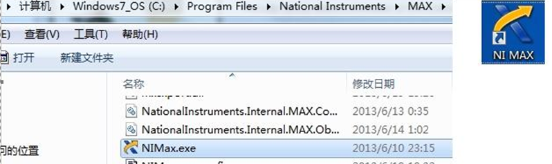

    2.  确认版本号。

        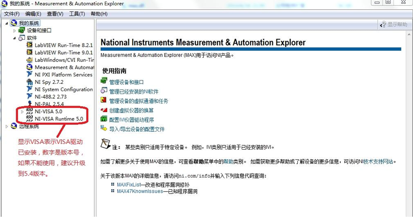

    3.  安装步骤。

        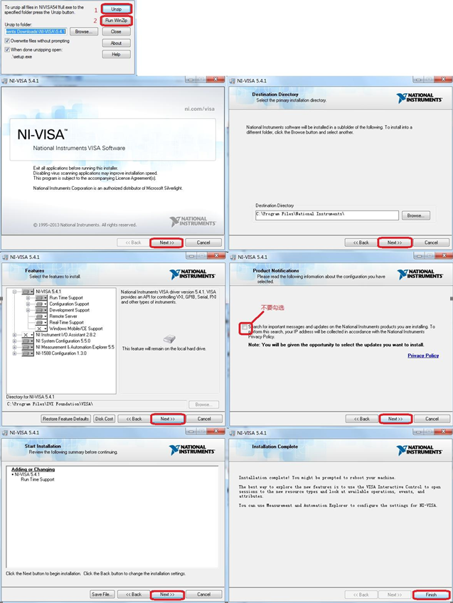

# 测试流程<a name="ZH-CN_TOPIC_0000002526728468"></a>

-   **[射频校准](#ZH-CN_TOPIC_0000002557728347)**  

-   **[射频综测](#ZH-CN_TOPIC_0000002557728361)**  

-   **[校准其他功能](#ZH-CN_TOPIC_0000002557648401)**  

-   **[综测其他功能](#ZH-CN_TOPIC_0000002526728490)**  

-   **[金板线损点验](#ZH-CN_TOPIC_0000002526568560)**  

-   **[温补数据提取](#ZH-CN_TOPIC_0000002526568562)**  

-   **[其他自定义功能](#ZH-CN_TOPIC_0000002557728375)**  

-   **[故障检查](#ZH-CN_TOPIC_0000002526568566)**  

-   **[功能测试及终检](#ZH-CN_TOPIC_0000002526568584)**  

## 射频校准<a name="ZH-CN_TOPIC_0000002557728347"></a>

模组制造商需要对每个模块执行校准流程，以确保个体模组与其射频参数可以达到最佳匹配。可以使用版本包中提供的校准脚本进行简单配置后再执行校准流程，最后对校准生成的射频文件进行更新。详细操作步骤请参见“[校准操作步骤](#ZH-CN_TOPIC_0000002526568546)”章节。

-   **[校准总述](#ZH-CN_TOPIC_0000002526568536)**  

-   **[校准准备](#ZH-CN_TOPIC_0000002557648385)**  

-   **[校准文件介绍](#ZH-CN_TOPIC_0000002526728470)**  

-   **[校准操作步骤](#ZH-CN_TOPIC_0000002526568546)**  

-   **[射频配置文件版本说明](#ZH-CN_TOPIC_0000002526728482)**  

### 校准总述<a name="ZH-CN_TOPIC_0000002526568536"></a>

校准（RX和TX）主要是为了确保如下指标的精度符合要求，以消除芯片和单板之间的差异：

-   芯片自校准，包含内部PLL、RX filter、TX filter、ADC/DAC等。
-   RX接收增益大小（AGC）、DC大小、IQ幅度不平衡、RX IP2。
-   TX发送功率大小（TX Power）、DC大小、IQ幅度不平衡。

影响上述指标的精度的主要因素包括：

-   芯片工艺、器件工艺
-   不同band、不同频率
-   温度

校准完成之后会将校准结果写入Flash，软件在RF初始化时读取Flash中的校准参数，业务过程中按band、功率、档位索引相应结果，并读取温度、频率做相关修正。

**图 1**  校准基本流程<a name="zh-cn_topic_0000002334537392_fig15536558141517"></a>  
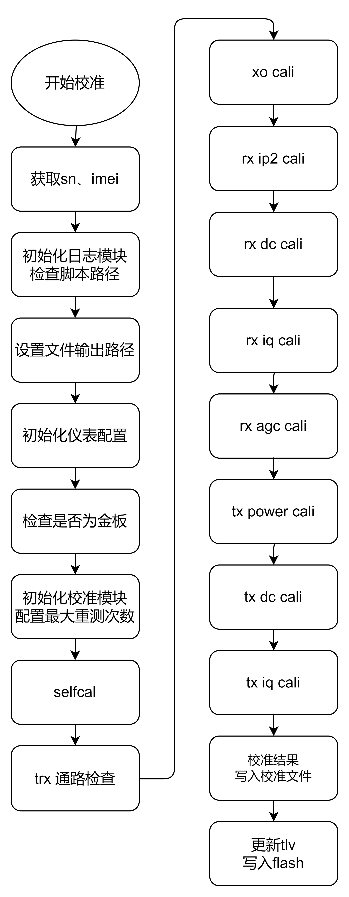

### 校准准备<a name="ZH-CN_TOPIC_0000002557648385"></a>

在用户进行校准前，需要完成或准备以下内容：

-   硬件准备：模组板级设计及匹配调整，请参见《Hi2131V100R001 硬件 用户指南》。
-   校准文件：即脚本中“RadioConfig.cal”文件，根据模组射频前端电路、PA选型等配置，温度补偿表优先使用提取好的温补数据。温补参数提取的方法与要求，参考“[功率温补值提取](#ZH-CN_TOPIC_0000002557648411)”章节。校准文件中需要配置的全部参数如[表1](#zh-cn_topic_0000002360257778_table165861414218)所示，各参数如何配置请参见“[校准文件介绍](#ZH-CN_TOPIC_0000002526728470)”章节。

    **表 1**  校准文件所需配置项

    <a name="zh-cn_topic_0000002360257778_table165861414218"></a>
    <table><thead align="left"><tr id="zh-cn_topic_0000002360257778_row1218585810711"><th class="cellrowborder" valign="top" width="28.57%" id="mcps1.2.4.1.1"><p id="zh-cn_topic_0000002360257778_p259015414211"><a name="zh-cn_topic_0000002360257778_p259015414211"></a><a name="zh-cn_topic_0000002360257778_p259015414211"></a>配置项</p>
    </th>
    <th class="cellrowborder" valign="top" width="40.64%" id="mcps1.2.4.1.2"><p id="zh-cn_topic_0000002360257778_p1359018411329"><a name="zh-cn_topic_0000002360257778_p1359018411329"></a><a name="zh-cn_topic_0000002360257778_p1359018411329"></a>配置来源</p>
    </th>
    <th class="cellrowborder" valign="top" width="30.79%" id="mcps1.2.4.1.3"><p id="zh-cn_topic_0000002360257778_p105901741226"><a name="zh-cn_topic_0000002360257778_p105901741226"></a><a name="zh-cn_topic_0000002360257778_p105901741226"></a>详细解释参考章节</p>
    </th>
    </tr>
    </thead>
    <tbody><tr id="zh-cn_topic_0000002360257778_row518514581073"><td class="cellrowborder" valign="top" width="28.57%" headers="mcps1.2.4.1.1 "><p id="zh-cn_topic_0000002360257778_p1459112419219"><a name="zh-cn_topic_0000002360257778_p1459112419219"></a><a name="zh-cn_topic_0000002360257778_p1459112419219"></a>pa_default</p>
    </td>
    <td class="cellrowborder" valign="top" width="40.64%" headers="mcps1.2.4.1.2 "><p id="zh-cn_topic_0000002360257778_p55911341820"><a name="zh-cn_topic_0000002360257778_p55911341820"></a><a name="zh-cn_topic_0000002360257778_p55911341820"></a>调测需求，是否需要指定哪套PA。</p>
    </td>
    <td class="cellrowborder" rowspan="3" valign="top" width="30.79%" headers="mcps1.2.4.1.3 "><p id="zh-cn_topic_0000002360257778_p1159111411426"><a name="zh-cn_topic_0000002360257778_p1159111411426"></a><a name="zh-cn_topic_0000002360257778_p1159111411426"></a><a href="#ZH-CN_TOPIC_0000002526568538">通用参数配置表</a></p>
    </td>
    </tr>
    <tr id="zh-cn_topic_0000002360257778_row151851358873"><td class="cellrowborder" valign="top" headers="mcps1.2.4.1.1 "><p id="zh-cn_topic_0000002360257778_p165911411827"><a name="zh-cn_topic_0000002360257778_p165911411827"></a><a name="zh-cn_topic_0000002360257778_p165911411827"></a>pio_mask</p>
    </td>
    <td class="cellrowborder" valign="top" headers="mcps1.2.4.1.2 "><p id="zh-cn_topic_0000002360257778_p2059215411223"><a name="zh-cn_topic_0000002360257778_p2059215411223"></a><a name="zh-cn_topic_0000002360257778_p2059215411223"></a>根据射频前端switch确定。</p>
    </td>
    </tr>
    <tr id="zh-cn_topic_0000002360257778_row518555819719"><td class="cellrowborder" valign="top" headers="mcps1.2.4.1.1 "><p id="zh-cn_topic_0000002360257778_p559213411721"><a name="zh-cn_topic_0000002360257778_p559213411721"></a><a name="zh-cn_topic_0000002360257778_p559213411721"></a>idle_pio_state</p>
    </td>
    <td class="cellrowborder" valign="top" headers="mcps1.2.4.1.2 "><p id="zh-cn_topic_0000002360257778_p10592194118214"><a name="zh-cn_topic_0000002360257778_p10592194118214"></a><a name="zh-cn_topic_0000002360257778_p10592194118214"></a>根据射频前端switch确定。</p>
    </td>
    </tr>
    <tr id="zh-cn_topic_0000002360257778_row918513581675"><td class="cellrowborder" valign="top" width="28.57%" headers="mcps1.2.4.1.1 "><p id="zh-cn_topic_0000002360257778_p175931041428"><a name="zh-cn_topic_0000002360257778_p175931041428"></a><a name="zh-cn_topic_0000002360257778_p175931041428"></a>pa_enable</p>
    </td>
    <td class="cellrowborder" valign="top" width="40.64%" headers="mcps1.2.4.1.2 "><p id="zh-cn_topic_0000002360257778_p9593154110215"><a name="zh-cn_topic_0000002360257778_p9593154110215"></a><a name="zh-cn_topic_0000002360257778_p9593154110215"></a>需要使能哪套PA配置。</p>
    </td>
    <td class="cellrowborder" rowspan="7" valign="top" width="30.79%" headers="mcps1.2.4.1.3 "><p id="zh-cn_topic_0000002360257778_p107311415813"><a name="zh-cn_topic_0000002360257778_p107311415813"></a><a name="zh-cn_topic_0000002360257778_p107311415813"></a><a href="#ZH-CN_TOPIC_0000002557648387">PA配置表</a></p>
    </td>
    </tr>
    <tr id="zh-cn_topic_0000002360257778_row10185105813720"><td class="cellrowborder" valign="top" headers="mcps1.2.4.1.1 "><p id="zh-cn_topic_0000002360257778_p14593641123"><a name="zh-cn_topic_0000002360257778_p14593641123"></a><a name="zh-cn_topic_0000002360257778_p14593641123"></a>PROD_ID1</p>
    </td>
    <td class="cellrowborder" valign="top" headers="mcps1.2.4.1.2 "><p id="zh-cn_topic_0000002360257778_p35940410211"><a name="zh-cn_topic_0000002360257778_p35940410211"></a><a name="zh-cn_topic_0000002360257778_p35940410211"></a>根据PA手册确认，区分PA。</p>
    </td>
    </tr>
    <tr id="zh-cn_topic_0000002360257778_row1318518586719"><td class="cellrowborder" valign="top" headers="mcps1.2.4.1.1 "><p id="zh-cn_topic_0000002360257778_p959414119211"><a name="zh-cn_topic_0000002360257778_p959414119211"></a><a name="zh-cn_topic_0000002360257778_p959414119211"></a>MANF_ID1</p>
    </td>
    <td class="cellrowborder" valign="top" headers="mcps1.2.4.1.2 "><p id="zh-cn_topic_0000002360257778_p45941541424"><a name="zh-cn_topic_0000002360257778_p45941541424"></a><a name="zh-cn_topic_0000002360257778_p45941541424"></a>根据PA手册确认，区分PA。</p>
    </td>
    </tr>
    <tr id="zh-cn_topic_0000002360257778_row518611586716"><td class="cellrowborder" valign="top" headers="mcps1.2.4.1.1 "><p id="zh-cn_topic_0000002360257778_p65945411629"><a name="zh-cn_topic_0000002360257778_p65945411629"></a><a name="zh-cn_topic_0000002360257778_p65945411629"></a>USID1</p>
    </td>
    <td class="cellrowborder" valign="top" headers="mcps1.2.4.1.2 "><p id="zh-cn_topic_0000002360257778_p45959417216"><a name="zh-cn_topic_0000002360257778_p45959417216"></a><a name="zh-cn_topic_0000002360257778_p45959417216"></a>根据PA手册确认，区分PA。</p>
    </td>
    </tr>
    <tr id="zh-cn_topic_0000002360257778_row318610581778"><td class="cellrowborder" valign="top" headers="mcps1.2.4.1.1 "><p id="zh-cn_topic_0000002360257778_p105951416212"><a name="zh-cn_topic_0000002360257778_p105951416212"></a><a name="zh-cn_topic_0000002360257778_p105951416212"></a>tx_mipi_num</p>
    </td>
    <td class="cellrowborder" valign="top" headers="mcps1.2.4.1.2 "><p id="zh-cn_topic_0000002360257778_p259564113212"><a name="zh-cn_topic_0000002360257778_p259564113212"></a><a name="zh-cn_topic_0000002360257778_p259564113212"></a>根据PA手册确认，区分PA。</p>
    </td>
    </tr>
    <tr id="zh-cn_topic_0000002360257778_row171861158479"><td class="cellrowborder" valign="top" headers="mcps1.2.4.1.1 "><p id="zh-cn_topic_0000002360257778_p175951411221"><a name="zh-cn_topic_0000002360257778_p175951411221"></a><a name="zh-cn_topic_0000002360257778_p175951411221"></a>idle_mipi_num1</p>
    </td>
    <td class="cellrowborder" valign="top" headers="mcps1.2.4.1.2 "><p id="zh-cn_topic_0000002360257778_p115961241123"><a name="zh-cn_topic_0000002360257778_p115961241123"></a><a name="zh-cn_topic_0000002360257778_p115961241123"></a>根据PA手册确认，区分PA。</p>
    </td>
    </tr>
    <tr id="zh-cn_topic_0000002360257778_row51861584720"><td class="cellrowborder" valign="top" headers="mcps1.2.4.1.1 "><p id="zh-cn_topic_0000002360257778_p65962416210"><a name="zh-cn_topic_0000002360257778_p65962416210"></a><a name="zh-cn_topic_0000002360257778_p65962416210"></a>idle_mipi_state1</p>
    </td>
    <td class="cellrowborder" valign="top" headers="mcps1.2.4.1.2 "><p id="zh-cn_topic_0000002360257778_p19596114110219"><a name="zh-cn_topic_0000002360257778_p19596114110219"></a><a name="zh-cn_topic_0000002360257778_p19596114110219"></a>根据PA手册确认，区分PA。</p>
    </td>
    </tr>
    <tr id="zh-cn_topic_0000002360257778_row835411502249"><td class="cellrowborder" valign="top" width="28.57%" headers="mcps1.2.4.1.1 "><p id="zh-cn_topic_0000002360257778_p12355195016244"><a name="zh-cn_topic_0000002360257778_p12355195016244"></a><a name="zh-cn_topic_0000002360257778_p12355195016244"></a>enable</p>
    </td>
    <td class="cellrowborder" valign="top" width="40.64%" headers="mcps1.2.4.1.2 "><p id="zh-cn_topic_0000002360257778_p11355195072420"><a name="zh-cn_topic_0000002360257778_p11355195072420"></a><a name="zh-cn_topic_0000002360257778_p11355195072420"></a>附加SWITCH开关使能。</p>
    </td>
    <td class="cellrowborder" rowspan="6" valign="top" width="30.79%" headers="mcps1.2.4.1.3 "><p id="zh-cn_topic_0000002360257778_p157371558173513"><a name="zh-cn_topic_0000002360257778_p157371558173513"></a><a name="zh-cn_topic_0000002360257778_p157371558173513"></a><a href="#ZH-CN_TOPIC_0000002557728357">附加SWITCH配置表</a></p>
    </td>
    </tr>
    <tr id="zh-cn_topic_0000002360257778_row67721291253"><td class="cellrowborder" valign="top" headers="mcps1.2.4.1.1 "><p id="zh-cn_topic_0000002360257778_p4773139192517"><a name="zh-cn_topic_0000002360257778_p4773139192517"></a><a name="zh-cn_topic_0000002360257778_p4773139192517"></a>PROD_ID2</p>
    </td>
    <td class="cellrowborder" valign="top" headers="mcps1.2.4.1.2 "><p id="zh-cn_topic_0000002360257778_p137737972512"><a name="zh-cn_topic_0000002360257778_p137737972512"></a><a name="zh-cn_topic_0000002360257778_p137737972512"></a>根据SWITCH手册确认，区分SWITCH。</p>
    </td>
    </tr>
    <tr id="zh-cn_topic_0000002360257778_row84884602519"><td class="cellrowborder" valign="top" headers="mcps1.2.4.1.1 "><p id="zh-cn_topic_0000002360257778_p1548846182510"><a name="zh-cn_topic_0000002360257778_p1548846182510"></a><a name="zh-cn_topic_0000002360257778_p1548846182510"></a>MANF_ID2</p>
    </td>
    <td class="cellrowborder" valign="top" headers="mcps1.2.4.1.2 "><p id="zh-cn_topic_0000002360257778_p1648810682519"><a name="zh-cn_topic_0000002360257778_p1648810682519"></a><a name="zh-cn_topic_0000002360257778_p1648810682519"></a>根据SWITCH手册确认，区分SWITCH。</p>
    </td>
    </tr>
    <tr id="zh-cn_topic_0000002360257778_row128199210255"><td class="cellrowborder" valign="top" headers="mcps1.2.4.1.1 "><p id="zh-cn_topic_0000002360257778_p281919214253"><a name="zh-cn_topic_0000002360257778_p281919214253"></a><a name="zh-cn_topic_0000002360257778_p281919214253"></a>USID2</p>
    </td>
    <td class="cellrowborder" valign="top" headers="mcps1.2.4.1.2 "><p id="zh-cn_topic_0000002360257778_p98191219258"><a name="zh-cn_topic_0000002360257778_p98191219258"></a><a name="zh-cn_topic_0000002360257778_p98191219258"></a>根据SWITCH手册确认，区分SWITCH。</p>
    </td>
    </tr>
    <tr id="zh-cn_topic_0000002360257778_row1288435814247"><td class="cellrowborder" valign="top" headers="mcps1.2.4.1.1 "><p id="zh-cn_topic_0000002360257778_p488510587247"><a name="zh-cn_topic_0000002360257778_p488510587247"></a><a name="zh-cn_topic_0000002360257778_p488510587247"></a>idle_mipi_num2</p>
    </td>
    <td class="cellrowborder" valign="top" headers="mcps1.2.4.1.2 "><p id="zh-cn_topic_0000002360257778_p1788515892419"><a name="zh-cn_topic_0000002360257778_p1788515892419"></a><a name="zh-cn_topic_0000002360257778_p1788515892419"></a>根据SWITCH手册确认，区分SWITCH。</p>
    </td>
    </tr>
    <tr id="zh-cn_topic_0000002360257778_row14256255122410"><td class="cellrowborder" valign="top" headers="mcps1.2.4.1.1 "><p id="zh-cn_topic_0000002360257778_p1325614557248"><a name="zh-cn_topic_0000002360257778_p1325614557248"></a><a name="zh-cn_topic_0000002360257778_p1325614557248"></a>idle_mipi_state2</p>
    </td>
    <td class="cellrowborder" valign="top" headers="mcps1.2.4.1.2 "><p id="zh-cn_topic_0000002360257778_p7256165513243"><a name="zh-cn_topic_0000002360257778_p7256165513243"></a><a name="zh-cn_topic_0000002360257778_p7256165513243"></a>根据SWITCH手册确认，区分SWITCH。</p>
    </td>
    </tr>
    <tr id="zh-cn_topic_0000002360257778_row8186158975"><td class="cellrowborder" valign="top" width="28.57%" headers="mcps1.2.4.1.1 "><p id="zh-cn_topic_0000002360257778_p36005419216"><a name="zh-cn_topic_0000002360257778_p36005419216"></a><a name="zh-cn_topic_0000002360257778_p36005419216"></a>PioState</p>
    </td>
    <td class="cellrowborder" valign="top" width="40.64%" headers="mcps1.2.4.1.2 "><p id="zh-cn_topic_0000002360257778_p66002413217"><a name="zh-cn_topic_0000002360257778_p66002413217"></a><a name="zh-cn_topic_0000002360257778_p66002413217"></a>根据射频前端电路确定，区分Band。</p>
    </td>
    <td class="cellrowborder" rowspan="2" valign="top" width="30.79%" headers="mcps1.2.4.1.3 "><p id="zh-cn_topic_0000002360257778_p1600841627"><a name="zh-cn_topic_0000002360257778_p1600841627"></a><a name="zh-cn_topic_0000002360257778_p1600841627"></a><a href="#ZH-CN_TOPIC_0000002557728351">Rx通路配置表</a></p>
    </td>
    </tr>
    <tr id="zh-cn_topic_0000002360257778_row018635813717"><td class="cellrowborder" valign="top" headers="mcps1.2.4.1.1 "><p id="zh-cn_topic_0000002360257778_p1960018411424"><a name="zh-cn_topic_0000002360257778_p1960018411424"></a><a name="zh-cn_topic_0000002360257778_p1960018411424"></a>RxPortSelect</p>
    </td>
    <td class="cellrowborder" valign="top" headers="mcps1.2.4.1.2 "><p id="zh-cn_topic_0000002360257778_p86005411728"><a name="zh-cn_topic_0000002360257778_p86005411728"></a><a name="zh-cn_topic_0000002360257778_p86005411728"></a>根据射频前端电路确定，区分Band。</p>
    </td>
    </tr>
    <tr id="zh-cn_topic_0000002360257778_row11186958878"><td class="cellrowborder" valign="top" width="28.57%" headers="mcps1.2.4.1.1 "><p id="zh-cn_topic_0000002360257778_p156019412216"><a name="zh-cn_topic_0000002360257778_p156019412216"></a><a name="zh-cn_topic_0000002360257778_p156019412216"></a>PioState</p>
    </td>
    <td class="cellrowborder" valign="top" width="40.64%" headers="mcps1.2.4.1.2 "><p id="zh-cn_topic_0000002360257778_p14602114118211"><a name="zh-cn_topic_0000002360257778_p14602114118211"></a><a name="zh-cn_topic_0000002360257778_p14602114118211"></a>根据射频前端电路确定，区分Band。</p>
    </td>
    <td class="cellrowborder" rowspan="3" valign="top" width="30.79%" headers="mcps1.2.4.1.3 "><p id="zh-cn_topic_0000002360257778_p166021641925"><a name="zh-cn_topic_0000002360257778_p166021641925"></a><a name="zh-cn_topic_0000002360257778_p166021641925"></a><a href="#ZH-CN_TOPIC_0000002557648389">TX通路配置表</a></p>
    </td>
    </tr>
    <tr id="zh-cn_topic_0000002360257778_row2186958776"><td class="cellrowborder" valign="top" headers="mcps1.2.4.1.1 "><p id="zh-cn_topic_0000002360257778_p06031741829"><a name="zh-cn_topic_0000002360257778_p06031741829"></a><a name="zh-cn_topic_0000002360257778_p06031741829"></a>TxPortSelect</p>
    </td>
    <td class="cellrowborder" valign="top" headers="mcps1.2.4.1.2 "><p id="zh-cn_topic_0000002360257778_p17603134117216"><a name="zh-cn_topic_0000002360257778_p17603134117216"></a><a name="zh-cn_topic_0000002360257778_p17603134117216"></a>根据射频前端电路确定，区分Band。</p>
    </td>
    </tr>
    <tr id="zh-cn_topic_0000002360257778_row111865585711"><td class="cellrowborder" valign="top" headers="mcps1.2.4.1.1 "><p id="zh-cn_topic_0000002360257778_p76031741720"><a name="zh-cn_topic_0000002360257778_p76031741720"></a><a name="zh-cn_topic_0000002360257778_p76031741720"></a>MaxPower</p>
    </td>
    <td class="cellrowborder" valign="top" headers="mcps1.2.4.1.2 "><p id="zh-cn_topic_0000002360257778_p1760415411323"><a name="zh-cn_topic_0000002360257778_p1760415411323"></a><a name="zh-cn_topic_0000002360257778_p1760415411323"></a>最大发射功率，区分Band。</p>
    </td>
    </tr>
    <tr id="zh-cn_topic_0000002360257778_row18186158276"><td class="cellrowborder" valign="top" width="28.57%" headers="mcps1.2.4.1.1 "><p id="zh-cn_topic_0000002360257778_p1660411412220"><a name="zh-cn_topic_0000002360257778_p1660411412220"></a><a name="zh-cn_topic_0000002360257778_p1660411412220"></a>MipiStateHPM</p>
    </td>
    <td class="cellrowborder" valign="top" width="40.64%" headers="mcps1.2.4.1.2 "><p id="zh-cn_topic_0000002360257778_p8604441220"><a name="zh-cn_topic_0000002360257778_p8604441220"></a><a name="zh-cn_topic_0000002360257778_p8604441220"></a>根据PA手册确认，区分PA、Band。</p>
    </td>
    <td class="cellrowborder" rowspan="6" valign="top" width="30.79%" headers="mcps1.2.4.1.3 "><p id="zh-cn_topic_0000002360257778_p2592134416818"><a name="zh-cn_topic_0000002360257778_p2592134416818"></a><a name="zh-cn_topic_0000002360257778_p2592134416818"></a><a href="#ZH-CN_TOPIC_0000002526568540">MIPI配置表</a></p>
    <p id="zh-cn_topic_0000002360257778_p2681647183714"><a name="zh-cn_topic_0000002360257778_p2681647183714"></a><a name="zh-cn_topic_0000002360257778_p2681647183714"></a></p>
    <p id="zh-cn_topic_0000002360257778_p13584104313719"><a name="zh-cn_topic_0000002360257778_p13584104313719"></a><a name="zh-cn_topic_0000002360257778_p13584104313719"></a></p>
    </td>
    </tr>
    <tr id="zh-cn_topic_0000002360257778_row111875581271"><td class="cellrowborder" valign="top" headers="mcps1.2.4.1.1 "><p id="zh-cn_topic_0000002360257778_p176053417211"><a name="zh-cn_topic_0000002360257778_p176053417211"></a><a name="zh-cn_topic_0000002360257778_p176053417211"></a>MipiStateMPM</p>
    </td>
    <td class="cellrowborder" valign="top" headers="mcps1.2.4.1.2 "><p id="zh-cn_topic_0000002360257778_p86051419211"><a name="zh-cn_topic_0000002360257778_p86051419211"></a><a name="zh-cn_topic_0000002360257778_p86051419211"></a>根据PA手册确认，区分PA、Band。</p>
    </td>
    </tr>
    <tr id="zh-cn_topic_0000002360257778_row1618714589711"><td class="cellrowborder" valign="top" headers="mcps1.2.4.1.1 "><p id="zh-cn_topic_0000002360257778_p96065411323"><a name="zh-cn_topic_0000002360257778_p96065411323"></a><a name="zh-cn_topic_0000002360257778_p96065411323"></a>MipiStateLPM</p>
    </td>
    <td class="cellrowborder" valign="top" headers="mcps1.2.4.1.2 "><p id="zh-cn_topic_0000002360257778_p160618417211"><a name="zh-cn_topic_0000002360257778_p160618417211"></a><a name="zh-cn_topic_0000002360257778_p160618417211"></a>根据PA手册确认，区分PA、Band。</p>
    </td>
    </tr>
    <tr id="zh-cn_topic_0000002360257778_row391238203712"><td class="cellrowborder" valign="top" headers="mcps1.2.4.1.1 "><p id="zh-cn_topic_0000002360257778_p79114382378"><a name="zh-cn_topic_0000002360257778_p79114382378"></a><a name="zh-cn_topic_0000002360257778_p79114382378"></a>PARxPort</p>
    </td>
    <td class="cellrowborder" valign="top" headers="mcps1.2.4.1.2 "><p id="zh-cn_topic_0000002360257778_p18924386372"><a name="zh-cn_topic_0000002360257778_p18924386372"></a><a name="zh-cn_topic_0000002360257778_p18924386372"></a>根据PA手册确认，控制Rx Port口，如果不需要，使用默认配置(0x1C,0x00)(0x1C,0x00)。</p>
    </td>
    </tr>
    <tr id="zh-cn_topic_0000002360257778_row116854743718"><td class="cellrowborder" valign="top" headers="mcps1.2.4.1.1 "><p id="zh-cn_topic_0000002360257778_p1668124783714"><a name="zh-cn_topic_0000002360257778_p1668124783714"></a><a name="zh-cn_topic_0000002360257778_p1668124783714"></a>RxSwitch</p>
    </td>
    <td class="cellrowborder" valign="top" headers="mcps1.2.4.1.2 "><p id="zh-cn_topic_0000002360257778_p86815476373"><a name="zh-cn_topic_0000002360257778_p86815476373"></a><a name="zh-cn_topic_0000002360257778_p86815476373"></a>根据SWITCH手册确认，控制Rx开关，如果不需要，使用默认配置(0x1C,0x00)(0x1C,0x00)。</p>
    </td>
    </tr>
    <tr id="zh-cn_topic_0000002360257778_row19584943153716"><td class="cellrowborder" valign="top" headers="mcps1.2.4.1.1 "><p id="zh-cn_topic_0000002360257778_p115843433377"><a name="zh-cn_topic_0000002360257778_p115843433377"></a><a name="zh-cn_topic_0000002360257778_p115843433377"></a>TxSwitch</p>
    </td>
    <td class="cellrowborder" valign="top" headers="mcps1.2.4.1.2 "><p id="zh-cn_topic_0000002360257778_p185841743103717"><a name="zh-cn_topic_0000002360257778_p185841743103717"></a><a name="zh-cn_topic_0000002360257778_p185841743103717"></a>根据SWITCH手册确认，控制TX开关，如果不需要，使用默认配置(0x1C,0x00)(0x1C,0x00)。</p>
    </td>
    </tr>
    <tr id="zh-cn_topic_0000002360257778_row11187135812710"><td class="cellrowborder" valign="top" width="28.57%" headers="mcps1.2.4.1.1 "><p id="zh-cn_topic_0000002360257778_p16081241125"><a name="zh-cn_topic_0000002360257778_p16081241125"></a><a name="zh-cn_topic_0000002360257778_p16081241125"></a>温度补偿表全部配置项</p>
    </td>
    <td class="cellrowborder" valign="top" width="40.64%" headers="mcps1.2.4.1.2 "><p id="zh-cn_topic_0000002360257778_p560810411624"><a name="zh-cn_topic_0000002360257778_p560810411624"></a><a name="zh-cn_topic_0000002360257778_p560810411624"></a>根据温补数据提取脚本获取参数配置。</p>
    </td>
    <td class="cellrowborder" valign="top" width="30.79%" headers="mcps1.2.4.1.3 "><p id="zh-cn_topic_0000002360257778_p1556051184"><a name="zh-cn_topic_0000002360257778_p1556051184"></a><a name="zh-cn_topic_0000002360257778_p1556051184"></a><a href="#ZH-CN_TOPIC_0000002526728478">温度补偿表</a></p>
    </td>
    </tr>
    </tbody>
    </table>

    > **须知：** 
    >-   如果修改产测工具里“RadioConfig.cal”文件中的射频配置，需要将该文件也同步修改到SDK中，并编译新的固件烧录到模组中，才能使修改在校准时生效。
    >-   将“RadioConfig.cal”文件中的修改同步到“sdk\\tools\\rf\_calibration\_and\_test\_tools”路径下的“RadioConfig.cal”文件后再编译SDK。

-   软件准备：需要先烧录版本，未烧录版本或未烧录校准文件时校准工程执行AT命令会无响应并超时，烧录后发送AT，检验AT是否返回OK。发送AT+CGMR查看固件版本、RF版本号是否正确。
-   仪表准备：
    -   CMW500：需要General Purpose RF Measurements、General Purpose RF Generator、LTE TX Measurement模块。若需要一拖多则需要仪表拥有license，具体配置请参见“[CMW500配置方法](#ZH-CN_TOPIC_0000002526568556)”章节。
    -   CMW100：需要General Purpose RF Measurements、General Purpose RF Generator、LTE TX Measurement模块。若需要一拖多则需要仪表拥有license，具体配置请参见“[CMW100配置方法](#ZH-CN_TOPIC_0000002557648405)”章节。CMW100仪表校准综测一拖多功能仅支持USB和115200波特率。
    -   IQXSream：需要GPRF模块和LTE模块。IQ仪表校准综测一拖多功能目前仅支持一拖二，如有一拖四需求请联系FAE。
    -   仪表波形文件需要放置到对应文件夹，配置请参见“[运行脚本](#ZH-CN_TOPIC_0000002557728363)”章节。

-   射频通路测试：用AT强发强收相关命令进行TRX通路基本验证。AT命令请参见《HiDiTingV100 2131E AT命令 用户指南》“射频配置命令集：+NRDSET”章节实现说明。
    -   RX通路验证：
        1.  发送AT命令“AT+NRDCTRL=1”进入radiotest模式。
        2.  发送AT命令“AT+NRDSET=RX START,8,942500,0,7,0”打开RX。
        3.  发送AT命令“AT+NRDEXEC=RX DC CALI”校准DC。
        4.  使用信号源，根据RX START中的频段、频率和AGC档位配置单音信号。
        5.  发送AT命令“AT+NRDSET=WBRSSI READ,7”读取RSSI。

    -   TX通路验证：
        1.  发送AT命令“AT+NRDCTRL=1”进入radiotest模式。
        2.  发送AT命令“AT+NRDSET=TX START,8,897500,3,23,0”打开TX。
        3.  发送单音“AT+NRDSET=TX TONE,1,1500000,770”。
        4.  使用CMW500 GPRF Measurements模块，根据TX START中的频段、频率、带宽和期望功率对仪表进行配置，查看仪表在指定频点是否有预期的波形。

-   环境准备：

    确保产测上位机系统为Win10及以上版本。

    安装Python3.11.4及以上版本、Pycharm2019及以上版本。

    执行脚本额外必要的库文件：pyvisa、pyserial、xlwt

> **须知：** 
>在使用CMW RUN等相关软件后，需要将仪表各模块进行复位后再运行产测脚本。操作步骤如下图所示。
>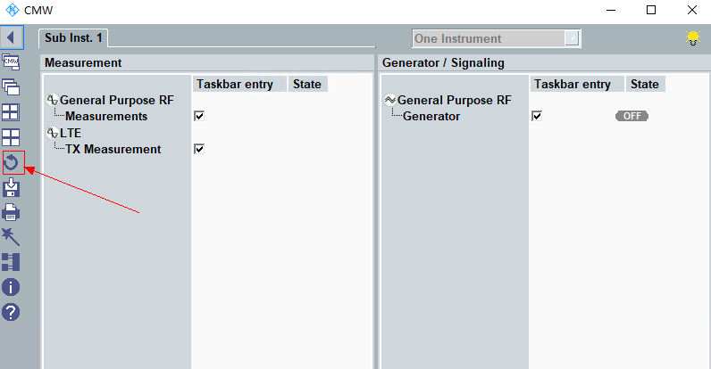
>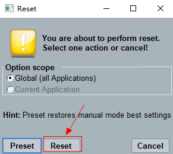

### 校准文件介绍<a name="ZH-CN_TOPIC_0000002526728470"></a>

-   **[配置文件简介](#ZH-CN_TOPIC_0000002557728349)**  

-   **[通用参数配置表](#ZH-CN_TOPIC_0000002526568538)**  

-   **[PA配置表](#ZH-CN_TOPIC_0000002557648387)**  

-   **[Band配置表](#ZH-CN_TOPIC_0000002526728472)**  

-   **[Rx通路配置表](#ZH-CN_TOPIC_0000002557728351)**  

-   **[MIPI配置表](#ZH-CN_TOPIC_0000002526568540)**  

-   **[TX通路配置表](#ZH-CN_TOPIC_0000002557648389)**  

-   **[RX增益参数表](#ZH-CN_TOPIC_0000002526728474)**  

-   **[RX频率补偿表](#ZH-CN_TOPIC_0000002557728353)**  

-   **[TX发送功率表](#ZH-CN_TOPIC_0000002526568542)**  

-   **[TX频率补偿表](#ZH-CN_TOPIC_0000002557648391)**  

-   **[TX直流补偿表](#ZH-CN_TOPIC_0000002526728476)**  

-   **[IQ补偿表](#ZH-CN_TOPIC_0000002557728355)**  

-   **[IIP2配置表](#ZH-CN_TOPIC_0000002526568544)**  

-   **[带宽补偿表](#ZH-CN_TOPIC_0000002557648393)**  

-   **[温度补偿表](#ZH-CN_TOPIC_0000002526728478)**  

-   **[附加SWITCH配置表](#ZH-CN_TOPIC_0000002557728357)**  

#### 配置文件简介<a name="ZH-CN_TOPIC_0000002557728349"></a>

“RadioConfig.cal”配置文件是校准的输入条件，包含如下内容：

-   通用参数配置表
-   Band配置表、PA配置表、Rx通路配置表、PA MIPI配置表、Tx通路配置表
-   Rx直流增益表、Rx频率补偿表
-   Tx发送功率表、Tx频率补偿表、Tx直流补偿表
-   IIP2配置表、带宽补偿表、温度补偿表、IQ补偿表

> **说明：** 
>Rx直流增益和补偿表、Tx发送功率和补偿表、IIP2配置表为校准动态配置，校准后会更新；其余为静态配置，校准后不会更新。

#### 通用参数配置表<a name="ZH-CN_TOPIC_0000002526568538"></a>

示例：

```
#===============|General Settings|===============
RFGeneralTableBegin
 pa_default                       0
 dcxo_cin                         2                # Load capacitor in
 dcxo_cout                        3                # Load capacitor out
 FreqErrorScaled                  0                # Measured frequency error of UE in ppbillion/4, ie (fMeasured - fRequested)/fMeasured * 10^9 / 4
 pa_ctrl                          180,30,30 
 pio_mask                         setbits(0,1,2)       # Specify all PIOs used by the radio
 idle_pio_state                   setbits()            # IDLE state of PIO
RFGeneralTableEnd
```

定义：

<a name="zh-cn_topic_0000002368415553_zh-cn_topic_0000002088155493_table109582254174"></a>
<table><thead align="left"><tr id="zh-cn_topic_0000002368415553_zh-cn_topic_0000002088155493_row095922581711"><th class="cellrowborder" valign="top" width="27.070000000000004%" id="mcps1.1.5.1.1"><p id="zh-cn_topic_0000002368415553_zh-cn_topic_0000002088155493_p13959625181710"><a name="zh-cn_topic_0000002368415553_zh-cn_topic_0000002088155493_p13959625181710"></a><a name="zh-cn_topic_0000002368415553_zh-cn_topic_0000002088155493_p13959625181710"></a>参数名称</p>
</th>
<th class="cellrowborder" valign="top" width="28.080000000000005%" id="mcps1.1.5.1.2"><p id="zh-cn_topic_0000002368415553_zh-cn_topic_0000002088155493_p0959225191710"><a name="zh-cn_topic_0000002368415553_zh-cn_topic_0000002088155493_p0959225191710"></a><a name="zh-cn_topic_0000002368415553_zh-cn_topic_0000002088155493_p0959225191710"></a>说明</p>
</th>
<th class="cellrowborder" valign="top" width="20.32%" id="mcps1.1.5.1.3"><p id="zh-cn_topic_0000002368415553_zh-cn_topic_0000002088155493_p139591625181710"><a name="zh-cn_topic_0000002368415553_zh-cn_topic_0000002088155493_p139591625181710"></a><a name="zh-cn_topic_0000002368415553_zh-cn_topic_0000002088155493_p139591625181710"></a>取值范围</p>
</th>
<th class="cellrowborder" valign="top" width="24.53%" id="mcps1.1.5.1.4"><p id="zh-cn_topic_0000002368415553_zh-cn_topic_0000002088155493_p49596251176"><a name="zh-cn_topic_0000002368415553_zh-cn_topic_0000002088155493_p49596251176"></a><a name="zh-cn_topic_0000002368415553_zh-cn_topic_0000002088155493_p49596251176"></a>备注</p>
</th>
</tr>
</thead>
<tbody><tr id="zh-cn_topic_0000002368415553_zh-cn_topic_0000002088155493_row03448324216"><td class="cellrowborder" valign="top" width="27.070000000000004%" headers="mcps1.1.5.1.1 "><p id="zh-cn_topic_0000002368415553_zh-cn_topic_0000002088155493_p1534533252110"><a name="zh-cn_topic_0000002368415553_zh-cn_topic_0000002088155493_p1534533252110"></a><a name="zh-cn_topic_0000002368415553_zh-cn_topic_0000002088155493_p1534533252110"></a>pa_default</p>
</td>
<td class="cellrowborder" valign="top" width="28.080000000000005%" headers="mcps1.1.5.1.2 "><p id="zh-cn_topic_0000002368415553_zh-cn_topic_0000002088155493_p1240383692515"><a name="zh-cn_topic_0000002368415553_zh-cn_topic_0000002088155493_p1240383692515"></a><a name="zh-cn_topic_0000002368415553_zh-cn_topic_0000002088155493_p1240383692515"></a>PA默认配置。</p>
<p id="zh-cn_topic_0000002368415553_zh-cn_topic_0000002088155493_p1934583216218"><a name="zh-cn_topic_0000002368415553_zh-cn_topic_0000002088155493_p1934583216218"></a><a name="zh-cn_topic_0000002368415553_zh-cn_topic_0000002088155493_p1934583216218"></a>0：开机自动匹配PA配置表中的index，并且强校验PROD_ID和MANF_ID，匹配不成功开机失败；</p>
<p id="zh-cn_topic_0000002368415553_zh-cn_topic_0000002088155493_p633119611231"><a name="zh-cn_topic_0000002368415553_zh-cn_topic_0000002088155493_p633119611231"></a><a name="zh-cn_topic_0000002368415553_zh-cn_topic_0000002088155493_p633119611231"></a>1～4：开机不匹配PA配置表中的index，也不做校验，选择所写index对应的PA配置。</p>
</td>
<td class="cellrowborder" valign="top" width="20.32%" headers="mcps1.1.5.1.3 "><p id="zh-cn_topic_0000002368415553_zh-cn_topic_0000002088155493_p134512327217"><a name="zh-cn_topic_0000002368415553_zh-cn_topic_0000002088155493_p134512327217"></a><a name="zh-cn_topic_0000002368415553_zh-cn_topic_0000002088155493_p134512327217"></a>0～4</p>
</td>
<td class="cellrowborder" valign="top" width="24.53%" headers="mcps1.1.5.1.4 "><p id="zh-cn_topic_0000002368415553_zh-cn_topic_0000002088155493_p18775175012411"><a name="zh-cn_topic_0000002368415553_zh-cn_topic_0000002088155493_p18775175012411"></a><a name="zh-cn_topic_0000002368415553_zh-cn_topic_0000002088155493_p18775175012411"></a>值不为0时，为指定PA index对应的USID值。</p>
<p id="zh-cn_topic_0000002368415553_zh-cn_topic_0000002088155493_p288381116263"><a name="zh-cn_topic_0000002368415553_zh-cn_topic_0000002088155493_p288381116263"></a><a name="zh-cn_topic_0000002368415553_zh-cn_topic_0000002088155493_p288381116263"></a>若选择超出范围的配置，则默认选择0。</p>
<p id="zh-cn_topic_0000002368415553_zh-cn_topic_0000002088155493_p19345193210219"><a name="zh-cn_topic_0000002368415553_zh-cn_topic_0000002088155493_p19345193210219"></a><a name="zh-cn_topic_0000002368415553_zh-cn_topic_0000002088155493_p19345193210219"></a>PA配置请参见“<a href="#ZH-CN_TOPIC_0000002557648387">PA配置表</a>”章节。</p>
</td>
</tr>
<tr id="zh-cn_topic_0000002368415553_zh-cn_topic_0000002088155493_row16797320103814"><td class="cellrowborder" valign="top" width="27.070000000000004%" headers="mcps1.1.5.1.1 "><p id="zh-cn_topic_0000002368415553_zh-cn_topic_0000002088155493_p260092052011"><a name="zh-cn_topic_0000002368415553_zh-cn_topic_0000002088155493_p260092052011"></a><a name="zh-cn_topic_0000002368415553_zh-cn_topic_0000002088155493_p260092052011"></a>dcxo_cin</p>
</td>
<td class="cellrowborder" valign="top" width="28.080000000000005%" headers="mcps1.1.5.1.2 "><p id="zh-cn_topic_0000002368415553_zh-cn_topic_0000002088155493_p760032011205"><a name="zh-cn_topic_0000002368415553_zh-cn_topic_0000002088155493_p760032011205"></a><a name="zh-cn_topic_0000002368415553_zh-cn_topic_0000002088155493_p760032011205"></a>晶振调谐电容Cin补偿值。</p>
</td>
<td class="cellrowborder" valign="top" width="20.32%" headers="mcps1.1.5.1.3 "><p id="zh-cn_topic_0000002368415553_zh-cn_topic_0000002088155493_p10601192082014"><a name="zh-cn_topic_0000002368415553_zh-cn_topic_0000002088155493_p10601192082014"></a><a name="zh-cn_topic_0000002368415553_zh-cn_topic_0000002088155493_p10601192082014"></a>0～31</p>
</td>
<td class="cellrowborder" valign="top" width="24.53%" headers="mcps1.1.5.1.4 "><p id="zh-cn_topic_0000002368415553_zh-cn_topic_0000002088155493_p1060192012011"><a name="zh-cn_topic_0000002368415553_zh-cn_topic_0000002088155493_p1060192012011"></a><a name="zh-cn_topic_0000002368415553_zh-cn_topic_0000002088155493_p1060192012011"></a>XO校准后由脚本自动刷新。</p>
</td>
</tr>
<tr id="zh-cn_topic_0000002368415553_zh-cn_topic_0000002088155493_row138204516336"><td class="cellrowborder" valign="top" width="27.070000000000004%" headers="mcps1.1.5.1.1 "><p id="zh-cn_topic_0000002368415553_zh-cn_topic_0000002088155493_p20169182416205"><a name="zh-cn_topic_0000002368415553_zh-cn_topic_0000002088155493_p20169182416205"></a><a name="zh-cn_topic_0000002368415553_zh-cn_topic_0000002088155493_p20169182416205"></a>dcxo_cout</p>
</td>
<td class="cellrowborder" valign="top" width="28.080000000000005%" headers="mcps1.1.5.1.2 "><p id="zh-cn_topic_0000002368415553_zh-cn_topic_0000002088155493_p171695249203"><a name="zh-cn_topic_0000002368415553_zh-cn_topic_0000002088155493_p171695249203"></a><a name="zh-cn_topic_0000002368415553_zh-cn_topic_0000002088155493_p171695249203"></a>晶振调谐电容Cout补偿值。</p>
</td>
<td class="cellrowborder" valign="top" width="20.32%" headers="mcps1.1.5.1.3 "><p id="zh-cn_topic_0000002368415553_zh-cn_topic_0000002088155493_p16169132492012"><a name="zh-cn_topic_0000002368415553_zh-cn_topic_0000002088155493_p16169132492012"></a><a name="zh-cn_topic_0000002368415553_zh-cn_topic_0000002088155493_p16169132492012"></a>0～31</p>
</td>
<td class="cellrowborder" valign="top" width="24.53%" headers="mcps1.1.5.1.4 "><p id="zh-cn_topic_0000002368415553_zh-cn_topic_0000002088155493_p43343233552"><a name="zh-cn_topic_0000002368415553_zh-cn_topic_0000002088155493_p43343233552"></a><a name="zh-cn_topic_0000002368415553_zh-cn_topic_0000002088155493_p43343233552"></a>XO校准后由脚本自动刷新。</p>
</td>
</tr>
<tr id="zh-cn_topic_0000002368415553_zh-cn_topic_0000002088155493_row97075479334"><td class="cellrowborder" valign="top" width="27.070000000000004%" headers="mcps1.1.5.1.1 "><p id="zh-cn_topic_0000002368415553_zh-cn_topic_0000002088155493_p186072732018"><a name="zh-cn_topic_0000002368415553_zh-cn_topic_0000002088155493_p186072732018"></a><a name="zh-cn_topic_0000002368415553_zh-cn_topic_0000002088155493_p186072732018"></a>FreqErrorScaled</p>
</td>
<td class="cellrowborder" valign="top" width="28.080000000000005%" headers="mcps1.1.5.1.2 "><p id="zh-cn_topic_0000002368415553_zh-cn_topic_0000002088155493_p1486012712011"><a name="zh-cn_topic_0000002368415553_zh-cn_topic_0000002088155493_p1486012712011"></a><a name="zh-cn_topic_0000002368415553_zh-cn_topic_0000002088155493_p1486012712011"></a>UE测量的频率误差。</p>
</td>
<td class="cellrowborder" valign="top" width="20.32%" headers="mcps1.1.5.1.3 "><p id="zh-cn_topic_0000002368415553_zh-cn_topic_0000002088155493_p1286062782011"><a name="zh-cn_topic_0000002368415553_zh-cn_topic_0000002088155493_p1286062782011"></a><a name="zh-cn_topic_0000002368415553_zh-cn_topic_0000002088155493_p1286062782011"></a>-2<sup id="zh-cn_topic_0000002368415553_zh-cn_topic_0000002088155493_sup19850131016218"><a name="zh-cn_topic_0000002368415553_zh-cn_topic_0000002088155493_sup19850131016218"></a><a name="zh-cn_topic_0000002368415553_zh-cn_topic_0000002088155493_sup19850131016218"></a>15</sup>～+2<sup id="zh-cn_topic_0000002368415553_zh-cn_topic_0000002088155493_sup17682553313"><a name="zh-cn_topic_0000002368415553_zh-cn_topic_0000002088155493_sup17682553313"></a><a name="zh-cn_topic_0000002368415553_zh-cn_topic_0000002088155493_sup17682553313"></a>15</sup></p>
</td>
<td class="cellrowborder" valign="top" width="24.53%" headers="mcps1.1.5.1.4 "><p id="zh-cn_topic_0000002368415553_zh-cn_topic_0000002088155493_p1110172635513"><a name="zh-cn_topic_0000002368415553_zh-cn_topic_0000002088155493_p1110172635513"></a><a name="zh-cn_topic_0000002368415553_zh-cn_topic_0000002088155493_p1110172635513"></a>XO校准后由脚本自动刷新。</p>
</td>
</tr>
<tr id="zh-cn_topic_0000002368415553_zh-cn_topic_0000002088155493_row165131145103320"><td class="cellrowborder" valign="top" width="27.070000000000004%" headers="mcps1.1.5.1.1 "><p id="zh-cn_topic_0000002368415553_zh-cn_topic_0000002088155493_p75141045123312"><a name="zh-cn_topic_0000002368415553_zh-cn_topic_0000002088155493_p75141045123312"></a><a name="zh-cn_topic_0000002368415553_zh-cn_topic_0000002088155493_p75141045123312"></a>pa_ctrl</p>
</td>
<td class="cellrowborder" valign="top" width="28.080000000000005%" headers="mcps1.1.5.1.2 "><p id="zh-cn_topic_0000002368415553_zh-cn_topic_0000002088155493_p0614839202"><a name="zh-cn_topic_0000002368415553_zh-cn_topic_0000002088155493_p0614839202"></a><a name="zh-cn_topic_0000002368415553_zh-cn_topic_0000002088155493_p0614839202"></a>PA模式划分功率，分别为：MPM最大功率、LPM最大功率、各个PM交叉的功率段大小。</p>
</td>
<td class="cellrowborder" valign="top" width="20.32%" headers="mcps1.1.5.1.3 "><p id="zh-cn_topic_0000002368415553_zh-cn_topic_0000002088155493_p185144450335"><a name="zh-cn_topic_0000002368415553_zh-cn_topic_0000002088155493_p185144450335"></a><a name="zh-cn_topic_0000002368415553_zh-cn_topic_0000002088155493_p185144450335"></a>实数</p>
</td>
<td class="cellrowborder" valign="top" width="24.53%" headers="mcps1.1.5.1.4 "><p id="zh-cn_topic_0000002368415553_zh-cn_topic_0000002088155493_p9514154519338"><a name="zh-cn_topic_0000002368415553_zh-cn_topic_0000002088155493_p9514154519338"></a><a name="zh-cn_topic_0000002368415553_zh-cn_topic_0000002088155493_p9514154519338"></a>根据PA手册确认。</p>
</td>
</tr>
<tr id="zh-cn_topic_0000002368415553_zh-cn_topic_0000002088155493_row16959162512174"><td class="cellrowborder" valign="top" width="27.070000000000004%" headers="mcps1.1.5.1.1 "><p id="zh-cn_topic_0000002368415553_zh-cn_topic_0000002088155493_p20959625141711"><a name="zh-cn_topic_0000002368415553_zh-cn_topic_0000002088155493_p20959625141711"></a><a name="zh-cn_topic_0000002368415553_zh-cn_topic_0000002088155493_p20959625141711"></a>pio_mask（用户配置）</p>
</td>
<td class="cellrowborder" valign="top" width="28.080000000000005%" headers="mcps1.1.5.1.2 "><p id="zh-cn_topic_0000002368415553_zh-cn_topic_0000002088155493_p29591025111711"><a name="zh-cn_topic_0000002368415553_zh-cn_topic_0000002088155493_p29591025111711"></a><a name="zh-cn_topic_0000002368415553_zh-cn_topic_0000002088155493_p29591025111711"></a>控制SWITCH的GPIO端口（即TRX通道选择）。</p>
</td>
<td class="cellrowborder" valign="top" width="20.32%" headers="mcps1.1.5.1.3 "><p id="zh-cn_topic_0000002368415553_zh-cn_topic_0000002088155493_p6959192512172"><a name="zh-cn_topic_0000002368415553_zh-cn_topic_0000002088155493_p6959192512172"></a><a name="zh-cn_topic_0000002368415553_zh-cn_topic_0000002088155493_p6959192512172"></a>setbits(0～7)</p>
</td>
<td class="cellrowborder" valign="top" width="24.53%" headers="mcps1.1.5.1.4 "><p id="zh-cn_topic_0000002368415553_zh-cn_topic_0000002088155493_p6959102517177"><a name="zh-cn_topic_0000002368415553_zh-cn_topic_0000002088155493_p6959102517177"></a><a name="zh-cn_topic_0000002368415553_zh-cn_topic_0000002088155493_p6959102517177"></a>根据用户硬件电路确定。如选择GPIO0、GPIO1、GPIO2控制SWITCH，配置为setbits(0,1,2)。</p>
</td>
</tr>
<tr id="zh-cn_topic_0000002368415553_zh-cn_topic_0000002088155493_row595942511716"><td class="cellrowborder" valign="top" width="27.070000000000004%" headers="mcps1.1.5.1.1 "><p id="zh-cn_topic_0000002368415553_zh-cn_topic_0000002088155493_p179596257175"><a name="zh-cn_topic_0000002368415553_zh-cn_topic_0000002088155493_p179596257175"></a><a name="zh-cn_topic_0000002368415553_zh-cn_topic_0000002088155493_p179596257175"></a>idle_pio_state（用户配置）</p>
</td>
<td class="cellrowborder" valign="top" width="28.080000000000005%" headers="mcps1.1.5.1.2 "><p id="zh-cn_topic_0000002368415553_zh-cn_topic_0000002088155493_p495916255174"><a name="zh-cn_topic_0000002368415553_zh-cn_topic_0000002088155493_p495916255174"></a><a name="zh-cn_topic_0000002368415553_zh-cn_topic_0000002088155493_p495916255174"></a>RF处于IDLE状态（非Tx或Rx）时的GPIO控制值。</p>
</td>
<td class="cellrowborder" valign="top" width="20.32%" headers="mcps1.1.5.1.3 "><p id="zh-cn_topic_0000002368415553_zh-cn_topic_0000002088155493_p495918252174"><a name="zh-cn_topic_0000002368415553_zh-cn_topic_0000002088155493_p495918252174"></a><a name="zh-cn_topic_0000002368415553_zh-cn_topic_0000002088155493_p495918252174"></a>setbits(0~7)</p>
</td>
<td class="cellrowborder" valign="top" width="24.53%" headers="mcps1.1.5.1.4 "><p id="zh-cn_topic_0000002368415553_zh-cn_topic_0000002088155493_p895922581718"><a name="zh-cn_topic_0000002368415553_zh-cn_topic_0000002088155493_p895922581718"></a><a name="zh-cn_topic_0000002368415553_zh-cn_topic_0000002088155493_p895922581718"></a>根据设计需求确认。</p>
</td>
</tr>
</tbody>
</table>

#### PA配置表<a name="ZH-CN_TOPIC_0000002557648387"></a>

当前校准文件支持两套BOM配置，区分BOM的配置内容包括PA MIPI配置表、Tx功率的温度补偿表。

芯片上电时，通过MIPI接口读取PA芯片里的PROD\_ID和MANF\_ID来自适应选取相应BOM配置，而且仅在复位后第一次读取。

下表规定了两套BOM对应的Product ID、Manufacture ID，以及其处在IDLE态下的寄存器配置。

示例：

```
#=======================|PA Table|=======================
#**   index       pa_enable      PROD_ID1      MANF_ID1       USID1      tx_mipi_num   idle_mipi_num1    xo_coef     idle_mipi_state1  
PATableBegin
 TableLength 4
PA           1,           1,         0x1,       0x366,         0xF,           5,           2, 5930188,23547,-1658, (0x0,0x00)(0x1C,0x01)(0x0,0x00)(0x0,0x00),
PA           2,           1,        0x2C,       0x33D,         0xF,           3,           2, 5930188,23547,-1658, (0x0,0x00)(0x1C,0x01)(0x0,0x00)(0x0,0x00),
PA           3,           1,        0x2D,       0x3F3,         0xF,           3,           2, 5930188,23547,-1658, (0x0,0x00)(0x1C,0x01)(0x0,0x00)(0x0,0x00),
PA           4,           0,        0xFF,       0xFFF,         0xF,           5,           2, 5930188,23547,-1658, (0x0,0x00)(0x1C,0x01)(0x0,0x00)(0x0,0x00),
PATableEnd
```

定义：

<a name="zh-cn_topic_0000002334697168_zh-cn_topic_0000002231050073_table109582254174"></a>
<table><thead align="left"><tr id="zh-cn_topic_0000002334697168_zh-cn_topic_0000002231050073_row095922581711"><th class="cellrowborder" valign="top" width="27.090000000000003%" id="mcps1.1.5.1.1"><p id="zh-cn_topic_0000002334697168_zh-cn_topic_0000002231050073_p13959625181710"><a name="zh-cn_topic_0000002334697168_zh-cn_topic_0000002231050073_p13959625181710"></a><a name="zh-cn_topic_0000002334697168_zh-cn_topic_0000002231050073_p13959625181710"></a>参数名称</p>
</th>
<th class="cellrowborder" valign="top" width="26.430000000000003%" id="mcps1.1.5.1.2"><p id="zh-cn_topic_0000002334697168_zh-cn_topic_0000002231050073_p0959225191710"><a name="zh-cn_topic_0000002334697168_zh-cn_topic_0000002231050073_p0959225191710"></a><a name="zh-cn_topic_0000002334697168_zh-cn_topic_0000002231050073_p0959225191710"></a>说明</p>
</th>
<th class="cellrowborder" valign="top" width="21.950000000000003%" id="mcps1.1.5.1.3"><p id="zh-cn_topic_0000002334697168_zh-cn_topic_0000002231050073_p139591625181710"><a name="zh-cn_topic_0000002334697168_zh-cn_topic_0000002231050073_p139591625181710"></a><a name="zh-cn_topic_0000002334697168_zh-cn_topic_0000002231050073_p139591625181710"></a>取值范围</p>
</th>
<th class="cellrowborder" valign="top" width="24.53%" id="mcps1.1.5.1.4"><p id="zh-cn_topic_0000002334697168_zh-cn_topic_0000002231050073_p49596251176"><a name="zh-cn_topic_0000002334697168_zh-cn_topic_0000002231050073_p49596251176"></a><a name="zh-cn_topic_0000002334697168_zh-cn_topic_0000002231050073_p49596251176"></a>备注</p>
</th>
</tr>
</thead>
<tbody><tr id="zh-cn_topic_0000002334697168_zh-cn_topic_0000002231050073_row16797320103814"><td class="cellrowborder" valign="top" width="27.090000000000003%" headers="mcps1.1.5.1.1 "><p id="zh-cn_topic_0000002334697168_zh-cn_topic_0000002231050073_p260092052011"><a name="zh-cn_topic_0000002334697168_zh-cn_topic_0000002231050073_p260092052011"></a><a name="zh-cn_topic_0000002334697168_zh-cn_topic_0000002231050073_p260092052011"></a>index</p>
</td>
<td class="cellrowborder" valign="top" width="26.430000000000003%" headers="mcps1.1.5.1.2 "><p id="zh-cn_topic_0000002334697168_zh-cn_topic_0000002231050073_p760032011205"><a name="zh-cn_topic_0000002334697168_zh-cn_topic_0000002231050073_p760032011205"></a><a name="zh-cn_topic_0000002334697168_zh-cn_topic_0000002231050073_p760032011205"></a>PA编号。</p>
</td>
<td class="cellrowborder" valign="top" width="21.950000000000003%" headers="mcps1.1.5.1.3 "><p id="zh-cn_topic_0000002334697168_zh-cn_topic_0000002231050073_p10601192082014"><a name="zh-cn_topic_0000002334697168_zh-cn_topic_0000002231050073_p10601192082014"></a><a name="zh-cn_topic_0000002334697168_zh-cn_topic_0000002231050073_p10601192082014"></a>1～4</p>
</td>
<td class="cellrowborder" valign="top" width="24.53%" headers="mcps1.1.5.1.4 "><p id="zh-cn_topic_0000002334697168_zh-cn_topic_0000002231050073_p1060192012011"><a name="zh-cn_topic_0000002334697168_zh-cn_topic_0000002231050073_p1060192012011"></a><a name="zh-cn_topic_0000002334697168_zh-cn_topic_0000002231050073_p1060192012011"></a>PA编号。</p>
</td>
</tr>
<tr id="zh-cn_topic_0000002334697168_zh-cn_topic_0000002231050073_row1118035153616"><td class="cellrowborder" valign="top" width="27.090000000000003%" headers="mcps1.1.5.1.1 "><p id="zh-cn_topic_0000002334697168_zh-cn_topic_0000002231050073_p5180551173619"><a name="zh-cn_topic_0000002334697168_zh-cn_topic_0000002231050073_p5180551173619"></a><a name="zh-cn_topic_0000002334697168_zh-cn_topic_0000002231050073_p5180551173619"></a>pa_enable</p>
</td>
<td class="cellrowborder" valign="top" width="26.430000000000003%" headers="mcps1.1.5.1.2 "><p id="zh-cn_topic_0000002334697168_zh-cn_topic_0000002231050073_p12181195112364"><a name="zh-cn_topic_0000002334697168_zh-cn_topic_0000002231050073_p12181195112364"></a><a name="zh-cn_topic_0000002334697168_zh-cn_topic_0000002231050073_p12181195112364"></a>PA使能标记。</p>
</td>
<td class="cellrowborder" valign="top" width="21.950000000000003%" headers="mcps1.1.5.1.3 "><p id="zh-cn_topic_0000002334697168_zh-cn_topic_0000002231050073_p1118125143616"><a name="zh-cn_topic_0000002334697168_zh-cn_topic_0000002231050073_p1118125143616"></a><a name="zh-cn_topic_0000002334697168_zh-cn_topic_0000002231050073_p1118125143616"></a>[0,1]</p>
</td>
<td class="cellrowborder" valign="top" width="24.53%" headers="mcps1.1.5.1.4 "><p id="zh-cn_topic_0000002334697168_zh-cn_topic_0000002231050073_p4244123219513"><a name="zh-cn_topic_0000002334697168_zh-cn_topic_0000002231050073_p4244123219513"></a><a name="zh-cn_topic_0000002334697168_zh-cn_topic_0000002231050073_p4244123219513"></a>0：当前PA配置未使能；</p>
<p id="zh-cn_topic_0000002334697168_zh-cn_topic_0000002231050073_p1818119511362"><a name="zh-cn_topic_0000002334697168_zh-cn_topic_0000002231050073_p1818119511362"></a><a name="zh-cn_topic_0000002334697168_zh-cn_topic_0000002231050073_p1818119511362"></a>1：将该PA配置使能。</p>
</td>
</tr>
<tr id="zh-cn_topic_0000002334697168_zh-cn_topic_0000002231050073_row138204516336"><td class="cellrowborder" valign="top" width="27.090000000000003%" headers="mcps1.1.5.1.1 "><p id="zh-cn_topic_0000002334697168_zh-cn_topic_0000002231050073_p20169182416205"><a name="zh-cn_topic_0000002334697168_zh-cn_topic_0000002231050073_p20169182416205"></a><a name="zh-cn_topic_0000002334697168_zh-cn_topic_0000002231050073_p20169182416205"></a>PROD_ID1</p>
</td>
<td class="cellrowborder" valign="top" width="26.430000000000003%" headers="mcps1.1.5.1.2 "><p id="zh-cn_topic_0000002334697168_zh-cn_topic_0000002231050073_p11908253105212"><a name="zh-cn_topic_0000002334697168_zh-cn_topic_0000002231050073_p11908253105212"></a><a name="zh-cn_topic_0000002334697168_zh-cn_topic_0000002231050073_p11908253105212"></a>PA的Product ID。</p>
</td>
<td class="cellrowborder" valign="top" width="21.950000000000003%" headers="mcps1.1.5.1.3 "><p id="zh-cn_topic_0000002334697168_zh-cn_topic_0000002231050073_p3709105765214"><a name="zh-cn_topic_0000002334697168_zh-cn_topic_0000002231050073_p3709105765214"></a><a name="zh-cn_topic_0000002334697168_zh-cn_topic_0000002231050073_p3709105765214"></a>0x00～0xFF</p>
</td>
<td class="cellrowborder" valign="top" width="24.53%" headers="mcps1.1.5.1.4 "><p id="zh-cn_topic_0000002334697168_zh-cn_topic_0000002231050073_p43343233552"><a name="zh-cn_topic_0000002334697168_zh-cn_topic_0000002231050073_p43343233552"></a><a name="zh-cn_topic_0000002334697168_zh-cn_topic_0000002231050073_p43343233552"></a>根据手册确认。</p>
</td>
</tr>
<tr id="zh-cn_topic_0000002334697168_zh-cn_topic_0000002231050073_row97075479334"><td class="cellrowborder" valign="top" width="27.090000000000003%" headers="mcps1.1.5.1.1 "><p id="zh-cn_topic_0000002334697168_zh-cn_topic_0000002231050073_p186072732018"><a name="zh-cn_topic_0000002334697168_zh-cn_topic_0000002231050073_p186072732018"></a><a name="zh-cn_topic_0000002334697168_zh-cn_topic_0000002231050073_p186072732018"></a>MANF_ID1</p>
</td>
<td class="cellrowborder" valign="top" width="26.430000000000003%" headers="mcps1.1.5.1.2 "><p id="zh-cn_topic_0000002334697168_zh-cn_topic_0000002231050073_p13781165585215"><a name="zh-cn_topic_0000002334697168_zh-cn_topic_0000002231050073_p13781165585215"></a><a name="zh-cn_topic_0000002334697168_zh-cn_topic_0000002231050073_p13781165585215"></a>PA的Manufacture ID。</p>
</td>
<td class="cellrowborder" valign="top" width="21.950000000000003%" headers="mcps1.1.5.1.3 "><p id="zh-cn_topic_0000002334697168_zh-cn_topic_0000002231050073_p56161059135217"><a name="zh-cn_topic_0000002334697168_zh-cn_topic_0000002231050073_p56161059135217"></a><a name="zh-cn_topic_0000002334697168_zh-cn_topic_0000002231050073_p56161059135217"></a>0x000～0xFFF</p>
</td>
<td class="cellrowborder" valign="top" width="24.53%" headers="mcps1.1.5.1.4 "><p id="zh-cn_topic_0000002334697168_zh-cn_topic_0000002231050073_p1110172635513"><a name="zh-cn_topic_0000002334697168_zh-cn_topic_0000002231050073_p1110172635513"></a><a name="zh-cn_topic_0000002334697168_zh-cn_topic_0000002231050073_p1110172635513"></a>根据手册确认。</p>
</td>
</tr>
<tr id="zh-cn_topic_0000002334697168_zh-cn_topic_0000002231050073_row10189925195414"><td class="cellrowborder" valign="top" width="27.090000000000003%" headers="mcps1.1.5.1.1 "><p id="zh-cn_topic_0000002334697168_zh-cn_topic_0000002231050073_p7190102519544"><a name="zh-cn_topic_0000002334697168_zh-cn_topic_0000002231050073_p7190102519544"></a><a name="zh-cn_topic_0000002334697168_zh-cn_topic_0000002231050073_p7190102519544"></a>USID1</p>
</td>
<td class="cellrowborder" valign="top" width="26.430000000000003%" headers="mcps1.1.5.1.2 "><p id="zh-cn_topic_0000002334697168_zh-cn_topic_0000002231050073_p419017255543"><a name="zh-cn_topic_0000002334697168_zh-cn_topic_0000002231050073_p419017255543"></a><a name="zh-cn_topic_0000002334697168_zh-cn_topic_0000002231050073_p419017255543"></a>PA的USID。</p>
</td>
<td class="cellrowborder" valign="top" width="21.950000000000003%" headers="mcps1.1.5.1.3 "><p id="zh-cn_topic_0000002334697168_zh-cn_topic_0000002231050073_p919082510547"><a name="zh-cn_topic_0000002334697168_zh-cn_topic_0000002231050073_p919082510547"></a><a name="zh-cn_topic_0000002334697168_zh-cn_topic_0000002231050073_p919082510547"></a>0x0～0xF</p>
</td>
<td class="cellrowborder" valign="top" width="24.53%" headers="mcps1.1.5.1.4 "><p id="zh-cn_topic_0000002334697168_zh-cn_topic_0000002231050073_p1319010253547"><a name="zh-cn_topic_0000002334697168_zh-cn_topic_0000002231050073_p1319010253547"></a><a name="zh-cn_topic_0000002334697168_zh-cn_topic_0000002231050073_p1319010253547"></a>根据手册确认。</p>
</td>
</tr>
<tr id="zh-cn_topic_0000002334697168_zh-cn_topic_0000002231050073_row129598254179"><td class="cellrowborder" valign="top" width="27.090000000000003%" headers="mcps1.1.5.1.1 "><p id="zh-cn_topic_0000002334697168_zh-cn_topic_0000002231050073_p1895919259171"><a name="zh-cn_topic_0000002334697168_zh-cn_topic_0000002231050073_p1895919259171"></a><a name="zh-cn_topic_0000002334697168_zh-cn_topic_0000002231050073_p1895919259171"></a>idle_mipi_num1（用户配置）</p>
</td>
<td class="cellrowborder" valign="top" width="26.430000000000003%" headers="mcps1.1.5.1.2 "><p id="zh-cn_topic_0000002334697168_zh-cn_topic_0000002231050073_p1195952512172"><a name="zh-cn_topic_0000002334697168_zh-cn_topic_0000002231050073_p1195952512172"></a><a name="zh-cn_topic_0000002334697168_zh-cn_topic_0000002231050073_p1195952512172"></a>控制PA空闲需要写入的寄存器数量，最多支持2个（包含0x1C）。</p>
</td>
<td class="cellrowborder" valign="top" width="21.950000000000003%" headers="mcps1.1.5.1.3 "><p id="zh-cn_topic_0000002334697168_zh-cn_topic_0000002231050073_p12725104103319"><a name="zh-cn_topic_0000002334697168_zh-cn_topic_0000002231050073_p12725104103319"></a><a name="zh-cn_topic_0000002334697168_zh-cn_topic_0000002231050073_p12725104103319"></a>1～2</p>
</td>
<td class="cellrowborder" valign="top" width="24.53%" headers="mcps1.1.5.1.4 "><p id="zh-cn_topic_0000002334697168_zh-cn_topic_0000002231050073_p2095962551714"><a name="zh-cn_topic_0000002334697168_zh-cn_topic_0000002231050073_p2095962551714"></a><a name="zh-cn_topic_0000002334697168_zh-cn_topic_0000002231050073_p2095962551714"></a>根据设计需求确认。</p>
</td>
</tr>
<tr id="zh-cn_topic_0000002334697168_zh-cn_topic_0000002231050073_row1795916251174"><td class="cellrowborder" valign="top" width="27.090000000000003%" headers="mcps1.1.5.1.1 "><p id="zh-cn_topic_0000002334697168_zh-cn_topic_0000002231050073_p59591325151718"><a name="zh-cn_topic_0000002334697168_zh-cn_topic_0000002231050073_p59591325151718"></a><a name="zh-cn_topic_0000002334697168_zh-cn_topic_0000002231050073_p59591325151718"></a>tx_mipi_num（用户配置）</p>
</td>
<td class="cellrowborder" valign="top" width="26.430000000000003%" headers="mcps1.1.5.1.2 "><p id="zh-cn_topic_0000002334697168_zh-cn_topic_0000002231050073_p12959025121718"><a name="zh-cn_topic_0000002334697168_zh-cn_topic_0000002231050073_p12959025121718"></a><a name="zh-cn_topic_0000002334697168_zh-cn_topic_0000002231050073_p12959025121718"></a>控制PA工作（放大发送功率）需要写入的寄存器数量，最多支持5个（包含0x1C）。</p>
</td>
<td class="cellrowborder" valign="top" width="21.950000000000003%" headers="mcps1.1.5.1.3 "><p id="zh-cn_topic_0000002334697168_zh-cn_topic_0000002231050073_p2095922531715"><a name="zh-cn_topic_0000002334697168_zh-cn_topic_0000002231050073_p2095922531715"></a><a name="zh-cn_topic_0000002334697168_zh-cn_topic_0000002231050073_p2095922531715"></a>1～5</p>
</td>
<td class="cellrowborder" valign="top" width="24.53%" headers="mcps1.1.5.1.4 "><p id="zh-cn_topic_0000002334697168_zh-cn_topic_0000002231050073_p17959625141714"><a name="zh-cn_topic_0000002334697168_zh-cn_topic_0000002231050073_p17959625141714"></a><a name="zh-cn_topic_0000002334697168_zh-cn_topic_0000002231050073_p17959625141714"></a>根据设计需求确认。</p>
</td>
</tr>
<tr id="zh-cn_topic_0000002334697168_zh-cn_topic_0000002231050073_row18943185412387"><td class="cellrowborder" valign="top" width="27.090000000000003%" headers="mcps1.1.5.1.1 "><p id="zh-cn_topic_0000002334697168_zh-cn_topic_0000002231050073_p169431954163815"><a name="zh-cn_topic_0000002334697168_zh-cn_topic_0000002231050073_p169431954163815"></a><a name="zh-cn_topic_0000002334697168_zh-cn_topic_0000002231050073_p169431954163815"></a>xo_coef</p>
</td>
<td class="cellrowborder" valign="top" width="26.430000000000003%" headers="mcps1.1.5.1.2 "><p id="zh-cn_topic_0000002334697168_zh-cn_topic_0000002231050073_p95141445143314"><a name="zh-cn_topic_0000002334697168_zh-cn_topic_0000002231050073_p95141445143314"></a><a name="zh-cn_topic_0000002334697168_zh-cn_topic_0000002231050073_p95141445143314"></a>晶振频偏温度补偿系数。依次为分别为一次项、二次项和三次项的系数。</p>
</td>
<td class="cellrowborder" valign="top" width="21.950000000000003%" headers="mcps1.1.5.1.3 "><p id="zh-cn_topic_0000002334697168_zh-cn_topic_0000002231050073_p185144450335"><a name="zh-cn_topic_0000002334697168_zh-cn_topic_0000002231050073_p185144450335"></a><a name="zh-cn_topic_0000002334697168_zh-cn_topic_0000002231050073_p185144450335"></a>实数</p>
</td>
<td class="cellrowborder" valign="top" width="24.53%" headers="mcps1.1.5.1.4 "><p id="zh-cn_topic_0000002334697168_zh-cn_topic_0000002231050073_p9514154519338"><a name="zh-cn_topic_0000002334697168_zh-cn_topic_0000002231050073_p9514154519338"></a><a name="zh-cn_topic_0000002334697168_zh-cn_topic_0000002231050073_p9514154519338"></a>实验室提取。请参见“<a href="#ZH-CN_TOPIC_0000002526728496">DCXO温补系数提取</a>”章节。</p>
</td>
</tr>
<tr id="zh-cn_topic_0000002334697168_zh-cn_topic_0000002231050073_row795962510179"><td class="cellrowborder" valign="top" width="27.090000000000003%" headers="mcps1.1.5.1.1 "><p id="zh-cn_topic_0000002334697168_zh-cn_topic_0000002231050073_p6959192511716"><a name="zh-cn_topic_0000002334697168_zh-cn_topic_0000002231050073_p6959192511716"></a><a name="zh-cn_topic_0000002334697168_zh-cn_topic_0000002231050073_p6959192511716"></a>idle_mipi_state1（用户配置）</p>
</td>
<td class="cellrowborder" valign="top" width="26.430000000000003%" headers="mcps1.1.5.1.2 "><p id="zh-cn_topic_0000002334697168_zh-cn_topic_0000002231050073_p109591525101713"><a name="zh-cn_topic_0000002334697168_zh-cn_topic_0000002231050073_p109591525101713"></a><a name="zh-cn_topic_0000002334697168_zh-cn_topic_0000002231050073_p109591525101713"></a>PA处于IDLE状态需要写入的寄存器（地址，值）队列。</p>
</td>
<td class="cellrowborder" valign="top" width="21.950000000000003%" headers="mcps1.1.5.1.3 "><p id="zh-cn_topic_0000002334697168_zh-cn_topic_0000002231050073_p095910259176"><a name="zh-cn_topic_0000002334697168_zh-cn_topic_0000002231050073_p095910259176"></a><a name="zh-cn_topic_0000002334697168_zh-cn_topic_0000002231050073_p095910259176"></a>(a1,v1)(a2,v2)...(an,vn)</p>
</td>
<td class="cellrowborder" valign="top" width="24.53%" headers="mcps1.1.5.1.4 "><p id="zh-cn_topic_0000002334697168_zh-cn_topic_0000002231050073_p320623174016"><a name="zh-cn_topic_0000002334697168_zh-cn_topic_0000002231050073_p320623174016"></a><a name="zh-cn_topic_0000002334697168_zh-cn_topic_0000002231050073_p320623174016"></a>其中an为寄存器地址，vn为需要写入的值，an、vn大小限制为一个字节数，且采用十六进制表示，需添加前缀“0x”，如(0x1,0x2)(0x12,0x22)表示连续向寄存器地址0x1、0x12分别写入值0x2、0x22。n表示数量，与“idle_mipi_num1”值一致。</p>
</td>
</tr>
</tbody>
</table>

> **说明：** 
>-   PA TABLE中的配置应该与PA MIPI配置表、Tx功率的温度补偿表的顺序相对应，不能仅在PA中进行修改。
>-   应当将使能的PA配置靠前放置，尽量避免将未使能的配置穿插在使能PA中。

#### Band配置表<a name="ZH-CN_TOPIC_0000002526728472"></a>

示例：

```
#==================|Band Table|==================
BandTableBegin
 BandNum 9
 BandList 1,3,5,8,34,39,40,38,41
BandTableEnd
```

定义：

<a name="zh-cn_topic_0000002334537400_zh-cn_topic_0000002051998112_table1258015165911"></a>
<table><thead align="left"><tr id="zh-cn_topic_0000002334537400_zh-cn_topic_0000002051998112_row6580135115912"><th class="cellrowborder" valign="top" width="33.33333333333333%" id="mcps1.1.4.1.1"><p id="zh-cn_topic_0000002334537400_zh-cn_topic_0000002051998112_p13959625181710"><a name="zh-cn_topic_0000002334537400_zh-cn_topic_0000002051998112_p13959625181710"></a><a name="zh-cn_topic_0000002334537400_zh-cn_topic_0000002051998112_p13959625181710"></a>参数名称</p>
</th>
<th class="cellrowborder" valign="top" width="33.33333333333333%" id="mcps1.1.4.1.2"><p id="zh-cn_topic_0000002334537400_zh-cn_topic_0000002051998112_p0959225191710"><a name="zh-cn_topic_0000002334537400_zh-cn_topic_0000002051998112_p0959225191710"></a><a name="zh-cn_topic_0000002334537400_zh-cn_topic_0000002051998112_p0959225191710"></a>说明</p>
</th>
<th class="cellrowborder" valign="top" width="33.33333333333333%" id="mcps1.1.4.1.3"><p id="zh-cn_topic_0000002334537400_zh-cn_topic_0000002051998112_p139591625181710"><a name="zh-cn_topic_0000002334537400_zh-cn_topic_0000002051998112_p139591625181710"></a><a name="zh-cn_topic_0000002334537400_zh-cn_topic_0000002051998112_p139591625181710"></a>取值范围</p>
</th>
</tr>
</thead>
<tbody><tr id="zh-cn_topic_0000002334537400_zh-cn_topic_0000002051998112_row1258013514596"><td class="cellrowborder" valign="top" width="33.33333333333333%" headers="mcps1.1.4.1.1 "><p id="zh-cn_topic_0000002334537400_zh-cn_topic_0000002051998112_p15580195165919"><a name="zh-cn_topic_0000002334537400_zh-cn_topic_0000002051998112_p15580195165919"></a><a name="zh-cn_topic_0000002334537400_zh-cn_topic_0000002051998112_p15580195165919"></a>BandNum（用户配置）</p>
</td>
<td class="cellrowborder" valign="top" width="33.33333333333333%" headers="mcps1.1.4.1.2 "><p id="zh-cn_topic_0000002334537400_zh-cn_topic_0000002051998112_p1580175110598"><a name="zh-cn_topic_0000002334537400_zh-cn_topic_0000002051998112_p1580175110598"></a><a name="zh-cn_topic_0000002334537400_zh-cn_topic_0000002051998112_p1580175110598"></a>UE支持的Band总数。</p>
</td>
<td class="cellrowborder" valign="top" width="33.33333333333333%" headers="mcps1.1.4.1.3 "><p id="zh-cn_topic_0000002334537400_zh-cn_topic_0000002051998112_p35804517597"><a name="zh-cn_topic_0000002334537400_zh-cn_topic_0000002051998112_p35804517597"></a><a name="zh-cn_topic_0000002334537400_zh-cn_topic_0000002051998112_p35804517597"></a>0～255</p>
</td>
</tr>
<tr id="zh-cn_topic_0000002334537400_zh-cn_topic_0000002051998112_row1216495512597"><td class="cellrowborder" valign="top" width="33.33333333333333%" headers="mcps1.1.4.1.1 "><p id="zh-cn_topic_0000002334537400_zh-cn_topic_0000002051998112_p17164255175918"><a name="zh-cn_topic_0000002334537400_zh-cn_topic_0000002051998112_p17164255175918"></a><a name="zh-cn_topic_0000002334537400_zh-cn_topic_0000002051998112_p17164255175918"></a>BandList（用户配置）</p>
</td>
<td class="cellrowborder" valign="top" width="33.33333333333333%" headers="mcps1.1.4.1.2 "><p id="zh-cn_topic_0000002334537400_zh-cn_topic_0000002051998112_p16164125585914"><a name="zh-cn_topic_0000002334537400_zh-cn_topic_0000002051998112_p16164125585914"></a><a name="zh-cn_topic_0000002334537400_zh-cn_topic_0000002051998112_p16164125585914"></a>UE支持的Band队列。</p>
</td>
<td class="cellrowborder" valign="top" width="33.33333333333333%" headers="mcps1.1.4.1.3 "><p id="zh-cn_topic_0000002334537400_zh-cn_topic_0000002051998112_p1216414555590"><a name="zh-cn_topic_0000002334537400_zh-cn_topic_0000002051998112_p1216414555590"></a><a name="zh-cn_topic_0000002334537400_zh-cn_topic_0000002051998112_p1216414555590"></a>填入实际支持的Band编号，并用逗号分隔。</p>
</td>
</tr>
</tbody>
</table>

#### Rx通路配置表<a name="ZH-CN_TOPIC_0000002557728351"></a>

示例：

```
#===============|Rx Configuration|===============
RxConfigTableBegin
 Band 1
  PioState                   setbits(0,2)
  RxPortSelect               4                # Use receive port 4 for MHB3
RxConfigTableEnd
```

定义：

<a name="zh-cn_topic_0000002368575437_zh-cn_topic_0000002088116925_table1258015165911"></a>
<table><thead align="left"><tr id="zh-cn_topic_0000002368575437_zh-cn_topic_0000002088116925_row6580135115912"><th class="cellrowborder" valign="top" width="30.993099309930994%" id="mcps1.1.4.1.1"><p id="zh-cn_topic_0000002368575437_zh-cn_topic_0000002088116925_p13959625181710"><a name="zh-cn_topic_0000002368575437_zh-cn_topic_0000002088116925_p13959625181710"></a><a name="zh-cn_topic_0000002368575437_zh-cn_topic_0000002088116925_p13959625181710"></a>参数名称</p>
</th>
<th class="cellrowborder" valign="top" width="34.19341934193419%" id="mcps1.1.4.1.2"><p id="zh-cn_topic_0000002368575437_zh-cn_topic_0000002088116925_p0959225191710"><a name="zh-cn_topic_0000002368575437_zh-cn_topic_0000002088116925_p0959225191710"></a><a name="zh-cn_topic_0000002368575437_zh-cn_topic_0000002088116925_p0959225191710"></a>说明</p>
</th>
<th class="cellrowborder" valign="top" width="34.813481348134815%" id="mcps1.1.4.1.3"><p id="zh-cn_topic_0000002368575437_zh-cn_topic_0000002088116925_p139591625181710"><a name="zh-cn_topic_0000002368575437_zh-cn_topic_0000002088116925_p139591625181710"></a><a name="zh-cn_topic_0000002368575437_zh-cn_topic_0000002088116925_p139591625181710"></a>取值范围</p>
</th>
</tr>
</thead>
<tbody><tr id="zh-cn_topic_0000002368575437_zh-cn_topic_0000002088116925_row1258013514596"><td class="cellrowborder" valign="top" width="30.993099309930994%" headers="mcps1.1.4.1.1 "><p id="zh-cn_topic_0000002368575437_zh-cn_topic_0000002088116925_p15580195165919"><a name="zh-cn_topic_0000002368575437_zh-cn_topic_0000002088116925_p15580195165919"></a><a name="zh-cn_topic_0000002368575437_zh-cn_topic_0000002088116925_p15580195165919"></a>PioState（用户配置）</p>
</td>
<td class="cellrowborder" valign="top" width="34.19341934193419%" headers="mcps1.1.4.1.2 "><p id="zh-cn_topic_0000002368575437_zh-cn_topic_0000002088116925_p1580175110598"><a name="zh-cn_topic_0000002368575437_zh-cn_topic_0000002088116925_p1580175110598"></a><a name="zh-cn_topic_0000002368575437_zh-cn_topic_0000002088116925_p1580175110598"></a>当前Rx通道对应的GPIO值。</p>
</td>
<td class="cellrowborder" valign="top" width="34.813481348134815%" headers="mcps1.1.4.1.3 "><p id="zh-cn_topic_0000002368575437_zh-cn_topic_0000002088116925_p35804517597"><a name="zh-cn_topic_0000002368575437_zh-cn_topic_0000002088116925_p35804517597"></a><a name="zh-cn_topic_0000002368575437_zh-cn_topic_0000002088116925_p35804517597"></a>setbits(0～6) 请参见“<a href="#ZH-CN_TOPIC_0000002526568538">通用参数配置表</a>”章节。</p>
</td>
</tr>
<tr id="zh-cn_topic_0000002368575437_zh-cn_topic_0000002088116925_row1216495512597"><td class="cellrowborder" valign="top" width="30.993099309930994%" headers="mcps1.1.4.1.1 "><p id="zh-cn_topic_0000002368575437_zh-cn_topic_0000002088116925_p17164255175918"><a name="zh-cn_topic_0000002368575437_zh-cn_topic_0000002088116925_p17164255175918"></a><a name="zh-cn_topic_0000002368575437_zh-cn_topic_0000002088116925_p17164255175918"></a>RxPortSelect（用户配置）</p>
</td>
<td class="cellrowborder" valign="top" width="34.19341934193419%" headers="mcps1.1.4.1.2 "><p id="zh-cn_topic_0000002368575437_zh-cn_topic_0000002088116925_p1856410465811"><a name="zh-cn_topic_0000002368575437_zh-cn_topic_0000002088116925_p1856410465811"></a><a name="zh-cn_topic_0000002368575437_zh-cn_topic_0000002088116925_p1856410465811"></a>Rx接收端口号选择。</p>
</td>
<td class="cellrowborder" valign="top" width="34.813481348134815%" headers="mcps1.1.4.1.3 "><p id="zh-cn_topic_0000002368575437_zh-cn_topic_0000002088116925_p136455116149"><a name="zh-cn_topic_0000002368575437_zh-cn_topic_0000002088116925_p136455116149"></a><a name="zh-cn_topic_0000002368575437_zh-cn_topic_0000002088116925_p136455116149"></a>0：LB1</p>
<p id="zh-cn_topic_0000002368575437_zh-cn_topic_0000002088116925_p15535151401510"><a name="zh-cn_topic_0000002368575437_zh-cn_topic_0000002088116925_p15535151401510"></a><a name="zh-cn_topic_0000002368575437_zh-cn_topic_0000002088116925_p15535151401510"></a>1：LB2</p>
<p id="zh-cn_topic_0000002368575437_zh-cn_topic_0000002088116925_p1039132218157"><a name="zh-cn_topic_0000002368575437_zh-cn_topic_0000002088116925_p1039132218157"></a><a name="zh-cn_topic_0000002368575437_zh-cn_topic_0000002088116925_p1039132218157"></a>2：MHB1</p>
<p id="zh-cn_topic_0000002368575437_zh-cn_topic_0000002088116925_p11120172814150"><a name="zh-cn_topic_0000002368575437_zh-cn_topic_0000002088116925_p11120172814150"></a><a name="zh-cn_topic_0000002368575437_zh-cn_topic_0000002088116925_p11120172814150"></a>3：MHB2</p>
<p id="zh-cn_topic_0000002368575437_zh-cn_topic_0000002088116925_p347073261514"><a name="zh-cn_topic_0000002368575437_zh-cn_topic_0000002088116925_p347073261514"></a><a name="zh-cn_topic_0000002368575437_zh-cn_topic_0000002088116925_p347073261514"></a>4：MHB3</p>
<p id="zh-cn_topic_0000002368575437_zh-cn_topic_0000002088116925_p1067988131618"><a name="zh-cn_topic_0000002368575437_zh-cn_topic_0000002088116925_p1067988131618"></a><a name="zh-cn_topic_0000002368575437_zh-cn_topic_0000002088116925_p1067988131618"></a>5：MHB4</p>
</td>
</tr>
</tbody>
</table>

#### MIPI配置表<a name="ZH-CN_TOPIC_0000002526568540"></a>

示例：

```
#=======================|MIPI 1 Configuration|=======================
MIPI1ConfigTableBegin
Band 1
MipiStateHPM        (0x0,0x2C)(0x1,0x11)(0x3,0x1A)(0x4,0x08)(0x1C,0x01)
MipiStateMPM        (0x0,0x2C)(0x1,0x0D)(0x3,0x1A)(0x4,0x08)(0x1C,0x01)
MipiStateLPM        (0x0,0x2C)(0x1,0x09)(0x3,0x1A)(0x4,0x08)(0x1C,0x01)
PARxPort            (0x1C,0x00)(0x1C,0x00)
RxSwitch            (0x1C,0x00)(0x1C,0x00)
TxSwitch            (0x1C,0x00)(0x1C,0x00)
MIPI1ConfigTableEnd
```

定义：

<a name="zh-cn_topic_0000002368415557_zh-cn_topic_0000002196158612_table1258015165911"></a>
<table><thead align="left"><tr id="zh-cn_topic_0000002368415557_zh-cn_topic_0000002196158612_row6580135115912"><th class="cellrowborder" valign="top" width="33.33333333333333%" id="mcps1.1.4.1.1"><p id="zh-cn_topic_0000002368415557_zh-cn_topic_0000002196158612_p13959625181710"><a name="zh-cn_topic_0000002368415557_zh-cn_topic_0000002196158612_p13959625181710"></a><a name="zh-cn_topic_0000002368415557_zh-cn_topic_0000002196158612_p13959625181710"></a>参数名称</p>
</th>
<th class="cellrowborder" valign="top" width="33.33333333333333%" id="mcps1.1.4.1.2"><p id="zh-cn_topic_0000002368415557_zh-cn_topic_0000002196158612_p0959225191710"><a name="zh-cn_topic_0000002368415557_zh-cn_topic_0000002196158612_p0959225191710"></a><a name="zh-cn_topic_0000002368415557_zh-cn_topic_0000002196158612_p0959225191710"></a>说明</p>
</th>
<th class="cellrowborder" valign="top" width="33.33333333333333%" id="mcps1.1.4.1.3"><p id="zh-cn_topic_0000002368415557_zh-cn_topic_0000002196158612_p139591625181710"><a name="zh-cn_topic_0000002368415557_zh-cn_topic_0000002196158612_p139591625181710"></a><a name="zh-cn_topic_0000002368415557_zh-cn_topic_0000002196158612_p139591625181710"></a>取值范围</p>
</th>
</tr>
</thead>
<tbody><tr id="zh-cn_topic_0000002368415557_zh-cn_topic_0000002196158612_row512634161113"><td class="cellrowborder" valign="top" width="33.33333333333333%" headers="mcps1.1.4.1.1 "><p id="zh-cn_topic_0000002368415557_zh-cn_topic_0000002196158612_p161216345112"><a name="zh-cn_topic_0000002368415557_zh-cn_topic_0000002196158612_p161216345112"></a><a name="zh-cn_topic_0000002368415557_zh-cn_topic_0000002196158612_p161216345112"></a>MipiStateHPM（用户配置）</p>
</td>
<td class="cellrowborder" valign="top" width="33.33333333333333%" headers="mcps1.1.4.1.2 "><p id="zh-cn_topic_0000002368415557_zh-cn_topic_0000002196158612_p109591525101713"><a name="zh-cn_topic_0000002368415557_zh-cn_topic_0000002196158612_p109591525101713"></a><a name="zh-cn_topic_0000002368415557_zh-cn_topic_0000002196158612_p109591525101713"></a>PA处于HIGH POWER MODE状态需要写入的寄存器（地址，值）队列。</p>
</td>
<td class="cellrowborder" valign="top" width="33.33333333333333%" headers="mcps1.1.4.1.3 "><p id="zh-cn_topic_0000002368415557_zh-cn_topic_0000002196158612_p095910259176"><a name="zh-cn_topic_0000002368415557_zh-cn_topic_0000002196158612_p095910259176"></a><a name="zh-cn_topic_0000002368415557_zh-cn_topic_0000002196158612_p095910259176"></a>(a1,v1)(a2,v2)...(an,vn)请参见“<a href="#ZH-CN_TOPIC_0000002526568538">通用参数配置表</a>”章节。</p>
<p id="zh-cn_topic_0000002368415557_zh-cn_topic_0000002196158612_p110945319173"><a name="zh-cn_topic_0000002368415557_zh-cn_topic_0000002196158612_p110945319173"></a><a name="zh-cn_topic_0000002368415557_zh-cn_topic_0000002196158612_p110945319173"></a>队列长度n与tx mipi num一致。</p>
</td>
</tr>
<tr id="zh-cn_topic_0000002368415557_zh-cn_topic_0000002196158612_row167781738131112"><td class="cellrowborder" valign="top" width="33.33333333333333%" headers="mcps1.1.4.1.1 "><p id="zh-cn_topic_0000002368415557_zh-cn_topic_0000002196158612_p13778153818115"><a name="zh-cn_topic_0000002368415557_zh-cn_topic_0000002196158612_p13778153818115"></a><a name="zh-cn_topic_0000002368415557_zh-cn_topic_0000002196158612_p13778153818115"></a>MipiStateMPM（用户配置）</p>
</td>
<td class="cellrowborder" valign="top" width="33.33333333333333%" headers="mcps1.1.4.1.2 "><p id="zh-cn_topic_0000002368415557_zh-cn_topic_0000002196158612_p165581268122"><a name="zh-cn_topic_0000002368415557_zh-cn_topic_0000002196158612_p165581268122"></a><a name="zh-cn_topic_0000002368415557_zh-cn_topic_0000002196158612_p165581268122"></a>PA处于MIDDLE POWER MODE状态需要写入的寄存器（地址，值）队列。</p>
</td>
<td class="cellrowborder" valign="top" width="33.33333333333333%" headers="mcps1.1.4.1.3 "><p id="zh-cn_topic_0000002368415557_zh-cn_topic_0000002196158612_p15577153136"><a name="zh-cn_topic_0000002368415557_zh-cn_topic_0000002196158612_p15577153136"></a><a name="zh-cn_topic_0000002368415557_zh-cn_topic_0000002196158612_p15577153136"></a>(a1,v1)(a2,v2)...(an,vn)请参见“<a href="#ZH-CN_TOPIC_0000002526568538">通用参数配置表</a>”章节。</p>
<p id="zh-cn_topic_0000002368415557_zh-cn_topic_0000002196158612_p17974153111815"><a name="zh-cn_topic_0000002368415557_zh-cn_topic_0000002196158612_p17974153111815"></a><a name="zh-cn_topic_0000002368415557_zh-cn_topic_0000002196158612_p17974153111815"></a>队列长度n与tx mipi num一致。</p>
</td>
</tr>
<tr id="zh-cn_topic_0000002368415557_zh-cn_topic_0000002196158612_row43811236161112"><td class="cellrowborder" valign="top" width="33.33333333333333%" headers="mcps1.1.4.1.1 "><p id="zh-cn_topic_0000002368415557_zh-cn_topic_0000002196158612_p1138153611115"><a name="zh-cn_topic_0000002368415557_zh-cn_topic_0000002196158612_p1138153611115"></a><a name="zh-cn_topic_0000002368415557_zh-cn_topic_0000002196158612_p1138153611115"></a>MipiStateLPM（用户配置）</p>
</td>
<td class="cellrowborder" valign="top" width="33.33333333333333%" headers="mcps1.1.4.1.2 "><p id="zh-cn_topic_0000002368415557_zh-cn_topic_0000002196158612_p109522741212"><a name="zh-cn_topic_0000002368415557_zh-cn_topic_0000002196158612_p109522741212"></a><a name="zh-cn_topic_0000002368415557_zh-cn_topic_0000002196158612_p109522741212"></a>PA处于LOW POWER MODE状态需要写入的寄存器（地址，值）队列。</p>
</td>
<td class="cellrowborder" valign="top" width="33.33333333333333%" headers="mcps1.1.4.1.3 "><p id="zh-cn_topic_0000002368415557_zh-cn_topic_0000002196158612_p1912515163134"><a name="zh-cn_topic_0000002368415557_zh-cn_topic_0000002196158612_p1912515163134"></a><a name="zh-cn_topic_0000002368415557_zh-cn_topic_0000002196158612_p1912515163134"></a>(a1,v1)(a2,v2)...(an,vn)请参见“<a href="#ZH-CN_TOPIC_0000002526568538">通用参数配置表</a>”章节。</p>
<p id="zh-cn_topic_0000002368415557_zh-cn_topic_0000002196158612_p1320710356180"><a name="zh-cn_topic_0000002368415557_zh-cn_topic_0000002196158612_p1320710356180"></a><a name="zh-cn_topic_0000002368415557_zh-cn_topic_0000002196158612_p1320710356180"></a>队列长度n与tx mipi num一致。</p>
</td>
</tr>
<tr id="zh-cn_topic_0000002368415557_zh-cn_topic_0000002196158612_row6642111612444"><td class="cellrowborder" valign="top" width="33.33333333333333%" headers="mcps1.1.4.1.1 "><p id="zh-cn_topic_0000002368415557_zh-cn_topic_0000002196158612_p764201694415"><a name="zh-cn_topic_0000002368415557_zh-cn_topic_0000002196158612_p764201694415"></a><a name="zh-cn_topic_0000002368415557_zh-cn_topic_0000002196158612_p764201694415"></a>PARxPort</p>
</td>
<td class="cellrowborder" valign="top" width="33.33333333333333%" headers="mcps1.1.4.1.2 "><p id="zh-cn_topic_0000002368415557_zh-cn_topic_0000002196158612_p2642116194413"><a name="zh-cn_topic_0000002368415557_zh-cn_topic_0000002196158612_p2642116194413"></a><a name="zh-cn_topic_0000002368415557_zh-cn_topic_0000002196158612_p2642116194413"></a>PA选择Rx通路，需要写入的寄存器（地址，值）队列。</p>
</td>
<td class="cellrowborder" valign="top" width="33.33333333333333%" headers="mcps1.1.4.1.3 "><p id="zh-cn_topic_0000002368415557_zh-cn_topic_0000002196158612_p1823015326513"><a name="zh-cn_topic_0000002368415557_zh-cn_topic_0000002196158612_p1823015326513"></a><a name="zh-cn_topic_0000002368415557_zh-cn_topic_0000002196158612_p1823015326513"></a>(a1,v1)(a2,v2)</p>
<p id="zh-cn_topic_0000002368415557_zh-cn_topic_0000002196158612_p8642121604417"><a name="zh-cn_topic_0000002368415557_zh-cn_topic_0000002196158612_p8642121604417"></a><a name="zh-cn_topic_0000002368415557_zh-cn_topic_0000002196158612_p8642121604417"></a>队列长度只能是2。</p>
</td>
</tr>
<tr id="zh-cn_topic_0000002368415557_zh-cn_topic_0000002196158612_row1446461217443"><td class="cellrowborder" valign="top" width="33.33333333333333%" headers="mcps1.1.4.1.1 "><p id="zh-cn_topic_0000002368415557_zh-cn_topic_0000002196158612_p2464212154420"><a name="zh-cn_topic_0000002368415557_zh-cn_topic_0000002196158612_p2464212154420"></a><a name="zh-cn_topic_0000002368415557_zh-cn_topic_0000002196158612_p2464212154420"></a>RxSwitch</p>
</td>
<td class="cellrowborder" valign="top" width="33.33333333333333%" headers="mcps1.1.4.1.2 "><p id="zh-cn_topic_0000002368415557_zh-cn_topic_0000002196158612_p174641912134416"><a name="zh-cn_topic_0000002368415557_zh-cn_topic_0000002196158612_p174641912134416"></a><a name="zh-cn_topic_0000002368415557_zh-cn_topic_0000002196158612_p174641912134416"></a>MIPI2控制SWITCH Rx开关，需要写入的寄存器（地址，值）队列。</p>
</td>
<td class="cellrowborder" valign="top" width="33.33333333333333%" headers="mcps1.1.4.1.3 "><p id="zh-cn_topic_0000002368415557_zh-cn_topic_0000002196158612_p18606144813510"><a name="zh-cn_topic_0000002368415557_zh-cn_topic_0000002196158612_p18606144813510"></a><a name="zh-cn_topic_0000002368415557_zh-cn_topic_0000002196158612_p18606144813510"></a>(a1,v1)(a2,v2)</p>
<p id="zh-cn_topic_0000002368415557_zh-cn_topic_0000002196158612_p76061848185117"><a name="zh-cn_topic_0000002368415557_zh-cn_topic_0000002196158612_p76061848185117"></a><a name="zh-cn_topic_0000002368415557_zh-cn_topic_0000002196158612_p76061848185117"></a>队列长度只能是2。</p>
</td>
</tr>
<tr id="zh-cn_topic_0000002368415557_zh-cn_topic_0000002196158612_row1570010824417"><td class="cellrowborder" valign="top" width="33.33333333333333%" headers="mcps1.1.4.1.1 "><p id="zh-cn_topic_0000002368415557_zh-cn_topic_0000002196158612_p87002810448"><a name="zh-cn_topic_0000002368415557_zh-cn_topic_0000002196158612_p87002810448"></a><a name="zh-cn_topic_0000002368415557_zh-cn_topic_0000002196158612_p87002810448"></a>TxSwitch</p>
</td>
<td class="cellrowborder" valign="top" width="33.33333333333333%" headers="mcps1.1.4.1.2 "><p id="zh-cn_topic_0000002368415557_zh-cn_topic_0000002196158612_p177011483446"><a name="zh-cn_topic_0000002368415557_zh-cn_topic_0000002196158612_p177011483446"></a><a name="zh-cn_topic_0000002368415557_zh-cn_topic_0000002196158612_p177011483446"></a>MIPI2控制SWITCH Tx开关，需要写入的寄存器（地址，值）队列。</p>
</td>
<td class="cellrowborder" valign="top" width="33.33333333333333%" headers="mcps1.1.4.1.3 "><p id="zh-cn_topic_0000002368415557_zh-cn_topic_0000002196158612_p1441415165110"><a name="zh-cn_topic_0000002368415557_zh-cn_topic_0000002196158612_p1441415165110"></a><a name="zh-cn_topic_0000002368415557_zh-cn_topic_0000002196158612_p1441415165110"></a>(a1,v1)(a2,v2)</p>
<p id="zh-cn_topic_0000002368415557_zh-cn_topic_0000002196158612_p114145517518"><a name="zh-cn_topic_0000002368415557_zh-cn_topic_0000002196158612_p114145517518"></a><a name="zh-cn_topic_0000002368415557_zh-cn_topic_0000002196158612_p114145517518"></a>队列长度只能是2。</p>
</td>
</tr>
</tbody>
</table>

#### TX通路配置表<a name="ZH-CN_TOPIC_0000002557648389"></a>

示例：

```
#=======================|Tx Configuration|=======================
TableBegin
 Band 1
  PioState            setbits(0,2)        
  TxPortSelect        1                   
  MaxPower            23                  
TableEnd
```

定义：

<a name="zh-cn_topic_0000002334697172_zh-cn_topic_0000002052156440_table1258015165911"></a>
<table><thead align="left"><tr id="zh-cn_topic_0000002334697172_zh-cn_topic_0000002052156440_row6580135115912"><th class="cellrowborder" valign="top" width="33.33333333333333%" id="mcps1.1.4.1.1"><p id="zh-cn_topic_0000002334697172_zh-cn_topic_0000002052156440_p13959625181710"><a name="zh-cn_topic_0000002334697172_zh-cn_topic_0000002052156440_p13959625181710"></a><a name="zh-cn_topic_0000002334697172_zh-cn_topic_0000002052156440_p13959625181710"></a>参数名称</p>
</th>
<th class="cellrowborder" valign="top" width="31.93319331933193%" id="mcps1.1.4.1.2"><p id="zh-cn_topic_0000002334697172_zh-cn_topic_0000002052156440_p0959225191710"><a name="zh-cn_topic_0000002334697172_zh-cn_topic_0000002052156440_p0959225191710"></a><a name="zh-cn_topic_0000002334697172_zh-cn_topic_0000002052156440_p0959225191710"></a>说明</p>
</th>
<th class="cellrowborder" valign="top" width="34.73347334733473%" id="mcps1.1.4.1.3"><p id="zh-cn_topic_0000002334697172_zh-cn_topic_0000002052156440_p139591625181710"><a name="zh-cn_topic_0000002334697172_zh-cn_topic_0000002052156440_p139591625181710"></a><a name="zh-cn_topic_0000002334697172_zh-cn_topic_0000002052156440_p139591625181710"></a>取值范围</p>
</th>
</tr>
</thead>
<tbody><tr id="zh-cn_topic_0000002334697172_zh-cn_topic_0000002052156440_row1258013514596"><td class="cellrowborder" valign="top" width="33.33333333333333%" headers="mcps1.1.4.1.1 "><p id="zh-cn_topic_0000002334697172_zh-cn_topic_0000002052156440_p15580195165919"><a name="zh-cn_topic_0000002334697172_zh-cn_topic_0000002052156440_p15580195165919"></a><a name="zh-cn_topic_0000002334697172_zh-cn_topic_0000002052156440_p15580195165919"></a>PioState（用户配置）</p>
</td>
<td class="cellrowborder" valign="top" width="31.93319331933193%" headers="mcps1.1.4.1.2 "><p id="zh-cn_topic_0000002334697172_zh-cn_topic_0000002052156440_p1580175110598"><a name="zh-cn_topic_0000002334697172_zh-cn_topic_0000002052156440_p1580175110598"></a><a name="zh-cn_topic_0000002334697172_zh-cn_topic_0000002052156440_p1580175110598"></a>当前TX通道对应的GPIO值。</p>
</td>
<td class="cellrowborder" valign="top" width="34.73347334733473%" headers="mcps1.1.4.1.3 "><p id="zh-cn_topic_0000002334697172_zh-cn_topic_0000002052156440_p35804517597"><a name="zh-cn_topic_0000002334697172_zh-cn_topic_0000002052156440_p35804517597"></a><a name="zh-cn_topic_0000002334697172_zh-cn_topic_0000002052156440_p35804517597"></a>setbits(0～6) 请参见“<a href="#ZH-CN_TOPIC_0000002526568538">通用参数配置表</a>”章节。</p>
</td>
</tr>
<tr id="zh-cn_topic_0000002334697172_zh-cn_topic_0000002052156440_row1216495512597"><td class="cellrowborder" valign="top" width="33.33333333333333%" headers="mcps1.1.4.1.1 "><p id="zh-cn_topic_0000002334697172_zh-cn_topic_0000002052156440_p17164255175918"><a name="zh-cn_topic_0000002334697172_zh-cn_topic_0000002052156440_p17164255175918"></a><a name="zh-cn_topic_0000002334697172_zh-cn_topic_0000002052156440_p17164255175918"></a>TxPortSelect（用户配置）</p>
</td>
<td class="cellrowborder" valign="top" width="31.93319331933193%" headers="mcps1.1.4.1.2 "><p id="zh-cn_topic_0000002334697172_zh-cn_topic_0000002052156440_p1856410465811"><a name="zh-cn_topic_0000002334697172_zh-cn_topic_0000002052156440_p1856410465811"></a><a name="zh-cn_topic_0000002334697172_zh-cn_topic_0000002052156440_p1856410465811"></a>TX接收端口号选择。</p>
</td>
<td class="cellrowborder" valign="top" width="34.73347334733473%" headers="mcps1.1.4.1.3 "><p id="zh-cn_topic_0000002334697172_zh-cn_topic_0000002052156440_p4310178111715"><a name="zh-cn_topic_0000002334697172_zh-cn_topic_0000002052156440_p4310178111715"></a><a name="zh-cn_topic_0000002334697172_zh-cn_topic_0000002052156440_p4310178111715"></a>0：LB</p>
<p id="zh-cn_topic_0000002334697172_zh-cn_topic_0000002052156440_p11149812161713"><a name="zh-cn_topic_0000002334697172_zh-cn_topic_0000002052156440_p11149812161713"></a><a name="zh-cn_topic_0000002334697172_zh-cn_topic_0000002052156440_p11149812161713"></a>1：MB</p>
<p id="zh-cn_topic_0000002334697172_zh-cn_topic_0000002052156440_p1216414555590"><a name="zh-cn_topic_0000002334697172_zh-cn_topic_0000002052156440_p1216414555590"></a><a name="zh-cn_topic_0000002334697172_zh-cn_topic_0000002052156440_p1216414555590"></a>2：HB</p>
</td>
</tr>
<tr id="zh-cn_topic_0000002334697172_zh-cn_topic_0000002052156440_row512634161113"><td class="cellrowborder" valign="top" width="33.33333333333333%" headers="mcps1.1.4.1.1 "><p id="zh-cn_topic_0000002334697172_zh-cn_topic_0000002052156440_p161216345112"><a name="zh-cn_topic_0000002334697172_zh-cn_topic_0000002052156440_p161216345112"></a><a name="zh-cn_topic_0000002334697172_zh-cn_topic_0000002052156440_p161216345112"></a>MaxPower（用户配置）</p>
</td>
<td class="cellrowborder" valign="top" width="31.93319331933193%" headers="mcps1.1.4.1.2 "><p id="zh-cn_topic_0000002334697172_zh-cn_topic_0000002052156440_p1180014517913"><a name="zh-cn_topic_0000002334697172_zh-cn_topic_0000002052156440_p1180014517913"></a><a name="zh-cn_topic_0000002334697172_zh-cn_topic_0000002052156440_p1180014517913"></a>限制最大功率。</p>
</td>
<td class="cellrowborder" valign="top" width="34.73347334733473%" headers="mcps1.1.4.1.3 "><p id="zh-cn_topic_0000002334697172_zh-cn_topic_0000002052156440_p12664155410920"><a name="zh-cn_topic_0000002334697172_zh-cn_topic_0000002052156440_p12664155410920"></a><a name="zh-cn_topic_0000002334697172_zh-cn_topic_0000002052156440_p12664155410920"></a>0～23</p>
</td>
</tr>
</tbody>
</table>

> **说明：** 
>Tx Configuration中Band子表的排列顺序必须与Band Table中BandList 的顺序相同。

#### RX增益参数表<a name="ZH-CN_TOPIC_0000002526728474"></a>

示例：

```
#============|RX Gain and DC|=================
#********* in
#*****       index      agc_gain    dc_q       dc_i         phase    
RxAgcGainTableBegin
 Band 1
 TableLength 8
 Gain          0,        125,       -199,       -163,          0,
 Gain          1,        183,       -198,       -166,          0,
 Gain          2,        235,       -195,       -160,          0,
 Gain          3,        293,       -191,       -154,          0,
 Gain          4,        343,       -190,       -151,          0,
 Gain          5,        375,       -193,       -150,          0,
 Gain          6,        438,       -424,       -268,          0,
 Gain          7,        503,       -951,       -430,          0,
RxAgcGainTableEnd
```

定义：

<a name="zh-cn_topic_0000002334537404_zh-cn_topic_0000002088155497_table139913445145"></a>
<table><thead align="left"><tr id="zh-cn_topic_0000002334537404_zh-cn_topic_0000002088155497_row129921446148"><th class="cellrowborder" valign="top" width="33.33333333333333%" id="mcps1.1.4.1.1"><p id="zh-cn_topic_0000002334537404_zh-cn_topic_0000002088155497_p13959625181710"><a name="zh-cn_topic_0000002334537404_zh-cn_topic_0000002088155497_p13959625181710"></a><a name="zh-cn_topic_0000002334537404_zh-cn_topic_0000002088155497_p13959625181710"></a>参数名称</p>
</th>
<th class="cellrowborder" valign="top" width="33.33333333333333%" id="mcps1.1.4.1.2"><p id="zh-cn_topic_0000002334537404_zh-cn_topic_0000002088155497_p0959225191710"><a name="zh-cn_topic_0000002334537404_zh-cn_topic_0000002088155497_p0959225191710"></a><a name="zh-cn_topic_0000002334537404_zh-cn_topic_0000002088155497_p0959225191710"></a>说明</p>
</th>
<th class="cellrowborder" valign="top" width="33.33333333333333%" id="mcps1.1.4.1.3"><p id="zh-cn_topic_0000002334537404_zh-cn_topic_0000002088155497_p139591625181710"><a name="zh-cn_topic_0000002334537404_zh-cn_topic_0000002088155497_p139591625181710"></a><a name="zh-cn_topic_0000002334537404_zh-cn_topic_0000002088155497_p139591625181710"></a>取值范围</p>
</th>
</tr>
</thead>
<tbody><tr id="zh-cn_topic_0000002334537404_zh-cn_topic_0000002088155497_row19921044121410"><td class="cellrowborder" valign="top" width="33.33333333333333%" headers="mcps1.1.4.1.1 "><p id="zh-cn_topic_0000002334537404_zh-cn_topic_0000002088155497_p19992144101416"><a name="zh-cn_topic_0000002334537404_zh-cn_topic_0000002088155497_p19992144101416"></a><a name="zh-cn_topic_0000002334537404_zh-cn_topic_0000002088155497_p19992144101416"></a>index</p>
</td>
<td class="cellrowborder" valign="top" width="33.33333333333333%" headers="mcps1.1.4.1.2 "><p id="zh-cn_topic_0000002334537404_zh-cn_topic_0000002088155497_p69921448145"><a name="zh-cn_topic_0000002334537404_zh-cn_topic_0000002088155497_p69921448145"></a><a name="zh-cn_topic_0000002334537404_zh-cn_topic_0000002088155497_p69921448145"></a>AGC档位编号。</p>
</td>
<td class="cellrowborder" valign="top" width="33.33333333333333%" headers="mcps1.1.4.1.3 "><p id="zh-cn_topic_0000002334537404_zh-cn_topic_0000002088155497_p39929449146"><a name="zh-cn_topic_0000002334537404_zh-cn_topic_0000002088155497_p39929449146"></a><a name="zh-cn_topic_0000002334537404_zh-cn_topic_0000002088155497_p39929449146"></a>0～7</p>
</td>
</tr>
<tr id="zh-cn_topic_0000002334537404_zh-cn_topic_0000002088155497_row1899214442144"><td class="cellrowborder" valign="top" width="33.33333333333333%" headers="mcps1.1.4.1.1 "><p id="zh-cn_topic_0000002334537404_zh-cn_topic_0000002088155497_p29921344101419"><a name="zh-cn_topic_0000002334537404_zh-cn_topic_0000002088155497_p29921344101419"></a><a name="zh-cn_topic_0000002334537404_zh-cn_topic_0000002088155497_p29921344101419"></a>agc_gain</p>
</td>
<td class="cellrowborder" valign="top" width="33.33333333333333%" headers="mcps1.1.4.1.2 "><p id="zh-cn_topic_0000002334537404_zh-cn_topic_0000002088155497_p29923444142"><a name="zh-cn_topic_0000002334537404_zh-cn_topic_0000002088155497_p29923444142"></a><a name="zh-cn_topic_0000002334537404_zh-cn_topic_0000002088155497_p29923444142"></a>RX RF GAIN增益值。</p>
</td>
<td class="cellrowborder" valign="top" width="33.33333333333333%" headers="mcps1.1.4.1.3 "><p id="zh-cn_topic_0000002334537404_zh-cn_topic_0000002088155497_p49921744111420"><a name="zh-cn_topic_0000002334537404_zh-cn_topic_0000002088155497_p49921744111420"></a><a name="zh-cn_topic_0000002334537404_zh-cn_topic_0000002088155497_p49921744111420"></a>0～65535</p>
</td>
</tr>
<tr id="zh-cn_topic_0000002334537404_zh-cn_topic_0000002088155497_row11992744181417"><td class="cellrowborder" valign="top" width="33.33333333333333%" headers="mcps1.1.4.1.1 "><p id="zh-cn_topic_0000002334537404_zh-cn_topic_0000002088155497_p4992114419142"><a name="zh-cn_topic_0000002334537404_zh-cn_topic_0000002088155497_p4992114419142"></a><a name="zh-cn_topic_0000002334537404_zh-cn_topic_0000002088155497_p4992114419142"></a>dc_i</p>
</td>
<td class="cellrowborder" valign="top" width="33.33333333333333%" headers="mcps1.1.4.1.2 "><p id="zh-cn_topic_0000002334537404_zh-cn_topic_0000002088155497_p89921544201413"><a name="zh-cn_topic_0000002334537404_zh-cn_topic_0000002088155497_p89921544201413"></a><a name="zh-cn_topic_0000002334537404_zh-cn_topic_0000002088155497_p89921544201413"></a>直流校准值分量。</p>
</td>
<td class="cellrowborder" valign="top" width="33.33333333333333%" headers="mcps1.1.4.1.3 "><p id="zh-cn_topic_0000002334537404_zh-cn_topic_0000002088155497_p16992144481418"><a name="zh-cn_topic_0000002334537404_zh-cn_topic_0000002088155497_p16992144481418"></a><a name="zh-cn_topic_0000002334537404_zh-cn_topic_0000002088155497_p16992144481418"></a>-16384～+16383</p>
</td>
</tr>
<tr id="zh-cn_topic_0000002334537404_zh-cn_topic_0000002088155497_row1936201131620"><td class="cellrowborder" valign="top" width="33.33333333333333%" headers="mcps1.1.4.1.1 "><p id="zh-cn_topic_0000002334537404_zh-cn_topic_0000002088155497_p0936814166"><a name="zh-cn_topic_0000002334537404_zh-cn_topic_0000002088155497_p0936814166"></a><a name="zh-cn_topic_0000002334537404_zh-cn_topic_0000002088155497_p0936814166"></a>dc_q</p>
</td>
<td class="cellrowborder" valign="top" width="33.33333333333333%" headers="mcps1.1.4.1.2 "><p id="zh-cn_topic_0000002334537404_zh-cn_topic_0000002088155497_p2093610118161"><a name="zh-cn_topic_0000002334537404_zh-cn_topic_0000002088155497_p2093610118161"></a><a name="zh-cn_topic_0000002334537404_zh-cn_topic_0000002088155497_p2093610118161"></a>直流校准值分量。</p>
</td>
<td class="cellrowborder" valign="top" width="33.33333333333333%" headers="mcps1.1.4.1.3 "><p id="zh-cn_topic_0000002334537404_zh-cn_topic_0000002088155497_p1129113372520"><a name="zh-cn_topic_0000002334537404_zh-cn_topic_0000002088155497_p1129113372520"></a><a name="zh-cn_topic_0000002334537404_zh-cn_topic_0000002088155497_p1129113372520"></a>-16384～+16383</p>
</td>
</tr>
<tr id="zh-cn_topic_0000002334537404_zh-cn_topic_0000002088155497_row650195621511"><td class="cellrowborder" valign="top" width="33.33333333333333%" headers="mcps1.1.4.1.1 "><p id="zh-cn_topic_0000002334537404_zh-cn_topic_0000002088155497_p2504562152"><a name="zh-cn_topic_0000002334537404_zh-cn_topic_0000002088155497_p2504562152"></a><a name="zh-cn_topic_0000002334537404_zh-cn_topic_0000002088155497_p2504562152"></a>phase</p>
</td>
<td class="cellrowborder" valign="top" width="33.33333333333333%" headers="mcps1.1.4.1.2 "><p id="zh-cn_topic_0000002334537404_zh-cn_topic_0000002088155497_p1650125671516"><a name="zh-cn_topic_0000002334537404_zh-cn_topic_0000002088155497_p1650125671516"></a><a name="zh-cn_topic_0000002334537404_zh-cn_topic_0000002088155497_p1650125671516"></a>相邻AGC档位切换相位变化值。</p>
</td>
<td class="cellrowborder" valign="top" width="33.33333333333333%" headers="mcps1.1.4.1.3 "><p id="zh-cn_topic_0000002334537404_zh-cn_topic_0000002088155497_p350165661515"><a name="zh-cn_topic_0000002334537404_zh-cn_topic_0000002088155497_p350165661515"></a><a name="zh-cn_topic_0000002334537404_zh-cn_topic_0000002088155497_p350165661515"></a>-32768～+32767</p>
</td>
</tr>
</tbody>
</table>

#### RX频率补偿表<a name="ZH-CN_TOPIC_0000002557728353"></a>

示例：

```
#===========|AGC GAIN OVER FREQ|===========
#************** frequency   gain_delta  **************
RxFrequencyTableBegin
 Band 1
  TableLength 7
    GainDelta   2110000000,       0
    GainDelta   2120000000,       0
    GainDelta   2130000000,       0
    GainDelta   2140000000,       0
    GainDelta   2150000000,       0
    GainDelta   2160000000,       0
    GainDelta   2170000000,       0
RxFrequencyTableEnd
```

定义：

<a name="zh-cn_topic_0000002368575441_zh-cn_topic_0000002051998120_table1258015165911"></a>
<table><thead align="left"><tr id="zh-cn_topic_0000002368575441_zh-cn_topic_0000002051998120_row6580135115912"><th class="cellrowborder" valign="top" width="33.33333333333333%" id="mcps1.1.4.1.1"><p id="zh-cn_topic_0000002368575441_zh-cn_topic_0000002051998120_p13959625181710"><a name="zh-cn_topic_0000002368575441_zh-cn_topic_0000002051998120_p13959625181710"></a><a name="zh-cn_topic_0000002368575441_zh-cn_topic_0000002051998120_p13959625181710"></a>参数名称</p>
</th>
<th class="cellrowborder" valign="top" width="33.33333333333333%" id="mcps1.1.4.1.2"><p id="zh-cn_topic_0000002368575441_zh-cn_topic_0000002051998120_p0959225191710"><a name="zh-cn_topic_0000002368575441_zh-cn_topic_0000002051998120_p0959225191710"></a><a name="zh-cn_topic_0000002368575441_zh-cn_topic_0000002051998120_p0959225191710"></a>说明</p>
</th>
<th class="cellrowborder" valign="top" width="33.33333333333333%" id="mcps1.1.4.1.3"><p id="zh-cn_topic_0000002368575441_zh-cn_topic_0000002051998120_p139591625181710"><a name="zh-cn_topic_0000002368575441_zh-cn_topic_0000002051998120_p139591625181710"></a><a name="zh-cn_topic_0000002368575441_zh-cn_topic_0000002051998120_p139591625181710"></a>取值范围</p>
</th>
</tr>
</thead>
<tbody><tr id="zh-cn_topic_0000002368575441_zh-cn_topic_0000002051998120_row1258013514596"><td class="cellrowborder" valign="top" width="33.33333333333333%" headers="mcps1.1.4.1.1 "><p id="zh-cn_topic_0000002368575441_zh-cn_topic_0000002051998120_p15580195165919"><a name="zh-cn_topic_0000002368575441_zh-cn_topic_0000002051998120_p15580195165919"></a><a name="zh-cn_topic_0000002368575441_zh-cn_topic_0000002051998120_p15580195165919"></a>frequency</p>
</td>
<td class="cellrowborder" valign="top" width="33.33333333333333%" headers="mcps1.1.4.1.2 "><p id="zh-cn_topic_0000002368575441_zh-cn_topic_0000002051998120_p1680415015214"><a name="zh-cn_topic_0000002368575441_zh-cn_topic_0000002051998120_p1680415015214"></a><a name="zh-cn_topic_0000002368575441_zh-cn_topic_0000002051998120_p1680415015214"></a>典型频点。</p>
</td>
<td class="cellrowborder" valign="top" width="33.33333333333333%" headers="mcps1.1.4.1.3 "><p id="zh-cn_topic_0000002368575441_zh-cn_topic_0000002051998120_p35804517597"><a name="zh-cn_topic_0000002368575441_zh-cn_topic_0000002051998120_p35804517597"></a><a name="zh-cn_topic_0000002368575441_zh-cn_topic_0000002051998120_p35804517597"></a>根据通道支持Band的频率范围。</p>
</td>
</tr>
<tr id="zh-cn_topic_0000002368575441_zh-cn_topic_0000002051998120_row1216495512597"><td class="cellrowborder" valign="top" width="33.33333333333333%" headers="mcps1.1.4.1.1 "><p id="zh-cn_topic_0000002368575441_zh-cn_topic_0000002051998120_p17164255175918"><a name="zh-cn_topic_0000002368575441_zh-cn_topic_0000002051998120_p17164255175918"></a><a name="zh-cn_topic_0000002368575441_zh-cn_topic_0000002051998120_p17164255175918"></a>gain_delta</p>
</td>
<td class="cellrowborder" valign="top" width="33.33333333333333%" headers="mcps1.1.4.1.2 "><p id="zh-cn_topic_0000002368575441_zh-cn_topic_0000002051998120_p1856410465811"><a name="zh-cn_topic_0000002368575441_zh-cn_topic_0000002051998120_p1856410465811"></a><a name="zh-cn_topic_0000002368575441_zh-cn_topic_0000002051998120_p1856410465811"></a>典型频点增益值-对应频点增益值。</p>
</td>
<td class="cellrowborder" valign="top" width="33.33333333333333%" headers="mcps1.1.4.1.3 "><p id="zh-cn_topic_0000002368575441_zh-cn_topic_0000002051998120_p350165661515"><a name="zh-cn_topic_0000002368575441_zh-cn_topic_0000002051998120_p350165661515"></a><a name="zh-cn_topic_0000002368575441_zh-cn_topic_0000002051998120_p350165661515"></a>-32768～+32767</p>
</td>
</tr>
</tbody>
</table>

#### TX发送功率表<a name="ZH-CN_TOPIC_0000002526568542"></a>

示例：

```
#===============|Tx Power|================
#*********** power  APC_index  IF_gain  dbbGain  PA_mode  APT ***********
TxPowerTableBegin
 Band 1
  TableLength 77
    Power     250,       0,      23,      0,     HPM,     3400
    Power     240,       1,      23,      0,     HPM,     3400
    Power     230,       2,      23,      0,     HPM,     3400
    ...
    Power      20,      13,      22,      0,     MPM,     3400
    Power      10,      13,      21,      0,     MPM,     3400
    Power       0,      14,      22,      0,     MPM,     3400
    Power     -10,      14,      21,      0,     MPM,     3400
    Power     -20,      14,      20,      0,     MPM,     3400
    ...
    Power    -170,      17,      16,      0,     LPM,     3400
    Power    -180,      17,      15,      0,     LPM,     3400
    ...
    Power    -430,      19,       9,      0,     LPM,     3400
    Power    -440,      19,       8,      0,     LPM,     3400
    Power    -450,      19,       7,      0,     LPM,     3400
TxPowerTableEnd
```

定义：

<a name="zh-cn_topic_0000002368415561_zh-cn_topic_0000002088116933_table139913445145"></a>
<table><thead align="left"><tr id="zh-cn_topic_0000002368415561_zh-cn_topic_0000002088116933_row129921446148"><th class="cellrowborder" valign="top" width="33.33333333333333%" id="mcps1.1.4.1.1"><p id="zh-cn_topic_0000002368415561_zh-cn_topic_0000002088116933_p13959625181710"><a name="zh-cn_topic_0000002368415561_zh-cn_topic_0000002088116933_p13959625181710"></a><a name="zh-cn_topic_0000002368415561_zh-cn_topic_0000002088116933_p13959625181710"></a>参数名称</p>
</th>
<th class="cellrowborder" valign="top" width="33.33333333333333%" id="mcps1.1.4.1.2"><p id="zh-cn_topic_0000002368415561_zh-cn_topic_0000002088116933_p0959225191710"><a name="zh-cn_topic_0000002368415561_zh-cn_topic_0000002088116933_p0959225191710"></a><a name="zh-cn_topic_0000002368415561_zh-cn_topic_0000002088116933_p0959225191710"></a>说明</p>
</th>
<th class="cellrowborder" valign="top" width="33.33333333333333%" id="mcps1.1.4.1.3"><p id="zh-cn_topic_0000002368415561_zh-cn_topic_0000002088116933_p139591625181710"><a name="zh-cn_topic_0000002368415561_zh-cn_topic_0000002088116933_p139591625181710"></a><a name="zh-cn_topic_0000002368415561_zh-cn_topic_0000002088116933_p139591625181710"></a>取值范围</p>
</th>
</tr>
</thead>
<tbody><tr id="zh-cn_topic_0000002368415561_zh-cn_topic_0000002088116933_row19921044121410"><td class="cellrowborder" valign="top" width="33.33333333333333%" headers="mcps1.1.4.1.1 "><p id="zh-cn_topic_0000002368415561_zh-cn_topic_0000002088116933_p19992144101416"><a name="zh-cn_topic_0000002368415561_zh-cn_topic_0000002088116933_p19992144101416"></a><a name="zh-cn_topic_0000002368415561_zh-cn_topic_0000002088116933_p19992144101416"></a>power</p>
</td>
<td class="cellrowborder" valign="top" width="33.33333333333333%" headers="mcps1.1.4.1.2 "><p id="zh-cn_topic_0000002368415561_zh-cn_topic_0000002088116933_p69921448145"><a name="zh-cn_topic_0000002368415561_zh-cn_topic_0000002088116933_p69921448145"></a><a name="zh-cn_topic_0000002368415561_zh-cn_topic_0000002088116933_p69921448145"></a>发送功率值，单位：0.1dBm。</p>
</td>
<td class="cellrowborder" valign="top" width="33.33333333333333%" headers="mcps1.1.4.1.3 "><p id="zh-cn_topic_0000002368415561_zh-cn_topic_0000002088116933_p39929449146"><a name="zh-cn_topic_0000002368415561_zh-cn_topic_0000002088116933_p39929449146"></a><a name="zh-cn_topic_0000002368415561_zh-cn_topic_0000002088116933_p39929449146"></a>-450～+270</p>
</td>
</tr>
<tr id="zh-cn_topic_0000002368415561_zh-cn_topic_0000002088116933_row1899214442144"><td class="cellrowborder" valign="top" width="33.33333333333333%" headers="mcps1.1.4.1.1 "><p id="zh-cn_topic_0000002368415561_zh-cn_topic_0000002088116933_p2025903013276"><a name="zh-cn_topic_0000002368415561_zh-cn_topic_0000002088116933_p2025903013276"></a><a name="zh-cn_topic_0000002368415561_zh-cn_topic_0000002088116933_p2025903013276"></a>apc_index</p>
</td>
<td class="cellrowborder" valign="top" width="33.33333333333333%" headers="mcps1.1.4.1.2 "><p id="zh-cn_topic_0000002368415561_zh-cn_topic_0000002088116933_p5954175912279"><a name="zh-cn_topic_0000002368415561_zh-cn_topic_0000002088116933_p5954175912279"></a><a name="zh-cn_topic_0000002368415561_zh-cn_topic_0000002088116933_p5954175912279"></a>RF增益组合编号。</p>
</td>
<td class="cellrowborder" valign="top" width="33.33333333333333%" headers="mcps1.1.4.1.3 "><p id="zh-cn_topic_0000002368415561_zh-cn_topic_0000002088116933_p49921744111420"><a name="zh-cn_topic_0000002368415561_zh-cn_topic_0000002088116933_p49921744111420"></a><a name="zh-cn_topic_0000002368415561_zh-cn_topic_0000002088116933_p49921744111420"></a>0～19</p>
</td>
</tr>
<tr id="zh-cn_topic_0000002368415561_zh-cn_topic_0000002088116933_row11992744181417"><td class="cellrowborder" valign="top" width="33.33333333333333%" headers="mcps1.1.4.1.1 "><p id="zh-cn_topic_0000002368415561_zh-cn_topic_0000002088116933_p4992114419142"><a name="zh-cn_topic_0000002368415561_zh-cn_topic_0000002088116933_p4992114419142"></a><a name="zh-cn_topic_0000002368415561_zh-cn_topic_0000002088116933_p4992114419142"></a>if_gain</p>
</td>
<td class="cellrowborder" valign="top" width="33.33333333333333%" headers="mcps1.1.4.1.2 "><p id="zh-cn_topic_0000002368415561_zh-cn_topic_0000002088116933_p6516144702819"><a name="zh-cn_topic_0000002368415561_zh-cn_topic_0000002088116933_p6516144702819"></a><a name="zh-cn_topic_0000002368415561_zh-cn_topic_0000002088116933_p6516144702819"></a>IF增益值。</p>
</td>
<td class="cellrowborder" valign="top" width="33.33333333333333%" headers="mcps1.1.4.1.3 "><p id="zh-cn_topic_0000002368415561_zh-cn_topic_0000002088116933_p16992144481418"><a name="zh-cn_topic_0000002368415561_zh-cn_topic_0000002088116933_p16992144481418"></a><a name="zh-cn_topic_0000002368415561_zh-cn_topic_0000002088116933_p16992144481418"></a>0～30</p>
</td>
</tr>
<tr id="zh-cn_topic_0000002368415561_zh-cn_topic_0000002088116933_row650195621511"><td class="cellrowborder" valign="top" width="33.33333333333333%" headers="mcps1.1.4.1.1 "><p id="zh-cn_topic_0000002368415561_zh-cn_topic_0000002088116933_p1463214113018"><a name="zh-cn_topic_0000002368415561_zh-cn_topic_0000002088116933_p1463214113018"></a><a name="zh-cn_topic_0000002368415561_zh-cn_topic_0000002088116933_p1463214113018"></a>dbb_gain</p>
</td>
<td class="cellrowborder" valign="top" width="33.33333333333333%" headers="mcps1.1.4.1.2 "><p id="zh-cn_topic_0000002368415561_zh-cn_topic_0000002088116933_p1650125671516"><a name="zh-cn_topic_0000002368415561_zh-cn_topic_0000002088116933_p1650125671516"></a><a name="zh-cn_topic_0000002368415561_zh-cn_topic_0000002088116933_p1650125671516"></a>DBB的衰减值，单位：0.1dBm。</p>
</td>
<td class="cellrowborder" valign="top" width="33.33333333333333%" headers="mcps1.1.4.1.3 "><p id="zh-cn_topic_0000002368415561_zh-cn_topic_0000002088116933_p1833963173017"><a name="zh-cn_topic_0000002368415561_zh-cn_topic_0000002088116933_p1833963173017"></a><a name="zh-cn_topic_0000002368415561_zh-cn_topic_0000002088116933_p1833963173017"></a>非正数</p>
</td>
</tr>
<tr id="zh-cn_topic_0000002368415561_zh-cn_topic_0000002088116933_row4633135917295"><td class="cellrowborder" valign="top" width="33.33333333333333%" headers="mcps1.1.4.1.1 "><p id="zh-cn_topic_0000002368415561_zh-cn_topic_0000002088116933_p20633659182916"><a name="zh-cn_topic_0000002368415561_zh-cn_topic_0000002088116933_p20633659182916"></a><a name="zh-cn_topic_0000002368415561_zh-cn_topic_0000002088116933_p20633659182916"></a>pa_mode</p>
</td>
<td class="cellrowborder" valign="top" width="33.33333333333333%" headers="mcps1.1.4.1.2 "><p id="zh-cn_topic_0000002368415561_zh-cn_topic_0000002088116933_p6633259102919"><a name="zh-cn_topic_0000002368415561_zh-cn_topic_0000002088116933_p6633259102919"></a><a name="zh-cn_topic_0000002368415561_zh-cn_topic_0000002088116933_p6633259102919"></a>PA工作模式。</p>
</td>
<td class="cellrowborder" valign="top" width="33.33333333333333%" headers="mcps1.1.4.1.3 "><p id="zh-cn_topic_0000002368415561_zh-cn_topic_0000002088116933_p18633859132916"><a name="zh-cn_topic_0000002368415561_zh-cn_topic_0000002088116933_p18633859132916"></a><a name="zh-cn_topic_0000002368415561_zh-cn_topic_0000002088116933_p18633859132916"></a>HPM/MPM/LPM</p>
</td>
</tr>
<tr id="zh-cn_topic_0000002368415561_zh-cn_topic_0000002088116933_row2035920124307"><td class="cellrowborder" valign="top" width="33.33333333333333%" headers="mcps1.1.4.1.1 "><p id="zh-cn_topic_0000002368415561_zh-cn_topic_0000002088116933_p16359151218308"><a name="zh-cn_topic_0000002368415561_zh-cn_topic_0000002088116933_p16359151218308"></a><a name="zh-cn_topic_0000002368415561_zh-cn_topic_0000002088116933_p16359151218308"></a>APT</p>
</td>
<td class="cellrowborder" valign="top" width="33.33333333333333%" headers="mcps1.1.4.1.2 "><p id="zh-cn_topic_0000002368415561_zh-cn_topic_0000002088116933_p43591112163013"><a name="zh-cn_topic_0000002368415561_zh-cn_topic_0000002088116933_p43591112163013"></a><a name="zh-cn_topic_0000002368415561_zh-cn_topic_0000002088116933_p43591112163013"></a>PA工作电压。</p>
</td>
<td class="cellrowborder" valign="top" width="33.33333333333333%" headers="mcps1.1.4.1.3 "><p id="zh-cn_topic_0000002368415561_zh-cn_topic_0000002088116933_p102701414163114"><a name="zh-cn_topic_0000002368415561_zh-cn_topic_0000002088116933_p102701414163114"></a><a name="zh-cn_topic_0000002368415561_zh-cn_topic_0000002088116933_p102701414163114"></a>保留</p>
</td>
</tr>
</tbody>
</table>

#### TX频率补偿表<a name="ZH-CN_TOPIC_0000002557648391"></a>

```
#=======================|POWER OVER FREQ|=======================
#********* frequency    power_delta     delta_L       delta_H     
TxFrequencyTableBegin
 Band 5
 temp                -30,70              
 TableLength 11
 PwrDelta   824000000,           9,           0,           0,
 PwrDelta   826500000,           7,           0,           0,
 PwrDelta   829000000,           0,           0,           0,
 PwrDelta   831500000,          -7,           0,           0,
 PwrDelta   834000000,          -8,           0,           0,
 PwrDelta   836500000,           0,           0,           0,
 PwrDelta   839000000,           9,           0,           0,
 PwrDelta   841500000,          15,           0,           0,
 PwrDelta   844000000,          15,           0,           0,
 PwrDelta   846500000,          11,           0,           0,
 PwrDelta   849000000,           0,           0,           0,
TxFrequencyTableEnd
```

定义：

<a name="zh-cn_topic_0000002334697176_zh-cn_topic_0000002052156448_table1258015165911"></a>
<table><thead align="left"><tr id="zh-cn_topic_0000002334697176_zh-cn_topic_0000002052156448_row6580135115912"><th class="cellrowborder" valign="top" width="33.33333333333333%" id="mcps1.1.4.1.1"><p id="zh-cn_topic_0000002334697176_zh-cn_topic_0000002052156448_p13959625181710"><a name="zh-cn_topic_0000002334697176_zh-cn_topic_0000002052156448_p13959625181710"></a><a name="zh-cn_topic_0000002334697176_zh-cn_topic_0000002052156448_p13959625181710"></a>参数名称</p>
</th>
<th class="cellrowborder" valign="top" width="33.33333333333333%" id="mcps1.1.4.1.2"><p id="zh-cn_topic_0000002334697176_zh-cn_topic_0000002052156448_p0959225191710"><a name="zh-cn_topic_0000002334697176_zh-cn_topic_0000002052156448_p0959225191710"></a><a name="zh-cn_topic_0000002334697176_zh-cn_topic_0000002052156448_p0959225191710"></a>说明</p>
</th>
<th class="cellrowborder" valign="top" width="33.33333333333333%" id="mcps1.1.4.1.3"><p id="zh-cn_topic_0000002334697176_zh-cn_topic_0000002052156448_p139591625181710"><a name="zh-cn_topic_0000002334697176_zh-cn_topic_0000002052156448_p139591625181710"></a><a name="zh-cn_topic_0000002334697176_zh-cn_topic_0000002052156448_p139591625181710"></a>取值范围</p>
</th>
</tr>
</thead>
<tbody><tr id="zh-cn_topic_0000002334697176_zh-cn_topic_0000002052156448_row14744165961510"><td class="cellrowborder" valign="top" width="33.33333333333333%" headers="mcps1.1.4.1.1 "><p id="zh-cn_topic_0000002334697176_zh-cn_topic_0000002052156448_p974575912156"><a name="zh-cn_topic_0000002334697176_zh-cn_topic_0000002052156448_p974575912156"></a><a name="zh-cn_topic_0000002334697176_zh-cn_topic_0000002052156448_p974575912156"></a>temp</p>
</td>
<td class="cellrowborder" valign="top" width="33.33333333333333%" headers="mcps1.1.4.1.2 "><p id="zh-cn_topic_0000002334697176_zh-cn_topic_0000002052156448_p11745135961516"><a name="zh-cn_topic_0000002334697176_zh-cn_topic_0000002052156448_p11745135961516"></a><a name="zh-cn_topic_0000002334697176_zh-cn_topic_0000002052156448_p11745135961516"></a>高低温频补调整生效的阈值，记为t1、t2。</p>
</td>
<td class="cellrowborder" valign="top" width="33.33333333333333%" headers="mcps1.1.4.1.3 "><p id="zh-cn_topic_0000002334697176_zh-cn_topic_0000002052156448_p117451259141515"><a name="zh-cn_topic_0000002334697176_zh-cn_topic_0000002052156448_p117451259141515"></a><a name="zh-cn_topic_0000002334697176_zh-cn_topic_0000002052156448_p117451259141515"></a>-40 &lt; t1 &lt; t1 + 10 &lt; t2 &lt; 85</p>
</td>
</tr>
<tr id="zh-cn_topic_0000002334697176_zh-cn_topic_0000002052156448_row1258013514596"><td class="cellrowborder" valign="top" width="33.33333333333333%" headers="mcps1.1.4.1.1 "><p id="zh-cn_topic_0000002334697176_zh-cn_topic_0000002052156448_p15580195165919"><a name="zh-cn_topic_0000002334697176_zh-cn_topic_0000002052156448_p15580195165919"></a><a name="zh-cn_topic_0000002334697176_zh-cn_topic_0000002052156448_p15580195165919"></a>frequency</p>
</td>
<td class="cellrowborder" valign="top" width="33.33333333333333%" headers="mcps1.1.4.1.2 "><p id="zh-cn_topic_0000002334697176_zh-cn_topic_0000002052156448_p1680415015214"><a name="zh-cn_topic_0000002334697176_zh-cn_topic_0000002052156448_p1680415015214"></a><a name="zh-cn_topic_0000002334697176_zh-cn_topic_0000002052156448_p1680415015214"></a>需要频补的频率值。</p>
</td>
<td class="cellrowborder" valign="top" width="33.33333333333333%" headers="mcps1.1.4.1.3 "><p id="zh-cn_topic_0000002334697176_zh-cn_topic_0000002052156448_p35804517597"><a name="zh-cn_topic_0000002334697176_zh-cn_topic_0000002052156448_p35804517597"></a><a name="zh-cn_topic_0000002334697176_zh-cn_topic_0000002052156448_p35804517597"></a>根据通道支持Band的频率范围。</p>
</td>
</tr>
<tr id="zh-cn_topic_0000002334697176_zh-cn_topic_0000002052156448_row1216495512597"><td class="cellrowborder" valign="top" width="33.33333333333333%" headers="mcps1.1.4.1.1 "><p id="zh-cn_topic_0000002334697176_zh-cn_topic_0000002052156448_p17164255175918"><a name="zh-cn_topic_0000002334697176_zh-cn_topic_0000002052156448_p17164255175918"></a><a name="zh-cn_topic_0000002334697176_zh-cn_topic_0000002052156448_p17164255175918"></a>power_delta</p>
</td>
<td class="cellrowborder" valign="top" width="33.33333333333333%" headers="mcps1.1.4.1.2 "><p id="zh-cn_topic_0000002334697176_zh-cn_topic_0000002052156448_p1856410465811"><a name="zh-cn_topic_0000002334697176_zh-cn_topic_0000002052156448_p1856410465811"></a><a name="zh-cn_topic_0000002334697176_zh-cn_topic_0000002052156448_p1856410465811"></a>频补值，即中心频点功率值与对应频点功率的差值。单位：0.1dB。</p>
</td>
<td class="cellrowborder" valign="top" width="33.33333333333333%" headers="mcps1.1.4.1.3 "><p id="zh-cn_topic_0000002334697176_zh-cn_topic_0000002052156448_p350165661515"><a name="zh-cn_topic_0000002334697176_zh-cn_topic_0000002052156448_p350165661515"></a><a name="zh-cn_topic_0000002334697176_zh-cn_topic_0000002052156448_p350165661515"></a>频补范围一般为-30～+30。</p>
</td>
</tr>
<tr id="zh-cn_topic_0000002334697176_zh-cn_topic_0000002052156448_row1716113383152"><td class="cellrowborder" valign="top" width="33.33333333333333%" headers="mcps1.1.4.1.1 "><p id="zh-cn_topic_0000002334697176_zh-cn_topic_0000002052156448_p10161238201518"><a name="zh-cn_topic_0000002334697176_zh-cn_topic_0000002052156448_p10161238201518"></a><a name="zh-cn_topic_0000002334697176_zh-cn_topic_0000002052156448_p10161238201518"></a>delta_L</p>
</td>
<td class="cellrowborder" valign="top" width="33.33333333333333%" headers="mcps1.1.4.1.2 "><p id="zh-cn_topic_0000002334697176_zh-cn_topic_0000002052156448_p19161183811510"><a name="zh-cn_topic_0000002334697176_zh-cn_topic_0000002052156448_p19161183811510"></a><a name="zh-cn_topic_0000002334697176_zh-cn_topic_0000002052156448_p19161183811510"></a>在对应频点功率补偿基础上额外增加的补偿值，在温度&lt; t1时生效，实际温度读取值可能有误差。</p>
</td>
<td class="cellrowborder" valign="top" width="33.33333333333333%" headers="mcps1.1.4.1.3 "><p id="zh-cn_topic_0000002334697176_zh-cn_topic_0000002052156448_p1216119384156"><a name="zh-cn_topic_0000002334697176_zh-cn_topic_0000002052156448_p1216119384156"></a><a name="zh-cn_topic_0000002334697176_zh-cn_topic_0000002052156448_p1216119384156"></a>额外频补范围一般为-20～+20。</p>
</td>
</tr>
<tr id="zh-cn_topic_0000002334697176_zh-cn_topic_0000002052156448_row186884420152"><td class="cellrowborder" valign="top" width="33.33333333333333%" headers="mcps1.1.4.1.1 "><p id="zh-cn_topic_0000002334697176_zh-cn_topic_0000002052156448_p10912932171719"><a name="zh-cn_topic_0000002334697176_zh-cn_topic_0000002052156448_p10912932171719"></a><a name="zh-cn_topic_0000002334697176_zh-cn_topic_0000002052156448_p10912932171719"></a>delta_H</p>
</td>
<td class="cellrowborder" valign="top" width="33.33333333333333%" headers="mcps1.1.4.1.2 "><p id="zh-cn_topic_0000002334697176_zh-cn_topic_0000002052156448_p126705380199"><a name="zh-cn_topic_0000002334697176_zh-cn_topic_0000002052156448_p126705380199"></a><a name="zh-cn_topic_0000002334697176_zh-cn_topic_0000002052156448_p126705380199"></a>在对应频点功率补偿基础上额外增加的补偿值，在温度&gt; t2时生效，实际温度读取值可能有误差。</p>
</td>
<td class="cellrowborder" valign="top" width="33.33333333333333%" headers="mcps1.1.4.1.3 "><p id="zh-cn_topic_0000002334697176_zh-cn_topic_0000002052156448_p19689942181517"><a name="zh-cn_topic_0000002334697176_zh-cn_topic_0000002052156448_p19689942181517"></a><a name="zh-cn_topic_0000002334697176_zh-cn_topic_0000002052156448_p19689942181517"></a>额外频补范围一般为-20～+20。</p>
</td>
</tr>
</tbody>
</table>

#### TX直流补偿表<a name="ZH-CN_TOPIC_0000002526728476"></a>

示例：

```
#=======================|TX DC|=======================
#*******   ifgain     tx_dc_i     tx_dc_q   
TxDcTableBegin
 Band 1
 TableLength 14
 ifGain         12,          8,         35,
 ifGain         13,         13,         31,
 ifGain         14,         11,         28,
 ifGain         15,          5,         26,
 ifGain         16,          8,         19,
 ifGain         17,          7,         20,
 ifGain         18,          6,         18,
 ifGain         19,          4,         17,
 ifGain         20,          4,         16,
 ifGain         21,          4,          9,
 ifGain         22,          3,          9,
 ifGain         23,          5,         10,
 ifGain         24,          4,          8,
 ifGain         25,          4,          8,
TxDcTableEnd
```

定义：

<a name="zh-cn_topic_0000002334537408_zh-cn_topic_0000002160965889_table1258015165911"></a>
<table><thead align="left"><tr id="zh-cn_topic_0000002334537408_zh-cn_topic_0000002160965889_row6580135115912"><th class="cellrowborder" valign="top" width="33.33333333333333%" id="mcps1.1.4.1.1"><p id="zh-cn_topic_0000002334537408_zh-cn_topic_0000002160965889_p13959625181710"><a name="zh-cn_topic_0000002334537408_zh-cn_topic_0000002160965889_p13959625181710"></a><a name="zh-cn_topic_0000002334537408_zh-cn_topic_0000002160965889_p13959625181710"></a>参数名称</p>
</th>
<th class="cellrowborder" valign="top" width="33.33333333333333%" id="mcps1.1.4.1.2"><p id="zh-cn_topic_0000002334537408_zh-cn_topic_0000002160965889_p0959225191710"><a name="zh-cn_topic_0000002334537408_zh-cn_topic_0000002160965889_p0959225191710"></a><a name="zh-cn_topic_0000002334537408_zh-cn_topic_0000002160965889_p0959225191710"></a>说明</p>
</th>
<th class="cellrowborder" valign="top" width="33.33333333333333%" id="mcps1.1.4.1.3"><p id="zh-cn_topic_0000002334537408_zh-cn_topic_0000002160965889_p139591625181710"><a name="zh-cn_topic_0000002334537408_zh-cn_topic_0000002160965889_p139591625181710"></a><a name="zh-cn_topic_0000002334537408_zh-cn_topic_0000002160965889_p139591625181710"></a>取值范围</p>
</th>
</tr>
</thead>
<tbody><tr id="zh-cn_topic_0000002334537408_zh-cn_topic_0000002160965889_row1258013514596"><td class="cellrowborder" valign="top" width="33.33333333333333%" headers="mcps1.1.4.1.1 "><p id="zh-cn_topic_0000002334537408_zh-cn_topic_0000002160965889_p15580195165919"><a name="zh-cn_topic_0000002334537408_zh-cn_topic_0000002160965889_p15580195165919"></a><a name="zh-cn_topic_0000002334537408_zh-cn_topic_0000002160965889_p15580195165919"></a>ifgain</p>
</td>
<td class="cellrowborder" valign="top" width="33.33333333333333%" headers="mcps1.1.4.1.2 "><p id="zh-cn_topic_0000002334537408_zh-cn_topic_0000002160965889_p6516144702819"><a name="zh-cn_topic_0000002334537408_zh-cn_topic_0000002160965889_p6516144702819"></a><a name="zh-cn_topic_0000002334537408_zh-cn_topic_0000002160965889_p6516144702819"></a>IF增益值。</p>
</td>
<td class="cellrowborder" valign="top" width="33.33333333333333%" headers="mcps1.1.4.1.3 "><p id="zh-cn_topic_0000002334537408_zh-cn_topic_0000002160965889_p16992144481418"><a name="zh-cn_topic_0000002334537408_zh-cn_topic_0000002160965889_p16992144481418"></a><a name="zh-cn_topic_0000002334537408_zh-cn_topic_0000002160965889_p16992144481418"></a>0～30</p>
</td>
</tr>
<tr id="zh-cn_topic_0000002334537408_zh-cn_topic_0000002160965889_row1216495512597"><td class="cellrowborder" valign="top" width="33.33333333333333%" headers="mcps1.1.4.1.1 "><p id="zh-cn_topic_0000002334537408_zh-cn_topic_0000002160965889_p1942203555615"><a name="zh-cn_topic_0000002334537408_zh-cn_topic_0000002160965889_p1942203555615"></a><a name="zh-cn_topic_0000002334537408_zh-cn_topic_0000002160965889_p1942203555615"></a>tx_dc_i</p>
</td>
<td class="cellrowborder" valign="top" width="33.33333333333333%" headers="mcps1.1.4.1.2 "><p id="zh-cn_topic_0000002334537408_zh-cn_topic_0000002160965889_p1856410465811"><a name="zh-cn_topic_0000002334537408_zh-cn_topic_0000002160965889_p1856410465811"></a><a name="zh-cn_topic_0000002334537408_zh-cn_topic_0000002160965889_p1856410465811"></a>Tx直流补偿值分量。</p>
</td>
<td class="cellrowborder" valign="top" width="33.33333333333333%" headers="mcps1.1.4.1.3 "><p id="zh-cn_topic_0000002334537408_zh-cn_topic_0000002160965889_p350165661515"><a name="zh-cn_topic_0000002334537408_zh-cn_topic_0000002160965889_p350165661515"></a><a name="zh-cn_topic_0000002334537408_zh-cn_topic_0000002160965889_p350165661515"></a>-2048～+2047</p>
</td>
</tr>
<tr id="zh-cn_topic_0000002334537408_zh-cn_topic_0000002160965889_row342018509568"><td class="cellrowborder" valign="top" width="33.33333333333333%" headers="mcps1.1.4.1.1 "><p id="zh-cn_topic_0000002334537408_zh-cn_topic_0000002160965889_p49581418581"><a name="zh-cn_topic_0000002334537408_zh-cn_topic_0000002160965889_p49581418581"></a><a name="zh-cn_topic_0000002334537408_zh-cn_topic_0000002160965889_p49581418581"></a>tx_dc_q</p>
</td>
<td class="cellrowborder" valign="top" width="33.33333333333333%" headers="mcps1.1.4.1.2 "><p id="zh-cn_topic_0000002334537408_zh-cn_topic_0000002160965889_p1795818125815"><a name="zh-cn_topic_0000002334537408_zh-cn_topic_0000002160965889_p1795818125815"></a><a name="zh-cn_topic_0000002334537408_zh-cn_topic_0000002160965889_p1795818125815"></a>Tx直流补偿值分量。</p>
</td>
<td class="cellrowborder" valign="top" width="33.33333333333333%" headers="mcps1.1.4.1.3 "><p id="zh-cn_topic_0000002334537408_zh-cn_topic_0000002160965889_p10958519580"><a name="zh-cn_topic_0000002334537408_zh-cn_topic_0000002160965889_p10958519580"></a><a name="zh-cn_topic_0000002334537408_zh-cn_topic_0000002160965889_p10958519580"></a>-2048～+2047</p>
</td>
</tr>
</tbody>
</table>

#### IQ补偿表<a name="ZH-CN_TOPIC_0000002557728355"></a>

示例：

```
#=================|RX IQ & TX IQ|==================
#****    band      rx_iq_i     rx_iq_q     tx_iq_i     tx_iq_q
ImbalanceTableBegin
 TableLength 9
band          1,         -1,         -1,       -112,        -88,
band          3,         -1,          0,        -74,         -6,
band          5,         -1,          1,        -95,        -38,
band          8,         -1,          0,        -46,       -138,
band         34,         -1,          0,       -164,        -10,
band         39,         -2,          0,        -74,         59,
band         40,         -1,         -1,        -99,        -74,
band         38,         -1,         -1,       -132,         24,
band         41,         -1,         -1,        -95,       -175,
ImbalanceTableEnd
```

定义：

<a name="zh-cn_topic_0000002368575445_zh-cn_topic_0000002311293252_table1258015165911"></a>
<table><thead align="left"><tr id="zh-cn_topic_0000002368575445_zh-cn_topic_0000002311293252_row6580135115912"><th class="cellrowborder" valign="top" width="33.33333333333333%" id="mcps1.1.4.1.1"><p id="zh-cn_topic_0000002368575445_zh-cn_topic_0000002311293252_p13959625181710"><a name="zh-cn_topic_0000002368575445_zh-cn_topic_0000002311293252_p13959625181710"></a><a name="zh-cn_topic_0000002368575445_zh-cn_topic_0000002311293252_p13959625181710"></a>参数名称</p>
</th>
<th class="cellrowborder" valign="top" width="33.33333333333333%" id="mcps1.1.4.1.2"><p id="zh-cn_topic_0000002368575445_zh-cn_topic_0000002311293252_p0959225191710"><a name="zh-cn_topic_0000002368575445_zh-cn_topic_0000002311293252_p0959225191710"></a><a name="zh-cn_topic_0000002368575445_zh-cn_topic_0000002311293252_p0959225191710"></a>说明</p>
</th>
<th class="cellrowborder" valign="top" width="33.33333333333333%" id="mcps1.1.4.1.3"><p id="zh-cn_topic_0000002368575445_zh-cn_topic_0000002311293252_p139591625181710"><a name="zh-cn_topic_0000002368575445_zh-cn_topic_0000002311293252_p139591625181710"></a><a name="zh-cn_topic_0000002368575445_zh-cn_topic_0000002311293252_p139591625181710"></a>取值范围</p>
</th>
</tr>
</thead>
<tbody><tr id="zh-cn_topic_0000002368575445_zh-cn_topic_0000002311293252_row1258013514596"><td class="cellrowborder" valign="top" width="33.33333333333333%" headers="mcps1.1.4.1.1 "><p id="zh-cn_topic_0000002368575445_zh-cn_topic_0000002311293252_p15580195165919"><a name="zh-cn_topic_0000002368575445_zh-cn_topic_0000002311293252_p15580195165919"></a><a name="zh-cn_topic_0000002368575445_zh-cn_topic_0000002311293252_p15580195165919"></a>band</p>
</td>
<td class="cellrowborder" valign="top" width="33.33333333333333%" headers="mcps1.1.4.1.2 "><p id="zh-cn_topic_0000002368575445_zh-cn_topic_0000002311293252_p6516144702819"><a name="zh-cn_topic_0000002368575445_zh-cn_topic_0000002311293252_p6516144702819"></a><a name="zh-cn_topic_0000002368575445_zh-cn_topic_0000002311293252_p6516144702819"></a>IF增益值。</p>
</td>
<td class="cellrowborder" valign="top" width="33.33333333333333%" headers="mcps1.1.4.1.3 "><p id="zh-cn_topic_0000002368575445_zh-cn_topic_0000002311293252_p23493531403"><a name="zh-cn_topic_0000002368575445_zh-cn_topic_0000002311293252_p23493531403"></a><a name="zh-cn_topic_0000002368575445_zh-cn_topic_0000002311293252_p23493531403"></a>1、3、5、8、34、38、39、40、41</p>
</td>
</tr>
<tr id="zh-cn_topic_0000002368575445_zh-cn_topic_0000002311293252_row1216495512597"><td class="cellrowborder" valign="top" width="33.33333333333333%" headers="mcps1.1.4.1.1 "><p id="zh-cn_topic_0000002368575445_zh-cn_topic_0000002311293252_p47355145912"><a name="zh-cn_topic_0000002368575445_zh-cn_topic_0000002311293252_p47355145912"></a><a name="zh-cn_topic_0000002368575445_zh-cn_topic_0000002311293252_p47355145912"></a>rx_iq_i</p>
</td>
<td class="cellrowborder" valign="top" width="33.33333333333333%" headers="mcps1.1.4.1.2 "><p id="zh-cn_topic_0000002368575445_zh-cn_topic_0000002311293252_p1732515598"><a name="zh-cn_topic_0000002368575445_zh-cn_topic_0000002311293252_p1732515598"></a><a name="zh-cn_topic_0000002368575445_zh-cn_topic_0000002311293252_p1732515598"></a>Rx补偿值分量。</p>
</td>
<td class="cellrowborder" valign="top" width="33.33333333333333%" headers="mcps1.1.4.1.3 "><p id="zh-cn_topic_0000002368575445_zh-cn_topic_0000002311293252_p197310512590"><a name="zh-cn_topic_0000002368575445_zh-cn_topic_0000002311293252_p197310512590"></a><a name="zh-cn_topic_0000002368575445_zh-cn_topic_0000002311293252_p197310512590"></a>-2048～+2047</p>
</td>
</tr>
<tr id="zh-cn_topic_0000002368575445_zh-cn_topic_0000002311293252_row342018509568"><td class="cellrowborder" valign="top" width="33.33333333333333%" headers="mcps1.1.4.1.1 "><p id="zh-cn_topic_0000002368575445_zh-cn_topic_0000002311293252_p117313519591"><a name="zh-cn_topic_0000002368575445_zh-cn_topic_0000002311293252_p117313519591"></a><a name="zh-cn_topic_0000002368575445_zh-cn_topic_0000002311293252_p117313519591"></a>rx_iq_q</p>
</td>
<td class="cellrowborder" valign="top" width="33.33333333333333%" headers="mcps1.1.4.1.2 "><p id="zh-cn_topic_0000002368575445_zh-cn_topic_0000002311293252_p157316519598"><a name="zh-cn_topic_0000002368575445_zh-cn_topic_0000002311293252_p157316519598"></a><a name="zh-cn_topic_0000002368575445_zh-cn_topic_0000002311293252_p157316519598"></a>Rx补偿值分量。</p>
</td>
<td class="cellrowborder" valign="top" width="33.33333333333333%" headers="mcps1.1.4.1.3 "><p id="zh-cn_topic_0000002368575445_zh-cn_topic_0000002311293252_p37320514599"><a name="zh-cn_topic_0000002368575445_zh-cn_topic_0000002311293252_p37320514599"></a><a name="zh-cn_topic_0000002368575445_zh-cn_topic_0000002311293252_p37320514599"></a>-2048～+2047</p>
</td>
</tr>
<tr id="zh-cn_topic_0000002368575445_zh-cn_topic_0000002311293252_row7953641115714"><td class="cellrowborder" valign="top" width="33.33333333333333%" headers="mcps1.1.4.1.1 "><p id="zh-cn_topic_0000002368575445_zh-cn_topic_0000002311293252_p79531841195711"><a name="zh-cn_topic_0000002368575445_zh-cn_topic_0000002311293252_p79531841195711"></a><a name="zh-cn_topic_0000002368575445_zh-cn_topic_0000002311293252_p79531841195711"></a>tx_iq_i</p>
</td>
<td class="cellrowborder" valign="top" width="33.33333333333333%" headers="mcps1.1.4.1.2 "><p id="zh-cn_topic_0000002368575445_zh-cn_topic_0000002311293252_p131691732165810"><a name="zh-cn_topic_0000002368575445_zh-cn_topic_0000002311293252_p131691732165810"></a><a name="zh-cn_topic_0000002368575445_zh-cn_topic_0000002311293252_p131691732165810"></a>Tx补偿值分量。</p>
</td>
<td class="cellrowborder" valign="top" width="33.33333333333333%" headers="mcps1.1.4.1.3 "><p id="zh-cn_topic_0000002368575445_zh-cn_topic_0000002311293252_p109532413573"><a name="zh-cn_topic_0000002368575445_zh-cn_topic_0000002311293252_p109532413573"></a><a name="zh-cn_topic_0000002368575445_zh-cn_topic_0000002311293252_p109532413573"></a>-2048～+2047</p>
</td>
</tr>
<tr id="zh-cn_topic_0000002368575445_zh-cn_topic_0000002311293252_row1072814614576"><td class="cellrowborder" valign="top" width="33.33333333333333%" headers="mcps1.1.4.1.1 "><p id="zh-cn_topic_0000002368575445_zh-cn_topic_0000002311293252_p596419196580"><a name="zh-cn_topic_0000002368575445_zh-cn_topic_0000002311293252_p596419196580"></a><a name="zh-cn_topic_0000002368575445_zh-cn_topic_0000002311293252_p596419196580"></a>tx_iq_q</p>
</td>
<td class="cellrowborder" valign="top" width="33.33333333333333%" headers="mcps1.1.4.1.2 "><p id="zh-cn_topic_0000002368575445_zh-cn_topic_0000002311293252_p48975324585"><a name="zh-cn_topic_0000002368575445_zh-cn_topic_0000002311293252_p48975324585"></a><a name="zh-cn_topic_0000002368575445_zh-cn_topic_0000002311293252_p48975324585"></a>Tx补偿值分量。</p>
</td>
<td class="cellrowborder" valign="top" width="33.33333333333333%" headers="mcps1.1.4.1.3 "><p id="zh-cn_topic_0000002368575445_zh-cn_topic_0000002311293252_p1872864619578"><a name="zh-cn_topic_0000002368575445_zh-cn_topic_0000002311293252_p1872864619578"></a><a name="zh-cn_topic_0000002368575445_zh-cn_topic_0000002311293252_p1872864619578"></a>-2048～+2047</p>
</td>
</tr>
</tbody>
</table>

#### IIP2配置表<a name="ZH-CN_TOPIC_0000002526568544"></a>

示例：

```
#================|RX IIP2|=================
#**********  frequency  code_i_5m  code_q_5m  code_i_10m  code_q_10m
RxIP2TableBegin
 Band 1
  TableLength 3
    freq    2110000000,       0,        0,        0,        0
    freq    2140000000,       0,        0,        0,        0
    freq    2170000000,       0,        0,        0,        0
RxIP2TableEnd
```

定义：

<a name="zh-cn_topic_0000002368415565_zh-cn_topic_0000002088155501_table139913445145"></a>
<table><thead align="left"><tr id="zh-cn_topic_0000002368415565_zh-cn_topic_0000002088155501_row129921446148"><th class="cellrowborder" valign="top" width="33.32666733326668%" id="mcps1.1.4.1.1"><p id="zh-cn_topic_0000002368415565_zh-cn_topic_0000002088155501_p13959625181710"><a name="zh-cn_topic_0000002368415565_zh-cn_topic_0000002088155501_p13959625181710"></a><a name="zh-cn_topic_0000002368415565_zh-cn_topic_0000002088155501_p13959625181710"></a>参数名称</p>
</th>
<th class="cellrowborder" valign="top" width="33.33666633336666%" id="mcps1.1.4.1.2"><p id="zh-cn_topic_0000002368415565_zh-cn_topic_0000002088155501_p0959225191710"><a name="zh-cn_topic_0000002368415565_zh-cn_topic_0000002088155501_p0959225191710"></a><a name="zh-cn_topic_0000002368415565_zh-cn_topic_0000002088155501_p0959225191710"></a>说明</p>
</th>
<th class="cellrowborder" valign="top" width="33.33666633336666%" id="mcps1.1.4.1.3"><p id="zh-cn_topic_0000002368415565_zh-cn_topic_0000002088155501_p139591625181710"><a name="zh-cn_topic_0000002368415565_zh-cn_topic_0000002088155501_p139591625181710"></a><a name="zh-cn_topic_0000002368415565_zh-cn_topic_0000002088155501_p139591625181710"></a>取值范围</p>
</th>
</tr>
</thead>
<tbody><tr id="zh-cn_topic_0000002368415565_zh-cn_topic_0000002088155501_row19921044121410"><td class="cellrowborder" valign="top" width="33.32666733326668%" headers="mcps1.1.4.1.1 "><p id="zh-cn_topic_0000002368415565_zh-cn_topic_0000002088155501_p15580195165919"><a name="zh-cn_topic_0000002368415565_zh-cn_topic_0000002088155501_p15580195165919"></a><a name="zh-cn_topic_0000002368415565_zh-cn_topic_0000002088155501_p15580195165919"></a>frequency</p>
</td>
<td class="cellrowborder" valign="top" width="33.33666633336666%" headers="mcps1.1.4.1.2 "><p id="zh-cn_topic_0000002368415565_zh-cn_topic_0000002088155501_p1680415015214"><a name="zh-cn_topic_0000002368415565_zh-cn_topic_0000002088155501_p1680415015214"></a><a name="zh-cn_topic_0000002368415565_zh-cn_topic_0000002088155501_p1680415015214"></a>典型频点。</p>
</td>
<td class="cellrowborder" valign="top" width="33.33666633336666%" headers="mcps1.1.4.1.3 "><p id="zh-cn_topic_0000002368415565_zh-cn_topic_0000002088155501_p35804517597"><a name="zh-cn_topic_0000002368415565_zh-cn_topic_0000002088155501_p35804517597"></a><a name="zh-cn_topic_0000002368415565_zh-cn_topic_0000002088155501_p35804517597"></a>根据通道支持FDD Band的频率范围。</p>
</td>
</tr>
<tr id="zh-cn_topic_0000002368415565_zh-cn_topic_0000002088155501_row1899214442144"><td class="cellrowborder" valign="top" width="33.32666733326668%" headers="mcps1.1.4.1.1 "><p id="zh-cn_topic_0000002368415565_zh-cn_topic_0000002088155501_p2025903013276"><a name="zh-cn_topic_0000002368415565_zh-cn_topic_0000002088155501_p2025903013276"></a><a name="zh-cn_topic_0000002368415565_zh-cn_topic_0000002088155501_p2025903013276"></a>code_i_5m</p>
</td>
<td class="cellrowborder" valign="top" width="33.33666633336666%" headers="mcps1.1.4.1.2 "><p id="zh-cn_topic_0000002368415565_zh-cn_topic_0000002088155501_p5954175912279"><a name="zh-cn_topic_0000002368415565_zh-cn_topic_0000002088155501_p5954175912279"></a><a name="zh-cn_topic_0000002368415565_zh-cn_topic_0000002088155501_p5954175912279"></a>带宽≤5M场景IIP2码字配置。</p>
</td>
<td class="cellrowborder" valign="top" width="33.33666633336666%" headers="mcps1.1.4.1.3 "><p id="zh-cn_topic_0000002368415565_zh-cn_topic_0000002088155501_p316783193913"><a name="zh-cn_topic_0000002368415565_zh-cn_topic_0000002088155501_p316783193913"></a><a name="zh-cn_topic_0000002368415565_zh-cn_topic_0000002088155501_p316783193913"></a>-63～+63</p>
</td>
</tr>
<tr id="zh-cn_topic_0000002368415565_zh-cn_topic_0000002088155501_row11992744181417"><td class="cellrowborder" valign="top" width="33.32666733326668%" headers="mcps1.1.4.1.1 "><p id="zh-cn_topic_0000002368415565_zh-cn_topic_0000002088155501_p156573543613"><a name="zh-cn_topic_0000002368415565_zh-cn_topic_0000002088155501_p156573543613"></a><a name="zh-cn_topic_0000002368415565_zh-cn_topic_0000002088155501_p156573543613"></a>code_q_5m</p>
</td>
<td class="cellrowborder" valign="top" width="33.33666633336666%" headers="mcps1.1.4.1.2 "><p id="zh-cn_topic_0000002368415565_zh-cn_topic_0000002088155501_p13486134254620"><a name="zh-cn_topic_0000002368415565_zh-cn_topic_0000002088155501_p13486134254620"></a><a name="zh-cn_topic_0000002368415565_zh-cn_topic_0000002088155501_p13486134254620"></a>带宽≤5M场景IIP2码字配置。</p>
</td>
<td class="cellrowborder" valign="top" width="33.33666633336666%" headers="mcps1.1.4.1.3 "><p id="zh-cn_topic_0000002368415565_zh-cn_topic_0000002088155501_p237210114394"><a name="zh-cn_topic_0000002368415565_zh-cn_topic_0000002088155501_p237210114394"></a><a name="zh-cn_topic_0000002368415565_zh-cn_topic_0000002088155501_p237210114394"></a>-63～+63</p>
</td>
</tr>
<tr id="zh-cn_topic_0000002368415565_zh-cn_topic_0000002088155501_row650195621511"><td class="cellrowborder" valign="top" width="33.32666733326668%" headers="mcps1.1.4.1.1 "><p id="zh-cn_topic_0000002368415565_zh-cn_topic_0000002088155501_p854643610363"><a name="zh-cn_topic_0000002368415565_zh-cn_topic_0000002088155501_p854643610363"></a><a name="zh-cn_topic_0000002368415565_zh-cn_topic_0000002088155501_p854643610363"></a>code_i_10m</p>
</td>
<td class="cellrowborder" valign="top" width="33.33666633336666%" headers="mcps1.1.4.1.2 "><p id="zh-cn_topic_0000002368415565_zh-cn_topic_0000002088155501_p1654104311467"><a name="zh-cn_topic_0000002368415565_zh-cn_topic_0000002088155501_p1654104311467"></a><a name="zh-cn_topic_0000002368415565_zh-cn_topic_0000002088155501_p1654104311467"></a>带宽≥10M场景IIP2码字配置。</p>
</td>
<td class="cellrowborder" valign="top" width="33.33666633336666%" headers="mcps1.1.4.1.3 "><p id="zh-cn_topic_0000002368415565_zh-cn_topic_0000002088155501_p231320126392"><a name="zh-cn_topic_0000002368415565_zh-cn_topic_0000002088155501_p231320126392"></a><a name="zh-cn_topic_0000002368415565_zh-cn_topic_0000002088155501_p231320126392"></a>-63～+63</p>
</td>
</tr>
<tr id="zh-cn_topic_0000002368415565_zh-cn_topic_0000002088155501_row4633135917295"><td class="cellrowborder" valign="top" width="33.32666733326668%" headers="mcps1.1.4.1.1 "><p id="zh-cn_topic_0000002368415565_zh-cn_topic_0000002088155501_p11561637123610"><a name="zh-cn_topic_0000002368415565_zh-cn_topic_0000002088155501_p11561637123610"></a><a name="zh-cn_topic_0000002368415565_zh-cn_topic_0000002088155501_p11561637123610"></a>code_q_10m</p>
</td>
<td class="cellrowborder" valign="top" width="33.33666633336666%" headers="mcps1.1.4.1.2 "><p id="zh-cn_topic_0000002368415565_zh-cn_topic_0000002088155501_p15359105412461"><a name="zh-cn_topic_0000002368415565_zh-cn_topic_0000002088155501_p15359105412461"></a><a name="zh-cn_topic_0000002368415565_zh-cn_topic_0000002088155501_p15359105412461"></a>带宽≥10M场景IIP2码字配置。</p>
</td>
<td class="cellrowborder" valign="top" width="33.33666633336666%" headers="mcps1.1.4.1.3 "><p id="zh-cn_topic_0000002368415565_zh-cn_topic_0000002088155501_p550881363918"><a name="zh-cn_topic_0000002368415565_zh-cn_topic_0000002088155501_p550881363918"></a><a name="zh-cn_topic_0000002368415565_zh-cn_topic_0000002088155501_p550881363918"></a>-63～+63</p>
</td>
</tr>
</tbody>
</table>

#### 带宽补偿表<a name="ZH-CN_TOPIC_0000002557648393"></a>

示例：

```
#=======================|RX AGC TX PWR OVER BANDWIDTH|=======================
#*******  bw_index   gain_delta  pwr_delta  
BandWidthTableBegin
 TableLength 6
BwIndex          0,          0,          0,
BwIndex          1,          0,          0,
BwIndex          2,          0,          0,
BwIndex          3,          0,          0,
BwIndex          4,          0,          0,
BwIndex          5,          0,          0,
BandWidthTableEnd
```

定义：

<a name="zh-cn_topic_0000002334697180_zh-cn_topic_0000002125605152_table139913445145"></a>
<table><thead align="left"><tr id="zh-cn_topic_0000002334697180_zh-cn_topic_0000002125605152_row129921446148"><th class="cellrowborder" valign="top" width="33.32666733326668%" id="mcps1.1.4.1.1"><p id="zh-cn_topic_0000002334697180_zh-cn_topic_0000002125605152_p13959625181710"><a name="zh-cn_topic_0000002334697180_zh-cn_topic_0000002125605152_p13959625181710"></a><a name="zh-cn_topic_0000002334697180_zh-cn_topic_0000002125605152_p13959625181710"></a>参数名称</p>
</th>
<th class="cellrowborder" valign="top" width="33.33666633336666%" id="mcps1.1.4.1.2"><p id="zh-cn_topic_0000002334697180_zh-cn_topic_0000002125605152_p0959225191710"><a name="zh-cn_topic_0000002334697180_zh-cn_topic_0000002125605152_p0959225191710"></a><a name="zh-cn_topic_0000002334697180_zh-cn_topic_0000002125605152_p0959225191710"></a>说明</p>
</th>
<th class="cellrowborder" valign="top" width="33.33666633336666%" id="mcps1.1.4.1.3"><p id="zh-cn_topic_0000002334697180_zh-cn_topic_0000002125605152_p139591625181710"><a name="zh-cn_topic_0000002334697180_zh-cn_topic_0000002125605152_p139591625181710"></a><a name="zh-cn_topic_0000002334697180_zh-cn_topic_0000002125605152_p139591625181710"></a>取值范围</p>
</th>
</tr>
</thead>
<tbody><tr id="zh-cn_topic_0000002334697180_zh-cn_topic_0000002125605152_row19921044121410"><td class="cellrowborder" valign="top" width="33.32666733326668%" headers="mcps1.1.4.1.1 "><p id="zh-cn_topic_0000002334697180_zh-cn_topic_0000002125605152_p15580195165919"><a name="zh-cn_topic_0000002334697180_zh-cn_topic_0000002125605152_p15580195165919"></a><a name="zh-cn_topic_0000002334697180_zh-cn_topic_0000002125605152_p15580195165919"></a>bw_index</p>
</td>
<td class="cellrowborder" valign="top" width="33.33666633336666%" headers="mcps1.1.4.1.2 "><p id="zh-cn_topic_0000002334697180_zh-cn_topic_0000002125605152_p1680415015214"><a name="zh-cn_topic_0000002334697180_zh-cn_topic_0000002125605152_p1680415015214"></a><a name="zh-cn_topic_0000002334697180_zh-cn_topic_0000002125605152_p1680415015214"></a>带宽标识。</p>
</td>
<td class="cellrowborder" valign="top" width="33.33666633336666%" headers="mcps1.1.4.1.3 "><p id="zh-cn_topic_0000002334697180_zh-cn_topic_0000002125605152_p1695251220154"><a name="zh-cn_topic_0000002334697180_zh-cn_topic_0000002125605152_p1695251220154"></a><a name="zh-cn_topic_0000002334697180_zh-cn_topic_0000002125605152_p1695251220154"></a>0：1.4M</p>
<p id="zh-cn_topic_0000002334697180_zh-cn_topic_0000002125605152_p159971491157"><a name="zh-cn_topic_0000002334697180_zh-cn_topic_0000002125605152_p159971491157"></a><a name="zh-cn_topic_0000002334697180_zh-cn_topic_0000002125605152_p159971491157"></a>1：3M</p>
<p id="zh-cn_topic_0000002334697180_zh-cn_topic_0000002125605152_p20228125601518"><a name="zh-cn_topic_0000002334697180_zh-cn_topic_0000002125605152_p20228125601518"></a><a name="zh-cn_topic_0000002334697180_zh-cn_topic_0000002125605152_p20228125601518"></a>2：5M</p>
<p id="zh-cn_topic_0000002334697180_zh-cn_topic_0000002125605152_p15737112171614"><a name="zh-cn_topic_0000002334697180_zh-cn_topic_0000002125605152_p15737112171614"></a><a name="zh-cn_topic_0000002334697180_zh-cn_topic_0000002125605152_p15737112171614"></a>3：10M</p>
<p id="zh-cn_topic_0000002334697180_zh-cn_topic_0000002125605152_p17337178171615"><a name="zh-cn_topic_0000002334697180_zh-cn_topic_0000002125605152_p17337178171615"></a><a name="zh-cn_topic_0000002334697180_zh-cn_topic_0000002125605152_p17337178171615"></a>4：15M</p>
<p id="zh-cn_topic_0000002334697180_zh-cn_topic_0000002125605152_p1462619136162"><a name="zh-cn_topic_0000002334697180_zh-cn_topic_0000002125605152_p1462619136162"></a><a name="zh-cn_topic_0000002334697180_zh-cn_topic_0000002125605152_p1462619136162"></a>5：20M</p>
</td>
</tr>
<tr id="zh-cn_topic_0000002334697180_zh-cn_topic_0000002125605152_row1899214442144"><td class="cellrowborder" valign="top" width="33.32666733326668%" headers="mcps1.1.4.1.1 "><p id="zh-cn_topic_0000002334697180_zh-cn_topic_0000002125605152_p99101320541"><a name="zh-cn_topic_0000002334697180_zh-cn_topic_0000002125605152_p99101320541"></a><a name="zh-cn_topic_0000002334697180_zh-cn_topic_0000002125605152_p99101320541"></a>gain_delta</p>
</td>
<td class="cellrowborder" valign="top" width="33.33666633336666%" headers="mcps1.1.4.1.2 "><p id="zh-cn_topic_0000002334697180_zh-cn_topic_0000002125605152_p1298793718411"><a name="zh-cn_topic_0000002334697180_zh-cn_topic_0000002125605152_p1298793718411"></a><a name="zh-cn_topic_0000002334697180_zh-cn_topic_0000002125605152_p1298793718411"></a>该带宽配置下的增益补偿值。</p>
</td>
<td class="cellrowborder" valign="top" width="33.33666633336666%" headers="mcps1.1.4.1.3 "><p id="zh-cn_topic_0000002334697180_zh-cn_topic_0000002125605152_p350165661515"><a name="zh-cn_topic_0000002334697180_zh-cn_topic_0000002125605152_p350165661515"></a><a name="zh-cn_topic_0000002334697180_zh-cn_topic_0000002125605152_p350165661515"></a>-32768～+32767</p>
</td>
</tr>
<tr id="zh-cn_topic_0000002334697180_zh-cn_topic_0000002125605152_row11992744181417"><td class="cellrowborder" valign="top" width="33.32666733326668%" headers="mcps1.1.4.1.1 "><p id="zh-cn_topic_0000002334697180_zh-cn_topic_0000002125605152_p1561018253415"><a name="zh-cn_topic_0000002334697180_zh-cn_topic_0000002125605152_p1561018253415"></a><a name="zh-cn_topic_0000002334697180_zh-cn_topic_0000002125605152_p1561018253415"></a>pwr_delta</p>
</td>
<td class="cellrowborder" valign="top" width="33.33666633336666%" headers="mcps1.1.4.1.2 "><p id="zh-cn_topic_0000002334697180_zh-cn_topic_0000002125605152_p13486134254620"><a name="zh-cn_topic_0000002334697180_zh-cn_topic_0000002125605152_p13486134254620"></a><a name="zh-cn_topic_0000002334697180_zh-cn_topic_0000002125605152_p13486134254620"></a>该带宽配置下的功率补偿值。</p>
</td>
<td class="cellrowborder" valign="top" width="33.33666633336666%" headers="mcps1.1.4.1.3 "><p id="zh-cn_topic_0000002334697180_zh-cn_topic_0000002125605152_p114161343229"><a name="zh-cn_topic_0000002334697180_zh-cn_topic_0000002125605152_p114161343229"></a><a name="zh-cn_topic_0000002334697180_zh-cn_topic_0000002125605152_p114161343229"></a>-32768～+32767</p>
</td>
</tr>
</tbody>
</table>

#### 温度补偿表<a name="ZH-CN_TOPIC_0000002526728478"></a>

温度补偿表区分不同BOM。

示例：

```
#=======================|RX AGC TX PWR OVER TEMPERATURE 1|=======================
#*****    temp     gain_delta      p0          p1          p2          p3          p4          p5          p6          p7
TableBegin
 Band 1
 point_num           8
 power_point         270,180,110,80,-140,-155,-400,-410
 TableLength 7
 temp        -40,         -5,        -16,        -20,        -13,          0,         15,          5,          7,         16,
 temp        -20,         -3,        -11,        -13,         -9,          0,         10,          3,          5,         11,
 temp          0,         -2,         -5,         -7,         -4,          0,          5,          2,          2,          5,
 temp         20,          0,          0,          0,          0,          0,          0,          0,          0,          0,
 temp         40,          2,          6,         12,         10,          8,          5,          5,          5,          3,
 temp         60,          4,         12,         23,         20,         16,          9,         10,          9,          6,
 temp         85,          5,         20,         38,         32,         26,         15,         17,         15,         10,
TableEnd
```

定义：

<a name="zh-cn_topic_0000002334537412_zh-cn_topic_0000002160964829_table139913445145"></a>
<table><thead align="left"><tr id="zh-cn_topic_0000002334537412_zh-cn_topic_0000002160964829_row129921446148"><th class="cellrowborder" valign="top" width="33.32666733326668%" id="mcps1.1.4.1.1"><p id="zh-cn_topic_0000002334537412_zh-cn_topic_0000002160964829_p13959625181710"><a name="zh-cn_topic_0000002334537412_zh-cn_topic_0000002160964829_p13959625181710"></a><a name="zh-cn_topic_0000002334537412_zh-cn_topic_0000002160964829_p13959625181710"></a>参数名称</p>
</th>
<th class="cellrowborder" valign="top" width="33.28667133286672%" id="mcps1.1.4.1.2"><p id="zh-cn_topic_0000002334537412_zh-cn_topic_0000002160964829_p0959225191710"><a name="zh-cn_topic_0000002334537412_zh-cn_topic_0000002160964829_p0959225191710"></a><a name="zh-cn_topic_0000002334537412_zh-cn_topic_0000002160964829_p0959225191710"></a>说明</p>
</th>
<th class="cellrowborder" valign="top" width="33.38666133386662%" id="mcps1.1.4.1.3"><p id="zh-cn_topic_0000002334537412_zh-cn_topic_0000002160964829_p139591625181710"><a name="zh-cn_topic_0000002334537412_zh-cn_topic_0000002160964829_p139591625181710"></a><a name="zh-cn_topic_0000002334537412_zh-cn_topic_0000002160964829_p139591625181710"></a>取值范围</p>
</th>
</tr>
</thead>
<tbody><tr id="zh-cn_topic_0000002334537412_zh-cn_topic_0000002160964829_row19921044121410"><td class="cellrowborder" valign="top" width="33.32666733326668%" headers="mcps1.1.4.1.1 "><p id="zh-cn_topic_0000002334537412_zh-cn_topic_0000002160964829_p15580195165919"><a name="zh-cn_topic_0000002334537412_zh-cn_topic_0000002160964829_p15580195165919"></a><a name="zh-cn_topic_0000002334537412_zh-cn_topic_0000002160964829_p15580195165919"></a>point_num</p>
</td>
<td class="cellrowborder" valign="top" width="33.28667133286672%" headers="mcps1.1.4.1.2 "><p id="zh-cn_topic_0000002334537412_zh-cn_topic_0000002160964829_p1680415015214"><a name="zh-cn_topic_0000002334537412_zh-cn_topic_0000002160964829_p1680415015214"></a><a name="zh-cn_topic_0000002334537412_zh-cn_topic_0000002160964829_p1680415015214"></a>选取多少功率点作为参考值。</p>
</td>
<td class="cellrowborder" valign="top" width="33.38666133386662%" headers="mcps1.1.4.1.3 "><p id="zh-cn_topic_0000002334537412_zh-cn_topic_0000002160964829_p35804517597"><a name="zh-cn_topic_0000002334537412_zh-cn_topic_0000002160964829_p35804517597"></a><a name="zh-cn_topic_0000002334537412_zh-cn_topic_0000002160964829_p35804517597"></a>1～8</p>
</td>
</tr>
<tr id="zh-cn_topic_0000002334537412_zh-cn_topic_0000002160964829_row1899214442144"><td class="cellrowborder" valign="top" width="33.32666733326668%" headers="mcps1.1.4.1.1 "><p id="zh-cn_topic_0000002334537412_zh-cn_topic_0000002160964829_p99101320541"><a name="zh-cn_topic_0000002334537412_zh-cn_topic_0000002160964829_p99101320541"></a><a name="zh-cn_topic_0000002334537412_zh-cn_topic_0000002160964829_p99101320541"></a>power_point</p>
</td>
<td class="cellrowborder" valign="top" width="33.28667133286672%" headers="mcps1.1.4.1.2 "><p id="zh-cn_topic_0000002334537412_zh-cn_topic_0000002160964829_p387485424011"><a name="zh-cn_topic_0000002334537412_zh-cn_topic_0000002160964829_p387485424011"></a><a name="zh-cn_topic_0000002334537412_zh-cn_topic_0000002160964829_p387485424011"></a>被选取作为参考值的功率点，由高到低。</p>
</td>
<td class="cellrowborder" valign="top" width="33.38666133386662%" headers="mcps1.1.4.1.3 "><p id="zh-cn_topic_0000002334537412_zh-cn_topic_0000002160964829_p164881095521"><a name="zh-cn_topic_0000002334537412_zh-cn_topic_0000002160964829_p164881095521"></a><a name="zh-cn_topic_0000002334537412_zh-cn_topic_0000002160964829_p164881095521"></a>-450～270</p>
</td>
</tr>
<tr id="zh-cn_topic_0000002334537412_zh-cn_topic_0000002160964829_row11992744181417"><td class="cellrowborder" valign="top" width="33.32666733326668%" headers="mcps1.1.4.1.1 "><p id="zh-cn_topic_0000002334537412_zh-cn_topic_0000002160964829_p1561018253415"><a name="zh-cn_topic_0000002334537412_zh-cn_topic_0000002160964829_p1561018253415"></a><a name="zh-cn_topic_0000002334537412_zh-cn_topic_0000002160964829_p1561018253415"></a>gain_delta</p>
</td>
<td class="cellrowborder" valign="top" width="33.28667133286672%" headers="mcps1.1.4.1.2 "><p id="zh-cn_topic_0000002334537412_zh-cn_topic_0000002160964829_p13486134254620"><a name="zh-cn_topic_0000002334537412_zh-cn_topic_0000002160964829_p13486134254620"></a><a name="zh-cn_topic_0000002334537412_zh-cn_topic_0000002160964829_p13486134254620"></a>RX增益补偿。</p>
</td>
<td class="cellrowborder" valign="top" width="33.38666133386662%" headers="mcps1.1.4.1.3 "><p id="zh-cn_topic_0000002334537412_zh-cn_topic_0000002160964829_p16574191316225"><a name="zh-cn_topic_0000002334537412_zh-cn_topic_0000002160964829_p16574191316225"></a><a name="zh-cn_topic_0000002334537412_zh-cn_topic_0000002160964829_p16574191316225"></a>-100～100</p>
</td>
</tr>
<tr id="zh-cn_topic_0000002334537412_zh-cn_topic_0000002160964829_row6453443144411"><td class="cellrowborder" valign="top" width="33.32666733326668%" headers="mcps1.1.4.1.1 "><p id="zh-cn_topic_0000002334537412_zh-cn_topic_0000002160964829_p20453943204415"><a name="zh-cn_topic_0000002334537412_zh-cn_topic_0000002160964829_p20453943204415"></a><a name="zh-cn_topic_0000002334537412_zh-cn_topic_0000002160964829_p20453943204415"></a>p0~p7</p>
</td>
<td class="cellrowborder" valign="top" width="33.28667133286672%" headers="mcps1.1.4.1.2 "><p id="zh-cn_topic_0000002334537412_zh-cn_topic_0000002160964829_p13401033478"><a name="zh-cn_topic_0000002334537412_zh-cn_topic_0000002160964829_p13401033478"></a><a name="zh-cn_topic_0000002334537412_zh-cn_topic_0000002160964829_p13401033478"></a>依次为power_point对应功率点下的功率补偿值（即常温功率测量值 - 对应温度功率测量值），point_num数量以外的非对应点值无效，保证是int类型（32位）即可。</p>
</td>
<td class="cellrowborder" valign="top" width="33.38666133386662%" headers="mcps1.1.4.1.3 "><p id="zh-cn_topic_0000002334537412_zh-cn_topic_0000002160964829_p11453243134412"><a name="zh-cn_topic_0000002334537412_zh-cn_topic_0000002160964829_p11453243134412"></a><a name="zh-cn_topic_0000002334537412_zh-cn_topic_0000002160964829_p11453243134412"></a>-100～100</p>
</td>
</tr>
</tbody>
</table>

#### 附加SWITCH配置表<a name="ZH-CN_TOPIC_0000002557728357"></a>

如果Tx/Rx开关通路超出GPIO控制SWITCH的上限，需要使用附加SWITCH增加通路选择。

芯片上电时，通过MIPI接口读取SWITCH芯片里的PROD\_ID和MANF\_ID来自适应选取相应BOM配置，而且仅在复位后第一次读取。

示例：

```
#=======================|Additional Switch Table|=======================
#******   enable       PROD_ID2      MANF_ID2       USID2      idle_mipi_num2  idle_mipi_state2
TableBegin
TableLength 4
SWITCH           0,        0xFF,       0xFFF,         0xE,           2, (0x0,0x00)(0x1C,0x01),
SWITCH           0,        0xFF,       0xFFF,         0xE,           2, (0x0,0x00)(0x1C,0x01),
SWITCH           0,         0x5,       0x366,         0xE,           2, (0x0,0x00)(0x1C,0x01),
SWITCH           0,        0xFF,       0xFFF,         0xE,           2, (0x0,0x00)(0x1C,0x01),
TableEnd
```

定义：

<a name="zh-cn_topic_0000002526567778_zh-cn_topic_0000002515905101_table109582254174"></a>
<table><thead align="left"><tr id="zh-cn_topic_0000002526567778_zh-cn_topic_0000002515905101_row095922581711"><th class="cellrowborder" valign="top" width="27.090000000000003%" id="mcps1.1.5.1.1"><p id="zh-cn_topic_0000002526567778_zh-cn_topic_0000002515905101_p1820730828"><a name="zh-cn_topic_0000002526567778_zh-cn_topic_0000002515905101_p1820730828"></a><a name="zh-cn_topic_0000002526567778_zh-cn_topic_0000002515905101_p1820730828"></a>参数名称</p>
</th>
<th class="cellrowborder" valign="top" width="26.430000000000003%" id="mcps1.1.5.1.2"><p id="zh-cn_topic_0000002526567778_zh-cn_topic_0000002515905101_p28206302021"><a name="zh-cn_topic_0000002526567778_zh-cn_topic_0000002515905101_p28206302021"></a><a name="zh-cn_topic_0000002526567778_zh-cn_topic_0000002515905101_p28206302021"></a>说明</p>
</th>
<th class="cellrowborder" valign="top" width="21.950000000000003%" id="mcps1.1.5.1.3"><p id="zh-cn_topic_0000002526567778_zh-cn_topic_0000002515905101_p16820183018216"><a name="zh-cn_topic_0000002526567778_zh-cn_topic_0000002515905101_p16820183018216"></a><a name="zh-cn_topic_0000002526567778_zh-cn_topic_0000002515905101_p16820183018216"></a>取值范围</p>
</th>
<th class="cellrowborder" valign="top" width="24.53%" id="mcps1.1.5.1.4"><p id="zh-cn_topic_0000002526567778_zh-cn_topic_0000002515905101_p49596251176"><a name="zh-cn_topic_0000002526567778_zh-cn_topic_0000002515905101_p49596251176"></a><a name="zh-cn_topic_0000002526567778_zh-cn_topic_0000002515905101_p49596251176"></a>备注</p>
</th>
</tr>
</thead>
<tbody><tr id="zh-cn_topic_0000002526567778_zh-cn_topic_0000002515905101_row16797320103814"><td class="cellrowborder" valign="top" width="27.090000000000003%" headers="mcps1.1.5.1.1 "><p id="zh-cn_topic_0000002526567778_zh-cn_topic_0000002515905101_p260092052011"><a name="zh-cn_topic_0000002526567778_zh-cn_topic_0000002515905101_p260092052011"></a><a name="zh-cn_topic_0000002526567778_zh-cn_topic_0000002515905101_p260092052011"></a>enable</p>
</td>
<td class="cellrowborder" valign="top" width="26.430000000000003%" headers="mcps1.1.5.1.2 "><p id="zh-cn_topic_0000002526567778_zh-cn_topic_0000002515905101_p760032011205"><a name="zh-cn_topic_0000002526567778_zh-cn_topic_0000002515905101_p760032011205"></a><a name="zh-cn_topic_0000002526567778_zh-cn_topic_0000002515905101_p760032011205"></a>附加SWITCH使能。</p>
</td>
<td class="cellrowborder" valign="top" width="21.950000000000003%" headers="mcps1.1.5.1.3 "><p id="zh-cn_topic_0000002526567778_zh-cn_topic_0000002515905101_p1118125143616"><a name="zh-cn_topic_0000002526567778_zh-cn_topic_0000002515905101_p1118125143616"></a><a name="zh-cn_topic_0000002526567778_zh-cn_topic_0000002515905101_p1118125143616"></a>[0,1]</p>
</td>
<td class="cellrowborder" valign="top" width="24.53%" headers="mcps1.1.5.1.4 "><p id="zh-cn_topic_0000002526567778_zh-cn_topic_0000002515905101_p4244123219513"><a name="zh-cn_topic_0000002526567778_zh-cn_topic_0000002515905101_p4244123219513"></a><a name="zh-cn_topic_0000002526567778_zh-cn_topic_0000002515905101_p4244123219513"></a>0：当前SWITCH配置未使能；</p>
<p id="zh-cn_topic_0000002526567778_zh-cn_topic_0000002515905101_p1818119511362"><a name="zh-cn_topic_0000002526567778_zh-cn_topic_0000002515905101_p1818119511362"></a><a name="zh-cn_topic_0000002526567778_zh-cn_topic_0000002515905101_p1818119511362"></a>1：将该SWITCH配置使能。</p>
</td>
</tr>
<tr id="zh-cn_topic_0000002526567778_zh-cn_topic_0000002515905101_row138204516336"><td class="cellrowborder" valign="top" width="27.090000000000003%" headers="mcps1.1.5.1.1 "><p id="zh-cn_topic_0000002526567778_zh-cn_topic_0000002515905101_p20169182416205"><a name="zh-cn_topic_0000002526567778_zh-cn_topic_0000002515905101_p20169182416205"></a><a name="zh-cn_topic_0000002526567778_zh-cn_topic_0000002515905101_p20169182416205"></a>PROD_ID2</p>
</td>
<td class="cellrowborder" valign="top" width="26.430000000000003%" headers="mcps1.1.5.1.2 "><p id="zh-cn_topic_0000002526567778_zh-cn_topic_0000002515905101_p11908253105212"><a name="zh-cn_topic_0000002526567778_zh-cn_topic_0000002515905101_p11908253105212"></a><a name="zh-cn_topic_0000002526567778_zh-cn_topic_0000002515905101_p11908253105212"></a>SWITCH的Product ID。</p>
</td>
<td class="cellrowborder" valign="top" width="21.950000000000003%" headers="mcps1.1.5.1.3 "><p id="zh-cn_topic_0000002526567778_zh-cn_topic_0000002515905101_p3709105765214"><a name="zh-cn_topic_0000002526567778_zh-cn_topic_0000002515905101_p3709105765214"></a><a name="zh-cn_topic_0000002526567778_zh-cn_topic_0000002515905101_p3709105765214"></a>0x00～0xFF</p>
</td>
<td class="cellrowborder" valign="top" width="24.53%" headers="mcps1.1.5.1.4 "><p id="zh-cn_topic_0000002526567778_zh-cn_topic_0000002515905101_p43343233552"><a name="zh-cn_topic_0000002526567778_zh-cn_topic_0000002515905101_p43343233552"></a><a name="zh-cn_topic_0000002526567778_zh-cn_topic_0000002515905101_p43343233552"></a>根据手册确认。</p>
</td>
</tr>
<tr id="zh-cn_topic_0000002526567778_zh-cn_topic_0000002515905101_row97075479334"><td class="cellrowborder" valign="top" width="27.090000000000003%" headers="mcps1.1.5.1.1 "><p id="zh-cn_topic_0000002526567778_zh-cn_topic_0000002515905101_p186072732018"><a name="zh-cn_topic_0000002526567778_zh-cn_topic_0000002515905101_p186072732018"></a><a name="zh-cn_topic_0000002526567778_zh-cn_topic_0000002515905101_p186072732018"></a>MANF_ID2</p>
</td>
<td class="cellrowborder" valign="top" width="26.430000000000003%" headers="mcps1.1.5.1.2 "><p id="zh-cn_topic_0000002526567778_zh-cn_topic_0000002515905101_p13781165585215"><a name="zh-cn_topic_0000002526567778_zh-cn_topic_0000002515905101_p13781165585215"></a><a name="zh-cn_topic_0000002526567778_zh-cn_topic_0000002515905101_p13781165585215"></a>SWITCH的Manufacture ID。</p>
</td>
<td class="cellrowborder" valign="top" width="21.950000000000003%" headers="mcps1.1.5.1.3 "><p id="zh-cn_topic_0000002526567778_zh-cn_topic_0000002515905101_p56161059135217"><a name="zh-cn_topic_0000002526567778_zh-cn_topic_0000002515905101_p56161059135217"></a><a name="zh-cn_topic_0000002526567778_zh-cn_topic_0000002515905101_p56161059135217"></a>0x000～0xFFF</p>
</td>
<td class="cellrowborder" valign="top" width="24.53%" headers="mcps1.1.5.1.4 "><p id="zh-cn_topic_0000002526567778_zh-cn_topic_0000002515905101_p1110172635513"><a name="zh-cn_topic_0000002526567778_zh-cn_topic_0000002515905101_p1110172635513"></a><a name="zh-cn_topic_0000002526567778_zh-cn_topic_0000002515905101_p1110172635513"></a>根据手册确认。</p>
</td>
</tr>
<tr id="zh-cn_topic_0000002526567778_zh-cn_topic_0000002515905101_row10189925195414"><td class="cellrowborder" valign="top" width="27.090000000000003%" headers="mcps1.1.5.1.1 "><p id="zh-cn_topic_0000002526567778_zh-cn_topic_0000002515905101_p7190102519544"><a name="zh-cn_topic_0000002526567778_zh-cn_topic_0000002515905101_p7190102519544"></a><a name="zh-cn_topic_0000002526567778_zh-cn_topic_0000002515905101_p7190102519544"></a>USID2</p>
</td>
<td class="cellrowborder" valign="top" width="26.430000000000003%" headers="mcps1.1.5.1.2 "><p id="zh-cn_topic_0000002526567778_zh-cn_topic_0000002515905101_p419017255543"><a name="zh-cn_topic_0000002526567778_zh-cn_topic_0000002515905101_p419017255543"></a><a name="zh-cn_topic_0000002526567778_zh-cn_topic_0000002515905101_p419017255543"></a>SWITCH的USID。</p>
</td>
<td class="cellrowborder" valign="top" width="21.950000000000003%" headers="mcps1.1.5.1.3 "><p id="zh-cn_topic_0000002526567778_zh-cn_topic_0000002515905101_p919082510547"><a name="zh-cn_topic_0000002526567778_zh-cn_topic_0000002515905101_p919082510547"></a><a name="zh-cn_topic_0000002526567778_zh-cn_topic_0000002515905101_p919082510547"></a>0x0～0xF</p>
</td>
<td class="cellrowborder" valign="top" width="24.53%" headers="mcps1.1.5.1.4 "><p id="zh-cn_topic_0000002526567778_zh-cn_topic_0000002515905101_p1319010253547"><a name="zh-cn_topic_0000002526567778_zh-cn_topic_0000002515905101_p1319010253547"></a><a name="zh-cn_topic_0000002526567778_zh-cn_topic_0000002515905101_p1319010253547"></a>根据手册确认。</p>
</td>
</tr>
<tr id="zh-cn_topic_0000002526567778_zh-cn_topic_0000002515905101_row129598254179"><td class="cellrowborder" valign="top" width="27.090000000000003%" headers="mcps1.1.5.1.1 "><p id="zh-cn_topic_0000002526567778_zh-cn_topic_0000002515905101_p1895919259171"><a name="zh-cn_topic_0000002526567778_zh-cn_topic_0000002515905101_p1895919259171"></a><a name="zh-cn_topic_0000002526567778_zh-cn_topic_0000002515905101_p1895919259171"></a>idle_mipi_num2（用户配置）</p>
</td>
<td class="cellrowborder" valign="top" width="26.430000000000003%" headers="mcps1.1.5.1.2 "><p id="zh-cn_topic_0000002526567778_zh-cn_topic_0000002515905101_p1195952512172"><a name="zh-cn_topic_0000002526567778_zh-cn_topic_0000002515905101_p1195952512172"></a><a name="zh-cn_topic_0000002526567778_zh-cn_topic_0000002515905101_p1195952512172"></a>控制SWITCH空闲需要写入的寄存器数量，最多支持2个（包含0x1C）。</p>
</td>
<td class="cellrowborder" valign="top" width="21.950000000000003%" headers="mcps1.1.5.1.3 "><p id="zh-cn_topic_0000002526567778_zh-cn_topic_0000002515905101_p12725104103319"><a name="zh-cn_topic_0000002526567778_zh-cn_topic_0000002515905101_p12725104103319"></a><a name="zh-cn_topic_0000002526567778_zh-cn_topic_0000002515905101_p12725104103319"></a>1～2</p>
</td>
<td class="cellrowborder" valign="top" width="24.53%" headers="mcps1.1.5.1.4 "><p id="zh-cn_topic_0000002526567778_zh-cn_topic_0000002515905101_p2095962551714"><a name="zh-cn_topic_0000002526567778_zh-cn_topic_0000002515905101_p2095962551714"></a><a name="zh-cn_topic_0000002526567778_zh-cn_topic_0000002515905101_p2095962551714"></a>根据设计需求确认。</p>
</td>
</tr>
<tr id="zh-cn_topic_0000002526567778_zh-cn_topic_0000002515905101_row795962510179"><td class="cellrowborder" valign="top" width="27.090000000000003%" headers="mcps1.1.5.1.1 "><p id="zh-cn_topic_0000002526567778_zh-cn_topic_0000002515905101_p6959192511716"><a name="zh-cn_topic_0000002526567778_zh-cn_topic_0000002515905101_p6959192511716"></a><a name="zh-cn_topic_0000002526567778_zh-cn_topic_0000002515905101_p6959192511716"></a>idle_mipi_state2（用户配置）</p>
</td>
<td class="cellrowborder" valign="top" width="26.430000000000003%" headers="mcps1.1.5.1.2 "><p id="zh-cn_topic_0000002526567778_zh-cn_topic_0000002515905101_p109591525101713"><a name="zh-cn_topic_0000002526567778_zh-cn_topic_0000002515905101_p109591525101713"></a><a name="zh-cn_topic_0000002526567778_zh-cn_topic_0000002515905101_p109591525101713"></a>SWITCH处于IDLE状态需要写入的寄存器（地址，值）队列。</p>
</td>
<td class="cellrowborder" valign="top" width="21.950000000000003%" headers="mcps1.1.5.1.3 "><p id="zh-cn_topic_0000002526567778_zh-cn_topic_0000002515905101_p095910259176"><a name="zh-cn_topic_0000002526567778_zh-cn_topic_0000002515905101_p095910259176"></a><a name="zh-cn_topic_0000002526567778_zh-cn_topic_0000002515905101_p095910259176"></a>(a1,v1)(a2,v2)...(an,vn)</p>
</td>
<td class="cellrowborder" valign="top" width="24.53%" headers="mcps1.1.5.1.4 "><p id="zh-cn_topic_0000002526567778_zh-cn_topic_0000002515905101_p320623174016"><a name="zh-cn_topic_0000002526567778_zh-cn_topic_0000002515905101_p320623174016"></a><a name="zh-cn_topic_0000002526567778_zh-cn_topic_0000002515905101_p320623174016"></a>其中an为寄存器地址，vn为需要写入的值，an、vn大小限制为一个字节数，且采用十六进制表示，需添加前缀“0x”，如(0x1,0x2)(0x12,0x22)表示连续向寄存器地址0x1、0x12分别写入值0x2、0x22。n表示数量，与“idle_mipi_num2”值一致。</p>
</td>
</tr>
</tbody>
</table>

### 校准操作步骤<a name="ZH-CN_TOPIC_0000002526568546"></a>

-   **[配置脚本参数](#ZH-CN_TOPIC_0000002557648395)**  

-   **[运行脚本](#ZH-CN_TOPIC_0000002526728480)**  

-   **[注意事项](#ZH-CN_TOPIC_0000002557728359)**  

#### 配置脚本参数<a name="ZH-CN_TOPIC_0000002557648395"></a>

根据校准目的、测试环境的不同，需要调整“calibration\_test\_configuration.py”和 “calibration\_test\_configuration.ini”配置文件中的相关参数。具体请参见配置文件注释说明。

-   配置“calibration\_test\_configuration.ini”文件
    1.  配置校准综测测试选项（MODE\_SELECT）：

        1：只运行校准；

        2：只运行综测；

        3：运行校准并运行综测。

    2.  选择需要校准的频段（CALIBRATION\_BAND\_SELECT）：可选的频段范围为\[1,3,5,8,34,39,40,38,41\]，可以只选择部分需要校准的频段，频段的校准顺序无影响。
    3.  选择每个频段的功率回退（POWER\_REDUCE）：按需求配置每个Band的功率回退，无需回退则默认为0无需配置，功率回退范围为\[0, 1\)。
    4.  选择单项校准开关（CALIBRATION\_CASE\_SELECT）：按校准需求选择需要执行的校准项，默认所有都校准，不需要的校准项置为False。
    5.  选择校准的重测次数（CALIBRATION\_RETRY\_COUNT\_MAX）：配置校准失败后重新校准的次数，默认为3次。配置0则代表失败不重测。

-   配置“calibration\_test\_configuration.py”文件
    1.  配置是否在标题写入SN号（SN\_SELECT）：如不需要在result和log文件标题写入SN号，将SN\_SELECT置0；如果需要则默认置1。SN\_SELECT置1时，log中可通过SN\_SET添加额外前缀，建议由数字和字母组成。
    2.  选择仪表（INSTRUMENTS\_SELECT）：按照脚本示例中的格式选择要使用的仪表。
    3.  选择射频仪器地址（INSTRUMENTS\_ADDRESS）和端口（INSTRUMENTS\_PORT）：其中CMW100仪表的IP使用固定的本地回环地址（127.0.0.1），其余仪表IP需要根据仪表本身的配置进行读取。罗德仪表使用一拖一模式时，inst默认配0，无需更改。
    4.  选择AT端口号（AT\_SERIAL\_COM\_PORT）和AT端口波特率（AT\_SERIAL\_COM\_BAUD\_RATE）：AT端口默认为9600，其余波特率需要手动修改。若使用USB端口，则无需修改波特率参数。UART端口波特率大于9600时需要发送“AT+NVETOSUPERDS=A,1”命令禁止A核深睡。

-   配置校准最大功率：配置在“CalibrationClass.py”文件中的TX\_POWER\_MAX参数。TX\_POWER\_MAX的取值需满足‘TX\_POWER\_MAX \> 230 + 频补最大值 + 温补最大值 - 10’。其中，温补最大值按照温补参数提取后，所有band中补偿的最大值选取；频补最大值按照校准后的校准文件中，POWER OVER FREQ表中频补的最大值选取。TX\_POWER\_MAX单位：0.1dBm，最终取值需为整十数。

-   设置通道损耗，请参见“[线损配置文件说明](#ZH-CN_TOPIC_0000002557648409)”章节。

> **说明：** 
>一般只需调整“calibration\_test\_configuration.py”文件中的“PUBLIC PARAMETERS CONFIGURATION”和“calibration\_test\_configuration.ini”文件中的“CALIBRATION USER PARAMETERS CONFIGURATION”内容，其余使用默认值。

#### 运行脚本<a name="ZH-CN_TOPIC_0000002526728480"></a>

直接运行“calibration\_test\_main.py”即可完成校准，校准结果将自动写入单板Flash中。

查看相应的日志文件可知校准是否通过。日志和新生成的校准文件将保存在“calibration\_result”目录下对应的仪表/校准日期子目录里，通过校准时间进行区分。

> **说明：** 
>-   校准后终端输出的log显示 “RF Calibration---PASS”信息，表示校准通过；否则校准失败。
>-   还可以通过calibration\_result文件夹下生成的对应日期的日志的名字中判断该次校准是否通过，校准成功的日志中命名最后会有pass标识，校准失败则没有标识。
>-   如果校准成功，原有的“RadioConfig.cal”文件将会被新结果覆盖。
>-   如上校准测试可以选择直接调用提供的校准脚本完成，也可以使用RFTool界面工具配置后执行。

#### 注意事项<a name="ZH-CN_TOPIC_0000002557728359"></a>

-   **[RadioConfig.cal文件通用语法规则](#ZH-CN_TOPIC_0000002526568548)**  

-   **[TLV文件类型简介](#ZH-CN_TOPIC_0000002557648397)**  

##### RadioConfig.cal文件通用语法规则<a name="ZH-CN_TOPIC_0000002526568548"></a>

-   忽略“\#”之后的内容（注释分隔符）。
-   忽略空行。
-   忽略所有缩进。
-   校准文件各配置表的位置顺序不能调整。

##### TLV文件类型简介<a name="ZH-CN_TOPIC_0000002557648397"></a>

为了缩减文件大小，使用TLV格式对校准“RadioConfig.cal”文件进行数据转换。TLV表示“标签-长度-值”。

### 射频配置文件版本说明<a name="ZH-CN_TOPIC_0000002526728482"></a>

配置文件版本格式为“RF\_V32\_202412261027”，其中 “V32”为版本号标识，后续“202412261027”应为执行校准时的时间戳，默认未进行校准的配置文件固定为“121212121212”。RadioConfig.cal校准文件中，版本号ConfigurationName长度不可以超过32个字符，配置文件版本会在RadioConfig.cal文件的起始位置显示，格式如下：

```
#version:32
#=======================|Admin Information|=======================
ModemConfigurationDataRecord
ConfigurationName   RF_V32_202412261027
```

## 射频综测<a name="ZH-CN_TOPIC_0000002557728361"></a>

模组在产线经过校准并更新了准确的RF配置后，综测会对其校准结果进行进一步的检查，以确保模块流入下一环节时，各项射频指标符合预期。

-   **[综测简介](#ZH-CN_TOPIC_0000002526568550)**  

-   **[综测操作步骤](#ZH-CN_TOPIC_0000002557648399)**  

### 综测简介<a name="ZH-CN_TOPIC_0000002526568550"></a>

综测是为了验证校准后的单板基本性能，如下表所示。

<a name="zh-cn_topic_0000002368575457_zh-cn_topic_0000002052166336_table103591715542"></a>
<table><thead align="left"><tr id="zh-cn_topic_0000002368575457_zh-cn_topic_0000002052166336_row173605151946"><th class="cellrowborder" valign="top" width="33.33333333333333%" id="mcps1.1.4.1.1"><p id="zh-cn_topic_0000002368575457_zh-cn_topic_0000002052166336_p1636010152040"><a name="zh-cn_topic_0000002368575457_zh-cn_topic_0000002052166336_p1636010152040"></a><a name="zh-cn_topic_0000002368575457_zh-cn_topic_0000002052166336_p1636010152040"></a>分类</p>
</th>
<th class="cellrowborder" valign="top" width="33.33333333333333%" id="mcps1.1.4.1.2"><p id="zh-cn_topic_0000002368575457_zh-cn_topic_0000002052166336_p63601151647"><a name="zh-cn_topic_0000002368575457_zh-cn_topic_0000002052166336_p63601151647"></a><a name="zh-cn_topic_0000002368575457_zh-cn_topic_0000002052166336_p63601151647"></a>指标</p>
</th>
<th class="cellrowborder" valign="top" width="33.33333333333333%" id="mcps1.1.4.1.3"><p id="zh-cn_topic_0000002368575457_zh-cn_topic_0000002052166336_p236020151442"><a name="zh-cn_topic_0000002368575457_zh-cn_topic_0000002052166336_p236020151442"></a><a name="zh-cn_topic_0000002368575457_zh-cn_topic_0000002052166336_p236020151442"></a>门限</p>
</th>
</tr>
</thead>
<tbody><tr id="zh-cn_topic_0000002368575457_zh-cn_topic_0000002052166336_row1836016154410"><td class="cellrowborder" valign="top" width="33.33333333333333%" headers="mcps1.1.4.1.1 "><p id="zh-cn_topic_0000002368575457_zh-cn_topic_0000002052166336_p14360121513416"><a name="zh-cn_topic_0000002368575457_zh-cn_topic_0000002052166336_p14360121513416"></a><a name="zh-cn_topic_0000002368575457_zh-cn_topic_0000002052166336_p14360121513416"></a>上行主要射频指标</p>
</td>
<td class="cellrowborder" valign="top" width="33.33333333333333%" headers="mcps1.1.4.1.2 "><a name="zh-cn_topic_0000002368575457_zh-cn_topic_0000002052166336_ul753820013716"></a><a name="zh-cn_topic_0000002368575457_zh-cn_topic_0000002052166336_ul753820013716"></a><ul id="zh-cn_topic_0000002368575457_zh-cn_topic_0000002052166336_ul753820013716"><li>TX Power（dBm）</li><li>EVM（%）</li><li>IQ Offset（dB）</li><li>Freq Error（Hz）</li><li>UTRA1 Left （dB）</li><li>UTRA1 Right（dB）</li><li>UTRA2 Left （dB）</li><li>UTRA2 Right（dB）</li><li>EUTRA Left（dB）</li><li>EUTRA Rigth（dB）</li><li>SEM（%）</li><li>OBW（MHz）</li><li>Pmin（dBm）</li></ul>
</td>
<td class="cellrowborder" valign="top" width="33.33333333333333%" headers="mcps1.1.4.1.3 "><a name="zh-cn_topic_0000002368575457_zh-cn_topic_0000002052166336_ul3447163105"></a><a name="zh-cn_topic_0000002368575457_zh-cn_topic_0000002052166336_ul3447163105"></a><ul id="zh-cn_topic_0000002368575457_zh-cn_topic_0000002052166336_ul3447163105"><li>&plusmn; 2.7</li><li>&lt;17.5%</li><li>&lt;-24.2</li><li>&lt;200</li><li>&gt;32.2</li><li>&gt;32.2</li><li>&gt;35.2</li><li>&gt;35.2</li><li>&gt;29.2</li><li>&gt;29.2</li><li>&lt;100</li><li>&lt;20</li><li>≤-40</li></ul>
</td>
</tr>
<tr id="zh-cn_topic_0000002368575457_zh-cn_topic_0000002052166336_row163607155416"><td class="cellrowborder" valign="top" width="33.33333333333333%" headers="mcps1.1.4.1.1 "><p id="zh-cn_topic_0000002368575457_zh-cn_topic_0000002052166336_p43601015147"><a name="zh-cn_topic_0000002368575457_zh-cn_topic_0000002052166336_p43601015147"></a><a name="zh-cn_topic_0000002368575457_zh-cn_topic_0000002052166336_p43601015147"></a>下行主要射频指标</p>
</td>
<td class="cellrowborder" valign="top" width="33.33333333333333%" headers="mcps1.1.4.1.2 "><p id="zh-cn_topic_0000002368575457_zh-cn_topic_0000002052166336_p21981510181412"><a name="zh-cn_topic_0000002368575457_zh-cn_topic_0000002052166336_p21981510181412"></a><a name="zh-cn_topic_0000002368575457_zh-cn_topic_0000002052166336_p21981510181412"></a>BLER（%）</p>
</td>
<td class="cellrowborder" valign="top" width="33.33333333333333%" headers="mcps1.1.4.1.3 "><p id="zh-cn_topic_0000002368575457_zh-cn_topic_0000002052166336_p102001108142"><a name="zh-cn_topic_0000002368575457_zh-cn_topic_0000002052166336_p102001108142"></a><a name="zh-cn_topic_0000002368575457_zh-cn_topic_0000002052166336_p102001108142"></a>≤5%</p>
</td>
</tr>
</tbody>
</table>

### 综测操作步骤<a name="ZH-CN_TOPIC_0000002557648399"></a>

-   **[调整脚本参数](#ZH-CN_TOPIC_0000002526728484)**  

-   **[运行脚本](#ZH-CN_TOPIC_0000002557728363)**  

-   **[结果分析](#ZH-CN_TOPIC_0000002526568552)**  

#### 调整脚本参数<a name="ZH-CN_TOPIC_0000002526728484"></a>

根据具体测试环境，调整“calibration\_test\_configuration.py”和 “calibration\_test\_configuration.ini”综测脚本中的相关参数。具体请参见配置文件注释说明。

-   配置“calibration\_test\_configuration.ini”文件
    1.  配置校准综测测试选项（MODE\_SELECT）：

        1：只运行校准；

        2：只运行综测；

        3：运行校准并运行综测。

    2.  选择需要综测的频段（TEST\_BAND）：可选的频段范围为\[1,3,5,8,34,39,40,38,41\]，可以只选择部分需要综测的频段，频段的综测顺序无影响。
    3.  选择测试频段的高中低信道（CHANNEL\_SELECT）：每个Band的三个配置位分别代表这个频段的高中低信道，置1代表选择该信道，置0代表不选择。
    4.  配置RX灵敏度测试的下行信号强度（TEST\_RX\_DL\_POWER）：其含义为20M满带宽功率，需要包含TEST\_BAND中所包含的所有频段，可按需调整下行信号强度。
    5.  配置综测Tx功率范围和步长（TEST\_POWER\_RANGE）：可以通过列表格式测试所列出的功率，也可以通过步长来测试某个范围内的所有功率。
    6.  配置每个测试项的测量次数（TEST\_CASE\_RETRY\_COUNT\_MAX）：支持的重测试项为Bler、Pmin、TX Power、FreqError、EVM，测量次数不小于1。
    7.  配置综测失败后是否暂停测试（TEST\_CASE\_FAIL\_STOP）：该配置决定了当设置的重测次数耗尽后，综测是否还会继续测试其他剩余测试项。False为失败时仍继续测完所有测试项，True为失败时停止测试剩余测试项。

-   配置“calibration\_test\_configuration.py”文件
    1.  配置是否在标题写入SN号（SN\_SELECT）：如不需要在result和log文件标题写入SN号，将SN\_SELECT置0；如果需要则默认置1。SN\_SELECT置1时，log中可通过SN\_SET添加额外前缀，建议由数字和字母组成。
    2.  选择仪表（INSTRUMENTS\_SELECT）：按照脚本实例中的格式选择要使用的仪表。
    3.  选择射频仪器地址（INSTRUMENTS\_ADDRESS）和端口（INSTRUMENTS\_PORT）：其中CMW100仪表的IP使用固定的本地回环地址（127.0.0.1），其余仪表IP需要根据仪表本身的配置进行读取。罗德仪表使用一拖一模式时，inst默认配0，无需更改。
    4.  选择AT端口号（AT\_SERIAL\_COM\_PORT）和AT端口波特率（AT\_SERIAL\_COM\_BAUD\_RATE）：AT端口默认为9600，其余波特率需要手动修改。若使用USB端口，则无需修改波特率参数。UART端口波特率大于9600时需要发送“AT+NVETOSUPERDS=A,1”命令禁止A核深睡。

-   设置通道损耗，请参见“[线损配置文件说明](#ZH-CN_TOPIC_0000002557648409)”章节。

#### 运行脚本<a name="ZH-CN_TOPIC_0000002557728363"></a>

直接运行“calibration\_test\_main.py”脚本。如果综测后终端输出的log显示“RF TEST---PASS”，表示综测完成。

> **说明：** 
>综测前，请确认对应仪表已在正确路径下存放正确的波形文件，否则综测无法成功执行。
>-   CMW100：
>    "C:\\\\ProgramData\\\\Rohde-Schwarz\\\\CMW\\\\Data\\\\waveform\\\\FDD\_TxData\_10ms\_0927.wv"
>    "C:\\\\ProgramData\\\\Rohde-Schwarz\\\\CMW\\\\Data\\\\waveform\\\\TDD\_TxData\_10ms\_1021.wv"
>-   CMW500：
>    "D:\\\\Rohde-Schwarz\\\\CMW\\\\Data\\\\waveform\\\\FDD\_TxData\_10ms\_0927.wv"
>    "D:\\\\Rohde-Schwarz\\\\CMW\\\\Data\\\\waveform\\\\TDD\_TxData\_10ms\_1021.wv"
>-   IQ：
>    '/user/FDD\_TxData\_10ms\_0927.iqvsg'
>    '/user/TDD\_TxData\_10ms\_1021.iqvsg'

#### 结果分析<a name="ZH-CN_TOPIC_0000002526568552"></a>

完成综测后，脚本会将结果保存在radiotest\_result文件夹“.xls”文件格式中，测试人员根据相应的数据判断指标是否合格。

> **说明：** 
>-   综测后终端输出的log显示 “RF TEST---PASS”信息，表示所有综测项都通过；否则至少有一项综测项失败。
>-   可以通过“radiotest\_result”文件夹下生成的对应日期的日志的名字中判断该次综测是否全部通过，综测成功的日志中命名最后会有“PASS”标识，综测失败则没有标识。
>-   综测可以选择直接调用提供的综测脚本完成，也可以使用RFTool界面工具配置后执行。

## 校准其他功能<a name="ZH-CN_TOPIC_0000002557648401"></a>

-   **[选择校准项](#ZH-CN_TOPIC_0000002526728486)**  

-   **[TX功控调整](#ZH-CN_TOPIC_0000002557728365)**  

-   **[TX高低温频补调整](#ZH-CN_TOPIC_0000002526568554)**  

-   **[TRX频补精度调整](#ZH-CN_TOPIC_0000002557648403)**  

-   **[校准文件导出与解析](#ZH-CN_TOPIC_0000002526728488)**  

-   **[产测一拖多](#ZH-CN_TOPIC_0000002557728367)**  

### 选择校准项<a name="ZH-CN_TOPIC_0000002526728486"></a>

可通过“calibration\_test\_configuration.ini”文件中“CALIBRATION\_CASE\_SELECT”参数选择校准时会执行的校准项，默认全部开启，不需要执行的校准项可以将其置为False，如[图1](#zh-cn_topic_0000002334697196_zh-cn_topic_0000002323762652_fig1653912459465)所示。其中selfcal和rx\_dc\_cali两个校准项是默认开启执行校准且无法关闭的。

**图 1**  选择校准项<a name="zh-cn_topic_0000002334697196_zh-cn_topic_0000002323762652_fig1653912459465"></a>  
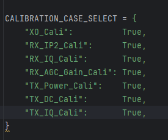

校准结束后，校准日志末尾会有打印提示此次校准执行的校准项，如[图2](#zh-cn_topic_0000002334697196_zh-cn_topic_0000002323762652_fig1468775918479)所示。

**图 2**  执行校准项提示<a name="zh-cn_topic_0000002334697196_zh-cn_topic_0000002323762652_fig1468775918479"></a>  
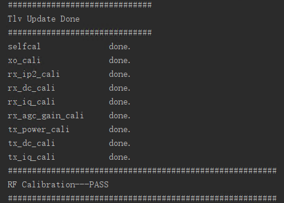

### TX功控调整<a name="ZH-CN_TOPIC_0000002557728365"></a>

在“calibration\_module/CalibrationClass.py”文件中进行TX功控调整，如[图1](#zh-cn_topic_0000002334537428_zh-cn_topic_0000002312448386_fig1186112276287)所示。

**图 1**  TX功控调整<a name="zh-cn_topic_0000002334537428_zh-cn_topic_0000002312448386_fig1186112276287"></a>  
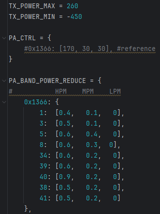

参数说明如下：

-   TX\_POWER\_MAX：校准完成后，模组射频所能配置的最大期望功率， 单位：0.1dBm。
-   TX\_POWER\_MIN：校准完成后，模组射频所能配置的最小期望功率，单位：0.1dBm。
-   PA\_CTRL：三个值分别对应调整模组MPM的最大期望功率、LPM的最大期望功率、各个PM交叉的功率段大小，单位：0.1dBm。
-   PA\_BAND\_POWER\_REDUCE：根据表中正值或者负值相应回退或者抬高对应BAND在对应PA工作模式下的实际功率，单位：dB。

> **须知：** 
>PA\_CTRL和PA\_BAND\_POWER\_REDUCE的key值（即[图1](#zh-cn_topic_0000002334537428_zh-cn_topic_0000002312448386_fig1186112276287)中‘0x1366’）为PA的PRODUCT\_ID（高8bit）和MANUFACTURE\_ID（低12bit）组成的20bit数。

> **说明：** 
>-   PA\_CTRL参数\[a0, a1, a2\]的计算公式：HPM的功率范围\[a0 - a2 + 10，TX\_POWER\_MAX\]，MPM的功率范围为\[a1 - a2 + 10，a0\]，LPM的功率范围为\[TX\_POWER\_MIN，a1\]。
>-   PA\_CTRL的参数请根据PA手册中各个PM的理论功率进行调整，校准完成后会将参数回填进校准文件。PA\_CTRL为空则默认使用校准文件里面的pa\_ctrl参数。
>-   PA\_CTRL和PA\_BAND\_POWER\_REDUCE参数异常会导致校准失败。

### TX高低温频补调整<a name="ZH-CN_TOPIC_0000002526568554"></a>

在“calibration\_module/CalibrationExtra.py”文件中进行TX高低温频补调整，如下图所示：

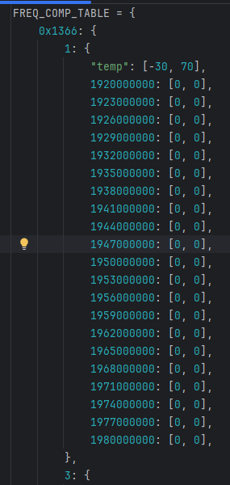

其中一级key值为对应PA的PA ID，二级key值为对应band，内容为温度，以及对应频点高低温补偿值（delta\_L，delta\_H），请参考[TX频率补偿表](#ZH-CN_TOPIC_0000002557648391)说明。

> **须知：** 
>-   PA ID（即图中“0x1366”）为PA的PRODUCT\_ID（高8bit）和MANUFACTURE\_ID（低12bit）组成的20bit数。
>-   对应PA模组校准时，CalibrationExtra中填入频点数量和值必须和校准设置的频点数量和值一致，否则，校准会报错。

### TRX频补精度调整<a name="ZH-CN_TOPIC_0000002557648403"></a>

“calibration\_module/CalibrationClass.py”文件中，可以在“rx agc gain cali”和“tx power cali”接口对应位置设置Band的频补测量点数n，整个频带将从频带最低信道以“Bandwidth/n”的固定频率间隔依次测量agc增益或者功率补偿值，如[图1](#zh-cn_topic_0000002368575465_zh-cn_topic_0000002312608178_fig1845324915572)、[图2](#zh-cn_topic_0000002368575465_zh-cn_topic_0000002312608178_fig1859911598579)所示。

**图 1**  rx agc gain cali接口<a name="zh-cn_topic_0000002368575465_zh-cn_topic_0000002312608178_fig1845324915572"></a>  
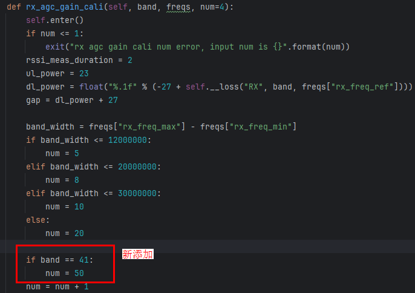

**图 2**  tx power cali接口<a name="zh-cn_topic_0000002368575465_zh-cn_topic_0000002312608178_fig1859911598579"></a>  
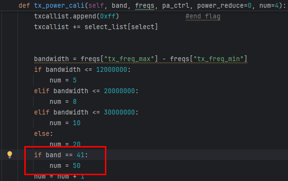

> **说明：** 
>频补测量点数应≤50，且应为奇数（num的值为偶数）。测量点数增加会一定程度上影响校准时间，数量过大可能会导致与仪表无法成功交互。

### 校准文件导出与解析<a name="ZH-CN_TOPIC_0000002526728488"></a>

-   校准文件导出请参见《HiDiTingV100 BurnTool工具 用户指南》“导出镜像”章节，并选择“RadioConfig.tlv”作为导出的Flash（.hbin）文件，将该Flash文件放在“user\_tools”目录下，并执行该目录下“tools.py”文件，根据提示选择对应的操作，即可在“user\_tools/output/”路径下生成与Flash（.hbin）文件同名但不同后缀的校准（.cal）文件。
-   将cal文件转换成tlv文件的流程与方法与上述一致。将cal文件放在“user\_tools”目录下，并执行该目录下“tools.py”文件，选择编号1的cal\_to\_tlv功能后，选取对应的cal文件，即可在“user\_tools/output/”路径下生成对应的tlv文件。

**图 1**  校准文件转换格式<a name="zh-cn_topic_0000002368415549_fig203201882104"></a>  
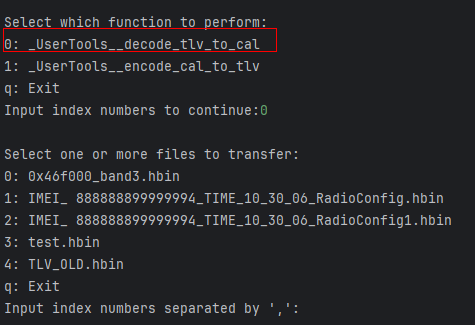

### 产测一拖多<a name="ZH-CN_TOPIC_0000002557728367"></a>

-   **[CMW500配置方法](#ZH-CN_TOPIC_0000002526568556)**  

-   **[CMW100配置方法](#ZH-CN_TOPIC_0000002557648405)**  

#### CMW500配置方法<a name="ZH-CN_TOPIC_0000002526568556"></a>

CMW500仪表一拖多需要仪表拥有license，并打开多仪表模式，此时主窗口可以看到两个sub inst。

**图 1**  CMW500菜单窗口<a name="zh-cn_topic_0000002361696026_zh-cn_topic_0000002391172641_fig194167745"></a>  
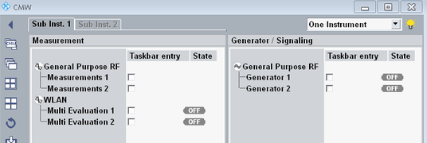

调整“calibration\_test\_configuration.py”中的仪表配置。

当前脚本控制CMW500的第一个子仪表，则设置inst0；若控制第二个子仪表则设置inst1。

**图 2**  脚本配置<a name="zh-cn_topic_0000002361696026_zh-cn_topic_0000002391172641_fig18511035549"></a>  
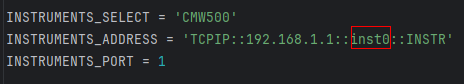

> **说明：** 
>仪表端口INSTRUMENT\_PORT根据实际链接的仪表端口填入。com1、com2为一组，com3、com4为一组，两组端口分别独立，不能选择同一组中的两个端口进行一拖多。

#### CMW100配置方法<a name="ZH-CN_TOPIC_0000002557648405"></a>

CMW100一拖多可以选择将仪表分为2、4、8个子仪表，选择后能在主窗口看见各个sub inst。

**图 1**  CMW100菜单窗口<a name="zh-cn_topic_0000002395215949_zh-cn_topic_0000002357573014_fig5465136135311"></a>  
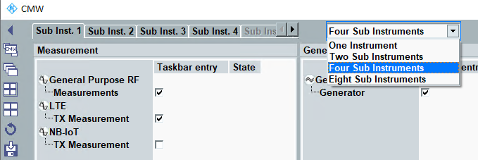

调整“calibration\_test\_configuration.py”中的仪表配置，在RFTOOL中调整inst选择对应的子表，如[图2](#zh-cn_topic_0000002395215949_zh-cn_topic_0000002357573014_fig3136133451010)所示。

**图 2**  脚本配置<a name="zh-cn_topic_0000002395215949_zh-cn_topic_0000002357573014_fig3136133451010"></a>  


**图 3**  工具配置<a name="zh-cn_topic_0000002395215949_zh-cn_topic_0000002357573014_fig17114204176"></a>  


> **说明：** 
>-   CMW100选择划分子仪表后，会将现有的8个端口以组的形式划分：
>    以一拖四为例，8个端口会被划分为4组，每两个相邻的端口为一组，即com1、com2为一组子表inst0；com3、com4为第二组子表inst1...以此类推。
>    同一组的端口从组内第一个端口INSTRUMENT\_PORT记为1，以一拖四为例，com1对应inst0，INSTRUMENT\_PORT=1；com2对应inst0，INSTRUMENT\_PORT=2；com3对应inst1，INSTRUMENT\_PORT=1；com4对应inst1,INSTRUMENT\_PORT=2...以此类推。
>-   每组端口相对独立，选择一拖多的端口不能选择同一组子表内的端口，以一拖二为例，可以选择com1\~4的其中一个端口和5\~8的其中一个端口进行一拖二；同理一拖四可以选择com1、com3、com5、com7。
>-   一拖多并不要求必须使用完所有的端口，在一拖多模式下也可以仅对一个EVK进行校准综测，只需要注意当前选择的配置符合上述的要求即可。

## 综测其他功能<a name="ZH-CN_TOPIC_0000002526728490"></a>

-   **[选择综测项](#ZH-CN_TOPIC_0000002557728369)**  

-   **[综测带宽选择](#ZH-CN_TOPIC_0000002526568558)**  

-   **[最小功率门限设置](#ZH-CN_TOPIC_0000002557648407)**  

-   **[数据输出格式](#ZH-CN_TOPIC_0000002526728492)**  

-   **[最大功率回退](#ZH-CN_TOPIC_0000002557728371)**  

### 选择综测项<a name="ZH-CN_TOPIC_0000002557728369"></a>

“calibration\_test\_configuration.ini”文件中“TEST\_CASE\_SELECT”参数可以选择综测时需要的综测项，默认全部开启，不需要选择的综测项请将其置为False。

**图 1**  选择综测项<a name="zh-cn_topic_0000002334697200_zh-cn_topic_0000002345590345_fig17141933700"></a>  
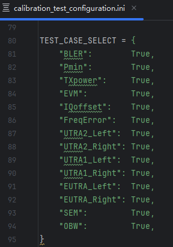

### 综测带宽选择<a name="ZH-CN_TOPIC_0000002526568558"></a>

“radiotest\_module/RadioTestMain.py”文件中“ul\_bw\_index”参数可以修改综测想要选择的带宽，index取值3或5，分别对应带宽10MHz或20MHz。

**图 1**  综测带宽选择<a name="zh-cn_topic_0000002334537432_zh-cn_topic_0000002345710161_fig7251461210"></a>  
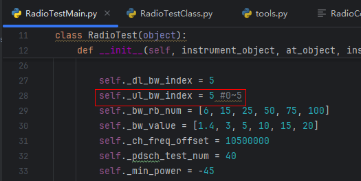

### 最小功率门限设置<a name="ZH-CN_TOPIC_0000002557648407"></a>

“radiotest\_module/RadioTestMain.py”文件中“min\_power\_threshold”（红框所示）参数可以调整最小功率的门限。

**图 1**  最小功率门限设置<a name="zh-cn_topic_0000002368575469_zh-cn_topic_0000002346729257_fig782217421634"></a>  
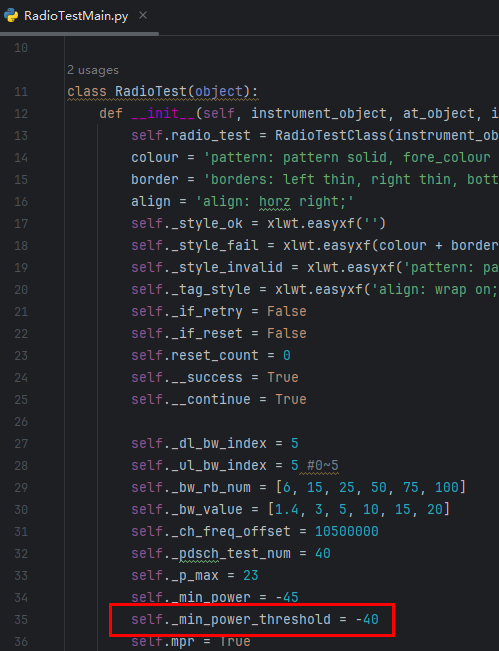

> **说明：** 
>协议上规定最小功率需要小于-39dBm，由于测量存在波动，因此默认留有1dB余量。

### 数据输出格式<a name="ZH-CN_TOPIC_0000002526728492"></a>

> **说明：** 
>请至少选择一种输出格式，否则综测会报错。

“calibration\_test\_configuration.ini”文件中“TEST\_OUTPUT\_FORMAT”参数可以控制综测数据输出到excel表格的格式。

**图 1**  数据输出格式设置<a name="zh-cn_topic_0000002368415589_zh-cn_topic_0000002358202481_fig141021871455"></a>  
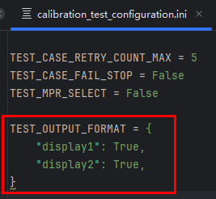

输入格式如[图2](#zh-cn_topic_0000002368415589_zh-cn_topic_0000002358202481_fig12721282535)、[图3](#zh-cn_topic_0000002368415589_zh-cn_topic_0000002358202481_fig834931610539)所示。

**图 2**  display1<a name="zh-cn_topic_0000002368415589_zh-cn_topic_0000002358202481_fig12721282535"></a>  
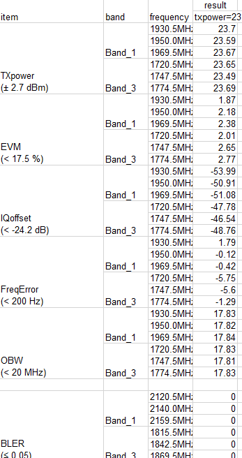

**图 3**  display2<a name="zh-cn_topic_0000002368415589_zh-cn_topic_0000002358202481_fig834931610539"></a>  
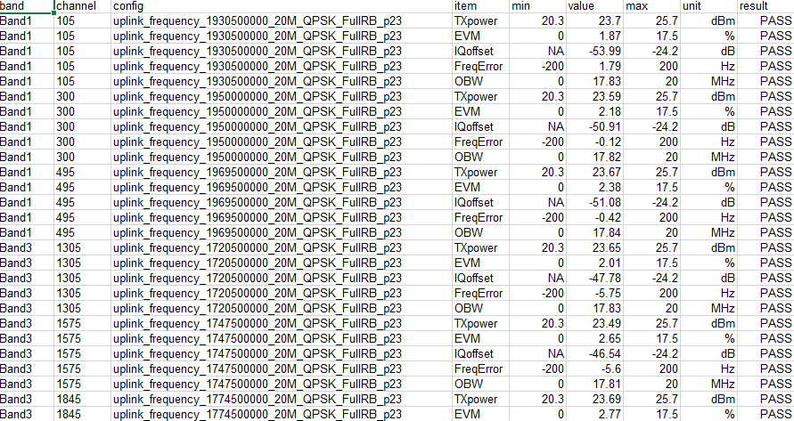

### 最大功率回退<a name="ZH-CN_TOPIC_0000002557728371"></a>

“calibration\_test\_configuration.ini”文件中“TEST\_MPR\_SELECT”参数可以选择综测在默认满RB下最大功率回退1dB，默认为False关闭。

**图 1**  最大功率回退配置<a name="zh-cn_topic_0000002526727716_zh-cn_topic_0000002336786888_fig557118547311"></a>  
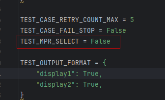

## 金板线损点验<a name="ZH-CN_TOPIC_0000002526568560"></a>

-   **[线损配置文件说明](#ZH-CN_TOPIC_0000002557648409)**  

-   **[制作金板](#ZH-CN_TOPIC_0000002526728494)**  

-   **[测量线损](#ZH-CN_TOPIC_0000002557728373)**  

### 线损配置文件说明<a name="ZH-CN_TOPIC_0000002557648409"></a>

**图 1**  线损配置文件<a name="zh-cn_topic_0000002334537436_zh-cn_topic_0000002218735878_fig17989527153712"></a>  
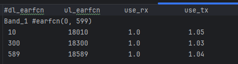

**表 1**  线损配置文件参数说明

<a name="zh-cn_topic_0000002334537436_zh-cn_topic_0000002218735878_table02531213202818"></a>
<table><thead align="left"><tr id="zh-cn_topic_0000002334537436_zh-cn_topic_0000002218735878_row725431315284"><th class="cellrowborder" valign="top" width="33.33333333333333%" id="mcps1.2.4.1.1"><p id="zh-cn_topic_0000002334537436_zh-cn_topic_0000002218735878_p10254813102816"><a name="zh-cn_topic_0000002334537436_zh-cn_topic_0000002218735878_p10254813102816"></a><a name="zh-cn_topic_0000002334537436_zh-cn_topic_0000002218735878_p10254813102816"></a>参数名称</p>
</th>
<th class="cellrowborder" valign="top" width="33.33333333333333%" id="mcps1.2.4.1.2"><p id="zh-cn_topic_0000002334537436_zh-cn_topic_0000002218735878_p625431372817"><a name="zh-cn_topic_0000002334537436_zh-cn_topic_0000002218735878_p625431372817"></a><a name="zh-cn_topic_0000002334537436_zh-cn_topic_0000002218735878_p625431372817"></a>说明</p>
</th>
<th class="cellrowborder" valign="top" width="33.33333333333333%" id="mcps1.2.4.1.3"><p id="zh-cn_topic_0000002334537436_zh-cn_topic_0000002218735878_p1225415134285"><a name="zh-cn_topic_0000002334537436_zh-cn_topic_0000002218735878_p1225415134285"></a><a name="zh-cn_topic_0000002334537436_zh-cn_topic_0000002218735878_p1225415134285"></a>单位</p>
</th>
</tr>
</thead>
<tbody><tr id="zh-cn_topic_0000002334537436_zh-cn_topic_0000002218735878_row1025419131286"><td class="cellrowborder" valign="top" width="33.33333333333333%" headers="mcps1.2.4.1.1 "><p id="zh-cn_topic_0000002334537436_zh-cn_topic_0000002218735878_p225421302813"><a name="zh-cn_topic_0000002334537436_zh-cn_topic_0000002218735878_p225421302813"></a><a name="zh-cn_topic_0000002334537436_zh-cn_topic_0000002218735878_p225421302813"></a>dl_earfcn</p>
</td>
<td class="cellrowborder" valign="top" width="33.33333333333333%" headers="mcps1.2.4.1.2 "><p id="zh-cn_topic_0000002334537436_zh-cn_topic_0000002218735878_p525431319289"><a name="zh-cn_topic_0000002334537436_zh-cn_topic_0000002218735878_p525431319289"></a><a name="zh-cn_topic_0000002334537436_zh-cn_topic_0000002218735878_p525431319289"></a>下行频点号。</p>
</td>
<td class="cellrowborder" valign="top" width="33.33333333333333%" headers="mcps1.2.4.1.3 "><p id="zh-cn_topic_0000002334537436_zh-cn_topic_0000002218735878_p6254101342820"><a name="zh-cn_topic_0000002334537436_zh-cn_topic_0000002218735878_p6254101342820"></a><a name="zh-cn_topic_0000002334537436_zh-cn_topic_0000002218735878_p6254101342820"></a>-</p>
</td>
</tr>
<tr id="zh-cn_topic_0000002334537436_zh-cn_topic_0000002218735878_row625411310285"><td class="cellrowborder" valign="top" width="33.33333333333333%" headers="mcps1.2.4.1.1 "><p id="zh-cn_topic_0000002334537436_zh-cn_topic_0000002218735878_p2025421317281"><a name="zh-cn_topic_0000002334537436_zh-cn_topic_0000002218735878_p2025421317281"></a><a name="zh-cn_topic_0000002334537436_zh-cn_topic_0000002218735878_p2025421317281"></a>ul_earfcn</p>
</td>
<td class="cellrowborder" valign="top" width="33.33333333333333%" headers="mcps1.2.4.1.2 "><p id="zh-cn_topic_0000002334537436_zh-cn_topic_0000002218735878_p82541913172815"><a name="zh-cn_topic_0000002334537436_zh-cn_topic_0000002218735878_p82541913172815"></a><a name="zh-cn_topic_0000002334537436_zh-cn_topic_0000002218735878_p82541913172815"></a>上行频点号，与下行频点号对应。</p>
</td>
<td class="cellrowborder" valign="top" width="33.33333333333333%" headers="mcps1.2.4.1.3 "><p id="zh-cn_topic_0000002334537436_zh-cn_topic_0000002218735878_p1825420133281"><a name="zh-cn_topic_0000002334537436_zh-cn_topic_0000002218735878_p1825420133281"></a><a name="zh-cn_topic_0000002334537436_zh-cn_topic_0000002218735878_p1825420133281"></a>-</p>
</td>
</tr>
<tr id="zh-cn_topic_0000002334537436_zh-cn_topic_0000002218735878_row63261249142914"><td class="cellrowborder" valign="top" width="33.33333333333333%" headers="mcps1.2.4.1.1 "><p id="zh-cn_topic_0000002334537436_zh-cn_topic_0000002218735878_p133261749102919"><a name="zh-cn_topic_0000002334537436_zh-cn_topic_0000002218735878_p133261749102919"></a><a name="zh-cn_topic_0000002334537436_zh-cn_topic_0000002218735878_p133261749102919"></a>use_rx</p>
</td>
<td class="cellrowborder" valign="top" width="33.33333333333333%" headers="mcps1.2.4.1.2 "><p id="zh-cn_topic_0000002334537436_zh-cn_topic_0000002218735878_p9326104914299"><a name="zh-cn_topic_0000002334537436_zh-cn_topic_0000002218735878_p9326104914299"></a><a name="zh-cn_topic_0000002334537436_zh-cn_topic_0000002218735878_p9326104914299"></a>校准综测使用的Rx线损值。</p>
</td>
<td class="cellrowborder" valign="top" width="33.33333333333333%" headers="mcps1.2.4.1.3 "><p id="zh-cn_topic_0000002334537436_zh-cn_topic_0000002218735878_p132644922918"><a name="zh-cn_topic_0000002334537436_zh-cn_topic_0000002218735878_p132644922918"></a><a name="zh-cn_topic_0000002334537436_zh-cn_topic_0000002218735878_p132644922918"></a>dB</p>
</td>
</tr>
<tr id="zh-cn_topic_0000002334537436_zh-cn_topic_0000002218735878_row121501053162920"><td class="cellrowborder" valign="top" width="33.33333333333333%" headers="mcps1.2.4.1.1 "><p id="zh-cn_topic_0000002334537436_zh-cn_topic_0000002218735878_p61501753202912"><a name="zh-cn_topic_0000002334537436_zh-cn_topic_0000002218735878_p61501753202912"></a><a name="zh-cn_topic_0000002334537436_zh-cn_topic_0000002218735878_p61501753202912"></a>use_tx</p>
</td>
<td class="cellrowborder" valign="top" width="33.33333333333333%" headers="mcps1.2.4.1.2 "><p id="zh-cn_topic_0000002334537436_zh-cn_topic_0000002218735878_p13150653182917"><a name="zh-cn_topic_0000002334537436_zh-cn_topic_0000002218735878_p13150653182917"></a><a name="zh-cn_topic_0000002334537436_zh-cn_topic_0000002218735878_p13150653182917"></a>校准综测使用的Tx线损值。</p>
</td>
<td class="cellrowborder" valign="top" width="33.33333333333333%" headers="mcps1.2.4.1.3 "><p id="zh-cn_topic_0000002334537436_zh-cn_topic_0000002218735878_p13150145392914"><a name="zh-cn_topic_0000002334537436_zh-cn_topic_0000002218735878_p13150145392914"></a><a name="zh-cn_topic_0000002334537436_zh-cn_topic_0000002218735878_p13150145392914"></a>dB</p>
</td>
</tr>
</tbody>
</table>

### 制作金板<a name="ZH-CN_TOPIC_0000002526728494"></a>

1.  准备好用于制作金板的单板和环境，在“PathLossTable.txt”文件中use\_rx和use\_tx两列配置好可靠的线损值，并完成校准。
2.  将“calibration\_test\_configuration.py”中的CABLE\_LOSS\_CAL\_MODE置为1。
3.  通过“calibration\_test\_configuration.ini”中的CALIBRATION\_BAND\_SELECT字段选择频段。
4.  运行“user\_tools/CalPathLoss.py”文件。

> **说明：** 
>-   已经是金板的EVK无法重新制作金板和重新校准，如果需要重新制作金板或重新校准，需要通过AT发送命令AT+NGOLD=00清除金板数据。
>-   建议使用相同型号的仪表制作金板和测量线损。

### 测量线损<a name="ZH-CN_TOPIC_0000002557728373"></a>

1.  准备好金板和环境。
2.  将“calibration\_test\_configuration.py”中的CABLE\_LOSS\_CAL\_MODE置为0。
3.  通过“calibration\_test\_configuration.ini”中的CALIBRATION\_BAND\_SELECT字段选择频段。
4.  通过“calibration\_test\_configuration.py”中的CABLE\_LOSS\_DELTA\_LIMIT配置线损门限。
5.  运行“user\_tools/CalPathLoss.py”文件。

## 温补数据提取<a name="ZH-CN_TOPIC_0000002526568562"></a>

-   **[功率温补值提取](#ZH-CN_TOPIC_0000002557648411)**  

-   **[DCXO温补系数提取](#ZH-CN_TOPIC_0000002526728496)**  

### 功率温补值提取<a name="ZH-CN_TOPIC_0000002557648411"></a>

1.  准备好单板，放入温箱（常温25℃），完成校准，并保持环境，不要挪用新生成的校准文件。
2.  <a name="zh-cn_topic_0000002334537440_zh-cn_topic_0000002343383253_li0433882320"></a>打开“user\_tools/TxTempCompMea.py”文件，如[图1](#zh-cn_topic_0000002334537440_zh-cn_topic_0000002343383253_fig1497312249375)所示设置bands和温度并执行文件，等待完成即可。

    **图 1**  设置bands和温度<a name="zh-cn_topic_0000002334537440_zh-cn_topic_0000002343383253_fig1497312249375"></a>  
    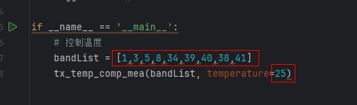

3.  更改需要测量的温度（无顺序要求），等到温箱温度到达指定温度后，重复[2](#zh-cn_topic_0000002334537440_zh-cn_topic_0000002343383253_li0433882320)，直至所需温度点均测量完成。
4.  打开“user\_tools/TxTempCompCal.py”文件，配置好bands和常温设定值，执行文件。温补测量的最终结果将存放在“user\_tools/data.json”文件中。

    .png)

5.  打开“user\_tools/TxTempCompLoad.py”文件，使用脚本将提取的温补参数从“data.json”文件中直接写入校准文件对应的温度补偿表中。

    .png)

    其中bands参数代表需要将温补表中的哪些band进行写入；temps参数代表需要将哪些温度点的参数写入温补表中，一般使用默认配置即可。temps中选取的温度点不要超过10个。

6.  运行温补回填文件后，需要手动键入温补表序号，范围为1～4。此序号必须与该单板对应PA在PA TABLE中的index一致，否则无法匹配上对应的温补表。

    .png)

> **说明：** 
>-   后续模组如果需要使用更新温补参数后的校准文件，则需要将修改同步到SDK当中。
>-   操作方法参考“[校准准备](#ZH-CN_TOPIC_0000002557648385)”章节中的须知。

### DCXO温补系数提取<a name="ZH-CN_TOPIC_0000002526728496"></a>

根据厂家提供的批量温漂数据提取平均值，拟合出频偏（ppbillion/4）关于温度（t-25）的一元三次多项式，所得到的一、二、三次项系数左移16位取整，填入PA配置表中的xo coef，其常数项为通用参数配置表中的FreqErrorScaled，在产线校准时会作为残留频偏校准出来（每个单板有差异）。提取步骤示例可参考附件《DCXO温度系数计算》

## 其他自定义功能<a name="ZH-CN_TOPIC_0000002557728375"></a>

“common\_module/Custom.py”文件中存放着一些还未完全实现的接口，需要客户根据需求自定义实现。

-   **[解析命令行传入参数](#ZH-CN_TOPIC_0000002526568564)**  

-   **[IMEI、SN和版本号检查](#ZH-CN_TOPIC_0000002557648413)**  

-   **[过站检查](#ZH-CN_TOPIC_0000002526728498)**  

-   **[日志打包和上传](#ZH-CN_TOPIC_0000002557728377)**  

### 解析命令行传入参数<a name="ZH-CN_TOPIC_0000002526568564"></a>

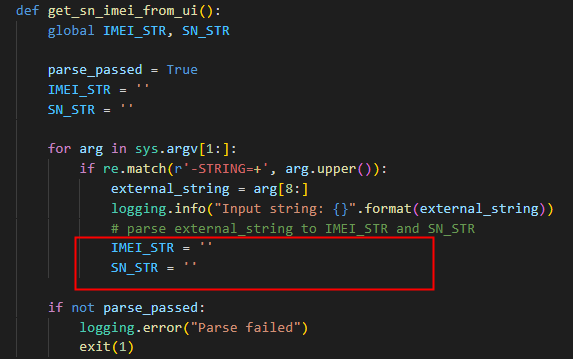

命令行入参-STRING=（或扫码枪输入）需要解析成IMEI\_STR和SN\_STR，解析成功将“prase\_passed”置True。该接口在校准综测前会被调用。

### IMEI、SN和版本号检查<a name="ZH-CN_TOPIC_0000002557648413"></a>

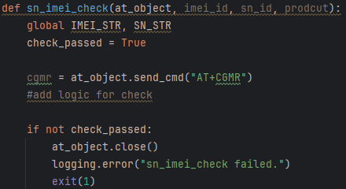

变量说明如下：

-   imei\_id、sn\_id为模组已经写入的IMEI号和SN号。
-   product为脚本记录的版本号。
-   IMEI\_STR、SN\_STR为外部传入（或扫码枪传入）的IMEI号和SN号。
-   cgmr为模组已经写入的版本号，cgmr是list模式，版本号的获取还未实现。

用上述变量进行一致性检查时，检查失败请将“check\_passed”置为“False”。

该接口在校准综测前会被调用。

### 过站检查<a name="ZH-CN_TOPIC_0000002526728498"></a>

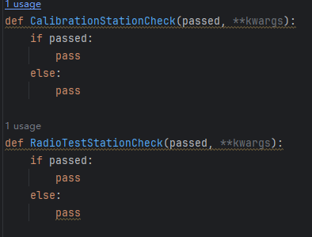

-   过站检查接口是用于用户通过校准、综测是否成功的结果来执行用户自定义功能的接口。
-   当MODE\_SELECT只选择了校准或综测其中一个时，过站检查接口只会调用MODE\_SELECT选择的对应的接口；MODE\_SELECT选3时则两个接口都会调用。
-   将需要校准或综测成功后调用的自定义功能放在过站检查接口的if分支，需要失败时调用的功能则放在else分支，无论校准综测结果成功与否都需要调用的部分放在if分支之前。

### 日志打包和上传<a name="ZH-CN_TOPIC_0000002557728377"></a>

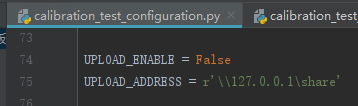

-   如果需要开启日志打包和上传功能，将UPLOAD\_ENABLE置为True：
    -   通过UPLOAD\_ADDRESS配置的地址将校准综测生成的日志和数据打包成压缩包的形式再上传到指定地址，只支持本地上传。
    -   压缩包的命名以imei和sn和时间戳命名，命名后缀可以通过pass或者fail来判断该次校准综测的结果成功与否。
    -   校准综测流程开始前会检查UPLOAD\_ADDRESS是否可以访问，若不可访问则会报错。
    -   若要上传的地址为网络IP地址，IP前面的格式为双斜杠；若为本地地址则在单引号内修改为绝对路径即可。

## 故障检查<a name="ZH-CN_TOPIC_0000002526568566"></a>

**表 1**  故障原因排查表

<a name="zh-cn_topic_0000002368415605_zh-cn_topic_0000002309519892_table117714115439"></a>
<table><thead align="left"><tr id="zh-cn_topic_0000002368415605_zh-cn_topic_0000002309519892_row1577191184317"><th class="cellrowborder" valign="top" width="12.490000000000002%" id="mcps1.2.5.1.1"><p id="zh-cn_topic_0000002368415605_zh-cn_topic_0000002309519892_p7771121164312"><a name="zh-cn_topic_0000002368415605_zh-cn_topic_0000002309519892_p7771121164312"></a><a name="zh-cn_topic_0000002368415605_zh-cn_topic_0000002309519892_p7771121164312"></a>运行阶段</p>
</th>
<th class="cellrowborder" valign="top" width="17.880000000000003%" id="mcps1.2.5.1.2"><p id="zh-cn_topic_0000002368415605_zh-cn_topic_0000002309519892_p577212164318"><a name="zh-cn_topic_0000002368415605_zh-cn_topic_0000002309519892_p577212164318"></a><a name="zh-cn_topic_0000002368415605_zh-cn_topic_0000002309519892_p577212164318"></a>运行子项</p>
</th>
<th class="cellrowborder" valign="top" width="50.440000000000005%" id="mcps1.2.5.1.3"><p id="zh-cn_topic_0000002368415605_zh-cn_topic_0000002309519892_p677215113431"><a name="zh-cn_topic_0000002368415605_zh-cn_topic_0000002309519892_p677215113431"></a><a name="zh-cn_topic_0000002368415605_zh-cn_topic_0000002309519892_p677215113431"></a>报错具体内容</p>
</th>
<th class="cellrowborder" valign="top" width="19.19%" id="mcps1.2.5.1.4"><p id="zh-cn_topic_0000002368415605_zh-cn_topic_0000002309519892_p3772318437"><a name="zh-cn_topic_0000002368415605_zh-cn_topic_0000002309519892_p3772318437"></a><a name="zh-cn_topic_0000002368415605_zh-cn_topic_0000002309519892_p3772318437"></a>可能原因</p>
</th>
</tr>
</thead>
<tbody><tr id="zh-cn_topic_0000002368415605_zh-cn_topic_0000002309519892_row8772116433"><td class="cellrowborder" rowspan="8" valign="top" width="12.490000000000002%" headers="mcps1.2.5.1.1 "><p id="zh-cn_topic_0000002368415605_zh-cn_topic_0000002309519892_p87728164312"><a name="zh-cn_topic_0000002368415605_zh-cn_topic_0000002309519892_p87728164312"></a><a name="zh-cn_topic_0000002368415605_zh-cn_topic_0000002309519892_p87728164312"></a>前置检查</p>
</td>
<td class="cellrowborder" valign="top" width="17.880000000000003%" headers="mcps1.2.5.1.2 "><p id="zh-cn_topic_0000002368415605_zh-cn_topic_0000002309519892_p15772171184320"><a name="zh-cn_topic_0000002368415605_zh-cn_topic_0000002309519892_p15772171184320"></a><a name="zh-cn_topic_0000002368415605_zh-cn_topic_0000002309519892_p15772171184320"></a>log初始化配置</p>
</td>
<td class="cellrowborder" valign="top" width="50.440000000000005%" headers="mcps1.2.5.1.3 "><p id="zh-cn_topic_0000002368415605_zh-cn_topic_0000002309519892_p575418360558"><a name="zh-cn_topic_0000002368415605_zh-cn_topic_0000002309519892_p575418360558"></a><a name="zh-cn_topic_0000002368415605_zh-cn_topic_0000002309519892_p575418360558"></a>Special characters are not supported for calibration tool path!</p>
<p id="zh-cn_topic_0000002368415605_zh-cn_topic_0000002309519892_p198861745115520"><a name="zh-cn_topic_0000002368415605_zh-cn_topic_0000002309519892_p198861745115520"></a><a name="zh-cn_topic_0000002368415605_zh-cn_topic_0000002309519892_p198861745115520"></a>Including but not limited to: ^&(),; and space character</p>
<p id="zh-cn_topic_0000002368415605_zh-cn_topic_0000002309519892_p18323115335514"><a name="zh-cn_topic_0000002368415605_zh-cn_topic_0000002309519892_p18323115335514"></a><a name="zh-cn_topic_0000002368415605_zh-cn_topic_0000002309519892_p18323115335514"></a>Please correct them and run again!</p>
</td>
<td class="cellrowborder" valign="top" width="19.19%" headers="mcps1.2.5.1.4 "><p id="zh-cn_topic_0000002368415605_zh-cn_topic_0000002309519892_p18772141134319"><a name="zh-cn_topic_0000002368415605_zh-cn_topic_0000002309519892_p18772141134319"></a><a name="zh-cn_topic_0000002368415605_zh-cn_topic_0000002309519892_p18772141134319"></a>脚本路径中含有特殊字符。</p>
</td>
</tr>
<tr id="zh-cn_topic_0000002368415605_zh-cn_topic_0000002309519892_row107721111435"><td class="cellrowborder" valign="top" headers="mcps1.2.5.1.1 "><p id="zh-cn_topic_0000002368415605_zh-cn_topic_0000002309519892_p6772141114319"><a name="zh-cn_topic_0000002368415605_zh-cn_topic_0000002309519892_p6772141114319"></a><a name="zh-cn_topic_0000002368415605_zh-cn_topic_0000002309519892_p6772141114319"></a>脚本运行时</p>
</td>
<td class="cellrowborder" valign="top" headers="mcps1.2.5.1.2 "><p id="zh-cn_topic_0000002368415605_zh-cn_topic_0000002309519892_p1977219134316"><a name="zh-cn_topic_0000002368415605_zh-cn_topic_0000002309519892_p1977219134316"></a><a name="zh-cn_topic_0000002368415605_zh-cn_topic_0000002309519892_p1977219134316"></a>python库文件错误</p>
</td>
<td class="cellrowborder" valign="top" headers="mcps1.2.5.1.3 "><p id="zh-cn_topic_0000002368415605_zh-cn_topic_0000002309519892_p7772101134312"><a name="zh-cn_topic_0000002368415605_zh-cn_topic_0000002309519892_p7772101134312"></a><a name="zh-cn_topic_0000002368415605_zh-cn_topic_0000002309519892_p7772101134312"></a>缺少对应库文件。</p>
</td>
</tr>
<tr id="zh-cn_topic_0000002368415605_zh-cn_topic_0000002309519892_row377214119436"><td class="cellrowborder" valign="top" headers="mcps1.2.5.1.1 "><p id="zh-cn_topic_0000002368415605_zh-cn_topic_0000002309519892_p17728120436"><a name="zh-cn_topic_0000002368415605_zh-cn_topic_0000002309519892_p17728120436"></a><a name="zh-cn_topic_0000002368415605_zh-cn_topic_0000002309519892_p17728120436"></a>COM申请链接</p>
</td>
<td class="cellrowborder" valign="top" headers="mcps1.2.5.1.2 "><p id="zh-cn_topic_0000002368415605_zh-cn_topic_0000002309519892_p17729111431"><a name="zh-cn_topic_0000002368415605_zh-cn_topic_0000002309519892_p17729111431"></a><a name="zh-cn_topic_0000002368415605_zh-cn_topic_0000002309519892_p17729111431"></a>1.Error: EVK not responding</p>
<p id="zh-cn_topic_0000002368415605_zh-cn_topic_0000002309519892_p179971323164915"><a name="zh-cn_topic_0000002368415605_zh-cn_topic_0000002309519892_p179971323164915"></a><a name="zh-cn_topic_0000002368415605_zh-cn_topic_0000002309519892_p179971323164915"></a>2.The serial port COM15 failed to open. Please check the serial port.</p>
</td>
<td class="cellrowborder" valign="top" headers="mcps1.2.5.1.3 "><a name="zh-cn_topic_0000002368415605_zh-cn_topic_0000002309519892_ul16260135111212"></a><a name="zh-cn_topic_0000002368415605_zh-cn_topic_0000002309519892_ul16260135111212"></a><ul id="zh-cn_topic_0000002368415605_zh-cn_topic_0000002309519892_ul16260135111212"><li>config中COM配置格式有误。</li><li>COM未连接或被占用。</li></ul>
</td>
</tr>
<tr id="zh-cn_topic_0000002368415605_zh-cn_topic_0000002309519892_row777271154317"><td class="cellrowborder" valign="top" headers="mcps1.2.5.1.1 "><p id="zh-cn_topic_0000002368415605_zh-cn_topic_0000002309519892_p1777211164314"><a name="zh-cn_topic_0000002368415605_zh-cn_topic_0000002309519892_p1777211164314"></a><a name="zh-cn_topic_0000002368415605_zh-cn_topic_0000002309519892_p1777211164314"></a>脚本运行时</p>
</td>
<td class="cellrowborder" valign="top" headers="mcps1.2.5.1.2 "><p id="zh-cn_topic_0000002368415605_zh-cn_topic_0000002309519892_p109261891932"><a name="zh-cn_topic_0000002368415605_zh-cn_topic_0000002309519892_p109261891932"></a><a name="zh-cn_topic_0000002368415605_zh-cn_topic_0000002309519892_p109261891932"></a>OSError: Could not open VISA library</p>
<p id="zh-cn_topic_0000002368415605_zh-cn_topic_0000002309519892_p861518271434"><a name="zh-cn_topic_0000002368415605_zh-cn_topic_0000002309519892_p861518271434"></a><a name="zh-cn_topic_0000002368415605_zh-cn_topic_0000002309519892_p861518271434"></a>Please make the following changes:</p>
<p id="zh-cn_topic_0000002368415605_zh-cn_topic_0000002309519892_p1764918361739"><a name="zh-cn_topic_0000002368415605_zh-cn_topic_0000002309519892_p1764918361739"></a><a name="zh-cn_topic_0000002368415605_zh-cn_topic_0000002309519892_p1764918361739"></a>Find the path to visa32.dll and place the path in visa.ResourceManager</p>
<p id="zh-cn_topic_0000002368415605_zh-cn_topic_0000002309519892_p1875613451239"><a name="zh-cn_topic_0000002368415605_zh-cn_topic_0000002309519892_p1875613451239"></a><a name="zh-cn_topic_0000002368415605_zh-cn_topic_0000002309519892_p1875613451239"></a>For example: visa.ResourceManager(C:\\Windows\System32\\visa32.dll)</p>
</td>
<td class="cellrowborder" valign="top" headers="mcps1.2.5.1.3 "><p id="zh-cn_topic_0000002368415605_zh-cn_topic_0000002309519892_p877220174310"><a name="zh-cn_topic_0000002368415605_zh-cn_topic_0000002309519892_p877220174310"></a><a name="zh-cn_topic_0000002368415605_zh-cn_topic_0000002309519892_p877220174310"></a>环境未安装VISA或环境变量未正确配置。</p>
</td>
</tr>
<tr id="zh-cn_topic_0000002368415605_zh-cn_topic_0000002309519892_row8772191154318"><td class="cellrowborder" valign="top" headers="mcps1.2.5.1.1 "><p id="zh-cn_topic_0000002368415605_zh-cn_topic_0000002309519892_p4772118437"><a name="zh-cn_topic_0000002368415605_zh-cn_topic_0000002309519892_p4772118437"></a><a name="zh-cn_topic_0000002368415605_zh-cn_topic_0000002309519892_p4772118437"></a>仪表初始化配置</p>
</td>
<td class="cellrowborder" valign="top" headers="mcps1.2.5.1.2 "><p id="zh-cn_topic_0000002368415605_zh-cn_topic_0000002309519892_p1777213114317"><a name="zh-cn_topic_0000002368415605_zh-cn_topic_0000002309519892_p1777213114317"></a><a name="zh-cn_topic_0000002368415605_zh-cn_topic_0000002309519892_p1777213114317"></a>1.Please check whether the CMW500 software is open or the instrument IP address is correct</p>
<p id="zh-cn_topic_0000002368415605_zh-cn_topic_0000002309519892_p1299081617547"><a name="zh-cn_topic_0000002368415605_zh-cn_topic_0000002309519892_p1299081617547"></a><a name="zh-cn_topic_0000002368415605_zh-cn_topic_0000002309519892_p1299081617547"></a>2.Fail item : The selected instrument does not support or spell errors, please reselect the instrument</p>
<p id="zh-cn_topic_0000002368415605_zh-cn_topic_0000002309519892_p1654242265415"><a name="zh-cn_topic_0000002368415605_zh-cn_topic_0000002309519892_p1654242265415"></a><a name="zh-cn_topic_0000002368415605_zh-cn_topic_0000002309519892_p1654242265415"></a>3.Please check whether the port is correct</p>
</td>
<td class="cellrowborder" valign="top" headers="mcps1.2.5.1.3 "><a name="zh-cn_topic_0000002368415605_zh-cn_topic_0000002309519892_ul14351349101217"></a><a name="zh-cn_topic_0000002368415605_zh-cn_topic_0000002309519892_ul14351349101217"></a><ul id="zh-cn_topic_0000002368415605_zh-cn_topic_0000002309519892_ul14351349101217"><li>仪表未开启或IP配置错误。</li><li>选择了不支持的仪表。</li><li>选择了仪表不支持的端口号。</li></ul>
</td>
</tr>
<tr id="zh-cn_topic_0000002368415605_zh-cn_topic_0000002309519892_row137729134316"><td class="cellrowborder" valign="top" headers="mcps1.2.5.1.1 "><p id="zh-cn_topic_0000002368415605_zh-cn_topic_0000002309519892_p1648871012590"><a name="zh-cn_topic_0000002368415605_zh-cn_topic_0000002309519892_p1648871012590"></a><a name="zh-cn_topic_0000002368415605_zh-cn_topic_0000002309519892_p1648871012590"></a>金板检测</p>
</td>
<td class="cellrowborder" valign="top" headers="mcps1.2.5.1.2 "><p id="zh-cn_topic_0000002368415605_zh-cn_topic_0000002309519892_p737218311412"><a name="zh-cn_topic_0000002368415605_zh-cn_topic_0000002309519892_p737218311412"></a><a name="zh-cn_topic_0000002368415605_zh-cn_topic_0000002309519892_p737218311412"></a>Gold board can not run calibration.</p>
</td>
<td class="cellrowborder" valign="top" headers="mcps1.2.5.1.3 "><p id="zh-cn_topic_0000002368415605_zh-cn_topic_0000002309519892_p1177211154311"><a name="zh-cn_topic_0000002368415605_zh-cn_topic_0000002309519892_p1177211154311"></a><a name="zh-cn_topic_0000002368415605_zh-cn_topic_0000002309519892_p1177211154311"></a>制作金板后需要先清除数据后才能继续校准。</p>
</td>
</tr>
<tr id="zh-cn_topic_0000002368415605_zh-cn_topic_0000002309519892_row1177218134320"><td class="cellrowborder" valign="top" headers="mcps1.2.5.1.1 "><p id="zh-cn_topic_0000002368415605_zh-cn_topic_0000002309519892_p1877212118437"><a name="zh-cn_topic_0000002368415605_zh-cn_topic_0000002309519892_p1877212118437"></a><a name="zh-cn_topic_0000002368415605_zh-cn_topic_0000002309519892_p1877212118437"></a>线损初始化</p>
</td>
<td class="cellrowborder" valign="top" headers="mcps1.2.5.1.2 "><p id="zh-cn_topic_0000002368415605_zh-cn_topic_0000002309519892_p1177213118436"><a name="zh-cn_topic_0000002368415605_zh-cn_topic_0000002309519892_p1177213118436"></a><a name="zh-cn_topic_0000002368415605_zh-cn_topic_0000002309519892_p1177213118436"></a>1.Please check the PathLossTable.csv file path,the path does not exist</p>
<p id="zh-cn_topic_0000002368415605_zh-cn_topic_0000002309519892_p195488388716"><a name="zh-cn_topic_0000002368415605_zh-cn_topic_0000002309519892_p195488388716"></a><a name="zh-cn_topic_0000002368415605_zh-cn_topic_0000002309519892_p195488388716"></a>2.PathLossFile is not complete, no band</p>
</td>
<td class="cellrowborder" valign="top" headers="mcps1.2.5.1.3 "><a name="zh-cn_topic_0000002368415605_zh-cn_topic_0000002309519892_ul14905185931210"></a><a name="zh-cn_topic_0000002368415605_zh-cn_topic_0000002309519892_ul14905185931210"></a><ul id="zh-cn_topic_0000002368415605_zh-cn_topic_0000002309519892_ul14905185931210"><li>找不到同名的线损文件。</li><li>线损文件中Band重复或缺失。</li></ul>
</td>
</tr>
<tr id="zh-cn_topic_0000002368415605_zh-cn_topic_0000002309519892_row1895214371636"><td class="cellrowborder" valign="top" headers="mcps1.2.5.1.1 "><p id="zh-cn_topic_0000002368415605_zh-cn_topic_0000002309519892_p89528376313"><a name="zh-cn_topic_0000002368415605_zh-cn_topic_0000002309519892_p89528376313"></a><a name="zh-cn_topic_0000002368415605_zh-cn_topic_0000002309519892_p89528376313"></a>校准类实例初始化</p>
</td>
<td class="cellrowborder" valign="top" headers="mcps1.2.5.1.2 "><p id="zh-cn_topic_0000002368415605_zh-cn_topic_0000002309519892_p132061955446"><a name="zh-cn_topic_0000002368415605_zh-cn_topic_0000002309519892_p132061955446"></a><a name="zh-cn_topic_0000002368415605_zh-cn_topic_0000002309519892_p132061955446"></a>Please check the RadioConfig.cal file path</p>
</td>
<td class="cellrowborder" valign="top" headers="mcps1.2.5.1.3 "><p id="zh-cn_topic_0000002368415605_zh-cn_topic_0000002309519892_p3952193716319"><a name="zh-cn_topic_0000002368415605_zh-cn_topic_0000002309519892_p3952193716319"></a><a name="zh-cn_topic_0000002368415605_zh-cn_topic_0000002309519892_p3952193716319"></a>找不到同名的校准文件。</p>
</td>
</tr>
<tr id="zh-cn_topic_0000002368415605_zh-cn_topic_0000002309519892_row8181340831"><td class="cellrowborder" rowspan="9" valign="top" width="12.490000000000002%" headers="mcps1.2.5.1.1 "><p id="zh-cn_topic_0000002368415605_zh-cn_topic_0000002309519892_p01811401311"><a name="zh-cn_topic_0000002368415605_zh-cn_topic_0000002309519892_p01811401311"></a><a name="zh-cn_topic_0000002368415605_zh-cn_topic_0000002309519892_p01811401311"></a>校准阶段</p>
</td>
<td class="cellrowborder" valign="top" width="17.880000000000003%" headers="mcps1.2.5.1.2 "><p id="zh-cn_topic_0000002368415605_zh-cn_topic_0000002309519892_p81819401937"><a name="zh-cn_topic_0000002368415605_zh-cn_topic_0000002309519892_p81819401937"></a><a name="zh-cn_topic_0000002368415605_zh-cn_topic_0000002309519892_p81819401937"></a>发送AT时</p>
</td>
<td class="cellrowborder" valign="top" width="50.440000000000005%" headers="mcps1.2.5.1.3 "><p id="zh-cn_topic_0000002368415605_zh-cn_topic_0000002309519892_p41811340339"><a name="zh-cn_topic_0000002368415605_zh-cn_topic_0000002309519892_p41811340339"></a><a name="zh-cn_topic_0000002368415605_zh-cn_topic_0000002309519892_p41811340339"></a>serial timeout error</p>
</td>
<td class="cellrowborder" valign="top" width="19.19%" headers="mcps1.2.5.1.4 "><a name="zh-cn_topic_0000002368415605_zh-cn_topic_0000002309519892_ul1687098151312"></a><a name="zh-cn_topic_0000002368415605_zh-cn_topic_0000002309519892_ul1687098151312"></a><ul id="zh-cn_topic_0000002368415605_zh-cn_topic_0000002309519892_ul1687098151312"><li>选择端口有误。</li><li>A核死机。</li><li>开机自动入网。</li></ul>
</td>
</tr>
<tr id="zh-cn_topic_0000002368415605_zh-cn_topic_0000002309519892_row14798162817208"><td class="cellrowborder" valign="top" headers="mcps1.2.5.1.1 "><p id="zh-cn_topic_0000002368415605_zh-cn_topic_0000002309519892_p6799928112018"><a name="zh-cn_topic_0000002368415605_zh-cn_topic_0000002309519892_p6799928112018"></a><a name="zh-cn_topic_0000002368415605_zh-cn_topic_0000002309519892_p6799928112018"></a>selfcal</p>
</td>
<td class="cellrowborder" valign="top" headers="mcps1.2.5.1.2 "><p id="zh-cn_topic_0000002368415605_zh-cn_topic_0000002309519892_p8799192812010"><a name="zh-cn_topic_0000002368415605_zh-cn_topic_0000002309519892_p8799192812010"></a><a name="zh-cn_topic_0000002368415605_zh-cn_topic_0000002309519892_p8799192812010"></a>错误码返回不为0</p>
</td>
<td class="cellrowborder" valign="top" headers="mcps1.2.5.1.3 "><p id="zh-cn_topic_0000002368415605_zh-cn_topic_0000002309519892_p13799828142014"><a name="zh-cn_topic_0000002368415605_zh-cn_topic_0000002309519892_p13799828142014"></a><a name="zh-cn_topic_0000002368415605_zh-cn_topic_0000002309519892_p13799828142014"></a>错误码对应bit位不为0的项校准失败。</p>
</td>
</tr>
<tr id="zh-cn_topic_0000002368415605_zh-cn_topic_0000002309519892_row1996144652317"><td class="cellrowborder" valign="top" headers="mcps1.2.5.1.1 "><p id="zh-cn_topic_0000002368415605_zh-cn_topic_0000002309519892_p496164622318"><a name="zh-cn_topic_0000002368415605_zh-cn_topic_0000002309519892_p496164622318"></a><a name="zh-cn_topic_0000002368415605_zh-cn_topic_0000002309519892_p496164622318"></a>xo cali</p>
</td>
<td class="cellrowborder" valign="top" headers="mcps1.2.5.1.2 "><p id="zh-cn_topic_0000002368415605_zh-cn_topic_0000002309519892_p796104682314"><a name="zh-cn_topic_0000002368415605_zh-cn_topic_0000002309519892_p796104682314"></a><a name="zh-cn_topic_0000002368415605_zh-cn_topic_0000002309519892_p796104682314"></a>xo cali fail</p>
</td>
<td class="cellrowborder" valign="top" headers="mcps1.2.5.1.3 "><a name="zh-cn_topic_0000002368415605_zh-cn_topic_0000002309519892_ul530071720135"></a><a name="zh-cn_topic_0000002368415605_zh-cn_topic_0000002309519892_ul530071720135"></a><ul id="zh-cn_topic_0000002368415605_zh-cn_topic_0000002309519892_ul530071720135"><li>信号过小导致结果超出门限。</li><li>晶振本身异常。</li></ul>
</td>
</tr>
<tr id="zh-cn_topic_0000002368415605_zh-cn_topic_0000002309519892_row183291015122619"><td class="cellrowborder" valign="top" headers="mcps1.2.5.1.1 "><p id="zh-cn_topic_0000002368415605_zh-cn_topic_0000002309519892_p20329201512618"><a name="zh-cn_topic_0000002368415605_zh-cn_topic_0000002309519892_p20329201512618"></a><a name="zh-cn_topic_0000002368415605_zh-cn_topic_0000002309519892_p20329201512618"></a>rx ip2 cali</p>
</td>
<td class="cellrowborder" valign="top" headers="mcps1.2.5.1.2 "><p id="zh-cn_topic_0000002368415605_zh-cn_topic_0000002309519892_p632921582610"><a name="zh-cn_topic_0000002368415605_zh-cn_topic_0000002309519892_p632921582610"></a><a name="zh-cn_topic_0000002368415605_zh-cn_topic_0000002309519892_p632921582610"></a>错误码返回不为0</p>
</td>
<td class="cellrowborder" valign="top" headers="mcps1.2.5.1.3 "><p id="zh-cn_topic_0000002368415605_zh-cn_topic_0000002309519892_p191396715819"><a name="zh-cn_topic_0000002368415605_zh-cn_topic_0000002309519892_p191396715819"></a><a name="zh-cn_topic_0000002368415605_zh-cn_topic_0000002309519892_p191396715819"></a>校准失败。</p>
</td>
</tr>
<tr id="zh-cn_topic_0000002368415605_zh-cn_topic_0000002309519892_row1089685492612"><td class="cellrowborder" valign="top" headers="mcps1.2.5.1.1 "><p id="zh-cn_topic_0000002368415605_zh-cn_topic_0000002309519892_p1589611540269"><a name="zh-cn_topic_0000002368415605_zh-cn_topic_0000002309519892_p1589611540269"></a><a name="zh-cn_topic_0000002368415605_zh-cn_topic_0000002309519892_p1589611540269"></a>rx dc cali & tx dc cali</p>
</td>
<td class="cellrowborder" valign="top" headers="mcps1.2.5.1.2 "><p id="zh-cn_topic_0000002368415605_zh-cn_topic_0000002309519892_p15896754182610"><a name="zh-cn_topic_0000002368415605_zh-cn_topic_0000002309519892_p15896754182610"></a><a name="zh-cn_topic_0000002368415605_zh-cn_topic_0000002309519892_p15896754182610"></a>错误码返回不为0</p>
</td>
<td class="cellrowborder" valign="top" headers="mcps1.2.5.1.3 "><p id="zh-cn_topic_0000002368415605_zh-cn_topic_0000002309519892_p4897054192619"><a name="zh-cn_topic_0000002368415605_zh-cn_topic_0000002309519892_p4897054192619"></a><a name="zh-cn_topic_0000002368415605_zh-cn_topic_0000002309519892_p4897054192619"></a>校准失败。</p>
</td>
</tr>
<tr id="zh-cn_topic_0000002368415605_zh-cn_topic_0000002309519892_row484919212271"><td class="cellrowborder" valign="top" headers="mcps1.2.5.1.1 "><p id="zh-cn_topic_0000002368415605_zh-cn_topic_0000002309519892_p4850112152719"><a name="zh-cn_topic_0000002368415605_zh-cn_topic_0000002309519892_p4850112152719"></a><a name="zh-cn_topic_0000002368415605_zh-cn_topic_0000002309519892_p4850112152719"></a>rx iq cali & tx iq cali</p>
</td>
<td class="cellrowborder" valign="top" headers="mcps1.2.5.1.2 "><p id="zh-cn_topic_0000002368415605_zh-cn_topic_0000002309519892_p785014217279"><a name="zh-cn_topic_0000002368415605_zh-cn_topic_0000002309519892_p785014217279"></a><a name="zh-cn_topic_0000002368415605_zh-cn_topic_0000002309519892_p785014217279"></a>TRX iq cali fail</p>
</td>
<td class="cellrowborder" valign="top" headers="mcps1.2.5.1.3 "><p id="zh-cn_topic_0000002368415605_zh-cn_topic_0000002309519892_p1850112120274"><a name="zh-cn_topic_0000002368415605_zh-cn_topic_0000002309519892_p1850112120274"></a><a name="zh-cn_topic_0000002368415605_zh-cn_topic_0000002309519892_p1850112120274"></a>校准结果超出设定限制。</p>
</td>
</tr>
<tr id="zh-cn_topic_0000002368415605_zh-cn_topic_0000002309519892_row126201536112714"><td class="cellrowborder" valign="top" headers="mcps1.2.5.1.1 "><p id="zh-cn_topic_0000002368415605_zh-cn_topic_0000002309519892_p1962053610277"><a name="zh-cn_topic_0000002368415605_zh-cn_topic_0000002309519892_p1962053610277"></a><a name="zh-cn_topic_0000002368415605_zh-cn_topic_0000002309519892_p1962053610277"></a>rx agc gain cali</p>
</td>
<td class="cellrowborder" valign="top" headers="mcps1.2.5.1.2 "><p id="zh-cn_topic_0000002368415605_zh-cn_topic_0000002309519892_p962003612273"><a name="zh-cn_topic_0000002368415605_zh-cn_topic_0000002309519892_p962003612273"></a><a name="zh-cn_topic_0000002368415605_zh-cn_topic_0000002309519892_p962003612273"></a>rx agc gain fail</p>
</td>
<td class="cellrowborder" valign="top" headers="mcps1.2.5.1.3 "><p id="zh-cn_topic_0000002368415605_zh-cn_topic_0000002309519892_p19620153632714"><a name="zh-cn_topic_0000002368415605_zh-cn_topic_0000002309519892_p19620153632714"></a><a name="zh-cn_topic_0000002368415605_zh-cn_topic_0000002309519892_p19620153632714"></a>Tx功率太低或者延时不够。</p>
</td>
</tr>
<tr id="zh-cn_topic_0000002368415605_zh-cn_topic_0000002309519892_row1164894912272"><td class="cellrowborder" valign="top" headers="mcps1.2.5.1.1 "><p id="zh-cn_topic_0000002368415605_zh-cn_topic_0000002309519892_p19649149152712"><a name="zh-cn_topic_0000002368415605_zh-cn_topic_0000002309519892_p19649149152712"></a><a name="zh-cn_topic_0000002368415605_zh-cn_topic_0000002309519892_p19649149152712"></a>tx power cali</p>
</td>
<td class="cellrowborder" valign="top" headers="mcps1.2.5.1.2 "><p id="zh-cn_topic_0000002368415605_zh-cn_topic_0000002309519892_p76495497277"><a name="zh-cn_topic_0000002368415605_zh-cn_topic_0000002309519892_p76495497277"></a><a name="zh-cn_topic_0000002368415605_zh-cn_topic_0000002309519892_p76495497277"></a>tx power cali fail</p>
</td>
<td class="cellrowborder" valign="top" headers="mcps1.2.5.1.3 "><a name="zh-cn_topic_0000002368415605_zh-cn_topic_0000002309519892_ul12285133313138"></a><a name="zh-cn_topic_0000002368415605_zh-cn_topic_0000002309519892_ul12285133313138"></a><ul id="zh-cn_topic_0000002368415605_zh-cn_topic_0000002309519892_ul12285133313138"><li>校准结果缺少对应功率码字配置。</li><li>电流过大导致重启。</li></ul>
</td>
</tr>
<tr id="zh-cn_topic_0000002368415605_zh-cn_topic_0000002309519892_row1335817272344"><td class="cellrowborder" valign="top" headers="mcps1.2.5.1.1 "><p id="zh-cn_topic_0000002368415605_zh-cn_topic_0000002309519892_p72701297358"><a name="zh-cn_topic_0000002368415605_zh-cn_topic_0000002309519892_p72701297358"></a><a name="zh-cn_topic_0000002368415605_zh-cn_topic_0000002309519892_p72701297358"></a>校准文件写入Flash</p>
</td>
<td class="cellrowborder" valign="top" headers="mcps1.2.5.1.2 "><p id="zh-cn_topic_0000002368415605_zh-cn_topic_0000002309519892_p23582270345"><a name="zh-cn_topic_0000002368415605_zh-cn_topic_0000002309519892_p23582270345"></a><a name="zh-cn_topic_0000002368415605_zh-cn_topic_0000002309519892_p23582270345"></a>tlv update fail</p>
</td>
<td class="cellrowborder" valign="top" headers="mcps1.2.5.1.3 "><a name="zh-cn_topic_0000002368415605_zh-cn_topic_0000002309519892_ul1586594111310"></a><a name="zh-cn_topic_0000002368415605_zh-cn_topic_0000002309519892_ul1586594111310"></a><ul id="zh-cn_topic_0000002368415605_zh-cn_topic_0000002309519892_ul1586594111310"><li>校准文件损坏或丢失。</li><li>PA配置错误导致rf初始化失败。</li></ul>
</td>
</tr>
<tr id="zh-cn_topic_0000002368415605_zh-cn_topic_0000002309519892_row194892914361"><td class="cellrowborder" rowspan="2" valign="top" width="12.490000000000002%" headers="mcps1.2.5.1.1 "><p id="zh-cn_topic_0000002368415605_zh-cn_topic_0000002309519892_p148989203617"><a name="zh-cn_topic_0000002368415605_zh-cn_topic_0000002309519892_p148989203617"></a><a name="zh-cn_topic_0000002368415605_zh-cn_topic_0000002309519892_p148989203617"></a>综测阶段</p>
</td>
<td class="cellrowborder" valign="top" width="17.880000000000003%" headers="mcps1.2.5.1.2 "><p id="zh-cn_topic_0000002368415605_zh-cn_topic_0000002309519892_p114891195369"><a name="zh-cn_topic_0000002368415605_zh-cn_topic_0000002309519892_p114891195369"></a><a name="zh-cn_topic_0000002368415605_zh-cn_topic_0000002309519892_p114891195369"></a>灵敏度测试</p>
</td>
<td class="cellrowborder" valign="top" width="50.440000000000005%" headers="mcps1.2.5.1.3 "><p id="zh-cn_topic_0000002368415605_zh-cn_topic_0000002309519892_p8489196363"><a name="zh-cn_topic_0000002368415605_zh-cn_topic_0000002309519892_p8489196363"></a><a name="zh-cn_topic_0000002368415605_zh-cn_topic_0000002309519892_p8489196363"></a>AT+NRDTEST返回ERROR</p>
</td>
<td class="cellrowborder" valign="top" width="19.19%" headers="mcps1.2.5.1.4 "><p id="zh-cn_topic_0000002368415605_zh-cn_topic_0000002309519892_p54901795365"><a name="zh-cn_topic_0000002368415605_zh-cn_topic_0000002309519892_p54901795365"></a><a name="zh-cn_topic_0000002368415605_zh-cn_topic_0000002309519892_p54901795365"></a>环境干扰过大或信号大小过低。</p>
</td>
</tr>
<tr id="zh-cn_topic_0000002368415605_zh-cn_topic_0000002309519892_row484362733616"><td class="cellrowborder" valign="top" headers="mcps1.2.5.1.1 "><p id="zh-cn_topic_0000002368415605_zh-cn_topic_0000002309519892_p138441327103617"><a name="zh-cn_topic_0000002368415605_zh-cn_topic_0000002309519892_p138441327103617"></a><a name="zh-cn_topic_0000002368415605_zh-cn_topic_0000002309519892_p138441327103617"></a>ARB</p>
</td>
<td class="cellrowborder" valign="top" headers="mcps1.2.5.1.2 "><p id="zh-cn_topic_0000002368415605_zh-cn_topic_0000002309519892_p5844132713614"><a name="zh-cn_topic_0000002368415605_zh-cn_topic_0000002309519892_p5844132713614"></a><a name="zh-cn_topic_0000002368415605_zh-cn_topic_0000002309519892_p5844132713614"></a>ARB file is not existed</p>
</td>
<td class="cellrowborder" valign="top" headers="mcps1.2.5.1.3 "><p id="zh-cn_topic_0000002368415605_zh-cn_topic_0000002309519892_p128441827113610"><a name="zh-cn_topic_0000002368415605_zh-cn_topic_0000002309519892_p128441827113610"></a><a name="zh-cn_topic_0000002368415605_zh-cn_topic_0000002309519892_p128441827113610"></a>ARB波形文件不存在或放置位置不在指定路径下。</p>
</td>
</tr>
<tr id="zh-cn_topic_0000002368415605_zh-cn_topic_0000002309519892_row1823452784613"><td class="cellrowborder" valign="top" width="12.490000000000002%" headers="mcps1.2.5.1.1 "><p id="zh-cn_topic_0000002368415605_zh-cn_topic_0000002309519892_p18235102711463"><a name="zh-cn_topic_0000002368415605_zh-cn_topic_0000002309519892_p18235102711463"></a><a name="zh-cn_topic_0000002368415605_zh-cn_topic_0000002309519892_p18235102711463"></a>金板点检</p>
</td>
<td class="cellrowborder" valign="top" width="17.880000000000003%" headers="mcps1.2.5.1.2 "><p id="zh-cn_topic_0000002368415605_zh-cn_topic_0000002309519892_p0235162754612"><a name="zh-cn_topic_0000002368415605_zh-cn_topic_0000002309519892_p0235162754612"></a><a name="zh-cn_topic_0000002368415605_zh-cn_topic_0000002309519892_p0235162754612"></a>tx power测量</p>
</td>
<td class="cellrowborder" valign="top" width="50.440000000000005%" headers="mcps1.2.5.1.3 "><p id="zh-cn_topic_0000002368415605_zh-cn_topic_0000002309519892_p1637913554492"><a name="zh-cn_topic_0000002368415605_zh-cn_topic_0000002309519892_p1637913554492"></a><a name="zh-cn_topic_0000002368415605_zh-cn_topic_0000002309519892_p1637913554492"></a>Tx power is below limit. Please check the cable or the EVK</p>
</td>
<td class="cellrowborder" valign="top" width="19.19%" headers="mcps1.2.5.1.4 "><p id="zh-cn_topic_0000002368415605_zh-cn_topic_0000002309519892_p023510276464"><a name="zh-cn_topic_0000002368415605_zh-cn_topic_0000002309519892_p023510276464"></a><a name="zh-cn_topic_0000002368415605_zh-cn_topic_0000002309519892_p023510276464"></a>Tx功率过小，可能射频线连接异常。</p>
</td>
</tr>
<tr id="zh-cn_topic_0000002368415605_zh-cn_topic_0000002309519892_row72761050114616"><td class="cellrowborder" rowspan="2" valign="top" width="12.490000000000002%" headers="mcps1.2.5.1.1 "><p id="zh-cn_topic_0000002368415605_zh-cn_topic_0000002309519892_p20276750164610"><a name="zh-cn_topic_0000002368415605_zh-cn_topic_0000002309519892_p20276750164610"></a><a name="zh-cn_topic_0000002368415605_zh-cn_topic_0000002309519892_p20276750164610"></a>温补提取</p>
</td>
<td class="cellrowborder" valign="top" width="17.880000000000003%" headers="mcps1.2.5.1.2 "><p id="zh-cn_topic_0000002368415605_zh-cn_topic_0000002309519892_p19276185018463"><a name="zh-cn_topic_0000002368415605_zh-cn_topic_0000002309519892_p19276185018463"></a><a name="zh-cn_topic_0000002368415605_zh-cn_topic_0000002309519892_p19276185018463"></a>温补计算</p>
</td>
<td class="cellrowborder" valign="top" width="50.440000000000005%" headers="mcps1.2.5.1.3 "><p id="zh-cn_topic_0000002368415605_zh-cn_topic_0000002309519892_p4856457194716"><a name="zh-cn_topic_0000002368415605_zh-cn_topic_0000002309519892_p4856457194716"></a><a name="zh-cn_topic_0000002368415605_zh-cn_topic_0000002309519892_p4856457194716"></a>Band has no normal temp value</p>
</td>
<td class="cellrowborder" valign="top" width="19.19%" headers="mcps1.2.5.1.4 "><p id="zh-cn_topic_0000002368415605_zh-cn_topic_0000002309519892_p8420515184815"><a name="zh-cn_topic_0000002368415605_zh-cn_topic_0000002309519892_p8420515184815"></a><a name="zh-cn_topic_0000002368415605_zh-cn_topic_0000002309519892_p8420515184815"></a>没有测量该温度下的温补数据就直接计算。</p>
</td>
</tr>
<tr id="zh-cn_topic_0000002368415605_zh-cn_topic_0000002309519892_row206811525114720"><td class="cellrowborder" valign="top" headers="mcps1.2.5.1.1 "><p id="zh-cn_topic_0000002368415605_zh-cn_topic_0000002309519892_p15491429174720"><a name="zh-cn_topic_0000002368415605_zh-cn_topic_0000002309519892_p15491429174720"></a><a name="zh-cn_topic_0000002368415605_zh-cn_topic_0000002309519892_p15491429174720"></a>温补计算</p>
</td>
<td class="cellrowborder" valign="top" headers="mcps1.2.5.1.2 "><p id="zh-cn_topic_0000002368415605_zh-cn_topic_0000002309519892_p107737379485"><a name="zh-cn_topic_0000002368415605_zh-cn_topic_0000002309519892_p107737379485"></a><a name="zh-cn_topic_0000002368415605_zh-cn_topic_0000002309519892_p107737379485"></a>Band mea data is not complete</p>
</td>
<td class="cellrowborder" valign="top" headers="mcps1.2.5.1.3 "><p id="zh-cn_topic_0000002368415605_zh-cn_topic_0000002309519892_p1768172524714"><a name="zh-cn_topic_0000002368415605_zh-cn_topic_0000002309519892_p1768172524714"></a><a name="zh-cn_topic_0000002368415605_zh-cn_topic_0000002309519892_p1768172524714"></a>温补测量数据不完整，可能被误删除。</p>
</td>
</tr>
</tbody>
</table>

-   **[产测配置常见问题分析](#ZH-CN_TOPIC_0000002557648415)**  

-   **[校准常见问题分析](#ZH-CN_TOPIC_0000002526568574)**  

-   **[综测常见问题分析](#ZH-CN_TOPIC_0000002557728393)**  

### 产测配置常见问题分析<a name="ZH-CN_TOPIC_0000002557648415"></a>

-   **[脚本路径错误](#ZH-CN_TOPIC_0000002526728500)**  

-   **[python缺少库文件](#ZH-CN_TOPIC_0000002557728379)**  

-   **[COM口连接错误](#ZH-CN_TOPIC_0000002526568568)**  

-   **[CFUN0 ERROR](#ZH-CN_TOPIC_0000002557648417)**  

-   **[VISA资源库缺失](#ZH-CN_TOPIC_0000002526728502)**  

-   **[仪表连接错误](#ZH-CN_TOPIC_0000002557728381)**  

-   **[仪表选择错误](#ZH-CN_TOPIC_0000002526568570)**  

-   **[仪表端口错误](#ZH-CN_TOPIC_0000002557648419)**  

-   **[AT命令执行异常](#ZH-CN_TOPIC_0000002526728504)**  

-   **[制作金板后校准错误](#ZH-CN_TOPIC_0000002557728383)**  

-   **[线损文件异常报错](#ZH-CN_TOPIC_0000002526568572)**  

-   **[校准文件读取失败](#ZH-CN_TOPIC_0000002557648421)**  

-   **[制作金板时测量值波动过大](#ZH-CN_TOPIC_0000002526728506)**  

-   **[测量线损值异常](#ZH-CN_TOPIC_0000002557728385)**  

#### 脚本路径错误<a name="ZH-CN_TOPIC_0000002526728500"></a>

问题原因：校准脚本存放的路径中存在特殊字符如：^&\(\),;或者空格

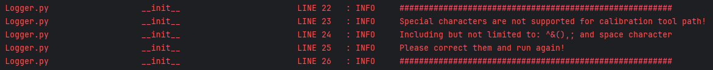

解决方法：排查脚本路径下各个文件夹的命名是否有特殊字符，修改路径合法后再重新打开脚本运行。

#### python缺少库文件<a name="ZH-CN_TOPIC_0000002557728379"></a>

缺少库文件会产生系统报错，在终端使用“pip install”命令安装所缺少的对应库文件或者使用RFTOOL一键安装环境工具配置。

#### COM口连接错误<a name="ZH-CN_TOPIC_0000002526568568"></a>

常见端口错误有如下几种：

-   配置端口格式错误

    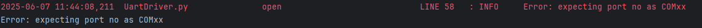

    报错原因是在configuration文件中配置的仪表端口格式有误，不满足COMXXX格式的字符串，需要检配置文件是否输入错误。

-   端口未打开或占用

    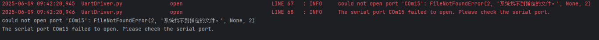

    报错原因是配置的端口未打开或者sscom中占用该端口未关闭，需要检查端口配置是否符合预期或者关闭端口。

-   AT指令异常

    AT的返回中未带有'OK'会报serial timeout error；AT的返回中带有ERROR时会报Send \(cmd\) error错误。

解决方法：重新烧版本或者重启单板。

#### CFUN0 ERROR<a name="ZH-CN_TOPIC_0000002557648417"></a>

问题原因：若上一次综测有异常退出的情况，在重新跑产测脚本时，脚本会自动发送“AT+CFUN=0”命令，此时该命令会报错。

解决方法：发送“AT+RESET”复位单板后再重新跑校准综测。

#### VISA资源库缺失<a name="ZH-CN_TOPIC_0000002526728502"></a>

问题原因：此环境未安装VISA或者环境变量未正确配置。

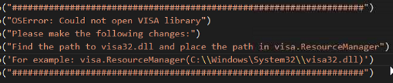

解决方法：使用一键安装Python环境工具安装。

#### 仪表连接错误<a name="ZH-CN_TOPIC_0000002557728381"></a>

问题原因：一般为仪表的IP配置错误或者仪表未打开。

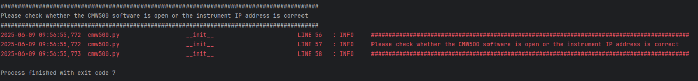

解决方法：

-   检查仪表IP正确且能ping通。
-   检查仪表是否打开（CMW100仪表本地软件）。

#### 仪表选择错误<a name="ZH-CN_TOPIC_0000002526568570"></a>

问题原因：configuration配置文件中选择的仪表类型'INSTRUMENTS\_SELECT'选项选择了错误的仪表或者不支持的仪表。

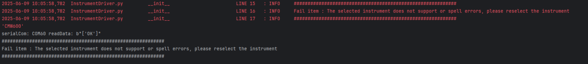

解决方法：重新选择支持的三种仪表并以正确的格式填写，如果使用RFTOOL工具一般不会有此错误。

#### 仪表端口错误<a name="ZH-CN_TOPIC_0000002557648419"></a>

问题原因：选择了仪表不支持的端口。

**图 1**  LITEPOINT<a name="zh-cn_topic_0000002334697236_zh-cn_topic_0000002343560625_fig0729589514"></a>  
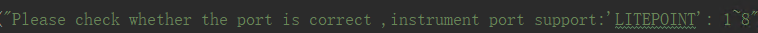

**图 2**  CMW500<a name="zh-cn_topic_0000002334697236_zh-cn_topic_0000002343560625_fig1150510191159"></a>  
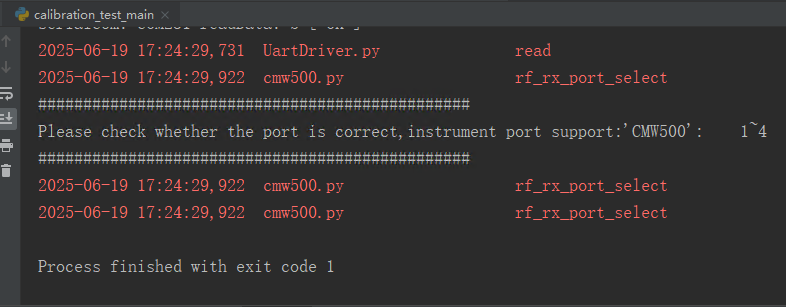

**图 3**  CMW100<a name="zh-cn_topic_0000002334697236_zh-cn_topic_0000002343560625_fig1933735116176"></a>  
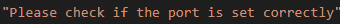

解决方法：重新选择仪表所支持的端口号。

#### AT命令执行异常<a name="ZH-CN_TOPIC_0000002526728504"></a>

现象为在某校准项或者某AT出现fail时，其返回值不为0或1。

问题原因：当前固件版本不支持该AT命令，固件版本与脚本版本不匹配或者当前单板有异常。


解决方法：

-   复位单板。
-   发送“AT+CGMR”读取固件版本信息，如不匹配则重新选择烧录版本。

#### 制作金板后校准错误<a name="ZH-CN_TOPIC_0000002557728383"></a>

问题原因：此单板制作了金板，一般制作金版前需要先进行校准，制作金版后不允许再重新进行校准。

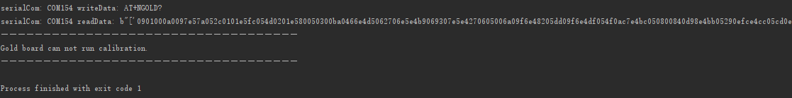

解决方法：发送“AT+NGOLD=00”命令先清除金板数据后再重新进行校准，详细命令请参见《HiDiTingV100 2131E AT命令 用户指南》“金板数据读写命令: +NGOLD”章节。

#### 线损文件异常报错<a name="ZH-CN_TOPIC_0000002526568572"></a>

常见线损文件异常如下两种：

-   找不到线损文件

    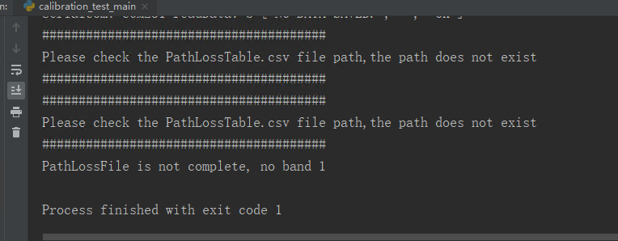

    问题原因：可能是线损文件丢失或者线损文件名字错误。

-   线损文件Band配置错误

    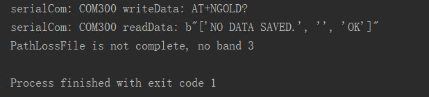

    问题原因：可能是线损文件配置的Band有重复或者缺失。

解决方法：确认线损文件路径正确，确保线损文件内容完整或更换新的线损文件。

#### 校准文件读取失败<a name="ZH-CN_TOPIC_0000002557648421"></a>

问题原因：校准文件名字错误

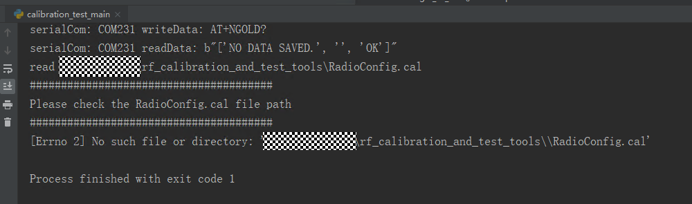

解决方法：将需要更改的校准文件配置放入“RadioConfig.cal”文件中，或者将需要更改的名字在脚本中同步更新。

#### 制作金板时测量值波动过大<a name="ZH-CN_TOPIC_0000002526728506"></a>

问题原因：制作金板或测量线损时，测量值tx power或rssi多次测量偏差过大。

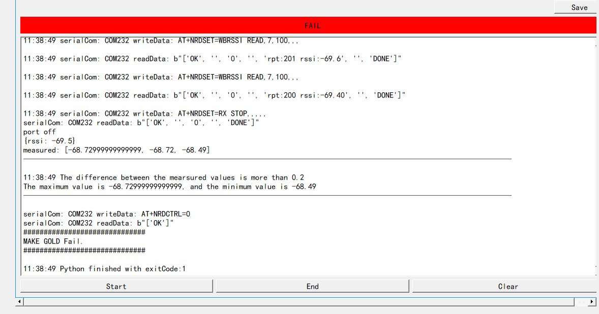

解决方法：测量值不稳定可能受环境影响，请确认环境的影响并重新执行制作金板/测量线损。

#### 测量线损值异常<a name="ZH-CN_TOPIC_0000002557728385"></a>

问题描述：测量线损值超出门限导致异常退出。

.png)

.png)

解决方法：线损值异常（小于等于零或者大于CABLE\_LOSS\_DELTA\_LIMIT时），排查射频线和仪表环境后重新测量；也可能是制作金板异常，重新制作金板后再测量线损。

### 校准常见问题分析<a name="ZH-CN_TOPIC_0000002526568574"></a>

-   **[串行超时](#ZH-CN_TOPIC_0000002557648423)**  

-   **[nrdexec返回状态码（自校准除外）](#ZH-CN_TOPIC_0000002526728508)**  

-   **[自校准异常](#ZH-CN_TOPIC_0000002557728387)**  

-   **[trx通路测试异常](#ZH-CN_TOPIC_0000002526568576)**  

-   **[xo 校准异常](#ZH-CN_TOPIC_0000002557648425)**  

-   **[rx ip2 校准异常](#ZH-CN_TOPIC_0000002526728510)**  

-   **[rx dc 校准 & tx dc 校准异常](#ZH-CN_TOPIC_0000002557728389)**  

-   **[rx iq 校准 & tx iq 校准异常](#ZH-CN_TOPIC_0000002526568578)**  

-   **[rx agc 校准异常](#ZH-CN_TOPIC_0000002557648427)**  

-   **[Tx power校准异常](#ZH-CN_TOPIC_0000002526728512)**  

-   **[Tx power测量失败](#ZH-CN_TOPIC_0000002557728391)**  

-   **[tlv 更新失败](#ZH-CN_TOPIC_0000002526568580)**  

-   **[校准前烧录校准文件](#ZH-CN_TOPIC_0000002557648429)**  

-   **[IQX仪表低概率出现连接异常](#ZH-CN_TOPIC_0000002526728514)**  

#### 串行超时<a name="ZH-CN_TOPIC_0000002557648423"></a>

AT未响应，常见原因为端口错误或A核死机或开机自动入网导致没有进入radio test模式。

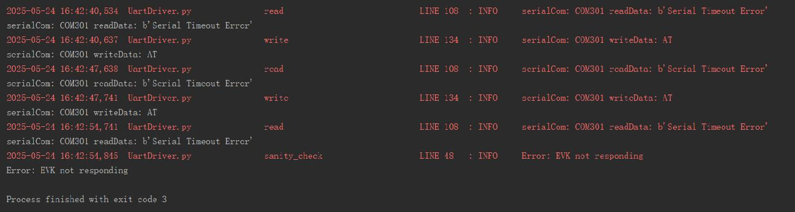

解决方法：

1.  reset单板。
2.  确认EVK端口是否正确。
3.  发送“AT+CGMR”查询是否有tlv版本号，检查校准文件是否损坏。

#### nrdexec返回状态码（自校准除外）<a name="ZH-CN_TOPIC_0000002526728508"></a>

nrdexec命令的返回结果中包含状态码，如下图所示：

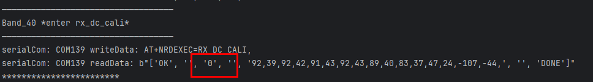

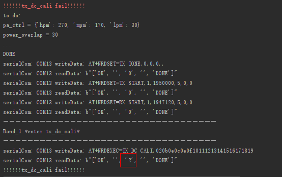

状态码指示：

0：校准成功；

1：校准失败；

2：校准参数错误；

3：校准类型错误或者不支持。

若返回状态码为2或3，常见原因是固件版本与校准版本不匹配，需要更换固件或脚本后重新校准。

#### 自校准异常<a name="ZH-CN_TOPIC_0000002557728387"></a>

该项校准为芯片内部自校准，以消除芯片做工的差异。涵盖校准项如下图所示：


校准的返回结果中包含的状态码如下：

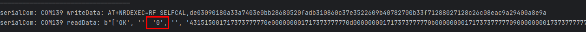

bit位不为0的项校准失败。返回0表示所有项校准成功。

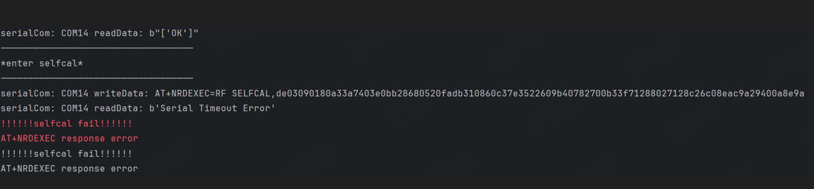

自校准响应超时，常见原因为开机自动入网导致没有进入radio test模式。

#### trx通路测试异常<a name="ZH-CN_TOPIC_0000002526568576"></a>

校准前trx通路测试门限配置。

.png)

报错原因：trx通路异常导致测量值超出门限。

.png)

.png)

解决方法：排查仪表和射频线连接是否正常后重新校准，或者确定配置门限是否过小。

#### xo 校准异常<a name="ZH-CN_TOPIC_0000002557648425"></a>

该项为XO校准，校准原理为在一定信号强度下RX收数计算频偏大小。

常见失败样例如下图：

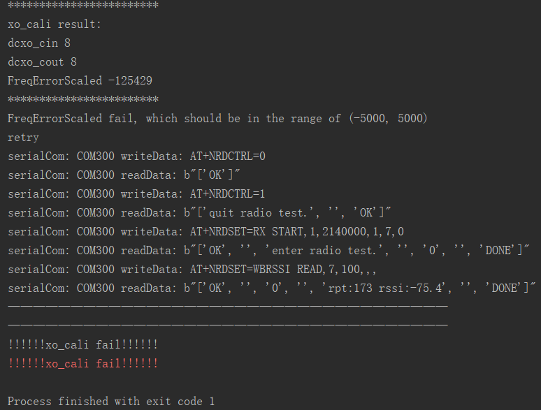

失败原因为：

-   信号过小或过大会导致计算结果超出门限。
-   晶振本身问题。

解决方法：

-   排查仪表选择端口与连接是否一致。
-   排查脚本中配置的单板端口与实际需要校准的单板端口是否匹配。
-   检查线损是否过大，射频线是否拧紧。

#### rx ip2 校准异常<a name="ZH-CN_TOPIC_0000002526728510"></a>

RX IP2校准用于消除TX信号经过双工器时在RX通道产生的IMD2产物。

常见错误：

-   校准失败，请参见“[nrdexec返回状态码（自校准除外）](#ZH-CN_TOPIC_0000002526728508)”章节。
-   电流过大，ip2校准过程中TX会发送功率信号，如果电流过大会导致自动复位。

#### rx dc 校准 & tx dc 校准异常<a name="ZH-CN_TOPIC_0000002557728389"></a>

DC校准用于消除器件产生的直流对有用信号的影响。

常见错误：校准失败，请参见“[nrdexec返回状态码（自校准除外）](#ZH-CN_TOPIC_0000002526728508)”章节。

#### rx iq 校准 & tx iq 校准异常<a name="ZH-CN_TOPIC_0000002526568578"></a>

IQ校准用于消除器件对信号分量振幅不同带来的影响。

常见错误：

-   校准失败，请参见“[nrdexec返回状态码（自校准除外）](#ZH-CN_TOPIC_0000002526728508)”章节。
-   校准结果超出设定限制。门限值采用经验值设定，可以通过检测TX信号质量来判断门限值或者校准结果是否可靠。

#### rx agc 校准异常<a name="ZH-CN_TOPIC_0000002557648427"></a>

AGC校准用于计算AGC各档位的增益值和带内不同频点的增益值差异。流程为先用仪表连续下发6dB递减的CW信号遍历8个档位，后再用中间档位和中间强度信号由低信道至高信道遍历频带内的增益差异。因此，AGC校准的返回结果中各项值差异不能过大。

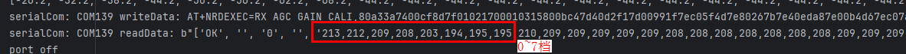

常见错误：

-   校准失败，请参见“[nrdexec返回状态码（自校准除外）](#ZH-CN_TOPIC_0000002526728508)”章节。
-   校准结果超出限制原因1，Tx功率太低或者延时不够导致仪表无法trigger没有及时下发连续信号。
-   校准结果超出限制原因2，对应频点线损太大，或者硬件RX通路问题。

#### Tx power校准异常<a name="ZH-CN_TOPIC_0000002526728512"></a>

Tx power校准用于测量射频发送功率的能力，并计算得到发送对应强度功率所需要的码字。

常见错误：

-   校准失败，请参见“[nrdexec返回状态码（自校准除外）](#ZH-CN_TOPIC_0000002526728508)”章节。
-   校准结果缺少对应功率码字配置，排查方向见后续。
-   电流过大导致重启，会显示serial错误等。

排查方向：

确认log中校准功率满足脚本中设置的最大功率和最小功率。

.png)

确认log中校准的PA模式划分功率满足校准文件（.cal）中设置的pa\_ctrl配置，如果不满足，请根据Band调整“calibration\_module/CalibrationClass.py”中的下图所示range范围，原则上最大功率过低左调左边界，最小功率过高右调右边界，调整的TX\_POWER\_TABLE中的range参数的取值只能为非负整数。

.png)

.png)

#### Tx power测量失败<a name="ZH-CN_TOPIC_0000002557728391"></a>

问题原因：仪表测量Tx power时测量失败没有测到值。


解决方法：检查仪表链接正确和Tx是否通路后重新测量。

#### tlv 更新失败<a name="ZH-CN_TOPIC_0000002526568580"></a>

报错命令是“AT+NRCUPD=2”返回failed，此命令用于单板重新加载tlv文件并初始化rf，产生错误的原因一般有两种：

-   tlv文件有损坏或不完整。
-   烧录进去的校准文件PA配置有误或不匹配。


解决方法：重新烧录tlv或使用MIPI READ命令读取单板PA配置检查是否匹配。

#### 校准前烧录校准文件<a name="ZH-CN_TOPIC_0000002557648429"></a>

代码修改：

1.  在“calibration\_module/CalibrationClass.py”文件中修改以下代码：

    

    

    

    

2.  在“calibration\_module/CalibrationMain.py”文件中修改以下代码：

    

    

    

3.  在“calibration\_test\_configuration.py”文件中修改以下代码：

    

4.  在“calibration\_test\_main.py”文件中修改以下代码：

    

5.  在“user\_tools/TxTempCompMea.py”文件中修改以下代码：

    

使用说明：

1.  “calibration\_test\_configuration.py”文件中的CAL\_UPDATE\_IN\_ADVANCE置为True，表示校准前烧写cal文件；置为False，表示校准前不烧写cal文件。
2.  “calibration\_test\_configuration.py”文件中的CAL\_SELECT置为True，表示自动读取单板里的PAid（pro\_id+manuf\_id），并找到对应的校准文件，PAid和校准文件名的映射关系通过“calibration\_module/CalibrationClass.py”文件里的PA\_RADIOCONFIG\_CAL\_SEL\_TABLE配置；置为False，表示使用“RadioConfig.cal”校准文件。
3.  提取温补数据时，如果CAL\_SELECT置为True，需要将“user\_tools/TxTempCompLoad.py”里的“RadioConfig.cal”改为当前使用的校准文件名。

    

#### IQX仪表低概率出现连接异常<a name="ZH-CN_TOPIC_0000002526728514"></a>

问题描述：IQX仪表压测上万片概率出现以下报错，重启仪表能够恢复。


问题原因：与设备的通信出现了I/O问题。这可能是因为设备忙未被正确释放。

解决方案：在“drivers/instrument\_driver/litepoint.py”文件中增加释放设备操作。


### 综测常见问题分析<a name="ZH-CN_TOPIC_0000002557728393"></a>

-   **[脚本发送NRDTEST命令返回ERROR并异常退出](#ZH-CN_TOPIC_0000002526568582)**  

-   **[ARB文件缺失异常退出](#ZH-CN_TOPIC_0000002557648431)**  

-   **[综测时间异常（指标正常）](#ZH-CN_TOPIC_0000002526728516)**  

-   **[仪表连接异常](#ZH-CN_TOPIC_0000002557728395)**  

#### 脚本发送NRDTEST命令返回ERROR并异常退出<a name="ZH-CN_TOPIC_0000002526568582"></a>

常见原因为信号过低、环境噪声太大。

.png)

解决方法：

-   调高对应Band的RX\_DL\_POWER。

    

-   降低环境干扰，在屏蔽箱或屏蔽房内进行综测。

#### ARB文件缺失异常退出<a name="ZH-CN_TOPIC_0000002557648431"></a>

提示ARB文件不存在报错。


解决方法：

-   检查ARB文件放置的路径是否与错误提示中的路径一致。
-   检查是否在此路径有对应ARB文件。

#### 综测时间异常（指标正常）<a name="ZH-CN_TOPIC_0000002526728516"></a>

在“drivers/instrument\_driver/cmw500.py”或者同路径下cmw100.py中按如下绿框中添加：


#### 仪表连接异常<a name="ZH-CN_TOPIC_0000002557728395"></a>

产测失败，可排查日志中VI\_ERROR类报错，出现“VI\_ERROR\_CONN\_LOST \(-1073807194\): The connection for the given session has been lost. ”表示仪表连接丢失。


解决方法：检查仪表连接是否正常。

## 功能测试及终检<a name="ZH-CN_TOPIC_0000002526568584"></a>

检查号码是否正确写入基本的功能，例如USIM（Universal Subscriber Identity Module，全球用户身份模块）功能测试，在模块最后的测试工位环节是必要的。

> **说明：** 
>Hi2131支持备份与恢复出厂设置，分别使用指令“AT&W”/“AT&F”，备份指令在产线只允许使用一次，建议在终检后对出厂设置进行一次备份，以支持恢复出厂设置功能。详细使用说明请参见《HDiTingV100 2131E AT命令 用户指南》。

