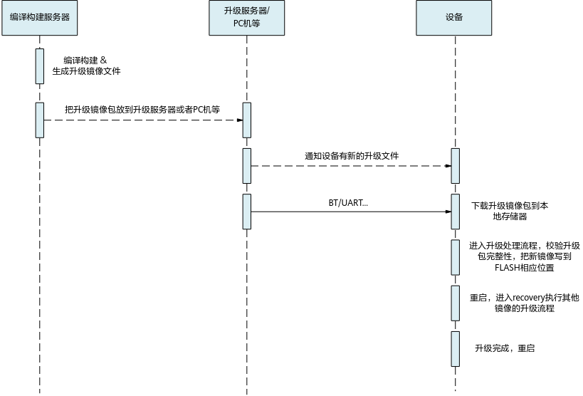
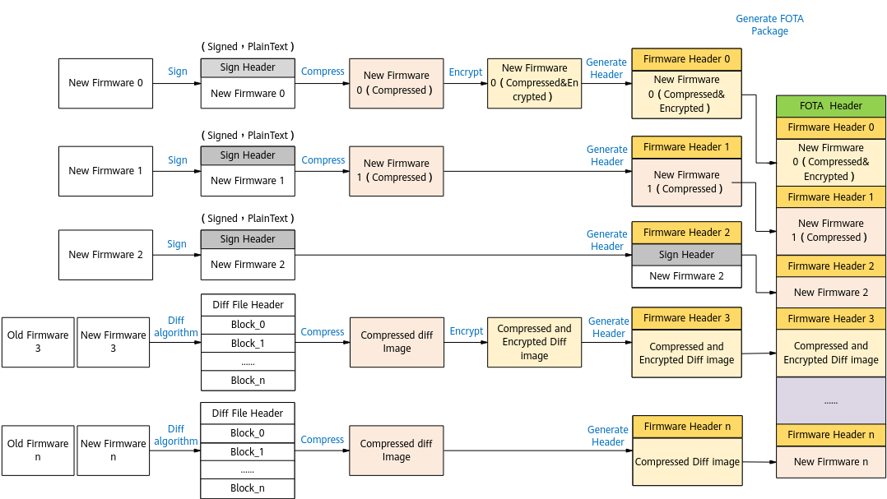
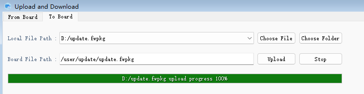

# 前言<a name="ZH-CN_TOPIC_0000002499502521"></a>

**概述<a name="zh-cn_topic_0000002444725741_section4537382116410"></a>**

本文档主要介绍固件升级流程和接口的使用方法，指导用户应用及开发升级特性。

**读者对象<a name="zh-cn_topic_0000002444725741_section4378592816410"></a>**

本文档主要适用于以下工程师：

-   技术支持工程师
-   软件开发工程师

**符号约定<a name="zh-cn_topic_0000002444725741_section133020216410"></a>**

在本文中可能出现下列标志，它们所代表的含义如下。

<a name="zh-cn_topic_0000002444725741_table2622507016410"></a>
<table><thead align="left"><tr id="zh-cn_topic_0000002444725741_row1530720816410"><th class="cellrowborder" valign="top" width="20.580000000000002%" id="mcps1.1.3.1.1"><p id="zh-cn_topic_0000002444725741_p6450074116410"><a name="zh-cn_topic_0000002444725741_p6450074116410"></a><a name="zh-cn_topic_0000002444725741_p6450074116410"></a><strong id="zh-cn_topic_0000002444725741_b2136615816410"><a name="zh-cn_topic_0000002444725741_b2136615816410"></a><a name="zh-cn_topic_0000002444725741_b2136615816410"></a>符号</strong></p>
</th>
<th class="cellrowborder" valign="top" width="79.42%" id="mcps1.1.3.1.2"><p id="zh-cn_topic_0000002444725741_p5435366816410"><a name="zh-cn_topic_0000002444725741_p5435366816410"></a><a name="zh-cn_topic_0000002444725741_p5435366816410"></a><strong id="zh-cn_topic_0000002444725741_b5941558116410"><a name="zh-cn_topic_0000002444725741_b5941558116410"></a><a name="zh-cn_topic_0000002444725741_b5941558116410"></a>说明</strong></p>
</th>
</tr>
</thead>
<tbody><tr id="zh-cn_topic_0000002444725741_row1372280416410"><td class="cellrowborder" valign="top" width="20.580000000000002%" headers="mcps1.1.3.1.1 "><p id="zh-cn_topic_0000002444725741_p3734547016410"><a name="zh-cn_topic_0000002444725741_p3734547016410"></a><a name="zh-cn_topic_0000002444725741_p3734547016410"></a><a name="zh-cn_topic_0000002444725741_image2670064316410"></a><a name="zh-cn_topic_0000002444725741_image2670064316410"></a><span></span></p>
</td>
<td class="cellrowborder" valign="top" width="79.42%" headers="mcps1.1.3.1.2 "><p id="zh-cn_topic_0000002444725741_p1757432116410"><a name="zh-cn_topic_0000002444725741_p1757432116410"></a><a name="zh-cn_topic_0000002444725741_p1757432116410"></a>表示如不避免则将会导致死亡或严重伤害的具有高等级风险的危害。</p>
</td>
</tr>
<tr id="zh-cn_topic_0000002444725741_row466863216410"><td class="cellrowborder" valign="top" width="20.580000000000002%" headers="mcps1.1.3.1.1 "><p id="zh-cn_topic_0000002444725741_p1432579516410"><a name="zh-cn_topic_0000002444725741_p1432579516410"></a><a name="zh-cn_topic_0000002444725741_p1432579516410"></a><a name="zh-cn_topic_0000002444725741_image4895582316410"></a><a name="zh-cn_topic_0000002444725741_image4895582316410"></a><span></span></p>
</td>
<td class="cellrowborder" valign="top" width="79.42%" headers="mcps1.1.3.1.2 "><p id="zh-cn_topic_0000002444725741_p959197916410"><a name="zh-cn_topic_0000002444725741_p959197916410"></a><a name="zh-cn_topic_0000002444725741_p959197916410"></a>表示如不避免则可能导致死亡或严重伤害的具有中等级风险的危害。</p>
</td>
</tr>
<tr id="zh-cn_topic_0000002444725741_row123863216410"><td class="cellrowborder" valign="top" width="20.580000000000002%" headers="mcps1.1.3.1.1 "><p id="zh-cn_topic_0000002444725741_p1232579516410"><a name="zh-cn_topic_0000002444725741_p1232579516410"></a><a name="zh-cn_topic_0000002444725741_p1232579516410"></a><a name="zh-cn_topic_0000002444725741_image1235582316410"></a><a name="zh-cn_topic_0000002444725741_image1235582316410"></a><span></span></p>
</td>
<td class="cellrowborder" valign="top" width="79.42%" headers="mcps1.1.3.1.2 "><p id="zh-cn_topic_0000002444725741_p123197916410"><a name="zh-cn_topic_0000002444725741_p123197916410"></a><a name="zh-cn_topic_0000002444725741_p123197916410"></a>表示如不避免则可能导致轻微或中度伤害的具有低等级风险的危害。</p>
</td>
</tr>
<tr id="zh-cn_topic_0000002444725741_row5786682116410"><td class="cellrowborder" valign="top" width="20.580000000000002%" headers="mcps1.1.3.1.1 "><p id="zh-cn_topic_0000002444725741_p2204984716410"><a name="zh-cn_topic_0000002444725741_p2204984716410"></a><a name="zh-cn_topic_0000002444725741_p2204984716410"></a><a name="zh-cn_topic_0000002444725741_image4504446716410"></a><a name="zh-cn_topic_0000002444725741_image4504446716410"></a><span></span></p>
</td>
<td class="cellrowborder" valign="top" width="79.42%" headers="mcps1.1.3.1.2 "><p id="zh-cn_topic_0000002444725741_p4388861916410"><a name="zh-cn_topic_0000002444725741_p4388861916410"></a><a name="zh-cn_topic_0000002444725741_p4388861916410"></a>用于传递设备或环境安全警示信息。如不避免则可能会导致设备损坏、数据丢失、设备性能降低或其它不可预知的结果。</p>
<p id="zh-cn_topic_0000002444725741_p1238861916410"><a name="zh-cn_topic_0000002444725741_p1238861916410"></a><a name="zh-cn_topic_0000002444725741_p1238861916410"></a>“须知”不涉及人身伤害。</p>
</td>
</tr>
<tr id="zh-cn_topic_0000002444725741_row2856923116410"><td class="cellrowborder" valign="top" width="20.580000000000002%" headers="mcps1.1.3.1.1 "><p id="zh-cn_topic_0000002444725741_p5555360116410"><a name="zh-cn_topic_0000002444725741_p5555360116410"></a><a name="zh-cn_topic_0000002444725741_p5555360116410"></a><a name="zh-cn_topic_0000002444725741_image799324016410"></a><a name="zh-cn_topic_0000002444725741_image799324016410"></a><span></span></p>
</td>
<td class="cellrowborder" valign="top" width="79.42%" headers="mcps1.1.3.1.2 "><p id="zh-cn_topic_0000002444725741_p4612588116410"><a name="zh-cn_topic_0000002444725741_p4612588116410"></a><a name="zh-cn_topic_0000002444725741_p4612588116410"></a>对正文中重点信息的补充说明。</p>
<p id="zh-cn_topic_0000002444725741_p1232588116410"><a name="zh-cn_topic_0000002444725741_p1232588116410"></a><a name="zh-cn_topic_0000002444725741_p1232588116410"></a>“说明”不是安全警示信息，不涉及人身、设备及环境伤害信息。</p>
</td>
</tr>
</tbody>
</table>

# 概述<a name="ZH-CN_TOPIC_0000002499502541"></a>

-   **[功能描述](#ZH-CN_TOPIC_0000002466543212)**  

-   **[固件升级流程](#ZH-CN_TOPIC_0000002499502537)**  

-   **[开发接口](#ZH-CN_TOPIC_0000002466383592)**  

## 功能描述<a name="ZH-CN_TOPIC_0000002466543212"></a>

固件升级功能可用于对设备芯片的固件进行更新。

HiDiTingV100的固件包含多个核的固件镜像，不同核可能采用不同的升级方式，包括全镜像升级、压缩升级、差分升级，每个核可以根据情况选择合适的升级方式。

-   全镜像升级：新的固件镜像不做处理，直接打包到固件升级包（以下简称为“升级包”）中，在设备上直接将其更新至目标位置。这种方式一般适用于固件镜像较小的场景。
-   压缩升级：新的固件镜像经过压缩处理后，打包到升级包中，首先在设备上解压恢复，再更新至目标位置。这种方式一般适用于固件镜像较大但不适合差分（例如：新旧版本差别较大，差分无收益）的场景。
-   差分升级：根据新固件和当前固件的差异，使用差分算法制作出差分文件，并打包到升级包中，在设备上将升级包和当前固件通过差分算法恢复出新固件，并将其更新至目标位置。这种升级方式一般适用于固件镜像较大且新旧版本差异较小的场景。

## 固件升级流程<a name="ZH-CN_TOPIC_0000002499502537"></a>

从端到端来看，整个芯片固件的升级操作包括以下过程，如[图1](#zh-cn_topic_0000002411206492_fig1842615264920)所示。

-   升级包制作：固件开发完成后，根据实际情况，将要升级的固件镜像按照配置文件中对应的升级方式，生成固件升级包文件的过程。
-   升级包传输：将升级包传输到设备上。根据实际情况，可能有多种传输方式，如蓝牙、串口等。
-   升级包保存：将传输到设备的固件升级包保存至本地存储器，在HiDiTingV100中，固件升级包存储在文件系统中。
-   升级包本地校验：升级程序替换前，在设备上校验升级包的完整性和合法性。
-   升级包本地升级：APP程序中在设备上将新的固件更新至目标位置，重启进入recovery继续执行升级，升级完成后重启。

**图 1**  固件升级流程图<a name="zh-cn_topic_0000002411206492_fig1842615264920"></a>  


## 开发接口<a name="ZH-CN_TOPIC_0000002466383592"></a>

根据所处程序的不同，升级接口可分为两部分。

-   升级包存储，由APP程序执行。
    -   初始化接口。
    -   升级包写入本地存储器和从本地存储器读取的接口。
    -   申请开始进行本地升级接口。

-   升级包本地升级中，SSB（Second Stage Boot）和SeLiteOS镜像在SSB程序中进行升级，Recovery镜像的升级由APP程序完成，其他镜像的升级在独立的Recovery程序中完成。
    -   初始化接口。
    -   升级包校验接口。
    -   升级进度通知函数注册接口。
    -   开始执行本地升级接口。
    -   获取升级结果接口。

升级模块提供的接口如[表1](#zh-cn_topic_0000002411046600_table1585372681620)和[表2](#zh-cn_topic_0000002411046600_table1660824542212)所示。参见头文件：include\\middleware\\utils\\upg.h。接口参数及返回值说明如[表3](#zh-cn_topic_0000002411046600_table543918111242)所示。

**表 1**  升级接口（升级包存储部分）描述

<a name="zh-cn_topic_0000002411046600_table1585372681620"></a>
<table><thead align="left"><tr id="zh-cn_topic_0000002411046600_row385412616166"><th class="cellrowborder" valign="top" width="37.74%" id="mcps1.2.3.1.1"><p id="zh-cn_topic_0000002411046600_p373695616166"><a name="zh-cn_topic_0000002411046600_p373695616166"></a><a name="zh-cn_topic_0000002411046600_p373695616166"></a>接口名称</p>
</th>
<th class="cellrowborder" valign="top" width="62.260000000000005%" id="mcps1.2.3.1.2"><p id="zh-cn_topic_0000002411046600_p15736756151620"><a name="zh-cn_topic_0000002411046600_p15736756151620"></a><a name="zh-cn_topic_0000002411046600_p15736756151620"></a>描述</p>
</th>
</tr>
</thead>
<tbody><tr id="zh-cn_topic_0000002411046600_row1486763081710"><td class="cellrowborder" valign="top" width="37.74%" headers="mcps1.2.3.1.1 "><p id="zh-cn_topic_0000002411046600_p18867133051718"><a name="zh-cn_topic_0000002411046600_p18867133051718"></a><a name="zh-cn_topic_0000002411046600_p18867133051718"></a>uapi_upg_init</p>
</td>
<td class="cellrowborder" valign="top" width="62.260000000000005%" headers="mcps1.2.3.1.2 "><p id="zh-cn_topic_0000002411046600_p1486713307174"><a name="zh-cn_topic_0000002411046600_p1486713307174"></a><a name="zh-cn_topic_0000002411046600_p1486713307174"></a>升级模块初始化。</p>
</td>
</tr>
<tr id="zh-cn_topic_0000002411046600_row11854122671616"><td class="cellrowborder" valign="top" width="37.74%" headers="mcps1.2.3.1.1 "><p id="zh-cn_topic_0000002411046600_p126138161710"><a name="zh-cn_topic_0000002411046600_p126138161710"></a><a name="zh-cn_topic_0000002411046600_p126138161710"></a>uapi_upg_prepare</p>
</td>
<td class="cellrowborder" valign="top" width="62.260000000000005%" headers="mcps1.2.3.1.2 "><p id="zh-cn_topic_0000002411046600_p19611380177"><a name="zh-cn_topic_0000002411046600_p19611380177"></a><a name="zh-cn_topic_0000002411046600_p19611380177"></a>保存升级包到本地存储器前的准备工作。</p>
</td>
</tr>
<tr id="zh-cn_topic_0000002411046600_row685452616161"><td class="cellrowborder" valign="top" width="37.74%" headers="mcps1.2.3.1.1 "><p id="zh-cn_topic_0000002411046600_p16616811719"><a name="zh-cn_topic_0000002411046600_p16616811719"></a><a name="zh-cn_topic_0000002411046600_p16616811719"></a>uapi_upg_write_package_async/uapi_upg_write_package_sync</p>
</td>
<td class="cellrowborder" valign="top" width="62.260000000000005%" headers="mcps1.2.3.1.2 "><p id="zh-cn_topic_0000002411046600_p3611486173"><a name="zh-cn_topic_0000002411046600_p3611486173"></a><a name="zh-cn_topic_0000002411046600_p3611486173"></a>将升级包数据写入本地存储器。（异步方式/同步方式）</p>
</td>
</tr>
<tr id="zh-cn_topic_0000002411046600_row98547262169"><td class="cellrowborder" valign="top" width="37.74%" headers="mcps1.2.3.1.1 "><p id="zh-cn_topic_0000002411046600_p259718589312"><a name="zh-cn_topic_0000002411046600_p259718589312"></a><a name="zh-cn_topic_0000002411046600_p259718589312"></a>uapi_upg_read_package</p>
</td>
<td class="cellrowborder" valign="top" width="62.260000000000005%" headers="mcps1.2.3.1.2 "><p id="zh-cn_topic_0000002411046600_p5615811714"><a name="zh-cn_topic_0000002411046600_p5615811714"></a><a name="zh-cn_topic_0000002411046600_p5615811714"></a>从本地存储器读取升级包数据。</p>
</td>
</tr>
<tr id="zh-cn_topic_0000002411046600_row177421859153715"><td class="cellrowborder" valign="top" width="37.74%" headers="mcps1.2.3.1.1 "><p id="zh-cn_topic_0000002411046600_p107431159183718"><a name="zh-cn_topic_0000002411046600_p107431159183718"></a><a name="zh-cn_topic_0000002411046600_p107431159183718"></a>uapi_upg_request_upgrade</p>
</td>
<td class="cellrowborder" valign="top" width="62.260000000000005%" headers="mcps1.2.3.1.2 "><p id="zh-cn_topic_0000002411046600_p57432059133712"><a name="zh-cn_topic_0000002411046600_p57432059133712"></a><a name="zh-cn_topic_0000002411046600_p57432059133712"></a>申请开始进行本地升级，所有升级包数据全部保存完成后，调用此接口。</p>
</td>
</tr>
<tr id="zh-cn_topic_0000002411046600_row3828154123820"><td class="cellrowborder" valign="top" width="37.74%" headers="mcps1.2.3.1.1 "><p id="zh-cn_topic_0000002411046600_p1066210362417"><a name="zh-cn_topic_0000002411046600_p1066210362417"></a><a name="zh-cn_topic_0000002411046600_p1066210362417"></a>uapi_upg_get_storage_size</p>
</td>
<td class="cellrowborder" valign="top" width="62.260000000000005%" headers="mcps1.2.3.1.2 "><p id="zh-cn_topic_0000002411046600_p1182824143810"><a name="zh-cn_topic_0000002411046600_p1182824143810"></a><a name="zh-cn_topic_0000002411046600_p1182824143810"></a>获取可存放升级包的空间大小。</p>
</td>
</tr>
</tbody>
</table>

**表 2**  升级接口（本地升级部分）描述

<a name="zh-cn_topic_0000002411046600_table1660824542212"></a>
<table><thead align="left"><tr id="zh-cn_topic_0000002411046600_row1860864518228"><th class="cellrowborder" valign="top" width="37.74%" id="mcps1.2.3.1.1"><p id="zh-cn_topic_0000002411046600_p1060916458228"><a name="zh-cn_topic_0000002411046600_p1060916458228"></a><a name="zh-cn_topic_0000002411046600_p1060916458228"></a>接口名称</p>
</th>
<th class="cellrowborder" valign="top" width="62.260000000000005%" id="mcps1.2.3.1.2"><p id="zh-cn_topic_0000002411046600_p13609184532213"><a name="zh-cn_topic_0000002411046600_p13609184532213"></a><a name="zh-cn_topic_0000002411046600_p13609184532213"></a>描述</p>
</th>
</tr>
</thead>
<tbody><tr id="zh-cn_topic_0000002411046600_row560934513229"><td class="cellrowborder" valign="top" width="37.74%" headers="mcps1.2.3.1.1 "><p id="zh-cn_topic_0000002411046600_p960934513228"><a name="zh-cn_topic_0000002411046600_p960934513228"></a><a name="zh-cn_topic_0000002411046600_p960934513228"></a>uapi_upg_init</p>
</td>
<td class="cellrowborder" valign="top" width="62.260000000000005%" headers="mcps1.2.3.1.2 "><p id="zh-cn_topic_0000002411046600_p176091045102215"><a name="zh-cn_topic_0000002411046600_p176091045102215"></a><a name="zh-cn_topic_0000002411046600_p176091045102215"></a>升级模块初始化。</p>
</td>
</tr>
<tr id="zh-cn_topic_0000002411046600_row35427913505"><td class="cellrowborder" valign="top" width="37.74%" headers="mcps1.2.3.1.1 "><p id="zh-cn_topic_0000002411046600_p5856111017502"><a name="zh-cn_topic_0000002411046600_p5856111017502"></a><a name="zh-cn_topic_0000002411046600_p5856111017502"></a>uapi_upg_register_progress_callback</p>
</td>
<td class="cellrowborder" valign="top" width="62.260000000000005%" headers="mcps1.2.3.1.2 "><p id="zh-cn_topic_0000002411046600_p7856161015507"><a name="zh-cn_topic_0000002411046600_p7856161015507"></a><a name="zh-cn_topic_0000002411046600_p7856161015507"></a>注册升级进度通知回调函数，注册后，在本地升级过程中会调用回调函数通知当前进度。</p>
</td>
</tr>
<tr id="zh-cn_topic_0000002411046600_row19609154562210"><td class="cellrowborder" valign="top" width="37.74%" headers="mcps1.2.3.1.1 "><p id="zh-cn_topic_0000002411046600_p5609745202212"><a name="zh-cn_topic_0000002411046600_p5609745202212"></a><a name="zh-cn_topic_0000002411046600_p5609745202212"></a>uapi_upg_start</p>
</td>
<td class="cellrowborder" valign="top" width="62.260000000000005%" headers="mcps1.2.3.1.2 "><p id="zh-cn_topic_0000002411046600_p20609245172211"><a name="zh-cn_topic_0000002411046600_p20609245172211"></a><a name="zh-cn_topic_0000002411046600_p20609245172211"></a>开始本地升级。</p>
</td>
</tr>
<tr id="zh-cn_topic_0000002411046600_row1612214129385"><td class="cellrowborder" valign="top" width="37.74%" headers="mcps1.2.3.1.1 "><p id="zh-cn_topic_0000002411046600_p9861102283820"><a name="zh-cn_topic_0000002411046600_p9861102283820"></a><a name="zh-cn_topic_0000002411046600_p9861102283820"></a>uapi_upg_get_result</p>
</td>
<td class="cellrowborder" valign="top" width="62.260000000000005%" headers="mcps1.2.3.1.2 "><p id="zh-cn_topic_0000002411046600_p386142213387"><a name="zh-cn_topic_0000002411046600_p386142213387"></a><a name="zh-cn_topic_0000002411046600_p386142213387"></a>获取升级结果。</p>
</td>
</tr>
<tr id="zh-cn_topic_0000002411046600_row1260944511226"><td class="cellrowborder" valign="top" width="37.74%" headers="mcps1.2.3.1.1 "><p id="zh-cn_topic_0000002411046600_p1821544917386"><a name="zh-cn_topic_0000002411046600_p1821544917386"></a><a name="zh-cn_topic_0000002411046600_p1821544917386"></a>uapi_upg_verify_file_head</p>
</td>
<td class="cellrowborder" valign="top" width="62.260000000000005%" headers="mcps1.2.3.1.2 "><p id="zh-cn_topic_0000002411046600_p122151749113812"><a name="zh-cn_topic_0000002411046600_p122151749113812"></a><a name="zh-cn_topic_0000002411046600_p122151749113812"></a>校验升级包头结构。</p>
</td>
</tr>
<tr id="zh-cn_topic_0000002411046600_row126175548388"><td class="cellrowborder" valign="top" width="37.74%" headers="mcps1.2.3.1.1 "><p id="zh-cn_topic_0000002411046600_p1355184103910"><a name="zh-cn_topic_0000002411046600_p1355184103910"></a><a name="zh-cn_topic_0000002411046600_p1355184103910"></a>uapi_upg_verify_file_image</p>
</td>
<td class="cellrowborder" valign="top" width="62.260000000000005%" headers="mcps1.2.3.1.2 "><p id="zh-cn_topic_0000002411046600_p1355154163918"><a name="zh-cn_topic_0000002411046600_p1355154163918"></a><a name="zh-cn_topic_0000002411046600_p1355154163918"></a>校验升级包中的升级镜像。</p>
</td>
</tr>
<tr id="zh-cn_topic_0000002411046600_row18734135723817"><td class="cellrowborder" valign="top" width="37.74%" headers="mcps1.2.3.1.1 "><p id="zh-cn_topic_0000002411046600_p18827963914"><a name="zh-cn_topic_0000002411046600_p18827963914"></a><a name="zh-cn_topic_0000002411046600_p18827963914"></a>uapi_upg_verify_file</p>
</td>
<td class="cellrowborder" valign="top" width="62.260000000000005%" headers="mcps1.2.3.1.2 "><p id="zh-cn_topic_0000002411046600_p10821694394"><a name="zh-cn_topic_0000002411046600_p10821694394"></a><a name="zh-cn_topic_0000002411046600_p10821694394"></a>校验整个升级包。</p>
</td>
</tr>
<tr id="zh-cn_topic_0000002411046600_row43871712163916"><td class="cellrowborder" valign="top" width="37.74%" headers="mcps1.2.3.1.1 "><p id="zh-cn_topic_0000002411046600_p9285101916398"><a name="zh-cn_topic_0000002411046600_p9285101916398"></a><a name="zh-cn_topic_0000002411046600_p9285101916398"></a>uapi_upg_register_user_defined_verify_func</p>
</td>
<td class="cellrowborder" valign="top" width="62.260000000000005%" headers="mcps1.2.3.1.2 "><p id="zh-cn_topic_0000002411046600_p152851419163917"><a name="zh-cn_topic_0000002411046600_p152851419163917"></a><a name="zh-cn_topic_0000002411046600_p152851419163917"></a>注册用户自定义字段的校验函数。</p>
<p id="zh-cn_topic_0000002411046600_p32851119103910"><a name="zh-cn_topic_0000002411046600_p32851119103910"></a><a name="zh-cn_topic_0000002411046600_p32851119103910"></a>升级包结构中预留了48Byte用于用户自定义数据的校验。注册自定义校验函数后，被注册的函数会在调用uapi_upg_verify_file_head和uapi_upg_verify_file函数时被调用到。如果自定义数据校验失败uapi_upg_verify_file_head和uapi_upg_verify_file会返回失败。</p>
</td>
</tr>
</tbody>
</table>

**表 3**  升级接口入参及返回值描述

<a name="zh-cn_topic_0000002411046600_table543918111242"></a>
<table><thead align="left"><tr id="zh-cn_topic_0000002411046600_row64392119417"><th class="cellrowborder" valign="top" width="50%" id="mcps1.2.3.1.1"><p id="zh-cn_topic_0000002411046600_p1343919111645"><a name="zh-cn_topic_0000002411046600_p1343919111645"></a><a name="zh-cn_topic_0000002411046600_p1343919111645"></a>接口原型</p>
</th>
<th class="cellrowborder" valign="top" width="50%" id="mcps1.2.3.1.2"><p id="zh-cn_topic_0000002411046600_p174391011448"><a name="zh-cn_topic_0000002411046600_p174391011448"></a><a name="zh-cn_topic_0000002411046600_p174391011448"></a>参数及返回值说明</p>
</th>
</tr>
</thead>
<tbody><tr id="zh-cn_topic_0000002411046600_row19439131110414"><td class="cellrowborder" valign="top" width="50%" headers="mcps1.2.3.1.1 "><p id="zh-cn_topic_0000002411046600_p1969441615612"><a name="zh-cn_topic_0000002411046600_p1969441615612"></a><a name="zh-cn_topic_0000002411046600_p1969441615612"></a>errcode_t uapi_upg_init(const upg_func_t *func_list)</p>
</td>
<td class="cellrowborder" valign="top" width="50%" headers="mcps1.2.3.1.2 "><a name="zh-cn_topic_0000002411046600_ul1384395376"></a><a name="zh-cn_topic_0000002411046600_ul1384395376"></a><ul id="zh-cn_topic_0000002411046600_ul1384395376"><li>入参说明：<p id="zh-cn_topic_0000002411046600_p743931115420"><a name="zh-cn_topic_0000002411046600_p743931115420"></a><a name="zh-cn_topic_0000002411046600_p743931115420"></a>func_list：注册回调列表，upg_func_t类型。</p>
</li></ul>
<a name="zh-cn_topic_0000002411046600_ul368214575374"></a><a name="zh-cn_topic_0000002411046600_ul368214575374"></a><ul id="zh-cn_topic_0000002411046600_ul368214575374"><li>返回值：<a name="zh-cn_topic_0000002411046600_ul13561878384"></a><a name="zh-cn_topic_0000002411046600_ul13561878384"></a><ul id="zh-cn_topic_0000002411046600_ul13561878384"><li>ERRCODE_SUCC：成功。</li><li>其他：失败。</li></ul>
</li></ul>
</td>
</tr>
<tr id="zh-cn_topic_0000002411046600_row174394111548"><td class="cellrowborder" valign="top" width="50%" headers="mcps1.2.3.1.1 "><p id="zh-cn_topic_0000002411046600_p172791358273"><a name="zh-cn_topic_0000002411046600_p172791358273"></a><a name="zh-cn_topic_0000002411046600_p172791358273"></a>errcode_t uapi_upg_start(void)</p>
</td>
<td class="cellrowborder" valign="top" width="50%" headers="mcps1.2.3.1.2 "><a name="zh-cn_topic_0000002411046600_ul1417191953814"></a><a name="zh-cn_topic_0000002411046600_ul1417191953814"></a><ul id="zh-cn_topic_0000002411046600_ul1417191953814"><li>入参说明：无。</li><li>返回值：<a name="zh-cn_topic_0000002411046600_ul4292432183815"></a><a name="zh-cn_topic_0000002411046600_ul4292432183815"></a><ul id="zh-cn_topic_0000002411046600_ul4292432183815"><li>ERRCODE_SUCC：成功。</li><li>其他：失败。</li></ul>
</li></ul>
</td>
</tr>
<tr id="zh-cn_topic_0000002411046600_row1943941111416"><td class="cellrowborder" valign="top" width="50%" headers="mcps1.2.3.1.1 "><p id="zh-cn_topic_0000002411046600_p7912209817"><a name="zh-cn_topic_0000002411046600_p7912209817"></a><a name="zh-cn_topic_0000002411046600_p7912209817"></a>errcode_t uapi_upg_register_progress_callback(uapi_upg_progress_cb func)</p>
</td>
<td class="cellrowborder" valign="top" width="50%" headers="mcps1.2.3.1.2 "><a name="zh-cn_topic_0000002411046600_ul18751138203816"></a><a name="zh-cn_topic_0000002411046600_ul18751138203816"></a><ul id="zh-cn_topic_0000002411046600_ul18751138203816"><li>入参说明：<p id="zh-cn_topic_0000002411046600_p874642615811"><a name="zh-cn_topic_0000002411046600_p874642615811"></a><a name="zh-cn_topic_0000002411046600_p874642615811"></a>func：回调函数，该函数需业务实现。</p>
</li><li>返回值：<a name="zh-cn_topic_0000002411046600_ul1534612502382"></a><a name="zh-cn_topic_0000002411046600_ul1534612502382"></a><ul id="zh-cn_topic_0000002411046600_ul1534612502382"><li>ERRCODE_SUCC：成功。</li><li>其他：失败。</li></ul>
</li></ul>
</td>
</tr>
<tr id="zh-cn_topic_0000002411046600_row443915117411"><td class="cellrowborder" valign="top" width="50%" headers="mcps1.2.3.1.1 "><p id="zh-cn_topic_0000002411046600_p413413720912"><a name="zh-cn_topic_0000002411046600_p413413720912"></a><a name="zh-cn_topic_0000002411046600_p413413720912"></a>errcode_t uapi_upg_get_result(upg_result_t *result, uint32_t *last_image_index)</p>
</td>
<td class="cellrowborder" valign="top" width="50%" headers="mcps1.2.3.1.2 "><a name="zh-cn_topic_0000002411046600_ul5512203183912"></a><a name="zh-cn_topic_0000002411046600_ul5512203183912"></a><ul id="zh-cn_topic_0000002411046600_ul5512203183912"><li>入参说明：<a name="zh-cn_topic_0000002411046600_ul1285514154399"></a><a name="zh-cn_topic_0000002411046600_ul1285514154399"></a><ul id="zh-cn_topic_0000002411046600_ul1285514154399"><li>result：出参，保存升级结果的内存地址，类型upg_result_t。</li><li>last_image_index：出参，保存最后一个处理的镜像的索引。</li></ul>
</li><li>返回值：<a name="zh-cn_topic_0000002411046600_ul93412817391"></a><a name="zh-cn_topic_0000002411046600_ul93412817391"></a><ul id="zh-cn_topic_0000002411046600_ul93412817391"><li>ERRCODE_SUCC：成功。</li><li>其他：失败。</li></ul>
</li></ul>
</td>
</tr>
<tr id="zh-cn_topic_0000002411046600_row17439131117411"><td class="cellrowborder" valign="top" width="50%" headers="mcps1.2.3.1.1 "><p id="zh-cn_topic_0000002411046600_p115282109111"><a name="zh-cn_topic_0000002411046600_p115282109111"></a><a name="zh-cn_topic_0000002411046600_p115282109111"></a>errcode_t uapi_upg_prepare(upg_prepare_info_t *prepare_info)</p>
</td>
<td class="cellrowborder" valign="top" width="50%" headers="mcps1.2.3.1.2 "><a name="zh-cn_topic_0000002411046600_ul28461128173912"></a><a name="zh-cn_topic_0000002411046600_ul28461128173912"></a><ul id="zh-cn_topic_0000002411046600_ul28461128173912"><li>入参说明：<p id="zh-cn_topic_0000002411046600_p182641143164"><a name="zh-cn_topic_0000002411046600_p182641143164"></a><a name="zh-cn_topic_0000002411046600_p182641143164"></a>prepare_info：入参，upg_prepare_info_t*类型，准备信息的指针。</p>
</li><li>返回值：<a name="zh-cn_topic_0000002411046600_ul101051345399"></a><a name="zh-cn_topic_0000002411046600_ul101051345399"></a><ul id="zh-cn_topic_0000002411046600_ul101051345399"><li>ERRCODE_SUCC：成功。</li><li>其他：失败。</li></ul>
</li></ul>
</td>
</tr>
<tr id="zh-cn_topic_0000002411046600_row1972014489105"><td class="cellrowborder" valign="top" width="50%" headers="mcps1.2.3.1.1 "><p id="zh-cn_topic_0000002411046600_p59591437498"><a name="zh-cn_topic_0000002411046600_p59591437498"></a><a name="zh-cn_topic_0000002411046600_p59591437498"></a>errcode_t uapi_upg_write_package_async(uint32_t offset, const uint8_t *buff, uint16_t len, uapi_upg_write_done_cb callback)</p>
</td>
<td class="cellrowborder" valign="top" width="50%" headers="mcps1.2.3.1.2 "><a name="zh-cn_topic_0000002411046600_ul13324126134011"></a><a name="zh-cn_topic_0000002411046600_ul13324126134011"></a><ul id="zh-cn_topic_0000002411046600_ul13324126134011"><li>入参说明：<a name="zh-cn_topic_0000002411046600_ul6565151412407"></a><a name="zh-cn_topic_0000002411046600_ul6565151412407"></a><ul id="zh-cn_topic_0000002411046600_ul6565151412407"><li>offset：入参，uint32_t类型，相对升级包开头的偏移。</li><li>buff：入参，const uint8_t *类型，存放升级包数据的buffer。</li><li>len：入参，uint16_t类型，升级包数据buffer的长度。</li><li>callback：入参，uapi_upg_write_done_cb类型，写入完成的回调函数。</li></ul>
</li><li>返回值：<a name="zh-cn_topic_0000002411046600_ul135574198410"></a><a name="zh-cn_topic_0000002411046600_ul135574198410"></a><ul id="zh-cn_topic_0000002411046600_ul135574198410"><li>ERRCODE_SUCC：成功。</li><li>其他：失败。</li></ul>
</li></ul>
</td>
</tr>
<tr id="zh-cn_topic_0000002411046600_row18571245918"><td class="cellrowborder" valign="top" width="50%" headers="mcps1.2.3.1.1 "><p id="zh-cn_topic_0000002411046600_p96711599112"><a name="zh-cn_topic_0000002411046600_p96711599112"></a><a name="zh-cn_topic_0000002411046600_p96711599112"></a>errcode_t uapi_upg_write_package_sync(uint32_t offset, const uint8_t *buff, uint16_t len)</p>
</td>
<td class="cellrowborder" valign="top" width="50%" headers="mcps1.2.3.1.2 "><a name="zh-cn_topic_0000002411046600_ul6730191311914"></a><a name="zh-cn_topic_0000002411046600_ul6730191311914"></a><ul id="zh-cn_topic_0000002411046600_ul6730191311914"><li>入参说明：<a name="zh-cn_topic_0000002411046600_ul1730513290"></a><a name="zh-cn_topic_0000002411046600_ul1730513290"></a><ul id="zh-cn_topic_0000002411046600_ul1730513290"><li>offset：入参，uint32_t类型，相对升级包开头的偏移。</li><li>buff：入参，const uint8_t *类型，存放升级包数据的buffer。</li><li>len：入参，uint16_t类型，升级包数据buffer的长度。</li></ul>
</li><li>返回值：<a name="zh-cn_topic_0000002411046600_ul13731513999"></a><a name="zh-cn_topic_0000002411046600_ul13731513999"></a><ul id="zh-cn_topic_0000002411046600_ul13731513999"><li>ERRCODE_SUCC：成功。</li><li>其他：失败。</li></ul>
</li></ul>
</td>
</tr>
<tr id="zh-cn_topic_0000002411046600_row16820205217100"><td class="cellrowborder" valign="top" width="50%" headers="mcps1.2.3.1.1 "><p id="zh-cn_topic_0000002411046600_p1415605316124"><a name="zh-cn_topic_0000002411046600_p1415605316124"></a><a name="zh-cn_topic_0000002411046600_p1415605316124"></a>errcode_t uapi_upg_read_package(uint32_t offset, uint8_t *buff, uint32_t len)</p>
</td>
<td class="cellrowborder" valign="top" width="50%" headers="mcps1.2.3.1.2 "><a name="zh-cn_topic_0000002411046600_ul942818368418"></a><a name="zh-cn_topic_0000002411046600_ul942818368418"></a><ul id="zh-cn_topic_0000002411046600_ul942818368418"><li>入参说明：<a name="zh-cn_topic_0000002411046600_ul540820427411"></a><a name="zh-cn_topic_0000002411046600_ul540820427411"></a><ul id="zh-cn_topic_0000002411046600_ul540820427411"><li>offset：入参，uint32_t类型，相对升级包开头的偏移。</li><li>buff：出参，uint8_t *类型，存放升级包数据的buffer。</li><li>len：入参，uint32_t类型，读取数据buffer的长度。</li></ul>
</li><li>返回值：<a name="zh-cn_topic_0000002411046600_ul92624479419"></a><a name="zh-cn_topic_0000002411046600_ul92624479419"></a><ul id="zh-cn_topic_0000002411046600_ul92624479419"><li>ERRCODE_SUCC：成功。</li><li>其他：失败。</li></ul>
</li></ul>
</td>
</tr>
<tr id="zh-cn_topic_0000002411046600_row9731115618106"><td class="cellrowborder" valign="top" width="50%" headers="mcps1.2.3.1.1 "><p id="zh-cn_topic_0000002411046600_p1642912184138"><a name="zh-cn_topic_0000002411046600_p1642912184138"></a><a name="zh-cn_topic_0000002411046600_p1642912184138"></a>uint32_t uapi_upg_get_storage_size(void)</p>
</td>
<td class="cellrowborder" valign="top" width="50%" headers="mcps1.2.3.1.2 "><a name="zh-cn_topic_0000002411046600_ul11468249184212"></a><a name="zh-cn_topic_0000002411046600_ul11468249184212"></a><ul id="zh-cn_topic_0000002411046600_ul11468249184212"><li>入参说明：无。</li><li>返回值：<a name="zh-cn_topic_0000002411046600_ul1471417015437"></a><a name="zh-cn_topic_0000002411046600_ul1471417015437"></a><ul id="zh-cn_topic_0000002411046600_ul1471417015437"><li>0：失败返回0。</li><li>其他：成功返回空间大小。</li></ul>
</li></ul>
</td>
</tr>
<tr id="zh-cn_topic_0000002411046600_row99221759121014"><td class="cellrowborder" valign="top" width="50%" headers="mcps1.2.3.1.1 "><p id="zh-cn_topic_0000002411046600_p17782242205"><a name="zh-cn_topic_0000002411046600_p17782242205"></a><a name="zh-cn_topic_0000002411046600_p17782242205"></a>errcode_t uapi_upg_request_upgrade(bool reset)</p>
</td>
<td class="cellrowborder" valign="top" width="50%" headers="mcps1.2.3.1.2 "><a name="zh-cn_topic_0000002411046600_ul93401214124320"></a><a name="zh-cn_topic_0000002411046600_ul93401214124320"></a><ul id="zh-cn_topic_0000002411046600_ul93401214124320"><li>入参说明：<p id="zh-cn_topic_0000002411046600_p12873129121711"><a name="zh-cn_topic_0000002411046600_p12873129121711"></a><a name="zh-cn_topic_0000002411046600_p12873129121711"></a>reset：入参，bool类型，申请流程结束后是否重启系统。</p>
</li><li>返回值：<a name="zh-cn_topic_0000002411046600_ul112601188436"></a><a name="zh-cn_topic_0000002411046600_ul112601188436"></a><ul id="zh-cn_topic_0000002411046600_ul112601188436"><li>ERRCODE_SUCC：成功。</li><li>其他：失败。</li></ul>
</li></ul>
</td>
</tr>
<tr id="zh-cn_topic_0000002411046600_row1168225117190"><td class="cellrowborder" valign="top" width="50%" headers="mcps1.2.3.1.1 "><p id="zh-cn_topic_0000002411046600_p17933151517497"><a name="zh-cn_topic_0000002411046600_p17933151517497"></a><a name="zh-cn_topic_0000002411046600_p17933151517497"></a>errcode_t uapi_upg_verify_file_head(const upg_package_header_t *pkg_header)</p>
</td>
<td class="cellrowborder" valign="top" width="50%" headers="mcps1.2.3.1.2 "><a name="zh-cn_topic_0000002411046600_ul172091039114315"></a><a name="zh-cn_topic_0000002411046600_ul172091039114315"></a><ul id="zh-cn_topic_0000002411046600_ul172091039114315"><li>入参说明：<p id="zh-cn_topic_0000002411046600_p577525916436"><a name="zh-cn_topic_0000002411046600_p577525916436"></a><a name="zh-cn_topic_0000002411046600_p577525916436"></a>pkg_header：入参，upg_package_header_t *类型，指向升级包头结构的指针。</p>
</li><li>返回值：<a name="zh-cn_topic_0000002411046600_ul106384575434"></a><a name="zh-cn_topic_0000002411046600_ul106384575434"></a><ul id="zh-cn_topic_0000002411046600_ul106384575434"><li>ERRCODE_SUCC：成功。</li><li>其他：失败。</li></ul>
</li></ul>
</td>
</tr>
<tr id="zh-cn_topic_0000002411046600_row16741055171920"><td class="cellrowborder" valign="top" width="50%" headers="mcps1.2.3.1.1 "><p id="zh-cn_topic_0000002411046600_p15451248507"><a name="zh-cn_topic_0000002411046600_p15451248507"></a><a name="zh-cn_topic_0000002411046600_p15451248507"></a>errcode_t uapi_upg_verify_file_image(const upg_image_header_t *img_header, const uint8_t *hash, uint32_t hash_len, bool verify_old)</p>
</td>
<td class="cellrowborder" valign="top" width="50%" headers="mcps1.2.3.1.2 "><a name="zh-cn_topic_0000002411046600_ul083121716446"></a><a name="zh-cn_topic_0000002411046600_ul083121716446"></a><ul id="zh-cn_topic_0000002411046600_ul083121716446"><li>入参说明：<a name="zh-cn_topic_0000002411046600_ul195551433164420"></a><a name="zh-cn_topic_0000002411046600_ul195551433164420"></a><ul id="zh-cn_topic_0000002411046600_ul195551433164420"><li>img_header：入参，upg_image_header_t*类型，指向升级包中升级镜像头结构的指针。</li><li>hash：入参，uint8_t*类型，升级镜像的HASH值。</li><li>hash_len：入参，uint32_t类型，HASH的长度（单位：Byte）。</li><li>verify_old：入参，bool类型，是否校验旧镜像。</li></ul>
</li><li>返回值：<a name="zh-cn_topic_0000002411046600_ul1095818223448"></a><a name="zh-cn_topic_0000002411046600_ul1095818223448"></a><ul id="zh-cn_topic_0000002411046600_ul1095818223448"><li>ERRCODE_SUCC：成功。</li><li>其他：失败。</li></ul>
</li></ul>
</td>
</tr>
<tr id="zh-cn_topic_0000002411046600_row1456615911192"><td class="cellrowborder" valign="top" width="50%" headers="mcps1.2.3.1.1 "><p id="zh-cn_topic_0000002411046600_p194291932165215"><a name="zh-cn_topic_0000002411046600_p194291932165215"></a><a name="zh-cn_topic_0000002411046600_p194291932165215"></a>errcode_t uapi_upg_verify_file(const upg_package_header_t *pkg_header)</p>
</td>
<td class="cellrowborder" valign="top" width="50%" headers="mcps1.2.3.1.2 "><a name="zh-cn_topic_0000002411046600_ul7532122417456"></a><a name="zh-cn_topic_0000002411046600_ul7532122417456"></a><ul id="zh-cn_topic_0000002411046600_ul7532122417456"><li>入参说明：<p id="zh-cn_topic_0000002411046600_p492743714514"><a name="zh-cn_topic_0000002411046600_p492743714514"></a><a name="zh-cn_topic_0000002411046600_p492743714514"></a>pkg_header：入参，upg_package_header_t *类型，指向升级包头结构的指针。</p>
</li><li>返回值：<a name="zh-cn_topic_0000002411046600_ul668363524515"></a><a name="zh-cn_topic_0000002411046600_ul668363524515"></a><ul id="zh-cn_topic_0000002411046600_ul668363524515"><li>ERRCODE_SUCC：成功。</li><li>其他：失败。</li></ul>
</li></ul>
</td>
</tr>
<tr id="zh-cn_topic_0000002411046600_row1521203202011"><td class="cellrowborder" valign="top" width="50%" headers="mcps1.2.3.1.1 "><p id="zh-cn_topic_0000002411046600_p44763015318"><a name="zh-cn_topic_0000002411046600_p44763015318"></a><a name="zh-cn_topic_0000002411046600_p44763015318"></a>void uapi_upg_register_user_defined_verify_func(uapi_upg_user_defined_check func, uintptr_t param)</p>
</td>
<td class="cellrowborder" valign="top" width="50%" headers="mcps1.2.3.1.2 "><a name="zh-cn_topic_0000002411046600_ul643116487459"></a><a name="zh-cn_topic_0000002411046600_ul643116487459"></a><ul id="zh-cn_topic_0000002411046600_ul643116487459"><li>入参说明：<a name="zh-cn_topic_0000002411046600_ul123651753194513"></a><a name="zh-cn_topic_0000002411046600_ul123651753194513"></a><ul id="zh-cn_topic_0000002411046600_ul123651753194513"><li>func：入参，upg_package_header_t *类型，用于校验用户自定义字段的校验函数。</li><li>param：入参，uintptr_t类型，注册参数。</li></ul>
</li><li>返回值：无。</li></ul>
</td>
</tr>
</tbody>
</table>

# 升级包制作<a name="ZH-CN_TOPIC_0000002499502529"></a>

-   **[流程原理](#ZH-CN_TOPIC_0000002499582573)**  

-   **[开发流程](#ZH-CN_TOPIC_0000002466543204)**  

-   **[开发实例](#ZH-CN_TOPIC_0000002466383572)**  

## 流程原理<a name="ZH-CN_TOPIC_0000002499582573"></a>

**图 1**  升级包制作流程<a name="zh-cn_topic_0000002411206508_fig11220102921310"></a>  


升级包的制作流程示意图如[图1](#zh-cn_topic_0000002411206508_fig11220102921310)所示，具体操作步骤如下：

1.  <a name="zh-cn_topic_0000002411206508_li8171529465"></a>编译生成带签名的明文新镜像。如果采用差分升级，还需要准备旧镜像（带签名的明文镜像）。编译生成镜像请参考《软件开发指南》“SDK开发指导-编译-启动编译”章节。
2.  <a name="zh-cn_topic_0000002411206508_li205945352468"></a>对新镜像进行处理。处理方式包含场景如下：
    -   将新镜像压缩并加密，生成加密的压缩新镜像。
    -   将新镜像压缩不加密，生成压缩的新镜像。
    -   新镜像不做处理。
    -   将旧镜像与新镜像做差分处理并压缩，再进行加密，生成加密的压缩差分镜像。
    -   将旧镜像与新镜像做差分处理并压缩，不加密，生成压缩后的差分镜像。

3.  <a name="zh-cn_topic_0000002411206508_li25431424820"></a>对[2](#zh-cn_topic_0000002411206508_li205945352468)中生成的镜像添加升级镜像头。
4.  对所有需要升级的镜像根据所选择的不同处理方式执行[1](#zh-cn_topic_0000002411206508_li8171529465)～[3](#zh-cn_topic_0000002411206508_li25431424820)。
5.  将生成的所有带升级镜像头的升级镜像文件合并到最终升级包中，并对整包添加升级包头，进行数字签名。

> **说明：** 
>[2](#zh-cn_topic_0000002411206508_li205945352468)中的场景，需根据实际情况做选择。如HiDiTingV100不支持镜像加密，所有需要加密的场景则不能选择。

## 开发流程<a name="ZH-CN_TOPIC_0000002466543204"></a>

-   **[默认配置流程](#ZH-CN_TOPIC_0000002466383580)**  

-   **[资源文件二次开发](#ZH-CN_TOPIC_0000002499582581)**  

-   **[差分算法优化](#ZH-CN_TOPIC_0000002577924890)**  

### 默认配置流程<a name="ZH-CN_TOPIC_0000002466383580"></a>

提供基于Windows/Linux系统下的Python入口编译能力，升级包可以在所有镜像编译完成后，通过执行“build/config/target\_config/3322/build\_3322\_update.py”来制作，脚本及配置文件说明如下：

-   在“build\_3322\_update.py”文件中配置各个镜像的路径以及其他脚本所需的参数，并调用升级包制作脚本“build\_upg\_pkg.py”，如下所示。“build\_3322\_update.py”中配置的各个路径可以根据实际路径修改。

    “build\_3322\_update.py”调用“build\_upg\_pkg.py”代码示例如下：

    ```
    import os
    import sys
    
    file_dir = os.path.dirname(os.path.realpath(__file__))
    g_root = os.path.realpath(os.path.join(file_dir, "..", "..", "..", ".."))
    sys.path.append(os.path.join(g_root, 'build', 'script'))
    from build_upg_pkg import get_parameters, begin
    from make_upg_res_pack import res_pack
    
    class upg_base_info:
        def __init__(self):
            self.root_path = g_root
            # 升级包结构配置文件
            self.fota_format_path = os.path.join(self.root_path, "build", "config", "target_config", "3322", "fota")
            # 产品升级配置文件
            self.fota_cfg = os.path.join(self.root_path, "build", "config", "target_config", "3322", "fota", "fota.cfg")
            # 产品镜像输出路径
            self.output = os.path.join(self.root_path, "output", "3322")
            # 产品升级镜像包输出路径
            self.upg_output = os.path.join(self.output, "upgrade")
            # 产品升级制作临时文件输出路径
            self.temp_dir = os.path.join(self.upg_output, "temp_dir")
    
            # 产品镜像路径 (此处路径仅为参考，需要根据实际使用的target修改)
            # 以下bt、dsp_main、dsp_overlay的路经并不存在，需要根据实际修改
            self.ssb_bin         = os.path.join(self.output, "acore", "3322-ssb", "ssb_signed.bin")
            self.seliteos_bin    = os.path.join(self.output, "acore", "3322-seliteos", "seliteos_signed.bin")
            self.recovery_bin         = os.path.join(self.output, "acore", "3322-recovery", "recovery_signed.bin")
            self.app_bin          = os.path.join(self.output, "acore", "3322-wstp-app", "application_signed.bin")
            self.bt_bin          = os.path.join(self.output, "bt_core", "standard-3322-bt", "bt_signed.bin")
            self.dsp_main_bin    = os.path.join(self.output, "dsp_core", "dsp_main.bin")
            self.dsp_overlay_bin = os.path.join(self.output, "dsp_core", "dsp_overlay.bin")
            self.nv_bin          = os.path.join(self.output, "acore", "3322-wstp-app", "3322_all_nv.bin")
    
            # 资源文件路径，根据需要自行修改添加
            self.res_dir          = os.path.join(self.output, "res_file")
            self.res_index        = os.path.join(self.output, "res_index.bin")
            self.res_data         = os.path.join(self.output, "res_data.bin")
    
            # 差分升级时，以下路径配置为上一个版本的镜像路径 (此处路径仅为参考，需要根据实际使用的target修改)
            self.app_old_bin         = os.path.join(self.output, "old_version", "application.bin")
            self.bt_old_bin          = os.path.join(self.output, "old_version", "bt.bin")
            self.dsp_main_old_bin    = os.path.join(self.output, "old_version", "dsp_main.bin")
            self.dsp_overlay_old_bin = os.path.join(self.output, "old_version", "dsp_overlay.bin")
            self.recovery_old_bin    = os.path.join(self.output, "old_version", "recovery.bin")
    
    def get_new_image(info):
        # 要升级的image列表，需根据升级的实际情况进行增删
        image_list = []
        image_list.append("=".join([info.ssb_bin,            "ssb"]))
        image_list.append("=".join([info.recovery_bin,       "recovery"]))
        image_list.append("=".join([info.app_bin,            "application"]))
        image_list.append("=".join([info.seliteos_bin,       "seliteos"]))
        # image_list.append("=".join([info.bt_bin,           "bt"]))
        # image_list.append("=".join([info.dsp_main_bin,     "dsp_main"]))
        # image_list.append("=".join([info.dsp_overlay_bin,  "dsp_overlay"]))
        # image_list.append("=".join([info.nv_bin,           "nv"]))
    
        # 资源文件
        # result = res_pack(info.res_dir, info.res_index, info.res_data)
        # if not result:
        #     sys.exit("[ERROR] resource file pack failed!!!")
        # image_list.append("=".join([info.res_index,        "res_index"]))
        # image_list.append("=".join([info.res_data,         "res_data"]))
    
        new_image = "|".join(image_list)
        return new_image
    
    def get_old_image(info):
        # 要进行差分升级的image的旧版本镜像列表
        image_list = []
        # image_list.append("=".join([info.app_old_bin,          "application"]))
        # image_list.append("=".join([info.bt_old_bin,           "bt"]))
        # image_list.append("=".join([info.dsp_main_old_bin,     "dsp_main"]))
        # image_list.append("=".join([info.dsp_overlay_old_bin,  "dsp_overlay"]))
    
        old_image = "|".join(image_list)
        return old_image
    
    if __name__ == '__main__':
        info = upg_base_info()
        conf = get_parameters()
        conf.app_name        = "update"
        conf.upg_format_path = info.fota_format_path
        conf.base            = info.fota_cfg
        conf.temp_dir        = info.temp_dir
        conf.new_images      = get_new_image(info)
        conf.old_images      = get_old_image(info)
        conf.output_dir      = info.upg_output
        conf.type            = 0
        begin(conf)
    ```

-   升级包制作脚本为：build/script/build\_upg\_pkg.py，升级包制作脚本的调用参数说明如[表1](#zh-cn_topic_0000002444645661_table2035291410209)所示。
-   配置文件为：build/config/target\_config/3322/fota/fota.cfg，配置文件的各个字段说明如[表2](#zh-cn_topic_0000002444645661_table4436131111208)所示。
-   配置文件“fota.cfg”中涉及到镜像ID，请参考[表4](#zh-cn_topic_0000002444645661_table269616496176)，表中的ID均为特殊的魔术字。
-   配置文件“fota.cfg”中可配置升级校验方式，需\[SIGN\_CFG\]中的“SignSuite”与\[FOTA\_KEY\_AREA\]中的“KeyAlg”同步配置，具体对应关系如[表3](#zh-cn_topic_0000002444645661_table1024682594310)所示。在未开启安全启动时，需要使用SHA256非安全校验的方式（强制使用）；在开启了安全启动时，可以使用ECC+SHA256安全校验的方式（但不强制使用），并保证\[SIGN\_CFG\]中的“RootKeyFile”需要与application镜像的SubKey保持一致，即对升级包签名的根密钥要与application签名的二级密钥相同。
-   配置文件“fota.cfg”中可配置升级镜像模式，如[表2](#zh-cn_topic_0000002444645661_table4436131111208)中的升级镜像模式标记DecompressFlag所示，支持三种升级模式压缩、差分、全量。
    -   NV升级是只能使用全镜像升级的方式，不支持压缩和差分。
    -   资源文件升级时，资源索引文件和资源数据文件不支持差分升级，只支持压缩和全量升级。

-   安全校验使用ECC密钥算法，密钥文件使用openssl工具（[https://www.openssl.org](https://www.openssl.org)）进行生成，执行命令为：openssl ecparam -name brainpoolP256r1 -genkey -noout -out ecc.pem
-   资源文件升级：

    -   提供通过升级的方式将资源文件导入到设备文件系统中。准备一个资源文件目录，并将需要导入的资源文件按照设备本地路径放置在准备的资源文件目录中（若res\_file为准备的放置资源文件的目录，想将test.bin导入到设备的“/user/test”目录下，则需要将该文件放在“res\_file/user/test”下）。
    -   在升级包打包脚本“build/config/target\_config/3322/build\_3322\_update.py”中，提供了资源文件目录res\_dir的默认路径，用户可将资源文件目录放置到对应位置，或将该路径改为正确的路径。打开get\_new\_image\(\)中的资源文件相关注释，并设置好需要升级的镜像后，运行该脚本，脚本会自动生成索引文件和数据文件并将其打包进升级包中。
    -   因为设备在升级时会将资源索引文件先保存到升级包所在目录，因此在制作包含资源文件的升级包时，需要注意升级包与索引文件的总大小不能大于升级包所在分区的大小。

    > **须知：** 
    >1.  文件系统中的每个文件都会建立索引，消耗一段内存，所以升级后的总文件个数小型化版本最好不要超过1000个，其他版本最好不要超过3000个，否则可能会因为占用内存过多导致升级失败。
    >2.  分区表不支持升级，以及SSB不建议升级。

**表 1**  build\_upg\_pkg.py参数说明

<a name="zh-cn_topic_0000002444645661_table2035291410209"></a>
<table><thead align="left"><tr id="zh-cn_topic_0000002444645661_row143529145203"><th class="cellrowborder" valign="top" width="17.150000000000002%" id="mcps1.2.4.1.1"><p id="zh-cn_topic_0000002444645661_p735211142205"><a name="zh-cn_topic_0000002444645661_p735211142205"></a><a name="zh-cn_topic_0000002444645661_p735211142205"></a>参数</p>
</th>
<th class="cellrowborder" valign="top" width="18.310000000000002%" id="mcps1.2.4.1.2"><p id="zh-cn_topic_0000002444645661_p53521142204"><a name="zh-cn_topic_0000002444645661_p53521142204"></a><a name="zh-cn_topic_0000002444645661_p53521142204"></a>参数值</p>
</th>
<th class="cellrowborder" valign="top" width="64.53999999999999%" id="mcps1.2.4.1.3"><p id="zh-cn_topic_0000002444645661_p163521314152015"><a name="zh-cn_topic_0000002444645661_p163521314152015"></a><a name="zh-cn_topic_0000002444645661_p163521314152015"></a>说明</p>
</th>
</tr>
</thead>
<tbody><tr id="zh-cn_topic_0000002444645661_row15352131452018"><td class="cellrowborder" valign="top" width="17.150000000000002%" headers="mcps1.2.4.1.1 "><p id="zh-cn_topic_0000002444645661_p15352131417205"><a name="zh-cn_topic_0000002444645661_p15352131417205"></a><a name="zh-cn_topic_0000002444645661_p15352131417205"></a>-app_name</p>
</td>
<td class="cellrowborder" valign="top" width="18.310000000000002%" headers="mcps1.2.4.1.2 "><p id="zh-cn_topic_0000002444645661_p173521914192019"><a name="zh-cn_topic_0000002444645661_p173521914192019"></a><a name="zh-cn_topic_0000002444645661_p173521914192019"></a>文件名</p>
</td>
<td class="cellrowborder" valign="top" width="64.53999999999999%" headers="mcps1.2.4.1.3 "><p id="zh-cn_topic_0000002444645661_p133521414102013"><a name="zh-cn_topic_0000002444645661_p133521414102013"></a><a name="zh-cn_topic_0000002444645661_p133521414102013"></a>生成的升级包文件名称，以及部分中间文件的名称前缀。</p>
</td>
</tr>
<tr id="zh-cn_topic_0000002444645661_row34091350135712"><td class="cellrowborder" valign="top" width="17.150000000000002%" headers="mcps1.2.4.1.1 "><p id="zh-cn_topic_0000002444645661_p2040905010579"><a name="zh-cn_topic_0000002444645661_p2040905010579"></a><a name="zh-cn_topic_0000002444645661_p2040905010579"></a>-upg_format_path</p>
</td>
<td class="cellrowborder" valign="top" width="18.310000000000002%" headers="mcps1.2.4.1.2 "><p id="zh-cn_topic_0000002444645661_p3409195055719"><a name="zh-cn_topic_0000002444645661_p3409195055719"></a><a name="zh-cn_topic_0000002444645661_p3409195055719"></a>升级包结构配置文件</p>
</td>
<td class="cellrowborder" valign="top" width="64.53999999999999%" headers="mcps1.2.4.1.3 "><p id="zh-cn_topic_0000002444645661_p1040935075719"><a name="zh-cn_topic_0000002444645661_p1040935075719"></a><a name="zh-cn_topic_0000002444645661_p1040935075719"></a>升级包的包头结构，包含“fota_key_area”和“fota_info_area”两部分。</p>
</td>
</tr>
<tr id="zh-cn_topic_0000002444645661_row13352514102019"><td class="cellrowborder" valign="top" width="17.150000000000002%" headers="mcps1.2.4.1.1 "><p id="zh-cn_topic_0000002444645661_p19352141472015"><a name="zh-cn_topic_0000002444645661_p19352141472015"></a><a name="zh-cn_topic_0000002444645661_p19352141472015"></a>-base</p>
</td>
<td class="cellrowborder" valign="top" width="18.310000000000002%" headers="mcps1.2.4.1.2 "><p id="zh-cn_topic_0000002444645661_p1435201418201"><a name="zh-cn_topic_0000002444645661_p1435201418201"></a><a name="zh-cn_topic_0000002444645661_p1435201418201"></a>基础配置文件路径</p>
</td>
<td class="cellrowborder" valign="top" width="64.53999999999999%" headers="mcps1.2.4.1.3 "><p id="zh-cn_topic_0000002444645661_p935241418203"><a name="zh-cn_topic_0000002444645661_p935241418203"></a><a name="zh-cn_topic_0000002444645661_p935241418203"></a>基础配置文件路径，参考<a href="#zh-cn_topic_0000002444645661_table4436131111208">表2</a>。</p>
<p id="zh-cn_topic_0000002444645661_p10352161482010"><a name="zh-cn_topic_0000002444645661_p10352161482010"></a><a name="zh-cn_topic_0000002444645661_p10352161482010"></a>升级包制作过程中，会根据该文件生成中间配置文件，或直接使用该配置文件中的配置值。</p>
</td>
</tr>
<tr id="zh-cn_topic_0000002444645661_row1435261402012"><td class="cellrowborder" valign="top" width="17.150000000000002%" headers="mcps1.2.4.1.1 "><p id="zh-cn_topic_0000002444645661_p1835218142206"><a name="zh-cn_topic_0000002444645661_p1835218142206"></a><a name="zh-cn_topic_0000002444645661_p1835218142206"></a>-temp_dir</p>
</td>
<td class="cellrowborder" valign="top" width="18.310000000000002%" headers="mcps1.2.4.1.2 "><p id="zh-cn_topic_0000002444645661_p4352141422013"><a name="zh-cn_topic_0000002444645661_p4352141422013"></a><a name="zh-cn_topic_0000002444645661_p4352141422013"></a>临时文件存放目录</p>
</td>
<td class="cellrowborder" valign="top" width="64.53999999999999%" headers="mcps1.2.4.1.3 "><p id="zh-cn_topic_0000002444645661_p17352314132014"><a name="zh-cn_topic_0000002444645661_p17352314132014"></a><a name="zh-cn_topic_0000002444645661_p17352314132014"></a>存放中间文件的路径。</p>
</td>
</tr>
<tr id="zh-cn_topic_0000002444645661_row1435217148209"><td class="cellrowborder" valign="top" width="17.150000000000002%" headers="mcps1.2.4.1.1 "><p id="zh-cn_topic_0000002444645661_p435281412203"><a name="zh-cn_topic_0000002444645661_p435281412203"></a><a name="zh-cn_topic_0000002444645661_p435281412203"></a>-new_images</p>
</td>
<td class="cellrowborder" valign="top" width="18.310000000000002%" headers="mcps1.2.4.1.2 "><p id="zh-cn_topic_0000002444645661_p18352181402016"><a name="zh-cn_topic_0000002444645661_p18352181402016"></a><a name="zh-cn_topic_0000002444645661_p18352181402016"></a>新镜像列表</p>
</td>
<td class="cellrowborder" valign="top" width="64.53999999999999%" headers="mcps1.2.4.1.3 "><p id="zh-cn_topic_0000002444645661_p935311411201"><a name="zh-cn_topic_0000002444645661_p935311411201"></a><a name="zh-cn_topic_0000002444645661_p935311411201"></a>要升级的镜像的路径和类型，每个镜像的格式为“镜像路径:镜像类型”，镜像之间用“|”进行分割。其中镜像类型与base参数所指定的文件中各个镜像的类型一一对应。</p>
<p id="zh-cn_topic_0000002444645661_p183537147203"><a name="zh-cn_topic_0000002444645661_p183537147203"></a><a name="zh-cn_topic_0000002444645661_p183537147203"></a>列表格式举例：</p>
<p id="zh-cn_topic_0000002444645661_p13537146201"><a name="zh-cn_topic_0000002444645661_p13537146201"></a><a name="zh-cn_topic_0000002444645661_p13537146201"></a>“镜像1路径:镜像类型1|镜像2路径:镜像类型2|...|镜像N路径:镜像类型N”</p>
</td>
</tr>
<tr id="zh-cn_topic_0000002444645661_row835301472015"><td class="cellrowborder" valign="top" width="17.150000000000002%" headers="mcps1.2.4.1.1 "><p id="zh-cn_topic_0000002444645661_p1435314146207"><a name="zh-cn_topic_0000002444645661_p1435314146207"></a><a name="zh-cn_topic_0000002444645661_p1435314146207"></a>-old_image（可选参数）</p>
</td>
<td class="cellrowborder" valign="top" width="18.310000000000002%" headers="mcps1.2.4.1.2 "><p id="zh-cn_topic_0000002444645661_p1735341472010"><a name="zh-cn_topic_0000002444645661_p1735341472010"></a><a name="zh-cn_topic_0000002444645661_p1735341472010"></a>旧镜像列表</p>
</td>
<td class="cellrowborder" valign="top" width="64.53999999999999%" headers="mcps1.2.4.1.3 "><p id="zh-cn_topic_0000002444645661_p143536143201"><a name="zh-cn_topic_0000002444645661_p143536143201"></a><a name="zh-cn_topic_0000002444645661_p143536143201"></a>升级镜像为差分模式的路径和类型，每个镜像的格式为“镜像路径:镜像类型”，镜像之间用“|”进行分割。其中镜像类型与base参数所指定的文件中各个镜像的类型一一对应。</p>
<p id="zh-cn_topic_0000002444645661_p1353914162011"><a name="zh-cn_topic_0000002444645661_p1353914162011"></a><a name="zh-cn_topic_0000002444645661_p1353914162011"></a>列表格式举例：</p>
<p id="zh-cn_topic_0000002444645661_p18353141412207"><a name="zh-cn_topic_0000002444645661_p18353141412207"></a><a name="zh-cn_topic_0000002444645661_p18353141412207"></a>“镜像1路径:镜像类型1|镜像2路径:镜像类型2|...|镜像N路径:镜像类型N”</p>
<p id="zh-cn_topic_0000002444645661_p16353614172019"><a name="zh-cn_topic_0000002444645661_p16353614172019"></a><a name="zh-cn_topic_0000002444645661_p16353614172019"></a>注：此参数为差分镜像的需求，如果镜像不做差分升级包，该参数的值可为空“”或命令行的参数表中不写该项。</p>
</td>
</tr>
<tr id="zh-cn_topic_0000002444645661_row135341492013"><td class="cellrowborder" valign="top" width="17.150000000000002%" headers="mcps1.2.4.1.1 "><p id="zh-cn_topic_0000002444645661_p13353101482015"><a name="zh-cn_topic_0000002444645661_p13353101482015"></a><a name="zh-cn_topic_0000002444645661_p13353101482015"></a>-output_dir</p>
</td>
<td class="cellrowborder" valign="top" width="18.310000000000002%" headers="mcps1.2.4.1.2 "><p id="zh-cn_topic_0000002444645661_p1235351418207"><a name="zh-cn_topic_0000002444645661_p1235351418207"></a><a name="zh-cn_topic_0000002444645661_p1235351418207"></a>升级文件存放目录</p>
</td>
<td class="cellrowborder" valign="top" width="64.53999999999999%" headers="mcps1.2.4.1.3 "><p id="zh-cn_topic_0000002444645661_p11353111416207"><a name="zh-cn_topic_0000002444645661_p11353111416207"></a><a name="zh-cn_topic_0000002444645661_p11353111416207"></a>base参数所指定的文件中若未指定升级镜像和签名镜像的路径，则会放入该目录中，并以“app_name”作为前缀进行命名。</p>
</td>
</tr>
</tbody>
</table>

**表 2**  fota.cfg主要内容说明

<a name="zh-cn_topic_0000002444645661_table4436131111208"></a>
<table><thead align="left"><tr id="zh-cn_topic_0000002444645661_row94334119200"><th class="cellrowborder" valign="top" width="23.352335233523352%" id="mcps1.2.4.1.1"><p id="zh-cn_topic_0000002444645661_p443331110204"><a name="zh-cn_topic_0000002444645661_p443331110204"></a><a name="zh-cn_topic_0000002444645661_p443331110204"></a>标签</p>
</th>
<th class="cellrowborder" valign="top" width="25.16251625162516%" id="mcps1.2.4.1.2"><p id="zh-cn_topic_0000002444645661_p174331411162013"><a name="zh-cn_topic_0000002444645661_p174331411162013"></a><a name="zh-cn_topic_0000002444645661_p174331411162013"></a>属性</p>
</th>
<th class="cellrowborder" valign="top" width="51.48514851485149%" id="mcps1.2.4.1.3"><p id="zh-cn_topic_0000002444645661_p943314117205"><a name="zh-cn_topic_0000002444645661_p943314117205"></a><a name="zh-cn_topic_0000002444645661_p943314117205"></a>说明</p>
</th>
</tr>
</thead>
<tbody><tr id="zh-cn_topic_0000002444645661_row34331511142017"><td class="cellrowborder" rowspan="6" valign="top" width="23.352335233523352%" headers="mcps1.2.4.1.1 "><p id="zh-cn_topic_0000002444645661_p1433111117204"><a name="zh-cn_topic_0000002444645661_p1433111117204"></a><a name="zh-cn_topic_0000002444645661_p1433111117204"></a>[SIGN_CFG]</p>
</td>
<td class="cellrowborder" valign="top" width="25.16251625162516%" headers="mcps1.2.4.1.2 "><p id="zh-cn_topic_0000002444645661_p1843331112202"><a name="zh-cn_topic_0000002444645661_p1843331112202"></a><a name="zh-cn_topic_0000002444645661_p1843331112202"></a>-</p>
</td>
<td class="cellrowborder" valign="top" width="51.48514851485149%" headers="mcps1.2.4.1.3 "><p id="zh-cn_topic_0000002444645661_p643321111203"><a name="zh-cn_topic_0000002444645661_p643321111203"></a><a name="zh-cn_topic_0000002444645661_p643321111203"></a>签名相关属性。</p>
</td>
</tr>
<tr id="zh-cn_topic_0000002444645661_row134341115204"><td class="cellrowborder" valign="top" headers="mcps1.2.4.1.1 "><p id="zh-cn_topic_0000002444645661_p2433811102017"><a name="zh-cn_topic_0000002444645661_p2433811102017"></a><a name="zh-cn_topic_0000002444645661_p2433811102017"></a>SignSuite</p>
</td>
<td class="cellrowborder" valign="top" headers="mcps1.2.4.1.2 "><p id="zh-cn_topic_0000002444645661_p043361152015"><a name="zh-cn_topic_0000002444645661_p043361152015"></a><a name="zh-cn_topic_0000002444645661_p043361152015"></a>签名密钥类型。</p>
<a name="zh-cn_topic_0000002444645661_ul1072114011138"></a><a name="zh-cn_topic_0000002444645661_ul1072114011138"></a><ul id="zh-cn_topic_0000002444645661_ul1072114011138"><li>0：ECC_256</li><li>4：SHA256(ECC_256)</li></ul>
</td>
</tr>
<tr id="zh-cn_topic_0000002444645661_row1843412110201"><td class="cellrowborder" valign="top" headers="mcps1.2.4.1.1 "><p id="zh-cn_topic_0000002444645661_p1394516578212"><a name="zh-cn_topic_0000002444645661_p1394516578212"></a><a name="zh-cn_topic_0000002444645661_p1394516578212"></a>UpgImagePath</p>
</td>
<td class="cellrowborder" valign="top" headers="mcps1.2.4.1.2 "><p id="zh-cn_topic_0000002444645661_p19434181117209"><a name="zh-cn_topic_0000002444645661_p19434181117209"></a><a name="zh-cn_topic_0000002444645661_p19434181117209"></a>升级包文件路径和名称。</p>
</td>
</tr>
<tr id="zh-cn_topic_0000002444645661_row843491119204"><td class="cellrowborder" valign="top" headers="mcps1.2.4.1.1 "><p id="zh-cn_topic_0000002444645661_p1255613792220"><a name="zh-cn_topic_0000002444645661_p1255613792220"></a><a name="zh-cn_topic_0000002444645661_p1255613792220"></a>UpgSignedImagePath</p>
</td>
<td class="cellrowborder" valign="top" headers="mcps1.2.4.1.2 "><p id="zh-cn_topic_0000002444645661_p5434141192011"><a name="zh-cn_topic_0000002444645661_p5434141192011"></a><a name="zh-cn_topic_0000002444645661_p5434141192011"></a>升级包签名后的路径和名称。</p>
</td>
</tr>
<tr id="zh-cn_topic_0000002444645661_row17434181132012"><td class="cellrowborder" valign="top" headers="mcps1.2.4.1.1 "><p id="zh-cn_topic_0000002444645661_p15434121192020"><a name="zh-cn_topic_0000002444645661_p15434121192020"></a><a name="zh-cn_topic_0000002444645661_p15434121192020"></a>RootKeyFile</p>
</td>
<td class="cellrowborder" valign="top" headers="mcps1.2.4.1.2 "><p id="zh-cn_topic_0000002444645661_p1843415116207"><a name="zh-cn_topic_0000002444645661_p1843415116207"></a><a name="zh-cn_topic_0000002444645661_p1843415116207"></a>根密钥文件路径。</p>
</td>
</tr>
<tr id="zh-cn_topic_0000002444645661_row6434611112013"><td class="cellrowborder" valign="top" headers="mcps1.2.4.1.1 "><p id="zh-cn_topic_0000002444645661_p843415117201"><a name="zh-cn_topic_0000002444645661_p843415117201"></a><a name="zh-cn_topic_0000002444645661_p843415117201"></a>SubKeyFile</p>
</td>
<td class="cellrowborder" valign="top" headers="mcps1.2.4.1.2 "><p id="zh-cn_topic_0000002444645661_p9434151152019"><a name="zh-cn_topic_0000002444645661_p9434151152019"></a><a name="zh-cn_topic_0000002444645661_p9434151152019"></a>二级秘钥文件路径。</p>
</td>
</tr>
<tr id="zh-cn_topic_0000002444645661_row134343117207"><td class="cellrowborder" rowspan="3" valign="top" width="23.352335233523352%" headers="mcps1.2.4.1.1 "><p id="zh-cn_topic_0000002444645661_p2434311202014"><a name="zh-cn_topic_0000002444645661_p2434311202014"></a><a name="zh-cn_topic_0000002444645661_p2434311202014"></a>[TOOLS]</p>
</td>
<td class="cellrowborder" valign="top" width="25.16251625162516%" headers="mcps1.2.4.1.2 "><p id="zh-cn_topic_0000002444645661_p164344110200"><a name="zh-cn_topic_0000002444645661_p164344110200"></a><a name="zh-cn_topic_0000002444645661_p164344110200"></a>-</p>
</td>
<td class="cellrowborder" valign="top" width="51.48514851485149%" headers="mcps1.2.4.1.3 "><p id="zh-cn_topic_0000002444645661_p1543471111209"><a name="zh-cn_topic_0000002444645661_p1543471111209"></a><a name="zh-cn_topic_0000002444645661_p1543471111209"></a>制作工具配置属性。</p>
</td>
</tr>
<tr id="zh-cn_topic_0000002444645661_row12434191172013"><td class="cellrowborder" valign="top" headers="mcps1.2.4.1.1 "><p id="zh-cn_topic_0000002444645661_p34341911162015"><a name="zh-cn_topic_0000002444645661_p34341911162015"></a><a name="zh-cn_topic_0000002444645661_p34341911162015"></a>UpgToolPath</p>
</td>
<td class="cellrowborder" valign="top" headers="mcps1.2.4.1.2 "><p id="zh-cn_topic_0000002444645661_p4434411132010"><a name="zh-cn_topic_0000002444645661_p4434411132010"></a><a name="zh-cn_topic_0000002444645661_p4434411132010"></a>升级工具路径和名称（升级工具可用作制作差分文件和签名文件）。</p>
</td>
</tr>
<tr id="zh-cn_topic_0000002444645661_row14344111208"><td class="cellrowborder" valign="top" headers="mcps1.2.4.1.1 "><p id="zh-cn_topic_0000002444645661_p343411116201"><a name="zh-cn_topic_0000002444645661_p343411116201"></a><a name="zh-cn_topic_0000002444645661_p343411116201"></a>LzmaToolPath</p>
</td>
<td class="cellrowborder" valign="top" headers="mcps1.2.4.1.2 "><p id="zh-cn_topic_0000002444645661_p343419115205"><a name="zh-cn_topic_0000002444645661_p343419115205"></a><a name="zh-cn_topic_0000002444645661_p343419115205"></a>压缩工具路径和名称。</p>
</td>
</tr>
<tr id="zh-cn_topic_0000002444645661_row243451115201"><td class="cellrowborder" rowspan="7" valign="top" width="23.352335233523352%" headers="mcps1.2.4.1.1 "><p id="zh-cn_topic_0000002444645661_p1843451112018"><a name="zh-cn_topic_0000002444645661_p1843451112018"></a><a name="zh-cn_topic_0000002444645661_p1843451112018"></a>[FOTA_KEY_AREA]</p>
</td>
<td class="cellrowborder" valign="top" width="25.16251625162516%" headers="mcps1.2.4.1.2 "><p id="zh-cn_topic_0000002444645661_p1643471110203"><a name="zh-cn_topic_0000002444645661_p1643471110203"></a><a name="zh-cn_topic_0000002444645661_p1643471110203"></a>-</p>
</td>
<td class="cellrowborder" valign="top" width="51.48514851485149%" headers="mcps1.2.4.1.3 "><p id="zh-cn_topic_0000002444645661_p13434911142016"><a name="zh-cn_topic_0000002444645661_p13434911142016"></a><a name="zh-cn_topic_0000002444645661_p13434911142016"></a>升级包Key区属性。</p>
</td>
</tr>
<tr id="zh-cn_topic_0000002444645661_row2434171172018"><td class="cellrowborder" valign="top" headers="mcps1.2.4.1.1 "><p id="zh-cn_topic_0000002444645661_p9434201152020"><a name="zh-cn_topic_0000002444645661_p9434201152020"></a><a name="zh-cn_topic_0000002444645661_p9434201152020"></a>ImageId</p>
</td>
<td class="cellrowborder" valign="top" headers="mcps1.2.4.1.2 "><p id="zh-cn_topic_0000002444645661_p114349117208"><a name="zh-cn_topic_0000002444645661_p114349117208"></a><a name="zh-cn_topic_0000002444645661_p114349117208"></a>升级包Key区镜像ID，固定为0xCB8D154E。</p>
</td>
</tr>
<tr id="zh-cn_topic_0000002444645661_row114351411182013"><td class="cellrowborder" valign="top" headers="mcps1.2.4.1.1 "><p id="zh-cn_topic_0000002444645661_p124343115208"><a name="zh-cn_topic_0000002444645661_p124343115208"></a><a name="zh-cn_topic_0000002444645661_p124343115208"></a>KeyAlg</p>
</td>
<td class="cellrowborder" valign="top" headers="mcps1.2.4.1.2 "><p id="zh-cn_topic_0000002444645661_p3434511142018"><a name="zh-cn_topic_0000002444645661_p3434511142018"></a><a name="zh-cn_topic_0000002444645661_p3434511142018"></a>升级包Key区域密钥算法类型。</p>
<a name="zh-cn_topic_0000002444645661_ul114351711202019"></a><a name="zh-cn_topic_0000002444645661_ul114351711202019"></a><ul id="zh-cn_topic_0000002444645661_ul114351711202019"><li>0x2A13C812：ECC256+SHA256</li><li>0x2A13C856：SHA256(ECC256 Format)</li><li>其他值：非法。</li></ul>
</td>
</tr>
<tr id="zh-cn_topic_0000002444645661_row164358115205"><td class="cellrowborder" valign="top" headers="mcps1.2.4.1.1 "><p id="zh-cn_topic_0000002444645661_p15435161110203"><a name="zh-cn_topic_0000002444645661_p15435161110203"></a><a name="zh-cn_topic_0000002444645661_p15435161110203"></a>KeyVersion</p>
</td>
<td class="cellrowborder" valign="top" headers="mcps1.2.4.1.2 "><p id="zh-cn_topic_0000002444645661_p164352115201"><a name="zh-cn_topic_0000002444645661_p164352115201"></a><a name="zh-cn_topic_0000002444645661_p164352115201"></a>升级包Key区版本号。</p>
</td>
</tr>
<tr id="zh-cn_topic_0000002444645661_row7435411102015"><td class="cellrowborder" valign="top" headers="mcps1.2.4.1.1 "><p id="zh-cn_topic_0000002444645661_p1543511112206"><a name="zh-cn_topic_0000002444645661_p1543511112206"></a><a name="zh-cn_topic_0000002444645661_p1543511112206"></a>KeyVersionMask</p>
</td>
<td class="cellrowborder" valign="top" headers="mcps1.2.4.1.2 "><p id="zh-cn_topic_0000002444645661_p643517110206"><a name="zh-cn_topic_0000002444645661_p643517110206"></a><a name="zh-cn_topic_0000002444645661_p643517110206"></a>升级包Key区版本号掩码。</p>
</td>
</tr>
<tr id="zh-cn_topic_0000002444645661_row14308115819439"><td class="cellrowborder" valign="top" headers="mcps1.2.4.1.1 "><p id="zh-cn_topic_0000002444645661_p9308195819435"><a name="zh-cn_topic_0000002444645661_p9308195819435"></a><a name="zh-cn_topic_0000002444645661_p9308195819435"></a>Msid</p>
</td>
<td class="cellrowborder" valign="top" headers="mcps1.2.4.1.2 "><p id="zh-cn_topic_0000002444645661_p230855884314"><a name="zh-cn_topic_0000002444645661_p230855884314"></a><a name="zh-cn_topic_0000002444645661_p230855884314"></a>市场区域ID。</p>
</td>
</tr>
<tr id="zh-cn_topic_0000002444645661_row16820174184419"><td class="cellrowborder" valign="top" headers="mcps1.2.4.1.1 "><p id="zh-cn_topic_0000002444645661_p128208404411"><a name="zh-cn_topic_0000002444645661_p128208404411"></a><a name="zh-cn_topic_0000002444645661_p128208404411"></a>MsidMask</p>
</td>
<td class="cellrowborder" valign="top" headers="mcps1.2.4.1.2 "><p id="zh-cn_topic_0000002444645661_p1782017464415"><a name="zh-cn_topic_0000002444645661_p1782017464415"></a><a name="zh-cn_topic_0000002444645661_p1782017464415"></a>市场区域ID掩码。</p>
</td>
</tr>
<tr id="zh-cn_topic_0000002444645661_row243581132019"><td class="cellrowborder" rowspan="5" valign="top" width="23.352335233523352%" headers="mcps1.2.4.1.1 "><p id="zh-cn_topic_0000002444645661_p16435131152015"><a name="zh-cn_topic_0000002444645661_p16435131152015"></a><a name="zh-cn_topic_0000002444645661_p16435131152015"></a>[FOTA_INFO_AREA]</p>
</td>
<td class="cellrowborder" valign="top" width="25.16251625162516%" headers="mcps1.2.4.1.2 "><p id="zh-cn_topic_0000002444645661_p13435201152011"><a name="zh-cn_topic_0000002444645661_p13435201152011"></a><a name="zh-cn_topic_0000002444645661_p13435201152011"></a>-</p>
</td>
<td class="cellrowborder" valign="top" width="51.48514851485149%" headers="mcps1.2.4.1.3 "><p id="zh-cn_topic_0000002444645661_p14351113205"><a name="zh-cn_topic_0000002444645661_p14351113205"></a><a name="zh-cn_topic_0000002444645661_p14351113205"></a>升级包INFO区属性。</p>
</td>
</tr>
<tr id="zh-cn_topic_0000002444645661_row14351011192019"><td class="cellrowborder" valign="top" headers="mcps1.2.4.1.1 "><p id="zh-cn_topic_0000002444645661_p543561112012"><a name="zh-cn_topic_0000002444645661_p543561112012"></a><a name="zh-cn_topic_0000002444645661_p543561112012"></a>ImageId</p>
</td>
<td class="cellrowborder" valign="top" headers="mcps1.2.4.1.2 "><p id="zh-cn_topic_0000002444645661_p943515113207"><a name="zh-cn_topic_0000002444645661_p943515113207"></a><a name="zh-cn_topic_0000002444645661_p943515113207"></a>升级包INFO区镜像ID，固定为0xCB8D154E。</p>
</td>
</tr>
<tr id="zh-cn_topic_0000002444645661_row184351711192013"><td class="cellrowborder" valign="top" headers="mcps1.2.4.1.1 "><p id="zh-cn_topic_0000002444645661_p1443561113205"><a name="zh-cn_topic_0000002444645661_p1443561113205"></a><a name="zh-cn_topic_0000002444645661_p1443561113205"></a>HardwareID</p>
</td>
<td class="cellrowborder" valign="top" headers="mcps1.2.4.1.2 "><p id="zh-cn_topic_0000002444645661_p2435121110206"><a name="zh-cn_topic_0000002444645661_p2435121110206"></a><a name="zh-cn_topic_0000002444645661_p2435121110206"></a>硬件版本号。</p>
</td>
</tr>
<tr id="zh-cn_topic_0000002444645661_row2043515114201"><td class="cellrowborder" valign="top" headers="mcps1.2.4.1.1 "><p id="zh-cn_topic_0000002444645661_p104350112209"><a name="zh-cn_topic_0000002444645661_p104350112209"></a><a name="zh-cn_topic_0000002444645661_p104350112209"></a>Msid</p>
</td>
<td class="cellrowborder" valign="top" headers="mcps1.2.4.1.2 "><p id="zh-cn_topic_0000002444645661_p443517114208"><a name="zh-cn_topic_0000002444645661_p443517114208"></a><a name="zh-cn_topic_0000002444645661_p443517114208"></a>市场区域ID。</p>
</td>
</tr>
<tr id="zh-cn_topic_0000002444645661_row184351911192010"><td class="cellrowborder" valign="top" headers="mcps1.2.4.1.1 "><p id="zh-cn_topic_0000002444645661_p443571102015"><a name="zh-cn_topic_0000002444645661_p443571102015"></a><a name="zh-cn_topic_0000002444645661_p443571102015"></a>MsidMask</p>
</td>
<td class="cellrowborder" valign="top" headers="mcps1.2.4.1.2 "><p id="zh-cn_topic_0000002444645661_p16435191182017"><a name="zh-cn_topic_0000002444645661_p16435191182017"></a><a name="zh-cn_topic_0000002444645661_p16435191182017"></a>市场区域ID掩码。</p>
</td>
</tr>
<tr id="zh-cn_topic_0000002444645661_row14351411112018"><td class="cellrowborder" rowspan="5" valign="top" width="23.352335233523352%" headers="mcps1.2.4.1.1 "><p id="zh-cn_topic_0000002444645661_p144351411172010"><a name="zh-cn_topic_0000002444645661_p144351411172010"></a><a name="zh-cn_topic_0000002444645661_p144351411172010"></a>[ssb/recovery/application]</p>
</td>
<td class="cellrowborder" valign="top" width="25.16251625162516%" headers="mcps1.2.4.1.2 "><p id="zh-cn_topic_0000002444645661_p144351119206"><a name="zh-cn_topic_0000002444645661_p144351119206"></a><a name="zh-cn_topic_0000002444645661_p144351119206"></a>-</p>
</td>
<td class="cellrowborder" valign="top" width="51.48514851485149%" headers="mcps1.2.4.1.3 "><p id="zh-cn_topic_0000002444645661_p114351411142020"><a name="zh-cn_topic_0000002444645661_p114351411142020"></a><a name="zh-cn_topic_0000002444645661_p114351411142020"></a>镜像类型名称。</p>
</td>
</tr>
<tr id="zh-cn_topic_0000002444645661_row0435101162016"><td class="cellrowborder" valign="top" headers="mcps1.2.4.1.1 "><p id="zh-cn_topic_0000002444645661_p54351211122019"><a name="zh-cn_topic_0000002444645661_p54351211122019"></a><a name="zh-cn_topic_0000002444645661_p54351211122019"></a>HeaderMagic</p>
</td>
<td class="cellrowborder" valign="top" headers="mcps1.2.4.1.2 "><p id="zh-cn_topic_0000002444645661_p743581172016"><a name="zh-cn_topic_0000002444645661_p743581172016"></a><a name="zh-cn_topic_0000002444645661_p743581172016"></a>头结构魔术字，固定为0x464F5451。</p>
</td>
</tr>
<tr id="zh-cn_topic_0000002444645661_row943571182018"><td class="cellrowborder" valign="top" headers="mcps1.2.4.1.1 "><p id="zh-cn_topic_0000002444645661_p04351011112012"><a name="zh-cn_topic_0000002444645661_p04351011112012"></a><a name="zh-cn_topic_0000002444645661_p04351011112012"></a>ImageId</p>
</td>
<td class="cellrowborder" valign="top" headers="mcps1.2.4.1.2 "><p id="zh-cn_topic_0000002444645661_p1043517113206"><a name="zh-cn_topic_0000002444645661_p1043517113206"></a><a name="zh-cn_topic_0000002444645661_p1043517113206"></a>升级镜像ID，与原始镜像的ImageId相同，镜像ID请参考<a href="#zh-cn_topic_0000002444645661_table269616496176">表4</a>。</p>
</td>
</tr>
<tr id="zh-cn_topic_0000002444645661_row164364117208"><td class="cellrowborder" valign="top" headers="mcps1.2.4.1.1 "><p id="zh-cn_topic_0000002444645661_p144351911172015"><a name="zh-cn_topic_0000002444645661_p144351911172015"></a><a name="zh-cn_topic_0000002444645661_p144351911172015"></a>DecompressFlag</p>
</td>
<td class="cellrowborder" valign="top" headers="mcps1.2.4.1.2 "><p id="zh-cn_topic_0000002444645661_p12435151117203"><a name="zh-cn_topic_0000002444645661_p12435151117203"></a><a name="zh-cn_topic_0000002444645661_p12435151117203"></a>升级镜像模式标记。</p>
<a name="zh-cn_topic_0000002444645661_ul1436711112015"></a><a name="zh-cn_topic_0000002444645661_ul1436711112015"></a><ul id="zh-cn_topic_0000002444645661_ul1436711112015"><li>0x3C7896E1：压缩。</li><li>0x44494646：差分。</li><li>其他：原始镜像不处理。</li></ul>
</td>
</tr>
<tr id="zh-cn_topic_0000002444645661_row843651132015"><td class="cellrowborder" valign="top" headers="mcps1.2.4.1.1 "><p id="zh-cn_topic_0000002444645661_p1743661119202"><a name="zh-cn_topic_0000002444645661_p1743661119202"></a><a name="zh-cn_topic_0000002444645661_p1743661119202"></a>ReRncFlag</p>
</td>
<td class="cellrowborder" valign="top" headers="mcps1.2.4.1.2 "><p id="zh-cn_topic_0000002444645661_p194361114207"><a name="zh-cn_topic_0000002444645661_p194361114207"></a><a name="zh-cn_topic_0000002444645661_p194361114207"></a>升级镜像加密标记。</p>
<a name="zh-cn_topic_0000002444645661_ul1743611111208"></a><a name="zh-cn_topic_0000002444645661_ul1743611111208"></a><ul id="zh-cn_topic_0000002444645661_ul1743611111208"><li>0x3C7896E1：加密。</li><li>其他：不加密。</li></ul>
</td>
</tr>
</tbody>
</table>

**表 3**  校验方式配置表

<a name="zh-cn_topic_0000002444645661_table1024682594310"></a>
<table><thead align="left"><tr id="zh-cn_topic_0000002444645661_row1324772513432"><th class="cellrowborder" valign="top" width="19.491949194919492%" id="mcps1.2.4.1.1"><p id="zh-cn_topic_0000002444645661_p283253816433"><a name="zh-cn_topic_0000002444645661_p283253816433"></a><a name="zh-cn_topic_0000002444645661_p283253816433"></a>SignSuite</p>
</th>
<th class="cellrowborder" valign="top" width="22.58225822582258%" id="mcps1.2.4.1.2"><p id="zh-cn_topic_0000002444645661_p161278460438"><a name="zh-cn_topic_0000002444645661_p161278460438"></a><a name="zh-cn_topic_0000002444645661_p161278460438"></a>KeyAlg</p>
</th>
<th class="cellrowborder" valign="top" width="57.92579257925793%" id="mcps1.2.4.1.3"><p id="zh-cn_topic_0000002444645661_p17247132554314"><a name="zh-cn_topic_0000002444645661_p17247132554314"></a><a name="zh-cn_topic_0000002444645661_p17247132554314"></a>校验方式</p>
</th>
</tr>
</thead>
<tbody><tr id="zh-cn_topic_0000002444645661_row424762574319"><td class="cellrowborder" valign="top" width="19.491949194919492%" headers="mcps1.2.4.1.1 "><p id="zh-cn_topic_0000002444645661_p162471025114320"><a name="zh-cn_topic_0000002444645661_p162471025114320"></a><a name="zh-cn_topic_0000002444645661_p162471025114320"></a>0</p>
</td>
<td class="cellrowborder" valign="top" width="22.58225822582258%" headers="mcps1.2.4.1.2 "><p id="zh-cn_topic_0000002444645661_p291791034414"><a name="zh-cn_topic_0000002444645661_p291791034414"></a><a name="zh-cn_topic_0000002444645661_p291791034414"></a>0x2A13C812</p>
</td>
<td class="cellrowborder" valign="top" width="57.92579257925793%" headers="mcps1.2.4.1.3 "><p id="zh-cn_topic_0000002444645661_p1382112934415"><a name="zh-cn_topic_0000002444645661_p1382112934415"></a><a name="zh-cn_topic_0000002444645661_p1382112934415"></a>ECC256+SHA256安全校验</p>
</td>
</tr>
<tr id="zh-cn_topic_0000002444645661_row182471625204314"><td class="cellrowborder" valign="top" width="19.491949194919492%" headers="mcps1.2.4.1.1 "><p id="zh-cn_topic_0000002444645661_p192471825164320"><a name="zh-cn_topic_0000002444645661_p192471825164320"></a><a name="zh-cn_topic_0000002444645661_p192471825164320"></a>4</p>
</td>
<td class="cellrowborder" valign="top" width="22.58225822582258%" headers="mcps1.2.4.1.2 "><p id="zh-cn_topic_0000002444645661_p1282151754410"><a name="zh-cn_topic_0000002444645661_p1282151754410"></a><a name="zh-cn_topic_0000002444645661_p1282151754410"></a>0x2A13C856</p>
</td>
<td class="cellrowborder" valign="top" width="57.92579257925793%" headers="mcps1.2.4.1.3 "><p id="zh-cn_topic_0000002444645661_p524712258435"><a name="zh-cn_topic_0000002444645661_p524712258435"></a><a name="zh-cn_topic_0000002444645661_p524712258435"></a>SHA256非安全校验</p>
</td>
</tr>
</tbody>
</table>

**表 4**  镜像ID列表

<a name="zh-cn_topic_0000002444645661_table269616496176"></a>
<table><thead align="left"><tr id="zh-cn_topic_0000002444645661_row68251494179"><th class="cellrowborder" valign="top" width="42.120000000000005%" id="mcps1.2.3.1.1"><p id="zh-cn_topic_0000002444645661_p5825849151716"><a name="zh-cn_topic_0000002444645661_p5825849151716"></a><a name="zh-cn_topic_0000002444645661_p5825849151716"></a>镜像</p>
</th>
<th class="cellrowborder" valign="top" width="57.879999999999995%" id="mcps1.2.3.1.2"><p id="zh-cn_topic_0000002444645661_p1382518491175"><a name="zh-cn_topic_0000002444645661_p1382518491175"></a><a name="zh-cn_topic_0000002444645661_p1382518491175"></a>镜像ID</p>
</th>
</tr>
</thead>
<tbody><tr id="zh-cn_topic_0000002444645661_row18260491173"><td class="cellrowborder" valign="top" width="42.120000000000005%" headers="mcps1.2.3.1.1 "><p id="zh-cn_topic_0000002444645661_p18492517407"><a name="zh-cn_topic_0000002444645661_p18492517407"></a><a name="zh-cn_topic_0000002444645661_p18492517407"></a>SSB IMAGE ID</p>
</td>
<td class="cellrowborder" valign="top" width="57.879999999999995%" headers="mcps1.2.3.1.2 "><p id="zh-cn_topic_0000002444645661_p125258213418"><a name="zh-cn_topic_0000002444645661_p125258213418"></a><a name="zh-cn_topic_0000002444645661_p125258213418"></a>0x4B1E3C2D</p>
</td>
</tr>
<tr id="zh-cn_topic_0000002444645661_row1068412517391"><td class="cellrowborder" valign="top" width="42.120000000000005%" headers="mcps1.2.3.1.1 "><p id="zh-cn_topic_0000002444645661_p136840259392"><a name="zh-cn_topic_0000002444645661_p136840259392"></a><a name="zh-cn_topic_0000002444645661_p136840259392"></a>SELITEOS IMAGE ID</p>
</td>
<td class="cellrowborder" valign="top" width="57.879999999999995%" headers="mcps1.2.3.1.2 "><p id="zh-cn_topic_0000002444645661_p10341182184113"><a name="zh-cn_topic_0000002444645661_p10341182184113"></a><a name="zh-cn_topic_0000002444645661_p10341182184113"></a>0x4BA37F2D</p>
</td>
</tr>
<tr id="zh-cn_topic_0000002444645661_row10826134981711"><td class="cellrowborder" valign="top" width="42.120000000000005%" headers="mcps1.2.3.1.1 "><p id="zh-cn_topic_0000002444645661_p16118183516419"><a name="zh-cn_topic_0000002444645661_p16118183516419"></a><a name="zh-cn_topic_0000002444645661_p16118183516419"></a>RECOVERY IMAGE ID</p>
</td>
<td class="cellrowborder" valign="top" width="57.879999999999995%" headers="mcps1.2.3.1.2 "><p id="zh-cn_topic_0000002444645661_p16451646114112"><a name="zh-cn_topic_0000002444645661_p16451646114112"></a><a name="zh-cn_topic_0000002444645661_p16451646114112"></a>0x4B69872D</p>
</td>
</tr>
<tr id="zh-cn_topic_0000002444645661_row1182613498175"><td class="cellrowborder" valign="top" width="42.120000000000005%" headers="mcps1.2.3.1.1 "><p id="zh-cn_topic_0000002444645661_p688713014428"><a name="zh-cn_topic_0000002444645661_p688713014428"></a><a name="zh-cn_topic_0000002444645661_p688713014428"></a>APPLICATION IMAGE ID</p>
</td>
<td class="cellrowborder" valign="top" width="57.879999999999995%" headers="mcps1.2.3.1.2 "><p id="zh-cn_topic_0000002444645661_p568941274219"><a name="zh-cn_topic_0000002444645661_p568941274219"></a><a name="zh-cn_topic_0000002444645661_p568941274219"></a>0x4B0F2D2D</p>
</td>
</tr>
<tr id="zh-cn_topic_0000002444645661_row1382664917172"><td class="cellrowborder" valign="top" width="42.120000000000005%" headers="mcps1.2.3.1.1 "><p id="zh-cn_topic_0000002444645661_p649392274219"><a name="zh-cn_topic_0000002444645661_p649392274219"></a><a name="zh-cn_topic_0000002444645661_p649392274219"></a>BT IMAGE ID</p>
</td>
<td class="cellrowborder" valign="top" width="57.879999999999995%" headers="mcps1.2.3.1.2 "><p id="zh-cn_topic_0000002444645661_p661483284214"><a name="zh-cn_topic_0000002444645661_p661483284214"></a><a name="zh-cn_topic_0000002444645661_p661483284214"></a>0x4BF01E2D</p>
</td>
</tr>
<tr id="zh-cn_topic_0000002444645661_row10826144915175"><td class="cellrowborder" valign="top" width="42.120000000000005%" headers="mcps1.2.3.1.1 "><p id="zh-cn_topic_0000002444645661_p188261749181718"><a name="zh-cn_topic_0000002444645661_p188261749181718"></a><a name="zh-cn_topic_0000002444645661_p188261749181718"></a>DSP MAIN IMAGE ID</p>
</td>
<td class="cellrowborder" valign="top" width="57.879999999999995%" headers="mcps1.2.3.1.2 "><p id="zh-cn_topic_0000002444645661_p108261649151719"><a name="zh-cn_topic_0000002444645661_p108261649151719"></a><a name="zh-cn_topic_0000002444645661_p108261649151719"></a>0x5A87A52D</p>
</td>
</tr>
<tr id="zh-cn_topic_0000002444645661_row191686362390"><td class="cellrowborder" valign="top" width="42.120000000000005%" headers="mcps1.2.3.1.1 "><p id="zh-cn_topic_0000002444645661_p131680360398"><a name="zh-cn_topic_0000002444645661_p131680360398"></a><a name="zh-cn_topic_0000002444645661_p131680360398"></a>DSP OVERLAY IMAGE ID</p>
</td>
<td class="cellrowborder" valign="top" width="57.879999999999995%" headers="mcps1.2.3.1.2 "><p id="zh-cn_topic_0000002444645661_p12168123683914"><a name="zh-cn_topic_0000002444645661_p12168123683914"></a><a name="zh-cn_topic_0000002444645661_p12168123683914"></a>0x5A87A54B</p>
</td>
</tr>
<tr id="zh-cn_topic_0000002444645661_row18522036434"><td class="cellrowborder" valign="top" width="42.120000000000005%" headers="mcps1.2.3.1.1 "><p id="zh-cn_topic_0000002444645661_p128526313434"><a name="zh-cn_topic_0000002444645661_p128526313434"></a><a name="zh-cn_topic_0000002444645661_p128526313434"></a>NV IMAGE ID</p>
</td>
<td class="cellrowborder" valign="top" width="57.879999999999995%" headers="mcps1.2.3.1.2 "><p id="zh-cn_topic_0000002444645661_p5852153194310"><a name="zh-cn_topic_0000002444645661_p5852153194310"></a><a name="zh-cn_topic_0000002444645661_p5852153194310"></a>0xCB9E063C</p>
</td>
</tr>
</tbody>
</table>

### 资源文件二次开发<a name="ZH-CN_TOPIC_0000002499582581"></a>

-   资源文件操作类型

    提供的资源文件升级导入功能有四种操作类型：

    -   增加文件：设备本地指定路径不存在该文件，在对应路径新增文件。
    -   修改文件：设备本地指定路径存在该文件，需要更新文件内容（先清空，再写入新数据）。
    -   删除文件：将设备本地指定路径的文件删除。
    -   删除目录：将设备本地指定路径的目录删除。

    操作类型枚举如下：

    ```
    typedef enum upg_resource_operation {
        UPG_RESOURCE_ADD_FILE,
        UPG_RESOURCE_AMEND_FILE,
        UPG_RESOURCE_DELETE_FILE,
        UPG_RESOURCE_REMOVE_DIR
    } upg_resource_operation_t;
    ```

-   索引文件

    索引文件记录了本次升级所需要操作的文件/目录的数量，以及对应的路径、相对于数据文件开头位置的偏移、文件长度、操作类型，结构如下所示。

    ```
    typedef struct upg_resource_index {
        char file_path[128];
        uint32_t offset;
        uint32_t file_len;
        uint32_t operation_type;
    } upg_resource_node_t;
    
    typedef struct upg_resource_head {
        uint32_t file_num;
        upg_resource_node_t file_node[0];
    } upg_resource_index_t;
    ```

    结构体“upg\_resource\_index\_t”为总的结构，前四个字节记录了所需要操作的文件/目录数量，且对应了“upg\_resource\_node\_t”结构的总数。

    -   file\_path是要操作的文件或目录的全路径。需要注意的是，路径的长度不能超过128Byte，包含‘\\0’。
    -   operation\_type是操作类型（增加文件/修改文件/删除文件/删除目录），具体枚举值详见upg\_resource\_operation\_t。
    -   offset、file\_len指要操作的文件在数据文件中的偏移和长度。删除文件和删除目录时，这两个字段可忽略，填0即可。

    > **说明：** 
    >在制作资源索引文件时，如果有删除目录或文件的操作，建议将删除文件和目录的操作放在最前面，增加和修改文件的操作放在后面。

-   数据文件

    数据文件记录了每个需要增加或修改的文件的数据。由所有文件的数据顺序拼接而成。要注意，文件数据的拼接顺序要和索引文件中的记录顺序相同。

    当文件操作只有删除文件和删除目录时，无需有数据文件。此时只需要将索引文件打包进升级包中即可。

### 差分算法优化<a name="ZH-CN_TOPIC_0000002577924890"></a>

当前“sign\_tool\_pltuni”的差分算法后缀数组的计算使用自研算法，可通过libsais提升差分包制作速度。

访问github下载libsais代码：[https://github.com/IlyaGrebnov/libsais](https://github.com/IlyaGrebnov/libsais)

在Linux环境下运行如下命令，编译结果保存在build目录下的“libsais.so”文件中。

```
cd ./libsais
if [ -d "build" ]; then
rm -fr build/*
else
mkdir build
fi
cd build
cmake .. -DCMAKE_BUILD_TYPE="Release" -DLIBSAIS_BUILD_SHARED_LIB=ON -DCMAKE_INSTALL_PREFIX=/usr/local
make
```

将build目录中的“libsais.so”复制到构建脚本同级目录或代码根目录，具体位置取决于编译命令在哪个目录执行。

## 开发实例<a name="ZH-CN_TOPIC_0000002466383572"></a>

以下提供制作升级包的一个实例，一切操作都是在SDK包中的默认配置上进行修改。

1.  修改配置文件“build/config/target\_config/3322/fota/fota.cfg”（可选）。
    -   校验方式

        配置文件默认校验方式为SHA256的非安全校验，若想使用ECC256+SHA256的安全校验则根据[表3](#zh-cn_topic_0000002444645661_table1024682594310)修改对应选项的值，并保证开启了安全启动。

        -   \[SIGN\_CFG\]中的SignSuite修改为0。
        -   \[FOTA\_KEY\_AREA\]中的KetAlg修改为0x2A13C812。
        -   将配置文件\[SIGN\_CFG\]中的RootKeyFile指定的路径改为application镜像的SubKey路径。
        -   在配置文件\[SIGN\_CFG\]中的SubKeyFile指定的路径“build/config/target\_config/3322/signature”下使用命令“openssl ecparam -name brainpoolP256r1 -genkey -noout -out ec\_bp256\_private\_key.pem”生成密钥文件。

    -   升级方式

        配置选项\[FOTA\_INFO\_AREA\]之后的每一项\[xxx\]都是对应镜像、镜像签名的配置项，根据升级方式选择修改 DecompressFlag参数。

        如：

        -   SSB的镜像以全量（原镜像不作处理）升级的方式，则\[ssb\]的DecompressFlag设置为0。
        -   recovery的镜像签名以压缩升级的方式，则\[recovery\_sign\]的DecompressFlag设置为0x3C7896E1。
        -   application的镜像以差分升级的方式，则\[application\]的DecompressFlag设置为0x44494646。

    -   防回滚号

        若此次升级不希望用户进行回退版本，则可以在升级包中修改对应镜像、镜像签名配置项中的防回滚版本号version\_ext。

        -   防回滚功能默认关闭，可在升级配置文件“middleware/chips/3322/include/shared/upg\_config.h”中将“UPG\_CFG\_ANTI\_ROLLBACK\_SUPPORT”修改为“YES”，来打开该功能。
        -   防回滚版本号可以单独对某镜像进行设置。
        -   防回滚版本号按照二进制向高位逐个置一的规则进行增加；如：0x0\(0000\) -\> 0x1\(0001\) -\> 0x3\(0011\) -\>0x7\(0111\) -\> 0xF\(1111\) -\>0x1F\(0001 1111\)。

2.  核对并修改升级包生成脚本“build/config/target\_config/3322/build\_3322\_update.py”。
    1.  核对产品镜像路径。确保要升级的产品镜像路径是正确的，路径不限于脚本中默认填写的路径，可根据实际情况进行修改。
    2.  若存在差分升级方式，则核对产品旧镜像（升级时设备运行的镜像）的路径是否正确，可根据实际情况进行修改。
    3.  修改get\_new\_image\(\)方法。

        对希望进行升级的镜像保留或打开注释，对不希望进行升级的镜像进行注释。

        比如：

        -   不希望升级SSB，则将代表SSB镜像的“image\_list.append\("=".join\(\[info.ssb\_bin,          "ssb"\]\)\)”注释掉。
        -   希望升级NV，则将代表NV的“image\_list.append\("=".join\(\[info.nv\_bin,           "nv"\]\)\)”打开。
        -   若存在资源文件升级，则将资源文件对应的注释行打开，并调整资源文件目录res\_dir的真实路径。

    4.  修改get\_old\_image\(\)方法。

        若存在差分升级的镜像，则将对应镜像的行打开。

        如：application镜像的升级方式为差分升级，则将会代表application镜像的“image\_list.append\("=".join\(\[info.app\_old\_bin,          "application"\]\)\)”打开。

3.  生成升级包文件。

    运行脚本“build/config/target\_config/3322/build\_3322\_update.py”生成升级包，本脚本支持在Linux或Windows上运行，请在运行环境安装python3.7级以上版本Python。

    -   Windows环境请在cmd窗口SDK根目录下执行以下指令：

        ```
        python build\config\target_config\3322\build_3322_update.py
        ```

    -   Linux环境请在SDK根目录下执行以下指令：

        ```
        python3 build/config/target_config/3322/build_3322_update.py
        ```

    执行完成后，在默认路径“output/3322/upgrade”生成升级包“update.fwpkg”。

# 升级包传输<a name="ZH-CN_TOPIC_0000002466383584"></a>

升级包的传输由应用程序实现，可以有多种方式；例如，采用DebugKits工具上传文件到文件系统的方式，如[图1](#zh-cn_topic_0000002444645653_fig162431285516)所示，具体使用方式请参考《DebugKits工具 使用指南》中“上传文件”章节内容。

**图 1**  使用DebugKits工具上传升级文件<a name="zh-cn_topic_0000002444645653_fig162431285516"></a>  


> **说明：** 
>1.  升级包的文件名固定为“update.fwpkg”。
>2.  升级包存放位置为：/user/update/update.fwpkg。

# 升级包保存<a name="ZH-CN_TOPIC_0000002466543208"></a>

-   **[开发流程](#ZH-CN_TOPIC_0000002499582569)**  

-   **[注意事项](#ZH-CN_TOPIC_0000002499582585)**  

-   **[编程实例](#ZH-CN_TOPIC_0000002466543200)**  

## 开发流程<a name="ZH-CN_TOPIC_0000002499582569"></a>

在HiDiTingV100中，使用文件系统保存升级包，因此升级包是以文件形式保存在文件系统中。

路径：/user/update/update.fwpkg

保存升级包文件有以下两种典型场景，可以根据升级包传输的实现来选择合适的开发场景。

**场景一：传输流程中，传输升级包数据到内存中<a name="zh-cn_topic_0000002444645693_section1665212308510"></a>**

1.  调用uapi\_upg\_init初始化升级模块。
2.  调用uapi\_upg\_prepare函数，执行本地存储器的准备工作，包括初始化升级标记等。
3.  应用程序开始接收升级包，调用uapi\_upg\_write\_package\_sync函数，将内存中的分包数据写到文件对应位置。
4.  继续接收下一个分包数据，再次调用uapi\_upg\_write\_package\_sync函数，写入对应位置。直到所有数据全部写入完成。如果该接口返回错误，则停止升级流程。
5.  调用uapi\_upg\_request\_upgrade，成功返回后可以开始升级流程。
6.  调用uapi\_upg\_start，开始升级流程。该过程可能会重启多次，所有镜像升级都完成或升级失败会在最后一次重启后重新进入APP。

**场景二：传输流程中，直接传输文件到文件系统中<a name="zh-cn_topic_0000002444645693_section16132153556"></a>**

1.  调用uapi\_upg\_init初始化升级模块。
2.  调用uapi\_upg\_prepare函数，执行本地存储器的准备工作，包括初始化升级标记等。
3.  传输升级包文件，保存到“/user/update/update.fwpkg”。
4.  调用uapi\_upg\_request\_upgrade。
5.  调用uapi\_upg\_start，开始升级流程。该过程可能会重启多次，所有镜像升级都完成或升级失败会在最后一次重启后重新进入APP。

> **说明：** 
>场景需要根据实际情况进行选择。如，HiDiTingV100直接存储在文件系统中，需选择使用“[场景二：传输流程中，直接传输文件到文件系统中](#zh-cn_topic_0000002444645693_section16132153556)”的方式。

## 注意事项<a name="ZH-CN_TOPIC_0000002499582585"></a>

-   在[场景一：传输流程中，传输升级包数据到内存中](#zh-cn_topic_0000002444645693_section1665212308510)中，升级包的分包数据必须按照顺序传输和保存，已经保存的分包不能再次传输。例如：第一次传输并保存了0～1023的数据，下一次必须从1024开始，否则uapi\_upg\_write\_package\_sync接口会报错。
-   在[场景二：传输流程中，直接传输文件到文件系统中](#zh-cn_topic_0000002444645693_section16132153556)中，升级包文件的路径和文件名是固定的，不允许改变。
-   场景一和场景二在传输过程中是否有数据的分段校验，由传输过程保证。如果传输过程中数据出现错误而没有校验和重传机制，则只能等到全部保存完成后，在本地升级启动过程中调用uapi\_upg\_verify\_file校验时会失败，导致升级失败。
-   在传输开始前应先执行uapi\_upg\_prepare\(\)用来做本地的准备工作，然后进行上述场景的升级包传输流程。
-   在传输完成后执行本地升级申请uapi\_upg\_request\_upgrade\(\)，在执行本地升级申请时，将对保存到本地的升级包进行整包校验，来验证升级包的合法性与完整性。
-   在本地升级申请后，若有备份需求，需要马上执行备份接口upg\_image\_backups\_update\(\)，将有备区的镜像进行备份，即主区程序拷贝到备区。
-   备份列表可配，在“middleware/chips/3322/update/storage/upg\_backup.c”中可以配置镜像备份列表g\_image\_refs：
    -   镜像备份列表g\_image\_refs每个成员都有两个参数，第一个参数为该镜像主区的分区ID，第二个参数为该镜像备区的分区ID。
    -   镜像备份列表中默认对SSB、SSB签名、签名证书进行备份，若有需要可对该列表进行修改。

> **须知：** 
>建议将备份放到执行本地升级申请uapi\_upg\_request\_upgrade\(\)前面。因为在执行完本地升级申请后，若恰巧马上断电，则会在再次启动后自动进入本地升级，会跳过备份阶段，会有备份失败风险。

## 编程实例<a name="ZH-CN_TOPIC_0000002466543200"></a>

```
static void upg_serial_putc(const char c)
{
    printf("%c", c);
}
void test_update(void)
{
    uint32_t file_size = 0x2000;  /*  升级文件大小（实际大小由APP获取）  */
    uint32_t max_len;
    /* 依赖flash */
    errcode_t ret = flash_init();
    if (ret != ERRCODE_SUCC){
        printf("flash_init error. ret = 0x%08x\r\n", ret);
    }
    /* 依赖分区模块 */
    ret = uapi_partition_init();
    if (ret != ERRCODE_SUCC){
        printf("uapi_partition_init error. ret = 0x%08x\r\n", ret);
    }

    /* 1. 初始化update模块 */
    upg_func_t upg_func = {0};
    upg_func.malloc = (upg_func_malloc)irmalloc;
    upg_func.free = (upg_func_free)irfree;
    upg_func.serial_putc = upg_serial_putc;
    (void)uapi_upg_init(&upg_func);
    /*  2. 获取APP升级文件大小上限.  */
    /* 此时需注意，若设备中存在上一次的升级包，那么获取到的空间是偏小的，需要先删除设备本地的旧升级包 */
    max_len = uapi_upg_get_storage_size();
    if (file_size > max_len) {
        return ERRCODE_FAIL;
    }
    upg_prepare_info_t prepare_info;
    /* 3. 将升级文件的大小，传给uapi_upg_prepare函数，执行升级准备工作 */
    prepare_info.package_len = file_size;
    ret = uapi_upg_prepare(&prepare_info);
    if (ret != ERRCODE_SUCC) {
        printf("uapi_upg_prepare error = 0x%x\r\n", ret);
    }
    /* 4. 用户自行实现：通过串口或网络下载升级文件，调用uapi_upg_write_package_sync函数存储（场景一），
       或直接保存至文件系统中（场景二） */
    /* 5. 升级文件下载完成后，申请开始本地升级 */
    ret = uapi_upg_request_upgrade(false);
    if (ret != ERRCODE_SUCC) {
        printf("uapi_upg_request_upgrade error = 0x%x\r\n", ret);
    }
    /* 6. 升级准备工作完成后，开始将有备区的镜像进行备份，即主区程序拷贝到备区 */
    ret = upg_image_backups_update();
    if (ret != ERRCODE_SUCC) {
        printf("upg_image_backups_update error = 0x%x\r\n", ret);
        break;
    }
    /* 7. 升级准备工作完成后，开始本地升级 */
    ret = uapi_upg_start();
    if (!(ret == ERRCODE_UPG_NOT_NEED_TO_UPDATE || ret == ERRCODE_UPG_NOT_INIT ||  ret == ERRCODE_SUCC)) {
        printf("uapi_upg_start error = 0x%x\r\n", ret);
    }
    /* 8. 复位 */
    upg_reboot();
    return;
}
```

# 升级包本地升级<a name="ZH-CN_TOPIC_0000002466383576"></a>

-   **[开发流程](#ZH-CN_TOPIC_0000002499502525)**  

-   **[注意事项](#ZH-CN_TOPIC_0000002466383588)**  

-   **[编程实例](#ZH-CN_TOPIC_0000002499582565)**  

## 开发流程<a name="ZH-CN_TOPIC_0000002499502525"></a>

在HiDiTingV100中，本地升级程序在被称为recovery的独立程序中运行。

1.  调用uapi\_upg\_init初始化升级模块。
2.  调用uapi\_upg\_register\_progress\_callback函数注册进度通知回调函数。
3.  如果用户有自定义的校验数据，调用uapi\_upg\_register\_user\_defined\_verify\_func注册自定义数据校验函数。
4.  调用uapi\_upg\_start开始本地升级。
5.  复位重启。

## 注意事项<a name="ZH-CN_TOPIC_0000002466383588"></a>

-   本地升级程序（Recovery）中调用的uapi\_upg\_init与“[升级包保存](#ZH-CN_TOPIC_0000002466543208)”中的uapi\_upg\_init虽然是同一个函数，但是运行在不同的程序，互相不受影响，均需要调用。
-   虽然升级模块提供了数据校验的接口，但由于调用uapi\_upg\_start开始本地升级后，内部会首先调用校验的接口校验升级包，因此若无特殊需求（例如只做校验不做本地升级），正常情况下不必单独调用校验接口。
-   如果注册了进度通知回调函数，在升级过程中会调用回调函数，并传入当前进度值。在回调函数中减少执行耗时较长的操作，否则会影响升级流程的时间。
-   本地升级过程中不要断电，升级开始后不支持停止升级；若异常情况导致断电，上电后会继续升级流程。
-   uapi\_upg\_start函数如果返回成功，则说明所有镜像都成功更新。重启之后，不会再进入recovery，正常模式启动。
-   uapi\_upg\_start函数如果返回失败，则有两种情况：
    -   如果是更新镜像之前的校验失败，则说明升级包传输出错，或者收到的是不适合本设备的升级包，则直接退出升级流程，重启后不会再进入recovery，正常模式启动。
    -   如果是更新镜像已经开始后出现错误导致失败，则重启后仍然会进入recovery进行重试，最多重试三次。恢复正常成功升级或者三次均失败后，不再进入recovery，正常模式启动。

-   支持本地升级程序（recovery）本身的升级，recovery和SSB的升级在APP中完成，其他镜像都在recovery程序中升级。

## 编程实例<a name="ZH-CN_TOPIC_0000002499582565"></a>

```
static void upg_serial_putc(const char c)
{
    printf("%c", c);
}
static void upg_progress_callback(uint32_t percent)
{
    printf("%d%% ", percent);
}
void app_init(void)
{
    uint32_t file_size = 0x2000;  /*  升级文件大小（实际大小由APP获取）  */
    uint32_t max_len;
    /* 文件系统相关的初始化 */
    /* 依赖flash */
    ret = flash_init();
    if(ret != ERRCODE_SUCC){
        printf("flash_init error. ret = 0x%08x\r\n", ret);
    }
    /* 依赖分区模块 */
    ret = uapi_partition_init();
    if(ret != ERRCODE_SUCC){
        printf("uapi_partition_init error. ret = 0x%08x\r\n", ret);
    }

    /*  初始化update模块 */
    upg_func_t upg_func = {0};
    upg_func.malloc = (upg_func_malloc)irmalloc;
    upg_func.free = (upg_func_free)irfree;
    upg_func.serial_putc = upg_serial_putc;
    (void)uapi_upg_init(&upg_func);
    /* 注册进度通知函数 */
    (td_void)uapi_upg_register_progress_callback(upg_progress_callback); /* 此处回调函数需业务实现 */
    /* 开始本地升级 */
    ret = uapi_upg_start();
    if (!(ret == ERRCODE_UPG_NOT_NEED_TO_UPDATE || ret == ERRCODE_UPG_NOT_INIT ||  ret == ERRCODE_SUCC)) {
        printf("uapi_upg_start error = 0x%x\r\n", ret);
    }
    /* 复位 */
    upg_reboot();
    return;
}
```

# FAQ<a name="ZH-CN_TOPIC_0000002466543196"></a>

-   问题描述：uapi\_upg\_prepare返回错误码ERRCODE\_PARTITION\_CONFIG\_NOT\_FOUND。

    解决方法：请检查是否烧写分区表。

-   问题描述：在获取升级包存储空间时，升级包大小符合升级包存储分区的大小限制，但还是存在空间不足。

    解决方法：请检查设备本地是否存在旧升级包，若有旧版本升级包，则需要先删除旧升级包。

-   问题描述：资源文件升级时，索引文件创建失败导致升级失败。

    解决方法：索引文件需要先创建在设备文件系统中，存储位置为升级包同级目录，若索引文件创建失败，可能是升级包过大，未给索引文件留出足够空间进行存储。

-   问题描述：安全升级如何检验版本。

    解决方法：安全升级主要是对SSB和SELiteOS镜像的升级；其中，SSB镜像会对root\_pub\_key中的公钥进行校验，SELiteOS镜像则会与SSB镜像中的ext\_pub\_key进行校验。校验一致才会开始安全升级，否则返回异常码，退出升级流程。

-   问题描述：安全升级SSB和SELiteOS同时升级怎么校验公钥。

    解决方法：如果同时升级SSB和SELiteOS，那么升级SELiteOS镜像校验的公钥应为升级SSB镜像里面的ext\_pub\_key。如果仅升级SELiteOS而不升级SSB，那么升级SELiteOS镜像校验的公钥应为当前运行的SSB镜像的ext\_pub\_key。

# 缩略语<a name="ZH-CN_TOPIC_0000002499502533"></a>

<a name="zh-cn_topic_0000002439930140_table17462681997"></a>
<table><tbody><tr id="zh-cn_topic_0000002439930140_row66895231396"><td class="nocellnorowborder" style="border:none" valign="top" width="33.33333333333333%"><p id="zh-cn_topic_0000002439930140_p729194491616"><a name="zh-cn_topic_0000002439930140_p729194491616"></a><a name="zh-cn_topic_0000002439930140_p729194491616"></a><strong id="zh-cn_topic_0000002439930140_b1529174412163"><a name="zh-cn_topic_0000002439930140_b1529174412163"></a><a name="zh-cn_topic_0000002439930140_b1529174412163"></a>F</strong></p>
</td>
<td class="nocellnorowborder" style="border:none" valign="top" width="33.33333333333333%">&nbsp;&nbsp;</td>
<td class="cell-norowborder" style="border:none" valign="top" width="33.33333333333333%">&nbsp;&nbsp;</td>
</tr>
<tr id="zh-cn_topic_0000002439930140_row196908233920"><td class="nocellnorowborder" style="border:none" valign="top" width="33.33333333333333%"><p id="zh-cn_topic_0000002439930140_p132911044161612"><a name="zh-cn_topic_0000002439930140_p132911044161612"></a><a name="zh-cn_topic_0000002439930140_p132911044161612"></a><strong id="zh-cn_topic_0000002439930140_b329134441614"><a name="zh-cn_topic_0000002439930140_b329134441614"></a><a name="zh-cn_topic_0000002439930140_b329134441614"></a>FOTA</strong></p>
</td>
<td class="nocellnorowborder" style="border:none" valign="top" width="33.33333333333333%"><p id="zh-cn_topic_0000002439930140_p162916444169"><a name="zh-cn_topic_0000002439930140_p162916444169"></a><a name="zh-cn_topic_0000002439930140_p162916444169"></a>Firmware Over-The-Air</p>
</td>
<td class="cell-norowborder" style="border:none" valign="top" width="33.33333333333333%"><p id="zh-cn_topic_0000002439930140_p17291184419166"><a name="zh-cn_topic_0000002439930140_p17291184419166"></a><a name="zh-cn_topic_0000002439930140_p17291184419166"></a>空中固件升级</p>
</td>
</tr>
<tr id="zh-cn_topic_0000002439930140_row0463987920"><td class="nocellnorowborder" style="border:none" valign="top" width="33.33333333333333%">&nbsp;&nbsp;</td>
<td class="nocellnorowborder" style="border:none" valign="top" width="33.33333333333333%">&nbsp;&nbsp;</td>
<td class="cell-norowborder" style="border:none" valign="top" width="33.33333333333333%">&nbsp;&nbsp;</td>
</tr>
<tr id="zh-cn_topic_0000002439930140_row14463118792"><td class="nocellnorowborder" style="border:none" valign="top" width="33.33333333333333%"><p id="zh-cn_topic_0000002439930140_p114631081191"><a name="zh-cn_topic_0000002439930140_p114631081191"></a><a name="zh-cn_topic_0000002439930140_p114631081191"></a><strong id="zh-cn_topic_0000002439930140_b20588125810162"><a name="zh-cn_topic_0000002439930140_b20588125810162"></a><a name="zh-cn_topic_0000002439930140_b20588125810162"></a>S</strong></p>
</td>
<td class="nocellnorowborder" style="border:none" valign="top" width="33.33333333333333%">&nbsp;&nbsp;</td>
<td class="cell-norowborder" style="border:none" valign="top" width="33.33333333333333%">&nbsp;&nbsp;</td>
</tr>
<tr id="zh-cn_topic_0000002439930140_row5463780911"><td class="row-nocellborder" style="border:none" valign="top" width="33.33333333333333%"><p id="zh-cn_topic_0000002439930140_p838361212127"><a name="zh-cn_topic_0000002439930140_p838361212127"></a><a name="zh-cn_topic_0000002439930140_p838361212127"></a><strong id="zh-cn_topic_0000002439930140_b438321261213"><a name="zh-cn_topic_0000002439930140_b438321261213"></a><a name="zh-cn_topic_0000002439930140_b438321261213"></a>SSB</strong></p>
</td>
<td class="row-nocellborder" style="border:none" valign="top" width="33.33333333333333%"><p id="zh-cn_topic_0000002439930140_p538312125121"><a name="zh-cn_topic_0000002439930140_p538312125121"></a><a name="zh-cn_topic_0000002439930140_p538312125121"></a>Second Stage Boot</p>
</td>
<td class="cellrowborder" style="border:none" valign="top" width="33.33333333333333%"><p id="zh-cn_topic_0000002439930140_p53831127127"><a name="zh-cn_topic_0000002439930140_p53831127127"></a><a name="zh-cn_topic_0000002439930140_p53831127127"></a>第二级引导</p>
</td>
</tr>
</tbody>
</table>

