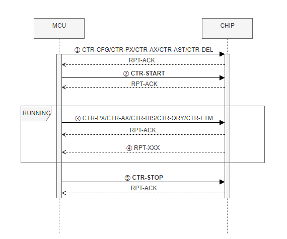

# 前言<a name="ZH-CN_TOPIC_0000002223280200"></a>

**概述<a name="zh-cn_topic_0000001712018702_section4537382116410"></a>**

本文档详细描述了HiDiTing GNSS的消息接口协议，包括NMEA消息协议和GNBIN消息，用于指导用户进行消息解析和消息生成。

**读者对象<a name="zh-cn_topic_0000001712018702_section4378592816410"></a>**

本文档主要适用于以下工程师：

-   系统设计工程师
-   产品软件开发工程师
-   技术支持工程师

**符号约定<a name="zh-cn_topic_0000001712018702_section133020216410"></a>**

在本文中可能出现下列标志，它们所代表的含义如下。

<a name="zh-cn_topic_0000001712018702_table2622507016410"></a>
<table><thead align="left"><tr id="zh-cn_topic_0000001712018702_row1530720816410"><th class="cellrowborder" valign="top" width="20.580000000000002%" id="mcps1.1.3.1.1"><p id="zh-cn_topic_0000001712018702_p6450074116410"><a name="zh-cn_topic_0000001712018702_p6450074116410"></a><a name="zh-cn_topic_0000001712018702_p6450074116410"></a><strong id="zh-cn_topic_0000001712018702_b2136615816410"><a name="zh-cn_topic_0000001712018702_b2136615816410"></a><a name="zh-cn_topic_0000001712018702_b2136615816410"></a>符号</strong></p>
</th>
<th class="cellrowborder" valign="top" width="79.42%" id="mcps1.1.3.1.2"><p id="zh-cn_topic_0000001712018702_p5435366816410"><a name="zh-cn_topic_0000001712018702_p5435366816410"></a><a name="zh-cn_topic_0000001712018702_p5435366816410"></a><strong id="zh-cn_topic_0000001712018702_b5941558116410"><a name="zh-cn_topic_0000001712018702_b5941558116410"></a><a name="zh-cn_topic_0000001712018702_b5941558116410"></a>说明</strong></p>
</th>
</tr>
</thead>
<tbody><tr id="zh-cn_topic_0000001712018702_row1372280416410"><td class="cellrowborder" valign="top" width="20.580000000000002%" headers="mcps1.1.3.1.1 "><p id="zh-cn_topic_0000001712018702_p3734547016410"><a name="zh-cn_topic_0000001712018702_p3734547016410"></a><a name="zh-cn_topic_0000001712018702_p3734547016410"></a><a name="zh-cn_topic_0000001712018702_image2670064316410"></a><a name="zh-cn_topic_0000001712018702_image2670064316410"></a><span></span></p>
</td>
<td class="cellrowborder" valign="top" width="79.42%" headers="mcps1.1.3.1.2 "><p id="zh-cn_topic_0000001712018702_p1757432116410"><a name="zh-cn_topic_0000001712018702_p1757432116410"></a><a name="zh-cn_topic_0000001712018702_p1757432116410"></a>表示如不避免则将会导致死亡或严重伤害的具有高等级风险的危害。</p>
</td>
</tr>
<tr id="zh-cn_topic_0000001712018702_row466863216410"><td class="cellrowborder" valign="top" width="20.580000000000002%" headers="mcps1.1.3.1.1 "><p id="zh-cn_topic_0000001712018702_p1432579516410"><a name="zh-cn_topic_0000001712018702_p1432579516410"></a><a name="zh-cn_topic_0000001712018702_p1432579516410"></a><a name="zh-cn_topic_0000001712018702_image4895582316410"></a><a name="zh-cn_topic_0000001712018702_image4895582316410"></a><span></span></p>
</td>
<td class="cellrowborder" valign="top" width="79.42%" headers="mcps1.1.3.1.2 "><p id="zh-cn_topic_0000001712018702_p959197916410"><a name="zh-cn_topic_0000001712018702_p959197916410"></a><a name="zh-cn_topic_0000001712018702_p959197916410"></a>表示如不避免则可能导致死亡或严重伤害的具有中等级风险的危害。</p>
</td>
</tr>
<tr id="zh-cn_topic_0000001712018702_row123863216410"><td class="cellrowborder" valign="top" width="20.580000000000002%" headers="mcps1.1.3.1.1 "><p id="zh-cn_topic_0000001712018702_p1232579516410"><a name="zh-cn_topic_0000001712018702_p1232579516410"></a><a name="zh-cn_topic_0000001712018702_p1232579516410"></a><a name="zh-cn_topic_0000001712018702_image1235582316410"></a><a name="zh-cn_topic_0000001712018702_image1235582316410"></a><span></span></p>
</td>
<td class="cellrowborder" valign="top" width="79.42%" headers="mcps1.1.3.1.2 "><p id="zh-cn_topic_0000001712018702_p123197916410"><a name="zh-cn_topic_0000001712018702_p123197916410"></a><a name="zh-cn_topic_0000001712018702_p123197916410"></a>表示如不避免则可能导致轻微或中度伤害的具有低等级风险的危害。</p>
</td>
</tr>
<tr id="zh-cn_topic_0000001712018702_row5786682116410"><td class="cellrowborder" valign="top" width="20.580000000000002%" headers="mcps1.1.3.1.1 "><p id="zh-cn_topic_0000001712018702_p2204984716410"><a name="zh-cn_topic_0000001712018702_p2204984716410"></a><a name="zh-cn_topic_0000001712018702_p2204984716410"></a><a name="zh-cn_topic_0000001712018702_image4504446716410"></a><a name="zh-cn_topic_0000001712018702_image4504446716410"></a><span></span></p>
</td>
<td class="cellrowborder" valign="top" width="79.42%" headers="mcps1.1.3.1.2 "><p id="zh-cn_topic_0000001712018702_p4388861916410"><a name="zh-cn_topic_0000001712018702_p4388861916410"></a><a name="zh-cn_topic_0000001712018702_p4388861916410"></a>用于传递设备或环境安全警示信息。如不避免则可能会导致设备损坏、数据丢失、设备性能降低或其它不可预知的结果。</p>
<p id="zh-cn_topic_0000001712018702_p1238861916410"><a name="zh-cn_topic_0000001712018702_p1238861916410"></a><a name="zh-cn_topic_0000001712018702_p1238861916410"></a>“须知”不涉及人身伤害。</p>
</td>
</tr>
<tr id="zh-cn_topic_0000001712018702_row2856923116410"><td class="cellrowborder" valign="top" width="20.580000000000002%" headers="mcps1.1.3.1.1 "><p id="zh-cn_topic_0000001712018702_p5555360116410"><a name="zh-cn_topic_0000001712018702_p5555360116410"></a><a name="zh-cn_topic_0000001712018702_p5555360116410"></a><a name="zh-cn_topic_0000001712018702_image799324016410"></a><a name="zh-cn_topic_0000001712018702_image799324016410"></a><span></span></p>
</td>
<td class="cellrowborder" valign="top" width="79.42%" headers="mcps1.1.3.1.2 "><p id="zh-cn_topic_0000001712018702_p4612588116410"><a name="zh-cn_topic_0000001712018702_p4612588116410"></a><a name="zh-cn_topic_0000001712018702_p4612588116410"></a>对正文中重点信息的补充说明。</p>
<p id="zh-cn_topic_0000001712018702_p1232588116410"><a name="zh-cn_topic_0000001712018702_p1232588116410"></a><a name="zh-cn_topic_0000001712018702_p1232588116410"></a>“说明”不是安全警示信息，不涉及人身、设备及环境伤害信息。</p>
</td>
</tr>
</tbody>
</table>

# NMEA协议<a name="ZH-CN_TOPIC_0000002258622729"></a>

-   **[NMEA协议概述](#ZH-CN_TOPIC_0000002223663076)**  

-   **[NMEA协议框架](#ZH-CN_TOPIC_0000002258462845)**  

-   **[NMEA标识符](#ZH-CN_TOPIC_0000002223503256)**  

-   **[NMEA标准消息](#ZH-CN_TOPIC_0000002223503264)**  

-   **[NMEA自定义消息](#ZH-CN_TOPIC_0000002223503276)**  

## NMEA协议概述<a name="ZH-CN_TOPIC_0000002223663076"></a>

NMEA协议是以ASCII码为基础的一种明文协议，通过该协议可以将GNSS芯片解算出的时间、位置、速度等信息通过串口或其他通信接口输出给其他设备。

HiDiTing GNSS默认兼容NMEA0183 4.1标准协议，支持GGA、RMC、GSV、VTG、ZDA、GST标准语句。

## NMEA协议框架<a name="ZH-CN_TOPIC_0000002258462845"></a>

NMEA协议以逗号分隔字段，协议框架如[表1](#zh-cn_topic_0000001712018682_table1351mcpsimp)所示。

**表 1**  NMEA协议框架

<a name="zh-cn_topic_0000001712018682_table1351mcpsimp"></a>
<table><thead align="left"><tr id="zh-cn_topic_0000001712018682_row1360mcpsimp"><th class="cellrowborder" valign="top" width="19.19191919191919%" id="mcps1.2.6.1.1"><p id="zh-cn_topic_0000001712018682_p1362mcpsimp"><a name="zh-cn_topic_0000001712018682_p1362mcpsimp"></a><a name="zh-cn_topic_0000001712018682_p1362mcpsimp"></a>$</p>
</th>
<th class="cellrowborder" valign="top" width="20.202020202020204%" id="mcps1.2.6.1.2"><p id="zh-cn_topic_0000001712018682_p1365mcpsimp"><a name="zh-cn_topic_0000001712018682_p1365mcpsimp"></a><a name="zh-cn_topic_0000001712018682_p1365mcpsimp"></a>Address</p>
</th>
<th class="cellrowborder" valign="top" width="20.202020202020204%" id="mcps1.2.6.1.3"><p id="zh-cn_topic_0000001712018682_p1368mcpsimp"><a name="zh-cn_topic_0000001712018682_p1368mcpsimp"></a><a name="zh-cn_topic_0000001712018682_p1368mcpsimp"></a>,Field,Field…</p>
</th>
<th class="cellrowborder" valign="top" width="20.202020202020204%" id="mcps1.2.6.1.4"><p id="zh-cn_topic_0000001712018682_p1371mcpsimp"><a name="zh-cn_topic_0000001712018682_p1371mcpsimp"></a><a name="zh-cn_topic_0000001712018682_p1371mcpsimp"></a>*Checksum</p>
</th>
<th class="cellrowborder" valign="top" width="20.202020202020204%" id="mcps1.2.6.1.5"><p id="zh-cn_topic_0000001712018682_p1374mcpsimp"><a name="zh-cn_topic_0000001712018682_p1374mcpsimp"></a><a name="zh-cn_topic_0000001712018682_p1374mcpsimp"></a>&lt;CR&gt;&lt;LF&gt;</p>
</th>
</tr>
</thead>
<tbody><tr id="zh-cn_topic_0000001712018682_row1376mcpsimp"><td class="cellrowborder" valign="top" width="19.19191919191919%" headers="mcps1.2.6.1.1 "><p id="zh-cn_topic_0000001712018682_p1378mcpsimp"><a name="zh-cn_topic_0000001712018682_p1378mcpsimp"></a><a name="zh-cn_topic_0000001712018682_p1378mcpsimp"></a>起始符</p>
</td>
<td class="cellrowborder" valign="top" width="20.202020202020204%" headers="mcps1.2.6.1.2 "><p id="zh-cn_topic_0000001712018682_p1380mcpsimp"><a name="zh-cn_topic_0000001712018682_p1380mcpsimp"></a><a name="zh-cn_topic_0000001712018682_p1380mcpsimp"></a>地址段</p>
</td>
<td class="cellrowborder" valign="top" width="20.202020202020204%" headers="mcps1.2.6.1.3 "><p id="zh-cn_topic_0000001712018682_p1382mcpsimp"><a name="zh-cn_topic_0000001712018682_p1382mcpsimp"></a><a name="zh-cn_topic_0000001712018682_p1382mcpsimp"></a>数据段</p>
</td>
<td class="cellrowborder" valign="top" width="20.202020202020204%" headers="mcps1.2.6.1.4 "><p id="zh-cn_topic_0000001712018682_p1384mcpsimp"><a name="zh-cn_topic_0000001712018682_p1384mcpsimp"></a><a name="zh-cn_topic_0000001712018682_p1384mcpsimp"></a>校验和段</p>
</td>
<td class="cellrowborder" valign="top" width="20.202020202020204%" headers="mcps1.2.6.1.5 "><p id="zh-cn_topic_0000001712018682_p1386mcpsimp"><a name="zh-cn_topic_0000001712018682_p1386mcpsimp"></a><a name="zh-cn_topic_0000001712018682_p1386mcpsimp"></a>结束符</p>
</td>
</tr>
<tr id="zh-cn_topic_0000001712018682_row1387mcpsimp"><td class="cellrowborder" valign="top" width="19.19191919191919%" headers="mcps1.2.6.1.1 "><p id="zh-cn_topic_0000001712018682_p1389mcpsimp"><a name="zh-cn_topic_0000001712018682_p1389mcpsimp"></a><a name="zh-cn_topic_0000001712018682_p1389mcpsimp"></a>每条语句起始符都固定为'$'</p>
</td>
<td class="cellrowborder" valign="top" width="20.202020202020204%" headers="mcps1.2.6.1.2 "><p id="zh-cn_topic_0000001712018682_p1391mcpsimp"><a name="zh-cn_topic_0000001712018682_p1391mcpsimp"></a><a name="zh-cn_topic_0000001712018682_p1391mcpsimp"></a>标准协议包括两部分：前2字符为发送器标识符，其余字符为消息。</p>
</td>
<td class="cellrowborder" valign="top" width="20.202020202020204%" headers="mcps1.2.6.1.3 "><p id="zh-cn_topic_0000001712018682_p1393mcpsimp"><a name="zh-cn_topic_0000001712018682_p1393mcpsimp"></a><a name="zh-cn_topic_0000001712018682_p1393mcpsimp"></a>以','分隔，后面是变长的数据内容，可以是字符，也可以是数字，也可以留空。</p>
</td>
<td class="cellrowborder" valign="top" width="20.202020202020204%" headers="mcps1.2.6.1.4 "><p id="zh-cn_topic_0000001712018682_p1395mcpsimp"><a name="zh-cn_topic_0000001712018682_p1395mcpsimp"></a><a name="zh-cn_topic_0000001712018682_p1395mcpsimp"></a>以','开始，后面紧跟两字节16进制校验和，校验和为'$'和'*'之间的内容（不含这两个字符）按字节进行异或运算的结果。</p>
</td>
<td class="cellrowborder" valign="top" width="20.202020202020204%" headers="mcps1.2.6.1.5 "><p id="zh-cn_topic_0000001712018682_p1398mcpsimp"><a name="zh-cn_topic_0000001712018682_p1398mcpsimp"></a><a name="zh-cn_topic_0000001712018682_p1398mcpsimp"></a>每条语句都以&lt;CR&gt;&lt;LF&gt;结束。</p>
</td>
</tr>
</tbody>
</table>

消息样例如[表2](#zh-cn_topic_0000001712018682_table1400mcpsimp)所示。

**表 2**  NMEA消息样例

<a name="zh-cn_topic_0000001712018682_table1400mcpsimp"></a>
<table><thead align="left"><tr id="zh-cn_topic_0000001712018682_row1408mcpsimp"><th class="cellrowborder" valign="top" width="5.94%" id="mcps1.2.6.1.1"><p id="zh-cn_topic_0000001712018682_p1410mcpsimp"><a name="zh-cn_topic_0000001712018682_p1410mcpsimp"></a><a name="zh-cn_topic_0000001712018682_p1410mcpsimp"></a>$</p>
</th>
<th class="cellrowborder" valign="top" width="14.05%" id="mcps1.2.6.1.2"><p id="zh-cn_topic_0000001712018682_p1413mcpsimp"><a name="zh-cn_topic_0000001712018682_p1413mcpsimp"></a><a name="zh-cn_topic_0000001712018682_p1413mcpsimp"></a>Address</p>
</th>
<th class="cellrowborder" valign="top" width="43.54%" id="mcps1.2.6.1.3"><p id="zh-cn_topic_0000001712018682_p1416mcpsimp"><a name="zh-cn_topic_0000001712018682_p1416mcpsimp"></a><a name="zh-cn_topic_0000001712018682_p1416mcpsimp"></a>,Field,Field…</p>
</th>
<th class="cellrowborder" valign="top" width="18.43%" id="mcps1.2.6.1.4"><p id="zh-cn_topic_0000001712018682_p1419mcpsimp"><a name="zh-cn_topic_0000001712018682_p1419mcpsimp"></a><a name="zh-cn_topic_0000001712018682_p1419mcpsimp"></a>*Checksum</p>
</th>
<th class="cellrowborder" valign="top" width="18.04%" id="mcps1.2.6.1.5"><p id="zh-cn_topic_0000001712018682_p1422mcpsimp"><a name="zh-cn_topic_0000001712018682_p1422mcpsimp"></a><a name="zh-cn_topic_0000001712018682_p1422mcpsimp"></a>&lt;CR&gt;&lt;LF&gt;</p>
</th>
</tr>
</thead>
<tbody><tr id="zh-cn_topic_0000001712018682_row1424mcpsimp"><td class="cellrowborder" valign="top" width="5.94%" headers="mcps1.2.6.1.1 "><p id="zh-cn_topic_0000001712018682_p1426mcpsimp"><a name="zh-cn_topic_0000001712018682_p1426mcpsimp"></a><a name="zh-cn_topic_0000001712018682_p1426mcpsimp"></a>$</p>
</td>
<td class="cellrowborder" valign="top" width="14.05%" headers="mcps1.2.6.1.2 "><p id="zh-cn_topic_0000001712018682_p1428mcpsimp"><a name="zh-cn_topic_0000001712018682_p1428mcpsimp"></a><a name="zh-cn_topic_0000001712018682_p1428mcpsimp"></a>GNGLL</p>
</td>
<td class="cellrowborder" valign="top" width="43.54%" headers="mcps1.2.6.1.3 "><p id="zh-cn_topic_0000001712018682_p1430mcpsimp"><a name="zh-cn_topic_0000001712018682_p1430mcpsimp"></a><a name="zh-cn_topic_0000001712018682_p1430mcpsimp"></a>,3412.431698,N,10852.419449,E,094343.00,A,A</p>
</td>
<td class="cellrowborder" valign="top" width="18.43%" headers="mcps1.2.6.1.4 "><p id="zh-cn_topic_0000001712018682_p1432mcpsimp"><a name="zh-cn_topic_0000001712018682_p1432mcpsimp"></a><a name="zh-cn_topic_0000001712018682_p1432mcpsimp"></a>*70</p>
</td>
<td class="cellrowborder" valign="top" width="18.04%" headers="mcps1.2.6.1.5 "><p id="zh-cn_topic_0000001712018682_p1434mcpsimp"><a name="zh-cn_topic_0000001712018682_p1434mcpsimp"></a><a name="zh-cn_topic_0000001712018682_p1434mcpsimp"></a>\r\n</p>
</td>
</tr>
</tbody>
</table>

## NMEA标识符<a name="ZH-CN_TOPIC_0000002223503256"></a>

-   **[NMEA发送器标识符](#ZH-CN_TOPIC_0000002258622745)**  

-   **[NMEA卫星信号标识符](#ZH-CN_TOPIC_0000002223663088)**  

-   **[NMEA卫星编号标识符](#ZH-CN_TOPIC_0000002258462853)**  

### NMEA发送器标识符<a name="ZH-CN_TOPIC_0000002258622745"></a>

NMEA发送器标识符用于描述当前语句对应的卫星系统或者自定义信息，定义如[表1](#zh-cn_topic_0000001712018706__Ref135143592)所示。

**表 1**  NMEA发送器标识符

<a name="zh-cn_topic_0000001712018706__Ref135143592"></a>
<table><thead align="left"><tr id="zh-cn_topic_0000001712018706_row1444mcpsimp"><th class="cellrowborder" valign="top" width="31%" id="mcps1.2.4.1.1"><p id="zh-cn_topic_0000001712018706_p1446mcpsimp"><a name="zh-cn_topic_0000001712018706_p1446mcpsimp"></a><a name="zh-cn_topic_0000001712018706_p1446mcpsimp"></a>类别</p>
</th>
<th class="cellrowborder" valign="top" width="36%" id="mcps1.2.4.1.2"><p id="zh-cn_topic_0000001712018706_p1449mcpsimp"><a name="zh-cn_topic_0000001712018706_p1449mcpsimp"></a><a name="zh-cn_topic_0000001712018706_p1449mcpsimp"></a>发送器</p>
</th>
<th class="cellrowborder" valign="top" width="33%" id="mcps1.2.4.1.3"><p id="zh-cn_topic_0000001712018706_p1452mcpsimp"><a name="zh-cn_topic_0000001712018706_p1452mcpsimp"></a><a name="zh-cn_topic_0000001712018706_p1452mcpsimp"></a>标识符</p>
</th>
</tr>
</thead>
<tbody><tr id="zh-cn_topic_0000001712018706_row1454mcpsimp"><td class="cellrowborder" rowspan="6" valign="top" width="31%" headers="mcps1.2.4.1.1 "><p id="zh-cn_topic_0000001712018706_p1456mcpsimp"><a name="zh-cn_topic_0000001712018706_p1456mcpsimp"></a><a name="zh-cn_topic_0000001712018706_p1456mcpsimp"></a>NMEA标准消息</p>
</td>
<td class="cellrowborder" valign="top" width="36%" headers="mcps1.2.4.1.2 "><p id="zh-cn_topic_0000001712018706_p1458mcpsimp"><a name="zh-cn_topic_0000001712018706_p1458mcpsimp"></a><a name="zh-cn_topic_0000001712018706_p1458mcpsimp"></a>BDS</p>
</td>
<td class="cellrowborder" valign="top" width="33%" headers="mcps1.2.4.1.3 "><p id="zh-cn_topic_0000001712018706_p1460mcpsimp"><a name="zh-cn_topic_0000001712018706_p1460mcpsimp"></a><a name="zh-cn_topic_0000001712018706_p1460mcpsimp"></a>GB</p>
</td>
</tr>
<tr id="zh-cn_topic_0000001712018706_row1461mcpsimp"><td class="cellrowborder" valign="top" headers="mcps1.2.4.1.1 "><p id="zh-cn_topic_0000001712018706_p1463mcpsimp"><a name="zh-cn_topic_0000001712018706_p1463mcpsimp"></a><a name="zh-cn_topic_0000001712018706_p1463mcpsimp"></a>GPS</p>
</td>
<td class="cellrowborder" valign="top" headers="mcps1.2.4.1.2 "><p id="zh-cn_topic_0000001712018706_p1465mcpsimp"><a name="zh-cn_topic_0000001712018706_p1465mcpsimp"></a><a name="zh-cn_topic_0000001712018706_p1465mcpsimp"></a>GP</p>
</td>
</tr>
<tr id="zh-cn_topic_0000001712018706_row1466mcpsimp"><td class="cellrowborder" valign="top" headers="mcps1.2.4.1.1 "><p id="zh-cn_topic_0000001712018706_p1468mcpsimp"><a name="zh-cn_topic_0000001712018706_p1468mcpsimp"></a><a name="zh-cn_topic_0000001712018706_p1468mcpsimp"></a>Galileo</p>
</td>
<td class="cellrowborder" valign="top" headers="mcps1.2.4.1.2 "><p id="zh-cn_topic_0000001712018706_p1470mcpsimp"><a name="zh-cn_topic_0000001712018706_p1470mcpsimp"></a><a name="zh-cn_topic_0000001712018706_p1470mcpsimp"></a>GA</p>
</td>
</tr>
<tr id="zh-cn_topic_0000001712018706_row1471mcpsimp"><td class="cellrowborder" valign="top" headers="mcps1.2.4.1.1 "><p id="zh-cn_topic_0000001712018706_p1473mcpsimp"><a name="zh-cn_topic_0000001712018706_p1473mcpsimp"></a><a name="zh-cn_topic_0000001712018706_p1473mcpsimp"></a>GLONASS</p>
</td>
<td class="cellrowborder" valign="top" headers="mcps1.2.4.1.2 "><p id="zh-cn_topic_0000001712018706_p1475mcpsimp"><a name="zh-cn_topic_0000001712018706_p1475mcpsimp"></a><a name="zh-cn_topic_0000001712018706_p1475mcpsimp"></a>GL</p>
</td>
</tr>
<tr id="zh-cn_topic_0000001712018706_row1476mcpsimp"><td class="cellrowborder" valign="top" headers="mcps1.2.4.1.1 "><p id="zh-cn_topic_0000001712018706_p1478mcpsimp"><a name="zh-cn_topic_0000001712018706_p1478mcpsimp"></a><a name="zh-cn_topic_0000001712018706_p1478mcpsimp"></a>QZSS</p>
</td>
<td class="cellrowborder" valign="top" headers="mcps1.2.4.1.2 "><p id="zh-cn_topic_0000001712018706_p1480mcpsimp"><a name="zh-cn_topic_0000001712018706_p1480mcpsimp"></a><a name="zh-cn_topic_0000001712018706_p1480mcpsimp"></a>GQ</p>
</td>
</tr>
<tr id="zh-cn_topic_0000001712018706_row1481mcpsimp"><td class="cellrowborder" valign="top" headers="mcps1.2.4.1.1 "><p id="zh-cn_topic_0000001712018706_p1483mcpsimp"><a name="zh-cn_topic_0000001712018706_p1483mcpsimp"></a><a name="zh-cn_topic_0000001712018706_p1483mcpsimp"></a>Multi-GNSS</p>
</td>
<td class="cellrowborder" valign="top" headers="mcps1.2.4.1.2 "><p id="zh-cn_topic_0000001712018706_p1485mcpsimp"><a name="zh-cn_topic_0000001712018706_p1485mcpsimp"></a><a name="zh-cn_topic_0000001712018706_p1485mcpsimp"></a>GN</p>
</td>
</tr>
<tr id="zh-cn_topic_0000001712018706_row1486mcpsimp"><td class="cellrowborder" valign="top" width="31%" headers="mcps1.2.4.1.1 "><p id="zh-cn_topic_0000001712018706_p1488mcpsimp"><a name="zh-cn_topic_0000001712018706_p1488mcpsimp"></a><a name="zh-cn_topic_0000001712018706_p1488mcpsimp"></a>NMEA自定义消息</p>
</td>
<td class="cellrowborder" valign="top" width="36%" headers="mcps1.2.4.1.2 "><p id="zh-cn_topic_0000001712018706_p1490mcpsimp"><a name="zh-cn_topic_0000001712018706_p1490mcpsimp"></a><a name="zh-cn_topic_0000001712018706_p1490mcpsimp"></a>自定义信息</p>
</td>
<td class="cellrowborder" valign="top" width="33%" headers="mcps1.2.4.1.3 "><p id="zh-cn_topic_0000001712018706_p1492mcpsimp"><a name="zh-cn_topic_0000001712018706_p1492mcpsimp"></a><a name="zh-cn_topic_0000001712018706_p1492mcpsimp"></a>PN</p>
</td>
</tr>
</tbody>
</table>

### NMEA卫星信号标识符<a name="ZH-CN_TOPIC_0000002223663088"></a>

**表 1**  NMEA卫星信号标识

<a name="zh-cn_topic_0000001760017625__Ref135151298"></a>
<table><thead align="left"><tr id="zh-cn_topic_0000001760017625_row1500mcpsimp"><th class="cellrowborder" valign="top" width="33.33333333333333%" id="mcps1.2.4.1.1"><p id="zh-cn_topic_0000001760017625_p1502mcpsimp"><a name="zh-cn_topic_0000001760017625_p1502mcpsimp"></a><a name="zh-cn_topic_0000001760017625_p1502mcpsimp"></a>signal</p>
</th>
<th class="cellrowborder" valign="top" width="33.33333333333333%" id="mcps1.2.4.1.2"><p id="zh-cn_topic_0000001760017625_p1505mcpsimp"><a name="zh-cn_topic_0000001760017625_p1505mcpsimp"></a><a name="zh-cn_topic_0000001760017625_p1505mcpsimp"></a>systemID</p>
</th>
<th class="cellrowborder" valign="top" width="33.33333333333333%" id="mcps1.2.4.1.3"><p id="zh-cn_topic_0000001760017625_p1508mcpsimp"><a name="zh-cn_topic_0000001760017625_p1508mcpsimp"></a><a name="zh-cn_topic_0000001760017625_p1508mcpsimp"></a>signalID</p>
</th>
</tr>
</thead>
<tbody><tr id="zh-cn_topic_0000001760017625_row1510mcpsimp"><td class="cellrowborder" valign="top" width="33.33333333333333%" headers="mcps1.2.4.1.1 "><p id="zh-cn_topic_0000001760017625_p1512mcpsimp"><a name="zh-cn_topic_0000001760017625_p1512mcpsimp"></a><a name="zh-cn_topic_0000001760017625_p1512mcpsimp"></a>GPS L1C/A</p>
</td>
<td class="cellrowborder" valign="top" width="33.33333333333333%" headers="mcps1.2.4.1.2 "><p id="zh-cn_topic_0000001760017625_p1514mcpsimp"><a name="zh-cn_topic_0000001760017625_p1514mcpsimp"></a><a name="zh-cn_topic_0000001760017625_p1514mcpsimp"></a>1</p>
</td>
<td class="cellrowborder" valign="top" width="33.33333333333333%" headers="mcps1.2.4.1.3 "><p id="zh-cn_topic_0000001760017625_p1516mcpsimp"><a name="zh-cn_topic_0000001760017625_p1516mcpsimp"></a><a name="zh-cn_topic_0000001760017625_p1516mcpsimp"></a>1</p>
</td>
</tr>
<tr id="zh-cn_topic_0000001760017625_row1517mcpsimp"><td class="cellrowborder" valign="top" width="33.33333333333333%" headers="mcps1.2.4.1.1 "><p id="zh-cn_topic_0000001760017625_p1519mcpsimp"><a name="zh-cn_topic_0000001760017625_p1519mcpsimp"></a><a name="zh-cn_topic_0000001760017625_p1519mcpsimp"></a>GLONASS L1OF</p>
</td>
<td class="cellrowborder" valign="top" width="33.33333333333333%" headers="mcps1.2.4.1.2 "><p id="zh-cn_topic_0000001760017625_p1521mcpsimp"><a name="zh-cn_topic_0000001760017625_p1521mcpsimp"></a><a name="zh-cn_topic_0000001760017625_p1521mcpsimp"></a>2</p>
</td>
<td class="cellrowborder" valign="top" width="33.33333333333333%" headers="mcps1.2.4.1.3 "><p id="zh-cn_topic_0000001760017625_p1523mcpsimp"><a name="zh-cn_topic_0000001760017625_p1523mcpsimp"></a><a name="zh-cn_topic_0000001760017625_p1523mcpsimp"></a>1</p>
</td>
</tr>
<tr id="zh-cn_topic_0000001760017625_row1524mcpsimp"><td class="cellrowborder" valign="top" width="33.33333333333333%" headers="mcps1.2.4.1.1 "><p id="zh-cn_topic_0000001760017625_p1526mcpsimp"><a name="zh-cn_topic_0000001760017625_p1526mcpsimp"></a><a name="zh-cn_topic_0000001760017625_p1526mcpsimp"></a>Galileo E1C</p>
</td>
<td class="cellrowborder" valign="top" width="33.33333333333333%" headers="mcps1.2.4.1.2 "><p id="zh-cn_topic_0000001760017625_p1528mcpsimp"><a name="zh-cn_topic_0000001760017625_p1528mcpsimp"></a><a name="zh-cn_topic_0000001760017625_p1528mcpsimp"></a>3</p>
</td>
<td class="cellrowborder" valign="top" width="33.33333333333333%" headers="mcps1.2.4.1.3 "><p id="zh-cn_topic_0000001760017625_p1530mcpsimp"><a name="zh-cn_topic_0000001760017625_p1530mcpsimp"></a><a name="zh-cn_topic_0000001760017625_p1530mcpsimp"></a>7</p>
</td>
</tr>
<tr id="zh-cn_topic_0000001760017625_row1531mcpsimp"><td class="cellrowborder" valign="top" width="33.33333333333333%" headers="mcps1.2.4.1.1 "><p id="zh-cn_topic_0000001760017625_p1533mcpsimp"><a name="zh-cn_topic_0000001760017625_p1533mcpsimp"></a><a name="zh-cn_topic_0000001760017625_p1533mcpsimp"></a>BDS B1i</p>
</td>
<td class="cellrowborder" valign="top" width="33.33333333333333%" headers="mcps1.2.4.1.2 "><p id="zh-cn_topic_0000001760017625_p1535mcpsimp"><a name="zh-cn_topic_0000001760017625_p1535mcpsimp"></a><a name="zh-cn_topic_0000001760017625_p1535mcpsimp"></a>4</p>
</td>
<td class="cellrowborder" valign="top" width="33.33333333333333%" headers="mcps1.2.4.1.3 "><p id="zh-cn_topic_0000001760017625_p1537mcpsimp"><a name="zh-cn_topic_0000001760017625_p1537mcpsimp"></a><a name="zh-cn_topic_0000001760017625_p1537mcpsimp"></a>1</p>
</td>
</tr>
<tr id="zh-cn_topic_0000001760017625_row1538mcpsimp"><td class="cellrowborder" valign="top" width="33.33333333333333%" headers="mcps1.2.4.1.1 "><p id="zh-cn_topic_0000001760017625_p1540mcpsimp"><a name="zh-cn_topic_0000001760017625_p1540mcpsimp"></a><a name="zh-cn_topic_0000001760017625_p1540mcpsimp"></a>QZSS L1C/A</p>
</td>
<td class="cellrowborder" valign="top" width="33.33333333333333%" headers="mcps1.2.4.1.2 "><p id="zh-cn_topic_0000001760017625_p1542mcpsimp"><a name="zh-cn_topic_0000001760017625_p1542mcpsimp"></a><a name="zh-cn_topic_0000001760017625_p1542mcpsimp"></a>5</p>
</td>
<td class="cellrowborder" valign="top" width="33.33333333333333%" headers="mcps1.2.4.1.3 "><p id="zh-cn_topic_0000001760017625_p1544mcpsimp"><a name="zh-cn_topic_0000001760017625_p1544mcpsimp"></a><a name="zh-cn_topic_0000001760017625_p1544mcpsimp"></a>1</p>
</td>
</tr>
</tbody>
</table>

### NMEA卫星编号标识符<a name="ZH-CN_TOPIC_0000002258462853"></a>

**表 1**  NMEA卫星编号标识

<a name="zh-cn_topic_0000001759897781__Ref135154900"></a>
<table><thead align="left"><tr id="zh-cn_topic_0000001759897781_row1553mcpsimp"><th class="cellrowborder" valign="top" width="26.732673267326728%" id="mcps1.2.5.1.1"><p id="zh-cn_topic_0000001759897781_p1555mcpsimp"><a name="zh-cn_topic_0000001759897781_p1555mcpsimp"></a><a name="zh-cn_topic_0000001759897781_p1555mcpsimp"></a>GNSS</p>
</th>
<th class="cellrowborder" valign="top" width="25.742574257425744%" id="mcps1.2.5.1.2"><p id="zh-cn_topic_0000001759897781_p1558mcpsimp"><a name="zh-cn_topic_0000001759897781_p1558mcpsimp"></a><a name="zh-cn_topic_0000001759897781_p1558mcpsimp"></a>NMEA svid range</p>
</th>
<th class="cellrowborder" valign="top" width="23.762376237623766%" id="mcps1.2.5.1.3"><p id="zh-cn_topic_0000001759897781_p1561mcpsimp"><a name="zh-cn_topic_0000001759897781_p1561mcpsimp"></a><a name="zh-cn_topic_0000001759897781_p1561mcpsimp"></a>GNSS PRN range</p>
</th>
<th class="cellrowborder" valign="top" width="23.762376237623766%" id="mcps1.2.5.1.4"><p id="zh-cn_topic_0000001759897781_p1564mcpsimp"><a name="zh-cn_topic_0000001759897781_p1564mcpsimp"></a><a name="zh-cn_topic_0000001759897781_p1564mcpsimp"></a>PRN to svid</p>
</th>
</tr>
</thead>
<tbody><tr id="zh-cn_topic_0000001759897781_row1566mcpsimp"><td class="cellrowborder" valign="top" width="26.732673267326728%" headers="mcps1.2.5.1.1 "><p id="zh-cn_topic_0000001759897781_p1568mcpsimp"><a name="zh-cn_topic_0000001759897781_p1568mcpsimp"></a><a name="zh-cn_topic_0000001759897781_p1568mcpsimp"></a>GPS L1C/A</p>
</td>
<td class="cellrowborder" valign="top" width="25.742574257425744%" headers="mcps1.2.5.1.2 "><p id="zh-cn_topic_0000001759897781_p1570mcpsimp"><a name="zh-cn_topic_0000001759897781_p1570mcpsimp"></a><a name="zh-cn_topic_0000001759897781_p1570mcpsimp"></a>1～32</p>
</td>
<td class="cellrowborder" valign="top" width="23.762376237623766%" headers="mcps1.2.5.1.3 "><p id="zh-cn_topic_0000001759897781_p1572mcpsimp"><a name="zh-cn_topic_0000001759897781_p1572mcpsimp"></a><a name="zh-cn_topic_0000001759897781_p1572mcpsimp"></a>1～32</p>
</td>
<td class="cellrowborder" valign="top" width="23.762376237623766%" headers="mcps1.2.5.1.4 "><p id="zh-cn_topic_0000001759897781_p1574mcpsimp"><a name="zh-cn_topic_0000001759897781_p1574mcpsimp"></a><a name="zh-cn_topic_0000001759897781_p1574mcpsimp"></a>PRN+0</p>
</td>
</tr>
<tr id="zh-cn_topic_0000001759897781_row1575mcpsimp"><td class="cellrowborder" valign="top" width="26.732673267326728%" headers="mcps1.2.5.1.1 "><p id="zh-cn_topic_0000001759897781_p1577mcpsimp"><a name="zh-cn_topic_0000001759897781_p1577mcpsimp"></a><a name="zh-cn_topic_0000001759897781_p1577mcpsimp"></a>GLONASS L1OF</p>
</td>
<td class="cellrowborder" valign="top" width="25.742574257425744%" headers="mcps1.2.5.1.2 "><p id="zh-cn_topic_0000001759897781_p1579mcpsimp"><a name="zh-cn_topic_0000001759897781_p1579mcpsimp"></a><a name="zh-cn_topic_0000001759897781_p1579mcpsimp"></a>65～88</p>
</td>
<td class="cellrowborder" valign="top" width="23.762376237623766%" headers="mcps1.2.5.1.3 "><p id="zh-cn_topic_0000001759897781_p1581mcpsimp"><a name="zh-cn_topic_0000001759897781_p1581mcpsimp"></a><a name="zh-cn_topic_0000001759897781_p1581mcpsimp"></a>1～24</p>
</td>
<td class="cellrowborder" valign="top" width="23.762376237623766%" headers="mcps1.2.5.1.4 "><p id="zh-cn_topic_0000001759897781_p1583mcpsimp"><a name="zh-cn_topic_0000001759897781_p1583mcpsimp"></a><a name="zh-cn_topic_0000001759897781_p1583mcpsimp"></a>PRN+64</p>
</td>
</tr>
<tr id="zh-cn_topic_0000001759897781_row1584mcpsimp"><td class="cellrowborder" valign="top" width="26.732673267326728%" headers="mcps1.2.5.1.1 "><p id="zh-cn_topic_0000001759897781_p1586mcpsimp"><a name="zh-cn_topic_0000001759897781_p1586mcpsimp"></a><a name="zh-cn_topic_0000001759897781_p1586mcpsimp"></a>Galileo E1C</p>
</td>
<td class="cellrowborder" valign="top" width="25.742574257425744%" headers="mcps1.2.5.1.2 "><p id="zh-cn_topic_0000001759897781_p1588mcpsimp"><a name="zh-cn_topic_0000001759897781_p1588mcpsimp"></a><a name="zh-cn_topic_0000001759897781_p1588mcpsimp"></a>1～36</p>
</td>
<td class="cellrowborder" valign="top" width="23.762376237623766%" headers="mcps1.2.5.1.3 "><p id="zh-cn_topic_0000001759897781_p1590mcpsimp"><a name="zh-cn_topic_0000001759897781_p1590mcpsimp"></a><a name="zh-cn_topic_0000001759897781_p1590mcpsimp"></a>1～36</p>
</td>
<td class="cellrowborder" valign="top" width="23.762376237623766%" headers="mcps1.2.5.1.4 "><p id="zh-cn_topic_0000001759897781_p1592mcpsimp"><a name="zh-cn_topic_0000001759897781_p1592mcpsimp"></a><a name="zh-cn_topic_0000001759897781_p1592mcpsimp"></a>PRN+0</p>
</td>
</tr>
<tr id="zh-cn_topic_0000001759897781_row1593mcpsimp"><td class="cellrowborder" valign="top" width="26.732673267326728%" headers="mcps1.2.5.1.1 "><p id="zh-cn_topic_0000001759897781_p1595mcpsimp"><a name="zh-cn_topic_0000001759897781_p1595mcpsimp"></a><a name="zh-cn_topic_0000001759897781_p1595mcpsimp"></a>BDS B1i</p>
</td>
<td class="cellrowborder" valign="top" width="25.742574257425744%" headers="mcps1.2.5.1.2 "><p id="zh-cn_topic_0000001759897781_p1597mcpsimp"><a name="zh-cn_topic_0000001759897781_p1597mcpsimp"></a><a name="zh-cn_topic_0000001759897781_p1597mcpsimp"></a>1～50</p>
</td>
<td class="cellrowborder" valign="top" width="23.762376237623766%" headers="mcps1.2.5.1.3 "><p id="zh-cn_topic_0000001759897781_p1599mcpsimp"><a name="zh-cn_topic_0000001759897781_p1599mcpsimp"></a><a name="zh-cn_topic_0000001759897781_p1599mcpsimp"></a>1～50</p>
</td>
<td class="cellrowborder" valign="top" width="23.762376237623766%" headers="mcps1.2.5.1.4 "><p id="zh-cn_topic_0000001759897781_p1601mcpsimp"><a name="zh-cn_topic_0000001759897781_p1601mcpsimp"></a><a name="zh-cn_topic_0000001759897781_p1601mcpsimp"></a>PRN+0</p>
</td>
</tr>
<tr id="zh-cn_topic_0000001759897781_row1602mcpsimp"><td class="cellrowborder" valign="top" width="26.732673267326728%" headers="mcps1.2.5.1.1 "><p id="zh-cn_topic_0000001759897781_p1604mcpsimp"><a name="zh-cn_topic_0000001759897781_p1604mcpsimp"></a><a name="zh-cn_topic_0000001759897781_p1604mcpsimp"></a>QZSS L1C/A</p>
</td>
<td class="cellrowborder" valign="top" width="25.742574257425744%" headers="mcps1.2.5.1.2 "><p id="zh-cn_topic_0000001759897781_p1606mcpsimp"><a name="zh-cn_topic_0000001759897781_p1606mcpsimp"></a><a name="zh-cn_topic_0000001759897781_p1606mcpsimp"></a>1～4</p>
</td>
<td class="cellrowborder" valign="top" width="23.762376237623766%" headers="mcps1.2.5.1.3 "><p id="zh-cn_topic_0000001759897781_p1608mcpsimp"><a name="zh-cn_topic_0000001759897781_p1608mcpsimp"></a><a name="zh-cn_topic_0000001759897781_p1608mcpsimp"></a>193～196</p>
</td>
<td class="cellrowborder" valign="top" width="23.762376237623766%" headers="mcps1.2.5.1.4 "><p id="zh-cn_topic_0000001759897781_p1610mcpsimp"><a name="zh-cn_topic_0000001759897781_p1610mcpsimp"></a><a name="zh-cn_topic_0000001759897781_p1610mcpsimp"></a>PRN-192</p>
</td>
</tr>
</tbody>
</table>

## NMEA标准消息<a name="ZH-CN_TOPIC_0000002223503264"></a>

支持的标准NMEA消息类型列表如[表1](#zh-cn_topic_0000001759897757_table1613mcpsimp)所示。

**表 1**  NMEA消息类型列表

<a name="zh-cn_topic_0000001759897757_table1613mcpsimp"></a>
<table><thead align="left"><tr id="zh-cn_topic_0000001759897757_row1619mcpsimp"><th class="cellrowborder" valign="top" width="22.220000000000002%" id="mcps1.2.4.1.1"><p id="zh-cn_topic_0000001759897757_p1621mcpsimp"><a name="zh-cn_topic_0000001759897757_p1621mcpsimp"></a><a name="zh-cn_topic_0000001759897757_p1621mcpsimp"></a>消息类型</p>
</th>
<th class="cellrowborder" valign="top" width="45.16%" id="mcps1.2.4.1.2"><p id="zh-cn_topic_0000001759897757_p4057mcpsimp"><a name="zh-cn_topic_0000001759897757_p4057mcpsimp"></a><a name="zh-cn_topic_0000001759897757_p4057mcpsimp"></a>说明</p>
</th>
<th class="cellrowborder" valign="top" width="32.62%" id="mcps1.2.4.1.3"><p id="zh-cn_topic_0000001759897757_p1627mcpsimp"><a name="zh-cn_topic_0000001759897757_p1627mcpsimp"></a><a name="zh-cn_topic_0000001759897757_p1627mcpsimp"></a>默认输出</p>
</th>
</tr>
</thead>
<tbody><tr id="zh-cn_topic_0000001759897757_row1629mcpsimp"><td class="cellrowborder" valign="top" width="22.220000000000002%" headers="mcps1.2.4.1.1 "><p id="zh-cn_topic_0000001759897757_p1631mcpsimp"><a name="zh-cn_topic_0000001759897757_p1631mcpsimp"></a><a name="zh-cn_topic_0000001759897757_p1631mcpsimp"></a>GGA</p>
</td>
<td class="cellrowborder" valign="top" width="45.16%" headers="mcps1.2.4.1.2 "><p id="zh-cn_topic_0000001759897757_p1633mcpsimp"><a name="zh-cn_topic_0000001759897757_p1633mcpsimp"></a><a name="zh-cn_topic_0000001759897757_p1633mcpsimp"></a>接收机定位数据。</p>
</td>
<td class="cellrowborder" valign="top" width="32.62%" headers="mcps1.2.4.1.3 "><p id="zh-cn_topic_0000001759897757_p1635mcpsimp"><a name="zh-cn_topic_0000001759897757_p1635mcpsimp"></a><a name="zh-cn_topic_0000001759897757_p1635mcpsimp"></a>Y</p>
</td>
</tr>
<tr id="zh-cn_topic_0000001759897757_row1636mcpsimp"><td class="cellrowborder" valign="top" width="22.220000000000002%" headers="mcps1.2.4.1.1 "><p id="zh-cn_topic_0000001759897757_p1638mcpsimp"><a name="zh-cn_topic_0000001759897757_p1638mcpsimp"></a><a name="zh-cn_topic_0000001759897757_p1638mcpsimp"></a>RMC</p>
</td>
<td class="cellrowborder" valign="top" width="45.16%" headers="mcps1.2.4.1.2 "><p id="zh-cn_topic_0000001759897757_p1640mcpsimp"><a name="zh-cn_topic_0000001759897757_p1640mcpsimp"></a><a name="zh-cn_topic_0000001759897757_p1640mcpsimp"></a>推荐的最少专用导航数据。</p>
</td>
<td class="cellrowborder" valign="top" width="32.62%" headers="mcps1.2.4.1.3 "><p id="zh-cn_topic_0000001759897757_p1642mcpsimp"><a name="zh-cn_topic_0000001759897757_p1642mcpsimp"></a><a name="zh-cn_topic_0000001759897757_p1642mcpsimp"></a>Y</p>
</td>
</tr>
<tr id="zh-cn_topic_0000001759897757_row1643mcpsimp"><td class="cellrowborder" valign="top" width="22.220000000000002%" headers="mcps1.2.4.1.1 "><p id="zh-cn_topic_0000001759897757_p1645mcpsimp"><a name="zh-cn_topic_0000001759897757_p1645mcpsimp"></a><a name="zh-cn_topic_0000001759897757_p1645mcpsimp"></a>GSV</p>
</td>
<td class="cellrowborder" valign="top" width="45.16%" headers="mcps1.2.4.1.2 "><p id="zh-cn_topic_0000001759897757_p1647mcpsimp"><a name="zh-cn_topic_0000001759897757_p1647mcpsimp"></a><a name="zh-cn_topic_0000001759897757_p1647mcpsimp"></a>可见卫星数据。</p>
</td>
<td class="cellrowborder" valign="top" width="32.62%" headers="mcps1.2.4.1.3 "><p id="zh-cn_topic_0000001759897757_p1649mcpsimp"><a name="zh-cn_topic_0000001759897757_p1649mcpsimp"></a><a name="zh-cn_topic_0000001759897757_p1649mcpsimp"></a>Y</p>
</td>
</tr>
<tr id="zh-cn_topic_0000001759897757_row1650mcpsimp"><td class="cellrowborder" valign="top" width="22.220000000000002%" headers="mcps1.2.4.1.1 "><p id="zh-cn_topic_0000001759897757_p1652mcpsimp"><a name="zh-cn_topic_0000001759897757_p1652mcpsimp"></a><a name="zh-cn_topic_0000001759897757_p1652mcpsimp"></a>GSA</p>
</td>
<td class="cellrowborder" valign="top" width="45.16%" headers="mcps1.2.4.1.2 "><p id="zh-cn_topic_0000001759897757_p1654mcpsimp"><a name="zh-cn_topic_0000001759897757_p1654mcpsimp"></a><a name="zh-cn_topic_0000001759897757_p1654mcpsimp"></a>有效卫星与精度因子数据。</p>
</td>
<td class="cellrowborder" valign="top" width="32.62%" headers="mcps1.2.4.1.3 "><p id="zh-cn_topic_0000001759897757_p1656mcpsimp"><a name="zh-cn_topic_0000001759897757_p1656mcpsimp"></a><a name="zh-cn_topic_0000001759897757_p1656mcpsimp"></a>Y</p>
</td>
</tr>
<tr id="zh-cn_topic_0000001759897757_row1657mcpsimp"><td class="cellrowborder" valign="top" width="22.220000000000002%" headers="mcps1.2.4.1.1 "><p id="zh-cn_topic_0000001759897757_p1659mcpsimp"><a name="zh-cn_topic_0000001759897757_p1659mcpsimp"></a><a name="zh-cn_topic_0000001759897757_p1659mcpsimp"></a>VTG</p>
</td>
<td class="cellrowborder" valign="top" width="45.16%" headers="mcps1.2.4.1.2 "><p id="zh-cn_topic_0000001759897757_p1661mcpsimp"><a name="zh-cn_topic_0000001759897757_p1661mcpsimp"></a><a name="zh-cn_topic_0000001759897757_p1661mcpsimp"></a>对地速度与航向数据。</p>
</td>
<td class="cellrowborder" valign="top" width="32.62%" headers="mcps1.2.4.1.3 "><p id="zh-cn_topic_0000001759897757_p1663mcpsimp"><a name="zh-cn_topic_0000001759897757_p1663mcpsimp"></a><a name="zh-cn_topic_0000001759897757_p1663mcpsimp"></a>Y</p>
</td>
</tr>
<tr id="zh-cn_topic_0000001759897757_row1664mcpsimp"><td class="cellrowborder" valign="top" width="22.220000000000002%" headers="mcps1.2.4.1.1 "><p id="zh-cn_topic_0000001759897757_p1666mcpsimp"><a name="zh-cn_topic_0000001759897757_p1666mcpsimp"></a><a name="zh-cn_topic_0000001759897757_p1666mcpsimp"></a>ZDA</p>
</td>
<td class="cellrowborder" valign="top" width="45.16%" headers="mcps1.2.4.1.2 "><p id="zh-cn_topic_0000001759897757_p1668mcpsimp"><a name="zh-cn_topic_0000001759897757_p1668mcpsimp"></a><a name="zh-cn_topic_0000001759897757_p1668mcpsimp"></a>时间与日期数据。</p>
</td>
<td class="cellrowborder" valign="top" width="32.62%" headers="mcps1.2.4.1.3 "><p id="zh-cn_topic_0000001759897757_p1670mcpsimp"><a name="zh-cn_topic_0000001759897757_p1670mcpsimp"></a><a name="zh-cn_topic_0000001759897757_p1670mcpsimp"></a>Y</p>
</td>
</tr>
<tr id="zh-cn_topic_0000001759897757_row1671mcpsimp"><td class="cellrowborder" valign="top" width="22.220000000000002%" headers="mcps1.2.4.1.1 "><p id="zh-cn_topic_0000001759897757_p1673mcpsimp"><a name="zh-cn_topic_0000001759897757_p1673mcpsimp"></a><a name="zh-cn_topic_0000001759897757_p1673mcpsimp"></a>GLL</p>
</td>
<td class="cellrowborder" valign="top" width="45.16%" headers="mcps1.2.4.1.2 "><p id="zh-cn_topic_0000001759897757_p1675mcpsimp"><a name="zh-cn_topic_0000001759897757_p1675mcpsimp"></a><a name="zh-cn_topic_0000001759897757_p1675mcpsimp"></a>接收机地理位置数据。</p>
</td>
<td class="cellrowborder" valign="top" width="32.62%" headers="mcps1.2.4.1.3 "><p id="zh-cn_topic_0000001759897757_p1677mcpsimp"><a name="zh-cn_topic_0000001759897757_p1677mcpsimp"></a><a name="zh-cn_topic_0000001759897757_p1677mcpsimp"></a>Y</p>
</td>
</tr>
</tbody>
</table>

-   **[GGA](#ZH-CN_TOPIC_0000002258622753)**  

-   **[RMC](#ZH-CN_TOPIC_0000002223663096)**  

-   **[GSV](#ZH-CN_TOPIC_0000002258462869)**  

-   **[GSA](#ZH-CN_TOPIC_0000002223503268)**  

-   **[VTG](#ZH-CN_TOPIC_0000002258622773)**  

-   **[ZDA](#ZH-CN_TOPIC_0000002223663104)**  

-   **[GLL](#ZH-CN_TOPIC_0000002258462877)**  

### GGA<a name="ZH-CN_TOPIC_0000002258622753"></a>

**表 1**  GGA消息格式

<a name="zh-cn_topic_0000001760017617_table1681mcpsimp"></a>
<table><thead align="left"><tr id="zh-cn_topic_0000001760017617_row1689mcpsimp"><th class="cellrowborder" valign="top" id="mcps1.2.6.1.1"><p id="zh-cn_topic_0000001760017617_p1691mcpsimp"><a name="zh-cn_topic_0000001760017617_p1691mcpsimp"></a><a name="zh-cn_topic_0000001760017617_p1691mcpsimp"></a>消息</p>
</th>
<th class="cellrowborder" colspan="4" valign="top" id="mcps1.2.6.1.2"><p id="zh-cn_topic_0000001760017617_p1693mcpsimp"><a name="zh-cn_topic_0000001760017617_p1693mcpsimp"></a><a name="zh-cn_topic_0000001760017617_p1693mcpsimp"></a>GGA</p>
</th>
</tr>
</thead>
<tbody><tr id="zh-cn_topic_0000001760017617_row1694mcpsimp"><td class="cellrowborder" valign="top" headers="mcps1.2.6.1.1 "><p id="zh-cn_topic_0000001760017617_zh-cn_topic_0000001658220777_p3761mcpsimp"><a name="zh-cn_topic_0000001760017617_zh-cn_topic_0000001658220777_p3761mcpsimp"></a><a name="zh-cn_topic_0000001760017617_zh-cn_topic_0000001658220777_p3761mcpsimp"></a>说明</p>
</td>
<td class="cellrowborder" colspan="4" valign="top" headers="mcps1.2.6.1.2 "><p id="zh-cn_topic_0000001760017617_p1698mcpsimp"><a name="zh-cn_topic_0000001760017617_p1698mcpsimp"></a><a name="zh-cn_topic_0000001760017617_p1698mcpsimp"></a>接收机时间、位置、定位模式等数据。</p>
</td>
</tr>
<tr id="zh-cn_topic_0000001760017617_row1699mcpsimp"><td class="cellrowborder" valign="top" headers="mcps1.2.6.1.1 "><p id="zh-cn_topic_0000001760017617_p1701mcpsimp"><a name="zh-cn_topic_0000001760017617_p1701mcpsimp"></a><a name="zh-cn_topic_0000001760017617_p1701mcpsimp"></a>格式</p>
</td>
<td class="cellrowborder" colspan="4" valign="top" headers="mcps1.2.6.1.2 "><p id="zh-cn_topic_0000001760017617_p1703mcpsimp"><a name="zh-cn_topic_0000001760017617_p1703mcpsimp"></a><a name="zh-cn_topic_0000001760017617_p1703mcpsimp"></a>$xxGGA,time,lat,NS,lon,EW,quality,numSV,HDOP,alt,altUnit,sep,sepUnit,age,station,</p>
<p id="zh-cn_topic_0000001760017617_p1704mcpsimp"><a name="zh-cn_topic_0000001760017617_p1704mcpsimp"></a><a name="zh-cn_topic_0000001760017617_p1704mcpsimp"></a>*CS&lt;CR&gt;&lt;LF&gt;</p>
</td>
</tr>
<tr id="zh-cn_topic_0000001760017617_row1705mcpsimp"><td class="cellrowborder" valign="top" headers="mcps1.2.6.1.1 "><p id="zh-cn_topic_0000001760017617_p1707mcpsimp"><a name="zh-cn_topic_0000001760017617_p1707mcpsimp"></a><a name="zh-cn_topic_0000001760017617_p1707mcpsimp"></a>示例</p>
</td>
<td class="cellrowborder" colspan="4" valign="top" headers="mcps1.2.6.1.2 "><p id="zh-cn_topic_0000001760017617_p1709mcpsimp"><a name="zh-cn_topic_0000001760017617_p1709mcpsimp"></a><a name="zh-cn_topic_0000001760017617_p1709mcpsimp"></a>$GNGGA,094343.00,3412.431698,N,10852.419449,E,1,22,0.8,378.8,M,,M,,*67</p>
</td>
</tr>
</tbody>
</table>

**表 2**  GGA消息字段说明

<a name="table1385013115519"></a>
<table><thead align="left"><tr id="row168512112511"><th class="cellrowborder" valign="top" width="10.16101610161016%" id="mcps1.2.6.1.1"><p id="p1785141155113"><a name="p1785141155113"></a><a name="p1785141155113"></a>字段</p>
</th>
<th class="cellrowborder" valign="top" width="13.551355135513552%" id="mcps1.2.6.1.2"><p id="p16851141115119"><a name="p16851141115119"></a><a name="p16851141115119"></a>名称</p>
</th>
<th class="cellrowborder" valign="top" width="19.851985198519852%" id="mcps1.2.6.1.3"><p id="p1085171111514"><a name="p1085171111514"></a><a name="p1085171111514"></a>格式</p>
</th>
<th class="cellrowborder" valign="top" width="8.91089108910891%" id="mcps1.2.6.1.4"><p id="p1185111115114"><a name="p1185111115114"></a><a name="p1185111115114"></a>单位</p>
</th>
<th class="cellrowborder" valign="top" width="47.52475247524753%" id="mcps1.2.6.1.5"><p id="p48511011195115"><a name="p48511011195115"></a><a name="p48511011195115"></a>说明</p>
</th>
</tr>
</thead>
<tbody><tr id="row2851131115519"><td class="cellrowborder" valign="top" width="10.16101610161016%" headers="mcps1.2.6.1.1 "><p id="p2851131125115"><a name="p2851131125115"></a><a name="p2851131125115"></a>1</p>
</td>
<td class="cellrowborder" valign="top" width="13.551355135513552%" headers="mcps1.2.6.1.2 "><p id="p1985161114519"><a name="p1985161114519"></a><a name="p1985161114519"></a>$xxGGA</p>
</td>
<td class="cellrowborder" valign="top" width="19.851985198519852%" headers="mcps1.2.6.1.3 "><p id="p10851131119512"><a name="p10851131119512"></a><a name="p10851131119512"></a>string</p>
</td>
<td class="cellrowborder" valign="top" width="8.91089108910891%" headers="mcps1.2.6.1.4 "><p id="p1185181120512"><a name="p1185181120512"></a><a name="p1185181120512"></a>-</p>
</td>
<td class="cellrowborder" valign="top" width="47.52475247524753%" headers="mcps1.2.6.1.5 "><p id="p28511511195119"><a name="p28511511195119"></a><a name="p28511511195119"></a>消息ID，“xx”为系统标识符，见“<a href="#zh-cn_topic_0000001712018706__Ref135143592">表1</a>”。</p>
</td>
</tr>
<tr id="row1385119116517"><td class="cellrowborder" valign="top" width="10.16101610161016%" headers="mcps1.2.6.1.1 "><p id="p1185113116514"><a name="p1185113116514"></a><a name="p1185113116514"></a>2</p>
</td>
<td class="cellrowborder" valign="top" width="13.551355135513552%" headers="mcps1.2.6.1.2 "><p id="p10851171110511"><a name="p10851171110511"></a><a name="p10851171110511"></a>time</p>
</td>
<td class="cellrowborder" valign="top" width="19.851985198519852%" headers="mcps1.2.6.1.3 "><p id="p88515116514"><a name="p88515116514"></a><a name="p88515116514"></a>hhmmss.ss</p>
</td>
<td class="cellrowborder" valign="top" width="8.91089108910891%" headers="mcps1.2.6.1.4 "><p id="p16851191135112"><a name="p16851191135112"></a><a name="p16851191135112"></a>-</p>
</td>
<td class="cellrowborder" valign="top" width="47.52475247524753%" headers="mcps1.2.6.1.5 "><p id="p685110114514"><a name="p685110114514"></a><a name="p685110114514"></a>当前定位对应的UTC时间。</p>
</td>
</tr>
<tr id="row16851811125110"><td class="cellrowborder" valign="top" width="10.16101610161016%" headers="mcps1.2.6.1.1 "><p id="p58511911185119"><a name="p58511911185119"></a><a name="p58511911185119"></a>3</p>
</td>
<td class="cellrowborder" valign="top" width="13.551355135513552%" headers="mcps1.2.6.1.2 "><p id="p13851141195116"><a name="p13851141195116"></a><a name="p13851141195116"></a>lat</p>
</td>
<td class="cellrowborder" valign="top" width="19.851985198519852%" headers="mcps1.2.6.1.3 "><p id="p16851181110514"><a name="p16851181110514"></a><a name="p16851181110514"></a>ddmm.mmmmmm</p>
</td>
<td class="cellrowborder" valign="top" width="8.91089108910891%" headers="mcps1.2.6.1.4 "><p id="p2851311115120"><a name="p2851311115120"></a><a name="p2851311115120"></a>-</p>
</td>
<td class="cellrowborder" valign="top" width="47.52475247524753%" headers="mcps1.2.6.1.5 "><p id="p1085161112516"><a name="p1085161112516"></a><a name="p1085161112516"></a>纬度（度、分格式）。</p>
</td>
</tr>
<tr id="row78521111155119"><td class="cellrowborder" valign="top" width="10.16101610161016%" headers="mcps1.2.6.1.1 "><p id="p18852161175116"><a name="p18852161175116"></a><a name="p18852161175116"></a>4</p>
</td>
<td class="cellrowborder" valign="top" width="13.551355135513552%" headers="mcps1.2.6.1.2 "><p id="p178521311115120"><a name="p178521311115120"></a><a name="p178521311115120"></a>NS</p>
</td>
<td class="cellrowborder" valign="top" width="19.851985198519852%" headers="mcps1.2.6.1.3 "><p id="p17852121112519"><a name="p17852121112519"></a><a name="p17852121112519"></a>char</p>
</td>
<td class="cellrowborder" valign="top" width="8.91089108910891%" headers="mcps1.2.6.1.4 "><p id="p2852171105113"><a name="p2852171105113"></a><a name="p2852171105113"></a>-</p>
</td>
<td class="cellrowborder" valign="top" width="47.52475247524753%" headers="mcps1.2.6.1.5 "><p id="p108522011125117"><a name="p108522011125117"></a><a name="p108522011125117"></a>纬度方向：</p>
<a name="ul128521511135116"></a><a name="ul128521511135116"></a><ul id="ul128521511135116"><li>N：北。</li><li>S：南。</li></ul>
</td>
</tr>
<tr id="row385281114518"><td class="cellrowborder" valign="top" width="10.16101610161016%" headers="mcps1.2.6.1.1 "><p id="p485231155114"><a name="p485231155114"></a><a name="p485231155114"></a>5</p>
</td>
<td class="cellrowborder" valign="top" width="13.551355135513552%" headers="mcps1.2.6.1.2 "><p id="p48522116511"><a name="p48522116511"></a><a name="p48522116511"></a>lon</p>
</td>
<td class="cellrowborder" valign="top" width="19.851985198519852%" headers="mcps1.2.6.1.3 "><p id="p28521411135110"><a name="p28521411135110"></a><a name="p28521411135110"></a>dddmm.mmmmmm</p>
</td>
<td class="cellrowborder" valign="top" width="8.91089108910891%" headers="mcps1.2.6.1.4 "><p id="p12852171111518"><a name="p12852171111518"></a><a name="p12852171111518"></a>-</p>
</td>
<td class="cellrowborder" valign="top" width="47.52475247524753%" headers="mcps1.2.6.1.5 "><p id="p2085241110513"><a name="p2085241110513"></a><a name="p2085241110513"></a>经度（度、分格式，ddd表示整数度，小数点前的m表示整数分，小数点后的m表示小数m）。</p>
</td>
</tr>
<tr id="row1985221135118"><td class="cellrowborder" valign="top" width="10.16101610161016%" headers="mcps1.2.6.1.1 "><p id="p138521116512"><a name="p138521116512"></a><a name="p138521116512"></a>6</p>
</td>
<td class="cellrowborder" valign="top" width="13.551355135513552%" headers="mcps1.2.6.1.2 "><p id="p7852101116518"><a name="p7852101116518"></a><a name="p7852101116518"></a>EW</p>
</td>
<td class="cellrowborder" valign="top" width="19.851985198519852%" headers="mcps1.2.6.1.3 "><p id="p158521711135113"><a name="p158521711135113"></a><a name="p158521711135113"></a>char</p>
</td>
<td class="cellrowborder" valign="top" width="8.91089108910891%" headers="mcps1.2.6.1.4 "><p id="p1085291113512"><a name="p1085291113512"></a><a name="p1085291113512"></a>-</p>
</td>
<td class="cellrowborder" valign="top" width="47.52475247524753%" headers="mcps1.2.6.1.5 "><p id="p9852911145117"><a name="p9852911145117"></a><a name="p9852911145117"></a>经度方向：</p>
<a name="ul15852111155116"></a><a name="ul15852111155116"></a><ul id="ul15852111155116"><li>E：东。</li><li>W：西。</li></ul>
</td>
</tr>
<tr id="row98522011185112"><td class="cellrowborder" valign="top" width="10.16101610161016%" headers="mcps1.2.6.1.1 "><p id="p7852611125118"><a name="p7852611125118"></a><a name="p7852611125118"></a>7</p>
</td>
<td class="cellrowborder" valign="top" width="13.551355135513552%" headers="mcps1.2.6.1.2 "><p id="p1852181195118"><a name="p1852181195118"></a><a name="p1852181195118"></a>quality</p>
</td>
<td class="cellrowborder" valign="top" width="19.851985198519852%" headers="mcps1.2.6.1.3 "><p id="p148521311175115"><a name="p148521311175115"></a><a name="p148521311175115"></a>digit</p>
</td>
<td class="cellrowborder" valign="top" width="8.91089108910891%" headers="mcps1.2.6.1.4 "><p id="p18852101116514"><a name="p18852101116514"></a><a name="p18852101116514"></a>-</p>
</td>
<td class="cellrowborder" valign="top" width="47.52475247524753%" headers="mcps1.2.6.1.5 "><p id="p1185251125116"><a name="p1185251125116"></a><a name="p1185251125116"></a>定位质量：</p>
<a name="ul138531311125119"></a><a name="ul138531311125119"></a><ul id="ul138531311125119"><li>0：定位无效。</li><li>1：有效单点定位。</li></ul>
</td>
</tr>
<tr id="row178531011105115"><td class="cellrowborder" valign="top" width="10.16101610161016%" headers="mcps1.2.6.1.1 "><p id="p1085381114519"><a name="p1085381114519"></a><a name="p1085381114519"></a>8</p>
</td>
<td class="cellrowborder" valign="top" width="13.551355135513552%" headers="mcps1.2.6.1.2 "><p id="p118531111515"><a name="p118531111515"></a><a name="p118531111515"></a>numSV</p>
</td>
<td class="cellrowborder" valign="top" width="19.851985198519852%" headers="mcps1.2.6.1.3 "><p id="p1185391114513"><a name="p1185391114513"></a><a name="p1185391114513"></a>digit</p>
</td>
<td class="cellrowborder" valign="top" width="8.91089108910891%" headers="mcps1.2.6.1.4 "><p id="p128531111145120"><a name="p128531111145120"></a><a name="p128531111145120"></a>-</p>
</td>
<td class="cellrowborder" valign="top" width="47.52475247524753%" headers="mcps1.2.6.1.5 "><p id="p14853141114515"><a name="p14853141114515"></a><a name="p14853141114515"></a>用于定位的卫星数目。</p>
</td>
</tr>
<tr id="row19853191125112"><td class="cellrowborder" valign="top" width="10.16101610161016%" headers="mcps1.2.6.1.1 "><p id="p14853121105111"><a name="p14853121105111"></a><a name="p14853121105111"></a>9</p>
</td>
<td class="cellrowborder" valign="top" width="13.551355135513552%" headers="mcps1.2.6.1.2 "><p id="p5853411185112"><a name="p5853411185112"></a><a name="p5853411185112"></a>HDOP</p>
</td>
<td class="cellrowborder" valign="top" width="19.851985198519852%" headers="mcps1.2.6.1.3 "><p id="p3853201165112"><a name="p3853201165112"></a><a name="p3853201165112"></a>digit</p>
</td>
<td class="cellrowborder" valign="top" width="8.91089108910891%" headers="mcps1.2.6.1.4 "><p id="p15853131125111"><a name="p15853131125111"></a><a name="p15853131125111"></a>-</p>
</td>
<td class="cellrowborder" valign="top" width="47.52475247524753%" headers="mcps1.2.6.1.5 "><p id="p98531011195113"><a name="p98531011195113"></a><a name="p98531011195113"></a>水平精度因子。</p>
</td>
</tr>
<tr id="row208531711105112"><td class="cellrowborder" valign="top" width="10.16101610161016%" headers="mcps1.2.6.1.1 "><p id="p4853611165117"><a name="p4853611165117"></a><a name="p4853611165117"></a>10</p>
</td>
<td class="cellrowborder" valign="top" width="13.551355135513552%" headers="mcps1.2.6.1.2 "><p id="p1853211205112"><a name="p1853211205112"></a><a name="p1853211205112"></a>alt</p>
</td>
<td class="cellrowborder" valign="top" width="19.851985198519852%" headers="mcps1.2.6.1.3 "><p id="p685381145110"><a name="p685381145110"></a><a name="p685381145110"></a>digit</p>
</td>
<td class="cellrowborder" valign="top" width="8.91089108910891%" headers="mcps1.2.6.1.4 "><p id="p20853121105117"><a name="p20853121105117"></a><a name="p20853121105117"></a>m</p>
</td>
<td class="cellrowborder" valign="top" width="47.52475247524753%" headers="mcps1.2.6.1.5 "><p id="p16853611125110"><a name="p16853611125110"></a><a name="p16853611125110"></a>海拔高度。</p>
</td>
</tr>
<tr id="row2853161119514"><td class="cellrowborder" valign="top" width="10.16101610161016%" headers="mcps1.2.6.1.1 "><p id="p385318117518"><a name="p385318117518"></a><a name="p385318117518"></a>11</p>
</td>
<td class="cellrowborder" valign="top" width="13.551355135513552%" headers="mcps1.2.6.1.2 "><p id="p1685381105113"><a name="p1685381105113"></a><a name="p1685381105113"></a>altUnit</p>
</td>
<td class="cellrowborder" valign="top" width="19.851985198519852%" headers="mcps1.2.6.1.3 "><p id="p16853111113519"><a name="p16853111113519"></a><a name="p16853111113519"></a>char</p>
</td>
<td class="cellrowborder" valign="top" width="8.91089108910891%" headers="mcps1.2.6.1.4 "><p id="p685391195117"><a name="p685391195117"></a><a name="p685391195117"></a>-</p>
</td>
<td class="cellrowborder" valign="top" width="47.52475247524753%" headers="mcps1.2.6.1.5 "><p id="p1385317116518"><a name="p1385317116518"></a><a name="p1385317116518"></a>高度单位，固定为字符M，表示米。</p>
</td>
</tr>
<tr id="row1685321125110"><td class="cellrowborder" valign="top" width="10.16101610161016%" headers="mcps1.2.6.1.1 "><p id="p8853141125119"><a name="p8853141125119"></a><a name="p8853141125119"></a>12</p>
</td>
<td class="cellrowborder" valign="top" width="13.551355135513552%" headers="mcps1.2.6.1.2 "><p id="p1985341114518"><a name="p1985341114518"></a><a name="p1985341114518"></a>sep</p>
</td>
<td class="cellrowborder" valign="top" width="19.851985198519852%" headers="mcps1.2.6.1.3 "><p id="p1685414113514"><a name="p1685414113514"></a><a name="p1685414113514"></a>digit</p>
</td>
<td class="cellrowborder" valign="top" width="8.91089108910891%" headers="mcps1.2.6.1.4 "><p id="p1385461135110"><a name="p1385461135110"></a><a name="p1385461135110"></a>m</p>
</td>
<td class="cellrowborder" valign="top" width="47.52475247524753%" headers="mcps1.2.6.1.5 "><p id="p48541911115113"><a name="p48541911115113"></a><a name="p48541911115113"></a>大地水准面至参考椭球面的距离。</p>
</td>
</tr>
<tr id="row18854411175118"><td class="cellrowborder" valign="top" width="10.16101610161016%" headers="mcps1.2.6.1.1 "><p id="p15854151135120"><a name="p15854151135120"></a><a name="p15854151135120"></a>13</p>
</td>
<td class="cellrowborder" valign="top" width="13.551355135513552%" headers="mcps1.2.6.1.2 "><p id="p108545114511"><a name="p108545114511"></a><a name="p108545114511"></a>sepUnit</p>
</td>
<td class="cellrowborder" valign="top" width="19.851985198519852%" headers="mcps1.2.6.1.3 "><p id="p88541511175117"><a name="p88541511175117"></a><a name="p88541511175117"></a>char</p>
</td>
<td class="cellrowborder" valign="top" width="8.91089108910891%" headers="mcps1.2.6.1.4 "><p id="p98541811155113"><a name="p98541811155113"></a><a name="p98541811155113"></a>-</p>
</td>
<td class="cellrowborder" valign="top" width="47.52475247524753%" headers="mcps1.2.6.1.5 "><p id="p10854151105116"><a name="p10854151105116"></a><a name="p10854151105116"></a>高度单位，固定为字符M。</p>
</td>
</tr>
<tr id="row185411155111"><td class="cellrowborder" valign="top" width="10.16101610161016%" headers="mcps1.2.6.1.1 "><p id="p385411125114"><a name="p385411125114"></a><a name="p385411125114"></a>14</p>
</td>
<td class="cellrowborder" valign="top" width="13.551355135513552%" headers="mcps1.2.6.1.2 "><p id="p68543116516"><a name="p68543116516"></a><a name="p68543116516"></a>age</p>
</td>
<td class="cellrowborder" valign="top" width="19.851985198519852%" headers="mcps1.2.6.1.3 "><p id="p10854131119516"><a name="p10854131119516"></a><a name="p10854131119516"></a>digit</p>
</td>
<td class="cellrowborder" valign="top" width="8.91089108910891%" headers="mcps1.2.6.1.4 "><p id="p168541611165115"><a name="p168541611165115"></a><a name="p168541611165115"></a>s</p>
</td>
<td class="cellrowborder" valign="top" width="47.52475247524753%" headers="mcps1.2.6.1.5 "><p id="p15854611105115"><a name="p15854611105115"></a><a name="p15854611105115"></a>差分数据龄期，未使用DGPS时该字段为空。</p>
</td>
</tr>
<tr id="row78541911155112"><td class="cellrowborder" valign="top" width="10.16101610161016%" headers="mcps1.2.6.1.1 "><p id="p1685491105112"><a name="p1685491105112"></a><a name="p1685491105112"></a>15</p>
</td>
<td class="cellrowborder" valign="top" width="13.551355135513552%" headers="mcps1.2.6.1.2 "><p id="p138541011105117"><a name="p138541011105117"></a><a name="p138541011105117"></a>station</p>
</td>
<td class="cellrowborder" valign="top" width="19.851985198519852%" headers="mcps1.2.6.1.3 "><p id="p2854101155113"><a name="p2854101155113"></a><a name="p2854101155113"></a>digit</p>
</td>
<td class="cellrowborder" valign="top" width="8.91089108910891%" headers="mcps1.2.6.1.4 "><p id="p168541411135114"><a name="p168541411135114"></a><a name="p168541411135114"></a>-</p>
</td>
<td class="cellrowborder" valign="top" width="47.52475247524753%" headers="mcps1.2.6.1.5 "><p id="p585441135111"><a name="p585441135111"></a><a name="p585441135111"></a>差分数据站ID，未使用DGPS时该字段为空。</p>
</td>
</tr>
<tr id="row98546116514"><td class="cellrowborder" valign="top" width="10.16101610161016%" headers="mcps1.2.6.1.1 "><p id="p148546112516"><a name="p148546112516"></a><a name="p148546112516"></a>16</p>
</td>
<td class="cellrowborder" valign="top" width="13.551355135513552%" headers="mcps1.2.6.1.2 "><p id="p14854191115116"><a name="p14854191115116"></a><a name="p14854191115116"></a>CS</p>
</td>
<td class="cellrowborder" valign="top" width="19.851985198519852%" headers="mcps1.2.6.1.3 "><p id="p1585481135117"><a name="p1585481135117"></a><a name="p1585481135117"></a>hex</p>
</td>
<td class="cellrowborder" valign="top" width="8.91089108910891%" headers="mcps1.2.6.1.4 "><p id="p885416114511"><a name="p885416114511"></a><a name="p885416114511"></a>-</p>
</td>
<td class="cellrowborder" valign="top" width="47.52475247524753%" headers="mcps1.2.6.1.5 "><p id="p108546115516"><a name="p108546115516"></a><a name="p108546115516"></a>checksum校验和。</p>
</td>
</tr>
<tr id="row19854171135112"><td class="cellrowborder" valign="top" width="10.16101610161016%" headers="mcps1.2.6.1.1 "><p id="p68541911125115"><a name="p68541911125115"></a><a name="p68541911125115"></a>17</p>
</td>
<td class="cellrowborder" valign="top" width="13.551355135513552%" headers="mcps1.2.6.1.2 "><p id="p128541911185115"><a name="p128541911185115"></a><a name="p128541911185115"></a>&lt;CR&gt;&lt;LF&gt;</p>
</td>
<td class="cellrowborder" valign="top" width="19.851985198519852%" headers="mcps1.2.6.1.3 "><p id="p10854181145116"><a name="p10854181145116"></a><a name="p10854181145116"></a>char</p>
</td>
<td class="cellrowborder" valign="top" width="8.91089108910891%" headers="mcps1.2.6.1.4 "><p id="p085581115119"><a name="p085581115119"></a><a name="p085581115119"></a>-</p>
</td>
<td class="cellrowborder" valign="top" width="47.52475247524753%" headers="mcps1.2.6.1.5 "><p id="p19855311105118"><a name="p19855311105118"></a><a name="p19855311105118"></a>回车换行符。</p>
</td>
</tr>
</tbody>
</table>

### RMC<a name="ZH-CN_TOPIC_0000002223663096"></a>

**表 1**  RMC消息格式

<a name="zh-cn_topic_0000001759897777_table1913mcpsimp"></a>
<table><thead align="left"><tr id="zh-cn_topic_0000001759897777_row1921mcpsimp"><th class="cellrowborder" valign="top" id="mcps1.2.6.1.1"><p id="zh-cn_topic_0000001759897777_p1923mcpsimp"><a name="zh-cn_topic_0000001759897777_p1923mcpsimp"></a><a name="zh-cn_topic_0000001759897777_p1923mcpsimp"></a>消息</p>
</th>
<th class="cellrowborder" colspan="4" valign="top" id="mcps1.2.6.1.2"><p id="zh-cn_topic_0000001759897777_p1925mcpsimp"><a name="zh-cn_topic_0000001759897777_p1925mcpsimp"></a><a name="zh-cn_topic_0000001759897777_p1925mcpsimp"></a>RMC</p>
</th>
</tr>
</thead>
<tbody><tr id="zh-cn_topic_0000001759897777_row1926mcpsimp"><td class="cellrowborder" valign="top" headers="mcps1.2.6.1.1 "><p id="zh-cn_topic_0000001759897777_zh-cn_topic_0000001658220777_p3761mcpsimp"><a name="zh-cn_topic_0000001759897777_zh-cn_topic_0000001658220777_p3761mcpsimp"></a><a name="zh-cn_topic_0000001759897777_zh-cn_topic_0000001658220777_p3761mcpsimp"></a>说明</p>
</td>
<td class="cellrowborder" colspan="4" valign="top" headers="mcps1.2.6.1.2 "><p id="zh-cn_topic_0000001759897777_p1930mcpsimp"><a name="zh-cn_topic_0000001759897777_p1930mcpsimp"></a><a name="zh-cn_topic_0000001759897777_p1930mcpsimp"></a>推荐的最小定位信息。</p>
</td>
</tr>
<tr id="zh-cn_topic_0000001759897777_row1931mcpsimp"><td class="cellrowborder" valign="top" headers="mcps1.2.6.1.1 "><p id="zh-cn_topic_0000001759897777_p1933mcpsimp"><a name="zh-cn_topic_0000001759897777_p1933mcpsimp"></a><a name="zh-cn_topic_0000001759897777_p1933mcpsimp"></a>格式</p>
</td>
<td class="cellrowborder" colspan="4" valign="top" headers="mcps1.2.6.1.2 "><p id="zh-cn_topic_0000001759897777_p1935mcpsimp"><a name="zh-cn_topic_0000001759897777_p1935mcpsimp"></a><a name="zh-cn_topic_0000001759897777_p1935mcpsimp"></a>$xxRMC,time,status,lat,NS,lon,EW,speed,course,date,mag,magEW,mode,nav</p>
<p id="zh-cn_topic_0000001759897777_p1936mcpsimp"><a name="zh-cn_topic_0000001759897777_p1936mcpsimp"></a><a name="zh-cn_topic_0000001759897777_p1936mcpsimp"></a>*CS&lt;CR&gt;&lt;LF&gt;</p>
</td>
</tr>
<tr id="zh-cn_topic_0000001759897777_row1937mcpsimp"><td class="cellrowborder" valign="top" headers="mcps1.2.6.1.1 "><p id="zh-cn_topic_0000001759897777_p1939mcpsimp"><a name="zh-cn_topic_0000001759897777_p1939mcpsimp"></a><a name="zh-cn_topic_0000001759897777_p1939mcpsimp"></a>示例</p>
</td>
<td class="cellrowborder" colspan="4" valign="top" headers="mcps1.2.6.1.2 "><p id="zh-cn_topic_0000001759897777_p1941mcpsimp"><a name="zh-cn_topic_0000001759897777_p1941mcpsimp"></a><a name="zh-cn_topic_0000001759897777_p1941mcpsimp"></a>$GNRMC,094343.00,A,3412.431698,N,10852.419449,E,003.3,013.7,240322,,E,A,V*78</p>
</td>
</tr>
</tbody>
</table>

**表 2**  RMC消息字段说明

<a name="table414717985310"></a>
<table><thead align="left"><tr id="row1114714945315"><th class="cellrowborder" valign="top" width="9.49%" id="mcps1.2.6.1.1"><p id="p314711919533"><a name="p314711919533"></a><a name="p314711919533"></a>字段</p>
</th>
<th class="cellrowborder" valign="top" width="14.729999999999999%" id="mcps1.2.6.1.2"><p id="p181475919537"><a name="p181475919537"></a><a name="p181475919537"></a>名称</p>
</th>
<th class="cellrowborder" valign="top" width="19.75%" id="mcps1.2.6.1.3"><p id="p514715985318"><a name="p514715985318"></a><a name="p514715985318"></a>格式</p>
</th>
<th class="cellrowborder" valign="top" width="9.66%" id="mcps1.2.6.1.4"><p id="p19147699531"><a name="p19147699531"></a><a name="p19147699531"></a>单位</p>
</th>
<th class="cellrowborder" valign="top" width="46.37%" id="mcps1.2.6.1.5"><p id="p714717917532"><a name="p714717917532"></a><a name="p714717917532"></a>说明</p>
</th>
</tr>
</thead>
<tbody><tr id="row19147490531"><td class="cellrowborder" valign="top" width="9.49%" headers="mcps1.2.6.1.1 "><p id="p111472096535"><a name="p111472096535"></a><a name="p111472096535"></a>1</p>
</td>
<td class="cellrowborder" valign="top" width="14.729999999999999%" headers="mcps1.2.6.1.2 "><p id="p10147890534"><a name="p10147890534"></a><a name="p10147890534"></a>$xxRMC</p>
</td>
<td class="cellrowborder" valign="top" width="19.75%" headers="mcps1.2.6.1.3 "><p id="p5147898535"><a name="p5147898535"></a><a name="p5147898535"></a>string</p>
</td>
<td class="cellrowborder" valign="top" width="9.66%" headers="mcps1.2.6.1.4 "><p id="p91471992536"><a name="p91471992536"></a><a name="p91471992536"></a>-</p>
</td>
<td class="cellrowborder" valign="top" width="46.37%" headers="mcps1.2.6.1.5 "><p id="p9147159205319"><a name="p9147159205319"></a><a name="p9147159205319"></a>消息ID，‘xx’为系统标识符，见“<a href="#zh-cn_topic_0000001712018706__Ref135143592">表1</a>”。</p>
</td>
</tr>
<tr id="row1214712925315"><td class="cellrowborder" valign="top" width="9.49%" headers="mcps1.2.6.1.1 "><p id="p19147119155317"><a name="p19147119155317"></a><a name="p19147119155317"></a>2</p>
</td>
<td class="cellrowborder" valign="top" width="14.729999999999999%" headers="mcps1.2.6.1.2 "><p id="p14147895531"><a name="p14147895531"></a><a name="p14147895531"></a>time</p>
</td>
<td class="cellrowborder" valign="top" width="19.75%" headers="mcps1.2.6.1.3 "><p id="p71471293532"><a name="p71471293532"></a><a name="p71471293532"></a>hhmmss.ss</p>
</td>
<td class="cellrowborder" valign="top" width="9.66%" headers="mcps1.2.6.1.4 "><p id="p1714799195311"><a name="p1714799195311"></a><a name="p1714799195311"></a>-</p>
</td>
<td class="cellrowborder" valign="top" width="46.37%" headers="mcps1.2.6.1.5 "><p id="p9147169145318"><a name="p9147169145318"></a><a name="p9147169145318"></a>当前定位对应的UTC时间。</p>
</td>
</tr>
<tr id="row714712914535"><td class="cellrowborder" valign="top" width="9.49%" headers="mcps1.2.6.1.1 "><p id="p201471955320"><a name="p201471955320"></a><a name="p201471955320"></a>3</p>
</td>
<td class="cellrowborder" valign="top" width="14.729999999999999%" headers="mcps1.2.6.1.2 "><p id="p314813911530"><a name="p314813911530"></a><a name="p314813911530"></a>status</p>
</td>
<td class="cellrowborder" valign="top" width="19.75%" headers="mcps1.2.6.1.3 "><p id="p121484935310"><a name="p121484935310"></a><a name="p121484935310"></a>char</p>
</td>
<td class="cellrowborder" valign="top" width="9.66%" headers="mcps1.2.6.1.4 "><p id="p201481598537"><a name="p201481598537"></a><a name="p201481598537"></a>-</p>
</td>
<td class="cellrowborder" valign="top" width="46.37%" headers="mcps1.2.6.1.5 "><p id="p1114829155316"><a name="p1114829155316"></a><a name="p1114829155316"></a>位置有效标志：</p>
<p id="p3148199145313"><a name="p3148199145313"></a><a name="p3148199145313"></a>V：数据无效。</p>
<p id="p1114889195316"><a name="p1114889195316"></a><a name="p1114889195316"></a>A：数据有效。</p>
</td>
</tr>
<tr id="row51486910539"><td class="cellrowborder" valign="top" width="9.49%" headers="mcps1.2.6.1.1 "><p id="p19148798537"><a name="p19148798537"></a><a name="p19148798537"></a>4</p>
</td>
<td class="cellrowborder" valign="top" width="14.729999999999999%" headers="mcps1.2.6.1.2 "><p id="p131483917532"><a name="p131483917532"></a><a name="p131483917532"></a>lat</p>
</td>
<td class="cellrowborder" valign="top" width="19.75%" headers="mcps1.2.6.1.3 "><p id="p3148195531"><a name="p3148195531"></a><a name="p3148195531"></a>ddmm.mmmmmm</p>
</td>
<td class="cellrowborder" valign="top" width="9.66%" headers="mcps1.2.6.1.4 "><p id="p1148896535"><a name="p1148896535"></a><a name="p1148896535"></a>-</p>
</td>
<td class="cellrowborder" valign="top" width="46.37%" headers="mcps1.2.6.1.5 "><p id="p714817913537"><a name="p714817913537"></a><a name="p714817913537"></a>纬度（度、分格式）。</p>
</td>
</tr>
<tr id="row19148189165315"><td class="cellrowborder" valign="top" width="9.49%" headers="mcps1.2.6.1.1 "><p id="p1614817911535"><a name="p1614817911535"></a><a name="p1614817911535"></a>5</p>
</td>
<td class="cellrowborder" valign="top" width="14.729999999999999%" headers="mcps1.2.6.1.2 "><p id="p111481394533"><a name="p111481394533"></a><a name="p111481394533"></a>NS</p>
</td>
<td class="cellrowborder" valign="top" width="19.75%" headers="mcps1.2.6.1.3 "><p id="p151485945310"><a name="p151485945310"></a><a name="p151485945310"></a>char</p>
</td>
<td class="cellrowborder" valign="top" width="9.66%" headers="mcps1.2.6.1.4 "><p id="p714815919531"><a name="p714815919531"></a><a name="p714815919531"></a>-</p>
</td>
<td class="cellrowborder" valign="top" width="46.37%" headers="mcps1.2.6.1.5 "><p id="p71489935315"><a name="p71489935315"></a><a name="p71489935315"></a>纬度方向：</p>
<p id="p1814812985318"><a name="p1814812985318"></a><a name="p1814812985318"></a>N：北。</p>
<p id="p1814879165310"><a name="p1814879165310"></a><a name="p1814879165310"></a>S：南。</p>
</td>
</tr>
<tr id="row15148797536"><td class="cellrowborder" valign="top" width="9.49%" headers="mcps1.2.6.1.1 "><p id="p16148149125313"><a name="p16148149125313"></a><a name="p16148149125313"></a>6</p>
</td>
<td class="cellrowborder" valign="top" width="14.729999999999999%" headers="mcps1.2.6.1.2 "><p id="p41486985320"><a name="p41486985320"></a><a name="p41486985320"></a>lon</p>
</td>
<td class="cellrowborder" valign="top" width="19.75%" headers="mcps1.2.6.1.3 "><p id="p1014811985318"><a name="p1014811985318"></a><a name="p1014811985318"></a>dddmm.mmmmmm</p>
</td>
<td class="cellrowborder" valign="top" width="9.66%" headers="mcps1.2.6.1.4 "><p id="p10148109185310"><a name="p10148109185310"></a><a name="p10148109185310"></a>-</p>
</td>
<td class="cellrowborder" valign="top" width="46.37%" headers="mcps1.2.6.1.5 "><p id="p91483955310"><a name="p91483955310"></a><a name="p91483955310"></a>经度（度、分格式）。</p>
</td>
</tr>
<tr id="row1014812919537"><td class="cellrowborder" valign="top" width="9.49%" headers="mcps1.2.6.1.1 "><p id="p014817945314"><a name="p014817945314"></a><a name="p014817945314"></a>7</p>
</td>
<td class="cellrowborder" valign="top" width="14.729999999999999%" headers="mcps1.2.6.1.2 "><p id="p5148798539"><a name="p5148798539"></a><a name="p5148798539"></a>EW</p>
</td>
<td class="cellrowborder" valign="top" width="19.75%" headers="mcps1.2.6.1.3 "><p id="p81480915316"><a name="p81480915316"></a><a name="p81480915316"></a>char</p>
</td>
<td class="cellrowborder" valign="top" width="9.66%" headers="mcps1.2.6.1.4 "><p id="p31482912534"><a name="p31482912534"></a><a name="p31482912534"></a>-</p>
</td>
<td class="cellrowborder" valign="top" width="46.37%" headers="mcps1.2.6.1.5 "><p id="p1914817917539"><a name="p1914817917539"></a><a name="p1914817917539"></a>经度方向：</p>
<p id="p1148796539"><a name="p1148796539"></a><a name="p1148796539"></a>E：东。</p>
<p id="p5148697532"><a name="p5148697532"></a><a name="p5148697532"></a>W：西。</p>
</td>
</tr>
<tr id="row814816915536"><td class="cellrowborder" valign="top" width="9.49%" headers="mcps1.2.6.1.1 "><p id="p5148397533"><a name="p5148397533"></a><a name="p5148397533"></a>8</p>
</td>
<td class="cellrowborder" valign="top" width="14.729999999999999%" headers="mcps1.2.6.1.2 "><p id="p1514829155317"><a name="p1514829155317"></a><a name="p1514829155317"></a>speed</p>
</td>
<td class="cellrowborder" valign="top" width="19.75%" headers="mcps1.2.6.1.3 "><p id="p2149209175313"><a name="p2149209175313"></a><a name="p2149209175313"></a>digit</p>
</td>
<td class="cellrowborder" valign="top" width="9.66%" headers="mcps1.2.6.1.4 "><p id="p181491898532"><a name="p181491898532"></a><a name="p181491898532"></a>knots</p>
</td>
<td class="cellrowborder" valign="top" width="46.37%" headers="mcps1.2.6.1.5 "><p id="p814916985319"><a name="p814916985319"></a><a name="p814916985319"></a>对地速度。</p>
</td>
</tr>
<tr id="row1614949185310"><td class="cellrowborder" valign="top" width="9.49%" headers="mcps1.2.6.1.1 "><p id="p191491699533"><a name="p191491699533"></a><a name="p191491699533"></a>9</p>
</td>
<td class="cellrowborder" valign="top" width="14.729999999999999%" headers="mcps1.2.6.1.2 "><p id="p191498918539"><a name="p191498918539"></a><a name="p191498918539"></a>course</p>
</td>
<td class="cellrowborder" valign="top" width="19.75%" headers="mcps1.2.6.1.3 "><p id="p111497965313"><a name="p111497965313"></a><a name="p111497965313"></a>digit</p>
</td>
<td class="cellrowborder" valign="top" width="9.66%" headers="mcps1.2.6.1.4 "><p id="p51492995313"><a name="p51492995313"></a><a name="p51492995313"></a>deg</p>
</td>
<td class="cellrowborder" valign="top" width="46.37%" headers="mcps1.2.6.1.5 "><p id="p1714915905318"><a name="p1714915905318"></a><a name="p1714915905318"></a>对地真北航向。</p>
</td>
</tr>
<tr id="row81496965315"><td class="cellrowborder" valign="top" width="9.49%" headers="mcps1.2.6.1.1 "><p id="p1914920945311"><a name="p1914920945311"></a><a name="p1914920945311"></a>10</p>
</td>
<td class="cellrowborder" valign="top" width="14.729999999999999%" headers="mcps1.2.6.1.2 "><p id="p141491693531"><a name="p141491693531"></a><a name="p141491693531"></a>date</p>
</td>
<td class="cellrowborder" valign="top" width="19.75%" headers="mcps1.2.6.1.3 "><p id="p141495965319"><a name="p141495965319"></a><a name="p141495965319"></a>ddmmyy</p>
</td>
<td class="cellrowborder" valign="top" width="9.66%" headers="mcps1.2.6.1.4 "><p id="p81491694531"><a name="p81491694531"></a><a name="p81491694531"></a>-</p>
</td>
<td class="cellrowborder" valign="top" width="46.37%" headers="mcps1.2.6.1.5 "><p id="p2149993532"><a name="p2149993532"></a><a name="p2149993532"></a>日期（日、月、年）。</p>
</td>
</tr>
<tr id="row4149392538"><td class="cellrowborder" valign="top" width="9.49%" headers="mcps1.2.6.1.1 "><p id="p111491194536"><a name="p111491194536"></a><a name="p111491194536"></a>11</p>
</td>
<td class="cellrowborder" valign="top" width="14.729999999999999%" headers="mcps1.2.6.1.2 "><p id="p10149149165310"><a name="p10149149165310"></a><a name="p10149149165310"></a>mag</p>
</td>
<td class="cellrowborder" valign="top" width="19.75%" headers="mcps1.2.6.1.3 "><p id="p11499995315"><a name="p11499995315"></a><a name="p11499995315"></a>digit</p>
</td>
<td class="cellrowborder" valign="top" width="9.66%" headers="mcps1.2.6.1.4 "><p id="p191496912535"><a name="p191496912535"></a><a name="p191496912535"></a>deg</p>
</td>
<td class="cellrowborder" valign="top" width="46.37%" headers="mcps1.2.6.1.5 "><p id="p61491896536"><a name="p61491896536"></a><a name="p61491896536"></a>磁偏角。</p>
</td>
</tr>
<tr id="row131491995534"><td class="cellrowborder" valign="top" width="9.49%" headers="mcps1.2.6.1.1 "><p id="p151491396534"><a name="p151491396534"></a><a name="p151491396534"></a>12</p>
</td>
<td class="cellrowborder" valign="top" width="14.729999999999999%" headers="mcps1.2.6.1.2 "><p id="p2149149105315"><a name="p2149149105315"></a><a name="p2149149105315"></a>magEW</p>
</td>
<td class="cellrowborder" valign="top" width="19.75%" headers="mcps1.2.6.1.3 "><p id="p31496965319"><a name="p31496965319"></a><a name="p31496965319"></a>char</p>
</td>
<td class="cellrowborder" valign="top" width="9.66%" headers="mcps1.2.6.1.4 "><p id="p2014915915316"><a name="p2014915915316"></a><a name="p2014915915316"></a>-</p>
</td>
<td class="cellrowborder" valign="top" width="46.37%" headers="mcps1.2.6.1.5 "><p id="p111496985310"><a name="p111496985310"></a><a name="p111496985310"></a>磁偏角方向：</p>
<a name="ul2149893533"></a><a name="ul2149893533"></a><ul id="ul2149893533"><li>E：东。</li><li>W：西。</li></ul>
</td>
</tr>
<tr id="row171491190530"><td class="cellrowborder" valign="top" width="9.49%" headers="mcps1.2.6.1.1 "><p id="p4149149175316"><a name="p4149149175316"></a><a name="p4149149175316"></a>13</p>
</td>
<td class="cellrowborder" valign="top" width="14.729999999999999%" headers="mcps1.2.6.1.2 "><p id="p615013955312"><a name="p615013955312"></a><a name="p615013955312"></a>mode</p>
</td>
<td class="cellrowborder" valign="top" width="19.75%" headers="mcps1.2.6.1.3 "><p id="p171504919532"><a name="p171504919532"></a><a name="p171504919532"></a>char</p>
</td>
<td class="cellrowborder" valign="top" width="9.66%" headers="mcps1.2.6.1.4 "><p id="p1115018985318"><a name="p1115018985318"></a><a name="p1115018985318"></a>-</p>
</td>
<td class="cellrowborder" valign="top" width="46.37%" headers="mcps1.2.6.1.5 "><p id="p215039145318"><a name="p215039145318"></a><a name="p215039145318"></a>定位模式标志：</p>
<a name="ul515010925314"></a><a name="ul515010925314"></a><ul id="ul515010925314"><li>N：数据无效。</li><li>A：自主模式。</li></ul>
</td>
</tr>
<tr id="row615069205312"><td class="cellrowborder" valign="top" width="9.49%" headers="mcps1.2.6.1.1 "><p id="p101507955314"><a name="p101507955314"></a><a name="p101507955314"></a>14</p>
</td>
<td class="cellrowborder" valign="top" width="14.729999999999999%" headers="mcps1.2.6.1.2 "><p id="p8150139145310"><a name="p8150139145310"></a><a name="p8150139145310"></a>nav</p>
</td>
<td class="cellrowborder" valign="top" width="19.75%" headers="mcps1.2.6.1.3 "><p id="p181508975310"><a name="p181508975310"></a><a name="p181508975310"></a>char</p>
</td>
<td class="cellrowborder" valign="top" width="9.66%" headers="mcps1.2.6.1.4 "><p id="p101501498537"><a name="p101501498537"></a><a name="p101501498537"></a>-</p>
</td>
<td class="cellrowborder" valign="top" width="46.37%" headers="mcps1.2.6.1.5 "><p id="p18150794536"><a name="p18150794536"></a><a name="p18150794536"></a>导航状态标志：</p>
<p id="p17150996534"><a name="p17150996534"></a><a name="p17150996534"></a>V：不输出导航状态（默认）。</p>
</td>
</tr>
<tr id="row2150895532"><td class="cellrowborder" valign="top" width="9.49%" headers="mcps1.2.6.1.1 "><p id="p7150893534"><a name="p7150893534"></a><a name="p7150893534"></a>15</p>
</td>
<td class="cellrowborder" valign="top" width="14.729999999999999%" headers="mcps1.2.6.1.2 "><p id="p51504905318"><a name="p51504905318"></a><a name="p51504905318"></a>CS</p>
</td>
<td class="cellrowborder" valign="top" width="19.75%" headers="mcps1.2.6.1.3 "><p id="p215039115314"><a name="p215039115314"></a><a name="p215039115314"></a>hex</p>
</td>
<td class="cellrowborder" valign="top" width="9.66%" headers="mcps1.2.6.1.4 "><p id="p1315010914531"><a name="p1315010914531"></a><a name="p1315010914531"></a>-</p>
</td>
<td class="cellrowborder" valign="top" width="46.37%" headers="mcps1.2.6.1.5 "><p id="p121503919534"><a name="p121503919534"></a><a name="p121503919534"></a>校验和。</p>
</td>
</tr>
<tr id="row1415020919539"><td class="cellrowborder" valign="top" width="9.49%" headers="mcps1.2.6.1.1 "><p id="p51503919535"><a name="p51503919535"></a><a name="p51503919535"></a>16</p>
</td>
<td class="cellrowborder" valign="top" width="14.729999999999999%" headers="mcps1.2.6.1.2 "><p id="p141508995314"><a name="p141508995314"></a><a name="p141508995314"></a>&lt;CR&gt;&lt;LF&gt;</p>
</td>
<td class="cellrowborder" valign="top" width="19.75%" headers="mcps1.2.6.1.3 "><p id="p1215029105315"><a name="p1215029105315"></a><a name="p1215029105315"></a>char</p>
</td>
<td class="cellrowborder" valign="top" width="9.66%" headers="mcps1.2.6.1.4 "><p id="p41501591536"><a name="p41501591536"></a><a name="p41501591536"></a>-</p>
</td>
<td class="cellrowborder" valign="top" width="46.37%" headers="mcps1.2.6.1.5 "><p id="p171505917535"><a name="p171505917535"></a><a name="p171505917535"></a>回车换行符。</p>
</td>
</tr>
</tbody>
</table>

### GSV<a name="ZH-CN_TOPIC_0000002258462869"></a>

**表 1**  GSV消息格式

<a name="zh-cn_topic_0000001759897773_table2134mcpsimp"></a>
<table><thead align="left"><tr id="zh-cn_topic_0000001759897773_row2142mcpsimp"><th class="cellrowborder" valign="top" id="mcps1.2.6.1.1"><p id="zh-cn_topic_0000001759897773_p2144mcpsimp"><a name="zh-cn_topic_0000001759897773_p2144mcpsimp"></a><a name="zh-cn_topic_0000001759897773_p2144mcpsimp"></a>消息</p>
</th>
<th class="cellrowborder" colspan="4" valign="top" id="mcps1.2.6.1.2"><p id="zh-cn_topic_0000001759897773_p2146mcpsimp"><a name="zh-cn_topic_0000001759897773_p2146mcpsimp"></a><a name="zh-cn_topic_0000001759897773_p2146mcpsimp"></a>GSV</p>
</th>
</tr>
</thead>
<tbody><tr id="zh-cn_topic_0000001759897773_row2147mcpsimp"><td class="cellrowborder" valign="top" headers="mcps1.2.6.1.1 "><p id="zh-cn_topic_0000001759897773_zh-cn_topic_0000001658220777_p3761mcpsimp"><a name="zh-cn_topic_0000001759897773_zh-cn_topic_0000001658220777_p3761mcpsimp"></a><a name="zh-cn_topic_0000001759897773_zh-cn_topic_0000001658220777_p3761mcpsimp"></a>说明</p>
</td>
<td class="cellrowborder" colspan="4" valign="top" headers="mcps1.2.6.1.2 "><p id="zh-cn_topic_0000001759897773_p2151mcpsimp"><a name="zh-cn_topic_0000001759897773_p2151mcpsimp"></a><a name="zh-cn_topic_0000001759897773_p2151mcpsimp"></a>可见卫星信息，包括卫星编号、高角度、方位角、载噪比等信息。每个卫星系统、每个频点单独输出一组GSV语句。</p>
</td>
</tr>
<tr id="zh-cn_topic_0000001759897773_row2152mcpsimp"><td class="cellrowborder" valign="top" headers="mcps1.2.6.1.1 "><p id="zh-cn_topic_0000001759897773_p2154mcpsimp"><a name="zh-cn_topic_0000001759897773_p2154mcpsimp"></a><a name="zh-cn_topic_0000001759897773_p2154mcpsimp"></a>格式</p>
</td>
<td class="cellrowborder" colspan="4" valign="top" headers="mcps1.2.6.1.2 "><p id="zh-cn_topic_0000001759897773_p2156mcpsimp"><a name="zh-cn_topic_0000001759897773_p2156mcpsimp"></a><a name="zh-cn_topic_0000001759897773_p2156mcpsimp"></a>$xxGSV,numMsg,msgNo,numSV,{,svid,ele,azi,cn0},signalID</p>
<p id="zh-cn_topic_0000001759897773_p2157mcpsimp"><a name="zh-cn_topic_0000001759897773_p2157mcpsimp"></a><a name="zh-cn_topic_0000001759897773_p2157mcpsimp"></a>*CS&lt;CR&gt;&lt;LF&gt;</p>
</td>
</tr>
<tr id="zh-cn_topic_0000001759897773_row2158mcpsimp"><td class="cellrowborder" valign="top" headers="mcps1.2.6.1.1 "><p id="zh-cn_topic_0000001759897773_p2160mcpsimp"><a name="zh-cn_topic_0000001759897773_p2160mcpsimp"></a><a name="zh-cn_topic_0000001759897773_p2160mcpsimp"></a>示例</p>
</td>
<td class="cellrowborder" colspan="4" valign="top" headers="mcps1.2.6.1.2 "><p id="zh-cn_topic_0000001759897773_p2162mcpsimp"><a name="zh-cn_topic_0000001759897773_p2162mcpsimp"></a><a name="zh-cn_topic_0000001759897773_p2162mcpsimp"></a>$GBGSV,3,1,11,07,75,129,27,08,68,213,28,10,88,303,26,11,58,322,26,1*7D</p>
<p id="zh-cn_topic_0000001759897773_p2163mcpsimp"><a name="zh-cn_topic_0000001759897773_p2163mcpsimp"></a><a name="zh-cn_topic_0000001759897773_p2163mcpsimp"></a>$GBGSV,3,2,11,13,51,216,31,25,43,237,33,34,62,011,26,38,81,201,30,1*75</p>
<p id="zh-cn_topic_0000001759897773_p2164mcpsimp"><a name="zh-cn_topic_0000001759897773_p2164mcpsimp"></a><a name="zh-cn_topic_0000001759897773_p2164mcpsimp"></a>$GBGSV,3,3,11,40,64,107,30,42,17,157,29,43,38,289,27,1*47</p>
</td>
</tr>
</tbody>
</table>

**表 2**  GSV消息字段说明

<a name="table588833645415"></a>
<table><thead align="left"><tr id="row18889362547"><th class="cellrowborder" valign="top" width="9.780978097809781%" id="mcps1.2.6.1.1"><p id="p1688813362549"><a name="p1688813362549"></a><a name="p1688813362549"></a>字段</p>
</th>
<th class="cellrowborder" valign="top" width="14.151415141514152%" id="mcps1.2.6.1.2"><p id="p688893655412"><a name="p688893655412"></a><a name="p688893655412"></a>名称</p>
</th>
<th class="cellrowborder" valign="top" width="20.292029202920293%" id="mcps1.2.6.1.3"><p id="p13888636145411"><a name="p13888636145411"></a><a name="p13888636145411"></a>格式</p>
</th>
<th class="cellrowborder" valign="top" width="9.37093709370937%" id="mcps1.2.6.1.4"><p id="p1988803612548"><a name="p1988803612548"></a><a name="p1988803612548"></a>单位</p>
</th>
<th class="cellrowborder" valign="top" width="46.4046404640464%" id="mcps1.2.6.1.5"><p id="p48881836195418"><a name="p48881836195418"></a><a name="p48881836195418"></a>说明</p>
</th>
</tr>
</thead>
<tbody><tr id="row6888163614541"><td class="cellrowborder" valign="top" width="9.780978097809781%" headers="mcps1.2.6.1.1 "><p id="p8888153655412"><a name="p8888153655412"></a><a name="p8888153655412"></a>1</p>
</td>
<td class="cellrowborder" valign="top" width="14.151415141514152%" headers="mcps1.2.6.1.2 "><p id="p148881336125418"><a name="p148881336125418"></a><a name="p148881336125418"></a>$xxGSV</p>
</td>
<td class="cellrowborder" valign="top" width="20.292029202920293%" headers="mcps1.2.6.1.3 "><p id="p48886368548"><a name="p48886368548"></a><a name="p48886368548"></a>string</p>
</td>
<td class="cellrowborder" valign="top" width="9.37093709370937%" headers="mcps1.2.6.1.4 "><p id="p14888836175417"><a name="p14888836175417"></a><a name="p14888836175417"></a>-</p>
</td>
<td class="cellrowborder" valign="top" width="46.4046404640464%" headers="mcps1.2.6.1.5 "><p id="p9888153665410"><a name="p9888153665410"></a><a name="p9888153665410"></a>消息ID，“xx”为系统标识符，见“<a href="#zh-cn_topic_0000001712018706__Ref135143592">表1</a>”。</p>
</td>
</tr>
<tr id="row19888163615549"><td class="cellrowborder" valign="top" width="9.780978097809781%" headers="mcps1.2.6.1.1 "><p id="p16888836195413"><a name="p16888836195413"></a><a name="p16888836195413"></a>2</p>
</td>
<td class="cellrowborder" valign="top" width="14.151415141514152%" headers="mcps1.2.6.1.2 "><p id="p118881236145413"><a name="p118881236145413"></a><a name="p118881236145413"></a>numMsg</p>
</td>
<td class="cellrowborder" valign="top" width="20.292029202920293%" headers="mcps1.2.6.1.3 "><p id="p198881836205419"><a name="p198881836205419"></a><a name="p198881836205419"></a>digit</p>
</td>
<td class="cellrowborder" valign="top" width="9.37093709370937%" headers="mcps1.2.6.1.4 "><p id="p1888736135417"><a name="p1888736135417"></a><a name="p1888736135417"></a>-</p>
</td>
<td class="cellrowborder" valign="top" width="46.4046404640464%" headers="mcps1.2.6.1.5 "><p id="p4888336195413"><a name="p4888336195413"></a><a name="p4888336195413"></a>GSV语句总数，每条GSV最多输出4颗可见星，多余4颗时将切分为多条GSV。</p>
</td>
</tr>
<tr id="row10888183655413"><td class="cellrowborder" valign="top" width="9.780978097809781%" headers="mcps1.2.6.1.1 "><p id="p11888336195418"><a name="p11888336195418"></a><a name="p11888336195418"></a>3</p>
</td>
<td class="cellrowborder" valign="top" width="14.151415141514152%" headers="mcps1.2.6.1.2 "><p id="p148883366545"><a name="p148883366545"></a><a name="p148883366545"></a>msgNo</p>
</td>
<td class="cellrowborder" valign="top" width="20.292029202920293%" headers="mcps1.2.6.1.3 "><p id="p38887368546"><a name="p38887368546"></a><a name="p38887368546"></a>digit</p>
</td>
<td class="cellrowborder" valign="top" width="9.37093709370937%" headers="mcps1.2.6.1.4 "><p id="p6888536165417"><a name="p6888536165417"></a><a name="p6888536165417"></a>-</p>
</td>
<td class="cellrowborder" valign="top" width="46.4046404640464%" headers="mcps1.2.6.1.5 "><p id="p5888173615542"><a name="p5888173615542"></a><a name="p5888173615542"></a>GSV语句编号。</p>
</td>
</tr>
<tr id="row8888336175415"><td class="cellrowborder" valign="top" width="9.780978097809781%" headers="mcps1.2.6.1.1 "><p id="p98882036115410"><a name="p98882036115410"></a><a name="p98882036115410"></a>4</p>
</td>
<td class="cellrowborder" valign="top" width="14.151415141514152%" headers="mcps1.2.6.1.2 "><p id="p198881360549"><a name="p198881360549"></a><a name="p198881360549"></a>numSV</p>
</td>
<td class="cellrowborder" valign="top" width="20.292029202920293%" headers="mcps1.2.6.1.3 "><p id="p688913618548"><a name="p688913618548"></a><a name="p688913618548"></a>digit</p>
</td>
<td class="cellrowborder" valign="top" width="9.37093709370937%" headers="mcps1.2.6.1.4 "><p id="p1688973612547"><a name="p1688973612547"></a><a name="p1688973612547"></a>-</p>
</td>
<td class="cellrowborder" valign="top" width="46.4046404640464%" headers="mcps1.2.6.1.5 "><p id="p688993610548"><a name="p688993610548"></a><a name="p688993610548"></a>可见卫星总数。</p>
</td>
</tr>
<tr id="row78899361545"><td class="cellrowborder" colspan="5" valign="top" headers="mcps1.2.6.1.1 mcps1.2.6.1.2 mcps1.2.6.1.3 mcps1.2.6.1.4 mcps1.2.6.1.5 "><p id="p1788983617542"><a name="p1788983617542"></a><a name="p1788983617542"></a>以下内容按单颗卫星循环填充，其中n为1～4</p>
</td>
</tr>
<tr id="row18898362544"><td class="cellrowborder" valign="top" width="9.780978097809781%" headers="mcps1.2.6.1.1 "><p id="p788916360544"><a name="p788916360544"></a><a name="p788916360544"></a>5+(n-1)×4</p>
</td>
<td class="cellrowborder" valign="top" width="14.151415141514152%" headers="mcps1.2.6.1.2 "><p id="p588913611543"><a name="p588913611543"></a><a name="p588913611543"></a>svid</p>
</td>
<td class="cellrowborder" valign="top" width="20.292029202920293%" headers="mcps1.2.6.1.3 "><p id="p2889163611542"><a name="p2889163611542"></a><a name="p2889163611542"></a>digit</p>
</td>
<td class="cellrowborder" valign="top" width="9.37093709370937%" headers="mcps1.2.6.1.4 "><p id="p188983665414"><a name="p188983665414"></a><a name="p188983665414"></a>-</p>
</td>
<td class="cellrowborder" valign="top" width="46.4046404640464%" headers="mcps1.2.6.1.5 "><p id="p288963613542"><a name="p288963613542"></a><a name="p288963613542"></a>卫星编号，与PRN关系见“<a href="#zh-cn_topic_0000001759897781__Ref135154900">表1</a>”。</p>
</td>
</tr>
<tr id="row128893365549"><td class="cellrowborder" valign="top" width="9.780978097809781%" headers="mcps1.2.6.1.1 "><p id="p18889163617545"><a name="p18889163617545"></a><a name="p18889163617545"></a>6+(n-1)×4</p>
</td>
<td class="cellrowborder" valign="top" width="14.151415141514152%" headers="mcps1.2.6.1.2 "><p id="p18889123611543"><a name="p18889123611543"></a><a name="p18889123611543"></a>ele</p>
</td>
<td class="cellrowborder" valign="top" width="20.292029202920293%" headers="mcps1.2.6.1.3 "><p id="p988918364548"><a name="p988918364548"></a><a name="p988918364548"></a>digit</p>
</td>
<td class="cellrowborder" valign="top" width="9.37093709370937%" headers="mcps1.2.6.1.4 "><p id="p15889143695411"><a name="p15889143695411"></a><a name="p15889143695411"></a>deg</p>
</td>
<td class="cellrowborder" valign="top" width="46.4046404640464%" headers="mcps1.2.6.1.5 "><p id="p15889336185414"><a name="p15889336185414"></a><a name="p15889336185414"></a>高度角：0&deg;～90&deg;，无效时为空。</p>
</td>
</tr>
<tr id="row16889153635413"><td class="cellrowborder" valign="top" width="9.780978097809781%" headers="mcps1.2.6.1.1 "><p id="p58891536105417"><a name="p58891536105417"></a><a name="p58891536105417"></a>7+(n-1)×4</p>
</td>
<td class="cellrowborder" valign="top" width="14.151415141514152%" headers="mcps1.2.6.1.2 "><p id="p14889236115412"><a name="p14889236115412"></a><a name="p14889236115412"></a>azi</p>
</td>
<td class="cellrowborder" valign="top" width="20.292029202920293%" headers="mcps1.2.6.1.3 "><p id="p6889183635419"><a name="p6889183635419"></a><a name="p6889183635419"></a>digit</p>
</td>
<td class="cellrowborder" valign="top" width="9.37093709370937%" headers="mcps1.2.6.1.4 "><p id="p1588943605417"><a name="p1588943605417"></a><a name="p1588943605417"></a>deg</p>
</td>
<td class="cellrowborder" valign="top" width="46.4046404640464%" headers="mcps1.2.6.1.5 "><p id="p19889163612546"><a name="p19889163612546"></a><a name="p19889163612546"></a>方位角：0&deg;～359&deg;，无效时为空。</p>
</td>
</tr>
<tr id="row138893364548"><td class="cellrowborder" valign="top" width="9.780978097809781%" headers="mcps1.2.6.1.1 "><p id="p688913625418"><a name="p688913625418"></a><a name="p688913625418"></a>8+(n-1)×4</p>
</td>
<td class="cellrowborder" valign="top" width="14.151415141514152%" headers="mcps1.2.6.1.2 "><p id="p38891236105415"><a name="p38891236105415"></a><a name="p38891236105415"></a>cn0</p>
</td>
<td class="cellrowborder" valign="top" width="20.292029202920293%" headers="mcps1.2.6.1.3 "><p id="p12889183605419"><a name="p12889183605419"></a><a name="p12889183605419"></a>digit</p>
</td>
<td class="cellrowborder" valign="top" width="9.37093709370937%" headers="mcps1.2.6.1.4 "><p id="p388933645413"><a name="p388933645413"></a><a name="p388933645413"></a>dBHz</p>
</td>
<td class="cellrowborder" valign="top" width="46.4046404640464%" headers="mcps1.2.6.1.5 "><p id="p12889193617545"><a name="p12889193617545"></a><a name="p12889193617545"></a>载噪比：0～99，无效时为空。</p>
</td>
</tr>
<tr id="row15889036175415"><td class="cellrowborder" colspan="5" valign="top" headers="mcps1.2.6.1.1 mcps1.2.6.1.2 mcps1.2.6.1.3 mcps1.2.6.1.4 mcps1.2.6.1.5 "><p id="p11889836135417"><a name="p11889836135417"></a><a name="p11889836135417"></a>以上内容按单颗卫星循环填充。以下N为本行GSV实际的总卫星数量。</p>
</td>
</tr>
<tr id="row7889173615418"><td class="cellrowborder" valign="top" width="9.780978097809781%" headers="mcps1.2.6.1.1 "><p id="p1889736165415"><a name="p1889736165415"></a><a name="p1889736165415"></a>5+N×4</p>
</td>
<td class="cellrowborder" valign="top" width="14.151415141514152%" headers="mcps1.2.6.1.2 "><p id="p489003612548"><a name="p489003612548"></a><a name="p489003612548"></a>signalID</p>
</td>
<td class="cellrowborder" valign="top" width="20.292029202920293%" headers="mcps1.2.6.1.3 "><p id="p8890836115411"><a name="p8890836115411"></a><a name="p8890836115411"></a>hex</p>
</td>
<td class="cellrowborder" valign="top" width="9.37093709370937%" headers="mcps1.2.6.1.4 "><p id="p989063695420"><a name="p989063695420"></a><a name="p989063695420"></a>-</p>
</td>
<td class="cellrowborder" valign="top" width="46.4046404640464%" headers="mcps1.2.6.1.5 "><p id="p11890736135415"><a name="p11890736135415"></a><a name="p11890736135415"></a>NMEA定义的GNSS信号标识符，见“<a href="#zh-cn_topic_0000001760017625__Ref135151298">表1</a>”。N表示本条语句中实际卫星的数量。</p>
</td>
</tr>
<tr id="row128901365548"><td class="cellrowborder" valign="top" width="9.780978097809781%" headers="mcps1.2.6.1.1 "><p id="p8890153613543"><a name="p8890153613543"></a><a name="p8890153613543"></a>6+N×4</p>
</td>
<td class="cellrowborder" valign="top" width="14.151415141514152%" headers="mcps1.2.6.1.2 "><p id="p8890163675419"><a name="p8890163675419"></a><a name="p8890163675419"></a>CS</p>
</td>
<td class="cellrowborder" valign="top" width="20.292029202920293%" headers="mcps1.2.6.1.3 "><p id="p48900362541"><a name="p48900362541"></a><a name="p48900362541"></a>hex</p>
</td>
<td class="cellrowborder" valign="top" width="9.37093709370937%" headers="mcps1.2.6.1.4 "><p id="p489043665412"><a name="p489043665412"></a><a name="p489043665412"></a>-</p>
</td>
<td class="cellrowborder" valign="top" width="46.4046404640464%" headers="mcps1.2.6.1.5 "><p id="p17890113615413"><a name="p17890113615413"></a><a name="p17890113615413"></a>校验和。</p>
</td>
</tr>
<tr id="row9890153614546"><td class="cellrowborder" valign="top" width="9.780978097809781%" headers="mcps1.2.6.1.1 "><p id="p1989083613544"><a name="p1989083613544"></a><a name="p1989083613544"></a>7+N×4</p>
</td>
<td class="cellrowborder" valign="top" width="14.151415141514152%" headers="mcps1.2.6.1.2 "><p id="p20890163614543"><a name="p20890163614543"></a><a name="p20890163614543"></a>&lt;CR&gt;&lt;LF&gt;</p>
</td>
<td class="cellrowborder" valign="top" width="20.292029202920293%" headers="mcps1.2.6.1.3 "><p id="p1089063611543"><a name="p1089063611543"></a><a name="p1089063611543"></a>char</p>
</td>
<td class="cellrowborder" valign="top" width="9.37093709370937%" headers="mcps1.2.6.1.4 "><p id="p98906365546"><a name="p98906365546"></a><a name="p98906365546"></a>-</p>
</td>
<td class="cellrowborder" valign="top" width="46.4046404640464%" headers="mcps1.2.6.1.5 "><p id="p14890153615413"><a name="p14890153615413"></a><a name="p14890153615413"></a>回车换行符。</p>
</td>
</tr>
</tbody>
</table>

### GSA<a name="ZH-CN_TOPIC_0000002223503268"></a>

**表 1**  GSA消息格式

<a name="zh-cn_topic_0000001760017637_table2312mcpsimp"></a>
<table><thead align="left"><tr id="zh-cn_topic_0000001760017637_row2320mcpsimp"><th class="cellrowborder" valign="top" id="mcps1.2.6.1.1"><p id="zh-cn_topic_0000001760017637_p2322mcpsimp"><a name="zh-cn_topic_0000001760017637_p2322mcpsimp"></a><a name="zh-cn_topic_0000001760017637_p2322mcpsimp"></a>消息</p>
</th>
<th class="cellrowborder" colspan="4" valign="top" id="mcps1.2.6.1.2"><p id="zh-cn_topic_0000001760017637_p2324mcpsimp"><a name="zh-cn_topic_0000001760017637_p2324mcpsimp"></a><a name="zh-cn_topic_0000001760017637_p2324mcpsimp"></a>GSA</p>
</th>
</tr>
</thead>
<tbody><tr id="zh-cn_topic_0000001760017637_row2325mcpsimp"><td class="cellrowborder" valign="top" headers="mcps1.2.6.1.1 "><p id="zh-cn_topic_0000001760017637_zh-cn_topic_0000001658220777_p3761mcpsimp"><a name="zh-cn_topic_0000001760017637_zh-cn_topic_0000001658220777_p3761mcpsimp"></a><a name="zh-cn_topic_0000001760017637_zh-cn_topic_0000001658220777_p3761mcpsimp"></a>说明</p>
</td>
<td class="cellrowborder" colspan="4" valign="top" headers="mcps1.2.6.1.2 "><p id="zh-cn_topic_0000001760017637_p2329mcpsimp"><a name="zh-cn_topic_0000001760017637_p2329mcpsimp"></a><a name="zh-cn_topic_0000001760017637_p2329mcpsimp"></a>定位模式及参与定位的卫星编号和DOP信息，多系统定位时，每个系统对应一条GSV语句，每条语句最多显示12颗卫星编号，实际参与定位的卫星数多于12颗时，仅输出前12颗卫星。</p>
</td>
</tr>
<tr id="zh-cn_topic_0000001760017637_row2330mcpsimp"><td class="cellrowborder" valign="top" headers="mcps1.2.6.1.1 "><p id="zh-cn_topic_0000001760017637_p2332mcpsimp"><a name="zh-cn_topic_0000001760017637_p2332mcpsimp"></a><a name="zh-cn_topic_0000001760017637_p2332mcpsimp"></a>格式</p>
</td>
<td class="cellrowborder" colspan="4" valign="top" headers="mcps1.2.6.1.2 "><p id="zh-cn_topic_0000001760017637_p2334mcpsimp"><a name="zh-cn_topic_0000001760017637_p2334mcpsimp"></a><a name="zh-cn_topic_0000001760017637_p2334mcpsimp"></a>$xxGSA,optMode,navMode,{,svid},PDOP,HDOP,VDOP,systemId</p>
<p id="zh-cn_topic_0000001760017637_p2335mcpsimp"><a name="zh-cn_topic_0000001760017637_p2335mcpsimp"></a><a name="zh-cn_topic_0000001760017637_p2335mcpsimp"></a>*CS&lt;CR&gt;&lt;LF&gt;</p>
</td>
</tr>
<tr id="zh-cn_topic_0000001760017637_row2336mcpsimp"><td class="cellrowborder" valign="top" headers="mcps1.2.6.1.1 "><p id="zh-cn_topic_0000001760017637_p2338mcpsimp"><a name="zh-cn_topic_0000001760017637_p2338mcpsimp"></a><a name="zh-cn_topic_0000001760017637_p2338mcpsimp"></a>示例</p>
</td>
<td class="cellrowborder" colspan="4" valign="top" headers="mcps1.2.6.1.2 "><p id="zh-cn_topic_0000001760017637_p2340mcpsimp"><a name="zh-cn_topic_0000001760017637_p2340mcpsimp"></a><a name="zh-cn_topic_0000001760017637_p2340mcpsimp"></a>$GNGSA,A,3,7,8,10,11,13,25,34,38,40,42,43,,1.5,0.8,1.2,4*39</p>
</td>
</tr>
</tbody>
</table>

**表 2**  GSA消息字段说明

<a name="table82731823165620"></a>
<table><thead align="left"><tr id="row20274172310562"><th class="cellrowborder" valign="top" width="8.08080808080808%" id="mcps1.2.6.1.1"><p id="p122741223185617"><a name="p122741223185617"></a><a name="p122741223185617"></a>字段</p>
</th>
<th class="cellrowborder" valign="top" width="20.202020202020204%" id="mcps1.2.6.1.2"><p id="p17274123185616"><a name="p17274123185616"></a><a name="p17274123185616"></a>名称</p>
</th>
<th class="cellrowborder" valign="top" width="21.21212121212121%" id="mcps1.2.6.1.3"><p id="p6274423205616"><a name="p6274423205616"></a><a name="p6274423205616"></a>格式</p>
</th>
<th class="cellrowborder" valign="top" width="9.09090909090909%" id="mcps1.2.6.1.4"><p id="p1827417234563"><a name="p1827417234563"></a><a name="p1827417234563"></a>单位</p>
</th>
<th class="cellrowborder" valign="top" width="41.41414141414141%" id="mcps1.2.6.1.5"><p id="p17274152335617"><a name="p17274152335617"></a><a name="p17274152335617"></a>说明</p>
</th>
</tr>
</thead>
<tbody><tr id="row3274923165615"><td class="cellrowborder" valign="top" width="8.08080808080808%" headers="mcps1.2.6.1.1 "><p id="p1427442317565"><a name="p1427442317565"></a><a name="p1427442317565"></a>1</p>
</td>
<td class="cellrowborder" valign="top" width="20.202020202020204%" headers="mcps1.2.6.1.2 "><p id="p182746236566"><a name="p182746236566"></a><a name="p182746236566"></a>$xxGSA</p>
</td>
<td class="cellrowborder" valign="top" width="21.21212121212121%" headers="mcps1.2.6.1.3 "><p id="p8274223135610"><a name="p8274223135610"></a><a name="p8274223135610"></a>string</p>
</td>
<td class="cellrowborder" valign="top" width="9.09090909090909%" headers="mcps1.2.6.1.4 "><p id="p11274623155619"><a name="p11274623155619"></a><a name="p11274623155619"></a>-</p>
</td>
<td class="cellrowborder" valign="top" width="41.41414141414141%" headers="mcps1.2.6.1.5 "><p id="p5274122315565"><a name="p5274122315565"></a><a name="p5274122315565"></a>消息ID，“xx”为系统标识符，见“<a href="#zh-cn_topic_0000001712018706__Ref135143592">表1</a>”</p>
</td>
</tr>
<tr id="row027417233568"><td class="cellrowborder" valign="top" width="8.08080808080808%" headers="mcps1.2.6.1.1 "><p id="p17274323145619"><a name="p17274323145619"></a><a name="p17274323145619"></a>2</p>
</td>
<td class="cellrowborder" valign="top" width="20.202020202020204%" headers="mcps1.2.6.1.2 "><p id="p527412316564"><a name="p527412316564"></a><a name="p527412316564"></a>optmode</p>
</td>
<td class="cellrowborder" valign="top" width="21.21212121212121%" headers="mcps1.2.6.1.3 "><p id="p027472375619"><a name="p027472375619"></a><a name="p027472375619"></a>char</p>
</td>
<td class="cellrowborder" valign="top" width="9.09090909090909%" headers="mcps1.2.6.1.4 "><p id="p152747230563"><a name="p152747230563"></a><a name="p152747230563"></a>-</p>
</td>
<td class="cellrowborder" valign="top" width="41.41414141414141%" headers="mcps1.2.6.1.5 "><p id="p182741423175619"><a name="p182741423175619"></a><a name="p182741423175619"></a>定位切换模式：</p>
<a name="ul12274182395613"></a><a name="ul12274182395613"></a><ul id="ul12274182395613"><li>M：手动切换2D/3D定位。</li><li>A：自动切换2D/2D定位（默认）。</li></ul>
</td>
</tr>
<tr id="row122741523165615"><td class="cellrowborder" valign="top" width="8.08080808080808%" headers="mcps1.2.6.1.1 "><p id="p1527412325617"><a name="p1527412325617"></a><a name="p1527412325617"></a>3</p>
</td>
<td class="cellrowborder" valign="top" width="20.202020202020204%" headers="mcps1.2.6.1.2 "><p id="p1027462310562"><a name="p1027462310562"></a><a name="p1027462310562"></a>navMode</p>
</td>
<td class="cellrowborder" valign="top" width="21.21212121212121%" headers="mcps1.2.6.1.3 "><p id="p0274182319566"><a name="p0274182319566"></a><a name="p0274182319566"></a>digit</p>
</td>
<td class="cellrowborder" valign="top" width="9.09090909090909%" headers="mcps1.2.6.1.4 "><p id="p18274523145619"><a name="p18274523145619"></a><a name="p18274523145619"></a>-</p>
</td>
<td class="cellrowborder" valign="top" width="41.41414141414141%" headers="mcps1.2.6.1.5 "><p id="p102741723195610"><a name="p102741723195610"></a><a name="p102741723195610"></a>导航状态：</p>
<a name="ul627452345611"></a><a name="ul627452345611"></a><ul id="ul627452345611"><li>1：无效。</li><li>2：2D定位。</li><li>3：3D定位。</li></ul>
</td>
</tr>
<tr id="row42742023135618"><td class="cellrowborder" colspan="5" valign="top" headers="mcps1.2.6.1.1 mcps1.2.6.1.2 mcps1.2.6.1.3 mcps1.2.6.1.4 mcps1.2.6.1.5 "><p id="p127472365618"><a name="p127472365618"></a><a name="p127472365618"></a>以下内容按卫星数量（1..12）循环。</p>
</td>
</tr>
<tr id="row13274122317562"><td class="cellrowborder" valign="top" width="8.08080808080808%" headers="mcps1.2.6.1.1 "><p id="p7275142375618"><a name="p7275142375618"></a><a name="p7275142375618"></a>4+n</p>
</td>
<td class="cellrowborder" valign="top" width="20.202020202020204%" headers="mcps1.2.6.1.2 "><p id="p527517237562"><a name="p527517237562"></a><a name="p527517237562"></a>svid</p>
</td>
<td class="cellrowborder" valign="top" width="21.21212121212121%" headers="mcps1.2.6.1.3 "><p id="p927516236569"><a name="p927516236569"></a><a name="p927516236569"></a>digit</p>
</td>
<td class="cellrowborder" valign="top" width="9.09090909090909%" headers="mcps1.2.6.1.4 "><p id="p152751123155616"><a name="p152751123155616"></a><a name="p152751123155616"></a>-</p>
</td>
<td class="cellrowborder" valign="top" width="41.41414141414141%" headers="mcps1.2.6.1.5 "><p id="p0275123115615"><a name="p0275123115615"></a><a name="p0275123115615"></a>卫星编号，不足12颗时补空。与PRN关系见“<a href="#zh-cn_topic_0000001759897781__Ref135154900">表1</a>”。</p>
</td>
</tr>
<tr id="row1627522310563"><td class="cellrowborder" colspan="5" valign="top" headers="mcps1.2.6.1.1 mcps1.2.6.1.2 mcps1.2.6.1.3 mcps1.2.6.1.4 mcps1.2.6.1.5 "><p id="p327516238562"><a name="p327516238562"></a><a name="p327516238562"></a>以上内容按卫星数量（1..12）循环。</p>
</td>
</tr>
<tr id="row17275172310562"><td class="cellrowborder" valign="top" width="8.08080808080808%" headers="mcps1.2.6.1.1 "><p id="p1127515238561"><a name="p1127515238561"></a><a name="p1127515238561"></a>16</p>
</td>
<td class="cellrowborder" valign="top" width="20.202020202020204%" headers="mcps1.2.6.1.2 "><p id="p1227522312564"><a name="p1227522312564"></a><a name="p1227522312564"></a>PDOP</p>
</td>
<td class="cellrowborder" valign="top" width="21.21212121212121%" headers="mcps1.2.6.1.3 "><p id="p427542312563"><a name="p427542312563"></a><a name="p427542312563"></a>numeric</p>
</td>
<td class="cellrowborder" valign="top" width="9.09090909090909%" headers="mcps1.2.6.1.4 "><p id="p12752239560"><a name="p12752239560"></a><a name="p12752239560"></a>-</p>
</td>
<td class="cellrowborder" valign="top" width="41.41414141414141%" headers="mcps1.2.6.1.5 "><p id="p22751023145619"><a name="p22751023145619"></a><a name="p22751023145619"></a>位置精度因子。</p>
</td>
</tr>
<tr id="row427532335617"><td class="cellrowborder" valign="top" width="8.08080808080808%" headers="mcps1.2.6.1.1 "><p id="p1027518230563"><a name="p1027518230563"></a><a name="p1027518230563"></a>17</p>
</td>
<td class="cellrowborder" valign="top" width="20.202020202020204%" headers="mcps1.2.6.1.2 "><p id="p227516230564"><a name="p227516230564"></a><a name="p227516230564"></a>HDOP</p>
</td>
<td class="cellrowborder" valign="top" width="21.21212121212121%" headers="mcps1.2.6.1.3 "><p id="p12751823125620"><a name="p12751823125620"></a><a name="p12751823125620"></a>numeric</p>
</td>
<td class="cellrowborder" valign="top" width="9.09090909090909%" headers="mcps1.2.6.1.4 "><p id="p127511232569"><a name="p127511232569"></a><a name="p127511232569"></a>-</p>
</td>
<td class="cellrowborder" valign="top" width="41.41414141414141%" headers="mcps1.2.6.1.5 "><p id="p1427514238568"><a name="p1427514238568"></a><a name="p1427514238568"></a>水平精度因子。</p>
</td>
</tr>
<tr id="row132752238563"><td class="cellrowborder" valign="top" width="8.08080808080808%" headers="mcps1.2.6.1.1 "><p id="p10275162316566"><a name="p10275162316566"></a><a name="p10275162316566"></a>18</p>
</td>
<td class="cellrowborder" valign="top" width="20.202020202020204%" headers="mcps1.2.6.1.2 "><p id="p6275823125615"><a name="p6275823125615"></a><a name="p6275823125615"></a>VDOP</p>
</td>
<td class="cellrowborder" valign="top" width="21.21212121212121%" headers="mcps1.2.6.1.3 "><p id="p32756234567"><a name="p32756234567"></a><a name="p32756234567"></a>numeric</p>
</td>
<td class="cellrowborder" valign="top" width="9.09090909090909%" headers="mcps1.2.6.1.4 "><p id="p427511235566"><a name="p427511235566"></a><a name="p427511235566"></a>-</p>
</td>
<td class="cellrowborder" valign="top" width="41.41414141414141%" headers="mcps1.2.6.1.5 "><p id="p0275123125616"><a name="p0275123125616"></a><a name="p0275123125616"></a>垂直精度因子</p>
</td>
</tr>
<tr id="row12751123155612"><td class="cellrowborder" valign="top" width="8.08080808080808%" headers="mcps1.2.6.1.1 "><p id="p7275182365611"><a name="p7275182365611"></a><a name="p7275182365611"></a>19</p>
</td>
<td class="cellrowborder" valign="top" width="20.202020202020204%" headers="mcps1.2.6.1.2 "><p id="p12756233562"><a name="p12756233562"></a><a name="p12756233562"></a>systemId</p>
</td>
<td class="cellrowborder" valign="top" width="21.21212121212121%" headers="mcps1.2.6.1.3 "><p id="p1427582365610"><a name="p1427582365610"></a><a name="p1427582365610"></a>hex</p>
</td>
<td class="cellrowborder" valign="top" width="9.09090909090909%" headers="mcps1.2.6.1.4 "><p id="p827562335616"><a name="p827562335616"></a><a name="p827562335616"></a>-</p>
</td>
<td class="cellrowborder" valign="top" width="41.41414141414141%" headers="mcps1.2.6.1.5 "><p id="p427514239565"><a name="p427514239565"></a><a name="p427514239565"></a>NMEA定义的GNSS系统标识符，见“<a href="#zh-cn_topic_0000001760017625__Ref135151298">表1</a>”。</p>
</td>
</tr>
<tr id="row8275172316562"><td class="cellrowborder" valign="top" width="8.08080808080808%" headers="mcps1.2.6.1.1 "><p id="p927516238565"><a name="p927516238565"></a><a name="p927516238565"></a>20</p>
</td>
<td class="cellrowborder" valign="top" width="20.202020202020204%" headers="mcps1.2.6.1.2 "><p id="p1427622310569"><a name="p1427622310569"></a><a name="p1427622310569"></a>CS</p>
</td>
<td class="cellrowborder" valign="top" width="21.21212121212121%" headers="mcps1.2.6.1.3 "><p id="p1227622311560"><a name="p1227622311560"></a><a name="p1227622311560"></a>hex</p>
</td>
<td class="cellrowborder" valign="top" width="9.09090909090909%" headers="mcps1.2.6.1.4 "><p id="p5276112365620"><a name="p5276112365620"></a><a name="p5276112365620"></a>-</p>
</td>
<td class="cellrowborder" valign="top" width="41.41414141414141%" headers="mcps1.2.6.1.5 "><p id="p1427612237568"><a name="p1427612237568"></a><a name="p1427612237568"></a>校验和。</p>
</td>
</tr>
<tr id="row1327610232569"><td class="cellrowborder" valign="top" width="8.08080808080808%" headers="mcps1.2.6.1.1 "><p id="p527612234565"><a name="p527612234565"></a><a name="p527612234565"></a>21</p>
</td>
<td class="cellrowborder" valign="top" width="20.202020202020204%" headers="mcps1.2.6.1.2 "><p id="p142761323105615"><a name="p142761323105615"></a><a name="p142761323105615"></a>&lt;CR&gt;&lt;LF&gt;</p>
</td>
<td class="cellrowborder" valign="top" width="21.21212121212121%" headers="mcps1.2.6.1.3 "><p id="p9276923165612"><a name="p9276923165612"></a><a name="p9276923165612"></a>char</p>
</td>
<td class="cellrowborder" valign="top" width="9.09090909090909%" headers="mcps1.2.6.1.4 "><p id="p13276192316561"><a name="p13276192316561"></a><a name="p13276192316561"></a>-</p>
</td>
<td class="cellrowborder" valign="top" width="41.41414141414141%" headers="mcps1.2.6.1.5 "><p id="p13276202317562"><a name="p13276202317562"></a><a name="p13276202317562"></a>回车换行符。</p>
</td>
</tr>
</tbody>
</table>

### VTG<a name="ZH-CN_TOPIC_0000002258622773"></a>

**表 1**  VTG消息格式

<a name="zh-cn_topic_0000001760017609_table2480mcpsimp"></a>
<table><thead align="left"><tr id="zh-cn_topic_0000001760017609_row2488mcpsimp"><th class="cellrowborder" valign="top" id="mcps1.2.6.1.1"><p id="zh-cn_topic_0000001760017609_p2490mcpsimp"><a name="zh-cn_topic_0000001760017609_p2490mcpsimp"></a><a name="zh-cn_topic_0000001760017609_p2490mcpsimp"></a>消息</p>
</th>
<th class="cellrowborder" colspan="4" valign="top" id="mcps1.2.6.1.2"><p id="zh-cn_topic_0000001760017609_p2492mcpsimp"><a name="zh-cn_topic_0000001760017609_p2492mcpsimp"></a><a name="zh-cn_topic_0000001760017609_p2492mcpsimp"></a>VTG</p>
</th>
</tr>
</thead>
<tbody><tr id="zh-cn_topic_0000001760017609_row2493mcpsimp"><td class="cellrowborder" valign="top" headers="mcps1.2.6.1.1 "><p id="zh-cn_topic_0000001760017609_zh-cn_topic_0000001658220777_p3761mcpsimp"><a name="zh-cn_topic_0000001760017609_zh-cn_topic_0000001658220777_p3761mcpsimp"></a><a name="zh-cn_topic_0000001760017609_zh-cn_topic_0000001658220777_p3761mcpsimp"></a>说明</p>
</td>
<td class="cellrowborder" colspan="4" valign="top" headers="mcps1.2.6.1.2 "><p id="zh-cn_topic_0000001760017609_p2497mcpsimp"><a name="zh-cn_topic_0000001760017609_p2497mcpsimp"></a><a name="zh-cn_topic_0000001760017609_p2497mcpsimp"></a>对地速度与对地航向信息。</p>
</td>
</tr>
<tr id="zh-cn_topic_0000001760017609_row2498mcpsimp"><td class="cellrowborder" valign="top" headers="mcps1.2.6.1.1 "><p id="zh-cn_topic_0000001760017609_p2500mcpsimp"><a name="zh-cn_topic_0000001760017609_p2500mcpsimp"></a><a name="zh-cn_topic_0000001760017609_p2500mcpsimp"></a>格式</p>
</td>
<td class="cellrowborder" colspan="4" valign="top" headers="mcps1.2.6.1.2 "><p id="zh-cn_topic_0000001760017609_p2502mcpsimp"><a name="zh-cn_topic_0000001760017609_p2502mcpsimp"></a><a name="zh-cn_topic_0000001760017609_p2502mcpsimp"></a>$xxVTG,cogt,T,cogm,M,sog,N,kph,K,mode</p>
<p id="zh-cn_topic_0000001760017609_p2503mcpsimp"><a name="zh-cn_topic_0000001760017609_p2503mcpsimp"></a><a name="zh-cn_topic_0000001760017609_p2503mcpsimp"></a>*CS&lt;CR&gt;&lt;LF&gt;</p>
</td>
</tr>
<tr id="zh-cn_topic_0000001760017609_row2504mcpsimp"><td class="cellrowborder" valign="top" headers="mcps1.2.6.1.1 "><p id="zh-cn_topic_0000001760017609_p2506mcpsimp"><a name="zh-cn_topic_0000001760017609_p2506mcpsimp"></a><a name="zh-cn_topic_0000001760017609_p2506mcpsimp"></a>示例</p>
</td>
<td class="cellrowborder" colspan="4" valign="top" headers="mcps1.2.6.1.2 "><p id="zh-cn_topic_0000001760017609_p2508mcpsimp"><a name="zh-cn_topic_0000001760017609_p2508mcpsimp"></a><a name="zh-cn_topic_0000001760017609_p2508mcpsimp"></a>$GNVTG,013.7,T,013.7,M,003.3,N,006.1,K,A*3A</p>
</td>
</tr>
</tbody>
</table>

**表 2**  VTG消息字段说明

<a name="table119832481924"></a>
<table><thead align="left"><tr id="row1398374811213"><th class="cellrowborder" valign="top" width="8.91089108910891%" id="mcps1.2.6.1.1"><p id="zh-cn_topic_0000001760017609_p2514mcpsimp"><a name="zh-cn_topic_0000001760017609_p2514mcpsimp"></a><a name="zh-cn_topic_0000001760017609_p2514mcpsimp"></a>字段</p>
</th>
<th class="cellrowborder" valign="top" width="13.861386138613863%" id="mcps1.2.6.1.2"><p id="zh-cn_topic_0000001760017609_p2516mcpsimp"><a name="zh-cn_topic_0000001760017609_p2516mcpsimp"></a><a name="zh-cn_topic_0000001760017609_p2516mcpsimp"></a>名称</p>
</th>
<th class="cellrowborder" valign="top" width="21.782178217821784%" id="mcps1.2.6.1.3"><p id="zh-cn_topic_0000001760017609_p2518mcpsimp"><a name="zh-cn_topic_0000001760017609_p2518mcpsimp"></a><a name="zh-cn_topic_0000001760017609_p2518mcpsimp"></a>格式</p>
</th>
<th class="cellrowborder" valign="top" width="8.91089108910891%" id="mcps1.2.6.1.4"><p id="zh-cn_topic_0000001760017609_p2520mcpsimp"><a name="zh-cn_topic_0000001760017609_p2520mcpsimp"></a><a name="zh-cn_topic_0000001760017609_p2520mcpsimp"></a>单位</p>
</th>
<th class="cellrowborder" valign="top" width="46.53465346534653%" id="mcps1.2.6.1.5"><p id="zh-cn_topic_0000001760017609_p2522mcpsimp"><a name="zh-cn_topic_0000001760017609_p2522mcpsimp"></a><a name="zh-cn_topic_0000001760017609_p2522mcpsimp"></a>说明</p>
</th>
</tr>
</thead>
<tbody><tr id="row19830482029"><td class="cellrowborder" valign="top" width="8.91089108910891%" headers="mcps1.2.6.1.1 "><p id="zh-cn_topic_0000001760017609_p2525mcpsimp"><a name="zh-cn_topic_0000001760017609_p2525mcpsimp"></a><a name="zh-cn_topic_0000001760017609_p2525mcpsimp"></a>1</p>
</td>
<td class="cellrowborder" valign="top" width="13.861386138613863%" headers="mcps1.2.6.1.2 "><p id="zh-cn_topic_0000001760017609_p2527mcpsimp"><a name="zh-cn_topic_0000001760017609_p2527mcpsimp"></a><a name="zh-cn_topic_0000001760017609_p2527mcpsimp"></a>$xxVTG</p>
</td>
<td class="cellrowborder" valign="top" width="21.782178217821784%" headers="mcps1.2.6.1.3 "><p id="zh-cn_topic_0000001760017609_p2529mcpsimp"><a name="zh-cn_topic_0000001760017609_p2529mcpsimp"></a><a name="zh-cn_topic_0000001760017609_p2529mcpsimp"></a>string</p>
</td>
<td class="cellrowborder" valign="top" width="8.91089108910891%" headers="mcps1.2.6.1.4 "><p id="zh-cn_topic_0000001760017609_p2531mcpsimp"><a name="zh-cn_topic_0000001760017609_p2531mcpsimp"></a><a name="zh-cn_topic_0000001760017609_p2531mcpsimp"></a>-</p>
</td>
<td class="cellrowborder" valign="top" width="46.53465346534653%" headers="mcps1.2.6.1.5 "><p id="zh-cn_topic_0000001760017609_p2533mcpsimp"><a name="zh-cn_topic_0000001760017609_p2533mcpsimp"></a><a name="zh-cn_topic_0000001760017609_p2533mcpsimp"></a>消息ID，“xx”为系统标识符，见“<a href="#zh-cn_topic_0000001712018706__Ref135143592">表1</a>”。</p>
</td>
</tr>
<tr id="row17983194819210"><td class="cellrowborder" valign="top" width="8.91089108910891%" headers="mcps1.2.6.1.1 "><p id="zh-cn_topic_0000001760017609_p2537mcpsimp"><a name="zh-cn_topic_0000001760017609_p2537mcpsimp"></a><a name="zh-cn_topic_0000001760017609_p2537mcpsimp"></a>2</p>
</td>
<td class="cellrowborder" valign="top" width="13.861386138613863%" headers="mcps1.2.6.1.2 "><p id="zh-cn_topic_0000001760017609_p2539mcpsimp"><a name="zh-cn_topic_0000001760017609_p2539mcpsimp"></a><a name="zh-cn_topic_0000001760017609_p2539mcpsimp"></a>cogt</p>
</td>
<td class="cellrowborder" valign="top" width="21.782178217821784%" headers="mcps1.2.6.1.3 "><p id="zh-cn_topic_0000001760017609_p2541mcpsimp"><a name="zh-cn_topic_0000001760017609_p2541mcpsimp"></a><a name="zh-cn_topic_0000001760017609_p2541mcpsimp"></a>numeric</p>
</td>
<td class="cellrowborder" valign="top" width="8.91089108910891%" headers="mcps1.2.6.1.4 "><p id="zh-cn_topic_0000001760017609_p2543mcpsimp"><a name="zh-cn_topic_0000001760017609_p2543mcpsimp"></a><a name="zh-cn_topic_0000001760017609_p2543mcpsimp"></a>deg</p>
</td>
<td class="cellrowborder" valign="top" width="46.53465346534653%" headers="mcps1.2.6.1.5 "><p id="zh-cn_topic_0000001760017609_p2545mcpsimp"><a name="zh-cn_topic_0000001760017609_p2545mcpsimp"></a><a name="zh-cn_topic_0000001760017609_p2545mcpsimp"></a>对比真北航向。</p>
</td>
</tr>
<tr id="row139842481027"><td class="cellrowborder" valign="top" width="8.91089108910891%" headers="mcps1.2.6.1.1 "><p id="zh-cn_topic_0000001760017609_p2548mcpsimp"><a name="zh-cn_topic_0000001760017609_p2548mcpsimp"></a><a name="zh-cn_topic_0000001760017609_p2548mcpsimp"></a>3</p>
</td>
<td class="cellrowborder" valign="top" width="13.861386138613863%" headers="mcps1.2.6.1.2 "><p id="zh-cn_topic_0000001760017609_p2550mcpsimp"><a name="zh-cn_topic_0000001760017609_p2550mcpsimp"></a><a name="zh-cn_topic_0000001760017609_p2550mcpsimp"></a>T</p>
</td>
<td class="cellrowborder" valign="top" width="21.782178217821784%" headers="mcps1.2.6.1.3 "><p id="zh-cn_topic_0000001760017609_p2552mcpsimp"><a name="zh-cn_topic_0000001760017609_p2552mcpsimp"></a><a name="zh-cn_topic_0000001760017609_p2552mcpsimp"></a>char</p>
</td>
<td class="cellrowborder" valign="top" width="8.91089108910891%" headers="mcps1.2.6.1.4 "><p id="zh-cn_topic_0000001760017609_p2554mcpsimp"><a name="zh-cn_topic_0000001760017609_p2554mcpsimp"></a><a name="zh-cn_topic_0000001760017609_p2554mcpsimp"></a>-</p>
</td>
<td class="cellrowborder" valign="top" width="46.53465346534653%" headers="mcps1.2.6.1.5 "><p id="zh-cn_topic_0000001760017609_p2556mcpsimp"><a name="zh-cn_topic_0000001760017609_p2556mcpsimp"></a><a name="zh-cn_topic_0000001760017609_p2556mcpsimp"></a>真北标识，固定为T。</p>
</td>
</tr>
<tr id="row1898413481123"><td class="cellrowborder" valign="top" width="8.91089108910891%" headers="mcps1.2.6.1.1 "><p id="zh-cn_topic_0000001760017609_p2559mcpsimp"><a name="zh-cn_topic_0000001760017609_p2559mcpsimp"></a><a name="zh-cn_topic_0000001760017609_p2559mcpsimp"></a>4</p>
</td>
<td class="cellrowborder" valign="top" width="13.861386138613863%" headers="mcps1.2.6.1.2 "><p id="zh-cn_topic_0000001760017609_p2561mcpsimp"><a name="zh-cn_topic_0000001760017609_p2561mcpsimp"></a><a name="zh-cn_topic_0000001760017609_p2561mcpsimp"></a>cogm</p>
</td>
<td class="cellrowborder" valign="top" width="21.782178217821784%" headers="mcps1.2.6.1.3 "><p id="zh-cn_topic_0000001760017609_p2563mcpsimp"><a name="zh-cn_topic_0000001760017609_p2563mcpsimp"></a><a name="zh-cn_topic_0000001760017609_p2563mcpsimp"></a>numeric</p>
</td>
<td class="cellrowborder" valign="top" width="8.91089108910891%" headers="mcps1.2.6.1.4 "><p id="zh-cn_topic_0000001760017609_p2565mcpsimp"><a name="zh-cn_topic_0000001760017609_p2565mcpsimp"></a><a name="zh-cn_topic_0000001760017609_p2565mcpsimp"></a>deg</p>
</td>
<td class="cellrowborder" valign="top" width="46.53465346534653%" headers="mcps1.2.6.1.5 "><p id="zh-cn_topic_0000001760017609_p2567mcpsimp"><a name="zh-cn_topic_0000001760017609_p2567mcpsimp"></a><a name="zh-cn_topic_0000001760017609_p2567mcpsimp"></a>对地磁北航向。</p>
</td>
</tr>
<tr id="row398414816210"><td class="cellrowborder" valign="top" width="8.91089108910891%" headers="mcps1.2.6.1.1 "><p id="zh-cn_topic_0000001760017609_p2570mcpsimp"><a name="zh-cn_topic_0000001760017609_p2570mcpsimp"></a><a name="zh-cn_topic_0000001760017609_p2570mcpsimp"></a>5</p>
</td>
<td class="cellrowborder" valign="top" width="13.861386138613863%" headers="mcps1.2.6.1.2 "><p id="zh-cn_topic_0000001760017609_p2572mcpsimp"><a name="zh-cn_topic_0000001760017609_p2572mcpsimp"></a><a name="zh-cn_topic_0000001760017609_p2572mcpsimp"></a>M</p>
</td>
<td class="cellrowborder" valign="top" width="21.782178217821784%" headers="mcps1.2.6.1.3 "><p id="zh-cn_topic_0000001760017609_p2574mcpsimp"><a name="zh-cn_topic_0000001760017609_p2574mcpsimp"></a><a name="zh-cn_topic_0000001760017609_p2574mcpsimp"></a>char</p>
</td>
<td class="cellrowborder" valign="top" width="8.91089108910891%" headers="mcps1.2.6.1.4 "><p id="zh-cn_topic_0000001760017609_p2576mcpsimp"><a name="zh-cn_topic_0000001760017609_p2576mcpsimp"></a><a name="zh-cn_topic_0000001760017609_p2576mcpsimp"></a>-</p>
</td>
<td class="cellrowborder" valign="top" width="46.53465346534653%" headers="mcps1.2.6.1.5 "><p id="zh-cn_topic_0000001760017609_p2578mcpsimp"><a name="zh-cn_topic_0000001760017609_p2578mcpsimp"></a><a name="zh-cn_topic_0000001760017609_p2578mcpsimp"></a>磁北标识，固定为M。</p>
</td>
</tr>
<tr id="row139847484216"><td class="cellrowborder" valign="top" width="8.91089108910891%" headers="mcps1.2.6.1.1 "><p id="zh-cn_topic_0000001760017609_p2581mcpsimp"><a name="zh-cn_topic_0000001760017609_p2581mcpsimp"></a><a name="zh-cn_topic_0000001760017609_p2581mcpsimp"></a>6</p>
</td>
<td class="cellrowborder" valign="top" width="13.861386138613863%" headers="mcps1.2.6.1.2 "><p id="zh-cn_topic_0000001760017609_p2583mcpsimp"><a name="zh-cn_topic_0000001760017609_p2583mcpsimp"></a><a name="zh-cn_topic_0000001760017609_p2583mcpsimp"></a>sog</p>
</td>
<td class="cellrowborder" valign="top" width="21.782178217821784%" headers="mcps1.2.6.1.3 "><p id="zh-cn_topic_0000001760017609_p2585mcpsimp"><a name="zh-cn_topic_0000001760017609_p2585mcpsimp"></a><a name="zh-cn_topic_0000001760017609_p2585mcpsimp"></a>numeric</p>
</td>
<td class="cellrowborder" valign="top" width="8.91089108910891%" headers="mcps1.2.6.1.4 "><p id="zh-cn_topic_0000001760017609_p2587mcpsimp"><a name="zh-cn_topic_0000001760017609_p2587mcpsimp"></a><a name="zh-cn_topic_0000001760017609_p2587mcpsimp"></a>knots</p>
</td>
<td class="cellrowborder" valign="top" width="46.53465346534653%" headers="mcps1.2.6.1.5 "><p id="zh-cn_topic_0000001760017609_p2589mcpsimp"><a name="zh-cn_topic_0000001760017609_p2589mcpsimp"></a><a name="zh-cn_topic_0000001760017609_p2589mcpsimp"></a>对地速度。</p>
</td>
</tr>
<tr id="row1298411489210"><td class="cellrowborder" valign="top" width="8.91089108910891%" headers="mcps1.2.6.1.1 "><p id="zh-cn_topic_0000001760017609_p2592mcpsimp"><a name="zh-cn_topic_0000001760017609_p2592mcpsimp"></a><a name="zh-cn_topic_0000001760017609_p2592mcpsimp"></a>7</p>
</td>
<td class="cellrowborder" valign="top" width="13.861386138613863%" headers="mcps1.2.6.1.2 "><p id="zh-cn_topic_0000001760017609_p2594mcpsimp"><a name="zh-cn_topic_0000001760017609_p2594mcpsimp"></a><a name="zh-cn_topic_0000001760017609_p2594mcpsimp"></a>N</p>
</td>
<td class="cellrowborder" valign="top" width="21.782178217821784%" headers="mcps1.2.6.1.3 "><p id="zh-cn_topic_0000001760017609_p2596mcpsimp"><a name="zh-cn_topic_0000001760017609_p2596mcpsimp"></a><a name="zh-cn_topic_0000001760017609_p2596mcpsimp"></a>char</p>
</td>
<td class="cellrowborder" valign="top" width="8.91089108910891%" headers="mcps1.2.6.1.4 "><p id="zh-cn_topic_0000001760017609_p2598mcpsimp"><a name="zh-cn_topic_0000001760017609_p2598mcpsimp"></a><a name="zh-cn_topic_0000001760017609_p2598mcpsimp"></a>-</p>
</td>
<td class="cellrowborder" valign="top" width="46.53465346534653%" headers="mcps1.2.6.1.5 "><p id="zh-cn_topic_0000001760017609_p2600mcpsimp"><a name="zh-cn_topic_0000001760017609_p2600mcpsimp"></a><a name="zh-cn_topic_0000001760017609_p2600mcpsimp"></a>速度单位标识，固定为N。</p>
</td>
</tr>
<tr id="row8984184811217"><td class="cellrowborder" valign="top" width="8.91089108910891%" headers="mcps1.2.6.1.1 "><p id="zh-cn_topic_0000001760017609_p2603mcpsimp"><a name="zh-cn_topic_0000001760017609_p2603mcpsimp"></a><a name="zh-cn_topic_0000001760017609_p2603mcpsimp"></a>8</p>
</td>
<td class="cellrowborder" valign="top" width="13.861386138613863%" headers="mcps1.2.6.1.2 "><p id="zh-cn_topic_0000001760017609_p2605mcpsimp"><a name="zh-cn_topic_0000001760017609_p2605mcpsimp"></a><a name="zh-cn_topic_0000001760017609_p2605mcpsimp"></a>kph</p>
</td>
<td class="cellrowborder" valign="top" width="21.782178217821784%" headers="mcps1.2.6.1.3 "><p id="zh-cn_topic_0000001760017609_p2607mcpsimp"><a name="zh-cn_topic_0000001760017609_p2607mcpsimp"></a><a name="zh-cn_topic_0000001760017609_p2607mcpsimp"></a>numeric</p>
</td>
<td class="cellrowborder" valign="top" width="8.91089108910891%" headers="mcps1.2.6.1.4 "><p id="zh-cn_topic_0000001760017609_p2609mcpsimp"><a name="zh-cn_topic_0000001760017609_p2609mcpsimp"></a><a name="zh-cn_topic_0000001760017609_p2609mcpsimp"></a>km/h</p>
</td>
<td class="cellrowborder" valign="top" width="46.53465346534653%" headers="mcps1.2.6.1.5 "><p id="zh-cn_topic_0000001760017609_p2611mcpsimp"><a name="zh-cn_topic_0000001760017609_p2611mcpsimp"></a><a name="zh-cn_topic_0000001760017609_p2611mcpsimp"></a>对地速度。</p>
</td>
</tr>
<tr id="row1398411484213"><td class="cellrowborder" valign="top" width="8.91089108910891%" headers="mcps1.2.6.1.1 "><p id="zh-cn_topic_0000001760017609_p2614mcpsimp"><a name="zh-cn_topic_0000001760017609_p2614mcpsimp"></a><a name="zh-cn_topic_0000001760017609_p2614mcpsimp"></a>9</p>
</td>
<td class="cellrowborder" valign="top" width="13.861386138613863%" headers="mcps1.2.6.1.2 "><p id="zh-cn_topic_0000001760017609_p2616mcpsimp"><a name="zh-cn_topic_0000001760017609_p2616mcpsimp"></a><a name="zh-cn_topic_0000001760017609_p2616mcpsimp"></a>K</p>
</td>
<td class="cellrowborder" valign="top" width="21.782178217821784%" headers="mcps1.2.6.1.3 "><p id="zh-cn_topic_0000001760017609_p2618mcpsimp"><a name="zh-cn_topic_0000001760017609_p2618mcpsimp"></a><a name="zh-cn_topic_0000001760017609_p2618mcpsimp"></a>char</p>
</td>
<td class="cellrowborder" valign="top" width="8.91089108910891%" headers="mcps1.2.6.1.4 "><p id="zh-cn_topic_0000001760017609_p2620mcpsimp"><a name="zh-cn_topic_0000001760017609_p2620mcpsimp"></a><a name="zh-cn_topic_0000001760017609_p2620mcpsimp"></a>-</p>
</td>
<td class="cellrowborder" valign="top" width="46.53465346534653%" headers="mcps1.2.6.1.5 "><p id="zh-cn_topic_0000001760017609_p2622mcpsimp"><a name="zh-cn_topic_0000001760017609_p2622mcpsimp"></a><a name="zh-cn_topic_0000001760017609_p2622mcpsimp"></a>速度单位标识，固定为K。</p>
</td>
</tr>
<tr id="row6985164811219"><td class="cellrowborder" valign="top" width="8.91089108910891%" headers="mcps1.2.6.1.1 "><p id="zh-cn_topic_0000001760017609_p2625mcpsimp"><a name="zh-cn_topic_0000001760017609_p2625mcpsimp"></a><a name="zh-cn_topic_0000001760017609_p2625mcpsimp"></a>10</p>
</td>
<td class="cellrowborder" valign="top" width="13.861386138613863%" headers="mcps1.2.6.1.2 "><p id="zh-cn_topic_0000001760017609_p2627mcpsimp"><a name="zh-cn_topic_0000001760017609_p2627mcpsimp"></a><a name="zh-cn_topic_0000001760017609_p2627mcpsimp"></a>mode</p>
</td>
<td class="cellrowborder" valign="top" width="21.782178217821784%" headers="mcps1.2.6.1.3 "><p id="zh-cn_topic_0000001760017609_p2629mcpsimp"><a name="zh-cn_topic_0000001760017609_p2629mcpsimp"></a><a name="zh-cn_topic_0000001760017609_p2629mcpsimp"></a>char</p>
</td>
<td class="cellrowborder" valign="top" width="8.91089108910891%" headers="mcps1.2.6.1.4 "><p id="zh-cn_topic_0000001760017609_p2631mcpsimp"><a name="zh-cn_topic_0000001760017609_p2631mcpsimp"></a><a name="zh-cn_topic_0000001760017609_p2631mcpsimp"></a>-</p>
</td>
<td class="cellrowborder" valign="top" width="46.53465346534653%" headers="mcps1.2.6.1.5 "><p id="zh-cn_topic_0000001760017609_p2633mcpsimp"><a name="zh-cn_topic_0000001760017609_p2633mcpsimp"></a><a name="zh-cn_topic_0000001760017609_p2633mcpsimp"></a>定位模式：N-数据无效，A-自主定位。</p>
</td>
</tr>
<tr id="row39851048621"><td class="cellrowborder" valign="top" width="8.91089108910891%" headers="mcps1.2.6.1.1 "><p id="zh-cn_topic_0000001760017609_p2636mcpsimp"><a name="zh-cn_topic_0000001760017609_p2636mcpsimp"></a><a name="zh-cn_topic_0000001760017609_p2636mcpsimp"></a>11</p>
</td>
<td class="cellrowborder" valign="top" width="13.861386138613863%" headers="mcps1.2.6.1.2 "><p id="zh-cn_topic_0000001760017609_p2638mcpsimp"><a name="zh-cn_topic_0000001760017609_p2638mcpsimp"></a><a name="zh-cn_topic_0000001760017609_p2638mcpsimp"></a>CS</p>
</td>
<td class="cellrowborder" valign="top" width="21.782178217821784%" headers="mcps1.2.6.1.3 "><p id="zh-cn_topic_0000001760017609_p2640mcpsimp"><a name="zh-cn_topic_0000001760017609_p2640mcpsimp"></a><a name="zh-cn_topic_0000001760017609_p2640mcpsimp"></a>hex</p>
</td>
<td class="cellrowborder" valign="top" width="8.91089108910891%" headers="mcps1.2.6.1.4 "><p id="zh-cn_topic_0000001760017609_p2642mcpsimp"><a name="zh-cn_topic_0000001760017609_p2642mcpsimp"></a><a name="zh-cn_topic_0000001760017609_p2642mcpsimp"></a>-</p>
</td>
<td class="cellrowborder" valign="top" width="46.53465346534653%" headers="mcps1.2.6.1.5 "><p id="zh-cn_topic_0000001760017609_p2644mcpsimp"><a name="zh-cn_topic_0000001760017609_p2644mcpsimp"></a><a name="zh-cn_topic_0000001760017609_p2644mcpsimp"></a>校验和。</p>
</td>
</tr>
<tr id="row1698513481323"><td class="cellrowborder" valign="top" width="8.91089108910891%" headers="mcps1.2.6.1.1 "><p id="zh-cn_topic_0000001760017609_p2647mcpsimp"><a name="zh-cn_topic_0000001760017609_p2647mcpsimp"></a><a name="zh-cn_topic_0000001760017609_p2647mcpsimp"></a>12</p>
</td>
<td class="cellrowborder" valign="top" width="13.861386138613863%" headers="mcps1.2.6.1.2 "><p id="zh-cn_topic_0000001760017609_p2649mcpsimp"><a name="zh-cn_topic_0000001760017609_p2649mcpsimp"></a><a name="zh-cn_topic_0000001760017609_p2649mcpsimp"></a>&lt;CR&gt;&lt;LF&gt;</p>
</td>
<td class="cellrowborder" valign="top" width="21.782178217821784%" headers="mcps1.2.6.1.3 "><p id="zh-cn_topic_0000001760017609_p2651mcpsimp"><a name="zh-cn_topic_0000001760017609_p2651mcpsimp"></a><a name="zh-cn_topic_0000001760017609_p2651mcpsimp"></a>char</p>
</td>
<td class="cellrowborder" valign="top" width="8.91089108910891%" headers="mcps1.2.6.1.4 "><p id="zh-cn_topic_0000001760017609_p2653mcpsimp"><a name="zh-cn_topic_0000001760017609_p2653mcpsimp"></a><a name="zh-cn_topic_0000001760017609_p2653mcpsimp"></a>-</p>
</td>
<td class="cellrowborder" valign="top" width="46.53465346534653%" headers="mcps1.2.6.1.5 "><p id="zh-cn_topic_0000001760017609_p2655mcpsimp"><a name="zh-cn_topic_0000001760017609_p2655mcpsimp"></a><a name="zh-cn_topic_0000001760017609_p2655mcpsimp"></a>回车换行符。</p>
</td>
</tr>
</tbody>
</table>

### ZDA<a name="ZH-CN_TOPIC_0000002223663104"></a>

**表 1**  ZDA消息格式

<a name="zh-cn_topic_0000001712018678_table2657mcpsimp"></a>
<table><thead align="left"><tr id="zh-cn_topic_0000001712018678_row2665mcpsimp"><th class="cellrowborder" valign="top" id="mcps1.2.6.1.1"><p id="zh-cn_topic_0000001712018678_p2667mcpsimp"><a name="zh-cn_topic_0000001712018678_p2667mcpsimp"></a><a name="zh-cn_topic_0000001712018678_p2667mcpsimp"></a>消息</p>
</th>
<th class="cellrowborder" colspan="4" valign="top" id="mcps1.2.6.1.2"><p id="zh-cn_topic_0000001712018678_p2669mcpsimp"><a name="zh-cn_topic_0000001712018678_p2669mcpsimp"></a><a name="zh-cn_topic_0000001712018678_p2669mcpsimp"></a>ZDA</p>
</th>
</tr>
</thead>
<tbody><tr id="zh-cn_topic_0000001712018678_row2670mcpsimp"><td class="cellrowborder" valign="top" headers="mcps1.2.6.1.1 "><p id="zh-cn_topic_0000001712018678_zh-cn_topic_0000001658220777_p3761mcpsimp"><a name="zh-cn_topic_0000001712018678_zh-cn_topic_0000001658220777_p3761mcpsimp"></a><a name="zh-cn_topic_0000001712018678_zh-cn_topic_0000001658220777_p3761mcpsimp"></a>说明</p>
</td>
<td class="cellrowborder" colspan="4" valign="top" headers="mcps1.2.6.1.2 "><p id="zh-cn_topic_0000001712018678_p2674mcpsimp"><a name="zh-cn_topic_0000001712018678_p2674mcpsimp"></a><a name="zh-cn_topic_0000001712018678_p2674mcpsimp"></a>时间和日期。</p>
</td>
</tr>
<tr id="zh-cn_topic_0000001712018678_row2675mcpsimp"><td class="cellrowborder" valign="top" headers="mcps1.2.6.1.1 "><p id="zh-cn_topic_0000001712018678_p2677mcpsimp"><a name="zh-cn_topic_0000001712018678_p2677mcpsimp"></a><a name="zh-cn_topic_0000001712018678_p2677mcpsimp"></a>格式</p>
</td>
<td class="cellrowborder" colspan="4" valign="top" headers="mcps1.2.6.1.2 "><p id="zh-cn_topic_0000001712018678_p2679mcpsimp"><a name="zh-cn_topic_0000001712018678_p2679mcpsimp"></a><a name="zh-cn_topic_0000001712018678_p2679mcpsimp"></a>$xxZDA,time,day,month,year,ltzh,ltzn</p>
<p id="zh-cn_topic_0000001712018678_p2680mcpsimp"><a name="zh-cn_topic_0000001712018678_p2680mcpsimp"></a><a name="zh-cn_topic_0000001712018678_p2680mcpsimp"></a>*CS&lt;CR&gt;&lt;LF&gt;</p>
</td>
</tr>
<tr id="zh-cn_topic_0000001712018678_row2681mcpsimp"><td class="cellrowborder" valign="top" headers="mcps1.2.6.1.1 "><p id="zh-cn_topic_0000001712018678_p2683mcpsimp"><a name="zh-cn_topic_0000001712018678_p2683mcpsimp"></a><a name="zh-cn_topic_0000001712018678_p2683mcpsimp"></a>示例</p>
</td>
<td class="cellrowborder" colspan="4" valign="top" headers="mcps1.2.6.1.2 "><p id="zh-cn_topic_0000001712018678_p2685mcpsimp"><a name="zh-cn_topic_0000001712018678_p2685mcpsimp"></a><a name="zh-cn_topic_0000001712018678_p2685mcpsimp"></a>$GNZDA,094343.00,24,03,2022,00,00*76</p>
</td>
</tr>
</tbody>
</table>

**表 2**  ZDA消息字段说明

<a name="table765923314315"></a>
<table><thead align="left"><tr id="row196598336311"><th class="cellrowborder" valign="top" width="8.91089108910891%" id="mcps1.2.6.1.1"><p id="zh-cn_topic_0000001712018678_p2691mcpsimp"><a name="zh-cn_topic_0000001712018678_p2691mcpsimp"></a><a name="zh-cn_topic_0000001712018678_p2691mcpsimp"></a>字段</p>
</th>
<th class="cellrowborder" valign="top" width="16.39163916391639%" id="mcps1.2.6.1.2"><p id="zh-cn_topic_0000001712018678_p2693mcpsimp"><a name="zh-cn_topic_0000001712018678_p2693mcpsimp"></a><a name="zh-cn_topic_0000001712018678_p2693mcpsimp"></a>名称</p>
</th>
<th class="cellrowborder" valign="top" width="17.691769176917692%" id="mcps1.2.6.1.3"><p id="zh-cn_topic_0000001712018678_p2695mcpsimp"><a name="zh-cn_topic_0000001712018678_p2695mcpsimp"></a><a name="zh-cn_topic_0000001712018678_p2695mcpsimp"></a>格式</p>
</th>
<th class="cellrowborder" valign="top" width="10.47104710471047%" id="mcps1.2.6.1.4"><p id="zh-cn_topic_0000001712018678_p2697mcpsimp"><a name="zh-cn_topic_0000001712018678_p2697mcpsimp"></a><a name="zh-cn_topic_0000001712018678_p2697mcpsimp"></a>单位</p>
</th>
<th class="cellrowborder" valign="top" width="46.53465346534653%" id="mcps1.2.6.1.5"><p id="zh-cn_topic_0000001712018678_p2699mcpsimp"><a name="zh-cn_topic_0000001712018678_p2699mcpsimp"></a><a name="zh-cn_topic_0000001712018678_p2699mcpsimp"></a>说明</p>
</th>
</tr>
</thead>
<tbody><tr id="row176601433732"><td class="cellrowborder" valign="top" width="8.91089108910891%" headers="mcps1.2.6.1.1 "><p id="zh-cn_topic_0000001712018678_p2702mcpsimp"><a name="zh-cn_topic_0000001712018678_p2702mcpsimp"></a><a name="zh-cn_topic_0000001712018678_p2702mcpsimp"></a>1</p>
</td>
<td class="cellrowborder" valign="top" width="16.39163916391639%" headers="mcps1.2.6.1.2 "><p id="zh-cn_topic_0000001712018678_p2704mcpsimp"><a name="zh-cn_topic_0000001712018678_p2704mcpsimp"></a><a name="zh-cn_topic_0000001712018678_p2704mcpsimp"></a>$xxZDA</p>
</td>
<td class="cellrowborder" valign="top" width="17.691769176917692%" headers="mcps1.2.6.1.3 "><p id="zh-cn_topic_0000001712018678_p2706mcpsimp"><a name="zh-cn_topic_0000001712018678_p2706mcpsimp"></a><a name="zh-cn_topic_0000001712018678_p2706mcpsimp"></a>string</p>
</td>
<td class="cellrowborder" valign="top" width="10.47104710471047%" headers="mcps1.2.6.1.4 "><p id="zh-cn_topic_0000001712018678_p2708mcpsimp"><a name="zh-cn_topic_0000001712018678_p2708mcpsimp"></a><a name="zh-cn_topic_0000001712018678_p2708mcpsimp"></a>-</p>
</td>
<td class="cellrowborder" valign="top" width="46.53465346534653%" headers="mcps1.2.6.1.5 "><p id="zh-cn_topic_0000001712018678_p2710mcpsimp"><a name="zh-cn_topic_0000001712018678_p2710mcpsimp"></a><a name="zh-cn_topic_0000001712018678_p2710mcpsimp"></a>消息ID，“xx”为系统标识符，见“<a href="#zh-cn_topic_0000001712018706__Ref135143592">表1</a>”。</p>
</td>
</tr>
<tr id="row17660103316312"><td class="cellrowborder" valign="top" width="8.91089108910891%" headers="mcps1.2.6.1.1 "><p id="zh-cn_topic_0000001712018678_p2714mcpsimp"><a name="zh-cn_topic_0000001712018678_p2714mcpsimp"></a><a name="zh-cn_topic_0000001712018678_p2714mcpsimp"></a>2</p>
</td>
<td class="cellrowborder" valign="top" width="16.39163916391639%" headers="mcps1.2.6.1.2 "><p id="zh-cn_topic_0000001712018678_p2716mcpsimp"><a name="zh-cn_topic_0000001712018678_p2716mcpsimp"></a><a name="zh-cn_topic_0000001712018678_p2716mcpsimp"></a>time</p>
</td>
<td class="cellrowborder" valign="top" width="17.691769176917692%" headers="mcps1.2.6.1.3 "><p id="zh-cn_topic_0000001712018678_p2718mcpsimp"><a name="zh-cn_topic_0000001712018678_p2718mcpsimp"></a><a name="zh-cn_topic_0000001712018678_p2718mcpsimp"></a>hhmmss.ss</p>
</td>
<td class="cellrowborder" valign="top" width="10.47104710471047%" headers="mcps1.2.6.1.4 "><p id="zh-cn_topic_0000001712018678_p2720mcpsimp"><a name="zh-cn_topic_0000001712018678_p2720mcpsimp"></a><a name="zh-cn_topic_0000001712018678_p2720mcpsimp"></a>-</p>
</td>
<td class="cellrowborder" valign="top" width="46.53465346534653%" headers="mcps1.2.6.1.5 "><p id="zh-cn_topic_0000001712018678_p2722mcpsimp"><a name="zh-cn_topic_0000001712018678_p2722mcpsimp"></a><a name="zh-cn_topic_0000001712018678_p2722mcpsimp"></a>UTC时间，时分秒.秒格式。</p>
</td>
</tr>
<tr id="row3660123312313"><td class="cellrowborder" valign="top" width="8.91089108910891%" headers="mcps1.2.6.1.1 "><p id="zh-cn_topic_0000001712018678_p2725mcpsimp"><a name="zh-cn_topic_0000001712018678_p2725mcpsimp"></a><a name="zh-cn_topic_0000001712018678_p2725mcpsimp"></a>3</p>
</td>
<td class="cellrowborder" valign="top" width="16.39163916391639%" headers="mcps1.2.6.1.2 "><p id="zh-cn_topic_0000001712018678_p2727mcpsimp"><a name="zh-cn_topic_0000001712018678_p2727mcpsimp"></a><a name="zh-cn_topic_0000001712018678_p2727mcpsimp"></a>day</p>
</td>
<td class="cellrowborder" valign="top" width="17.691769176917692%" headers="mcps1.2.6.1.3 "><p id="zh-cn_topic_0000001712018678_p2729mcpsimp"><a name="zh-cn_topic_0000001712018678_p2729mcpsimp"></a><a name="zh-cn_topic_0000001712018678_p2729mcpsimp"></a>dd</p>
</td>
<td class="cellrowborder" valign="top" width="10.47104710471047%" headers="mcps1.2.6.1.4 "><p id="zh-cn_topic_0000001712018678_p2731mcpsimp"><a name="zh-cn_topic_0000001712018678_p2731mcpsimp"></a><a name="zh-cn_topic_0000001712018678_p2731mcpsimp"></a>-</p>
</td>
<td class="cellrowborder" valign="top" width="46.53465346534653%" headers="mcps1.2.6.1.5 "><p id="zh-cn_topic_0000001712018678_p2733mcpsimp"><a name="zh-cn_topic_0000001712018678_p2733mcpsimp"></a><a name="zh-cn_topic_0000001712018678_p2733mcpsimp"></a>UTC日。</p>
</td>
</tr>
<tr id="row5660633736"><td class="cellrowborder" valign="top" width="8.91089108910891%" headers="mcps1.2.6.1.1 "><p id="zh-cn_topic_0000001712018678_p2736mcpsimp"><a name="zh-cn_topic_0000001712018678_p2736mcpsimp"></a><a name="zh-cn_topic_0000001712018678_p2736mcpsimp"></a>4</p>
</td>
<td class="cellrowborder" valign="top" width="16.39163916391639%" headers="mcps1.2.6.1.2 "><p id="zh-cn_topic_0000001712018678_p2738mcpsimp"><a name="zh-cn_topic_0000001712018678_p2738mcpsimp"></a><a name="zh-cn_topic_0000001712018678_p2738mcpsimp"></a>month</p>
</td>
<td class="cellrowborder" valign="top" width="17.691769176917692%" headers="mcps1.2.6.1.3 "><p id="zh-cn_topic_0000001712018678_p2740mcpsimp"><a name="zh-cn_topic_0000001712018678_p2740mcpsimp"></a><a name="zh-cn_topic_0000001712018678_p2740mcpsimp"></a>mm</p>
</td>
<td class="cellrowborder" valign="top" width="10.47104710471047%" headers="mcps1.2.6.1.4 "><p id="zh-cn_topic_0000001712018678_p2742mcpsimp"><a name="zh-cn_topic_0000001712018678_p2742mcpsimp"></a><a name="zh-cn_topic_0000001712018678_p2742mcpsimp"></a>-</p>
</td>
<td class="cellrowborder" valign="top" width="46.53465346534653%" headers="mcps1.2.6.1.5 "><p id="zh-cn_topic_0000001712018678_p2744mcpsimp"><a name="zh-cn_topic_0000001712018678_p2744mcpsimp"></a><a name="zh-cn_topic_0000001712018678_p2744mcpsimp"></a>UTC月。</p>
</td>
</tr>
<tr id="row106600336312"><td class="cellrowborder" valign="top" width="8.91089108910891%" headers="mcps1.2.6.1.1 "><p id="zh-cn_topic_0000001712018678_p2747mcpsimp"><a name="zh-cn_topic_0000001712018678_p2747mcpsimp"></a><a name="zh-cn_topic_0000001712018678_p2747mcpsimp"></a>5</p>
</td>
<td class="cellrowborder" valign="top" width="16.39163916391639%" headers="mcps1.2.6.1.2 "><p id="zh-cn_topic_0000001712018678_p2749mcpsimp"><a name="zh-cn_topic_0000001712018678_p2749mcpsimp"></a><a name="zh-cn_topic_0000001712018678_p2749mcpsimp"></a>year</p>
</td>
<td class="cellrowborder" valign="top" width="17.691769176917692%" headers="mcps1.2.6.1.3 "><p id="zh-cn_topic_0000001712018678_p2751mcpsimp"><a name="zh-cn_topic_0000001712018678_p2751mcpsimp"></a><a name="zh-cn_topic_0000001712018678_p2751mcpsimp"></a>yyyy</p>
</td>
<td class="cellrowborder" valign="top" width="10.47104710471047%" headers="mcps1.2.6.1.4 "><p id="zh-cn_topic_0000001712018678_p2753mcpsimp"><a name="zh-cn_topic_0000001712018678_p2753mcpsimp"></a><a name="zh-cn_topic_0000001712018678_p2753mcpsimp"></a>-</p>
</td>
<td class="cellrowborder" valign="top" width="46.53465346534653%" headers="mcps1.2.6.1.5 "><p id="zh-cn_topic_0000001712018678_p2755mcpsimp"><a name="zh-cn_topic_0000001712018678_p2755mcpsimp"></a><a name="zh-cn_topic_0000001712018678_p2755mcpsimp"></a>UTC年。</p>
</td>
</tr>
<tr id="row466083313319"><td class="cellrowborder" valign="top" width="8.91089108910891%" headers="mcps1.2.6.1.1 "><p id="zh-cn_topic_0000001712018678_p2758mcpsimp"><a name="zh-cn_topic_0000001712018678_p2758mcpsimp"></a><a name="zh-cn_topic_0000001712018678_p2758mcpsimp"></a>6</p>
</td>
<td class="cellrowborder" valign="top" width="16.39163916391639%" headers="mcps1.2.6.1.2 "><p id="zh-cn_topic_0000001712018678_p2760mcpsimp"><a name="zh-cn_topic_0000001712018678_p2760mcpsimp"></a><a name="zh-cn_topic_0000001712018678_p2760mcpsimp"></a>ltzh</p>
</td>
<td class="cellrowborder" valign="top" width="17.691769176917692%" headers="mcps1.2.6.1.3 "><p id="zh-cn_topic_0000001712018678_p2762mcpsimp"><a name="zh-cn_topic_0000001712018678_p2762mcpsimp"></a><a name="zh-cn_topic_0000001712018678_p2762mcpsimp"></a>hh</p>
</td>
<td class="cellrowborder" valign="top" width="10.47104710471047%" headers="mcps1.2.6.1.4 "><p id="zh-cn_topic_0000001712018678_p2764mcpsimp"><a name="zh-cn_topic_0000001712018678_p2764mcpsimp"></a><a name="zh-cn_topic_0000001712018678_p2764mcpsimp"></a>-</p>
</td>
<td class="cellrowborder" valign="top" width="46.53465346534653%" headers="mcps1.2.6.1.5 "><p id="zh-cn_topic_0000001712018678_p2766mcpsimp"><a name="zh-cn_topic_0000001712018678_p2766mcpsimp"></a><a name="zh-cn_topic_0000001712018678_p2766mcpsimp"></a>当地时区小时，固定为00。</p>
</td>
</tr>
<tr id="row86606337310"><td class="cellrowborder" valign="top" width="8.91089108910891%" headers="mcps1.2.6.1.1 "><p id="zh-cn_topic_0000001712018678_p2769mcpsimp"><a name="zh-cn_topic_0000001712018678_p2769mcpsimp"></a><a name="zh-cn_topic_0000001712018678_p2769mcpsimp"></a>7</p>
</td>
<td class="cellrowborder" valign="top" width="16.39163916391639%" headers="mcps1.2.6.1.2 "><p id="zh-cn_topic_0000001712018678_p2771mcpsimp"><a name="zh-cn_topic_0000001712018678_p2771mcpsimp"></a><a name="zh-cn_topic_0000001712018678_p2771mcpsimp"></a>ltzn</p>
</td>
<td class="cellrowborder" valign="top" width="17.691769176917692%" headers="mcps1.2.6.1.3 "><p id="zh-cn_topic_0000001712018678_p2773mcpsimp"><a name="zh-cn_topic_0000001712018678_p2773mcpsimp"></a><a name="zh-cn_topic_0000001712018678_p2773mcpsimp"></a>hh</p>
</td>
<td class="cellrowborder" valign="top" width="10.47104710471047%" headers="mcps1.2.6.1.4 "><p id="zh-cn_topic_0000001712018678_p2775mcpsimp"><a name="zh-cn_topic_0000001712018678_p2775mcpsimp"></a><a name="zh-cn_topic_0000001712018678_p2775mcpsimp"></a>-</p>
</td>
<td class="cellrowborder" valign="top" width="46.53465346534653%" headers="mcps1.2.6.1.5 "><p id="zh-cn_topic_0000001712018678_p2777mcpsimp"><a name="zh-cn_topic_0000001712018678_p2777mcpsimp"></a><a name="zh-cn_topic_0000001712018678_p2777mcpsimp"></a>当地时区分钟，固定为00。</p>
</td>
</tr>
<tr id="row166093313311"><td class="cellrowborder" valign="top" width="8.91089108910891%" headers="mcps1.2.6.1.1 "><p id="zh-cn_topic_0000001712018678_p2780mcpsimp"><a name="zh-cn_topic_0000001712018678_p2780mcpsimp"></a><a name="zh-cn_topic_0000001712018678_p2780mcpsimp"></a>8</p>
</td>
<td class="cellrowborder" valign="top" width="16.39163916391639%" headers="mcps1.2.6.1.2 "><p id="zh-cn_topic_0000001712018678_p2782mcpsimp"><a name="zh-cn_topic_0000001712018678_p2782mcpsimp"></a><a name="zh-cn_topic_0000001712018678_p2782mcpsimp"></a>CS</p>
</td>
<td class="cellrowborder" valign="top" width="17.691769176917692%" headers="mcps1.2.6.1.3 "><p id="zh-cn_topic_0000001712018678_p2784mcpsimp"><a name="zh-cn_topic_0000001712018678_p2784mcpsimp"></a><a name="zh-cn_topic_0000001712018678_p2784mcpsimp"></a>hex</p>
</td>
<td class="cellrowborder" valign="top" width="10.47104710471047%" headers="mcps1.2.6.1.4 "><p id="zh-cn_topic_0000001712018678_p2786mcpsimp"><a name="zh-cn_topic_0000001712018678_p2786mcpsimp"></a><a name="zh-cn_topic_0000001712018678_p2786mcpsimp"></a>-</p>
</td>
<td class="cellrowborder" valign="top" width="46.53465346534653%" headers="mcps1.2.6.1.5 "><p id="zh-cn_topic_0000001712018678_p2788mcpsimp"><a name="zh-cn_topic_0000001712018678_p2788mcpsimp"></a><a name="zh-cn_topic_0000001712018678_p2788mcpsimp"></a>校验和。</p>
</td>
</tr>
<tr id="row1266113331235"><td class="cellrowborder" valign="top" width="8.91089108910891%" headers="mcps1.2.6.1.1 "><p id="zh-cn_topic_0000001712018678_p2791mcpsimp"><a name="zh-cn_topic_0000001712018678_p2791mcpsimp"></a><a name="zh-cn_topic_0000001712018678_p2791mcpsimp"></a>9</p>
</td>
<td class="cellrowborder" valign="top" width="16.39163916391639%" headers="mcps1.2.6.1.2 "><p id="zh-cn_topic_0000001712018678_p2793mcpsimp"><a name="zh-cn_topic_0000001712018678_p2793mcpsimp"></a><a name="zh-cn_topic_0000001712018678_p2793mcpsimp"></a>&lt;CR&gt;&lt;LF&gt;</p>
</td>
<td class="cellrowborder" valign="top" width="17.691769176917692%" headers="mcps1.2.6.1.3 "><p id="zh-cn_topic_0000001712018678_p2795mcpsimp"><a name="zh-cn_topic_0000001712018678_p2795mcpsimp"></a><a name="zh-cn_topic_0000001712018678_p2795mcpsimp"></a>char</p>
</td>
<td class="cellrowborder" valign="top" width="10.47104710471047%" headers="mcps1.2.6.1.4 "><p id="zh-cn_topic_0000001712018678_p2797mcpsimp"><a name="zh-cn_topic_0000001712018678_p2797mcpsimp"></a><a name="zh-cn_topic_0000001712018678_p2797mcpsimp"></a>-</p>
</td>
<td class="cellrowborder" valign="top" width="46.53465346534653%" headers="mcps1.2.6.1.5 "><p id="zh-cn_topic_0000001712018678_p2799mcpsimp"><a name="zh-cn_topic_0000001712018678_p2799mcpsimp"></a><a name="zh-cn_topic_0000001712018678_p2799mcpsimp"></a>回车换行符。</p>
</td>
</tr>
</tbody>
</table>

### GLL<a name="ZH-CN_TOPIC_0000002258462877"></a>

**表 1**  GLL消息格式

<a name="zh-cn_topic_0000001712178198_table2801mcpsimp"></a>
<table><thead align="left"><tr id="zh-cn_topic_0000001712178198_row2809mcpsimp"><th class="cellrowborder" valign="top" id="mcps1.2.6.1.1"><p id="zh-cn_topic_0000001712178198_p2811mcpsimp"><a name="zh-cn_topic_0000001712178198_p2811mcpsimp"></a><a name="zh-cn_topic_0000001712178198_p2811mcpsimp"></a>消息</p>
</th>
<th class="cellrowborder" colspan="4" valign="top" id="mcps1.2.6.1.2"><p id="zh-cn_topic_0000001712178198_p2813mcpsimp"><a name="zh-cn_topic_0000001712178198_p2813mcpsimp"></a><a name="zh-cn_topic_0000001712178198_p2813mcpsimp"></a>GLL</p>
</th>
</tr>
</thead>
<tbody><tr id="zh-cn_topic_0000001712178198_row2814mcpsimp"><td class="cellrowborder" valign="top" headers="mcps1.2.6.1.1 "><p id="zh-cn_topic_0000001712178198_zh-cn_topic_0000001658220777_p3761mcpsimp"><a name="zh-cn_topic_0000001712178198_zh-cn_topic_0000001658220777_p3761mcpsimp"></a><a name="zh-cn_topic_0000001712178198_zh-cn_topic_0000001658220777_p3761mcpsimp"></a>说明</p>
</td>
<td class="cellrowborder" colspan="4" valign="top" headers="mcps1.2.6.1.2 "><p id="zh-cn_topic_0000001712178198_p2818mcpsimp"><a name="zh-cn_topic_0000001712178198_p2818mcpsimp"></a><a name="zh-cn_topic_0000001712178198_p2818mcpsimp"></a>纬度、经度、定位时间及定位状态等信息。</p>
</td>
</tr>
<tr id="zh-cn_topic_0000001712178198_row2819mcpsimp"><td class="cellrowborder" valign="top" headers="mcps1.2.6.1.1 "><p id="zh-cn_topic_0000001712178198_p2821mcpsimp"><a name="zh-cn_topic_0000001712178198_p2821mcpsimp"></a><a name="zh-cn_topic_0000001712178198_p2821mcpsimp"></a>格式</p>
</td>
<td class="cellrowborder" colspan="4" valign="top" headers="mcps1.2.6.1.2 "><p id="zh-cn_topic_0000001712178198_p2823mcpsimp"><a name="zh-cn_topic_0000001712178198_p2823mcpsimp"></a><a name="zh-cn_topic_0000001712178198_p2823mcpsimp"></a>$xxGLL,lat,NS,lon,EW,time,status,mode</p>
<p id="zh-cn_topic_0000001712178198_p2824mcpsimp"><a name="zh-cn_topic_0000001712178198_p2824mcpsimp"></a><a name="zh-cn_topic_0000001712178198_p2824mcpsimp"></a>*CS&lt;CR&gt;&lt;LF&gt;</p>
</td>
</tr>
<tr id="zh-cn_topic_0000001712178198_row2825mcpsimp"><td class="cellrowborder" valign="top" headers="mcps1.2.6.1.1 "><p id="zh-cn_topic_0000001712178198_p2827mcpsimp"><a name="zh-cn_topic_0000001712178198_p2827mcpsimp"></a><a name="zh-cn_topic_0000001712178198_p2827mcpsimp"></a>示例</p>
</td>
<td class="cellrowborder" colspan="4" valign="top" headers="mcps1.2.6.1.2 "><p id="zh-cn_topic_0000001712178198_p2829mcpsimp"><a name="zh-cn_topic_0000001712178198_p2829mcpsimp"></a><a name="zh-cn_topic_0000001712178198_p2829mcpsimp"></a>$GNGLL,3412.433366,N,10852.420048,E,094345.00,A,A*7F</p>
</td>
</tr>
</tbody>
</table>

**表 2**  GLL消息字段说明

<a name="table189411822241"></a>
<table><thead align="left"><tr id="row5941422845"><th class="cellrowborder" valign="top" width="8.91089108910891%" id="mcps1.2.6.1.1"><p id="zh-cn_topic_0000001712178198_p2835mcpsimp"><a name="zh-cn_topic_0000001712178198_p2835mcpsimp"></a><a name="zh-cn_topic_0000001712178198_p2835mcpsimp"></a>字段</p>
</th>
<th class="cellrowborder" valign="top" width="13.861386138613863%" id="mcps1.2.6.1.2"><p id="zh-cn_topic_0000001712178198_p2837mcpsimp"><a name="zh-cn_topic_0000001712178198_p2837mcpsimp"></a><a name="zh-cn_topic_0000001712178198_p2837mcpsimp"></a>名称</p>
</th>
<th class="cellrowborder" valign="top" width="21.782178217821784%" id="mcps1.2.6.1.3"><p id="zh-cn_topic_0000001712178198_p2839mcpsimp"><a name="zh-cn_topic_0000001712178198_p2839mcpsimp"></a><a name="zh-cn_topic_0000001712178198_p2839mcpsimp"></a>格式</p>
</th>
<th class="cellrowborder" valign="top" width="8.91089108910891%" id="mcps1.2.6.1.4"><p id="zh-cn_topic_0000001712178198_p2841mcpsimp"><a name="zh-cn_topic_0000001712178198_p2841mcpsimp"></a><a name="zh-cn_topic_0000001712178198_p2841mcpsimp"></a>单位</p>
</th>
<th class="cellrowborder" valign="top" width="46.53465346534653%" id="mcps1.2.6.1.5"><p id="zh-cn_topic_0000001712178198_p2843mcpsimp"><a name="zh-cn_topic_0000001712178198_p2843mcpsimp"></a><a name="zh-cn_topic_0000001712178198_p2843mcpsimp"></a>说明</p>
</th>
</tr>
</thead>
<tbody><tr id="row89411522642"><td class="cellrowborder" valign="top" width="8.91089108910891%" headers="mcps1.2.6.1.1 "><p id="zh-cn_topic_0000001712178198_p2846mcpsimp"><a name="zh-cn_topic_0000001712178198_p2846mcpsimp"></a><a name="zh-cn_topic_0000001712178198_p2846mcpsimp"></a>1</p>
</td>
<td class="cellrowborder" valign="top" width="13.861386138613863%" headers="mcps1.2.6.1.2 "><p id="zh-cn_topic_0000001712178198_p2848mcpsimp"><a name="zh-cn_topic_0000001712178198_p2848mcpsimp"></a><a name="zh-cn_topic_0000001712178198_p2848mcpsimp"></a>$xxGLL</p>
</td>
<td class="cellrowborder" valign="top" width="21.782178217821784%" headers="mcps1.2.6.1.3 "><p id="zh-cn_topic_0000001712178198_p2850mcpsimp"><a name="zh-cn_topic_0000001712178198_p2850mcpsimp"></a><a name="zh-cn_topic_0000001712178198_p2850mcpsimp"></a>string</p>
</td>
<td class="cellrowborder" valign="top" width="8.91089108910891%" headers="mcps1.2.6.1.4 "><p id="zh-cn_topic_0000001712178198_p2852mcpsimp"><a name="zh-cn_topic_0000001712178198_p2852mcpsimp"></a><a name="zh-cn_topic_0000001712178198_p2852mcpsimp"></a>-</p>
</td>
<td class="cellrowborder" valign="top" width="46.53465346534653%" headers="mcps1.2.6.1.5 "><p id="zh-cn_topic_0000001712178198_p2854mcpsimp"><a name="zh-cn_topic_0000001712178198_p2854mcpsimp"></a><a name="zh-cn_topic_0000001712178198_p2854mcpsimp"></a>消息ID，“xx”为系统标识符，见“<a href="#zh-cn_topic_0000001712018706__Ref135143592">表1</a>”。</p>
</td>
</tr>
<tr id="row29413226420"><td class="cellrowborder" valign="top" width="8.91089108910891%" headers="mcps1.2.6.1.1 "><p id="zh-cn_topic_0000001712178198_p2858mcpsimp"><a name="zh-cn_topic_0000001712178198_p2858mcpsimp"></a><a name="zh-cn_topic_0000001712178198_p2858mcpsimp"></a>2</p>
</td>
<td class="cellrowborder" valign="top" width="13.861386138613863%" headers="mcps1.2.6.1.2 "><p id="zh-cn_topic_0000001712178198_p2860mcpsimp"><a name="zh-cn_topic_0000001712178198_p2860mcpsimp"></a><a name="zh-cn_topic_0000001712178198_p2860mcpsimp"></a>lat</p>
</td>
<td class="cellrowborder" valign="top" width="21.782178217821784%" headers="mcps1.2.6.1.3 "><p id="zh-cn_topic_0000001712178198_p2862mcpsimp"><a name="zh-cn_topic_0000001712178198_p2862mcpsimp"></a><a name="zh-cn_topic_0000001712178198_p2862mcpsimp"></a>ddmm.mmmmmm</p>
</td>
<td class="cellrowborder" valign="top" width="8.91089108910891%" headers="mcps1.2.6.1.4 "><p id="zh-cn_topic_0000001712178198_p2864mcpsimp"><a name="zh-cn_topic_0000001712178198_p2864mcpsimp"></a><a name="zh-cn_topic_0000001712178198_p2864mcpsimp"></a>-</p>
</td>
<td class="cellrowborder" valign="top" width="46.53465346534653%" headers="mcps1.2.6.1.5 "><p id="zh-cn_topic_0000001712178198_p2866mcpsimp"><a name="zh-cn_topic_0000001712178198_p2866mcpsimp"></a><a name="zh-cn_topic_0000001712178198_p2866mcpsimp"></a>纬度（度、分格式）。</p>
</td>
</tr>
<tr id="row10941102214414"><td class="cellrowborder" valign="top" width="8.91089108910891%" headers="mcps1.2.6.1.1 "><p id="zh-cn_topic_0000001712178198_p2869mcpsimp"><a name="zh-cn_topic_0000001712178198_p2869mcpsimp"></a><a name="zh-cn_topic_0000001712178198_p2869mcpsimp"></a>3</p>
</td>
<td class="cellrowborder" valign="top" width="13.861386138613863%" headers="mcps1.2.6.1.2 "><p id="zh-cn_topic_0000001712178198_p2871mcpsimp"><a name="zh-cn_topic_0000001712178198_p2871mcpsimp"></a><a name="zh-cn_topic_0000001712178198_p2871mcpsimp"></a>NS</p>
</td>
<td class="cellrowborder" valign="top" width="21.782178217821784%" headers="mcps1.2.6.1.3 "><p id="zh-cn_topic_0000001712178198_p2873mcpsimp"><a name="zh-cn_topic_0000001712178198_p2873mcpsimp"></a><a name="zh-cn_topic_0000001712178198_p2873mcpsimp"></a>char</p>
</td>
<td class="cellrowborder" valign="top" width="8.91089108910891%" headers="mcps1.2.6.1.4 "><p id="zh-cn_topic_0000001712178198_p2875mcpsimp"><a name="zh-cn_topic_0000001712178198_p2875mcpsimp"></a><a name="zh-cn_topic_0000001712178198_p2875mcpsimp"></a>-</p>
</td>
<td class="cellrowborder" valign="top" width="46.53465346534653%" headers="mcps1.2.6.1.5 "><p id="zh-cn_topic_0000001712178198_p164998218528"><a name="zh-cn_topic_0000001712178198_p164998218528"></a><a name="zh-cn_topic_0000001712178198_p164998218528"></a>纬度方向：</p>
<a name="zh-cn_topic_0000001712178198_ul182991535536"></a><a name="zh-cn_topic_0000001712178198_ul182991535536"></a><ul id="zh-cn_topic_0000001712178198_ul182991535536"><li>N：北。</li><li>S：南。</li></ul>
</td>
</tr>
<tr id="row129411522646"><td class="cellrowborder" valign="top" width="8.91089108910891%" headers="mcps1.2.6.1.1 "><p id="zh-cn_topic_0000001712178198_p2880mcpsimp"><a name="zh-cn_topic_0000001712178198_p2880mcpsimp"></a><a name="zh-cn_topic_0000001712178198_p2880mcpsimp"></a>4</p>
</td>
<td class="cellrowborder" valign="top" width="13.861386138613863%" headers="mcps1.2.6.1.2 "><p id="zh-cn_topic_0000001712178198_p2882mcpsimp"><a name="zh-cn_topic_0000001712178198_p2882mcpsimp"></a><a name="zh-cn_topic_0000001712178198_p2882mcpsimp"></a>lon</p>
</td>
<td class="cellrowborder" valign="top" width="21.782178217821784%" headers="mcps1.2.6.1.3 "><p id="zh-cn_topic_0000001712178198_p2884mcpsimp"><a name="zh-cn_topic_0000001712178198_p2884mcpsimp"></a><a name="zh-cn_topic_0000001712178198_p2884mcpsimp"></a>dddmm.mmmmmm</p>
</td>
<td class="cellrowborder" valign="top" width="8.91089108910891%" headers="mcps1.2.6.1.4 "><p id="zh-cn_topic_0000001712178198_p2886mcpsimp"><a name="zh-cn_topic_0000001712178198_p2886mcpsimp"></a><a name="zh-cn_topic_0000001712178198_p2886mcpsimp"></a>-</p>
</td>
<td class="cellrowborder" valign="top" width="46.53465346534653%" headers="mcps1.2.6.1.5 "><p id="zh-cn_topic_0000001712178198_p2888mcpsimp"><a name="zh-cn_topic_0000001712178198_p2888mcpsimp"></a><a name="zh-cn_topic_0000001712178198_p2888mcpsimp"></a>经度（度、分格式）。</p>
</td>
</tr>
<tr id="row19942922848"><td class="cellrowborder" valign="top" width="8.91089108910891%" headers="mcps1.2.6.1.1 "><p id="zh-cn_topic_0000001712178198_p2891mcpsimp"><a name="zh-cn_topic_0000001712178198_p2891mcpsimp"></a><a name="zh-cn_topic_0000001712178198_p2891mcpsimp"></a>5</p>
</td>
<td class="cellrowborder" valign="top" width="13.861386138613863%" headers="mcps1.2.6.1.2 "><p id="zh-cn_topic_0000001712178198_p2893mcpsimp"><a name="zh-cn_topic_0000001712178198_p2893mcpsimp"></a><a name="zh-cn_topic_0000001712178198_p2893mcpsimp"></a>EW</p>
</td>
<td class="cellrowborder" valign="top" width="21.782178217821784%" headers="mcps1.2.6.1.3 "><p id="zh-cn_topic_0000001712178198_p2895mcpsimp"><a name="zh-cn_topic_0000001712178198_p2895mcpsimp"></a><a name="zh-cn_topic_0000001712178198_p2895mcpsimp"></a>char</p>
</td>
<td class="cellrowborder" valign="top" width="8.91089108910891%" headers="mcps1.2.6.1.4 "><p id="zh-cn_topic_0000001712178198_p2897mcpsimp"><a name="zh-cn_topic_0000001712178198_p2897mcpsimp"></a><a name="zh-cn_topic_0000001712178198_p2897mcpsimp"></a>-</p>
</td>
<td class="cellrowborder" valign="top" width="46.53465346534653%" headers="mcps1.2.6.1.5 "><p id="zh-cn_topic_0000001712178198_p1644782205211"><a name="zh-cn_topic_0000001712178198_p1644782205211"></a><a name="zh-cn_topic_0000001712178198_p1644782205211"></a>经度方向：</p>
<a name="zh-cn_topic_0000001712178198_ul1350714112532"></a><a name="zh-cn_topic_0000001712178198_ul1350714112532"></a><ul id="zh-cn_topic_0000001712178198_ul1350714112532"><li>E：东。</li><li>W：西。</li></ul>
</td>
</tr>
<tr id="row1994211221349"><td class="cellrowborder" valign="top" width="8.91089108910891%" headers="mcps1.2.6.1.1 "><p id="zh-cn_topic_0000001712178198_p2902mcpsimp"><a name="zh-cn_topic_0000001712178198_p2902mcpsimp"></a><a name="zh-cn_topic_0000001712178198_p2902mcpsimp"></a>6</p>
</td>
<td class="cellrowborder" valign="top" width="13.861386138613863%" headers="mcps1.2.6.1.2 "><p id="zh-cn_topic_0000001712178198_p2904mcpsimp"><a name="zh-cn_topic_0000001712178198_p2904mcpsimp"></a><a name="zh-cn_topic_0000001712178198_p2904mcpsimp"></a>time</p>
</td>
<td class="cellrowborder" valign="top" width="21.782178217821784%" headers="mcps1.2.6.1.3 "><p id="zh-cn_topic_0000001712178198_p2906mcpsimp"><a name="zh-cn_topic_0000001712178198_p2906mcpsimp"></a><a name="zh-cn_topic_0000001712178198_p2906mcpsimp"></a>hhmmss.ss</p>
</td>
<td class="cellrowborder" valign="top" width="8.91089108910891%" headers="mcps1.2.6.1.4 "><p id="zh-cn_topic_0000001712178198_p2908mcpsimp"><a name="zh-cn_topic_0000001712178198_p2908mcpsimp"></a><a name="zh-cn_topic_0000001712178198_p2908mcpsimp"></a>-</p>
</td>
<td class="cellrowborder" valign="top" width="46.53465346534653%" headers="mcps1.2.6.1.5 "><p id="zh-cn_topic_0000001712178198_p2910mcpsimp"><a name="zh-cn_topic_0000001712178198_p2910mcpsimp"></a><a name="zh-cn_topic_0000001712178198_p2910mcpsimp"></a>当前定位对应的UTC时间。</p>
</td>
</tr>
<tr id="row9942132213410"><td class="cellrowborder" valign="top" width="8.91089108910891%" headers="mcps1.2.6.1.1 "><p id="zh-cn_topic_0000001712178198_p2913mcpsimp"><a name="zh-cn_topic_0000001712178198_p2913mcpsimp"></a><a name="zh-cn_topic_0000001712178198_p2913mcpsimp"></a>7</p>
</td>
<td class="cellrowborder" valign="top" width="13.861386138613863%" headers="mcps1.2.6.1.2 "><p id="zh-cn_topic_0000001712178198_p2915mcpsimp"><a name="zh-cn_topic_0000001712178198_p2915mcpsimp"></a><a name="zh-cn_topic_0000001712178198_p2915mcpsimp"></a>status</p>
</td>
<td class="cellrowborder" valign="top" width="21.782178217821784%" headers="mcps1.2.6.1.3 "><p id="zh-cn_topic_0000001712178198_p2917mcpsimp"><a name="zh-cn_topic_0000001712178198_p2917mcpsimp"></a><a name="zh-cn_topic_0000001712178198_p2917mcpsimp"></a>char</p>
</td>
<td class="cellrowborder" valign="top" width="8.91089108910891%" headers="mcps1.2.6.1.4 "><p id="zh-cn_topic_0000001712178198_p2919mcpsimp"><a name="zh-cn_topic_0000001712178198_p2919mcpsimp"></a><a name="zh-cn_topic_0000001712178198_p2919mcpsimp"></a>-</p>
</td>
<td class="cellrowborder" valign="top" width="46.53465346534653%" headers="mcps1.2.6.1.5 "><p id="zh-cn_topic_0000001712178198_p1383852365215"><a name="zh-cn_topic_0000001712178198_p1383852365215"></a><a name="zh-cn_topic_0000001712178198_p1383852365215"></a>位置有效标志：</p>
<a name="zh-cn_topic_0000001712178198_ul27621959135212"></a><a name="zh-cn_topic_0000001712178198_ul27621959135212"></a><ul id="zh-cn_topic_0000001712178198_ul27621959135212"><li>V：数据无效。</li><li>A：数据有效。</li></ul>
</td>
</tr>
<tr id="row199429222413"><td class="cellrowborder" valign="top" width="8.91089108910891%" headers="mcps1.2.6.1.1 "><p id="zh-cn_topic_0000001712178198_p2924mcpsimp"><a name="zh-cn_topic_0000001712178198_p2924mcpsimp"></a><a name="zh-cn_topic_0000001712178198_p2924mcpsimp"></a>8</p>
</td>
<td class="cellrowborder" valign="top" width="13.861386138613863%" headers="mcps1.2.6.1.2 "><p id="zh-cn_topic_0000001712178198_p2926mcpsimp"><a name="zh-cn_topic_0000001712178198_p2926mcpsimp"></a><a name="zh-cn_topic_0000001712178198_p2926mcpsimp"></a>mode</p>
</td>
<td class="cellrowborder" valign="top" width="21.782178217821784%" headers="mcps1.2.6.1.3 "><p id="zh-cn_topic_0000001712178198_p2928mcpsimp"><a name="zh-cn_topic_0000001712178198_p2928mcpsimp"></a><a name="zh-cn_topic_0000001712178198_p2928mcpsimp"></a>char</p>
</td>
<td class="cellrowborder" valign="top" width="8.91089108910891%" headers="mcps1.2.6.1.4 "><p id="zh-cn_topic_0000001712178198_p2930mcpsimp"><a name="zh-cn_topic_0000001712178198_p2930mcpsimp"></a><a name="zh-cn_topic_0000001712178198_p2930mcpsimp"></a>-</p>
</td>
<td class="cellrowborder" valign="top" width="46.53465346534653%" headers="mcps1.2.6.1.5 "><p id="zh-cn_topic_0000001712178198_p777702425212"><a name="zh-cn_topic_0000001712178198_p777702425212"></a><a name="zh-cn_topic_0000001712178198_p777702425212"></a>定位模式标志：</p>
<a name="zh-cn_topic_0000001712178198_ul389175845214"></a><a name="zh-cn_topic_0000001712178198_ul389175845214"></a><ul id="zh-cn_topic_0000001712178198_ul389175845214"><li>N：数据无效。</li><li>A：自主模式。</li></ul>
</td>
</tr>
<tr id="row189421622942"><td class="cellrowborder" valign="top" width="8.91089108910891%" headers="mcps1.2.6.1.1 "><p id="zh-cn_topic_0000001712178198_p2935mcpsimp"><a name="zh-cn_topic_0000001712178198_p2935mcpsimp"></a><a name="zh-cn_topic_0000001712178198_p2935mcpsimp"></a>9</p>
</td>
<td class="cellrowborder" valign="top" width="13.861386138613863%" headers="mcps1.2.6.1.2 "><p id="zh-cn_topic_0000001712178198_p2937mcpsimp"><a name="zh-cn_topic_0000001712178198_p2937mcpsimp"></a><a name="zh-cn_topic_0000001712178198_p2937mcpsimp"></a>CS</p>
</td>
<td class="cellrowborder" valign="top" width="21.782178217821784%" headers="mcps1.2.6.1.3 "><p id="zh-cn_topic_0000001712178198_p2939mcpsimp"><a name="zh-cn_topic_0000001712178198_p2939mcpsimp"></a><a name="zh-cn_topic_0000001712178198_p2939mcpsimp"></a>hex</p>
</td>
<td class="cellrowborder" valign="top" width="8.91089108910891%" headers="mcps1.2.6.1.4 "><p id="zh-cn_topic_0000001712178198_p2941mcpsimp"><a name="zh-cn_topic_0000001712178198_p2941mcpsimp"></a><a name="zh-cn_topic_0000001712178198_p2941mcpsimp"></a>-</p>
</td>
<td class="cellrowborder" valign="top" width="46.53465346534653%" headers="mcps1.2.6.1.5 "><p id="zh-cn_topic_0000001712178198_p2943mcpsimp"><a name="zh-cn_topic_0000001712178198_p2943mcpsimp"></a><a name="zh-cn_topic_0000001712178198_p2943mcpsimp"></a>校验和。</p>
</td>
</tr>
<tr id="row494214221142"><td class="cellrowborder" valign="top" width="8.91089108910891%" headers="mcps1.2.6.1.1 "><p id="zh-cn_topic_0000001712178198_p2946mcpsimp"><a name="zh-cn_topic_0000001712178198_p2946mcpsimp"></a><a name="zh-cn_topic_0000001712178198_p2946mcpsimp"></a>10</p>
</td>
<td class="cellrowborder" valign="top" width="13.861386138613863%" headers="mcps1.2.6.1.2 "><p id="zh-cn_topic_0000001712178198_p2948mcpsimp"><a name="zh-cn_topic_0000001712178198_p2948mcpsimp"></a><a name="zh-cn_topic_0000001712178198_p2948mcpsimp"></a>&lt;CR&gt;&lt;LF&gt;</p>
</td>
<td class="cellrowborder" valign="top" width="21.782178217821784%" headers="mcps1.2.6.1.3 "><p id="zh-cn_topic_0000001712178198_p2950mcpsimp"><a name="zh-cn_topic_0000001712178198_p2950mcpsimp"></a><a name="zh-cn_topic_0000001712178198_p2950mcpsimp"></a>char</p>
</td>
<td class="cellrowborder" valign="top" width="8.91089108910891%" headers="mcps1.2.6.1.4 "><p id="zh-cn_topic_0000001712178198_p2952mcpsimp"><a name="zh-cn_topic_0000001712178198_p2952mcpsimp"></a><a name="zh-cn_topic_0000001712178198_p2952mcpsimp"></a>-</p>
</td>
<td class="cellrowborder" valign="top" width="46.53465346534653%" headers="mcps1.2.6.1.5 "><p id="zh-cn_topic_0000001712178198_p2954mcpsimp"><a name="zh-cn_topic_0000001712178198_p2954mcpsimp"></a><a name="zh-cn_topic_0000001712178198_p2954mcpsimp"></a>回车换行符。</p>
</td>
</tr>
</tbody>
</table>

## NMEA自定义消息<a name="ZH-CN_TOPIC_0000002223503276"></a>

HiDiTing GNSS支持的自定义NMEA消息类型列表如[表1](#zh-cn_topic_0000001760017601_table2957mcpsimp)所示。

**表 1**  NMEA自定义消息

<a name="zh-cn_topic_0000001760017601_table2957mcpsimp"></a>
<table><thead align="left"><tr id="zh-cn_topic_0000001760017601_row2963mcpsimp"><th class="cellrowborder" valign="top" width="22.220000000000002%" id="mcps1.2.4.1.1"><p id="zh-cn_topic_0000001760017601_p2965mcpsimp"><a name="zh-cn_topic_0000001760017601_p2965mcpsimp"></a><a name="zh-cn_topic_0000001760017601_p2965mcpsimp"></a>消息类型</p>
</th>
<th class="cellrowborder" valign="top" width="52.53%" id="mcps1.2.4.1.2"><p id="zh-cn_topic_0000001760017601_zh-cn_topic_0000001658220777_p3761mcpsimp"><a name="zh-cn_topic_0000001760017601_zh-cn_topic_0000001658220777_p3761mcpsimp"></a><a name="zh-cn_topic_0000001760017601_zh-cn_topic_0000001658220777_p3761mcpsimp"></a>说明</p>
</th>
<th class="cellrowborder" valign="top" width="25.25%" id="mcps1.2.4.1.3"><p id="zh-cn_topic_0000001760017601_p2971mcpsimp"><a name="zh-cn_topic_0000001760017601_p2971mcpsimp"></a><a name="zh-cn_topic_0000001760017601_p2971mcpsimp"></a>默认输出</p>
</th>
</tr>
</thead>
<tbody><tr id="zh-cn_topic_0000001760017601_row2973mcpsimp"><td class="cellrowborder" valign="top" width="22.220000000000002%" headers="mcps1.2.4.1.1 "><p id="zh-cn_topic_0000001760017601_p2975mcpsimp"><a name="zh-cn_topic_0000001760017601_p2975mcpsimp"></a><a name="zh-cn_topic_0000001760017601_p2975mcpsimp"></a>TH000</p>
</td>
<td class="cellrowborder" valign="top" width="52.53%" headers="mcps1.2.4.1.2 "><p id="zh-cn_topic_0000001760017601_p2977mcpsimp"><a name="zh-cn_topic_0000001760017601_p2977mcpsimp"></a><a name="zh-cn_topic_0000001760017601_p2977mcpsimp"></a>接收机前端增益信息。</p>
</td>
<td class="cellrowborder" valign="top" width="25.25%" headers="mcps1.2.4.1.3 "><p id="zh-cn_topic_0000001760017601_p2979mcpsimp"><a name="zh-cn_topic_0000001760017601_p2979mcpsimp"></a><a name="zh-cn_topic_0000001760017601_p2979mcpsimp"></a>Y</p>
</td>
</tr>
<tr id="zh-cn_topic_0000001760017601_row2980mcpsimp"><td class="cellrowborder" valign="top" width="22.220000000000002%" headers="mcps1.2.4.1.1 "><p id="zh-cn_topic_0000001760017601_p2982mcpsimp"><a name="zh-cn_topic_0000001760017601_p2982mcpsimp"></a><a name="zh-cn_topic_0000001760017601_p2982mcpsimp"></a>TH001</p>
</td>
<td class="cellrowborder" valign="top" width="52.53%" headers="mcps1.2.4.1.2 "><p id="zh-cn_topic_0000001760017601_p2984mcpsimp"><a name="zh-cn_topic_0000001760017601_p2984mcpsimp"></a><a name="zh-cn_topic_0000001760017601_p2984mcpsimp"></a>接收机定位质量信息。</p>
</td>
<td class="cellrowborder" valign="top" width="25.25%" headers="mcps1.2.4.1.3 "><p id="zh-cn_topic_0000001760017601_p2986mcpsimp"><a name="zh-cn_topic_0000001760017601_p2986mcpsimp"></a><a name="zh-cn_topic_0000001760017601_p2986mcpsimp"></a>Y</p>
</td>
</tr>
<tr id="zh-cn_topic_0000001760017601_row2987mcpsimp"><td class="cellrowborder" valign="top" width="22.220000000000002%" headers="mcps1.2.4.1.1 "><p id="zh-cn_topic_0000001760017601_p2989mcpsimp"><a name="zh-cn_topic_0000001760017601_p2989mcpsimp"></a><a name="zh-cn_topic_0000001760017601_p2989mcpsimp"></a>TH002</p>
</td>
<td class="cellrowborder" valign="top" width="52.53%" headers="mcps1.2.4.1.2 "><p id="zh-cn_topic_0000001760017601_p2991mcpsimp"><a name="zh-cn_topic_0000001760017601_p2991mcpsimp"></a><a name="zh-cn_topic_0000001760017601_p2991mcpsimp"></a>接收机功耗模式信息。</p>
</td>
<td class="cellrowborder" valign="top" width="25.25%" headers="mcps1.2.4.1.3 "><p id="zh-cn_topic_0000001760017601_p2993mcpsimp"><a name="zh-cn_topic_0000001760017601_p2993mcpsimp"></a><a name="zh-cn_topic_0000001760017601_p2993mcpsimp"></a>Y</p>
</td>
</tr>
</tbody>
</table>

-   **[TH000](#ZH-CN_TOPIC_0000002258622777)**  

-   **[TH001](#ZH-CN_TOPIC_0000002223663108)**  

-   **[TH002](#ZH-CN_TOPIC_0000002258462881)**  

### TH000<a name="ZH-CN_TOPIC_0000002258622777"></a>

**表 1**  TH000消息格式

<a name="zh-cn_topic_0000001712178190_table2997mcpsimp"></a>
<table><thead align="left"><tr id="zh-cn_topic_0000001712178190_row3005mcpsimp"><th class="cellrowborder" valign="top" id="mcps1.2.6.1.1"><p id="zh-cn_topic_0000001712178190_p3007mcpsimp"><a name="zh-cn_topic_0000001712178190_p3007mcpsimp"></a><a name="zh-cn_topic_0000001712178190_p3007mcpsimp"></a>消息</p>
</th>
<th class="cellrowborder" colspan="4" valign="top" id="mcps1.2.6.1.2"><p id="zh-cn_topic_0000001712178190_p3009mcpsimp"><a name="zh-cn_topic_0000001712178190_p3009mcpsimp"></a><a name="zh-cn_topic_0000001712178190_p3009mcpsimp"></a>TH000</p>
</th>
</tr>
</thead>
<tbody><tr id="zh-cn_topic_0000001712178190_row3010mcpsimp"><td class="cellrowborder" valign="top" headers="mcps1.2.6.1.1 "><p id="zh-cn_topic_0000001712178190_zh-cn_topic_0000001658220777_p3761mcpsimp"><a name="zh-cn_topic_0000001712178190_zh-cn_topic_0000001658220777_p3761mcpsimp"></a><a name="zh-cn_topic_0000001712178190_zh-cn_topic_0000001658220777_p3761mcpsimp"></a>说明</p>
</td>
<td class="cellrowborder" colspan="4" valign="top" headers="mcps1.2.6.1.2 "><p id="zh-cn_topic_0000001712178190_p3014mcpsimp"><a name="zh-cn_topic_0000001712178190_p3014mcpsimp"></a><a name="zh-cn_topic_0000001712178190_p3014mcpsimp"></a>接收机前端增益信息。</p>
</td>
</tr>
<tr id="zh-cn_topic_0000001712178190_row3015mcpsimp"><td class="cellrowborder" valign="top" headers="mcps1.2.6.1.1 "><p id="zh-cn_topic_0000001712178190_p3017mcpsimp"><a name="zh-cn_topic_0000001712178190_p3017mcpsimp"></a><a name="zh-cn_topic_0000001712178190_p3017mcpsimp"></a>格式</p>
</td>
<td class="cellrowborder" colspan="4" valign="top" headers="mcps1.2.6.1.2 "><p id="zh-cn_topic_0000001712178190_zh-cn_topic_0000001658220773_p3019mcpsimp"><a name="zh-cn_topic_0000001712178190_zh-cn_topic_0000001658220773_p3019mcpsimp"></a><a name="zh-cn_topic_0000001712178190_zh-cn_topic_0000001658220773_p3019mcpsimp"></a>$PNTH000,item1,item2,item3,item4,item5,item6,item7,item8,</p>
<p id="zh-cn_topic_0000001712178190_zh-cn_topic_0000001658220773_p3020mcpsimp"><a name="zh-cn_topic_0000001712178190_zh-cn_topic_0000001658220773_p3020mcpsimp"></a><a name="zh-cn_topic_0000001712178190_zh-cn_topic_0000001658220773_p3020mcpsimp"></a>item9,item10*CS&lt;CR&gt;&lt;LF&gt;</p>
</td>
</tr>
<tr id="zh-cn_topic_0000001712178190_row3021mcpsimp"><td class="cellrowborder" valign="top" headers="mcps1.2.6.1.1 "><p id="zh-cn_topic_0000001712178190_p3023mcpsimp"><a name="zh-cn_topic_0000001712178190_p3023mcpsimp"></a><a name="zh-cn_topic_0000001712178190_p3023mcpsimp"></a>示例</p>
</td>
<td class="cellrowborder" colspan="4" valign="top" headers="mcps1.2.6.1.2 "><p id="zh-cn_topic_0000001712178190_p3025mcpsimp"><a name="zh-cn_topic_0000001712178190_p3025mcpsimp"></a><a name="zh-cn_topic_0000001712178190_p3025mcpsimp"></a>$PNTH000,8,,-84,85,,,,,0,0*26</p>
</td>
</tr>
</tbody>
</table>

**表 2**  TH000消息字段说明

<a name="table785233012518"></a>
<table><thead align="left"><tr id="row168521330553"><th class="cellrowborder" valign="top" width="11.6011601160116%" id="mcps1.2.6.1.1"><p id="zh-cn_topic_0000001712178190_p3031mcpsimp"><a name="zh-cn_topic_0000001712178190_p3031mcpsimp"></a><a name="zh-cn_topic_0000001712178190_p3031mcpsimp"></a>字段</p>
</th>
<th class="cellrowborder" valign="top" width="18.031803180318033%" id="mcps1.2.6.1.2"><p id="zh-cn_topic_0000001712178190_p3033mcpsimp"><a name="zh-cn_topic_0000001712178190_p3033mcpsimp"></a><a name="zh-cn_topic_0000001712178190_p3033mcpsimp"></a>名称</p>
</th>
<th class="cellrowborder" valign="top" width="14.92149214921492%" id="mcps1.2.6.1.3"><p id="zh-cn_topic_0000001712178190_p3035mcpsimp"><a name="zh-cn_topic_0000001712178190_p3035mcpsimp"></a><a name="zh-cn_topic_0000001712178190_p3035mcpsimp"></a>格式</p>
</th>
<th class="cellrowborder" valign="top" width="11.08110811081108%" id="mcps1.2.6.1.4"><p id="zh-cn_topic_0000001712178190_p3037mcpsimp"><a name="zh-cn_topic_0000001712178190_p3037mcpsimp"></a><a name="zh-cn_topic_0000001712178190_p3037mcpsimp"></a>单位</p>
</th>
<th class="cellrowborder" valign="top" width="44.364436443644365%" id="mcps1.2.6.1.5"><p id="zh-cn_topic_0000001712178190_p3039mcpsimp"><a name="zh-cn_topic_0000001712178190_p3039mcpsimp"></a><a name="zh-cn_topic_0000001712178190_p3039mcpsimp"></a>说明</p>
</th>
</tr>
</thead>
<tbody><tr id="row11852193020517"><td class="cellrowborder" valign="top" width="11.6011601160116%" headers="mcps1.2.6.1.1 "><p id="zh-cn_topic_0000001712178190_p3042mcpsimp"><a name="zh-cn_topic_0000001712178190_p3042mcpsimp"></a><a name="zh-cn_topic_0000001712178190_p3042mcpsimp"></a>1</p>
</td>
<td class="cellrowborder" valign="top" width="18.031803180318033%" headers="mcps1.2.6.1.2 "><p id="zh-cn_topic_0000001712178190_p3044mcpsimp"><a name="zh-cn_topic_0000001712178190_p3044mcpsimp"></a><a name="zh-cn_topic_0000001712178190_p3044mcpsimp"></a>$PNTH000</p>
</td>
<td class="cellrowborder" valign="top" width="14.92149214921492%" headers="mcps1.2.6.1.3 "><p id="zh-cn_topic_0000001712178190_p3046mcpsimp"><a name="zh-cn_topic_0000001712178190_p3046mcpsimp"></a><a name="zh-cn_topic_0000001712178190_p3046mcpsimp"></a>string</p>
</td>
<td class="cellrowborder" valign="top" width="11.08110811081108%" headers="mcps1.2.6.1.4 "><p id="zh-cn_topic_0000001712178190_p3048mcpsimp"><a name="zh-cn_topic_0000001712178190_p3048mcpsimp"></a><a name="zh-cn_topic_0000001712178190_p3048mcpsimp"></a>-</p>
</td>
<td class="cellrowborder" valign="top" width="44.364436443644365%" headers="mcps1.2.6.1.5 "><p id="zh-cn_topic_0000001712178190_p3050mcpsimp"><a name="zh-cn_topic_0000001712178190_p3050mcpsimp"></a><a name="zh-cn_topic_0000001712178190_p3050mcpsimp"></a>消息ID。</p>
</td>
</tr>
<tr id="row1385319301453"><td class="cellrowborder" valign="top" width="11.6011601160116%" headers="mcps1.2.6.1.1 "><p id="zh-cn_topic_0000001712178190_p3053mcpsimp"><a name="zh-cn_topic_0000001712178190_p3053mcpsimp"></a><a name="zh-cn_topic_0000001712178190_p3053mcpsimp"></a>2</p>
</td>
<td class="cellrowborder" valign="top" width="18.031803180318033%" headers="mcps1.2.6.1.2 "><p id="zh-cn_topic_0000001712178190_zh-cn_topic_0000001658220773_p3055mcpsimp"><a name="zh-cn_topic_0000001712178190_zh-cn_topic_0000001658220773_p3055mcpsimp"></a><a name="zh-cn_topic_0000001712178190_zh-cn_topic_0000001658220773_p3055mcpsimp"></a>item1</p>
</td>
<td class="cellrowborder" valign="top" width="14.92149214921492%" headers="mcps1.2.6.1.3 "><p id="zh-cn_topic_0000001712178190_p3057mcpsimp"><a name="zh-cn_topic_0000001712178190_p3057mcpsimp"></a><a name="zh-cn_topic_0000001712178190_p3057mcpsimp"></a>digit</p>
</td>
<td class="cellrowborder" valign="top" width="11.08110811081108%" headers="mcps1.2.6.1.4 "><p id="zh-cn_topic_0000001712178190_p3059mcpsimp"><a name="zh-cn_topic_0000001712178190_p3059mcpsimp"></a><a name="zh-cn_topic_0000001712178190_p3059mcpsimp"></a>-</p>
</td>
<td class="cellrowborder" valign="top" width="44.364436443644365%" headers="mcps1.2.6.1.5 "><p id="zh-cn_topic_0000001712178190_zh-cn_topic_0000001658220773_p3061mcpsimp"><a name="zh-cn_topic_0000001712178190_zh-cn_topic_0000001658220773_p3061mcpsimp"></a><a name="zh-cn_topic_0000001712178190_zh-cn_topic_0000001658220773_p3061mcpsimp"></a>-</p>
</td>
</tr>
<tr id="row15853133018515"><td class="cellrowborder" valign="top" width="11.6011601160116%" headers="mcps1.2.6.1.1 "><p id="zh-cn_topic_0000001712178190_p3064mcpsimp"><a name="zh-cn_topic_0000001712178190_p3064mcpsimp"></a><a name="zh-cn_topic_0000001712178190_p3064mcpsimp"></a>3</p>
</td>
<td class="cellrowborder" valign="top" width="18.031803180318033%" headers="mcps1.2.6.1.2 "><p id="zh-cn_topic_0000001712178190_zh-cn_topic_0000001658220773_p3066mcpsimp"><a name="zh-cn_topic_0000001712178190_zh-cn_topic_0000001658220773_p3066mcpsimp"></a><a name="zh-cn_topic_0000001712178190_zh-cn_topic_0000001658220773_p3066mcpsimp"></a>item2</p>
</td>
<td class="cellrowborder" valign="top" width="14.92149214921492%" headers="mcps1.2.6.1.3 "><p id="zh-cn_topic_0000001712178190_p3068mcpsimp"><a name="zh-cn_topic_0000001712178190_p3068mcpsimp"></a><a name="zh-cn_topic_0000001712178190_p3068mcpsimp"></a>digit</p>
</td>
<td class="cellrowborder" valign="top" width="11.08110811081108%" headers="mcps1.2.6.1.4 "><p id="zh-cn_topic_0000001712178190_p3070mcpsimp"><a name="zh-cn_topic_0000001712178190_p3070mcpsimp"></a><a name="zh-cn_topic_0000001712178190_p3070mcpsimp"></a>-</p>
</td>
<td class="cellrowborder" valign="top" width="44.364436443644365%" headers="mcps1.2.6.1.5 "><p id="zh-cn_topic_0000001712178190_p22615083118"><a name="zh-cn_topic_0000001712178190_p22615083118"></a><a name="zh-cn_topic_0000001712178190_p22615083118"></a>-</p>
</td>
</tr>
<tr id="row16853130052"><td class="cellrowborder" valign="top" width="11.6011601160116%" headers="mcps1.2.6.1.1 "><p id="zh-cn_topic_0000001712178190_p3075mcpsimp"><a name="zh-cn_topic_0000001712178190_p3075mcpsimp"></a><a name="zh-cn_topic_0000001712178190_p3075mcpsimp"></a>4</p>
</td>
<td class="cellrowborder" valign="top" width="18.031803180318033%" headers="mcps1.2.6.1.2 "><p id="zh-cn_topic_0000001712178190_zh-cn_topic_0000001658220773_p3077mcpsimp"><a name="zh-cn_topic_0000001712178190_zh-cn_topic_0000001658220773_p3077mcpsimp"></a><a name="zh-cn_topic_0000001712178190_zh-cn_topic_0000001658220773_p3077mcpsimp"></a>item3</p>
</td>
<td class="cellrowborder" valign="top" width="14.92149214921492%" headers="mcps1.2.6.1.3 "><p id="zh-cn_topic_0000001712178190_p3079mcpsimp"><a name="zh-cn_topic_0000001712178190_p3079mcpsimp"></a><a name="zh-cn_topic_0000001712178190_p3079mcpsimp"></a>digit</p>
</td>
<td class="cellrowborder" valign="top" width="11.08110811081108%" headers="mcps1.2.6.1.4 "><p id="zh-cn_topic_0000001712178190_p3081mcpsimp"><a name="zh-cn_topic_0000001712178190_p3081mcpsimp"></a><a name="zh-cn_topic_0000001712178190_p3081mcpsimp"></a>-</p>
</td>
<td class="cellrowborder" valign="top" width="44.364436443644365%" headers="mcps1.2.6.1.5 "><p id="zh-cn_topic_0000001712178190_p12922135112318"><a name="zh-cn_topic_0000001712178190_p12922135112318"></a><a name="zh-cn_topic_0000001712178190_p12922135112318"></a>-</p>
</td>
</tr>
<tr id="row15853430757"><td class="cellrowborder" valign="top" width="11.6011601160116%" headers="mcps1.2.6.1.1 "><p id="zh-cn_topic_0000001712178190_p3086mcpsimp"><a name="zh-cn_topic_0000001712178190_p3086mcpsimp"></a><a name="zh-cn_topic_0000001712178190_p3086mcpsimp"></a>5</p>
</td>
<td class="cellrowborder" valign="top" width="18.031803180318033%" headers="mcps1.2.6.1.2 "><p id="zh-cn_topic_0000001712178190_zh-cn_topic_0000001658220773_p3088mcpsimp"><a name="zh-cn_topic_0000001712178190_zh-cn_topic_0000001658220773_p3088mcpsimp"></a><a name="zh-cn_topic_0000001712178190_zh-cn_topic_0000001658220773_p3088mcpsimp"></a>item4</p>
</td>
<td class="cellrowborder" valign="top" width="14.92149214921492%" headers="mcps1.2.6.1.3 "><p id="zh-cn_topic_0000001712178190_p3090mcpsimp"><a name="zh-cn_topic_0000001712178190_p3090mcpsimp"></a><a name="zh-cn_topic_0000001712178190_p3090mcpsimp"></a>digit</p>
</td>
<td class="cellrowborder" valign="top" width="11.08110811081108%" headers="mcps1.2.6.1.4 "><p id="zh-cn_topic_0000001712178190_p3092mcpsimp"><a name="zh-cn_topic_0000001712178190_p3092mcpsimp"></a><a name="zh-cn_topic_0000001712178190_p3092mcpsimp"></a>-</p>
</td>
<td class="cellrowborder" valign="top" width="44.364436443644365%" headers="mcps1.2.6.1.5 "><p id="zh-cn_topic_0000001712178190_zh-cn_topic_0000001658220773_p3094mcpsimp"><a name="zh-cn_topic_0000001712178190_zh-cn_topic_0000001658220773_p3094mcpsimp"></a><a name="zh-cn_topic_0000001712178190_zh-cn_topic_0000001658220773_p3094mcpsimp"></a>-</p>
</td>
</tr>
<tr id="row88538301520"><td class="cellrowborder" valign="top" width="11.6011601160116%" headers="mcps1.2.6.1.1 "><p id="zh-cn_topic_0000001712178190_p3097mcpsimp"><a name="zh-cn_topic_0000001712178190_p3097mcpsimp"></a><a name="zh-cn_topic_0000001712178190_p3097mcpsimp"></a>6</p>
</td>
<td class="cellrowborder" valign="top" width="18.031803180318033%" headers="mcps1.2.6.1.2 "><p id="zh-cn_topic_0000001712178190_zh-cn_topic_0000001658220773_p3099mcpsimp"><a name="zh-cn_topic_0000001712178190_zh-cn_topic_0000001658220773_p3099mcpsimp"></a><a name="zh-cn_topic_0000001712178190_zh-cn_topic_0000001658220773_p3099mcpsimp"></a>item5</p>
</td>
<td class="cellrowborder" valign="top" width="14.92149214921492%" headers="mcps1.2.6.1.3 "><p id="zh-cn_topic_0000001712178190_p3101mcpsimp"><a name="zh-cn_topic_0000001712178190_p3101mcpsimp"></a><a name="zh-cn_topic_0000001712178190_p3101mcpsimp"></a>digit</p>
</td>
<td class="cellrowborder" valign="top" width="11.08110811081108%" headers="mcps1.2.6.1.4 "><p id="zh-cn_topic_0000001712178190_p3103mcpsimp"><a name="zh-cn_topic_0000001712178190_p3103mcpsimp"></a><a name="zh-cn_topic_0000001712178190_p3103mcpsimp"></a>-</p>
</td>
<td class="cellrowborder" valign="top" width="44.364436443644365%" headers="mcps1.2.6.1.5 "><p id="zh-cn_topic_0000001712178190_p6191205419316"><a name="zh-cn_topic_0000001712178190_p6191205419316"></a><a name="zh-cn_topic_0000001712178190_p6191205419316"></a>-</p>
</td>
</tr>
<tr id="row8853183018514"><td class="cellrowborder" valign="top" width="11.6011601160116%" headers="mcps1.2.6.1.1 "><p id="zh-cn_topic_0000001712178190_p3108mcpsimp"><a name="zh-cn_topic_0000001712178190_p3108mcpsimp"></a><a name="zh-cn_topic_0000001712178190_p3108mcpsimp"></a>7</p>
</td>
<td class="cellrowborder" valign="top" width="18.031803180318033%" headers="mcps1.2.6.1.2 "><p id="zh-cn_topic_0000001712178190_zh-cn_topic_0000001658220773_p3110mcpsimp"><a name="zh-cn_topic_0000001712178190_zh-cn_topic_0000001658220773_p3110mcpsimp"></a><a name="zh-cn_topic_0000001712178190_zh-cn_topic_0000001658220773_p3110mcpsimp"></a>item6</p>
</td>
<td class="cellrowborder" valign="top" width="14.92149214921492%" headers="mcps1.2.6.1.3 "><p id="zh-cn_topic_0000001712178190_p3112mcpsimp"><a name="zh-cn_topic_0000001712178190_p3112mcpsimp"></a><a name="zh-cn_topic_0000001712178190_p3112mcpsimp"></a>digit</p>
</td>
<td class="cellrowborder" valign="top" width="11.08110811081108%" headers="mcps1.2.6.1.4 "><p id="zh-cn_topic_0000001712178190_p3114mcpsimp"><a name="zh-cn_topic_0000001712178190_p3114mcpsimp"></a><a name="zh-cn_topic_0000001712178190_p3114mcpsimp"></a>-</p>
</td>
<td class="cellrowborder" valign="top" width="44.364436443644365%" headers="mcps1.2.6.1.5 "><p id="zh-cn_topic_0000001712178190_p113141355113113"><a name="zh-cn_topic_0000001712178190_p113141355113113"></a><a name="zh-cn_topic_0000001712178190_p113141355113113"></a>-</p>
</td>
</tr>
<tr id="row1585311301150"><td class="cellrowborder" valign="top" width="11.6011601160116%" headers="mcps1.2.6.1.1 "><p id="zh-cn_topic_0000001712178190_p3119mcpsimp"><a name="zh-cn_topic_0000001712178190_p3119mcpsimp"></a><a name="zh-cn_topic_0000001712178190_p3119mcpsimp"></a>8</p>
</td>
<td class="cellrowborder" valign="top" width="18.031803180318033%" headers="mcps1.2.6.1.2 "><p id="zh-cn_topic_0000001712178190_zh-cn_topic_0000001658220773_p3121mcpsimp"><a name="zh-cn_topic_0000001712178190_zh-cn_topic_0000001658220773_p3121mcpsimp"></a><a name="zh-cn_topic_0000001712178190_zh-cn_topic_0000001658220773_p3121mcpsimp"></a>item7</p>
</td>
<td class="cellrowborder" valign="top" width="14.92149214921492%" headers="mcps1.2.6.1.3 "><p id="zh-cn_topic_0000001712178190_p3123mcpsimp"><a name="zh-cn_topic_0000001712178190_p3123mcpsimp"></a><a name="zh-cn_topic_0000001712178190_p3123mcpsimp"></a>digit</p>
</td>
<td class="cellrowborder" valign="top" width="11.08110811081108%" headers="mcps1.2.6.1.4 "><p id="zh-cn_topic_0000001712178190_p3125mcpsimp"><a name="zh-cn_topic_0000001712178190_p3125mcpsimp"></a><a name="zh-cn_topic_0000001712178190_p3125mcpsimp"></a>-</p>
</td>
<td class="cellrowborder" valign="top" width="44.364436443644365%" headers="mcps1.2.6.1.5 "><p id="zh-cn_topic_0000001712178190_zh-cn_topic_0000001658220773_p3127mcpsimp"><a name="zh-cn_topic_0000001712178190_zh-cn_topic_0000001658220773_p3127mcpsimp"></a><a name="zh-cn_topic_0000001712178190_zh-cn_topic_0000001658220773_p3127mcpsimp"></a>-</p>
</td>
</tr>
<tr id="row15854173015516"><td class="cellrowborder" valign="top" width="11.6011601160116%" headers="mcps1.2.6.1.1 "><p id="zh-cn_topic_0000001712178190_p3130mcpsimp"><a name="zh-cn_topic_0000001712178190_p3130mcpsimp"></a><a name="zh-cn_topic_0000001712178190_p3130mcpsimp"></a>9</p>
</td>
<td class="cellrowborder" valign="top" width="18.031803180318033%" headers="mcps1.2.6.1.2 "><p id="zh-cn_topic_0000001712178190_zh-cn_topic_0000001658220773_p3132mcpsimp"><a name="zh-cn_topic_0000001712178190_zh-cn_topic_0000001658220773_p3132mcpsimp"></a><a name="zh-cn_topic_0000001712178190_zh-cn_topic_0000001658220773_p3132mcpsimp"></a>item8</p>
</td>
<td class="cellrowborder" valign="top" width="14.92149214921492%" headers="mcps1.2.6.1.3 "><p id="zh-cn_topic_0000001712178190_p3134mcpsimp"><a name="zh-cn_topic_0000001712178190_p3134mcpsimp"></a><a name="zh-cn_topic_0000001712178190_p3134mcpsimp"></a>digit</p>
</td>
<td class="cellrowborder" valign="top" width="11.08110811081108%" headers="mcps1.2.6.1.4 "><p id="zh-cn_topic_0000001712178190_entry3135mcpsimpp0"><a name="zh-cn_topic_0000001712178190_entry3135mcpsimpp0"></a><a name="zh-cn_topic_0000001712178190_entry3135mcpsimpp0"></a>-</p>
</td>
<td class="cellrowborder" valign="top" width="44.364436443644365%" headers="mcps1.2.6.1.5 "><p id="zh-cn_topic_0000001712178190_p133665585312"><a name="zh-cn_topic_0000001712178190_p133665585312"></a><a name="zh-cn_topic_0000001712178190_p133665585312"></a>-</p>
</td>
</tr>
<tr id="row188541130358"><td class="cellrowborder" valign="top" width="11.6011601160116%" headers="mcps1.2.6.1.1 "><p id="zh-cn_topic_0000001712178190_p3140mcpsimp"><a name="zh-cn_topic_0000001712178190_p3140mcpsimp"></a><a name="zh-cn_topic_0000001712178190_p3140mcpsimp"></a>10</p>
</td>
<td class="cellrowborder" valign="top" width="18.031803180318033%" headers="mcps1.2.6.1.2 "><p id="zh-cn_topic_0000001712178190_zh-cn_topic_0000001658220773_p3142mcpsimp"><a name="zh-cn_topic_0000001712178190_zh-cn_topic_0000001658220773_p3142mcpsimp"></a><a name="zh-cn_topic_0000001712178190_zh-cn_topic_0000001658220773_p3142mcpsimp"></a>item9</p>
</td>
<td class="cellrowborder" valign="top" width="14.92149214921492%" headers="mcps1.2.6.1.3 "><p id="zh-cn_topic_0000001712178190_p3144mcpsimp"><a name="zh-cn_topic_0000001712178190_p3144mcpsimp"></a><a name="zh-cn_topic_0000001712178190_p3144mcpsimp"></a>hex</p>
</td>
<td class="cellrowborder" valign="top" width="11.08110811081108%" headers="mcps1.2.6.1.4 "><p id="zh-cn_topic_0000001712178190_entry3145mcpsimpp0"><a name="zh-cn_topic_0000001712178190_entry3145mcpsimpp0"></a><a name="zh-cn_topic_0000001712178190_entry3145mcpsimpp0"></a>-</p>
</td>
<td class="cellrowborder" valign="top" width="44.364436443644365%" headers="mcps1.2.6.1.5 "><p id="zh-cn_topic_0000001712178190_p1288225910318"><a name="zh-cn_topic_0000001712178190_p1288225910318"></a><a name="zh-cn_topic_0000001712178190_p1288225910318"></a>-</p>
</td>
</tr>
<tr id="row1985433015517"><td class="cellrowborder" valign="top" width="11.6011601160116%" headers="mcps1.2.6.1.1 "><p id="zh-cn_topic_0000001712178190_p3152mcpsimp"><a name="zh-cn_topic_0000001712178190_p3152mcpsimp"></a><a name="zh-cn_topic_0000001712178190_p3152mcpsimp"></a>11</p>
</td>
<td class="cellrowborder" valign="top" width="18.031803180318033%" headers="mcps1.2.6.1.2 "><p id="zh-cn_topic_0000001712178190_zh-cn_topic_0000001658220773_p3154mcpsimp"><a name="zh-cn_topic_0000001712178190_zh-cn_topic_0000001658220773_p3154mcpsimp"></a><a name="zh-cn_topic_0000001712178190_zh-cn_topic_0000001658220773_p3154mcpsimp"></a>item10</p>
</td>
<td class="cellrowborder" valign="top" width="14.92149214921492%" headers="mcps1.2.6.1.3 "><p id="zh-cn_topic_0000001712178190_p3156mcpsimp"><a name="zh-cn_topic_0000001712178190_p3156mcpsimp"></a><a name="zh-cn_topic_0000001712178190_p3156mcpsimp"></a>hex</p>
</td>
<td class="cellrowborder" valign="top" width="11.08110811081108%" headers="mcps1.2.6.1.4 "><p id="zh-cn_topic_0000001712178190_entry3157mcpsimpp0"><a name="zh-cn_topic_0000001712178190_entry3157mcpsimpp0"></a><a name="zh-cn_topic_0000001712178190_entry3157mcpsimpp0"></a>-</p>
</td>
<td class="cellrowborder" valign="top" width="44.364436443644365%" headers="mcps1.2.6.1.5 "><p id="zh-cn_topic_0000001712178190_p29834117321"><a name="zh-cn_topic_0000001712178190_p29834117321"></a><a name="zh-cn_topic_0000001712178190_p29834117321"></a>-</p>
</td>
</tr>
<tr id="row1085416302050"><td class="cellrowborder" valign="top" width="11.6011601160116%" headers="mcps1.2.6.1.1 "><p id="zh-cn_topic_0000001712178190_p3162mcpsimp"><a name="zh-cn_topic_0000001712178190_p3162mcpsimp"></a><a name="zh-cn_topic_0000001712178190_p3162mcpsimp"></a>12</p>
</td>
<td class="cellrowborder" valign="top" width="18.031803180318033%" headers="mcps1.2.6.1.2 "><p id="zh-cn_topic_0000001712178190_p3164mcpsimp"><a name="zh-cn_topic_0000001712178190_p3164mcpsimp"></a><a name="zh-cn_topic_0000001712178190_p3164mcpsimp"></a>CS</p>
</td>
<td class="cellrowborder" valign="top" width="14.92149214921492%" headers="mcps1.2.6.1.3 "><p id="zh-cn_topic_0000001712178190_p3166mcpsimp"><a name="zh-cn_topic_0000001712178190_p3166mcpsimp"></a><a name="zh-cn_topic_0000001712178190_p3166mcpsimp"></a>hex</p>
</td>
<td class="cellrowborder" valign="top" width="11.08110811081108%" headers="mcps1.2.6.1.4 "><p id="zh-cn_topic_0000001712178190_p3168mcpsimp"><a name="zh-cn_topic_0000001712178190_p3168mcpsimp"></a><a name="zh-cn_topic_0000001712178190_p3168mcpsimp"></a>-</p>
</td>
<td class="cellrowborder" valign="top" width="44.364436443644365%" headers="mcps1.2.6.1.5 "><p id="zh-cn_topic_0000001712178190_p355353153217"><a name="zh-cn_topic_0000001712178190_p355353153217"></a><a name="zh-cn_topic_0000001712178190_p355353153217"></a>-</p>
</td>
</tr>
<tr id="row1185413016512"><td class="cellrowborder" valign="top" width="11.6011601160116%" headers="mcps1.2.6.1.1 "><p id="zh-cn_topic_0000001712178190_p3173mcpsimp"><a name="zh-cn_topic_0000001712178190_p3173mcpsimp"></a><a name="zh-cn_topic_0000001712178190_p3173mcpsimp"></a>13</p>
</td>
<td class="cellrowborder" valign="top" width="18.031803180318033%" headers="mcps1.2.6.1.2 "><p id="zh-cn_topic_0000001712178190_p3175mcpsimp"><a name="zh-cn_topic_0000001712178190_p3175mcpsimp"></a><a name="zh-cn_topic_0000001712178190_p3175mcpsimp"></a>&lt;CR&gt;&lt;LF&gt;</p>
</td>
<td class="cellrowborder" valign="top" width="14.92149214921492%" headers="mcps1.2.6.1.3 "><p id="zh-cn_topic_0000001712178190_p3177mcpsimp"><a name="zh-cn_topic_0000001712178190_p3177mcpsimp"></a><a name="zh-cn_topic_0000001712178190_p3177mcpsimp"></a>char</p>
</td>
<td class="cellrowborder" valign="top" width="11.08110811081108%" headers="mcps1.2.6.1.4 "><p id="zh-cn_topic_0000001712178190_p3179mcpsimp"><a name="zh-cn_topic_0000001712178190_p3179mcpsimp"></a><a name="zh-cn_topic_0000001712178190_p3179mcpsimp"></a>-</p>
</td>
<td class="cellrowborder" valign="top" width="44.364436443644365%" headers="mcps1.2.6.1.5 "><p id="zh-cn_topic_0000001712178190_p56069410322"><a name="zh-cn_topic_0000001712178190_p56069410322"></a><a name="zh-cn_topic_0000001712178190_p56069410322"></a>-</p>
</td>
</tr>
</tbody>
</table>

### TH001<a name="ZH-CN_TOPIC_0000002223663108"></a>

**表 1**  TH001消息格式

<a name="zh-cn_topic_0000001712018670_table3183mcpsimp"></a>
<table><thead align="left"><tr id="zh-cn_topic_0000001712018670_row3191mcpsimp"><th class="cellrowborder" valign="top" id="mcps1.2.6.1.1"><p id="zh-cn_topic_0000001712018670_p3193mcpsimp"><a name="zh-cn_topic_0000001712018670_p3193mcpsimp"></a><a name="zh-cn_topic_0000001712018670_p3193mcpsimp"></a>消息</p>
</th>
<th class="cellrowborder" colspan="4" valign="top" id="mcps1.2.6.1.2"><p id="zh-cn_topic_0000001712018670_p3195mcpsimp"><a name="zh-cn_topic_0000001712018670_p3195mcpsimp"></a><a name="zh-cn_topic_0000001712018670_p3195mcpsimp"></a>TH001</p>
</th>
</tr>
</thead>
<tbody><tr id="zh-cn_topic_0000001712018670_row3196mcpsimp"><td class="cellrowborder" valign="top" headers="mcps1.2.6.1.1 "><p id="zh-cn_topic_0000001712018670_zh-cn_topic_0000001658220777_p3761mcpsimp"><a name="zh-cn_topic_0000001712018670_zh-cn_topic_0000001658220777_p3761mcpsimp"></a><a name="zh-cn_topic_0000001712018670_zh-cn_topic_0000001658220777_p3761mcpsimp"></a>说明</p>
</td>
<td class="cellrowborder" colspan="4" valign="top" headers="mcps1.2.6.1.2 "><p id="zh-cn_topic_0000001712018670_p3200mcpsimp"><a name="zh-cn_topic_0000001712018670_p3200mcpsimp"></a><a name="zh-cn_topic_0000001712018670_p3200mcpsimp"></a>接收机定位质量信息。</p>
</td>
</tr>
<tr id="zh-cn_topic_0000001712018670_row3201mcpsimp"><td class="cellrowborder" valign="top" headers="mcps1.2.6.1.1 "><p id="zh-cn_topic_0000001712018670_p3203mcpsimp"><a name="zh-cn_topic_0000001712018670_p3203mcpsimp"></a><a name="zh-cn_topic_0000001712018670_p3203mcpsimp"></a>格式</p>
</td>
<td class="cellrowborder" colspan="4" valign="top" headers="mcps1.2.6.1.2 "><p id="zh-cn_topic_0000001712018670_p10557131223512"><a name="zh-cn_topic_0000001712018670_p10557131223512"></a><a name="zh-cn_topic_0000001712018670_p10557131223512"></a>$PNTH001,item1,item2,item3,item4,errCode,inTrkNum,ephNum</p>
<p id="zh-cn_topic_0000001712018670_p3557151283516"><a name="zh-cn_topic_0000001712018670_p3557151283516"></a><a name="zh-cn_topic_0000001712018670_p3557151283516"></a>*CS&lt;CR&gt;&lt;LF&gt;</p>
</td>
</tr>
<tr id="zh-cn_topic_0000001712018670_row3207mcpsimp"><td class="cellrowborder" valign="top" headers="mcps1.2.6.1.1 "><p id="zh-cn_topic_0000001712018670_p3209mcpsimp"><a name="zh-cn_topic_0000001712018670_p3209mcpsimp"></a><a name="zh-cn_topic_0000001712018670_p3209mcpsimp"></a>示例</p>
</td>
<td class="cellrowborder" colspan="4" valign="top" headers="mcps1.2.6.1.2 "><p id="zh-cn_topic_0000001712018670_p1755711127354"><a name="zh-cn_topic_0000001712018670_p1755711127354"></a><a name="zh-cn_topic_0000001712018670_p1755711127354"></a>$PNTH001,0.963778,1.47,0.77,7.41,0,15,105*1B</p>
</td>
</tr>
</tbody>
</table>

**表 2**  TH001消息字段说明

<a name="table53818310613"></a>
<table><thead align="left"><tr id="row1382237616"><th class="cellrowborder" valign="top" width="8.91089108910891%" id="mcps1.2.6.1.1"><p id="zh-cn_topic_0000001712018670_p3217mcpsimp"><a name="zh-cn_topic_0000001712018670_p3217mcpsimp"></a><a name="zh-cn_topic_0000001712018670_p3217mcpsimp"></a>字段</p>
</th>
<th class="cellrowborder" valign="top" width="13.861386138613863%" id="mcps1.2.6.1.2"><p id="zh-cn_topic_0000001712018670_p3219mcpsimp"><a name="zh-cn_topic_0000001712018670_p3219mcpsimp"></a><a name="zh-cn_topic_0000001712018670_p3219mcpsimp"></a>名称</p>
</th>
<th class="cellrowborder" valign="top" width="21.782178217821784%" id="mcps1.2.6.1.3"><p id="zh-cn_topic_0000001712018670_p3221mcpsimp"><a name="zh-cn_topic_0000001712018670_p3221mcpsimp"></a><a name="zh-cn_topic_0000001712018670_p3221mcpsimp"></a>格式</p>
</th>
<th class="cellrowborder" valign="top" width="8.91089108910891%" id="mcps1.2.6.1.4"><p id="zh-cn_topic_0000001712018670_p3223mcpsimp"><a name="zh-cn_topic_0000001712018670_p3223mcpsimp"></a><a name="zh-cn_topic_0000001712018670_p3223mcpsimp"></a>单位</p>
</th>
<th class="cellrowborder" valign="top" width="46.53465346534653%" id="mcps1.2.6.1.5"><p id="zh-cn_topic_0000001712018670_p3225mcpsimp"><a name="zh-cn_topic_0000001712018670_p3225mcpsimp"></a><a name="zh-cn_topic_0000001712018670_p3225mcpsimp"></a>说明</p>
</th>
</tr>
</thead>
<tbody><tr id="row5382831961"><td class="cellrowborder" valign="top" width="8.91089108910891%" headers="mcps1.2.6.1.1 "><p id="zh-cn_topic_0000001712018670_p3228mcpsimp"><a name="zh-cn_topic_0000001712018670_p3228mcpsimp"></a><a name="zh-cn_topic_0000001712018670_p3228mcpsimp"></a>1</p>
</td>
<td class="cellrowborder" valign="top" width="13.861386138613863%" headers="mcps1.2.6.1.2 "><p id="zh-cn_topic_0000001712018670_p3230mcpsimp"><a name="zh-cn_topic_0000001712018670_p3230mcpsimp"></a><a name="zh-cn_topic_0000001712018670_p3230mcpsimp"></a>$PNTH001</p>
</td>
<td class="cellrowborder" valign="top" width="21.782178217821784%" headers="mcps1.2.6.1.3 "><p id="zh-cn_topic_0000001712018670_p3232mcpsimp"><a name="zh-cn_topic_0000001712018670_p3232mcpsimp"></a><a name="zh-cn_topic_0000001712018670_p3232mcpsimp"></a>string</p>
</td>
<td class="cellrowborder" valign="top" width="8.91089108910891%" headers="mcps1.2.6.1.4 "><p id="zh-cn_topic_0000001712018670_p3234mcpsimp"><a name="zh-cn_topic_0000001712018670_p3234mcpsimp"></a><a name="zh-cn_topic_0000001712018670_p3234mcpsimp"></a>-</p>
</td>
<td class="cellrowborder" valign="top" width="46.53465346534653%" headers="mcps1.2.6.1.5 "><p id="zh-cn_topic_0000001712018670_p3236mcpsimp"><a name="zh-cn_topic_0000001712018670_p3236mcpsimp"></a><a name="zh-cn_topic_0000001712018670_p3236mcpsimp"></a>消息ID。</p>
</td>
</tr>
<tr id="row7382531061"><td class="cellrowborder" valign="top" width="8.91089108910891%" headers="mcps1.2.6.1.1 "><p id="zh-cn_topic_0000001712018670_p3239mcpsimp"><a name="zh-cn_topic_0000001712018670_p3239mcpsimp"></a><a name="zh-cn_topic_0000001712018670_p3239mcpsimp"></a>2</p>
</td>
<td class="cellrowborder" valign="top" width="13.861386138613863%" headers="mcps1.2.6.1.2 "><p id="zh-cn_topic_0000001712018670_zh-cn_topic_0000001658460445_p3241mcpsimp"><a name="zh-cn_topic_0000001712018670_zh-cn_topic_0000001658460445_p3241mcpsimp"></a><a name="zh-cn_topic_0000001712018670_zh-cn_topic_0000001658460445_p3241mcpsimp"></a>item1</p>
</td>
<td class="cellrowborder" valign="top" width="21.782178217821784%" headers="mcps1.2.6.1.3 "><p id="zh-cn_topic_0000001712018670_p3243mcpsimp"><a name="zh-cn_topic_0000001712018670_p3243mcpsimp"></a><a name="zh-cn_topic_0000001712018670_p3243mcpsimp"></a>numeric</p>
</td>
<td class="cellrowborder" valign="top" width="8.91089108910891%" headers="mcps1.2.6.1.4 "><p id="zh-cn_topic_0000001712018670_entry3244mcpsimpp0"><a name="zh-cn_topic_0000001712018670_entry3244mcpsimpp0"></a><a name="zh-cn_topic_0000001712018670_entry3244mcpsimpp0"></a>-</p>
</td>
<td class="cellrowborder" valign="top" width="46.53465346534653%" headers="mcps1.2.6.1.5 "><p id="zh-cn_topic_0000001712018670_zh-cn_topic_0000001658460445_p3246mcpsimp"><a name="zh-cn_topic_0000001712018670_zh-cn_topic_0000001658460445_p3246mcpsimp"></a><a name="zh-cn_topic_0000001712018670_zh-cn_topic_0000001658460445_p3246mcpsimp"></a>-</p>
</td>
</tr>
<tr id="row19382831764"><td class="cellrowborder" valign="top" width="8.91089108910891%" headers="mcps1.2.6.1.1 "><p id="zh-cn_topic_0000001712018670_p3249mcpsimp"><a name="zh-cn_topic_0000001712018670_p3249mcpsimp"></a><a name="zh-cn_topic_0000001712018670_p3249mcpsimp"></a>3</p>
</td>
<td class="cellrowborder" valign="top" width="13.861386138613863%" headers="mcps1.2.6.1.2 "><p id="zh-cn_topic_0000001712018670_zh-cn_topic_0000001658460445_p3251mcpsimp"><a name="zh-cn_topic_0000001712018670_zh-cn_topic_0000001658460445_p3251mcpsimp"></a><a name="zh-cn_topic_0000001712018670_zh-cn_topic_0000001658460445_p3251mcpsimp"></a>item2</p>
</td>
<td class="cellrowborder" valign="top" width="21.782178217821784%" headers="mcps1.2.6.1.3 "><p id="zh-cn_topic_0000001712018670_p3253mcpsimp"><a name="zh-cn_topic_0000001712018670_p3253mcpsimp"></a><a name="zh-cn_topic_0000001712018670_p3253mcpsimp"></a>numeric</p>
</td>
<td class="cellrowborder" valign="top" width="8.91089108910891%" headers="mcps1.2.6.1.4 "><p id="zh-cn_topic_0000001712018670_entry3254mcpsimpp0"><a name="zh-cn_topic_0000001712018670_entry3254mcpsimpp0"></a><a name="zh-cn_topic_0000001712018670_entry3254mcpsimpp0"></a>-</p>
</td>
<td class="cellrowborder" valign="top" width="46.53465346534653%" headers="mcps1.2.6.1.5 "><p id="zh-cn_topic_0000001712018670_zh-cn_topic_0000001658460445_p3256mcpsimp"><a name="zh-cn_topic_0000001712018670_zh-cn_topic_0000001658460445_p3256mcpsimp"></a><a name="zh-cn_topic_0000001712018670_zh-cn_topic_0000001658460445_p3256mcpsimp"></a>-</p>
</td>
</tr>
<tr id="row238216317617"><td class="cellrowborder" valign="top" width="8.91089108910891%" headers="mcps1.2.6.1.1 "><p id="zh-cn_topic_0000001712018670_p3259mcpsimp"><a name="zh-cn_topic_0000001712018670_p3259mcpsimp"></a><a name="zh-cn_topic_0000001712018670_p3259mcpsimp"></a>4</p>
</td>
<td class="cellrowborder" valign="top" width="13.861386138613863%" headers="mcps1.2.6.1.2 "><p id="zh-cn_topic_0000001712018670_zh-cn_topic_0000001658460445_p3261mcpsimp"><a name="zh-cn_topic_0000001712018670_zh-cn_topic_0000001658460445_p3261mcpsimp"></a><a name="zh-cn_topic_0000001712018670_zh-cn_topic_0000001658460445_p3261mcpsimp"></a>item3</p>
</td>
<td class="cellrowborder" valign="top" width="21.782178217821784%" headers="mcps1.2.6.1.3 "><p id="zh-cn_topic_0000001712018670_p3263mcpsimp"><a name="zh-cn_topic_0000001712018670_p3263mcpsimp"></a><a name="zh-cn_topic_0000001712018670_p3263mcpsimp"></a>numeric</p>
</td>
<td class="cellrowborder" valign="top" width="8.91089108910891%" headers="mcps1.2.6.1.4 "><p id="zh-cn_topic_0000001712018670_entry3264mcpsimpp0"><a name="zh-cn_topic_0000001712018670_entry3264mcpsimpp0"></a><a name="zh-cn_topic_0000001712018670_entry3264mcpsimpp0"></a>-</p>
</td>
<td class="cellrowborder" valign="top" width="46.53465346534653%" headers="mcps1.2.6.1.5 "><p id="zh-cn_topic_0000001712018670_zh-cn_topic_0000001658460445_p3266mcpsimp"><a name="zh-cn_topic_0000001712018670_zh-cn_topic_0000001658460445_p3266mcpsimp"></a><a name="zh-cn_topic_0000001712018670_zh-cn_topic_0000001658460445_p3266mcpsimp"></a>-</p>
</td>
</tr>
<tr id="row23821334616"><td class="cellrowborder" valign="top" width="8.91089108910891%" headers="mcps1.2.6.1.1 "><p id="zh-cn_topic_0000001712018670_p3269mcpsimp"><a name="zh-cn_topic_0000001712018670_p3269mcpsimp"></a><a name="zh-cn_topic_0000001712018670_p3269mcpsimp"></a>5</p>
</td>
<td class="cellrowborder" valign="top" width="13.861386138613863%" headers="mcps1.2.6.1.2 "><p id="zh-cn_topic_0000001712018670_zh-cn_topic_0000001658460445_p3271mcpsimp"><a name="zh-cn_topic_0000001712018670_zh-cn_topic_0000001658460445_p3271mcpsimp"></a><a name="zh-cn_topic_0000001712018670_zh-cn_topic_0000001658460445_p3271mcpsimp"></a>qop</p>
</td>
<td class="cellrowborder" valign="top" width="21.782178217821784%" headers="mcps1.2.6.1.3 "><p id="zh-cn_topic_0000001712018670_p3273mcpsimp"><a name="zh-cn_topic_0000001712018670_p3273mcpsimp"></a><a name="zh-cn_topic_0000001712018670_p3273mcpsimp"></a>numeric</p>
</td>
<td class="cellrowborder" valign="top" width="8.91089108910891%" headers="mcps1.2.6.1.4 "><p id="zh-cn_topic_0000001712018670_entry3274mcpsimpp0"><a name="zh-cn_topic_0000001712018670_entry3274mcpsimpp0"></a><a name="zh-cn_topic_0000001712018670_entry3274mcpsimpp0"></a>-</p>
</td>
<td class="cellrowborder" valign="top" width="46.53465346534653%" headers="mcps1.2.6.1.5 "><p id="zh-cn_topic_0000001712018670_zh-cn_topic_0000001658460445_p3276mcpsimp"><a name="zh-cn_topic_0000001712018670_zh-cn_topic_0000001658460445_p3276mcpsimp"></a><a name="zh-cn_topic_0000001712018670_zh-cn_topic_0000001658460445_p3276mcpsimp"></a>定位质量评估因子。</p>
</td>
</tr>
<tr id="row183821735619"><td class="cellrowborder" valign="top" width="8.91089108910891%" headers="mcps1.2.6.1.1 "><p id="zh-cn_topic_0000001712018670_p1179272523518"><a name="zh-cn_topic_0000001712018670_p1179272523518"></a><a name="zh-cn_topic_0000001712018670_p1179272523518"></a>6</p>
</td>
<td class="cellrowborder" valign="top" width="13.861386138613863%" headers="mcps1.2.6.1.2 "><p id="zh-cn_topic_0000001712018670_p1579213257357"><a name="zh-cn_topic_0000001712018670_p1579213257357"></a><a name="zh-cn_topic_0000001712018670_p1579213257357"></a>errCode</p>
</td>
<td class="cellrowborder" valign="top" width="21.782178217821784%" headers="mcps1.2.6.1.3 "><p id="zh-cn_topic_0000001712018670_p15792152510353"><a name="zh-cn_topic_0000001712018670_p15792152510353"></a><a name="zh-cn_topic_0000001712018670_p15792152510353"></a>digit</p>
</td>
<td class="cellrowborder" valign="top" width="8.91089108910891%" headers="mcps1.2.6.1.4 "><p id="zh-cn_topic_0000001712018670_p187922251355"><a name="zh-cn_topic_0000001712018670_p187922251355"></a><a name="zh-cn_topic_0000001712018670_p187922251355"></a>-</p>
</td>
<td class="cellrowborder" valign="top" width="46.53465346534653%" headers="mcps1.2.6.1.5 "><p id="zh-cn_topic_0000001712018670_p187921025163520"><a name="zh-cn_topic_0000001712018670_p187921025163520"></a><a name="zh-cn_topic_0000001712018670_p187921025163520"></a>定位错误码：</p>
<a name="zh-cn_topic_0000001712018670_ul9893115653919"></a><a name="zh-cn_topic_0000001712018670_ul9893115653919"></a><ul id="zh-cn_topic_0000001712018670_ul9893115653919"><li>0：已定位。</li><li>1：跟踪卫星数小于5，未定位。</li><li>2：有效星历个数小于5，未定位。</li><li>3：精度不足定位被拦截，未定位。</li></ul>
</td>
</tr>
<tr id="row113821431661"><td class="cellrowborder" valign="top" width="8.91089108910891%" headers="mcps1.2.6.1.1 "><p id="zh-cn_topic_0000001712018670_p894445563513"><a name="zh-cn_topic_0000001712018670_p894445563513"></a><a name="zh-cn_topic_0000001712018670_p894445563513"></a>7</p>
</td>
<td class="cellrowborder" valign="top" width="13.861386138613863%" headers="mcps1.2.6.1.2 "><p id="zh-cn_topic_0000001712018670_p3281mcpsimp"><a name="zh-cn_topic_0000001712018670_p3281mcpsimp"></a><a name="zh-cn_topic_0000001712018670_p3281mcpsimp"></a>errCode</p>
</td>
<td class="cellrowborder" valign="top" width="21.782178217821784%" headers="mcps1.2.6.1.3 "><p id="zh-cn_topic_0000001712018670_p8944205503510"><a name="zh-cn_topic_0000001712018670_p8944205503510"></a><a name="zh-cn_topic_0000001712018670_p8944205503510"></a>digit</p>
</td>
<td class="cellrowborder" valign="top" width="8.91089108910891%" headers="mcps1.2.6.1.4 "><p id="zh-cn_topic_0000001712018670_p6944155563513"><a name="zh-cn_topic_0000001712018670_p6944155563513"></a><a name="zh-cn_topic_0000001712018670_p6944155563513"></a>-</p>
</td>
<td class="cellrowborder" valign="top" width="46.53465346534653%" headers="mcps1.2.6.1.5 "><p id="zh-cn_topic_0000001712018670_p3286mcpsimp"><a name="zh-cn_topic_0000001712018670_p3286mcpsimp"></a><a name="zh-cn_topic_0000001712018670_p3286mcpsimp"></a>实际跟踪卫星数量。</p>
</td>
</tr>
<tr id="row7383173665"><td class="cellrowborder" valign="top" width="8.91089108910891%" headers="mcps1.2.6.1.1 "><p id="zh-cn_topic_0000001712018670_p8944185517355"><a name="zh-cn_topic_0000001712018670_p8944185517355"></a><a name="zh-cn_topic_0000001712018670_p8944185517355"></a>8</p>
</td>
<td class="cellrowborder" valign="top" width="13.861386138613863%" headers="mcps1.2.6.1.2 "><p id="zh-cn_topic_0000001712018670_p3291mcpsimp"><a name="zh-cn_topic_0000001712018670_p3291mcpsimp"></a><a name="zh-cn_topic_0000001712018670_p3291mcpsimp"></a>ephNum</p>
</td>
<td class="cellrowborder" valign="top" width="21.782178217821784%" headers="mcps1.2.6.1.3 "><p id="zh-cn_topic_0000001712018670_p3944115519355"><a name="zh-cn_topic_0000001712018670_p3944115519355"></a><a name="zh-cn_topic_0000001712018670_p3944115519355"></a>digit</p>
</td>
<td class="cellrowborder" valign="top" width="8.91089108910891%" headers="mcps1.2.6.1.4 "><p id="zh-cn_topic_0000001712018670_p294417554356"><a name="zh-cn_topic_0000001712018670_p294417554356"></a><a name="zh-cn_topic_0000001712018670_p294417554356"></a>-</p>
</td>
<td class="cellrowborder" valign="top" width="46.53465346534653%" headers="mcps1.2.6.1.5 "><p id="zh-cn_topic_0000001712018670_p3296mcpsimp"><a name="zh-cn_topic_0000001712018670_p3296mcpsimp"></a><a name="zh-cn_topic_0000001712018670_p3296mcpsimp"></a>有效星历数量。</p>
</td>
</tr>
<tr id="row23833310615"><td class="cellrowborder" valign="top" width="8.91089108910891%" headers="mcps1.2.6.1.1 "><p id="zh-cn_topic_0000001712018670_zh-cn_topic_0000001658460445_p3299mcpsimp"><a name="zh-cn_topic_0000001712018670_zh-cn_topic_0000001658460445_p3299mcpsimp"></a><a name="zh-cn_topic_0000001712018670_zh-cn_topic_0000001658460445_p3299mcpsimp"></a>9</p>
</td>
<td class="cellrowborder" valign="top" width="13.861386138613863%" headers="mcps1.2.6.1.2 "><p id="zh-cn_topic_0000001712018670_zh-cn_topic_0000001658460445_p3301mcpsimp"><a name="zh-cn_topic_0000001712018670_zh-cn_topic_0000001658460445_p3301mcpsimp"></a><a name="zh-cn_topic_0000001712018670_zh-cn_topic_0000001658460445_p3301mcpsimp"></a>CS</p>
</td>
<td class="cellrowborder" valign="top" width="21.782178217821784%" headers="mcps1.2.6.1.3 "><p id="zh-cn_topic_0000001712018670_zh-cn_topic_0000001658460445_p3303mcpsimp"><a name="zh-cn_topic_0000001712018670_zh-cn_topic_0000001658460445_p3303mcpsimp"></a><a name="zh-cn_topic_0000001712018670_zh-cn_topic_0000001658460445_p3303mcpsimp"></a>hex</p>
</td>
<td class="cellrowborder" valign="top" width="8.91089108910891%" headers="mcps1.2.6.1.4 "><p id="zh-cn_topic_0000001712018670_zh-cn_topic_0000001658460445_p3305mcpsimp"><a name="zh-cn_topic_0000001712018670_zh-cn_topic_0000001658460445_p3305mcpsimp"></a><a name="zh-cn_topic_0000001712018670_zh-cn_topic_0000001658460445_p3305mcpsimp"></a>-</p>
</td>
<td class="cellrowborder" valign="top" width="46.53465346534653%" headers="mcps1.2.6.1.5 "><p id="zh-cn_topic_0000001712018670_zh-cn_topic_0000001658460445_p3307mcpsimp"><a name="zh-cn_topic_0000001712018670_zh-cn_topic_0000001658460445_p3307mcpsimp"></a><a name="zh-cn_topic_0000001712018670_zh-cn_topic_0000001658460445_p3307mcpsimp"></a>校验和。</p>
</td>
</tr>
<tr id="row6383139613"><td class="cellrowborder" valign="top" width="8.91089108910891%" headers="mcps1.2.6.1.1 "><p id="zh-cn_topic_0000001712018670_zh-cn_topic_0000001658460445_p3310mcpsimp"><a name="zh-cn_topic_0000001712018670_zh-cn_topic_0000001658460445_p3310mcpsimp"></a><a name="zh-cn_topic_0000001712018670_zh-cn_topic_0000001658460445_p3310mcpsimp"></a>10</p>
</td>
<td class="cellrowborder" valign="top" width="13.861386138613863%" headers="mcps1.2.6.1.2 "><p id="zh-cn_topic_0000001712018670_zh-cn_topic_0000001658460445_p3312mcpsimp"><a name="zh-cn_topic_0000001712018670_zh-cn_topic_0000001658460445_p3312mcpsimp"></a><a name="zh-cn_topic_0000001712018670_zh-cn_topic_0000001658460445_p3312mcpsimp"></a>&lt;CR&gt;&lt;LF&gt;</p>
</td>
<td class="cellrowborder" valign="top" width="21.782178217821784%" headers="mcps1.2.6.1.3 "><p id="zh-cn_topic_0000001712018670_zh-cn_topic_0000001658460445_p3314mcpsimp"><a name="zh-cn_topic_0000001712018670_zh-cn_topic_0000001658460445_p3314mcpsimp"></a><a name="zh-cn_topic_0000001712018670_zh-cn_topic_0000001658460445_p3314mcpsimp"></a>char</p>
</td>
<td class="cellrowborder" valign="top" width="8.91089108910891%" headers="mcps1.2.6.1.4 "><p id="zh-cn_topic_0000001712018670_zh-cn_topic_0000001658460445_p3316mcpsimp"><a name="zh-cn_topic_0000001712018670_zh-cn_topic_0000001658460445_p3316mcpsimp"></a><a name="zh-cn_topic_0000001712018670_zh-cn_topic_0000001658460445_p3316mcpsimp"></a>-</p>
</td>
<td class="cellrowborder" valign="top" width="46.53465346534653%" headers="mcps1.2.6.1.5 "><p id="zh-cn_topic_0000001712018670_zh-cn_topic_0000001658460445_p3318mcpsimp"><a name="zh-cn_topic_0000001712018670_zh-cn_topic_0000001658460445_p3318mcpsimp"></a><a name="zh-cn_topic_0000001712018670_zh-cn_topic_0000001658460445_p3318mcpsimp"></a>回车换行符。</p>
</td>
</tr>
</tbody>
</table>

### TH002<a name="ZH-CN_TOPIC_0000002258462881"></a>

**表 1**  TH002消息格式

<a name="zh-cn_topic_0000001759897753_table3320mcpsimp"></a>
<table><thead align="left"><tr id="zh-cn_topic_0000001759897753_row3328mcpsimp"><th class="cellrowborder" valign="top" id="mcps1.2.6.1.1"><p id="zh-cn_topic_0000001759897753_p3330mcpsimp"><a name="zh-cn_topic_0000001759897753_p3330mcpsimp"></a><a name="zh-cn_topic_0000001759897753_p3330mcpsimp"></a>消息</p>
</th>
<th class="cellrowborder" colspan="4" valign="top" id="mcps1.2.6.1.2"><p id="zh-cn_topic_0000001759897753_p3332mcpsimp"><a name="zh-cn_topic_0000001759897753_p3332mcpsimp"></a><a name="zh-cn_topic_0000001759897753_p3332mcpsimp"></a>TH002</p>
</th>
</tr>
</thead>
<tbody><tr id="zh-cn_topic_0000001759897753_row3333mcpsimp"><td class="cellrowborder" valign="top" headers="mcps1.2.6.1.1 "><p id="zh-cn_topic_0000001759897753_zh-cn_topic_0000001658220777_p3761mcpsimp"><a name="zh-cn_topic_0000001759897753_zh-cn_topic_0000001658220777_p3761mcpsimp"></a><a name="zh-cn_topic_0000001759897753_zh-cn_topic_0000001658220777_p3761mcpsimp"></a>说明</p>
</td>
<td class="cellrowborder" colspan="4" valign="top" headers="mcps1.2.6.1.2 "><p id="zh-cn_topic_0000001759897753_p3337mcpsimp"><a name="zh-cn_topic_0000001759897753_p3337mcpsimp"></a><a name="zh-cn_topic_0000001759897753_p3337mcpsimp"></a>接收机功耗模式信息。</p>
</td>
</tr>
<tr id="zh-cn_topic_0000001759897753_row3338mcpsimp"><td class="cellrowborder" valign="top" headers="mcps1.2.6.1.1 "><p id="zh-cn_topic_0000001759897753_p3340mcpsimp"><a name="zh-cn_topic_0000001759897753_p3340mcpsimp"></a><a name="zh-cn_topic_0000001759897753_p3340mcpsimp"></a>格式</p>
</td>
<td class="cellrowborder" colspan="4" valign="top" headers="mcps1.2.6.1.2 "><p id="zh-cn_topic_0000001759897753_zh-cn_topic_0000001609380842_p3342mcpsimp"><a name="zh-cn_topic_0000001759897753_zh-cn_topic_0000001609380842_p3342mcpsimp"></a><a name="zh-cn_topic_0000001759897753_zh-cn_topic_0000001609380842_p3342mcpsimp"></a>$PNTH002,item1,item2,item3,item4,item5,item6,item7,item8</p>
<p id="zh-cn_topic_0000001759897753_zh-cn_topic_0000001609380842_p3343mcpsimp"><a name="zh-cn_topic_0000001759897753_zh-cn_topic_0000001609380842_p3343mcpsimp"></a><a name="zh-cn_topic_0000001759897753_zh-cn_topic_0000001609380842_p3343mcpsimp"></a>*CS&lt;CR&gt;&lt;LF&gt;</p>
</td>
</tr>
<tr id="zh-cn_topic_0000001759897753_row3344mcpsimp"><td class="cellrowborder" valign="top" headers="mcps1.2.6.1.1 "><p id="zh-cn_topic_0000001759897753_p3346mcpsimp"><a name="zh-cn_topic_0000001759897753_p3346mcpsimp"></a><a name="zh-cn_topic_0000001759897753_p3346mcpsimp"></a>示例</p>
</td>
<td class="cellrowborder" colspan="4" valign="top" headers="mcps1.2.6.1.2 "><p id="zh-cn_topic_0000001759897753_p3348mcpsimp"><a name="zh-cn_topic_0000001759897753_p3348mcpsimp"></a><a name="zh-cn_topic_0000001759897753_p3348mcpsimp"></a>$PNTH002,085505.00,T,-353.173867,3,240,0.012337,1,16.000000*7A</p>
</td>
</tr>
</tbody>
</table>

**表 2**  TH002消息字段说明

<a name="table280304914719"></a>
<table><thead align="left"><tr id="row880317494715"><th class="cellrowborder" valign="top" width="8.91089108910891%" id="mcps1.2.6.1.1"><p id="zh-cn_topic_0000001759897753_p3354mcpsimp"><a name="zh-cn_topic_0000001759897753_p3354mcpsimp"></a><a name="zh-cn_topic_0000001759897753_p3354mcpsimp"></a>字段</p>
</th>
<th class="cellrowborder" valign="top" width="13.861386138613863%" id="mcps1.2.6.1.2"><p id="zh-cn_topic_0000001759897753_p3356mcpsimp"><a name="zh-cn_topic_0000001759897753_p3356mcpsimp"></a><a name="zh-cn_topic_0000001759897753_p3356mcpsimp"></a>名称</p>
</th>
<th class="cellrowborder" valign="top" width="21.752175217521753%" id="mcps1.2.6.1.3"><p id="zh-cn_topic_0000001759897753_p3358mcpsimp"><a name="zh-cn_topic_0000001759897753_p3358mcpsimp"></a><a name="zh-cn_topic_0000001759897753_p3358mcpsimp"></a>格式</p>
</th>
<th class="cellrowborder" valign="top" width="8.94089408940894%" id="mcps1.2.6.1.4"><p id="zh-cn_topic_0000001759897753_p3360mcpsimp"><a name="zh-cn_topic_0000001759897753_p3360mcpsimp"></a><a name="zh-cn_topic_0000001759897753_p3360mcpsimp"></a>单位</p>
</th>
<th class="cellrowborder" valign="top" width="46.53465346534653%" id="mcps1.2.6.1.5"><p id="zh-cn_topic_0000001759897753_p3362mcpsimp"><a name="zh-cn_topic_0000001759897753_p3362mcpsimp"></a><a name="zh-cn_topic_0000001759897753_p3362mcpsimp"></a>说明</p>
</th>
</tr>
</thead>
<tbody><tr id="row1980319498711"><td class="cellrowborder" valign="top" width="8.91089108910891%" headers="mcps1.2.6.1.1 "><p id="zh-cn_topic_0000001759897753_p3365mcpsimp"><a name="zh-cn_topic_0000001759897753_p3365mcpsimp"></a><a name="zh-cn_topic_0000001759897753_p3365mcpsimp"></a>1</p>
</td>
<td class="cellrowborder" valign="top" width="13.861386138613863%" headers="mcps1.2.6.1.2 "><p id="zh-cn_topic_0000001759897753_p3367mcpsimp"><a name="zh-cn_topic_0000001759897753_p3367mcpsimp"></a><a name="zh-cn_topic_0000001759897753_p3367mcpsimp"></a>$PNTH002</p>
</td>
<td class="cellrowborder" valign="top" width="21.752175217521753%" headers="mcps1.2.6.1.3 "><p id="zh-cn_topic_0000001759897753_p3369mcpsimp"><a name="zh-cn_topic_0000001759897753_p3369mcpsimp"></a><a name="zh-cn_topic_0000001759897753_p3369mcpsimp"></a>string</p>
</td>
<td class="cellrowborder" valign="top" width="8.94089408940894%" headers="mcps1.2.6.1.4 "><p id="zh-cn_topic_0000001759897753_p3371mcpsimp"><a name="zh-cn_topic_0000001759897753_p3371mcpsimp"></a><a name="zh-cn_topic_0000001759897753_p3371mcpsimp"></a>-</p>
</td>
<td class="cellrowborder" valign="top" width="46.53465346534653%" headers="mcps1.2.6.1.5 "><p id="zh-cn_topic_0000001759897753_p3373mcpsimp"><a name="zh-cn_topic_0000001759897753_p3373mcpsimp"></a><a name="zh-cn_topic_0000001759897753_p3373mcpsimp"></a>消息ID。</p>
</td>
</tr>
<tr id="row148039493716"><td class="cellrowborder" valign="top" width="8.91089108910891%" headers="mcps1.2.6.1.1 "><p id="zh-cn_topic_0000001759897753_p3376mcpsimp"><a name="zh-cn_topic_0000001759897753_p3376mcpsimp"></a><a name="zh-cn_topic_0000001759897753_p3376mcpsimp"></a>2</p>
</td>
<td class="cellrowborder" valign="top" width="13.861386138613863%" headers="mcps1.2.6.1.2 "><p id="zh-cn_topic_0000001759897753_zh-cn_topic_0000001609380842_p3378mcpsimp"><a name="zh-cn_topic_0000001759897753_zh-cn_topic_0000001609380842_p3378mcpsimp"></a><a name="zh-cn_topic_0000001759897753_zh-cn_topic_0000001609380842_p3378mcpsimp"></a>item1</p>
</td>
<td class="cellrowborder" valign="top" width="21.752175217521753%" headers="mcps1.2.6.1.3 "><p id="zh-cn_topic_0000001759897753_p3380mcpsimp"><a name="zh-cn_topic_0000001759897753_p3380mcpsimp"></a><a name="zh-cn_topic_0000001759897753_p3380mcpsimp"></a>hhmmss.ss</p>
</td>
<td class="cellrowborder" valign="top" width="8.94089408940894%" headers="mcps1.2.6.1.4 "><p id="zh-cn_topic_0000001759897753_p3382mcpsimp"><a name="zh-cn_topic_0000001759897753_p3382mcpsimp"></a><a name="zh-cn_topic_0000001759897753_p3382mcpsimp"></a>-</p>
</td>
<td class="cellrowborder" valign="top" width="46.53465346534653%" headers="mcps1.2.6.1.5 "><p id="zh-cn_topic_0000001759897753_p543194920352"><a name="zh-cn_topic_0000001759897753_p543194920352"></a><a name="zh-cn_topic_0000001759897753_p543194920352"></a>-</p>
</td>
</tr>
<tr id="row580313491671"><td class="cellrowborder" valign="top" width="8.91089108910891%" headers="mcps1.2.6.1.1 "><p id="zh-cn_topic_0000001759897753_p3387mcpsimp"><a name="zh-cn_topic_0000001759897753_p3387mcpsimp"></a><a name="zh-cn_topic_0000001759897753_p3387mcpsimp"></a>3</p>
</td>
<td class="cellrowborder" valign="top" width="13.861386138613863%" headers="mcps1.2.6.1.2 "><p id="zh-cn_topic_0000001759897753_zh-cn_topic_0000001609380842_p3389mcpsimp"><a name="zh-cn_topic_0000001759897753_zh-cn_topic_0000001609380842_p3389mcpsimp"></a><a name="zh-cn_topic_0000001759897753_zh-cn_topic_0000001609380842_p3389mcpsimp"></a>item2</p>
</td>
<td class="cellrowborder" valign="top" width="21.752175217521753%" headers="mcps1.2.6.1.3 "><p id="zh-cn_topic_0000001759897753_p3391mcpsimp"><a name="zh-cn_topic_0000001759897753_p3391mcpsimp"></a><a name="zh-cn_topic_0000001759897753_p3391mcpsimp"></a>char</p>
</td>
<td class="cellrowborder" valign="top" width="8.94089408940894%" headers="mcps1.2.6.1.4 "><p id="zh-cn_topic_0000001759897753_p3393mcpsimp"><a name="zh-cn_topic_0000001759897753_p3393mcpsimp"></a><a name="zh-cn_topic_0000001759897753_p3393mcpsimp"></a>-</p>
</td>
<td class="cellrowborder" valign="top" width="46.53465346534653%" headers="mcps1.2.6.1.5 "><p id="zh-cn_topic_0000001759897753_p13256350193513"><a name="zh-cn_topic_0000001759897753_p13256350193513"></a><a name="zh-cn_topic_0000001759897753_p13256350193513"></a>-</p>
</td>
</tr>
<tr id="row280310491672"><td class="cellrowborder" valign="top" width="8.91089108910891%" headers="mcps1.2.6.1.1 "><p id="zh-cn_topic_0000001759897753_p3398mcpsimp"><a name="zh-cn_topic_0000001759897753_p3398mcpsimp"></a><a name="zh-cn_topic_0000001759897753_p3398mcpsimp"></a>4</p>
</td>
<td class="cellrowborder" valign="top" width="13.861386138613863%" headers="mcps1.2.6.1.2 "><p id="zh-cn_topic_0000001759897753_zh-cn_topic_0000001609380842_p3400mcpsimp"><a name="zh-cn_topic_0000001759897753_zh-cn_topic_0000001609380842_p3400mcpsimp"></a><a name="zh-cn_topic_0000001759897753_zh-cn_topic_0000001609380842_p3400mcpsimp"></a>item3</p>
</td>
<td class="cellrowborder" valign="top" width="21.752175217521753%" headers="mcps1.2.6.1.3 "><p id="zh-cn_topic_0000001759897753_p3402mcpsimp"><a name="zh-cn_topic_0000001759897753_p3402mcpsimp"></a><a name="zh-cn_topic_0000001759897753_p3402mcpsimp"></a>numeric</p>
</td>
<td class="cellrowborder" valign="top" width="8.94089408940894%" headers="mcps1.2.6.1.4 "><p id="zh-cn_topic_0000001759897753_p3404mcpsimp"><a name="zh-cn_topic_0000001759897753_p3404mcpsimp"></a><a name="zh-cn_topic_0000001759897753_p3404mcpsimp"></a>-</p>
</td>
<td class="cellrowborder" valign="top" width="46.53465346534653%" headers="mcps1.2.6.1.5 "><p id="zh-cn_topic_0000001759897753_p335712519356"><a name="zh-cn_topic_0000001759897753_p335712519356"></a><a name="zh-cn_topic_0000001759897753_p335712519356"></a>-</p>
</td>
</tr>
<tr id="row58039498712"><td class="cellrowborder" valign="top" width="8.91089108910891%" headers="mcps1.2.6.1.1 "><p id="zh-cn_topic_0000001759897753_p3409mcpsimp"><a name="zh-cn_topic_0000001759897753_p3409mcpsimp"></a><a name="zh-cn_topic_0000001759897753_p3409mcpsimp"></a>5</p>
</td>
<td class="cellrowborder" valign="top" width="13.861386138613863%" headers="mcps1.2.6.1.2 "><p id="zh-cn_topic_0000001759897753_zh-cn_topic_0000001609380842_p3411mcpsimp"><a name="zh-cn_topic_0000001759897753_zh-cn_topic_0000001609380842_p3411mcpsimp"></a><a name="zh-cn_topic_0000001759897753_zh-cn_topic_0000001609380842_p3411mcpsimp"></a>item4</p>
</td>
<td class="cellrowborder" valign="top" width="21.752175217521753%" headers="mcps1.2.6.1.3 "><p id="zh-cn_topic_0000001759897753_p3413mcpsimp"><a name="zh-cn_topic_0000001759897753_p3413mcpsimp"></a><a name="zh-cn_topic_0000001759897753_p3413mcpsimp"></a>digit</p>
</td>
<td class="cellrowborder" valign="top" width="8.94089408940894%" headers="mcps1.2.6.1.4 "><p id="zh-cn_topic_0000001759897753_p3415mcpsimp"><a name="zh-cn_topic_0000001759897753_p3415mcpsimp"></a><a name="zh-cn_topic_0000001759897753_p3415mcpsimp"></a>-</p>
</td>
<td class="cellrowborder" valign="top" width="46.53465346534653%" headers="mcps1.2.6.1.5 "><p id="zh-cn_topic_0000001759897753_p112561558193511"><a name="zh-cn_topic_0000001759897753_p112561558193511"></a><a name="zh-cn_topic_0000001759897753_p112561558193511"></a>-</p>
</td>
</tr>
<tr id="row16803114916714"><td class="cellrowborder" valign="top" width="8.91089108910891%" headers="mcps1.2.6.1.1 "><p id="zh-cn_topic_0000001759897753_p3421mcpsimp"><a name="zh-cn_topic_0000001759897753_p3421mcpsimp"></a><a name="zh-cn_topic_0000001759897753_p3421mcpsimp"></a>6</p>
</td>
<td class="cellrowborder" valign="top" width="13.861386138613863%" headers="mcps1.2.6.1.2 "><p id="zh-cn_topic_0000001759897753_zh-cn_topic_0000001609380842_p3423mcpsimp"><a name="zh-cn_topic_0000001759897753_zh-cn_topic_0000001609380842_p3423mcpsimp"></a><a name="zh-cn_topic_0000001759897753_zh-cn_topic_0000001609380842_p3423mcpsimp"></a>item5</p>
</td>
<td class="cellrowborder" valign="top" width="21.752175217521753%" headers="mcps1.2.6.1.3 "><p id="zh-cn_topic_0000001759897753_p3425mcpsimp"><a name="zh-cn_topic_0000001759897753_p3425mcpsimp"></a><a name="zh-cn_topic_0000001759897753_p3425mcpsimp"></a>hex</p>
</td>
<td class="cellrowborder" valign="top" width="8.94089408940894%" headers="mcps1.2.6.1.4 "><p id="zh-cn_topic_0000001759897753_p3427mcpsimp"><a name="zh-cn_topic_0000001759897753_p3427mcpsimp"></a><a name="zh-cn_topic_0000001759897753_p3427mcpsimp"></a>-</p>
</td>
<td class="cellrowborder" valign="top" width="46.53465346534653%" headers="mcps1.2.6.1.5 "><p id="zh-cn_topic_0000001759897753_p1760717013615"><a name="zh-cn_topic_0000001759897753_p1760717013615"></a><a name="zh-cn_topic_0000001759897753_p1760717013615"></a>-</p>
</td>
</tr>
<tr id="row2080412491176"><td class="cellrowborder" valign="top" width="8.91089108910891%" headers="mcps1.2.6.1.1 "><p id="zh-cn_topic_0000001759897753_p3439mcpsimp"><a name="zh-cn_topic_0000001759897753_p3439mcpsimp"></a><a name="zh-cn_topic_0000001759897753_p3439mcpsimp"></a>7</p>
</td>
<td class="cellrowborder" valign="top" width="13.861386138613863%" headers="mcps1.2.6.1.2 "><p id="zh-cn_topic_0000001759897753_zh-cn_topic_0000001609380842_p3441mcpsimp"><a name="zh-cn_topic_0000001759897753_zh-cn_topic_0000001609380842_p3441mcpsimp"></a><a name="zh-cn_topic_0000001759897753_zh-cn_topic_0000001609380842_p3441mcpsimp"></a>item6</p>
</td>
<td class="cellrowborder" valign="top" width="21.752175217521753%" headers="mcps1.2.6.1.3 "><p id="zh-cn_topic_0000001759897753_p3443mcpsimp"><a name="zh-cn_topic_0000001759897753_p3443mcpsimp"></a><a name="zh-cn_topic_0000001759897753_p3443mcpsimp"></a>numeric</p>
</td>
<td class="cellrowborder" valign="top" width="8.94089408940894%" headers="mcps1.2.6.1.4 "><p id="zh-cn_topic_0000001759897753_p3445mcpsimp"><a name="zh-cn_topic_0000001759897753_p3445mcpsimp"></a><a name="zh-cn_topic_0000001759897753_p3445mcpsimp"></a>-</p>
</td>
<td class="cellrowborder" valign="top" width="46.53465346534653%" headers="mcps1.2.6.1.5 "><p id="zh-cn_topic_0000001759897753_p197718318367"><a name="zh-cn_topic_0000001759897753_p197718318367"></a><a name="zh-cn_topic_0000001759897753_p197718318367"></a>-</p>
</td>
</tr>
<tr id="row380412493716"><td class="cellrowborder" valign="top" width="8.91089108910891%" headers="mcps1.2.6.1.1 "><p id="zh-cn_topic_0000001759897753_p3450mcpsimp"><a name="zh-cn_topic_0000001759897753_p3450mcpsimp"></a><a name="zh-cn_topic_0000001759897753_p3450mcpsimp"></a>8</p>
</td>
<td class="cellrowborder" valign="top" width="13.861386138613863%" headers="mcps1.2.6.1.2 "><p id="zh-cn_topic_0000001759897753_zh-cn_topic_0000001609380842_p3452mcpsimp"><a name="zh-cn_topic_0000001759897753_zh-cn_topic_0000001609380842_p3452mcpsimp"></a><a name="zh-cn_topic_0000001759897753_zh-cn_topic_0000001609380842_p3452mcpsimp"></a>item7</p>
</td>
<td class="cellrowborder" valign="top" width="21.752175217521753%" headers="mcps1.2.6.1.3 "><p id="zh-cn_topic_0000001759897753_p3454mcpsimp"><a name="zh-cn_topic_0000001759897753_p3454mcpsimp"></a><a name="zh-cn_topic_0000001759897753_p3454mcpsimp"></a>digit</p>
</td>
<td class="cellrowborder" valign="top" width="8.94089408940894%" headers="mcps1.2.6.1.4 "><p id="zh-cn_topic_0000001759897753_p3456mcpsimp"><a name="zh-cn_topic_0000001759897753_p3456mcpsimp"></a><a name="zh-cn_topic_0000001759897753_p3456mcpsimp"></a>-</p>
</td>
<td class="cellrowborder" valign="top" width="46.53465346534653%" headers="mcps1.2.6.1.5 "><p id="zh-cn_topic_0000001759897753_p1012651273618"><a name="zh-cn_topic_0000001759897753_p1012651273618"></a><a name="zh-cn_topic_0000001759897753_p1012651273618"></a>-</p>
</td>
</tr>
<tr id="row5804164917715"><td class="cellrowborder" valign="top" width="8.91089108910891%" headers="mcps1.2.6.1.1 "><p id="zh-cn_topic_0000001759897753_p3475mcpsimp"><a name="zh-cn_topic_0000001759897753_p3475mcpsimp"></a><a name="zh-cn_topic_0000001759897753_p3475mcpsimp"></a>9</p>
</td>
<td class="cellrowborder" valign="top" width="13.861386138613863%" headers="mcps1.2.6.1.2 "><p id="zh-cn_topic_0000001759897753_zh-cn_topic_0000001609380842_p3477mcpsimp"><a name="zh-cn_topic_0000001759897753_zh-cn_topic_0000001609380842_p3477mcpsimp"></a><a name="zh-cn_topic_0000001759897753_zh-cn_topic_0000001609380842_p3477mcpsimp"></a>item8</p>
</td>
<td class="cellrowborder" valign="top" width="21.752175217521753%" headers="mcps1.2.6.1.3 "><p id="zh-cn_topic_0000001759897753_p3479mcpsimp"><a name="zh-cn_topic_0000001759897753_p3479mcpsimp"></a><a name="zh-cn_topic_0000001759897753_p3479mcpsimp"></a>numeric</p>
</td>
<td class="cellrowborder" valign="top" width="8.94089408940894%" headers="mcps1.2.6.1.4 "><p id="zh-cn_topic_0000001759897753_p3481mcpsimp"><a name="zh-cn_topic_0000001759897753_p3481mcpsimp"></a><a name="zh-cn_topic_0000001759897753_p3481mcpsimp"></a>-</p>
</td>
<td class="cellrowborder" valign="top" width="46.53465346534653%" headers="mcps1.2.6.1.5 "><p id="zh-cn_topic_0000001759897753_p49947138365"><a name="zh-cn_topic_0000001759897753_p49947138365"></a><a name="zh-cn_topic_0000001759897753_p49947138365"></a>-</p>
</td>
</tr>
<tr id="row13804194915712"><td class="cellrowborder" valign="top" width="8.91089108910891%" headers="mcps1.2.6.1.1 "><p id="zh-cn_topic_0000001759897753_p3486mcpsimp"><a name="zh-cn_topic_0000001759897753_p3486mcpsimp"></a><a name="zh-cn_topic_0000001759897753_p3486mcpsimp"></a>10</p>
</td>
<td class="cellrowborder" valign="top" width="13.861386138613863%" headers="mcps1.2.6.1.2 "><p id="zh-cn_topic_0000001759897753_p3488mcpsimp"><a name="zh-cn_topic_0000001759897753_p3488mcpsimp"></a><a name="zh-cn_topic_0000001759897753_p3488mcpsimp"></a>CS</p>
</td>
<td class="cellrowborder" valign="top" width="21.752175217521753%" headers="mcps1.2.6.1.3 "><p id="zh-cn_topic_0000001759897753_p3490mcpsimp"><a name="zh-cn_topic_0000001759897753_p3490mcpsimp"></a><a name="zh-cn_topic_0000001759897753_p3490mcpsimp"></a>hex</p>
</td>
<td class="cellrowborder" valign="top" width="8.94089408940894%" headers="mcps1.2.6.1.4 "><p id="zh-cn_topic_0000001759897753_p3492mcpsimp"><a name="zh-cn_topic_0000001759897753_p3492mcpsimp"></a><a name="zh-cn_topic_0000001759897753_p3492mcpsimp"></a>-</p>
</td>
<td class="cellrowborder" valign="top" width="46.53465346534653%" headers="mcps1.2.6.1.5 "><p id="zh-cn_topic_0000001759897753_p3494mcpsimp"><a name="zh-cn_topic_0000001759897753_p3494mcpsimp"></a><a name="zh-cn_topic_0000001759897753_p3494mcpsimp"></a>校验和。</p>
</td>
</tr>
<tr id="row28041749870"><td class="cellrowborder" valign="top" width="8.91089108910891%" headers="mcps1.2.6.1.1 "><p id="zh-cn_topic_0000001759897753_p3497mcpsimp"><a name="zh-cn_topic_0000001759897753_p3497mcpsimp"></a><a name="zh-cn_topic_0000001759897753_p3497mcpsimp"></a>11</p>
</td>
<td class="cellrowborder" valign="top" width="13.861386138613863%" headers="mcps1.2.6.1.2 "><p id="zh-cn_topic_0000001759897753_p3499mcpsimp"><a name="zh-cn_topic_0000001759897753_p3499mcpsimp"></a><a name="zh-cn_topic_0000001759897753_p3499mcpsimp"></a>&lt;CR&gt;&lt;LF&gt;</p>
</td>
<td class="cellrowborder" valign="top" width="21.752175217521753%" headers="mcps1.2.6.1.3 "><p id="zh-cn_topic_0000001759897753_p3501mcpsimp"><a name="zh-cn_topic_0000001759897753_p3501mcpsimp"></a><a name="zh-cn_topic_0000001759897753_p3501mcpsimp"></a>char</p>
</td>
<td class="cellrowborder" valign="top" width="8.94089408940894%" headers="mcps1.2.6.1.4 "><p id="zh-cn_topic_0000001759897753_p3503mcpsimp"><a name="zh-cn_topic_0000001759897753_p3503mcpsimp"></a><a name="zh-cn_topic_0000001759897753_p3503mcpsimp"></a>-</p>
</td>
<td class="cellrowborder" valign="top" width="46.53465346534653%" headers="mcps1.2.6.1.5 "><p id="zh-cn_topic_0000001759897753_p3505mcpsimp"><a name="zh-cn_topic_0000001759897753_p3505mcpsimp"></a><a name="zh-cn_topic_0000001759897753_p3505mcpsimp"></a>回车换行符。</p>
</td>
</tr>
</tbody>
</table>

# GNBIN协议<a name="ZH-CN_TOPIC_0000002223503280"></a>

-   **[GNBIN协议概述](#ZH-CN_TOPIC_0000002258622781)**  

-   **[GNBIN协议框架](#ZH-CN_TOPIC_0000002223663112)**  

-   **[GNBIN业务消息类型](#ZH-CN_TOPIC_0000002258622785)**  

-   **[GNBIN业务控制类消息](#ZH-CN_TOPIC_0000002223663116)**  

-   **[GNBIN业务上报类消息](#ZH-CN_TOPIC_0000002258622797)**  

-   **[GNBIN业务消息交互](#ZH-CN_TOPIC_0000002223663132)**  

## GNBIN协议概述<a name="ZH-CN_TOPIC_0000002258622781"></a>

HiDiTing GNSS使用自定义的GNBIN（GNSS BINary）标准接口协议与外部主机进行数据通信，数据通过UART接口传输。

## GNBIN协议框架<a name="ZH-CN_TOPIC_0000002223663112"></a>

GNBIN协议框架分为两层，外层提供了分包机制，对应UART直接发送的数据结构，内层直接对应GNSS业务数据结构。

对于直接通过UART从芯片获取原始数据的用户，需要先按外层协议格式解析出GNSS业务数据，然后再按内层协议格式对具体的GNSS数据进行解析。反之，通过UART向芯片发送数据时，则需要先按内层协议格式组装出GNSS业务数据，再按外层协议格式组装成包数据，最后通过UART发送给芯片。

对于通过HiDiTing GNSS驱动接口获取和发送数据的用户，驱动接口已经实现了外层协议的适配，用户可以忽略外层协议，直接按内层协议解析或者组装GNSS业务数据。

**表 1**  GNBIN协议框架

<a name="zh-cn_topic_0000001712178222_table3513mcpsimp"></a>
<table><thead align="left"><tr id="zh-cn_topic_0000001712178222_row3521mcpsimp"><th class="cellrowborder" valign="top" width="18%" id="mcps1.2.6.1.1"><p id="zh-cn_topic_0000001712178222_p3523mcpsimp"><a name="zh-cn_topic_0000001712178222_p3523mcpsimp"></a><a name="zh-cn_topic_0000001712178222_p3523mcpsimp"></a>消息头</p>
</th>
<th class="cellrowborder" valign="top" width="16.14%" id="mcps1.2.6.1.2"><p id="zh-cn_topic_0000001712178222_p3525mcpsimp"><a name="zh-cn_topic_0000001712178222_p3525mcpsimp"></a><a name="zh-cn_topic_0000001712178222_p3525mcpsimp"></a>消息类型</p>
</th>
<th class="cellrowborder" valign="top" width="14.829999999999998%" id="mcps1.2.6.1.3"><p id="zh-cn_topic_0000001712178222_p3527mcpsimp"><a name="zh-cn_topic_0000001712178222_p3527mcpsimp"></a><a name="zh-cn_topic_0000001712178222_p3527mcpsimp"></a>消息长度</p>
</th>
<th class="cellrowborder" valign="top" width="28.59%" id="mcps1.2.6.1.4"><p id="zh-cn_topic_0000001712178222_p3529mcpsimp"><a name="zh-cn_topic_0000001712178222_p3529mcpsimp"></a><a name="zh-cn_topic_0000001712178222_p3529mcpsimp"></a>消息载荷</p>
</th>
<th class="cellrowborder" valign="top" width="22.439999999999998%" id="mcps1.2.6.1.5"><p id="zh-cn_topic_0000001712178222_p3531mcpsimp"><a name="zh-cn_topic_0000001712178222_p3531mcpsimp"></a><a name="zh-cn_topic_0000001712178222_p3531mcpsimp"></a>消息尾</p>
</th>
</tr>
</thead>
<tbody><tr id="zh-cn_topic_0000001712178222_row3532mcpsimp"><td class="cellrowborder" valign="top" width="18%" headers="mcps1.2.6.1.1 "><p id="zh-cn_topic_0000001712178222_p3534mcpsimp"><a name="zh-cn_topic_0000001712178222_p3534mcpsimp"></a><a name="zh-cn_topic_0000001712178222_p3534mcpsimp"></a>外层协议头</p>
</td>
<td class="cellrowborder" valign="top" width="16.14%" headers="mcps1.2.6.1.2 "><p id="zh-cn_topic_0000001712178222_p3536mcpsimp"><a name="zh-cn_topic_0000001712178222_p3536mcpsimp"></a><a name="zh-cn_topic_0000001712178222_p3536mcpsimp"></a>外层协议类型</p>
</td>
<td class="cellrowborder" valign="top" width="14.829999999999998%" headers="mcps1.2.6.1.3 "><p id="zh-cn_topic_0000001712178222_p3538mcpsimp"><a name="zh-cn_topic_0000001712178222_p3538mcpsimp"></a><a name="zh-cn_topic_0000001712178222_p3538mcpsimp"></a>外层数据长度</p>
</td>
<td class="cellrowborder" valign="top" width="28.59%" headers="mcps1.2.6.1.4 "><p id="zh-cn_topic_0000001712178222_p3540mcpsimp"><a name="zh-cn_topic_0000001712178222_p3540mcpsimp"></a><a name="zh-cn_topic_0000001712178222_p3540mcpsimp"></a>内层协议格式数据</p>
</td>
<td class="cellrowborder" valign="top" width="22.439999999999998%" headers="mcps1.2.6.1.5 "><p id="zh-cn_topic_0000001712178222_p3542mcpsimp"><a name="zh-cn_topic_0000001712178222_p3542mcpsimp"></a><a name="zh-cn_topic_0000001712178222_p3542mcpsimp"></a>外层协议尾</p>
</td>
</tr>
</tbody>
</table>

GNBIN所有多字符数据类型，均按小端格式（Little Endian）排列。协议中所用到的基本数据类型描述如[表2](#zh-cn_topic_0000001712178222_table3544mcpsimp)。

**表 2**  GNBIN基本数据类型

<a name="zh-cn_topic_0000001712178222_table3544mcpsimp"></a>
<table><thead align="left"><tr id="zh-cn_topic_0000001712178222_row3551mcpsimp"><th class="cellrowborder" valign="top" width="25%" id="mcps1.2.5.1.1"><p id="zh-cn_topic_0000001712178222_p3553mcpsimp"><a name="zh-cn_topic_0000001712178222_p3553mcpsimp"></a><a name="zh-cn_topic_0000001712178222_p3553mcpsimp"></a>缩写</p>
</th>
<th class="cellrowborder" valign="top" width="25%" id="mcps1.2.5.1.2"><p id="zh-cn_topic_0000001712178222_p3555mcpsimp"><a name="zh-cn_topic_0000001712178222_p3555mcpsimp"></a><a name="zh-cn_topic_0000001712178222_p3555mcpsimp"></a>数据类型</p>
</th>
<th class="cellrowborder" valign="top" width="18.78%" id="mcps1.2.5.1.3"><p id="zh-cn_topic_0000001712178222_p3557mcpsimp"><a name="zh-cn_topic_0000001712178222_p3557mcpsimp"></a><a name="zh-cn_topic_0000001712178222_p3557mcpsimp"></a>字节数</p>
</th>
<th class="cellrowborder" valign="top" width="31.22%" id="mcps1.2.5.1.4"><p id="zh-cn_topic_0000001712178222_p3559mcpsimp"><a name="zh-cn_topic_0000001712178222_p3559mcpsimp"></a><a name="zh-cn_topic_0000001712178222_p3559mcpsimp"></a>备注</p>
</th>
</tr>
</thead>
<tbody><tr id="zh-cn_topic_0000001712178222_row3560mcpsimp"><td class="cellrowborder" valign="top" width="25%" headers="mcps1.2.5.1.1 "><p id="zh-cn_topic_0000001712178222_p3562mcpsimp"><a name="zh-cn_topic_0000001712178222_p3562mcpsimp"></a><a name="zh-cn_topic_0000001712178222_p3562mcpsimp"></a>I1</p>
</td>
<td class="cellrowborder" valign="top" width="25%" headers="mcps1.2.5.1.2 "><p id="zh-cn_topic_0000001712178222_p3564mcpsimp"><a name="zh-cn_topic_0000001712178222_p3564mcpsimp"></a><a name="zh-cn_topic_0000001712178222_p3564mcpsimp"></a>int8</p>
</td>
<td class="cellrowborder" valign="top" width="18.78%" headers="mcps1.2.5.1.3 "><p id="zh-cn_topic_0000001712178222_p3566mcpsimp"><a name="zh-cn_topic_0000001712178222_p3566mcpsimp"></a><a name="zh-cn_topic_0000001712178222_p3566mcpsimp"></a>1</p>
</td>
<td class="cellrowborder" valign="top" width="31.22%" headers="mcps1.2.5.1.4 "><p id="zh-cn_topic_0000001712178222_entry3567mcpsimpp0"><a name="zh-cn_topic_0000001712178222_entry3567mcpsimpp0"></a><a name="zh-cn_topic_0000001712178222_entry3567mcpsimpp0"></a>-</p>
</td>
</tr>
<tr id="zh-cn_topic_0000001712178222_row3568mcpsimp"><td class="cellrowborder" valign="top" width="25%" headers="mcps1.2.5.1.1 "><p id="zh-cn_topic_0000001712178222_p3570mcpsimp"><a name="zh-cn_topic_0000001712178222_p3570mcpsimp"></a><a name="zh-cn_topic_0000001712178222_p3570mcpsimp"></a>U1</p>
</td>
<td class="cellrowborder" valign="top" width="25%" headers="mcps1.2.5.1.2 "><p id="zh-cn_topic_0000001712178222_p3572mcpsimp"><a name="zh-cn_topic_0000001712178222_p3572mcpsimp"></a><a name="zh-cn_topic_0000001712178222_p3572mcpsimp"></a>uint8</p>
</td>
<td class="cellrowborder" valign="top" width="18.78%" headers="mcps1.2.5.1.3 "><p id="zh-cn_topic_0000001712178222_p3574mcpsimp"><a name="zh-cn_topic_0000001712178222_p3574mcpsimp"></a><a name="zh-cn_topic_0000001712178222_p3574mcpsimp"></a>1</p>
</td>
<td class="cellrowborder" valign="top" width="31.22%" headers="mcps1.2.5.1.4 "><p id="zh-cn_topic_0000001712178222_p877333815617"><a name="zh-cn_topic_0000001712178222_p877333815617"></a><a name="zh-cn_topic_0000001712178222_p877333815617"></a>-</p>
</td>
</tr>
<tr id="zh-cn_topic_0000001712178222_row3576mcpsimp"><td class="cellrowborder" valign="top" width="25%" headers="mcps1.2.5.1.1 "><p id="zh-cn_topic_0000001712178222_p3578mcpsimp"><a name="zh-cn_topic_0000001712178222_p3578mcpsimp"></a><a name="zh-cn_topic_0000001712178222_p3578mcpsimp"></a>I2</p>
</td>
<td class="cellrowborder" valign="top" width="25%" headers="mcps1.2.5.1.2 "><p id="zh-cn_topic_0000001712178222_p3580mcpsimp"><a name="zh-cn_topic_0000001712178222_p3580mcpsimp"></a><a name="zh-cn_topic_0000001712178222_p3580mcpsimp"></a>int16</p>
</td>
<td class="cellrowborder" valign="top" width="18.78%" headers="mcps1.2.5.1.3 "><p id="zh-cn_topic_0000001712178222_p3582mcpsimp"><a name="zh-cn_topic_0000001712178222_p3582mcpsimp"></a><a name="zh-cn_topic_0000001712178222_p3582mcpsimp"></a>2</p>
</td>
<td class="cellrowborder" valign="top" width="31.22%" headers="mcps1.2.5.1.4 "><p id="zh-cn_topic_0000001712178222_p1677513389565"><a name="zh-cn_topic_0000001712178222_p1677513389565"></a><a name="zh-cn_topic_0000001712178222_p1677513389565"></a>-</p>
</td>
</tr>
<tr id="zh-cn_topic_0000001712178222_row3584mcpsimp"><td class="cellrowborder" valign="top" width="25%" headers="mcps1.2.5.1.1 "><p id="zh-cn_topic_0000001712178222_p3586mcpsimp"><a name="zh-cn_topic_0000001712178222_p3586mcpsimp"></a><a name="zh-cn_topic_0000001712178222_p3586mcpsimp"></a>U2</p>
</td>
<td class="cellrowborder" valign="top" width="25%" headers="mcps1.2.5.1.2 "><p id="zh-cn_topic_0000001712178222_p3588mcpsimp"><a name="zh-cn_topic_0000001712178222_p3588mcpsimp"></a><a name="zh-cn_topic_0000001712178222_p3588mcpsimp"></a>uint16</p>
</td>
<td class="cellrowborder" valign="top" width="18.78%" headers="mcps1.2.5.1.3 "><p id="zh-cn_topic_0000001712178222_p3590mcpsimp"><a name="zh-cn_topic_0000001712178222_p3590mcpsimp"></a><a name="zh-cn_topic_0000001712178222_p3590mcpsimp"></a>2</p>
</td>
<td class="cellrowborder" valign="top" width="31.22%" headers="mcps1.2.5.1.4 "><p id="zh-cn_topic_0000001712178222_p67761838105610"><a name="zh-cn_topic_0000001712178222_p67761838105610"></a><a name="zh-cn_topic_0000001712178222_p67761838105610"></a>-</p>
</td>
</tr>
<tr id="zh-cn_topic_0000001712178222_row3592mcpsimp"><td class="cellrowborder" valign="top" width="25%" headers="mcps1.2.5.1.1 "><p id="zh-cn_topic_0000001712178222_p3594mcpsimp"><a name="zh-cn_topic_0000001712178222_p3594mcpsimp"></a><a name="zh-cn_topic_0000001712178222_p3594mcpsimp"></a>I4</p>
</td>
<td class="cellrowborder" valign="top" width="25%" headers="mcps1.2.5.1.2 "><p id="zh-cn_topic_0000001712178222_p3596mcpsimp"><a name="zh-cn_topic_0000001712178222_p3596mcpsimp"></a><a name="zh-cn_topic_0000001712178222_p3596mcpsimp"></a>int32</p>
</td>
<td class="cellrowborder" valign="top" width="18.78%" headers="mcps1.2.5.1.3 "><p id="zh-cn_topic_0000001712178222_p3598mcpsimp"><a name="zh-cn_topic_0000001712178222_p3598mcpsimp"></a><a name="zh-cn_topic_0000001712178222_p3598mcpsimp"></a>4</p>
</td>
<td class="cellrowborder" valign="top" width="31.22%" headers="mcps1.2.5.1.4 "><p id="zh-cn_topic_0000001712178222_p20777103812563"><a name="zh-cn_topic_0000001712178222_p20777103812563"></a><a name="zh-cn_topic_0000001712178222_p20777103812563"></a>-</p>
</td>
</tr>
<tr id="zh-cn_topic_0000001712178222_row3600mcpsimp"><td class="cellrowborder" valign="top" width="25%" headers="mcps1.2.5.1.1 "><p id="zh-cn_topic_0000001712178222_p3602mcpsimp"><a name="zh-cn_topic_0000001712178222_p3602mcpsimp"></a><a name="zh-cn_topic_0000001712178222_p3602mcpsimp"></a>U4</p>
</td>
<td class="cellrowborder" valign="top" width="25%" headers="mcps1.2.5.1.2 "><p id="zh-cn_topic_0000001712178222_p3604mcpsimp"><a name="zh-cn_topic_0000001712178222_p3604mcpsimp"></a><a name="zh-cn_topic_0000001712178222_p3604mcpsimp"></a>uint32</p>
</td>
<td class="cellrowborder" valign="top" width="18.78%" headers="mcps1.2.5.1.3 "><p id="zh-cn_topic_0000001712178222_p3606mcpsimp"><a name="zh-cn_topic_0000001712178222_p3606mcpsimp"></a><a name="zh-cn_topic_0000001712178222_p3606mcpsimp"></a>4</p>
</td>
<td class="cellrowborder" valign="top" width="31.22%" headers="mcps1.2.5.1.4 "><p id="zh-cn_topic_0000001712178222_p47783382561"><a name="zh-cn_topic_0000001712178222_p47783382561"></a><a name="zh-cn_topic_0000001712178222_p47783382561"></a>-</p>
</td>
</tr>
<tr id="zh-cn_topic_0000001712178222_row3608mcpsimp"><td class="cellrowborder" valign="top" width="25%" headers="mcps1.2.5.1.1 "><p id="zh-cn_topic_0000001712178222_p3610mcpsimp"><a name="zh-cn_topic_0000001712178222_p3610mcpsimp"></a><a name="zh-cn_topic_0000001712178222_p3610mcpsimp"></a>I64</p>
</td>
<td class="cellrowborder" valign="top" width="25%" headers="mcps1.2.5.1.2 "><p id="zh-cn_topic_0000001712178222_p3612mcpsimp"><a name="zh-cn_topic_0000001712178222_p3612mcpsimp"></a><a name="zh-cn_topic_0000001712178222_p3612mcpsimp"></a>int64</p>
</td>
<td class="cellrowborder" valign="top" width="18.78%" headers="mcps1.2.5.1.3 "><p id="zh-cn_topic_0000001712178222_p3614mcpsimp"><a name="zh-cn_topic_0000001712178222_p3614mcpsimp"></a><a name="zh-cn_topic_0000001712178222_p3614mcpsimp"></a>8</p>
</td>
<td class="cellrowborder" valign="top" width="31.22%" headers="mcps1.2.5.1.4 "><p id="zh-cn_topic_0000001712178222_p167798385565"><a name="zh-cn_topic_0000001712178222_p167798385565"></a><a name="zh-cn_topic_0000001712178222_p167798385565"></a>-</p>
</td>
</tr>
<tr id="zh-cn_topic_0000001712178222_row3616mcpsimp"><td class="cellrowborder" valign="top" width="25%" headers="mcps1.2.5.1.1 "><p id="zh-cn_topic_0000001712178222_p3618mcpsimp"><a name="zh-cn_topic_0000001712178222_p3618mcpsimp"></a><a name="zh-cn_topic_0000001712178222_p3618mcpsimp"></a>U64</p>
</td>
<td class="cellrowborder" valign="top" width="25%" headers="mcps1.2.5.1.2 "><p id="zh-cn_topic_0000001712178222_p3620mcpsimp"><a name="zh-cn_topic_0000001712178222_p3620mcpsimp"></a><a name="zh-cn_topic_0000001712178222_p3620mcpsimp"></a>uint64</p>
</td>
<td class="cellrowborder" valign="top" width="18.78%" headers="mcps1.2.5.1.3 "><p id="zh-cn_topic_0000001712178222_p3622mcpsimp"><a name="zh-cn_topic_0000001712178222_p3622mcpsimp"></a><a name="zh-cn_topic_0000001712178222_p3622mcpsimp"></a>8</p>
</td>
<td class="cellrowborder" valign="top" width="31.22%" headers="mcps1.2.5.1.4 "><p id="zh-cn_topic_0000001712178222_p19779143811564"><a name="zh-cn_topic_0000001712178222_p19779143811564"></a><a name="zh-cn_topic_0000001712178222_p19779143811564"></a>-</p>
</td>
</tr>
<tr id="zh-cn_topic_0000001712178222_row3624mcpsimp"><td class="cellrowborder" valign="top" width="25%" headers="mcps1.2.5.1.1 "><p id="zh-cn_topic_0000001712178222_p3626mcpsimp"><a name="zh-cn_topic_0000001712178222_p3626mcpsimp"></a><a name="zh-cn_topic_0000001712178222_p3626mcpsimp"></a>R4</p>
</td>
<td class="cellrowborder" valign="top" width="25%" headers="mcps1.2.5.1.2 "><p id="zh-cn_topic_0000001712178222_p3628mcpsimp"><a name="zh-cn_topic_0000001712178222_p3628mcpsimp"></a><a name="zh-cn_topic_0000001712178222_p3628mcpsimp"></a>float32</p>
</td>
<td class="cellrowborder" valign="top" width="18.78%" headers="mcps1.2.5.1.3 "><p id="zh-cn_topic_0000001712178222_p3630mcpsimp"><a name="zh-cn_topic_0000001712178222_p3630mcpsimp"></a><a name="zh-cn_topic_0000001712178222_p3630mcpsimp"></a>4</p>
</td>
<td class="cellrowborder" valign="top" width="31.22%" headers="mcps1.2.5.1.4 "><p id="zh-cn_topic_0000001712178222_p3632mcpsimp"><a name="zh-cn_topic_0000001712178222_p3632mcpsimp"></a><a name="zh-cn_topic_0000001712178222_p3632mcpsimp"></a>IEEE-754浮点数标准。</p>
</td>
</tr>
<tr id="zh-cn_topic_0000001712178222_row3633mcpsimp"><td class="cellrowborder" valign="top" width="25%" headers="mcps1.2.5.1.1 "><p id="zh-cn_topic_0000001712178222_p3635mcpsimp"><a name="zh-cn_topic_0000001712178222_p3635mcpsimp"></a><a name="zh-cn_topic_0000001712178222_p3635mcpsimp"></a>R8</p>
</td>
<td class="cellrowborder" valign="top" width="25%" headers="mcps1.2.5.1.2 "><p id="zh-cn_topic_0000001712178222_p3637mcpsimp"><a name="zh-cn_topic_0000001712178222_p3637mcpsimp"></a><a name="zh-cn_topic_0000001712178222_p3637mcpsimp"></a>float64</p>
</td>
<td class="cellrowborder" valign="top" width="18.78%" headers="mcps1.2.5.1.3 "><p id="zh-cn_topic_0000001712178222_p3639mcpsimp"><a name="zh-cn_topic_0000001712178222_p3639mcpsimp"></a><a name="zh-cn_topic_0000001712178222_p3639mcpsimp"></a>8</p>
</td>
<td class="cellrowborder" valign="top" width="31.22%" headers="mcps1.2.5.1.4 "><p id="zh-cn_topic_0000001712178222_p3641mcpsimp"><a name="zh-cn_topic_0000001712178222_p3641mcpsimp"></a><a name="zh-cn_topic_0000001712178222_p3641mcpsimp"></a>IEEE-754浮点数标准。</p>
</td>
</tr>
</tbody>
</table>

-   **[外层协议框架](#ZH-CN_TOPIC_0000002258462885)**  

-   **[内层协议框架](#ZH-CN_TOPIC_0000002223503284)**  

### 外层协议框架<a name="ZH-CN_TOPIC_0000002258462885"></a>

外层协议消息包结构如[表1](#zh-cn_topic_0000001759897761_table3644mcpsimp)所示。

**表 1**  GNBIN外层消息框架

<a name="zh-cn_topic_0000001759897761_table3644mcpsimp"></a>
<table><thead align="left"><tr id="zh-cn_topic_0000001759897761_row3652mcpsimp"><th class="cellrowborder" valign="top" width="18%" id="mcps1.2.6.1.1"><p id="zh-cn_topic_0000001759897761_p3654mcpsimp"><a name="zh-cn_topic_0000001759897761_p3654mcpsimp"></a><a name="zh-cn_topic_0000001759897761_p3654mcpsimp"></a>消息头</p>
</th>
<th class="cellrowborder" valign="top" width="18%" id="mcps1.2.6.1.2"><p id="zh-cn_topic_0000001759897761_p3656mcpsimp"><a name="zh-cn_topic_0000001759897761_p3656mcpsimp"></a><a name="zh-cn_topic_0000001759897761_p3656mcpsimp"></a>消息号<sup id="zh-cn_topic_0000001759897761_sup3657mcpsimp"><a name="zh-cn_topic_0000001759897761_sup3657mcpsimp"></a><a name="zh-cn_topic_0000001759897761_sup3657mcpsimp"></a>[1]</sup></p>
</th>
<th class="cellrowborder" valign="top" width="18%" id="mcps1.2.6.1.3"><p id="zh-cn_topic_0000001759897761_p3659mcpsimp"><a name="zh-cn_topic_0000001759897761_p3659mcpsimp"></a><a name="zh-cn_topic_0000001759897761_p3659mcpsimp"></a>消息包长<sup id="zh-cn_topic_0000001759897761_sup3660mcpsimp"><a name="zh-cn_topic_0000001759897761_sup3660mcpsimp"></a><a name="zh-cn_topic_0000001759897761_sup3660mcpsimp"></a>[2]</sup></p>
</th>
<th class="cellrowborder" valign="top" width="23.49%" id="mcps1.2.6.1.4"><p id="zh-cn_topic_0000001759897761_p3662mcpsimp"><a name="zh-cn_topic_0000001759897761_p3662mcpsimp"></a><a name="zh-cn_topic_0000001759897761_p3662mcpsimp"></a>消息载荷</p>
</th>
<th class="cellrowborder" valign="top" width="22.509999999999998%" id="mcps1.2.6.1.5"><p id="zh-cn_topic_0000001759897761_p3664mcpsimp"><a name="zh-cn_topic_0000001759897761_p3664mcpsimp"></a><a name="zh-cn_topic_0000001759897761_p3664mcpsimp"></a>消息尾</p>
</th>
</tr>
</thead>
<tbody><tr id="zh-cn_topic_0000001759897761_row3665mcpsimp"><td class="cellrowborder" valign="top" width="18%" headers="mcps1.2.6.1.1 "><p id="zh-cn_topic_0000001759897761_p3667mcpsimp"><a name="zh-cn_topic_0000001759897761_p3667mcpsimp"></a><a name="zh-cn_topic_0000001759897761_p3667mcpsimp"></a>1Byte</p>
</td>
<td class="cellrowborder" valign="top" width="18%" headers="mcps1.2.6.1.2 "><p id="zh-cn_topic_0000001759897761_p3669mcpsimp"><a name="zh-cn_topic_0000001759897761_p3669mcpsimp"></a><a name="zh-cn_topic_0000001759897761_p3669mcpsimp"></a>1Byte</p>
</td>
<td class="cellrowborder" valign="top" width="18%" headers="mcps1.2.6.1.3 "><p id="zh-cn_topic_0000001759897761_p3671mcpsimp"><a name="zh-cn_topic_0000001759897761_p3671mcpsimp"></a><a name="zh-cn_topic_0000001759897761_p3671mcpsimp"></a>2Byte</p>
</td>
<td class="cellrowborder" valign="top" width="23.49%" headers="mcps1.2.6.1.4 "><p id="zh-cn_topic_0000001759897761_p3673mcpsimp"><a name="zh-cn_topic_0000001759897761_p3673mcpsimp"></a><a name="zh-cn_topic_0000001759897761_p3673mcpsimp"></a>NByte</p>
</td>
<td class="cellrowborder" valign="top" width="22.509999999999998%" headers="mcps1.2.6.1.5 "><p id="zh-cn_topic_0000001759897761_p3675mcpsimp"><a name="zh-cn_topic_0000001759897761_p3675mcpsimp"></a><a name="zh-cn_topic_0000001759897761_p3675mcpsimp"></a>1Byte</p>
</td>
</tr>
<tr id="zh-cn_topic_0000001759897761_row3676mcpsimp"><td class="cellrowborder" valign="top" width="18%" headers="mcps1.2.6.1.1 "><p id="zh-cn_topic_0000001759897761_p3678mcpsimp"><a name="zh-cn_topic_0000001759897761_p3678mcpsimp"></a><a name="zh-cn_topic_0000001759897761_p3678mcpsimp"></a>0x7E</p>
</td>
<td class="cellrowborder" valign="top" width="18%" headers="mcps1.2.6.1.2 "><p id="zh-cn_topic_0000001759897761_p3680mcpsimp"><a name="zh-cn_topic_0000001759897761_p3680mcpsimp"></a><a name="zh-cn_topic_0000001759897761_p3680mcpsimp"></a>U1</p>
</td>
<td class="cellrowborder" valign="top" width="18%" headers="mcps1.2.6.1.3 "><p id="zh-cn_topic_0000001759897761_p3682mcpsimp"><a name="zh-cn_topic_0000001759897761_p3682mcpsimp"></a><a name="zh-cn_topic_0000001759897761_p3682mcpsimp"></a>U2</p>
</td>
<td class="cellrowborder" valign="top" width="23.49%" headers="mcps1.2.6.1.4 "><p id="zh-cn_topic_0000001759897761_p3684mcpsimp"><a name="zh-cn_topic_0000001759897761_p3684mcpsimp"></a><a name="zh-cn_topic_0000001759897761_p3684mcpsimp"></a>-</p>
</td>
<td class="cellrowborder" valign="top" width="22.509999999999998%" headers="mcps1.2.6.1.5 "><p id="zh-cn_topic_0000001759897761_p3686mcpsimp"><a name="zh-cn_topic_0000001759897761_p3686mcpsimp"></a><a name="zh-cn_topic_0000001759897761_p3686mcpsimp"></a>0x7E</p>
</td>
</tr>
</tbody>
</table>

> **说明：** 
>-   \[1\]：消息号表示消息载荷对应的编号，包括：0x00（平台消息，可忽略）、0x02（业务消息首包）、0x03（业务消息中包）、0x04（业务消息尾包）。HiDiTing GNSS每包业务消息最大10KB，当实际业务消息小于4KB时，只会发送0x04数据类型，用户获取消息载荷后，直接按内层协议框架处理即可。当实际业务消息大于4KB时，会被拆包处理，最多被拆成3包，用户需要将0x02（如有）、0x03（如有）、0x04的消息载荷按先后顺序拼接在一起，然后按内层协议框架处理。用户向芯片下发超过4095Byte的内层协议数据时，也需要按外层协议进行分包处理后，再经过UART下发给芯片。
>-   \[2\]：外层协议的消息包长包括外层协议框架长度和消息载荷长度，即消息长度=1+1+2+N+1。

### 内层协议框架<a name="ZH-CN_TOPIC_0000002223503284"></a>

内层协议消息包结构，前8个字节统一称为消息头数据。

**表 1**  GNBIN内层协议框架

<a name="zh-cn_topic_0000001712178214_table3693mcpsimp"></a>
<table><thead align="left"><tr id="zh-cn_topic_0000001712178214_row3701mcpsimp"><th class="cellrowborder" valign="top" width="18%" id="mcps1.2.6.1.1"><p id="zh-cn_topic_0000001712178214_p3703mcpsimp"><a name="zh-cn_topic_0000001712178214_p3703mcpsimp"></a><a name="zh-cn_topic_0000001712178214_p3703mcpsimp"></a>消息类</p>
</th>
<th class="cellrowborder" valign="top" width="18%" id="mcps1.2.6.1.2"><p id="zh-cn_topic_0000001712178214_p3705mcpsimp"><a name="zh-cn_topic_0000001712178214_p3705mcpsimp"></a><a name="zh-cn_topic_0000001712178214_p3705mcpsimp"></a>校验和</p>
</th>
<th class="cellrowborder" valign="top" width="18%" id="mcps1.2.6.1.3"><p id="zh-cn_topic_0000001712178214_p3707mcpsimp"><a name="zh-cn_topic_0000001712178214_p3707mcpsimp"></a><a name="zh-cn_topic_0000001712178214_p3707mcpsimp"></a>消息序列号</p>
</th>
<th class="cellrowborder" valign="top" width="28.000000000000004%" id="mcps1.2.6.1.4"><p id="zh-cn_topic_0000001712178214_p3709mcpsimp"><a name="zh-cn_topic_0000001712178214_p3709mcpsimp"></a><a name="zh-cn_topic_0000001712178214_p3709mcpsimp"></a>载荷长度</p>
</th>
<th class="cellrowborder" valign="top" width="18%" id="mcps1.2.6.1.5"><p id="zh-cn_topic_0000001712178214_p3711mcpsimp"><a name="zh-cn_topic_0000001712178214_p3711mcpsimp"></a><a name="zh-cn_topic_0000001712178214_p3711mcpsimp"></a>有效载荷</p>
</th>
</tr>
</thead>
<tbody><tr id="zh-cn_topic_0000001712178214_row3712mcpsimp"><td class="cellrowborder" valign="top" width="18%" headers="mcps1.2.6.1.1 "><p id="zh-cn_topic_0000001712178214_p3714mcpsimp"><a name="zh-cn_topic_0000001712178214_p3714mcpsimp"></a><a name="zh-cn_topic_0000001712178214_p3714mcpsimp"></a>2Byte</p>
</td>
<td class="cellrowborder" valign="top" width="18%" headers="mcps1.2.6.1.2 "><p id="zh-cn_topic_0000001712178214_p3716mcpsimp"><a name="zh-cn_topic_0000001712178214_p3716mcpsimp"></a><a name="zh-cn_topic_0000001712178214_p3716mcpsimp"></a>2Byte</p>
</td>
<td class="cellrowborder" valign="top" width="18%" headers="mcps1.2.6.1.3 "><p id="zh-cn_topic_0000001712178214_p3718mcpsimp"><a name="zh-cn_topic_0000001712178214_p3718mcpsimp"></a><a name="zh-cn_topic_0000001712178214_p3718mcpsimp"></a>2Byte</p>
</td>
<td class="cellrowborder" valign="top" width="28.000000000000004%" headers="mcps1.2.6.1.4 "><p id="zh-cn_topic_0000001712178214_p3720mcpsimp"><a name="zh-cn_topic_0000001712178214_p3720mcpsimp"></a><a name="zh-cn_topic_0000001712178214_p3720mcpsimp"></a>2Byte</p>
</td>
<td class="cellrowborder" valign="top" width="18%" headers="mcps1.2.6.1.5 "><p id="zh-cn_topic_0000001712178214_p3722mcpsimp"><a name="zh-cn_topic_0000001712178214_p3722mcpsimp"></a><a name="zh-cn_topic_0000001712178214_p3722mcpsimp"></a>NByte</p>
</td>
</tr>
<tr id="zh-cn_topic_0000001712178214_row3723mcpsimp"><td class="cellrowborder" valign="top" width="18%" headers="mcps1.2.6.1.1 "><p id="zh-cn_topic_0000001712178214_p3725mcpsimp"><a name="zh-cn_topic_0000001712178214_p3725mcpsimp"></a><a name="zh-cn_topic_0000001712178214_p3725mcpsimp"></a>U2</p>
</td>
<td class="cellrowborder" valign="top" width="18%" headers="mcps1.2.6.1.2 "><p id="zh-cn_topic_0000001712178214_p3727mcpsimp"><a name="zh-cn_topic_0000001712178214_p3727mcpsimp"></a><a name="zh-cn_topic_0000001712178214_p3727mcpsimp"></a>U2</p>
</td>
<td class="cellrowborder" valign="top" width="18%" headers="mcps1.2.6.1.3 "><p id="zh-cn_topic_0000001712178214_p3729mcpsimp"><a name="zh-cn_topic_0000001712178214_p3729mcpsimp"></a><a name="zh-cn_topic_0000001712178214_p3729mcpsimp"></a>U2</p>
</td>
<td class="cellrowborder" valign="top" width="28.000000000000004%" headers="mcps1.2.6.1.4 "><p id="zh-cn_topic_0000001712178214_p3731mcpsimp"><a name="zh-cn_topic_0000001712178214_p3731mcpsimp"></a><a name="zh-cn_topic_0000001712178214_p3731mcpsimp"></a>U2</p>
</td>
<td class="cellrowborder" valign="top" width="18%" headers="mcps1.2.6.1.5 "><p id="zh-cn_topic_0000001712178214_p3733mcpsimp"><a name="zh-cn_topic_0000001712178214_p3733mcpsimp"></a><a name="zh-cn_topic_0000001712178214_p3733mcpsimp"></a>-</p>
</td>
</tr>
</tbody>
</table>

校验和采用按字节累加求和的方式计算，仅有效载荷字节参考累加计算，参考算法如下：

```
uint16_t checksum = 0;
uint16_t i = 0;
while (i++ < len) {
    checksum += *buff;
    buff++;
}
return checksum;
```

其中len为有效载荷buff对应的长度。

> **说明：** 
>消息序列号为保留字段，可默认填充0值。

## GNBIN业务消息类型<a name="ZH-CN_TOPIC_0000002258622785"></a>

GNBIN支持的业务消息类（内层协议框架）分为下发消息（向芯片下发）和上报消息（从芯片获取），下发消息用于控制芯片的行为。

支持的下发消息类如[表1](#zh-cn_topic_0000001759897789_table3746mcpsimp)所示。

**表 1**  GNBIN下行消息类型

<a name="zh-cn_topic_0000001759897789_table3746mcpsimp"></a>
<table><thead align="left"><tr id="zh-cn_topic_0000001759897789_row3753mcpsimp"><th class="cellrowborder" valign="top" width="16.811681168116813%" id="mcps1.2.5.1.1"><p id="zh-cn_topic_0000001759897789_p3755mcpsimp"><a name="zh-cn_topic_0000001759897789_p3755mcpsimp"></a><a name="zh-cn_topic_0000001759897789_p3755mcpsimp"></a>消息类</p>
</th>
<th class="cellrowborder" valign="top" width="22.772277227722775%" id="mcps1.2.5.1.2"><p id="zh-cn_topic_0000001759897789_p3757mcpsimp"><a name="zh-cn_topic_0000001759897789_p3757mcpsimp"></a><a name="zh-cn_topic_0000001759897789_p3757mcpsimp"></a>消息名</p>
</th>
<th class="cellrowborder" valign="top" width="16.851685168516852%" id="mcps1.2.5.1.3"><p id="zh-cn_topic_0000001759897789_p3759mcpsimp"><a name="zh-cn_topic_0000001759897789_p3759mcpsimp"></a><a name="zh-cn_topic_0000001759897789_p3759mcpsimp"></a>载荷长度（Byte）</p>
</th>
<th class="cellrowborder" valign="top" width="43.56435643564357%" id="mcps1.2.5.1.4"><p id="zh-cn_topic_0000001759897789_p3761mcpsimp"><a name="zh-cn_topic_0000001759897789_p3761mcpsimp"></a><a name="zh-cn_topic_0000001759897789_p3761mcpsimp"></a>说明</p>
</th>
</tr>
</thead>
<tbody><tr id="zh-cn_topic_0000001759897789_row3762mcpsimp"><td class="cellrowborder" valign="top" width="16.811681168116813%" headers="mcps1.2.5.1.1 "><p id="zh-cn_topic_0000001759897789_p3764mcpsimp"><a name="zh-cn_topic_0000001759897789_p3764mcpsimp"></a><a name="zh-cn_topic_0000001759897789_p3764mcpsimp"></a>0x0001</p>
</td>
<td class="cellrowborder" valign="top" width="22.772277227722775%" headers="mcps1.2.5.1.2 "><p id="zh-cn_topic_0000001759897789_p3766mcpsimp"><a name="zh-cn_topic_0000001759897789_p3766mcpsimp"></a><a name="zh-cn_topic_0000001759897789_p3766mcpsimp"></a>CTR-START</p>
</td>
<td class="cellrowborder" valign="top" width="16.851685168516852%" headers="mcps1.2.5.1.3 "><p id="zh-cn_topic_0000001759897789_p3768mcpsimp"><a name="zh-cn_topic_0000001759897789_p3768mcpsimp"></a><a name="zh-cn_topic_0000001759897789_p3768mcpsimp"></a>12</p>
</td>
<td class="cellrowborder" valign="top" width="43.56435643564357%" headers="mcps1.2.5.1.4 "><p id="zh-cn_topic_0000001759897789_p3770mcpsimp"><a name="zh-cn_topic_0000001759897789_p3770mcpsimp"></a><a name="zh-cn_topic_0000001759897789_p3770mcpsimp"></a>启动GNSS定位。</p>
</td>
</tr>
<tr id="zh-cn_topic_0000001759897789_row3771mcpsimp"><td class="cellrowborder" valign="top" width="16.811681168116813%" headers="mcps1.2.5.1.1 "><p id="zh-cn_topic_0000001759897789_p3773mcpsimp"><a name="zh-cn_topic_0000001759897789_p3773mcpsimp"></a><a name="zh-cn_topic_0000001759897789_p3773mcpsimp"></a>0x0002</p>
</td>
<td class="cellrowborder" valign="top" width="22.772277227722775%" headers="mcps1.2.5.1.2 "><p id="zh-cn_topic_0000001759897789_p3775mcpsimp"><a name="zh-cn_topic_0000001759897789_p3775mcpsimp"></a><a name="zh-cn_topic_0000001759897789_p3775mcpsimp"></a>CTR-STOP</p>
</td>
<td class="cellrowborder" valign="top" width="16.851685168516852%" headers="mcps1.2.5.1.3 "><p id="zh-cn_topic_0000001759897789_p3777mcpsimp"><a name="zh-cn_topic_0000001759897789_p3777mcpsimp"></a><a name="zh-cn_topic_0000001759897789_p3777mcpsimp"></a>0</p>
</td>
<td class="cellrowborder" valign="top" width="43.56435643564357%" headers="mcps1.2.5.1.4 "><p id="zh-cn_topic_0000001759897789_p3779mcpsimp"><a name="zh-cn_topic_0000001759897789_p3779mcpsimp"></a><a name="zh-cn_topic_0000001759897789_p3779mcpsimp"></a>停止GNSS定位。</p>
</td>
</tr>
<tr id="zh-cn_topic_0000001759897789_row3780mcpsimp"><td class="cellrowborder" valign="top" width="16.811681168116813%" headers="mcps1.2.5.1.1 "><p id="zh-cn_topic_0000001759897789_p3782mcpsimp"><a name="zh-cn_topic_0000001759897789_p3782mcpsimp"></a><a name="zh-cn_topic_0000001759897789_p3782mcpsimp"></a>0x0003</p>
</td>
<td class="cellrowborder" valign="top" width="22.772277227722775%" headers="mcps1.2.5.1.2 "><p id="zh-cn_topic_0000001759897789_p3784mcpsimp"><a name="zh-cn_topic_0000001759897789_p3784mcpsimp"></a><a name="zh-cn_topic_0000001759897789_p3784mcpsimp"></a>CTR-CFG</p>
</td>
<td class="cellrowborder" valign="top" width="16.851685168516852%" headers="mcps1.2.5.1.3 "><p id="zh-cn_topic_0000001759897789_p3786mcpsimp"><a name="zh-cn_topic_0000001759897789_p3786mcpsimp"></a><a name="zh-cn_topic_0000001759897789_p3786mcpsimp"></a>变长</p>
</td>
<td class="cellrowborder" valign="top" width="43.56435643564357%" headers="mcps1.2.5.1.4 "><p id="zh-cn_topic_0000001759897789_p3788mcpsimp"><a name="zh-cn_topic_0000001759897789_p3788mcpsimp"></a><a name="zh-cn_topic_0000001759897789_p3788mcpsimp"></a>配置GNSS参数，需在启动GNSS前发送。</p>
</td>
</tr>
<tr id="zh-cn_topic_0000001759897789_row3798mcpsimp"><td class="cellrowborder" valign="top" width="16.811681168116813%" headers="mcps1.2.5.1.1 "><p id="zh-cn_topic_0000001759897789_p3800mcpsimp"><a name="zh-cn_topic_0000001759897789_p3800mcpsimp"></a><a name="zh-cn_topic_0000001759897789_p3800mcpsimp"></a>0x0005</p>
</td>
<td class="cellrowborder" valign="top" width="22.772277227722775%" headers="mcps1.2.5.1.2 "><p id="zh-cn_topic_0000001759897789_p3802mcpsimp"><a name="zh-cn_topic_0000001759897789_p3802mcpsimp"></a><a name="zh-cn_topic_0000001759897789_p3802mcpsimp"></a>CTR-QRY</p>
</td>
<td class="cellrowborder" valign="top" width="16.851685168516852%" headers="mcps1.2.5.1.3 "><p id="zh-cn_topic_0000001759897789_p3804mcpsimp"><a name="zh-cn_topic_0000001759897789_p3804mcpsimp"></a><a name="zh-cn_topic_0000001759897789_p3804mcpsimp"></a>1</p>
</td>
<td class="cellrowborder" valign="top" width="43.56435643564357%" headers="mcps1.2.5.1.4 "><p id="zh-cn_topic_0000001759897789_p3806mcpsimp"><a name="zh-cn_topic_0000001759897789_p3806mcpsimp"></a><a name="zh-cn_topic_0000001759897789_p3806mcpsimp"></a>配置查询命令。</p>
</td>
</tr>
<tr id="zh-cn_topic_0000001759897789_row54161759205912"><td class="cellrowborder" valign="top" width="16.811681168116813%" headers="mcps1.2.5.1.1 "><p id="zh-cn_topic_0000001759897789_p3809mcpsimp"><a name="zh-cn_topic_0000001759897789_p3809mcpsimp"></a><a name="zh-cn_topic_0000001759897789_p3809mcpsimp"></a>0x0101</p>
</td>
<td class="cellrowborder" valign="top" width="22.772277227722775%" headers="mcps1.2.5.1.2 "><p id="zh-cn_topic_0000001759897789_p3811mcpsimp"><a name="zh-cn_topic_0000001759897789_p3811mcpsimp"></a><a name="zh-cn_topic_0000001759897789_p3811mcpsimp"></a>CTR-HIS</p>
</td>
<td class="cellrowborder" valign="top" width="16.851685168516852%" headers="mcps1.2.5.1.3 "><p id="zh-cn_topic_0000001759897789_p3813mcpsimp"><a name="zh-cn_topic_0000001759897789_p3813mcpsimp"></a><a name="zh-cn_topic_0000001759897789_p3813mcpsimp"></a>变长</p>
</td>
<td class="cellrowborder" valign="top" width="43.56435643564357%" headers="mcps1.2.5.1.4 "><p id="zh-cn_topic_0000001759897789_p3815mcpsimp"><a name="zh-cn_topic_0000001759897789_p3815mcpsimp"></a><a name="zh-cn_topic_0000001759897789_p3815mcpsimp"></a>配置历史信息，辅助温启动。</p>
</td>
</tr>
<tr id="zh-cn_topic_0000001759897789_row16382173614012"><td class="cellrowborder" valign="top" width="16.811681168116813%" headers="mcps1.2.5.1.1 "><p id="zh-cn_topic_0000001759897789_p3818mcpsimp"><a name="zh-cn_topic_0000001759897789_p3818mcpsimp"></a><a name="zh-cn_topic_0000001759897789_p3818mcpsimp"></a>0x0102</p>
</td>
<td class="cellrowborder" valign="top" width="22.772277227722775%" headers="mcps1.2.5.1.2 "><p id="zh-cn_topic_0000001759897789_p3820mcpsimp"><a name="zh-cn_topic_0000001759897789_p3820mcpsimp"></a><a name="zh-cn_topic_0000001759897789_p3820mcpsimp"></a>CTR-HIS-REQ</p>
</td>
<td class="cellrowborder" valign="top" width="16.851685168516852%" headers="mcps1.2.5.1.3 "><p id="zh-cn_topic_0000001759897789_p3822mcpsimp"><a name="zh-cn_topic_0000001759897789_p3822mcpsimp"></a><a name="zh-cn_topic_0000001759897789_p3822mcpsimp"></a>0</p>
</td>
<td class="cellrowborder" valign="top" width="43.56435643564357%" headers="mcps1.2.5.1.4 "><p id="zh-cn_topic_0000001759897789_p3824mcpsimp"><a name="zh-cn_topic_0000001759897789_p3824mcpsimp"></a><a name="zh-cn_topic_0000001759897789_p3824mcpsimp"></a>单次请求历史信息，历史信息会上报1次。</p>
</td>
</tr>
<tr id="zh-cn_topic_0000001759897789_row3825mcpsimp"><td class="cellrowborder" valign="top" width="16.811681168116813%" headers="mcps1.2.5.1.1 "><p id="zh-cn_topic_0000001759897789_p3827mcpsimp"><a name="zh-cn_topic_0000001759897789_p3827mcpsimp"></a><a name="zh-cn_topic_0000001759897789_p3827mcpsimp"></a>0x0201</p>
</td>
<td class="cellrowborder" valign="top" width="22.772277227722775%" headers="mcps1.2.5.1.2 "><p id="zh-cn_topic_0000001759897789_p3829mcpsimp"><a name="zh-cn_topic_0000001759897789_p3829mcpsimp"></a><a name="zh-cn_topic_0000001759897789_p3829mcpsimp"></a>CTR-PX-TIME</p>
</td>
<td class="cellrowborder" valign="top" width="16.851685168516852%" headers="mcps1.2.5.1.3 "><p id="zh-cn_topic_0000001759897789_p3831mcpsimp"><a name="zh-cn_topic_0000001759897789_p3831mcpsimp"></a><a name="zh-cn_topic_0000001759897789_p3831mcpsimp"></a>14</p>
</td>
<td class="cellrowborder" valign="top" width="43.56435643564357%" headers="mcps1.2.5.1.4 "><p id="zh-cn_topic_0000001759897789_p3833mcpsimp"><a name="zh-cn_topic_0000001759897789_p3833mcpsimp"></a><a name="zh-cn_topic_0000001759897789_p3833mcpsimp"></a>注入PGNSS时间，要求在位置星历前注入。</p>
</td>
</tr>
<tr id="zh-cn_topic_0000001759897789_row3834mcpsimp"><td class="cellrowborder" valign="top" width="16.811681168116813%" headers="mcps1.2.5.1.1 "><p id="zh-cn_topic_0000001759897789_p3836mcpsimp"><a name="zh-cn_topic_0000001759897789_p3836mcpsimp"></a><a name="zh-cn_topic_0000001759897789_p3836mcpsimp"></a>0x0202</p>
</td>
<td class="cellrowborder" valign="top" width="22.772277227722775%" headers="mcps1.2.5.1.2 "><p id="zh-cn_topic_0000001759897789_p3838mcpsimp"><a name="zh-cn_topic_0000001759897789_p3838mcpsimp"></a><a name="zh-cn_topic_0000001759897789_p3838mcpsimp"></a>CTR-PX-LOC</p>
</td>
<td class="cellrowborder" valign="top" width="16.851685168516852%" headers="mcps1.2.5.1.3 "><p id="zh-cn_topic_0000001759897789_p3840mcpsimp"><a name="zh-cn_topic_0000001759897789_p3840mcpsimp"></a><a name="zh-cn_topic_0000001759897789_p3840mcpsimp"></a>21</p>
</td>
<td class="cellrowborder" valign="top" width="43.56435643564357%" headers="mcps1.2.5.1.4 "><p id="zh-cn_topic_0000001759897789_p3842mcpsimp"><a name="zh-cn_topic_0000001759897789_p3842mcpsimp"></a><a name="zh-cn_topic_0000001759897789_p3842mcpsimp"></a>注入PGNSS位置。</p>
</td>
</tr>
<tr id="zh-cn_topic_0000001759897789_row3843mcpsimp"><td class="cellrowborder" valign="top" width="16.811681168116813%" headers="mcps1.2.5.1.1 "><p id="zh-cn_topic_0000001759897789_p3845mcpsimp"><a name="zh-cn_topic_0000001759897789_p3845mcpsimp"></a><a name="zh-cn_topic_0000001759897789_p3845mcpsimp"></a>0x0203</p>
</td>
<td class="cellrowborder" valign="top" width="22.772277227722775%" headers="mcps1.2.5.1.2 "><p id="zh-cn_topic_0000001759897789_p3847mcpsimp"><a name="zh-cn_topic_0000001759897789_p3847mcpsimp"></a><a name="zh-cn_topic_0000001759897789_p3847mcpsimp"></a>CTR-PX-EPHG</p>
</td>
<td class="cellrowborder" valign="top" width="16.851685168516852%" headers="mcps1.2.5.1.3 "><p id="zh-cn_topic_0000001759897789_p3849mcpsimp"><a name="zh-cn_topic_0000001759897789_p3849mcpsimp"></a><a name="zh-cn_topic_0000001759897789_p3849mcpsimp"></a>变长</p>
</td>
<td class="cellrowborder" valign="top" width="43.56435643564357%" headers="mcps1.2.5.1.4 "><p id="zh-cn_topic_0000001759897789_p3851mcpsimp"><a name="zh-cn_topic_0000001759897789_p3851mcpsimp"></a><a name="zh-cn_topic_0000001759897789_p3851mcpsimp"></a>注入PGNSS-GPS星历。</p>
</td>
</tr>
<tr id="zh-cn_topic_0000001759897789_row3852mcpsimp"><td class="cellrowborder" valign="top" width="16.811681168116813%" headers="mcps1.2.5.1.1 "><p id="zh-cn_topic_0000001759897789_p3854mcpsimp"><a name="zh-cn_topic_0000001759897789_p3854mcpsimp"></a><a name="zh-cn_topic_0000001759897789_p3854mcpsimp"></a>0x0204</p>
</td>
<td class="cellrowborder" valign="top" width="22.772277227722775%" headers="mcps1.2.5.1.2 "><p id="zh-cn_topic_0000001759897789_p3856mcpsimp"><a name="zh-cn_topic_0000001759897789_p3856mcpsimp"></a><a name="zh-cn_topic_0000001759897789_p3856mcpsimp"></a>CTR-PX-EPHA</p>
</td>
<td class="cellrowborder" valign="top" width="16.851685168516852%" headers="mcps1.2.5.1.3 "><p id="zh-cn_topic_0000001759897789_p3858mcpsimp"><a name="zh-cn_topic_0000001759897789_p3858mcpsimp"></a><a name="zh-cn_topic_0000001759897789_p3858mcpsimp"></a>变长</p>
</td>
<td class="cellrowborder" valign="top" width="43.56435643564357%" headers="mcps1.2.5.1.4 "><p id="zh-cn_topic_0000001759897789_p3860mcpsimp"><a name="zh-cn_topic_0000001759897789_p3860mcpsimp"></a><a name="zh-cn_topic_0000001759897789_p3860mcpsimp"></a>注入PGNSS-BDS/GLO/GAL星历。</p>
</td>
</tr>
<tr id="zh-cn_topic_0000001759897789_row3861mcpsimp"><td class="cellrowborder" valign="top" width="16.811681168116813%" headers="mcps1.2.5.1.1 "><p id="zh-cn_topic_0000001759897789_p3863mcpsimp"><a name="zh-cn_topic_0000001759897789_p3863mcpsimp"></a><a name="zh-cn_topic_0000001759897789_p3863mcpsimp"></a>0x0205</p>
</td>
<td class="cellrowborder" valign="top" width="22.772277227722775%" headers="mcps1.2.5.1.2 "><p id="zh-cn_topic_0000001759897789_p3865mcpsimp"><a name="zh-cn_topic_0000001759897789_p3865mcpsimp"></a><a name="zh-cn_topic_0000001759897789_p3865mcpsimp"></a>CTR-PX-UTCG</p>
</td>
<td class="cellrowborder" valign="top" width="16.851685168516852%" headers="mcps1.2.5.1.3 "><p id="zh-cn_topic_0000001759897789_p3867mcpsimp"><a name="zh-cn_topic_0000001759897789_p3867mcpsimp"></a><a name="zh-cn_topic_0000001759897789_p3867mcpsimp"></a>14</p>
</td>
<td class="cellrowborder" valign="top" width="43.56435643564357%" headers="mcps1.2.5.1.4 "><p id="zh-cn_topic_0000001759897789_p3869mcpsimp"><a name="zh-cn_topic_0000001759897789_p3869mcpsimp"></a><a name="zh-cn_topic_0000001759897789_p3869mcpsimp"></a>注入PGNSS-GPS UTC信息。</p>
</td>
</tr>
<tr id="zh-cn_topic_0000001759897789_row3870mcpsimp"><td class="cellrowborder" valign="top" width="16.811681168116813%" headers="mcps1.2.5.1.1 "><p id="zh-cn_topic_0000001759897789_p3872mcpsimp"><a name="zh-cn_topic_0000001759897789_p3872mcpsimp"></a><a name="zh-cn_topic_0000001759897789_p3872mcpsimp"></a>0x0206</p>
</td>
<td class="cellrowborder" valign="top" width="22.772277227722775%" headers="mcps1.2.5.1.2 "><p id="zh-cn_topic_0000001759897789_p3874mcpsimp"><a name="zh-cn_topic_0000001759897789_p3874mcpsimp"></a><a name="zh-cn_topic_0000001759897789_p3874mcpsimp"></a>CTR-PX-RTIG</p>
</td>
<td class="cellrowborder" valign="top" width="16.851685168516852%" headers="mcps1.2.5.1.3 "><p id="zh-cn_topic_0000001759897789_p3876mcpsimp"><a name="zh-cn_topic_0000001759897789_p3876mcpsimp"></a><a name="zh-cn_topic_0000001759897789_p3876mcpsimp"></a>变长</p>
</td>
<td class="cellrowborder" valign="top" width="43.56435643564357%" headers="mcps1.2.5.1.4 "><p id="zh-cn_topic_0000001759897789_p3878mcpsimp"><a name="zh-cn_topic_0000001759897789_p3878mcpsimp"></a><a name="zh-cn_topic_0000001759897789_p3878mcpsimp"></a>注入PGNSS-GPS RTI信息。</p>
</td>
</tr>
<tr id="zh-cn_topic_0000001759897789_row3879mcpsimp"><td class="cellrowborder" valign="top" width="16.811681168116813%" headers="mcps1.2.5.1.1 "><p id="zh-cn_topic_0000001759897789_p3881mcpsimp"><a name="zh-cn_topic_0000001759897789_p3881mcpsimp"></a><a name="zh-cn_topic_0000001759897789_p3881mcpsimp"></a>0x0207</p>
</td>
<td class="cellrowborder" valign="top" width="22.772277227722775%" headers="mcps1.2.5.1.2 "><p id="zh-cn_topic_0000001759897789_p3883mcpsimp"><a name="zh-cn_topic_0000001759897789_p3883mcpsimp"></a><a name="zh-cn_topic_0000001759897789_p3883mcpsimp"></a>CTR-PX-RTIA</p>
</td>
<td class="cellrowborder" valign="top" width="16.851685168516852%" headers="mcps1.2.5.1.3 "><p id="zh-cn_topic_0000001759897789_p3885mcpsimp"><a name="zh-cn_topic_0000001759897789_p3885mcpsimp"></a><a name="zh-cn_topic_0000001759897789_p3885mcpsimp"></a>变长</p>
</td>
<td class="cellrowborder" valign="top" width="43.56435643564357%" headers="mcps1.2.5.1.4 "><p id="zh-cn_topic_0000001759897789_p3887mcpsimp"><a name="zh-cn_topic_0000001759897789_p3887mcpsimp"></a><a name="zh-cn_topic_0000001759897789_p3887mcpsimp"></a>注入PGNSS-BDS/GLO/GAL RTI信息。</p>
</td>
</tr>
<tr id="zh-cn_topic_0000001759897789_row3888mcpsimp"><td class="cellrowborder" valign="top" width="16.811681168116813%" headers="mcps1.2.5.1.1 "><p id="zh-cn_topic_0000001759897789_p3890mcpsimp"><a name="zh-cn_topic_0000001759897789_p3890mcpsimp"></a><a name="zh-cn_topic_0000001759897789_p3890mcpsimp"></a>0x0208</p>
</td>
<td class="cellrowborder" valign="top" width="22.772277227722775%" headers="mcps1.2.5.1.2 "><p id="zh-cn_topic_0000001759897789_p3892mcpsimp"><a name="zh-cn_topic_0000001759897789_p3892mcpsimp"></a><a name="zh-cn_topic_0000001759897789_p3892mcpsimp"></a>CTR-PX-IONG</p>
</td>
<td class="cellrowborder" valign="top" width="16.851685168516852%" headers="mcps1.2.5.1.3 "><p id="zh-cn_topic_0000001759897789_p3894mcpsimp"><a name="zh-cn_topic_0000001759897789_p3894mcpsimp"></a><a name="zh-cn_topic_0000001759897789_p3894mcpsimp"></a>8</p>
</td>
<td class="cellrowborder" valign="top" width="43.56435643564357%" headers="mcps1.2.5.1.4 "><p id="zh-cn_topic_0000001759897789_p3896mcpsimp"><a name="zh-cn_topic_0000001759897789_p3896mcpsimp"></a><a name="zh-cn_topic_0000001759897789_p3896mcpsimp"></a>注入PGNSS-GPS ION信息。</p>
</td>
</tr>
<tr id="zh-cn_topic_0000001759897789_row3897mcpsimp"><td class="cellrowborder" valign="top" width="16.811681168116813%" headers="mcps1.2.5.1.1 "><p id="zh-cn_topic_0000001759897789_p3899mcpsimp"><a name="zh-cn_topic_0000001759897789_p3899mcpsimp"></a><a name="zh-cn_topic_0000001759897789_p3899mcpsimp"></a>0x0209</p>
</td>
<td class="cellrowborder" valign="top" width="22.772277227722775%" headers="mcps1.2.5.1.2 "><p id="zh-cn_topic_0000001759897789_p3901mcpsimp"><a name="zh-cn_topic_0000001759897789_p3901mcpsimp"></a><a name="zh-cn_topic_0000001759897789_p3901mcpsimp"></a>CTR-PX-AUXA</p>
</td>
<td class="cellrowborder" valign="top" width="16.851685168516852%" headers="mcps1.2.5.1.3 "><p id="zh-cn_topic_0000001759897789_p3903mcpsimp"><a name="zh-cn_topic_0000001759897789_p3903mcpsimp"></a><a name="zh-cn_topic_0000001759897789_p3903mcpsimp"></a>变长</p>
</td>
<td class="cellrowborder" valign="top" width="43.56435643564357%" headers="mcps1.2.5.1.4 "><p id="zh-cn_topic_0000001759897789_p3905mcpsimp"><a name="zh-cn_topic_0000001759897789_p3905mcpsimp"></a><a name="zh-cn_topic_0000001759897789_p3905mcpsimp"></a>注入PGNSS-BDS/GLO/GAL AUX信息。</p>
</td>
</tr>
<tr id="zh-cn_topic_0000001759897789_row1942795274215"><td class="cellrowborder" valign="top" width="16.811681168116813%" headers="mcps1.2.5.1.1 "><p id="zh-cn_topic_0000001759897789_p3908mcpsimp"><a name="zh-cn_topic_0000001759897789_p3908mcpsimp"></a><a name="zh-cn_topic_0000001759897789_p3908mcpsimp"></a>0x0301</p>
</td>
<td class="cellrowborder" valign="top" width="22.772277227722775%" headers="mcps1.2.5.1.2 "><p id="zh-cn_topic_0000001759897789_p3910mcpsimp"><a name="zh-cn_topic_0000001759897789_p3910mcpsimp"></a><a name="zh-cn_topic_0000001759897789_p3910mcpsimp"></a>CTR-AX-TIME</p>
</td>
<td class="cellrowborder" valign="top" width="16.851685168516852%" headers="mcps1.2.5.1.3 "><p id="zh-cn_topic_0000001759897789_p3912mcpsimp"><a name="zh-cn_topic_0000001759897789_p3912mcpsimp"></a><a name="zh-cn_topic_0000001759897789_p3912mcpsimp"></a>变长</p>
</td>
<td class="cellrowborder" valign="top" width="43.56435643564357%" headers="mcps1.2.5.1.4 "><p id="zh-cn_topic_0000001759897789_p3914mcpsimp"><a name="zh-cn_topic_0000001759897789_p3914mcpsimp"></a><a name="zh-cn_topic_0000001759897789_p3914mcpsimp"></a>注入AGNSS时间，要求在位置星历前注入。</p>
</td>
</tr>
<tr id="zh-cn_topic_0000001759897789_row542945315429"><td class="cellrowborder" valign="top" width="16.811681168116813%" headers="mcps1.2.5.1.1 "><p id="zh-cn_topic_0000001759897789_p3917mcpsimp"><a name="zh-cn_topic_0000001759897789_p3917mcpsimp"></a><a name="zh-cn_topic_0000001759897789_p3917mcpsimp"></a>0x0302</p>
</td>
<td class="cellrowborder" valign="top" width="22.772277227722775%" headers="mcps1.2.5.1.2 "><p id="zh-cn_topic_0000001759897789_p3919mcpsimp"><a name="zh-cn_topic_0000001759897789_p3919mcpsimp"></a><a name="zh-cn_topic_0000001759897789_p3919mcpsimp"></a>CTR-AX-LOC</p>
</td>
<td class="cellrowborder" valign="top" width="16.851685168516852%" headers="mcps1.2.5.1.3 "><p id="zh-cn_topic_0000001759897789_p3921mcpsimp"><a name="zh-cn_topic_0000001759897789_p3921mcpsimp"></a><a name="zh-cn_topic_0000001759897789_p3921mcpsimp"></a>43</p>
</td>
<td class="cellrowborder" valign="top" width="43.56435643564357%" headers="mcps1.2.5.1.4 "><p id="zh-cn_topic_0000001759897789_p3923mcpsimp"><a name="zh-cn_topic_0000001759897789_p3923mcpsimp"></a><a name="zh-cn_topic_0000001759897789_p3923mcpsimp"></a>注入AGNSS位置。</p>
</td>
</tr>
<tr id="zh-cn_topic_0000001759897789_row1050312542428"><td class="cellrowborder" valign="top" width="16.811681168116813%" headers="mcps1.2.5.1.1 "><p id="zh-cn_topic_0000001759897789_p3926mcpsimp"><a name="zh-cn_topic_0000001759897789_p3926mcpsimp"></a><a name="zh-cn_topic_0000001759897789_p3926mcpsimp"></a>0x0303</p>
</td>
<td class="cellrowborder" valign="top" width="22.772277227722775%" headers="mcps1.2.5.1.2 "><p id="zh-cn_topic_0000001759897789_p3928mcpsimp"><a name="zh-cn_topic_0000001759897789_p3928mcpsimp"></a><a name="zh-cn_topic_0000001759897789_p3928mcpsimp"></a>CTR-AX-EPHG</p>
</td>
<td class="cellrowborder" valign="top" width="16.851685168516852%" headers="mcps1.2.5.1.3 "><p id="zh-cn_topic_0000001759897789_p3930mcpsimp"><a name="zh-cn_topic_0000001759897789_p3930mcpsimp"></a><a name="zh-cn_topic_0000001759897789_p3930mcpsimp"></a>变长</p>
</td>
<td class="cellrowborder" valign="top" width="43.56435643564357%" headers="mcps1.2.5.1.4 "><p id="zh-cn_topic_0000001759897789_p3932mcpsimp"><a name="zh-cn_topic_0000001759897789_p3932mcpsimp"></a><a name="zh-cn_topic_0000001759897789_p3932mcpsimp"></a>注入AGNSS-GPS星历。</p>
</td>
</tr>
<tr id="zh-cn_topic_0000001759897789_row189411054104217"><td class="cellrowborder" valign="top" width="16.811681168116813%" headers="mcps1.2.5.1.1 "><p id="zh-cn_topic_0000001759897789_p3935mcpsimp"><a name="zh-cn_topic_0000001759897789_p3935mcpsimp"></a><a name="zh-cn_topic_0000001759897789_p3935mcpsimp"></a>0x0304</p>
</td>
<td class="cellrowborder" valign="top" width="22.772277227722775%" headers="mcps1.2.5.1.2 "><p id="zh-cn_topic_0000001759897789_p3937mcpsimp"><a name="zh-cn_topic_0000001759897789_p3937mcpsimp"></a><a name="zh-cn_topic_0000001759897789_p3937mcpsimp"></a>CTR-AX-IONG</p>
</td>
<td class="cellrowborder" valign="top" width="16.851685168516852%" headers="mcps1.2.5.1.3 "><p id="zh-cn_topic_0000001759897789_p3939mcpsimp"><a name="zh-cn_topic_0000001759897789_p3939mcpsimp"></a><a name="zh-cn_topic_0000001759897789_p3939mcpsimp"></a>8</p>
</td>
<td class="cellrowborder" valign="top" width="43.56435643564357%" headers="mcps1.2.5.1.4 "><p id="zh-cn_topic_0000001759897789_p3941mcpsimp"><a name="zh-cn_topic_0000001759897789_p3941mcpsimp"></a><a name="zh-cn_topic_0000001759897789_p3941mcpsimp"></a>注入AGNSS-GPS ION信息。</p>
</td>
</tr>
<tr id="zh-cn_topic_0000001759897789_row7539115515428"><td class="cellrowborder" valign="top" width="16.811681168116813%" headers="mcps1.2.5.1.1 "><p id="zh-cn_topic_0000001759897789_p3944mcpsimp"><a name="zh-cn_topic_0000001759897789_p3944mcpsimp"></a><a name="zh-cn_topic_0000001759897789_p3944mcpsimp"></a>0x0305</p>
</td>
<td class="cellrowborder" valign="top" width="22.772277227722775%" headers="mcps1.2.5.1.2 "><p id="zh-cn_topic_0000001759897789_p3946mcpsimp"><a name="zh-cn_topic_0000001759897789_p3946mcpsimp"></a><a name="zh-cn_topic_0000001759897789_p3946mcpsimp"></a>CTR-AX-UTCG</p>
</td>
<td class="cellrowborder" valign="top" width="16.851685168516852%" headers="mcps1.2.5.1.3 "><p id="zh-cn_topic_0000001759897789_p3948mcpsimp"><a name="zh-cn_topic_0000001759897789_p3948mcpsimp"></a><a name="zh-cn_topic_0000001759897789_p3948mcpsimp"></a>20</p>
</td>
<td class="cellrowborder" valign="top" width="43.56435643564357%" headers="mcps1.2.5.1.4 "><p id="zh-cn_topic_0000001759897789_p3950mcpsimp"><a name="zh-cn_topic_0000001759897789_p3950mcpsimp"></a><a name="zh-cn_topic_0000001759897789_p3950mcpsimp"></a>注入AGNSS-GPS UTC信息。</p>
</td>
</tr>
<tr id="zh-cn_topic_0000001759897789_row1490135515421"><td class="cellrowborder" valign="top" width="16.811681168116813%" headers="mcps1.2.5.1.1 "><p id="zh-cn_topic_0000001759897789_p3953mcpsimp"><a name="zh-cn_topic_0000001759897789_p3953mcpsimp"></a><a name="zh-cn_topic_0000001759897789_p3953mcpsimp"></a>0x0306</p>
</td>
<td class="cellrowborder" valign="top" width="22.772277227722775%" headers="mcps1.2.5.1.2 "><p id="zh-cn_topic_0000001759897789_p3955mcpsimp"><a name="zh-cn_topic_0000001759897789_p3955mcpsimp"></a><a name="zh-cn_topic_0000001759897789_p3955mcpsimp"></a>CTR-AX-RTIG</p>
</td>
<td class="cellrowborder" valign="top" width="16.851685168516852%" headers="mcps1.2.5.1.3 "><p id="zh-cn_topic_0000001759897789_p3957mcpsimp"><a name="zh-cn_topic_0000001759897789_p3957mcpsimp"></a><a name="zh-cn_topic_0000001759897789_p3957mcpsimp"></a>变长</p>
</td>
<td class="cellrowborder" valign="top" width="43.56435643564357%" headers="mcps1.2.5.1.4 "><p id="zh-cn_topic_0000001759897789_p3959mcpsimp"><a name="zh-cn_topic_0000001759897789_p3959mcpsimp"></a><a name="zh-cn_topic_0000001759897789_p3959mcpsimp"></a>注入AGNSS-GPS RTI信息。</p>
</td>
</tr>
<tr id="zh-cn_topic_0000001759897789_row979825618425"><td class="cellrowborder" valign="top" width="16.811681168116813%" headers="mcps1.2.5.1.1 "><p id="zh-cn_topic_0000001759897789_p3971mcpsimp"><a name="zh-cn_topic_0000001759897789_p3971mcpsimp"></a><a name="zh-cn_topic_0000001759897789_p3971mcpsimp"></a>0x0308</p>
</td>
<td class="cellrowborder" valign="top" width="22.772277227722775%" headers="mcps1.2.5.1.2 "><p id="zh-cn_topic_0000001759897789_p3973mcpsimp"><a name="zh-cn_topic_0000001759897789_p3973mcpsimp"></a><a name="zh-cn_topic_0000001759897789_p3973mcpsimp"></a>CTR-AX-IONA</p>
</td>
<td class="cellrowborder" valign="top" width="16.851685168516852%" headers="mcps1.2.5.1.3 "><p id="zh-cn_topic_0000001759897789_p3975mcpsimp"><a name="zh-cn_topic_0000001759897789_p3975mcpsimp"></a><a name="zh-cn_topic_0000001759897789_p3975mcpsimp"></a>9</p>
</td>
<td class="cellrowborder" valign="top" width="43.56435643564357%" headers="mcps1.2.5.1.4 "><p id="zh-cn_topic_0000001759897789_p3977mcpsimp"><a name="zh-cn_topic_0000001759897789_p3977mcpsimp"></a><a name="zh-cn_topic_0000001759897789_p3977mcpsimp"></a>注入AGNSS-BDS ION信息。</p>
</td>
</tr>
<tr id="zh-cn_topic_0000001759897789_row14268657194212"><td class="cellrowborder" valign="top" width="16.811681168116813%" headers="mcps1.2.5.1.1 "><p id="zh-cn_topic_0000001759897789_p3980mcpsimp"><a name="zh-cn_topic_0000001759897789_p3980mcpsimp"></a><a name="zh-cn_topic_0000001759897789_p3980mcpsimp"></a>0x0309</p>
</td>
<td class="cellrowborder" valign="top" width="22.772277227722775%" headers="mcps1.2.5.1.2 "><p id="zh-cn_topic_0000001759897789_p3982mcpsimp"><a name="zh-cn_topic_0000001759897789_p3982mcpsimp"></a><a name="zh-cn_topic_0000001759897789_p3982mcpsimp"></a>CTR-AX-EPHA</p>
</td>
<td class="cellrowborder" valign="top" width="16.851685168516852%" headers="mcps1.2.5.1.3 "><p id="zh-cn_topic_0000001759897789_p3984mcpsimp"><a name="zh-cn_topic_0000001759897789_p3984mcpsimp"></a><a name="zh-cn_topic_0000001759897789_p3984mcpsimp"></a>变长</p>
</td>
<td class="cellrowborder" valign="top" width="43.56435643564357%" headers="mcps1.2.5.1.4 "><p id="zh-cn_topic_0000001759897789_p3986mcpsimp"><a name="zh-cn_topic_0000001759897789_p3986mcpsimp"></a><a name="zh-cn_topic_0000001759897789_p3986mcpsimp"></a>注入AGNSS-BDS/GLO/GAL星历。</p>
</td>
</tr>
<tr id="zh-cn_topic_0000001759897789_row467818574424"><td class="cellrowborder" valign="top" width="16.811681168116813%" headers="mcps1.2.5.1.1 "><p id="zh-cn_topic_0000001759897789_p3989mcpsimp"><a name="zh-cn_topic_0000001759897789_p3989mcpsimp"></a><a name="zh-cn_topic_0000001759897789_p3989mcpsimp"></a>0x030a</p>
</td>
<td class="cellrowborder" valign="top" width="22.772277227722775%" headers="mcps1.2.5.1.2 "><p id="zh-cn_topic_0000001759897789_p3991mcpsimp"><a name="zh-cn_topic_0000001759897789_p3991mcpsimp"></a><a name="zh-cn_topic_0000001759897789_p3991mcpsimp"></a>CTR-AX-RTIA</p>
</td>
<td class="cellrowborder" valign="top" width="16.851685168516852%" headers="mcps1.2.5.1.3 "><p id="zh-cn_topic_0000001759897789_p3993mcpsimp"><a name="zh-cn_topic_0000001759897789_p3993mcpsimp"></a><a name="zh-cn_topic_0000001759897789_p3993mcpsimp"></a>变长</p>
</td>
<td class="cellrowborder" valign="top" width="43.56435643564357%" headers="mcps1.2.5.1.4 "><p id="zh-cn_topic_0000001759897789_p3995mcpsimp"><a name="zh-cn_topic_0000001759897789_p3995mcpsimp"></a><a name="zh-cn_topic_0000001759897789_p3995mcpsimp"></a>注入AGNSS-BDS/GLO/GAL RTI信息。</p>
</td>
</tr>
<tr id="zh-cn_topic_0000001759897789_row1145885816428"><td class="cellrowborder" valign="top" width="16.811681168116813%" headers="mcps1.2.5.1.1 "><p id="zh-cn_topic_0000001759897789_p4007mcpsimp"><a name="zh-cn_topic_0000001759897789_p4007mcpsimp"></a><a name="zh-cn_topic_0000001759897789_p4007mcpsimp"></a>0x030c</p>
</td>
<td class="cellrowborder" valign="top" width="22.772277227722775%" headers="mcps1.2.5.1.2 "><p id="zh-cn_topic_0000001759897789_p4009mcpsimp"><a name="zh-cn_topic_0000001759897789_p4009mcpsimp"></a><a name="zh-cn_topic_0000001759897789_p4009mcpsimp"></a>CTR-AX-AUXA</p>
</td>
<td class="cellrowborder" valign="top" width="16.851685168516852%" headers="mcps1.2.5.1.3 "><p id="zh-cn_topic_0000001759897789_p4011mcpsimp"><a name="zh-cn_topic_0000001759897789_p4011mcpsimp"></a><a name="zh-cn_topic_0000001759897789_p4011mcpsimp"></a>变长</p>
</td>
<td class="cellrowborder" valign="top" width="43.56435643564357%" headers="mcps1.2.5.1.4 "><p id="zh-cn_topic_0000001759897789_p4013mcpsimp"><a name="zh-cn_topic_0000001759897789_p4013mcpsimp"></a><a name="zh-cn_topic_0000001759897789_p4013mcpsimp"></a>注入AGNSS-GLO AUX信息。</p>
</td>
</tr>
<tr id="zh-cn_topic_0000001759897789_row4014mcpsimp"><td class="cellrowborder" valign="top" width="16.811681168116813%" headers="mcps1.2.5.1.1 "><p id="zh-cn_topic_0000001759897789_p4016mcpsimp"><a name="zh-cn_topic_0000001759897789_p4016mcpsimp"></a><a name="zh-cn_topic_0000001759897789_p4016mcpsimp"></a>0x0401</p>
</td>
<td class="cellrowborder" valign="top" width="22.772277227722775%" headers="mcps1.2.5.1.2 "><p id="zh-cn_topic_0000001759897789_p4018mcpsimp"><a name="zh-cn_topic_0000001759897789_p4018mcpsimp"></a><a name="zh-cn_topic_0000001759897789_p4018mcpsimp"></a>CTR-PDR-LOC</p>
</td>
<td class="cellrowborder" valign="top" width="16.851685168516852%" headers="mcps1.2.5.1.3 "><p id="zh-cn_topic_0000001759897789_p4020mcpsimp"><a name="zh-cn_topic_0000001759897789_p4020mcpsimp"></a><a name="zh-cn_topic_0000001759897789_p4020mcpsimp"></a>82</p>
</td>
<td class="cellrowborder" valign="top" width="43.56435643564357%" headers="mcps1.2.5.1.4 "><p id="zh-cn_topic_0000001759897789_p4022mcpsimp"><a name="zh-cn_topic_0000001759897789_p4022mcpsimp"></a><a name="zh-cn_topic_0000001759897789_p4022mcpsimp"></a>注入PDR推算出的参考位置。</p>
</td>
</tr>
<tr id="zh-cn_topic_0000001759897789_row155021414115"><td class="cellrowborder" valign="top" width="16.811681168116813%" headers="mcps1.2.5.1.1 "><p id="zh-cn_topic_0000001759897789_p4025mcpsimp"><a name="zh-cn_topic_0000001759897789_p4025mcpsimp"></a><a name="zh-cn_topic_0000001759897789_p4025mcpsimp"></a>0x0403</p>
</td>
<td class="cellrowborder" valign="top" width="22.772277227722775%" headers="mcps1.2.5.1.2 "><p id="zh-cn_topic_0000001759897789_p4027mcpsimp"><a name="zh-cn_topic_0000001759897789_p4027mcpsimp"></a><a name="zh-cn_topic_0000001759897789_p4027mcpsimp"></a>CTR-DEL-AID</p>
</td>
<td class="cellrowborder" valign="top" width="16.851685168516852%" headers="mcps1.2.5.1.3 "><p id="zh-cn_topic_0000001759897789_p4029mcpsimp"><a name="zh-cn_topic_0000001759897789_p4029mcpsimp"></a><a name="zh-cn_topic_0000001759897789_p4029mcpsimp"></a>2</p>
</td>
<td class="cellrowborder" valign="top" width="43.56435643564357%" headers="mcps1.2.5.1.4 "><p id="zh-cn_topic_0000001759897789_p4031mcpsimp"><a name="zh-cn_topic_0000001759897789_p4031mcpsimp"></a><a name="zh-cn_topic_0000001759897789_p4031mcpsimp"></a>配置删除芯片内辅助数据。</p>
</td>
</tr>
<tr id="zh-cn_topic_0000001759897789_row18584185512492"><td class="cellrowborder" valign="top" width="16.811681168116813%" headers="mcps1.2.5.1.1 "><p id="zh-cn_topic_0000001759897789_p4436559124915"><a name="zh-cn_topic_0000001759897789_p4436559124915"></a><a name="zh-cn_topic_0000001759897789_p4436559124915"></a>0x0404</p>
</td>
<td class="cellrowborder" valign="top" width="22.772277227722775%" headers="mcps1.2.5.1.2 "><p id="zh-cn_topic_0000001759897789_p16436859124914"><a name="zh-cn_topic_0000001759897789_p16436859124914"></a><a name="zh-cn_topic_0000001759897789_p16436859124914"></a>CTR-AST-TIME</p>
</td>
<td class="cellrowborder" valign="top" width="16.851685168516852%" headers="mcps1.2.5.1.3 "><p id="zh-cn_topic_0000001759897789_p12436659194914"><a name="zh-cn_topic_0000001759897789_p12436659194914"></a><a name="zh-cn_topic_0000001759897789_p12436659194914"></a>10</p>
</td>
<td class="cellrowborder" valign="top" width="43.56435643564357%" headers="mcps1.2.5.1.4 "><p id="zh-cn_topic_0000001759897789_p44368597491"><a name="zh-cn_topic_0000001759897789_p44368597491"></a><a name="zh-cn_topic_0000001759897789_p44368597491"></a>注入UTC时间，要求在所有辅助数据前注入。</p>
</td>
</tr>
</tbody>
</table>

支持的上报消息类列表如[表2](#zh-cn_topic_0000001759897789_table4042mcpsimp)所示。

**表 2**  GNBIN上行消息类型

<a name="zh-cn_topic_0000001759897789_table4042mcpsimp"></a>
<table><thead align="left"><tr id="zh-cn_topic_0000001759897789_row4049mcpsimp"><th class="cellrowborder" valign="top" width="18%" id="mcps1.2.5.1.1"><p id="zh-cn_topic_0000001759897789_p4051mcpsimp"><a name="zh-cn_topic_0000001759897789_p4051mcpsimp"></a><a name="zh-cn_topic_0000001759897789_p4051mcpsimp"></a>消息类</p>
</th>
<th class="cellrowborder" valign="top" width="22.17%" id="mcps1.2.5.1.2"><p id="zh-cn_topic_0000001759897789_p4053mcpsimp"><a name="zh-cn_topic_0000001759897789_p4053mcpsimp"></a><a name="zh-cn_topic_0000001759897789_p4053mcpsimp"></a>消息名</p>
</th>
<th class="cellrowborder" valign="top" width="16.36%" id="mcps1.2.5.1.3"><p id="zh-cn_topic_0000001759897789_p4055mcpsimp"><a name="zh-cn_topic_0000001759897789_p4055mcpsimp"></a><a name="zh-cn_topic_0000001759897789_p4055mcpsimp"></a>载荷长度</p>
</th>
<th class="cellrowborder" valign="top" width="43.47%" id="mcps1.2.5.1.4"><p id="zh-cn_topic_0000001759897789_p4057mcpsimp"><a name="zh-cn_topic_0000001759897789_p4057mcpsimp"></a><a name="zh-cn_topic_0000001759897789_p4057mcpsimp"></a>说明</p>
</th>
</tr>
</thead>
<tbody><tr id="zh-cn_topic_0000001759897789_row146481149217"><td class="cellrowborder" valign="top" width="18%" headers="mcps1.2.5.1.1 "><p id="zh-cn_topic_0000001759897789_p4078mcpsimp"><a name="zh-cn_topic_0000001759897789_p4078mcpsimp"></a><a name="zh-cn_topic_0000001759897789_p4078mcpsimp"></a>0x1005</p>
</td>
<td class="cellrowborder" valign="top" width="22.17%" headers="mcps1.2.5.1.2 "><p id="zh-cn_topic_0000001759897789_p4080mcpsimp"><a name="zh-cn_topic_0000001759897789_p4080mcpsimp"></a><a name="zh-cn_topic_0000001759897789_p4080mcpsimp"></a>RPT-HIS</p>
</td>
<td class="cellrowborder" valign="top" width="16.36%" headers="mcps1.2.5.1.3 "><p id="zh-cn_topic_0000001759897789_p4082mcpsimp"><a name="zh-cn_topic_0000001759897789_p4082mcpsimp"></a><a name="zh-cn_topic_0000001759897789_p4082mcpsimp"></a>变长</p>
</td>
<td class="cellrowborder" valign="top" width="43.47%" headers="mcps1.2.5.1.4 "><p id="zh-cn_topic_0000001759897789_p4084mcpsimp"><a name="zh-cn_topic_0000001759897789_p4084mcpsimp"></a><a name="zh-cn_topic_0000001759897789_p4084mcpsimp"></a>单次上报定位历史信息。</p>
</td>
</tr>
<tr id="zh-cn_topic_0000001759897789_row4085mcpsimp"><td class="cellrowborder" valign="top" width="18%" headers="mcps1.2.5.1.1 "><p id="zh-cn_topic_0000001759897789_p4087mcpsimp"><a name="zh-cn_topic_0000001759897789_p4087mcpsimp"></a><a name="zh-cn_topic_0000001759897789_p4087mcpsimp"></a>0x1006</p>
</td>
<td class="cellrowborder" valign="top" width="22.17%" headers="mcps1.2.5.1.2 "><p id="zh-cn_topic_0000001759897789_p4089mcpsimp"><a name="zh-cn_topic_0000001759897789_p4089mcpsimp"></a><a name="zh-cn_topic_0000001759897789_p4089mcpsimp"></a>RPT-QRY</p>
</td>
<td class="cellrowborder" valign="top" width="16.36%" headers="mcps1.2.5.1.3 "><p id="zh-cn_topic_0000001759897789_p4091mcpsimp"><a name="zh-cn_topic_0000001759897789_p4091mcpsimp"></a><a name="zh-cn_topic_0000001759897789_p4091mcpsimp"></a>变长</p>
</td>
<td class="cellrowborder" valign="top" width="43.47%" headers="mcps1.2.5.1.4 "><p id="zh-cn_topic_0000001759897789_p4093mcpsimp"><a name="zh-cn_topic_0000001759897789_p4093mcpsimp"></a><a name="zh-cn_topic_0000001759897789_p4093mcpsimp"></a>单次上报查询信息。</p>
</td>
</tr>
<tr id="zh-cn_topic_0000001759897789_row4103mcpsimp"><td class="cellrowborder" valign="top" width="18%" headers="mcps1.2.5.1.1 "><p id="zh-cn_topic_0000001759897789_p4105mcpsimp"><a name="zh-cn_topic_0000001759897789_p4105mcpsimp"></a><a name="zh-cn_topic_0000001759897789_p4105mcpsimp"></a>0x100b</p>
</td>
<td class="cellrowborder" valign="top" width="22.17%" headers="mcps1.2.5.1.2 "><p id="zh-cn_topic_0000001759897789_p4107mcpsimp"><a name="zh-cn_topic_0000001759897789_p4107mcpsimp"></a><a name="zh-cn_topic_0000001759897789_p4107mcpsimp"></a>RPT-PDR-CMN</p>
</td>
<td class="cellrowborder" valign="top" width="16.36%" headers="mcps1.2.5.1.3 "><p id="zh-cn_topic_0000001759897789_p4109mcpsimp"><a name="zh-cn_topic_0000001759897789_p4109mcpsimp"></a><a name="zh-cn_topic_0000001759897789_p4109mcpsimp"></a>21</p>
</td>
<td class="cellrowborder" valign="top" width="43.47%" headers="mcps1.2.5.1.4 "><p id="zh-cn_topic_0000001759897789_p4111mcpsimp"><a name="zh-cn_topic_0000001759897789_p4111mcpsimp"></a><a name="zh-cn_topic_0000001759897789_p4111mcpsimp"></a>周期上报PDR融合所需的时间同步信息。</p>
</td>
</tr>
<tr id="zh-cn_topic_0000001759897789_row4112mcpsimp"><td class="cellrowborder" valign="top" width="18%" headers="mcps1.2.5.1.1 "><p id="zh-cn_topic_0000001759897789_p4114mcpsimp"><a name="zh-cn_topic_0000001759897789_p4114mcpsimp"></a><a name="zh-cn_topic_0000001759897789_p4114mcpsimp"></a>0x100c</p>
</td>
<td class="cellrowborder" valign="top" width="22.17%" headers="mcps1.2.5.1.2 "><p id="zh-cn_topic_0000001759897789_p4116mcpsimp"><a name="zh-cn_topic_0000001759897789_p4116mcpsimp"></a><a name="zh-cn_topic_0000001759897789_p4116mcpsimp"></a>RPT-PDR-MEA</p>
</td>
<td class="cellrowborder" valign="top" width="16.36%" headers="mcps1.2.5.1.3 "><p id="zh-cn_topic_0000001759897789_p4118mcpsimp"><a name="zh-cn_topic_0000001759897789_p4118mcpsimp"></a><a name="zh-cn_topic_0000001759897789_p4118mcpsimp"></a>2+8×n</p>
</td>
<td class="cellrowborder" valign="top" width="43.47%" headers="mcps1.2.5.1.4 "><p id="zh-cn_topic_0000001759897789_p4120mcpsimp"><a name="zh-cn_topic_0000001759897789_p4120mcpsimp"></a><a name="zh-cn_topic_0000001759897789_p4120mcpsimp"></a>周期上报PDR融合所需的观测值信息。n为观测值数量。</p>
</td>
</tr>
<tr id="zh-cn_topic_0000001759897789_row4121mcpsimp"><td class="cellrowborder" valign="top" width="18%" headers="mcps1.2.5.1.1 "><p id="zh-cn_topic_0000001759897789_p4123mcpsimp"><a name="zh-cn_topic_0000001759897789_p4123mcpsimp"></a><a name="zh-cn_topic_0000001759897789_p4123mcpsimp"></a>0x100d</p>
</td>
<td class="cellrowborder" valign="top" width="22.17%" headers="mcps1.2.5.1.2 "><p id="zh-cn_topic_0000001759897789_p4125mcpsimp"><a name="zh-cn_topic_0000001759897789_p4125mcpsimp"></a><a name="zh-cn_topic_0000001759897789_p4125mcpsimp"></a>RPT-PDR-LSQ</p>
</td>
<td class="cellrowborder" valign="top" width="16.36%" headers="mcps1.2.5.1.3 "><p id="zh-cn_topic_0000001759897789_p4127mcpsimp"><a name="zh-cn_topic_0000001759897789_p4127mcpsimp"></a><a name="zh-cn_topic_0000001759897789_p4127mcpsimp"></a>60</p>
</td>
<td class="cellrowborder" valign="top" width="43.47%" headers="mcps1.2.5.1.4 "><p id="zh-cn_topic_0000001759897789_p4129mcpsimp"><a name="zh-cn_topic_0000001759897789_p4129mcpsimp"></a><a name="zh-cn_topic_0000001759897789_p4129mcpsimp"></a>周期上报PDR融合所需的定位结果信息。</p>
</td>
</tr>
<tr id="zh-cn_topic_0000001759897789_row4139mcpsimp"><td class="cellrowborder" valign="top" width="18%" headers="mcps1.2.5.1.1 "><p id="zh-cn_topic_0000001759897789_p4141mcpsimp"><a name="zh-cn_topic_0000001759897789_p4141mcpsimp"></a><a name="zh-cn_topic_0000001759897789_p4141mcpsimp"></a>0xff01</p>
</td>
<td class="cellrowborder" valign="top" width="22.17%" headers="mcps1.2.5.1.2 "><p id="zh-cn_topic_0000001759897789_p4143mcpsimp"><a name="zh-cn_topic_0000001759897789_p4143mcpsimp"></a><a name="zh-cn_topic_0000001759897789_p4143mcpsimp"></a>RPT-ACK</p>
</td>
<td class="cellrowborder" valign="top" width="16.36%" headers="mcps1.2.5.1.3 "><p id="zh-cn_topic_0000001759897789_p4145mcpsimp"><a name="zh-cn_topic_0000001759897789_p4145mcpsimp"></a><a name="zh-cn_topic_0000001759897789_p4145mcpsimp"></a>4</p>
</td>
<td class="cellrowborder" valign="top" width="43.47%" headers="mcps1.2.5.1.4 "><p id="zh-cn_topic_0000001759897789_p4147mcpsimp"><a name="zh-cn_topic_0000001759897789_p4147mcpsimp"></a><a name="zh-cn_topic_0000001759897789_p4147mcpsimp"></a>单次上报回执信息，响应下发类消息。</p>
</td>
</tr>
</tbody>
</table>

## GNBIN业务控制类消息<a name="ZH-CN_TOPIC_0000002223663116"></a>

> **说明：** 
>下文消息示例表中，加粗的5个字节（消息头4字节+消息尾1字节），为GNBIN外层协议框架，当使用串口工具直接对通控制GNSS芯片时，需要发送此类型指令；在主控芯片上使用API接口控制GNSS芯片时，无需添加这5个字节。

-   **[CTR-START](#ZH-CN_TOPIC_0000002258462889)**  

-   **[CTR-STOP](#ZH-CN_TOPIC_0000002223503288)**  

-   **[CTR-QRY](#ZH-CN_TOPIC_0000002258622789)**  

-   **[CTR-CFG](#ZH-CN_TOPIC_0000002223663120)**  

-   **[CTR-HIS-REQ](#ZH-CN_TOPIC_0000002258462893)**  

-   **[CTR-PX-TIME](#ZH-CN_TOPIC_0000002223503292)**  

-   **[CTR-AX-TIME](#ZH-CN_TOPIC_0000002258622793)**  

-   **[CTR-AST-TIME](#ZH-CN_TOPIC_0000002223663124)**  

-   **[CTR-AX-LOC](#ZH-CN_TOPIC_0000002258462897)**  

-   **[CTR-DEL-AID](#ZH-CN_TOPIC_0000002223503296)**  

### CTR-START<a name="ZH-CN_TOPIC_0000002258462889"></a>

**表 1**  CTR-START消息格式

<a name="zh-cn_topic_0000001712178226_table4150mcpsimp"></a>
<table><tbody><tr id="zh-cn_topic_0000001712178226_row4159mcpsimp"><th class="firstcol" valign="top" id="mcps1.2.7.1.1"><p id="zh-cn_topic_0000001712178226_p4161mcpsimp"><a name="zh-cn_topic_0000001712178226_p4161mcpsimp"></a><a name="zh-cn_topic_0000001712178226_p4161mcpsimp"></a>消息类</p>
</th>
<td class="cellrowborder" colspan="5" valign="top" headers="mcps1.2.7.1.1 "><p id="zh-cn_topic_0000001712178226_p4163mcpsimp"><a name="zh-cn_topic_0000001712178226_p4163mcpsimp"></a><a name="zh-cn_topic_0000001712178226_p4163mcpsimp"></a>CTR-START</p>
</td>
</tr>
<tr id="zh-cn_topic_0000001712178226_row4168mcpsimp"><th class="firstcol" valign="top" id="mcps1.2.7.2.1"><p id="zh-cn_topic_0000001712178226_p4170mcpsimp"><a name="zh-cn_topic_0000001712178226_p4170mcpsimp"></a><a name="zh-cn_topic_0000001712178226_p4170mcpsimp"></a>说明</p>
</th>
<td class="cellrowborder" colspan="5" valign="top" headers="mcps1.2.7.2.1 "><p id="zh-cn_topic_0000001712178226_p4172mcpsimp"><a name="zh-cn_topic_0000001712178226_p4172mcpsimp"></a><a name="zh-cn_topic_0000001712178226_p4172mcpsimp"></a>启动GNSS芯片定位功能。</p>
</td>
</tr>
<tr id="zh-cn_topic_0000001712178226_row4173mcpsimp"><th class="firstcol" valign="top" id="mcps1.2.7.3.1"><p id="zh-cn_topic_0000001712178226_p4175mcpsimp"><a name="zh-cn_topic_0000001712178226_p4175mcpsimp"></a><a name="zh-cn_topic_0000001712178226_p4175mcpsimp"></a>类型</p>
</th>
<td class="cellrowborder" colspan="5" valign="top" headers="mcps1.2.7.3.1 "><p id="zh-cn_topic_0000001712178226_p4177mcpsimp"><a name="zh-cn_topic_0000001712178226_p4177mcpsimp"></a><a name="zh-cn_topic_0000001712178226_p4177mcpsimp"></a>设置</p>
</td>
</tr>
<tr id="zh-cn_topic_0000001712178226_row4178mcpsimp"><th class="firstcol" rowspan="2" valign="top" width="16.666666666666664%" id="mcps1.2.7.4.1"><p id="zh-cn_topic_0000001712178226_p4180mcpsimp"><a name="zh-cn_topic_0000001712178226_p4180mcpsimp"></a><a name="zh-cn_topic_0000001712178226_p4180mcpsimp"></a>消息结构</p>
</th>
<td class="cellrowborder" valign="top" width="15.236952609478106%" headers="mcps1.2.7.4.1 "><p id="zh-cn_topic_0000001712178226_p4182mcpsimp"><a name="zh-cn_topic_0000001712178226_p4182mcpsimp"></a><a name="zh-cn_topic_0000001712178226_p4182mcpsimp"></a>消息类</p>
</td>
<td class="cellrowborder" valign="top" width="12.11757648470306%" headers="mcps1.2.7.4.1 "><p id="zh-cn_topic_0000001712178226_p4184mcpsimp"><a name="zh-cn_topic_0000001712178226_p4184mcpsimp"></a><a name="zh-cn_topic_0000001712178226_p4184mcpsimp"></a>校验和</p>
</td>
<td class="cellrowborder" valign="top" width="13.167366526694662%" headers="mcps1.2.7.4.1 "><p id="zh-cn_topic_0000001712178226_p4186mcpsimp"><a name="zh-cn_topic_0000001712178226_p4186mcpsimp"></a><a name="zh-cn_topic_0000001712178226_p4186mcpsimp"></a>消息序号</p>
</td>
<td class="cellrowborder" valign="top" width="15.606878624275144%" headers="mcps1.2.7.4.1 "><p id="zh-cn_topic_0000001712178226_p1819810481601"><a name="zh-cn_topic_0000001712178226_p1819810481601"></a><a name="zh-cn_topic_0000001712178226_p1819810481601"></a>载荷长度（Byte）</p>
</td>
<td class="cellrowborder" valign="top" width="27.204559088182368%" headers="mcps1.2.7.4.1 "><p id="zh-cn_topic_0000001712178226_p4190mcpsimp"><a name="zh-cn_topic_0000001712178226_p4190mcpsimp"></a><a name="zh-cn_topic_0000001712178226_p4190mcpsimp"></a>有效载荷</p>
</td>
</tr>
<tr id="zh-cn_topic_0000001712178226_row4191mcpsimp"><td class="cellrowborder" valign="top" headers="mcps1.2.7.4.1 "><p id="zh-cn_topic_0000001712178226_p4193mcpsimp"><a name="zh-cn_topic_0000001712178226_p4193mcpsimp"></a><a name="zh-cn_topic_0000001712178226_p4193mcpsimp"></a>0x0001</p>
</td>
<td class="cellrowborder" valign="top" headers="mcps1.2.7.4.1 "><p id="zh-cn_topic_0000001712178226_p4195mcpsimp"><a name="zh-cn_topic_0000001712178226_p4195mcpsimp"></a><a name="zh-cn_topic_0000001712178226_p4195mcpsimp"></a>U2</p>
</td>
<td class="cellrowborder" valign="top" headers="mcps1.2.7.4.1 "><p id="zh-cn_topic_0000001712178226_p4197mcpsimp"><a name="zh-cn_topic_0000001712178226_p4197mcpsimp"></a><a name="zh-cn_topic_0000001712178226_p4197mcpsimp"></a>0x0000</p>
</td>
<td class="cellrowborder" valign="top" headers="mcps1.2.7.4.1 "><p id="zh-cn_topic_0000001712178226_p4199mcpsimp"><a name="zh-cn_topic_0000001712178226_p4199mcpsimp"></a><a name="zh-cn_topic_0000001712178226_p4199mcpsimp"></a>12</p>
</td>
<td class="cellrowborder" valign="top" headers="mcps1.2.7.4.1 "><p id="zh-cn_topic_0000001712178226_p4201mcpsimp"><a name="zh-cn_topic_0000001712178226_p4201mcpsimp"></a><a name="zh-cn_topic_0000001712178226_p4201mcpsimp"></a>如<a href="#zh-cn_topic_0000001712178226_table830452115214">表2</a>所示。</p>
</td>
</tr>
</tbody>
</table>

**表 2**  CTR-START有效载荷内容

<a name="zh-cn_topic_0000001712178226_table830452115214"></a>
<table><thead align="left"><tr id="zh-cn_topic_0000001712178226_row123056211421"><th class="cellrowborder" valign="top" width="16.97%" id="mcps1.2.6.1.1"><p id="zh-cn_topic_0000001712178226_p1849416291220"><a name="zh-cn_topic_0000001712178226_p1849416291220"></a><a name="zh-cn_topic_0000001712178226_p1849416291220"></a>字节偏移</p>
</th>
<th class="cellrowborder" valign="top" width="16.91%" id="mcps1.2.6.1.2"><p id="zh-cn_topic_0000001712178226_p1649410291129"><a name="zh-cn_topic_0000001712178226_p1649410291129"></a><a name="zh-cn_topic_0000001712178226_p1649410291129"></a>数据类型</p>
</th>
<th class="cellrowborder" valign="top" width="21.88%" id="mcps1.2.6.1.3"><p id="zh-cn_topic_0000001712178226_p64948295220"><a name="zh-cn_topic_0000001712178226_p64948295220"></a><a name="zh-cn_topic_0000001712178226_p64948295220"></a>比例因子/单位</p>
</th>
<th class="cellrowborder" valign="top" width="17.419999999999998%" id="mcps1.2.6.1.4"><p id="zh-cn_topic_0000001712178226_p4494102912213"><a name="zh-cn_topic_0000001712178226_p4494102912213"></a><a name="zh-cn_topic_0000001712178226_p4494102912213"></a>字段名</p>
</th>
<th class="cellrowborder" valign="top" width="26.82%" id="mcps1.2.6.1.5"><p id="zh-cn_topic_0000001712178226_p4057mcpsimp"><a name="zh-cn_topic_0000001712178226_p4057mcpsimp"></a><a name="zh-cn_topic_0000001712178226_p4057mcpsimp"></a>说明</p>
</th>
</tr>
</thead>
<tbody><tr id="zh-cn_topic_0000001712178226_row11305721625"><td class="cellrowborder" valign="top" width="16.97%" headers="mcps1.2.6.1.1 "><p id="zh-cn_topic_0000001712178226_p74946295219"><a name="zh-cn_topic_0000001712178226_p74946295219"></a><a name="zh-cn_topic_0000001712178226_p74946295219"></a>0</p>
</td>
<td class="cellrowborder" valign="top" width="16.91%" headers="mcps1.2.6.1.2 "><p id="zh-cn_topic_0000001712178226_p4494162919211"><a name="zh-cn_topic_0000001712178226_p4494162919211"></a><a name="zh-cn_topic_0000001712178226_p4494162919211"></a>U4</p>
</td>
<td class="cellrowborder" valign="top" width="21.88%" headers="mcps1.2.6.1.3 "><p id="zh-cn_topic_0000001712178226_p1649472910214"><a name="zh-cn_topic_0000001712178226_p1649472910214"></a><a name="zh-cn_topic_0000001712178226_p1649472910214"></a>-</p>
</td>
<td class="cellrowborder" valign="top" width="17.419999999999998%" headers="mcps1.2.6.1.4 "><p id="zh-cn_topic_0000001712178226_p14494142915211"><a name="zh-cn_topic_0000001712178226_p14494142915211"></a><a name="zh-cn_topic_0000001712178226_p14494142915211"></a>period</p>
</td>
<td class="cellrowborder" valign="top" width="26.82%" headers="mcps1.2.6.1.5 "><p id="zh-cn_topic_0000001712178226_p104942291625"><a name="zh-cn_topic_0000001712178226_p104942291625"></a><a name="zh-cn_topic_0000001712178226_p104942291625"></a>定位周期，默认为1。</p>
</td>
</tr>
<tr id="zh-cn_topic_0000001712178226_row1630511211925"><td class="cellrowborder" valign="top" width="16.97%" headers="mcps1.2.6.1.1 "><p id="zh-cn_topic_0000001712178226_p5494172916215"><a name="zh-cn_topic_0000001712178226_p5494172916215"></a><a name="zh-cn_topic_0000001712178226_p5494172916215"></a>4</p>
</td>
<td class="cellrowborder" valign="top" width="16.91%" headers="mcps1.2.6.1.2 "><p id="zh-cn_topic_0000001712178226_p24941429424"><a name="zh-cn_topic_0000001712178226_p24941429424"></a><a name="zh-cn_topic_0000001712178226_p24941429424"></a>U2</p>
</td>
<td class="cellrowborder" valign="top" width="21.88%" headers="mcps1.2.6.1.3 "><p id="zh-cn_topic_0000001712178226_p6494182919215"><a name="zh-cn_topic_0000001712178226_p6494182919215"></a><a name="zh-cn_topic_0000001712178226_p6494182919215"></a>-</p>
</td>
<td class="cellrowborder" valign="top" width="17.419999999999998%" headers="mcps1.2.6.1.4 "><p id="zh-cn_topic_0000001712178226_p5494152912219"><a name="zh-cn_topic_0000001712178226_p5494152912219"></a><a name="zh-cn_topic_0000001712178226_p5494152912219"></a>count</p>
</td>
<td class="cellrowborder" valign="top" width="26.82%" headers="mcps1.2.6.1.5 "><p id="zh-cn_topic_0000001712178226_p9494162914214"><a name="zh-cn_topic_0000001712178226_p9494162914214"></a><a name="zh-cn_topic_0000001712178226_p9494162914214"></a>定位次数，固定为1。</p>
</td>
</tr>
<tr id="zh-cn_topic_0000001712178226_row130582117212"><td class="cellrowborder" valign="top" width="16.97%" headers="mcps1.2.6.1.1 "><p id="zh-cn_topic_0000001712178226_p1449414294219"><a name="zh-cn_topic_0000001712178226_p1449414294219"></a><a name="zh-cn_topic_0000001712178226_p1449414294219"></a>6</p>
</td>
<td class="cellrowborder" valign="top" width="16.91%" headers="mcps1.2.6.1.2 "><p id="zh-cn_topic_0000001712178226_p4494112916214"><a name="zh-cn_topic_0000001712178226_p4494112916214"></a><a name="zh-cn_topic_0000001712178226_p4494112916214"></a>U2</p>
</td>
<td class="cellrowborder" valign="top" width="21.88%" headers="mcps1.2.6.1.3 "><p id="zh-cn_topic_0000001712178226_p20494129124"><a name="zh-cn_topic_0000001712178226_p20494129124"></a><a name="zh-cn_topic_0000001712178226_p20494129124"></a>-</p>
</td>
<td class="cellrowborder" valign="top" width="17.419999999999998%" headers="mcps1.2.6.1.4 "><p id="zh-cn_topic_0000001712178226_p74945291214"><a name="zh-cn_topic_0000001712178226_p74945291214"></a><a name="zh-cn_topic_0000001712178226_p74945291214"></a>timeout</p>
</td>
<td class="cellrowborder" valign="top" width="26.82%" headers="mcps1.2.6.1.5 "><p id="zh-cn_topic_0000001712178226_p174941298212"><a name="zh-cn_topic_0000001712178226_p174941298212"></a><a name="zh-cn_topic_0000001712178226_p174941298212"></a>超时设置，默认为1。</p>
</td>
</tr>
<tr id="zh-cn_topic_0000001712178226_row163051021122"><td class="cellrowborder" valign="top" width="16.97%" headers="mcps1.2.6.1.1 "><p id="zh-cn_topic_0000001712178226_p1849482912217"><a name="zh-cn_topic_0000001712178226_p1849482912217"></a><a name="zh-cn_topic_0000001712178226_p1849482912217"></a>8</p>
</td>
<td class="cellrowborder" valign="top" width="16.91%" headers="mcps1.2.6.1.2 "><p id="zh-cn_topic_0000001712178226_p1849472913216"><a name="zh-cn_topic_0000001712178226_p1849472913216"></a><a name="zh-cn_topic_0000001712178226_p1849472913216"></a>U4</p>
</td>
<td class="cellrowborder" valign="top" width="21.88%" headers="mcps1.2.6.1.3 "><p id="zh-cn_topic_0000001712178226_p16494182916214"><a name="zh-cn_topic_0000001712178226_p16494182916214"></a><a name="zh-cn_topic_0000001712178226_p16494182916214"></a>-</p>
</td>
<td class="cellrowborder" valign="top" width="17.419999999999998%" headers="mcps1.2.6.1.4 "><p id="zh-cn_topic_0000001712178226_p1049418291623"><a name="zh-cn_topic_0000001712178226_p1049418291623"></a><a name="zh-cn_topic_0000001712178226_p1049418291623"></a>resv</p>
</td>
<td class="cellrowborder" valign="top" width="26.82%" headers="mcps1.2.6.1.5 "><p id="zh-cn_topic_0000001712178226_p18494102913219"><a name="zh-cn_topic_0000001712178226_p18494102913219"></a><a name="zh-cn_topic_0000001712178226_p18494102913219"></a>保留字段，默认为0。</p>
</td>
</tr>
</tbody>
</table>

**表 3**  CTR-START常用消息示例

<a name="zh-cn_topic_0000001712178226_table1880519841712"></a>
<table><thead align="left"><tr id="zh-cn_topic_0000001712178226_row380513818175"><th class="cellrowborder" valign="top" width="20.45%" id="mcps1.2.4.1.1"><p id="zh-cn_topic_0000001712178226_p3757mcpsimp"><a name="zh-cn_topic_0000001712178226_p3757mcpsimp"></a><a name="zh-cn_topic_0000001712178226_p3757mcpsimp"></a>消息子类/消息子类名</p>
</th>
<th class="cellrowborder" valign="top" width="52.55%" id="mcps1.2.4.1.2"><p id="zh-cn_topic_0000001712178226_p20805178121715"><a name="zh-cn_topic_0000001712178226_p20805178121715"></a><a name="zh-cn_topic_0000001712178226_p20805178121715"></a>消息内容（HEX）</p>
</th>
<th class="cellrowborder" valign="top" width="27%" id="mcps1.2.4.1.3"><p id="zh-cn_topic_0000001712178226_p19805178161713"><a name="zh-cn_topic_0000001712178226_p19805178161713"></a><a name="zh-cn_topic_0000001712178226_p19805178161713"></a>消息描述</p>
</th>
</tr>
</thead>
<tbody><tr id="zh-cn_topic_0000001712178226_row58058801717"><td class="cellrowborder" valign="top" width="20.45%" headers="mcps1.2.4.1.1 "><p id="zh-cn_topic_0000001712178226_p1343112931515"><a name="zh-cn_topic_0000001712178226_p1343112931515"></a><a name="zh-cn_topic_0000001712178226_p1343112931515"></a>0x0001 CTR-START</p>
</td>
<td class="cellrowborder" valign="top" width="52.55%" headers="mcps1.2.4.1.2 "><p id="zh-cn_topic_0000001712178226_p331295233112"><a name="zh-cn_topic_0000001712178226_p331295233112"></a><a name="zh-cn_topic_0000001712178226_p331295233112"></a><strong id="zh-cn_topic_0000001712178226_b66351456500"><a name="zh-cn_topic_0000001712178226_b66351456500"></a><a name="zh-cn_topic_0000001712178226_b66351456500"></a>7e 04 19 00</strong> 01 00 03 00 00 00 0c 00 01 00 00 00 01 00 01 00 00 00 00 00 <strong id="zh-cn_topic_0000001712178226_b14372174812506"><a name="zh-cn_topic_0000001712178226_b14372174812506"></a><a name="zh-cn_topic_0000001712178226_b14372174812506"></a>7e</strong></p>
</td>
<td class="cellrowborder" valign="top" width="27%" headers="mcps1.2.4.1.3 "><p id="zh-cn_topic_0000001712178226_p9600338181717"><a name="zh-cn_topic_0000001712178226_p9600338181717"></a><a name="zh-cn_topic_0000001712178226_p9600338181717"></a>启动GNSS定位。</p>
</td>
</tr>
</tbody>
</table>

### CTR-STOP<a name="ZH-CN_TOPIC_0000002223503288"></a>

**表 1**  CTR-STOP消息格式

<a name="zh-cn_topic_0000001759897769_table4261mcpsimp"></a>
<table><tbody><tr id="zh-cn_topic_0000001759897769_row4270mcpsimp"><th class="firstcol" valign="top" id="mcps1.2.7.1.1"><p id="zh-cn_topic_0000001759897769_p4272mcpsimp"><a name="zh-cn_topic_0000001759897769_p4272mcpsimp"></a><a name="zh-cn_topic_0000001759897769_p4272mcpsimp"></a>消息类</p>
</th>
<td class="cellrowborder" colspan="5" valign="top" headers="mcps1.2.7.1.1 "><p id="zh-cn_topic_0000001759897769_p4274mcpsimp"><a name="zh-cn_topic_0000001759897769_p4274mcpsimp"></a><a name="zh-cn_topic_0000001759897769_p4274mcpsimp"></a>CTR-STOP</p>
</td>
</tr>
<tr id="zh-cn_topic_0000001759897769_row4279mcpsimp"><th class="firstcol" valign="top" id="mcps1.2.7.2.1"><p id="zh-cn_topic_0000001759897769_p4281mcpsimp"><a name="zh-cn_topic_0000001759897769_p4281mcpsimp"></a><a name="zh-cn_topic_0000001759897769_p4281mcpsimp"></a>说明</p>
</th>
<td class="cellrowborder" colspan="5" valign="top" headers="mcps1.2.7.2.1 "><p id="zh-cn_topic_0000001759897769_p4283mcpsimp"><a name="zh-cn_topic_0000001759897769_p4283mcpsimp"></a><a name="zh-cn_topic_0000001759897769_p4283mcpsimp"></a>启动GNSS芯片定位功能。</p>
</td>
</tr>
<tr id="zh-cn_topic_0000001759897769_row4284mcpsimp"><th class="firstcol" valign="top" id="mcps1.2.7.3.1"><p id="zh-cn_topic_0000001759897769_p4286mcpsimp"><a name="zh-cn_topic_0000001759897769_p4286mcpsimp"></a><a name="zh-cn_topic_0000001759897769_p4286mcpsimp"></a>类型</p>
</th>
<td class="cellrowborder" colspan="5" valign="top" headers="mcps1.2.7.3.1 "><p id="zh-cn_topic_0000001759897769_p4288mcpsimp"><a name="zh-cn_topic_0000001759897769_p4288mcpsimp"></a><a name="zh-cn_topic_0000001759897769_p4288mcpsimp"></a>设置</p>
</td>
</tr>
<tr id="zh-cn_topic_0000001759897769_row4289mcpsimp"><th class="firstcol" rowspan="2" valign="top" width="16.666666666666664%" id="mcps1.2.7.4.1"><p id="zh-cn_topic_0000001759897769_p4291mcpsimp"><a name="zh-cn_topic_0000001759897769_p4291mcpsimp"></a><a name="zh-cn_topic_0000001759897769_p4291mcpsimp"></a>消息结构</p>
</th>
<td class="cellrowborder" valign="top" width="15.266946610677861%" headers="mcps1.2.7.4.1 "><p id="zh-cn_topic_0000001759897769_p4293mcpsimp"><a name="zh-cn_topic_0000001759897769_p4293mcpsimp"></a><a name="zh-cn_topic_0000001759897769_p4293mcpsimp"></a>消息类</p>
</td>
<td class="cellrowborder" valign="top" width="14.0871825634873%" headers="mcps1.2.7.4.1 "><p id="zh-cn_topic_0000001759897769_p4295mcpsimp"><a name="zh-cn_topic_0000001759897769_p4295mcpsimp"></a><a name="zh-cn_topic_0000001759897769_p4295mcpsimp"></a>校验和</p>
</td>
<td class="cellrowborder" valign="top" width="14.957008598280341%" headers="mcps1.2.7.4.1 "><p id="zh-cn_topic_0000001759897769_p4297mcpsimp"><a name="zh-cn_topic_0000001759897769_p4297mcpsimp"></a><a name="zh-cn_topic_0000001759897769_p4297mcpsimp"></a>消息序号</p>
</td>
<td class="cellrowborder" valign="top" width="14.377124575084983%" headers="mcps1.2.7.4.1 "><p id="zh-cn_topic_0000001759897769_p4299mcpsimp"><a name="zh-cn_topic_0000001759897769_p4299mcpsimp"></a><a name="zh-cn_topic_0000001759897769_p4299mcpsimp"></a>载荷长度（Byte）</p>
</td>
<td class="cellrowborder" valign="top" width="24.645070985802832%" headers="mcps1.2.7.4.1 "><p id="zh-cn_topic_0000001759897769_p4301mcpsimp"><a name="zh-cn_topic_0000001759897769_p4301mcpsimp"></a><a name="zh-cn_topic_0000001759897769_p4301mcpsimp"></a>有效载荷</p>
</td>
</tr>
<tr id="zh-cn_topic_0000001759897769_row4302mcpsimp"><td class="cellrowborder" valign="top" headers="mcps1.2.7.4.1 "><p id="zh-cn_topic_0000001759897769_p4304mcpsimp"><a name="zh-cn_topic_0000001759897769_p4304mcpsimp"></a><a name="zh-cn_topic_0000001759897769_p4304mcpsimp"></a>0x0002</p>
</td>
<td class="cellrowborder" valign="top" headers="mcps1.2.7.4.1 "><p id="zh-cn_topic_0000001759897769_p4306mcpsimp"><a name="zh-cn_topic_0000001759897769_p4306mcpsimp"></a><a name="zh-cn_topic_0000001759897769_p4306mcpsimp"></a>U2</p>
</td>
<td class="cellrowborder" valign="top" headers="mcps1.2.7.4.1 "><p id="zh-cn_topic_0000001759897769_p4308mcpsimp"><a name="zh-cn_topic_0000001759897769_p4308mcpsimp"></a><a name="zh-cn_topic_0000001759897769_p4308mcpsimp"></a>0x0000</p>
</td>
<td class="cellrowborder" valign="top" headers="mcps1.2.7.4.1 "><p id="zh-cn_topic_0000001759897769_p4310mcpsimp"><a name="zh-cn_topic_0000001759897769_p4310mcpsimp"></a><a name="zh-cn_topic_0000001759897769_p4310mcpsimp"></a>0</p>
</td>
<td class="cellrowborder" valign="top" headers="mcps1.2.7.4.1 "><p id="zh-cn_topic_0000001759897769_p4312mcpsimp"><a name="zh-cn_topic_0000001759897769_p4312mcpsimp"></a><a name="zh-cn_topic_0000001759897769_p4312mcpsimp"></a>如<a href="#zh-cn_topic_0000001759897769_table12332920532">表2</a>所示。</p>
</td>
</tr>
</tbody>
</table>

**表 2**  CTR-STOP有效载荷内容

<a name="zh-cn_topic_0000001759897769_table12332920532"></a>
<table><thead align="left"><tr id="zh-cn_topic_0000001759897769_row43338204319"><th class="cellrowborder" valign="top" width="20%" id="mcps1.2.6.1.1"><p id="zh-cn_topic_0000001759897769_p19239122617310"><a name="zh-cn_topic_0000001759897769_p19239122617310"></a><a name="zh-cn_topic_0000001759897769_p19239122617310"></a>字节偏移</p>
</th>
<th class="cellrowborder" valign="top" width="18.05%" id="mcps1.2.6.1.2"><p id="zh-cn_topic_0000001759897769_p523922610313"><a name="zh-cn_topic_0000001759897769_p523922610313"></a><a name="zh-cn_topic_0000001759897769_p523922610313"></a>数据类型</p>
</th>
<th class="cellrowborder" valign="top" width="21.95%" id="mcps1.2.6.1.3"><p id="zh-cn_topic_0000001759897769_p10239202612316"><a name="zh-cn_topic_0000001759897769_p10239202612316"></a><a name="zh-cn_topic_0000001759897769_p10239202612316"></a>比例因子/单位</p>
</th>
<th class="cellrowborder" valign="top" width="15.629999999999999%" id="mcps1.2.6.1.4"><p id="zh-cn_topic_0000001759897769_p7239192619316"><a name="zh-cn_topic_0000001759897769_p7239192619316"></a><a name="zh-cn_topic_0000001759897769_p7239192619316"></a>字段名</p>
</th>
<th class="cellrowborder" valign="top" width="24.37%" id="mcps1.2.6.1.5"><p id="zh-cn_topic_0000001759897769_p19239426831"><a name="zh-cn_topic_0000001759897769_p19239426831"></a><a name="zh-cn_topic_0000001759897769_p19239426831"></a>说明</p>
</th>
</tr>
</thead>
<tbody><tr id="zh-cn_topic_0000001759897769_row133332012312"><td class="cellrowborder" valign="top" width="20%" headers="mcps1.2.6.1.1 "><p id="zh-cn_topic_0000001759897769_p17239172614313"><a name="zh-cn_topic_0000001759897769_p17239172614313"></a><a name="zh-cn_topic_0000001759897769_p17239172614313"></a>-</p>
</td>
<td class="cellrowborder" valign="top" width="18.05%" headers="mcps1.2.6.1.2 "><p id="zh-cn_topic_0000001759897769_p223915261838"><a name="zh-cn_topic_0000001759897769_p223915261838"></a><a name="zh-cn_topic_0000001759897769_p223915261838"></a>-</p>
</td>
<td class="cellrowborder" valign="top" width="21.95%" headers="mcps1.2.6.1.3 "><p id="zh-cn_topic_0000001759897769_p112399264317"><a name="zh-cn_topic_0000001759897769_p112399264317"></a><a name="zh-cn_topic_0000001759897769_p112399264317"></a>-</p>
</td>
<td class="cellrowborder" valign="top" width="15.629999999999999%" headers="mcps1.2.6.1.4 "><p id="zh-cn_topic_0000001759897769_p5239226335"><a name="zh-cn_topic_0000001759897769_p5239226335"></a><a name="zh-cn_topic_0000001759897769_p5239226335"></a>-</p>
</td>
<td class="cellrowborder" valign="top" width="24.37%" headers="mcps1.2.6.1.5 "><p id="zh-cn_topic_0000001759897769_p152391026933"><a name="zh-cn_topic_0000001759897769_p152391026933"></a><a name="zh-cn_topic_0000001759897769_p152391026933"></a>-</p>
</td>
</tr>
</tbody>
</table>

**表 3**  CTR-STOP常用消息示例

<a name="zh-cn_topic_0000001759897769_table1880519841712"></a>
<table><thead align="left"><tr id="zh-cn_topic_0000001759897769_row380513818175"><th class="cellrowborder" valign="top" width="23.78%" id="mcps1.2.4.1.1"><p id="zh-cn_topic_0000001759897769_p3757mcpsimp"><a name="zh-cn_topic_0000001759897769_p3757mcpsimp"></a><a name="zh-cn_topic_0000001759897769_p3757mcpsimp"></a>消息类/消息类名</p>
</th>
<th class="cellrowborder" valign="top" width="52.59%" id="mcps1.2.4.1.2"><p id="zh-cn_topic_0000001759897769_p20805178121715"><a name="zh-cn_topic_0000001759897769_p20805178121715"></a><a name="zh-cn_topic_0000001759897769_p20805178121715"></a>消息内容（HEX）</p>
</th>
<th class="cellrowborder" valign="top" width="23.630000000000003%" id="mcps1.2.4.1.3"><p id="zh-cn_topic_0000001759897769_p19805178161713"><a name="zh-cn_topic_0000001759897769_p19805178161713"></a><a name="zh-cn_topic_0000001759897769_p19805178161713"></a>消息描述</p>
</th>
</tr>
</thead>
<tbody><tr id="zh-cn_topic_0000001759897769_row58058801717"><td class="cellrowborder" valign="top" width="23.78%" headers="mcps1.2.4.1.1 "><p id="zh-cn_topic_0000001759897769_p1343112931515"><a name="zh-cn_topic_0000001759897769_p1343112931515"></a><a name="zh-cn_topic_0000001759897769_p1343112931515"></a>0x0002 CTR-STOP</p>
</td>
<td class="cellrowborder" valign="top" width="52.59%" headers="mcps1.2.4.1.2 "><p id="zh-cn_topic_0000001759897769_p163122052163110"><a name="zh-cn_topic_0000001759897769_p163122052163110"></a><a name="zh-cn_topic_0000001759897769_p163122052163110"></a><strong id="zh-cn_topic_0000001759897769_b5795195095014"><a name="zh-cn_topic_0000001759897769_b5795195095014"></a><a name="zh-cn_topic_0000001759897769_b5795195095014"></a>7e 04 0d 00</strong> 02 00 00 00 00 00 00 00 <strong id="zh-cn_topic_0000001759897769_b118795312505"><a name="zh-cn_topic_0000001759897769_b118795312505"></a><a name="zh-cn_topic_0000001759897769_b118795312505"></a>7e</strong></p>
</td>
<td class="cellrowborder" valign="top" width="23.630000000000003%" headers="mcps1.2.4.1.3 "><p id="zh-cn_topic_0000001759897769_p9600338181717"><a name="zh-cn_topic_0000001759897769_p9600338181717"></a><a name="zh-cn_topic_0000001759897769_p9600338181717"></a>停止GNSS定位。</p>
</td>
</tr>
</tbody>
</table>

### CTR-QRY<a name="ZH-CN_TOPIC_0000002258622789"></a>

**表 1**  CTR-QRY消息格式

<a name="zh-cn_topic_0000001712178210_table5680mcpsimp"></a>
<table><tbody><tr id="zh-cn_topic_0000001712178210_row5689mcpsimp"><th class="firstcol" valign="top" id="mcps1.2.7.1.1"><p id="zh-cn_topic_0000001712178210_p5691mcpsimp"><a name="zh-cn_topic_0000001712178210_p5691mcpsimp"></a><a name="zh-cn_topic_0000001712178210_p5691mcpsimp"></a>消息类</p>
</th>
<td class="cellrowborder" colspan="5" valign="top" headers="mcps1.2.7.1.1 "><p id="zh-cn_topic_0000001712178210_p5693mcpsimp"><a name="zh-cn_topic_0000001712178210_p5693mcpsimp"></a><a name="zh-cn_topic_0000001712178210_p5693mcpsimp"></a>CTR-QRY</p>
</td>
</tr>
<tr id="zh-cn_topic_0000001712178210_row5698mcpsimp"><th class="firstcol" valign="top" id="mcps1.2.7.2.1"><p id="zh-cn_topic_0000001712178210_p5700mcpsimp"><a name="zh-cn_topic_0000001712178210_p5700mcpsimp"></a><a name="zh-cn_topic_0000001712178210_p5700mcpsimp"></a>说明</p>
</th>
<td class="cellrowborder" colspan="5" valign="top" headers="mcps1.2.7.2.1 "><p id="zh-cn_topic_0000001712178210_p5702mcpsimp"><a name="zh-cn_topic_0000001712178210_p5702mcpsimp"></a><a name="zh-cn_topic_0000001712178210_p5702mcpsimp"></a>配置单次查询信息。</p>
</td>
</tr>
<tr id="zh-cn_topic_0000001712178210_row5703mcpsimp"><th class="firstcol" valign="top" id="mcps1.2.7.3.1"><p id="zh-cn_topic_0000001712178210_p5705mcpsimp"><a name="zh-cn_topic_0000001712178210_p5705mcpsimp"></a><a name="zh-cn_topic_0000001712178210_p5705mcpsimp"></a>类型</p>
</th>
<td class="cellrowborder" colspan="5" valign="top" headers="mcps1.2.7.3.1 "><p id="zh-cn_topic_0000001712178210_p5707mcpsimp"><a name="zh-cn_topic_0000001712178210_p5707mcpsimp"></a><a name="zh-cn_topic_0000001712178210_p5707mcpsimp"></a>查询</p>
</td>
</tr>
<tr id="zh-cn_topic_0000001712178210_row5708mcpsimp"><th class="firstcol" rowspan="2" valign="top" width="16.666666666666664%" id="mcps1.2.7.4.1"><p id="zh-cn_topic_0000001712178210_p5710mcpsimp"><a name="zh-cn_topic_0000001712178210_p5710mcpsimp"></a><a name="zh-cn_topic_0000001712178210_p5710mcpsimp"></a>消息结构</p>
</th>
<td class="cellrowborder" valign="top" width="14.707058588282345%" headers="mcps1.2.7.4.1 "><p id="zh-cn_topic_0000001712178210_p5712mcpsimp"><a name="zh-cn_topic_0000001712178210_p5712mcpsimp"></a><a name="zh-cn_topic_0000001712178210_p5712mcpsimp"></a>消息类</p>
</td>
<td class="cellrowborder" valign="top" width="13.437312537492502%" headers="mcps1.2.7.4.1 "><p id="zh-cn_topic_0000001712178210_p5714mcpsimp"><a name="zh-cn_topic_0000001712178210_p5714mcpsimp"></a><a name="zh-cn_topic_0000001712178210_p5714mcpsimp"></a>校验和</p>
</td>
<td class="cellrowborder" valign="top" width="14.677064587082587%" headers="mcps1.2.7.4.1 "><p id="zh-cn_topic_0000001712178210_p5716mcpsimp"><a name="zh-cn_topic_0000001712178210_p5716mcpsimp"></a><a name="zh-cn_topic_0000001712178210_p5716mcpsimp"></a>消息序号</p>
</td>
<td class="cellrowborder" valign="top" width="12.56748650269946%" headers="mcps1.2.7.4.1 "><p id="zh-cn_topic_0000001712178210_p5718mcpsimp"><a name="zh-cn_topic_0000001712178210_p5718mcpsimp"></a><a name="zh-cn_topic_0000001712178210_p5718mcpsimp"></a>载荷长度（Byte）</p>
</td>
<td class="cellrowborder" valign="top" width="27.944411117776447%" headers="mcps1.2.7.4.1 "><p id="zh-cn_topic_0000001712178210_p5720mcpsimp"><a name="zh-cn_topic_0000001712178210_p5720mcpsimp"></a><a name="zh-cn_topic_0000001712178210_p5720mcpsimp"></a>有效载荷</p>
</td>
</tr>
<tr id="zh-cn_topic_0000001712178210_row5721mcpsimp"><td class="cellrowborder" valign="top" headers="mcps1.2.7.4.1 "><p id="zh-cn_topic_0000001712178210_p5723mcpsimp"><a name="zh-cn_topic_0000001712178210_p5723mcpsimp"></a><a name="zh-cn_topic_0000001712178210_p5723mcpsimp"></a>0x0005</p>
</td>
<td class="cellrowborder" valign="top" headers="mcps1.2.7.4.1 "><p id="zh-cn_topic_0000001712178210_p5725mcpsimp"><a name="zh-cn_topic_0000001712178210_p5725mcpsimp"></a><a name="zh-cn_topic_0000001712178210_p5725mcpsimp"></a>U2</p>
</td>
<td class="cellrowborder" valign="top" headers="mcps1.2.7.4.1 "><p id="zh-cn_topic_0000001712178210_p5727mcpsimp"><a name="zh-cn_topic_0000001712178210_p5727mcpsimp"></a><a name="zh-cn_topic_0000001712178210_p5727mcpsimp"></a>0x0000</p>
</td>
<td class="cellrowborder" valign="top" headers="mcps1.2.7.4.1 "><p id="zh-cn_topic_0000001712178210_p5729mcpsimp"><a name="zh-cn_topic_0000001712178210_p5729mcpsimp"></a><a name="zh-cn_topic_0000001712178210_p5729mcpsimp"></a>1</p>
</td>
<td class="cellrowborder" valign="top" headers="mcps1.2.7.4.1 "><p id="zh-cn_topic_0000001712178210_p5731mcpsimp"><a name="zh-cn_topic_0000001712178210_p5731mcpsimp"></a><a name="zh-cn_topic_0000001712178210_p5731mcpsimp"></a>如<a href="#zh-cn_topic_0000001712178210_table121401113416">表2</a>所示。</p>
</td>
</tr>
</tbody>
</table>

**表 2**  CTR-QRY有效载荷内容

<a name="zh-cn_topic_0000001712178210_table121401113416"></a>
<table><thead align="left"><tr id="zh-cn_topic_0000001712178210_row614131748"><th class="cellrowborder" valign="top" width="16.68%" id="mcps1.2.6.1.1"><p id="zh-cn_topic_0000001712178210_p651082218414"><a name="zh-cn_topic_0000001712178210_p651082218414"></a><a name="zh-cn_topic_0000001712178210_p651082218414"></a>字节偏移</p>
</th>
<th class="cellrowborder" valign="top" width="15.18%" id="mcps1.2.6.1.2"><p id="zh-cn_topic_0000001712178210_p175103221243"><a name="zh-cn_topic_0000001712178210_p175103221243"></a><a name="zh-cn_topic_0000001712178210_p175103221243"></a>数据类型</p>
</th>
<th class="cellrowborder" valign="top" width="18.35%" id="mcps1.2.6.1.3"><p id="zh-cn_topic_0000001712178210_p451014221416"><a name="zh-cn_topic_0000001712178210_p451014221416"></a><a name="zh-cn_topic_0000001712178210_p451014221416"></a>比例因子/单位</p>
</th>
<th class="cellrowborder" valign="top" width="13.51%" id="mcps1.2.6.1.4"><p id="zh-cn_topic_0000001712178210_p175104221443"><a name="zh-cn_topic_0000001712178210_p175104221443"></a><a name="zh-cn_topic_0000001712178210_p175104221443"></a>字段名</p>
</th>
<th class="cellrowborder" valign="top" width="36.28%" id="mcps1.2.6.1.5"><p id="zh-cn_topic_0000001712178210_p051013225420"><a name="zh-cn_topic_0000001712178210_p051013225420"></a><a name="zh-cn_topic_0000001712178210_p051013225420"></a>说明</p>
</th>
</tr>
</thead>
<tbody><tr id="zh-cn_topic_0000001712178210_row0141811642"><td class="cellrowborder" valign="top" width="16.68%" headers="mcps1.2.6.1.1 "><p id="zh-cn_topic_0000001712178210_p95103224410"><a name="zh-cn_topic_0000001712178210_p95103224410"></a><a name="zh-cn_topic_0000001712178210_p95103224410"></a>0</p>
</td>
<td class="cellrowborder" valign="top" width="15.18%" headers="mcps1.2.6.1.2 "><p id="zh-cn_topic_0000001712178210_p17510202211417"><a name="zh-cn_topic_0000001712178210_p17510202211417"></a><a name="zh-cn_topic_0000001712178210_p17510202211417"></a>U1</p>
</td>
<td class="cellrowborder" valign="top" width="18.35%" headers="mcps1.2.6.1.3 "><p id="zh-cn_topic_0000001712178210_p2051010229414"><a name="zh-cn_topic_0000001712178210_p2051010229414"></a><a name="zh-cn_topic_0000001712178210_p2051010229414"></a>-</p>
</td>
<td class="cellrowborder" valign="top" width="13.51%" headers="mcps1.2.6.1.4 "><p id="zh-cn_topic_0000001712178210_p18510022946"><a name="zh-cn_topic_0000001712178210_p18510022946"></a><a name="zh-cn_topic_0000001712178210_p18510022946"></a>type</p>
</td>
<td class="cellrowborder" valign="top" width="36.28%" headers="mcps1.2.6.1.5 "><p id="zh-cn_topic_0000001712178210_p1051012223417"><a name="zh-cn_topic_0000001712178210_p1051012223417"></a><a name="zh-cn_topic_0000001712178210_p1051012223417"></a>查询信息类别：</p>
<a name="zh-cn_topic_0000001712178210_ul5995103213504"></a><a name="zh-cn_topic_0000001712178210_ul5995103213504"></a><ul id="zh-cn_topic_0000001712178210_ul5995103213504"><li>0：查询版本号（上报字符串）。</li><li>1：查询PPS配置。</li><li>2：查询GNSS星座配置。</li><li>3：查询NMEA输出配置。</li><li>4：查询TSENSOR温度信息。</li></ul>
</td>
</tr>
</tbody>
</table>

**表 3**  CTR-QRY常用消息示例

<a name="zh-cn_topic_0000001712178210_table1880519841712"></a>
<table><thead align="left"><tr id="zh-cn_topic_0000001712178210_row380513818175"><th class="cellrowborder" valign="top" width="26.02%" id="mcps1.2.4.1.1"><p id="zh-cn_topic_0000001712178210_p3757mcpsimp"><a name="zh-cn_topic_0000001712178210_p3757mcpsimp"></a><a name="zh-cn_topic_0000001712178210_p3757mcpsimp"></a>消息子类/消息子类名</p>
</th>
<th class="cellrowborder" valign="top" width="42.480000000000004%" id="mcps1.2.4.1.2"><p id="zh-cn_topic_0000001712178210_p20805178121715"><a name="zh-cn_topic_0000001712178210_p20805178121715"></a><a name="zh-cn_topic_0000001712178210_p20805178121715"></a>消息内容（HEX）</p>
</th>
<th class="cellrowborder" valign="top" width="31.5%" id="mcps1.2.4.1.3"><p id="zh-cn_topic_0000001712178210_p19805178161713"><a name="zh-cn_topic_0000001712178210_p19805178161713"></a><a name="zh-cn_topic_0000001712178210_p19805178161713"></a>消息描述</p>
</th>
</tr>
</thead>
<tbody><tr id="zh-cn_topic_0000001712178210_row58058801717"><td class="cellrowborder" valign="top" width="26.02%" headers="mcps1.2.4.1.1 "><p id="zh-cn_topic_0000001712178210_p1343112931515"><a name="zh-cn_topic_0000001712178210_p1343112931515"></a><a name="zh-cn_topic_0000001712178210_p1343112931515"></a>0x00 VERSION</p>
</td>
<td class="cellrowborder" valign="top" width="42.480000000000004%" headers="mcps1.2.4.1.2 "><p id="zh-cn_topic_0000001712178210_p117864583211"><a name="zh-cn_topic_0000001712178210_p117864583211"></a><a name="zh-cn_topic_0000001712178210_p117864583211"></a><strong id="zh-cn_topic_0000001712178210_b108161314335"><a name="zh-cn_topic_0000001712178210_b108161314335"></a><a name="zh-cn_topic_0000001712178210_b108161314335"></a>7e 04 0e 00</strong> 05 00 00 00 00 00 01 00 00 <strong id="zh-cn_topic_0000001712178210_b655117616332"><a name="zh-cn_topic_0000001712178210_b655117616332"></a><a name="zh-cn_topic_0000001712178210_b655117616332"></a>7e</strong></p>
</td>
<td class="cellrowborder" valign="top" width="31.5%" headers="mcps1.2.4.1.3 "><p id="zh-cn_topic_0000001712178210_p9600338181717"><a name="zh-cn_topic_0000001712178210_p9600338181717"></a><a name="zh-cn_topic_0000001712178210_p9600338181717"></a>查询固件版本号。</p>
</td>
</tr>
<tr id="zh-cn_topic_0000001712178210_row1541194711243"><td class="cellrowborder" valign="top" width="26.02%" headers="mcps1.2.4.1.1 "><p id="zh-cn_topic_0000001712178210_p541447172411"><a name="zh-cn_topic_0000001712178210_p541447172411"></a><a name="zh-cn_topic_0000001712178210_p541447172411"></a>0x01 PPS-STATUS</p>
</td>
<td class="cellrowborder" valign="top" width="42.480000000000004%" headers="mcps1.2.4.1.2 "><p id="zh-cn_topic_0000001712178210_p7413476245"><a name="zh-cn_topic_0000001712178210_p7413476245"></a><a name="zh-cn_topic_0000001712178210_p7413476245"></a><strong id="zh-cn_topic_0000001712178210_b163892442599"><a name="zh-cn_topic_0000001712178210_b163892442599"></a><a name="zh-cn_topic_0000001712178210_b163892442599"></a>7e 04 0e 00</strong> 05 00 01 00 00 00 01 00 01 <strong id="zh-cn_topic_0000001712178210_b338914455918"><a name="zh-cn_topic_0000001712178210_b338914455918"></a><a name="zh-cn_topic_0000001712178210_b338914455918"></a>7e</strong></p>
</td>
<td class="cellrowborder" valign="top" width="31.5%" headers="mcps1.2.4.1.3 "><p id="zh-cn_topic_0000001712178210_p441047112420"><a name="zh-cn_topic_0000001712178210_p441047112420"></a><a name="zh-cn_topic_0000001712178210_p441047112420"></a>查询PPS状态。</p>
</td>
</tr>
<tr id="zh-cn_topic_0000001712178210_row2493453192411"><td class="cellrowborder" valign="top" width="26.02%" headers="mcps1.2.4.1.1 "><p id="zh-cn_topic_0000001712178210_p1949315352412"><a name="zh-cn_topic_0000001712178210_p1949315352412"></a><a name="zh-cn_topic_0000001712178210_p1949315352412"></a>0x02 GNSS-MODE</p>
</td>
<td class="cellrowborder" valign="top" width="42.480000000000004%" headers="mcps1.2.4.1.2 "><p id="zh-cn_topic_0000001712178210_p1549395313249"><a name="zh-cn_topic_0000001712178210_p1549395313249"></a><a name="zh-cn_topic_0000001712178210_p1549395313249"></a><strong id="zh-cn_topic_0000001712178210_b1346617423220"><a name="zh-cn_topic_0000001712178210_b1346617423220"></a><a name="zh-cn_topic_0000001712178210_b1346617423220"></a>7e 04 0e 00</strong> 05 00 02 00 00 00 01 00 02 <strong id="zh-cn_topic_0000001712178210_b15466194215210"><a name="zh-cn_topic_0000001712178210_b15466194215210"></a><a name="zh-cn_topic_0000001712178210_b15466194215210"></a>7e</strong></p>
</td>
<td class="cellrowborder" valign="top" width="31.5%" headers="mcps1.2.4.1.3 "><p id="zh-cn_topic_0000001712178210_p449315320246"><a name="zh-cn_topic_0000001712178210_p449315320246"></a><a name="zh-cn_topic_0000001712178210_p449315320246"></a>查询GNSS星座模式。</p>
</td>
</tr>
<tr id="zh-cn_topic_0000001712178210_row1557155912417"><td class="cellrowborder" valign="top" width="26.02%" headers="mcps1.2.4.1.1 "><p id="zh-cn_topic_0000001712178210_p3557175962414"><a name="zh-cn_topic_0000001712178210_p3557175962414"></a><a name="zh-cn_topic_0000001712178210_p3557175962414"></a>0x03 NMEA-MODE</p>
</td>
<td class="cellrowborder" valign="top" width="42.480000000000004%" headers="mcps1.2.4.1.2 "><p id="zh-cn_topic_0000001712178210_p8558155913247"><a name="zh-cn_topic_0000001712178210_p8558155913247"></a><a name="zh-cn_topic_0000001712178210_p8558155913247"></a><strong id="zh-cn_topic_0000001712178210_b1886839233"><a name="zh-cn_topic_0000001712178210_b1886839233"></a><a name="zh-cn_topic_0000001712178210_b1886839233"></a>7e 04 0e 00</strong> 05 00 03 00 00 00 01 00 03 <strong id="zh-cn_topic_0000001712178210_b19868179439"><a name="zh-cn_topic_0000001712178210_b19868179439"></a><a name="zh-cn_topic_0000001712178210_b19868179439"></a>7e</strong></p>
</td>
<td class="cellrowborder" valign="top" width="31.5%" headers="mcps1.2.4.1.3 "><p id="zh-cn_topic_0000001712178210_p955810594243"><a name="zh-cn_topic_0000001712178210_p955810594243"></a><a name="zh-cn_topic_0000001712178210_p955810594243"></a>查询NMEA配置模式。</p>
</td>
</tr>
<tr id="zh-cn_topic_0000001712178210_row580517618254"><td class="cellrowborder" valign="top" width="26.02%" headers="mcps1.2.4.1.1 "><p id="zh-cn_topic_0000001712178210_p148059618258"><a name="zh-cn_topic_0000001712178210_p148059618258"></a><a name="zh-cn_topic_0000001712178210_p148059618258"></a>0x04 TSENSOR</p>
</td>
<td class="cellrowborder" valign="top" width="42.480000000000004%" headers="mcps1.2.4.1.2 "><p id="zh-cn_topic_0000001712178210_p78053616259"><a name="zh-cn_topic_0000001712178210_p78053616259"></a><a name="zh-cn_topic_0000001712178210_p78053616259"></a><strong id="zh-cn_topic_0000001712178210_b1822164115313"><a name="zh-cn_topic_0000001712178210_b1822164115313"></a><a name="zh-cn_topic_0000001712178210_b1822164115313"></a>7e 04 0e 00</strong> 05 00 04 00 00 00 01 00 04 <strong id="zh-cn_topic_0000001712178210_b922241338"><a name="zh-cn_topic_0000001712178210_b922241338"></a><a name="zh-cn_topic_0000001712178210_b922241338"></a>7e</strong></p>
</td>
<td class="cellrowborder" valign="top" width="31.5%" headers="mcps1.2.4.1.3 "><p id="zh-cn_topic_0000001712178210_p18051064251"><a name="zh-cn_topic_0000001712178210_p18051064251"></a><a name="zh-cn_topic_0000001712178210_p18051064251"></a>查询TSENSOR温度。</p>
</td>
</tr>
</tbody>
</table>

### CTR-CFG<a name="ZH-CN_TOPIC_0000002223663120"></a>

CTR-CFG是配置消息类，包含多个消息子类，HiDiTing GNSS支持的CFG配置消息子类列表如[表1](#zh-cn_topic_0000001712018698_table4340mcpsimp)所示。

**表 1**  CTR-CFG消息子类列表

<a name="zh-cn_topic_0000001712018698_table4340mcpsimp"></a>
<table><thead align="left"><tr id="zh-cn_topic_0000001712018698_row4346mcpsimp"><th class="cellrowborder" valign="top" width="21.08%" id="mcps1.2.4.1.1"><p id="zh-cn_topic_0000001712018698_p4348mcpsimp"><a name="zh-cn_topic_0000001712018698_p4348mcpsimp"></a><a name="zh-cn_topic_0000001712018698_p4348mcpsimp"></a>消息子类ID</p>
</th>
<th class="cellrowborder" valign="top" width="38.690000000000005%" id="mcps1.2.4.1.2"><p id="zh-cn_topic_0000001712018698_p4350mcpsimp"><a name="zh-cn_topic_0000001712018698_p4350mcpsimp"></a><a name="zh-cn_topic_0000001712018698_p4350mcpsimp"></a>消息子类名</p>
</th>
<th class="cellrowborder" valign="top" width="40.23%" id="mcps1.2.4.1.3"><p id="zh-cn_topic_0000001712018698_p4352mcpsimp"><a name="zh-cn_topic_0000001712018698_p4352mcpsimp"></a><a name="zh-cn_topic_0000001712018698_p4352mcpsimp"></a>说明</p>
</th>
</tr>
</thead>
<tbody><tr id="zh-cn_topic_0000001712018698_row4353mcpsimp"><td class="cellrowborder" valign="top" width="21.08%" headers="mcps1.2.4.1.1 "><p id="zh-cn_topic_0000001712018698_p4355mcpsimp"><a name="zh-cn_topic_0000001712018698_p4355mcpsimp"></a><a name="zh-cn_topic_0000001712018698_p4355mcpsimp"></a>0x0000</p>
</td>
<td class="cellrowborder" valign="top" width="38.690000000000005%" headers="mcps1.2.4.1.2 "><p id="zh-cn_topic_0000001712018698_p4357mcpsimp"><a name="zh-cn_topic_0000001712018698_p4357mcpsimp"></a><a name="zh-cn_topic_0000001712018698_p4357mcpsimp"></a><a href="#zh-cn_topic_0000001712018698_section19844144614613">CFG-FIX-GNSS</a></p>
</td>
<td class="cellrowborder" valign="top" width="40.23%" headers="mcps1.2.4.1.3 "><p id="zh-cn_topic_0000001712018698_p4359mcpsimp"><a name="zh-cn_topic_0000001712018698_p4359mcpsimp"></a><a name="zh-cn_topic_0000001712018698_p4359mcpsimp"></a>配置参与定位的星座。</p>
</td>
</tr>
<tr id="zh-cn_topic_0000001712018698_row4360mcpsimp"><td class="cellrowborder" valign="top" width="21.08%" headers="mcps1.2.4.1.1 "><p id="zh-cn_topic_0000001712018698_p4362mcpsimp"><a name="zh-cn_topic_0000001712018698_p4362mcpsimp"></a><a name="zh-cn_topic_0000001712018698_p4362mcpsimp"></a>0x0001</p>
</td>
<td class="cellrowborder" valign="top" width="38.690000000000005%" headers="mcps1.2.4.1.2 "><p id="zh-cn_topic_0000001712018698_p4364mcpsimp"><a name="zh-cn_topic_0000001712018698_p4364mcpsimp"></a><a name="zh-cn_topic_0000001712018698_p4364mcpsimp"></a><a href="#zh-cn_topic_0000001712018698_section174981428161713">CFG-START-MODE</a></p>
</td>
<td class="cellrowborder" valign="top" width="40.23%" headers="mcps1.2.4.1.3 "><p id="zh-cn_topic_0000001712018698_p4366mcpsimp"><a name="zh-cn_topic_0000001712018698_p4366mcpsimp"></a><a name="zh-cn_topic_0000001712018698_p4366mcpsimp"></a>配置冷热启动模式。</p>
</td>
</tr>
<tr id="zh-cn_topic_0000001712018698_row14252452619"><td class="cellrowborder" valign="top" width="21.08%" headers="mcps1.2.4.1.1 "><p id="zh-cn_topic_0000001712018698_p720245260"><a name="zh-cn_topic_0000001712018698_p720245260"></a><a name="zh-cn_topic_0000001712018698_p720245260"></a>0x0002</p>
</td>
<td class="cellrowborder" valign="top" width="38.690000000000005%" headers="mcps1.2.4.1.2 "><p id="zh-cn_topic_0000001712018698_p12152422610"><a name="zh-cn_topic_0000001712018698_p12152422610"></a><a name="zh-cn_topic_0000001712018698_p12152422610"></a><a href="#zh-cn_topic_0000001712018698_section73271056162618">CFG-EXTEND</a></p>
</td>
<td class="cellrowborder" valign="top" width="40.23%" headers="mcps1.2.4.1.3 "><p id="zh-cn_topic_0000001712018698_p82142410264"><a name="zh-cn_topic_0000001712018698_p82142410264"></a><a name="zh-cn_topic_0000001712018698_p82142410264"></a>配置项拓展接口。</p>
</td>
</tr>
<tr id="zh-cn_topic_0000001712018698_row4367mcpsimp"><td class="cellrowborder" valign="top" width="21.08%" headers="mcps1.2.4.1.1 "><p id="zh-cn_topic_0000001712018698_p4369mcpsimp"><a name="zh-cn_topic_0000001712018698_p4369mcpsimp"></a><a name="zh-cn_topic_0000001712018698_p4369mcpsimp"></a>0x0003</p>
</td>
<td class="cellrowborder" valign="top" width="38.690000000000005%" headers="mcps1.2.4.1.2 "><p id="zh-cn_topic_0000001712018698_p4371mcpsimp"><a name="zh-cn_topic_0000001712018698_p4371mcpsimp"></a><a name="zh-cn_topic_0000001712018698_p4371mcpsimp"></a><a href="#zh-cn_topic_0000001712018698_section153793301205">CFG-NMEA</a></p>
</td>
<td class="cellrowborder" valign="top" width="40.23%" headers="mcps1.2.4.1.3 "><p id="zh-cn_topic_0000001712018698_p4373mcpsimp"><a name="zh-cn_topic_0000001712018698_p4373mcpsimp"></a><a name="zh-cn_topic_0000001712018698_p4373mcpsimp"></a>配置输出的NMEA语句类型。</p>
</td>
</tr>
<tr id="zh-cn_topic_0000001712018698_row4374mcpsimp"><td class="cellrowborder" valign="top" width="21.08%" headers="mcps1.2.4.1.1 "><p id="zh-cn_topic_0000001712018698_p4376mcpsimp"><a name="zh-cn_topic_0000001712018698_p4376mcpsimp"></a><a name="zh-cn_topic_0000001712018698_p4376mcpsimp"></a>0x0004</p>
</td>
<td class="cellrowborder" valign="top" width="38.690000000000005%" headers="mcps1.2.4.1.2 "><p id="zh-cn_topic_0000001712018698_p4378mcpsimp"><a name="zh-cn_topic_0000001712018698_p4378mcpsimp"></a><a name="zh-cn_topic_0000001712018698_p4378mcpsimp"></a><a href="#zh-cn_topic_0000001712018698_section1986362832214">CFG-ACQ-LPW</a></p>
</td>
<td class="cellrowborder" valign="top" width="40.23%" headers="mcps1.2.4.1.3 "><p id="zh-cn_topic_0000001712018698_p4380mcpsimp"><a name="zh-cn_topic_0000001712018698_p4380mcpsimp"></a><a name="zh-cn_topic_0000001712018698_p4380mcpsimp"></a>配置捕获低功耗。</p>
</td>
</tr>
<tr id="zh-cn_topic_0000001712018698_row4381mcpsimp"><td class="cellrowborder" valign="top" width="21.08%" headers="mcps1.2.4.1.1 "><p id="zh-cn_topic_0000001712018698_p4383mcpsimp"><a name="zh-cn_topic_0000001712018698_p4383mcpsimp"></a><a name="zh-cn_topic_0000001712018698_p4383mcpsimp"></a>0x0005</p>
</td>
<td class="cellrowborder" valign="top" width="38.690000000000005%" headers="mcps1.2.4.1.2 "><p id="zh-cn_topic_0000001712018698_p4385mcpsimp"><a name="zh-cn_topic_0000001712018698_p4385mcpsimp"></a><a name="zh-cn_topic_0000001712018698_p4385mcpsimp"></a><a href="#zh-cn_topic_0000001712018698_section563524552013">CFG-TRK-LPW</a></p>
</td>
<td class="cellrowborder" valign="top" width="40.23%" headers="mcps1.2.4.1.3 "><p id="zh-cn_topic_0000001712018698_p4387mcpsimp"><a name="zh-cn_topic_0000001712018698_p4387mcpsimp"></a><a name="zh-cn_topic_0000001712018698_p4387mcpsimp"></a>配置跟踪低功耗。</p>
</td>
</tr>
<tr id="zh-cn_topic_0000001712018698_row4388mcpsimp"><td class="cellrowborder" valign="top" width="21.08%" headers="mcps1.2.4.1.1 "><p id="zh-cn_topic_0000001712018698_p4390mcpsimp"><a name="zh-cn_topic_0000001712018698_p4390mcpsimp"></a><a name="zh-cn_topic_0000001712018698_p4390mcpsimp"></a>0x0006</p>
</td>
<td class="cellrowborder" valign="top" width="38.690000000000005%" headers="mcps1.2.4.1.2 "><p id="zh-cn_topic_0000001712018698_p4392mcpsimp"><a name="zh-cn_topic_0000001712018698_p4392mcpsimp"></a><a name="zh-cn_topic_0000001712018698_p4392mcpsimp"></a><a href="#zh-cn_topic_0000001712018698_section188332319225">CFG-ANTIJAM</a></p>
</td>
<td class="cellrowborder" valign="top" width="40.23%" headers="mcps1.2.4.1.3 "><p id="zh-cn_topic_0000001712018698_p4394mcpsimp"><a name="zh-cn_topic_0000001712018698_p4394mcpsimp"></a><a name="zh-cn_topic_0000001712018698_p4394mcpsimp"></a>配置抗干扰。</p>
</td>
</tr>
<tr id="zh-cn_topic_0000001712018698_row4395mcpsimp"><td class="cellrowborder" valign="top" width="21.08%" headers="mcps1.2.4.1.1 "><p id="zh-cn_topic_0000001712018698_p4397mcpsimp"><a name="zh-cn_topic_0000001712018698_p4397mcpsimp"></a><a name="zh-cn_topic_0000001712018698_p4397mcpsimp"></a>0x0007</p>
</td>
<td class="cellrowborder" valign="top" width="38.690000000000005%" headers="mcps1.2.4.1.2 "><p id="zh-cn_topic_0000001712018698_p4399mcpsimp"><a name="zh-cn_topic_0000001712018698_p4399mcpsimp"></a><a name="zh-cn_topic_0000001712018698_p4399mcpsimp"></a><a href="#zh-cn_topic_0000001712018698_section362718295246">CFG-UPDATE-RATE</a></p>
</td>
<td class="cellrowborder" valign="top" width="40.23%" headers="mcps1.2.4.1.3 "><p id="zh-cn_topic_0000001712018698_p4401mcpsimp"><a name="zh-cn_topic_0000001712018698_p4401mcpsimp"></a><a name="zh-cn_topic_0000001712018698_p4401mcpsimp"></a>配置定位频率。</p>
</td>
</tr>
<tr id="zh-cn_topic_0000001712018698_row4402mcpsimp"><td class="cellrowborder" valign="top" width="21.08%" headers="mcps1.2.4.1.1 "><p id="zh-cn_topic_0000001712018698_p4404mcpsimp"><a name="zh-cn_topic_0000001712018698_p4404mcpsimp"></a><a name="zh-cn_topic_0000001712018698_p4404mcpsimp"></a>0x0008</p>
</td>
<td class="cellrowborder" valign="top" width="38.690000000000005%" headers="mcps1.2.4.1.2 "><p id="zh-cn_topic_0000001712018698_p4406mcpsimp"><a name="zh-cn_topic_0000001712018698_p4406mcpsimp"></a><a name="zh-cn_topic_0000001712018698_p4406mcpsimp"></a><a href="#zh-cn_topic_0000001712018698_section196744852819">CFG-PPS</a></p>
</td>
<td class="cellrowborder" valign="top" width="40.23%" headers="mcps1.2.4.1.3 "><p id="zh-cn_topic_0000001712018698_p4408mcpsimp"><a name="zh-cn_topic_0000001712018698_p4408mcpsimp"></a><a name="zh-cn_topic_0000001712018698_p4408mcpsimp"></a>配置PPS功能。</p>
</td>
</tr>
<tr id="zh-cn_topic_0000001712018698_row4416mcpsimp"><td class="cellrowborder" valign="top" width="21.08%" headers="mcps1.2.4.1.1 "><p id="zh-cn_topic_0000001712018698_p4418mcpsimp"><a name="zh-cn_topic_0000001712018698_p4418mcpsimp"></a><a name="zh-cn_topic_0000001712018698_p4418mcpsimp"></a>0x000a</p>
</td>
<td class="cellrowborder" valign="top" width="38.690000000000005%" headers="mcps1.2.4.1.2 "><p id="zh-cn_topic_0000001712018698_p4420mcpsimp"><a name="zh-cn_topic_0000001712018698_p4420mcpsimp"></a><a name="zh-cn_topic_0000001712018698_p4420mcpsimp"></a><a href="#zh-cn_topic_0000001712018698_section997555519313">CFG-FIX-PRIO</a></p>
</td>
<td class="cellrowborder" valign="top" width="40.23%" headers="mcps1.2.4.1.3 "><p id="zh-cn_topic_0000001712018698_p4422mcpsimp"><a name="zh-cn_topic_0000001712018698_p4422mcpsimp"></a><a name="zh-cn_topic_0000001712018698_p4422mcpsimp"></a>配置定位优先级模式。</p>
</td>
</tr>
<tr id="zh-cn_topic_0000001712018698_row19489172611220"><td class="cellrowborder" valign="top" width="21.08%" headers="mcps1.2.4.1.1 "><p id="zh-cn_topic_0000001712018698_p1964217272025"><a name="zh-cn_topic_0000001712018698_p1964217272025"></a><a name="zh-cn_topic_0000001712018698_p1964217272025"></a>0x1009</p>
</td>
<td class="cellrowborder" valign="top" width="38.690000000000005%" headers="mcps1.2.4.1.2 "><p id="zh-cn_topic_0000001712018698_p8563914164712"><a name="zh-cn_topic_0000001712018698_p8563914164712"></a><a name="zh-cn_topic_0000001712018698_p8563914164712"></a><a href="#zh-cn_topic_0000001712018698_section1772219613504">CFG_SYNC_INFO</a></p>
</td>
<td class="cellrowborder" valign="top" width="40.23%" headers="mcps1.2.4.1.3 "><p id="zh-cn_topic_0000001712018698_p1364211274212"><a name="zh-cn_topic_0000001712018698_p1364211274212"></a><a name="zh-cn_topic_0000001712018698_p1364211274212"></a>配置开始时间同步。</p>
</td>
</tr>
<tr id="zh-cn_topic_0000001712018698_row1550111242311"><td class="cellrowborder" valign="top" width="21.08%" headers="mcps1.2.4.1.1 "><p id="zh-cn_topic_0000001712018698_p4519mcpsimp"><a name="zh-cn_topic_0000001712018698_p4519mcpsimp"></a><a name="zh-cn_topic_0000001712018698_p4519mcpsimp"></a>0x100e</p>
</td>
<td class="cellrowborder" valign="top" width="38.690000000000005%" headers="mcps1.2.4.1.2 "><p id="zh-cn_topic_0000001712018698_p4521mcpsimp"><a name="zh-cn_topic_0000001712018698_p4521mcpsimp"></a><a name="zh-cn_topic_0000001712018698_p4521mcpsimp"></a><a href="#zh-cn_topic_0000001712018698_section174861649152218">CFG-PDR-RPT</a></p>
</td>
<td class="cellrowborder" valign="top" width="40.23%" headers="mcps1.2.4.1.3 "><p id="zh-cn_topic_0000001712018698_p4523mcpsimp"><a name="zh-cn_topic_0000001712018698_p4523mcpsimp"></a><a name="zh-cn_topic_0000001712018698_p4523mcpsimp"></a>配置PDR上报信息。</p>
</td>
</tr>
<tr id="zh-cn_topic_0000001712018698_row203122048584"><td class="cellrowborder" valign="top" width="21.08%" headers="mcps1.2.4.1.1 "><p id="zh-cn_topic_0000001712018698_p33137487816"><a name="zh-cn_topic_0000001712018698_p33137487816"></a><a name="zh-cn_topic_0000001712018698_p33137487816"></a>0x1012</p>
</td>
<td class="cellrowborder" valign="top" width="38.690000000000005%" headers="mcps1.2.4.1.2 "><p id="zh-cn_topic_0000001712018698_p16313104810810"><a name="zh-cn_topic_0000001712018698_p16313104810810"></a><a name="zh-cn_topic_0000001712018698_p16313104810810"></a><a href="#zh-cn_topic_0000001712018698_table73071357114418">CFG-ALT-CSTR</a></p>
</td>
<td class="cellrowborder" valign="top" width="40.23%" headers="mcps1.2.4.1.3 "><p id="zh-cn_topic_0000001712018698_p0313144816814"><a name="zh-cn_topic_0000001712018698_p0313144816814"></a><a name="zh-cn_topic_0000001712018698_p0313144816814"></a>配置高动态模式。</p>
</td>
</tr>
</tbody>
</table>

HiDiTing GNSS支持的详细配置消息类型如下。

**CFG-FIX-GNSS<a name="zh-cn_topic_0000001712018698_section19844144614613"></a>**

**表 2**  CFG-FIX-GNSS消息格式

<a name="zh-cn_topic_0000001712018698_table4554mcpsimp"></a>
<table><tbody><tr id="zh-cn_topic_0000001712018698_row4563mcpsimp"><th class="firstcol" valign="top" id="mcps1.2.7.1.1"><p id="zh-cn_topic_0000001712018698_p4565mcpsimp"><a name="zh-cn_topic_0000001712018698_p4565mcpsimp"></a><a name="zh-cn_topic_0000001712018698_p4565mcpsimp"></a>消息类</p>
</th>
<td class="cellrowborder" colspan="2" valign="top" headers="mcps1.2.7.1.1 "><p id="zh-cn_topic_0000001712018698_p4567mcpsimp"><a name="zh-cn_topic_0000001712018698_p4567mcpsimp"></a><a name="zh-cn_topic_0000001712018698_p4567mcpsimp"></a>CTR-CFG</p>
</td>
<td class="cellrowborder" valign="top" headers="mcps1.2.7.1.1 "><p id="zh-cn_topic_0000001712018698_p4569mcpsimp"><a name="zh-cn_topic_0000001712018698_p4569mcpsimp"></a><a name="zh-cn_topic_0000001712018698_p4569mcpsimp"></a>消息子类</p>
</td>
<td class="cellrowborder" colspan="2" valign="top" headers="mcps1.2.7.1.1 "><p id="zh-cn_topic_0000001712018698_p4571mcpsimp"><a name="zh-cn_topic_0000001712018698_p4571mcpsimp"></a><a name="zh-cn_topic_0000001712018698_p4571mcpsimp"></a>CFG-FIX-GNSS</p>
</td>
</tr>
<tr id="zh-cn_topic_0000001712018698_row4572mcpsimp"><th class="firstcol" valign="top" id="mcps1.2.7.2.1"><p id="zh-cn_topic_0000001712018698_p4574mcpsimp"><a name="zh-cn_topic_0000001712018698_p4574mcpsimp"></a><a name="zh-cn_topic_0000001712018698_p4574mcpsimp"></a>说明</p>
</th>
<td class="cellrowborder" colspan="5" valign="top" headers="mcps1.2.7.2.1 "><p id="zh-cn_topic_0000001712018698_p4576mcpsimp"><a name="zh-cn_topic_0000001712018698_p4576mcpsimp"></a><a name="zh-cn_topic_0000001712018698_p4576mcpsimp"></a>配置需要使能的GNSS星座。</p>
</td>
</tr>
<tr id="zh-cn_topic_0000001712018698_row4577mcpsimp"><th class="firstcol" valign="top" id="mcps1.2.7.3.1"><p id="zh-cn_topic_0000001712018698_p4579mcpsimp"><a name="zh-cn_topic_0000001712018698_p4579mcpsimp"></a><a name="zh-cn_topic_0000001712018698_p4579mcpsimp"></a>类型</p>
</th>
<td class="cellrowborder" colspan="5" valign="top" headers="mcps1.2.7.3.1 "><p id="zh-cn_topic_0000001712018698_p4581mcpsimp"><a name="zh-cn_topic_0000001712018698_p4581mcpsimp"></a><a name="zh-cn_topic_0000001712018698_p4581mcpsimp"></a>设置</p>
</td>
</tr>
<tr id="zh-cn_topic_0000001712018698_row4582mcpsimp"><th class="firstcol" rowspan="2" valign="top" width="16.666666666666664%" id="mcps1.2.7.4.1"><p id="zh-cn_topic_0000001712018698_p4584mcpsimp"><a name="zh-cn_topic_0000001712018698_p4584mcpsimp"></a><a name="zh-cn_topic_0000001712018698_p4584mcpsimp"></a>消息结构</p>
</th>
<td class="cellrowborder" valign="top" width="16.666666666666664%" headers="mcps1.2.7.4.1 "><p id="zh-cn_topic_0000001712018698_p4586mcpsimp"><a name="zh-cn_topic_0000001712018698_p4586mcpsimp"></a><a name="zh-cn_topic_0000001712018698_p4586mcpsimp"></a>消息类</p>
</td>
<td class="cellrowborder" valign="top" width="16.666666666666664%" headers="mcps1.2.7.4.1 "><p id="zh-cn_topic_0000001712018698_p4588mcpsimp"><a name="zh-cn_topic_0000001712018698_p4588mcpsimp"></a><a name="zh-cn_topic_0000001712018698_p4588mcpsimp"></a>校验和</p>
</td>
<td class="cellrowborder" valign="top" width="16.666666666666664%" headers="mcps1.2.7.4.1 "><p id="zh-cn_topic_0000001712018698_p4590mcpsimp"><a name="zh-cn_topic_0000001712018698_p4590mcpsimp"></a><a name="zh-cn_topic_0000001712018698_p4590mcpsimp"></a>消息序号</p>
</td>
<td class="cellrowborder" valign="top" width="14.467106578684263%" headers="mcps1.2.7.4.1 "><p id="zh-cn_topic_0000001712018698_p4592mcpsimp"><a name="zh-cn_topic_0000001712018698_p4592mcpsimp"></a><a name="zh-cn_topic_0000001712018698_p4592mcpsimp"></a>载荷长度（Byte）</p>
</td>
<td class="cellrowborder" valign="top" width="18.86622675464907%" headers="mcps1.2.7.4.1 "><p id="zh-cn_topic_0000001712018698_p4594mcpsimp"><a name="zh-cn_topic_0000001712018698_p4594mcpsimp"></a><a name="zh-cn_topic_0000001712018698_p4594mcpsimp"></a>有效载荷</p>
</td>
</tr>
<tr id="zh-cn_topic_0000001712018698_row4595mcpsimp"><td class="cellrowborder" valign="top" headers="mcps1.2.7.4.1 "><p id="zh-cn_topic_0000001712018698_p4597mcpsimp"><a name="zh-cn_topic_0000001712018698_p4597mcpsimp"></a><a name="zh-cn_topic_0000001712018698_p4597mcpsimp"></a>0x0003</p>
</td>
<td class="cellrowborder" valign="top" headers="mcps1.2.7.4.1 "><p id="zh-cn_topic_0000001712018698_p4599mcpsimp"><a name="zh-cn_topic_0000001712018698_p4599mcpsimp"></a><a name="zh-cn_topic_0000001712018698_p4599mcpsimp"></a>U2</p>
</td>
<td class="cellrowborder" valign="top" headers="mcps1.2.7.4.1 "><p id="zh-cn_topic_0000001712018698_p4601mcpsimp"><a name="zh-cn_topic_0000001712018698_p4601mcpsimp"></a><a name="zh-cn_topic_0000001712018698_p4601mcpsimp"></a>0x0000</p>
</td>
<td class="cellrowborder" valign="top" headers="mcps1.2.7.4.1 "><p id="zh-cn_topic_0000001712018698_p4603mcpsimp"><a name="zh-cn_topic_0000001712018698_p4603mcpsimp"></a><a name="zh-cn_topic_0000001712018698_p4603mcpsimp"></a>8</p>
</td>
<td class="cellrowborder" valign="top" headers="mcps1.2.7.4.1 "><p id="zh-cn_topic_0000001712018698_p4605mcpsimp"><a name="zh-cn_topic_0000001712018698_p4605mcpsimp"></a><a name="zh-cn_topic_0000001712018698_p4605mcpsimp"></a>如<a href="#zh-cn_topic_0000001712018698_table1038262181615">表3</a>所示。</p>
</td>
</tr>
</tbody>
</table>

**表 3**  CFG-FIX-GNSS有效载荷内容

<a name="zh-cn_topic_0000001712018698_table1038262181615"></a>
<table><thead align="left"><tr id="zh-cn_topic_0000001712018698_row1738210219167"><th class="cellrowborder" valign="top" width="16.68%" id="mcps1.2.6.1.1"><p id="zh-cn_topic_0000001712018698_p673913210166"><a name="zh-cn_topic_0000001712018698_p673913210166"></a><a name="zh-cn_topic_0000001712018698_p673913210166"></a>字节偏移</p>
</th>
<th class="cellrowborder" valign="top" width="16.439999999999998%" id="mcps1.2.6.1.2"><p id="zh-cn_topic_0000001712018698_p6739172101614"><a name="zh-cn_topic_0000001712018698_p6739172101614"></a><a name="zh-cn_topic_0000001712018698_p6739172101614"></a>数据类型</p>
</th>
<th class="cellrowborder" valign="top" width="17.22%" id="mcps1.2.6.1.3"><p id="zh-cn_topic_0000001712018698_p67398218162"><a name="zh-cn_topic_0000001712018698_p67398218162"></a><a name="zh-cn_topic_0000001712018698_p67398218162"></a>比例因子/单位</p>
</th>
<th class="cellrowborder" valign="top" width="16.509999999999998%" id="mcps1.2.6.1.4"><p id="zh-cn_topic_0000001712018698_p87391921161611"><a name="zh-cn_topic_0000001712018698_p87391921161611"></a><a name="zh-cn_topic_0000001712018698_p87391921161611"></a>字段名</p>
</th>
<th class="cellrowborder" valign="top" width="33.15%" id="mcps1.2.6.1.5"><p id="zh-cn_topic_0000001712018698_p1739132113169"><a name="zh-cn_topic_0000001712018698_p1739132113169"></a><a name="zh-cn_topic_0000001712018698_p1739132113169"></a>说明</p>
</th>
</tr>
</thead>
<tbody><tr id="zh-cn_topic_0000001712018698_row83823211167"><td class="cellrowborder" valign="top" width="16.68%" headers="mcps1.2.6.1.1 "><p id="zh-cn_topic_0000001712018698_p1073962110166"><a name="zh-cn_topic_0000001712018698_p1073962110166"></a><a name="zh-cn_topic_0000001712018698_p1073962110166"></a>0</p>
</td>
<td class="cellrowborder" valign="top" width="16.439999999999998%" headers="mcps1.2.6.1.2 "><p id="zh-cn_topic_0000001712018698_p107391321111618"><a name="zh-cn_topic_0000001712018698_p107391321111618"></a><a name="zh-cn_topic_0000001712018698_p107391321111618"></a>U2</p>
</td>
<td class="cellrowborder" valign="top" width="17.22%" headers="mcps1.2.6.1.3 "><p id="zh-cn_topic_0000001712018698_p773918216167"><a name="zh-cn_topic_0000001712018698_p773918216167"></a><a name="zh-cn_topic_0000001712018698_p773918216167"></a>-</p>
</td>
<td class="cellrowborder" valign="top" width="16.509999999999998%" headers="mcps1.2.6.1.4 "><p id="zh-cn_topic_0000001712018698_p673912120167"><a name="zh-cn_topic_0000001712018698_p673912120167"></a><a name="zh-cn_topic_0000001712018698_p673912120167"></a>type</p>
</td>
<td class="cellrowborder" valign="top" width="33.15%" headers="mcps1.2.6.1.5 "><p id="zh-cn_topic_0000001712018698_p1573917219168"><a name="zh-cn_topic_0000001712018698_p1573917219168"></a><a name="zh-cn_topic_0000001712018698_p1573917219168"></a>消息子类ID：0x0000。</p>
</td>
</tr>
<tr id="zh-cn_topic_0000001712018698_row83839217162"><td class="cellrowborder" valign="top" width="16.68%" headers="mcps1.2.6.1.1 "><p id="zh-cn_topic_0000001712018698_p373972115161"><a name="zh-cn_topic_0000001712018698_p373972115161"></a><a name="zh-cn_topic_0000001712018698_p373972115161"></a>2</p>
</td>
<td class="cellrowborder" valign="top" width="16.439999999999998%" headers="mcps1.2.6.1.2 "><p id="zh-cn_topic_0000001712018698_p20739621131616"><a name="zh-cn_topic_0000001712018698_p20739621131616"></a><a name="zh-cn_topic_0000001712018698_p20739621131616"></a>U2</p>
</td>
<td class="cellrowborder" valign="top" width="17.22%" headers="mcps1.2.6.1.3 "><p id="zh-cn_topic_0000001712018698_p197391521121616"><a name="zh-cn_topic_0000001712018698_p197391521121616"></a><a name="zh-cn_topic_0000001712018698_p197391521121616"></a>-</p>
</td>
<td class="cellrowborder" valign="top" width="16.509999999999998%" headers="mcps1.2.6.1.4 "><p id="zh-cn_topic_0000001712018698_p2739172131616"><a name="zh-cn_topic_0000001712018698_p2739172131616"></a><a name="zh-cn_topic_0000001712018698_p2739172131616"></a>len</p>
</td>
<td class="cellrowborder" valign="top" width="33.15%" headers="mcps1.2.6.1.5 "><p id="zh-cn_topic_0000001712018698_p14739202141613"><a name="zh-cn_topic_0000001712018698_p14739202141613"></a><a name="zh-cn_topic_0000001712018698_p14739202141613"></a>消息子类载荷字节：4。</p>
</td>
</tr>
<tr id="zh-cn_topic_0000001712018698_row0383122121612"><td class="cellrowborder" valign="top" width="16.68%" headers="mcps1.2.6.1.1 "><p id="zh-cn_topic_0000001712018698_p273912116169"><a name="zh-cn_topic_0000001712018698_p273912116169"></a><a name="zh-cn_topic_0000001712018698_p273912116169"></a>4</p>
</td>
<td class="cellrowborder" valign="top" width="16.439999999999998%" headers="mcps1.2.6.1.2 "><p id="zh-cn_topic_0000001712018698_p57398217166"><a name="zh-cn_topic_0000001712018698_p57398217166"></a><a name="zh-cn_topic_0000001712018698_p57398217166"></a>U4</p>
</td>
<td class="cellrowborder" valign="top" width="17.22%" headers="mcps1.2.6.1.3 "><p id="zh-cn_topic_0000001712018698_p16739102112164"><a name="zh-cn_topic_0000001712018698_p16739102112164"></a><a name="zh-cn_topic_0000001712018698_p16739102112164"></a>-</p>
</td>
<td class="cellrowborder" valign="top" width="16.509999999999998%" headers="mcps1.2.6.1.4 "><p id="zh-cn_topic_0000001712018698_p3739122151620"><a name="zh-cn_topic_0000001712018698_p3739122151620"></a><a name="zh-cn_topic_0000001712018698_p3739122151620"></a>fixmode</p>
</td>
<td class="cellrowborder" valign="top" width="33.15%" headers="mcps1.2.6.1.5 "><p id="zh-cn_topic_0000001712018698_p187399214167"><a name="zh-cn_topic_0000001712018698_p187399214167"></a><a name="zh-cn_topic_0000001712018698_p187399214167"></a>星座掩码：默认0x001f</p>
<a name="zh-cn_topic_0000001712018698_ul1759342521619"></a><a name="zh-cn_topic_0000001712018698_ul1759342521619"></a><ul id="zh-cn_topic_0000001712018698_ul1759342521619"><li>0x0001：GPS</li><li>0x0002：GLONASS</li><li>0x0004：BDS</li><li>0x0008：GAL</li><li>0x0010：QZSS</li></ul>
</td>
</tr>
</tbody>
</table>

**表 4**  CFG-FIX-GNSS常用消息示例

<a name="zh-cn_topic_0000001712018698_table3746mcpsimp"></a>
<table><thead align="left"><tr id="zh-cn_topic_0000001712018698_row3753mcpsimp"><th class="cellrowborder" valign="top" width="20.95%" id="mcps1.2.4.1.1"><p id="zh-cn_topic_0000001712018698_p3757mcpsimp"><a name="zh-cn_topic_0000001712018698_p3757mcpsimp"></a><a name="zh-cn_topic_0000001712018698_p3757mcpsimp"></a>消息子类/消息子类名</p>
</th>
<th class="cellrowborder" valign="top" width="45.48%" id="mcps1.2.4.1.2"><p id="zh-cn_topic_0000001712018698_p3759mcpsimp"><a name="zh-cn_topic_0000001712018698_p3759mcpsimp"></a><a name="zh-cn_topic_0000001712018698_p3759mcpsimp"></a>消息内容（HEX）</p>
</th>
<th class="cellrowborder" valign="top" width="33.57%" id="mcps1.2.4.1.3"><p id="zh-cn_topic_0000001712018698_p3761mcpsimp"><a name="zh-cn_topic_0000001712018698_p3761mcpsimp"></a><a name="zh-cn_topic_0000001712018698_p3761mcpsimp"></a>消息描述</p>
</th>
</tr>
</thead>
<tbody><tr id="zh-cn_topic_0000001712018698_row08075114546"><td class="cellrowborder" rowspan="5" valign="top" width="20.95%" headers="mcps1.2.4.1.1 "><p id="zh-cn_topic_0000001712018698_p480710115417"><a name="zh-cn_topic_0000001712018698_p480710115417"></a><a name="zh-cn_topic_0000001712018698_p480710115417"></a>0x0000 CFG-FIX-GNSS</p>
</td>
<td class="cellrowborder" valign="top" width="45.48%" headers="mcps1.2.4.1.2 "><p id="zh-cn_topic_0000001712018698_p131235211312"><a name="zh-cn_topic_0000001712018698_p131235211312"></a><a name="zh-cn_topic_0000001712018698_p131235211312"></a><strong id="zh-cn_topic_0000001712018698_b9300167175114"><a name="zh-cn_topic_0000001712018698_b9300167175114"></a><a name="zh-cn_topic_0000001712018698_b9300167175114"></a>7e 04 15 00</strong> 03 00 05 00 00 00 08 00 00 00 04 00 01 00 00 00 <strong id="zh-cn_topic_0000001712018698_b104353109511"><a name="zh-cn_topic_0000001712018698_b104353109511"></a><a name="zh-cn_topic_0000001712018698_b104353109511"></a>7e</strong></p>
</td>
<td class="cellrowborder" valign="top" width="33.57%" headers="mcps1.2.4.1.3 "><p id="zh-cn_topic_0000001712018698_p188076135416"><a name="zh-cn_topic_0000001712018698_p188076135416"></a><a name="zh-cn_topic_0000001712018698_p188076135416"></a>配置使能的GNSS星座：GPS。</p>
</td>
</tr>
<tr id="zh-cn_topic_0000001712018698_row10395421103218"><td class="cellrowborder" valign="top" headers="mcps1.2.4.1.1 "><p id="zh-cn_topic_0000001712018698_p439515217329"><a name="zh-cn_topic_0000001712018698_p439515217329"></a><a name="zh-cn_topic_0000001712018698_p439515217329"></a><strong id="zh-cn_topic_0000001712018698_b26129115120"><a name="zh-cn_topic_0000001712018698_b26129115120"></a><a name="zh-cn_topic_0000001712018698_b26129115120"></a>7e 04 15 00</strong> 03 00 06 00 00 00 08 00 00 00 04 00 02 00 00 00 <strong id="zh-cn_topic_0000001712018698_b156141195115"><a name="zh-cn_topic_0000001712018698_b156141195115"></a><a name="zh-cn_topic_0000001712018698_b156141195115"></a>7e</strong></p>
</td>
<td class="cellrowborder" valign="top" headers="mcps1.2.4.1.2 "><p id="zh-cn_topic_0000001712018698_p739542113325"><a name="zh-cn_topic_0000001712018698_p739542113325"></a><a name="zh-cn_topic_0000001712018698_p739542113325"></a>配置使能的GNSS星座：GLO。</p>
</td>
</tr>
<tr id="zh-cn_topic_0000001712018698_row817015299326"><td class="cellrowborder" valign="top" headers="mcps1.2.4.1.1 "><p id="zh-cn_topic_0000001712018698_p81700292326"><a name="zh-cn_topic_0000001712018698_p81700292326"></a><a name="zh-cn_topic_0000001712018698_p81700292326"></a><strong id="zh-cn_topic_0000001712018698_b2086815715412"><a name="zh-cn_topic_0000001712018698_b2086815715412"></a><a name="zh-cn_topic_0000001712018698_b2086815715412"></a>7e 04 15 00</strong> 03 00 08 00 00 00 08 00 00 00 04 00 04 00 00 00 <strong id="zh-cn_topic_0000001712018698_b1381645965416"><a name="zh-cn_topic_0000001712018698_b1381645965416"></a><a name="zh-cn_topic_0000001712018698_b1381645965416"></a>7e</strong></p>
</td>
<td class="cellrowborder" valign="top" headers="mcps1.2.4.1.2 "><p id="zh-cn_topic_0000001712018698_p11170192911321"><a name="zh-cn_topic_0000001712018698_p11170192911321"></a><a name="zh-cn_topic_0000001712018698_p11170192911321"></a>配置使能的GNSS星座：BDS。</p>
</td>
</tr>
<tr id="zh-cn_topic_0000001712018698_row25765388327"><td class="cellrowborder" valign="top" headers="mcps1.2.4.1.1 "><p id="zh-cn_topic_0000001712018698_p1757610389322"><a name="zh-cn_topic_0000001712018698_p1757610389322"></a><a name="zh-cn_topic_0000001712018698_p1757610389322"></a><strong id="zh-cn_topic_0000001712018698_b55691333175512"><a name="zh-cn_topic_0000001712018698_b55691333175512"></a><a name="zh-cn_topic_0000001712018698_b55691333175512"></a>7e 04 15 00</strong> 03 00 0c 00 00 00 08 00 00 00 04 00 08 00 00 00 <strong id="zh-cn_topic_0000001712018698_b31401035105519"><a name="zh-cn_topic_0000001712018698_b31401035105519"></a><a name="zh-cn_topic_0000001712018698_b31401035105519"></a>7e</strong></p>
</td>
<td class="cellrowborder" valign="top" headers="mcps1.2.4.1.2 "><p id="zh-cn_topic_0000001712018698_p257623818325"><a name="zh-cn_topic_0000001712018698_p257623818325"></a><a name="zh-cn_topic_0000001712018698_p257623818325"></a>配置使能的GNSS星座：GAL。</p>
</td>
</tr>
<tr id="zh-cn_topic_0000001712018698_row1536164343217"><td class="cellrowborder" valign="top" headers="mcps1.2.4.1.1 "><p id="zh-cn_topic_0000001712018698_p1133553917475"><a name="zh-cn_topic_0000001712018698_p1133553917475"></a><a name="zh-cn_topic_0000001712018698_p1133553917475"></a><strong id="zh-cn_topic_0000001712018698_b13717197175613"><a name="zh-cn_topic_0000001712018698_b13717197175613"></a><a name="zh-cn_topic_0000001712018698_b13717197175613"></a>7e 04 15 00</strong> 03 00 23 00 00 00 08 00 00 00 04 00 1f 00 00 00 <strong id="zh-cn_topic_0000001712018698_b14197131013562"><a name="zh-cn_topic_0000001712018698_b14197131013562"></a><a name="zh-cn_topic_0000001712018698_b14197131013562"></a>7e</strong></p>
</td>
<td class="cellrowborder" valign="top" headers="mcps1.2.4.1.2 "><p id="zh-cn_topic_0000001712018698_p75361043143211"><a name="zh-cn_topic_0000001712018698_p75361043143211"></a><a name="zh-cn_topic_0000001712018698_p75361043143211"></a>配置使能的GNSS星座：QZSS/GAL/BDS/GLO/GPS（芯片默认）。</p>
</td>
</tr>
</tbody>
</table>

**CFG-START-MODE<a name="zh-cn_topic_0000001712018698_section174981428161713"></a>**

**表 5**  CFG-START-MODE消息格式

<a name="zh-cn_topic_0000001712018698_table4659mcpsimp"></a>
<table><tbody><tr id="zh-cn_topic_0000001712018698_row4668mcpsimp"><th class="firstcol" valign="top" id="mcps1.2.7.1.1"><p id="zh-cn_topic_0000001712018698_p4670mcpsimp"><a name="zh-cn_topic_0000001712018698_p4670mcpsimp"></a><a name="zh-cn_topic_0000001712018698_p4670mcpsimp"></a>消息类</p>
</th>
<td class="cellrowborder" colspan="2" valign="top" headers="mcps1.2.7.1.1 "><p id="zh-cn_topic_0000001712018698_p4672mcpsimp"><a name="zh-cn_topic_0000001712018698_p4672mcpsimp"></a><a name="zh-cn_topic_0000001712018698_p4672mcpsimp"></a>CTR-CFG</p>
</td>
<td class="cellrowborder" valign="top" headers="mcps1.2.7.1.1 "><p id="zh-cn_topic_0000001712018698_p4674mcpsimp"><a name="zh-cn_topic_0000001712018698_p4674mcpsimp"></a><a name="zh-cn_topic_0000001712018698_p4674mcpsimp"></a>消息子类</p>
</td>
<td class="cellrowborder" colspan="2" valign="top" headers="mcps1.2.7.1.1 "><p id="zh-cn_topic_0000001712018698_p4676mcpsimp"><a name="zh-cn_topic_0000001712018698_p4676mcpsimp"></a><a name="zh-cn_topic_0000001712018698_p4676mcpsimp"></a>CFG-START-MODE</p>
</td>
</tr>
<tr id="zh-cn_topic_0000001712018698_row4677mcpsimp"><th class="firstcol" valign="top" id="mcps1.2.7.2.1"><p id="zh-cn_topic_0000001712018698_p4679mcpsimp"><a name="zh-cn_topic_0000001712018698_p4679mcpsimp"></a><a name="zh-cn_topic_0000001712018698_p4679mcpsimp"></a>说明</p>
</th>
<td class="cellrowborder" colspan="5" valign="top" headers="mcps1.2.7.2.1 "><p id="zh-cn_topic_0000001712018698_p4681mcpsimp"><a name="zh-cn_topic_0000001712018698_p4681mcpsimp"></a><a name="zh-cn_topic_0000001712018698_p4681mcpsimp"></a>配置冷热启动模式。</p>
</td>
</tr>
<tr id="zh-cn_topic_0000001712018698_row4682mcpsimp"><th class="firstcol" valign="top" id="mcps1.2.7.3.1"><p id="zh-cn_topic_0000001712018698_p4684mcpsimp"><a name="zh-cn_topic_0000001712018698_p4684mcpsimp"></a><a name="zh-cn_topic_0000001712018698_p4684mcpsimp"></a>类型</p>
</th>
<td class="cellrowborder" colspan="5" valign="top" headers="mcps1.2.7.3.1 "><p id="zh-cn_topic_0000001712018698_p4686mcpsimp"><a name="zh-cn_topic_0000001712018698_p4686mcpsimp"></a><a name="zh-cn_topic_0000001712018698_p4686mcpsimp"></a>设置</p>
</td>
</tr>
<tr id="zh-cn_topic_0000001712018698_row4687mcpsimp"><th class="firstcol" rowspan="2" valign="top" width="13.547290541891623%" id="mcps1.2.7.4.1"><p id="zh-cn_topic_0000001712018698_p4689mcpsimp"><a name="zh-cn_topic_0000001712018698_p4689mcpsimp"></a><a name="zh-cn_topic_0000001712018698_p4689mcpsimp"></a>消息结构</p>
</th>
<td class="cellrowborder" valign="top" width="17.666466706658667%" headers="mcps1.2.7.4.1 "><p id="zh-cn_topic_0000001712018698_p4691mcpsimp"><a name="zh-cn_topic_0000001712018698_p4691mcpsimp"></a><a name="zh-cn_topic_0000001712018698_p4691mcpsimp"></a>消息类</p>
</td>
<td class="cellrowborder" valign="top" width="14.547090581883623%" headers="mcps1.2.7.4.1 "><p id="zh-cn_topic_0000001712018698_p4693mcpsimp"><a name="zh-cn_topic_0000001712018698_p4693mcpsimp"></a><a name="zh-cn_topic_0000001712018698_p4693mcpsimp"></a>校验和</p>
</td>
<td class="cellrowborder" valign="top" width="13.147370525894821%" headers="mcps1.2.7.4.1 "><p id="zh-cn_topic_0000001712018698_p4695mcpsimp"><a name="zh-cn_topic_0000001712018698_p4695mcpsimp"></a><a name="zh-cn_topic_0000001712018698_p4695mcpsimp"></a>消息序号</p>
</td>
<td class="cellrowborder" valign="top" width="13.677264547090584%" headers="mcps1.2.7.4.1 "><p id="zh-cn_topic_0000001712018698_p4697mcpsimp"><a name="zh-cn_topic_0000001712018698_p4697mcpsimp"></a><a name="zh-cn_topic_0000001712018698_p4697mcpsimp"></a>载荷长度（Byte）</p>
</td>
<td class="cellrowborder" valign="top" width="27.41451709658068%" headers="mcps1.2.7.4.1 "><p id="zh-cn_topic_0000001712018698_p4699mcpsimp"><a name="zh-cn_topic_0000001712018698_p4699mcpsimp"></a><a name="zh-cn_topic_0000001712018698_p4699mcpsimp"></a>有效载荷</p>
</td>
</tr>
<tr id="zh-cn_topic_0000001712018698_row4700mcpsimp"><td class="cellrowborder" valign="top" headers="mcps1.2.7.4.1 "><p id="zh-cn_topic_0000001712018698_p4702mcpsimp"><a name="zh-cn_topic_0000001712018698_p4702mcpsimp"></a><a name="zh-cn_topic_0000001712018698_p4702mcpsimp"></a>0x0003</p>
</td>
<td class="cellrowborder" valign="top" headers="mcps1.2.7.4.1 "><p id="zh-cn_topic_0000001712018698_p4704mcpsimp"><a name="zh-cn_topic_0000001712018698_p4704mcpsimp"></a><a name="zh-cn_topic_0000001712018698_p4704mcpsimp"></a>U2</p>
</td>
<td class="cellrowborder" valign="top" headers="mcps1.2.7.4.1 "><p id="zh-cn_topic_0000001712018698_p4706mcpsimp"><a name="zh-cn_topic_0000001712018698_p4706mcpsimp"></a><a name="zh-cn_topic_0000001712018698_p4706mcpsimp"></a>0x0000</p>
</td>
<td class="cellrowborder" valign="top" headers="mcps1.2.7.4.1 "><p id="zh-cn_topic_0000001712018698_p4708mcpsimp"><a name="zh-cn_topic_0000001712018698_p4708mcpsimp"></a><a name="zh-cn_topic_0000001712018698_p4708mcpsimp"></a>5</p>
</td>
<td class="cellrowborder" valign="top" headers="mcps1.2.7.4.1 "><p id="zh-cn_topic_0000001712018698_p1618418371171"><a name="zh-cn_topic_0000001712018698_p1618418371171"></a><a name="zh-cn_topic_0000001712018698_p1618418371171"></a>如<a href="#zh-cn_topic_0000001712018698_table671818435176">表6</a>所示。</p>
</td>
</tr>
</tbody>
</table>

**表 6**  CFG-START-MODE有效载荷内容

<a name="zh-cn_topic_0000001712018698_table671818435176"></a>
<table><thead align="left"><tr id="zh-cn_topic_0000001712018698_row471814434176"><th class="cellrowborder" valign="top" width="16.88%" id="mcps1.2.6.1.1"><p id="zh-cn_topic_0000001712018698_p4919204661710"><a name="zh-cn_topic_0000001712018698_p4919204661710"></a><a name="zh-cn_topic_0000001712018698_p4919204661710"></a>字节偏移</p>
</th>
<th class="cellrowborder" valign="top" width="16.63%" id="mcps1.2.6.1.2"><p id="zh-cn_topic_0000001712018698_p3919194618176"><a name="zh-cn_topic_0000001712018698_p3919194618176"></a><a name="zh-cn_topic_0000001712018698_p3919194618176"></a>数据类型</p>
</th>
<th class="cellrowborder" valign="top" width="16.37%" id="mcps1.2.6.1.3"><p id="zh-cn_topic_0000001712018698_p3919124616173"><a name="zh-cn_topic_0000001712018698_p3919124616173"></a><a name="zh-cn_topic_0000001712018698_p3919124616173"></a>比例因子/单位</p>
</th>
<th class="cellrowborder" valign="top" width="16.96%" id="mcps1.2.6.1.4"><p id="zh-cn_topic_0000001712018698_p12919164618177"><a name="zh-cn_topic_0000001712018698_p12919164618177"></a><a name="zh-cn_topic_0000001712018698_p12919164618177"></a>字段名</p>
</th>
<th class="cellrowborder" valign="top" width="33.160000000000004%" id="mcps1.2.6.1.5"><p id="zh-cn_topic_0000001712018698_p1591924691714"><a name="zh-cn_topic_0000001712018698_p1591924691714"></a><a name="zh-cn_topic_0000001712018698_p1591924691714"></a>说明</p>
</th>
</tr>
</thead>
<tbody><tr id="zh-cn_topic_0000001712018698_row171810435179"><td class="cellrowborder" valign="top" width="16.88%" headers="mcps1.2.6.1.1 "><p id="zh-cn_topic_0000001712018698_p16919194641711"><a name="zh-cn_topic_0000001712018698_p16919194641711"></a><a name="zh-cn_topic_0000001712018698_p16919194641711"></a>0</p>
</td>
<td class="cellrowborder" valign="top" width="16.63%" headers="mcps1.2.6.1.2 "><p id="zh-cn_topic_0000001712018698_p1591912468178"><a name="zh-cn_topic_0000001712018698_p1591912468178"></a><a name="zh-cn_topic_0000001712018698_p1591912468178"></a>U2</p>
</td>
<td class="cellrowborder" valign="top" width="16.37%" headers="mcps1.2.6.1.3 "><p id="zh-cn_topic_0000001712018698_p10919134613173"><a name="zh-cn_topic_0000001712018698_p10919134613173"></a><a name="zh-cn_topic_0000001712018698_p10919134613173"></a>-</p>
</td>
<td class="cellrowborder" valign="top" width="16.96%" headers="mcps1.2.6.1.4 "><p id="zh-cn_topic_0000001712018698_p391924691713"><a name="zh-cn_topic_0000001712018698_p391924691713"></a><a name="zh-cn_topic_0000001712018698_p391924691713"></a>type</p>
</td>
<td class="cellrowborder" valign="top" width="33.160000000000004%" headers="mcps1.2.6.1.5 "><p id="zh-cn_topic_0000001712018698_p59191346181712"><a name="zh-cn_topic_0000001712018698_p59191346181712"></a><a name="zh-cn_topic_0000001712018698_p59191346181712"></a>消息子类ID：0x0001。</p>
</td>
</tr>
<tr id="zh-cn_topic_0000001712018698_row19718154316178"><td class="cellrowborder" valign="top" width="16.88%" headers="mcps1.2.6.1.1 "><p id="zh-cn_topic_0000001712018698_p1919104661715"><a name="zh-cn_topic_0000001712018698_p1919104661715"></a><a name="zh-cn_topic_0000001712018698_p1919104661715"></a>2</p>
</td>
<td class="cellrowborder" valign="top" width="16.63%" headers="mcps1.2.6.1.2 "><p id="zh-cn_topic_0000001712018698_p6920746191715"><a name="zh-cn_topic_0000001712018698_p6920746191715"></a><a name="zh-cn_topic_0000001712018698_p6920746191715"></a>U2</p>
</td>
<td class="cellrowborder" valign="top" width="16.37%" headers="mcps1.2.6.1.3 "><p id="zh-cn_topic_0000001712018698_p5920154617172"><a name="zh-cn_topic_0000001712018698_p5920154617172"></a><a name="zh-cn_topic_0000001712018698_p5920154617172"></a>-</p>
</td>
<td class="cellrowborder" valign="top" width="16.96%" headers="mcps1.2.6.1.4 "><p id="zh-cn_topic_0000001712018698_p6920184601715"><a name="zh-cn_topic_0000001712018698_p6920184601715"></a><a name="zh-cn_topic_0000001712018698_p6920184601715"></a>len</p>
</td>
<td class="cellrowborder" valign="top" width="33.160000000000004%" headers="mcps1.2.6.1.5 "><p id="zh-cn_topic_0000001712018698_p7920144619177"><a name="zh-cn_topic_0000001712018698_p7920144619177"></a><a name="zh-cn_topic_0000001712018698_p7920144619177"></a>消息子类载荷字节：1。</p>
</td>
</tr>
<tr id="zh-cn_topic_0000001712018698_row2718104361715"><td class="cellrowborder" valign="top" width="16.88%" headers="mcps1.2.6.1.1 "><p id="zh-cn_topic_0000001712018698_p1092094615179"><a name="zh-cn_topic_0000001712018698_p1092094615179"></a><a name="zh-cn_topic_0000001712018698_p1092094615179"></a>4</p>
</td>
<td class="cellrowborder" valign="top" width="16.63%" headers="mcps1.2.6.1.2 "><p id="zh-cn_topic_0000001712018698_p109205461175"><a name="zh-cn_topic_0000001712018698_p109205461175"></a><a name="zh-cn_topic_0000001712018698_p109205461175"></a>U1</p>
</td>
<td class="cellrowborder" valign="top" width="16.37%" headers="mcps1.2.6.1.3 "><p id="zh-cn_topic_0000001712018698_p16920104671713"><a name="zh-cn_topic_0000001712018698_p16920104671713"></a><a name="zh-cn_topic_0000001712018698_p16920104671713"></a>-</p>
</td>
<td class="cellrowborder" valign="top" width="16.96%" headers="mcps1.2.6.1.4 "><p id="zh-cn_topic_0000001712018698_p892044618172"><a name="zh-cn_topic_0000001712018698_p892044618172"></a><a name="zh-cn_topic_0000001712018698_p892044618172"></a>mode</p>
</td>
<td class="cellrowborder" valign="top" width="33.160000000000004%" headers="mcps1.2.6.1.5 "><p id="zh-cn_topic_0000001712018698_p64431763186"><a name="zh-cn_topic_0000001712018698_p64431763186"></a><a name="zh-cn_topic_0000001712018698_p64431763186"></a>启动模式：</p>
<a name="zh-cn_topic_0000001712018698_ul641911681811"></a><a name="zh-cn_topic_0000001712018698_ul641911681811"></a><ul id="zh-cn_topic_0000001712018698_ul641911681811"><li>0：自动。</li><li>1：冷启。</li></ul>
</td>
</tr>
</tbody>
</table>

**表 7**  CFG-START-MODE常用消息示例

<a name="zh-cn_topic_0000001712018698_table1861017235214"></a>
<table><thead align="left"><tr id="zh-cn_topic_0000001712018698_row961082310210"><th class="cellrowborder" valign="top" width="23.11%" id="mcps1.2.4.1.1"><p id="zh-cn_topic_0000001712018698_p1061014239211"><a name="zh-cn_topic_0000001712018698_p1061014239211"></a><a name="zh-cn_topic_0000001712018698_p1061014239211"></a>消息子类/消息子类名</p>
</th>
<th class="cellrowborder" valign="top" width="43.2%" id="mcps1.2.4.1.2"><p id="zh-cn_topic_0000001712018698_p561017232213"><a name="zh-cn_topic_0000001712018698_p561017232213"></a><a name="zh-cn_topic_0000001712018698_p561017232213"></a>消息内容（HEX）</p>
</th>
<th class="cellrowborder" valign="top" width="33.69%" id="mcps1.2.4.1.3"><p id="zh-cn_topic_0000001712018698_p16102231426"><a name="zh-cn_topic_0000001712018698_p16102231426"></a><a name="zh-cn_topic_0000001712018698_p16102231426"></a>消息描述</p>
</th>
</tr>
</thead>
<tbody><tr id="zh-cn_topic_0000001712018698_row4610142316218"><td class="cellrowborder" rowspan="2" valign="top" width="23.11%" headers="mcps1.2.4.1.1 "><p id="zh-cn_topic_0000001712018698_p106101623120"><a name="zh-cn_topic_0000001712018698_p106101623120"></a><a name="zh-cn_topic_0000001712018698_p106101623120"></a>0x0001 CFG-START-MODE</p>
</td>
<td class="cellrowborder" valign="top" width="43.2%" headers="mcps1.2.4.1.2 "><p id="zh-cn_topic_0000001712018698_p166101523124"><a name="zh-cn_topic_0000001712018698_p166101523124"></a><a name="zh-cn_topic_0000001712018698_p166101523124"></a><strong id="zh-cn_topic_0000001712018698_b186893135916"><a name="zh-cn_topic_0000001712018698_b186893135916"></a><a name="zh-cn_topic_0000001712018698_b186893135916"></a>7e 04 12 00</strong> 03 00 02 00 00 00 05 00 01 00 01 00 00 <strong id="zh-cn_topic_0000001712018698_b6575193315918"><a name="zh-cn_topic_0000001712018698_b6575193315918"></a><a name="zh-cn_topic_0000001712018698_b6575193315918"></a>7e</strong></p>
</td>
<td class="cellrowborder" valign="top" width="33.69%" headers="mcps1.2.4.1.3 "><p id="zh-cn_topic_0000001712018698_p36101323320"><a name="zh-cn_topic_0000001712018698_p36101323320"></a><a name="zh-cn_topic_0000001712018698_p36101323320"></a>配置启动模式：自动模式，有历史信息时执行热启动（芯片默认）。</p>
</td>
</tr>
<tr id="zh-cn_topic_0000001712018698_row1261010234219"><td class="cellrowborder" valign="top" headers="mcps1.2.4.1.1 "><p id="zh-cn_topic_0000001712018698_p7610182311212"><a name="zh-cn_topic_0000001712018698_p7610182311212"></a><a name="zh-cn_topic_0000001712018698_p7610182311212"></a><strong id="zh-cn_topic_0000001712018698_b168815538591"><a name="zh-cn_topic_0000001712018698_b168815538591"></a><a name="zh-cn_topic_0000001712018698_b168815538591"></a>7e 04 12 00</strong> 03 00 03 00 00 00 05 00 01 00 01 00 01 <strong id="zh-cn_topic_0000001712018698_b15651954105920"><a name="zh-cn_topic_0000001712018698_b15651954105920"></a><a name="zh-cn_topic_0000001712018698_b15651954105920"></a>7e</strong></p>
</td>
<td class="cellrowborder" valign="top" headers="mcps1.2.4.1.2 "><p id="zh-cn_topic_0000001712018698_p126104231227"><a name="zh-cn_topic_0000001712018698_p126104231227"></a><a name="zh-cn_topic_0000001712018698_p126104231227"></a>配置启动模式：冷启动模式。</p>
</td>
</tr>
</tbody>
</table>

**CFG-EXTEND<a name="zh-cn_topic_0000001712018698_section73271056162618"></a>**

**表 8**  CFG-EXTEND消息格式

<a name="zh-cn_topic_0000001712018698_table173141217562"></a>
<table><tbody><tr id="zh-cn_topic_0000001712018698_row15314101105620"><th class="firstcol" valign="top" id="mcps1.2.7.1.1"><p id="zh-cn_topic_0000001712018698_p9314191155611"><a name="zh-cn_topic_0000001712018698_p9314191155611"></a><a name="zh-cn_topic_0000001712018698_p9314191155611"></a>消息类</p>
</th>
<td class="cellrowborder" colspan="2" valign="top" headers="mcps1.2.7.1.1 "><p id="zh-cn_topic_0000001712018698_p10314912565"><a name="zh-cn_topic_0000001712018698_p10314912565"></a><a name="zh-cn_topic_0000001712018698_p10314912565"></a>CTR-CFG</p>
</td>
<td class="cellrowborder" valign="top" headers="mcps1.2.7.1.1 "><p id="zh-cn_topic_0000001712018698_p1031451115619"><a name="zh-cn_topic_0000001712018698_p1031451115619"></a><a name="zh-cn_topic_0000001712018698_p1031451115619"></a>消息子类</p>
</td>
<td class="cellrowborder" colspan="2" valign="top" headers="mcps1.2.7.1.1 "><p id="zh-cn_topic_0000001712018698_p231411185615"><a name="zh-cn_topic_0000001712018698_p231411185615"></a><a name="zh-cn_topic_0000001712018698_p231411185615"></a>CFG-EXTEND</p>
</td>
</tr>
<tr id="zh-cn_topic_0000001712018698_row153151615567"><th class="firstcol" valign="top" id="mcps1.2.7.2.1"><p id="zh-cn_topic_0000001712018698_p53159195615"><a name="zh-cn_topic_0000001712018698_p53159195615"></a><a name="zh-cn_topic_0000001712018698_p53159195615"></a>说明</p>
</th>
<td class="cellrowborder" colspan="5" valign="top" headers="mcps1.2.7.2.1 "><p id="zh-cn_topic_0000001712018698_p19315510568"><a name="zh-cn_topic_0000001712018698_p19315510568"></a><a name="zh-cn_topic_0000001712018698_p19315510568"></a>配置NMEA输出语句类型。</p>
</td>
</tr>
<tr id="zh-cn_topic_0000001712018698_row1231516115617"><th class="firstcol" valign="top" id="mcps1.2.7.3.1"><p id="zh-cn_topic_0000001712018698_p193158117563"><a name="zh-cn_topic_0000001712018698_p193158117563"></a><a name="zh-cn_topic_0000001712018698_p193158117563"></a>类型</p>
</th>
<td class="cellrowborder" colspan="5" valign="top" headers="mcps1.2.7.3.1 "><p id="zh-cn_topic_0000001712018698_p03156111569"><a name="zh-cn_topic_0000001712018698_p03156111569"></a><a name="zh-cn_topic_0000001712018698_p03156111569"></a>设置</p>
</td>
</tr>
<tr id="zh-cn_topic_0000001712018698_row531519118568"><th class="firstcol" rowspan="2" valign="top" width="16.666666666666664%" id="mcps1.2.7.4.1"><p id="zh-cn_topic_0000001712018698_p193150110560"><a name="zh-cn_topic_0000001712018698_p193150110560"></a><a name="zh-cn_topic_0000001712018698_p193150110560"></a>消息结构</p>
</th>
<td class="cellrowborder" valign="top" width="14.677064587082587%" headers="mcps1.2.7.4.1 "><p id="zh-cn_topic_0000001712018698_p9315101195611"><a name="zh-cn_topic_0000001712018698_p9315101195611"></a><a name="zh-cn_topic_0000001712018698_p9315101195611"></a>消息类</p>
</td>
<td class="cellrowborder" valign="top" width="14.677064587082587%" headers="mcps1.2.7.4.1 "><p id="zh-cn_topic_0000001712018698_p9315117563"><a name="zh-cn_topic_0000001712018698_p9315117563"></a><a name="zh-cn_topic_0000001712018698_p9315117563"></a>校验和</p>
</td>
<td class="cellrowborder" valign="top" width="15.946810637872428%" headers="mcps1.2.7.4.1 "><p id="zh-cn_topic_0000001712018698_p113156175611"><a name="zh-cn_topic_0000001712018698_p113156175611"></a><a name="zh-cn_topic_0000001712018698_p113156175611"></a>消息序号</p>
</td>
<td class="cellrowborder" valign="top" width="14.667066586682665%" headers="mcps1.2.7.4.1 "><p id="zh-cn_topic_0000001712018698_p15315319565"><a name="zh-cn_topic_0000001712018698_p15315319565"></a><a name="zh-cn_topic_0000001712018698_p15315319565"></a>载荷长度（Byte）</p>
</td>
<td class="cellrowborder" valign="top" width="23.365326934613076%" headers="mcps1.2.7.4.1 "><p id="zh-cn_topic_0000001712018698_p1031518175611"><a name="zh-cn_topic_0000001712018698_p1031518175611"></a><a name="zh-cn_topic_0000001712018698_p1031518175611"></a>有效载荷</p>
</td>
</tr>
<tr id="zh-cn_topic_0000001712018698_row931514113564"><td class="cellrowborder" valign="top" headers="mcps1.2.7.4.1 "><p id="zh-cn_topic_0000001712018698_p431518125618"><a name="zh-cn_topic_0000001712018698_p431518125618"></a><a name="zh-cn_topic_0000001712018698_p431518125618"></a>0x0003</p>
</td>
<td class="cellrowborder" valign="top" headers="mcps1.2.7.4.1 "><p id="zh-cn_topic_0000001712018698_p4315161105614"><a name="zh-cn_topic_0000001712018698_p4315161105614"></a><a name="zh-cn_topic_0000001712018698_p4315161105614"></a>U2</p>
</td>
<td class="cellrowborder" valign="top" headers="mcps1.2.7.4.1 "><p id="zh-cn_topic_0000001712018698_p11315717568"><a name="zh-cn_topic_0000001712018698_p11315717568"></a><a name="zh-cn_topic_0000001712018698_p11315717568"></a>0x0000</p>
</td>
<td class="cellrowborder" valign="top" headers="mcps1.2.7.4.1 "><p id="zh-cn_topic_0000001712018698_p7315131125615"><a name="zh-cn_topic_0000001712018698_p7315131125615"></a><a name="zh-cn_topic_0000001712018698_p7315131125615"></a>32</p>
</td>
<td class="cellrowborder" valign="top" headers="mcps1.2.7.4.1 "><p id="zh-cn_topic_0000001712018698_p73159119563"><a name="zh-cn_topic_0000001712018698_p73159119563"></a><a name="zh-cn_topic_0000001712018698_p73159119563"></a>如<a href="#zh-cn_topic_0000001712018698_table198871228195617">表9</a>所示。</p>
</td>
</tr>
</tbody>
</table>

**表 9**  CFG-EXTEND有效载荷内容

<a name="zh-cn_topic_0000001712018698_table198871228195617"></a>
<table><thead align="left"><tr id="zh-cn_topic_0000001712018698_row11887728115613"><th class="cellrowborder" valign="top" width="14.44%" id="mcps1.2.6.1.1"><p id="zh-cn_topic_0000001712018698_p19887172814563"><a name="zh-cn_topic_0000001712018698_p19887172814563"></a><a name="zh-cn_topic_0000001712018698_p19887172814563"></a>字节偏移</p>
</th>
<th class="cellrowborder" valign="top" width="16.580000000000002%" id="mcps1.2.6.1.2"><p id="zh-cn_topic_0000001712018698_p8887132885616"><a name="zh-cn_topic_0000001712018698_p8887132885616"></a><a name="zh-cn_topic_0000001712018698_p8887132885616"></a>数据类型</p>
</th>
<th class="cellrowborder" valign="top" width="19.7%" id="mcps1.2.6.1.3"><p id="zh-cn_topic_0000001712018698_p128871428105618"><a name="zh-cn_topic_0000001712018698_p128871428105618"></a><a name="zh-cn_topic_0000001712018698_p128871428105618"></a>比例因子/单位</p>
</th>
<th class="cellrowborder" valign="top" width="16.77%" id="mcps1.2.6.1.4"><p id="zh-cn_topic_0000001712018698_p1888711280563"><a name="zh-cn_topic_0000001712018698_p1888711280563"></a><a name="zh-cn_topic_0000001712018698_p1888711280563"></a>字段名</p>
</th>
<th class="cellrowborder" valign="top" width="32.51%" id="mcps1.2.6.1.5"><p id="zh-cn_topic_0000001712018698_p988717284567"><a name="zh-cn_topic_0000001712018698_p988717284567"></a><a name="zh-cn_topic_0000001712018698_p988717284567"></a>说明</p>
</th>
</tr>
</thead>
<tbody><tr id="zh-cn_topic_0000001712018698_row688732855614"><td class="cellrowborder" valign="top" width="14.44%" headers="mcps1.2.6.1.1 "><p id="zh-cn_topic_0000001712018698_p4887152865610"><a name="zh-cn_topic_0000001712018698_p4887152865610"></a><a name="zh-cn_topic_0000001712018698_p4887152865610"></a>0</p>
</td>
<td class="cellrowborder" valign="top" width="16.580000000000002%" headers="mcps1.2.6.1.2 "><p id="zh-cn_topic_0000001712018698_p19887162825617"><a name="zh-cn_topic_0000001712018698_p19887162825617"></a><a name="zh-cn_topic_0000001712018698_p19887162825617"></a>U2</p>
</td>
<td class="cellrowborder" valign="top" width="19.7%" headers="mcps1.2.6.1.3 "><p id="zh-cn_topic_0000001712018698_p58871128135610"><a name="zh-cn_topic_0000001712018698_p58871128135610"></a><a name="zh-cn_topic_0000001712018698_p58871128135610"></a>-</p>
</td>
<td class="cellrowborder" valign="top" width="16.77%" headers="mcps1.2.6.1.4 "><p id="zh-cn_topic_0000001712018698_p15887328115612"><a name="zh-cn_topic_0000001712018698_p15887328115612"></a><a name="zh-cn_topic_0000001712018698_p15887328115612"></a>type</p>
</td>
<td class="cellrowborder" valign="top" width="32.51%" headers="mcps1.2.6.1.5 "><p id="zh-cn_topic_0000001712018698_p28871282562"><a name="zh-cn_topic_0000001712018698_p28871282562"></a><a name="zh-cn_topic_0000001712018698_p28871282562"></a>消息子类ID：0x0002。</p>
</td>
</tr>
<tr id="zh-cn_topic_0000001712018698_row888732815618"><td class="cellrowborder" valign="top" width="14.44%" headers="mcps1.2.6.1.1 "><p id="zh-cn_topic_0000001712018698_p1088713286564"><a name="zh-cn_topic_0000001712018698_p1088713286564"></a><a name="zh-cn_topic_0000001712018698_p1088713286564"></a>2</p>
</td>
<td class="cellrowborder" valign="top" width="16.580000000000002%" headers="mcps1.2.6.1.2 "><p id="zh-cn_topic_0000001712018698_p11887142815617"><a name="zh-cn_topic_0000001712018698_p11887142815617"></a><a name="zh-cn_topic_0000001712018698_p11887142815617"></a>U2</p>
</td>
<td class="cellrowborder" valign="top" width="19.7%" headers="mcps1.2.6.1.3 "><p id="zh-cn_topic_0000001712018698_p7887122812563"><a name="zh-cn_topic_0000001712018698_p7887122812563"></a><a name="zh-cn_topic_0000001712018698_p7887122812563"></a>-</p>
</td>
<td class="cellrowborder" valign="top" width="16.77%" headers="mcps1.2.6.1.4 "><p id="zh-cn_topic_0000001712018698_p888722816569"><a name="zh-cn_topic_0000001712018698_p888722816569"></a><a name="zh-cn_topic_0000001712018698_p888722816569"></a>len</p>
</td>
<td class="cellrowborder" valign="top" width="32.51%" headers="mcps1.2.6.1.5 "><p id="zh-cn_topic_0000001712018698_p198878285568"><a name="zh-cn_topic_0000001712018698_p198878285568"></a><a name="zh-cn_topic_0000001712018698_p198878285568"></a>消息子类载荷字节：28。</p>
</td>
</tr>
<tr id="zh-cn_topic_0000001712018698_row14854355561"><td class="cellrowborder" valign="top" width="14.44%" headers="mcps1.2.6.1.1 "><p id="zh-cn_topic_0000001712018698_p1885519554617"><a name="zh-cn_topic_0000001712018698_p1885519554617"></a><a name="zh-cn_topic_0000001712018698_p1885519554617"></a>4</p>
</td>
<td class="cellrowborder" valign="top" width="16.580000000000002%" headers="mcps1.2.6.1.2 "><p id="zh-cn_topic_0000001712018698_p1685514554611"><a name="zh-cn_topic_0000001712018698_p1685514554611"></a><a name="zh-cn_topic_0000001712018698_p1685514554611"></a>U1</p>
</td>
<td class="cellrowborder" valign="top" width="19.7%" headers="mcps1.2.6.1.3 "><p id="zh-cn_topic_0000001712018698_p1385513555612"><a name="zh-cn_topic_0000001712018698_p1385513555612"></a><a name="zh-cn_topic_0000001712018698_p1385513555612"></a>s</p>
</td>
<td class="cellrowborder" valign="top" width="16.77%" headers="mcps1.2.6.1.4 "><p id="zh-cn_topic_0000001712018698_p16855355262"><a name="zh-cn_topic_0000001712018698_p16855355262"></a><a name="zh-cn_topic_0000001712018698_p16855355262"></a>tcxoHoldTime</p>
</td>
<td class="cellrowborder" valign="top" width="32.51%" headers="mcps1.2.6.1.5 "><p id="zh-cn_topic_0000001712018698_p48551557611"><a name="zh-cn_topic_0000001712018698_p48551557611"></a><a name="zh-cn_topic_0000001712018698_p48551557611"></a>配置STOP后TCXO维持时长，有效范围[5,255]。</p>
</td>
</tr>
<tr id="zh-cn_topic_0000001712018698_row688714282566"><td class="cellrowborder" valign="top" width="14.44%" headers="mcps1.2.6.1.1 "><p id="zh-cn_topic_0000001712018698_p9887182819562"><a name="zh-cn_topic_0000001712018698_p9887182819562"></a><a name="zh-cn_topic_0000001712018698_p9887182819562"></a>5</p>
</td>
<td class="cellrowborder" valign="top" width="16.580000000000002%" headers="mcps1.2.6.1.2 "><p id="zh-cn_topic_0000001712018698_p38885283564"><a name="zh-cn_topic_0000001712018698_p38885283564"></a><a name="zh-cn_topic_0000001712018698_p38885283564"></a>U1</p>
</td>
<td class="cellrowborder" valign="top" width="19.7%" headers="mcps1.2.6.1.3 "><p id="zh-cn_topic_0000001712018698_p178881328135613"><a name="zh-cn_topic_0000001712018698_p178881328135613"></a><a name="zh-cn_topic_0000001712018698_p178881328135613"></a>-</p>
</td>
<td class="cellrowborder" valign="top" width="16.77%" headers="mcps1.2.6.1.4 "><p id="zh-cn_topic_0000001712018698_p98886288568"><a name="zh-cn_topic_0000001712018698_p98886288568"></a><a name="zh-cn_topic_0000001712018698_p98886288568"></a>qopThreshold</p>
</td>
<td class="cellrowborder" valign="top" width="32.51%" headers="mcps1.2.6.1.5 "><p id="zh-cn_topic_0000001712018698_p1330515461186"><a name="zh-cn_topic_0000001712018698_p1330515461186"></a><a name="zh-cn_topic_0000001712018698_p1330515461186"></a>配置质量控制门限，有效范围[3,200]，算法默认为20，实际定位评估指标QOP超门限时，定位结果被拦截。</p>
</td>
</tr>
<tr id="zh-cn_topic_0000001712018698_row20665134921015"><td class="cellrowborder" valign="top" width="14.44%" headers="mcps1.2.6.1.1 "><p id="zh-cn_topic_0000001712018698_p3665184911019"><a name="zh-cn_topic_0000001712018698_p3665184911019"></a><a name="zh-cn_topic_0000001712018698_p3665184911019"></a>6</p>
</td>
<td class="cellrowborder" valign="top" width="16.580000000000002%" headers="mcps1.2.6.1.2 "><p id="zh-cn_topic_0000001712018698_p19665184971013"><a name="zh-cn_topic_0000001712018698_p19665184971013"></a><a name="zh-cn_topic_0000001712018698_p19665184971013"></a>U1</p>
</td>
<td class="cellrowborder" valign="top" width="19.7%" headers="mcps1.2.6.1.3 "><p id="zh-cn_topic_0000001712018698_p12665349131019"><a name="zh-cn_topic_0000001712018698_p12665349131019"></a><a name="zh-cn_topic_0000001712018698_p12665349131019"></a>-</p>
</td>
<td class="cellrowborder" valign="top" width="16.77%" headers="mcps1.2.6.1.4 "><p id="zh-cn_topic_0000001712018698_p126651549151017"><a name="zh-cn_topic_0000001712018698_p126651549151017"></a><a name="zh-cn_topic_0000001712018698_p126651549151017"></a>interceptStrategy</p>
</td>
<td class="cellrowborder" valign="top" width="32.51%" headers="mcps1.2.6.1.5 "><p id="zh-cn_topic_0000001712018698_p066554991017"><a name="zh-cn_topic_0000001712018698_p066554991017"></a><a name="zh-cn_topic_0000001712018698_p066554991017"></a>配置初始定位结果的拦截策略，掩码形式，默认0x00。</p>
<p id="zh-cn_topic_0000001712018698_p6651134503911"><a name="zh-cn_topic_0000001712018698_p6651134503911"></a><a name="zh-cn_topic_0000001712018698_p6651134503911"></a>0x01：reserved</p>
<p id="zh-cn_topic_0000001712018698_p750731154119"><a name="zh-cn_topic_0000001712018698_p750731154119"></a><a name="zh-cn_topic_0000001712018698_p750731154119"></a>0x02：reserved</p>
<p id="zh-cn_topic_0000001712018698_p2050124014112"><a name="zh-cn_topic_0000001712018698_p2050124014112"></a><a name="zh-cn_topic_0000001712018698_p2050124014112"></a>0x04：reserved</p>
<p id="zh-cn_topic_0000001712018698_p1742516497419"><a name="zh-cn_topic_0000001712018698_p1742516497419"></a><a name="zh-cn_topic_0000001712018698_p1742516497419"></a>0x08：reserved</p>
<p id="zh-cn_topic_0000001712018698_p510015634119"><a name="zh-cn_topic_0000001712018698_p510015634119"></a><a name="zh-cn_topic_0000001712018698_p510015634119"></a>0x10：reserved</p>
<p id="zh-cn_topic_0000001712018698_p927215124217"><a name="zh-cn_topic_0000001712018698_p927215124217"></a><a name="zh-cn_topic_0000001712018698_p927215124217"></a>0x20：reserved</p>
<p id="zh-cn_topic_0000001712018698_p1335899427"><a name="zh-cn_topic_0000001712018698_p1335899427"></a><a name="zh-cn_topic_0000001712018698_p1335899427"></a>0x40：正常定位后选择性拦截</p>
<p id="zh-cn_topic_0000001712018698_p1644313130429"><a name="zh-cn_topic_0000001712018698_p1644313130429"></a><a name="zh-cn_topic_0000001712018698_p1644313130429"></a>0x80：正常定位后不拦截</p>
</td>
</tr>
<tr id="zh-cn_topic_0000001712018698_row20242853181013"><td class="cellrowborder" valign="top" width="14.44%" headers="mcps1.2.6.1.1 "><p id="zh-cn_topic_0000001712018698_p161334308114"><a name="zh-cn_topic_0000001712018698_p161334308114"></a><a name="zh-cn_topic_0000001712018698_p161334308114"></a>7</p>
</td>
<td class="cellrowborder" valign="top" width="16.580000000000002%" headers="mcps1.2.6.1.2 "><p id="zh-cn_topic_0000001712018698_p524225320107"><a name="zh-cn_topic_0000001712018698_p524225320107"></a><a name="zh-cn_topic_0000001712018698_p524225320107"></a>U1</p>
</td>
<td class="cellrowborder" valign="top" width="19.7%" headers="mcps1.2.6.1.3 "><p id="zh-cn_topic_0000001712018698_p142424538100"><a name="zh-cn_topic_0000001712018698_p142424538100"></a><a name="zh-cn_topic_0000001712018698_p142424538100"></a>-</p>
</td>
<td class="cellrowborder" valign="top" width="16.77%" headers="mcps1.2.6.1.4 "><p id="zh-cn_topic_0000001712018698_p11242145311017"><a name="zh-cn_topic_0000001712018698_p11242145311017"></a><a name="zh-cn_topic_0000001712018698_p11242145311017"></a>reserve3</p>
</td>
<td class="cellrowborder" valign="top" width="32.51%" headers="mcps1.2.6.1.5 "><p id="zh-cn_topic_0000001712018698_p22421053151010"><a name="zh-cn_topic_0000001712018698_p22421053151010"></a><a name="zh-cn_topic_0000001712018698_p22421053151010"></a>-</p>
</td>
</tr>
<tr id="zh-cn_topic_0000001712018698_row117681547109"><td class="cellrowborder" valign="top" width="14.44%" headers="mcps1.2.6.1.1 "><p id="zh-cn_topic_0000001712018698_p1768145451014"><a name="zh-cn_topic_0000001712018698_p1768145451014"></a><a name="zh-cn_topic_0000001712018698_p1768145451014"></a>8</p>
</td>
<td class="cellrowborder" valign="top" width="16.580000000000002%" headers="mcps1.2.6.1.2 "><p id="zh-cn_topic_0000001712018698_p177682545100"><a name="zh-cn_topic_0000001712018698_p177682545100"></a><a name="zh-cn_topic_0000001712018698_p177682545100"></a>U2</p>
</td>
<td class="cellrowborder" valign="top" width="19.7%" headers="mcps1.2.6.1.3 "><p id="zh-cn_topic_0000001712018698_p1768105418104"><a name="zh-cn_topic_0000001712018698_p1768105418104"></a><a name="zh-cn_topic_0000001712018698_p1768105418104"></a>-</p>
</td>
<td class="cellrowborder" valign="top" width="16.77%" headers="mcps1.2.6.1.4 "><p id="zh-cn_topic_0000001712018698_p137687542104"><a name="zh-cn_topic_0000001712018698_p137687542104"></a><a name="zh-cn_topic_0000001712018698_p137687542104"></a>reserve4</p>
</td>
<td class="cellrowborder" valign="top" width="32.51%" headers="mcps1.2.6.1.5 "><p id="zh-cn_topic_0000001712018698_p176815546104"><a name="zh-cn_topic_0000001712018698_p176815546104"></a><a name="zh-cn_topic_0000001712018698_p176815546104"></a>-</p>
</td>
</tr>
<tr id="zh-cn_topic_0000001712018698_row93021356151015"><td class="cellrowborder" valign="top" width="14.44%" headers="mcps1.2.6.1.1 "><p id="zh-cn_topic_0000001712018698_p18302105691019"><a name="zh-cn_topic_0000001712018698_p18302105691019"></a><a name="zh-cn_topic_0000001712018698_p18302105691019"></a>10</p>
</td>
<td class="cellrowborder" valign="top" width="16.580000000000002%" headers="mcps1.2.6.1.2 "><p id="zh-cn_topic_0000001712018698_p17302125631013"><a name="zh-cn_topic_0000001712018698_p17302125631013"></a><a name="zh-cn_topic_0000001712018698_p17302125631013"></a>U2</p>
</td>
<td class="cellrowborder" valign="top" width="19.7%" headers="mcps1.2.6.1.3 "><p id="zh-cn_topic_0000001712018698_p153021568107"><a name="zh-cn_topic_0000001712018698_p153021568107"></a><a name="zh-cn_topic_0000001712018698_p153021568107"></a>-</p>
</td>
<td class="cellrowborder" valign="top" width="16.77%" headers="mcps1.2.6.1.4 "><p id="zh-cn_topic_0000001712018698_p133021456151019"><a name="zh-cn_topic_0000001712018698_p133021456151019"></a><a name="zh-cn_topic_0000001712018698_p133021456151019"></a>reserve5</p>
</td>
<td class="cellrowborder" valign="top" width="32.51%" headers="mcps1.2.6.1.5 "><p id="zh-cn_topic_0000001712018698_p173021756141014"><a name="zh-cn_topic_0000001712018698_p173021756141014"></a><a name="zh-cn_topic_0000001712018698_p173021756141014"></a>-</p>
</td>
</tr>
<tr id="zh-cn_topic_0000001712018698_row2905133091217"><td class="cellrowborder" valign="top" width="14.44%" headers="mcps1.2.6.1.1 "><p id="zh-cn_topic_0000001712018698_p139061430171217"><a name="zh-cn_topic_0000001712018698_p139061430171217"></a><a name="zh-cn_topic_0000001712018698_p139061430171217"></a>12</p>
</td>
<td class="cellrowborder" valign="top" width="16.580000000000002%" headers="mcps1.2.6.1.2 "><p id="zh-cn_topic_0000001712018698_p18906030141216"><a name="zh-cn_topic_0000001712018698_p18906030141216"></a><a name="zh-cn_topic_0000001712018698_p18906030141216"></a>U2</p>
</td>
<td class="cellrowborder" valign="top" width="19.7%" headers="mcps1.2.6.1.3 "><p id="zh-cn_topic_0000001712018698_p13906153014125"><a name="zh-cn_topic_0000001712018698_p13906153014125"></a><a name="zh-cn_topic_0000001712018698_p13906153014125"></a>-</p>
</td>
<td class="cellrowborder" valign="top" width="16.77%" headers="mcps1.2.6.1.4 "><p id="zh-cn_topic_0000001712018698_p1906030171217"><a name="zh-cn_topic_0000001712018698_p1906030171217"></a><a name="zh-cn_topic_0000001712018698_p1906030171217"></a>reserve6</p>
</td>
<td class="cellrowborder" valign="top" width="32.51%" headers="mcps1.2.6.1.5 "><p id="zh-cn_topic_0000001712018698_p1090683016126"><a name="zh-cn_topic_0000001712018698_p1090683016126"></a><a name="zh-cn_topic_0000001712018698_p1090683016126"></a>-</p>
</td>
</tr>
<tr id="zh-cn_topic_0000001712018698_row8317163614125"><td class="cellrowborder" valign="top" width="14.44%" headers="mcps1.2.6.1.1 "><p id="zh-cn_topic_0000001712018698_p53171236171214"><a name="zh-cn_topic_0000001712018698_p53171236171214"></a><a name="zh-cn_topic_0000001712018698_p53171236171214"></a>14</p>
</td>
<td class="cellrowborder" valign="top" width="16.580000000000002%" headers="mcps1.2.6.1.2 "><p id="zh-cn_topic_0000001712018698_p1031713612120"><a name="zh-cn_topic_0000001712018698_p1031713612120"></a><a name="zh-cn_topic_0000001712018698_p1031713612120"></a>U2</p>
</td>
<td class="cellrowborder" valign="top" width="19.7%" headers="mcps1.2.6.1.3 "><p id="zh-cn_topic_0000001712018698_p1317036171215"><a name="zh-cn_topic_0000001712018698_p1317036171215"></a><a name="zh-cn_topic_0000001712018698_p1317036171215"></a>-</p>
</td>
<td class="cellrowborder" valign="top" width="16.77%" headers="mcps1.2.6.1.4 "><p id="zh-cn_topic_0000001712018698_p3317536201212"><a name="zh-cn_topic_0000001712018698_p3317536201212"></a><a name="zh-cn_topic_0000001712018698_p3317536201212"></a>reserve7</p>
</td>
<td class="cellrowborder" valign="top" width="32.51%" headers="mcps1.2.6.1.5 "><p id="zh-cn_topic_0000001712018698_p1031723613121"><a name="zh-cn_topic_0000001712018698_p1031723613121"></a><a name="zh-cn_topic_0000001712018698_p1031723613121"></a>-</p>
</td>
</tr>
<tr id="zh-cn_topic_0000001712018698_row1992538171216"><td class="cellrowborder" valign="top" width="14.44%" headers="mcps1.2.6.1.1 "><p id="zh-cn_topic_0000001712018698_p99220389126"><a name="zh-cn_topic_0000001712018698_p99220389126"></a><a name="zh-cn_topic_0000001712018698_p99220389126"></a>16</p>
</td>
<td class="cellrowborder" valign="top" width="16.580000000000002%" headers="mcps1.2.6.1.2 "><p id="zh-cn_topic_0000001712018698_p1921338151219"><a name="zh-cn_topic_0000001712018698_p1921338151219"></a><a name="zh-cn_topic_0000001712018698_p1921338151219"></a>U4</p>
</td>
<td class="cellrowborder" valign="top" width="19.7%" headers="mcps1.2.6.1.3 "><p id="zh-cn_topic_0000001712018698_p12929381127"><a name="zh-cn_topic_0000001712018698_p12929381127"></a><a name="zh-cn_topic_0000001712018698_p12929381127"></a>-</p>
</td>
<td class="cellrowborder" valign="top" width="16.77%" headers="mcps1.2.6.1.4 "><p id="zh-cn_topic_0000001712018698_p13921638131214"><a name="zh-cn_topic_0000001712018698_p13921638131214"></a><a name="zh-cn_topic_0000001712018698_p13921638131214"></a>reserve8</p>
</td>
<td class="cellrowborder" valign="top" width="32.51%" headers="mcps1.2.6.1.5 "><p id="zh-cn_topic_0000001712018698_p5928389123"><a name="zh-cn_topic_0000001712018698_p5928389123"></a><a name="zh-cn_topic_0000001712018698_p5928389123"></a>-</p>
</td>
</tr>
<tr id="zh-cn_topic_0000001712018698_row11575339111219"><td class="cellrowborder" valign="top" width="14.44%" headers="mcps1.2.6.1.1 "><p id="zh-cn_topic_0000001712018698_p2575939191213"><a name="zh-cn_topic_0000001712018698_p2575939191213"></a><a name="zh-cn_topic_0000001712018698_p2575939191213"></a>20</p>
</td>
<td class="cellrowborder" valign="top" width="16.580000000000002%" headers="mcps1.2.6.1.2 "><p id="zh-cn_topic_0000001712018698_p2057523917125"><a name="zh-cn_topic_0000001712018698_p2057523917125"></a><a name="zh-cn_topic_0000001712018698_p2057523917125"></a>U4</p>
</td>
<td class="cellrowborder" valign="top" width="19.7%" headers="mcps1.2.6.1.3 "><p id="zh-cn_topic_0000001712018698_p257516399125"><a name="zh-cn_topic_0000001712018698_p257516399125"></a><a name="zh-cn_topic_0000001712018698_p257516399125"></a>-</p>
</td>
<td class="cellrowborder" valign="top" width="16.77%" headers="mcps1.2.6.1.4 "><p id="zh-cn_topic_0000001712018698_p195754397126"><a name="zh-cn_topic_0000001712018698_p195754397126"></a><a name="zh-cn_topic_0000001712018698_p195754397126"></a>reserve9</p>
</td>
<td class="cellrowborder" valign="top" width="32.51%" headers="mcps1.2.6.1.5 "><p id="zh-cn_topic_0000001712018698_p10575739171217"><a name="zh-cn_topic_0000001712018698_p10575739171217"></a><a name="zh-cn_topic_0000001712018698_p10575739171217"></a>-</p>
</td>
</tr>
<tr id="zh-cn_topic_0000001712018698_row51784131214"><td class="cellrowborder" valign="top" width="14.44%" headers="mcps1.2.6.1.1 "><p id="zh-cn_topic_0000001712018698_p71794111124"><a name="zh-cn_topic_0000001712018698_p71794111124"></a><a name="zh-cn_topic_0000001712018698_p71794111124"></a>24</p>
</td>
<td class="cellrowborder" valign="top" width="16.580000000000002%" headers="mcps1.2.6.1.2 "><p id="zh-cn_topic_0000001712018698_p12171241141210"><a name="zh-cn_topic_0000001712018698_p12171241141210"></a><a name="zh-cn_topic_0000001712018698_p12171241141210"></a>U4</p>
</td>
<td class="cellrowborder" valign="top" width="19.7%" headers="mcps1.2.6.1.3 "><p id="zh-cn_topic_0000001712018698_p717441161213"><a name="zh-cn_topic_0000001712018698_p717441161213"></a><a name="zh-cn_topic_0000001712018698_p717441161213"></a>-</p>
</td>
<td class="cellrowborder" valign="top" width="16.77%" headers="mcps1.2.6.1.4 "><p id="zh-cn_topic_0000001712018698_p517164171219"><a name="zh-cn_topic_0000001712018698_p517164171219"></a><a name="zh-cn_topic_0000001712018698_p517164171219"></a>reserve10</p>
</td>
<td class="cellrowborder" valign="top" width="32.51%" headers="mcps1.2.6.1.5 "><p id="zh-cn_topic_0000001712018698_p121714417122"><a name="zh-cn_topic_0000001712018698_p121714417122"></a><a name="zh-cn_topic_0000001712018698_p121714417122"></a>-</p>
</td>
</tr>
<tr id="zh-cn_topic_0000001712018698_row194612423128"><td class="cellrowborder" valign="top" width="14.44%" headers="mcps1.2.6.1.1 "><p id="zh-cn_topic_0000001712018698_p54621842121217"><a name="zh-cn_topic_0000001712018698_p54621842121217"></a><a name="zh-cn_topic_0000001712018698_p54621842121217"></a>28</p>
</td>
<td class="cellrowborder" valign="top" width="16.580000000000002%" headers="mcps1.2.6.1.2 "><p id="zh-cn_topic_0000001712018698_p1446220425127"><a name="zh-cn_topic_0000001712018698_p1446220425127"></a><a name="zh-cn_topic_0000001712018698_p1446220425127"></a>U4</p>
</td>
<td class="cellrowborder" valign="top" width="19.7%" headers="mcps1.2.6.1.3 "><p id="zh-cn_topic_0000001712018698_p1346234215124"><a name="zh-cn_topic_0000001712018698_p1346234215124"></a><a name="zh-cn_topic_0000001712018698_p1346234215124"></a>-</p>
</td>
<td class="cellrowborder" valign="top" width="16.77%" headers="mcps1.2.6.1.4 "><p id="zh-cn_topic_0000001712018698_p34621342181215"><a name="zh-cn_topic_0000001712018698_p34621342181215"></a><a name="zh-cn_topic_0000001712018698_p34621342181215"></a>reserve11</p>
</td>
<td class="cellrowborder" valign="top" width="32.51%" headers="mcps1.2.6.1.5 "><p id="zh-cn_topic_0000001712018698_p17462174210128"><a name="zh-cn_topic_0000001712018698_p17462174210128"></a><a name="zh-cn_topic_0000001712018698_p17462174210128"></a>-</p>
</td>
</tr>
</tbody>
</table>

**表 10**  CFG-EXTEND常用消息示例

<a name="zh-cn_topic_0000001712018698_table878652175611"></a>
<table><thead align="left"><tr id="zh-cn_topic_0000001712018698_row12781152135612"><th class="cellrowborder" valign="top" width="16.17%" id="mcps1.2.4.1.1"><p id="zh-cn_topic_0000001712018698_p117812527565"><a name="zh-cn_topic_0000001712018698_p117812527565"></a><a name="zh-cn_topic_0000001712018698_p117812527565"></a>消息子类 / 消息子类名</p>
</th>
<th class="cellrowborder" valign="top" width="50.980000000000004%" id="mcps1.2.4.1.2"><p id="zh-cn_topic_0000001712018698_p127845212569"><a name="zh-cn_topic_0000001712018698_p127845212569"></a><a name="zh-cn_topic_0000001712018698_p127845212569"></a>消息内容（HEX）</p>
</th>
<th class="cellrowborder" valign="top" width="32.85%" id="mcps1.2.4.1.3"><p id="zh-cn_topic_0000001712018698_p97845275612"><a name="zh-cn_topic_0000001712018698_p97845275612"></a><a name="zh-cn_topic_0000001712018698_p97845275612"></a>消息描述</p>
</th>
</tr>
</thead>
<tbody><tr id="zh-cn_topic_0000001712018698_row1378052135617"><td class="cellrowborder" rowspan="2" valign="top" width="16.17%" headers="mcps1.2.4.1.1 "><p id="zh-cn_topic_0000001712018698_p178145216560"><a name="zh-cn_topic_0000001712018698_p178145216560"></a><a name="zh-cn_topic_0000001712018698_p178145216560"></a>0x0002 CFG-EXTEND</p>
</td>
<td class="cellrowborder" valign="top" width="50.980000000000004%" headers="mcps1.2.4.1.2 "><p id="zh-cn_topic_0000001712018698_p137865245612"><a name="zh-cn_topic_0000001712018698_p137865245612"></a><a name="zh-cn_topic_0000001712018698_p137865245612"></a><strong id="zh-cn_topic_0000001712018698_b1498391372012"><a name="zh-cn_topic_0000001712018698_b1498391372012"></a><a name="zh-cn_topic_0000001712018698_b1498391372012"></a>7e 04 2d 00</strong> 03 00 23 00 00 00 20 00 02 00 1c 00 05 00 00 00 00 00 00 00 00 00 00 00 00 00 00 00 00 00 00 00 00 00 00 00 00 00 00 00 <strong id="zh-cn_topic_0000001712018698_b65961515142018"><a name="zh-cn_topic_0000001712018698_b65961515142018"></a><a name="zh-cn_topic_0000001712018698_b65961515142018"></a>7e</strong></p>
</td>
<td class="cellrowborder" valign="top" width="32.85%" headers="mcps1.2.4.1.3 "><p id="zh-cn_topic_0000001712018698_p778165265618"><a name="zh-cn_topic_0000001712018698_p778165265618"></a><a name="zh-cn_topic_0000001712018698_p778165265618"></a>配置STOP后，TCXO维持5s。</p>
</td>
</tr>
<tr id="zh-cn_topic_0000001712018698_row157855295614"><td class="cellrowborder" valign="top" headers="mcps1.2.4.1.1 "><p id="zh-cn_topic_0000001712018698_p77885210568"><a name="zh-cn_topic_0000001712018698_p77885210568"></a><a name="zh-cn_topic_0000001712018698_p77885210568"></a><strong id="zh-cn_topic_0000001712018698_b11365184141918"><a name="zh-cn_topic_0000001712018698_b11365184141918"></a><a name="zh-cn_topic_0000001712018698_b11365184141918"></a>7e 04 2d 00</strong> 03 00 e6 00 00 00 20 00 02 00 1c 00 00 c8 00 00 00 00 00 00 00 00 00 00 00 00 00 00 00 00 00 00 00 00 00 00 00 00 00 00 <strong id="zh-cn_topic_0000001712018698_b16961125111918"><a name="zh-cn_topic_0000001712018698_b16961125111918"></a><a name="zh-cn_topic_0000001712018698_b16961125111918"></a>7e</strong></p>
</td>
<td class="cellrowborder" valign="top" headers="mcps1.2.4.1.2 "><p id="zh-cn_topic_0000001712018698_p678452105616"><a name="zh-cn_topic_0000001712018698_p678452105616"></a><a name="zh-cn_topic_0000001712018698_p678452105616"></a>配置QOP拦截门限为200。</p>
</td>
</tr>
</tbody>
</table>

**CFG-NMEA<a name="zh-cn_topic_0000001712018698_section153793301205"></a>**

**表 11**  CFG-NMEA消息格式

<a name="zh-cn_topic_0000001712018698_table4759mcpsimp"></a>
<table><tbody><tr id="zh-cn_topic_0000001712018698_row4768mcpsimp"><th class="firstcol" valign="top" id="mcps1.2.7.1.1"><p id="zh-cn_topic_0000001712018698_p4770mcpsimp"><a name="zh-cn_topic_0000001712018698_p4770mcpsimp"></a><a name="zh-cn_topic_0000001712018698_p4770mcpsimp"></a>消息类</p>
</th>
<td class="cellrowborder" colspan="2" valign="top" headers="mcps1.2.7.1.1 "><p id="zh-cn_topic_0000001712018698_p4772mcpsimp"><a name="zh-cn_topic_0000001712018698_p4772mcpsimp"></a><a name="zh-cn_topic_0000001712018698_p4772mcpsimp"></a>CTR-CFG</p>
</td>
<td class="cellrowborder" valign="top" headers="mcps1.2.7.1.1 "><p id="zh-cn_topic_0000001712018698_p4774mcpsimp"><a name="zh-cn_topic_0000001712018698_p4774mcpsimp"></a><a name="zh-cn_topic_0000001712018698_p4774mcpsimp"></a>消息子类</p>
</td>
<td class="cellrowborder" colspan="2" valign="top" headers="mcps1.2.7.1.1 "><p id="zh-cn_topic_0000001712018698_p4776mcpsimp"><a name="zh-cn_topic_0000001712018698_p4776mcpsimp"></a><a name="zh-cn_topic_0000001712018698_p4776mcpsimp"></a>CFG-NMEA</p>
</td>
</tr>
<tr id="zh-cn_topic_0000001712018698_row4777mcpsimp"><th class="firstcol" valign="top" id="mcps1.2.7.2.1"><p id="zh-cn_topic_0000001712018698_p4779mcpsimp"><a name="zh-cn_topic_0000001712018698_p4779mcpsimp"></a><a name="zh-cn_topic_0000001712018698_p4779mcpsimp"></a>说明</p>
</th>
<td class="cellrowborder" colspan="5" valign="top" headers="mcps1.2.7.2.1 "><p id="zh-cn_topic_0000001712018698_p4781mcpsimp"><a name="zh-cn_topic_0000001712018698_p4781mcpsimp"></a><a name="zh-cn_topic_0000001712018698_p4781mcpsimp"></a>配置NMEA输出语句类型。</p>
</td>
</tr>
<tr id="zh-cn_topic_0000001712018698_row4782mcpsimp"><th class="firstcol" valign="top" id="mcps1.2.7.3.1"><p id="zh-cn_topic_0000001712018698_p4784mcpsimp"><a name="zh-cn_topic_0000001712018698_p4784mcpsimp"></a><a name="zh-cn_topic_0000001712018698_p4784mcpsimp"></a>类型</p>
</th>
<td class="cellrowborder" colspan="5" valign="top" headers="mcps1.2.7.3.1 "><p id="zh-cn_topic_0000001712018698_p4786mcpsimp"><a name="zh-cn_topic_0000001712018698_p4786mcpsimp"></a><a name="zh-cn_topic_0000001712018698_p4786mcpsimp"></a>设置</p>
</td>
</tr>
<tr id="zh-cn_topic_0000001712018698_row4787mcpsimp"><th class="firstcol" rowspan="2" valign="top" width="16.666666666666664%" id="mcps1.2.7.4.1"><p id="zh-cn_topic_0000001712018698_p4789mcpsimp"><a name="zh-cn_topic_0000001712018698_p4789mcpsimp"></a><a name="zh-cn_topic_0000001712018698_p4789mcpsimp"></a>消息结构</p>
</th>
<td class="cellrowborder" valign="top" width="14.677064587082587%" headers="mcps1.2.7.4.1 "><p id="zh-cn_topic_0000001712018698_p4791mcpsimp"><a name="zh-cn_topic_0000001712018698_p4791mcpsimp"></a><a name="zh-cn_topic_0000001712018698_p4791mcpsimp"></a>消息类</p>
</td>
<td class="cellrowborder" valign="top" width="14.677064587082587%" headers="mcps1.2.7.4.1 "><p id="zh-cn_topic_0000001712018698_p4793mcpsimp"><a name="zh-cn_topic_0000001712018698_p4793mcpsimp"></a><a name="zh-cn_topic_0000001712018698_p4793mcpsimp"></a>校验和</p>
</td>
<td class="cellrowborder" valign="top" width="15.946810637872428%" headers="mcps1.2.7.4.1 "><p id="zh-cn_topic_0000001712018698_p4795mcpsimp"><a name="zh-cn_topic_0000001712018698_p4795mcpsimp"></a><a name="zh-cn_topic_0000001712018698_p4795mcpsimp"></a>消息序号</p>
</td>
<td class="cellrowborder" valign="top" width="14.667066586682665%" headers="mcps1.2.7.4.1 "><p id="zh-cn_topic_0000001712018698_p4797mcpsimp"><a name="zh-cn_topic_0000001712018698_p4797mcpsimp"></a><a name="zh-cn_topic_0000001712018698_p4797mcpsimp"></a>载荷长度（Byte）</p>
</td>
<td class="cellrowborder" valign="top" width="23.365326934613076%" headers="mcps1.2.7.4.1 "><p id="zh-cn_topic_0000001712018698_p4799mcpsimp"><a name="zh-cn_topic_0000001712018698_p4799mcpsimp"></a><a name="zh-cn_topic_0000001712018698_p4799mcpsimp"></a>有效载荷</p>
</td>
</tr>
<tr id="zh-cn_topic_0000001712018698_row4800mcpsimp"><td class="cellrowborder" valign="top" headers="mcps1.2.7.4.1 "><p id="zh-cn_topic_0000001712018698_p4802mcpsimp"><a name="zh-cn_topic_0000001712018698_p4802mcpsimp"></a><a name="zh-cn_topic_0000001712018698_p4802mcpsimp"></a>0x0003</p>
</td>
<td class="cellrowborder" valign="top" headers="mcps1.2.7.4.1 "><p id="zh-cn_topic_0000001712018698_p4804mcpsimp"><a name="zh-cn_topic_0000001712018698_p4804mcpsimp"></a><a name="zh-cn_topic_0000001712018698_p4804mcpsimp"></a>U2</p>
</td>
<td class="cellrowborder" valign="top" headers="mcps1.2.7.4.1 "><p id="zh-cn_topic_0000001712018698_p4806mcpsimp"><a name="zh-cn_topic_0000001712018698_p4806mcpsimp"></a><a name="zh-cn_topic_0000001712018698_p4806mcpsimp"></a>0x0000</p>
</td>
<td class="cellrowborder" valign="top" headers="mcps1.2.7.4.1 "><p id="zh-cn_topic_0000001712018698_p4808mcpsimp"><a name="zh-cn_topic_0000001712018698_p4808mcpsimp"></a><a name="zh-cn_topic_0000001712018698_p4808mcpsimp"></a>6</p>
</td>
<td class="cellrowborder" valign="top" headers="mcps1.2.7.4.1 "><p id="zh-cn_topic_0000001712018698_p4810mcpsimp"><a name="zh-cn_topic_0000001712018698_p4810mcpsimp"></a><a name="zh-cn_topic_0000001712018698_p4810mcpsimp"></a>如<a href="#zh-cn_topic_0000001712018698_table167029519206">表12</a>所示。</p>
</td>
</tr>
</tbody>
</table>

**表 12**  CFG-NMEA有效载荷内容

<a name="zh-cn_topic_0000001712018698_table167029519206"></a>
<table><thead align="left"><tr id="zh-cn_topic_0000001712018698_row870315117205"><th class="cellrowborder" valign="top" width="14.44%" id="mcps1.2.6.1.1"><p id="zh-cn_topic_0000001712018698_p2581135642012"><a name="zh-cn_topic_0000001712018698_p2581135642012"></a><a name="zh-cn_topic_0000001712018698_p2581135642012"></a>字节偏移</p>
</th>
<th class="cellrowborder" valign="top" width="16.82%" id="mcps1.2.6.1.2"><p id="zh-cn_topic_0000001712018698_p158115632019"><a name="zh-cn_topic_0000001712018698_p158115632019"></a><a name="zh-cn_topic_0000001712018698_p158115632019"></a>数据类型</p>
</th>
<th class="cellrowborder" valign="top" width="20.06%" id="mcps1.2.6.1.3"><p id="zh-cn_topic_0000001712018698_p185816563201"><a name="zh-cn_topic_0000001712018698_p185816563201"></a><a name="zh-cn_topic_0000001712018698_p185816563201"></a>比例因子/单位</p>
</th>
<th class="cellrowborder" valign="top" width="16.17%" id="mcps1.2.6.1.4"><p id="zh-cn_topic_0000001712018698_p158125652019"><a name="zh-cn_topic_0000001712018698_p158125652019"></a><a name="zh-cn_topic_0000001712018698_p158125652019"></a>字段名</p>
</th>
<th class="cellrowborder" valign="top" width="32.51%" id="mcps1.2.6.1.5"><p id="zh-cn_topic_0000001712018698_p1358125652015"><a name="zh-cn_topic_0000001712018698_p1358125652015"></a><a name="zh-cn_topic_0000001712018698_p1358125652015"></a>说明</p>
</th>
</tr>
</thead>
<tbody><tr id="zh-cn_topic_0000001712018698_row370319516209"><td class="cellrowborder" valign="top" width="14.44%" headers="mcps1.2.6.1.1 "><p id="zh-cn_topic_0000001712018698_p858118565205"><a name="zh-cn_topic_0000001712018698_p858118565205"></a><a name="zh-cn_topic_0000001712018698_p858118565205"></a>0</p>
</td>
<td class="cellrowborder" valign="top" width="16.82%" headers="mcps1.2.6.1.2 "><p id="zh-cn_topic_0000001712018698_p55813567203"><a name="zh-cn_topic_0000001712018698_p55813567203"></a><a name="zh-cn_topic_0000001712018698_p55813567203"></a>U2</p>
</td>
<td class="cellrowborder" valign="top" width="20.06%" headers="mcps1.2.6.1.3 "><p id="zh-cn_topic_0000001712018698_p7581165682017"><a name="zh-cn_topic_0000001712018698_p7581165682017"></a><a name="zh-cn_topic_0000001712018698_p7581165682017"></a>-</p>
</td>
<td class="cellrowborder" valign="top" width="16.17%" headers="mcps1.2.6.1.4 "><p id="zh-cn_topic_0000001712018698_p1758125662016"><a name="zh-cn_topic_0000001712018698_p1758125662016"></a><a name="zh-cn_topic_0000001712018698_p1758125662016"></a>type</p>
</td>
<td class="cellrowborder" valign="top" width="32.51%" headers="mcps1.2.6.1.5 "><p id="zh-cn_topic_0000001712018698_p1958275617203"><a name="zh-cn_topic_0000001712018698_p1958275617203"></a><a name="zh-cn_topic_0000001712018698_p1958275617203"></a>消息子类ID：0x0003。</p>
</td>
</tr>
<tr id="zh-cn_topic_0000001712018698_row17703155112201"><td class="cellrowborder" valign="top" width="14.44%" headers="mcps1.2.6.1.1 "><p id="zh-cn_topic_0000001712018698_p145821568202"><a name="zh-cn_topic_0000001712018698_p145821568202"></a><a name="zh-cn_topic_0000001712018698_p145821568202"></a>2</p>
</td>
<td class="cellrowborder" valign="top" width="16.82%" headers="mcps1.2.6.1.2 "><p id="zh-cn_topic_0000001712018698_p185827569203"><a name="zh-cn_topic_0000001712018698_p185827569203"></a><a name="zh-cn_topic_0000001712018698_p185827569203"></a>U2</p>
</td>
<td class="cellrowborder" valign="top" width="20.06%" headers="mcps1.2.6.1.3 "><p id="zh-cn_topic_0000001712018698_p13582156112015"><a name="zh-cn_topic_0000001712018698_p13582156112015"></a><a name="zh-cn_topic_0000001712018698_p13582156112015"></a>-</p>
</td>
<td class="cellrowborder" valign="top" width="16.17%" headers="mcps1.2.6.1.4 "><p id="zh-cn_topic_0000001712018698_p12582185672020"><a name="zh-cn_topic_0000001712018698_p12582185672020"></a><a name="zh-cn_topic_0000001712018698_p12582185672020"></a>len</p>
</td>
<td class="cellrowborder" valign="top" width="32.51%" headers="mcps1.2.6.1.5 "><p id="zh-cn_topic_0000001712018698_p165821056102011"><a name="zh-cn_topic_0000001712018698_p165821056102011"></a><a name="zh-cn_topic_0000001712018698_p165821056102011"></a>消息子类载荷字节：2。</p>
</td>
</tr>
<tr id="zh-cn_topic_0000001712018698_row117031251112018"><td class="cellrowborder" valign="top" width="14.44%" headers="mcps1.2.6.1.1 "><p id="zh-cn_topic_0000001712018698_p858245611208"><a name="zh-cn_topic_0000001712018698_p858245611208"></a><a name="zh-cn_topic_0000001712018698_p858245611208"></a>4</p>
</td>
<td class="cellrowborder" valign="top" width="16.82%" headers="mcps1.2.6.1.2 "><p id="zh-cn_topic_0000001712018698_p3582456172011"><a name="zh-cn_topic_0000001712018698_p3582456172011"></a><a name="zh-cn_topic_0000001712018698_p3582456172011"></a>U2</p>
</td>
<td class="cellrowborder" valign="top" width="20.06%" headers="mcps1.2.6.1.3 "><p id="zh-cn_topic_0000001712018698_p9582356192014"><a name="zh-cn_topic_0000001712018698_p9582356192014"></a><a name="zh-cn_topic_0000001712018698_p9582356192014"></a>-</p>
</td>
<td class="cellrowborder" valign="top" width="16.17%" headers="mcps1.2.6.1.4 "><p id="zh-cn_topic_0000001712018698_p3582195682019"><a name="zh-cn_topic_0000001712018698_p3582195682019"></a><a name="zh-cn_topic_0000001712018698_p3582195682019"></a>mask</p>
</td>
<td class="cellrowborder" valign="top" width="32.51%" headers="mcps1.2.6.1.5 "><p id="zh-cn_topic_0000001712018698_p95821556192016"><a name="zh-cn_topic_0000001712018698_p95821556192016"></a><a name="zh-cn_topic_0000001712018698_p95821556192016"></a>使能掩码：默认0x00ff</p>
<a name="zh-cn_topic_0000001712018698_ul9291154612527"></a><a name="zh-cn_topic_0000001712018698_ul9291154612527"></a><ul id="zh-cn_topic_0000001712018698_ul9291154612527"><li>0x0001：GGA</li><li>0x0002：GLL</li><li>0x0004：GSA</li><li>0x0008：GSV</li><li>0x0010：RMC</li><li>0x0020：VTG</li><li>0x0040：ZDA</li><li>0x0080：PN（自定义消息）</li></ul>
</td>
</tr>
</tbody>
</table>

**表 13**  CFG-NMEA常用消息示例

<a name="zh-cn_topic_0000001712018698_table20620451342"></a>
<table><thead align="left"><tr id="zh-cn_topic_0000001712018698_row116294553417"><th class="cellrowborder" valign="top" width="23.01%" id="mcps1.2.4.1.1"><p id="zh-cn_topic_0000001712018698_p739903811426"><a name="zh-cn_topic_0000001712018698_p739903811426"></a><a name="zh-cn_topic_0000001712018698_p739903811426"></a>消息子类/消息子类名</p>
</th>
<th class="cellrowborder" valign="top" width="37.68%" id="mcps1.2.4.1.2"><p id="zh-cn_topic_0000001712018698_p162124523420"><a name="zh-cn_topic_0000001712018698_p162124523420"></a><a name="zh-cn_topic_0000001712018698_p162124523420"></a>消息内容（HEX）</p>
</th>
<th class="cellrowborder" valign="top" width="39.31%" id="mcps1.2.4.1.3"><p id="zh-cn_topic_0000001712018698_p262645113412"><a name="zh-cn_topic_0000001712018698_p262645113412"></a><a name="zh-cn_topic_0000001712018698_p262645113412"></a>消息描述</p>
</th>
</tr>
</thead>
<tbody><tr id="zh-cn_topic_0000001712018698_row762104520344"><td class="cellrowborder" rowspan="3" valign="top" width="23.01%" headers="mcps1.2.4.1.1 "><p id="zh-cn_topic_0000001712018698_p196244573417"><a name="zh-cn_topic_0000001712018698_p196244573417"></a><a name="zh-cn_topic_0000001712018698_p196244573417"></a>0x0003 CFG-NMEA</p>
</td>
<td class="cellrowborder" valign="top" width="37.68%" headers="mcps1.2.4.1.2 "><p id="zh-cn_topic_0000001712018698_p13990191273619"><a name="zh-cn_topic_0000001712018698_p13990191273619"></a><a name="zh-cn_topic_0000001712018698_p13990191273619"></a><strong id="zh-cn_topic_0000001712018698_b4792193919217"><a name="zh-cn_topic_0000001712018698_b4792193919217"></a><a name="zh-cn_topic_0000001712018698_b4792193919217"></a>7e 04 13 00</strong> 03 00 16 00 00 00 06 00 03 00 02 00 11 00 <strong id="zh-cn_topic_0000001712018698_b13859134114210"><a name="zh-cn_topic_0000001712018698_b13859134114210"></a><a name="zh-cn_topic_0000001712018698_b13859134114210"></a>7e</strong></p>
</td>
<td class="cellrowborder" valign="top" width="39.31%" headers="mcps1.2.4.1.3 "><p id="zh-cn_topic_0000001712018698_p098961293619"><a name="zh-cn_topic_0000001712018698_p098961293619"></a><a name="zh-cn_topic_0000001712018698_p098961293619"></a>配置上报NMEA类型：RMC/GGA。</p>
</td>
</tr>
<tr id="zh-cn_topic_0000001712018698_row156244543410"><td class="cellrowborder" valign="top" headers="mcps1.2.4.1.1 "><p id="zh-cn_topic_0000001712018698_p798961210365"><a name="zh-cn_topic_0000001712018698_p798961210365"></a><a name="zh-cn_topic_0000001712018698_p798961210365"></a><strong id="zh-cn_topic_0000001712018698_b1766183914411"><a name="zh-cn_topic_0000001712018698_b1766183914411"></a><a name="zh-cn_topic_0000001712018698_b1766183914411"></a>7e 04 13 00</strong> 03 00 84 00 00 00 06 00 03 00 02 00 7f 00 <strong id="zh-cn_topic_0000001712018698_b146034317410"><a name="zh-cn_topic_0000001712018698_b146034317410"></a><a name="zh-cn_topic_0000001712018698_b146034317410"></a>7e</strong></p>
</td>
<td class="cellrowborder" valign="top" headers="mcps1.2.4.1.2 "><p id="zh-cn_topic_0000001712018698_p10989201213364"><a name="zh-cn_topic_0000001712018698_p10989201213364"></a><a name="zh-cn_topic_0000001712018698_p10989201213364"></a>配置上报NMEA类型：ZDA/VTG/RMC/GSV/GSA/GLL/GGA。</p>
</td>
</tr>
<tr id="zh-cn_topic_0000001712018698_row166218454345"><td class="cellrowborder" valign="top" headers="mcps1.2.4.1.1 "><p id="zh-cn_topic_0000001712018698_p6141550409"><a name="zh-cn_topic_0000001712018698_p6141550409"></a><a name="zh-cn_topic_0000001712018698_p6141550409"></a><strong id="zh-cn_topic_0000001712018698_b7544741542"><a name="zh-cn_topic_0000001712018698_b7544741542"></a><a name="zh-cn_topic_0000001712018698_b7544741542"></a>7e 04 13 00</strong> 03 00 04 01 00 00 06 00 03 00 02 00 ff 00 <strong id="zh-cn_topic_0000001712018698_b91565441043"><a name="zh-cn_topic_0000001712018698_b91565441043"></a><a name="zh-cn_topic_0000001712018698_b91565441043"></a>7e</strong></p>
</td>
<td class="cellrowborder" valign="top" headers="mcps1.2.4.1.2 "><p id="zh-cn_topic_0000001712018698_p17988191215366"><a name="zh-cn_topic_0000001712018698_p17988191215366"></a><a name="zh-cn_topic_0000001712018698_p17988191215366"></a>配置上报NMEA类型：PNT/ZDA/VTG/RMC/GSV/GSA/GLL/GGA（芯片默认）。</p>
</td>
</tr>
</tbody>
</table>

**CFG-ACQ-LPW<a name="zh-cn_topic_0000001712018698_section1986362832214"></a>**

**表 14**  CFG-ACQ-LPW消息格式

<a name="zh-cn_topic_0000001712018698_table4867mcpsimp"></a>
<table><tbody><tr id="zh-cn_topic_0000001712018698_row4876mcpsimp"><th class="firstcol" valign="top" id="mcps1.2.7.1.1"><p id="zh-cn_topic_0000001712018698_p4878mcpsimp"><a name="zh-cn_topic_0000001712018698_p4878mcpsimp"></a><a name="zh-cn_topic_0000001712018698_p4878mcpsimp"></a>消息类</p>
</th>
<td class="cellrowborder" colspan="2" valign="top" headers="mcps1.2.7.1.1 "><p id="zh-cn_topic_0000001712018698_p4880mcpsimp"><a name="zh-cn_topic_0000001712018698_p4880mcpsimp"></a><a name="zh-cn_topic_0000001712018698_p4880mcpsimp"></a>CTR-CFG</p>
</td>
<td class="cellrowborder" valign="top" headers="mcps1.2.7.1.1 "><p id="zh-cn_topic_0000001712018698_p4882mcpsimp"><a name="zh-cn_topic_0000001712018698_p4882mcpsimp"></a><a name="zh-cn_topic_0000001712018698_p4882mcpsimp"></a>消息子类</p>
</td>
<td class="cellrowborder" colspan="2" valign="top" headers="mcps1.2.7.1.1 "><p id="zh-cn_topic_0000001712018698_p4884mcpsimp"><a name="zh-cn_topic_0000001712018698_p4884mcpsimp"></a><a name="zh-cn_topic_0000001712018698_p4884mcpsimp"></a>CFG-ACQ-LPW</p>
</td>
</tr>
<tr id="zh-cn_topic_0000001712018698_row4885mcpsimp"><th class="firstcol" valign="top" id="mcps1.2.7.2.1"><p id="zh-cn_topic_0000001712018698_p4887mcpsimp"><a name="zh-cn_topic_0000001712018698_p4887mcpsimp"></a><a name="zh-cn_topic_0000001712018698_p4887mcpsimp"></a>说明</p>
</th>
<td class="cellrowborder" colspan="5" valign="top" headers="mcps1.2.7.2.1 "><p id="zh-cn_topic_0000001712018698_p4889mcpsimp"><a name="zh-cn_topic_0000001712018698_p4889mcpsimp"></a><a name="zh-cn_topic_0000001712018698_p4889mcpsimp"></a>配置捕获低功耗特性。</p>
</td>
</tr>
<tr id="zh-cn_topic_0000001712018698_row4890mcpsimp"><th class="firstcol" valign="top" id="mcps1.2.7.3.1"><p id="zh-cn_topic_0000001712018698_p4892mcpsimp"><a name="zh-cn_topic_0000001712018698_p4892mcpsimp"></a><a name="zh-cn_topic_0000001712018698_p4892mcpsimp"></a>类型</p>
</th>
<td class="cellrowborder" colspan="5" valign="top" headers="mcps1.2.7.3.1 "><p id="zh-cn_topic_0000001712018698_p4894mcpsimp"><a name="zh-cn_topic_0000001712018698_p4894mcpsimp"></a><a name="zh-cn_topic_0000001712018698_p4894mcpsimp"></a>设置</p>
</td>
</tr>
<tr id="zh-cn_topic_0000001712018698_row4895mcpsimp"><th class="firstcol" rowspan="2" valign="top" width="12.95740851829634%" id="mcps1.2.7.4.1"><p id="zh-cn_topic_0000001712018698_p4897mcpsimp"><a name="zh-cn_topic_0000001712018698_p4897mcpsimp"></a><a name="zh-cn_topic_0000001712018698_p4897mcpsimp"></a>消息结构</p>
</th>
<td class="cellrowborder" valign="top" width="14.407118576284745%" headers="mcps1.2.7.4.1 "><p id="zh-cn_topic_0000001712018698_p4899mcpsimp"><a name="zh-cn_topic_0000001712018698_p4899mcpsimp"></a><a name="zh-cn_topic_0000001712018698_p4899mcpsimp"></a>消息类</p>
</td>
<td class="cellrowborder" valign="top" width="13.417316536692663%" headers="mcps1.2.7.4.1 "><p id="zh-cn_topic_0000001712018698_p4901mcpsimp"><a name="zh-cn_topic_0000001712018698_p4901mcpsimp"></a><a name="zh-cn_topic_0000001712018698_p4901mcpsimp"></a>校验和</p>
</td>
<td class="cellrowborder" valign="top" width="15.946810637872428%" headers="mcps1.2.7.4.1 "><p id="zh-cn_topic_0000001712018698_p4903mcpsimp"><a name="zh-cn_topic_0000001712018698_p4903mcpsimp"></a><a name="zh-cn_topic_0000001712018698_p4903mcpsimp"></a>消息序号</p>
</td>
<td class="cellrowborder" valign="top" width="15.406918616276744%" headers="mcps1.2.7.4.1 "><p id="zh-cn_topic_0000001712018698_p4905mcpsimp"><a name="zh-cn_topic_0000001712018698_p4905mcpsimp"></a><a name="zh-cn_topic_0000001712018698_p4905mcpsimp"></a>载荷长度（Byte）</p>
</td>
<td class="cellrowborder" valign="top" width="27.864427114577083%" headers="mcps1.2.7.4.1 "><p id="zh-cn_topic_0000001712018698_p4907mcpsimp"><a name="zh-cn_topic_0000001712018698_p4907mcpsimp"></a><a name="zh-cn_topic_0000001712018698_p4907mcpsimp"></a>有效载荷</p>
</td>
</tr>
<tr id="zh-cn_topic_0000001712018698_row4908mcpsimp"><td class="cellrowborder" valign="top" headers="mcps1.2.7.4.1 "><p id="zh-cn_topic_0000001712018698_p4910mcpsimp"><a name="zh-cn_topic_0000001712018698_p4910mcpsimp"></a><a name="zh-cn_topic_0000001712018698_p4910mcpsimp"></a>0x0003</p>
</td>
<td class="cellrowborder" valign="top" headers="mcps1.2.7.4.1 "><p id="zh-cn_topic_0000001712018698_p4912mcpsimp"><a name="zh-cn_topic_0000001712018698_p4912mcpsimp"></a><a name="zh-cn_topic_0000001712018698_p4912mcpsimp"></a>U2</p>
</td>
<td class="cellrowborder" valign="top" headers="mcps1.2.7.4.1 "><p id="zh-cn_topic_0000001712018698_p4914mcpsimp"><a name="zh-cn_topic_0000001712018698_p4914mcpsimp"></a><a name="zh-cn_topic_0000001712018698_p4914mcpsimp"></a>0x0000</p>
</td>
<td class="cellrowborder" valign="top" headers="mcps1.2.7.4.1 "><p id="zh-cn_topic_0000001712018698_p4916mcpsimp"><a name="zh-cn_topic_0000001712018698_p4916mcpsimp"></a><a name="zh-cn_topic_0000001712018698_p4916mcpsimp"></a>6</p>
</td>
<td class="cellrowborder" valign="top" headers="mcps1.2.7.4.1 "><p id="zh-cn_topic_0000001712018698_p4918mcpsimp"><a name="zh-cn_topic_0000001712018698_p4918mcpsimp"></a><a name="zh-cn_topic_0000001712018698_p4918mcpsimp"></a>如<a href="#zh-cn_topic_0000001712018698_table1331812403223">表15</a>所示。</p>
</td>
</tr>
</tbody>
</table>

**表 15**  CFG-ACQ-LPW有效载荷内容

<a name="zh-cn_topic_0000001712018698_table1331812403223"></a>
<table><thead align="left"><tr id="zh-cn_topic_0000001712018698_row17319140172219"><th class="cellrowborder" valign="top" width="11.73%" id="mcps1.2.6.1.1"><p id="zh-cn_topic_0000001712018698_p622155319221"><a name="zh-cn_topic_0000001712018698_p622155319221"></a><a name="zh-cn_topic_0000001712018698_p622155319221"></a>字节偏移</p>
</th>
<th class="cellrowborder" valign="top" width="15.040000000000001%" id="mcps1.2.6.1.2"><p id="zh-cn_topic_0000001712018698_p1221185312221"><a name="zh-cn_topic_0000001712018698_p1221185312221"></a><a name="zh-cn_topic_0000001712018698_p1221185312221"></a>数据类型</p>
</th>
<th class="cellrowborder" valign="top" width="21.65%" id="mcps1.2.6.1.3"><p id="zh-cn_topic_0000001712018698_p16221553202212"><a name="zh-cn_topic_0000001712018698_p16221553202212"></a><a name="zh-cn_topic_0000001712018698_p16221553202212"></a>比例因子/单位</p>
</th>
<th class="cellrowborder" valign="top" width="21.52%" id="mcps1.2.6.1.4"><p id="zh-cn_topic_0000001712018698_p22211853202219"><a name="zh-cn_topic_0000001712018698_p22211853202219"></a><a name="zh-cn_topic_0000001712018698_p22211853202219"></a>字段名</p>
</th>
<th class="cellrowborder" valign="top" width="30.06%" id="mcps1.2.6.1.5"><p id="zh-cn_topic_0000001712018698_p1022120535220"><a name="zh-cn_topic_0000001712018698_p1022120535220"></a><a name="zh-cn_topic_0000001712018698_p1022120535220"></a>说明</p>
</th>
</tr>
</thead>
<tbody><tr id="zh-cn_topic_0000001712018698_row7319740102213"><td class="cellrowborder" valign="top" width="11.73%" headers="mcps1.2.6.1.1 "><p id="zh-cn_topic_0000001712018698_p3221453152216"><a name="zh-cn_topic_0000001712018698_p3221453152216"></a><a name="zh-cn_topic_0000001712018698_p3221453152216"></a>0</p>
</td>
<td class="cellrowborder" valign="top" width="15.040000000000001%" headers="mcps1.2.6.1.2 "><p id="zh-cn_topic_0000001712018698_p1221353102212"><a name="zh-cn_topic_0000001712018698_p1221353102212"></a><a name="zh-cn_topic_0000001712018698_p1221353102212"></a>U2</p>
</td>
<td class="cellrowborder" valign="top" width="21.65%" headers="mcps1.2.6.1.3 "><p id="zh-cn_topic_0000001712018698_p162212532223"><a name="zh-cn_topic_0000001712018698_p162212532223"></a><a name="zh-cn_topic_0000001712018698_p162212532223"></a>-</p>
</td>
<td class="cellrowborder" valign="top" width="21.52%" headers="mcps1.2.6.1.4 "><p id="zh-cn_topic_0000001712018698_p1522212535223"><a name="zh-cn_topic_0000001712018698_p1522212535223"></a><a name="zh-cn_topic_0000001712018698_p1522212535223"></a>type</p>
</td>
<td class="cellrowborder" valign="top" width="30.06%" headers="mcps1.2.6.1.5 "><p id="zh-cn_topic_0000001712018698_p622285310220"><a name="zh-cn_topic_0000001712018698_p622285310220"></a><a name="zh-cn_topic_0000001712018698_p622285310220"></a>消息子类ID：0x0004</p>
</td>
</tr>
<tr id="zh-cn_topic_0000001712018698_row831924062211"><td class="cellrowborder" valign="top" width="11.73%" headers="mcps1.2.6.1.1 "><p id="zh-cn_topic_0000001712018698_p9222105362219"><a name="zh-cn_topic_0000001712018698_p9222105362219"></a><a name="zh-cn_topic_0000001712018698_p9222105362219"></a>2</p>
</td>
<td class="cellrowborder" valign="top" width="15.040000000000001%" headers="mcps1.2.6.1.2 "><p id="zh-cn_topic_0000001712018698_p72222536225"><a name="zh-cn_topic_0000001712018698_p72222536225"></a><a name="zh-cn_topic_0000001712018698_p72222536225"></a>U2</p>
</td>
<td class="cellrowborder" valign="top" width="21.65%" headers="mcps1.2.6.1.3 "><p id="zh-cn_topic_0000001712018698_p622255352211"><a name="zh-cn_topic_0000001712018698_p622255352211"></a><a name="zh-cn_topic_0000001712018698_p622255352211"></a>-</p>
</td>
<td class="cellrowborder" valign="top" width="21.52%" headers="mcps1.2.6.1.4 "><p id="zh-cn_topic_0000001712018698_p72221532221"><a name="zh-cn_topic_0000001712018698_p72221532221"></a><a name="zh-cn_topic_0000001712018698_p72221532221"></a>len</p>
</td>
<td class="cellrowborder" valign="top" width="30.06%" headers="mcps1.2.6.1.5 "><p id="zh-cn_topic_0000001712018698_p7222175382218"><a name="zh-cn_topic_0000001712018698_p7222175382218"></a><a name="zh-cn_topic_0000001712018698_p7222175382218"></a>消息子类载荷字节：2</p>
</td>
</tr>
<tr id="zh-cn_topic_0000001712018698_row4319184022210"><td class="cellrowborder" valign="top" width="11.73%" headers="mcps1.2.6.1.1 "><p id="zh-cn_topic_0000001712018698_p1122215382212"><a name="zh-cn_topic_0000001712018698_p1122215382212"></a><a name="zh-cn_topic_0000001712018698_p1122215382212"></a>4</p>
</td>
<td class="cellrowborder" valign="top" width="15.040000000000001%" headers="mcps1.2.6.1.2 "><p id="zh-cn_topic_0000001712018698_p1222265311225"><a name="zh-cn_topic_0000001712018698_p1222265311225"></a><a name="zh-cn_topic_0000001712018698_p1222265311225"></a>U1</p>
</td>
<td class="cellrowborder" valign="top" width="21.65%" headers="mcps1.2.6.1.3 "><p id="zh-cn_topic_0000001712018698_p1022245318226"><a name="zh-cn_topic_0000001712018698_p1022245318226"></a><a name="zh-cn_topic_0000001712018698_p1022245318226"></a>-</p>
</td>
<td class="cellrowborder" valign="top" width="21.52%" headers="mcps1.2.6.1.4 "><p id="zh-cn_topic_0000001712018698_p722275382216"><a name="zh-cn_topic_0000001712018698_p722275382216"></a><a name="zh-cn_topic_0000001712018698_p722275382216"></a>enable</p>
</td>
<td class="cellrowborder" valign="top" width="30.06%" headers="mcps1.2.6.1.5 "><p id="zh-cn_topic_0000001712018698_p158325592315"><a name="zh-cn_topic_0000001712018698_p158325592315"></a><a name="zh-cn_topic_0000001712018698_p158325592315"></a>使能开关：默认1</p>
<a name="zh-cn_topic_0000001712018698_ul98731995233"></a><a name="zh-cn_topic_0000001712018698_ul98731995233"></a><ul id="zh-cn_topic_0000001712018698_ul98731995233"><li>0：关闭。</li><li>1：开启。</li></ul>
</td>
</tr>
<tr id="zh-cn_topic_0000001712018698_row16925171065316"><td class="cellrowborder" valign="top" width="11.73%" headers="mcps1.2.6.1.1 "><p id="zh-cn_topic_0000001712018698_p62301213165318"><a name="zh-cn_topic_0000001712018698_p62301213165318"></a><a name="zh-cn_topic_0000001712018698_p62301213165318"></a>5</p>
</td>
<td class="cellrowborder" valign="top" width="15.040000000000001%" headers="mcps1.2.6.1.2 "><p id="zh-cn_topic_0000001712018698_p1192617105536"><a name="zh-cn_topic_0000001712018698_p1192617105536"></a><a name="zh-cn_topic_0000001712018698_p1192617105536"></a>U1</p>
</td>
<td class="cellrowborder" valign="top" width="21.65%" headers="mcps1.2.6.1.3 "><p id="zh-cn_topic_0000001712018698_p16926610145314"><a name="zh-cn_topic_0000001712018698_p16926610145314"></a><a name="zh-cn_topic_0000001712018698_p16926610145314"></a>-</p>
</td>
<td class="cellrowborder" valign="top" width="21.52%" headers="mcps1.2.6.1.4 "><p id="zh-cn_topic_0000001712018698_p1992661017537"><a name="zh-cn_topic_0000001712018698_p1992661017537"></a><a name="zh-cn_topic_0000001712018698_p1992661017537"></a>reserved</p>
</td>
<td class="cellrowborder" valign="top" width="30.06%" headers="mcps1.2.6.1.5 "><p id="zh-cn_topic_0000001712018698_p152221053112214"><a name="zh-cn_topic_0000001712018698_p152221053112214"></a><a name="zh-cn_topic_0000001712018698_p152221053112214"></a>使能低功耗时，此字段固定填2。</p>
</td>
</tr>
</tbody>
</table>

**表 16**  CFG-ACQ-LPW常用消息示例

<a name="zh-cn_topic_0000001712018698_table111159248385"></a>
<table><thead align="left"><tr id="zh-cn_topic_0000001712018698_row181152242389"><th class="cellrowborder" valign="top" width="14.6%" id="mcps1.2.4.1.1"><p id="zh-cn_topic_0000001712018698_p011519244384"><a name="zh-cn_topic_0000001712018698_p011519244384"></a><a name="zh-cn_topic_0000001712018698_p011519244384"></a>消息子类 / 消息子类名</p>
</th>
<th class="cellrowborder" valign="top" width="46.089999999999996%" id="mcps1.2.4.1.2"><p id="zh-cn_topic_0000001712018698_p191152024113815"><a name="zh-cn_topic_0000001712018698_p191152024113815"></a><a name="zh-cn_topic_0000001712018698_p191152024113815"></a>消息内容（HEX）</p>
</th>
<th class="cellrowborder" valign="top" width="39.31%" id="mcps1.2.4.1.3"><p id="zh-cn_topic_0000001712018698_p18115152483813"><a name="zh-cn_topic_0000001712018698_p18115152483813"></a><a name="zh-cn_topic_0000001712018698_p18115152483813"></a>消息描述</p>
</th>
</tr>
</thead>
<tbody><tr id="zh-cn_topic_0000001712018698_row1411532403811"><td class="cellrowborder" rowspan="2" valign="top" width="14.6%" headers="mcps1.2.4.1.1 "><p id="zh-cn_topic_0000001712018698_p1611552415382"><a name="zh-cn_topic_0000001712018698_p1611552415382"></a><a name="zh-cn_topic_0000001712018698_p1611552415382"></a>0x0004 CFG-ACQ-LPW</p>
</td>
<td class="cellrowborder" valign="top" width="46.089999999999996%" headers="mcps1.2.4.1.2 "><p id="zh-cn_topic_0000001712018698_p133319173916"><a name="zh-cn_topic_0000001712018698_p133319173916"></a><a name="zh-cn_topic_0000001712018698_p133319173916"></a><strong id="zh-cn_topic_0000001712018698_b688314156815"><a name="zh-cn_topic_0000001712018698_b688314156815"></a><a name="zh-cn_topic_0000001712018698_b688314156815"></a>7e 04 13 00</strong> 03 00 06 00 00 00 06 00 04 00 02 00 00 00 <strong id="zh-cn_topic_0000001712018698_b17563111713810"><a name="zh-cn_topic_0000001712018698_b17563111713810"></a><a name="zh-cn_topic_0000001712018698_b17563111713810"></a>7e</strong></p>
</td>
<td class="cellrowborder" valign="top" width="39.31%" headers="mcps1.2.4.1.3 "><p id="zh-cn_topic_0000001712018698_p14321996397"><a name="zh-cn_topic_0000001712018698_p14321996397"></a><a name="zh-cn_topic_0000001712018698_p14321996397"></a>配置禁用ACQ低功耗。</p>
</td>
</tr>
<tr id="zh-cn_topic_0000001712018698_row1116324193815"><td class="cellrowborder" valign="top" headers="mcps1.2.4.1.1 "><p id="zh-cn_topic_0000001712018698_p93115983912"><a name="zh-cn_topic_0000001712018698_p93115983912"></a><a name="zh-cn_topic_0000001712018698_p93115983912"></a><strong id="zh-cn_topic_0000001712018698_b3643951018"><a name="zh-cn_topic_0000001712018698_b3643951018"></a><a name="zh-cn_topic_0000001712018698_b3643951018"></a>7e 04 13 00</strong> 03 00 09 00 00 00 06 00 04 00 02 00 01 02 <strong id="zh-cn_topic_0000001712018698_b1618524381019"><a name="zh-cn_topic_0000001712018698_b1618524381019"></a><a name="zh-cn_topic_0000001712018698_b1618524381019"></a>7e</strong></p>
</td>
<td class="cellrowborder" valign="top" headers="mcps1.2.4.1.2 "><p id="zh-cn_topic_0000001712018698_p51011911391"><a name="zh-cn_topic_0000001712018698_p51011911391"></a><a name="zh-cn_topic_0000001712018698_p51011911391"></a>配置使能ACQ低功耗（芯片默认）。</p>
</td>
</tr>
</tbody>
</table>

**CFG-TRK-LPW<a name="zh-cn_topic_0000001712018698_section563524552013"></a>**

**表 17**  CFG-TRK-LPW消息格式

<a name="zh-cn_topic_0000001712018698_table4983mcpsimp"></a>
<table><tbody><tr id="zh-cn_topic_0000001712018698_row4992mcpsimp"><th class="firstcol" valign="top" id="mcps1.2.7.1.1"><p id="zh-cn_topic_0000001712018698_p4994mcpsimp"><a name="zh-cn_topic_0000001712018698_p4994mcpsimp"></a><a name="zh-cn_topic_0000001712018698_p4994mcpsimp"></a>消息类</p>
</th>
<td class="cellrowborder" colspan="2" valign="top" headers="mcps1.2.7.1.1 "><p id="zh-cn_topic_0000001712018698_p4996mcpsimp"><a name="zh-cn_topic_0000001712018698_p4996mcpsimp"></a><a name="zh-cn_topic_0000001712018698_p4996mcpsimp"></a>CTR-CFG</p>
</td>
<td class="cellrowborder" valign="top" headers="mcps1.2.7.1.1 "><p id="zh-cn_topic_0000001712018698_p4998mcpsimp"><a name="zh-cn_topic_0000001712018698_p4998mcpsimp"></a><a name="zh-cn_topic_0000001712018698_p4998mcpsimp"></a>消息子类</p>
</td>
<td class="cellrowborder" colspan="2" valign="top" headers="mcps1.2.7.1.1 "><p id="zh-cn_topic_0000001712018698_p5000mcpsimp"><a name="zh-cn_topic_0000001712018698_p5000mcpsimp"></a><a name="zh-cn_topic_0000001712018698_p5000mcpsimp"></a>CFG-TRK-LPW</p>
</td>
</tr>
<tr id="zh-cn_topic_0000001712018698_row5001mcpsimp"><th class="firstcol" valign="top" id="mcps1.2.7.2.1"><p id="zh-cn_topic_0000001712018698_p5003mcpsimp"><a name="zh-cn_topic_0000001712018698_p5003mcpsimp"></a><a name="zh-cn_topic_0000001712018698_p5003mcpsimp"></a>说明</p>
</th>
<td class="cellrowborder" colspan="5" valign="top" headers="mcps1.2.7.2.1 "><p id="zh-cn_topic_0000001712018698_p5005mcpsimp"><a name="zh-cn_topic_0000001712018698_p5005mcpsimp"></a><a name="zh-cn_topic_0000001712018698_p5005mcpsimp"></a>配置跟踪低功耗特性。</p>
</td>
</tr>
<tr id="zh-cn_topic_0000001712018698_row5006mcpsimp"><th class="firstcol" valign="top" id="mcps1.2.7.3.1"><p id="zh-cn_topic_0000001712018698_p5008mcpsimp"><a name="zh-cn_topic_0000001712018698_p5008mcpsimp"></a><a name="zh-cn_topic_0000001712018698_p5008mcpsimp"></a>类型</p>
</th>
<td class="cellrowborder" colspan="5" valign="top" headers="mcps1.2.7.3.1 "><p id="zh-cn_topic_0000001712018698_p5010mcpsimp"><a name="zh-cn_topic_0000001712018698_p5010mcpsimp"></a><a name="zh-cn_topic_0000001712018698_p5010mcpsimp"></a>设置</p>
</td>
</tr>
<tr id="zh-cn_topic_0000001712018698_row5011mcpsimp"><th class="firstcol" rowspan="2" valign="top" width="16.666666666666664%" id="mcps1.2.7.4.1"><p id="zh-cn_topic_0000001712018698_p5013mcpsimp"><a name="zh-cn_topic_0000001712018698_p5013mcpsimp"></a><a name="zh-cn_topic_0000001712018698_p5013mcpsimp"></a>消息结构</p>
</th>
<td class="cellrowborder" valign="top" width="12.94741051789642%" headers="mcps1.2.7.4.1 "><p id="zh-cn_topic_0000001712018698_p5015mcpsimp"><a name="zh-cn_topic_0000001712018698_p5015mcpsimp"></a><a name="zh-cn_topic_0000001712018698_p5015mcpsimp"></a>消息类</p>
</td>
<td class="cellrowborder" valign="top" width="15.486902619476107%" headers="mcps1.2.7.4.1 "><p id="zh-cn_topic_0000001712018698_p5017mcpsimp"><a name="zh-cn_topic_0000001712018698_p5017mcpsimp"></a><a name="zh-cn_topic_0000001712018698_p5017mcpsimp"></a>校验和</p>
</td>
<td class="cellrowborder" valign="top" width="14.337132573485304%" headers="mcps1.2.7.4.1 "><p id="zh-cn_topic_0000001712018698_p5019mcpsimp"><a name="zh-cn_topic_0000001712018698_p5019mcpsimp"></a><a name="zh-cn_topic_0000001712018698_p5019mcpsimp"></a>消息序号</p>
</td>
<td class="cellrowborder" valign="top" width="14.687062587482504%" headers="mcps1.2.7.4.1 "><p id="zh-cn_topic_0000001712018698_p5021mcpsimp"><a name="zh-cn_topic_0000001712018698_p5021mcpsimp"></a><a name="zh-cn_topic_0000001712018698_p5021mcpsimp"></a>载荷长度（Byte）</p>
</td>
<td class="cellrowborder" valign="top" width="25.874825034993%" headers="mcps1.2.7.4.1 "><p id="zh-cn_topic_0000001712018698_p5023mcpsimp"><a name="zh-cn_topic_0000001712018698_p5023mcpsimp"></a><a name="zh-cn_topic_0000001712018698_p5023mcpsimp"></a>有效载荷</p>
</td>
</tr>
<tr id="zh-cn_topic_0000001712018698_row5024mcpsimp"><td class="cellrowborder" valign="top" headers="mcps1.2.7.4.1 "><p id="zh-cn_topic_0000001712018698_p5026mcpsimp"><a name="zh-cn_topic_0000001712018698_p5026mcpsimp"></a><a name="zh-cn_topic_0000001712018698_p5026mcpsimp"></a>0x0003</p>
</td>
<td class="cellrowborder" valign="top" headers="mcps1.2.7.4.1 "><p id="zh-cn_topic_0000001712018698_p5028mcpsimp"><a name="zh-cn_topic_0000001712018698_p5028mcpsimp"></a><a name="zh-cn_topic_0000001712018698_p5028mcpsimp"></a>U2</p>
</td>
<td class="cellrowborder" valign="top" headers="mcps1.2.7.4.1 "><p id="zh-cn_topic_0000001712018698_p5030mcpsimp"><a name="zh-cn_topic_0000001712018698_p5030mcpsimp"></a><a name="zh-cn_topic_0000001712018698_p5030mcpsimp"></a>0x0000</p>
</td>
<td class="cellrowborder" valign="top" headers="mcps1.2.7.4.1 "><p id="zh-cn_topic_0000001712018698_p5032mcpsimp"><a name="zh-cn_topic_0000001712018698_p5032mcpsimp"></a><a name="zh-cn_topic_0000001712018698_p5032mcpsimp"></a>6</p>
</td>
<td class="cellrowborder" valign="top" headers="mcps1.2.7.4.1 "><p id="zh-cn_topic_0000001712018698_p5034mcpsimp"><a name="zh-cn_topic_0000001712018698_p5034mcpsimp"></a><a name="zh-cn_topic_0000001712018698_p5034mcpsimp"></a>如<a href="#zh-cn_topic_0000001712018698_table1040716217">表18</a>所示。</p>
</td>
</tr>
</tbody>
</table>

**表 18**  CFG-TRK-LPW有效载荷内容

<a name="zh-cn_topic_0000001712018698_table1040716217"></a>
<table><thead align="left"><tr id="zh-cn_topic_0000001712018698_row74111110217"><th class="cellrowborder" valign="top" width="17%" id="mcps1.2.6.1.1"><p id="zh-cn_topic_0000001712018698_p1945313620217"><a name="zh-cn_topic_0000001712018698_p1945313620217"></a><a name="zh-cn_topic_0000001712018698_p1945313620217"></a>字节偏移</p>
</th>
<th class="cellrowborder" valign="top" width="17.77%" id="mcps1.2.6.1.2"><p id="zh-cn_topic_0000001712018698_p54531666216"><a name="zh-cn_topic_0000001712018698_p54531666216"></a><a name="zh-cn_topic_0000001712018698_p54531666216"></a>数据类型</p>
</th>
<th class="cellrowborder" valign="top" width="19.46%" id="mcps1.2.6.1.3"><p id="zh-cn_topic_0000001712018698_p345396152114"><a name="zh-cn_topic_0000001712018698_p345396152114"></a><a name="zh-cn_topic_0000001712018698_p345396152114"></a>比例因子/单位</p>
</th>
<th class="cellrowborder" valign="top" width="16.56%" id="mcps1.2.6.1.4"><p id="zh-cn_topic_0000001712018698_p44531360212"><a name="zh-cn_topic_0000001712018698_p44531360212"></a><a name="zh-cn_topic_0000001712018698_p44531360212"></a>字段名</p>
</th>
<th class="cellrowborder" valign="top" width="29.21%" id="mcps1.2.6.1.5"><p id="zh-cn_topic_0000001712018698_p74534652113"><a name="zh-cn_topic_0000001712018698_p74534652113"></a><a name="zh-cn_topic_0000001712018698_p74534652113"></a>说明</p>
</th>
</tr>
</thead>
<tbody><tr id="zh-cn_topic_0000001712018698_row18419182118"><td class="cellrowborder" valign="top" width="17%" headers="mcps1.2.6.1.1 "><p id="zh-cn_topic_0000001712018698_p145419612111"><a name="zh-cn_topic_0000001712018698_p145419612111"></a><a name="zh-cn_topic_0000001712018698_p145419612111"></a>0</p>
</td>
<td class="cellrowborder" valign="top" width="17.77%" headers="mcps1.2.6.1.2 "><p id="zh-cn_topic_0000001712018698_p17454469217"><a name="zh-cn_topic_0000001712018698_p17454469217"></a><a name="zh-cn_topic_0000001712018698_p17454469217"></a>U2</p>
</td>
<td class="cellrowborder" valign="top" width="19.46%" headers="mcps1.2.6.1.3 "><p id="zh-cn_topic_0000001712018698_p174543613213"><a name="zh-cn_topic_0000001712018698_p174543613213"></a><a name="zh-cn_topic_0000001712018698_p174543613213"></a>-</p>
</td>
<td class="cellrowborder" valign="top" width="16.56%" headers="mcps1.2.6.1.4 "><p id="zh-cn_topic_0000001712018698_p1454106122118"><a name="zh-cn_topic_0000001712018698_p1454106122118"></a><a name="zh-cn_topic_0000001712018698_p1454106122118"></a>type</p>
</td>
<td class="cellrowborder" valign="top" width="29.21%" headers="mcps1.2.6.1.5 "><p id="zh-cn_topic_0000001712018698_p945416612116"><a name="zh-cn_topic_0000001712018698_p945416612116"></a><a name="zh-cn_topic_0000001712018698_p945416612116"></a>消息子类ID：0x0005。</p>
</td>
</tr>
<tr id="zh-cn_topic_0000001712018698_row74119117210"><td class="cellrowborder" valign="top" width="17%" headers="mcps1.2.6.1.1 "><p id="zh-cn_topic_0000001712018698_p1445411611216"><a name="zh-cn_topic_0000001712018698_p1445411611216"></a><a name="zh-cn_topic_0000001712018698_p1445411611216"></a>2</p>
</td>
<td class="cellrowborder" valign="top" width="17.77%" headers="mcps1.2.6.1.2 "><p id="zh-cn_topic_0000001712018698_p1545416613212"><a name="zh-cn_topic_0000001712018698_p1545416613212"></a><a name="zh-cn_topic_0000001712018698_p1545416613212"></a>U2</p>
</td>
<td class="cellrowborder" valign="top" width="19.46%" headers="mcps1.2.6.1.3 "><p id="zh-cn_topic_0000001712018698_p6454067218"><a name="zh-cn_topic_0000001712018698_p6454067218"></a><a name="zh-cn_topic_0000001712018698_p6454067218"></a>-</p>
</td>
<td class="cellrowborder" valign="top" width="16.56%" headers="mcps1.2.6.1.4 "><p id="zh-cn_topic_0000001712018698_p194540692113"><a name="zh-cn_topic_0000001712018698_p194540692113"></a><a name="zh-cn_topic_0000001712018698_p194540692113"></a>len</p>
</td>
<td class="cellrowborder" valign="top" width="29.21%" headers="mcps1.2.6.1.5 "><p id="zh-cn_topic_0000001712018698_p20454106202115"><a name="zh-cn_topic_0000001712018698_p20454106202115"></a><a name="zh-cn_topic_0000001712018698_p20454106202115"></a>消息子类载荷字节：2。</p>
</td>
</tr>
<tr id="zh-cn_topic_0000001712018698_row64141102116"><td class="cellrowborder" valign="top" width="17%" headers="mcps1.2.6.1.1 "><p id="zh-cn_topic_0000001712018698_p745412632119"><a name="zh-cn_topic_0000001712018698_p745412632119"></a><a name="zh-cn_topic_0000001712018698_p745412632119"></a>4</p>
</td>
<td class="cellrowborder" valign="top" width="17.77%" headers="mcps1.2.6.1.2 "><p id="zh-cn_topic_0000001712018698_p845413622120"><a name="zh-cn_topic_0000001712018698_p845413622120"></a><a name="zh-cn_topic_0000001712018698_p845413622120"></a>U1</p>
</td>
<td class="cellrowborder" valign="top" width="19.46%" headers="mcps1.2.6.1.3 "><p id="zh-cn_topic_0000001712018698_p3454166112111"><a name="zh-cn_topic_0000001712018698_p3454166112111"></a><a name="zh-cn_topic_0000001712018698_p3454166112111"></a>-</p>
</td>
<td class="cellrowborder" valign="top" width="16.56%" headers="mcps1.2.6.1.4 "><p id="zh-cn_topic_0000001712018698_p445414610215"><a name="zh-cn_topic_0000001712018698_p445414610215"></a><a name="zh-cn_topic_0000001712018698_p445414610215"></a>enable</p>
</td>
<td class="cellrowborder" valign="top" width="29.21%" headers="mcps1.2.6.1.5 "><p id="zh-cn_topic_0000001712018698_p845476102119"><a name="zh-cn_topic_0000001712018698_p845476102119"></a><a name="zh-cn_topic_0000001712018698_p845476102119"></a>使能开关：默认1。</p>
<a name="zh-cn_topic_0000001712018698_ul175411015115410"></a><a name="zh-cn_topic_0000001712018698_ul175411015115410"></a><ul id="zh-cn_topic_0000001712018698_ul175411015115410"><li>0：关闭。</li><li>1：开启。</li></ul>
</td>
</tr>
<tr id="zh-cn_topic_0000001712018698_row8700538537"><td class="cellrowborder" valign="top" width="17%" headers="mcps1.2.6.1.1 "><p id="zh-cn_topic_0000001712018698_p17702053185316"><a name="zh-cn_topic_0000001712018698_p17702053185316"></a><a name="zh-cn_topic_0000001712018698_p17702053185316"></a>5</p>
</td>
<td class="cellrowborder" valign="top" width="17.77%" headers="mcps1.2.6.1.2 "><p id="zh-cn_topic_0000001712018698_p233910020543"><a name="zh-cn_topic_0000001712018698_p233910020543"></a><a name="zh-cn_topic_0000001712018698_p233910020543"></a>U1</p>
</td>
<td class="cellrowborder" valign="top" width="19.46%" headers="mcps1.2.6.1.3 "><p id="zh-cn_topic_0000001712018698_p14701453135315"><a name="zh-cn_topic_0000001712018698_p14701453135315"></a><a name="zh-cn_topic_0000001712018698_p14701453135315"></a>-</p>
</td>
<td class="cellrowborder" valign="top" width="16.56%" headers="mcps1.2.6.1.4 "><p id="zh-cn_topic_0000001712018698_p1470185355312"><a name="zh-cn_topic_0000001712018698_p1470185355312"></a><a name="zh-cn_topic_0000001712018698_p1470185355312"></a>reserved</p>
</td>
<td class="cellrowborder" valign="top" width="29.21%" headers="mcps1.2.6.1.5 "><p id="zh-cn_topic_0000001712018698_p545416613219"><a name="zh-cn_topic_0000001712018698_p545416613219"></a><a name="zh-cn_topic_0000001712018698_p545416613219"></a>使能低功耗时，此字段固定填2。</p>
</td>
</tr>
</tbody>
</table>

**表 19**  CFG-TRK-LPW常用消息示例

<a name="zh-cn_topic_0000001712018698_table56481148194018"></a>
<table><thead align="left"><tr id="zh-cn_topic_0000001712018698_row4648184812403"><th class="cellrowborder" valign="top" width="19.48%" id="mcps1.2.4.1.1"><p id="zh-cn_topic_0000001712018698_p2042372614496"><a name="zh-cn_topic_0000001712018698_p2042372614496"></a><a name="zh-cn_topic_0000001712018698_p2042372614496"></a>消息子类/消息子类名</p>
</th>
<th class="cellrowborder" valign="top" width="49.72%" id="mcps1.2.4.1.2"><p id="zh-cn_topic_0000001712018698_p1064819488407"><a name="zh-cn_topic_0000001712018698_p1064819488407"></a><a name="zh-cn_topic_0000001712018698_p1064819488407"></a>消息内容（HEX）</p>
</th>
<th class="cellrowborder" valign="top" width="30.8%" id="mcps1.2.4.1.3"><p id="zh-cn_topic_0000001712018698_p564813483403"><a name="zh-cn_topic_0000001712018698_p564813483403"></a><a name="zh-cn_topic_0000001712018698_p564813483403"></a>消息描述</p>
</th>
</tr>
</thead>
<tbody><tr id="zh-cn_topic_0000001712018698_row14648134811400"><td class="cellrowborder" rowspan="2" valign="top" width="19.48%" headers="mcps1.2.4.1.1 "><p id="zh-cn_topic_0000001712018698_p106481148204016"><a name="zh-cn_topic_0000001712018698_p106481148204016"></a><a name="zh-cn_topic_0000001712018698_p106481148204016"></a>0x0005 CFG-TRK-LPW</p>
</td>
<td class="cellrowborder" valign="top" width="49.72%" headers="mcps1.2.4.1.2 "><p id="zh-cn_topic_0000001712018698_p102553258418"><a name="zh-cn_topic_0000001712018698_p102553258418"></a><a name="zh-cn_topic_0000001712018698_p102553258418"></a><strong id="zh-cn_topic_0000001712018698_b48915114127"><a name="zh-cn_topic_0000001712018698_b48915114127"></a><a name="zh-cn_topic_0000001712018698_b48915114127"></a>7e 04 13 00</strong> 03 00 07 00 00 00 06 00 05 00 02 00 00 00 <strong id="zh-cn_topic_0000001712018698_b1268383111212"><a name="zh-cn_topic_0000001712018698_b1268383111212"></a><a name="zh-cn_topic_0000001712018698_b1268383111212"></a>7e</strong></p>
</td>
<td class="cellrowborder" valign="top" width="30.8%" headers="mcps1.2.4.1.3 "><p id="zh-cn_topic_0000001712018698_p7255102519416"><a name="zh-cn_topic_0000001712018698_p7255102519416"></a><a name="zh-cn_topic_0000001712018698_p7255102519416"></a>配置禁用TRK低功耗。</p>
</td>
</tr>
<tr id="zh-cn_topic_0000001712018698_row10648174810409"><td class="cellrowborder" valign="top" headers="mcps1.2.4.1.1 "><p id="zh-cn_topic_0000001712018698_p122541125154112"><a name="zh-cn_topic_0000001712018698_p122541125154112"></a><a name="zh-cn_topic_0000001712018698_p122541125154112"></a><strong id="zh-cn_topic_0000001712018698_b1959263432616"><a name="zh-cn_topic_0000001712018698_b1959263432616"></a><a name="zh-cn_topic_0000001712018698_b1959263432616"></a>7e 04 13 00</strong> 03 00 0a 00 00 00 06 00 05 00 02 00 01 02 <strong id="zh-cn_topic_0000001712018698_b13382936162620"><a name="zh-cn_topic_0000001712018698_b13382936162620"></a><a name="zh-cn_topic_0000001712018698_b13382936162620"></a>7e</strong></p>
</td>
<td class="cellrowborder" valign="top" headers="mcps1.2.4.1.2 "><p id="zh-cn_topic_0000001712018698_p17254825194118"><a name="zh-cn_topic_0000001712018698_p17254825194118"></a><a name="zh-cn_topic_0000001712018698_p17254825194118"></a>配置使能TRK低功耗（芯片默认）。</p>
</td>
</tr>
</tbody>
</table>

**CFG-ANTIJAM<a name="zh-cn_topic_0000001712018698_section188332319225"></a>**

**表 20**  CFG-ANTIJAM消息格式

<a name="zh-cn_topic_0000001712018698_table5099mcpsimp"></a>
<table><tbody><tr id="zh-cn_topic_0000001712018698_row5108mcpsimp"><th class="firstcol" valign="top" id="mcps1.2.7.1.1"><p id="zh-cn_topic_0000001712018698_p5110mcpsimp"><a name="zh-cn_topic_0000001712018698_p5110mcpsimp"></a><a name="zh-cn_topic_0000001712018698_p5110mcpsimp"></a>消息类</p>
</th>
<td class="cellrowborder" colspan="2" valign="top" headers="mcps1.2.7.1.1 "><p id="zh-cn_topic_0000001712018698_p5112mcpsimp"><a name="zh-cn_topic_0000001712018698_p5112mcpsimp"></a><a name="zh-cn_topic_0000001712018698_p5112mcpsimp"></a>CTR-CFG</p>
</td>
<td class="cellrowborder" valign="top" headers="mcps1.2.7.1.1 "><p id="zh-cn_topic_0000001712018698_p5114mcpsimp"><a name="zh-cn_topic_0000001712018698_p5114mcpsimp"></a><a name="zh-cn_topic_0000001712018698_p5114mcpsimp"></a>消息子类</p>
</td>
<td class="cellrowborder" colspan="2" valign="top" headers="mcps1.2.7.1.1 "><p id="zh-cn_topic_0000001712018698_p5116mcpsimp"><a name="zh-cn_topic_0000001712018698_p5116mcpsimp"></a><a name="zh-cn_topic_0000001712018698_p5116mcpsimp"></a>CFG-ANTIJAM</p>
</td>
</tr>
<tr id="zh-cn_topic_0000001712018698_row5117mcpsimp"><th class="firstcol" valign="top" id="mcps1.2.7.2.1"><p id="zh-cn_topic_0000001712018698_p5119mcpsimp"><a name="zh-cn_topic_0000001712018698_p5119mcpsimp"></a><a name="zh-cn_topic_0000001712018698_p5119mcpsimp"></a>说明</p>
</th>
<td class="cellrowborder" colspan="5" valign="top" headers="mcps1.2.7.2.1 "><p id="zh-cn_topic_0000001712018698_p5121mcpsimp"><a name="zh-cn_topic_0000001712018698_p5121mcpsimp"></a><a name="zh-cn_topic_0000001712018698_p5121mcpsimp"></a>配置跟踪抗干扰特性。</p>
</td>
</tr>
<tr id="zh-cn_topic_0000001712018698_row5122mcpsimp"><th class="firstcol" valign="top" id="mcps1.2.7.3.1"><p id="zh-cn_topic_0000001712018698_p5124mcpsimp"><a name="zh-cn_topic_0000001712018698_p5124mcpsimp"></a><a name="zh-cn_topic_0000001712018698_p5124mcpsimp"></a>类型</p>
</th>
<td class="cellrowborder" colspan="5" valign="top" headers="mcps1.2.7.3.1 "><p id="zh-cn_topic_0000001712018698_p5126mcpsimp"><a name="zh-cn_topic_0000001712018698_p5126mcpsimp"></a><a name="zh-cn_topic_0000001712018698_p5126mcpsimp"></a>设置</p>
</td>
</tr>
<tr id="zh-cn_topic_0000001712018698_row5127mcpsimp"><th class="firstcol" rowspan="2" valign="top" width="16.666666666666664%" id="mcps1.2.7.4.1"><p id="zh-cn_topic_0000001712018698_p5129mcpsimp"><a name="zh-cn_topic_0000001712018698_p5129mcpsimp"></a><a name="zh-cn_topic_0000001712018698_p5129mcpsimp"></a>消息结构</p>
</th>
<td class="cellrowborder" valign="top" width="13.457308538292342%" headers="mcps1.2.7.4.1 "><p id="zh-cn_topic_0000001712018698_p5131mcpsimp"><a name="zh-cn_topic_0000001712018698_p5131mcpsimp"></a><a name="zh-cn_topic_0000001712018698_p5131mcpsimp"></a>消息类</p>
</td>
<td class="cellrowborder" valign="top" width="13.457308538292342%" headers="mcps1.2.7.4.1 "><p id="zh-cn_topic_0000001712018698_p5133mcpsimp"><a name="zh-cn_topic_0000001712018698_p5133mcpsimp"></a><a name="zh-cn_topic_0000001712018698_p5133mcpsimp"></a>校验和</p>
</td>
<td class="cellrowborder" valign="top" width="17.52649470105979%" headers="mcps1.2.7.4.1 "><p id="zh-cn_topic_0000001712018698_p5135mcpsimp"><a name="zh-cn_topic_0000001712018698_p5135mcpsimp"></a><a name="zh-cn_topic_0000001712018698_p5135mcpsimp"></a>消息序号</p>
</td>
<td class="cellrowborder" valign="top" width="12.49750049990002%" headers="mcps1.2.7.4.1 "><p id="zh-cn_topic_0000001712018698_p5137mcpsimp"><a name="zh-cn_topic_0000001712018698_p5137mcpsimp"></a><a name="zh-cn_topic_0000001712018698_p5137mcpsimp"></a>载荷长度（Byte）</p>
</td>
<td class="cellrowborder" valign="top" width="26.394721055788846%" headers="mcps1.2.7.4.1 "><p id="zh-cn_topic_0000001712018698_p5139mcpsimp"><a name="zh-cn_topic_0000001712018698_p5139mcpsimp"></a><a name="zh-cn_topic_0000001712018698_p5139mcpsimp"></a>有效载荷</p>
</td>
</tr>
<tr id="zh-cn_topic_0000001712018698_row5140mcpsimp"><td class="cellrowborder" valign="top" headers="mcps1.2.7.4.1 "><p id="zh-cn_topic_0000001712018698_p5142mcpsimp"><a name="zh-cn_topic_0000001712018698_p5142mcpsimp"></a><a name="zh-cn_topic_0000001712018698_p5142mcpsimp"></a>0x0003</p>
</td>
<td class="cellrowborder" valign="top" headers="mcps1.2.7.4.1 "><p id="zh-cn_topic_0000001712018698_p5144mcpsimp"><a name="zh-cn_topic_0000001712018698_p5144mcpsimp"></a><a name="zh-cn_topic_0000001712018698_p5144mcpsimp"></a>U2</p>
</td>
<td class="cellrowborder" valign="top" headers="mcps1.2.7.4.1 "><p id="zh-cn_topic_0000001712018698_p5146mcpsimp"><a name="zh-cn_topic_0000001712018698_p5146mcpsimp"></a><a name="zh-cn_topic_0000001712018698_p5146mcpsimp"></a>0x0000</p>
</td>
<td class="cellrowborder" valign="top" headers="mcps1.2.7.4.1 "><p id="zh-cn_topic_0000001712018698_p5148mcpsimp"><a name="zh-cn_topic_0000001712018698_p5148mcpsimp"></a><a name="zh-cn_topic_0000001712018698_p5148mcpsimp"></a>8</p>
</td>
<td class="cellrowborder" valign="top" headers="mcps1.2.7.4.1 "><p id="zh-cn_topic_0000001712018698_p5150mcpsimp"><a name="zh-cn_topic_0000001712018698_p5150mcpsimp"></a><a name="zh-cn_topic_0000001712018698_p5150mcpsimp"></a>如<a href="#zh-cn_topic_0000001712018698_table623616555229">表21</a>所示。</p>
</td>
</tr>
</tbody>
</table>

**表 21**  CFG-ANTIJAM有效载荷内容

<a name="zh-cn_topic_0000001712018698_table623616555229"></a>
<table><thead align="left"><tr id="zh-cn_topic_0000001712018698_row112361755182217"><th class="cellrowborder" valign="top" width="17.080000000000002%" id="mcps1.2.6.1.1"><p id="zh-cn_topic_0000001712018698_p4407141782315"><a name="zh-cn_topic_0000001712018698_p4407141782315"></a><a name="zh-cn_topic_0000001712018698_p4407141782315"></a>字节偏移</p>
</th>
<th class="cellrowborder" valign="top" width="14.649999999999999%" id="mcps1.2.6.1.2"><p id="zh-cn_topic_0000001712018698_p240711170231"><a name="zh-cn_topic_0000001712018698_p240711170231"></a><a name="zh-cn_topic_0000001712018698_p240711170231"></a>数据类型</p>
</th>
<th class="cellrowborder" valign="top" width="16.56%" id="mcps1.2.6.1.3"><p id="zh-cn_topic_0000001712018698_p3407101752317"><a name="zh-cn_topic_0000001712018698_p3407101752317"></a><a name="zh-cn_topic_0000001712018698_p3407101752317"></a>比例因子/单位</p>
</th>
<th class="cellrowborder" valign="top" width="18.33%" id="mcps1.2.6.1.4"><p id="zh-cn_topic_0000001712018698_p840711175233"><a name="zh-cn_topic_0000001712018698_p840711175233"></a><a name="zh-cn_topic_0000001712018698_p840711175233"></a>字段名</p>
</th>
<th class="cellrowborder" valign="top" width="33.379999999999995%" id="mcps1.2.6.1.5"><p id="zh-cn_topic_0000001712018698_p74071917172310"><a name="zh-cn_topic_0000001712018698_p74071917172310"></a><a name="zh-cn_topic_0000001712018698_p74071917172310"></a>说明</p>
</th>
</tr>
</thead>
<tbody><tr id="zh-cn_topic_0000001712018698_row42361955162215"><td class="cellrowborder" valign="top" width="17.080000000000002%" headers="mcps1.2.6.1.1 "><p id="zh-cn_topic_0000001712018698_p4407131716238"><a name="zh-cn_topic_0000001712018698_p4407131716238"></a><a name="zh-cn_topic_0000001712018698_p4407131716238"></a>0</p>
</td>
<td class="cellrowborder" valign="top" width="14.649999999999999%" headers="mcps1.2.6.1.2 "><p id="zh-cn_topic_0000001712018698_p140711782314"><a name="zh-cn_topic_0000001712018698_p140711782314"></a><a name="zh-cn_topic_0000001712018698_p140711782314"></a>U2</p>
</td>
<td class="cellrowborder" valign="top" width="16.56%" headers="mcps1.2.6.1.3 "><p id="zh-cn_topic_0000001712018698_p64071217152320"><a name="zh-cn_topic_0000001712018698_p64071217152320"></a><a name="zh-cn_topic_0000001712018698_p64071217152320"></a>-</p>
</td>
<td class="cellrowborder" valign="top" width="18.33%" headers="mcps1.2.6.1.4 "><p id="zh-cn_topic_0000001712018698_p1640712173232"><a name="zh-cn_topic_0000001712018698_p1640712173232"></a><a name="zh-cn_topic_0000001712018698_p1640712173232"></a>type</p>
</td>
<td class="cellrowborder" valign="top" width="33.379999999999995%" headers="mcps1.2.6.1.5 "><p id="zh-cn_topic_0000001712018698_p440711792315"><a name="zh-cn_topic_0000001712018698_p440711792315"></a><a name="zh-cn_topic_0000001712018698_p440711792315"></a>消息子类ID：0x0006。</p>
</td>
</tr>
<tr id="zh-cn_topic_0000001712018698_row158971018234"><td class="cellrowborder" valign="top" width="17.080000000000002%" headers="mcps1.2.6.1.1 "><p id="zh-cn_topic_0000001712018698_p13407917182310"><a name="zh-cn_topic_0000001712018698_p13407917182310"></a><a name="zh-cn_topic_0000001712018698_p13407917182310"></a>2</p>
</td>
<td class="cellrowborder" valign="top" width="14.649999999999999%" headers="mcps1.2.6.1.2 "><p id="zh-cn_topic_0000001712018698_p1940791715234"><a name="zh-cn_topic_0000001712018698_p1940791715234"></a><a name="zh-cn_topic_0000001712018698_p1940791715234"></a>U2</p>
</td>
<td class="cellrowborder" valign="top" width="16.56%" headers="mcps1.2.6.1.3 "><p id="zh-cn_topic_0000001712018698_p540721719230"><a name="zh-cn_topic_0000001712018698_p540721719230"></a><a name="zh-cn_topic_0000001712018698_p540721719230"></a>-</p>
</td>
<td class="cellrowborder" valign="top" width="18.33%" headers="mcps1.2.6.1.4 "><p id="zh-cn_topic_0000001712018698_p1740791716238"><a name="zh-cn_topic_0000001712018698_p1740791716238"></a><a name="zh-cn_topic_0000001712018698_p1740791716238"></a>len</p>
</td>
<td class="cellrowborder" valign="top" width="33.379999999999995%" headers="mcps1.2.6.1.5 "><p id="zh-cn_topic_0000001712018698_p1240719175236"><a name="zh-cn_topic_0000001712018698_p1240719175236"></a><a name="zh-cn_topic_0000001712018698_p1240719175236"></a>消息子类载荷字节：4。</p>
</td>
</tr>
<tr id="zh-cn_topic_0000001712018698_row7236125572213"><td class="cellrowborder" valign="top" width="17.080000000000002%" headers="mcps1.2.6.1.1 "><p id="zh-cn_topic_0000001712018698_p18407617172311"><a name="zh-cn_topic_0000001712018698_p18407617172311"></a><a name="zh-cn_topic_0000001712018698_p18407617172311"></a>4</p>
</td>
<td class="cellrowborder" valign="top" width="14.649999999999999%" headers="mcps1.2.6.1.2 "><p id="zh-cn_topic_0000001712018698_p11407111732320"><a name="zh-cn_topic_0000001712018698_p11407111732320"></a><a name="zh-cn_topic_0000001712018698_p11407111732320"></a>U1</p>
</td>
<td class="cellrowborder" valign="top" width="16.56%" headers="mcps1.2.6.1.3 "><p id="zh-cn_topic_0000001712018698_p14407017202317"><a name="zh-cn_topic_0000001712018698_p14407017202317"></a><a name="zh-cn_topic_0000001712018698_p14407017202317"></a>-</p>
</td>
<td class="cellrowborder" valign="top" width="18.33%" headers="mcps1.2.6.1.4 "><p id="zh-cn_topic_0000001712018698_p540721710234"><a name="zh-cn_topic_0000001712018698_p540721710234"></a><a name="zh-cn_topic_0000001712018698_p540721710234"></a>enable</p>
</td>
<td class="cellrowborder" valign="top" width="33.379999999999995%" headers="mcps1.2.6.1.5 "><p id="zh-cn_topic_0000001712018698_p20407017152317"><a name="zh-cn_topic_0000001712018698_p20407017152317"></a><a name="zh-cn_topic_0000001712018698_p20407017152317"></a>使能开关：默认1。</p>
<a name="zh-cn_topic_0000001712018698_ul1297118411553"></a><a name="zh-cn_topic_0000001712018698_ul1297118411553"></a><ul id="zh-cn_topic_0000001712018698_ul1297118411553"><li>0：关闭。</li><li>1：开启。</li></ul>
</td>
</tr>
<tr id="zh-cn_topic_0000001712018698_row132370551220"><td class="cellrowborder" valign="top" width="17.080000000000002%" headers="mcps1.2.6.1.1 "><p id="zh-cn_topic_0000001712018698_p9408171716236"><a name="zh-cn_topic_0000001712018698_p9408171716236"></a><a name="zh-cn_topic_0000001712018698_p9408171716236"></a>5</p>
</td>
<td class="cellrowborder" valign="top" width="14.649999999999999%" headers="mcps1.2.6.1.2 "><p id="zh-cn_topic_0000001712018698_p940815174239"><a name="zh-cn_topic_0000001712018698_p940815174239"></a><a name="zh-cn_topic_0000001712018698_p940815174239"></a>U1</p>
</td>
<td class="cellrowborder" valign="top" width="16.56%" headers="mcps1.2.6.1.3 "><p id="zh-cn_topic_0000001712018698_p240851711230"><a name="zh-cn_topic_0000001712018698_p240851711230"></a><a name="zh-cn_topic_0000001712018698_p240851711230"></a>-</p>
</td>
<td class="cellrowborder" valign="top" width="18.33%" headers="mcps1.2.6.1.4 "><p id="zh-cn_topic_0000001712018698_p20408161710234"><a name="zh-cn_topic_0000001712018698_p20408161710234"></a><a name="zh-cn_topic_0000001712018698_p20408161710234"></a>periodWork</p>
</td>
<td class="cellrowborder" valign="top" width="33.379999999999995%" headers="mcps1.2.6.1.5 "><p id="zh-cn_topic_0000001712018698_p1408191752320"><a name="zh-cn_topic_0000001712018698_p1408191752320"></a><a name="zh-cn_topic_0000001712018698_p1408191752320"></a>周期性扫描：默认1。</p>
<a name="zh-cn_topic_0000001712018698_ul61901745175513"></a><a name="zh-cn_topic_0000001712018698_ul61901745175513"></a><ul id="zh-cn_topic_0000001712018698_ul61901745175513"><li>0：关闭。</li><li>1：开启。</li></ul>
</td>
</tr>
<tr id="zh-cn_topic_0000001712018698_row1340212132320"><td class="cellrowborder" valign="top" width="17.080000000000002%" headers="mcps1.2.6.1.1 "><p id="zh-cn_topic_0000001712018698_p184081217112311"><a name="zh-cn_topic_0000001712018698_p184081217112311"></a><a name="zh-cn_topic_0000001712018698_p184081217112311"></a>6</p>
</td>
<td class="cellrowborder" valign="top" width="14.649999999999999%" headers="mcps1.2.6.1.2 "><p id="zh-cn_topic_0000001712018698_p1840891782318"><a name="zh-cn_topic_0000001712018698_p1840891782318"></a><a name="zh-cn_topic_0000001712018698_p1840891782318"></a>U1</p>
</td>
<td class="cellrowborder" valign="top" width="16.56%" headers="mcps1.2.6.1.3 "><p id="zh-cn_topic_0000001712018698_p440841720237"><a name="zh-cn_topic_0000001712018698_p440841720237"></a><a name="zh-cn_topic_0000001712018698_p440841720237"></a>-</p>
</td>
<td class="cellrowborder" valign="top" width="18.33%" headers="mcps1.2.6.1.4 "><p id="zh-cn_topic_0000001712018698_p17408101716239"><a name="zh-cn_topic_0000001712018698_p17408101716239"></a><a name="zh-cn_topic_0000001712018698_p17408101716239"></a>weakScan</p>
</td>
<td class="cellrowborder" valign="top" width="33.379999999999995%" headers="mcps1.2.6.1.5 "><p id="zh-cn_topic_0000001712018698_p1240841713232"><a name="zh-cn_topic_0000001712018698_p1240841713232"></a><a name="zh-cn_topic_0000001712018698_p1240841713232"></a>弱细扫：默认0。</p>
<a name="zh-cn_topic_0000001712018698_ul268473553"></a><a name="zh-cn_topic_0000001712018698_ul268473553"></a><ul id="zh-cn_topic_0000001712018698_ul268473553"><li>0：关闭。</li><li>1：开启。</li></ul>
</td>
</tr>
<tr id="zh-cn_topic_0000001712018698_row93401412192313"><td class="cellrowborder" valign="top" width="17.080000000000002%" headers="mcps1.2.6.1.1 "><p id="zh-cn_topic_0000001712018698_p44081217172312"><a name="zh-cn_topic_0000001712018698_p44081217172312"></a><a name="zh-cn_topic_0000001712018698_p44081217172312"></a>7</p>
</td>
<td class="cellrowborder" valign="top" width="14.649999999999999%" headers="mcps1.2.6.1.2 "><p id="zh-cn_topic_0000001712018698_p16408101715232"><a name="zh-cn_topic_0000001712018698_p16408101715232"></a><a name="zh-cn_topic_0000001712018698_p16408101715232"></a>U1</p>
</td>
<td class="cellrowborder" valign="top" width="16.56%" headers="mcps1.2.6.1.3 "><p id="zh-cn_topic_0000001712018698_p6408121718230"><a name="zh-cn_topic_0000001712018698_p6408121718230"></a><a name="zh-cn_topic_0000001712018698_p6408121718230"></a>-</p>
</td>
<td class="cellrowborder" valign="top" width="18.33%" headers="mcps1.2.6.1.4 "><p id="zh-cn_topic_0000001712018698_p14408117152311"><a name="zh-cn_topic_0000001712018698_p14408117152311"></a><a name="zh-cn_topic_0000001712018698_p14408117152311"></a>reserved</p>
</td>
<td class="cellrowborder" valign="top" width="33.379999999999995%" headers="mcps1.2.6.1.5 "><p id="zh-cn_topic_0000001712018698_p124081217102319"><a name="zh-cn_topic_0000001712018698_p124081217102319"></a><a name="zh-cn_topic_0000001712018698_p124081217102319"></a>保留字段，配置0。</p>
</td>
</tr>
</tbody>
</table>

**表 22**  CFG-ANTIJAM常用消息示例

<a name="zh-cn_topic_0000001712018698_table106632034315"></a>
<table><thead align="left"><tr id="zh-cn_topic_0000001712018698_row156637004315"><th class="cellrowborder" valign="top" width="22.41%" id="mcps1.2.4.1.1"><p id="zh-cn_topic_0000001712018698_p966317074318"><a name="zh-cn_topic_0000001712018698_p966317074318"></a><a name="zh-cn_topic_0000001712018698_p966317074318"></a>消息子类/消息子类名</p>
</th>
<th class="cellrowborder" valign="top" width="38.279999999999994%" id="mcps1.2.4.1.2"><p id="zh-cn_topic_0000001712018698_p46635094316"><a name="zh-cn_topic_0000001712018698_p46635094316"></a><a name="zh-cn_topic_0000001712018698_p46635094316"></a>消息内容（HEX）</p>
</th>
<th class="cellrowborder" valign="top" width="39.31%" id="mcps1.2.4.1.3"><p id="zh-cn_topic_0000001712018698_p4663110134315"><a name="zh-cn_topic_0000001712018698_p4663110134315"></a><a name="zh-cn_topic_0000001712018698_p4663110134315"></a>消息描述</p>
</th>
</tr>
</thead>
<tbody><tr id="zh-cn_topic_0000001712018698_row11663605430"><td class="cellrowborder" rowspan="2" valign="top" width="22.41%" headers="mcps1.2.4.1.1 "><p id="zh-cn_topic_0000001712018698_p19663110184311"><a name="zh-cn_topic_0000001712018698_p19663110184311"></a><a name="zh-cn_topic_0000001712018698_p19663110184311"></a>0x0006 CFG-ANTIJAM</p>
</td>
<td class="cellrowborder" valign="top" width="38.279999999999994%" headers="mcps1.2.4.1.2 "><p id="zh-cn_topic_0000001712018698_p7239551194317"><a name="zh-cn_topic_0000001712018698_p7239551194317"></a><a name="zh-cn_topic_0000001712018698_p7239551194317"></a><strong id="zh-cn_topic_0000001712018698_b6460205853015"><a name="zh-cn_topic_0000001712018698_b6460205853015"></a><a name="zh-cn_topic_0000001712018698_b6460205853015"></a>7e 04 15 00</strong> 03 00 0a 00 00 00 08 00 06 00 04 00 00 00 00 00 <strong id="zh-cn_topic_0000001712018698_b274261193118"><a name="zh-cn_topic_0000001712018698_b274261193118"></a><a name="zh-cn_topic_0000001712018698_b274261193118"></a>7e</strong></p>
</td>
<td class="cellrowborder" valign="top" width="39.31%" headers="mcps1.2.4.1.3 "><p id="zh-cn_topic_0000001712018698_p123813518430"><a name="zh-cn_topic_0000001712018698_p123813518430"></a><a name="zh-cn_topic_0000001712018698_p123813518430"></a>配置禁用抗干扰特性。</p>
</td>
</tr>
<tr id="zh-cn_topic_0000001712018698_row36631409439"><td class="cellrowborder" valign="top" headers="mcps1.2.4.1.1 "><p id="zh-cn_topic_0000001712018698_p22381951104313"><a name="zh-cn_topic_0000001712018698_p22381951104313"></a><a name="zh-cn_topic_0000001712018698_p22381951104313"></a><strong id="zh-cn_topic_0000001712018698_b938314253311"><a name="zh-cn_topic_0000001712018698_b938314253311"></a><a name="zh-cn_topic_0000001712018698_b938314253311"></a>7e 04 15 00</strong> 03 00 0b 00 00 00 08 00 06 00 04 00 01 00 00 00 <strong id="zh-cn_topic_0000001712018698_b15541944203312"><a name="zh-cn_topic_0000001712018698_b15541944203312"></a><a name="zh-cn_topic_0000001712018698_b15541944203312"></a>7e</strong></p>
</td>
<td class="cellrowborder" valign="top" headers="mcps1.2.4.1.2 "><p id="zh-cn_topic_0000001712018698_p1323714515431"><a name="zh-cn_topic_0000001712018698_p1323714515431"></a><a name="zh-cn_topic_0000001712018698_p1323714515431"></a>配置使能抗干扰特性（芯片默认）。</p>
</td>
</tr>
</tbody>
</table>

**CFG-UPDATE-RATE<a name="zh-cn_topic_0000001712018698_section362718295246"></a>**

**表 23**  CFG-UPDATE-RATE消息格式

<a name="zh-cn_topic_0000001712018698_table5238mcpsimp"></a>
<table><tbody><tr id="zh-cn_topic_0000001712018698_row5247mcpsimp"><th class="firstcol" valign="top" id="mcps1.2.7.1.1"><p id="zh-cn_topic_0000001712018698_p5249mcpsimp"><a name="zh-cn_topic_0000001712018698_p5249mcpsimp"></a><a name="zh-cn_topic_0000001712018698_p5249mcpsimp"></a>消息类</p>
</th>
<td class="cellrowborder" colspan="2" valign="top" headers="mcps1.2.7.1.1 "><p id="zh-cn_topic_0000001712018698_p5251mcpsimp"><a name="zh-cn_topic_0000001712018698_p5251mcpsimp"></a><a name="zh-cn_topic_0000001712018698_p5251mcpsimp"></a>CTR-CFG</p>
</td>
<td class="cellrowborder" valign="top" headers="mcps1.2.7.1.1 "><p id="zh-cn_topic_0000001712018698_p5253mcpsimp"><a name="zh-cn_topic_0000001712018698_p5253mcpsimp"></a><a name="zh-cn_topic_0000001712018698_p5253mcpsimp"></a>消息子类</p>
</td>
<td class="cellrowborder" colspan="2" valign="top" headers="mcps1.2.7.1.1 "><p id="zh-cn_topic_0000001712018698_p5255mcpsimp"><a name="zh-cn_topic_0000001712018698_p5255mcpsimp"></a><a name="zh-cn_topic_0000001712018698_p5255mcpsimp"></a>CFG-UPDATE-RATE</p>
</td>
</tr>
<tr id="zh-cn_topic_0000001712018698_row5256mcpsimp"><th class="firstcol" valign="top" id="mcps1.2.7.2.1"><p id="zh-cn_topic_0000001712018698_p5258mcpsimp"><a name="zh-cn_topic_0000001712018698_p5258mcpsimp"></a><a name="zh-cn_topic_0000001712018698_p5258mcpsimp"></a>说明</p>
</th>
<td class="cellrowborder" colspan="5" valign="top" headers="mcps1.2.7.2.1 "><p id="zh-cn_topic_0000001712018698_p5260mcpsimp"><a name="zh-cn_topic_0000001712018698_p5260mcpsimp"></a><a name="zh-cn_topic_0000001712018698_p5260mcpsimp"></a>配置定位频率（1Hz-5Hz-10Hz）。</p>
</td>
</tr>
<tr id="zh-cn_topic_0000001712018698_row5261mcpsimp"><th class="firstcol" valign="top" id="mcps1.2.7.3.1"><p id="zh-cn_topic_0000001712018698_p5263mcpsimp"><a name="zh-cn_topic_0000001712018698_p5263mcpsimp"></a><a name="zh-cn_topic_0000001712018698_p5263mcpsimp"></a>类型</p>
</th>
<td class="cellrowborder" colspan="5" valign="top" headers="mcps1.2.7.3.1 "><p id="zh-cn_topic_0000001712018698_p5265mcpsimp"><a name="zh-cn_topic_0000001712018698_p5265mcpsimp"></a><a name="zh-cn_topic_0000001712018698_p5265mcpsimp"></a>设置</p>
</td>
</tr>
<tr id="zh-cn_topic_0000001712018698_row5266mcpsimp"><th class="firstcol" rowspan="2" valign="top" width="16.666666666666664%" id="mcps1.2.7.4.1"><p id="zh-cn_topic_0000001712018698_p5268mcpsimp"><a name="zh-cn_topic_0000001712018698_p5268mcpsimp"></a><a name="zh-cn_topic_0000001712018698_p5268mcpsimp"></a>消息结构</p>
</th>
<td class="cellrowborder" valign="top" width="14.677064587082587%" headers="mcps1.2.7.4.1 "><p id="zh-cn_topic_0000001712018698_p5270mcpsimp"><a name="zh-cn_topic_0000001712018698_p5270mcpsimp"></a><a name="zh-cn_topic_0000001712018698_p5270mcpsimp"></a>消息类</p>
</td>
<td class="cellrowborder" valign="top" width="14.677064587082587%" headers="mcps1.2.7.4.1 "><p id="zh-cn_topic_0000001712018698_p5272mcpsimp"><a name="zh-cn_topic_0000001712018698_p5272mcpsimp"></a><a name="zh-cn_topic_0000001712018698_p5272mcpsimp"></a>校验和</p>
</td>
<td class="cellrowborder" valign="top" width="14.817036592681465%" headers="mcps1.2.7.4.1 "><p id="zh-cn_topic_0000001712018698_p5274mcpsimp"><a name="zh-cn_topic_0000001712018698_p5274mcpsimp"></a><a name="zh-cn_topic_0000001712018698_p5274mcpsimp"></a>消息序号</p>
</td>
<td class="cellrowborder" valign="top" width="13.76724655068986%" headers="mcps1.2.7.4.1 "><p id="zh-cn_topic_0000001712018698_p5276mcpsimp"><a name="zh-cn_topic_0000001712018698_p5276mcpsimp"></a><a name="zh-cn_topic_0000001712018698_p5276mcpsimp"></a>载荷长度（Byte）</p>
</td>
<td class="cellrowborder" valign="top" width="25.39492101579684%" headers="mcps1.2.7.4.1 "><p id="zh-cn_topic_0000001712018698_p5278mcpsimp"><a name="zh-cn_topic_0000001712018698_p5278mcpsimp"></a><a name="zh-cn_topic_0000001712018698_p5278mcpsimp"></a>有效载荷</p>
</td>
</tr>
<tr id="zh-cn_topic_0000001712018698_row5279mcpsimp"><td class="cellrowborder" valign="top" headers="mcps1.2.7.4.1 "><p id="zh-cn_topic_0000001712018698_p5281mcpsimp"><a name="zh-cn_topic_0000001712018698_p5281mcpsimp"></a><a name="zh-cn_topic_0000001712018698_p5281mcpsimp"></a>0x0003</p>
</td>
<td class="cellrowborder" valign="top" headers="mcps1.2.7.4.1 "><p id="zh-cn_topic_0000001712018698_p5283mcpsimp"><a name="zh-cn_topic_0000001712018698_p5283mcpsimp"></a><a name="zh-cn_topic_0000001712018698_p5283mcpsimp"></a>U2</p>
</td>
<td class="cellrowborder" valign="top" headers="mcps1.2.7.4.1 "><p id="zh-cn_topic_0000001712018698_p5285mcpsimp"><a name="zh-cn_topic_0000001712018698_p5285mcpsimp"></a><a name="zh-cn_topic_0000001712018698_p5285mcpsimp"></a>0x0000</p>
</td>
<td class="cellrowborder" valign="top" headers="mcps1.2.7.4.1 "><p id="zh-cn_topic_0000001712018698_p5287mcpsimp"><a name="zh-cn_topic_0000001712018698_p5287mcpsimp"></a><a name="zh-cn_topic_0000001712018698_p5287mcpsimp"></a>5</p>
</td>
<td class="cellrowborder" valign="top" headers="mcps1.2.7.4.1 "><p id="zh-cn_topic_0000001712018698_p5289mcpsimp"><a name="zh-cn_topic_0000001712018698_p5289mcpsimp"></a><a name="zh-cn_topic_0000001712018698_p5289mcpsimp"></a>如<a href="#zh-cn_topic_0000001712018698_table19161045142417">表24</a>所示。</p>
</td>
</tr>
</tbody>
</table>

**表 24**  CFG-UPDATE-RATE有效载荷内容

<a name="zh-cn_topic_0000001712018698_table19161045142417"></a>
<table><thead align="left"><tr id="zh-cn_topic_0000001712018698_row717154592415"><th class="cellrowborder" valign="top" width="20%" id="mcps1.2.6.1.1"><p id="zh-cn_topic_0000001712018698_p255962617253"><a name="zh-cn_topic_0000001712018698_p255962617253"></a><a name="zh-cn_topic_0000001712018698_p255962617253"></a>字节偏移</p>
</th>
<th class="cellrowborder" valign="top" width="20%" id="mcps1.2.6.1.2"><p id="zh-cn_topic_0000001712018698_p65594262250"><a name="zh-cn_topic_0000001712018698_p65594262250"></a><a name="zh-cn_topic_0000001712018698_p65594262250"></a>数据类型</p>
</th>
<th class="cellrowborder" valign="top" width="20%" id="mcps1.2.6.1.3"><p id="zh-cn_topic_0000001712018698_p2055914265258"><a name="zh-cn_topic_0000001712018698_p2055914265258"></a><a name="zh-cn_topic_0000001712018698_p2055914265258"></a>比例因子/单位</p>
</th>
<th class="cellrowborder" valign="top" width="12.32%" id="mcps1.2.6.1.4"><p id="zh-cn_topic_0000001712018698_p955972614255"><a name="zh-cn_topic_0000001712018698_p955972614255"></a><a name="zh-cn_topic_0000001712018698_p955972614255"></a>字段名</p>
</th>
<th class="cellrowborder" valign="top" width="27.68%" id="mcps1.2.6.1.5"><p id="zh-cn_topic_0000001712018698_p1456017266253"><a name="zh-cn_topic_0000001712018698_p1456017266253"></a><a name="zh-cn_topic_0000001712018698_p1456017266253"></a>说明</p>
</th>
</tr>
</thead>
<tbody><tr id="zh-cn_topic_0000001712018698_row417164502418"><td class="cellrowborder" valign="top" width="20%" headers="mcps1.2.6.1.1 "><p id="zh-cn_topic_0000001712018698_p55602262258"><a name="zh-cn_topic_0000001712018698_p55602262258"></a><a name="zh-cn_topic_0000001712018698_p55602262258"></a>0</p>
</td>
<td class="cellrowborder" valign="top" width="20%" headers="mcps1.2.6.1.2 "><p id="zh-cn_topic_0000001712018698_p256072622516"><a name="zh-cn_topic_0000001712018698_p256072622516"></a><a name="zh-cn_topic_0000001712018698_p256072622516"></a>U2</p>
</td>
<td class="cellrowborder" valign="top" width="20%" headers="mcps1.2.6.1.3 "><p id="zh-cn_topic_0000001712018698_p195601726162510"><a name="zh-cn_topic_0000001712018698_p195601726162510"></a><a name="zh-cn_topic_0000001712018698_p195601726162510"></a>-</p>
</td>
<td class="cellrowborder" valign="top" width="12.32%" headers="mcps1.2.6.1.4 "><p id="zh-cn_topic_0000001712018698_p656010264251"><a name="zh-cn_topic_0000001712018698_p656010264251"></a><a name="zh-cn_topic_0000001712018698_p656010264251"></a>type</p>
</td>
<td class="cellrowborder" valign="top" width="27.68%" headers="mcps1.2.6.1.5 "><p id="zh-cn_topic_0000001712018698_p1056092610256"><a name="zh-cn_topic_0000001712018698_p1056092610256"></a><a name="zh-cn_topic_0000001712018698_p1056092610256"></a>消息子类ID：0x0007。</p>
</td>
</tr>
<tr id="zh-cn_topic_0000001712018698_row917164572412"><td class="cellrowborder" valign="top" width="20%" headers="mcps1.2.6.1.1 "><p id="zh-cn_topic_0000001712018698_p13560172692513"><a name="zh-cn_topic_0000001712018698_p13560172692513"></a><a name="zh-cn_topic_0000001712018698_p13560172692513"></a>2</p>
</td>
<td class="cellrowborder" valign="top" width="20%" headers="mcps1.2.6.1.2 "><p id="zh-cn_topic_0000001712018698_p25601526122514"><a name="zh-cn_topic_0000001712018698_p25601526122514"></a><a name="zh-cn_topic_0000001712018698_p25601526122514"></a>U2</p>
</td>
<td class="cellrowborder" valign="top" width="20%" headers="mcps1.2.6.1.3 "><p id="zh-cn_topic_0000001712018698_p756017269258"><a name="zh-cn_topic_0000001712018698_p756017269258"></a><a name="zh-cn_topic_0000001712018698_p756017269258"></a>-</p>
</td>
<td class="cellrowborder" valign="top" width="12.32%" headers="mcps1.2.6.1.4 "><p id="zh-cn_topic_0000001712018698_p18560162692515"><a name="zh-cn_topic_0000001712018698_p18560162692515"></a><a name="zh-cn_topic_0000001712018698_p18560162692515"></a>len</p>
</td>
<td class="cellrowborder" valign="top" width="27.68%" headers="mcps1.2.6.1.5 "><p id="zh-cn_topic_0000001712018698_p956082615258"><a name="zh-cn_topic_0000001712018698_p956082615258"></a><a name="zh-cn_topic_0000001712018698_p956082615258"></a>消息子类载荷字节：1。</p>
</td>
</tr>
<tr id="zh-cn_topic_0000001712018698_row6761957142418"><td class="cellrowborder" valign="top" width="20%" headers="mcps1.2.6.1.1 "><p id="zh-cn_topic_0000001712018698_p115601926122510"><a name="zh-cn_topic_0000001712018698_p115601926122510"></a><a name="zh-cn_topic_0000001712018698_p115601926122510"></a>4</p>
</td>
<td class="cellrowborder" valign="top" width="20%" headers="mcps1.2.6.1.2 "><p id="zh-cn_topic_0000001712018698_p20560182662513"><a name="zh-cn_topic_0000001712018698_p20560182662513"></a><a name="zh-cn_topic_0000001712018698_p20560182662513"></a>U1</p>
</td>
<td class="cellrowborder" valign="top" width="20%" headers="mcps1.2.6.1.3 "><p id="zh-cn_topic_0000001712018698_p3560162642515"><a name="zh-cn_topic_0000001712018698_p3560162642515"></a><a name="zh-cn_topic_0000001712018698_p3560162642515"></a>-</p>
</td>
<td class="cellrowborder" valign="top" width="12.32%" headers="mcps1.2.6.1.4 "><p id="zh-cn_topic_0000001712018698_p15560182652511"><a name="zh-cn_topic_0000001712018698_p15560182652511"></a><a name="zh-cn_topic_0000001712018698_p15560182652511"></a>rate</p>
</td>
<td class="cellrowborder" valign="top" width="27.68%" headers="mcps1.2.6.1.5 "><p id="zh-cn_topic_0000001712018698_p85601826102514"><a name="zh-cn_topic_0000001712018698_p85601826102514"></a><a name="zh-cn_topic_0000001712018698_p85601826102514"></a>定位频率：默认0。</p>
<a name="zh-cn_topic_0000001712018698_ul151361153145615"></a><a name="zh-cn_topic_0000001712018698_ul151361153145615"></a><ul id="zh-cn_topic_0000001712018698_ul151361153145615"><li>0：1Hz。</li><li>1：5Hz。</li><li>2：10Hz。</li></ul>
</td>
</tr>
</tbody>
</table>

**表 25**  CFG-UPDATE-RATE常用消息示例

<a name="zh-cn_topic_0000001712018698_table1829033964514"></a>
<table><thead align="left"><tr id="zh-cn_topic_0000001712018698_row1229093916454"><th class="cellrowborder" valign="top" width="23.01%" id="mcps1.2.4.1.1"><p id="zh-cn_topic_0000001712018698_p1729044210491"><a name="zh-cn_topic_0000001712018698_p1729044210491"></a><a name="zh-cn_topic_0000001712018698_p1729044210491"></a>消息子类/消息子类名</p>
</th>
<th class="cellrowborder" valign="top" width="48.85%" id="mcps1.2.4.1.2"><p id="zh-cn_topic_0000001712018698_p629123994518"><a name="zh-cn_topic_0000001712018698_p629123994518"></a><a name="zh-cn_topic_0000001712018698_p629123994518"></a>消息内容（HEX）</p>
</th>
<th class="cellrowborder" valign="top" width="28.139999999999997%" id="mcps1.2.4.1.3"><p id="zh-cn_topic_0000001712018698_p329193914457"><a name="zh-cn_topic_0000001712018698_p329193914457"></a><a name="zh-cn_topic_0000001712018698_p329193914457"></a>消息描述</p>
</th>
</tr>
</thead>
<tbody><tr id="zh-cn_topic_0000001712018698_row9291103911459"><td class="cellrowborder" rowspan="3" valign="top" width="23.01%" headers="mcps1.2.4.1.1 "><p id="zh-cn_topic_0000001712018698_p629112394458"><a name="zh-cn_topic_0000001712018698_p629112394458"></a><a name="zh-cn_topic_0000001712018698_p629112394458"></a>0x0007 CFG-UPDATE-RATE</p>
</td>
<td class="cellrowborder" valign="top" width="48.85%" headers="mcps1.2.4.1.2 "><p id="zh-cn_topic_0000001712018698_p1757123114616"><a name="zh-cn_topic_0000001712018698_p1757123114616"></a><a name="zh-cn_topic_0000001712018698_p1757123114616"></a><strong id="zh-cn_topic_0000001712018698_b1614216102357"><a name="zh-cn_topic_0000001712018698_b1614216102357"></a><a name="zh-cn_topic_0000001712018698_b1614216102357"></a>7e 04 12 00</strong> 03 00 08 00 00 00 05 00 07 00 01 00 00 <strong id="zh-cn_topic_0000001712018698_b15679121113359"><a name="zh-cn_topic_0000001712018698_b15679121113359"></a><a name="zh-cn_topic_0000001712018698_b15679121113359"></a>7e</strong></p>
</td>
<td class="cellrowborder" valign="top" width="28.139999999999997%" headers="mcps1.2.4.1.3 "><p id="zh-cn_topic_0000001712018698_p10757123144615"><a name="zh-cn_topic_0000001712018698_p10757123144615"></a><a name="zh-cn_topic_0000001712018698_p10757123144615"></a>配置定位频率：1Hz。</p>
</td>
</tr>
<tr id="zh-cn_topic_0000001712018698_row72911939154517"><td class="cellrowborder" valign="top" headers="mcps1.2.4.1.1 "><p id="zh-cn_topic_0000001712018698_p1275692394614"><a name="zh-cn_topic_0000001712018698_p1275692394614"></a><a name="zh-cn_topic_0000001712018698_p1275692394614"></a><strong id="zh-cn_topic_0000001712018698_b121671545133720"><a name="zh-cn_topic_0000001712018698_b121671545133720"></a><a name="zh-cn_topic_0000001712018698_b121671545133720"></a>7e 04 12 00</strong> 03 00 09 00 00 00 05 00 07 00 01 00 01 <strong id="zh-cn_topic_0000001712018698_b1310035014373"><a name="zh-cn_topic_0000001712018698_b1310035014373"></a><a name="zh-cn_topic_0000001712018698_b1310035014373"></a>7e</strong></p>
</td>
<td class="cellrowborder" valign="top" headers="mcps1.2.4.1.2 "><p id="zh-cn_topic_0000001712018698_p1275619238467"><a name="zh-cn_topic_0000001712018698_p1275619238467"></a><a name="zh-cn_topic_0000001712018698_p1275619238467"></a>配置定位频率：5Hz。</p>
</td>
</tr>
<tr id="zh-cn_topic_0000001712018698_row729114396458"><td class="cellrowborder" valign="top" headers="mcps1.2.4.1.1 "><p id="zh-cn_topic_0000001712018698_p20284144818272"><a name="zh-cn_topic_0000001712018698_p20284144818272"></a><a name="zh-cn_topic_0000001712018698_p20284144818272"></a><strong id="zh-cn_topic_0000001712018698_b1895104713379"><a name="zh-cn_topic_0000001712018698_b1895104713379"></a><a name="zh-cn_topic_0000001712018698_b1895104713379"></a>7e 04 12 00</strong> 03 00 0a 00 00 00 05 00 07 00 01 00 02 <strong id="zh-cn_topic_0000001712018698_b201002051113714"><a name="zh-cn_topic_0000001712018698_b201002051113714"></a><a name="zh-cn_topic_0000001712018698_b201002051113714"></a>7e</strong></p>
</td>
<td class="cellrowborder" valign="top" headers="mcps1.2.4.1.2 "><p id="zh-cn_topic_0000001712018698_p13735162314467"><a name="zh-cn_topic_0000001712018698_p13735162314467"></a><a name="zh-cn_topic_0000001712018698_p13735162314467"></a>配置定位频率：10Hz。</p>
</td>
</tr>
</tbody>
</table>

**CFG-PPS<a name="zh-cn_topic_0000001712018698_section196744852819"></a>**

**表 26**  CFG-PPS消息格式

<a name="zh-cn_topic_0000001712018698_table5341mcpsimp"></a>
<table><tbody><tr id="zh-cn_topic_0000001712018698_row5350mcpsimp"><th class="firstcol" valign="top" id="mcps1.2.7.1.1"><p id="zh-cn_topic_0000001712018698_p5352mcpsimp"><a name="zh-cn_topic_0000001712018698_p5352mcpsimp"></a><a name="zh-cn_topic_0000001712018698_p5352mcpsimp"></a>消息类</p>
</th>
<td class="cellrowborder" colspan="2" valign="top" headers="mcps1.2.7.1.1 "><p id="zh-cn_topic_0000001712018698_p5354mcpsimp"><a name="zh-cn_topic_0000001712018698_p5354mcpsimp"></a><a name="zh-cn_topic_0000001712018698_p5354mcpsimp"></a>CTR-CFG</p>
</td>
<td class="cellrowborder" valign="top" headers="mcps1.2.7.1.1 "><p id="zh-cn_topic_0000001712018698_p5356mcpsimp"><a name="zh-cn_topic_0000001712018698_p5356mcpsimp"></a><a name="zh-cn_topic_0000001712018698_p5356mcpsimp"></a>消息子类</p>
</td>
<td class="cellrowborder" colspan="2" valign="top" headers="mcps1.2.7.1.1 "><p id="zh-cn_topic_0000001712018698_p5358mcpsimp"><a name="zh-cn_topic_0000001712018698_p5358mcpsimp"></a><a name="zh-cn_topic_0000001712018698_p5358mcpsimp"></a>CFG-PPS</p>
</td>
</tr>
<tr id="zh-cn_topic_0000001712018698_row5359mcpsimp"><th class="firstcol" valign="top" id="mcps1.2.7.2.1"><p id="zh-cn_topic_0000001712018698_p171131138205813"><a name="zh-cn_topic_0000001712018698_p171131138205813"></a><a name="zh-cn_topic_0000001712018698_p171131138205813"></a>说明</p>
</th>
<td class="cellrowborder" colspan="5" valign="top" headers="mcps1.2.7.2.1 "><p id="zh-cn_topic_0000001712018698_p5363mcpsimp"><a name="zh-cn_topic_0000001712018698_p5363mcpsimp"></a><a name="zh-cn_topic_0000001712018698_p5363mcpsimp"></a>配置PPS特性，仅支持1Hz定位频率下使能PPS。</p>
</td>
</tr>
<tr id="zh-cn_topic_0000001712018698_row5364mcpsimp"><th class="firstcol" valign="top" id="mcps1.2.7.3.1"><p id="zh-cn_topic_0000001712018698_p5366mcpsimp"><a name="zh-cn_topic_0000001712018698_p5366mcpsimp"></a><a name="zh-cn_topic_0000001712018698_p5366mcpsimp"></a>类型</p>
</th>
<td class="cellrowborder" colspan="5" valign="top" headers="mcps1.2.7.3.1 "><p id="zh-cn_topic_0000001712018698_p5368mcpsimp"><a name="zh-cn_topic_0000001712018698_p5368mcpsimp"></a><a name="zh-cn_topic_0000001712018698_p5368mcpsimp"></a>设置</p>
</td>
</tr>
<tr id="zh-cn_topic_0000001712018698_row5369mcpsimp"><th class="firstcol" rowspan="2" valign="top" width="13.547290541891623%" id="mcps1.2.7.4.1"><p id="zh-cn_topic_0000001712018698_p5371mcpsimp"><a name="zh-cn_topic_0000001712018698_p5371mcpsimp"></a><a name="zh-cn_topic_0000001712018698_p5371mcpsimp"></a>消息结构</p>
</th>
<td class="cellrowborder" valign="top" width="18.556288742251546%" headers="mcps1.2.7.4.1 "><p id="zh-cn_topic_0000001712018698_p5373mcpsimp"><a name="zh-cn_topic_0000001712018698_p5373mcpsimp"></a><a name="zh-cn_topic_0000001712018698_p5373mcpsimp"></a>消息类</p>
</td>
<td class="cellrowborder" valign="top" width="15.436912617476505%" headers="mcps1.2.7.4.1 "><p id="zh-cn_topic_0000001712018698_p5375mcpsimp"><a name="zh-cn_topic_0000001712018698_p5375mcpsimp"></a><a name="zh-cn_topic_0000001712018698_p5375mcpsimp"></a>校验和</p>
</td>
<td class="cellrowborder" valign="top" width="14.887022595480904%" headers="mcps1.2.7.4.1 "><p id="zh-cn_topic_0000001712018698_p5377mcpsimp"><a name="zh-cn_topic_0000001712018698_p5377mcpsimp"></a><a name="zh-cn_topic_0000001712018698_p5377mcpsimp"></a>消息序号</p>
</td>
<td class="cellrowborder" valign="top" width="14.087182563487302%" headers="mcps1.2.7.4.1 "><p id="zh-cn_topic_0000001712018698_p5379mcpsimp"><a name="zh-cn_topic_0000001712018698_p5379mcpsimp"></a><a name="zh-cn_topic_0000001712018698_p5379mcpsimp"></a>载荷长度（Byte）</p>
</td>
<td class="cellrowborder" valign="top" width="23.48530293941212%" headers="mcps1.2.7.4.1 "><p id="zh-cn_topic_0000001712018698_p5381mcpsimp"><a name="zh-cn_topic_0000001712018698_p5381mcpsimp"></a><a name="zh-cn_topic_0000001712018698_p5381mcpsimp"></a>有效载荷</p>
</td>
</tr>
<tr id="zh-cn_topic_0000001712018698_row5382mcpsimp"><td class="cellrowborder" valign="top" headers="mcps1.2.7.4.1 "><p id="zh-cn_topic_0000001712018698_p5384mcpsimp"><a name="zh-cn_topic_0000001712018698_p5384mcpsimp"></a><a name="zh-cn_topic_0000001712018698_p5384mcpsimp"></a>0x0003</p>
</td>
<td class="cellrowborder" valign="top" headers="mcps1.2.7.4.1 "><p id="zh-cn_topic_0000001712018698_p5386mcpsimp"><a name="zh-cn_topic_0000001712018698_p5386mcpsimp"></a><a name="zh-cn_topic_0000001712018698_p5386mcpsimp"></a>U2</p>
</td>
<td class="cellrowborder" valign="top" headers="mcps1.2.7.4.1 "><p id="zh-cn_topic_0000001712018698_p5388mcpsimp"><a name="zh-cn_topic_0000001712018698_p5388mcpsimp"></a><a name="zh-cn_topic_0000001712018698_p5388mcpsimp"></a>0x0000</p>
</td>
<td class="cellrowborder" valign="top" headers="mcps1.2.7.4.1 "><p id="zh-cn_topic_0000001712018698_p5390mcpsimp"><a name="zh-cn_topic_0000001712018698_p5390mcpsimp"></a><a name="zh-cn_topic_0000001712018698_p5390mcpsimp"></a>8</p>
</td>
<td class="cellrowborder" valign="top" headers="mcps1.2.7.4.1 "><p id="zh-cn_topic_0000001712018698_p5392mcpsimp"><a name="zh-cn_topic_0000001712018698_p5392mcpsimp"></a><a name="zh-cn_topic_0000001712018698_p5392mcpsimp"></a>如<a href="#zh-cn_topic_0000001712018698_table917953202818">表27</a>所示。</p>
</td>
</tr>
</tbody>
</table>

**表 27**  CFG-PPS消息格式有效载荷内容

<a name="zh-cn_topic_0000001712018698_table917953202818"></a>
<table><thead align="left"><tr id="zh-cn_topic_0000001712018698_row1717915326287"><th class="cellrowborder" valign="top" id="mcps1.2.7.1.1"><p id="zh-cn_topic_0000001712018698_p1518023232810"><a name="zh-cn_topic_0000001712018698_p1518023232810"></a><a name="zh-cn_topic_0000001712018698_p1518023232810"></a>字节偏移</p>
</th>
<th class="cellrowborder" valign="top" id="mcps1.2.7.1.2"><p id="zh-cn_topic_0000001712018698_p12180632132813"><a name="zh-cn_topic_0000001712018698_p12180632132813"></a><a name="zh-cn_topic_0000001712018698_p12180632132813"></a>数据类型</p>
</th>
<th class="cellrowborder" valign="top" id="mcps1.2.7.1.3"><p id="zh-cn_topic_0000001712018698_p191801532122814"><a name="zh-cn_topic_0000001712018698_p191801532122814"></a><a name="zh-cn_topic_0000001712018698_p191801532122814"></a>比例因子/单位</p>
</th>
<th class="cellrowborder" valign="top" id="mcps1.2.7.1.4"><p id="zh-cn_topic_0000001712018698_p11804324281"><a name="zh-cn_topic_0000001712018698_p11804324281"></a><a name="zh-cn_topic_0000001712018698_p11804324281"></a>字段名</p>
</th>
<th class="cellrowborder" colspan="2" valign="top" id="mcps1.2.7.1.5"><p id="zh-cn_topic_0000001712018698_p1418043218285"><a name="zh-cn_topic_0000001712018698_p1418043218285"></a><a name="zh-cn_topic_0000001712018698_p1418043218285"></a>描述</p>
</th>
</tr>
</thead>
<tbody><tr id="zh-cn_topic_0000001712018698_row81804321282"><td class="cellrowborder" valign="top" headers="mcps1.2.7.1.1 "><p id="zh-cn_topic_0000001712018698_p5180193218283"><a name="zh-cn_topic_0000001712018698_p5180193218283"></a><a name="zh-cn_topic_0000001712018698_p5180193218283"></a>0</p>
</td>
<td class="cellrowborder" valign="top" headers="mcps1.2.7.1.2 "><p id="zh-cn_topic_0000001712018698_p1918019325285"><a name="zh-cn_topic_0000001712018698_p1918019325285"></a><a name="zh-cn_topic_0000001712018698_p1918019325285"></a>U2</p>
</td>
<td class="cellrowborder" valign="top" headers="mcps1.2.7.1.3 "><p id="zh-cn_topic_0000001712018698_p61804320286"><a name="zh-cn_topic_0000001712018698_p61804320286"></a><a name="zh-cn_topic_0000001712018698_p61804320286"></a>-</p>
</td>
<td class="cellrowborder" valign="top" headers="mcps1.2.7.1.4 "><p id="zh-cn_topic_0000001712018698_p121803324284"><a name="zh-cn_topic_0000001712018698_p121803324284"></a><a name="zh-cn_topic_0000001712018698_p121803324284"></a>type</p>
</td>
<td class="cellrowborder" colspan="2" valign="top" headers="mcps1.2.7.1.5 "><p id="zh-cn_topic_0000001712018698_p18180232152818"><a name="zh-cn_topic_0000001712018698_p18180232152818"></a><a name="zh-cn_topic_0000001712018698_p18180232152818"></a>消息子类ID：0x0008。</p>
</td>
</tr>
<tr id="zh-cn_topic_0000001712018698_row618053214286"><td class="cellrowborder" valign="top" headers="mcps1.2.7.1.1 "><p id="zh-cn_topic_0000001712018698_p2180232202819"><a name="zh-cn_topic_0000001712018698_p2180232202819"></a><a name="zh-cn_topic_0000001712018698_p2180232202819"></a>2</p>
</td>
<td class="cellrowborder" valign="top" headers="mcps1.2.7.1.2 "><p id="zh-cn_topic_0000001712018698_p9180103215287"><a name="zh-cn_topic_0000001712018698_p9180103215287"></a><a name="zh-cn_topic_0000001712018698_p9180103215287"></a>U2</p>
</td>
<td class="cellrowborder" valign="top" headers="mcps1.2.7.1.3 "><p id="zh-cn_topic_0000001712018698_p1118019320282"><a name="zh-cn_topic_0000001712018698_p1118019320282"></a><a name="zh-cn_topic_0000001712018698_p1118019320282"></a>-</p>
</td>
<td class="cellrowborder" valign="top" headers="mcps1.2.7.1.4 "><p id="zh-cn_topic_0000001712018698_p19180732202814"><a name="zh-cn_topic_0000001712018698_p19180732202814"></a><a name="zh-cn_topic_0000001712018698_p19180732202814"></a>len</p>
</td>
<td class="cellrowborder" colspan="2" valign="top" headers="mcps1.2.7.1.5 "><p id="zh-cn_topic_0000001712018698_p11801332122811"><a name="zh-cn_topic_0000001712018698_p11801332122811"></a><a name="zh-cn_topic_0000001712018698_p11801332122811"></a>消息子类载荷字节：4。</p>
</td>
</tr>
<tr id="zh-cn_topic_0000001712018698_row19180163222816"><td class="cellrowborder" valign="top" headers="mcps1.2.7.1.1 "><p id="zh-cn_topic_0000001712018698_p51804329288"><a name="zh-cn_topic_0000001712018698_p51804329288"></a><a name="zh-cn_topic_0000001712018698_p51804329288"></a>4</p>
</td>
<td class="cellrowborder" valign="top" headers="mcps1.2.7.1.2 "><p id="zh-cn_topic_0000001712018698_p318013328288"><a name="zh-cn_topic_0000001712018698_p318013328288"></a><a name="zh-cn_topic_0000001712018698_p318013328288"></a>U1</p>
</td>
<td class="cellrowborder" valign="top" headers="mcps1.2.7.1.3 "><p id="zh-cn_topic_0000001712018698_p1518012321287"><a name="zh-cn_topic_0000001712018698_p1518012321287"></a><a name="zh-cn_topic_0000001712018698_p1518012321287"></a>-</p>
</td>
<td class="cellrowborder" valign="top" headers="mcps1.2.7.1.4 "><p id="zh-cn_topic_0000001712018698_p131801132202816"><a name="zh-cn_topic_0000001712018698_p131801132202816"></a><a name="zh-cn_topic_0000001712018698_p131801132202816"></a>enable</p>
</td>
<td class="cellrowborder" colspan="2" valign="top" headers="mcps1.2.7.1.5 "><p id="zh-cn_topic_0000001712018698_p418053216281"><a name="zh-cn_topic_0000001712018698_p418053216281"></a><a name="zh-cn_topic_0000001712018698_p418053216281"></a>使能开关：默认0。</p>
<a name="zh-cn_topic_0000001712018698_ul85282408566"></a><a name="zh-cn_topic_0000001712018698_ul85282408566"></a><ul id="zh-cn_topic_0000001712018698_ul85282408566"><li>0：关闭。</li><li>1：开启。</li></ul>
</td>
</tr>
<tr id="zh-cn_topic_0000001712018698_row18180132132812"><td class="cellrowborder" valign="top" headers="mcps1.2.7.1.1 "><p id="zh-cn_topic_0000001712018698_p1618113217288"><a name="zh-cn_topic_0000001712018698_p1618113217288"></a><a name="zh-cn_topic_0000001712018698_p1618113217288"></a>5</p>
</td>
<td class="cellrowborder" valign="top" headers="mcps1.2.7.1.2 "><p id="zh-cn_topic_0000001712018698_p15181123216284"><a name="zh-cn_topic_0000001712018698_p15181123216284"></a><a name="zh-cn_topic_0000001712018698_p15181123216284"></a>U1</p>
</td>
<td class="cellrowborder" valign="top" headers="mcps1.2.7.1.3 "><p id="zh-cn_topic_0000001712018698_p1181103211289"><a name="zh-cn_topic_0000001712018698_p1181103211289"></a><a name="zh-cn_topic_0000001712018698_p1181103211289"></a>ms</p>
</td>
<td class="cellrowborder" valign="top" headers="mcps1.2.7.1.4 "><p id="zh-cn_topic_0000001712018698_p1918143213288"><a name="zh-cn_topic_0000001712018698_p1918143213288"></a><a name="zh-cn_topic_0000001712018698_p1918143213288"></a>width</p>
</td>
<td class="cellrowborder" colspan="2" valign="top" headers="mcps1.2.7.1.5 "><p id="zh-cn_topic_0000001712018698_p17181183272810"><a name="zh-cn_topic_0000001712018698_p17181183272810"></a><a name="zh-cn_topic_0000001712018698_p17181183272810"></a>PPS脉冲上高电平维持时间：默认20ms，最大值255ms。</p>
</td>
</tr>
<tr id="zh-cn_topic_0000001712018698_row14181203217289"><td class="cellrowborder" valign="top" headers="mcps1.2.7.1.1 "><p id="zh-cn_topic_0000001712018698_p1218153212811"><a name="zh-cn_topic_0000001712018698_p1218153212811"></a><a name="zh-cn_topic_0000001712018698_p1218153212811"></a>6</p>
</td>
<td class="cellrowborder" valign="top" headers="mcps1.2.7.1.2 "><p id="zh-cn_topic_0000001712018698_p191811632182815"><a name="zh-cn_topic_0000001712018698_p191811632182815"></a><a name="zh-cn_topic_0000001712018698_p191811632182815"></a>U1</p>
</td>
<td class="cellrowborder" valign="top" headers="mcps1.2.7.1.3 "><p id="zh-cn_topic_0000001712018698_p5181132152812"><a name="zh-cn_topic_0000001712018698_p5181132152812"></a><a name="zh-cn_topic_0000001712018698_p5181132152812"></a>-</p>
</td>
<td class="cellrowborder" valign="top" headers="mcps1.2.7.1.4 "><p id="zh-cn_topic_0000001712018698_p151813320280"><a name="zh-cn_topic_0000001712018698_p151813320280"></a><a name="zh-cn_topic_0000001712018698_p151813320280"></a>reserved1</p>
</td>
<td class="cellrowborder" colspan="2" valign="top" headers="mcps1.2.7.1.5 "><p id="zh-cn_topic_0000001712018698_p318115328288"><a name="zh-cn_topic_0000001712018698_p318115328288"></a><a name="zh-cn_topic_0000001712018698_p318115328288"></a>此字段固定填0。</p>
</td>
</tr>
<tr id="zh-cn_topic_0000001712018698_row3181132112813"><td class="cellrowborder" valign="top" headers="mcps1.2.7.1.1 "><p id="zh-cn_topic_0000001712018698_p2181183213285"><a name="zh-cn_topic_0000001712018698_p2181183213285"></a><a name="zh-cn_topic_0000001712018698_p2181183213285"></a>7</p>
</td>
<td class="cellrowborder" valign="top" headers="mcps1.2.7.1.2 "><p id="zh-cn_topic_0000001712018698_p1118183262818"><a name="zh-cn_topic_0000001712018698_p1118183262818"></a><a name="zh-cn_topic_0000001712018698_p1118183262818"></a>U1</p>
</td>
<td class="cellrowborder" valign="top" headers="mcps1.2.7.1.3 "><p id="zh-cn_topic_0000001712018698_p9181103292818"><a name="zh-cn_topic_0000001712018698_p9181103292818"></a><a name="zh-cn_topic_0000001712018698_p9181103292818"></a>-</p>
</td>
<td class="cellrowborder" valign="top" headers="mcps1.2.7.1.4 "><p id="zh-cn_topic_0000001712018698_p1918153220284"><a name="zh-cn_topic_0000001712018698_p1918153220284"></a><a name="zh-cn_topic_0000001712018698_p1918153220284"></a>reserved2</p>
</td>
<td class="cellrowborder" colspan="2" valign="top" headers="mcps1.2.7.1.5 "><p id="zh-cn_topic_0000001712018698_p14181932132818"><a name="zh-cn_topic_0000001712018698_p14181932132818"></a><a name="zh-cn_topic_0000001712018698_p14181932132818"></a>此字段固定填0。</p>
</td>
</tr>
</tbody>
</table>

**表 28**  CFG-PPS常用消息示例

<a name="zh-cn_topic_0000001712018698_table151114353215"></a>
<table><thead align="left"><tr id="zh-cn_topic_0000001712018698_row16115351125"><th class="cellrowborder" valign="top" width="24.08%" id="mcps1.2.4.1.1"><p id="zh-cn_topic_0000001712018698_p7119353219"><a name="zh-cn_topic_0000001712018698_p7119353219"></a><a name="zh-cn_topic_0000001712018698_p7119353219"></a>消息子类/消息子类名</p>
</th>
<th class="cellrowborder" valign="top" width="45.37%" id="mcps1.2.4.1.2"><p id="zh-cn_topic_0000001712018698_p1011235521"><a name="zh-cn_topic_0000001712018698_p1011235521"></a><a name="zh-cn_topic_0000001712018698_p1011235521"></a>消息内容（HEX）</p>
</th>
<th class="cellrowborder" valign="top" width="30.55%" id="mcps1.2.4.1.3"><p id="zh-cn_topic_0000001712018698_p5111635229"><a name="zh-cn_topic_0000001712018698_p5111635229"></a><a name="zh-cn_topic_0000001712018698_p5111635229"></a>消息描述</p>
</th>
</tr>
</thead>
<tbody><tr id="zh-cn_topic_0000001712018698_row411123514215"><td class="cellrowborder" rowspan="2" valign="top" width="24.08%" headers="mcps1.2.4.1.1 "><p id="zh-cn_topic_0000001712018698_p121117351422"><a name="zh-cn_topic_0000001712018698_p121117351422"></a><a name="zh-cn_topic_0000001712018698_p121117351422"></a>0x0008 CFG-PPS</p>
</td>
<td class="cellrowborder" valign="top" width="45.37%" headers="mcps1.2.4.1.2 "><p id="zh-cn_topic_0000001712018698_p52853481271"><a name="zh-cn_topic_0000001712018698_p52853481271"></a><a name="zh-cn_topic_0000001712018698_p52853481271"></a><strong id="zh-cn_topic_0000001712018698_b3738135164310"><a name="zh-cn_topic_0000001712018698_b3738135164310"></a><a name="zh-cn_topic_0000001712018698_b3738135164310"></a>7e 04 15 00</strong> 03 00 0c 00 00 00 08 00 08 00 04 00 00 00 00 00 <strong id="zh-cn_topic_0000001712018698_b8400104034314"><a name="zh-cn_topic_0000001712018698_b8400104034314"></a><a name="zh-cn_topic_0000001712018698_b8400104034314"></a>7e</strong></p>
</td>
<td class="cellrowborder" valign="top" width="30.55%" headers="mcps1.2.4.1.3 "><p id="zh-cn_topic_0000001712018698_p1717617245319"><a name="zh-cn_topic_0000001712018698_p1717617245319"></a><a name="zh-cn_topic_0000001712018698_p1717617245319"></a>配置禁用1PPS（芯片默认）。</p>
</td>
</tr>
<tr id="zh-cn_topic_0000001712018698_row0125357214"><td class="cellrowborder" valign="top" headers="mcps1.2.4.1.1 "><p id="zh-cn_topic_0000001712018698_p617511249318"><a name="zh-cn_topic_0000001712018698_p617511249318"></a><a name="zh-cn_topic_0000001712018698_p617511249318"></a><strong id="zh-cn_topic_0000001712018698_b87101437184319"><a name="zh-cn_topic_0000001712018698_b87101437184319"></a><a name="zh-cn_topic_0000001712018698_b87101437184319"></a>7e 04 15 00</strong> 03 00 0d 00 00 00 08 00 08 00 04 00 01 00 00 00 <strong id="zh-cn_topic_0000001712018698_b1022654274317"><a name="zh-cn_topic_0000001712018698_b1022654274317"></a><a name="zh-cn_topic_0000001712018698_b1022654274317"></a>7e</strong></p>
</td>
<td class="cellrowborder" valign="top" headers="mcps1.2.4.1.2 "><p id="zh-cn_topic_0000001712018698_p428510484277"><a name="zh-cn_topic_0000001712018698_p428510484277"></a><a name="zh-cn_topic_0000001712018698_p428510484277"></a>配置使能1PPS。</p>
</td>
</tr>
</tbody>
</table>

**CFG-FIX-PRIO<a name="zh-cn_topic_0000001712018698_section997555519313"></a>**

**表 29**  CFG-FIX-PRIO消息格式

<a name="zh-cn_topic_0000001712018698_table5577mcpsimp"></a>
<table><tbody><tr id="zh-cn_topic_0000001712018698_row5586mcpsimp"><th class="firstcol" valign="top" id="mcps1.2.7.1.1"><p id="zh-cn_topic_0000001712018698_p5588mcpsimp"><a name="zh-cn_topic_0000001712018698_p5588mcpsimp"></a><a name="zh-cn_topic_0000001712018698_p5588mcpsimp"></a>消息类</p>
</th>
<td class="cellrowborder" colspan="2" valign="top" headers="mcps1.2.7.1.1 "><p id="zh-cn_topic_0000001712018698_p5590mcpsimp"><a name="zh-cn_topic_0000001712018698_p5590mcpsimp"></a><a name="zh-cn_topic_0000001712018698_p5590mcpsimp"></a>CTR-CFG</p>
</td>
<td class="cellrowborder" valign="top" headers="mcps1.2.7.1.1 "><p id="zh-cn_topic_0000001712018698_p5592mcpsimp"><a name="zh-cn_topic_0000001712018698_p5592mcpsimp"></a><a name="zh-cn_topic_0000001712018698_p5592mcpsimp"></a>消息子类</p>
</td>
<td class="cellrowborder" colspan="2" valign="top" headers="mcps1.2.7.1.1 "><p id="zh-cn_topic_0000001712018698_p5594mcpsimp"><a name="zh-cn_topic_0000001712018698_p5594mcpsimp"></a><a name="zh-cn_topic_0000001712018698_p5594mcpsimp"></a>CFG-FIX-PRIO</p>
</td>
</tr>
<tr id="zh-cn_topic_0000001712018698_row5595mcpsimp"><th class="firstcol" valign="top" id="mcps1.2.7.2.1"><p id="zh-cn_topic_0000001712018698_p5597mcpsimp"><a name="zh-cn_topic_0000001712018698_p5597mcpsimp"></a><a name="zh-cn_topic_0000001712018698_p5597mcpsimp"></a>说明</p>
</th>
<td class="cellrowborder" colspan="5" valign="top" headers="mcps1.2.7.2.1 "><p id="zh-cn_topic_0000001712018698_p5599mcpsimp"><a name="zh-cn_topic_0000001712018698_p5599mcpsimp"></a><a name="zh-cn_topic_0000001712018698_p5599mcpsimp"></a>配置定位优先级模式。</p>
</td>
</tr>
<tr id="zh-cn_topic_0000001712018698_row5600mcpsimp"><th class="firstcol" valign="top" id="mcps1.2.7.3.1"><p id="zh-cn_topic_0000001712018698_p5602mcpsimp"><a name="zh-cn_topic_0000001712018698_p5602mcpsimp"></a><a name="zh-cn_topic_0000001712018698_p5602mcpsimp"></a>类型</p>
</th>
<td class="cellrowborder" colspan="5" valign="top" headers="mcps1.2.7.3.1 "><p id="zh-cn_topic_0000001712018698_p5604mcpsimp"><a name="zh-cn_topic_0000001712018698_p5604mcpsimp"></a><a name="zh-cn_topic_0000001712018698_p5604mcpsimp"></a>设置</p>
</td>
</tr>
<tr id="zh-cn_topic_0000001712018698_row5605mcpsimp"><th class="firstcol" rowspan="2" valign="top" width="12.15756848630274%" id="mcps1.2.7.4.1"><p id="zh-cn_topic_0000001712018698_p5607mcpsimp"><a name="zh-cn_topic_0000001712018698_p5607mcpsimp"></a><a name="zh-cn_topic_0000001712018698_p5607mcpsimp"></a>消息结构</p>
</th>
<td class="cellrowborder" valign="top" width="14.667066586682665%" headers="mcps1.2.7.4.1 "><p id="zh-cn_topic_0000001712018698_p5609mcpsimp"><a name="zh-cn_topic_0000001712018698_p5609mcpsimp"></a><a name="zh-cn_topic_0000001712018698_p5609mcpsimp"></a>消息类</p>
</td>
<td class="cellrowborder" valign="top" width="19.31613677264547%" headers="mcps1.2.7.4.1 "><p id="zh-cn_topic_0000001712018698_p5611mcpsimp"><a name="zh-cn_topic_0000001712018698_p5611mcpsimp"></a><a name="zh-cn_topic_0000001712018698_p5611mcpsimp"></a>校验和</p>
</td>
<td class="cellrowborder" valign="top" width="16.54669066186763%" headers="mcps1.2.7.4.1 "><p id="zh-cn_topic_0000001712018698_p5613mcpsimp"><a name="zh-cn_topic_0000001712018698_p5613mcpsimp"></a><a name="zh-cn_topic_0000001712018698_p5613mcpsimp"></a>消息序号</p>
</td>
<td class="cellrowborder" valign="top" width="12.4375124975005%" headers="mcps1.2.7.4.1 "><p id="zh-cn_topic_0000001712018698_p5615mcpsimp"><a name="zh-cn_topic_0000001712018698_p5615mcpsimp"></a><a name="zh-cn_topic_0000001712018698_p5615mcpsimp"></a>载荷长度（Byte）</p>
</td>
<td class="cellrowborder" valign="top" width="24.875024995001%" headers="mcps1.2.7.4.1 "><p id="zh-cn_topic_0000001712018698_p5617mcpsimp"><a name="zh-cn_topic_0000001712018698_p5617mcpsimp"></a><a name="zh-cn_topic_0000001712018698_p5617mcpsimp"></a>有效载荷</p>
</td>
</tr>
<tr id="zh-cn_topic_0000001712018698_row5618mcpsimp"><td class="cellrowborder" valign="top" headers="mcps1.2.7.4.1 "><p id="zh-cn_topic_0000001712018698_p5620mcpsimp"><a name="zh-cn_topic_0000001712018698_p5620mcpsimp"></a><a name="zh-cn_topic_0000001712018698_p5620mcpsimp"></a>0x0003</p>
</td>
<td class="cellrowborder" valign="top" headers="mcps1.2.7.4.1 "><p id="zh-cn_topic_0000001712018698_p5622mcpsimp"><a name="zh-cn_topic_0000001712018698_p5622mcpsimp"></a><a name="zh-cn_topic_0000001712018698_p5622mcpsimp"></a>U2</p>
</td>
<td class="cellrowborder" valign="top" headers="mcps1.2.7.4.1 "><p id="zh-cn_topic_0000001712018698_p5624mcpsimp"><a name="zh-cn_topic_0000001712018698_p5624mcpsimp"></a><a name="zh-cn_topic_0000001712018698_p5624mcpsimp"></a>0x0000</p>
</td>
<td class="cellrowborder" valign="top" headers="mcps1.2.7.4.1 "><p id="zh-cn_topic_0000001712018698_p5626mcpsimp"><a name="zh-cn_topic_0000001712018698_p5626mcpsimp"></a><a name="zh-cn_topic_0000001712018698_p5626mcpsimp"></a>5</p>
</td>
<td class="cellrowborder" valign="top" headers="mcps1.2.7.4.1 "><p id="zh-cn_topic_0000001712018698_p5628mcpsimp"><a name="zh-cn_topic_0000001712018698_p5628mcpsimp"></a><a name="zh-cn_topic_0000001712018698_p5628mcpsimp"></a>如<a href="#zh-cn_topic_0000001712018698_table299020819326">表30</a>所示。</p>
</td>
</tr>
</tbody>
</table>

**表 30**  CFG-FIX-PRIO有效载荷内容

<a name="zh-cn_topic_0000001712018698_table299020819326"></a>
<table><thead align="left"><tr id="zh-cn_topic_0000001712018698_row1299088143213"><th class="cellrowborder" valign="top" width="15.959999999999999%" id="mcps1.2.6.1.1"><p id="zh-cn_topic_0000001712018698_p1628314120320"><a name="zh-cn_topic_0000001712018698_p1628314120320"></a><a name="zh-cn_topic_0000001712018698_p1628314120320"></a>字节偏移</p>
</th>
<th class="cellrowborder" valign="top" width="14.38%" id="mcps1.2.6.1.2"><p id="zh-cn_topic_0000001712018698_p82836127324"><a name="zh-cn_topic_0000001712018698_p82836127324"></a><a name="zh-cn_topic_0000001712018698_p82836127324"></a>数据类型</p>
</th>
<th class="cellrowborder" valign="top" width="17.36%" id="mcps1.2.6.1.3"><p id="zh-cn_topic_0000001712018698_p628381213323"><a name="zh-cn_topic_0000001712018698_p628381213323"></a><a name="zh-cn_topic_0000001712018698_p628381213323"></a>比例因子/单位</p>
</th>
<th class="cellrowborder" valign="top" width="22.1%" id="mcps1.2.6.1.4"><p id="zh-cn_topic_0000001712018698_p12838128327"><a name="zh-cn_topic_0000001712018698_p12838128327"></a><a name="zh-cn_topic_0000001712018698_p12838128327"></a>字段名</p>
</th>
<th class="cellrowborder" valign="top" width="30.2%" id="mcps1.2.6.1.5"><p id="zh-cn_topic_0000001712018698_p2283131293210"><a name="zh-cn_topic_0000001712018698_p2283131293210"></a><a name="zh-cn_topic_0000001712018698_p2283131293210"></a>说明</p>
</th>
</tr>
</thead>
<tbody><tr id="zh-cn_topic_0000001712018698_row169901784321"><td class="cellrowborder" valign="top" width="15.959999999999999%" headers="mcps1.2.6.1.1 "><p id="zh-cn_topic_0000001712018698_p728316124320"><a name="zh-cn_topic_0000001712018698_p728316124320"></a><a name="zh-cn_topic_0000001712018698_p728316124320"></a>0</p>
</td>
<td class="cellrowborder" valign="top" width="14.38%" headers="mcps1.2.6.1.2 "><p id="zh-cn_topic_0000001712018698_p728318127329"><a name="zh-cn_topic_0000001712018698_p728318127329"></a><a name="zh-cn_topic_0000001712018698_p728318127329"></a>U2</p>
</td>
<td class="cellrowborder" valign="top" width="17.36%" headers="mcps1.2.6.1.3 "><p id="zh-cn_topic_0000001712018698_p22841712203210"><a name="zh-cn_topic_0000001712018698_p22841712203210"></a><a name="zh-cn_topic_0000001712018698_p22841712203210"></a>-</p>
</td>
<td class="cellrowborder" valign="top" width="22.1%" headers="mcps1.2.6.1.4 "><p id="zh-cn_topic_0000001712018698_p122840124321"><a name="zh-cn_topic_0000001712018698_p122840124321"></a><a name="zh-cn_topic_0000001712018698_p122840124321"></a>type</p>
</td>
<td class="cellrowborder" valign="top" width="30.2%" headers="mcps1.2.6.1.5 "><p id="zh-cn_topic_0000001712018698_p18284191219329"><a name="zh-cn_topic_0000001712018698_p18284191219329"></a><a name="zh-cn_topic_0000001712018698_p18284191219329"></a>消息子类ID：0x000a</p>
</td>
</tr>
<tr id="zh-cn_topic_0000001712018698_row169900843218"><td class="cellrowborder" valign="top" width="15.959999999999999%" headers="mcps1.2.6.1.1 "><p id="zh-cn_topic_0000001712018698_p228421217325"><a name="zh-cn_topic_0000001712018698_p228421217325"></a><a name="zh-cn_topic_0000001712018698_p228421217325"></a>2</p>
</td>
<td class="cellrowborder" valign="top" width="14.38%" headers="mcps1.2.6.1.2 "><p id="zh-cn_topic_0000001712018698_p18284171223213"><a name="zh-cn_topic_0000001712018698_p18284171223213"></a><a name="zh-cn_topic_0000001712018698_p18284171223213"></a>U2</p>
</td>
<td class="cellrowborder" valign="top" width="17.36%" headers="mcps1.2.6.1.3 "><p id="zh-cn_topic_0000001712018698_p8284412153217"><a name="zh-cn_topic_0000001712018698_p8284412153217"></a><a name="zh-cn_topic_0000001712018698_p8284412153217"></a>-</p>
</td>
<td class="cellrowborder" valign="top" width="22.1%" headers="mcps1.2.6.1.4 "><p id="zh-cn_topic_0000001712018698_p18284101210329"><a name="zh-cn_topic_0000001712018698_p18284101210329"></a><a name="zh-cn_topic_0000001712018698_p18284101210329"></a>len</p>
</td>
<td class="cellrowborder" valign="top" width="30.2%" headers="mcps1.2.6.1.5 "><p id="zh-cn_topic_0000001712018698_p172841212203216"><a name="zh-cn_topic_0000001712018698_p172841212203216"></a><a name="zh-cn_topic_0000001712018698_p172841212203216"></a>消息子类载荷字节：1</p>
</td>
</tr>
<tr id="zh-cn_topic_0000001712018698_row1499011812328"><td class="cellrowborder" valign="top" width="15.959999999999999%" headers="mcps1.2.6.1.1 "><p id="zh-cn_topic_0000001712018698_p5284412123215"><a name="zh-cn_topic_0000001712018698_p5284412123215"></a><a name="zh-cn_topic_0000001712018698_p5284412123215"></a>4</p>
</td>
<td class="cellrowborder" valign="top" width="14.38%" headers="mcps1.2.6.1.2 "><p id="zh-cn_topic_0000001712018698_p12284131215325"><a name="zh-cn_topic_0000001712018698_p12284131215325"></a><a name="zh-cn_topic_0000001712018698_p12284131215325"></a>U1</p>
</td>
<td class="cellrowborder" valign="top" width="17.36%" headers="mcps1.2.6.1.3 "><p id="zh-cn_topic_0000001712018698_p928411214327"><a name="zh-cn_topic_0000001712018698_p928411214327"></a><a name="zh-cn_topic_0000001712018698_p928411214327"></a>-</p>
</td>
<td class="cellrowborder" valign="top" width="22.1%" headers="mcps1.2.6.1.4 "><p id="zh-cn_topic_0000001712018698_p72841212123215"><a name="zh-cn_topic_0000001712018698_p72841212123215"></a><a name="zh-cn_topic_0000001712018698_p72841212123215"></a>mode</p>
</td>
<td class="cellrowborder" valign="top" width="30.2%" headers="mcps1.2.6.1.5 "><p id="zh-cn_topic_0000001712018698_p628451273212"><a name="zh-cn_topic_0000001712018698_p628451273212"></a><a name="zh-cn_topic_0000001712018698_p628451273212"></a>优先级模式：默认0</p>
<a name="zh-cn_topic_0000001712018698_ul1812113714016"></a><a name="zh-cn_topic_0000001712018698_ul1812113714016"></a><ul id="zh-cn_topic_0000001712018698_ul1812113714016"><li>0：自动模式。</li><li>1：TTFF优先。</li><li>2：定位精度优先。</li></ul>
</td>
</tr>
</tbody>
</table>

**表 31**  CFG-FIX-PRIO常用消息示例

<a name="zh-cn_topic_0000001712018698_table01465521292"></a>
<table><thead align="left"><tr id="zh-cn_topic_0000001712018698_row1714720529915"><th class="cellrowborder" valign="top" width="20.95%" id="mcps1.2.4.1.1"><p id="zh-cn_topic_0000001712018698_p5147252191"><a name="zh-cn_topic_0000001712018698_p5147252191"></a><a name="zh-cn_topic_0000001712018698_p5147252191"></a>消息子类/消息子类名</p>
</th>
<th class="cellrowborder" valign="top" width="44.76%" id="mcps1.2.4.1.2"><p id="zh-cn_topic_0000001712018698_p181477521791"><a name="zh-cn_topic_0000001712018698_p181477521791"></a><a name="zh-cn_topic_0000001712018698_p181477521791"></a>消息内容（HEX）</p>
</th>
<th class="cellrowborder" valign="top" width="34.29%" id="mcps1.2.4.1.3"><p id="zh-cn_topic_0000001712018698_p141476522091"><a name="zh-cn_topic_0000001712018698_p141476522091"></a><a name="zh-cn_topic_0000001712018698_p141476522091"></a>消息描述</p>
</th>
</tr>
</thead>
<tbody><tr id="zh-cn_topic_0000001712018698_row71476521799"><td class="cellrowborder" rowspan="3" valign="top" width="20.95%" headers="mcps1.2.4.1.1 "><p id="zh-cn_topic_0000001712018698_p17147252791"><a name="zh-cn_topic_0000001712018698_p17147252791"></a><a name="zh-cn_topic_0000001712018698_p17147252791"></a>0x000a CFG-FIX-PRIO</p>
</td>
<td class="cellrowborder" valign="top" width="44.76%" headers="mcps1.2.4.1.2 "><p id="zh-cn_topic_0000001712018698_p19182125695219"><a name="zh-cn_topic_0000001712018698_p19182125695219"></a><a name="zh-cn_topic_0000001712018698_p19182125695219"></a><strong id="zh-cn_topic_0000001712018698_b2107110342"><a name="zh-cn_topic_0000001712018698_b2107110342"></a><a name="zh-cn_topic_0000001712018698_b2107110342"></a>7e 04 12 00</strong> 03 00 0b 00 00 00 05 00 0a 00 01 00 00 <strong id="zh-cn_topic_0000001712018698_b12865184941"><a name="zh-cn_topic_0000001712018698_b12865184941"></a><a name="zh-cn_topic_0000001712018698_b12865184941"></a>7e</strong></p>
</td>
<td class="cellrowborder" valign="top" width="34.29%" headers="mcps1.2.4.1.3 "><p id="zh-cn_topic_0000001712018698_p71471752894"><a name="zh-cn_topic_0000001712018698_p71471752894"></a><a name="zh-cn_topic_0000001712018698_p71471752894"></a>配置定位优先级：自动。（芯片默认）</p>
</td>
</tr>
<tr id="zh-cn_topic_0000001712018698_row91471352793"><td class="cellrowborder" valign="top" headers="mcps1.2.4.1.1 "><p id="zh-cn_topic_0000001712018698_p34981906536"><a name="zh-cn_topic_0000001712018698_p34981906536"></a><a name="zh-cn_topic_0000001712018698_p34981906536"></a><strong id="zh-cn_topic_0000001712018698_b119531811840"><a name="zh-cn_topic_0000001712018698_b119531811840"></a><a name="zh-cn_topic_0000001712018698_b119531811840"></a>7e 04 12 00</strong> 03 00 0c 00 00 00 05 00 0a 00 01 00 01 <strong id="zh-cn_topic_0000001712018698_b346217716417"><a name="zh-cn_topic_0000001712018698_b346217716417"></a><a name="zh-cn_topic_0000001712018698_b346217716417"></a>7e</strong></p>
</td>
<td class="cellrowborder" valign="top" headers="mcps1.2.4.1.2 "><p id="zh-cn_topic_0000001712018698_p124984055317"><a name="zh-cn_topic_0000001712018698_p124984055317"></a><a name="zh-cn_topic_0000001712018698_p124984055317"></a>配置定位优先级：TTFF优先。</p>
</td>
</tr>
<tr id="zh-cn_topic_0000001712018698_row1614720525910"><td class="cellrowborder" valign="top" headers="mcps1.2.4.1.1 "><p id="zh-cn_topic_0000001712018698_p19498100135313"><a name="zh-cn_topic_0000001712018698_p19498100135313"></a><a name="zh-cn_topic_0000001712018698_p19498100135313"></a><strong id="zh-cn_topic_0000001712018698_b1124018318414"><a name="zh-cn_topic_0000001712018698_b1124018318414"></a><a name="zh-cn_topic_0000001712018698_b1124018318414"></a>7e 04 12 00</strong> 03 00 0d 00 00 00 05 00 0a 00 01 00 02 <strong id="zh-cn_topic_0000001712018698_b1618149048"><a name="zh-cn_topic_0000001712018698_b1618149048"></a><a name="zh-cn_topic_0000001712018698_b1618149048"></a>7e</strong></p>
</td>
<td class="cellrowborder" valign="top" headers="mcps1.2.4.1.2 "><p id="zh-cn_topic_0000001712018698_p124985017536"><a name="zh-cn_topic_0000001712018698_p124985017536"></a><a name="zh-cn_topic_0000001712018698_p124985017536"></a>配置定位优先级：定位精度优先。</p>
</td>
</tr>
</tbody>
</table>

**CFG\_SYNC\_INFO<a name="zh-cn_topic_0000001712018698_section1772219613504"></a>**

**表 32**  CFG\_SYNC\_INFO消息格式

<a name="zh-cn_topic_0000001712018698_table157234617506"></a>
<table><tbody><tr id="zh-cn_topic_0000001712018698_row272316620505"><th class="firstcol" valign="top" id="mcps1.2.7.1.1"><p id="zh-cn_topic_0000001712018698_p97232063504"><a name="zh-cn_topic_0000001712018698_p97232063504"></a><a name="zh-cn_topic_0000001712018698_p97232063504"></a>消息类</p>
</th>
<td class="cellrowborder" colspan="2" valign="top" headers="mcps1.2.7.1.1 "><p id="zh-cn_topic_0000001712018698_p1272317617508"><a name="zh-cn_topic_0000001712018698_p1272317617508"></a><a name="zh-cn_topic_0000001712018698_p1272317617508"></a>CTR-CFG</p>
</td>
<td class="cellrowborder" valign="top" headers="mcps1.2.7.1.1 "><p id="zh-cn_topic_0000001712018698_p177237665017"><a name="zh-cn_topic_0000001712018698_p177237665017"></a><a name="zh-cn_topic_0000001712018698_p177237665017"></a>消息子类</p>
</td>
<td class="cellrowborder" colspan="2" valign="top" headers="mcps1.2.7.1.1 "><p id="zh-cn_topic_0000001712018698_p1072315616509"><a name="zh-cn_topic_0000001712018698_p1072315616509"></a><a name="zh-cn_topic_0000001712018698_p1072315616509"></a>CFG_SYNC_INFO</p>
</td>
</tr>
<tr id="zh-cn_topic_0000001712018698_row1072314665014"><th class="firstcol" valign="top" id="mcps1.2.7.2.1"><p id="zh-cn_topic_0000001712018698_p972319685019"><a name="zh-cn_topic_0000001712018698_p972319685019"></a><a name="zh-cn_topic_0000001712018698_p972319685019"></a>说明</p>
</th>
<td class="cellrowborder" colspan="5" valign="top" headers="mcps1.2.7.2.1 "><p id="zh-cn_topic_0000001712018698_p1572317618501"><a name="zh-cn_topic_0000001712018698_p1572317618501"></a><a name="zh-cn_topic_0000001712018698_p1572317618501"></a>配置开始时间同步。</p>
</td>
</tr>
<tr id="zh-cn_topic_0000001712018698_row47231263503"><th class="firstcol" valign="top" id="mcps1.2.7.3.1"><p id="zh-cn_topic_0000001712018698_p2723864508"><a name="zh-cn_topic_0000001712018698_p2723864508"></a><a name="zh-cn_topic_0000001712018698_p2723864508"></a>类型</p>
</th>
<td class="cellrowborder" colspan="5" valign="top" headers="mcps1.2.7.3.1 "><p id="zh-cn_topic_0000001712018698_p117231615011"><a name="zh-cn_topic_0000001712018698_p117231615011"></a><a name="zh-cn_topic_0000001712018698_p117231615011"></a>设置</p>
</td>
</tr>
<tr id="zh-cn_topic_0000001712018698_row18723186105010"><th class="firstcol" rowspan="2" valign="top" width="12.6874625074985%" id="mcps1.2.7.4.1"><p id="zh-cn_topic_0000001712018698_p177231860500"><a name="zh-cn_topic_0000001712018698_p177231860500"></a><a name="zh-cn_topic_0000001712018698_p177231860500"></a>消息结构</p>
</th>
<td class="cellrowborder" valign="top" width="15.136972605478904%" headers="mcps1.2.7.4.1 "><p id="zh-cn_topic_0000001712018698_p1972306205011"><a name="zh-cn_topic_0000001712018698_p1972306205011"></a><a name="zh-cn_topic_0000001712018698_p1972306205011"></a>消息类</p>
</td>
<td class="cellrowborder" valign="top" width="15.156968606278745%" headers="mcps1.2.7.4.1 "><p id="zh-cn_topic_0000001712018698_p167241065504"><a name="zh-cn_topic_0000001712018698_p167241065504"></a><a name="zh-cn_topic_0000001712018698_p167241065504"></a>校验和</p>
</td>
<td class="cellrowborder" valign="top" width="13.627274545090984%" headers="mcps1.2.7.4.1 "><p id="zh-cn_topic_0000001712018698_p8724196135012"><a name="zh-cn_topic_0000001712018698_p8724196135012"></a><a name="zh-cn_topic_0000001712018698_p8724196135012"></a>消息序号</p>
</td>
<td class="cellrowborder" valign="top" width="15.406918616276744%" headers="mcps1.2.7.4.1 "><p id="zh-cn_topic_0000001712018698_p1672413625015"><a name="zh-cn_topic_0000001712018698_p1672413625015"></a><a name="zh-cn_topic_0000001712018698_p1672413625015"></a>载荷长度（Byte）</p>
</td>
<td class="cellrowborder" valign="top" width="27.984403119376122%" headers="mcps1.2.7.4.1 "><p id="zh-cn_topic_0000001712018698_p17724860504"><a name="zh-cn_topic_0000001712018698_p17724860504"></a><a name="zh-cn_topic_0000001712018698_p17724860504"></a>有效载荷</p>
</td>
</tr>
<tr id="zh-cn_topic_0000001712018698_row2072420675015"><td class="cellrowborder" valign="top" headers="mcps1.2.7.4.1 "><p id="zh-cn_topic_0000001712018698_p772446155014"><a name="zh-cn_topic_0000001712018698_p772446155014"></a><a name="zh-cn_topic_0000001712018698_p772446155014"></a>0x0003</p>
</td>
<td class="cellrowborder" valign="top" headers="mcps1.2.7.4.1 "><p id="zh-cn_topic_0000001712018698_p472410615019"><a name="zh-cn_topic_0000001712018698_p472410615019"></a><a name="zh-cn_topic_0000001712018698_p472410615019"></a>U2</p>
</td>
<td class="cellrowborder" valign="top" headers="mcps1.2.7.4.1 "><p id="zh-cn_topic_0000001712018698_p072486165014"><a name="zh-cn_topic_0000001712018698_p072486165014"></a><a name="zh-cn_topic_0000001712018698_p072486165014"></a>0x0000</p>
</td>
<td class="cellrowborder" valign="top" headers="mcps1.2.7.4.1 "><p id="zh-cn_topic_0000001712018698_p1072415611507"><a name="zh-cn_topic_0000001712018698_p1072415611507"></a><a name="zh-cn_topic_0000001712018698_p1072415611507"></a>5</p>
</td>
<td class="cellrowborder" valign="top" headers="mcps1.2.7.4.1 "><p id="zh-cn_topic_0000001712018698_p1972410665012"><a name="zh-cn_topic_0000001712018698_p1972410665012"></a><a name="zh-cn_topic_0000001712018698_p1972410665012"></a>如<a href="#zh-cn_topic_0000001712018698_table147244695018">表33</a>所示。</p>
</td>
</tr>
</tbody>
</table>

**表 33**  CFG\_SYNC\_INFO有效载荷内容

<a name="zh-cn_topic_0000001712018698_table147244695018"></a>
<table><thead align="left"><tr id="zh-cn_topic_0000001712018698_row37248616509"><th class="cellrowborder" valign="top" width="14.44%" id="mcps1.2.6.1.1"><p id="zh-cn_topic_0000001712018698_p177246675015"><a name="zh-cn_topic_0000001712018698_p177246675015"></a><a name="zh-cn_topic_0000001712018698_p177246675015"></a>字节偏移</p>
</th>
<th class="cellrowborder" valign="top" width="15.24%" id="mcps1.2.6.1.2"><p id="zh-cn_topic_0000001712018698_p2725968504"><a name="zh-cn_topic_0000001712018698_p2725968504"></a><a name="zh-cn_topic_0000001712018698_p2725968504"></a>数据类型</p>
</th>
<th class="cellrowborder" valign="top" width="15.9%" id="mcps1.2.6.1.3"><p id="zh-cn_topic_0000001712018698_p2725367503"><a name="zh-cn_topic_0000001712018698_p2725367503"></a><a name="zh-cn_topic_0000001712018698_p2725367503"></a>比例因子/单位</p>
</th>
<th class="cellrowborder" valign="top" width="16.5%" id="mcps1.2.6.1.4"><p id="zh-cn_topic_0000001712018698_p972519645010"><a name="zh-cn_topic_0000001712018698_p972519645010"></a><a name="zh-cn_topic_0000001712018698_p972519645010"></a>字段名</p>
</th>
<th class="cellrowborder" valign="top" width="37.92%" id="mcps1.2.6.1.5"><p id="zh-cn_topic_0000001712018698_p1472518695010"><a name="zh-cn_topic_0000001712018698_p1472518695010"></a><a name="zh-cn_topic_0000001712018698_p1472518695010"></a>说明</p>
</th>
</tr>
</thead>
<tbody><tr id="zh-cn_topic_0000001712018698_row117256605018"><td class="cellrowborder" valign="top" width="14.44%" headers="mcps1.2.6.1.1 "><p id="zh-cn_topic_0000001712018698_p107255611506"><a name="zh-cn_topic_0000001712018698_p107255611506"></a><a name="zh-cn_topic_0000001712018698_p107255611506"></a>0</p>
</td>
<td class="cellrowborder" valign="top" width="15.24%" headers="mcps1.2.6.1.2 "><p id="zh-cn_topic_0000001712018698_p147251862501"><a name="zh-cn_topic_0000001712018698_p147251862501"></a><a name="zh-cn_topic_0000001712018698_p147251862501"></a>U2</p>
</td>
<td class="cellrowborder" valign="top" width="15.9%" headers="mcps1.2.6.1.3 "><p id="zh-cn_topic_0000001712018698_p87251618502"><a name="zh-cn_topic_0000001712018698_p87251618502"></a><a name="zh-cn_topic_0000001712018698_p87251618502"></a>-</p>
</td>
<td class="cellrowborder" valign="top" width="16.5%" headers="mcps1.2.6.1.4 "><p id="zh-cn_topic_0000001712018698_p197251635017"><a name="zh-cn_topic_0000001712018698_p197251635017"></a><a name="zh-cn_topic_0000001712018698_p197251635017"></a>type</p>
</td>
<td class="cellrowborder" valign="top" width="37.92%" headers="mcps1.2.6.1.5 "><p id="zh-cn_topic_0000001712018698_p1372517635012"><a name="zh-cn_topic_0000001712018698_p1372517635012"></a><a name="zh-cn_topic_0000001712018698_p1372517635012"></a>消息子类ID：0x1009。</p>
</td>
</tr>
<tr id="zh-cn_topic_0000001712018698_row2072526125013"><td class="cellrowborder" valign="top" width="14.44%" headers="mcps1.2.6.1.1 "><p id="zh-cn_topic_0000001712018698_p97259645017"><a name="zh-cn_topic_0000001712018698_p97259645017"></a><a name="zh-cn_topic_0000001712018698_p97259645017"></a>2</p>
</td>
<td class="cellrowborder" valign="top" width="15.24%" headers="mcps1.2.6.1.2 "><p id="zh-cn_topic_0000001712018698_p67251064505"><a name="zh-cn_topic_0000001712018698_p67251064505"></a><a name="zh-cn_topic_0000001712018698_p67251064505"></a>U2</p>
</td>
<td class="cellrowborder" valign="top" width="15.9%" headers="mcps1.2.6.1.3 "><p id="zh-cn_topic_0000001712018698_p1472576135014"><a name="zh-cn_topic_0000001712018698_p1472576135014"></a><a name="zh-cn_topic_0000001712018698_p1472576135014"></a>-</p>
</td>
<td class="cellrowborder" valign="top" width="16.5%" headers="mcps1.2.6.1.4 "><p id="zh-cn_topic_0000001712018698_p6725106115013"><a name="zh-cn_topic_0000001712018698_p6725106115013"></a><a name="zh-cn_topic_0000001712018698_p6725106115013"></a>reserved</p>
</td>
<td class="cellrowborder" valign="top" width="37.92%" headers="mcps1.2.6.1.5 "><p id="zh-cn_topic_0000001712018698_p1372514695013"><a name="zh-cn_topic_0000001712018698_p1372514695013"></a><a name="zh-cn_topic_0000001712018698_p1372514695013"></a>保留字段</p>
</td>
</tr>
<tr id="zh-cn_topic_0000001712018698_row1372512625017"><td class="cellrowborder" valign="top" width="14.44%" headers="mcps1.2.6.1.1 "><p id="zh-cn_topic_0000001712018698_p147251161509"><a name="zh-cn_topic_0000001712018698_p147251161509"></a><a name="zh-cn_topic_0000001712018698_p147251161509"></a>4</p>
</td>
<td class="cellrowborder" valign="top" width="15.24%" headers="mcps1.2.6.1.2 "><p id="zh-cn_topic_0000001712018698_p67268655020"><a name="zh-cn_topic_0000001712018698_p67268655020"></a><a name="zh-cn_topic_0000001712018698_p67268655020"></a>U1</p>
</td>
<td class="cellrowborder" valign="top" width="15.9%" headers="mcps1.2.6.1.3 "><p id="zh-cn_topic_0000001712018698_p1772617614506"><a name="zh-cn_topic_0000001712018698_p1772617614506"></a><a name="zh-cn_topic_0000001712018698_p1772617614506"></a>-</p>
</td>
<td class="cellrowborder" valign="top" width="16.5%" headers="mcps1.2.6.1.4 "><p id="zh-cn_topic_0000001712018698_p19726146165019"><a name="zh-cn_topic_0000001712018698_p19726146165019"></a><a name="zh-cn_topic_0000001712018698_p19726146165019"></a>isCalib</p>
</td>
<td class="cellrowborder" valign="top" width="37.92%" headers="mcps1.2.6.1.5 "><p id="zh-cn_topic_0000001712018698_p117261645019"><a name="zh-cn_topic_0000001712018698_p117261645019"></a><a name="zh-cn_topic_0000001712018698_p117261645019"></a>使能标志位。</p>
<a name="zh-cn_topic_0000001712018698_ul926301141410"></a><a name="zh-cn_topic_0000001712018698_ul926301141410"></a><ul id="zh-cn_topic_0000001712018698_ul926301141410"><li>0：不使能。</li><li>1：使能。</li></ul>
</td>
</tr>
</tbody>
</table>

**表 34**  CFG\_SYNC\_INFO常用消息示例

<a name="zh-cn_topic_0000001712018698_table197261963503"></a>
<table><thead align="left"><tr id="zh-cn_topic_0000001712018698_row18726164502"><th class="cellrowborder" valign="top" width="23.79%" id="mcps1.2.4.1.1"><p id="zh-cn_topic_0000001712018698_p491175764915"><a name="zh-cn_topic_0000001712018698_p491175764915"></a><a name="zh-cn_topic_0000001712018698_p491175764915"></a>消息子类/消息子类名</p>
</th>
<th class="cellrowborder" valign="top" width="36.9%" id="mcps1.2.4.1.2"><p id="zh-cn_topic_0000001712018698_p19726962507"><a name="zh-cn_topic_0000001712018698_p19726962507"></a><a name="zh-cn_topic_0000001712018698_p19726962507"></a>消息内容（HEX）</p>
</th>
<th class="cellrowborder" valign="top" width="39.31%" id="mcps1.2.4.1.3"><p id="zh-cn_topic_0000001712018698_p107261664502"><a name="zh-cn_topic_0000001712018698_p107261664502"></a><a name="zh-cn_topic_0000001712018698_p107261664502"></a>消息描述</p>
</th>
</tr>
</thead>
<tbody><tr id="zh-cn_topic_0000001712018698_row572636145014"><td class="cellrowborder" valign="top" width="23.79%" headers="mcps1.2.4.1.1 "><p id="zh-cn_topic_0000001712018698_p1672615617501"><a name="zh-cn_topic_0000001712018698_p1672615617501"></a><a name="zh-cn_topic_0000001712018698_p1672615617501"></a>0x1009 CFG_SYNC_INFO</p>
</td>
<td class="cellrowborder" valign="top" width="36.9%" headers="mcps1.2.4.1.2 "><p id="zh-cn_topic_0000001712018698_p1372716175010"><a name="zh-cn_topic_0000001712018698_p1372716175010"></a><a name="zh-cn_topic_0000001712018698_p1372716175010"></a><strong id="zh-cn_topic_0000001712018698_b255211558531"><a name="zh-cn_topic_0000001712018698_b255211558531"></a><a name="zh-cn_topic_0000001712018698_b255211558531"></a>7e 04 12 00</strong> 03 00 1b 00 00 00 05 00 09 10 01 00 01 <strong id="zh-cn_topic_0000001712018698_b0644165815318"><a name="zh-cn_topic_0000001712018698_b0644165815318"></a><a name="zh-cn_topic_0000001712018698_b0644165815318"></a>7e</strong></p>
</td>
<td class="cellrowborder" valign="top" width="39.31%" headers="mcps1.2.4.1.3 "><p id="zh-cn_topic_0000001712018698_p87275614504"><a name="zh-cn_topic_0000001712018698_p87275614504"></a><a name="zh-cn_topic_0000001712018698_p87275614504"></a>配置开始时间同步，用于PDR融合定位。</p>
</td>
</tr>
</tbody>
</table>

**CFG-PDR-RPT<a name="zh-cn_topic_0000001712018698_section174861649152218"></a>**

**表 35**  CFG-PDR-RPT消息格式

<a name="zh-cn_topic_0000001712018698_table1548616499221"></a>
<table><tbody><tr id="zh-cn_topic_0000001712018698_row9486134982214"><th class="firstcol" valign="top" id="mcps1.2.7.1.1"><p id="zh-cn_topic_0000001712018698_p1048634982218"><a name="zh-cn_topic_0000001712018698_p1048634982218"></a><a name="zh-cn_topic_0000001712018698_p1048634982218"></a>消息类</p>
</th>
<td class="cellrowborder" colspan="2" valign="top" headers="mcps1.2.7.1.1 "><p id="zh-cn_topic_0000001712018698_p2048624918227"><a name="zh-cn_topic_0000001712018698_p2048624918227"></a><a name="zh-cn_topic_0000001712018698_p2048624918227"></a>CTR-CFG</p>
</td>
<td class="cellrowborder" valign="top" headers="mcps1.2.7.1.1 "><p id="zh-cn_topic_0000001712018698_p6486114922212"><a name="zh-cn_topic_0000001712018698_p6486114922212"></a><a name="zh-cn_topic_0000001712018698_p6486114922212"></a>消息子类</p>
</td>
<td class="cellrowborder" colspan="2" valign="top" headers="mcps1.2.7.1.1 "><p id="zh-cn_topic_0000001712018698_p848654912224"><a name="zh-cn_topic_0000001712018698_p848654912224"></a><a name="zh-cn_topic_0000001712018698_p848654912224"></a>CFG-PDR-RPT</p>
</td>
</tr>
<tr id="zh-cn_topic_0000001712018698_row19486124932212"><th class="firstcol" valign="top" id="mcps1.2.7.2.1"><p id="zh-cn_topic_0000001712018698_p104861949192211"><a name="zh-cn_topic_0000001712018698_p104861949192211"></a><a name="zh-cn_topic_0000001712018698_p104861949192211"></a>说明</p>
</th>
<td class="cellrowborder" colspan="5" valign="top" headers="mcps1.2.7.2.1 "><p id="zh-cn_topic_0000001712018698_p1448611493223"><a name="zh-cn_topic_0000001712018698_p1448611493223"></a><a name="zh-cn_topic_0000001712018698_p1448611493223"></a>配置芯片上报PDR的信息。</p>
</td>
</tr>
<tr id="zh-cn_topic_0000001712018698_row1148616498225"><th class="firstcol" valign="top" id="mcps1.2.7.3.1"><p id="zh-cn_topic_0000001712018698_p94868494229"><a name="zh-cn_topic_0000001712018698_p94868494229"></a><a name="zh-cn_topic_0000001712018698_p94868494229"></a>类型</p>
</th>
<td class="cellrowborder" colspan="5" valign="top" headers="mcps1.2.7.3.1 "><p id="zh-cn_topic_0000001712018698_p10487114915223"><a name="zh-cn_topic_0000001712018698_p10487114915223"></a><a name="zh-cn_topic_0000001712018698_p10487114915223"></a>设置</p>
</td>
</tr>
<tr id="zh-cn_topic_0000001712018698_row548712493221"><th class="firstcol" rowspan="2" valign="top" width="12.6874625074985%" id="mcps1.2.7.4.1"><p id="zh-cn_topic_0000001712018698_p3487549102212"><a name="zh-cn_topic_0000001712018698_p3487549102212"></a><a name="zh-cn_topic_0000001712018698_p3487549102212"></a>消息结构</p>
</th>
<td class="cellrowborder" valign="top" width="15.136972605478904%" headers="mcps1.2.7.4.1 "><p id="zh-cn_topic_0000001712018698_p94871049172217"><a name="zh-cn_topic_0000001712018698_p94871049172217"></a><a name="zh-cn_topic_0000001712018698_p94871049172217"></a>消息类</p>
</td>
<td class="cellrowborder" valign="top" width="15.156968606278745%" headers="mcps1.2.7.4.1 "><p id="zh-cn_topic_0000001712018698_p44875499229"><a name="zh-cn_topic_0000001712018698_p44875499229"></a><a name="zh-cn_topic_0000001712018698_p44875499229"></a>校验和</p>
</td>
<td class="cellrowborder" valign="top" width="13.627274545090984%" headers="mcps1.2.7.4.1 "><p id="zh-cn_topic_0000001712018698_p1148724912227"><a name="zh-cn_topic_0000001712018698_p1148724912227"></a><a name="zh-cn_topic_0000001712018698_p1148724912227"></a>消息序号</p>
</td>
<td class="cellrowborder" valign="top" width="15.406918616276744%" headers="mcps1.2.7.4.1 "><p id="zh-cn_topic_0000001712018698_p184875496221"><a name="zh-cn_topic_0000001712018698_p184875496221"></a><a name="zh-cn_topic_0000001712018698_p184875496221"></a>载荷长度（Byte）</p>
</td>
<td class="cellrowborder" valign="top" width="27.984403119376122%" headers="mcps1.2.7.4.1 "><p id="zh-cn_topic_0000001712018698_p14871049132216"><a name="zh-cn_topic_0000001712018698_p14871049132216"></a><a name="zh-cn_topic_0000001712018698_p14871049132216"></a>有效载荷</p>
</td>
</tr>
<tr id="zh-cn_topic_0000001712018698_row1487349172211"><td class="cellrowborder" valign="top" headers="mcps1.2.7.4.1 "><p id="zh-cn_topic_0000001712018698_p18487184914229"><a name="zh-cn_topic_0000001712018698_p18487184914229"></a><a name="zh-cn_topic_0000001712018698_p18487184914229"></a>0x0003</p>
</td>
<td class="cellrowborder" valign="top" headers="mcps1.2.7.4.1 "><p id="zh-cn_topic_0000001712018698_p1848784910224"><a name="zh-cn_topic_0000001712018698_p1848784910224"></a><a name="zh-cn_topic_0000001712018698_p1848784910224"></a>U2</p>
</td>
<td class="cellrowborder" valign="top" headers="mcps1.2.7.4.1 "><p id="zh-cn_topic_0000001712018698_p17487849112213"><a name="zh-cn_topic_0000001712018698_p17487849112213"></a><a name="zh-cn_topic_0000001712018698_p17487849112213"></a>0x0000</p>
</td>
<td class="cellrowborder" valign="top" headers="mcps1.2.7.4.1 "><p id="zh-cn_topic_0000001712018698_p20487749172210"><a name="zh-cn_topic_0000001712018698_p20487749172210"></a><a name="zh-cn_topic_0000001712018698_p20487749172210"></a>5</p>
</td>
<td class="cellrowborder" valign="top" headers="mcps1.2.7.4.1 "><p id="zh-cn_topic_0000001712018698_p1848715496222"><a name="zh-cn_topic_0000001712018698_p1848715496222"></a><a name="zh-cn_topic_0000001712018698_p1848715496222"></a>如<a href="#zh-cn_topic_0000001712018698_table124871149172219">表36</a>所示。</p>
</td>
</tr>
</tbody>
</table>

**表 36**  CFG-PDR-RPT有效载荷内容

<a name="zh-cn_topic_0000001712018698_table124871149172219"></a>
<table><thead align="left"><tr id="zh-cn_topic_0000001712018698_row1148744915227"><th class="cellrowborder" valign="top" width="14.44%" id="mcps1.2.6.1.1"><p id="zh-cn_topic_0000001712018698_p74881497221"><a name="zh-cn_topic_0000001712018698_p74881497221"></a><a name="zh-cn_topic_0000001712018698_p74881497221"></a>字节偏移</p>
</th>
<th class="cellrowborder" valign="top" width="15.24%" id="mcps1.2.6.1.2"><p id="zh-cn_topic_0000001712018698_p14488249142210"><a name="zh-cn_topic_0000001712018698_p14488249142210"></a><a name="zh-cn_topic_0000001712018698_p14488249142210"></a>数据类型</p>
</th>
<th class="cellrowborder" valign="top" width="15.9%" id="mcps1.2.6.1.3"><p id="zh-cn_topic_0000001712018698_p14488949102216"><a name="zh-cn_topic_0000001712018698_p14488949102216"></a><a name="zh-cn_topic_0000001712018698_p14488949102216"></a>比例因子/单位</p>
</th>
<th class="cellrowborder" valign="top" width="16.5%" id="mcps1.2.6.1.4"><p id="zh-cn_topic_0000001712018698_p184883496224"><a name="zh-cn_topic_0000001712018698_p184883496224"></a><a name="zh-cn_topic_0000001712018698_p184883496224"></a>字段名</p>
</th>
<th class="cellrowborder" valign="top" width="37.92%" id="mcps1.2.6.1.5"><p id="zh-cn_topic_0000001712018698_p3488184913222"><a name="zh-cn_topic_0000001712018698_p3488184913222"></a><a name="zh-cn_topic_0000001712018698_p3488184913222"></a>说明</p>
</th>
</tr>
</thead>
<tbody><tr id="zh-cn_topic_0000001712018698_row3488124942213"><td class="cellrowborder" valign="top" width="14.44%" headers="mcps1.2.6.1.1 "><p id="zh-cn_topic_0000001712018698_p7488194972216"><a name="zh-cn_topic_0000001712018698_p7488194972216"></a><a name="zh-cn_topic_0000001712018698_p7488194972216"></a>0</p>
</td>
<td class="cellrowborder" valign="top" width="15.24%" headers="mcps1.2.6.1.2 "><p id="zh-cn_topic_0000001712018698_p0488164982214"><a name="zh-cn_topic_0000001712018698_p0488164982214"></a><a name="zh-cn_topic_0000001712018698_p0488164982214"></a>U2</p>
</td>
<td class="cellrowborder" valign="top" width="15.9%" headers="mcps1.2.6.1.3 "><p id="zh-cn_topic_0000001712018698_p548894912215"><a name="zh-cn_topic_0000001712018698_p548894912215"></a><a name="zh-cn_topic_0000001712018698_p548894912215"></a>-</p>
</td>
<td class="cellrowborder" valign="top" width="16.5%" headers="mcps1.2.6.1.4 "><p id="zh-cn_topic_0000001712018698_p44881349102218"><a name="zh-cn_topic_0000001712018698_p44881349102218"></a><a name="zh-cn_topic_0000001712018698_p44881349102218"></a>type</p>
</td>
<td class="cellrowborder" valign="top" width="37.92%" headers="mcps1.2.6.1.5 "><p id="zh-cn_topic_0000001712018698_p1948874910228"><a name="zh-cn_topic_0000001712018698_p1948874910228"></a><a name="zh-cn_topic_0000001712018698_p1948874910228"></a>消息子类ID：0x100e。</p>
</td>
</tr>
<tr id="zh-cn_topic_0000001712018698_row1748814952215"><td class="cellrowborder" valign="top" width="14.44%" headers="mcps1.2.6.1.1 "><p id="zh-cn_topic_0000001712018698_p7488164911221"><a name="zh-cn_topic_0000001712018698_p7488164911221"></a><a name="zh-cn_topic_0000001712018698_p7488164911221"></a>2</p>
</td>
<td class="cellrowborder" valign="top" width="15.24%" headers="mcps1.2.6.1.2 "><p id="zh-cn_topic_0000001712018698_p17488174916224"><a name="zh-cn_topic_0000001712018698_p17488174916224"></a><a name="zh-cn_topic_0000001712018698_p17488174916224"></a>U2</p>
</td>
<td class="cellrowborder" valign="top" width="15.9%" headers="mcps1.2.6.1.3 "><p id="zh-cn_topic_0000001712018698_p1488124918224"><a name="zh-cn_topic_0000001712018698_p1488124918224"></a><a name="zh-cn_topic_0000001712018698_p1488124918224"></a>-</p>
</td>
<td class="cellrowborder" valign="top" width="16.5%" headers="mcps1.2.6.1.4 "><p id="zh-cn_topic_0000001712018698_p3488749122217"><a name="zh-cn_topic_0000001712018698_p3488749122217"></a><a name="zh-cn_topic_0000001712018698_p3488749122217"></a>len</p>
</td>
<td class="cellrowborder" valign="top" width="37.92%" headers="mcps1.2.6.1.5 "><p id="zh-cn_topic_0000001712018698_p1848818498222"><a name="zh-cn_topic_0000001712018698_p1848818498222"></a><a name="zh-cn_topic_0000001712018698_p1848818498222"></a>消息子类载荷字节：1。</p>
</td>
</tr>
<tr id="zh-cn_topic_0000001712018698_row1548815498223"><td class="cellrowborder" valign="top" width="14.44%" headers="mcps1.2.6.1.1 "><p id="zh-cn_topic_0000001712018698_p1648804932216"><a name="zh-cn_topic_0000001712018698_p1648804932216"></a><a name="zh-cn_topic_0000001712018698_p1648804932216"></a>4</p>
</td>
<td class="cellrowborder" valign="top" width="15.24%" headers="mcps1.2.6.1.2 "><p id="zh-cn_topic_0000001712018698_p114887491229"><a name="zh-cn_topic_0000001712018698_p114887491229"></a><a name="zh-cn_topic_0000001712018698_p114887491229"></a>U1</p>
</td>
<td class="cellrowborder" valign="top" width="15.9%" headers="mcps1.2.6.1.3 "><p id="zh-cn_topic_0000001712018698_p9488144915221"><a name="zh-cn_topic_0000001712018698_p9488144915221"></a><a name="zh-cn_topic_0000001712018698_p9488144915221"></a>-</p>
</td>
<td class="cellrowborder" valign="top" width="16.5%" headers="mcps1.2.6.1.4 "><p id="zh-cn_topic_0000001712018698_p048810494221"><a name="zh-cn_topic_0000001712018698_p048810494221"></a><a name="zh-cn_topic_0000001712018698_p048810494221"></a>mask</p>
</td>
<td class="cellrowborder" valign="top" width="37.92%" headers="mcps1.2.6.1.5 "><p id="zh-cn_topic_0000001712018698_p8489849182216"><a name="zh-cn_topic_0000001712018698_p8489849182216"></a><a name="zh-cn_topic_0000001712018698_p8489849182216"></a>使能掩码：默认0x00。</p>
<a name="zh-cn_topic_0000001712018698_ul1648917492223"></a><a name="zh-cn_topic_0000001712018698_ul1648917492223"></a><ul id="zh-cn_topic_0000001712018698_ul1648917492223"><li>0x01：COMMON信息。</li><li>0x02：LSQ定位结果。</li><li>0x04：观测值信息。</li></ul>
</td>
</tr>
</tbody>
</table>

**表 37**  CFG\_PDR\_RPT常用消息示例

<a name="zh-cn_topic_0000001712018698_table1880519841712"></a>
<table><thead align="left"><tr id="zh-cn_topic_0000001712018698_row380513818175"><th class="cellrowborder" valign="top" width="20.27%" id="mcps1.2.4.1.1"><p id="zh-cn_topic_0000001712018698_p1335133115010"><a name="zh-cn_topic_0000001712018698_p1335133115010"></a><a name="zh-cn_topic_0000001712018698_p1335133115010"></a>消息子类/消息子类名</p>
</th>
<th class="cellrowborder" valign="top" width="40.42%" id="mcps1.2.4.1.2"><p id="zh-cn_topic_0000001712018698_p20805178121715"><a name="zh-cn_topic_0000001712018698_p20805178121715"></a><a name="zh-cn_topic_0000001712018698_p20805178121715"></a>消息内容（HEX）</p>
</th>
<th class="cellrowborder" valign="top" width="39.31%" id="mcps1.2.4.1.3"><p id="zh-cn_topic_0000001712018698_p19805178161713"><a name="zh-cn_topic_0000001712018698_p19805178161713"></a><a name="zh-cn_topic_0000001712018698_p19805178161713"></a>消息描述</p>
</th>
</tr>
</thead>
<tbody><tr id="zh-cn_topic_0000001712018698_row58058801717"><td class="cellrowborder" rowspan="2" valign="top" width="20.27%" headers="mcps1.2.4.1.1 "><p id="zh-cn_topic_0000001712018698_p1343112931515"><a name="zh-cn_topic_0000001712018698_p1343112931515"></a><a name="zh-cn_topic_0000001712018698_p1343112931515"></a>0x100e CFG_PDR_RPT</p>
</td>
<td class="cellrowborder" valign="top" width="40.42%" headers="mcps1.2.4.1.2 "><p id="zh-cn_topic_0000001712018698_p1160103821710"><a name="zh-cn_topic_0000001712018698_p1160103821710"></a><a name="zh-cn_topic_0000001712018698_p1160103821710"></a><strong id="zh-cn_topic_0000001712018698_b1232064872420"><a name="zh-cn_topic_0000001712018698_b1232064872420"></a><a name="zh-cn_topic_0000001712018698_b1232064872420"></a>7e 04 12 00</strong> 03 00 1f 00 00 00 05 00 0e 10 01 00 00 <strong id="zh-cn_topic_0000001712018698_b1534617520241"><a name="zh-cn_topic_0000001712018698_b1534617520241"></a><a name="zh-cn_topic_0000001712018698_b1534617520241"></a>7e</strong></p>
</td>
<td class="cellrowborder" valign="top" width="39.31%" headers="mcps1.2.4.1.3 "><p id="zh-cn_topic_0000001712018698_p9600338181717"><a name="zh-cn_topic_0000001712018698_p9600338181717"></a><a name="zh-cn_topic_0000001712018698_p9600338181717"></a>配置上报PDR消息：NONE（芯片默认）。</p>
</td>
</tr>
<tr id="zh-cn_topic_0000001712018698_row138062881719"><td class="cellrowborder" valign="top" headers="mcps1.2.4.1.1 "><p id="zh-cn_topic_0000001712018698_p1659920380179"><a name="zh-cn_topic_0000001712018698_p1659920380179"></a><a name="zh-cn_topic_0000001712018698_p1659920380179"></a><strong id="zh-cn_topic_0000001712018698_b184384502241"><a name="zh-cn_topic_0000001712018698_b184384502241"></a><a name="zh-cn_topic_0000001712018698_b184384502241"></a>7e 04 12 00</strong> 03 00 26 00 00 00 05 00 0e 10 01 00 07 <strong id="zh-cn_topic_0000001712018698_b199328531245"><a name="zh-cn_topic_0000001712018698_b199328531245"></a><a name="zh-cn_topic_0000001712018698_b199328531245"></a>7e</strong></p>
</td>
<td class="cellrowborder" valign="top" headers="mcps1.2.4.1.2 "><p id="zh-cn_topic_0000001712018698_p45970380173"><a name="zh-cn_topic_0000001712018698_p45970380173"></a><a name="zh-cn_topic_0000001712018698_p45970380173"></a>配置上报PDR消息：观测值/LSQ结果/COMMON信息。</p>
</td>
</tr>
</tbody>
</table>

**CFG-ALT-CSTR<a name="zh-cn_topic_0000001712018698_section1030725711447"></a>**

**表 38**  CFG-ALT-CSTR消息格式

<a name="zh-cn_topic_0000001712018698_table73071357114418"></a>
<table><tbody><tr id="zh-cn_topic_0000001712018698_row163071557174414"><th class="firstcol" valign="top" id="mcps1.2.7.1.1"><p id="zh-cn_topic_0000001712018698_p15307185754410"><a name="zh-cn_topic_0000001712018698_p15307185754410"></a><a name="zh-cn_topic_0000001712018698_p15307185754410"></a>消息类</p>
</th>
<td class="cellrowborder" colspan="2" valign="top" headers="mcps1.2.7.1.1 "><p id="zh-cn_topic_0000001712018698_p4307135714447"><a name="zh-cn_topic_0000001712018698_p4307135714447"></a><a name="zh-cn_topic_0000001712018698_p4307135714447"></a>CTR-CFG</p>
</td>
<td class="cellrowborder" valign="top" headers="mcps1.2.7.1.1 "><p id="zh-cn_topic_0000001712018698_p18307057154416"><a name="zh-cn_topic_0000001712018698_p18307057154416"></a><a name="zh-cn_topic_0000001712018698_p18307057154416"></a>消息子类</p>
</td>
<td class="cellrowborder" colspan="2" valign="top" headers="mcps1.2.7.1.1 "><p id="zh-cn_topic_0000001712018698_p130785715441"><a name="zh-cn_topic_0000001712018698_p130785715441"></a><a name="zh-cn_topic_0000001712018698_p130785715441"></a>CFG-ALT-CSTR</p>
</td>
</tr>
<tr id="zh-cn_topic_0000001712018698_row5307185724415"><th class="firstcol" valign="top" id="mcps1.2.7.2.1"><p id="zh-cn_topic_0000001712018698_p330812577445"><a name="zh-cn_topic_0000001712018698_p330812577445"></a><a name="zh-cn_topic_0000001712018698_p330812577445"></a>说明</p>
</th>
<td class="cellrowborder" colspan="5" valign="top" headers="mcps1.2.7.2.1 "><p id="zh-cn_topic_0000001712018698_p1030895719447"><a name="zh-cn_topic_0000001712018698_p1030895719447"></a><a name="zh-cn_topic_0000001712018698_p1030895719447"></a>配置高动态模式。</p>
</td>
</tr>
<tr id="zh-cn_topic_0000001712018698_row830811579440"><th class="firstcol" valign="top" id="mcps1.2.7.3.1"><p id="zh-cn_topic_0000001712018698_p12308175713443"><a name="zh-cn_topic_0000001712018698_p12308175713443"></a><a name="zh-cn_topic_0000001712018698_p12308175713443"></a>类型</p>
</th>
<td class="cellrowborder" colspan="5" valign="top" headers="mcps1.2.7.3.1 "><p id="zh-cn_topic_0000001712018698_p93081457124418"><a name="zh-cn_topic_0000001712018698_p93081457124418"></a><a name="zh-cn_topic_0000001712018698_p93081457124418"></a>设置</p>
</td>
</tr>
<tr id="zh-cn_topic_0000001712018698_row14308175718448"><th class="firstcol" rowspan="2" valign="top" width="12.6874625074985%" id="mcps1.2.7.4.1"><p id="zh-cn_topic_0000001712018698_p143081357194416"><a name="zh-cn_topic_0000001712018698_p143081357194416"></a><a name="zh-cn_topic_0000001712018698_p143081357194416"></a>消息结构</p>
</th>
<td class="cellrowborder" valign="top" width="15.136972605478904%" headers="mcps1.2.7.4.1 "><p id="zh-cn_topic_0000001712018698_p4308957174419"><a name="zh-cn_topic_0000001712018698_p4308957174419"></a><a name="zh-cn_topic_0000001712018698_p4308957174419"></a>消息类</p>
</td>
<td class="cellrowborder" valign="top" width="15.156968606278745%" headers="mcps1.2.7.4.1 "><p id="zh-cn_topic_0000001712018698_p2308145774411"><a name="zh-cn_topic_0000001712018698_p2308145774411"></a><a name="zh-cn_topic_0000001712018698_p2308145774411"></a>校验和</p>
</td>
<td class="cellrowborder" valign="top" width="13.627274545090984%" headers="mcps1.2.7.4.1 "><p id="zh-cn_topic_0000001712018698_p43081257144419"><a name="zh-cn_topic_0000001712018698_p43081257144419"></a><a name="zh-cn_topic_0000001712018698_p43081257144419"></a>消息序号</p>
</td>
<td class="cellrowborder" valign="top" width="15.406918616276744%" headers="mcps1.2.7.4.1 "><p id="zh-cn_topic_0000001712018698_p630815579445"><a name="zh-cn_topic_0000001712018698_p630815579445"></a><a name="zh-cn_topic_0000001712018698_p630815579445"></a>载荷长度（Byte）</p>
</td>
<td class="cellrowborder" valign="top" width="27.984403119376122%" headers="mcps1.2.7.4.1 "><p id="zh-cn_topic_0000001712018698_p5308115714416"><a name="zh-cn_topic_0000001712018698_p5308115714416"></a><a name="zh-cn_topic_0000001712018698_p5308115714416"></a>有效载荷</p>
</td>
</tr>
<tr id="zh-cn_topic_0000001712018698_row1430810571445"><td class="cellrowborder" valign="top" headers="mcps1.2.7.4.1 "><p id="zh-cn_topic_0000001712018698_p230885724414"><a name="zh-cn_topic_0000001712018698_p230885724414"></a><a name="zh-cn_topic_0000001712018698_p230885724414"></a>0x0003</p>
</td>
<td class="cellrowborder" valign="top" headers="mcps1.2.7.4.1 "><p id="zh-cn_topic_0000001712018698_p10308757124416"><a name="zh-cn_topic_0000001712018698_p10308757124416"></a><a name="zh-cn_topic_0000001712018698_p10308757124416"></a>U2</p>
</td>
<td class="cellrowborder" valign="top" headers="mcps1.2.7.4.1 "><p id="zh-cn_topic_0000001712018698_p8308257184415"><a name="zh-cn_topic_0000001712018698_p8308257184415"></a><a name="zh-cn_topic_0000001712018698_p8308257184415"></a>0x0000</p>
</td>
<td class="cellrowborder" valign="top" headers="mcps1.2.7.4.1 "><p id="zh-cn_topic_0000001712018698_p2030885714414"><a name="zh-cn_topic_0000001712018698_p2030885714414"></a><a name="zh-cn_topic_0000001712018698_p2030885714414"></a>5</p>
</td>
<td class="cellrowborder" valign="top" headers="mcps1.2.7.4.1 "><p id="zh-cn_topic_0000001712018698_p1130975764415"><a name="zh-cn_topic_0000001712018698_p1130975764415"></a><a name="zh-cn_topic_0000001712018698_p1130975764415"></a>如<a href="#zh-cn_topic_0000001712018698_table1630995719443">表39</a>所示。</p>
</td>
</tr>
</tbody>
</table>

**表 39**  CFG-ALT-CSTR有效载荷内容

<a name="zh-cn_topic_0000001712018698_table1630995719443"></a>
<table><thead align="left"><tr id="zh-cn_topic_0000001712018698_row133098576449"><th class="cellrowborder" valign="top" width="14.44%" id="mcps1.2.6.1.1"><p id="zh-cn_topic_0000001712018698_p130995754414"><a name="zh-cn_topic_0000001712018698_p130995754414"></a><a name="zh-cn_topic_0000001712018698_p130995754414"></a>字节偏移</p>
</th>
<th class="cellrowborder" valign="top" width="15.24%" id="mcps1.2.6.1.2"><p id="zh-cn_topic_0000001712018698_p113091057144418"><a name="zh-cn_topic_0000001712018698_p113091057144418"></a><a name="zh-cn_topic_0000001712018698_p113091057144418"></a>数据类型</p>
</th>
<th class="cellrowborder" valign="top" width="15.9%" id="mcps1.2.6.1.3"><p id="zh-cn_topic_0000001712018698_p15309157204412"><a name="zh-cn_topic_0000001712018698_p15309157204412"></a><a name="zh-cn_topic_0000001712018698_p15309157204412"></a>比例因子/单位</p>
</th>
<th class="cellrowborder" valign="top" width="16.5%" id="mcps1.2.6.1.4"><p id="zh-cn_topic_0000001712018698_p63091757184410"><a name="zh-cn_topic_0000001712018698_p63091757184410"></a><a name="zh-cn_topic_0000001712018698_p63091757184410"></a>字段名</p>
</th>
<th class="cellrowborder" valign="top" width="37.92%" id="mcps1.2.6.1.5"><p id="zh-cn_topic_0000001712018698_p173092579449"><a name="zh-cn_topic_0000001712018698_p173092579449"></a><a name="zh-cn_topic_0000001712018698_p173092579449"></a>说明</p>
</th>
</tr>
</thead>
<tbody><tr id="zh-cn_topic_0000001712018698_row43092574445"><td class="cellrowborder" valign="top" width="14.44%" headers="mcps1.2.6.1.1 "><p id="zh-cn_topic_0000001712018698_p13309165744413"><a name="zh-cn_topic_0000001712018698_p13309165744413"></a><a name="zh-cn_topic_0000001712018698_p13309165744413"></a>0</p>
</td>
<td class="cellrowborder" valign="top" width="15.24%" headers="mcps1.2.6.1.2 "><p id="zh-cn_topic_0000001712018698_p13091157114411"><a name="zh-cn_topic_0000001712018698_p13091157114411"></a><a name="zh-cn_topic_0000001712018698_p13091157114411"></a>U2</p>
</td>
<td class="cellrowborder" valign="top" width="15.9%" headers="mcps1.2.6.1.3 "><p id="zh-cn_topic_0000001712018698_p83098576441"><a name="zh-cn_topic_0000001712018698_p83098576441"></a><a name="zh-cn_topic_0000001712018698_p83098576441"></a>-</p>
</td>
<td class="cellrowborder" valign="top" width="16.5%" headers="mcps1.2.6.1.4 "><p id="zh-cn_topic_0000001712018698_p11310257194414"><a name="zh-cn_topic_0000001712018698_p11310257194414"></a><a name="zh-cn_topic_0000001712018698_p11310257194414"></a>type</p>
</td>
<td class="cellrowborder" valign="top" width="37.92%" headers="mcps1.2.6.1.5 "><p id="zh-cn_topic_0000001712018698_p18310125710443"><a name="zh-cn_topic_0000001712018698_p18310125710443"></a><a name="zh-cn_topic_0000001712018698_p18310125710443"></a>消息子类ID：0x1012。</p>
</td>
</tr>
<tr id="zh-cn_topic_0000001712018698_row5310145715444"><td class="cellrowborder" valign="top" width="14.44%" headers="mcps1.2.6.1.1 "><p id="zh-cn_topic_0000001712018698_p8310175774417"><a name="zh-cn_topic_0000001712018698_p8310175774417"></a><a name="zh-cn_topic_0000001712018698_p8310175774417"></a>2</p>
</td>
<td class="cellrowborder" valign="top" width="15.24%" headers="mcps1.2.6.1.2 "><p id="zh-cn_topic_0000001712018698_p18310155784417"><a name="zh-cn_topic_0000001712018698_p18310155784417"></a><a name="zh-cn_topic_0000001712018698_p18310155784417"></a>U2</p>
</td>
<td class="cellrowborder" valign="top" width="15.9%" headers="mcps1.2.6.1.3 "><p id="zh-cn_topic_0000001712018698_p131025720445"><a name="zh-cn_topic_0000001712018698_p131025720445"></a><a name="zh-cn_topic_0000001712018698_p131025720445"></a>-</p>
</td>
<td class="cellrowborder" valign="top" width="16.5%" headers="mcps1.2.6.1.4 "><p id="zh-cn_topic_0000001712018698_p831020571442"><a name="zh-cn_topic_0000001712018698_p831020571442"></a><a name="zh-cn_topic_0000001712018698_p831020571442"></a>len</p>
</td>
<td class="cellrowborder" valign="top" width="37.92%" headers="mcps1.2.6.1.5 "><p id="zh-cn_topic_0000001712018698_p531015714443"><a name="zh-cn_topic_0000001712018698_p531015714443"></a><a name="zh-cn_topic_0000001712018698_p531015714443"></a>消息子类载荷字节：1。</p>
</td>
</tr>
<tr id="zh-cn_topic_0000001712018698_row1231015712440"><td class="cellrowborder" valign="top" width="14.44%" headers="mcps1.2.6.1.1 "><p id="zh-cn_topic_0000001712018698_p931025711449"><a name="zh-cn_topic_0000001712018698_p931025711449"></a><a name="zh-cn_topic_0000001712018698_p931025711449"></a>4</p>
</td>
<td class="cellrowborder" valign="top" width="15.24%" headers="mcps1.2.6.1.2 "><p id="zh-cn_topic_0000001712018698_p1831095724416"><a name="zh-cn_topic_0000001712018698_p1831095724416"></a><a name="zh-cn_topic_0000001712018698_p1831095724416"></a>U1</p>
</td>
<td class="cellrowborder" valign="top" width="15.9%" headers="mcps1.2.6.1.3 "><p id="zh-cn_topic_0000001712018698_p123109575442"><a name="zh-cn_topic_0000001712018698_p123109575442"></a><a name="zh-cn_topic_0000001712018698_p123109575442"></a>-</p>
</td>
<td class="cellrowborder" valign="top" width="16.5%" headers="mcps1.2.6.1.4 "><p id="zh-cn_topic_0000001712018698_p11310195717449"><a name="zh-cn_topic_0000001712018698_p11310195717449"></a><a name="zh-cn_topic_0000001712018698_p11310195717449"></a>mode</p>
</td>
<td class="cellrowborder" valign="top" width="37.92%" headers="mcps1.2.6.1.5 "><div class="p" id="zh-cn_topic_0000001712018698_p1187314055319"><a name="zh-cn_topic_0000001712018698_p1187314055319"></a><a name="zh-cn_topic_0000001712018698_p1187314055319"></a>高低动态模式：默认1。<a name="zh-cn_topic_0000001712018698_ul15151132605311"></a><a name="zh-cn_topic_0000001712018698_ul15151132605311"></a><ul id="zh-cn_topic_0000001712018698_ul15151132605311"><li>0：配置高动态模式。</li><li>1：配置低动态模式。</li></ul>
</div>
</td>
</tr>
</tbody>
</table>

**表 40**  CFG-ALT-CSTR常用消息示例

<a name="zh-cn_topic_0000001712018698_table113111157134410"></a>
<table><thead align="left"><tr id="zh-cn_topic_0000001712018698_row83119577448"><th class="cellrowborder" valign="top" width="20.169999999999998%" id="mcps1.2.4.1.1"><p id="zh-cn_topic_0000001712018698_p587115611507"><a name="zh-cn_topic_0000001712018698_p587115611507"></a><a name="zh-cn_topic_0000001712018698_p587115611507"></a>消息子类/消息子类名</p>
</th>
<th class="cellrowborder" valign="top" width="40.52%" id="mcps1.2.4.1.2"><p id="zh-cn_topic_0000001712018698_p1731125720446"><a name="zh-cn_topic_0000001712018698_p1731125720446"></a><a name="zh-cn_topic_0000001712018698_p1731125720446"></a>消息内容（HEX）</p>
</th>
<th class="cellrowborder" valign="top" width="39.31%" id="mcps1.2.4.1.3"><p id="zh-cn_topic_0000001712018698_p14311105724414"><a name="zh-cn_topic_0000001712018698_p14311105724414"></a><a name="zh-cn_topic_0000001712018698_p14311105724414"></a>消息描述</p>
</th>
</tr>
</thead>
<tbody><tr id="zh-cn_topic_0000001712018698_row1311857114418"><td class="cellrowborder" rowspan="2" valign="top" width="20.169999999999998%" headers="mcps1.2.4.1.1 "><p id="zh-cn_topic_0000001712018698_p5311135774416"><a name="zh-cn_topic_0000001712018698_p5311135774416"></a><a name="zh-cn_topic_0000001712018698_p5311135774416"></a>0x1012 CFG-ALT-CSTR</p>
</td>
<td class="cellrowborder" valign="top" width="40.52%" headers="mcps1.2.4.1.2 "><p id="zh-cn_topic_0000001712018698_p631115574443"><a name="zh-cn_topic_0000001712018698_p631115574443"></a><a name="zh-cn_topic_0000001712018698_p631115574443"></a><strong id="zh-cn_topic_0000001712018698_b10312145711443"><a name="zh-cn_topic_0000001712018698_b10312145711443"></a><a name="zh-cn_topic_0000001712018698_b10312145711443"></a>7e 04 12 00</strong> 03 00 24 00 00 00 05 00 12 10 01 00 01 <strong id="zh-cn_topic_0000001712018698_b1631285714412"><a name="zh-cn_topic_0000001712018698_b1631285714412"></a><a name="zh-cn_topic_0000001712018698_b1631285714412"></a>7e</strong></p>
</td>
<td class="cellrowborder" valign="top" width="39.31%" headers="mcps1.2.4.1.3 "><p id="zh-cn_topic_0000001712018698_p16312357104413"><a name="zh-cn_topic_0000001712018698_p16312357104413"></a><a name="zh-cn_topic_0000001712018698_p16312357104413"></a>配置低动态模式（芯片默认）。</p>
</td>
</tr>
<tr id="zh-cn_topic_0000001712018698_row15312657154419"><td class="cellrowborder" valign="top" headers="mcps1.2.4.1.1 "><p id="zh-cn_topic_0000001712018698_p23121579443"><a name="zh-cn_topic_0000001712018698_p23121579443"></a><a name="zh-cn_topic_0000001712018698_p23121579443"></a><strong id="zh-cn_topic_0000001712018698_b73123571449"><a name="zh-cn_topic_0000001712018698_b73123571449"></a><a name="zh-cn_topic_0000001712018698_b73123571449"></a>7e 04 12 00</strong> 03 00 23 00 00 00 05 00 12 10 01 00 00 <strong id="zh-cn_topic_0000001712018698_b173127574446"><a name="zh-cn_topic_0000001712018698_b173127574446"></a><a name="zh-cn_topic_0000001712018698_b173127574446"></a>7e</strong></p>
</td>
<td class="cellrowborder" valign="top" headers="mcps1.2.4.1.2 "><p id="zh-cn_topic_0000001712018698_p63129575441"><a name="zh-cn_topic_0000001712018698_p63129575441"></a><a name="zh-cn_topic_0000001712018698_p63129575441"></a>配置高动态模式。</p>
</td>
</tr>
</tbody>
</table>

### CTR-HIS-REQ<a name="ZH-CN_TOPIC_0000002258462893"></a>

**表 1**  CTR-HIS-REQ消息格式

<a name="zh-cn_topic_0000001805444853_table1548616499221"></a>
<table><tbody><tr id="zh-cn_topic_0000001805444853_row9486134982214"><th class="firstcol" valign="top" id="mcps1.2.7.1.1"><p id="zh-cn_topic_0000001805444853_p1048634982218"><a name="zh-cn_topic_0000001805444853_p1048634982218"></a><a name="zh-cn_topic_0000001805444853_p1048634982218"></a>消息类</p>
</th>
<td class="cellrowborder" colspan="5" valign="top" headers="mcps1.2.7.1.1 "><p id="zh-cn_topic_0000001805444853_p2048624918227"><a name="zh-cn_topic_0000001805444853_p2048624918227"></a><a name="zh-cn_topic_0000001805444853_p2048624918227"></a>CTR-HIS-REQ</p>
</td>
</tr>
<tr id="zh-cn_topic_0000001805444853_row19486124932212"><th class="firstcol" valign="top" id="mcps1.2.7.2.1"><p id="zh-cn_topic_0000001805444853_p104861949192211"><a name="zh-cn_topic_0000001805444853_p104861949192211"></a><a name="zh-cn_topic_0000001805444853_p104861949192211"></a>说明</p>
</th>
<td class="cellrowborder" colspan="5" valign="top" headers="mcps1.2.7.2.1 "><p id="zh-cn_topic_0000001805444853_p12788129123210"><a name="zh-cn_topic_0000001805444853_p12788129123210"></a><a name="zh-cn_topic_0000001805444853_p12788129123210"></a>单次请求历史信息数据。</p>
</td>
</tr>
<tr id="zh-cn_topic_0000001805444853_row1148616498225"><th class="firstcol" valign="top" id="mcps1.2.7.3.1"><p id="zh-cn_topic_0000001805444853_p94868494229"><a name="zh-cn_topic_0000001805444853_p94868494229"></a><a name="zh-cn_topic_0000001805444853_p94868494229"></a>类型</p>
</th>
<td class="cellrowborder" colspan="5" valign="top" headers="mcps1.2.7.3.1 "><p id="zh-cn_topic_0000001805444853_p10487114915223"><a name="zh-cn_topic_0000001805444853_p10487114915223"></a><a name="zh-cn_topic_0000001805444853_p10487114915223"></a>单次请求</p>
</td>
</tr>
<tr id="zh-cn_topic_0000001805444853_row548712493221"><th class="firstcol" rowspan="2" valign="top" width="12.6874625074985%" id="mcps1.2.7.4.1"><p id="zh-cn_topic_0000001805444853_p3487549102212"><a name="zh-cn_topic_0000001805444853_p3487549102212"></a><a name="zh-cn_topic_0000001805444853_p3487549102212"></a>消息结构</p>
</th>
<td class="cellrowborder" valign="top" width="15.136972605478904%" headers="mcps1.2.7.4.1 "><p id="zh-cn_topic_0000001805444853_p94871049172217"><a name="zh-cn_topic_0000001805444853_p94871049172217"></a><a name="zh-cn_topic_0000001805444853_p94871049172217"></a>消息类</p>
</td>
<td class="cellrowborder" valign="top" width="15.156968606278745%" headers="mcps1.2.7.4.1 "><p id="zh-cn_topic_0000001805444853_p44875499229"><a name="zh-cn_topic_0000001805444853_p44875499229"></a><a name="zh-cn_topic_0000001805444853_p44875499229"></a>校验和</p>
</td>
<td class="cellrowborder" valign="top" width="13.627274545090984%" headers="mcps1.2.7.4.1 "><p id="zh-cn_topic_0000001805444853_p1148724912227"><a name="zh-cn_topic_0000001805444853_p1148724912227"></a><a name="zh-cn_topic_0000001805444853_p1148724912227"></a>消息序号</p>
</td>
<td class="cellrowborder" valign="top" width="15.406918616276744%" headers="mcps1.2.7.4.1 "><p id="zh-cn_topic_0000001805444853_p184875496221"><a name="zh-cn_topic_0000001805444853_p184875496221"></a><a name="zh-cn_topic_0000001805444853_p184875496221"></a>载荷长度（Byte）</p>
</td>
<td class="cellrowborder" valign="top" width="27.984403119376122%" headers="mcps1.2.7.4.1 "><p id="zh-cn_topic_0000001805444853_p14871049132216"><a name="zh-cn_topic_0000001805444853_p14871049132216"></a><a name="zh-cn_topic_0000001805444853_p14871049132216"></a>有效载荷</p>
</td>
</tr>
<tr id="zh-cn_topic_0000001805444853_row1487349172211"><td class="cellrowborder" valign="top" headers="mcps1.2.7.4.1 "><p id="zh-cn_topic_0000001805444853_p18487184914229"><a name="zh-cn_topic_0000001805444853_p18487184914229"></a><a name="zh-cn_topic_0000001805444853_p18487184914229"></a>0x0102</p>
</td>
<td class="cellrowborder" valign="top" headers="mcps1.2.7.4.1 "><p id="zh-cn_topic_0000001805444853_p1848784910224"><a name="zh-cn_topic_0000001805444853_p1848784910224"></a><a name="zh-cn_topic_0000001805444853_p1848784910224"></a>U2</p>
</td>
<td class="cellrowborder" valign="top" headers="mcps1.2.7.4.1 "><p id="zh-cn_topic_0000001805444853_p17487849112213"><a name="zh-cn_topic_0000001805444853_p17487849112213"></a><a name="zh-cn_topic_0000001805444853_p17487849112213"></a>0x0001</p>
</td>
<td class="cellrowborder" valign="top" headers="mcps1.2.7.4.1 "><p id="zh-cn_topic_0000001805444853_p20487749172210"><a name="zh-cn_topic_0000001805444853_p20487749172210"></a><a name="zh-cn_topic_0000001805444853_p20487749172210"></a>0</p>
</td>
<td class="cellrowborder" valign="top" headers="mcps1.2.7.4.1 "><p id="zh-cn_topic_0000001805444853_p1848715496222"><a name="zh-cn_topic_0000001805444853_p1848715496222"></a><a name="zh-cn_topic_0000001805444853_p1848715496222"></a>如<a href="#zh-cn_topic_0000001805444853_table124871149172219">表2</a>所示。</p>
</td>
</tr>
</tbody>
</table>

**表 2**  CTR-HIS-REQ有效载荷内容

<a name="zh-cn_topic_0000001805444853_table124871149172219"></a>
<table><thead align="left"><tr id="zh-cn_topic_0000001805444853_row1148744915227"><th class="cellrowborder" valign="top" width="14.44%" id="mcps1.2.6.1.1"><p id="zh-cn_topic_0000001805444853_p74881497221"><a name="zh-cn_topic_0000001805444853_p74881497221"></a><a name="zh-cn_topic_0000001805444853_p74881497221"></a>字节偏移</p>
</th>
<th class="cellrowborder" valign="top" width="15.24%" id="mcps1.2.6.1.2"><p id="zh-cn_topic_0000001805444853_p14488249142210"><a name="zh-cn_topic_0000001805444853_p14488249142210"></a><a name="zh-cn_topic_0000001805444853_p14488249142210"></a>数据类型</p>
</th>
<th class="cellrowborder" valign="top" width="15.9%" id="mcps1.2.6.1.3"><p id="zh-cn_topic_0000001805444853_p14488949102216"><a name="zh-cn_topic_0000001805444853_p14488949102216"></a><a name="zh-cn_topic_0000001805444853_p14488949102216"></a>比例因子/单位</p>
</th>
<th class="cellrowborder" valign="top" width="16.5%" id="mcps1.2.6.1.4"><p id="zh-cn_topic_0000001805444853_p184883496224"><a name="zh-cn_topic_0000001805444853_p184883496224"></a><a name="zh-cn_topic_0000001805444853_p184883496224"></a>字段名</p>
</th>
<th class="cellrowborder" valign="top" width="37.92%" id="mcps1.2.6.1.5"><p id="zh-cn_topic_0000001805444853_p3488184913222"><a name="zh-cn_topic_0000001805444853_p3488184913222"></a><a name="zh-cn_topic_0000001805444853_p3488184913222"></a>说明</p>
</th>
</tr>
</thead>
<tbody><tr id="zh-cn_topic_0000001805444853_row3488124942213"><td class="cellrowborder" valign="top" width="14.44%" headers="mcps1.2.6.1.1 "><p id="zh-cn_topic_0000001805444853_p7488194972216"><a name="zh-cn_topic_0000001805444853_p7488194972216"></a><a name="zh-cn_topic_0000001805444853_p7488194972216"></a>-</p>
</td>
<td class="cellrowborder" valign="top" width="15.24%" headers="mcps1.2.6.1.2 "><p id="zh-cn_topic_0000001805444853_p0488164982214"><a name="zh-cn_topic_0000001805444853_p0488164982214"></a><a name="zh-cn_topic_0000001805444853_p0488164982214"></a>-</p>
</td>
<td class="cellrowborder" valign="top" width="15.9%" headers="mcps1.2.6.1.3 "><p id="zh-cn_topic_0000001805444853_p548894912215"><a name="zh-cn_topic_0000001805444853_p548894912215"></a><a name="zh-cn_topic_0000001805444853_p548894912215"></a>-</p>
</td>
<td class="cellrowborder" valign="top" width="16.5%" headers="mcps1.2.6.1.4 "><p id="zh-cn_topic_0000001805444853_p44881349102218"><a name="zh-cn_topic_0000001805444853_p44881349102218"></a><a name="zh-cn_topic_0000001805444853_p44881349102218"></a>-</p>
</td>
<td class="cellrowborder" valign="top" width="37.92%" headers="mcps1.2.6.1.5 "><p id="zh-cn_topic_0000001805444853_p1948874910228"><a name="zh-cn_topic_0000001805444853_p1948874910228"></a><a name="zh-cn_topic_0000001805444853_p1948874910228"></a>-</p>
</td>
</tr>
</tbody>
</table>

**表 3**  CTR-HIS-REQ常用消息示例

<a name="zh-cn_topic_0000001805444853_table1880519841712"></a>
<table><thead align="left"><tr id="zh-cn_topic_0000001805444853_row380513818175"><th class="cellrowborder" valign="top" width="19.189999999999998%" id="mcps1.2.4.1.1"><p id="zh-cn_topic_0000001805444853_p13805086173"><a name="zh-cn_topic_0000001805444853_p13805086173"></a><a name="zh-cn_topic_0000001805444853_p13805086173"></a>消息类/消息类名</p>
</th>
<th class="cellrowborder" valign="top" width="41.5%" id="mcps1.2.4.1.2"><p id="zh-cn_topic_0000001805444853_p20805178121715"><a name="zh-cn_topic_0000001805444853_p20805178121715"></a><a name="zh-cn_topic_0000001805444853_p20805178121715"></a>消息内容（HEX）</p>
</th>
<th class="cellrowborder" valign="top" width="39.31%" id="mcps1.2.4.1.3"><p id="zh-cn_topic_0000001805444853_p19805178161713"><a name="zh-cn_topic_0000001805444853_p19805178161713"></a><a name="zh-cn_topic_0000001805444853_p19805178161713"></a>消息描述</p>
</th>
</tr>
</thead>
<tbody><tr id="zh-cn_topic_0000001805444853_row58058801717"><td class="cellrowborder" valign="top" width="19.189999999999998%" headers="mcps1.2.4.1.1 "><p id="zh-cn_topic_0000001805444853_p1343112931515"><a name="zh-cn_topic_0000001805444853_p1343112931515"></a><a name="zh-cn_topic_0000001805444853_p1343112931515"></a>0x0102 CTR-HIS-REQ</p>
</td>
<td class="cellrowborder" valign="top" width="41.5%" headers="mcps1.2.4.1.2 "><p id="zh-cn_topic_0000001805444853_p1160103821710"><a name="zh-cn_topic_0000001805444853_p1160103821710"></a><a name="zh-cn_topic_0000001805444853_p1160103821710"></a>7e 04 0d 00 02 01 00 00 01 00 00 00 7e</p>
</td>
<td class="cellrowborder" valign="top" width="39.31%" headers="mcps1.2.4.1.3 "><p id="zh-cn_topic_0000001805444853_p9600338181717"><a name="zh-cn_topic_0000001805444853_p9600338181717"></a><a name="zh-cn_topic_0000001805444853_p9600338181717"></a>单次请求历史信息数据，用于温启动。</p>
</td>
</tr>
</tbody>
</table>

### CTR-PX-TIME<a name="ZH-CN_TOPIC_0000002223503292"></a>

**表 1**  CTR-PX-TIME消息格式

<a name="zh-cn_topic_0000001801968117_zh-cn_topic_0000001609380846_table4150mcpsimp"></a>
<table><tbody><tr id="zh-cn_topic_0000001801968117_zh-cn_topic_0000001609380846_row4159mcpsimp"><th class="firstcol" valign="top" id="mcps1.2.7.1.1"><p id="zh-cn_topic_0000001801968117_zh-cn_topic_0000001609380846_p4161mcpsimp"><a name="zh-cn_topic_0000001801968117_zh-cn_topic_0000001609380846_p4161mcpsimp"></a><a name="zh-cn_topic_0000001801968117_zh-cn_topic_0000001609380846_p4161mcpsimp"></a>消息类</p>
</th>
<td class="cellrowborder" colspan="5" valign="top" headers="mcps1.2.7.1.1 "><p id="zh-cn_topic_0000001801968117_zh-cn_topic_0000001609380846_p4163mcpsimp"><a name="zh-cn_topic_0000001801968117_zh-cn_topic_0000001609380846_p4163mcpsimp"></a><a name="zh-cn_topic_0000001801968117_zh-cn_topic_0000001609380846_p4163mcpsimp"></a>CTR-PX-TIME</p>
</td>
</tr>
<tr id="zh-cn_topic_0000001801968117_zh-cn_topic_0000001609380846_row4168mcpsimp"><th class="firstcol" valign="top" id="mcps1.2.7.2.1"><p id="zh-cn_topic_0000001801968117_zh-cn_topic_0000001609380846_p4170mcpsimp"><a name="zh-cn_topic_0000001801968117_zh-cn_topic_0000001609380846_p4170mcpsimp"></a><a name="zh-cn_topic_0000001801968117_zh-cn_topic_0000001609380846_p4170mcpsimp"></a>说明</p>
</th>
<td class="cellrowborder" colspan="5" valign="top" headers="mcps1.2.7.2.1 "><p id="zh-cn_topic_0000001801968117_zh-cn_topic_0000001609380846_p4172mcpsimp"><a name="zh-cn_topic_0000001801968117_zh-cn_topic_0000001609380846_p4172mcpsimp"></a><a name="zh-cn_topic_0000001801968117_zh-cn_topic_0000001609380846_p4172mcpsimp"></a>PGNSS注入参考时间功能，要求其他辅助数据前注入。</p>
</td>
</tr>
<tr id="zh-cn_topic_0000001801968117_zh-cn_topic_0000001609380846_row4173mcpsimp"><th class="firstcol" valign="top" id="mcps1.2.7.3.1"><p id="zh-cn_topic_0000001801968117_zh-cn_topic_0000001609380846_p4175mcpsimp"><a name="zh-cn_topic_0000001801968117_zh-cn_topic_0000001609380846_p4175mcpsimp"></a><a name="zh-cn_topic_0000001801968117_zh-cn_topic_0000001609380846_p4175mcpsimp"></a>类型</p>
</th>
<td class="cellrowborder" colspan="5" valign="top" headers="mcps1.2.7.3.1 "><p id="zh-cn_topic_0000001801968117_zh-cn_topic_0000001609380846_p4177mcpsimp"><a name="zh-cn_topic_0000001801968117_zh-cn_topic_0000001609380846_p4177mcpsimp"></a><a name="zh-cn_topic_0000001801968117_zh-cn_topic_0000001609380846_p4177mcpsimp"></a>设置</p>
</td>
</tr>
<tr id="zh-cn_topic_0000001801968117_zh-cn_topic_0000001609380846_row4178mcpsimp"><th class="firstcol" rowspan="2" valign="top" width="16.666666666666664%" id="mcps1.2.7.4.1"><p id="zh-cn_topic_0000001801968117_zh-cn_topic_0000001609380846_p4180mcpsimp"><a name="zh-cn_topic_0000001801968117_zh-cn_topic_0000001609380846_p4180mcpsimp"></a><a name="zh-cn_topic_0000001801968117_zh-cn_topic_0000001609380846_p4180mcpsimp"></a>消息结构</p>
</th>
<td class="cellrowborder" valign="top" width="15.236952609478106%" headers="mcps1.2.7.4.1 "><p id="zh-cn_topic_0000001801968117_zh-cn_topic_0000001609380846_p4182mcpsimp"><a name="zh-cn_topic_0000001801968117_zh-cn_topic_0000001609380846_p4182mcpsimp"></a><a name="zh-cn_topic_0000001801968117_zh-cn_topic_0000001609380846_p4182mcpsimp"></a>消息类</p>
</td>
<td class="cellrowborder" valign="top" width="12.11757648470306%" headers="mcps1.2.7.4.1 "><p id="zh-cn_topic_0000001801968117_zh-cn_topic_0000001609380846_p4184mcpsimp"><a name="zh-cn_topic_0000001801968117_zh-cn_topic_0000001609380846_p4184mcpsimp"></a><a name="zh-cn_topic_0000001801968117_zh-cn_topic_0000001609380846_p4184mcpsimp"></a>校验和</p>
</td>
<td class="cellrowborder" valign="top" width="13.167366526694662%" headers="mcps1.2.7.4.1 "><p id="zh-cn_topic_0000001801968117_zh-cn_topic_0000001609380846_p4186mcpsimp"><a name="zh-cn_topic_0000001801968117_zh-cn_topic_0000001609380846_p4186mcpsimp"></a><a name="zh-cn_topic_0000001801968117_zh-cn_topic_0000001609380846_p4186mcpsimp"></a>消息序号</p>
</td>
<td class="cellrowborder" valign="top" width="15.606878624275144%" headers="mcps1.2.7.4.1 "><p id="zh-cn_topic_0000001801968117_zh-cn_topic_0000001609380846_p1819810481601"><a name="zh-cn_topic_0000001801968117_zh-cn_topic_0000001609380846_p1819810481601"></a><a name="zh-cn_topic_0000001801968117_zh-cn_topic_0000001609380846_p1819810481601"></a>载荷长度（Byte）</p>
</td>
<td class="cellrowborder" valign="top" width="27.204559088182368%" headers="mcps1.2.7.4.1 "><p id="zh-cn_topic_0000001801968117_zh-cn_topic_0000001609380846_p4190mcpsimp"><a name="zh-cn_topic_0000001801968117_zh-cn_topic_0000001609380846_p4190mcpsimp"></a><a name="zh-cn_topic_0000001801968117_zh-cn_topic_0000001609380846_p4190mcpsimp"></a>有效载荷。</p>
</td>
</tr>
<tr id="zh-cn_topic_0000001801968117_zh-cn_topic_0000001609380846_row4191mcpsimp"><td class="cellrowborder" valign="top" headers="mcps1.2.7.4.1 "><p id="zh-cn_topic_0000001801968117_zh-cn_topic_0000001609380846_p4193mcpsimp"><a name="zh-cn_topic_0000001801968117_zh-cn_topic_0000001609380846_p4193mcpsimp"></a><a name="zh-cn_topic_0000001801968117_zh-cn_topic_0000001609380846_p4193mcpsimp"></a>0x0201</p>
</td>
<td class="cellrowborder" valign="top" headers="mcps1.2.7.4.1 "><p id="zh-cn_topic_0000001801968117_zh-cn_topic_0000001609380846_p4195mcpsimp"><a name="zh-cn_topic_0000001801968117_zh-cn_topic_0000001609380846_p4195mcpsimp"></a><a name="zh-cn_topic_0000001801968117_zh-cn_topic_0000001609380846_p4195mcpsimp"></a>U2</p>
</td>
<td class="cellrowborder" valign="top" headers="mcps1.2.7.4.1 "><p id="zh-cn_topic_0000001801968117_zh-cn_topic_0000001609380846_p4197mcpsimp"><a name="zh-cn_topic_0000001801968117_zh-cn_topic_0000001609380846_p4197mcpsimp"></a><a name="zh-cn_topic_0000001801968117_zh-cn_topic_0000001609380846_p4197mcpsimp"></a>0x0000</p>
</td>
<td class="cellrowborder" valign="top" headers="mcps1.2.7.4.1 "><p id="zh-cn_topic_0000001801968117_zh-cn_topic_0000001609380846_p4199mcpsimp"><a name="zh-cn_topic_0000001801968117_zh-cn_topic_0000001609380846_p4199mcpsimp"></a><a name="zh-cn_topic_0000001801968117_zh-cn_topic_0000001609380846_p4199mcpsimp"></a>14</p>
</td>
<td class="cellrowborder" valign="top" headers="mcps1.2.7.4.1 "><p id="zh-cn_topic_0000001801968117_zh-cn_topic_0000001609380846_p4201mcpsimp"><a name="zh-cn_topic_0000001801968117_zh-cn_topic_0000001609380846_p4201mcpsimp"></a><a name="zh-cn_topic_0000001801968117_zh-cn_topic_0000001609380846_p4201mcpsimp"></a>如<a href="#zh-cn_topic_0000001801968117_zh-cn_topic_0000001609380846_table830452115214">表2</a>所示。</p>
</td>
</tr>
</tbody>
</table>

**表 2**  CTR-PX-TIME有效载荷内容

<a name="zh-cn_topic_0000001801968117_zh-cn_topic_0000001609380846_table830452115214"></a>
<table><thead align="left"><tr id="zh-cn_topic_0000001801968117_zh-cn_topic_0000001609380846_row123056211421"><th class="cellrowborder" valign="top" width="16.68%" id="mcps1.2.6.1.1"><p id="zh-cn_topic_0000001801968117_zh-cn_topic_0000001609380846_p1849416291220"><a name="zh-cn_topic_0000001801968117_zh-cn_topic_0000001609380846_p1849416291220"></a><a name="zh-cn_topic_0000001801968117_zh-cn_topic_0000001609380846_p1849416291220"></a>字节偏移</p>
</th>
<th class="cellrowborder" valign="top" width="16.520000000000003%" id="mcps1.2.6.1.2"><p id="zh-cn_topic_0000001801968117_zh-cn_topic_0000001609380846_p1649410291129"><a name="zh-cn_topic_0000001801968117_zh-cn_topic_0000001609380846_p1649410291129"></a><a name="zh-cn_topic_0000001801968117_zh-cn_topic_0000001609380846_p1649410291129"></a>数据类型</p>
</th>
<th class="cellrowborder" valign="top" width="20%" id="mcps1.2.6.1.3"><p id="zh-cn_topic_0000001801968117_zh-cn_topic_0000001609380846_p64948295220"><a name="zh-cn_topic_0000001801968117_zh-cn_topic_0000001609380846_p64948295220"></a><a name="zh-cn_topic_0000001801968117_zh-cn_topic_0000001609380846_p64948295220"></a>比例因子/单位</p>
</th>
<th class="cellrowborder" valign="top" width="18.39%" id="mcps1.2.6.1.4"><p id="zh-cn_topic_0000001801968117_zh-cn_topic_0000001609380846_p4494102912213"><a name="zh-cn_topic_0000001801968117_zh-cn_topic_0000001609380846_p4494102912213"></a><a name="zh-cn_topic_0000001801968117_zh-cn_topic_0000001609380846_p4494102912213"></a>字段名</p>
</th>
<th class="cellrowborder" valign="top" width="28.410000000000004%" id="mcps1.2.6.1.5"><p id="zh-cn_topic_0000001801968117_zh-cn_topic_0000001609380846_p4057mcpsimp"><a name="zh-cn_topic_0000001801968117_zh-cn_topic_0000001609380846_p4057mcpsimp"></a><a name="zh-cn_topic_0000001801968117_zh-cn_topic_0000001609380846_p4057mcpsimp"></a>说明</p>
</th>
</tr>
</thead>
<tbody><tr id="zh-cn_topic_0000001801968117_zh-cn_topic_0000001609380846_row11305721625"><td class="cellrowborder" valign="top" width="16.68%" headers="mcps1.2.6.1.1 "><p id="zh-cn_topic_0000001801968117_zh-cn_topic_0000001609380846_p74946295219"><a name="zh-cn_topic_0000001801968117_zh-cn_topic_0000001609380846_p74946295219"></a><a name="zh-cn_topic_0000001801968117_zh-cn_topic_0000001609380846_p74946295219"></a>0</p>
</td>
<td class="cellrowborder" valign="top" width="16.520000000000003%" headers="mcps1.2.6.1.2 "><p id="zh-cn_topic_0000001801968117_zh-cn_topic_0000001609380846_p4494162919211"><a name="zh-cn_topic_0000001801968117_zh-cn_topic_0000001609380846_p4494162919211"></a><a name="zh-cn_topic_0000001801968117_zh-cn_topic_0000001609380846_p4494162919211"></a>U2</p>
</td>
<td class="cellrowborder" valign="top" width="20%" headers="mcps1.2.6.1.3 "><p id="zh-cn_topic_0000001801968117_zh-cn_topic_0000001609380846_p1649472910214"><a name="zh-cn_topic_0000001801968117_zh-cn_topic_0000001609380846_p1649472910214"></a><a name="zh-cn_topic_0000001801968117_zh-cn_topic_0000001609380846_p1649472910214"></a>-</p>
</td>
<td class="cellrowborder" valign="top" width="18.39%" headers="mcps1.2.6.1.4 "><p id="zh-cn_topic_0000001801968117_zh-cn_topic_0000001609380846_p14494142915211"><a name="zh-cn_topic_0000001801968117_zh-cn_topic_0000001609380846_p14494142915211"></a><a name="zh-cn_topic_0000001801968117_zh-cn_topic_0000001609380846_p14494142915211"></a>weekNumber</p>
</td>
<td class="cellrowborder" valign="top" width="28.410000000000004%" headers="mcps1.2.6.1.5 "><p id="zh-cn_topic_0000001801968117_p14909556124"><a name="zh-cn_topic_0000001801968117_p14909556124"></a><a name="zh-cn_topic_0000001801968117_p14909556124"></a>GPS时间系统，周数；每过一周，周数+1，数值范围0～65535，持续累加计数不清零。</p>
</td>
</tr>
<tr id="zh-cn_topic_0000001801968117_zh-cn_topic_0000001609380846_row1630511211925"><td class="cellrowborder" valign="top" width="16.68%" headers="mcps1.2.6.1.1 "><p id="zh-cn_topic_0000001801968117_zh-cn_topic_0000001609380846_p5494172916215"><a name="zh-cn_topic_0000001801968117_zh-cn_topic_0000001609380846_p5494172916215"></a><a name="zh-cn_topic_0000001801968117_zh-cn_topic_0000001609380846_p5494172916215"></a>2</p>
</td>
<td class="cellrowborder" valign="top" width="16.520000000000003%" headers="mcps1.2.6.1.2 "><p id="zh-cn_topic_0000001801968117_zh-cn_topic_0000001609380846_p24941429424"><a name="zh-cn_topic_0000001801968117_zh-cn_topic_0000001609380846_p24941429424"></a><a name="zh-cn_topic_0000001801968117_zh-cn_topic_0000001609380846_p24941429424"></a>U4</p>
</td>
<td class="cellrowborder" valign="top" width="20%" headers="mcps1.2.6.1.3 "><p id="zh-cn_topic_0000001801968117_zh-cn_topic_0000001609380846_p6494182919215"><a name="zh-cn_topic_0000001801968117_zh-cn_topic_0000001609380846_p6494182919215"></a><a name="zh-cn_topic_0000001801968117_zh-cn_topic_0000001609380846_p6494182919215"></a>s</p>
</td>
<td class="cellrowborder" valign="top" width="18.39%" headers="mcps1.2.6.1.4 "><p id="zh-cn_topic_0000001801968117_zh-cn_topic_0000001609380846_p5494152912219"><a name="zh-cn_topic_0000001801968117_zh-cn_topic_0000001609380846_p5494152912219"></a><a name="zh-cn_topic_0000001801968117_zh-cn_topic_0000001609380846_p5494152912219"></a>tow</p>
</td>
<td class="cellrowborder" valign="top" width="28.410000000000004%" headers="mcps1.2.6.1.5 "><p id="zh-cn_topic_0000001801968117_zh-cn_topic_0000001609380846_p9494162914214"><a name="zh-cn_topic_0000001801968117_zh-cn_topic_0000001609380846_p9494162914214"></a><a name="zh-cn_topic_0000001801968117_zh-cn_topic_0000001609380846_p9494162914214"></a>GPS时间系统，周内秒。</p>
</td>
</tr>
<tr id="zh-cn_topic_0000001801968117_zh-cn_topic_0000001609380846_row130582117212"><td class="cellrowborder" valign="top" width="16.68%" headers="mcps1.2.6.1.1 "><p id="zh-cn_topic_0000001801968117_zh-cn_topic_0000001609380846_p1449414294219"><a name="zh-cn_topic_0000001801968117_zh-cn_topic_0000001609380846_p1449414294219"></a><a name="zh-cn_topic_0000001801968117_zh-cn_topic_0000001609380846_p1449414294219"></a>6</p>
</td>
<td class="cellrowborder" valign="top" width="16.520000000000003%" headers="mcps1.2.6.1.2 "><p id="zh-cn_topic_0000001801968117_zh-cn_topic_0000001609380846_p4494112916214"><a name="zh-cn_topic_0000001801968117_zh-cn_topic_0000001609380846_p4494112916214"></a><a name="zh-cn_topic_0000001801968117_zh-cn_topic_0000001609380846_p4494112916214"></a>U4</p>
</td>
<td class="cellrowborder" valign="top" width="20%" headers="mcps1.2.6.1.3 "><p id="zh-cn_topic_0000001801968117_p667052825110"><a name="zh-cn_topic_0000001801968117_p667052825110"></a><a name="zh-cn_topic_0000001801968117_p667052825110"></a>-</p>
</td>
<td class="cellrowborder" valign="top" width="18.39%" headers="mcps1.2.6.1.4 "><p id="zh-cn_topic_0000001801968117_zh-cn_topic_0000001609380846_p74945291214"><a name="zh-cn_topic_0000001801968117_zh-cn_topic_0000001609380846_p74945291214"></a><a name="zh-cn_topic_0000001801968117_zh-cn_topic_0000001609380846_p74945291214"></a>timeUnc</p>
</td>
<td class="cellrowborder" valign="top" width="28.410000000000004%" headers="mcps1.2.6.1.5 "><p id="zh-cn_topic_0000001801968117_zh-cn_topic_0000001609380846_p174941298212"><a name="zh-cn_topic_0000001801968117_zh-cn_topic_0000001609380846_p174941298212"></a><a name="zh-cn_topic_0000001801968117_zh-cn_topic_0000001609380846_p174941298212"></a>置信度，数值范围0～100，数值越高表示精度越高。</p>
</td>
</tr>
<tr id="zh-cn_topic_0000001801968117_zh-cn_topic_0000001609380846_row163051021122"><td class="cellrowborder" valign="top" width="16.68%" headers="mcps1.2.6.1.1 "><p id="zh-cn_topic_0000001801968117_zh-cn_topic_0000001609380846_p1849482912217"><a name="zh-cn_topic_0000001801968117_zh-cn_topic_0000001609380846_p1849482912217"></a><a name="zh-cn_topic_0000001801968117_zh-cn_topic_0000001609380846_p1849482912217"></a>10</p>
</td>
<td class="cellrowborder" valign="top" width="16.520000000000003%" headers="mcps1.2.6.1.2 "><p id="zh-cn_topic_0000001801968117_zh-cn_topic_0000001609380846_p1849472913216"><a name="zh-cn_topic_0000001801968117_zh-cn_topic_0000001609380846_p1849472913216"></a><a name="zh-cn_topic_0000001801968117_zh-cn_topic_0000001609380846_p1849472913216"></a>U4</p>
</td>
<td class="cellrowborder" valign="top" width="20%" headers="mcps1.2.6.1.3 "><p id="zh-cn_topic_0000001801968117_zh-cn_topic_0000001609380846_p16494182916214"><a name="zh-cn_topic_0000001801968117_zh-cn_topic_0000001609380846_p16494182916214"></a><a name="zh-cn_topic_0000001801968117_zh-cn_topic_0000001609380846_p16494182916214"></a>-</p>
</td>
<td class="cellrowborder" valign="top" width="18.39%" headers="mcps1.2.6.1.4 "><p id="zh-cn_topic_0000001801968117_zh-cn_topic_0000001609380846_p1049418291623"><a name="zh-cn_topic_0000001801968117_zh-cn_topic_0000001609380846_p1049418291623"></a><a name="zh-cn_topic_0000001801968117_zh-cn_topic_0000001609380846_p1049418291623"></a>source</p>
</td>
<td class="cellrowborder" valign="top" width="28.410000000000004%" headers="mcps1.2.6.1.5 "><p id="zh-cn_topic_0000001801968117_p8489849182216"><a name="zh-cn_topic_0000001801968117_p8489849182216"></a><a name="zh-cn_topic_0000001801968117_p8489849182216"></a>时间源，默认填1：</p>
<a name="zh-cn_topic_0000001801968117_ul980572471411"></a><a name="zh-cn_topic_0000001801968117_ul980572471411"></a><ul id="zh-cn_topic_0000001801968117_ul980572471411"><li>0：无有效时间源，时间无效。</li></ul>
<a name="zh-cn_topic_0000001801968117_ul1648917492223"></a><a name="zh-cn_topic_0000001801968117_ul1648917492223"></a><ul id="zh-cn_topic_0000001801968117_ul1648917492223"><li>1：网络时间。</li><li>2：PVT时间。</li></ul>
</td>
</tr>
</tbody>
</table>

**表 3**  CTR-PX-TIME常用消息示例

<a name="zh-cn_topic_0000001801968117_zh-cn_topic_0000001609380846_table1880519841712"></a>
<table><thead align="left"><tr id="zh-cn_topic_0000001801968117_zh-cn_topic_0000001609380846_row380513818175"><th class="cellrowborder" valign="top" width="16.25%" id="mcps1.2.4.1.1"><p id="zh-cn_topic_0000001801968117_zh-cn_topic_0000001609380846_p13805086173"><a name="zh-cn_topic_0000001801968117_zh-cn_topic_0000001609380846_p13805086173"></a><a name="zh-cn_topic_0000001801968117_zh-cn_topic_0000001609380846_p13805086173"></a>消息类/消息类名</p>
</th>
<th class="cellrowborder" valign="top" width="44.440000000000005%" id="mcps1.2.4.1.2"><p id="zh-cn_topic_0000001801968117_zh-cn_topic_0000001609380846_p20805178121715"><a name="zh-cn_topic_0000001801968117_zh-cn_topic_0000001609380846_p20805178121715"></a><a name="zh-cn_topic_0000001801968117_zh-cn_topic_0000001609380846_p20805178121715"></a>消息内容（HEX）</p>
</th>
<th class="cellrowborder" valign="top" width="39.31%" id="mcps1.2.4.1.3"><p id="zh-cn_topic_0000001801968117_zh-cn_topic_0000001609380846_p19805178161713"><a name="zh-cn_topic_0000001801968117_zh-cn_topic_0000001609380846_p19805178161713"></a><a name="zh-cn_topic_0000001801968117_zh-cn_topic_0000001609380846_p19805178161713"></a>消息描述</p>
</th>
</tr>
</thead>
<tbody><tr id="zh-cn_topic_0000001801968117_zh-cn_topic_0000001609380846_row58058801717"><td class="cellrowborder" valign="top" width="16.25%" headers="mcps1.2.4.1.1 "><p id="zh-cn_topic_0000001801968117_zh-cn_topic_0000001609380846_p1343112931515"><a name="zh-cn_topic_0000001801968117_zh-cn_topic_0000001609380846_p1343112931515"></a><a name="zh-cn_topic_0000001801968117_zh-cn_topic_0000001609380846_p1343112931515"></a>0x0201 CTR-PX-TIME</p>
</td>
<td class="cellrowborder" valign="top" width="44.440000000000005%" headers="mcps1.2.4.1.2 "><p id="zh-cn_topic_0000001801968117_zh-cn_topic_0000001609380846_p331295233112"><a name="zh-cn_topic_0000001801968117_zh-cn_topic_0000001609380846_p331295233112"></a><a name="zh-cn_topic_0000001801968117_zh-cn_topic_0000001609380846_p331295233112"></a></p>
<p id="zh-cn_topic_0000001801968117_p112811256133714"><a name="zh-cn_topic_0000001801968117_p112811256133714"></a><a name="zh-cn_topic_0000001801968117_p112811256133714"></a><strong id="zh-cn_topic_0000001801968117_b147239015384"><a name="zh-cn_topic_0000001801968117_b147239015384"></a><a name="zh-cn_topic_0000001801968117_b147239015384"></a>7e 04 1b 00</strong> 01 02 11 02 00 00 0e 00 f6 00 21 a1 05 00 53 00 00 00 01 00 00 00 <strong id="zh-cn_topic_0000001801968117_b4655192173811"><a name="zh-cn_topic_0000001801968117_b4655192173811"></a><a name="zh-cn_topic_0000001801968117_b4655192173811"></a>7e</strong></p>
</td>
<td class="cellrowborder" valign="top" width="39.31%" headers="mcps1.2.4.1.3 "><p id="zh-cn_topic_0000001801968117_zh-cn_topic_0000001609380846_p9600338181717"><a name="zh-cn_topic_0000001801968117_zh-cn_topic_0000001609380846_p9600338181717"></a><a name="zh-cn_topic_0000001801968117_zh-cn_topic_0000001609380846_p9600338181717"></a>注入PGNSS参考时间，北京时间2023-12-28 14:28:49.000。</p>
</td>
</tr>
</tbody>
</table>

### CTR-AX-TIME<a name="ZH-CN_TOPIC_0000002258622793"></a>

**表 1**  CTR-AX-TIME消息格式

<a name="zh-cn_topic_0000001755088430_zh-cn_topic_0000001609380846_table4150mcpsimp"></a>
<table><tbody><tr id="zh-cn_topic_0000001755088430_zh-cn_topic_0000001609380846_row4159mcpsimp"><th class="firstcol" valign="top" id="mcps1.2.7.1.1"><p id="zh-cn_topic_0000001755088430_zh-cn_topic_0000001609380846_p4161mcpsimp"><a name="zh-cn_topic_0000001755088430_zh-cn_topic_0000001609380846_p4161mcpsimp"></a><a name="zh-cn_topic_0000001755088430_zh-cn_topic_0000001609380846_p4161mcpsimp"></a>消息类</p>
</th>
<td class="cellrowborder" colspan="5" valign="top" headers="mcps1.2.7.1.1 "><p id="zh-cn_topic_0000001755088430_zh-cn_topic_0000001609380846_p4163mcpsimp"><a name="zh-cn_topic_0000001755088430_zh-cn_topic_0000001609380846_p4163mcpsimp"></a><a name="zh-cn_topic_0000001755088430_zh-cn_topic_0000001609380846_p4163mcpsimp"></a>CTR-AX-TIME</p>
</td>
</tr>
<tr id="zh-cn_topic_0000001755088430_zh-cn_topic_0000001609380846_row4168mcpsimp"><th class="firstcol" valign="top" id="mcps1.2.7.2.1"><p id="zh-cn_topic_0000001755088430_zh-cn_topic_0000001609380846_p4170mcpsimp"><a name="zh-cn_topic_0000001755088430_zh-cn_topic_0000001609380846_p4170mcpsimp"></a><a name="zh-cn_topic_0000001755088430_zh-cn_topic_0000001609380846_p4170mcpsimp"></a>说明</p>
</th>
<td class="cellrowborder" colspan="5" valign="top" headers="mcps1.2.7.2.1 "><p id="zh-cn_topic_0000001755088430_zh-cn_topic_0000001609380846_p4172mcpsimp"><a name="zh-cn_topic_0000001755088430_zh-cn_topic_0000001609380846_p4172mcpsimp"></a><a name="zh-cn_topic_0000001755088430_zh-cn_topic_0000001609380846_p4172mcpsimp"></a>AGNSS注入参考时间功能，要求其他辅助数据前注入。</p>
</td>
</tr>
<tr id="zh-cn_topic_0000001755088430_zh-cn_topic_0000001609380846_row4173mcpsimp"><th class="firstcol" valign="top" id="mcps1.2.7.3.1"><p id="zh-cn_topic_0000001755088430_zh-cn_topic_0000001609380846_p4175mcpsimp"><a name="zh-cn_topic_0000001755088430_zh-cn_topic_0000001609380846_p4175mcpsimp"></a><a name="zh-cn_topic_0000001755088430_zh-cn_topic_0000001609380846_p4175mcpsimp"></a>类型</p>
</th>
<td class="cellrowborder" colspan="5" valign="top" headers="mcps1.2.7.3.1 "><p id="zh-cn_topic_0000001755088430_zh-cn_topic_0000001609380846_p4177mcpsimp"><a name="zh-cn_topic_0000001755088430_zh-cn_topic_0000001609380846_p4177mcpsimp"></a><a name="zh-cn_topic_0000001755088430_zh-cn_topic_0000001609380846_p4177mcpsimp"></a>设置</p>
</td>
</tr>
<tr id="zh-cn_topic_0000001755088430_zh-cn_topic_0000001609380846_row4178mcpsimp"><th class="firstcol" rowspan="2" valign="top" width="16.666666666666664%" id="mcps1.2.7.4.1"><p id="zh-cn_topic_0000001755088430_zh-cn_topic_0000001609380846_p4180mcpsimp"><a name="zh-cn_topic_0000001755088430_zh-cn_topic_0000001609380846_p4180mcpsimp"></a><a name="zh-cn_topic_0000001755088430_zh-cn_topic_0000001609380846_p4180mcpsimp"></a>消息结构</p>
</th>
<td class="cellrowborder" valign="top" width="15.236952609478106%" headers="mcps1.2.7.4.1 "><p id="zh-cn_topic_0000001755088430_zh-cn_topic_0000001609380846_p4182mcpsimp"><a name="zh-cn_topic_0000001755088430_zh-cn_topic_0000001609380846_p4182mcpsimp"></a><a name="zh-cn_topic_0000001755088430_zh-cn_topic_0000001609380846_p4182mcpsimp"></a>消息类</p>
</td>
<td class="cellrowborder" valign="top" width="12.11757648470306%" headers="mcps1.2.7.4.1 "><p id="zh-cn_topic_0000001755088430_zh-cn_topic_0000001609380846_p4184mcpsimp"><a name="zh-cn_topic_0000001755088430_zh-cn_topic_0000001609380846_p4184mcpsimp"></a><a name="zh-cn_topic_0000001755088430_zh-cn_topic_0000001609380846_p4184mcpsimp"></a>校验和</p>
</td>
<td class="cellrowborder" valign="top" width="13.167366526694662%" headers="mcps1.2.7.4.1 "><p id="zh-cn_topic_0000001755088430_zh-cn_topic_0000001609380846_p4186mcpsimp"><a name="zh-cn_topic_0000001755088430_zh-cn_topic_0000001609380846_p4186mcpsimp"></a><a name="zh-cn_topic_0000001755088430_zh-cn_topic_0000001609380846_p4186mcpsimp"></a>消息序号</p>
</td>
<td class="cellrowborder" valign="top" width="15.606878624275144%" headers="mcps1.2.7.4.1 "><p id="zh-cn_topic_0000001755088430_zh-cn_topic_0000001609380846_p1819810481601"><a name="zh-cn_topic_0000001755088430_zh-cn_topic_0000001609380846_p1819810481601"></a><a name="zh-cn_topic_0000001755088430_zh-cn_topic_0000001609380846_p1819810481601"></a>载荷长度（Byte）</p>
</td>
<td class="cellrowborder" valign="top" width="27.204559088182368%" headers="mcps1.2.7.4.1 "><p id="zh-cn_topic_0000001755088430_zh-cn_topic_0000001609380846_p4190mcpsimp"><a name="zh-cn_topic_0000001755088430_zh-cn_topic_0000001609380846_p4190mcpsimp"></a><a name="zh-cn_topic_0000001755088430_zh-cn_topic_0000001609380846_p4190mcpsimp"></a>有效载荷</p>
</td>
</tr>
<tr id="zh-cn_topic_0000001755088430_zh-cn_topic_0000001609380846_row4191mcpsimp"><td class="cellrowborder" valign="top" headers="mcps1.2.7.4.1 "><p id="zh-cn_topic_0000001755088430_zh-cn_topic_0000001609380846_p4193mcpsimp"><a name="zh-cn_topic_0000001755088430_zh-cn_topic_0000001609380846_p4193mcpsimp"></a><a name="zh-cn_topic_0000001755088430_zh-cn_topic_0000001609380846_p4193mcpsimp"></a>0x0301</p>
</td>
<td class="cellrowborder" valign="top" headers="mcps1.2.7.4.1 "><p id="zh-cn_topic_0000001755088430_zh-cn_topic_0000001609380846_p4195mcpsimp"><a name="zh-cn_topic_0000001755088430_zh-cn_topic_0000001609380846_p4195mcpsimp"></a><a name="zh-cn_topic_0000001755088430_zh-cn_topic_0000001609380846_p4195mcpsimp"></a>U2</p>
</td>
<td class="cellrowborder" valign="top" headers="mcps1.2.7.4.1 "><p id="zh-cn_topic_0000001755088430_zh-cn_topic_0000001609380846_p4197mcpsimp"><a name="zh-cn_topic_0000001755088430_zh-cn_topic_0000001609380846_p4197mcpsimp"></a><a name="zh-cn_topic_0000001755088430_zh-cn_topic_0000001609380846_p4197mcpsimp"></a>0x0000</p>
</td>
<td class="cellrowborder" valign="top" headers="mcps1.2.7.4.1 "><p id="zh-cn_topic_0000001755088430_zh-cn_topic_0000001609380846_p4199mcpsimp"><a name="zh-cn_topic_0000001755088430_zh-cn_topic_0000001609380846_p4199mcpsimp"></a><a name="zh-cn_topic_0000001755088430_zh-cn_topic_0000001609380846_p4199mcpsimp"></a>19</p>
</td>
<td class="cellrowborder" valign="top" headers="mcps1.2.7.4.1 "><p id="zh-cn_topic_0000001755088430_zh-cn_topic_0000001609380846_p4201mcpsimp"><a name="zh-cn_topic_0000001755088430_zh-cn_topic_0000001609380846_p4201mcpsimp"></a><a name="zh-cn_topic_0000001755088430_zh-cn_topic_0000001609380846_p4201mcpsimp"></a>如<a href="#zh-cn_topic_0000001755088430_zh-cn_topic_0000001609380846_table830452115214">表2</a>所示。</p>
</td>
</tr>
</tbody>
</table>

**表 2**  CTR-AX-TIME有效载荷内容

<a name="zh-cn_topic_0000001755088430_zh-cn_topic_0000001609380846_table830452115214"></a>
<table><thead align="left"><tr id="zh-cn_topic_0000001755088430_zh-cn_topic_0000001609380846_row123056211421"><th class="cellrowborder" valign="top" width="16.939999999999998%" id="mcps1.2.6.1.1"><p id="zh-cn_topic_0000001755088430_zh-cn_topic_0000001609380846_p1849416291220"><a name="zh-cn_topic_0000001755088430_zh-cn_topic_0000001609380846_p1849416291220"></a><a name="zh-cn_topic_0000001755088430_zh-cn_topic_0000001609380846_p1849416291220"></a>字节偏移</p>
</th>
<th class="cellrowborder" valign="top" width="15.409999999999998%" id="mcps1.2.6.1.2"><p id="zh-cn_topic_0000001755088430_zh-cn_topic_0000001609380846_p1649410291129"><a name="zh-cn_topic_0000001755088430_zh-cn_topic_0000001609380846_p1649410291129"></a><a name="zh-cn_topic_0000001755088430_zh-cn_topic_0000001609380846_p1649410291129"></a>数据类型</p>
</th>
<th class="cellrowborder" valign="top" width="19.759999999999998%" id="mcps1.2.6.1.3"><p id="zh-cn_topic_0000001755088430_zh-cn_topic_0000001609380846_p64948295220"><a name="zh-cn_topic_0000001755088430_zh-cn_topic_0000001609380846_p64948295220"></a><a name="zh-cn_topic_0000001755088430_zh-cn_topic_0000001609380846_p64948295220"></a>比例因子/单位</p>
</th>
<th class="cellrowborder" valign="top" width="20.06%" id="mcps1.2.6.1.4"><p id="zh-cn_topic_0000001755088430_zh-cn_topic_0000001609380846_p4494102912213"><a name="zh-cn_topic_0000001755088430_zh-cn_topic_0000001609380846_p4494102912213"></a><a name="zh-cn_topic_0000001755088430_zh-cn_topic_0000001609380846_p4494102912213"></a>字段名</p>
</th>
<th class="cellrowborder" valign="top" width="27.83%" id="mcps1.2.6.1.5"><p id="zh-cn_topic_0000001755088430_zh-cn_topic_0000001609380846_p4057mcpsimp"><a name="zh-cn_topic_0000001755088430_zh-cn_topic_0000001609380846_p4057mcpsimp"></a><a name="zh-cn_topic_0000001755088430_zh-cn_topic_0000001609380846_p4057mcpsimp"></a>说明</p>
</th>
</tr>
</thead>
<tbody><tr id="zh-cn_topic_0000001755088430_zh-cn_topic_0000001609380846_row11305721625"><td class="cellrowborder" valign="top" width="16.939999999999998%" headers="mcps1.2.6.1.1 "><p id="zh-cn_topic_0000001755088430_zh-cn_topic_0000001609380846_p74946295219"><a name="zh-cn_topic_0000001755088430_zh-cn_topic_0000001609380846_p74946295219"></a><a name="zh-cn_topic_0000001755088430_zh-cn_topic_0000001609380846_p74946295219"></a>0</p>
</td>
<td class="cellrowborder" valign="top" width="15.409999999999998%" headers="mcps1.2.6.1.2 "><p id="zh-cn_topic_0000001755088430_zh-cn_topic_0000001609380846_p4494162919211"><a name="zh-cn_topic_0000001755088430_zh-cn_topic_0000001609380846_p4494162919211"></a><a name="zh-cn_topic_0000001755088430_zh-cn_topic_0000001609380846_p4494162919211"></a>U1</p>
</td>
<td class="cellrowborder" valign="top" width="19.759999999999998%" headers="mcps1.2.6.1.3 "><p id="zh-cn_topic_0000001755088430_zh-cn_topic_0000001609380846_p1649472910214"><a name="zh-cn_topic_0000001755088430_zh-cn_topic_0000001609380846_p1649472910214"></a><a name="zh-cn_topic_0000001755088430_zh-cn_topic_0000001609380846_p1649472910214"></a>-</p>
</td>
<td class="cellrowborder" valign="top" width="20.06%" headers="mcps1.2.6.1.4 "><p id="zh-cn_topic_0000001755088430_zh-cn_topic_0000001609380846_p14494142915211"><a name="zh-cn_topic_0000001755088430_zh-cn_topic_0000001609380846_p14494142915211"></a><a name="zh-cn_topic_0000001755088430_zh-cn_topic_0000001609380846_p14494142915211"></a>weekRound</p>
</td>
<td class="cellrowborder" valign="top" width="27.83%" headers="mcps1.2.6.1.5 "><p id="zh-cn_topic_0000001755088430_zh-cn_topic_0000001609380846_p104942291625"><a name="zh-cn_topic_0000001755088430_zh-cn_topic_0000001609380846_p104942291625"></a><a name="zh-cn_topic_0000001755088430_zh-cn_topic_0000001609380846_p104942291625"></a>GPS时间系统，周计数；从0开始，GPS周数满一个周期，周计数+1。</p>
</td>
</tr>
<tr id="zh-cn_topic_0000001755088430_zh-cn_topic_0000001609380846_row1630511211925"><td class="cellrowborder" valign="top" width="16.939999999999998%" headers="mcps1.2.6.1.1 "><p id="zh-cn_topic_0000001755088430_zh-cn_topic_0000001609380846_p5494172916215"><a name="zh-cn_topic_0000001755088430_zh-cn_topic_0000001609380846_p5494172916215"></a><a name="zh-cn_topic_0000001755088430_zh-cn_topic_0000001609380846_p5494172916215"></a>1</p>
</td>
<td class="cellrowborder" valign="top" width="15.409999999999998%" headers="mcps1.2.6.1.2 "><p id="zh-cn_topic_0000001755088430_zh-cn_topic_0000001609380846_p24941429424"><a name="zh-cn_topic_0000001755088430_zh-cn_topic_0000001609380846_p24941429424"></a><a name="zh-cn_topic_0000001755088430_zh-cn_topic_0000001609380846_p24941429424"></a>U2</p>
</td>
<td class="cellrowborder" valign="top" width="19.759999999999998%" headers="mcps1.2.6.1.3 "><p id="zh-cn_topic_0000001755088430_zh-cn_topic_0000001609380846_p6494182919215"><a name="zh-cn_topic_0000001755088430_zh-cn_topic_0000001609380846_p6494182919215"></a><a name="zh-cn_topic_0000001755088430_zh-cn_topic_0000001609380846_p6494182919215"></a>-</p>
</td>
<td class="cellrowborder" valign="top" width="20.06%" headers="mcps1.2.6.1.4 "><p id="zh-cn_topic_0000001755088430_zh-cn_topic_0000001609380846_p5494152912219"><a name="zh-cn_topic_0000001755088430_zh-cn_topic_0000001609380846_p5494152912219"></a><a name="zh-cn_topic_0000001755088430_zh-cn_topic_0000001609380846_p5494152912219"></a>weekNumber</p>
</td>
<td class="cellrowborder" valign="top" width="27.83%" headers="mcps1.2.6.1.5 "><p id="zh-cn_topic_0000001755088430_zh-cn_topic_0000001609380846_p9494162914214"><a name="zh-cn_topic_0000001755088430_zh-cn_topic_0000001609380846_p9494162914214"></a><a name="zh-cn_topic_0000001755088430_zh-cn_topic_0000001609380846_p9494162914214"></a>GPS时间系统，周数；每过一周，周数+1，数值范围0～1023，满一个周期后周数清零。</p>
</td>
</tr>
<tr id="zh-cn_topic_0000001755088430_zh-cn_topic_0000001609380846_row130582117212"><td class="cellrowborder" valign="top" width="16.939999999999998%" headers="mcps1.2.6.1.1 "><p id="zh-cn_topic_0000001755088430_zh-cn_topic_0000001609380846_p1449414294219"><a name="zh-cn_topic_0000001755088430_zh-cn_topic_0000001609380846_p1449414294219"></a><a name="zh-cn_topic_0000001755088430_zh-cn_topic_0000001609380846_p1449414294219"></a>3</p>
</td>
<td class="cellrowborder" valign="top" width="15.409999999999998%" headers="mcps1.2.6.1.2 "><p id="zh-cn_topic_0000001755088430_zh-cn_topic_0000001609380846_p4494112916214"><a name="zh-cn_topic_0000001755088430_zh-cn_topic_0000001609380846_p4494112916214"></a><a name="zh-cn_topic_0000001755088430_zh-cn_topic_0000001609380846_p4494112916214"></a>U4</p>
</td>
<td class="cellrowborder" valign="top" width="19.759999999999998%" headers="mcps1.2.6.1.3 "><p id="zh-cn_topic_0000001755088430_zh-cn_topic_0000001609380846_p20494129124"><a name="zh-cn_topic_0000001755088430_zh-cn_topic_0000001609380846_p20494129124"></a><a name="zh-cn_topic_0000001755088430_zh-cn_topic_0000001609380846_p20494129124"></a>ms</p>
</td>
<td class="cellrowborder" valign="top" width="20.06%" headers="mcps1.2.6.1.4 "><p id="zh-cn_topic_0000001755088430_zh-cn_topic_0000001609380846_p74945291214"><a name="zh-cn_topic_0000001755088430_zh-cn_topic_0000001609380846_p74945291214"></a><a name="zh-cn_topic_0000001755088430_zh-cn_topic_0000001609380846_p74945291214"></a>tow</p>
</td>
<td class="cellrowborder" valign="top" width="27.83%" headers="mcps1.2.6.1.5 "><p id="zh-cn_topic_0000001755088430_zh-cn_topic_0000001609380846_p174941298212"><a name="zh-cn_topic_0000001755088430_zh-cn_topic_0000001609380846_p174941298212"></a><a name="zh-cn_topic_0000001755088430_zh-cn_topic_0000001609380846_p174941298212"></a>GPS时间系统，周内秒。</p>
</td>
</tr>
<tr id="zh-cn_topic_0000001755088430_zh-cn_topic_0000001609380846_row163051021122"><td class="cellrowborder" valign="top" width="16.939999999999998%" headers="mcps1.2.6.1.1 "><p id="zh-cn_topic_0000001755088430_zh-cn_topic_0000001609380846_p1849482912217"><a name="zh-cn_topic_0000001755088430_zh-cn_topic_0000001609380846_p1849482912217"></a><a name="zh-cn_topic_0000001755088430_zh-cn_topic_0000001609380846_p1849482912217"></a>7</p>
</td>
<td class="cellrowborder" valign="top" width="15.409999999999998%" headers="mcps1.2.6.1.2 "><p id="zh-cn_topic_0000001755088430_zh-cn_topic_0000001609380846_p1849472913216"><a name="zh-cn_topic_0000001755088430_zh-cn_topic_0000001609380846_p1849472913216"></a><a name="zh-cn_topic_0000001755088430_zh-cn_topic_0000001609380846_p1849472913216"></a>U4</p>
</td>
<td class="cellrowborder" valign="top" width="19.759999999999998%" headers="mcps1.2.6.1.3 "><p id="zh-cn_topic_0000001755088430_zh-cn_topic_0000001609380846_p16494182916214"><a name="zh-cn_topic_0000001755088430_zh-cn_topic_0000001609380846_p16494182916214"></a><a name="zh-cn_topic_0000001755088430_zh-cn_topic_0000001609380846_p16494182916214"></a>-</p>
</td>
<td class="cellrowborder" valign="top" width="20.06%" headers="mcps1.2.6.1.4 "><p id="zh-cn_topic_0000001755088430_zh-cn_topic_0000001609380846_p1049418291623"><a name="zh-cn_topic_0000001755088430_zh-cn_topic_0000001609380846_p1049418291623"></a><a name="zh-cn_topic_0000001755088430_zh-cn_topic_0000001609380846_p1049418291623"></a>towUnit</p>
</td>
<td class="cellrowborder" valign="top" width="27.83%" headers="mcps1.2.6.1.5 "><p id="zh-cn_topic_0000001755088430_zh-cn_topic_0000001609380846_p18494102913219"><a name="zh-cn_topic_0000001755088430_zh-cn_topic_0000001609380846_p18494102913219"></a><a name="zh-cn_topic_0000001755088430_zh-cn_topic_0000001609380846_p18494102913219"></a>固定填1。</p>
</td>
</tr>
<tr id="zh-cn_topic_0000001755088430_row1032412343313"><td class="cellrowborder" valign="top" width="16.939999999999998%" headers="mcps1.2.6.1.1 "><p id="zh-cn_topic_0000001755088430_p1932443414315"><a name="zh-cn_topic_0000001755088430_p1932443414315"></a><a name="zh-cn_topic_0000001755088430_p1932443414315"></a>11</p>
</td>
<td class="cellrowborder" valign="top" width="15.409999999999998%" headers="mcps1.2.6.1.2 "><p id="zh-cn_topic_0000001755088430_p1932414348313"><a name="zh-cn_topic_0000001755088430_p1932414348313"></a><a name="zh-cn_topic_0000001755088430_p1932414348313"></a>U4</p>
</td>
<td class="cellrowborder" valign="top" width="19.759999999999998%" headers="mcps1.2.6.1.3 "><p id="zh-cn_topic_0000001755088430_p1324113415313"><a name="zh-cn_topic_0000001755088430_p1324113415313"></a><a name="zh-cn_topic_0000001755088430_p1324113415313"></a>-</p>
</td>
<td class="cellrowborder" valign="top" width="20.06%" headers="mcps1.2.6.1.4 "><p id="zh-cn_topic_0000001755088430_p183241434939"><a name="zh-cn_topic_0000001755088430_p183241434939"></a><a name="zh-cn_topic_0000001755088430_p183241434939"></a>timeUnc</p>
</td>
<td class="cellrowborder" valign="top" width="27.83%" headers="mcps1.2.6.1.5 "><p id="zh-cn_topic_0000001755088430_p932416341533"><a name="zh-cn_topic_0000001755088430_p932416341533"></a><a name="zh-cn_topic_0000001755088430_p932416341533"></a>置信度，数值范围0～100，数值越高表示精度越高。</p>
</td>
</tr>
<tr id="zh-cn_topic_0000001755088430_row0902451315"><td class="cellrowborder" valign="top" width="16.939999999999998%" headers="mcps1.2.6.1.1 "><p id="zh-cn_topic_0000001755088430_p4901345334"><a name="zh-cn_topic_0000001755088430_p4901345334"></a><a name="zh-cn_topic_0000001755088430_p4901345334"></a>15</p>
</td>
<td class="cellrowborder" valign="top" width="15.409999999999998%" headers="mcps1.2.6.1.2 "><p id="zh-cn_topic_0000001755088430_p89010451536"><a name="zh-cn_topic_0000001755088430_p89010451536"></a><a name="zh-cn_topic_0000001755088430_p89010451536"></a>U4</p>
</td>
<td class="cellrowborder" valign="top" width="19.759999999999998%" headers="mcps1.2.6.1.3 "><p id="zh-cn_topic_0000001755088430_p09015451438"><a name="zh-cn_topic_0000001755088430_p09015451438"></a><a name="zh-cn_topic_0000001755088430_p09015451438"></a>-</p>
</td>
<td class="cellrowborder" valign="top" width="20.06%" headers="mcps1.2.6.1.4 "><p id="zh-cn_topic_0000001755088430_p1790114516318"><a name="zh-cn_topic_0000001755088430_p1790114516318"></a><a name="zh-cn_topic_0000001755088430_p1790114516318"></a>resv</p>
</td>
<td class="cellrowborder" valign="top" width="27.83%" headers="mcps1.2.6.1.5 "><p id="zh-cn_topic_0000001755088430_p6904453314"><a name="zh-cn_topic_0000001755088430_p6904453314"></a><a name="zh-cn_topic_0000001755088430_p6904453314"></a>固定填0。</p>
</td>
</tr>
</tbody>
</table>

**表 3**  CTR-AX-TIME常用消息示例

<a name="zh-cn_topic_0000001755088430_zh-cn_topic_0000001609380846_table1880519841712"></a>
<table><thead align="left"><tr id="zh-cn_topic_0000001755088430_zh-cn_topic_0000001609380846_row380513818175"><th class="cellrowborder" valign="top" width="19.78%" id="mcps1.2.4.1.1"><p id="zh-cn_topic_0000001755088430_zh-cn_topic_0000001609380846_p13805086173"><a name="zh-cn_topic_0000001755088430_zh-cn_topic_0000001609380846_p13805086173"></a><a name="zh-cn_topic_0000001755088430_zh-cn_topic_0000001609380846_p13805086173"></a>消息类/消息类名</p>
</th>
<th class="cellrowborder" valign="top" width="40.910000000000004%" id="mcps1.2.4.1.2"><p id="zh-cn_topic_0000001755088430_zh-cn_topic_0000001609380846_p20805178121715"><a name="zh-cn_topic_0000001755088430_zh-cn_topic_0000001609380846_p20805178121715"></a><a name="zh-cn_topic_0000001755088430_zh-cn_topic_0000001609380846_p20805178121715"></a>消息内容（HEX）</p>
</th>
<th class="cellrowborder" valign="top" width="39.31%" id="mcps1.2.4.1.3"><p id="zh-cn_topic_0000001755088430_zh-cn_topic_0000001609380846_p19805178161713"><a name="zh-cn_topic_0000001755088430_zh-cn_topic_0000001609380846_p19805178161713"></a><a name="zh-cn_topic_0000001755088430_zh-cn_topic_0000001609380846_p19805178161713"></a>消息描述</p>
</th>
</tr>
</thead>
<tbody><tr id="zh-cn_topic_0000001755088430_zh-cn_topic_0000001609380846_row58058801717"><td class="cellrowborder" valign="top" width="19.78%" headers="mcps1.2.4.1.1 "><p id="zh-cn_topic_0000001755088430_zh-cn_topic_0000001609380846_p1343112931515"><a name="zh-cn_topic_0000001755088430_zh-cn_topic_0000001609380846_p1343112931515"></a><a name="zh-cn_topic_0000001755088430_zh-cn_topic_0000001609380846_p1343112931515"></a>0x0301 CTR-AX-TIME</p>
</td>
<td class="cellrowborder" valign="top" width="40.910000000000004%" headers="mcps1.2.4.1.2 "><p id="zh-cn_topic_0000001755088430_p9300101715211"><a name="zh-cn_topic_0000001755088430_p9300101715211"></a><a name="zh-cn_topic_0000001755088430_p9300101715211"></a><strong id="zh-cn_topic_0000001755088430_b15490132465218"><a name="zh-cn_topic_0000001755088430_b15490132465218"></a><a name="zh-cn_topic_0000001755088430_b15490132465218"></a>7e 04 20 00</strong> 01 03 75 03 00 00 13 00 00 f6 00 d8 41 fd 15 01 00 00 00 53 00 00 00 00 00 00 00 <strong id="zh-cn_topic_0000001755088430_b747516217523"><a name="zh-cn_topic_0000001755088430_b747516217523"></a><a name="zh-cn_topic_0000001755088430_b747516217523"></a>7e</strong></p>
</td>
<td class="cellrowborder" valign="top" width="39.31%" headers="mcps1.2.4.1.3 "><p id="zh-cn_topic_0000001755088430_zh-cn_topic_0000001609380846_p9600338181717"><a name="zh-cn_topic_0000001755088430_zh-cn_topic_0000001609380846_p9600338181717"></a><a name="zh-cn_topic_0000001755088430_zh-cn_topic_0000001609380846_p9600338181717"></a>注入AGNSS参考时间，北京时间2023-12-28 14:28:39.000。</p>
</td>
</tr>
</tbody>
</table>

### CTR-AST-TIME<a name="ZH-CN_TOPIC_0000002223663124"></a>

**表 1**  CTR-AST-TIME消息格式

<a name="zh-cn_topic_0000001802049077_zh-cn_topic_0000001609380846_table4150mcpsimp"></a>
<table><tbody><tr id="zh-cn_topic_0000001802049077_zh-cn_topic_0000001609380846_row4159mcpsimp"><th class="firstcol" valign="top" id="mcps1.2.7.1.1"><p id="zh-cn_topic_0000001802049077_zh-cn_topic_0000001609380846_p4161mcpsimp"><a name="zh-cn_topic_0000001802049077_zh-cn_topic_0000001609380846_p4161mcpsimp"></a><a name="zh-cn_topic_0000001802049077_zh-cn_topic_0000001609380846_p4161mcpsimp"></a>消息类</p>
</th>
<td class="cellrowborder" colspan="5" valign="top" headers="mcps1.2.7.1.1 "><p id="zh-cn_topic_0000001802049077_zh-cn_topic_0000001609380846_p4163mcpsimp"><a name="zh-cn_topic_0000001802049077_zh-cn_topic_0000001609380846_p4163mcpsimp"></a><a name="zh-cn_topic_0000001802049077_zh-cn_topic_0000001609380846_p4163mcpsimp"></a>CTR-AST-TIME</p>
</td>
</tr>
<tr id="zh-cn_topic_0000001802049077_zh-cn_topic_0000001609380846_row4168mcpsimp"><th class="firstcol" valign="top" id="mcps1.2.7.2.1"><p id="zh-cn_topic_0000001802049077_zh-cn_topic_0000001609380846_p4170mcpsimp"><a name="zh-cn_topic_0000001802049077_zh-cn_topic_0000001609380846_p4170mcpsimp"></a><a name="zh-cn_topic_0000001802049077_zh-cn_topic_0000001609380846_p4170mcpsimp"></a>说明</p>
</th>
<td class="cellrowborder" colspan="5" valign="top" headers="mcps1.2.7.2.1 "><p id="zh-cn_topic_0000001802049077_zh-cn_topic_0000001609380846_p4172mcpsimp"><a name="zh-cn_topic_0000001802049077_zh-cn_topic_0000001609380846_p4172mcpsimp"></a><a name="zh-cn_topic_0000001802049077_zh-cn_topic_0000001609380846_p4172mcpsimp"></a>注入UTC时间，要求在所有辅助数据前注入。</p>
</td>
</tr>
<tr id="zh-cn_topic_0000001802049077_zh-cn_topic_0000001609380846_row4173mcpsimp"><th class="firstcol" valign="top" id="mcps1.2.7.3.1"><p id="zh-cn_topic_0000001802049077_zh-cn_topic_0000001609380846_p4175mcpsimp"><a name="zh-cn_topic_0000001802049077_zh-cn_topic_0000001609380846_p4175mcpsimp"></a><a name="zh-cn_topic_0000001802049077_zh-cn_topic_0000001609380846_p4175mcpsimp"></a>类型</p>
</th>
<td class="cellrowborder" colspan="5" valign="top" headers="mcps1.2.7.3.1 "><p id="zh-cn_topic_0000001802049077_zh-cn_topic_0000001609380846_p4177mcpsimp"><a name="zh-cn_topic_0000001802049077_zh-cn_topic_0000001609380846_p4177mcpsimp"></a><a name="zh-cn_topic_0000001802049077_zh-cn_topic_0000001609380846_p4177mcpsimp"></a>设置</p>
</td>
</tr>
<tr id="zh-cn_topic_0000001802049077_zh-cn_topic_0000001609380846_row4178mcpsimp"><th class="firstcol" rowspan="2" valign="top" width="16.666666666666664%" id="mcps1.2.7.4.1"><p id="zh-cn_topic_0000001802049077_zh-cn_topic_0000001609380846_p4180mcpsimp"><a name="zh-cn_topic_0000001802049077_zh-cn_topic_0000001609380846_p4180mcpsimp"></a><a name="zh-cn_topic_0000001802049077_zh-cn_topic_0000001609380846_p4180mcpsimp"></a>消息结构</p>
</th>
<td class="cellrowborder" valign="top" width="15.236952609478106%" headers="mcps1.2.7.4.1 "><p id="zh-cn_topic_0000001802049077_zh-cn_topic_0000001609380846_p4182mcpsimp"><a name="zh-cn_topic_0000001802049077_zh-cn_topic_0000001609380846_p4182mcpsimp"></a><a name="zh-cn_topic_0000001802049077_zh-cn_topic_0000001609380846_p4182mcpsimp"></a>消息类</p>
</td>
<td class="cellrowborder" valign="top" width="12.11757648470306%" headers="mcps1.2.7.4.1 "><p id="zh-cn_topic_0000001802049077_zh-cn_topic_0000001609380846_p4184mcpsimp"><a name="zh-cn_topic_0000001802049077_zh-cn_topic_0000001609380846_p4184mcpsimp"></a><a name="zh-cn_topic_0000001802049077_zh-cn_topic_0000001609380846_p4184mcpsimp"></a>校验和</p>
</td>
<td class="cellrowborder" valign="top" width="13.167366526694662%" headers="mcps1.2.7.4.1 "><p id="zh-cn_topic_0000001802049077_zh-cn_topic_0000001609380846_p4186mcpsimp"><a name="zh-cn_topic_0000001802049077_zh-cn_topic_0000001609380846_p4186mcpsimp"></a><a name="zh-cn_topic_0000001802049077_zh-cn_topic_0000001609380846_p4186mcpsimp"></a>消息序号</p>
</td>
<td class="cellrowborder" valign="top" width="15.606878624275144%" headers="mcps1.2.7.4.1 "><p id="zh-cn_topic_0000001802049077_zh-cn_topic_0000001609380846_p1819810481601"><a name="zh-cn_topic_0000001802049077_zh-cn_topic_0000001609380846_p1819810481601"></a><a name="zh-cn_topic_0000001802049077_zh-cn_topic_0000001609380846_p1819810481601"></a>载荷长度（Byte）</p>
</td>
<td class="cellrowborder" valign="top" width="27.204559088182368%" headers="mcps1.2.7.4.1 "><p id="zh-cn_topic_0000001802049077_zh-cn_topic_0000001609380846_p4190mcpsimp"><a name="zh-cn_topic_0000001802049077_zh-cn_topic_0000001609380846_p4190mcpsimp"></a><a name="zh-cn_topic_0000001802049077_zh-cn_topic_0000001609380846_p4190mcpsimp"></a>有效载荷。</p>
</td>
</tr>
<tr id="zh-cn_topic_0000001802049077_zh-cn_topic_0000001609380846_row4191mcpsimp"><td class="cellrowborder" valign="top" headers="mcps1.2.7.4.1 "><p id="zh-cn_topic_0000001802049077_zh-cn_topic_0000001609380846_p4193mcpsimp"><a name="zh-cn_topic_0000001802049077_zh-cn_topic_0000001609380846_p4193mcpsimp"></a><a name="zh-cn_topic_0000001802049077_zh-cn_topic_0000001609380846_p4193mcpsimp"></a>0x0404</p>
</td>
<td class="cellrowborder" valign="top" headers="mcps1.2.7.4.1 "><p id="zh-cn_topic_0000001802049077_zh-cn_topic_0000001609380846_p4195mcpsimp"><a name="zh-cn_topic_0000001802049077_zh-cn_topic_0000001609380846_p4195mcpsimp"></a><a name="zh-cn_topic_0000001802049077_zh-cn_topic_0000001609380846_p4195mcpsimp"></a>U2</p>
</td>
<td class="cellrowborder" valign="top" headers="mcps1.2.7.4.1 "><p id="zh-cn_topic_0000001802049077_zh-cn_topic_0000001609380846_p4197mcpsimp"><a name="zh-cn_topic_0000001802049077_zh-cn_topic_0000001609380846_p4197mcpsimp"></a><a name="zh-cn_topic_0000001802049077_zh-cn_topic_0000001609380846_p4197mcpsimp"></a>0x0000</p>
</td>
<td class="cellrowborder" valign="top" headers="mcps1.2.7.4.1 "><p id="zh-cn_topic_0000001802049077_zh-cn_topic_0000001609380846_p4199mcpsimp"><a name="zh-cn_topic_0000001802049077_zh-cn_topic_0000001609380846_p4199mcpsimp"></a><a name="zh-cn_topic_0000001802049077_zh-cn_topic_0000001609380846_p4199mcpsimp"></a>10</p>
</td>
<td class="cellrowborder" valign="top" headers="mcps1.2.7.4.1 "><p id="zh-cn_topic_0000001802049077_zh-cn_topic_0000001609380846_p4201mcpsimp"><a name="zh-cn_topic_0000001802049077_zh-cn_topic_0000001609380846_p4201mcpsimp"></a><a name="zh-cn_topic_0000001802049077_zh-cn_topic_0000001609380846_p4201mcpsimp"></a>如<a href="#zh-cn_topic_0000001802049077_zh-cn_topic_0000001609380846_table830452115214">表2</a>所示。</p>
</td>
</tr>
</tbody>
</table>

**表 2**  CTR-AST-TIME有效载荷内容

<a name="zh-cn_topic_0000001802049077_zh-cn_topic_0000001609380846_table830452115214"></a>
<table><thead align="left"><tr id="zh-cn_topic_0000001802049077_zh-cn_topic_0000001609380846_row123056211421"><th class="cellrowborder" valign="top" width="15.85%" id="mcps1.2.6.1.1"><p id="zh-cn_topic_0000001802049077_zh-cn_topic_0000001609380846_p1849416291220"><a name="zh-cn_topic_0000001802049077_zh-cn_topic_0000001609380846_p1849416291220"></a><a name="zh-cn_topic_0000001802049077_zh-cn_topic_0000001609380846_p1849416291220"></a>字节偏移</p>
</th>
<th class="cellrowborder" valign="top" width="16.619999999999997%" id="mcps1.2.6.1.2"><p id="zh-cn_topic_0000001802049077_zh-cn_topic_0000001609380846_p1649410291129"><a name="zh-cn_topic_0000001802049077_zh-cn_topic_0000001609380846_p1649410291129"></a><a name="zh-cn_topic_0000001802049077_zh-cn_topic_0000001609380846_p1649410291129"></a>数据类型</p>
</th>
<th class="cellrowborder" valign="top" width="19.16%" id="mcps1.2.6.1.3"><p id="zh-cn_topic_0000001802049077_zh-cn_topic_0000001609380846_p64948295220"><a name="zh-cn_topic_0000001802049077_zh-cn_topic_0000001609380846_p64948295220"></a><a name="zh-cn_topic_0000001802049077_zh-cn_topic_0000001609380846_p64948295220"></a>比例因子/单位</p>
</th>
<th class="cellrowborder" valign="top" width="19.09%" id="mcps1.2.6.1.4"><p id="zh-cn_topic_0000001802049077_zh-cn_topic_0000001609380846_p4494102912213"><a name="zh-cn_topic_0000001802049077_zh-cn_topic_0000001609380846_p4494102912213"></a><a name="zh-cn_topic_0000001802049077_zh-cn_topic_0000001609380846_p4494102912213"></a>字段名</p>
</th>
<th class="cellrowborder" valign="top" width="29.28%" id="mcps1.2.6.1.5"><p id="zh-cn_topic_0000001802049077_zh-cn_topic_0000001609380846_p4057mcpsimp"><a name="zh-cn_topic_0000001802049077_zh-cn_topic_0000001609380846_p4057mcpsimp"></a><a name="zh-cn_topic_0000001802049077_zh-cn_topic_0000001609380846_p4057mcpsimp"></a>说明</p>
</th>
</tr>
</thead>
<tbody><tr id="zh-cn_topic_0000001802049077_zh-cn_topic_0000001609380846_row11305721625"><td class="cellrowborder" valign="top" width="15.85%" headers="mcps1.2.6.1.1 "><p id="zh-cn_topic_0000001802049077_zh-cn_topic_0000001609380846_p74946295219"><a name="zh-cn_topic_0000001802049077_zh-cn_topic_0000001609380846_p74946295219"></a><a name="zh-cn_topic_0000001802049077_zh-cn_topic_0000001609380846_p74946295219"></a>0</p>
</td>
<td class="cellrowborder" valign="top" width="16.619999999999997%" headers="mcps1.2.6.1.2 "><p id="zh-cn_topic_0000001802049077_zh-cn_topic_0000001609380846_p4494162919211"><a name="zh-cn_topic_0000001802049077_zh-cn_topic_0000001609380846_p4494162919211"></a><a name="zh-cn_topic_0000001802049077_zh-cn_topic_0000001609380846_p4494162919211"></a>U2</p>
</td>
<td class="cellrowborder" valign="top" width="19.16%" headers="mcps1.2.6.1.3 "><p id="zh-cn_topic_0000001802049077_zh-cn_topic_0000001609380846_p1649472910214"><a name="zh-cn_topic_0000001802049077_zh-cn_topic_0000001609380846_p1649472910214"></a><a name="zh-cn_topic_0000001802049077_zh-cn_topic_0000001609380846_p1649472910214"></a>-</p>
</td>
<td class="cellrowborder" valign="top" width="19.09%" headers="mcps1.2.6.1.4 "><p id="zh-cn_topic_0000001802049077_zh-cn_topic_0000001609380846_p14494142915211"><a name="zh-cn_topic_0000001802049077_zh-cn_topic_0000001609380846_p14494142915211"></a><a name="zh-cn_topic_0000001802049077_zh-cn_topic_0000001609380846_p14494142915211"></a>year</p>
</td>
<td class="cellrowborder" valign="top" width="29.28%" headers="mcps1.2.6.1.5 "><p id="zh-cn_topic_0000001802049077_zh-cn_topic_0000001609380846_p104942291625"><a name="zh-cn_topic_0000001802049077_zh-cn_topic_0000001609380846_p104942291625"></a><a name="zh-cn_topic_0000001802049077_zh-cn_topic_0000001609380846_p104942291625"></a>当前年份，如2023。</p>
</td>
</tr>
<tr id="zh-cn_topic_0000001802049077_zh-cn_topic_0000001609380846_row1630511211925"><td class="cellrowborder" valign="top" width="15.85%" headers="mcps1.2.6.1.1 "><p id="zh-cn_topic_0000001802049077_zh-cn_topic_0000001609380846_p5494172916215"><a name="zh-cn_topic_0000001802049077_zh-cn_topic_0000001609380846_p5494172916215"></a><a name="zh-cn_topic_0000001802049077_zh-cn_topic_0000001609380846_p5494172916215"></a>2</p>
</td>
<td class="cellrowborder" valign="top" width="16.619999999999997%" headers="mcps1.2.6.1.2 "><p id="zh-cn_topic_0000001802049077_zh-cn_topic_0000001609380846_p24941429424"><a name="zh-cn_topic_0000001802049077_zh-cn_topic_0000001609380846_p24941429424"></a><a name="zh-cn_topic_0000001802049077_zh-cn_topic_0000001609380846_p24941429424"></a>U1</p>
</td>
<td class="cellrowborder" valign="top" width="19.16%" headers="mcps1.2.6.1.3 "><p id="zh-cn_topic_0000001802049077_zh-cn_topic_0000001609380846_p6494182919215"><a name="zh-cn_topic_0000001802049077_zh-cn_topic_0000001609380846_p6494182919215"></a><a name="zh-cn_topic_0000001802049077_zh-cn_topic_0000001609380846_p6494182919215"></a>-</p>
</td>
<td class="cellrowborder" valign="top" width="19.09%" headers="mcps1.2.6.1.4 "><p id="zh-cn_topic_0000001802049077_zh-cn_topic_0000001609380846_p5494152912219"><a name="zh-cn_topic_0000001802049077_zh-cn_topic_0000001609380846_p5494152912219"></a><a name="zh-cn_topic_0000001802049077_zh-cn_topic_0000001609380846_p5494152912219"></a>month</p>
</td>
<td class="cellrowborder" valign="top" width="29.28%" headers="mcps1.2.6.1.5 "><p id="zh-cn_topic_0000001802049077_zh-cn_topic_0000001609380846_p9494162914214"><a name="zh-cn_topic_0000001802049077_zh-cn_topic_0000001609380846_p9494162914214"></a><a name="zh-cn_topic_0000001802049077_zh-cn_topic_0000001609380846_p9494162914214"></a>当前月份，数据范围1~12。</p>
</td>
</tr>
<tr id="zh-cn_topic_0000001802049077_zh-cn_topic_0000001609380846_row130582117212"><td class="cellrowborder" valign="top" width="15.85%" headers="mcps1.2.6.1.1 "><p id="zh-cn_topic_0000001802049077_zh-cn_topic_0000001609380846_p1449414294219"><a name="zh-cn_topic_0000001802049077_zh-cn_topic_0000001609380846_p1449414294219"></a><a name="zh-cn_topic_0000001802049077_zh-cn_topic_0000001609380846_p1449414294219"></a>3</p>
</td>
<td class="cellrowborder" valign="top" width="16.619999999999997%" headers="mcps1.2.6.1.2 "><p id="zh-cn_topic_0000001802049077_zh-cn_topic_0000001609380846_p4494112916214"><a name="zh-cn_topic_0000001802049077_zh-cn_topic_0000001609380846_p4494112916214"></a><a name="zh-cn_topic_0000001802049077_zh-cn_topic_0000001609380846_p4494112916214"></a>U1</p>
</td>
<td class="cellrowborder" valign="top" width="19.16%" headers="mcps1.2.6.1.3 "><p id="zh-cn_topic_0000001802049077_zh-cn_topic_0000001609380846_p20494129124"><a name="zh-cn_topic_0000001802049077_zh-cn_topic_0000001609380846_p20494129124"></a><a name="zh-cn_topic_0000001802049077_zh-cn_topic_0000001609380846_p20494129124"></a>-</p>
</td>
<td class="cellrowborder" valign="top" width="19.09%" headers="mcps1.2.6.1.4 "><p id="zh-cn_topic_0000001802049077_zh-cn_topic_0000001609380846_p74945291214"><a name="zh-cn_topic_0000001802049077_zh-cn_topic_0000001609380846_p74945291214"></a><a name="zh-cn_topic_0000001802049077_zh-cn_topic_0000001609380846_p74945291214"></a>day</p>
</td>
<td class="cellrowborder" valign="top" width="29.28%" headers="mcps1.2.6.1.5 "><p id="zh-cn_topic_0000001802049077_zh-cn_topic_0000001609380846_p174941298212"><a name="zh-cn_topic_0000001802049077_zh-cn_topic_0000001609380846_p174941298212"></a><a name="zh-cn_topic_0000001802049077_zh-cn_topic_0000001609380846_p174941298212"></a>当前日期，数据范围1~31。</p>
</td>
</tr>
<tr id="zh-cn_topic_0000001802049077_zh-cn_topic_0000001609380846_row163051021122"><td class="cellrowborder" valign="top" width="15.85%" headers="mcps1.2.6.1.1 "><p id="zh-cn_topic_0000001802049077_zh-cn_topic_0000001609380846_p1849482912217"><a name="zh-cn_topic_0000001802049077_zh-cn_topic_0000001609380846_p1849482912217"></a><a name="zh-cn_topic_0000001802049077_zh-cn_topic_0000001609380846_p1849482912217"></a>4</p>
</td>
<td class="cellrowborder" valign="top" width="16.619999999999997%" headers="mcps1.2.6.1.2 "><p id="zh-cn_topic_0000001802049077_zh-cn_topic_0000001609380846_p1849472913216"><a name="zh-cn_topic_0000001802049077_zh-cn_topic_0000001609380846_p1849472913216"></a><a name="zh-cn_topic_0000001802049077_zh-cn_topic_0000001609380846_p1849472913216"></a>U1</p>
</td>
<td class="cellrowborder" valign="top" width="19.16%" headers="mcps1.2.6.1.3 "><p id="zh-cn_topic_0000001802049077_zh-cn_topic_0000001609380846_p16494182916214"><a name="zh-cn_topic_0000001802049077_zh-cn_topic_0000001609380846_p16494182916214"></a><a name="zh-cn_topic_0000001802049077_zh-cn_topic_0000001609380846_p16494182916214"></a>-</p>
</td>
<td class="cellrowborder" valign="top" width="19.09%" headers="mcps1.2.6.1.4 "><p id="zh-cn_topic_0000001802049077_zh-cn_topic_0000001609380846_p1049418291623"><a name="zh-cn_topic_0000001802049077_zh-cn_topic_0000001609380846_p1049418291623"></a><a name="zh-cn_topic_0000001802049077_zh-cn_topic_0000001609380846_p1049418291623"></a>hour</p>
</td>
<td class="cellrowborder" valign="top" width="29.28%" headers="mcps1.2.6.1.5 "><p id="zh-cn_topic_0000001802049077_zh-cn_topic_0000001609380846_p18494102913219"><a name="zh-cn_topic_0000001802049077_zh-cn_topic_0000001609380846_p18494102913219"></a><a name="zh-cn_topic_0000001802049077_zh-cn_topic_0000001609380846_p18494102913219"></a>当前小时数，数据范围0~23。</p>
</td>
</tr>
<tr id="zh-cn_topic_0000001802049077_row19788141620431"><td class="cellrowborder" valign="top" width="15.85%" headers="mcps1.2.6.1.1 "><p id="zh-cn_topic_0000001802049077_p107791916164315"><a name="zh-cn_topic_0000001802049077_p107791916164315"></a><a name="zh-cn_topic_0000001802049077_p107791916164315"></a>5</p>
</td>
<td class="cellrowborder" valign="top" width="16.619999999999997%" headers="mcps1.2.6.1.2 "><p id="zh-cn_topic_0000001802049077_p377931610430"><a name="zh-cn_topic_0000001802049077_p377931610430"></a><a name="zh-cn_topic_0000001802049077_p377931610430"></a>U1</p>
</td>
<td class="cellrowborder" valign="top" width="19.16%" headers="mcps1.2.6.1.3 "><p id="zh-cn_topic_0000001802049077_p167791816184316"><a name="zh-cn_topic_0000001802049077_p167791816184316"></a><a name="zh-cn_topic_0000001802049077_p167791816184316"></a>-</p>
</td>
<td class="cellrowborder" valign="top" width="19.09%" headers="mcps1.2.6.1.4 "><p id="zh-cn_topic_0000001802049077_p10779916174317"><a name="zh-cn_topic_0000001802049077_p10779916174317"></a><a name="zh-cn_topic_0000001802049077_p10779916174317"></a>minute</p>
</td>
<td class="cellrowborder" valign="top" width="29.28%" headers="mcps1.2.6.1.5 "><p id="zh-cn_topic_0000001802049077_p19779101610439"><a name="zh-cn_topic_0000001802049077_p19779101610439"></a><a name="zh-cn_topic_0000001802049077_p19779101610439"></a>当前分钟数，数据范围0~59。</p>
</td>
</tr>
<tr id="zh-cn_topic_0000001802049077_row1278781634310"><td class="cellrowborder" valign="top" width="15.85%" headers="mcps1.2.6.1.1 "><p id="zh-cn_topic_0000001802049077_p167791116184316"><a name="zh-cn_topic_0000001802049077_p167791116184316"></a><a name="zh-cn_topic_0000001802049077_p167791116184316"></a>6</p>
</td>
<td class="cellrowborder" valign="top" width="16.619999999999997%" headers="mcps1.2.6.1.2 "><p id="zh-cn_topic_0000001802049077_p1877931616438"><a name="zh-cn_topic_0000001802049077_p1877931616438"></a><a name="zh-cn_topic_0000001802049077_p1877931616438"></a>U1</p>
</td>
<td class="cellrowborder" valign="top" width="19.16%" headers="mcps1.2.6.1.3 "><p id="zh-cn_topic_0000001802049077_p57796168432"><a name="zh-cn_topic_0000001802049077_p57796168432"></a><a name="zh-cn_topic_0000001802049077_p57796168432"></a>s</p>
</td>
<td class="cellrowborder" valign="top" width="19.09%" headers="mcps1.2.6.1.4 "><p id="zh-cn_topic_0000001802049077_p277971624316"><a name="zh-cn_topic_0000001802049077_p277971624316"></a><a name="zh-cn_topic_0000001802049077_p277971624316"></a>second</p>
</td>
<td class="cellrowborder" valign="top" width="29.28%" headers="mcps1.2.6.1.5 "><p id="zh-cn_topic_0000001802049077_p2077931618432"><a name="zh-cn_topic_0000001802049077_p2077931618432"></a><a name="zh-cn_topic_0000001802049077_p2077931618432"></a>当前秒数，数据范围0~59。</p>
</td>
</tr>
<tr id="zh-cn_topic_0000001802049077_row67861316204311"><td class="cellrowborder" valign="top" width="15.85%" headers="mcps1.2.6.1.1 "><p id="zh-cn_topic_0000001802049077_p477971613433"><a name="zh-cn_topic_0000001802049077_p477971613433"></a><a name="zh-cn_topic_0000001802049077_p477971613433"></a>7</p>
</td>
<td class="cellrowborder" valign="top" width="16.619999999999997%" headers="mcps1.2.6.1.2 "><p id="zh-cn_topic_0000001802049077_p9779116194312"><a name="zh-cn_topic_0000001802049077_p9779116194312"></a><a name="zh-cn_topic_0000001802049077_p9779116194312"></a>U2</p>
</td>
<td class="cellrowborder" valign="top" width="19.16%" headers="mcps1.2.6.1.3 "><p id="zh-cn_topic_0000001802049077_p1577961674310"><a name="zh-cn_topic_0000001802049077_p1577961674310"></a><a name="zh-cn_topic_0000001802049077_p1577961674310"></a>ms</p>
</td>
<td class="cellrowborder" valign="top" width="19.09%" headers="mcps1.2.6.1.4 "><p id="zh-cn_topic_0000001802049077_p1778016163432"><a name="zh-cn_topic_0000001802049077_p1778016163432"></a><a name="zh-cn_topic_0000001802049077_p1778016163432"></a>ms</p>
</td>
<td class="cellrowborder" valign="top" width="29.28%" headers="mcps1.2.6.1.5 "><p id="zh-cn_topic_0000001802049077_p107801316174311"><a name="zh-cn_topic_0000001802049077_p107801316174311"></a><a name="zh-cn_topic_0000001802049077_p107801316174311"></a>当前秒内的毫秒数，数据范围0~999。</p>
</td>
</tr>
<tr id="zh-cn_topic_0000001802049077_row83751980443"><td class="cellrowborder" valign="top" width="15.85%" headers="mcps1.2.6.1.1 "><p id="zh-cn_topic_0000001802049077_p1337538184412"><a name="zh-cn_topic_0000001802049077_p1337538184412"></a><a name="zh-cn_topic_0000001802049077_p1337538184412"></a>9</p>
</td>
<td class="cellrowborder" valign="top" width="16.619999999999997%" headers="mcps1.2.6.1.2 "><p id="zh-cn_topic_0000001802049077_p33753810441"><a name="zh-cn_topic_0000001802049077_p33753810441"></a><a name="zh-cn_topic_0000001802049077_p33753810441"></a>U1</p>
</td>
<td class="cellrowborder" valign="top" width="19.16%" headers="mcps1.2.6.1.3 "><p id="zh-cn_topic_0000001802049077_p6375118164415"><a name="zh-cn_topic_0000001802049077_p6375118164415"></a><a name="zh-cn_topic_0000001802049077_p6375118164415"></a>-</p>
</td>
<td class="cellrowborder" valign="top" width="19.09%" headers="mcps1.2.6.1.4 "><p id="zh-cn_topic_0000001802049077_p43752884411"><a name="zh-cn_topic_0000001802049077_p43752884411"></a><a name="zh-cn_topic_0000001802049077_p43752884411"></a>valid</p>
</td>
<td class="cellrowborder" valign="top" width="29.28%" headers="mcps1.2.6.1.5 "><p id="zh-cn_topic_0000001802049077_p628451273212"><a name="zh-cn_topic_0000001802049077_p628451273212"></a><a name="zh-cn_topic_0000001802049077_p628451273212"></a>数据有效性：</p>
<a name="zh-cn_topic_0000001802049077_ul1812113714016"></a><a name="zh-cn_topic_0000001802049077_ul1812113714016"></a><ul id="zh-cn_topic_0000001802049077_ul1812113714016"><li>0：无效。</li><li>1：有效。</li></ul>
</td>
</tr>
</tbody>
</table>

**表 3**  CTR-AST-TIME常用消息示例

<a name="zh-cn_topic_0000001802049077_zh-cn_topic_0000001609380846_table1880519841712"></a>
<table><thead align="left"><tr id="zh-cn_topic_0000001802049077_zh-cn_topic_0000001609380846_row380513818175"><th class="cellrowborder" valign="top" width="20.36%" id="mcps1.2.4.1.1"><p id="zh-cn_topic_0000001802049077_zh-cn_topic_0000001609380846_p13805086173"><a name="zh-cn_topic_0000001802049077_zh-cn_topic_0000001609380846_p13805086173"></a><a name="zh-cn_topic_0000001802049077_zh-cn_topic_0000001609380846_p13805086173"></a>消息类/消息类名</p>
</th>
<th class="cellrowborder" valign="top" width="40.33%" id="mcps1.2.4.1.2"><p id="zh-cn_topic_0000001802049077_zh-cn_topic_0000001609380846_p20805178121715"><a name="zh-cn_topic_0000001802049077_zh-cn_topic_0000001609380846_p20805178121715"></a><a name="zh-cn_topic_0000001802049077_zh-cn_topic_0000001609380846_p20805178121715"></a>消息内容（HEX）</p>
</th>
<th class="cellrowborder" valign="top" width="39.31%" id="mcps1.2.4.1.3"><p id="zh-cn_topic_0000001802049077_zh-cn_topic_0000001609380846_p19805178161713"><a name="zh-cn_topic_0000001802049077_zh-cn_topic_0000001609380846_p19805178161713"></a><a name="zh-cn_topic_0000001802049077_zh-cn_topic_0000001609380846_p19805178161713"></a>消息描述</p>
</th>
</tr>
</thead>
<tbody><tr id="zh-cn_topic_0000001802049077_zh-cn_topic_0000001609380846_row58058801717"><td class="cellrowborder" valign="top" width="20.36%" headers="mcps1.2.4.1.1 "><p id="zh-cn_topic_0000001802049077_zh-cn_topic_0000001609380846_p1343112931515"><a name="zh-cn_topic_0000001802049077_zh-cn_topic_0000001609380846_p1343112931515"></a><a name="zh-cn_topic_0000001802049077_zh-cn_topic_0000001609380846_p1343112931515"></a>0x0404 CTR-AST-TIME</p>
</td>
<td class="cellrowborder" valign="top" width="40.33%" headers="mcps1.2.4.1.2 "><p id="zh-cn_topic_0000001802049077_zh-cn_topic_0000001609380846_p331295233112"><a name="zh-cn_topic_0000001802049077_zh-cn_topic_0000001609380846_p331295233112"></a><a name="zh-cn_topic_0000001802049077_zh-cn_topic_0000001609380846_p331295233112"></a><strong id="zh-cn_topic_0000001802049077_b1173891819344"><a name="zh-cn_topic_0000001802049077_b1173891819344"></a><a name="zh-cn_topic_0000001802049077_b1173891819344"></a>7e 04 17 00</strong> 04 04 bc 01 00 00 0a 00 e7 07 0c 1c 06 1c 15 6c 02 01 <strong id="zh-cn_topic_0000001802049077_b18769313153410"><a name="zh-cn_topic_0000001802049077_b18769313153410"></a><a name="zh-cn_topic_0000001802049077_b18769313153410"></a>7e</strong></p>
</td>
<td class="cellrowborder" valign="top" width="39.31%" headers="mcps1.2.4.1.3 "><p id="zh-cn_topic_0000001802049077_zh-cn_topic_0000001609380846_p9600338181717"><a name="zh-cn_topic_0000001802049077_zh-cn_topic_0000001609380846_p9600338181717"></a><a name="zh-cn_topic_0000001802049077_zh-cn_topic_0000001609380846_p9600338181717"></a>注入UTC时间，北京时间2023-12-28 14:28:21.620，换算成UTC时间2023-12-28 6:28:21.620。</p>
</td>
</tr>
</tbody>
</table>

### CTR-AX-LOC<a name="ZH-CN_TOPIC_0000002258462897"></a>

**表 1**  CTR-AX-LOC消息格式

<a name="zh-cn_topic_0000001758524314_table1548616499221"></a>
<table><tbody><tr id="zh-cn_topic_0000001758524314_row9486134982214"><th class="firstcol" valign="top" id="mcps1.2.7.1.1"><p id="zh-cn_topic_0000001758524314_p1048634982218"><a name="zh-cn_topic_0000001758524314_p1048634982218"></a><a name="zh-cn_topic_0000001758524314_p1048634982218"></a>消息类</p>
</th>
<td class="cellrowborder" colspan="5" valign="top" headers="mcps1.2.7.1.1 "><p id="zh-cn_topic_0000001758524314_p19245115385818"><a name="zh-cn_topic_0000001758524314_p19245115385818"></a><a name="zh-cn_topic_0000001758524314_p19245115385818"></a>CTR-AX-LOC</p>
</td>
</tr>
<tr id="zh-cn_topic_0000001758524314_row19486124932212"><th class="firstcol" valign="top" id="mcps1.2.7.2.1"><p id="zh-cn_topic_0000001758524314_p104861949192211"><a name="zh-cn_topic_0000001758524314_p104861949192211"></a><a name="zh-cn_topic_0000001758524314_p104861949192211"></a>说明</p>
</th>
<td class="cellrowborder" colspan="5" valign="top" headers="mcps1.2.7.2.1 "><p id="zh-cn_topic_0000001758524314_p12788129123210"><a name="zh-cn_topic_0000001758524314_p12788129123210"></a><a name="zh-cn_topic_0000001758524314_p12788129123210"></a>注入AGNSS位置。</p>
</td>
</tr>
<tr id="zh-cn_topic_0000001758524314_row1148616498225"><th class="firstcol" valign="top" id="mcps1.2.7.3.1"><p id="zh-cn_topic_0000001758524314_p94868494229"><a name="zh-cn_topic_0000001758524314_p94868494229"></a><a name="zh-cn_topic_0000001758524314_p94868494229"></a>类型</p>
</th>
<td class="cellrowborder" colspan="5" valign="top" headers="mcps1.2.7.3.1 "><p id="zh-cn_topic_0000001758524314_p10487114915223"><a name="zh-cn_topic_0000001758524314_p10487114915223"></a><a name="zh-cn_topic_0000001758524314_p10487114915223"></a>设置</p>
</td>
</tr>
<tr id="zh-cn_topic_0000001758524314_row548712493221"><th class="firstcol" rowspan="2" valign="top" width="12.6874625074985%" id="mcps1.2.7.4.1"><p id="zh-cn_topic_0000001758524314_p3487549102212"><a name="zh-cn_topic_0000001758524314_p3487549102212"></a><a name="zh-cn_topic_0000001758524314_p3487549102212"></a>消息结构</p>
</th>
<td class="cellrowborder" valign="top" width="15.136972605478904%" headers="mcps1.2.7.4.1 "><p id="zh-cn_topic_0000001758524314_p94871049172217"><a name="zh-cn_topic_0000001758524314_p94871049172217"></a><a name="zh-cn_topic_0000001758524314_p94871049172217"></a>消息类</p>
</td>
<td class="cellrowborder" valign="top" width="15.156968606278745%" headers="mcps1.2.7.4.1 "><p id="zh-cn_topic_0000001758524314_p44875499229"><a name="zh-cn_topic_0000001758524314_p44875499229"></a><a name="zh-cn_topic_0000001758524314_p44875499229"></a>校验和</p>
</td>
<td class="cellrowborder" valign="top" width="13.627274545090984%" headers="mcps1.2.7.4.1 "><p id="zh-cn_topic_0000001758524314_p1148724912227"><a name="zh-cn_topic_0000001758524314_p1148724912227"></a><a name="zh-cn_topic_0000001758524314_p1148724912227"></a>消息序号</p>
</td>
<td class="cellrowborder" valign="top" width="15.406918616276744%" headers="mcps1.2.7.4.1 "><p id="zh-cn_topic_0000001758524314_p184875496221"><a name="zh-cn_topic_0000001758524314_p184875496221"></a><a name="zh-cn_topic_0000001758524314_p184875496221"></a>载荷长度（Byte）</p>
</td>
<td class="cellrowborder" valign="top" width="27.984403119376122%" headers="mcps1.2.7.4.1 "><p id="zh-cn_topic_0000001758524314_p14871049132216"><a name="zh-cn_topic_0000001758524314_p14871049132216"></a><a name="zh-cn_topic_0000001758524314_p14871049132216"></a>有效载荷。</p>
</td>
</tr>
<tr id="zh-cn_topic_0000001758524314_row1487349172211"><td class="cellrowborder" valign="top" headers="mcps1.2.7.4.1 "><p id="zh-cn_topic_0000001758524314_p18487184914229"><a name="zh-cn_topic_0000001758524314_p18487184914229"></a><a name="zh-cn_topic_0000001758524314_p18487184914229"></a>0x0302</p>
</td>
<td class="cellrowborder" valign="top" headers="mcps1.2.7.4.1 "><p id="zh-cn_topic_0000001758524314_p1848784910224"><a name="zh-cn_topic_0000001758524314_p1848784910224"></a><a name="zh-cn_topic_0000001758524314_p1848784910224"></a>U2</p>
</td>
<td class="cellrowborder" valign="top" headers="mcps1.2.7.4.1 "><p id="zh-cn_topic_0000001758524314_p17487849112213"><a name="zh-cn_topic_0000001758524314_p17487849112213"></a><a name="zh-cn_topic_0000001758524314_p17487849112213"></a>0x0001</p>
</td>
<td class="cellrowborder" valign="top" headers="mcps1.2.7.4.1 "><p id="zh-cn_topic_0000001758524314_p20487749172210"><a name="zh-cn_topic_0000001758524314_p20487749172210"></a><a name="zh-cn_topic_0000001758524314_p20487749172210"></a>43</p>
</td>
<td class="cellrowborder" valign="top" headers="mcps1.2.7.4.1 "><p id="zh-cn_topic_0000001758524314_p1848715496222"><a name="zh-cn_topic_0000001758524314_p1848715496222"></a><a name="zh-cn_topic_0000001758524314_p1848715496222"></a>如<a href="#zh-cn_topic_0000001758524314_table124871149172219">表2</a>所示。</p>
</td>
</tr>
</tbody>
</table>

**表 2**  CTR-AX-LOC有效载荷内容

<a name="zh-cn_topic_0000001758524314_table124871149172219"></a>
<table><thead align="left"><tr id="zh-cn_topic_0000001758524314_row1148744915227"><th class="cellrowborder" valign="top" width="14.44%" id="mcps1.2.6.1.1"><p id="zh-cn_topic_0000001758524314_p74881497221"><a name="zh-cn_topic_0000001758524314_p74881497221"></a><a name="zh-cn_topic_0000001758524314_p74881497221"></a>字节偏移</p>
</th>
<th class="cellrowborder" valign="top" width="15.24%" id="mcps1.2.6.1.2"><p id="zh-cn_topic_0000001758524314_p14488249142210"><a name="zh-cn_topic_0000001758524314_p14488249142210"></a><a name="zh-cn_topic_0000001758524314_p14488249142210"></a>数据类型</p>
</th>
<th class="cellrowborder" valign="top" width="15.9%" id="mcps1.2.6.1.3"><p id="zh-cn_topic_0000001758524314_p14488949102216"><a name="zh-cn_topic_0000001758524314_p14488949102216"></a><a name="zh-cn_topic_0000001758524314_p14488949102216"></a>比例因子/单位</p>
</th>
<th class="cellrowborder" valign="top" width="16.5%" id="mcps1.2.6.1.4"><p id="zh-cn_topic_0000001758524314_p184883496224"><a name="zh-cn_topic_0000001758524314_p184883496224"></a><a name="zh-cn_topic_0000001758524314_p184883496224"></a>字段名</p>
</th>
<th class="cellrowborder" valign="top" width="37.92%" id="mcps1.2.6.1.5"><p id="zh-cn_topic_0000001758524314_p3488184913222"><a name="zh-cn_topic_0000001758524314_p3488184913222"></a><a name="zh-cn_topic_0000001758524314_p3488184913222"></a>说明</p>
</th>
</tr>
</thead>
<tbody><tr id="zh-cn_topic_0000001758524314_row1926101119714"><td class="cellrowborder" valign="top" width="14.44%" headers="mcps1.2.6.1.1 "><p id="zh-cn_topic_0000001758524314_zh-cn_topic_0000001609380846_p74946295219"><a name="zh-cn_topic_0000001758524314_zh-cn_topic_0000001609380846_p74946295219"></a><a name="zh-cn_topic_0000001758524314_zh-cn_topic_0000001609380846_p74946295219"></a>0</p>
</td>
<td class="cellrowborder" valign="top" width="15.24%" headers="mcps1.2.6.1.2 "><p id="zh-cn_topic_0000001758524314_zh-cn_topic_0000001609380846_p4494162919211"><a name="zh-cn_topic_0000001758524314_zh-cn_topic_0000001609380846_p4494162919211"></a><a name="zh-cn_topic_0000001758524314_zh-cn_topic_0000001609380846_p4494162919211"></a>U4</p>
</td>
<td class="cellrowborder" valign="top" width="15.9%" headers="mcps1.2.6.1.3 "><p id="zh-cn_topic_0000001758524314_zh-cn_topic_0000001609380846_p1649472910214"><a name="zh-cn_topic_0000001758524314_zh-cn_topic_0000001609380846_p1649472910214"></a><a name="zh-cn_topic_0000001758524314_zh-cn_topic_0000001609380846_p1649472910214"></a>(2<sup id="zh-cn_topic_0000001758524314_sup10868194715518"><a name="zh-cn_topic_0000001758524314_sup10868194715518"></a><a name="zh-cn_topic_0000001758524314_sup10868194715518"></a>-24</sup>/180)deg</p>
</td>
<td class="cellrowborder" valign="top" width="16.5%" headers="mcps1.2.6.1.4 "><p id="zh-cn_topic_0000001758524314_p7948324191112"><a name="zh-cn_topic_0000001758524314_p7948324191112"></a><a name="zh-cn_topic_0000001758524314_p7948324191112"></a>latitude</p>
</td>
<td class="cellrowborder" valign="top" width="37.92%" headers="mcps1.2.6.1.5 "><p id="zh-cn_topic_0000001758524314_p14909556124"><a name="zh-cn_topic_0000001758524314_p14909556124"></a><a name="zh-cn_topic_0000001758524314_p14909556124"></a>接收机纬度。</p>
</td>
</tr>
<tr id="zh-cn_topic_0000001758524314_row692617116711"><td class="cellrowborder" valign="top" width="14.44%" headers="mcps1.2.6.1.1 "><p id="zh-cn_topic_0000001758524314_zh-cn_topic_0000001609380846_p5494172916215"><a name="zh-cn_topic_0000001758524314_zh-cn_topic_0000001609380846_p5494172916215"></a><a name="zh-cn_topic_0000001758524314_zh-cn_topic_0000001609380846_p5494172916215"></a>4</p>
</td>
<td class="cellrowborder" valign="top" width="15.24%" headers="mcps1.2.6.1.2 "><p id="zh-cn_topic_0000001758524314_zh-cn_topic_0000001609380846_p24941429424"><a name="zh-cn_topic_0000001758524314_zh-cn_topic_0000001609380846_p24941429424"></a><a name="zh-cn_topic_0000001758524314_zh-cn_topic_0000001609380846_p24941429424"></a>I4</p>
</td>
<td class="cellrowborder" valign="top" width="15.9%" headers="mcps1.2.6.1.3 "><p id="zh-cn_topic_0000001758524314_zh-cn_topic_0000001609380846_p6494182919215"><a name="zh-cn_topic_0000001758524314_zh-cn_topic_0000001609380846_p6494182919215"></a><a name="zh-cn_topic_0000001758524314_zh-cn_topic_0000001609380846_p6494182919215"></a>(2<sup id="zh-cn_topic_0000001758524314_sup205142529512"><a name="zh-cn_topic_0000001758524314_sup205142529512"></a><a name="zh-cn_topic_0000001758524314_sup205142529512"></a>-23</sup>/180)deg</p>
</td>
<td class="cellrowborder" valign="top" width="16.5%" headers="mcps1.2.6.1.4 "><p id="zh-cn_topic_0000001758524314_p1063193213117"><a name="zh-cn_topic_0000001758524314_p1063193213117"></a><a name="zh-cn_topic_0000001758524314_p1063193213117"></a>longitude</p>
</td>
<td class="cellrowborder" valign="top" width="37.92%" headers="mcps1.2.6.1.5 "><p id="zh-cn_topic_0000001758524314_p1996254502313"><a name="zh-cn_topic_0000001758524314_p1996254502313"></a><a name="zh-cn_topic_0000001758524314_p1996254502313"></a>接收机经度，通过正负号区分东西经：</p>
<a name="zh-cn_topic_0000001758524314_ul716645582319"></a><a name="zh-cn_topic_0000001758524314_ul716645582319"></a><ul id="zh-cn_topic_0000001758524314_ul716645582319"><li>正值代表东经。</li><li>负值代表西经。</li></ul>
</td>
</tr>
<tr id="zh-cn_topic_0000001758524314_row189263114716"><td class="cellrowborder" valign="top" width="14.44%" headers="mcps1.2.6.1.1 "><p id="zh-cn_topic_0000001758524314_zh-cn_topic_0000001609380846_p1449414294219"><a name="zh-cn_topic_0000001758524314_zh-cn_topic_0000001609380846_p1449414294219"></a><a name="zh-cn_topic_0000001758524314_zh-cn_topic_0000001609380846_p1449414294219"></a>8</p>
</td>
<td class="cellrowborder" valign="top" width="15.24%" headers="mcps1.2.6.1.2 "><p id="zh-cn_topic_0000001758524314_zh-cn_topic_0000001609380846_p4494112916214"><a name="zh-cn_topic_0000001758524314_zh-cn_topic_0000001609380846_p4494112916214"></a><a name="zh-cn_topic_0000001758524314_zh-cn_topic_0000001609380846_p4494112916214"></a>I4</p>
</td>
<td class="cellrowborder" valign="top" width="15.9%" headers="mcps1.2.6.1.3 "><p id="zh-cn_topic_0000001758524314_zh-cn_topic_0000001609380846_p20494129124"><a name="zh-cn_topic_0000001758524314_zh-cn_topic_0000001609380846_p20494129124"></a><a name="zh-cn_topic_0000001758524314_zh-cn_topic_0000001609380846_p20494129124"></a>-</p>
</td>
<td class="cellrowborder" valign="top" width="16.5%" headers="mcps1.2.6.1.4 "><p id="zh-cn_topic_0000001758524314_p1966451832613"><a name="zh-cn_topic_0000001758524314_p1966451832613"></a><a name="zh-cn_topic_0000001758524314_p1966451832613"></a>altInfoValid</p>
</td>
<td class="cellrowborder" valign="top" width="37.92%" headers="mcps1.2.6.1.5 "><p id="zh-cn_topic_0000001758524314_zh-cn_topic_0000001609380846_p174941298212"><a name="zh-cn_topic_0000001758524314_zh-cn_topic_0000001609380846_p174941298212"></a><a name="zh-cn_topic_0000001758524314_zh-cn_topic_0000001609380846_p174941298212"></a>海拔信息有效标志：</p>
<a name="zh-cn_topic_0000001758524314_ul9629115912712"></a><a name="zh-cn_topic_0000001758524314_ul9629115912712"></a><ul id="zh-cn_topic_0000001758524314_ul9629115912712"><li>0代表无效。</li><li>1代表有效。</li></ul>
</td>
</tr>
<tr id="zh-cn_topic_0000001758524314_row492631116716"><td class="cellrowborder" valign="top" width="14.44%" headers="mcps1.2.6.1.1 "><p id="zh-cn_topic_0000001758524314_zh-cn_topic_0000001609380846_p1849482912217"><a name="zh-cn_topic_0000001758524314_zh-cn_topic_0000001609380846_p1849482912217"></a><a name="zh-cn_topic_0000001758524314_zh-cn_topic_0000001609380846_p1849482912217"></a>12</p>
</td>
<td class="cellrowborder" valign="top" width="15.24%" headers="mcps1.2.6.1.2 "><p id="zh-cn_topic_0000001758524314_zh-cn_topic_0000001609380846_p1849472913216"><a name="zh-cn_topic_0000001758524314_zh-cn_topic_0000001609380846_p1849472913216"></a><a name="zh-cn_topic_0000001758524314_zh-cn_topic_0000001609380846_p1849472913216"></a>I2</p>
</td>
<td class="cellrowborder" valign="top" width="15.9%" headers="mcps1.2.6.1.3 "><p id="zh-cn_topic_0000001758524314_zh-cn_topic_0000001609380846_p16494182916214"><a name="zh-cn_topic_0000001758524314_zh-cn_topic_0000001609380846_p16494182916214"></a><a name="zh-cn_topic_0000001758524314_zh-cn_topic_0000001609380846_p16494182916214"></a>m</p>
</td>
<td class="cellrowborder" valign="top" width="16.5%" headers="mcps1.2.6.1.4 "><p id="zh-cn_topic_0000001758524314_p749104421120"><a name="zh-cn_topic_0000001758524314_p749104421120"></a><a name="zh-cn_topic_0000001758524314_p749104421120"></a>altitude</p>
</td>
<td class="cellrowborder" valign="top" width="37.92%" headers="mcps1.2.6.1.5 "><p id="zh-cn_topic_0000001758524314_p6641915131717"><a name="zh-cn_topic_0000001758524314_p6641915131717"></a><a name="zh-cn_topic_0000001758524314_p6641915131717"></a>海拔高度。</p>
</td>
</tr>
<tr id="zh-cn_topic_0000001758524314_row219183831019"><td class="cellrowborder" valign="top" width="14.44%" headers="mcps1.2.6.1.1 "><p id="zh-cn_topic_0000001758524314_p1619173812103"><a name="zh-cn_topic_0000001758524314_p1619173812103"></a><a name="zh-cn_topic_0000001758524314_p1619173812103"></a>14</p>
</td>
<td class="cellrowborder" valign="top" width="15.24%" headers="mcps1.2.6.1.2 "><p id="zh-cn_topic_0000001758524314_p16191193819102"><a name="zh-cn_topic_0000001758524314_p16191193819102"></a><a name="zh-cn_topic_0000001758524314_p16191193819102"></a>U1</p>
</td>
<td class="cellrowborder" valign="top" width="15.9%" headers="mcps1.2.6.1.3 "><p id="zh-cn_topic_0000001758524314_p419143816101"><a name="zh-cn_topic_0000001758524314_p419143816101"></a><a name="zh-cn_topic_0000001758524314_p419143816101"></a>-</p>
</td>
<td class="cellrowborder" valign="top" width="16.5%" headers="mcps1.2.6.1.4 "><p id="zh-cn_topic_0000001758524314_p1817012525111"><a name="zh-cn_topic_0000001758524314_p1817012525111"></a><a name="zh-cn_topic_0000001758524314_p1817012525111"></a>latitudeSign</p>
</td>
<td class="cellrowborder" valign="top" width="37.92%" headers="mcps1.2.6.1.5 "><p id="zh-cn_topic_0000001758524314_p1619163801011"><a name="zh-cn_topic_0000001758524314_p1619163801011"></a><a name="zh-cn_topic_0000001758524314_p1619163801011"></a>纬度符号：</p>
<a name="zh-cn_topic_0000001758524314_ul1599514172188"></a><a name="zh-cn_topic_0000001758524314_ul1599514172188"></a><ul id="zh-cn_topic_0000001758524314_ul1599514172188"><li>0代表北纬。</li><li>1代表南纬。</li></ul>
</td>
</tr>
<tr id="zh-cn_topic_0000001758524314_row1617212433105"><td class="cellrowborder" valign="top" width="14.44%" headers="mcps1.2.6.1.1 "><p id="zh-cn_topic_0000001758524314_p2172114331010"><a name="zh-cn_topic_0000001758524314_p2172114331010"></a><a name="zh-cn_topic_0000001758524314_p2172114331010"></a>15</p>
</td>
<td class="cellrowborder" valign="top" width="15.24%" headers="mcps1.2.6.1.2 "><p id="zh-cn_topic_0000001758524314_p6172154317109"><a name="zh-cn_topic_0000001758524314_p6172154317109"></a><a name="zh-cn_topic_0000001758524314_p6172154317109"></a>I4</p>
</td>
<td class="cellrowborder" valign="top" width="15.9%" headers="mcps1.2.6.1.3 "><p id="zh-cn_topic_0000001758524314_p20172154318106"><a name="zh-cn_topic_0000001758524314_p20172154318106"></a><a name="zh-cn_topic_0000001758524314_p20172154318106"></a>-</p>
</td>
<td class="cellrowborder" valign="top" width="16.5%" headers="mcps1.2.6.1.4 "><p id="zh-cn_topic_0000001758524314_p101733438103"><a name="zh-cn_topic_0000001758524314_p101733438103"></a><a name="zh-cn_topic_0000001758524314_p101733438103"></a>reserved1</p>
</td>
<td class="cellrowborder" valign="top" width="37.92%" headers="mcps1.2.6.1.5 "><p id="zh-cn_topic_0000001758524314_p017314317101"><a name="zh-cn_topic_0000001758524314_p017314317101"></a><a name="zh-cn_topic_0000001758524314_p017314317101"></a>保留配置，配置0</p>
</td>
</tr>
<tr id="zh-cn_topic_0000001758524314_row1533616861210"><td class="cellrowborder" valign="top" width="14.44%" headers="mcps1.2.6.1.1 "><p id="zh-cn_topic_0000001758524314_p433614816122"><a name="zh-cn_topic_0000001758524314_p433614816122"></a><a name="zh-cn_topic_0000001758524314_p433614816122"></a>19</p>
</td>
<td class="cellrowborder" valign="top" width="15.24%" headers="mcps1.2.6.1.2 "><p id="zh-cn_topic_0000001758524314_p153365891213"><a name="zh-cn_topic_0000001758524314_p153365891213"></a><a name="zh-cn_topic_0000001758524314_p153365891213"></a>U1</p>
</td>
<td class="cellrowborder" valign="top" width="15.9%" headers="mcps1.2.6.1.3 "><p id="zh-cn_topic_0000001758524314_p15336483126"><a name="zh-cn_topic_0000001758524314_p15336483126"></a><a name="zh-cn_topic_0000001758524314_p15336483126"></a>-</p>
</td>
<td class="cellrowborder" valign="top" width="16.5%" headers="mcps1.2.6.1.4 "><p id="zh-cn_topic_0000001758524314_p187567152122"><a name="zh-cn_topic_0000001758524314_p187567152122"></a><a name="zh-cn_topic_0000001758524314_p187567152122"></a>altSign</p>
</td>
<td class="cellrowborder" valign="top" width="37.92%" headers="mcps1.2.6.1.5 "><p id="zh-cn_topic_0000001758524314_p14979532217"><a name="zh-cn_topic_0000001758524314_p14979532217"></a><a name="zh-cn_topic_0000001758524314_p14979532217"></a>海拔高度符号：</p>
<a name="zh-cn_topic_0000001758524314_ul297145319216"></a><a name="zh-cn_topic_0000001758524314_ul297145319216"></a><ul id="zh-cn_topic_0000001758524314_ul297145319216"><li>0代表正号。</li><li>1代表负号。</li></ul>
</td>
</tr>
<tr id="zh-cn_topic_0000001758524314_row1851632114127"><td class="cellrowborder" valign="top" width="14.44%" headers="mcps1.2.6.1.1 "><p id="zh-cn_topic_0000001758524314_p1751762120122"><a name="zh-cn_topic_0000001758524314_p1751762120122"></a><a name="zh-cn_topic_0000001758524314_p1751762120122"></a>20</p>
</td>
<td class="cellrowborder" valign="top" width="15.24%" headers="mcps1.2.6.1.2 "><p id="zh-cn_topic_0000001758524314_p155176215121"><a name="zh-cn_topic_0000001758524314_p155176215121"></a><a name="zh-cn_topic_0000001758524314_p155176215121"></a>U1</p>
</td>
<td class="cellrowborder" valign="top" width="15.9%" headers="mcps1.2.6.1.3 "><p id="zh-cn_topic_0000001758524314_p52805351511"><a name="zh-cn_topic_0000001758524314_p52805351511"></a><a name="zh-cn_topic_0000001758524314_p52805351511"></a>-</p>
</td>
<td class="cellrowborder" valign="top" width="16.5%" headers="mcps1.2.6.1.4 "><p id="zh-cn_topic_0000001758524314_p123396294124"><a name="zh-cn_topic_0000001758524314_p123396294124"></a><a name="zh-cn_topic_0000001758524314_p123396294124"></a>reserved2</p>
</td>
<td class="cellrowborder" valign="top" width="37.92%" headers="mcps1.2.6.1.5 "><p id="zh-cn_topic_0000001758524314_p153168581136"><a name="zh-cn_topic_0000001758524314_p153168581136"></a><a name="zh-cn_topic_0000001758524314_p153168581136"></a>保留配置，配置0。</p>
</td>
</tr>
<tr id="zh-cn_topic_0000001758524314_row47121114246"><td class="cellrowborder" valign="top" width="14.44%" headers="mcps1.2.6.1.1 "><p id="zh-cn_topic_0000001758524314_p197121614642"><a name="zh-cn_topic_0000001758524314_p197121614642"></a><a name="zh-cn_topic_0000001758524314_p197121614642"></a>21</p>
</td>
<td class="cellrowborder" valign="top" width="15.24%" headers="mcps1.2.6.1.2 "><p id="zh-cn_topic_0000001758524314_p1471214141843"><a name="zh-cn_topic_0000001758524314_p1471214141843"></a><a name="zh-cn_topic_0000001758524314_p1471214141843"></a>U1</p>
</td>
<td class="cellrowborder" valign="top" width="15.9%" headers="mcps1.2.6.1.3 "><p id="zh-cn_topic_0000001758524314_p142831235195115"><a name="zh-cn_topic_0000001758524314_p142831235195115"></a><a name="zh-cn_topic_0000001758524314_p142831235195115"></a>-</p>
</td>
<td class="cellrowborder" valign="top" width="16.5%" headers="mcps1.2.6.1.4 "><p id="zh-cn_topic_0000001758524314_p1824719381988"><a name="zh-cn_topic_0000001758524314_p1824719381988"></a><a name="zh-cn_topic_0000001758524314_p1824719381988"></a>reserved3</p>
</td>
<td class="cellrowborder" valign="top" width="37.92%" headers="mcps1.2.6.1.5 "><p id="zh-cn_topic_0000001758524314_p1724719381785"><a name="zh-cn_topic_0000001758524314_p1724719381785"></a><a name="zh-cn_topic_0000001758524314_p1724719381785"></a>保留配置，配置0。</p>
</td>
</tr>
<tr id="zh-cn_topic_0000001758524314_row096513211842"><td class="cellrowborder" valign="top" width="14.44%" headers="mcps1.2.6.1.1 "><p id="zh-cn_topic_0000001758524314_p1696512113411"><a name="zh-cn_topic_0000001758524314_p1696512113411"></a><a name="zh-cn_topic_0000001758524314_p1696512113411"></a>22</p>
</td>
<td class="cellrowborder" valign="top" width="15.24%" headers="mcps1.2.6.1.2 "><p id="zh-cn_topic_0000001758524314_p596513213414"><a name="zh-cn_topic_0000001758524314_p596513213414"></a><a name="zh-cn_topic_0000001758524314_p596513213414"></a>U1</p>
</td>
<td class="cellrowborder" valign="top" width="15.9%" headers="mcps1.2.6.1.3 "><p id="zh-cn_topic_0000001758524314_p12851735135114"><a name="zh-cn_topic_0000001758524314_p12851735135114"></a><a name="zh-cn_topic_0000001758524314_p12851735135114"></a>-</p>
</td>
<td class="cellrowborder" valign="top" width="16.5%" headers="mcps1.2.6.1.4 "><p id="zh-cn_topic_0000001758524314_p1072843917810"><a name="zh-cn_topic_0000001758524314_p1072843917810"></a><a name="zh-cn_topic_0000001758524314_p1072843917810"></a>reserved4</p>
</td>
<td class="cellrowborder" valign="top" width="37.92%" headers="mcps1.2.6.1.5 "><p id="zh-cn_topic_0000001758524314_p7728639281"><a name="zh-cn_topic_0000001758524314_p7728639281"></a><a name="zh-cn_topic_0000001758524314_p7728639281"></a>保留配置，配置0。</p>
</td>
</tr>
<tr id="zh-cn_topic_0000001758524314_row1745510284411"><td class="cellrowborder" valign="top" width="14.44%" headers="mcps1.2.6.1.1 "><p id="zh-cn_topic_0000001758524314_p204556289411"><a name="zh-cn_topic_0000001758524314_p204556289411"></a><a name="zh-cn_topic_0000001758524314_p204556289411"></a>23</p>
</td>
<td class="cellrowborder" valign="top" width="15.24%" headers="mcps1.2.6.1.2 "><p id="zh-cn_topic_0000001758524314_p1845518285420"><a name="zh-cn_topic_0000001758524314_p1845518285420"></a><a name="zh-cn_topic_0000001758524314_p1845518285420"></a>I4</p>
</td>
<td class="cellrowborder" valign="top" width="15.9%" headers="mcps1.2.6.1.3 "><p id="zh-cn_topic_0000001758524314_p228713352515"><a name="zh-cn_topic_0000001758524314_p228713352515"></a><a name="zh-cn_topic_0000001758524314_p228713352515"></a>-</p>
</td>
<td class="cellrowborder" valign="top" width="16.5%" headers="mcps1.2.6.1.4 "><p id="zh-cn_topic_0000001758524314_p96291941787"><a name="zh-cn_topic_0000001758524314_p96291941787"></a><a name="zh-cn_topic_0000001758524314_p96291941787"></a>reserved5</p>
</td>
<td class="cellrowborder" valign="top" width="37.92%" headers="mcps1.2.6.1.5 "><p id="zh-cn_topic_0000001758524314_p1262919411485"><a name="zh-cn_topic_0000001758524314_p1262919411485"></a><a name="zh-cn_topic_0000001758524314_p1262919411485"></a>保留配置，配置0。</p>
</td>
</tr>
<tr id="zh-cn_topic_0000001758524314_row1358661955"><td class="cellrowborder" valign="top" width="14.44%" headers="mcps1.2.6.1.1 "><p id="zh-cn_topic_0000001758524314_p12358156950"><a name="zh-cn_topic_0000001758524314_p12358156950"></a><a name="zh-cn_topic_0000001758524314_p12358156950"></a>27</p>
</td>
<td class="cellrowborder" valign="top" width="15.24%" headers="mcps1.2.6.1.2 "><p id="zh-cn_topic_0000001758524314_p16358461154"><a name="zh-cn_topic_0000001758524314_p16358461154"></a><a name="zh-cn_topic_0000001758524314_p16358461154"></a>U1</p>
</td>
<td class="cellrowborder" valign="top" width="15.9%" headers="mcps1.2.6.1.3 "><p id="zh-cn_topic_0000001758524314_p82901235145110"><a name="zh-cn_topic_0000001758524314_p82901235145110"></a><a name="zh-cn_topic_0000001758524314_p82901235145110"></a>-</p>
</td>
<td class="cellrowborder" valign="top" width="16.5%" headers="mcps1.2.6.1.4 "><p id="zh-cn_topic_0000001758524314_p15653342081"><a name="zh-cn_topic_0000001758524314_p15653342081"></a><a name="zh-cn_topic_0000001758524314_p15653342081"></a>reserved6</p>
</td>
<td class="cellrowborder" valign="top" width="37.92%" headers="mcps1.2.6.1.5 "><p id="zh-cn_topic_0000001758524314_p1665319429816"><a name="zh-cn_topic_0000001758524314_p1665319429816"></a><a name="zh-cn_topic_0000001758524314_p1665319429816"></a>保留配置，配置0。</p>
</td>
</tr>
<tr id="zh-cn_topic_0000001758524314_row138914257514"><td class="cellrowborder" valign="top" width="14.44%" headers="mcps1.2.6.1.1 "><p id="zh-cn_topic_0000001758524314_p186543246517"><a name="zh-cn_topic_0000001758524314_p186543246517"></a><a name="zh-cn_topic_0000001758524314_p186543246517"></a>28</p>
</td>
<td class="cellrowborder" valign="top" width="15.24%" headers="mcps1.2.6.1.2 "><p id="zh-cn_topic_0000001758524314_p365402419520"><a name="zh-cn_topic_0000001758524314_p365402419520"></a><a name="zh-cn_topic_0000001758524314_p365402419520"></a>U1</p>
</td>
<td class="cellrowborder" valign="top" width="15.9%" headers="mcps1.2.6.1.3 "><p id="zh-cn_topic_0000001758524314_p7292635145111"><a name="zh-cn_topic_0000001758524314_p7292635145111"></a><a name="zh-cn_topic_0000001758524314_p7292635145111"></a>-</p>
</td>
<td class="cellrowborder" valign="top" width="16.5%" headers="mcps1.2.6.1.4 "><p id="zh-cn_topic_0000001758524314_p66541524154"><a name="zh-cn_topic_0000001758524314_p66541524154"></a><a name="zh-cn_topic_0000001758524314_p66541524154"></a>reserved7</p>
</td>
<td class="cellrowborder" valign="top" width="37.92%" headers="mcps1.2.6.1.5 "><p id="zh-cn_topic_0000001758524314_p365442416512"><a name="zh-cn_topic_0000001758524314_p365442416512"></a><a name="zh-cn_topic_0000001758524314_p365442416512"></a>保留配置，配置0。</p>
</td>
</tr>
<tr id="zh-cn_topic_0000001758524314_row17891102512513"><td class="cellrowborder" valign="top" width="14.44%" headers="mcps1.2.6.1.1 "><p id="zh-cn_topic_0000001758524314_p165482419517"><a name="zh-cn_topic_0000001758524314_p165482419517"></a><a name="zh-cn_topic_0000001758524314_p165482419517"></a>29</p>
</td>
<td class="cellrowborder" valign="top" width="15.24%" headers="mcps1.2.6.1.2 "><p id="zh-cn_topic_0000001758524314_p136545242515"><a name="zh-cn_topic_0000001758524314_p136545242515"></a><a name="zh-cn_topic_0000001758524314_p136545242515"></a>U1</p>
</td>
<td class="cellrowborder" valign="top" width="15.9%" headers="mcps1.2.6.1.3 "><p id="zh-cn_topic_0000001758524314_p72941135165110"><a name="zh-cn_topic_0000001758524314_p72941135165110"></a><a name="zh-cn_topic_0000001758524314_p72941135165110"></a>-</p>
</td>
<td class="cellrowborder" valign="top" width="16.5%" headers="mcps1.2.6.1.4 "><p id="zh-cn_topic_0000001758524314_p15853743982"><a name="zh-cn_topic_0000001758524314_p15853743982"></a><a name="zh-cn_topic_0000001758524314_p15853743982"></a>reserved8</p>
</td>
<td class="cellrowborder" valign="top" width="37.92%" headers="mcps1.2.6.1.5 "><p id="zh-cn_topic_0000001758524314_p198532438818"><a name="zh-cn_topic_0000001758524314_p198532438818"></a><a name="zh-cn_topic_0000001758524314_p198532438818"></a>保留配置，配置0。</p>
</td>
</tr>
<tr id="zh-cn_topic_0000001758524314_row4891182516513"><td class="cellrowborder" valign="top" width="14.44%" headers="mcps1.2.6.1.1 "><p id="zh-cn_topic_0000001758524314_p1565412411516"><a name="zh-cn_topic_0000001758524314_p1565412411516"></a><a name="zh-cn_topic_0000001758524314_p1565412411516"></a>30</p>
</td>
<td class="cellrowborder" valign="top" width="15.24%" headers="mcps1.2.6.1.2 "><p id="zh-cn_topic_0000001758524314_p19654122413519"><a name="zh-cn_topic_0000001758524314_p19654122413519"></a><a name="zh-cn_topic_0000001758524314_p19654122413519"></a>U1</p>
</td>
<td class="cellrowborder" valign="top" width="15.9%" headers="mcps1.2.6.1.3 "><p id="zh-cn_topic_0000001758524314_p10296153511519"><a name="zh-cn_topic_0000001758524314_p10296153511519"></a><a name="zh-cn_topic_0000001758524314_p10296153511519"></a>-</p>
</td>
<td class="cellrowborder" valign="top" width="16.5%" headers="mcps1.2.6.1.4 "><p id="zh-cn_topic_0000001758524314_p8973174414813"><a name="zh-cn_topic_0000001758524314_p8973174414813"></a><a name="zh-cn_topic_0000001758524314_p8973174414813"></a>reserved9</p>
</td>
<td class="cellrowborder" valign="top" width="37.92%" headers="mcps1.2.6.1.5 "><p id="zh-cn_topic_0000001758524314_p897314441384"><a name="zh-cn_topic_0000001758524314_p897314441384"></a><a name="zh-cn_topic_0000001758524314_p897314441384"></a>保留配置，配置0。</p>
</td>
</tr>
<tr id="zh-cn_topic_0000001758524314_row148911425954"><td class="cellrowborder" valign="top" width="14.44%" headers="mcps1.2.6.1.1 "><p id="zh-cn_topic_0000001758524314_p3655112420512"><a name="zh-cn_topic_0000001758524314_p3655112420512"></a><a name="zh-cn_topic_0000001758524314_p3655112420512"></a>31</p>
</td>
<td class="cellrowborder" valign="top" width="15.24%" headers="mcps1.2.6.1.2 "><p id="zh-cn_topic_0000001758524314_p196559244513"><a name="zh-cn_topic_0000001758524314_p196559244513"></a><a name="zh-cn_topic_0000001758524314_p196559244513"></a>U2</p>
</td>
<td class="cellrowborder" valign="top" width="15.9%" headers="mcps1.2.6.1.3 "><p id="zh-cn_topic_0000001758524314_p8298183512512"><a name="zh-cn_topic_0000001758524314_p8298183512512"></a><a name="zh-cn_topic_0000001758524314_p8298183512512"></a>-</p>
</td>
<td class="cellrowborder" valign="top" width="16.5%" headers="mcps1.2.6.1.4 "><p id="zh-cn_topic_0000001758524314_p165316461811"><a name="zh-cn_topic_0000001758524314_p165316461811"></a><a name="zh-cn_topic_0000001758524314_p165316461811"></a>reserved10</p>
</td>
<td class="cellrowborder" valign="top" width="37.92%" headers="mcps1.2.6.1.5 "><p id="zh-cn_topic_0000001758524314_p176531646481"><a name="zh-cn_topic_0000001758524314_p176531646481"></a><a name="zh-cn_topic_0000001758524314_p176531646481"></a>保留配置，配置0。</p>
</td>
</tr>
<tr id="zh-cn_topic_0000001758524314_row1389162510510"><td class="cellrowborder" valign="top" width="14.44%" headers="mcps1.2.6.1.1 "><p id="zh-cn_topic_0000001758524314_p146556241750"><a name="zh-cn_topic_0000001758524314_p146556241750"></a><a name="zh-cn_topic_0000001758524314_p146556241750"></a>33</p>
</td>
<td class="cellrowborder" valign="top" width="15.24%" headers="mcps1.2.6.1.2 "><p id="zh-cn_topic_0000001758524314_p12312027573"><a name="zh-cn_topic_0000001758524314_p12312027573"></a><a name="zh-cn_topic_0000001758524314_p12312027573"></a>U2</p>
</td>
<td class="cellrowborder" valign="top" width="15.9%" headers="mcps1.2.6.1.3 "><p id="zh-cn_topic_0000001758524314_p03001135105113"><a name="zh-cn_topic_0000001758524314_p03001135105113"></a><a name="zh-cn_topic_0000001758524314_p03001135105113"></a>-</p>
</td>
<td class="cellrowborder" valign="top" width="16.5%" headers="mcps1.2.6.1.4 "><p id="zh-cn_topic_0000001758524314_p976119477810"><a name="zh-cn_topic_0000001758524314_p976119477810"></a><a name="zh-cn_topic_0000001758524314_p976119477810"></a>reserved11</p>
</td>
<td class="cellrowborder" valign="top" width="37.92%" headers="mcps1.2.6.1.5 "><p id="zh-cn_topic_0000001758524314_p27615471814"><a name="zh-cn_topic_0000001758524314_p27615471814"></a><a name="zh-cn_topic_0000001758524314_p27615471814"></a>保留配置，配置0。</p>
</td>
</tr>
<tr id="zh-cn_topic_0000001758524314_row206081637857"><td class="cellrowborder" valign="top" width="14.44%" headers="mcps1.2.6.1.1 "><p id="zh-cn_topic_0000001758524314_p939743614519"><a name="zh-cn_topic_0000001758524314_p939743614519"></a><a name="zh-cn_topic_0000001758524314_p939743614519"></a>35</p>
</td>
<td class="cellrowborder" valign="top" width="15.24%" headers="mcps1.2.6.1.2 "><p id="zh-cn_topic_0000001758524314_p241422811713"><a name="zh-cn_topic_0000001758524314_p241422811713"></a><a name="zh-cn_topic_0000001758524314_p241422811713"></a>U2</p>
</td>
<td class="cellrowborder" valign="top" width="15.9%" headers="mcps1.2.6.1.3 "><p id="zh-cn_topic_0000001758524314_p730273565111"><a name="zh-cn_topic_0000001758524314_p730273565111"></a><a name="zh-cn_topic_0000001758524314_p730273565111"></a>-</p>
</td>
<td class="cellrowborder" valign="top" width="16.5%" headers="mcps1.2.6.1.4 "><p id="zh-cn_topic_0000001758524314_p9397113617515"><a name="zh-cn_topic_0000001758524314_p9397113617515"></a><a name="zh-cn_topic_0000001758524314_p9397113617515"></a>reserved12</p>
</td>
<td class="cellrowborder" valign="top" width="37.92%" headers="mcps1.2.6.1.5 "><p id="zh-cn_topic_0000001758524314_p183975361954"><a name="zh-cn_topic_0000001758524314_p183975361954"></a><a name="zh-cn_topic_0000001758524314_p183975361954"></a>保留配置，配置0。</p>
</td>
</tr>
<tr id="zh-cn_topic_0000001758524314_row060812371157"><td class="cellrowborder" valign="top" width="14.44%" headers="mcps1.2.6.1.1 "><p id="zh-cn_topic_0000001758524314_p133972361150"><a name="zh-cn_topic_0000001758524314_p133972361150"></a><a name="zh-cn_topic_0000001758524314_p133972361150"></a>37</p>
</td>
<td class="cellrowborder" valign="top" width="15.24%" headers="mcps1.2.6.1.2 "><p id="zh-cn_topic_0000001758524314_p924620295714"><a name="zh-cn_topic_0000001758524314_p924620295714"></a><a name="zh-cn_topic_0000001758524314_p924620295714"></a>U2</p>
</td>
<td class="cellrowborder" valign="top" width="15.9%" headers="mcps1.2.6.1.3 "><p id="zh-cn_topic_0000001758524314_p133041235185116"><a name="zh-cn_topic_0000001758524314_p133041235185116"></a><a name="zh-cn_topic_0000001758524314_p133041235185116"></a>-</p>
</td>
<td class="cellrowborder" valign="top" width="16.5%" headers="mcps1.2.6.1.4 "><p id="zh-cn_topic_0000001758524314_p12151184913815"><a name="zh-cn_topic_0000001758524314_p12151184913815"></a><a name="zh-cn_topic_0000001758524314_p12151184913815"></a>reserved13</p>
</td>
<td class="cellrowborder" valign="top" width="37.92%" headers="mcps1.2.6.1.5 "><p id="zh-cn_topic_0000001758524314_p1715184916819"><a name="zh-cn_topic_0000001758524314_p1715184916819"></a><a name="zh-cn_topic_0000001758524314_p1715184916819"></a>保留配置，配置0。</p>
</td>
</tr>
<tr id="zh-cn_topic_0000001758524314_row06087371958"><td class="cellrowborder" valign="top" width="14.44%" headers="mcps1.2.6.1.1 "><p id="zh-cn_topic_0000001758524314_p7397436552"><a name="zh-cn_topic_0000001758524314_p7397436552"></a><a name="zh-cn_topic_0000001758524314_p7397436552"></a>39</p>
</td>
<td class="cellrowborder" valign="top" width="15.24%" headers="mcps1.2.6.1.2 "><p id="zh-cn_topic_0000001758524314_p1360173016718"><a name="zh-cn_topic_0000001758524314_p1360173016718"></a><a name="zh-cn_topic_0000001758524314_p1360173016718"></a>U2</p>
</td>
<td class="cellrowborder" valign="top" width="15.9%" headers="mcps1.2.6.1.3 "><p id="zh-cn_topic_0000001758524314_p9305335145117"><a name="zh-cn_topic_0000001758524314_p9305335145117"></a><a name="zh-cn_topic_0000001758524314_p9305335145117"></a>-</p>
</td>
<td class="cellrowborder" valign="top" width="16.5%" headers="mcps1.2.6.1.4 "><p id="zh-cn_topic_0000001758524314_p355611509817"><a name="zh-cn_topic_0000001758524314_p355611509817"></a><a name="zh-cn_topic_0000001758524314_p355611509817"></a>reserved14</p>
</td>
<td class="cellrowborder" valign="top" width="37.92%" headers="mcps1.2.6.1.5 "><p id="zh-cn_topic_0000001758524314_p155561850683"><a name="zh-cn_topic_0000001758524314_p155561850683"></a><a name="zh-cn_topic_0000001758524314_p155561850683"></a>保留配置，配置0。</p>
</td>
</tr>
<tr id="zh-cn_topic_0000001758524314_row56081437353"><td class="cellrowborder" valign="top" width="14.44%" headers="mcps1.2.6.1.1 "><p id="zh-cn_topic_0000001758524314_p10397133613510"><a name="zh-cn_topic_0000001758524314_p10397133613510"></a><a name="zh-cn_topic_0000001758524314_p10397133613510"></a>41</p>
</td>
<td class="cellrowborder" valign="top" width="15.24%" headers="mcps1.2.6.1.2 "><p id="zh-cn_topic_0000001758524314_p9117163119712"><a name="zh-cn_topic_0000001758524314_p9117163119712"></a><a name="zh-cn_topic_0000001758524314_p9117163119712"></a>U2</p>
</td>
<td class="cellrowborder" valign="top" width="15.9%" headers="mcps1.2.6.1.3 "><p id="zh-cn_topic_0000001758524314_p330712356512"><a name="zh-cn_topic_0000001758524314_p330712356512"></a><a name="zh-cn_topic_0000001758524314_p330712356512"></a>-</p>
</td>
<td class="cellrowborder" valign="top" width="16.5%" headers="mcps1.2.6.1.4 "><p id="zh-cn_topic_0000001758524314_p4790145116819"><a name="zh-cn_topic_0000001758524314_p4790145116819"></a><a name="zh-cn_topic_0000001758524314_p4790145116819"></a>reserved15</p>
</td>
<td class="cellrowborder" valign="top" width="37.92%" headers="mcps1.2.6.1.5 "><p id="zh-cn_topic_0000001758524314_p1779011511182"><a name="zh-cn_topic_0000001758524314_p1779011511182"></a><a name="zh-cn_topic_0000001758524314_p1779011511182"></a>保留配置，配置0。</p>
</td>
</tr>
</tbody>
</table>

**表 3**  CTR-AX-LOC常用消息示例

<a name="zh-cn_topic_0000001758524314_table1880519841712"></a>
<table><thead align="left"><tr id="zh-cn_topic_0000001758524314_row380513818175"><th class="cellrowborder" valign="top" width="14.6%" id="mcps1.2.4.1.1"><p id="zh-cn_topic_0000001758524314_p13805086173"><a name="zh-cn_topic_0000001758524314_p13805086173"></a><a name="zh-cn_topic_0000001758524314_p13805086173"></a>消息类/消息类名</p>
</th>
<th class="cellrowborder" valign="top" width="48.93%" id="mcps1.2.4.1.2"><p id="zh-cn_topic_0000001758524314_p20805178121715"><a name="zh-cn_topic_0000001758524314_p20805178121715"></a><a name="zh-cn_topic_0000001758524314_p20805178121715"></a>消息内容（HEX）</p>
</th>
<th class="cellrowborder" valign="top" width="36.47%" id="mcps1.2.4.1.3"><p id="zh-cn_topic_0000001758524314_p19805178161713"><a name="zh-cn_topic_0000001758524314_p19805178161713"></a><a name="zh-cn_topic_0000001758524314_p19805178161713"></a>消息描述</p>
</th>
</tr>
</thead>
<tbody><tr id="zh-cn_topic_0000001758524314_row58058801717"><td class="cellrowborder" valign="top" width="14.6%" headers="mcps1.2.4.1.1 "><p id="zh-cn_topic_0000001758524314_p1343112931515"><a name="zh-cn_topic_0000001758524314_p1343112931515"></a><a name="zh-cn_topic_0000001758524314_p1343112931515"></a>0x0302 CTR-AX-LOC</p>
</td>
<td class="cellrowborder" valign="top" width="48.93%" headers="mcps1.2.4.1.2 "><p id="zh-cn_topic_0000001758524314_p1160103821710"><a name="zh-cn_topic_0000001758524314_p1160103821710"></a><a name="zh-cn_topic_0000001758524314_p1160103821710"></a>7e 04 38 00 02 03 d2 01 00 00 2b 00 f5 49 1f 00 11 11 51 00 01 00 00 00 00 00 00 01 00 00 00 00 00 00 00 00 00 00 00 00 00 00 00 00 00 00 00 00 00 00 00 00 00 00 00 7e</p>
</td>
<td class="cellrowborder" valign="top" width="36.47%" headers="mcps1.2.4.1.3 "><p id="zh-cn_topic_0000001758524314_p9600338181717"><a name="zh-cn_topic_0000001758524314_p9600338181717"></a><a name="zh-cn_topic_0000001758524314_p9600338181717"></a>注入接收机位置（北纬22&deg;，东经114&deg;，海拔高度0m）。</p>
</td>
</tr>
</tbody>
</table>

### CTR-DEL-AID<a name="ZH-CN_TOPIC_0000002223503296"></a>

**表 1**  CTR-DEL-AID消息格式

<a name="zh-cn_topic_0000001805323869_table1548616499221"></a>
<table><tbody><tr id="zh-cn_topic_0000001805323869_row9486134982214"><th class="firstcol" valign="top" id="mcps1.2.7.1.1"><p id="zh-cn_topic_0000001805323869_p1048634982218"><a name="zh-cn_topic_0000001805323869_p1048634982218"></a><a name="zh-cn_topic_0000001805323869_p1048634982218"></a>消息类</p>
</th>
<td class="cellrowborder" colspan="5" valign="top" headers="mcps1.2.7.1.1 "><p id="zh-cn_topic_0000001805323869_p19245115385818"><a name="zh-cn_topic_0000001805323869_p19245115385818"></a><a name="zh-cn_topic_0000001805323869_p19245115385818"></a>CTR-DEL-AID</p>
</td>
</tr>
<tr id="zh-cn_topic_0000001805323869_row19486124932212"><th class="firstcol" valign="top" id="mcps1.2.7.2.1"><p id="zh-cn_topic_0000001805323869_p104861949192211"><a name="zh-cn_topic_0000001805323869_p104861949192211"></a><a name="zh-cn_topic_0000001805323869_p104861949192211"></a>说明</p>
</th>
<td class="cellrowborder" colspan="5" valign="top" headers="mcps1.2.7.2.1 "><p id="zh-cn_topic_0000001805323869_p12788129123210"><a name="zh-cn_topic_0000001805323869_p12788129123210"></a><a name="zh-cn_topic_0000001805323869_p12788129123210"></a>配置删除芯片内辅助数据。</p>
</td>
</tr>
<tr id="zh-cn_topic_0000001805323869_row1148616498225"><th class="firstcol" valign="top" id="mcps1.2.7.3.1"><p id="zh-cn_topic_0000001805323869_p94868494229"><a name="zh-cn_topic_0000001805323869_p94868494229"></a><a name="zh-cn_topic_0000001805323869_p94868494229"></a>类型</p>
</th>
<td class="cellrowborder" colspan="5" valign="top" headers="mcps1.2.7.3.1 "><p id="zh-cn_topic_0000001805323869_p10487114915223"><a name="zh-cn_topic_0000001805323869_p10487114915223"></a><a name="zh-cn_topic_0000001805323869_p10487114915223"></a>设置</p>
</td>
</tr>
<tr id="zh-cn_topic_0000001805323869_row548712493221"><th class="firstcol" rowspan="2" valign="top" width="12.6874625074985%" id="mcps1.2.7.4.1"><p id="zh-cn_topic_0000001805323869_p3487549102212"><a name="zh-cn_topic_0000001805323869_p3487549102212"></a><a name="zh-cn_topic_0000001805323869_p3487549102212"></a>消息结构</p>
</th>
<td class="cellrowborder" valign="top" width="15.136972605478904%" headers="mcps1.2.7.4.1 "><p id="zh-cn_topic_0000001805323869_p94871049172217"><a name="zh-cn_topic_0000001805323869_p94871049172217"></a><a name="zh-cn_topic_0000001805323869_p94871049172217"></a>消息类</p>
</td>
<td class="cellrowborder" valign="top" width="15.156968606278745%" headers="mcps1.2.7.4.1 "><p id="zh-cn_topic_0000001805323869_p44875499229"><a name="zh-cn_topic_0000001805323869_p44875499229"></a><a name="zh-cn_topic_0000001805323869_p44875499229"></a>校验和</p>
</td>
<td class="cellrowborder" valign="top" width="13.627274545090984%" headers="mcps1.2.7.4.1 "><p id="zh-cn_topic_0000001805323869_p1148724912227"><a name="zh-cn_topic_0000001805323869_p1148724912227"></a><a name="zh-cn_topic_0000001805323869_p1148724912227"></a>消息序号</p>
</td>
<td class="cellrowborder" valign="top" width="15.406918616276744%" headers="mcps1.2.7.4.1 "><p id="zh-cn_topic_0000001805323869_p184875496221"><a name="zh-cn_topic_0000001805323869_p184875496221"></a><a name="zh-cn_topic_0000001805323869_p184875496221"></a>载荷长度（Byte）</p>
</td>
<td class="cellrowborder" valign="top" width="27.984403119376122%" headers="mcps1.2.7.4.1 "><p id="zh-cn_topic_0000001805323869_p14871049132216"><a name="zh-cn_topic_0000001805323869_p14871049132216"></a><a name="zh-cn_topic_0000001805323869_p14871049132216"></a>有效载荷。</p>
</td>
</tr>
<tr id="zh-cn_topic_0000001805323869_row1487349172211"><td class="cellrowborder" valign="top" headers="mcps1.2.7.4.1 "><p id="zh-cn_topic_0000001805323869_p18487184914229"><a name="zh-cn_topic_0000001805323869_p18487184914229"></a><a name="zh-cn_topic_0000001805323869_p18487184914229"></a>0x0403</p>
</td>
<td class="cellrowborder" valign="top" headers="mcps1.2.7.4.1 "><p id="zh-cn_topic_0000001805323869_p1848784910224"><a name="zh-cn_topic_0000001805323869_p1848784910224"></a><a name="zh-cn_topic_0000001805323869_p1848784910224"></a>U2</p>
</td>
<td class="cellrowborder" valign="top" headers="mcps1.2.7.4.1 "><p id="zh-cn_topic_0000001805323869_p17487849112213"><a name="zh-cn_topic_0000001805323869_p17487849112213"></a><a name="zh-cn_topic_0000001805323869_p17487849112213"></a>0x0001</p>
</td>
<td class="cellrowborder" valign="top" headers="mcps1.2.7.4.1 "><p id="zh-cn_topic_0000001805323869_p20487749172210"><a name="zh-cn_topic_0000001805323869_p20487749172210"></a><a name="zh-cn_topic_0000001805323869_p20487749172210"></a>2</p>
</td>
<td class="cellrowborder" valign="top" headers="mcps1.2.7.4.1 "><p id="zh-cn_topic_0000001805323869_p1848715496222"><a name="zh-cn_topic_0000001805323869_p1848715496222"></a><a name="zh-cn_topic_0000001805323869_p1848715496222"></a>如<a href="#zh-cn_topic_0000001805323869_table124871149172219">表2</a>所示。</p>
</td>
</tr>
</tbody>
</table>

**表 2**  CTR-DEL-AID有效载荷内容

<a name="zh-cn_topic_0000001805323869_table124871149172219"></a>
<table><thead align="left"><tr id="zh-cn_topic_0000001805323869_row1148744915227"><th class="cellrowborder" valign="top" width="14.44%" id="mcps1.2.6.1.1"><p id="zh-cn_topic_0000001805323869_p74881497221"><a name="zh-cn_topic_0000001805323869_p74881497221"></a><a name="zh-cn_topic_0000001805323869_p74881497221"></a>字节偏移</p>
</th>
<th class="cellrowborder" valign="top" width="15.24%" id="mcps1.2.6.1.2"><p id="zh-cn_topic_0000001805323869_p14488249142210"><a name="zh-cn_topic_0000001805323869_p14488249142210"></a><a name="zh-cn_topic_0000001805323869_p14488249142210"></a>数据类型</p>
</th>
<th class="cellrowborder" valign="top" width="15.9%" id="mcps1.2.6.1.3"><p id="zh-cn_topic_0000001805323869_p14488949102216"><a name="zh-cn_topic_0000001805323869_p14488949102216"></a><a name="zh-cn_topic_0000001805323869_p14488949102216"></a>比例因子/单位</p>
</th>
<th class="cellrowborder" valign="top" width="16.5%" id="mcps1.2.6.1.4"><p id="zh-cn_topic_0000001805323869_p184883496224"><a name="zh-cn_topic_0000001805323869_p184883496224"></a><a name="zh-cn_topic_0000001805323869_p184883496224"></a>字段名</p>
</th>
<th class="cellrowborder" valign="top" width="37.92%" id="mcps1.2.6.1.5"><p id="zh-cn_topic_0000001805323869_p3488184913222"><a name="zh-cn_topic_0000001805323869_p3488184913222"></a><a name="zh-cn_topic_0000001805323869_p3488184913222"></a>说明</p>
</th>
</tr>
</thead>
<tbody><tr id="zh-cn_topic_0000001805323869_row1926101119714"><td class="cellrowborder" valign="top" width="14.44%" headers="mcps1.2.6.1.1 "><p id="zh-cn_topic_0000001805323869_zh-cn_topic_0000001609380846_p74946295219"><a name="zh-cn_topic_0000001805323869_zh-cn_topic_0000001609380846_p74946295219"></a><a name="zh-cn_topic_0000001805323869_zh-cn_topic_0000001609380846_p74946295219"></a>0</p>
</td>
<td class="cellrowborder" valign="top" width="15.24%" headers="mcps1.2.6.1.2 "><p id="zh-cn_topic_0000001805323869_zh-cn_topic_0000001609380846_p4494162919211"><a name="zh-cn_topic_0000001805323869_zh-cn_topic_0000001609380846_p4494162919211"></a><a name="zh-cn_topic_0000001805323869_zh-cn_topic_0000001609380846_p4494162919211"></a>U2</p>
</td>
<td class="cellrowborder" valign="top" width="15.9%" headers="mcps1.2.6.1.3 "><p id="zh-cn_topic_0000001805323869_zh-cn_topic_0000001609380846_p1649472910214"><a name="zh-cn_topic_0000001805323869_zh-cn_topic_0000001609380846_p1649472910214"></a><a name="zh-cn_topic_0000001805323869_zh-cn_topic_0000001609380846_p1649472910214"></a>-</p>
</td>
<td class="cellrowborder" valign="top" width="16.5%" headers="mcps1.2.6.1.4 "><p id="zh-cn_topic_0000001805323869_p7948324191112"><a name="zh-cn_topic_0000001805323869_p7948324191112"></a><a name="zh-cn_topic_0000001805323869_p7948324191112"></a>delAid</p>
</td>
<td class="cellrowborder" valign="top" width="37.92%" headers="mcps1.2.6.1.5 "><p id="zh-cn_topic_0000001805323869_p14909556124"><a name="zh-cn_topic_0000001805323869_p14909556124"></a><a name="zh-cn_topic_0000001805323869_p14909556124"></a>删除辅助信息掩码：</p>
<a name="zh-cn_topic_0000001805323869_ul92641942152015"></a><a name="zh-cn_topic_0000001805323869_ul92641942152015"></a><ul id="zh-cn_topic_0000001805323869_ul92641942152015"><li>0x0001：删除星历信息。</li><li>0x0002：删除历书信息。</li><li>0x0004：删除位置信息。</li><li>0x0008：删除时间信息。</li><li>0xFFFF：删除所有辅助信息。</li></ul>
</td>
</tr>
</tbody>
</table>

**表 3**  CTR-DEL-AID常用消息示例

<a name="zh-cn_topic_0000001805323869_table1880519841712"></a>
<table><thead align="left"><tr id="zh-cn_topic_0000001805323869_row380513818175"><th class="cellrowborder" valign="top" width="14.6%" id="mcps1.2.4.1.1"><p id="zh-cn_topic_0000001805323869_p13805086173"><a name="zh-cn_topic_0000001805323869_p13805086173"></a><a name="zh-cn_topic_0000001805323869_p13805086173"></a>消息类/消息类名</p>
</th>
<th class="cellrowborder" valign="top" width="46.089999999999996%" id="mcps1.2.4.1.2"><p id="zh-cn_topic_0000001805323869_p20805178121715"><a name="zh-cn_topic_0000001805323869_p20805178121715"></a><a name="zh-cn_topic_0000001805323869_p20805178121715"></a>消息内容（HEX）</p>
</th>
<th class="cellrowborder" valign="top" width="39.31%" id="mcps1.2.4.1.3"><p id="zh-cn_topic_0000001805323869_p19805178161713"><a name="zh-cn_topic_0000001805323869_p19805178161713"></a><a name="zh-cn_topic_0000001805323869_p19805178161713"></a>消息描述</p>
</th>
</tr>
</thead>
<tbody><tr id="zh-cn_topic_0000001805323869_row58058801717"><td class="cellrowborder" valign="top" width="14.6%" headers="mcps1.2.4.1.1 "><p id="zh-cn_topic_0000001805323869_p1343112931515"><a name="zh-cn_topic_0000001805323869_p1343112931515"></a><a name="zh-cn_topic_0000001805323869_p1343112931515"></a>0x0403 CTR-DEL-AID</p>
</td>
<td class="cellrowborder" valign="top" width="46.089999999999996%" headers="mcps1.2.4.1.2 "><p id="zh-cn_topic_0000001805323869_p1160103821710"><a name="zh-cn_topic_0000001805323869_p1160103821710"></a><a name="zh-cn_topic_0000001805323869_p1160103821710"></a>7e 04 0f 00 03 04 fe 01 00 00 02 00 ff ff 7e</p>
</td>
<td class="cellrowborder" valign="top" width="39.31%" headers="mcps1.2.4.1.3 "><p id="zh-cn_topic_0000001805323869_p9600338181717"><a name="zh-cn_topic_0000001805323869_p9600338181717"></a><a name="zh-cn_topic_0000001805323869_p9600338181717"></a>删除芯片内所有辅助信息。</p>
</td>
</tr>
</tbody>
</table>

## GNBIN业务上报类消息<a name="ZH-CN_TOPIC_0000002258622797"></a>

-   **[RPT-QRY](#ZH-CN_TOPIC_0000002223663128)**  

-   **[RPT-ACK](#ZH-CN_TOPIC_0000002258462901)**  

-   **[RPT-NAV](#ZH-CN_TOPIC_0000002223503300)**  

-   **[RPT-PDR-CMN](#ZH-CN_TOPIC_0000002258622801)**  

### RPT-QRY<a name="ZH-CN_TOPIC_0000002223663128"></a>

RPT-QRY消息用于上报CFG-QRY配置单次查询结果，对应CFG-QRY的消息子类，RPT-QRY消息也支持相应的子类。

**QRY-PPS-CFG<a name="zh-cn_topic_0000001760017633_section7944183051517"></a>**

**表 1**  QRY-PPS-CFG消息格式

<a name="zh-cn_topic_0000001760017633_table593mcpsimp"></a>
<table><tbody><tr id="zh-cn_topic_0000001760017633_row602mcpsimp"><th class="firstcol" valign="top" id="mcps1.2.7.1.1"><p id="zh-cn_topic_0000001760017633_p604mcpsimp"><a name="zh-cn_topic_0000001760017633_p604mcpsimp"></a><a name="zh-cn_topic_0000001760017633_p604mcpsimp"></a>消息类</p>
</th>
<td class="cellrowborder" colspan="2" valign="top" headers="mcps1.2.7.1.1 "><p id="zh-cn_topic_0000001760017633_p606mcpsimp"><a name="zh-cn_topic_0000001760017633_p606mcpsimp"></a><a name="zh-cn_topic_0000001760017633_p606mcpsimp"></a>RPT-QRY</p>
</td>
<td class="cellrowborder" valign="top" headers="mcps1.2.7.1.1 "><p id="zh-cn_topic_0000001760017633_p608mcpsimp"><a name="zh-cn_topic_0000001760017633_p608mcpsimp"></a><a name="zh-cn_topic_0000001760017633_p608mcpsimp"></a>消息子类</p>
</td>
<td class="cellrowborder" colspan="2" valign="top" headers="mcps1.2.7.1.1 "><p id="zh-cn_topic_0000001760017633_p610mcpsimp"><a name="zh-cn_topic_0000001760017633_p610mcpsimp"></a><a name="zh-cn_topic_0000001760017633_p610mcpsimp"></a>QRY-PPS-CFG</p>
</td>
</tr>
<tr id="zh-cn_topic_0000001760017633_row611mcpsimp"><th class="firstcol" valign="top" id="mcps1.2.7.2.1"><p id="zh-cn_topic_0000001760017633_p613mcpsimp"><a name="zh-cn_topic_0000001760017633_p613mcpsimp"></a><a name="zh-cn_topic_0000001760017633_p613mcpsimp"></a>说明</p>
</th>
<td class="cellrowborder" colspan="5" valign="top" headers="mcps1.2.7.2.1 "><p id="zh-cn_topic_0000001760017633_p615mcpsimp"><a name="zh-cn_topic_0000001760017633_p615mcpsimp"></a><a name="zh-cn_topic_0000001760017633_p615mcpsimp"></a>上报PPS配置信息。</p>
</td>
</tr>
<tr id="zh-cn_topic_0000001760017633_row616mcpsimp"><th class="firstcol" valign="top" id="mcps1.2.7.3.1"><p id="zh-cn_topic_0000001760017633_p618mcpsimp"><a name="zh-cn_topic_0000001760017633_p618mcpsimp"></a><a name="zh-cn_topic_0000001760017633_p618mcpsimp"></a>类型</p>
</th>
<td class="cellrowborder" colspan="5" valign="top" headers="mcps1.2.7.3.1 "><p id="zh-cn_topic_0000001760017633_p620mcpsimp"><a name="zh-cn_topic_0000001760017633_p620mcpsimp"></a><a name="zh-cn_topic_0000001760017633_p620mcpsimp"></a>查询上报</p>
</td>
</tr>
<tr id="zh-cn_topic_0000001760017633_row621mcpsimp"><th class="firstcol" rowspan="2" valign="top" width="14.397120575884822%" id="mcps1.2.7.4.1"><p id="zh-cn_topic_0000001760017633_p623mcpsimp"><a name="zh-cn_topic_0000001760017633_p623mcpsimp"></a><a name="zh-cn_topic_0000001760017633_p623mcpsimp"></a>消息结构</p>
</th>
<td class="cellrowborder" valign="top" width="18.85622875424915%" headers="mcps1.2.7.4.1 "><p id="zh-cn_topic_0000001760017633_p625mcpsimp"><a name="zh-cn_topic_0000001760017633_p625mcpsimp"></a><a name="zh-cn_topic_0000001760017633_p625mcpsimp"></a>消息类</p>
</td>
<td class="cellrowborder" valign="top" width="16.74665066986603%" headers="mcps1.2.7.4.1 "><p id="zh-cn_topic_0000001760017633_p627mcpsimp"><a name="zh-cn_topic_0000001760017633_p627mcpsimp"></a><a name="zh-cn_topic_0000001760017633_p627mcpsimp"></a>校验和</p>
</td>
<td class="cellrowborder" valign="top" width="11.827634473105379%" headers="mcps1.2.7.4.1 "><p id="zh-cn_topic_0000001760017633_p629mcpsimp"><a name="zh-cn_topic_0000001760017633_p629mcpsimp"></a><a name="zh-cn_topic_0000001760017633_p629mcpsimp"></a>消息序号</p>
</td>
<td class="cellrowborder" valign="top" width="13.877224555088983%" headers="mcps1.2.7.4.1 "><p id="zh-cn_topic_0000001760017633_p631mcpsimp"><a name="zh-cn_topic_0000001760017633_p631mcpsimp"></a><a name="zh-cn_topic_0000001760017633_p631mcpsimp"></a>载荷长度（Byte）</p>
</td>
<td class="cellrowborder" valign="top" width="24.29514097180564%" headers="mcps1.2.7.4.1 "><p id="zh-cn_topic_0000001760017633_p633mcpsimp"><a name="zh-cn_topic_0000001760017633_p633mcpsimp"></a><a name="zh-cn_topic_0000001760017633_p633mcpsimp"></a>有效载荷。</p>
</td>
</tr>
<tr id="zh-cn_topic_0000001760017633_row634mcpsimp"><td class="cellrowborder" valign="top" headers="mcps1.2.7.4.1 "><p id="zh-cn_topic_0000001760017633_p636mcpsimp"><a name="zh-cn_topic_0000001760017633_p636mcpsimp"></a><a name="zh-cn_topic_0000001760017633_p636mcpsimp"></a>0x1006</p>
</td>
<td class="cellrowborder" valign="top" headers="mcps1.2.7.4.1 "><p id="zh-cn_topic_0000001760017633_p638mcpsimp"><a name="zh-cn_topic_0000001760017633_p638mcpsimp"></a><a name="zh-cn_topic_0000001760017633_p638mcpsimp"></a>U2</p>
</td>
<td class="cellrowborder" valign="top" headers="mcps1.2.7.4.1 "><p id="zh-cn_topic_0000001760017633_p640mcpsimp"><a name="zh-cn_topic_0000001760017633_p640mcpsimp"></a><a name="zh-cn_topic_0000001760017633_p640mcpsimp"></a>0x0000</p>
</td>
<td class="cellrowborder" valign="top" headers="mcps1.2.7.4.1 "><p id="zh-cn_topic_0000001760017633_p642mcpsimp"><a name="zh-cn_topic_0000001760017633_p642mcpsimp"></a><a name="zh-cn_topic_0000001760017633_p642mcpsimp"></a>4</p>
</td>
<td class="cellrowborder" valign="top" headers="mcps1.2.7.4.1 "><p id="zh-cn_topic_0000001760017633_p644mcpsimp"><a name="zh-cn_topic_0000001760017633_p644mcpsimp"></a><a name="zh-cn_topic_0000001760017633_p644mcpsimp"></a>如<a href="#zh-cn_topic_0000001760017633_table1016414461161">表2</a>所示。</p>
</td>
</tr>
</tbody>
</table>

**表 2**  QRY-PPS-CFG有效载荷内容

<a name="zh-cn_topic_0000001760017633_table1016414461161"></a>
<table><thead align="left"><tr id="zh-cn_topic_0000001760017633_row648mcpsimp"><th class="cellrowborder" valign="top" id="mcps1.2.7.1.1"><p id="zh-cn_topic_0000001760017633_p650mcpsimp"><a name="zh-cn_topic_0000001760017633_p650mcpsimp"></a><a name="zh-cn_topic_0000001760017633_p650mcpsimp"></a>字节偏移</p>
</th>
<th class="cellrowborder" valign="top" id="mcps1.2.7.1.2"><p id="zh-cn_topic_0000001760017633_p652mcpsimp"><a name="zh-cn_topic_0000001760017633_p652mcpsimp"></a><a name="zh-cn_topic_0000001760017633_p652mcpsimp"></a>数据类型</p>
</th>
<th class="cellrowborder" valign="top" id="mcps1.2.7.1.3"><p id="zh-cn_topic_0000001760017633_p654mcpsimp"><a name="zh-cn_topic_0000001760017633_p654mcpsimp"></a><a name="zh-cn_topic_0000001760017633_p654mcpsimp"></a>比例因子/单位</p>
</th>
<th class="cellrowborder" valign="top" id="mcps1.2.7.1.4"><p id="zh-cn_topic_0000001760017633_p656mcpsimp"><a name="zh-cn_topic_0000001760017633_p656mcpsimp"></a><a name="zh-cn_topic_0000001760017633_p656mcpsimp"></a>字段名</p>
</th>
<th class="cellrowborder" colspan="2" valign="top" id="mcps1.2.7.1.5"><p id="zh-cn_topic_0000001760017633_p658mcpsimp"><a name="zh-cn_topic_0000001760017633_p658mcpsimp"></a><a name="zh-cn_topic_0000001760017633_p658mcpsimp"></a>说明</p>
</th>
</tr>
</thead>
<tbody><tr id="zh-cn_topic_0000001760017633_row659mcpsimp"><td class="cellrowborder" valign="top" headers="mcps1.2.7.1.1 "><p id="zh-cn_topic_0000001760017633_p661mcpsimp"><a name="zh-cn_topic_0000001760017633_p661mcpsimp"></a><a name="zh-cn_topic_0000001760017633_p661mcpsimp"></a>0</p>
</td>
<td class="cellrowborder" valign="top" headers="mcps1.2.7.1.2 "><p id="zh-cn_topic_0000001760017633_p663mcpsimp"><a name="zh-cn_topic_0000001760017633_p663mcpsimp"></a><a name="zh-cn_topic_0000001760017633_p663mcpsimp"></a>U1</p>
</td>
<td class="cellrowborder" valign="top" headers="mcps1.2.7.1.3 "><p id="zh-cn_topic_0000001760017633_p665mcpsimp"><a name="zh-cn_topic_0000001760017633_p665mcpsimp"></a><a name="zh-cn_topic_0000001760017633_p665mcpsimp"></a>-</p>
</td>
<td class="cellrowborder" valign="top" headers="mcps1.2.7.1.4 "><p id="zh-cn_topic_0000001760017633_p667mcpsimp"><a name="zh-cn_topic_0000001760017633_p667mcpsimp"></a><a name="zh-cn_topic_0000001760017633_p667mcpsimp"></a>type</p>
</td>
<td class="cellrowborder" colspan="2" valign="top" headers="mcps1.2.7.1.5 "><p id="zh-cn_topic_0000001760017633_p669mcpsimp"><a name="zh-cn_topic_0000001760017633_p669mcpsimp"></a><a name="zh-cn_topic_0000001760017633_p669mcpsimp"></a>消息子类ID：0x01。</p>
</td>
</tr>
<tr id="zh-cn_topic_0000001760017633_row670mcpsimp"><td class="cellrowborder" valign="top" headers="mcps1.2.7.1.1 "><p id="zh-cn_topic_0000001760017633_p672mcpsimp"><a name="zh-cn_topic_0000001760017633_p672mcpsimp"></a><a name="zh-cn_topic_0000001760017633_p672mcpsimp"></a>1</p>
</td>
<td class="cellrowborder" valign="top" headers="mcps1.2.7.1.2 "><p id="zh-cn_topic_0000001760017633_p674mcpsimp"><a name="zh-cn_topic_0000001760017633_p674mcpsimp"></a><a name="zh-cn_topic_0000001760017633_p674mcpsimp"></a>U2</p>
</td>
<td class="cellrowborder" valign="top" headers="mcps1.2.7.1.3 "><p id="zh-cn_topic_0000001760017633_p676mcpsimp"><a name="zh-cn_topic_0000001760017633_p676mcpsimp"></a><a name="zh-cn_topic_0000001760017633_p676mcpsimp"></a>-</p>
</td>
<td class="cellrowborder" valign="top" headers="mcps1.2.7.1.4 "><p id="zh-cn_topic_0000001760017633_p678mcpsimp"><a name="zh-cn_topic_0000001760017633_p678mcpsimp"></a><a name="zh-cn_topic_0000001760017633_p678mcpsimp"></a>len</p>
</td>
<td class="cellrowborder" colspan="2" valign="top" headers="mcps1.2.7.1.5 "><p id="zh-cn_topic_0000001760017633_p680mcpsimp"><a name="zh-cn_topic_0000001760017633_p680mcpsimp"></a><a name="zh-cn_topic_0000001760017633_p680mcpsimp"></a>消息子类载荷字节：1。</p>
</td>
</tr>
<tr id="zh-cn_topic_0000001760017633_row681mcpsimp"><td class="cellrowborder" valign="top" headers="mcps1.2.7.1.1 "><p id="zh-cn_topic_0000001760017633_p683mcpsimp"><a name="zh-cn_topic_0000001760017633_p683mcpsimp"></a><a name="zh-cn_topic_0000001760017633_p683mcpsimp"></a>3</p>
</td>
<td class="cellrowborder" valign="top" headers="mcps1.2.7.1.2 "><p id="zh-cn_topic_0000001760017633_p685mcpsimp"><a name="zh-cn_topic_0000001760017633_p685mcpsimp"></a><a name="zh-cn_topic_0000001760017633_p685mcpsimp"></a>U1</p>
</td>
<td class="cellrowborder" valign="top" headers="mcps1.2.7.1.3 "><p id="zh-cn_topic_0000001760017633_p687mcpsimp"><a name="zh-cn_topic_0000001760017633_p687mcpsimp"></a><a name="zh-cn_topic_0000001760017633_p687mcpsimp"></a>-</p>
</td>
<td class="cellrowborder" valign="top" headers="mcps1.2.7.1.4 "><p id="zh-cn_topic_0000001760017633_p689mcpsimp"><a name="zh-cn_topic_0000001760017633_p689mcpsimp"></a><a name="zh-cn_topic_0000001760017633_p689mcpsimp"></a>enable</p>
</td>
<td class="cellrowborder" colspan="2" valign="top" headers="mcps1.2.7.1.5 "><p id="zh-cn_topic_0000001760017633_p691mcpsimp"><a name="zh-cn_topic_0000001760017633_p691mcpsimp"></a><a name="zh-cn_topic_0000001760017633_p691mcpsimp"></a>使能开关：默认0。</p>
<a name="zh-cn_topic_0000001760017633_ul11997118131714"></a><a name="zh-cn_topic_0000001760017633_ul11997118131714"></a><ul id="zh-cn_topic_0000001760017633_ul11997118131714"><li>0：关闭。</li><li>1：开启。</li></ul>
</td>
</tr>
</tbody>
</table>

**QRY-GNSS-CFG<a name="zh-cn_topic_0000001760017633_section8909742171714"></a>**

**表 3**  QRY-GNSS-CFG消息格式

<a name="zh-cn_topic_0000001760017633_table695mcpsimp"></a>
<table><tbody><tr id="zh-cn_topic_0000001760017633_row704mcpsimp"><th class="firstcol" valign="top" id="mcps1.2.7.1.1"><p id="zh-cn_topic_0000001760017633_p706mcpsimp"><a name="zh-cn_topic_0000001760017633_p706mcpsimp"></a><a name="zh-cn_topic_0000001760017633_p706mcpsimp"></a>消息类</p>
</th>
<td class="cellrowborder" colspan="2" valign="top" headers="mcps1.2.7.1.1 "><p id="zh-cn_topic_0000001760017633_p708mcpsimp"><a name="zh-cn_topic_0000001760017633_p708mcpsimp"></a><a name="zh-cn_topic_0000001760017633_p708mcpsimp"></a>RPT-QRY</p>
</td>
<td class="cellrowborder" valign="top" headers="mcps1.2.7.1.1 "><p id="zh-cn_topic_0000001760017633_p710mcpsimp"><a name="zh-cn_topic_0000001760017633_p710mcpsimp"></a><a name="zh-cn_topic_0000001760017633_p710mcpsimp"></a>消息子类</p>
</td>
<td class="cellrowborder" colspan="2" valign="top" headers="mcps1.2.7.1.1 "><p id="zh-cn_topic_0000001760017633_p712mcpsimp"><a name="zh-cn_topic_0000001760017633_p712mcpsimp"></a><a name="zh-cn_topic_0000001760017633_p712mcpsimp"></a>QRY-GNSS-CFG</p>
</td>
</tr>
<tr id="zh-cn_topic_0000001760017633_row713mcpsimp"><th class="firstcol" valign="top" id="mcps1.2.7.2.1"><p id="zh-cn_topic_0000001760017633_p715mcpsimp"><a name="zh-cn_topic_0000001760017633_p715mcpsimp"></a><a name="zh-cn_topic_0000001760017633_p715mcpsimp"></a>说明</p>
</th>
<td class="cellrowborder" colspan="5" valign="top" headers="mcps1.2.7.2.1 "><p id="zh-cn_topic_0000001760017633_p717mcpsimp"><a name="zh-cn_topic_0000001760017633_p717mcpsimp"></a><a name="zh-cn_topic_0000001760017633_p717mcpsimp"></a>上报GNSS星座配置信息。</p>
</td>
</tr>
<tr id="zh-cn_topic_0000001760017633_row718mcpsimp"><th class="firstcol" valign="top" id="mcps1.2.7.3.1"><p id="zh-cn_topic_0000001760017633_p720mcpsimp"><a name="zh-cn_topic_0000001760017633_p720mcpsimp"></a><a name="zh-cn_topic_0000001760017633_p720mcpsimp"></a>类型</p>
</th>
<td class="cellrowborder" colspan="5" valign="top" headers="mcps1.2.7.3.1 "><p id="zh-cn_topic_0000001760017633_p722mcpsimp"><a name="zh-cn_topic_0000001760017633_p722mcpsimp"></a><a name="zh-cn_topic_0000001760017633_p722mcpsimp"></a>查询上报</p>
</td>
</tr>
<tr id="zh-cn_topic_0000001760017633_row723mcpsimp"><th class="firstcol" rowspan="2" valign="top" width="16.666666666666664%" id="mcps1.2.7.4.1"><p id="zh-cn_topic_0000001760017633_p725mcpsimp"><a name="zh-cn_topic_0000001760017633_p725mcpsimp"></a><a name="zh-cn_topic_0000001760017633_p725mcpsimp"></a>消息结构</p>
</th>
<td class="cellrowborder" valign="top" width="16.666666666666664%" headers="mcps1.2.7.4.1 "><p id="zh-cn_topic_0000001760017633_p727mcpsimp"><a name="zh-cn_topic_0000001760017633_p727mcpsimp"></a><a name="zh-cn_topic_0000001760017633_p727mcpsimp"></a>消息类</p>
</td>
<td class="cellrowborder" valign="top" width="16.666666666666664%" headers="mcps1.2.7.4.1 "><p id="zh-cn_topic_0000001760017633_p729mcpsimp"><a name="zh-cn_topic_0000001760017633_p729mcpsimp"></a><a name="zh-cn_topic_0000001760017633_p729mcpsimp"></a>校验和</p>
</td>
<td class="cellrowborder" valign="top" width="13.417316536692663%" headers="mcps1.2.7.4.1 "><p id="zh-cn_topic_0000001760017633_p731mcpsimp"><a name="zh-cn_topic_0000001760017633_p731mcpsimp"></a><a name="zh-cn_topic_0000001760017633_p731mcpsimp"></a>消息序号</p>
</td>
<td class="cellrowborder" valign="top" width="15.076984603079383%" headers="mcps1.2.7.4.1 "><p id="zh-cn_topic_0000001760017633_p733mcpsimp"><a name="zh-cn_topic_0000001760017633_p733mcpsimp"></a><a name="zh-cn_topic_0000001760017633_p733mcpsimp"></a>载荷长度（Byte）</p>
</td>
<td class="cellrowborder" valign="top" width="21.505698860227955%" headers="mcps1.2.7.4.1 "><p id="zh-cn_topic_0000001760017633_p735mcpsimp"><a name="zh-cn_topic_0000001760017633_p735mcpsimp"></a><a name="zh-cn_topic_0000001760017633_p735mcpsimp"></a>有效载荷。</p>
</td>
</tr>
<tr id="zh-cn_topic_0000001760017633_row736mcpsimp"><td class="cellrowborder" valign="top" headers="mcps1.2.7.4.1 "><p id="zh-cn_topic_0000001760017633_p738mcpsimp"><a name="zh-cn_topic_0000001760017633_p738mcpsimp"></a><a name="zh-cn_topic_0000001760017633_p738mcpsimp"></a>0x1006</p>
</td>
<td class="cellrowborder" valign="top" headers="mcps1.2.7.4.1 "><p id="zh-cn_topic_0000001760017633_p740mcpsimp"><a name="zh-cn_topic_0000001760017633_p740mcpsimp"></a><a name="zh-cn_topic_0000001760017633_p740mcpsimp"></a>U2</p>
</td>
<td class="cellrowborder" valign="top" headers="mcps1.2.7.4.1 "><p id="zh-cn_topic_0000001760017633_p742mcpsimp"><a name="zh-cn_topic_0000001760017633_p742mcpsimp"></a><a name="zh-cn_topic_0000001760017633_p742mcpsimp"></a>0x0000</p>
</td>
<td class="cellrowborder" valign="top" headers="mcps1.2.7.4.1 "><p id="zh-cn_topic_0000001760017633_p744mcpsimp"><a name="zh-cn_topic_0000001760017633_p744mcpsimp"></a><a name="zh-cn_topic_0000001760017633_p744mcpsimp"></a>7</p>
</td>
<td class="cellrowborder" valign="top" headers="mcps1.2.7.4.1 "><p id="zh-cn_topic_0000001760017633_p746mcpsimp"><a name="zh-cn_topic_0000001760017633_p746mcpsimp"></a><a name="zh-cn_topic_0000001760017633_p746mcpsimp"></a>如<a href="#zh-cn_topic_0000001760017633_table1099615135188">表4</a>所示。</p>
</td>
</tr>
</tbody>
</table>

**表 4**  QRY-GNSS-CFG有效载荷内容

<a name="zh-cn_topic_0000001760017633_table1099615135188"></a>
<table><thead align="left"><tr id="zh-cn_topic_0000001760017633_row13996713141820"><th class="cellrowborder" valign="top" width="20%" id="mcps1.2.6.1.1"><p id="zh-cn_topic_0000001760017633_p752mcpsimp"><a name="zh-cn_topic_0000001760017633_p752mcpsimp"></a><a name="zh-cn_topic_0000001760017633_p752mcpsimp"></a>字节偏移</p>
</th>
<th class="cellrowborder" valign="top" width="13.25%" id="mcps1.2.6.1.2"><p id="zh-cn_topic_0000001760017633_p754mcpsimp"><a name="zh-cn_topic_0000001760017633_p754mcpsimp"></a><a name="zh-cn_topic_0000001760017633_p754mcpsimp"></a>数据类型</p>
</th>
<th class="cellrowborder" valign="top" width="20.990000000000002%" id="mcps1.2.6.1.3"><p id="zh-cn_topic_0000001760017633_p756mcpsimp"><a name="zh-cn_topic_0000001760017633_p756mcpsimp"></a><a name="zh-cn_topic_0000001760017633_p756mcpsimp"></a>比例因子/单位</p>
</th>
<th class="cellrowborder" valign="top" width="17.82%" id="mcps1.2.6.1.4"><p id="zh-cn_topic_0000001760017633_p758mcpsimp"><a name="zh-cn_topic_0000001760017633_p758mcpsimp"></a><a name="zh-cn_topic_0000001760017633_p758mcpsimp"></a>字段名</p>
</th>
<th class="cellrowborder" valign="top" width="27.939999999999998%" id="mcps1.2.6.1.5"><p id="zh-cn_topic_0000001760017633_p760mcpsimp"><a name="zh-cn_topic_0000001760017633_p760mcpsimp"></a><a name="zh-cn_topic_0000001760017633_p760mcpsimp"></a>说明</p>
</th>
</tr>
</thead>
<tbody><tr id="zh-cn_topic_0000001760017633_row399671321817"><td class="cellrowborder" valign="top" width="20%" headers="mcps1.2.6.1.1 "><p id="zh-cn_topic_0000001760017633_p763mcpsimp"><a name="zh-cn_topic_0000001760017633_p763mcpsimp"></a><a name="zh-cn_topic_0000001760017633_p763mcpsimp"></a>0</p>
</td>
<td class="cellrowborder" valign="top" width="13.25%" headers="mcps1.2.6.1.2 "><p id="zh-cn_topic_0000001760017633_p765mcpsimp"><a name="zh-cn_topic_0000001760017633_p765mcpsimp"></a><a name="zh-cn_topic_0000001760017633_p765mcpsimp"></a>U1</p>
</td>
<td class="cellrowborder" valign="top" width="20.990000000000002%" headers="mcps1.2.6.1.3 "><p id="zh-cn_topic_0000001760017633_p767mcpsimp"><a name="zh-cn_topic_0000001760017633_p767mcpsimp"></a><a name="zh-cn_topic_0000001760017633_p767mcpsimp"></a>-</p>
</td>
<td class="cellrowborder" valign="top" width="17.82%" headers="mcps1.2.6.1.4 "><p id="zh-cn_topic_0000001760017633_p769mcpsimp"><a name="zh-cn_topic_0000001760017633_p769mcpsimp"></a><a name="zh-cn_topic_0000001760017633_p769mcpsimp"></a>type</p>
</td>
<td class="cellrowborder" valign="top" width="27.939999999999998%" headers="mcps1.2.6.1.5 "><p id="zh-cn_topic_0000001760017633_p771mcpsimp"><a name="zh-cn_topic_0000001760017633_p771mcpsimp"></a><a name="zh-cn_topic_0000001760017633_p771mcpsimp"></a>消息子类ID：0x02。</p>
</td>
</tr>
<tr id="zh-cn_topic_0000001760017633_row299631312186"><td class="cellrowborder" valign="top" width="20%" headers="mcps1.2.6.1.1 "><p id="zh-cn_topic_0000001760017633_p774mcpsimp"><a name="zh-cn_topic_0000001760017633_p774mcpsimp"></a><a name="zh-cn_topic_0000001760017633_p774mcpsimp"></a>1</p>
</td>
<td class="cellrowborder" valign="top" width="13.25%" headers="mcps1.2.6.1.2 "><p id="zh-cn_topic_0000001760017633_p776mcpsimp"><a name="zh-cn_topic_0000001760017633_p776mcpsimp"></a><a name="zh-cn_topic_0000001760017633_p776mcpsimp"></a>U2</p>
</td>
<td class="cellrowborder" valign="top" width="20.990000000000002%" headers="mcps1.2.6.1.3 "><p id="zh-cn_topic_0000001760017633_p778mcpsimp"><a name="zh-cn_topic_0000001760017633_p778mcpsimp"></a><a name="zh-cn_topic_0000001760017633_p778mcpsimp"></a>-</p>
</td>
<td class="cellrowborder" valign="top" width="17.82%" headers="mcps1.2.6.1.4 "><p id="zh-cn_topic_0000001760017633_p780mcpsimp"><a name="zh-cn_topic_0000001760017633_p780mcpsimp"></a><a name="zh-cn_topic_0000001760017633_p780mcpsimp"></a>len</p>
</td>
<td class="cellrowborder" valign="top" width="27.939999999999998%" headers="mcps1.2.6.1.5 "><p id="zh-cn_topic_0000001760017633_p782mcpsimp"><a name="zh-cn_topic_0000001760017633_p782mcpsimp"></a><a name="zh-cn_topic_0000001760017633_p782mcpsimp"></a>消息子类载荷字节：4。</p>
</td>
</tr>
<tr id="zh-cn_topic_0000001760017633_row59970138183"><td class="cellrowborder" valign="top" width="20%" headers="mcps1.2.6.1.1 "><p id="zh-cn_topic_0000001760017633_p785mcpsimp"><a name="zh-cn_topic_0000001760017633_p785mcpsimp"></a><a name="zh-cn_topic_0000001760017633_p785mcpsimp"></a>3</p>
</td>
<td class="cellrowborder" valign="top" width="13.25%" headers="mcps1.2.6.1.2 "><p id="zh-cn_topic_0000001760017633_p787mcpsimp"><a name="zh-cn_topic_0000001760017633_p787mcpsimp"></a><a name="zh-cn_topic_0000001760017633_p787mcpsimp"></a>U4</p>
</td>
<td class="cellrowborder" valign="top" width="20.990000000000002%" headers="mcps1.2.6.1.3 "><p id="zh-cn_topic_0000001760017633_p789mcpsimp"><a name="zh-cn_topic_0000001760017633_p789mcpsimp"></a><a name="zh-cn_topic_0000001760017633_p789mcpsimp"></a>-</p>
</td>
<td class="cellrowborder" valign="top" width="17.82%" headers="mcps1.2.6.1.4 "><p id="zh-cn_topic_0000001760017633_p791mcpsimp"><a name="zh-cn_topic_0000001760017633_p791mcpsimp"></a><a name="zh-cn_topic_0000001760017633_p791mcpsimp"></a>fixmode</p>
</td>
<td class="cellrowborder" valign="top" width="27.939999999999998%" headers="mcps1.2.6.1.5 "><p id="zh-cn_topic_0000001760017633_p793mcpsimp"><a name="zh-cn_topic_0000001760017633_p793mcpsimp"></a><a name="zh-cn_topic_0000001760017633_p793mcpsimp"></a>星座掩码：默认0x001f</p>
<a name="zh-cn_topic_0000001760017633_ul5115114801811"></a><a name="zh-cn_topic_0000001760017633_ul5115114801811"></a><ul id="zh-cn_topic_0000001760017633_ul5115114801811"><li>0x0001：GPS</li><li>0x0002：GLONASS</li><li>0x0004：BDS</li><li>0x0008：GAL</li><li>0x0010：QZSS</li></ul>
</td>
</tr>
</tbody>
</table>

**QRY-NMEA-CFG<a name="zh-cn_topic_0000001760017633_section1629016265196"></a>**

**表 5**  QRY-NMEA-CFG消息格式

<a name="zh-cn_topic_0000001760017633_table800mcpsimp"></a>
<table><tbody><tr id="zh-cn_topic_0000001760017633_row809mcpsimp"><th class="firstcol" valign="top" id="mcps1.2.7.1.1"><p id="zh-cn_topic_0000001760017633_p811mcpsimp"><a name="zh-cn_topic_0000001760017633_p811mcpsimp"></a><a name="zh-cn_topic_0000001760017633_p811mcpsimp"></a>消息类</p>
</th>
<td class="cellrowborder" colspan="2" valign="top" headers="mcps1.2.7.1.1 "><p id="zh-cn_topic_0000001760017633_p813mcpsimp"><a name="zh-cn_topic_0000001760017633_p813mcpsimp"></a><a name="zh-cn_topic_0000001760017633_p813mcpsimp"></a>RPT-QRY</p>
</td>
<td class="cellrowborder" valign="top" headers="mcps1.2.7.1.1 "><p id="zh-cn_topic_0000001760017633_p815mcpsimp"><a name="zh-cn_topic_0000001760017633_p815mcpsimp"></a><a name="zh-cn_topic_0000001760017633_p815mcpsimp"></a>消息子类</p>
</td>
<td class="cellrowborder" colspan="2" valign="top" headers="mcps1.2.7.1.1 "><p id="zh-cn_topic_0000001760017633_p817mcpsimp"><a name="zh-cn_topic_0000001760017633_p817mcpsimp"></a><a name="zh-cn_topic_0000001760017633_p817mcpsimp"></a>QRY-NMEA-CFG</p>
</td>
</tr>
<tr id="zh-cn_topic_0000001760017633_row818mcpsimp"><th class="firstcol" valign="top" id="mcps1.2.7.2.1"><p id="zh-cn_topic_0000001760017633_p820mcpsimp"><a name="zh-cn_topic_0000001760017633_p820mcpsimp"></a><a name="zh-cn_topic_0000001760017633_p820mcpsimp"></a>说明</p>
</th>
<td class="cellrowborder" colspan="5" valign="top" headers="mcps1.2.7.2.1 "><p id="zh-cn_topic_0000001760017633_p822mcpsimp"><a name="zh-cn_topic_0000001760017633_p822mcpsimp"></a><a name="zh-cn_topic_0000001760017633_p822mcpsimp"></a>上报NMEA输出配置信息。</p>
</td>
</tr>
<tr id="zh-cn_topic_0000001760017633_row823mcpsimp"><th class="firstcol" valign="top" id="mcps1.2.7.3.1"><p id="zh-cn_topic_0000001760017633_p825mcpsimp"><a name="zh-cn_topic_0000001760017633_p825mcpsimp"></a><a name="zh-cn_topic_0000001760017633_p825mcpsimp"></a>类型</p>
</th>
<td class="cellrowborder" colspan="5" valign="top" headers="mcps1.2.7.3.1 "><p id="zh-cn_topic_0000001760017633_p827mcpsimp"><a name="zh-cn_topic_0000001760017633_p827mcpsimp"></a><a name="zh-cn_topic_0000001760017633_p827mcpsimp"></a>查询上报</p>
</td>
</tr>
<tr id="zh-cn_topic_0000001760017633_row828mcpsimp"><th class="firstcol" rowspan="2" valign="top" width="16.666666666666664%" id="mcps1.2.7.4.1"><p id="zh-cn_topic_0000001760017633_p830mcpsimp"><a name="zh-cn_topic_0000001760017633_p830mcpsimp"></a><a name="zh-cn_topic_0000001760017633_p830mcpsimp"></a>消息结构</p>
</th>
<td class="cellrowborder" valign="top" width="13.417316536692663%" headers="mcps1.2.7.4.1 "><p id="zh-cn_topic_0000001760017633_p832mcpsimp"><a name="zh-cn_topic_0000001760017633_p832mcpsimp"></a><a name="zh-cn_topic_0000001760017633_p832mcpsimp"></a>消息类</p>
</td>
<td class="cellrowborder" valign="top" width="13.417316536692663%" headers="mcps1.2.7.4.1 "><p id="zh-cn_topic_0000001760017633_p834mcpsimp"><a name="zh-cn_topic_0000001760017633_p834mcpsimp"></a><a name="zh-cn_topic_0000001760017633_p834mcpsimp"></a>校验和</p>
</td>
<td class="cellrowborder" valign="top" width="17.13657268546291%" headers="mcps1.2.7.4.1 "><p id="zh-cn_topic_0000001760017633_p836mcpsimp"><a name="zh-cn_topic_0000001760017633_p836mcpsimp"></a><a name="zh-cn_topic_0000001760017633_p836mcpsimp"></a>消息序号</p>
</td>
<td class="cellrowborder" valign="top" width="19.57608478304339%" headers="mcps1.2.7.4.1 "><p id="zh-cn_topic_0000001760017633_p838mcpsimp"><a name="zh-cn_topic_0000001760017633_p838mcpsimp"></a><a name="zh-cn_topic_0000001760017633_p838mcpsimp"></a>载荷长度（Byte）</p>
</td>
<td class="cellrowborder" valign="top" width="19.78604279144171%" headers="mcps1.2.7.4.1 "><p id="zh-cn_topic_0000001760017633_p840mcpsimp"><a name="zh-cn_topic_0000001760017633_p840mcpsimp"></a><a name="zh-cn_topic_0000001760017633_p840mcpsimp"></a>有效载荷。</p>
</td>
</tr>
<tr id="zh-cn_topic_0000001760017633_row841mcpsimp"><td class="cellrowborder" valign="top" headers="mcps1.2.7.4.1 "><p id="zh-cn_topic_0000001760017633_p843mcpsimp"><a name="zh-cn_topic_0000001760017633_p843mcpsimp"></a><a name="zh-cn_topic_0000001760017633_p843mcpsimp"></a>0x1006</p>
</td>
<td class="cellrowborder" valign="top" headers="mcps1.2.7.4.1 "><p id="zh-cn_topic_0000001760017633_p845mcpsimp"><a name="zh-cn_topic_0000001760017633_p845mcpsimp"></a><a name="zh-cn_topic_0000001760017633_p845mcpsimp"></a>U2</p>
</td>
<td class="cellrowborder" valign="top" headers="mcps1.2.7.4.1 "><p id="zh-cn_topic_0000001760017633_p847mcpsimp"><a name="zh-cn_topic_0000001760017633_p847mcpsimp"></a><a name="zh-cn_topic_0000001760017633_p847mcpsimp"></a>0x0000</p>
</td>
<td class="cellrowborder" valign="top" headers="mcps1.2.7.4.1 "><p id="zh-cn_topic_0000001760017633_p849mcpsimp"><a name="zh-cn_topic_0000001760017633_p849mcpsimp"></a><a name="zh-cn_topic_0000001760017633_p849mcpsimp"></a>5</p>
</td>
<td class="cellrowborder" valign="top" headers="mcps1.2.7.4.1 "><p id="zh-cn_topic_0000001760017633_p851mcpsimp"><a name="zh-cn_topic_0000001760017633_p851mcpsimp"></a><a name="zh-cn_topic_0000001760017633_p851mcpsimp"></a>如<a href="#zh-cn_topic_0000001760017633_table261441618465">表6</a>所示。</p>
</td>
</tr>
</tbody>
</table>

**表 6**  QRY-NMEA-CFG有效载荷内容

<a name="zh-cn_topic_0000001760017633_table261441618465"></a>
<table><thead align="left"><tr id="zh-cn_topic_0000001760017633_row561431620461"><th class="cellrowborder" valign="top" width="14.24%" id="mcps1.2.6.1.1"><p id="zh-cn_topic_0000001760017633_p857mcpsimp"><a name="zh-cn_topic_0000001760017633_p857mcpsimp"></a><a name="zh-cn_topic_0000001760017633_p857mcpsimp"></a>字节偏移</p>
</th>
<th class="cellrowborder" valign="top" width="15.310000000000002%" id="mcps1.2.6.1.2"><p id="zh-cn_topic_0000001760017633_p859mcpsimp"><a name="zh-cn_topic_0000001760017633_p859mcpsimp"></a><a name="zh-cn_topic_0000001760017633_p859mcpsimp"></a>数据类型</p>
</th>
<th class="cellrowborder" valign="top" width="14.64%" id="mcps1.2.6.1.3"><p id="zh-cn_topic_0000001760017633_p861mcpsimp"><a name="zh-cn_topic_0000001760017633_p861mcpsimp"></a><a name="zh-cn_topic_0000001760017633_p861mcpsimp"></a>比例因子/单位</p>
</th>
<th class="cellrowborder" valign="top" width="15.110000000000001%" id="mcps1.2.6.1.4"><p id="zh-cn_topic_0000001760017633_p863mcpsimp"><a name="zh-cn_topic_0000001760017633_p863mcpsimp"></a><a name="zh-cn_topic_0000001760017633_p863mcpsimp"></a>字段名</p>
</th>
<th class="cellrowborder" valign="top" width="40.699999999999996%" id="mcps1.2.6.1.5"><p id="zh-cn_topic_0000001760017633_p865mcpsimp"><a name="zh-cn_topic_0000001760017633_p865mcpsimp"></a><a name="zh-cn_topic_0000001760017633_p865mcpsimp"></a>说明</p>
</th>
</tr>
</thead>
<tbody><tr id="zh-cn_topic_0000001760017633_row661419164469"><td class="cellrowborder" valign="top" width="14.24%" headers="mcps1.2.6.1.1 "><p id="zh-cn_topic_0000001760017633_p868mcpsimp"><a name="zh-cn_topic_0000001760017633_p868mcpsimp"></a><a name="zh-cn_topic_0000001760017633_p868mcpsimp"></a>0</p>
</td>
<td class="cellrowborder" valign="top" width="15.310000000000002%" headers="mcps1.2.6.1.2 "><p id="zh-cn_topic_0000001760017633_p870mcpsimp"><a name="zh-cn_topic_0000001760017633_p870mcpsimp"></a><a name="zh-cn_topic_0000001760017633_p870mcpsimp"></a>U1</p>
</td>
<td class="cellrowborder" valign="top" width="14.64%" headers="mcps1.2.6.1.3 "><p id="zh-cn_topic_0000001760017633_p872mcpsimp"><a name="zh-cn_topic_0000001760017633_p872mcpsimp"></a><a name="zh-cn_topic_0000001760017633_p872mcpsimp"></a>-</p>
</td>
<td class="cellrowborder" valign="top" width="15.110000000000001%" headers="mcps1.2.6.1.4 "><p id="zh-cn_topic_0000001760017633_p874mcpsimp"><a name="zh-cn_topic_0000001760017633_p874mcpsimp"></a><a name="zh-cn_topic_0000001760017633_p874mcpsimp"></a>type</p>
</td>
<td class="cellrowborder" valign="top" width="40.699999999999996%" headers="mcps1.2.6.1.5 "><p id="zh-cn_topic_0000001760017633_p876mcpsimp"><a name="zh-cn_topic_0000001760017633_p876mcpsimp"></a><a name="zh-cn_topic_0000001760017633_p876mcpsimp"></a>消息子类ID：0x03。</p>
</td>
</tr>
<tr id="zh-cn_topic_0000001760017633_row46141716124618"><td class="cellrowborder" valign="top" width="14.24%" headers="mcps1.2.6.1.1 "><p id="zh-cn_topic_0000001760017633_p879mcpsimp"><a name="zh-cn_topic_0000001760017633_p879mcpsimp"></a><a name="zh-cn_topic_0000001760017633_p879mcpsimp"></a>1</p>
</td>
<td class="cellrowborder" valign="top" width="15.310000000000002%" headers="mcps1.2.6.1.2 "><p id="zh-cn_topic_0000001760017633_p881mcpsimp"><a name="zh-cn_topic_0000001760017633_p881mcpsimp"></a><a name="zh-cn_topic_0000001760017633_p881mcpsimp"></a>U2</p>
</td>
<td class="cellrowborder" valign="top" width="14.64%" headers="mcps1.2.6.1.3 "><p id="zh-cn_topic_0000001760017633_p883mcpsimp"><a name="zh-cn_topic_0000001760017633_p883mcpsimp"></a><a name="zh-cn_topic_0000001760017633_p883mcpsimp"></a>-</p>
</td>
<td class="cellrowborder" valign="top" width="15.110000000000001%" headers="mcps1.2.6.1.4 "><p id="zh-cn_topic_0000001760017633_p885mcpsimp"><a name="zh-cn_topic_0000001760017633_p885mcpsimp"></a><a name="zh-cn_topic_0000001760017633_p885mcpsimp"></a>len</p>
</td>
<td class="cellrowborder" valign="top" width="40.699999999999996%" headers="mcps1.2.6.1.5 "><p id="zh-cn_topic_0000001760017633_p887mcpsimp"><a name="zh-cn_topic_0000001760017633_p887mcpsimp"></a><a name="zh-cn_topic_0000001760017633_p887mcpsimp"></a>消息子类载荷字节：2。</p>
</td>
</tr>
<tr id="zh-cn_topic_0000001760017633_row1061417162468"><td class="cellrowborder" valign="top" width="14.24%" headers="mcps1.2.6.1.1 "><p id="zh-cn_topic_0000001760017633_p890mcpsimp"><a name="zh-cn_topic_0000001760017633_p890mcpsimp"></a><a name="zh-cn_topic_0000001760017633_p890mcpsimp"></a>3</p>
</td>
<td class="cellrowborder" valign="top" width="15.310000000000002%" headers="mcps1.2.6.1.2 "><p id="zh-cn_topic_0000001760017633_p892mcpsimp"><a name="zh-cn_topic_0000001760017633_p892mcpsimp"></a><a name="zh-cn_topic_0000001760017633_p892mcpsimp"></a>U2</p>
</td>
<td class="cellrowborder" valign="top" width="14.64%" headers="mcps1.2.6.1.3 "><p id="zh-cn_topic_0000001760017633_p894mcpsimp"><a name="zh-cn_topic_0000001760017633_p894mcpsimp"></a><a name="zh-cn_topic_0000001760017633_p894mcpsimp"></a>-</p>
</td>
<td class="cellrowborder" valign="top" width="15.110000000000001%" headers="mcps1.2.6.1.4 "><p id="zh-cn_topic_0000001760017633_p896mcpsimp"><a name="zh-cn_topic_0000001760017633_p896mcpsimp"></a><a name="zh-cn_topic_0000001760017633_p896mcpsimp"></a>mask</p>
</td>
<td class="cellrowborder" valign="top" width="40.699999999999996%" headers="mcps1.2.6.1.5 "><p id="zh-cn_topic_0000001760017633_p898mcpsimp"><a name="zh-cn_topic_0000001760017633_p898mcpsimp"></a><a name="zh-cn_topic_0000001760017633_p898mcpsimp"></a>使能掩码：默认0x0011。</p>
<p id="zh-cn_topic_0000001760017633_p899mcpsimp"><a name="zh-cn_topic_0000001760017633_p899mcpsimp"></a><a name="zh-cn_topic_0000001760017633_p899mcpsimp"></a>0x0001：GGA</p>
<p id="zh-cn_topic_0000001760017633_p900mcpsimp"><a name="zh-cn_topic_0000001760017633_p900mcpsimp"></a><a name="zh-cn_topic_0000001760017633_p900mcpsimp"></a>0x0002：GLL</p>
<p id="zh-cn_topic_0000001760017633_p901mcpsimp"><a name="zh-cn_topic_0000001760017633_p901mcpsimp"></a><a name="zh-cn_topic_0000001760017633_p901mcpsimp"></a>0x0004：GSA</p>
<p id="zh-cn_topic_0000001760017633_p902mcpsimp"><a name="zh-cn_topic_0000001760017633_p902mcpsimp"></a><a name="zh-cn_topic_0000001760017633_p902mcpsimp"></a>0x0008：GSV</p>
<p id="zh-cn_topic_0000001760017633_p903mcpsimp"><a name="zh-cn_topic_0000001760017633_p903mcpsimp"></a><a name="zh-cn_topic_0000001760017633_p903mcpsimp"></a>0x0010：RMC</p>
<p id="zh-cn_topic_0000001760017633_p904mcpsimp"><a name="zh-cn_topic_0000001760017633_p904mcpsimp"></a><a name="zh-cn_topic_0000001760017633_p904mcpsimp"></a>0x0020：VTG</p>
<p id="zh-cn_topic_0000001760017633_p905mcpsimp"><a name="zh-cn_topic_0000001760017633_p905mcpsimp"></a><a name="zh-cn_topic_0000001760017633_p905mcpsimp"></a>0x0040：ZDA</p>
<p id="zh-cn_topic_0000001760017633_p906mcpsimp"><a name="zh-cn_topic_0000001760017633_p906mcpsimp"></a><a name="zh-cn_topic_0000001760017633_p906mcpsimp"></a>0x0080：PN（自定义消息）</p>
</td>
</tr>
</tbody>
</table>

**QRY-TSENSOR-INFO<a name="zh-cn_topic_0000001760017633_section4256162484713"></a>**

**表 7**  QRY-TSENSOR-INFO消息格式

<a name="zh-cn_topic_0000001760017633_table908mcpsimp"></a>
<table><tbody><tr id="zh-cn_topic_0000001760017633_row917mcpsimp"><th class="firstcol" valign="top" id="mcps1.2.7.1.1"><p id="zh-cn_topic_0000001760017633_p919mcpsimp"><a name="zh-cn_topic_0000001760017633_p919mcpsimp"></a><a name="zh-cn_topic_0000001760017633_p919mcpsimp"></a>消息类</p>
</th>
<td class="cellrowborder" colspan="2" valign="top" headers="mcps1.2.7.1.1 "><p id="zh-cn_topic_0000001760017633_p921mcpsimp"><a name="zh-cn_topic_0000001760017633_p921mcpsimp"></a><a name="zh-cn_topic_0000001760017633_p921mcpsimp"></a>RPT-QRY</p>
</td>
<td class="cellrowborder" valign="top" headers="mcps1.2.7.1.1 "><p id="zh-cn_topic_0000001760017633_p923mcpsimp"><a name="zh-cn_topic_0000001760017633_p923mcpsimp"></a><a name="zh-cn_topic_0000001760017633_p923mcpsimp"></a>消息子类</p>
</td>
<td class="cellrowborder" colspan="2" valign="top" headers="mcps1.2.7.1.1 "><p id="zh-cn_topic_0000001760017633_p925mcpsimp"><a name="zh-cn_topic_0000001760017633_p925mcpsimp"></a><a name="zh-cn_topic_0000001760017633_p925mcpsimp"></a>QRY-TSENSOR-INFO</p>
</td>
</tr>
<tr id="zh-cn_topic_0000001760017633_row926mcpsimp"><th class="firstcol" valign="top" id="mcps1.2.7.2.1"><p id="zh-cn_topic_0000001760017633_p928mcpsimp"><a name="zh-cn_topic_0000001760017633_p928mcpsimp"></a><a name="zh-cn_topic_0000001760017633_p928mcpsimp"></a>说明</p>
</th>
<td class="cellrowborder" colspan="5" valign="top" headers="mcps1.2.7.2.1 "><p id="zh-cn_topic_0000001760017633_p930mcpsimp"><a name="zh-cn_topic_0000001760017633_p930mcpsimp"></a><a name="zh-cn_topic_0000001760017633_p930mcpsimp"></a>上报Tsensor温度传感器信息</p>
</td>
</tr>
<tr id="zh-cn_topic_0000001760017633_row931mcpsimp"><th class="firstcol" valign="top" id="mcps1.2.7.3.1"><p id="zh-cn_topic_0000001760017633_p933mcpsimp"><a name="zh-cn_topic_0000001760017633_p933mcpsimp"></a><a name="zh-cn_topic_0000001760017633_p933mcpsimp"></a>类型</p>
</th>
<td class="cellrowborder" colspan="5" valign="top" headers="mcps1.2.7.3.1 "><p id="zh-cn_topic_0000001760017633_p935mcpsimp"><a name="zh-cn_topic_0000001760017633_p935mcpsimp"></a><a name="zh-cn_topic_0000001760017633_p935mcpsimp"></a>查询上报</p>
</td>
</tr>
<tr id="zh-cn_topic_0000001760017633_row936mcpsimp"><th class="firstcol" rowspan="2" valign="top" width="10.497900419916016%" id="mcps1.2.7.4.1"><p id="zh-cn_topic_0000001760017633_p938mcpsimp"><a name="zh-cn_topic_0000001760017633_p938mcpsimp"></a><a name="zh-cn_topic_0000001760017633_p938mcpsimp"></a>消息结构</p>
</th>
<td class="cellrowborder" valign="top" width="15.106978604279146%" headers="mcps1.2.7.4.1 "><p id="zh-cn_topic_0000001760017633_p940mcpsimp"><a name="zh-cn_topic_0000001760017633_p940mcpsimp"></a><a name="zh-cn_topic_0000001760017633_p940mcpsimp"></a>消息类</p>
</td>
<td class="cellrowborder" valign="top" width="12.27754449110178%" headers="mcps1.2.7.4.1 "><p id="zh-cn_topic_0000001760017633_p942mcpsimp"><a name="zh-cn_topic_0000001760017633_p942mcpsimp"></a><a name="zh-cn_topic_0000001760017633_p942mcpsimp"></a>校验和</p>
</td>
<td class="cellrowborder" valign="top" width="15.606878624275144%" headers="mcps1.2.7.4.1 "><p id="zh-cn_topic_0000001760017633_p944mcpsimp"><a name="zh-cn_topic_0000001760017633_p944mcpsimp"></a><a name="zh-cn_topic_0000001760017633_p944mcpsimp"></a>消息序号</p>
</td>
<td class="cellrowborder" valign="top" width="21.435712857428516%" headers="mcps1.2.7.4.1 "><p id="zh-cn_topic_0000001760017633_p946mcpsimp"><a name="zh-cn_topic_0000001760017633_p946mcpsimp"></a><a name="zh-cn_topic_0000001760017633_p946mcpsimp"></a>载荷长度（Byte）</p>
</td>
<td class="cellrowborder" valign="top" width="25.0749850029994%" headers="mcps1.2.7.4.1 "><p id="zh-cn_topic_0000001760017633_p948mcpsimp"><a name="zh-cn_topic_0000001760017633_p948mcpsimp"></a><a name="zh-cn_topic_0000001760017633_p948mcpsimp"></a>有效载荷。</p>
</td>
</tr>
<tr id="zh-cn_topic_0000001760017633_row949mcpsimp"><td class="cellrowborder" valign="top" headers="mcps1.2.7.4.1 "><p id="zh-cn_topic_0000001760017633_p951mcpsimp"><a name="zh-cn_topic_0000001760017633_p951mcpsimp"></a><a name="zh-cn_topic_0000001760017633_p951mcpsimp"></a>0x1006</p>
</td>
<td class="cellrowborder" valign="top" headers="mcps1.2.7.4.1 "><p id="zh-cn_topic_0000001760017633_p953mcpsimp"><a name="zh-cn_topic_0000001760017633_p953mcpsimp"></a><a name="zh-cn_topic_0000001760017633_p953mcpsimp"></a>U2</p>
</td>
<td class="cellrowborder" valign="top" headers="mcps1.2.7.4.1 "><p id="zh-cn_topic_0000001760017633_p955mcpsimp"><a name="zh-cn_topic_0000001760017633_p955mcpsimp"></a><a name="zh-cn_topic_0000001760017633_p955mcpsimp"></a>0x0000</p>
</td>
<td class="cellrowborder" valign="top" headers="mcps1.2.7.4.1 "><p id="zh-cn_topic_0000001760017633_p957mcpsimp"><a name="zh-cn_topic_0000001760017633_p957mcpsimp"></a><a name="zh-cn_topic_0000001760017633_p957mcpsimp"></a>5</p>
</td>
<td class="cellrowborder" valign="top" headers="mcps1.2.7.4.1 "><p id="zh-cn_topic_0000001760017633_p959mcpsimp"><a name="zh-cn_topic_0000001760017633_p959mcpsimp"></a><a name="zh-cn_topic_0000001760017633_p959mcpsimp"></a>如<a href="#zh-cn_topic_0000001760017633_table658492554813">表8</a>所示。</p>
</td>
</tr>
</tbody>
</table>

**表 8**  QRY-TSENSOR-INFO有效载荷内容

<a name="zh-cn_topic_0000001760017633_table658492554813"></a>
<table><thead align="left"><tr id="zh-cn_topic_0000001760017633_row258432544816"><th class="cellrowborder" valign="top" width="20%" id="mcps1.2.6.1.1"><p id="zh-cn_topic_0000001760017633_p965mcpsimp"><a name="zh-cn_topic_0000001760017633_p965mcpsimp"></a><a name="zh-cn_topic_0000001760017633_p965mcpsimp"></a>字节偏移</p>
</th>
<th class="cellrowborder" valign="top" width="20%" id="mcps1.2.6.1.2"><p id="zh-cn_topic_0000001760017633_p967mcpsimp"><a name="zh-cn_topic_0000001760017633_p967mcpsimp"></a><a name="zh-cn_topic_0000001760017633_p967mcpsimp"></a>数据类型</p>
</th>
<th class="cellrowborder" valign="top" width="16.02%" id="mcps1.2.6.1.3"><p id="zh-cn_topic_0000001760017633_p969mcpsimp"><a name="zh-cn_topic_0000001760017633_p969mcpsimp"></a><a name="zh-cn_topic_0000001760017633_p969mcpsimp"></a>比例因子/单位</p>
</th>
<th class="cellrowborder" valign="top" width="14.84%" id="mcps1.2.6.1.4"><p id="zh-cn_topic_0000001760017633_p971mcpsimp"><a name="zh-cn_topic_0000001760017633_p971mcpsimp"></a><a name="zh-cn_topic_0000001760017633_p971mcpsimp"></a>字段名</p>
</th>
<th class="cellrowborder" valign="top" width="29.14%" id="mcps1.2.6.1.5"><p id="zh-cn_topic_0000001760017633_p973mcpsimp"><a name="zh-cn_topic_0000001760017633_p973mcpsimp"></a><a name="zh-cn_topic_0000001760017633_p973mcpsimp"></a>说明</p>
</th>
</tr>
</thead>
<tbody><tr id="zh-cn_topic_0000001760017633_row16584172517487"><td class="cellrowborder" valign="top" width="20%" headers="mcps1.2.6.1.1 "><p id="zh-cn_topic_0000001760017633_p976mcpsimp"><a name="zh-cn_topic_0000001760017633_p976mcpsimp"></a><a name="zh-cn_topic_0000001760017633_p976mcpsimp"></a>0</p>
</td>
<td class="cellrowborder" valign="top" width="20%" headers="mcps1.2.6.1.2 "><p id="zh-cn_topic_0000001760017633_p978mcpsimp"><a name="zh-cn_topic_0000001760017633_p978mcpsimp"></a><a name="zh-cn_topic_0000001760017633_p978mcpsimp"></a>U1</p>
</td>
<td class="cellrowborder" valign="top" width="16.02%" headers="mcps1.2.6.1.3 "><p id="zh-cn_topic_0000001760017633_p980mcpsimp"><a name="zh-cn_topic_0000001760017633_p980mcpsimp"></a><a name="zh-cn_topic_0000001760017633_p980mcpsimp"></a>-</p>
</td>
<td class="cellrowborder" valign="top" width="14.84%" headers="mcps1.2.6.1.4 "><p id="zh-cn_topic_0000001760017633_p982mcpsimp"><a name="zh-cn_topic_0000001760017633_p982mcpsimp"></a><a name="zh-cn_topic_0000001760017633_p982mcpsimp"></a>type</p>
</td>
<td class="cellrowborder" valign="top" width="29.14%" headers="mcps1.2.6.1.5 "><p id="zh-cn_topic_0000001760017633_p984mcpsimp"><a name="zh-cn_topic_0000001760017633_p984mcpsimp"></a><a name="zh-cn_topic_0000001760017633_p984mcpsimp"></a>消息子类ID：0x04。</p>
</td>
</tr>
<tr id="zh-cn_topic_0000001760017633_row145849255481"><td class="cellrowborder" valign="top" width="20%" headers="mcps1.2.6.1.1 "><p id="zh-cn_topic_0000001760017633_p987mcpsimp"><a name="zh-cn_topic_0000001760017633_p987mcpsimp"></a><a name="zh-cn_topic_0000001760017633_p987mcpsimp"></a>1</p>
</td>
<td class="cellrowborder" valign="top" width="20%" headers="mcps1.2.6.1.2 "><p id="zh-cn_topic_0000001760017633_p989mcpsimp"><a name="zh-cn_topic_0000001760017633_p989mcpsimp"></a><a name="zh-cn_topic_0000001760017633_p989mcpsimp"></a>U2</p>
</td>
<td class="cellrowborder" valign="top" width="16.02%" headers="mcps1.2.6.1.3 "><p id="zh-cn_topic_0000001760017633_p991mcpsimp"><a name="zh-cn_topic_0000001760017633_p991mcpsimp"></a><a name="zh-cn_topic_0000001760017633_p991mcpsimp"></a>-</p>
</td>
<td class="cellrowborder" valign="top" width="14.84%" headers="mcps1.2.6.1.4 "><p id="zh-cn_topic_0000001760017633_p993mcpsimp"><a name="zh-cn_topic_0000001760017633_p993mcpsimp"></a><a name="zh-cn_topic_0000001760017633_p993mcpsimp"></a>len</p>
</td>
<td class="cellrowborder" valign="top" width="29.14%" headers="mcps1.2.6.1.5 "><p id="zh-cn_topic_0000001760017633_p995mcpsimp"><a name="zh-cn_topic_0000001760017633_p995mcpsimp"></a><a name="zh-cn_topic_0000001760017633_p995mcpsimp"></a>消息子类载荷字节：2。</p>
</td>
</tr>
<tr id="zh-cn_topic_0000001760017633_row258452554818"><td class="cellrowborder" valign="top" width="20%" headers="mcps1.2.6.1.1 "><p id="zh-cn_topic_0000001760017633_p998mcpsimp"><a name="zh-cn_topic_0000001760017633_p998mcpsimp"></a><a name="zh-cn_topic_0000001760017633_p998mcpsimp"></a>3</p>
</td>
<td class="cellrowborder" valign="top" width="20%" headers="mcps1.2.6.1.2 "><p id="zh-cn_topic_0000001760017633_p1000mcpsimp"><a name="zh-cn_topic_0000001760017633_p1000mcpsimp"></a><a name="zh-cn_topic_0000001760017633_p1000mcpsimp"></a>I2</p>
</td>
<td class="cellrowborder" valign="top" width="16.02%" headers="mcps1.2.6.1.3 "><p id="zh-cn_topic_0000001760017633_p1002mcpsimp"><a name="zh-cn_topic_0000001760017633_p1002mcpsimp"></a><a name="zh-cn_topic_0000001760017633_p1002mcpsimp"></a>degree Celsius</p>
</td>
<td class="cellrowborder" valign="top" width="14.84%" headers="mcps1.2.6.1.4 "><p id="zh-cn_topic_0000001760017633_p1004mcpsimp"><a name="zh-cn_topic_0000001760017633_p1004mcpsimp"></a><a name="zh-cn_topic_0000001760017633_p1004mcpsimp"></a>temper</p>
</td>
<td class="cellrowborder" valign="top" width="29.14%" headers="mcps1.2.6.1.5 "><p id="zh-cn_topic_0000001760017633_p1006mcpsimp"><a name="zh-cn_topic_0000001760017633_p1006mcpsimp"></a><a name="zh-cn_topic_0000001760017633_p1006mcpsimp"></a>Tsensor传感器温度。</p>
</td>
</tr>
</tbody>
</table>

### RPT-ACK<a name="ZH-CN_TOPIC_0000002258462901"></a>

**表 1**  RPT-ACK消息格式

<a name="zh-cn_topic_0000001712018686_table1008mcpsimp"></a>
<table><tbody><tr id="zh-cn_topic_0000001712018686_row1017mcpsimp"><th class="firstcol" valign="top" id="mcps1.2.7.1.1"><p id="zh-cn_topic_0000001712018686_p1019mcpsimp"><a name="zh-cn_topic_0000001712018686_p1019mcpsimp"></a><a name="zh-cn_topic_0000001712018686_p1019mcpsimp"></a>消息类</p>
</th>
<td class="cellrowborder" colspan="5" valign="top" headers="mcps1.2.7.1.1 "><p id="zh-cn_topic_0000001712018686_p1021mcpsimp"><a name="zh-cn_topic_0000001712018686_p1021mcpsimp"></a><a name="zh-cn_topic_0000001712018686_p1021mcpsimp"></a>RPT-ACK</p>
</td>
</tr>
<tr id="zh-cn_topic_0000001712018686_row1026mcpsimp"><th class="firstcol" valign="top" id="mcps1.2.7.2.1"><p id="zh-cn_topic_0000001712018686_p1028mcpsimp"><a name="zh-cn_topic_0000001712018686_p1028mcpsimp"></a><a name="zh-cn_topic_0000001712018686_p1028mcpsimp"></a>说明</p>
</th>
<td class="cellrowborder" colspan="5" valign="top" headers="mcps1.2.7.2.1 "><p id="zh-cn_topic_0000001712018686_p1030mcpsimp"><a name="zh-cn_topic_0000001712018686_p1030mcpsimp"></a><a name="zh-cn_topic_0000001712018686_p1030mcpsimp"></a>回复主机下发的配置信息。</p>
</td>
</tr>
<tr id="zh-cn_topic_0000001712018686_row1031mcpsimp"><th class="firstcol" valign="top" id="mcps1.2.7.3.1"><p id="zh-cn_topic_0000001712018686_p1033mcpsimp"><a name="zh-cn_topic_0000001712018686_p1033mcpsimp"></a><a name="zh-cn_topic_0000001712018686_p1033mcpsimp"></a>类型</p>
</th>
<td class="cellrowborder" colspan="5" valign="top" headers="mcps1.2.7.3.1 "><p id="zh-cn_topic_0000001712018686_p1035mcpsimp"><a name="zh-cn_topic_0000001712018686_p1035mcpsimp"></a><a name="zh-cn_topic_0000001712018686_p1035mcpsimp"></a>配置回执</p>
</td>
</tr>
<tr id="zh-cn_topic_0000001712018686_row1036mcpsimp"><th class="firstcol" rowspan="2" valign="top" width="16.64667066586683%" id="mcps1.2.7.4.1"><p id="zh-cn_topic_0000001712018686_p1038mcpsimp"><a name="zh-cn_topic_0000001712018686_p1038mcpsimp"></a><a name="zh-cn_topic_0000001712018686_p1038mcpsimp"></a>消息结构</p>
</th>
<td class="cellrowborder" valign="top" width="13.697260547890423%" headers="mcps1.2.7.4.1 "><p id="zh-cn_topic_0000001712018686_p1040mcpsimp"><a name="zh-cn_topic_0000001712018686_p1040mcpsimp"></a><a name="zh-cn_topic_0000001712018686_p1040mcpsimp"></a>消息类</p>
</td>
<td class="cellrowborder" valign="top" width="13.897220555888822%" headers="mcps1.2.7.4.1 "><p id="zh-cn_topic_0000001712018686_p1042mcpsimp"><a name="zh-cn_topic_0000001712018686_p1042mcpsimp"></a><a name="zh-cn_topic_0000001712018686_p1042mcpsimp"></a>校验和</p>
</td>
<td class="cellrowborder" valign="top" width="12.81743651269746%" headers="mcps1.2.7.4.1 "><p id="zh-cn_topic_0000001712018686_p1044mcpsimp"><a name="zh-cn_topic_0000001712018686_p1044mcpsimp"></a><a name="zh-cn_topic_0000001712018686_p1044mcpsimp"></a>消息序号</p>
</td>
<td class="cellrowborder" valign="top" width="15.666866626674667%" headers="mcps1.2.7.4.1 "><p id="zh-cn_topic_0000001712018686_p1046mcpsimp"><a name="zh-cn_topic_0000001712018686_p1046mcpsimp"></a><a name="zh-cn_topic_0000001712018686_p1046mcpsimp"></a>载荷长度（Byte）</p>
</td>
<td class="cellrowborder" valign="top" width="27.274545090981807%" headers="mcps1.2.7.4.1 "><p id="zh-cn_topic_0000001712018686_p1048mcpsimp"><a name="zh-cn_topic_0000001712018686_p1048mcpsimp"></a><a name="zh-cn_topic_0000001712018686_p1048mcpsimp"></a>有效载荷。</p>
</td>
</tr>
<tr id="zh-cn_topic_0000001712018686_row1049mcpsimp"><td class="cellrowborder" valign="top" headers="mcps1.2.7.4.1 "><p id="zh-cn_topic_0000001712018686_p1051mcpsimp"><a name="zh-cn_topic_0000001712018686_p1051mcpsimp"></a><a name="zh-cn_topic_0000001712018686_p1051mcpsimp"></a>0xFF01</p>
</td>
<td class="cellrowborder" valign="top" headers="mcps1.2.7.4.1 "><p id="zh-cn_topic_0000001712018686_p1053mcpsimp"><a name="zh-cn_topic_0000001712018686_p1053mcpsimp"></a><a name="zh-cn_topic_0000001712018686_p1053mcpsimp"></a>U2</p>
</td>
<td class="cellrowborder" valign="top" headers="mcps1.2.7.4.1 "><p id="zh-cn_topic_0000001712018686_p1055mcpsimp"><a name="zh-cn_topic_0000001712018686_p1055mcpsimp"></a><a name="zh-cn_topic_0000001712018686_p1055mcpsimp"></a>0x0000</p>
</td>
<td class="cellrowborder" valign="top" headers="mcps1.2.7.4.1 "><p id="zh-cn_topic_0000001712018686_p1057mcpsimp"><a name="zh-cn_topic_0000001712018686_p1057mcpsimp"></a><a name="zh-cn_topic_0000001712018686_p1057mcpsimp"></a>4</p>
</td>
<td class="cellrowborder" valign="top" headers="mcps1.2.7.4.1 "><p id="zh-cn_topic_0000001712018686_p1059mcpsimp"><a name="zh-cn_topic_0000001712018686_p1059mcpsimp"></a><a name="zh-cn_topic_0000001712018686_p1059mcpsimp"></a>如<a href="#zh-cn_topic_0000001712018686_table3720154712013">表2</a>所示。</p>
</td>
</tr>
</tbody>
</table>

**表 2**  RPT-ACK有效载荷内容

<a name="zh-cn_topic_0000001712018686_table3720154712013"></a>
<table><thead align="left"><tr id="zh-cn_topic_0000001712018686_row177204471906"><th class="cellrowborder" valign="top" width="15.690000000000001%" id="mcps1.2.6.1.1"><p id="zh-cn_topic_0000001712018686_p7238651705"><a name="zh-cn_topic_0000001712018686_p7238651705"></a><a name="zh-cn_topic_0000001712018686_p7238651705"></a>字节偏移</p>
</th>
<th class="cellrowborder" valign="top" width="15.909999999999998%" id="mcps1.2.6.1.2"><p id="zh-cn_topic_0000001712018686_p42382511509"><a name="zh-cn_topic_0000001712018686_p42382511509"></a><a name="zh-cn_topic_0000001712018686_p42382511509"></a>数据类型</p>
</th>
<th class="cellrowborder" valign="top" width="15.1%" id="mcps1.2.6.1.3"><p id="zh-cn_topic_0000001712018686_p1723817514019"><a name="zh-cn_topic_0000001712018686_p1723817514019"></a><a name="zh-cn_topic_0000001712018686_p1723817514019"></a>比例因子/单位</p>
</th>
<th class="cellrowborder" valign="top" width="17.75%" id="mcps1.2.6.1.4"><p id="zh-cn_topic_0000001712018686_p32381351605"><a name="zh-cn_topic_0000001712018686_p32381351605"></a><a name="zh-cn_topic_0000001712018686_p32381351605"></a>字段名</p>
</th>
<th class="cellrowborder" valign="top" width="35.55%" id="mcps1.2.6.1.5"><p id="zh-cn_topic_0000001712018686_p1523815515010"><a name="zh-cn_topic_0000001712018686_p1523815515010"></a><a name="zh-cn_topic_0000001712018686_p1523815515010"></a>说明</p>
</th>
</tr>
</thead>
<tbody><tr id="zh-cn_topic_0000001712018686_row17721144714014"><td class="cellrowborder" valign="top" width="15.690000000000001%" headers="mcps1.2.6.1.1 "><p id="zh-cn_topic_0000001712018686_p823817511503"><a name="zh-cn_topic_0000001712018686_p823817511503"></a><a name="zh-cn_topic_0000001712018686_p823817511503"></a>0</p>
</td>
<td class="cellrowborder" valign="top" width="15.909999999999998%" headers="mcps1.2.6.1.2 "><p id="zh-cn_topic_0000001712018686_p1923819518011"><a name="zh-cn_topic_0000001712018686_p1923819518011"></a><a name="zh-cn_topic_0000001712018686_p1923819518011"></a>U2</p>
</td>
<td class="cellrowborder" valign="top" width="15.1%" headers="mcps1.2.6.1.3 "><p id="zh-cn_topic_0000001712018686_p1423814511709"><a name="zh-cn_topic_0000001712018686_p1423814511709"></a><a name="zh-cn_topic_0000001712018686_p1423814511709"></a>-</p>
</td>
<td class="cellrowborder" valign="top" width="17.75%" headers="mcps1.2.6.1.4 "><p id="zh-cn_topic_0000001712018686_p1123815519013"><a name="zh-cn_topic_0000001712018686_p1123815519013"></a><a name="zh-cn_topic_0000001712018686_p1123815519013"></a>cmd</p>
</td>
<td class="cellrowborder" valign="top" width="35.55%" headers="mcps1.2.6.1.5 "><p id="zh-cn_topic_0000001712018686_p52381951909"><a name="zh-cn_topic_0000001712018686_p52381951909"></a><a name="zh-cn_topic_0000001712018686_p52381951909"></a>主机下发的控制类消息ID：CTR-XXX。</p>
</td>
</tr>
<tr id="zh-cn_topic_0000001712018686_row67211477015"><td class="cellrowborder" valign="top" width="15.690000000000001%" headers="mcps1.2.6.1.1 "><p id="zh-cn_topic_0000001712018686_p52389516014"><a name="zh-cn_topic_0000001712018686_p52389516014"></a><a name="zh-cn_topic_0000001712018686_p52389516014"></a>2</p>
</td>
<td class="cellrowborder" valign="top" width="15.909999999999998%" headers="mcps1.2.6.1.2 "><p id="zh-cn_topic_0000001712018686_p02381951903"><a name="zh-cn_topic_0000001712018686_p02381951903"></a><a name="zh-cn_topic_0000001712018686_p02381951903"></a>U2</p>
</td>
<td class="cellrowborder" valign="top" width="15.1%" headers="mcps1.2.6.1.3 "><p id="zh-cn_topic_0000001712018686_p1723816511017"><a name="zh-cn_topic_0000001712018686_p1723816511017"></a><a name="zh-cn_topic_0000001712018686_p1723816511017"></a>-</p>
</td>
<td class="cellrowborder" valign="top" width="17.75%" headers="mcps1.2.6.1.4 "><p id="zh-cn_topic_0000001712018686_p5238185116017"><a name="zh-cn_topic_0000001712018686_p5238185116017"></a><a name="zh-cn_topic_0000001712018686_p5238185116017"></a>status</p>
</td>
<td class="cellrowborder" valign="top" width="35.55%" headers="mcps1.2.6.1.5 "><p id="zh-cn_topic_0000001712018686_p123819511101"><a name="zh-cn_topic_0000001712018686_p123819511101"></a><a name="zh-cn_topic_0000001712018686_p123819511101"></a>芯片对该消息的处理状态：</p>
<a name="zh-cn_topic_0000001712018686_ul2359084120"></a><a name="zh-cn_topic_0000001712018686_ul2359084120"></a><ul id="zh-cn_topic_0000001712018686_ul2359084120"><li>0x0000：配置消息正常。</li><li>0x0001：配置消息长度无效。</li><li>0x0002：配置消息参数无效。</li><li>0x0003：配置消息类型无效。</li><li>0xFFFF：内存错误，处理异常。</li></ul>
</td>
</tr>
</tbody>
</table>

### RPT-NAV<a name="ZH-CN_TOPIC_0000002223503300"></a>

**表 1**  RPT-NAV消息格式

<a name="zh-cn_topic_0000001861029241_table102mcpsimp"></a>
<table><tbody><tr id="zh-cn_topic_0000001861029241_row111mcpsimp"><th class="firstcol" valign="top" id="mcps1.2.7.1.1"><p id="zh-cn_topic_0000001861029241_p113mcpsimp"><a name="zh-cn_topic_0000001861029241_p113mcpsimp"></a><a name="zh-cn_topic_0000001861029241_p113mcpsimp"></a>消息类</p>
</th>
<td class="cellrowborder" colspan="5" valign="top" headers="mcps1.2.7.1.1 "><p id="zh-cn_topic_0000001861029241_p115mcpsimp"><a name="zh-cn_topic_0000001861029241_p115mcpsimp"></a><a name="zh-cn_topic_0000001861029241_p115mcpsimp"></a>RPT-NAV</p>
</td>
</tr>
<tr id="zh-cn_topic_0000001861029241_row120mcpsimp"><th class="firstcol" valign="top" id="mcps1.2.7.2.1"><p id="zh-cn_topic_0000001861029241_p122mcpsimp"><a name="zh-cn_topic_0000001861029241_p122mcpsimp"></a><a name="zh-cn_topic_0000001861029241_p122mcpsimp"></a>说明</p>
</th>
<td class="cellrowborder" colspan="5" valign="top" headers="mcps1.2.7.2.1 "><p id="zh-cn_topic_0000001861029241_p124mcpsimp"><a name="zh-cn_topic_0000001861029241_p124mcpsimp"></a><a name="zh-cn_topic_0000001861029241_p124mcpsimp"></a>上报导航定位信息。</p>
</td>
</tr>
<tr id="zh-cn_topic_0000001861029241_row125mcpsimp"><th class="firstcol" valign="top" id="mcps1.2.7.3.1"><p id="zh-cn_topic_0000001861029241_p127mcpsimp"><a name="zh-cn_topic_0000001861029241_p127mcpsimp"></a><a name="zh-cn_topic_0000001861029241_p127mcpsimp"></a>类型</p>
</th>
<td class="cellrowborder" colspan="5" valign="top" headers="mcps1.2.7.3.1 "><p id="zh-cn_topic_0000001861029241_p129mcpsimp"><a name="zh-cn_topic_0000001861029241_p129mcpsimp"></a><a name="zh-cn_topic_0000001861029241_p129mcpsimp"></a>周期性上报</p>
</td>
</tr>
<tr id="zh-cn_topic_0000001861029241_row130mcpsimp"><th class="firstcol" rowspan="2" valign="top" width="13.547290541891622%" id="mcps1.2.7.4.1"><p id="zh-cn_topic_0000001861029241_p132mcpsimp"><a name="zh-cn_topic_0000001861029241_p132mcpsimp"></a><a name="zh-cn_topic_0000001861029241_p132mcpsimp"></a>消息结构</p>
</th>
<td class="cellrowborder" valign="top" width="13.227354529094178%" headers="mcps1.2.7.4.1 "><p id="zh-cn_topic_0000001861029241_p134mcpsimp"><a name="zh-cn_topic_0000001861029241_p134mcpsimp"></a><a name="zh-cn_topic_0000001861029241_p134mcpsimp"></a>消息类</p>
</td>
<td class="cellrowborder" valign="top" width="10.727854429114176%" headers="mcps1.2.7.4.1 "><p id="zh-cn_topic_0000001861029241_p136mcpsimp"><a name="zh-cn_topic_0000001861029241_p136mcpsimp"></a><a name="zh-cn_topic_0000001861029241_p136mcpsimp"></a>校验和</p>
</td>
<td class="cellrowborder" valign="top" width="15.206958608278342%" headers="mcps1.2.7.4.1 "><p id="zh-cn_topic_0000001861029241_p138mcpsimp"><a name="zh-cn_topic_0000001861029241_p138mcpsimp"></a><a name="zh-cn_topic_0000001861029241_p138mcpsimp"></a>消息序号</p>
</td>
<td class="cellrowborder" valign="top" width="15.206958608278342%" headers="mcps1.2.7.4.1 "><p id="zh-cn_topic_0000001861029241_p140mcpsimp"><a name="zh-cn_topic_0000001861029241_p140mcpsimp"></a><a name="zh-cn_topic_0000001861029241_p140mcpsimp"></a>载荷长度（Byte）</p>
</td>
<td class="cellrowborder" valign="top" width="32.08358328334332%" headers="mcps1.2.7.4.1 "><p id="zh-cn_topic_0000001861029241_p142mcpsimp"><a name="zh-cn_topic_0000001861029241_p142mcpsimp"></a><a name="zh-cn_topic_0000001861029241_p142mcpsimp"></a>有效载荷。</p>
</td>
</tr>
<tr id="zh-cn_topic_0000001861029241_row143mcpsimp"><td class="cellrowborder" valign="top" headers="mcps1.2.7.4.1 "><p id="zh-cn_topic_0000001861029241_p145mcpsimp"><a name="zh-cn_topic_0000001861029241_p145mcpsimp"></a><a name="zh-cn_topic_0000001861029241_p145mcpsimp"></a>0x1002</p>
</td>
<td class="cellrowborder" valign="top" headers="mcps1.2.7.4.1 "><p id="zh-cn_topic_0000001861029241_p147mcpsimp"><a name="zh-cn_topic_0000001861029241_p147mcpsimp"></a><a name="zh-cn_topic_0000001861029241_p147mcpsimp"></a>U2</p>
</td>
<td class="cellrowborder" valign="top" headers="mcps1.2.7.4.1 "><p id="zh-cn_topic_0000001861029241_p149mcpsimp"><a name="zh-cn_topic_0000001861029241_p149mcpsimp"></a><a name="zh-cn_topic_0000001861029241_p149mcpsimp"></a>0x0000</p>
</td>
<td class="cellrowborder" valign="top" headers="mcps1.2.7.4.1 "><p id="zh-cn_topic_0000001861029241_p151mcpsimp"><a name="zh-cn_topic_0000001861029241_p151mcpsimp"></a><a name="zh-cn_topic_0000001861029241_p151mcpsimp"></a>82</p>
</td>
<td class="cellrowborder" valign="top" headers="mcps1.2.7.4.1 "><p id="zh-cn_topic_0000001861029241_p153mcpsimp"><a name="zh-cn_topic_0000001861029241_p153mcpsimp"></a><a name="zh-cn_topic_0000001861029241_p153mcpsimp"></a>如<a href="#zh-cn_topic_0000001861029241_table62735161519">表2</a>所示。</p>
</td>
</tr>
</tbody>
</table>

**表 2**  RPT-NAV有效载荷内容

<a name="zh-cn_topic_0000001861029241_table62735161519"></a>
<table><thead align="left"><tr id="zh-cn_topic_0000001861029241_row1227416162512"><th class="cellrowborder" valign="top" width="13.450000000000001%" id="mcps1.2.6.1.1"><p id="zh-cn_topic_0000001861029241_p131758388279"><a name="zh-cn_topic_0000001861029241_p131758388279"></a><a name="zh-cn_topic_0000001861029241_p131758388279"></a>字节偏移</p>
</th>
<th class="cellrowborder" valign="top" width="13.59%" id="mcps1.2.6.1.2"><p id="zh-cn_topic_0000001861029241_p617563862714"><a name="zh-cn_topic_0000001861029241_p617563862714"></a><a name="zh-cn_topic_0000001861029241_p617563862714"></a>数据类型</p>
</th>
<th class="cellrowborder" valign="top" width="20.849999999999998%" id="mcps1.2.6.1.3"><p id="zh-cn_topic_0000001861029241_p31752387278"><a name="zh-cn_topic_0000001861029241_p31752387278"></a><a name="zh-cn_topic_0000001861029241_p31752387278"></a>比例因子/单位</p>
</th>
<th class="cellrowborder" valign="top" width="17.89%" id="mcps1.2.6.1.4"><p id="zh-cn_topic_0000001861029241_p71753381272"><a name="zh-cn_topic_0000001861029241_p71753381272"></a><a name="zh-cn_topic_0000001861029241_p71753381272"></a>字段名</p>
</th>
<th class="cellrowborder" valign="top" width="34.22%" id="mcps1.2.6.1.5"><p id="zh-cn_topic_0000001861029241_p13175538162714"><a name="zh-cn_topic_0000001861029241_p13175538162714"></a><a name="zh-cn_topic_0000001861029241_p13175538162714"></a>说明</p>
</th>
</tr>
</thead>
<tbody><tr id="zh-cn_topic_0000001861029241_row22743161252"><td class="cellrowborder" valign="top" width="13.450000000000001%" headers="mcps1.2.6.1.1 "><p id="zh-cn_topic_0000001861029241_p539164410512"><a name="zh-cn_topic_0000001861029241_p539164410512"></a><a name="zh-cn_topic_0000001861029241_p539164410512"></a>0</p>
</td>
<td class="cellrowborder" valign="top" width="13.59%" headers="mcps1.2.6.1.2 "><p id="zh-cn_topic_0000001861029241_p11392448515"><a name="zh-cn_topic_0000001861029241_p11392448515"></a><a name="zh-cn_topic_0000001861029241_p11392448515"></a>U2</p>
</td>
<td class="cellrowborder" valign="top" width="20.849999999999998%" headers="mcps1.2.6.1.3 "><p id="zh-cn_topic_0000001861029241_p10391344551"><a name="zh-cn_topic_0000001861029241_p10391344551"></a><a name="zh-cn_topic_0000001861029241_p10391344551"></a>-</p>
</td>
<td class="cellrowborder" valign="top" width="17.89%" headers="mcps1.2.6.1.4 "><p id="zh-cn_topic_0000001861029241_p174016446520"><a name="zh-cn_topic_0000001861029241_p174016446520"></a><a name="zh-cn_topic_0000001861029241_p174016446520"></a>flag</p>
</td>
<td class="cellrowborder" valign="top" width="34.22%" headers="mcps1.2.6.1.5 "><p id="zh-cn_topic_0000001861029241_p8401444856"><a name="zh-cn_topic_0000001861029241_p8401444856"></a><a name="zh-cn_topic_0000001861029241_p8401444856"></a>对应下述各字段有效性：</p>
<a name="zh-cn_topic_0000001861029241_ul12401944959"></a><a name="zh-cn_topic_0000001861029241_ul12401944959"></a><ul id="zh-cn_topic_0000001861029241_ul12401944959"><li>0：invalid。</li><li>1：valid。</li></ul>
</td>
</tr>
<tr id="zh-cn_topic_0000001861029241_row327471613510"><td class="cellrowborder" valign="top" width="13.450000000000001%" headers="mcps1.2.6.1.1 "><p id="zh-cn_topic_0000001861029241_p114064412514"><a name="zh-cn_topic_0000001861029241_p114064412514"></a><a name="zh-cn_topic_0000001861029241_p114064412514"></a>2</p>
</td>
<td class="cellrowborder" valign="top" width="13.59%" headers="mcps1.2.6.1.2 "><p id="zh-cn_topic_0000001861029241_p1440044053"><a name="zh-cn_topic_0000001861029241_p1440044053"></a><a name="zh-cn_topic_0000001861029241_p1440044053"></a>U8</p>
</td>
<td class="cellrowborder" valign="top" width="20.849999999999998%" headers="mcps1.2.6.1.3 "><p id="zh-cn_topic_0000001861029241_p16401144152"><a name="zh-cn_topic_0000001861029241_p16401144152"></a><a name="zh-cn_topic_0000001861029241_p16401144152"></a>ms</p>
</td>
<td class="cellrowborder" valign="top" width="17.89%" headers="mcps1.2.6.1.4 "><p id="zh-cn_topic_0000001861029241_p124013441955"><a name="zh-cn_topic_0000001861029241_p124013441955"></a><a name="zh-cn_topic_0000001861029241_p124013441955"></a>unixTime</p>
</td>
<td class="cellrowborder" valign="top" width="34.22%" headers="mcps1.2.6.1.5 "><p id="zh-cn_topic_0000001861029241_p64054418510"><a name="zh-cn_topic_0000001861029241_p64054418510"></a><a name="zh-cn_topic_0000001861029241_p64054418510"></a>1970-01-01 00:00:00 开始的UTC连续时间计数。</p>
</td>
</tr>
<tr id="zh-cn_topic_0000001861029241_row62741416856"><td class="cellrowborder" valign="top" width="13.450000000000001%" headers="mcps1.2.6.1.1 "><p id="zh-cn_topic_0000001861029241_p2040124420516"><a name="zh-cn_topic_0000001861029241_p2040124420516"></a><a name="zh-cn_topic_0000001861029241_p2040124420516"></a>10</p>
</td>
<td class="cellrowborder" valign="top" width="13.59%" headers="mcps1.2.6.1.2 "><p id="zh-cn_topic_0000001861029241_p8401444515"><a name="zh-cn_topic_0000001861029241_p8401444515"></a><a name="zh-cn_topic_0000001861029241_p8401444515"></a>I8</p>
</td>
<td class="cellrowborder" valign="top" width="20.849999999999998%" headers="mcps1.2.6.1.3 "><p id="zh-cn_topic_0000001861029241_p0401440512"><a name="zh-cn_topic_0000001861029241_p0401440512"></a><a name="zh-cn_topic_0000001861029241_p0401440512"></a>2<sup id="zh-cn_topic_0000001861029241_sup998762115018"><a name="zh-cn_topic_0000001861029241_sup998762115018"></a><a name="zh-cn_topic_0000001861029241_sup998762115018"></a>-24</sup>deg</p>
</td>
<td class="cellrowborder" valign="top" width="17.89%" headers="mcps1.2.6.1.4 "><p id="zh-cn_topic_0000001861029241_p24010440512"><a name="zh-cn_topic_0000001861029241_p24010440512"></a><a name="zh-cn_topic_0000001861029241_p24010440512"></a>latitude</p>
</td>
<td class="cellrowborder" valign="top" width="34.22%" headers="mcps1.2.6.1.5 "><p id="zh-cn_topic_0000001861029241_p34013441952"><a name="zh-cn_topic_0000001861029241_p34013441952"></a><a name="zh-cn_topic_0000001861029241_p34013441952"></a>接收机纬度。</p>
</td>
</tr>
<tr id="zh-cn_topic_0000001861029241_row1427431617511"><td class="cellrowborder" valign="top" width="13.450000000000001%" headers="mcps1.2.6.1.1 "><p id="zh-cn_topic_0000001861029241_p26955514510"><a name="zh-cn_topic_0000001861029241_p26955514510"></a><a name="zh-cn_topic_0000001861029241_p26955514510"></a>18</p>
</td>
<td class="cellrowborder" valign="top" width="13.59%" headers="mcps1.2.6.1.2 "><p id="zh-cn_topic_0000001861029241_p1469455953"><a name="zh-cn_topic_0000001861029241_p1469455953"></a><a name="zh-cn_topic_0000001861029241_p1469455953"></a>I8</p>
</td>
<td class="cellrowborder" valign="top" width="20.849999999999998%" headers="mcps1.2.6.1.3 "><p id="zh-cn_topic_0000001861029241_p2691555157"><a name="zh-cn_topic_0000001861029241_p2691555157"></a><a name="zh-cn_topic_0000001861029241_p2691555157"></a>2<sup id="zh-cn_topic_0000001861029241_sup1789814189500"><a name="zh-cn_topic_0000001861029241_sup1789814189500"></a><a name="zh-cn_topic_0000001861029241_sup1789814189500"></a>-24</sup>deg</p>
</td>
<td class="cellrowborder" valign="top" width="17.89%" headers="mcps1.2.6.1.4 "><p id="zh-cn_topic_0000001861029241_p5691955257"><a name="zh-cn_topic_0000001861029241_p5691955257"></a><a name="zh-cn_topic_0000001861029241_p5691955257"></a>longitude</p>
</td>
<td class="cellrowborder" valign="top" width="34.22%" headers="mcps1.2.6.1.5 "><p id="zh-cn_topic_0000001861029241_p46912551655"><a name="zh-cn_topic_0000001861029241_p46912551655"></a><a name="zh-cn_topic_0000001861029241_p46912551655"></a>接收机经度。</p>
</td>
</tr>
<tr id="zh-cn_topic_0000001861029241_row42745161259"><td class="cellrowborder" valign="top" width="13.450000000000001%" headers="mcps1.2.6.1.1 "><p id="zh-cn_topic_0000001861029241_p56910558517"><a name="zh-cn_topic_0000001861029241_p56910558517"></a><a name="zh-cn_topic_0000001861029241_p56910558517"></a>26</p>
</td>
<td class="cellrowborder" valign="top" width="13.59%" headers="mcps1.2.6.1.2 "><p id="zh-cn_topic_0000001861029241_p1569755458"><a name="zh-cn_topic_0000001861029241_p1569755458"></a><a name="zh-cn_topic_0000001861029241_p1569755458"></a>I8</p>
</td>
<td class="cellrowborder" valign="top" width="20.849999999999998%" headers="mcps1.2.6.1.3 "><p id="zh-cn_topic_0000001861029241_p869455858"><a name="zh-cn_topic_0000001861029241_p869455858"></a><a name="zh-cn_topic_0000001861029241_p869455858"></a>2<sup id="zh-cn_topic_0000001861029241_sup1193014125015"><a name="zh-cn_topic_0000001861029241_sup1193014125015"></a><a name="zh-cn_topic_0000001861029241_sup1193014125015"></a>-20</sup>m</p>
</td>
<td class="cellrowborder" valign="top" width="17.89%" headers="mcps1.2.6.1.4 "><p id="zh-cn_topic_0000001861029241_p156985515513"><a name="zh-cn_topic_0000001861029241_p156985515513"></a><a name="zh-cn_topic_0000001861029241_p156985515513"></a>clockBias</p>
</td>
<td class="cellrowborder" valign="top" width="34.22%" headers="mcps1.2.6.1.5 "><p id="zh-cn_topic_0000001861029241_p20693557516"><a name="zh-cn_topic_0000001861029241_p20693557516"></a><a name="zh-cn_topic_0000001861029241_p20693557516"></a>接收机钟差。</p>
</td>
</tr>
<tr id="zh-cn_topic_0000001861029241_row027514161151"><td class="cellrowborder" valign="top" width="13.450000000000001%" headers="mcps1.2.6.1.1 "><p id="zh-cn_topic_0000001861029241_p1769115511515"><a name="zh-cn_topic_0000001861029241_p1769115511515"></a><a name="zh-cn_topic_0000001861029241_p1769115511515"></a>34</p>
</td>
<td class="cellrowborder" valign="top" width="13.59%" headers="mcps1.2.6.1.2 "><p id="zh-cn_topic_0000001861029241_p136910551955"><a name="zh-cn_topic_0000001861029241_p136910551955"></a><a name="zh-cn_topic_0000001861029241_p136910551955"></a>I8</p>
</td>
<td class="cellrowborder" valign="top" width="20.849999999999998%" headers="mcps1.2.6.1.3 "><p id="zh-cn_topic_0000001861029241_p1769175511512"><a name="zh-cn_topic_0000001861029241_p1769175511512"></a><a name="zh-cn_topic_0000001861029241_p1769175511512"></a>2<sup id="zh-cn_topic_0000001861029241_sup2071171012505"><a name="zh-cn_topic_0000001861029241_sup2071171012505"></a><a name="zh-cn_topic_0000001861029241_sup2071171012505"></a>-20</sup>Hz</p>
</td>
<td class="cellrowborder" valign="top" width="17.89%" headers="mcps1.2.6.1.4 "><p id="zh-cn_topic_0000001861029241_p76955520510"><a name="zh-cn_topic_0000001861029241_p76955520510"></a><a name="zh-cn_topic_0000001861029241_p76955520510"></a>clockDrift</p>
</td>
<td class="cellrowborder" valign="top" width="34.22%" headers="mcps1.2.6.1.5 "><p id="zh-cn_topic_0000001861029241_p116913551959"><a name="zh-cn_topic_0000001861029241_p116913551959"></a><a name="zh-cn_topic_0000001861029241_p116913551959"></a>接收机钟漂（相对于1575.42M）。</p>
</td>
</tr>
<tr id="zh-cn_topic_0000001861029241_row5275616256"><td class="cellrowborder" valign="top" width="13.450000000000001%" headers="mcps1.2.6.1.1 "><p id="zh-cn_topic_0000001861029241_p187814407610"><a name="zh-cn_topic_0000001861029241_p187814407610"></a><a name="zh-cn_topic_0000001861029241_p187814407610"></a>42</p>
</td>
<td class="cellrowborder" valign="top" width="13.59%" headers="mcps1.2.6.1.2 "><p id="zh-cn_topic_0000001861029241_p15781240468"><a name="zh-cn_topic_0000001861029241_p15781240468"></a><a name="zh-cn_topic_0000001861029241_p15781240468"></a>I8</p>
</td>
<td class="cellrowborder" valign="top" width="20.849999999999998%" headers="mcps1.2.6.1.3 "><p id="zh-cn_topic_0000001861029241_p27811401169"><a name="zh-cn_topic_0000001861029241_p27811401169"></a><a name="zh-cn_topic_0000001861029241_p27811401169"></a>2<sup id="zh-cn_topic_0000001861029241_sup1566312719506"><a name="zh-cn_topic_0000001861029241_sup1566312719506"></a><a name="zh-cn_topic_0000001861029241_sup1566312719506"></a>-20</sup>m/s</p>
</td>
<td class="cellrowborder" valign="top" width="17.89%" headers="mcps1.2.6.1.4 "><p id="zh-cn_topic_0000001861029241_p27854019610"><a name="zh-cn_topic_0000001861029241_p27854019610"></a><a name="zh-cn_topic_0000001861029241_p27854019610"></a>velocityE</p>
</td>
<td class="cellrowborder" valign="top" width="34.22%" headers="mcps1.2.6.1.5 "><p id="zh-cn_topic_0000001861029241_p57854014615"><a name="zh-cn_topic_0000001861029241_p57854014615"></a><a name="zh-cn_topic_0000001861029241_p57854014615"></a>接收机东方向速率。</p>
</td>
</tr>
<tr id="zh-cn_topic_0000001861029241_row199001231467"><td class="cellrowborder" valign="top" width="13.450000000000001%" headers="mcps1.2.6.1.1 "><p id="zh-cn_topic_0000001861029241_p13781240961"><a name="zh-cn_topic_0000001861029241_p13781240961"></a><a name="zh-cn_topic_0000001861029241_p13781240961"></a>50</p>
</td>
<td class="cellrowborder" valign="top" width="13.59%" headers="mcps1.2.6.1.2 "><p id="zh-cn_topic_0000001861029241_p147815400620"><a name="zh-cn_topic_0000001861029241_p147815400620"></a><a name="zh-cn_topic_0000001861029241_p147815400620"></a>I8</p>
</td>
<td class="cellrowborder" valign="top" width="20.849999999999998%" headers="mcps1.2.6.1.3 "><p id="zh-cn_topic_0000001861029241_p1678340260"><a name="zh-cn_topic_0000001861029241_p1678340260"></a><a name="zh-cn_topic_0000001861029241_p1678340260"></a>2<sup id="zh-cn_topic_0000001861029241_sup888518415016"><a name="zh-cn_topic_0000001861029241_sup888518415016"></a><a name="zh-cn_topic_0000001861029241_sup888518415016"></a>-20</sup>m/s</p>
</td>
<td class="cellrowborder" valign="top" width="17.89%" headers="mcps1.2.6.1.4 "><p id="zh-cn_topic_0000001861029241_p37817408616"><a name="zh-cn_topic_0000001861029241_p37817408616"></a><a name="zh-cn_topic_0000001861029241_p37817408616"></a>velocityN</p>
</td>
<td class="cellrowborder" valign="top" width="34.22%" headers="mcps1.2.6.1.5 "><p id="zh-cn_topic_0000001861029241_p1478144014618"><a name="zh-cn_topic_0000001861029241_p1478144014618"></a><a name="zh-cn_topic_0000001861029241_p1478144014618"></a>接收机北方向速率。</p>
</td>
</tr>
<tr id="zh-cn_topic_0000001861029241_row1012614335620"><td class="cellrowborder" valign="top" width="13.450000000000001%" headers="mcps1.2.6.1.1 "><p id="zh-cn_topic_0000001861029241_p07834013615"><a name="zh-cn_topic_0000001861029241_p07834013615"></a><a name="zh-cn_topic_0000001861029241_p07834013615"></a>58</p>
</td>
<td class="cellrowborder" valign="top" width="13.59%" headers="mcps1.2.6.1.2 "><p id="zh-cn_topic_0000001861029241_p578164020610"><a name="zh-cn_topic_0000001861029241_p578164020610"></a><a name="zh-cn_topic_0000001861029241_p578164020610"></a>I8</p>
</td>
<td class="cellrowborder" valign="top" width="20.849999999999998%" headers="mcps1.2.6.1.3 "><p id="zh-cn_topic_0000001861029241_p157812402614"><a name="zh-cn_topic_0000001861029241_p157812402614"></a><a name="zh-cn_topic_0000001861029241_p157812402614"></a>2-<sup id="zh-cn_topic_0000001861029241_sup570419075012"><a name="zh-cn_topic_0000001861029241_sup570419075012"></a><a name="zh-cn_topic_0000001861029241_sup570419075012"></a>20</sup>m/s</p>
</td>
<td class="cellrowborder" valign="top" width="17.89%" headers="mcps1.2.6.1.4 "><p id="zh-cn_topic_0000001861029241_p678174019610"><a name="zh-cn_topic_0000001861029241_p678174019610"></a><a name="zh-cn_topic_0000001861029241_p678174019610"></a>velocityU</p>
</td>
<td class="cellrowborder" valign="top" width="34.22%" headers="mcps1.2.6.1.5 "><p id="zh-cn_topic_0000001861029241_p47854016617"><a name="zh-cn_topic_0000001861029241_p47854016617"></a><a name="zh-cn_topic_0000001861029241_p47854016617"></a>接收机天方向速率。</p>
</td>
</tr>
<tr id="zh-cn_topic_0000001861029241_row88676331260"><td class="cellrowborder" valign="top" width="13.450000000000001%" headers="mcps1.2.6.1.1 "><p id="zh-cn_topic_0000001861029241_p12898031978"><a name="zh-cn_topic_0000001861029241_p12898031978"></a><a name="zh-cn_topic_0000001861029241_p12898031978"></a>66</p>
</td>
<td class="cellrowborder" valign="top" width="13.59%" headers="mcps1.2.6.1.2 "><p id="zh-cn_topic_0000001861029241_p18981231575"><a name="zh-cn_topic_0000001861029241_p18981231575"></a><a name="zh-cn_topic_0000001861029241_p18981231575"></a>R4</p>
</td>
<td class="cellrowborder" valign="top" width="20.849999999999998%" headers="mcps1.2.6.1.3 "><p id="zh-cn_topic_0000001861029241_p1589883270"><a name="zh-cn_topic_0000001861029241_p1589883270"></a><a name="zh-cn_topic_0000001861029241_p1589883270"></a>m</p>
</td>
<td class="cellrowborder" valign="top" width="17.89%" headers="mcps1.2.6.1.4 "><p id="zh-cn_topic_0000001861029241_p88985317711"><a name="zh-cn_topic_0000001861029241_p88985317711"></a><a name="zh-cn_topic_0000001861029241_p88985317711"></a>altitude</p>
</td>
<td class="cellrowborder" valign="top" width="34.22%" headers="mcps1.2.6.1.5 "><p id="zh-cn_topic_0000001861029241_p68981830719"><a name="zh-cn_topic_0000001861029241_p68981830719"></a><a name="zh-cn_topic_0000001861029241_p68981830719"></a>接收机高度。</p>
</td>
</tr>
<tr id="zh-cn_topic_0000001861029241_row13707174410619"><td class="cellrowborder" valign="top" width="13.450000000000001%" headers="mcps1.2.6.1.1 "><p id="zh-cn_topic_0000001861029241_p148871891274"><a name="zh-cn_topic_0000001861029241_p148871891274"></a><a name="zh-cn_topic_0000001861029241_p148871891274"></a>70</p>
</td>
<td class="cellrowborder" valign="top" width="13.59%" headers="mcps1.2.6.1.2 "><p id="zh-cn_topic_0000001861029241_p148871291374"><a name="zh-cn_topic_0000001861029241_p148871291374"></a><a name="zh-cn_topic_0000001861029241_p148871291374"></a>R4</p>
</td>
<td class="cellrowborder" valign="top" width="20.849999999999998%" headers="mcps1.2.6.1.3 "><p id="zh-cn_topic_0000001861029241_p1988712915711"><a name="zh-cn_topic_0000001861029241_p1988712915711"></a><a name="zh-cn_topic_0000001861029241_p1988712915711"></a>rad</p>
</td>
<td class="cellrowborder" valign="top" width="17.89%" headers="mcps1.2.6.1.4 "><p id="zh-cn_topic_0000001861029241_p1188799675"><a name="zh-cn_topic_0000001861029241_p1188799675"></a><a name="zh-cn_topic_0000001861029241_p1188799675"></a>heading</p>
</td>
<td class="cellrowborder" valign="top" width="34.22%" headers="mcps1.2.6.1.5 "><p id="zh-cn_topic_0000001861029241_p19887591076"><a name="zh-cn_topic_0000001861029241_p19887591076"></a><a name="zh-cn_topic_0000001861029241_p19887591076"></a>接收机速度真北方向。</p>
</td>
</tr>
<tr id="zh-cn_topic_0000001861029241_row548817459610"><td class="cellrowborder" valign="top" width="13.450000000000001%" headers="mcps1.2.6.1.1 "><p id="zh-cn_topic_0000001861029241_p56677151273"><a name="zh-cn_topic_0000001861029241_p56677151273"></a><a name="zh-cn_topic_0000001861029241_p56677151273"></a>74</p>
</td>
<td class="cellrowborder" valign="top" width="13.59%" headers="mcps1.2.6.1.2 "><p id="zh-cn_topic_0000001861029241_p866713156715"><a name="zh-cn_topic_0000001861029241_p866713156715"></a><a name="zh-cn_topic_0000001861029241_p866713156715"></a>R4</p>
</td>
<td class="cellrowborder" valign="top" width="20.849999999999998%" headers="mcps1.2.6.1.3 "><p id="zh-cn_topic_0000001861029241_p1266715155716"><a name="zh-cn_topic_0000001861029241_p1266715155716"></a><a name="zh-cn_topic_0000001861029241_p1266715155716"></a>m</p>
</td>
<td class="cellrowborder" valign="top" width="17.89%" headers="mcps1.2.6.1.4 "><p id="zh-cn_topic_0000001861029241_p766721513713"><a name="zh-cn_topic_0000001861029241_p766721513713"></a><a name="zh-cn_topic_0000001861029241_p766721513713"></a>positionAcc</p>
</td>
<td class="cellrowborder" valign="top" width="34.22%" headers="mcps1.2.6.1.5 "><p id="zh-cn_topic_0000001861029241_p136677151979"><a name="zh-cn_topic_0000001861029241_p136677151979"></a><a name="zh-cn_topic_0000001861029241_p136677151979"></a>接收机位置精度。</p>
</td>
</tr>
<tr id="zh-cn_topic_0000001861029241_row41676461062"><td class="cellrowborder" valign="top" width="13.450000000000001%" headers="mcps1.2.6.1.1 "><p id="zh-cn_topic_0000001861029241_p1791417251710"><a name="zh-cn_topic_0000001861029241_p1791417251710"></a><a name="zh-cn_topic_0000001861029241_p1791417251710"></a>78</p>
</td>
<td class="cellrowborder" valign="top" width="13.59%" headers="mcps1.2.6.1.2 "><p id="zh-cn_topic_0000001861029241_p16166194619616"><a name="zh-cn_topic_0000001861029241_p16166194619616"></a><a name="zh-cn_topic_0000001861029241_p16166194619616"></a>R4</p>
</td>
<td class="cellrowborder" valign="top" width="20.849999999999998%" headers="mcps1.2.6.1.3 "><p id="zh-cn_topic_0000001861029241_p1916620461767"><a name="zh-cn_topic_0000001861029241_p1916620461767"></a><a name="zh-cn_topic_0000001861029241_p1916620461767"></a>m/s</p>
</td>
<td class="cellrowborder" valign="top" width="17.89%" headers="mcps1.2.6.1.4 "><p id="zh-cn_topic_0000001861029241_p1166154616615"><a name="zh-cn_topic_0000001861029241_p1166154616615"></a><a name="zh-cn_topic_0000001861029241_p1166154616615"></a>velocityAcc</p>
</td>
<td class="cellrowborder" valign="top" width="34.22%" headers="mcps1.2.6.1.5 "><p id="zh-cn_topic_0000001861029241_p71661846561"><a name="zh-cn_topic_0000001861029241_p71661846561"></a><a name="zh-cn_topic_0000001861029241_p71661846561"></a>接收机速度精度。</p>
</td>
</tr>
</tbody>
</table>

### RPT-PDR-CMN<a name="ZH-CN_TOPIC_0000002258622801"></a>

**表 1**  RPT-PDR-CMN消息格式

<a name="zh-cn_topic_0000001814509186_table314mcpsimp"></a>
<table><tbody><tr id="zh-cn_topic_0000001814509186_row323mcpsimp"><th class="firstcol" valign="top" id="mcps1.2.7.1.1"><p id="zh-cn_topic_0000001814509186_p325mcpsimp"><a name="zh-cn_topic_0000001814509186_p325mcpsimp"></a><a name="zh-cn_topic_0000001814509186_p325mcpsimp"></a>消息类</p>
</th>
<td class="cellrowborder" colspan="5" valign="top" headers="mcps1.2.7.1.1 "><p id="zh-cn_topic_0000001814509186_p327mcpsimp"><a name="zh-cn_topic_0000001814509186_p327mcpsimp"></a><a name="zh-cn_topic_0000001814509186_p327mcpsimp"></a>RPT-PDR-CMN</p>
</td>
</tr>
<tr id="zh-cn_topic_0000001814509186_row332mcpsimp"><th class="firstcol" valign="top" id="mcps1.2.7.2.1"><p id="zh-cn_topic_0000001814509186_p334mcpsimp"><a name="zh-cn_topic_0000001814509186_p334mcpsimp"></a><a name="zh-cn_topic_0000001814509186_p334mcpsimp"></a>说明</p>
</th>
<td class="cellrowborder" colspan="5" valign="top" headers="mcps1.2.7.2.1 "><p id="zh-cn_topic_0000001814509186_p336mcpsimp"><a name="zh-cn_topic_0000001814509186_p336mcpsimp"></a><a name="zh-cn_topic_0000001814509186_p336mcpsimp"></a>上报PDR消息：COMMON信息</p>
</td>
</tr>
<tr id="zh-cn_topic_0000001814509186_row337mcpsimp"><th class="firstcol" valign="top" id="mcps1.2.7.3.1"><p id="zh-cn_topic_0000001814509186_p339mcpsimp"><a name="zh-cn_topic_0000001814509186_p339mcpsimp"></a><a name="zh-cn_topic_0000001814509186_p339mcpsimp"></a>类型</p>
</th>
<td class="cellrowborder" colspan="5" valign="top" headers="mcps1.2.7.3.1 "><p id="zh-cn_topic_0000001814509186_p341mcpsimp"><a name="zh-cn_topic_0000001814509186_p341mcpsimp"></a><a name="zh-cn_topic_0000001814509186_p341mcpsimp"></a>周期性上报</p>
</td>
</tr>
<tr id="zh-cn_topic_0000001814509186_row342mcpsimp"><th class="firstcol" rowspan="2" valign="top" width="13.937212557488502%" id="mcps1.2.7.4.1"><p id="zh-cn_topic_0000001814509186_p344mcpsimp"><a name="zh-cn_topic_0000001814509186_p344mcpsimp"></a><a name="zh-cn_topic_0000001814509186_p344mcpsimp"></a>消息结构</p>
</th>
<td class="cellrowborder" valign="top" width="19.39612077584483%" headers="mcps1.2.7.4.1 "><p id="zh-cn_topic_0000001814509186_p346mcpsimp"><a name="zh-cn_topic_0000001814509186_p346mcpsimp"></a><a name="zh-cn_topic_0000001814509186_p346mcpsimp"></a>消息类</p>
</td>
<td class="cellrowborder" valign="top" width="12.077584483103381%" headers="mcps1.2.7.4.1 "><p id="zh-cn_topic_0000001814509186_p348mcpsimp"><a name="zh-cn_topic_0000001814509186_p348mcpsimp"></a><a name="zh-cn_topic_0000001814509186_p348mcpsimp"></a>校验和</p>
</td>
<td class="cellrowborder" valign="top" width="12.30753849230154%" headers="mcps1.2.7.4.1 "><p id="zh-cn_topic_0000001814509186_p350mcpsimp"><a name="zh-cn_topic_0000001814509186_p350mcpsimp"></a><a name="zh-cn_topic_0000001814509186_p350mcpsimp"></a>消息序号</p>
</td>
<td class="cellrowborder" valign="top" width="15.346930613877225%" headers="mcps1.2.7.4.1 "><p id="zh-cn_topic_0000001814509186_p352mcpsimp"><a name="zh-cn_topic_0000001814509186_p352mcpsimp"></a><a name="zh-cn_topic_0000001814509186_p352mcpsimp"></a>载荷长度（Byte）</p>
</td>
<td class="cellrowborder" valign="top" width="26.934613077384522%" headers="mcps1.2.7.4.1 "><p id="zh-cn_topic_0000001814509186_p354mcpsimp"><a name="zh-cn_topic_0000001814509186_p354mcpsimp"></a><a name="zh-cn_topic_0000001814509186_p354mcpsimp"></a>有效载荷。</p>
</td>
</tr>
<tr id="zh-cn_topic_0000001814509186_row355mcpsimp"><td class="cellrowborder" valign="top" headers="mcps1.2.7.4.1 "><p id="zh-cn_topic_0000001814509186_p357mcpsimp"><a name="zh-cn_topic_0000001814509186_p357mcpsimp"></a><a name="zh-cn_topic_0000001814509186_p357mcpsimp"></a>0x100B</p>
</td>
<td class="cellrowborder" valign="top" headers="mcps1.2.7.4.1 "><p id="zh-cn_topic_0000001814509186_p359mcpsimp"><a name="zh-cn_topic_0000001814509186_p359mcpsimp"></a><a name="zh-cn_topic_0000001814509186_p359mcpsimp"></a>U2</p>
</td>
<td class="cellrowborder" valign="top" headers="mcps1.2.7.4.1 "><p id="zh-cn_topic_0000001814509186_p361mcpsimp"><a name="zh-cn_topic_0000001814509186_p361mcpsimp"></a><a name="zh-cn_topic_0000001814509186_p361mcpsimp"></a>0x0000</p>
</td>
<td class="cellrowborder" valign="top" headers="mcps1.2.7.4.1 "><p id="zh-cn_topic_0000001814509186_p363mcpsimp"><a name="zh-cn_topic_0000001814509186_p363mcpsimp"></a><a name="zh-cn_topic_0000001814509186_p363mcpsimp"></a>21</p>
</td>
<td class="cellrowborder" valign="top" headers="mcps1.2.7.4.1 "><p id="zh-cn_topic_0000001814509186_p365mcpsimp"><a name="zh-cn_topic_0000001814509186_p365mcpsimp"></a><a name="zh-cn_topic_0000001814509186_p365mcpsimp"></a>如<a href="#zh-cn_topic_0000001814509186_table1279753020911">表2</a>所示。</p>
</td>
</tr>
</tbody>
</table>

**表 2**  RPT-PDR-CMN有效载荷内容

<a name="zh-cn_topic_0000001814509186_table1279753020911"></a>
<table><thead align="left"><tr id="zh-cn_topic_0000001814509186_row14797930593"><th class="cellrowborder" valign="top" width="15.17%" id="mcps1.2.6.1.1"><p id="zh-cn_topic_0000001814509186_p19771935109"><a name="zh-cn_topic_0000001814509186_p19771935109"></a><a name="zh-cn_topic_0000001814509186_p19771935109"></a>字节偏移</p>
</th>
<th class="cellrowborder" valign="top" width="17.599999999999998%" id="mcps1.2.6.1.2"><p id="zh-cn_topic_0000001814509186_p1497733181012"><a name="zh-cn_topic_0000001814509186_p1497733181012"></a><a name="zh-cn_topic_0000001814509186_p1497733181012"></a>数据类型</p>
</th>
<th class="cellrowborder" valign="top" width="17.49%" id="mcps1.2.6.1.3"><p id="zh-cn_topic_0000001814509186_p169773312105"><a name="zh-cn_topic_0000001814509186_p169773312105"></a><a name="zh-cn_topic_0000001814509186_p169773312105"></a>比例因子/单位</p>
</th>
<th class="cellrowborder" valign="top" width="16.439999999999998%" id="mcps1.2.6.1.4"><p id="zh-cn_topic_0000001814509186_p49778312109"><a name="zh-cn_topic_0000001814509186_p49778312109"></a><a name="zh-cn_topic_0000001814509186_p49778312109"></a>字段名</p>
</th>
<th class="cellrowborder" valign="top" width="33.300000000000004%" id="mcps1.2.6.1.5"><p id="zh-cn_topic_0000001814509186_p159771537106"><a name="zh-cn_topic_0000001814509186_p159771537106"></a><a name="zh-cn_topic_0000001814509186_p159771537106"></a>说明</p>
</th>
</tr>
</thead>
<tbody><tr id="zh-cn_topic_0000001814509186_row1079783014913"><td class="cellrowborder" valign="top" width="15.17%" headers="mcps1.2.6.1.1 "><p id="zh-cn_topic_0000001814509186_p199771032108"><a name="zh-cn_topic_0000001814509186_p199771032108"></a><a name="zh-cn_topic_0000001814509186_p199771032108"></a>0</p>
</td>
<td class="cellrowborder" valign="top" width="17.599999999999998%" headers="mcps1.2.6.1.2 "><p id="zh-cn_topic_0000001814509186_p597713312105"><a name="zh-cn_topic_0000001814509186_p597713312105"></a><a name="zh-cn_topic_0000001814509186_p597713312105"></a>I4</p>
</td>
<td class="cellrowborder" valign="top" width="17.49%" headers="mcps1.2.6.1.3 "><p id="zh-cn_topic_0000001814509186_p15977193121013"><a name="zh-cn_topic_0000001814509186_p15977193121013"></a><a name="zh-cn_topic_0000001814509186_p15977193121013"></a>ms</p>
</td>
<td class="cellrowborder" valign="top" width="16.439999999999998%" headers="mcps1.2.6.1.4 "><p id="zh-cn_topic_0000001814509186_p897773131017"><a name="zh-cn_topic_0000001814509186_p897773131017"></a><a name="zh-cn_topic_0000001814509186_p897773131017"></a>deltaTime</p>
</td>
<td class="cellrowborder" valign="top" width="33.300000000000004%" headers="mcps1.2.6.1.5 "><p id="zh-cn_topic_0000001814509186_p209777331013"><a name="zh-cn_topic_0000001814509186_p209777331013"></a><a name="zh-cn_topic_0000001814509186_p209777331013"></a>观测量时间与下发时间同步命令时刻的时间差。</p>
</td>
</tr>
<tr id="zh-cn_topic_0000001814509186_row57984300914"><td class="cellrowborder" valign="top" width="15.17%" headers="mcps1.2.6.1.1 "><p id="zh-cn_topic_0000001814509186_p11977163131011"><a name="zh-cn_topic_0000001814509186_p11977163131011"></a><a name="zh-cn_topic_0000001814509186_p11977163131011"></a>4</p>
</td>
<td class="cellrowborder" valign="top" width="17.599999999999998%" headers="mcps1.2.6.1.2 "><p id="zh-cn_topic_0000001814509186_p11977133181017"><a name="zh-cn_topic_0000001814509186_p11977133181017"></a><a name="zh-cn_topic_0000001814509186_p11977133181017"></a>U1</p>
</td>
<td class="cellrowborder" valign="top" width="17.49%" headers="mcps1.2.6.1.3 "><p id="zh-cn_topic_0000001814509186_p19772030108"><a name="zh-cn_topic_0000001814509186_p19772030108"></a><a name="zh-cn_topic_0000001814509186_p19772030108"></a>-</p>
</td>
<td class="cellrowborder" valign="top" width="16.439999999999998%" headers="mcps1.2.6.1.4 "><p id="zh-cn_topic_0000001814509186_p11977183101010"><a name="zh-cn_topic_0000001814509186_p11977183101010"></a><a name="zh-cn_topic_0000001814509186_p11977183101010"></a>context</p>
</td>
<td class="cellrowborder" valign="top" width="33.300000000000004%" headers="mcps1.2.6.1.5 "><p id="zh-cn_topic_0000001814509186_p109771330106"><a name="zh-cn_topic_0000001814509186_p109771330106"></a><a name="zh-cn_topic_0000001814509186_p109771330106"></a>场景识别：</p>
<a name="zh-cn_topic_0000001814509186_ul199201556111219"></a><a name="zh-cn_topic_0000001814509186_ul199201556111219"></a><ul id="zh-cn_topic_0000001814509186_ul199201556111219"><li>0：未知场景。</li><li>1：隧道场景。</li><li>2：遮挡场景。</li><li>3：CBD场景。</li><li>4：开阔场景。</li><li>5：纯室内场景。</li><li>6：半边天空场景。</li><li>7：室内窗边场景。</li></ul>
</td>
</tr>
<tr id="zh-cn_topic_0000001814509186_row1479883011912"><td class="cellrowborder" valign="top" width="15.17%" headers="mcps1.2.6.1.1 "><p id="zh-cn_topic_0000001814509186_p15961150171019"><a name="zh-cn_topic_0000001814509186_p15961150171019"></a><a name="zh-cn_topic_0000001814509186_p15961150171019"></a>5</p>
</td>
<td class="cellrowborder" valign="top" width="17.599999999999998%" headers="mcps1.2.6.1.2 "><p id="zh-cn_topic_0000001814509186_p1296165015107"><a name="zh-cn_topic_0000001814509186_p1296165015107"></a><a name="zh-cn_topic_0000001814509186_p1296165015107"></a>U1</p>
</td>
<td class="cellrowborder" valign="top" width="17.49%" headers="mcps1.2.6.1.3 "><p id="zh-cn_topic_0000001814509186_p119695013104"><a name="zh-cn_topic_0000001814509186_p119695013104"></a><a name="zh-cn_topic_0000001814509186_p119695013104"></a>-</p>
</td>
<td class="cellrowborder" valign="top" width="16.439999999999998%" headers="mcps1.2.6.1.4 "><p id="zh-cn_topic_0000001814509186_p149635021013"><a name="zh-cn_topic_0000001814509186_p149635021013"></a><a name="zh-cn_topic_0000001814509186_p149635021013"></a>isStatic</p>
</td>
<td class="cellrowborder" valign="top" width="33.300000000000004%" headers="mcps1.2.6.1.5 "><p id="zh-cn_topic_0000001814509186_p199641048151810"><a name="zh-cn_topic_0000001814509186_p199641048151810"></a><a name="zh-cn_topic_0000001814509186_p199641048151810"></a>是否静态标识：</p>
<a name="zh-cn_topic_0000001814509186_ul196414811813"></a><a name="zh-cn_topic_0000001814509186_ul196414811813"></a><ul id="zh-cn_topic_0000001814509186_ul196414811813"><li>0：非静态。</li><li>1：静态。</li></ul>
</td>
</tr>
<tr id="zh-cn_topic_0000001814509186_row1779816301694"><td class="cellrowborder" valign="top" width="15.17%" headers="mcps1.2.6.1.1 "><p id="zh-cn_topic_0000001814509186_p1896135017105"><a name="zh-cn_topic_0000001814509186_p1896135017105"></a><a name="zh-cn_topic_0000001814509186_p1896135017105"></a>6</p>
</td>
<td class="cellrowborder" valign="top" width="17.599999999999998%" headers="mcps1.2.6.1.2 "><p id="zh-cn_topic_0000001814509186_p1596150181014"><a name="zh-cn_topic_0000001814509186_p1596150181014"></a><a name="zh-cn_topic_0000001814509186_p1596150181014"></a>U1</p>
</td>
<td class="cellrowborder" valign="top" width="17.49%" headers="mcps1.2.6.1.3 "><p id="zh-cn_topic_0000001814509186_p1796850181014"><a name="zh-cn_topic_0000001814509186_p1796850181014"></a><a name="zh-cn_topic_0000001814509186_p1796850181014"></a>-</p>
</td>
<td class="cellrowborder" valign="top" width="16.439999999999998%" headers="mcps1.2.6.1.4 "><p id="zh-cn_topic_0000001814509186_p2096850161011"><a name="zh-cn_topic_0000001814509186_p2096850161011"></a><a name="zh-cn_topic_0000001814509186_p2096850161011"></a>pvtState</p>
</td>
<td class="cellrowborder" valign="top" width="33.300000000000004%" headers="mcps1.2.6.1.5 "><p id="zh-cn_topic_0000001814509186_p10961350141013"><a name="zh-cn_topic_0000001814509186_p10961350141013"></a><a name="zh-cn_topic_0000001814509186_p10961350141013"></a>PVT状态：</p>
<a name="zh-cn_topic_0000001814509186_ul1791392201120"></a><a name="zh-cn_topic_0000001814509186_ul1791392201120"></a><ul id="zh-cn_topic_0000001814509186_ul1791392201120"><li>0：最小二乘。</li><li>1：卡尔曼滤波。</li></ul>
</td>
</tr>
<tr id="zh-cn_topic_0000001814509186_row1779819301917"><td class="cellrowborder" valign="top" width="15.17%" headers="mcps1.2.6.1.1 "><p id="zh-cn_topic_0000001814509186_p435mcpsimp"><a name="zh-cn_topic_0000001814509186_p435mcpsimp"></a><a name="zh-cn_topic_0000001814509186_p435mcpsimp"></a>7</p>
</td>
<td class="cellrowborder" valign="top" width="17.599999999999998%" headers="mcps1.2.6.1.2 "><p id="zh-cn_topic_0000001814509186_p437mcpsimp"><a name="zh-cn_topic_0000001814509186_p437mcpsimp"></a><a name="zh-cn_topic_0000001814509186_p437mcpsimp"></a>U2</p>
</td>
<td class="cellrowborder" valign="top" width="17.49%" headers="mcps1.2.6.1.3 "><p id="zh-cn_topic_0000001814509186_p439mcpsimp"><a name="zh-cn_topic_0000001814509186_p439mcpsimp"></a><a name="zh-cn_topic_0000001814509186_p439mcpsimp"></a>-</p>
</td>
<td class="cellrowborder" valign="top" width="16.439999999999998%" headers="mcps1.2.6.1.4 "><p id="zh-cn_topic_0000001814509186_p441mcpsimp"><a name="zh-cn_topic_0000001814509186_p441mcpsimp"></a><a name="zh-cn_topic_0000001814509186_p441mcpsimp"></a>inuseNum</p>
</td>
<td class="cellrowborder" valign="top" width="33.300000000000004%" headers="mcps1.2.6.1.5 "><p id="zh-cn_topic_0000001814509186_p443mcpsimp"><a name="zh-cn_topic_0000001814509186_p443mcpsimp"></a><a name="zh-cn_topic_0000001814509186_p443mcpsimp"></a>参与定位卫星个数。</p>
</td>
</tr>
<tr id="zh-cn_topic_0000001814509186_row187981301191"><td class="cellrowborder" valign="top" width="15.17%" headers="mcps1.2.6.1.1 "><p id="zh-cn_topic_0000001814509186_p446mcpsimp"><a name="zh-cn_topic_0000001814509186_p446mcpsimp"></a><a name="zh-cn_topic_0000001814509186_p446mcpsimp"></a>9</p>
</td>
<td class="cellrowborder" valign="top" width="17.599999999999998%" headers="mcps1.2.6.1.2 "><p id="zh-cn_topic_0000001814509186_p448mcpsimp"><a name="zh-cn_topic_0000001814509186_p448mcpsimp"></a><a name="zh-cn_topic_0000001814509186_p448mcpsimp"></a>R4</p>
</td>
<td class="cellrowborder" valign="top" width="17.49%" headers="mcps1.2.6.1.3 "><p id="zh-cn_topic_0000001814509186_p450mcpsimp"><a name="zh-cn_topic_0000001814509186_p450mcpsimp"></a><a name="zh-cn_topic_0000001814509186_p450mcpsimp"></a>-</p>
</td>
<td class="cellrowborder" valign="top" width="16.439999999999998%" headers="mcps1.2.6.1.4 "><p id="zh-cn_topic_0000001814509186_p452mcpsimp"><a name="zh-cn_topic_0000001814509186_p452mcpsimp"></a><a name="zh-cn_topic_0000001814509186_p452mcpsimp"></a>qop</p>
</td>
<td class="cellrowborder" valign="top" width="33.300000000000004%" headers="mcps1.2.6.1.5 "><p id="zh-cn_topic_0000001814509186_p1052624292914"><a name="zh-cn_topic_0000001814509186_p1052624292914"></a><a name="zh-cn_topic_0000001814509186_p1052624292914"></a>定位精度评估。</p>
</td>
</tr>
<tr id="zh-cn_topic_0000001814509186_row13960102951120"><td class="cellrowborder" valign="top" width="15.17%" headers="mcps1.2.6.1.1 "><p id="zh-cn_topic_0000001814509186_p459mcpsimp"><a name="zh-cn_topic_0000001814509186_p459mcpsimp"></a><a name="zh-cn_topic_0000001814509186_p459mcpsimp"></a>13</p>
</td>
<td class="cellrowborder" valign="top" width="17.599999999999998%" headers="mcps1.2.6.1.2 "><p id="zh-cn_topic_0000001814509186_p461mcpsimp"><a name="zh-cn_topic_0000001814509186_p461mcpsimp"></a><a name="zh-cn_topic_0000001814509186_p461mcpsimp"></a>R4</p>
</td>
<td class="cellrowborder" valign="top" width="17.49%" headers="mcps1.2.6.1.3 "><p id="zh-cn_topic_0000001814509186_p463mcpsimp"><a name="zh-cn_topic_0000001814509186_p463mcpsimp"></a><a name="zh-cn_topic_0000001814509186_p463mcpsimp"></a>-</p>
</td>
<td class="cellrowborder" valign="top" width="16.439999999999998%" headers="mcps1.2.6.1.4 "><p id="zh-cn_topic_0000001814509186_p465mcpsimp"><a name="zh-cn_topic_0000001814509186_p465mcpsimp"></a><a name="zh-cn_topic_0000001814509186_p465mcpsimp"></a>hdop</p>
</td>
<td class="cellrowborder" valign="top" width="33.300000000000004%" headers="mcps1.2.6.1.5 "><p id="zh-cn_topic_0000001814509186_p618218576266"><a name="zh-cn_topic_0000001814509186_p618218576266"></a><a name="zh-cn_topic_0000001814509186_p618218576266"></a>水平方向定位精度因子。</p>
</td>
</tr>
<tr id="zh-cn_topic_0000001814509186_row129601429151118"><td class="cellrowborder" valign="top" width="15.17%" headers="mcps1.2.6.1.1 "><p id="zh-cn_topic_0000001814509186_p472mcpsimp"><a name="zh-cn_topic_0000001814509186_p472mcpsimp"></a><a name="zh-cn_topic_0000001814509186_p472mcpsimp"></a>17</p>
</td>
<td class="cellrowborder" valign="top" width="17.599999999999998%" headers="mcps1.2.6.1.2 "><p id="zh-cn_topic_0000001814509186_p474mcpsimp"><a name="zh-cn_topic_0000001814509186_p474mcpsimp"></a><a name="zh-cn_topic_0000001814509186_p474mcpsimp"></a>R4</p>
</td>
<td class="cellrowborder" valign="top" width="17.49%" headers="mcps1.2.6.1.3 "><p id="zh-cn_topic_0000001814509186_p476mcpsimp"><a name="zh-cn_topic_0000001814509186_p476mcpsimp"></a><a name="zh-cn_topic_0000001814509186_p476mcpsimp"></a>m</p>
</td>
<td class="cellrowborder" valign="top" width="16.439999999999998%" headers="mcps1.2.6.1.4 "><p id="zh-cn_topic_0000001814509186_p478mcpsimp"><a name="zh-cn_topic_0000001814509186_p478mcpsimp"></a><a name="zh-cn_topic_0000001814509186_p478mcpsimp"></a>ems</p>
</td>
<td class="cellrowborder" valign="top" width="33.300000000000004%" headers="mcps1.2.6.1.5 "><p id="zh-cn_topic_0000001814509186_p480mcpsimp"><a name="zh-cn_topic_0000001814509186_p480mcpsimp"></a><a name="zh-cn_topic_0000001814509186_p480mcpsimp"></a>伪距残差均方根。</p>
</td>
</tr>
</tbody>
</table>

## GNBIN业务消息交互<a name="ZH-CN_TOPIC_0000002223663132"></a>

当接收机接收到一个控制类消息时，会根据当前消息处理状态，回复一个RPT-ACK消息，在接收机回复RPT-ACK之前，用户不得再发送另一条控制类消息，否则会导致接收机对下发的消息处理失败。

MCU（主机）与GNSS（芯片）的消息交互机制如[图1](#zh-cn_topic_0000001712018710_fig367310151178)所示。

**图 1**  消息交互机制<a name="zh-cn_topic_0000001712018710_fig367310151178"></a>  


1.  可选，主机向芯片下发配置项/注入辅助信息/删除历史信息。
2.  必须，主机向芯片下发启动GNSS的命令。
3.  可选，主机向芯片注入辅助信息，查询信息。
4.  可选，芯片根据配置情况，向主机上报信息。
5.  必选，主机向芯片下发停止GNSS的命令。

# 缩略语<a name="ZH-CN_TOPIC_0000002223440020"></a>

<a name="zh-cn_topic_0000001712178202_table834819511416"></a>
<table><tbody><tr id="zh-cn_topic_0000001712178202_row753095115412"><td class="nocellnorowborder" style="border:none" valign="top" width="21.75%"><p id="zh-cn_topic_0000001712178202_p1853018513418"><a name="zh-cn_topic_0000001712178202_p1853018513418"></a><a name="zh-cn_topic_0000001712178202_p1853018513418"></a><strong id="zh-cn_topic_0000001712178202_b1749515612449"><a name="zh-cn_topic_0000001712178202_b1749515612449"></a><a name="zh-cn_topic_0000001712178202_b1749515612449"></a>A</strong></p>
</td>
<td class="nocellnorowborder" style="border:none" valign="top" width="39.25%">&nbsp;&nbsp;</td>
<td class="cell-norowborder" style="border:none" valign="top" width="39%">&nbsp;&nbsp;</td>
</tr>
<tr id="zh-cn_topic_0000001712178202_row253055114416"><td class="row-nocellborder" style="border:none" valign="top" width="21.75%"><p id="zh-cn_topic_0000001712178202_p7530115116412"><a name="zh-cn_topic_0000001712178202_p7530115116412"></a><a name="zh-cn_topic_0000001712178202_p7530115116412"></a><strong id="zh-cn_topic_0000001712178202_b649611611449"><a name="zh-cn_topic_0000001712178202_b649611611449"></a><a name="zh-cn_topic_0000001712178202_b649611611449"></a>AGNSS</strong></p>
</td>
<td class="row-nocellborder" style="border:none" valign="top" width="39.25%"><p id="zh-cn_topic_0000001712178202_p45307513414"><a name="zh-cn_topic_0000001712178202_p45307513414"></a><a name="zh-cn_topic_0000001712178202_p45307513414"></a>Assisted Global Navigation Satellite System</p>
</td>
<td class="cellrowborder" style="border:none" valign="top" width="39%"><p id="zh-cn_topic_0000001712178202_p053012512414"><a name="zh-cn_topic_0000001712178202_p053012512414"></a><a name="zh-cn_topic_0000001712178202_p053012512414"></a>辅助GNSS</p>
</td>
</tr>
</tbody>
</table>

<a name="zh-cn_topic_0000001712178202_table83101811193"></a>
<table><tbody><tr id="zh-cn_topic_0000001712178202_row2341891911"><td class="nocellnorowborder" style="border:none" valign="top" width="21.75%"><p id="zh-cn_topic_0000001712178202_p1531318111912"><a name="zh-cn_topic_0000001712178202_p1531318111912"></a><a name="zh-cn_topic_0000001712178202_p1531318111912"></a><strong id="zh-cn_topic_0000001712178202_b1849646154416"><a name="zh-cn_topic_0000001712178202_b1849646154416"></a><a name="zh-cn_topic_0000001712178202_b1849646154416"></a>B</strong></p>
</td>
<td class="nocellnorowborder" style="border:none" valign="top" width="39.25%">&nbsp;&nbsp;</td>
<td class="cell-norowborder" style="border:none" valign="top" width="39%">&nbsp;&nbsp;</td>
</tr>
<tr id="zh-cn_topic_0000001712178202_row331218141916"><td class="nocellnorowborder" style="border:none" valign="top" width="21.75%"><p id="zh-cn_topic_0000001712178202_p1031318111912"><a name="zh-cn_topic_0000001712178202_p1031318111912"></a><a name="zh-cn_topic_0000001712178202_p1031318111912"></a><strong id="zh-cn_topic_0000001712178202_b16496363444"><a name="zh-cn_topic_0000001712178202_b16496363444"></a><a name="zh-cn_topic_0000001712178202_b16496363444"></a>BDS</strong></p>
</td>
<td class="nocellnorowborder" style="border:none" valign="top" width="39.25%"><p id="zh-cn_topic_0000001712178202_p174141821913"><a name="zh-cn_topic_0000001712178202_p174141821913"></a><a name="zh-cn_topic_0000001712178202_p174141821913"></a>Beidou Navigation Satellite System</p>
</td>
<td class="cell-norowborder" style="border:none" valign="top" width="39%"><p id="zh-cn_topic_0000001712178202_p84191811914"><a name="zh-cn_topic_0000001712178202_p84191811914"></a><a name="zh-cn_topic_0000001712178202_p84191811914"></a>北斗卫星导航系统</p>
</td>
</tr>
<tr id="zh-cn_topic_0000001712178202_row144131813195"><td class="nocellnorowborder" style="border:none" valign="top" width="21.75%">&nbsp;&nbsp;</td>
<td class="nocellnorowborder" style="border:none" valign="top" width="39.25%">&nbsp;&nbsp;</td>
<td class="cell-norowborder" style="border:none" valign="top" width="39%">&nbsp;&nbsp;</td>
</tr>
<tr id="zh-cn_topic_0000001712178202_row768923781713"><td class="cellrowborder" style="border:none" valign="top" width="21.75%"><p id="zh-cn_topic_0000001712178202_p13690437171720"><a name="zh-cn_topic_0000001712178202_p13690437171720"></a><a name="zh-cn_topic_0000001712178202_p13690437171720"></a><strong id="zh-cn_topic_0000001712178202_b624514911812"><a name="zh-cn_topic_0000001712178202_b624514911812"></a><a name="zh-cn_topic_0000001712178202_b624514911812"></a>C</strong></p>
</td>
<td class="cellrowborder" style="border:none" valign="top" width="39.25%">&nbsp;&nbsp;</td>
<td class="cellrowborder" style="border:none" valign="top" width="39%">&nbsp;&nbsp;</td>
</tr>
<tr id="zh-cn_topic_0000001712178202_row1829093902517"><td class="cellrowborder" style="border:none" valign="top" width="21.75%"><p id="zh-cn_topic_0000001712178202_p629016396250"><a name="zh-cn_topic_0000001712178202_p629016396250"></a><a name="zh-cn_topic_0000001712178202_p629016396250"></a><strong id="zh-cn_topic_0000001712178202_b11392710407"><a name="zh-cn_topic_0000001712178202_b11392710407"></a><a name="zh-cn_topic_0000001712178202_b11392710407"></a>CPU</strong></p>
</td>
<td class="cellrowborder" style="border:none" valign="top" width="39.25%"><p id="zh-cn_topic_0000001712178202_p42904396258"><a name="zh-cn_topic_0000001712178202_p42904396258"></a><a name="zh-cn_topic_0000001712178202_p42904396258"></a>Central Processing Unit</p>
</td>
<td class="cellrowborder" style="border:none" valign="top" width="39%"><p id="zh-cn_topic_0000001712178202_p3271952152519"><a name="zh-cn_topic_0000001712178202_p3271952152519"></a><a name="zh-cn_topic_0000001712178202_p3271952152519"></a>中央处理器单元</p>
</td>
</tr>
<tr id="zh-cn_topic_0000001712178202_row1429324810178"><td class="cellrowborder" style="border:none" valign="top" width="21.75%">&nbsp;&nbsp;</td>
<td class="cellrowborder" style="border:none" valign="top" width="39.25%">&nbsp;&nbsp;</td>
<td class="cellrowborder" style="border:none" valign="top" width="39%">&nbsp;&nbsp;</td>
</tr>
<tr id="zh-cn_topic_0000001712178202_row14258312192"><td class="nocellnorowborder" style="border:none" valign="top" width="21.75%"><p id="zh-cn_topic_0000001712178202_p104197319199"><a name="zh-cn_topic_0000001712178202_p104197319199"></a><a name="zh-cn_topic_0000001712178202_p104197319199"></a><strong id="zh-cn_topic_0000001712178202_b1649611610441"><a name="zh-cn_topic_0000001712178202_b1649611610441"></a><a name="zh-cn_topic_0000001712178202_b1649611610441"></a>G</strong></p>
</td>
<td class="nocellnorowborder" style="border:none" valign="top" width="39.25%">&nbsp;&nbsp;</td>
<td class="cell-norowborder" style="border:none" valign="top" width="39%">&nbsp;&nbsp;</td>
</tr>
<tr id="zh-cn_topic_0000001712178202_row1342520311191"><td class="nocellnorowborder" style="border:none" valign="top" width="21.75%"><p id="zh-cn_topic_0000001712178202_p54195318199"><a name="zh-cn_topic_0000001712178202_p54195318199"></a><a name="zh-cn_topic_0000001712178202_p54195318199"></a><strong id="zh-cn_topic_0000001712178202_b204961162447"><a name="zh-cn_topic_0000001712178202_b204961162447"></a><a name="zh-cn_topic_0000001712178202_b204961162447"></a>GNSS</strong></p>
</td>
<td class="nocellnorowborder" style="border:none" valign="top" width="39.25%"><p id="zh-cn_topic_0000001712178202_p2419131151919"><a name="zh-cn_topic_0000001712178202_p2419131151919"></a><a name="zh-cn_topic_0000001712178202_p2419131151919"></a>Global Navigation Satellite System</p>
</td>
<td class="cell-norowborder" style="border:none" valign="top" width="39%"><p id="zh-cn_topic_0000001712178202_p341933191916"><a name="zh-cn_topic_0000001712178202_p341933191916"></a><a name="zh-cn_topic_0000001712178202_p341933191916"></a>全球导航卫星系统</p>
</td>
</tr>
<tr id="zh-cn_topic_0000001712178202_row0425183191919"><td class="nocellnorowborder" style="border:none" valign="top" width="21.75%"><p id="zh-cn_topic_0000001712178202_p15419163161919"><a name="zh-cn_topic_0000001712178202_p15419163161919"></a><a name="zh-cn_topic_0000001712178202_p15419163161919"></a><strong id="zh-cn_topic_0000001712178202_b049610634418"><a name="zh-cn_topic_0000001712178202_b049610634418"></a><a name="zh-cn_topic_0000001712178202_b049610634418"></a>GPS</strong></p>
</td>
<td class="nocellnorowborder" style="border:none" valign="top" width="39.25%"><p id="zh-cn_topic_0000001712178202_p09001021193615"><a name="zh-cn_topic_0000001712178202_p09001021193615"></a><a name="zh-cn_topic_0000001712178202_p09001021193615"></a>Global Positioning System</p>
</td>
<td class="cell-norowborder" style="border:none" valign="top" width="39%"><p id="zh-cn_topic_0000001712178202_p16419103116191"><a name="zh-cn_topic_0000001712178202_p16419103116191"></a><a name="zh-cn_topic_0000001712178202_p16419103116191"></a>全球定位系统</p>
</td>
</tr>
<tr id="zh-cn_topic_0000001712178202_row542573113198"><td class="nocellnorowborder" style="border:none" valign="top" width="21.75%"><p id="zh-cn_topic_0000001712178202_p341923191911"><a name="zh-cn_topic_0000001712178202_p341923191911"></a><a name="zh-cn_topic_0000001712178202_p341923191911"></a><strong id="zh-cn_topic_0000001712178202_b124966613443"><a name="zh-cn_topic_0000001712178202_b124966613443"></a><a name="zh-cn_topic_0000001712178202_b124966613443"></a>GLONASS</strong></p>
</td>
<td class="nocellnorowborder" style="border:none" valign="top" width="39.25%"><p id="zh-cn_topic_0000001712178202_p104191131161917"><a name="zh-cn_topic_0000001712178202_p104191131161917"></a><a name="zh-cn_topic_0000001712178202_p104191131161917"></a>Global Navigation Satellite System</p>
</td>
<td class="cell-norowborder" style="border:none" valign="top" width="39%"><p id="zh-cn_topic_0000001712178202_p1541923191916"><a name="zh-cn_topic_0000001712178202_p1541923191916"></a><a name="zh-cn_topic_0000001712178202_p1541923191916"></a>全球导航卫星系统(俄)</p>
</td>
</tr>
<tr id="zh-cn_topic_0000001712178202_row154251731131912"><td class="nocellnorowborder" style="border:none" valign="top" width="21.75%"><p id="zh-cn_topic_0000001712178202_p54191331171915"><a name="zh-cn_topic_0000001712178202_p54191331171915"></a><a name="zh-cn_topic_0000001712178202_p54191331171915"></a><strong id="zh-cn_topic_0000001712178202_b949714618442"><a name="zh-cn_topic_0000001712178202_b949714618442"></a><a name="zh-cn_topic_0000001712178202_b949714618442"></a>GPIO</strong></p>
</td>
<td class="nocellnorowborder" style="border:none" valign="top" width="39.25%"><p id="zh-cn_topic_0000001712178202_p1941963181913"><a name="zh-cn_topic_0000001712178202_p1941963181913"></a><a name="zh-cn_topic_0000001712178202_p1941963181913"></a>General-purpose input/output</p>
</td>
<td class="cell-norowborder" style="border:none" valign="top" width="39%"><p id="zh-cn_topic_0000001712178202_p13419123112194"><a name="zh-cn_topic_0000001712178202_p13419123112194"></a><a name="zh-cn_topic_0000001712178202_p13419123112194"></a>通用输入/输出口</p>
</td>
</tr>
<tr id="zh-cn_topic_0000001712178202_row3425131121911"><td class="nocellnorowborder" style="border:none" valign="top" width="21.75%"><p id="zh-cn_topic_0000001712178202_p8775105292917"><a name="zh-cn_topic_0000001712178202_p8775105292917"></a><a name="zh-cn_topic_0000001712178202_p8775105292917"></a></p>
<p id="zh-cn_topic_0000001712178202_p5645155052917"><a name="zh-cn_topic_0000001712178202_p5645155052917"></a><a name="zh-cn_topic_0000001712178202_p5645155052917"></a><strong id="zh-cn_topic_0000001712178202_b16497467445"><a name="zh-cn_topic_0000001712178202_b16497467445"></a><a name="zh-cn_topic_0000001712178202_b16497467445"></a>I</strong></p>
</td>
<td class="nocellnorowborder" style="border:none" valign="top" width="39.25%">&nbsp;&nbsp;</td>
<td class="cell-norowborder" style="border:none" valign="top" width="39%">&nbsp;&nbsp;</td>
</tr>
<tr id="zh-cn_topic_0000001712178202_row209911143101913"><td class="nocellnorowborder" style="border:none" valign="top" width="21.75%"><p id="zh-cn_topic_0000001712178202_p20645175082912"><a name="zh-cn_topic_0000001712178202_p20645175082912"></a><a name="zh-cn_topic_0000001712178202_p20645175082912"></a><strong id="zh-cn_topic_0000001712178202_b1497136184417"><a name="zh-cn_topic_0000001712178202_b1497136184417"></a><a name="zh-cn_topic_0000001712178202_b1497136184417"></a>IO</strong></p>
</td>
<td class="nocellnorowborder" style="border:none" valign="top" width="39.25%"><p id="zh-cn_topic_0000001712178202_p13645205016296"><a name="zh-cn_topic_0000001712178202_p13645205016296"></a><a name="zh-cn_topic_0000001712178202_p13645205016296"></a>Input Output</p>
</td>
<td class="cell-norowborder" style="border:none" valign="top" width="39%"><p id="zh-cn_topic_0000001712178202_p20645165016299"><a name="zh-cn_topic_0000001712178202_p20645165016299"></a><a name="zh-cn_topic_0000001712178202_p20645165016299"></a>输入输出</p>
</td>
</tr>
<tr id="zh-cn_topic_0000001712178202_row119911943141918"><td class="nocellnorowborder" style="border:none" valign="top" width="21.75%">&nbsp;&nbsp;</td>
<td class="nocellnorowborder" style="border:none" valign="top" width="39.25%">&nbsp;&nbsp;</td>
<td class="cell-norowborder" style="border:none" valign="top" width="39%">&nbsp;&nbsp;</td>
</tr>
<tr id="zh-cn_topic_0000001712178202_row628982620155"><td class="cellrowborder" style="border:none" valign="top" width="21.75%"><p id="zh-cn_topic_0000001712178202_p1828922631516"><a name="zh-cn_topic_0000001712178202_p1828922631516"></a><a name="zh-cn_topic_0000001712178202_p1828922631516"></a><strong id="zh-cn_topic_0000001712178202_b14121205614417"><a name="zh-cn_topic_0000001712178202_b14121205614417"></a><a name="zh-cn_topic_0000001712178202_b14121205614417"></a>M</strong></p>
</td>
<td class="cellrowborder" style="border:none" valign="top" width="39.25%">&nbsp;&nbsp;</td>
<td class="cellrowborder" style="border:none" valign="top" width="39%">&nbsp;&nbsp;</td>
</tr>
<tr id="zh-cn_topic_0000001712178202_row1116131619159"><td class="cellrowborder" style="border:none" valign="top" width="21.75%"><p id="zh-cn_topic_0000001712178202_p121611611512"><a name="zh-cn_topic_0000001712178202_p121611611512"></a><a name="zh-cn_topic_0000001712178202_p121611611512"></a><strong id="zh-cn_topic_0000001712178202_b61241156342"><a name="zh-cn_topic_0000001712178202_b61241156342"></a><a name="zh-cn_topic_0000001712178202_b61241156342"></a>MCU</strong></p>
</td>
<td class="cellrowborder" style="border:none" valign="top" width="39.25%"><p id="zh-cn_topic_0000001712178202_p01661617152"><a name="zh-cn_topic_0000001712178202_p01661617152"></a><a name="zh-cn_topic_0000001712178202_p01661617152"></a>Micro Controller Unit</p>
</td>
<td class="cellrowborder" style="border:none" valign="top" width="39%"><p id="zh-cn_topic_0000001712178202_p31651615153"><a name="zh-cn_topic_0000001712178202_p31651615153"></a><a name="zh-cn_topic_0000001712178202_p31651615153"></a>微控制单元</p>
</td>
</tr>
<tr id="zh-cn_topic_0000001712178202_row14895510163315"><td class="cellrowborder" style="border:none" valign="top" width="21.75%">&nbsp;&nbsp;</td>
<td class="cellrowborder" style="border:none" valign="top" width="39.25%">&nbsp;&nbsp;</td>
<td class="cellrowborder" style="border:none" valign="top" width="39%">&nbsp;&nbsp;</td>
</tr>
<tr id="zh-cn_topic_0000001712178202_row599124371919"><td class="nocellnorowborder" style="border:none" valign="top" width="21.75%"><p id="zh-cn_topic_0000001712178202_p6189204820225"><a name="zh-cn_topic_0000001712178202_p6189204820225"></a><a name="zh-cn_topic_0000001712178202_p6189204820225"></a><strong id="zh-cn_topic_0000001712178202_b34979615445"><a name="zh-cn_topic_0000001712178202_b34979615445"></a><a name="zh-cn_topic_0000001712178202_b34979615445"></a>N</strong></p>
</td>
<td class="nocellnorowborder" style="border:none" valign="top" width="39.25%">&nbsp;&nbsp;</td>
<td class="cell-norowborder" style="border:none" valign="top" width="39%">&nbsp;&nbsp;</td>
</tr>
<tr id="zh-cn_topic_0000001712178202_row9947144313207"><td class="nocellnorowborder" style="border:none" valign="top" width="21.75%"><p id="zh-cn_topic_0000001712178202_p101899481224"><a name="zh-cn_topic_0000001712178202_p101899481224"></a><a name="zh-cn_topic_0000001712178202_p101899481224"></a><strong id="zh-cn_topic_0000001712178202_b1849717613441"><a name="zh-cn_topic_0000001712178202_b1849717613441"></a><a name="zh-cn_topic_0000001712178202_b1849717613441"></a>NMEA</strong></p>
</td>
<td class="nocellnorowborder" style="border:none" valign="top" width="39.25%"><p id="zh-cn_topic_0000001712178202_p718944822212"><a name="zh-cn_topic_0000001712178202_p718944822212"></a><a name="zh-cn_topic_0000001712178202_p718944822212"></a>National Marine Electronics Association</p>
</td>
<td class="cell-norowborder" style="border:none" valign="top" width="39%"><p id="zh-cn_topic_0000001712178202_p2189164862211"><a name="zh-cn_topic_0000001712178202_p2189164862211"></a><a name="zh-cn_topic_0000001712178202_p2189164862211"></a>美国国家海洋电子协会</p>
</td>
</tr>
<tr id="zh-cn_topic_0000001712178202_row794744392020"><td class="nocellnorowborder" style="border:none" valign="top" width="21.75%"><p id="zh-cn_topic_0000001712178202_p1685387297"><a name="zh-cn_topic_0000001712178202_p1685387297"></a><a name="zh-cn_topic_0000001712178202_p1685387297"></a></p>
<p id="zh-cn_topic_0000001712178202_p186913610293"><a name="zh-cn_topic_0000001712178202_p186913610293"></a><a name="zh-cn_topic_0000001712178202_p186913610293"></a><strong id="zh-cn_topic_0000001712178202_b6498156174414"><a name="zh-cn_topic_0000001712178202_b6498156174414"></a><a name="zh-cn_topic_0000001712178202_b6498156174414"></a>P</strong></p>
</td>
<td class="nocellnorowborder" style="border:none" valign="top" width="39.25%">&nbsp;&nbsp;</td>
<td class="cell-norowborder" style="border:none" valign="top" width="39%">&nbsp;&nbsp;</td>
</tr>
<tr id="zh-cn_topic_0000001712178202_row165521624182110"><td class="nocellnorowborder" style="border:none" valign="top" width="21.75%"><p id="zh-cn_topic_0000001712178202_p158699617292"><a name="zh-cn_topic_0000001712178202_p158699617292"></a><a name="zh-cn_topic_0000001712178202_p158699617292"></a><strong id="zh-cn_topic_0000001712178202_b181914589411"><a name="zh-cn_topic_0000001712178202_b181914589411"></a><a name="zh-cn_topic_0000001712178202_b181914589411"></a>PC</strong></p>
</td>
<td class="nocellnorowborder" style="border:none" valign="top" width="39.25%"><p id="zh-cn_topic_0000001712178202_p148696692911"><a name="zh-cn_topic_0000001712178202_p148696692911"></a><a name="zh-cn_topic_0000001712178202_p148696692911"></a>Personal Computer</p>
</td>
<td class="cell-norowborder" style="border:none" valign="top" width="39%"><p id="zh-cn_topic_0000001712178202_p686911672915"><a name="zh-cn_topic_0000001712178202_p686911672915"></a><a name="zh-cn_topic_0000001712178202_p686911672915"></a>个人计算机</p>
</td>
</tr>
<tr id="zh-cn_topic_0000001712178202_row16541832186"><td class="cellrowborder" style="border:none" valign="top" width="21.75%">&nbsp;&nbsp;</td>
<td class="cellrowborder" style="border:none" valign="top" width="39.25%">&nbsp;&nbsp;</td>
<td class="cellrowborder" style="border:none" valign="top" width="39%">&nbsp;&nbsp;</td>
</tr>
<tr id="zh-cn_topic_0000001712178202_row13971194161913"><td class="cellrowborder" style="border:none" valign="top" width="21.75%"><p id="zh-cn_topic_0000001712178202_p19971194119194"><a name="zh-cn_topic_0000001712178202_p19971194119194"></a><a name="zh-cn_topic_0000001712178202_p19971194119194"></a><strong id="zh-cn_topic_0000001712178202_b152513489409"><a name="zh-cn_topic_0000001712178202_b152513489409"></a><a name="zh-cn_topic_0000001712178202_b152513489409"></a>Q</strong></p>
</td>
<td class="cellrowborder" style="border:none" valign="top" width="39.25%">&nbsp;&nbsp;</td>
<td class="cellrowborder" style="border:none" valign="top" width="39%">&nbsp;&nbsp;</td>
</tr>
<tr id="zh-cn_topic_0000001712178202_row1220313473191"><td class="cellrowborder" style="border:none" valign="top" width="21.75%"><p id="zh-cn_topic_0000001712178202_p11203104731916"><a name="zh-cn_topic_0000001712178202_p11203104731916"></a><a name="zh-cn_topic_0000001712178202_p11203104731916"></a><strong id="zh-cn_topic_0000001712178202_b252614854013"><a name="zh-cn_topic_0000001712178202_b252614854013"></a><a name="zh-cn_topic_0000001712178202_b252614854013"></a>QZSS</strong></p>
</td>
<td class="cellrowborder" style="border:none" valign="top" width="39.25%"><p id="zh-cn_topic_0000001712178202_p1420374715194"><a name="zh-cn_topic_0000001712178202_p1420374715194"></a><a name="zh-cn_topic_0000001712178202_p1420374715194"></a>Quasi-Zenith Satellite System</p>
</td>
<td class="cellrowborder" style="border:none" valign="top" width="39%"><p id="zh-cn_topic_0000001712178202_p11203124718191"><a name="zh-cn_topic_0000001712178202_p11203124718191"></a><a name="zh-cn_topic_0000001712178202_p11203124718191"></a>准天顶卫星系统</p>
</td>
</tr>
<tr id="zh-cn_topic_0000001712178202_row12603144412193"><td class="cellrowborder" style="border:none" valign="top" width="21.75%">&nbsp;&nbsp;</td>
<td class="cellrowborder" style="border:none" valign="top" width="39.25%">&nbsp;&nbsp;</td>
<td class="cellrowborder" style="border:none" valign="top" width="39%">&nbsp;&nbsp;</td>
</tr>
<tr id="zh-cn_topic_0000001712178202_row125527244215"><td class="nocellnorowborder" style="border:none" valign="top" width="21.75%"><p id="zh-cn_topic_0000001712178202_p830095116301"><a name="zh-cn_topic_0000001712178202_p830095116301"></a><a name="zh-cn_topic_0000001712178202_p830095116301"></a><strong id="zh-cn_topic_0000001712178202_b2049886174410"><a name="zh-cn_topic_0000001712178202_b2049886174410"></a><a name="zh-cn_topic_0000001712178202_b2049886174410"></a>R</strong></p>
</td>
<td class="nocellnorowborder" style="border:none" valign="top" width="39.25%">&nbsp;&nbsp;</td>
<td class="cell-norowborder" style="border:none" valign="top" width="39%">&nbsp;&nbsp;</td>
</tr>
<tr id="zh-cn_topic_0000001712178202_row1516192311812"><td class="cellrowborder" style="border:none" valign="top" width="21.75%"><p id="zh-cn_topic_0000001712178202_p516323101810"><a name="zh-cn_topic_0000001712178202_p516323101810"></a><a name="zh-cn_topic_0000001712178202_p516323101810"></a><strong id="zh-cn_topic_0000001712178202_b1386175694016"><a name="zh-cn_topic_0000001712178202_b1386175694016"></a><a name="zh-cn_topic_0000001712178202_b1386175694016"></a>RISC</strong></p>
</td>
<td class="cellrowborder" style="border:none" valign="top" width="39.25%"><p id="zh-cn_topic_0000001712178202_p1716142311189"><a name="zh-cn_topic_0000001712178202_p1716142311189"></a><a name="zh-cn_topic_0000001712178202_p1716142311189"></a>Reduced Instruction Set Computer</p>
</td>
<td class="cellrowborder" style="border:none" valign="top" width="39%"><p id="zh-cn_topic_0000001712178202_p816182318189"><a name="zh-cn_topic_0000001712178202_p816182318189"></a><a name="zh-cn_topic_0000001712178202_p816182318189"></a>精简指令集计算机</p>
</td>
</tr>
<tr id="zh-cn_topic_0000001712178202_row1455242432112"><td class="nocellnorowborder" style="border:none" valign="top" width="21.75%"><p id="zh-cn_topic_0000001712178202_p123009517302"><a name="zh-cn_topic_0000001712178202_p123009517302"></a><a name="zh-cn_topic_0000001712178202_p123009517302"></a><strong id="zh-cn_topic_0000001712178202_b134986611446"><a name="zh-cn_topic_0000001712178202_b134986611446"></a><a name="zh-cn_topic_0000001712178202_b134986611446"></a>RF</strong></p>
</td>
<td class="nocellnorowborder" style="border:none" valign="top" width="39.25%"><p id="zh-cn_topic_0000001712178202_p1830035173010"><a name="zh-cn_topic_0000001712178202_p1830035173010"></a><a name="zh-cn_topic_0000001712178202_p1830035173010"></a>Radio Frequency</p>
</td>
<td class="cell-norowborder" style="border:none" valign="top" width="39%"><p id="zh-cn_topic_0000001712178202_p1300451113016"><a name="zh-cn_topic_0000001712178202_p1300451113016"></a><a name="zh-cn_topic_0000001712178202_p1300451113016"></a>射频</p>
</td>
</tr>
<tr id="zh-cn_topic_0000001712178202_row924220542262"><td class="cellrowborder" style="border:none" valign="top" width="21.75%"><p id="zh-cn_topic_0000001712178202_p62421754192616"><a name="zh-cn_topic_0000001712178202_p62421754192616"></a><a name="zh-cn_topic_0000001712178202_p62421754192616"></a><strong id="zh-cn_topic_0000001712178202_b6334207417"><a name="zh-cn_topic_0000001712178202_b6334207417"></a><a name="zh-cn_topic_0000001712178202_b6334207417"></a>ROM</strong></p>
</td>
<td class="cellrowborder" style="border:none" valign="top" width="39.25%"><p id="zh-cn_topic_0000001712178202_p1224218542262"><a name="zh-cn_topic_0000001712178202_p1224218542262"></a><a name="zh-cn_topic_0000001712178202_p1224218542262"></a>Read-Only Memory</p>
</td>
<td class="cellrowborder" style="border:none" valign="top" width="39%"><p id="zh-cn_topic_0000001712178202_p524215541264"><a name="zh-cn_topic_0000001712178202_p524215541264"></a><a name="zh-cn_topic_0000001712178202_p524215541264"></a>只读存储器</p>
</td>
</tr>
<tr id="zh-cn_topic_0000001712178202_row104742517333"><td class="cellrowborder" style="border:none" valign="top" width="21.75%"><p id="zh-cn_topic_0000001712178202_p5474175116336"><a name="zh-cn_topic_0000001712178202_p5474175116336"></a><a name="zh-cn_topic_0000001712178202_p5474175116336"></a><strong id="zh-cn_topic_0000001712178202_b143341202414"><a name="zh-cn_topic_0000001712178202_b143341202414"></a><a name="zh-cn_topic_0000001712178202_b143341202414"></a>RTC</strong></p>
</td>
<td class="cellrowborder" style="border:none" valign="top" width="39.25%"><p id="zh-cn_topic_0000001712178202_p1547414511339"><a name="zh-cn_topic_0000001712178202_p1547414511339"></a><a name="zh-cn_topic_0000001712178202_p1547414511339"></a>Real Time Clock</p>
</td>
<td class="cellrowborder" style="border:none" valign="top" width="39%"><p id="zh-cn_topic_0000001712178202_p1147420513332"><a name="zh-cn_topic_0000001712178202_p1147420513332"></a><a name="zh-cn_topic_0000001712178202_p1147420513332"></a>实时时钟</p>
</td>
</tr>
<tr id="zh-cn_topic_0000001712178202_row4275148112413"><td class="nocellnorowborder" style="border:none" valign="top" width="21.75%">&nbsp;&nbsp;</td>
<td class="nocellnorowborder" style="border:none" valign="top" width="39.25%">&nbsp;&nbsp;</td>
<td class="cell-norowborder" style="border:none" valign="top" width="39%">&nbsp;&nbsp;</td>
</tr>
<tr id="zh-cn_topic_0000001712178202_row31761312514"><td class="nocellnorowborder" style="border:none" valign="top" width="21.75%"><p id="zh-cn_topic_0000001712178202_p31414132251"><a name="zh-cn_topic_0000001712178202_p31414132251"></a><a name="zh-cn_topic_0000001712178202_p31414132251"></a><strong id="zh-cn_topic_0000001712178202_b1049814674418"><a name="zh-cn_topic_0000001712178202_b1049814674418"></a><a name="zh-cn_topic_0000001712178202_b1049814674418"></a>T</strong></p>
</td>
<td class="nocellnorowborder" style="border:none" valign="top" width="39.25%">&nbsp;&nbsp;</td>
<td class="cell-norowborder" style="border:none" valign="top" width="39%">&nbsp;&nbsp;</td>
</tr>
<tr id="zh-cn_topic_0000001712178202_row18151134722312"><td class="cellrowborder" style="border:none" valign="top" width="21.75%"><p id="zh-cn_topic_0000001712178202_p1151144752316"><a name="zh-cn_topic_0000001712178202_p1151144752316"></a><a name="zh-cn_topic_0000001712178202_p1151144752316"></a><strong id="zh-cn_topic_0000001712178202_b34708854113"><a name="zh-cn_topic_0000001712178202_b34708854113"></a><a name="zh-cn_topic_0000001712178202_b34708854113"></a>TBD</strong></p>
</td>
<td class="cellrowborder" style="border:none" valign="top" width="39.25%"><p id="zh-cn_topic_0000001712178202_p115174712318"><a name="zh-cn_topic_0000001712178202_p115174712318"></a><a name="zh-cn_topic_0000001712178202_p115174712318"></a>To Be Determined</p>
</td>
<td class="cellrowborder" style="border:none" valign="top" width="39%"><p id="zh-cn_topic_0000001712178202_p1151114712317"><a name="zh-cn_topic_0000001712178202_p1151114712317"></a><a name="zh-cn_topic_0000001712178202_p1151114712317"></a>待确认</p>
</td>
</tr>
<tr id="zh-cn_topic_0000001712178202_row417713112518"><td class="nocellnorowborder" style="border:none" valign="top" width="21.75%"><p id="zh-cn_topic_0000001712178202_p4156137253"><a name="zh-cn_topic_0000001712178202_p4156137253"></a><a name="zh-cn_topic_0000001712178202_p4156137253"></a><strong id="zh-cn_topic_0000001712178202_b184985614442"><a name="zh-cn_topic_0000001712178202_b184985614442"></a><a name="zh-cn_topic_0000001712178202_b184985614442"></a>TCXO</strong></p>
</td>
<td class="nocellnorowborder" style="border:none" valign="top" width="39.25%"><p id="zh-cn_topic_0000001712178202_p1115101315251"><a name="zh-cn_topic_0000001712178202_p1115101315251"></a><a name="zh-cn_topic_0000001712178202_p1115101315251"></a>Temperature Compensated Crystal Oscillator</p>
</td>
<td class="cell-norowborder" style="border:none" valign="top" width="39%"><p id="zh-cn_topic_0000001712178202_p18151113142519"><a name="zh-cn_topic_0000001712178202_p18151113142519"></a><a name="zh-cn_topic_0000001712178202_p18151113142519"></a>温度补偿晶体振荡器</p>
</td>
</tr>
<tr id="zh-cn_topic_0000001712178202_row107397574201"><td class="cellrowborder" style="border:none" valign="top" width="21.75%">&nbsp;&nbsp;</td>
<td class="cellrowborder" style="border:none" valign="top" width="39.25%">&nbsp;&nbsp;</td>
<td class="cellrowborder" style="border:none" valign="top" width="39%">&nbsp;&nbsp;</td>
</tr>
<tr id="zh-cn_topic_0000001712178202_row17611804219"><td class="cellrowborder" style="border:none" valign="top" width="21.75%"><p id="zh-cn_topic_0000001712178202_p176111208215"><a name="zh-cn_topic_0000001712178202_p176111208215"></a><a name="zh-cn_topic_0000001712178202_p176111208215"></a><strong id="zh-cn_topic_0000001712178202_b10358112164115"><a name="zh-cn_topic_0000001712178202_b10358112164115"></a><a name="zh-cn_topic_0000001712178202_b10358112164115"></a>U</strong></p>
</td>
<td class="cellrowborder" style="border:none" valign="top" width="39.25%">&nbsp;&nbsp;</td>
<td class="cellrowborder" style="border:none" valign="top" width="39%">&nbsp;&nbsp;</td>
</tr>
<tr id="zh-cn_topic_0000001712178202_row674722102112"><td class="cellrowborder" style="border:none" valign="top" width="21.75%"><p id="zh-cn_topic_0000001712178202_p1747202192110"><a name="zh-cn_topic_0000001712178202_p1747202192110"></a><a name="zh-cn_topic_0000001712178202_p1747202192110"></a><strong id="zh-cn_topic_0000001712178202_b1335817125419"><a name="zh-cn_topic_0000001712178202_b1335817125419"></a><a name="zh-cn_topic_0000001712178202_b1335817125419"></a>UART</strong></p>
</td>
<td class="cellrowborder" style="border:none" valign="top" width="39.25%"><p id="zh-cn_topic_0000001712178202_p11748162172113"><a name="zh-cn_topic_0000001712178202_p11748162172113"></a><a name="zh-cn_topic_0000001712178202_p11748162172113"></a>Universal Asynchronous Receiver/Transmitter</p>
</td>
<td class="cellrowborder" style="border:none" valign="top" width="39%"><p id="zh-cn_topic_0000001712178202_p674816214213"><a name="zh-cn_topic_0000001712178202_p674816214213"></a><a name="zh-cn_topic_0000001712178202_p674816214213"></a>通用异步收发器</p>
</td>
</tr>
</tbody>
</table>

