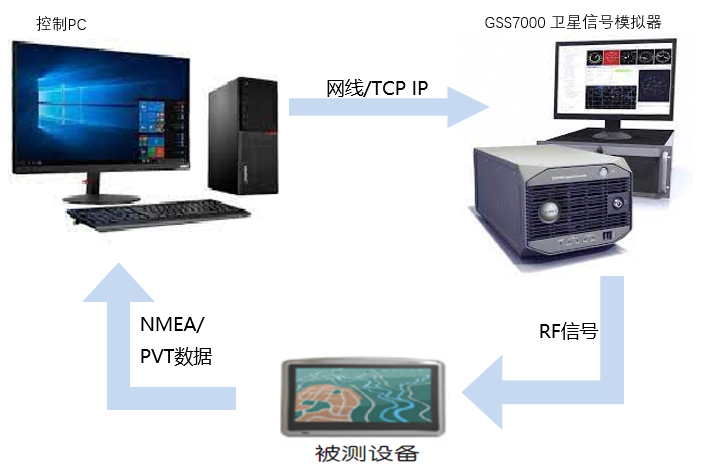

# 前言

**概述**

本文档从测试用例、环境搭建、测试方法等方面详细的描述了HiDiTingV100的GNSS硬测方法。

**读者对象**

本文档主要适用于以下工程师：

-   技术支持工程师。
-   硬件工程师。
-   软件工程师。

**符号约定**

在本文中可能出现下列标志，它们所代表的含义如下。

<table><thead align="left"><tr id="row1530720816410"><th class="cellrowborder" valign="top" width="20.580000000000002%" id="mcps1.1.3.1.1">
<strong id="b2136615816410">符号</strong>

</th>
<th class="cellrowborder" valign="top" width="79.42%" id="mcps1.1.3.1.2">
<strong id="b5941558116410">说明</strong>

</th>
</tr>
</thead>
<tbody><tr id="row1372280416410"><td class="cellrowborder" valign="top" width="20.580000000000002%" headers="mcps1.1.3.1.1 ">

</td>
<td class="cellrowborder" valign="top" width="79.42%" headers="mcps1.1.3.1.2 ">
表示如不避免则将会导致死亡或严重伤害的具有高等级风险的危害。

</td>
</tr>
<tr id="row466863216410"><td class="cellrowborder" valign="top" width="20.580000000000002%" headers="mcps1.1.3.1.1 ">

</td>
<td class="cellrowborder" valign="top" width="79.42%" headers="mcps1.1.3.1.2 ">
表示如不避免则可能导致死亡或严重伤害的具有中等级风险的危害。

</td>
</tr>
<tr id="row123863216410"><td class="cellrowborder" valign="top" width="20.580000000000002%" headers="mcps1.1.3.1.1 ">

</td>
<td class="cellrowborder" valign="top" width="79.42%" headers="mcps1.1.3.1.2 ">
表示如不避免则可能导致轻微或中度伤害的具有低等级风险的危害。

</td>
</tr>
<tr id="row5786682116410"><td class="cellrowborder" valign="top" width="20.580000000000002%" headers="mcps1.1.3.1.1 ">

</td>
<td class="cellrowborder" valign="top" width="79.42%" headers="mcps1.1.3.1.2 ">
用于传递设备或环境安全警示信息。如不避免则可能会导致设备损坏、数据丢失、设备性能降低或其它不可预知的结果。

“须知”不涉及人身伤害。

</td>
</tr>
<tr id="row2856923116410"><td class="cellrowborder" valign="top" width="20.580000000000002%" headers="mcps1.1.3.1.1 ">

</td>
<td class="cellrowborder" valign="top" width="79.42%" headers="mcps1.1.3.1.2 ">
对正文中重点信息的补充说明。

“说明”不是安全警示信息，不涉及人身、设备及环境伤害信息。

</td>
</tr>
</tbody>
</table>

# GNSS硬测测试用例

-   **[测试用例说明](#ZH-CN_TOPIC_0000002333632017)**  

-   **[CN0测试](#ZH-CN_TOPIC_0000002302944500)**  

-   **[冷捕获灵敏度测试用例](#ZH-CN_TOPIC_0000002299632850)**  

-   **[热捕获灵敏度测试用例](#ZH-CN_TOPIC_0000002333512221)**  

-   **[跟踪灵敏度测试用例](#ZH-CN_TOPIC_0000002299792542)**  

## 测试用例说明

GNSS硬测的测试用例主要包括CN0测试、冷捕获灵敏度测试、热捕获灵敏度测试、跟踪灵敏度测试四种。

## CN0测试

在GNSS（全球导航卫星系统）测试中，CN0（Carrier-to-Noise Density Ratio，载波噪声功率密度比）测试是一个非常重要的参数，CN0用于评估接收到的卫星信号的质量。

## 冷捕获灵敏度测试用例

用于评估GNSS接收机在冷启动条件下，捕获和跟踪GNSS信号所需的最低信号功率电平。主要测试接收机在没有预先知道卫星信息的情况下，首次成功锁定并跟踪卫星信号的能力。

## 热捕获灵敏度测试用例

热捕获灵敏度用于评估接收机在已拥有粗略频率和时间信息（即“热启动”状态）的情况下，能够成功捕获并跟踪卫星信号的最小信号强度（或信号功率电平），体现了设备在多次使用或连续运行中快速重新获取卫星信号的能力。

## 跟踪灵敏度测试用例

跟踪灵敏度是用于评估GNSS接收机在持续跟踪卫星信号时，能够维持信号跟踪的最小信号强度。

# GNSS测试环境搭建

-   **[测试方案架构图](#ZH-CN_TOPIC_0000002333632021)**  

-   **[组件介绍](#ZH-CN_TOPIC_0000002299632854)**  

## 测试方案架构图

**图 1**  测试方案架构图  

-   SPIRENT GSS7000卫星信号模拟器发射GNSS信号，并通过RF线缆将GNSS信号传输到被测设备DUT中。
-   PC主控机分为模拟器控制部分和DUT通信客户端。模拟器控制部分通过软件来控制GSS7000卫星模拟器的运行场景、信号种类和信号强度，从而控制DUT接收到的GNSS信号。DUT通信客户端主要负责控制被测设备，根据不同的测试需求发起冷启动、热启动等定位方式。
-   被测设备是包含HiDiTing的手表、单板、样机等设备。

## 组件介绍

-   GSS7000：GNSS信号源，支持DUT测试需要的GNSS信号。
-   DUT：GNSS产品，使用射频扣头、线缆与测试设备连接。
-   控制PC：调用GSS7000模拟器和被测设备，实现双方通信和日志展示。

# GNSS测试方法

-   **[测试条件要求](#ZH-CN_TOPIC_0000002333512225)**  

-   **[CN0测试方法](#ZH-CN_TOPIC_0000002302945000)**  

-   **[冷捕获灵敏度测试方法](#ZH-CN_TOPIC_0000002299792546)**  

-   **[热捕获灵敏度测试方法](#ZH-CN_TOPIC_0000002333632025)**  

-   **[跟踪灵敏度测试方法](#ZH-CN_TOPIC_0000002299632862)**  

## 测试条件要求

无外界信号干扰的测试环境、理想状态信号、待测设备正常，各设备连接正常。

-   正常测试条件
    -   正常测试条件指室温：15°C～35°C
    -   湿度：20%～75%

-   极端测试条件
    -   温度：0°C～35°C以及厂商定义温度取大值
    -   湿度：厂商定义

## CN0测试方法

测试步骤如下：

1.  基于被测设备配置对应模式，比如全模、单GPS或者多模混合。
2.  播放理想状态测试信号（-130dBm），开始冷启动持续定位测试。
3.  待测设备定位后，等待10min后停止测试，保存测试NMEA日志。
4.  根据NMEA日志解析各模式Top4卫星的CN0平均值，测试卫星功率在-130dBm下的CN0结果。

    > **说明：** 
    >具体CN0查看方式请参考标准NMEA协议。

## 冷捕获灵敏度测试方法

测试步骤如下：

1.  基于被测设备配置对应模式，比如全模、单GPS或者多模混合。
2.  播放理想状态测试信号（-130dBm），开始冷启动持续定位测试。
3.  确认待测设备能否在5min内定位成功，且首次定位精度小于100m。
4.  满足[步骤3](#li13539135522019)定位要求后，停止测试，降信号强度下调1dBm，开始冷启动持续跟踪定位测试。
5.  重复[步骤3](#li13539135522019)、[步骤4](#li8539125522013)，直到待测设备不满足[步骤3](#li13539135522019)的测试要求，记录此时的信号强度A。
6.  上升0.5dBm的信号强度，此时信号强度记为B，发起冷启动持续定位测试。
7.  若上升信号强度后不满足定位要求，则信号强度（A+1）为冷捕获灵敏度测试值，若满足定位要求，则信号强度B为冷捕获灵敏度测试值。

    > **说明：** 
    >常规冷捕获灵敏度测试DR值在-149dBm，因此理想信号的信号强度可以从-130dBm直接下调到-140dBm，然后下调到-145dBm，之后开始1dBm的衰减，可以有效减少实际测试时间。

## 热捕获灵敏度测试方法

测试步骤如下：

1.  基于被测设备配置对应模式，比如全模、单GPS或者多模混合。
2.  播放理想状态测试信号（-130dBm），冷启动定位成功后，维持定位收集15min的卫星星历。
3.  停止测试后，发起热启动持续定位测试。
4.  确认待测设备能否在1min内定位成功，且首次定位精度小于100m。
5.  满足[步骤4](#li12171151015241)定位要求后，停止测试，降信号强度下调1dBm，开始热启动持续跟踪定位测试。
6.  重复[步骤4](#li12171151015241)、[步骤5](#li91718101244)，直到待测设备不满足[步骤4](#li12171151015241)的测试要求，记录此时的信号强度A。
7.  上升0.5dBm的信号强度，此时信号强度记为B，发起冷启动持续定位测试。
8.  若上升信号强度后不满足定位要求，则信号强度（A+1）为热捕获灵敏度测试值，若满足定位要求，则信号强度B为热捕获灵敏度测试值。

    > **说明：** 
    >常规热捕获灵敏度测试DR值在-159dBm，因此理想信号的信号强度可以从-130dBm直接下调到-150dBm，然后下调到-155dBm，之后开始1dBm的衰减，可以有效减少实际测试时间。

## 跟踪灵敏度测试方法

测试步骤如下：

1.  基于被测设备配置对应模式，比如全模、单GPS或者多模混合。
2.  播放理想状态测试信号（-130dBm），冷启动定位成功后，维持定位收集15min的卫星星历。
3.  继续测试，确认待测设备在该信号强度下能够持续跟踪100s，且定位精度小于100m。
4.  满足[步骤3](#li1048003302511)定位要求后，降信号强度下调1dBm，重复[步骤3](#li1048003302511)直到待测设备不满足[步骤3](#li1048003302511)的测试要求，记录此时的信号强度A。
5.  上升0.5dBm的信号强度，此时信号强度记为B，重复[步骤3](#li1048003302511)。
6.  若上升信号强度后不满足定位要求，则信号强度（A+1）为跟踪灵敏度测试值，若满足定位要求，则信号强度B为跟踪灵敏度测试值。

    > **说明：** 
    >常规跟踪灵敏度测试DR值在-162dBm，因此理想信号的信号强度可以从-130dBm直接下调到-150dBm，然后下调到-155dBm，之后开始1dBm的衰减，可以有效减少实际测试时间。

