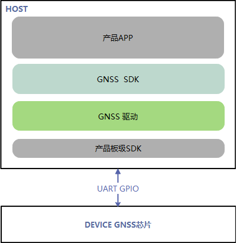
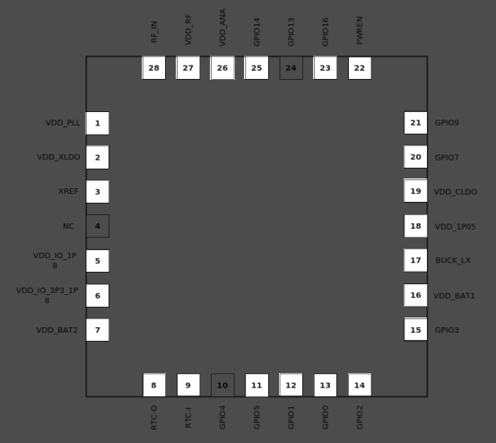
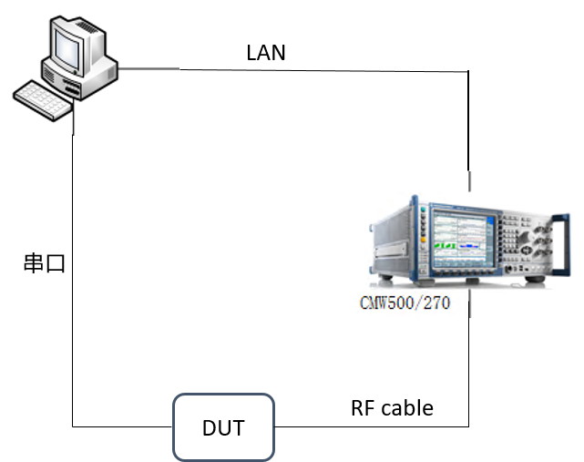
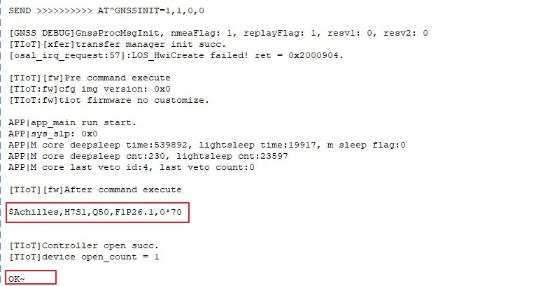
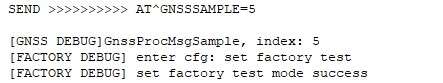
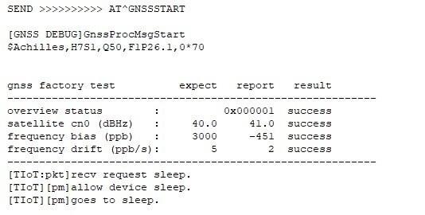
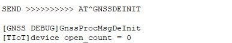

# 前言

**概述**

本文档详细的描述了HiDiTing产品GNSS特性的集成和应用，包括驱动适配、AT指令、基本示例、产测功能、固件升级以及常见问题。

**读者对象**

本文档主要适用于以下工程师：

-   系统设计工程师
-   产品软件开发工程师
-   技术支持工程师

**符号约定**

在本文中可能出现下列标志，它们所代表的含义如下。

<table><thead align="left"><tr id="row1530720816410"><th class="cellrowborder" valign="top" width="20.580000000000002%" id="mcps1.1.3.1.1">
<strong id="b2136615816410">符号</strong>

</th>
<th class="cellrowborder" valign="top" width="79.42%" id="mcps1.1.3.1.2">
<strong id="b5941558116410">说明</strong>

</th>
</tr>
</thead>
<tbody><tr id="row1372280416410"><td class="cellrowborder" valign="top" width="20.580000000000002%" headers="mcps1.1.3.1.1 ">

</td>
<td class="cellrowborder" valign="top" width="79.42%" headers="mcps1.1.3.1.2 ">
表示如不避免则将会导致死亡或严重伤害的具有高等级风险的危害。

</td>
</tr>
<tr id="row466863216410"><td class="cellrowborder" valign="top" width="20.580000000000002%" headers="mcps1.1.3.1.1 ">

</td>
<td class="cellrowborder" valign="top" width="79.42%" headers="mcps1.1.3.1.2 ">
表示如不避免则可能导致死亡或严重伤害的具有中等级风险的危害。

</td>
</tr>
<tr id="row123863216410"><td class="cellrowborder" valign="top" width="20.580000000000002%" headers="mcps1.1.3.1.1 ">

</td>
<td class="cellrowborder" valign="top" width="79.42%" headers="mcps1.1.3.1.2 ">
表示如不避免则可能导致轻微或中度伤害的具有低等级风险的危害。

</td>
</tr>
<tr id="row5786682116410"><td class="cellrowborder" valign="top" width="20.580000000000002%" headers="mcps1.1.3.1.1 ">

</td>
<td class="cellrowborder" valign="top" width="79.42%" headers="mcps1.1.3.1.2 ">
用于传递设备或环境安全警示信息。如不避免则可能会导致设备损坏、数据丢失、设备性能降低或其它不可预知的结果。

“须知”不涉及人身伤害。

</td>
</tr>
<tr id="row2856923116410"><td class="cellrowborder" valign="top" width="20.580000000000002%" headers="mcps1.1.3.1.1 ">

</td>
<td class="cellrowborder" valign="top" width="79.42%" headers="mcps1.1.3.1.2 ">
对正文中重点信息的补充说明。

“说明”不是安全警示信息，不涉及人身、设备及环境伤害信息。

</td>
</tr>
</tbody>
</table>

# GNSS定位介绍

GNSS（Global Navigation Satellite System）泛指所有的卫星导航系统，包括全球的、区域的和增强的，如美国GPS、俄罗斯Glonass、欧洲Galileo、中国BDS以及日本的QZSS。

-   **[GNSS功能介绍](#ZH-CN_TOPIC_0000002313509293)**  

-   **[GNSS特性规格](#ZH-CN_TOPIC_0000002280284198)**  

## GNSS功能介绍

HiDiTing产品集成GNSS芯片，主MCU通过UART接口与GNSS芯片通信，MCU控制GNSS芯片的上下电、固件加载、命令配置、启动停止，GNSS芯片上报MCU位置、速度、时间、卫星状态、芯片维测等信息。

## GNSS特性规格

-   支持GPS L1C/A、GLONASS L1OF、BDS B1I、Galileo E1C、QZSS L1C/A定位标准。
-   支持GPS、GLONASS、BDS、Galileo单模定位。
-   支持GPS、GLONASS、BDS、Galileo、QZSS多模定位。
-   支持AGNSS（Assisted Global Navigation Satellite System）、PGNSS。
-   支持自动干扰检测。
-   支持对外授时。
-   灵敏度：
    -   冷启动捕获灵敏度：-149dBm
    -   热启动捕获灵敏度：-159dBm
    -   跟踪灵敏度：-162dBm

-   TTFF：
    -   冷启动TTFF：avg≤34s@-130dBm
    -   热启动TTFF：avg≤1s@-130dBm

-   定位精度\[1\]：
    -   水平位置：1.5m
    -   水平速度：0.15m/s

-   应用极限：
    -   速度：500m/s
    -   高度：18000m

-   功耗\[2\]：
    -   捕获：6.40mA@3.6V
    -   跟踪：4.95mA@3.6V
    -   关机漏电流：14μA@3.6V

> **说明：** 
>\[1\] 定位精度数据在-130dBm信号源环境下测试，取CEP 68%统计值。
>\[2\] 功耗数据源自-130dBm信号源测试环境，仅包含GNSS芯片功耗，不含外设TCXO/LNA等器件功耗。

# GNSS特性集成

-   **[GNSS架构框图](#ZH-CN_TOPIC_0000002278876584)**  

-   **[GNSS代码结构](#ZH-CN_TOPIC_0000002313509297)**  

-   **[GNSS驱动接口](#ZH-CN_TOPIC_0000002313476281)**  

-   **[GNSS应用接口](#ZH-CN_TOPIC_0000002278979762)**  

-   **[GNSS编译适配](#ZH-CN_TOPIC_0000002278876588)**  

-   **[GNSS固件升级](#ZH-CN_TOPIC_0000002278979766)**  

-   **[GNSS维测日志](#ZH-CN_TOPIC_0000002278876592)**  

## GNSS架构框图

HiDiTing整体提供GNSS芯片及配套的软件包，包括GNSS SDK、GNSS驱动以及GNSS示例。软件分层如[图1](#fig202629443204)所示。

**图 1**  GNSS软件架构分层框图  

## GNSS代码结构

GNSS相关代码在HiDiTing SDK中的目录结构如[表1](#table1054022012314)所示。

**表 1**  GNSS代码路径表

<table><thead align="left"><tr id="row105401420132316"><th class="cellrowborder" valign="top" width="21.73%" id="mcps1.2.3.1.1">
代码说明

</th>
<th class="cellrowborder" valign="top" width="78.27%" id="mcps1.2.3.1.2">
代码路径

</th>
</tr>
</thead>
<tbody><tr id="row165402204233"><td class="cellrowborder" valign="top" width="21.73%" headers="mcps1.2.3.1.1 ">
功能示例代码

</td>
<td class="cellrowborder" valign="top" width="78.27%" headers="mcps1.2.3.1.2 ">
application/samples/gnss

</td>
</tr>
<tr id="row135411520162311"><td class="cellrowborder" valign="top" width="21.73%" headers="mcps1.2.3.1.1 ">
应用接口代码

</td>
<td class="cellrowborder" valign="top" width="78.27%" headers="mcps1.2.3.1.2 ">
middleware/chips/brandy/gnss

</td>
</tr>
<tr id="row1854113203234"><td class="cellrowborder" valign="top" width="21.73%" headers="mcps1.2.3.1.1 ">
驱动接口代码

</td>
<td class="cellrowborder" valign="top" width="78.27%" headers="mcps1.2.3.1.2 ">
middleware/services/srv_tiot_host/tiot_driver

</td>
</tr>
</tbody>
</table>

## GNSS驱动接口

GNSS驱动接口对接系统SDK以及板极接口，用于适配GNSS芯片上下电，以及GNSS芯片与主MCU芯片的通信交互。

此部分驱动接口，用户无需直接调用。

**表 1**  GNSS驱动接口

<table><thead align="left"><tr id="row816482618259"><th class="cellrowborder" valign="top" width="33.3033303330333%" id="mcps1.2.4.1.1">
接口名称

</th>
<th class="cellrowborder" valign="top" width="33.36333633363336%" id="mcps1.2.4.1.2">
参数说明

</th>
<th class="cellrowborder" valign="top" width="33.33333333333333%" id="mcps1.2.4.1.3">
功能介绍

</th>
</tr>
</thead>
<tbody><tr id="row116542618258"><td class="cellrowborder" valign="top" width="33.3033303330333%" headers="mcps1.2.4.1.1 ">
int32_t tiot_service_init(void)

</td>
<td class="cellrowborder" valign="top" width="33.36333633363336%" headers="mcps1.2.4.1.2 ">
NA

</td>
<td class="cellrowborder" valign="top" width="33.33333333333333%" headers="mcps1.2.4.1.3 ">
tiot service初始化接口。

</td>
</tr>
<tr id="row952620551263"><td class="cellrowborder" valign="top" width="33.3033303330333%" headers="mcps1.2.4.1.1 ">
tiot_handle tiot_service_open(const char *device_name, void *param)

</td>
<td class="cellrowborder" valign="top" width="33.36333633363336%" headers="mcps1.2.4.1.2 ">
device_name：设备名称。

param：回调函数地址及参数，详见tiot_service_open_param类型。

</td>
<td class="cellrowborder" valign="top" width="33.33333333333333%" headers="mcps1.2.4.1.3 ">
开启tiot service。

</td>
</tr>
<tr id="row151651326152519"><td class="cellrowborder" valign="top" width="33.3033303330333%" headers="mcps1.2.4.1.1 ">
int32_t tiot_service_write(tiot_handle handle, const uint8_t *data, uint32_t len)

</td>
<td class="cellrowborder" valign="top" width="33.36333633363336%" headers="mcps1.2.4.1.2 ">
handle：tiot句柄。

data：待写入数据的地址。

len：待写入数据的长度。

</td>
<td class="cellrowborder" valign="top" width="33.33333333333333%" headers="mcps1.2.4.1.3 ">
通过tiot service进行数据传输。

</td>
</tr>
<tr id="row969441112277"><td class="cellrowborder" valign="top" width="33.3033303330333%" headers="mcps1.2.4.1.1 ">
void tiot_service_close(tiot_handle handle)

</td>
<td class="cellrowborder" valign="top" width="33.36333633363336%" headers="mcps1.2.4.1.2 ">
handle：tiot句柄。

</td>
<td class="cellrowborder" valign="top" width="33.33333333333333%" headers="mcps1.2.4.1.3 ">
关闭tiot service。

</td>
</tr>
<tr id="row729617142212"><td class="cellrowborder" valign="top" width="33.3033303330333%" headers="mcps1.2.4.1.1 ">
void tiot_service_deinit(void)

</td>
<td class="cellrowborder" valign="top" width="33.36333633363336%" headers="mcps1.2.4.1.2 ">
NA

</td>
<td class="cellrowborder" valign="top" width="33.33333333333333%" headers="mcps1.2.4.1.3 ">
tiot service去初始化。

</td>
</tr>
</tbody>
</table>

## GNSS应用接口

GNSS应用接口调用并封装了GNSS驱动接口，作为GNSS SDK，提供GNSS API，供用户进行APP开发。

**表 1**  GNSS应用接口

<table><thead align="left"><tr id="row1843481782810"><th class="cellrowborder" valign="top" width="37.23372337233724%" id="mcps1.2.4.1.1">
接口名称

</th>
<th class="cellrowborder" valign="top" width="29.432943294329434%" id="mcps1.2.4.1.2">
参数说明

</th>
<th class="cellrowborder" valign="top" width="33.33333333333333%" id="mcps1.2.4.1.3">
功能介绍

</th>
</tr>
</thead>
<tbody><tr id="row86738572232"><td class="cellrowborder" valign="top" width="37.23372337233724%" headers="mcps1.2.4.1.1 ">
errcode_t uapi_gnss_power_on(void)

</td>
<td class="cellrowborder" valign="top" width="29.432943294329434%" headers="mcps1.2.4.1.2 ">
NA

</td>
<td class="cellrowborder" valign="top" width="33.33333333333333%" headers="mcps1.2.4.1.3 ">
GNSS芯片上电。

</td>
</tr>
<tr id="row18434117102813"><td class="cellrowborder" valign="top" width="37.23372337233724%" headers="mcps1.2.4.1.1 ">
errcode_t uapi_gnss_init(void)

</td>
<td class="cellrowborder" valign="top" width="29.432943294329434%" headers="mcps1.2.4.1.2 ">
NA

</td>
<td class="cellrowborder" valign="top" width="33.33333333333333%" headers="mcps1.2.4.1.3 ">
初始化，创建GNSS任务线程。

</td>
</tr>
<tr id="row0263200162514"><td class="cellrowborder" valign="top" width="37.23372337233724%" headers="mcps1.2.4.1.1 ">
errcode_t uapi_gnss_register_callback(uint32_t callback_type, gnss_callback_func callback_func)

</td>
<td class="cellrowborder" valign="top" width="29.432943294329434%" headers="mcps1.2.4.1.2 ">
callback_type：回调消息类型。

callback_func：回调函数地址。

</td>
<td class="cellrowborder" valign="top" width="33.33333333333333%" headers="mcps1.2.4.1.3 ">
GNSS消息回调函数注册接口。

</td>
</tr>
<tr id="row183471829122510"><td class="cellrowborder" valign="top" width="37.23372337233724%" headers="mcps1.2.4.1.1 ">
errcode_t  uapi_gnss_open(void)

</td>
<td class="cellrowborder" valign="top" width="29.432943294329434%" headers="mcps1.2.4.1.2 ">
NA

</td>
<td class="cellrowborder" valign="top" width="33.33333333333333%" headers="mcps1.2.4.1.3 ">
GNSS加载接口，打开设备节点并加载固件。需要确保调用前板级已给GNSS芯片上电。

</td>
</tr>
<tr id="row151367592464"><td class="cellrowborder" valign="top" width="37.23372337233724%" headers="mcps1.2.4.1.1 ">
errcode_t uapi_gnss_config(gnss_message_t *msg)

</td>
<td class="cellrowborder" valign="top" width="29.432943294329434%" headers="mcps1.2.4.1.2 ">
msg：配置项指针消息。

</td>
<td class="cellrowborder" valign="top" width="33.33333333333333%" headers="mcps1.2.4.1.3 ">
GNSS配置接口，需在调用GNSS加载接口后调用此接口，部分配置项需在调用GNSS启动接口前调用。

</td>
</tr>
<tr id="row841766192616"><td class="cellrowborder" valign="top" width="37.23372337233724%" headers="mcps1.2.4.1.1 ">
errcode_t  uapi_gnss_start(void)

</td>
<td class="cellrowborder" valign="top" width="29.432943294329434%" headers="mcps1.2.4.1.2 ">
NA

</td>
<td class="cellrowborder" valign="top" width="33.33333333333333%" headers="mcps1.2.4.1.3 ">
GNSS启动接口，GNSS开始上报定位信息。需在调用初始化接口后调用。

</td>
</tr>
<tr id="row57851636192610"><td class="cellrowborder" valign="top" width="37.23372337233724%" headers="mcps1.2.4.1.1 ">
errcode_t  uapi_gnss_stop(void)

</td>
<td class="cellrowborder" valign="top" width="29.432943294329434%" headers="mcps1.2.4.1.2 ">
NA

</td>
<td class="cellrowborder" valign="top" width="33.33333333333333%" headers="mcps1.2.4.1.3 ">
GNSS停止接口，GNSS停止上报定位信息。需在调用启动接口后调用。

</td>
</tr>
<tr id="row106741522716"><td class="cellrowborder" valign="top" width="37.23372337233724%" headers="mcps1.2.4.1.1 ">
errcode_t  uapi_gnss_close(void)

</td>
<td class="cellrowborder" valign="top" width="29.432943294329434%" headers="mcps1.2.4.1.2 ">
NA

</td>
<td class="cellrowborder" valign="top" width="33.33333333333333%" headers="mcps1.2.4.1.3 ">
GNSS卸载接口，关闭GNSS设备节点。调用此接口后方可执行GNSS芯片板级下电。

</td>
</tr>
<tr id="row6434111702812"><td class="cellrowborder" valign="top" width="37.23372337233724%" headers="mcps1.2.4.1.1 ">
uapi_gnss_deinit(void)

</td>
<td class="cellrowborder" valign="top" width="29.432943294329434%" headers="mcps1.2.4.1.2 ">
NA

</td>
<td class="cellrowborder" valign="top" width="33.33333333333333%" headers="mcps1.2.4.1.3 ">
GNSS去初始化接口，退出任务线程。

</td>
</tr>
<tr id="row0434151718282"><td class="cellrowborder" valign="top" width="37.23372337233724%" headers="mcps1.2.4.1.1 ">
uapi_gnss_power_off(void)

</td>
<td class="cellrowborder" valign="top" width="29.432943294329434%" headers="mcps1.2.4.1.2 ">
NA

</td>
<td class="cellrowborder" valign="top" width="33.33333333333333%" headers="mcps1.2.4.1.3 ">
GNSS下电接口。

</td>
</tr>
</tbody>
</table>

## GNSS编译适配

-   **[代码适配](#ZH-CN_TOPIC_0000002313509301)**  

-   **[版本编译](#ZH-CN_TOPIC_0000002313476285)**  

### 代码适配

HiDiTing中已集成GNSS相关代码，无需用户适配。

### 版本编译

GNSS相关代码会编译至application对应的target中，无须用户额外编译target。

## GNSS固件升级

GNSS默认使用资源文件方式加载固件，用户替换该资源文件，即可实现GNSS固件独立升级。

GNSS固件相关信息如[表1](#table2473653194820)所示。

**表 1**  GNSS固件信息

<table><thead align="left"><tr id="row16473165384815"><th class="cellrowborder" valign="top" width="25.88%" id="mcps1.2.4.1.1">
固件名称

</th>
<th class="cellrowborder" valign="top" width="31.95%" id="mcps1.2.4.1.2">
资源路径

</th>
<th class="cellrowborder" valign="top" width="42.17%" id="mcps1.2.4.1.3">
tartget

</th>
</tr>
</thead>
<tbody><tr id="row16473185314486"><td class="cellrowborder" valign="top" width="25.88%" headers="mcps1.2.4.1.1 ">
gnss_config.bin

</td>
<td class="cellrowborder" valign="top" width="31.95%" headers="mcps1.2.4.1.2 ">
/boot/gnss/gnss_config.bin

</td>
<td class="cellrowborder" valign="top" width="42.17%" headers="mcps1.2.4.1.3 ">
diting-community

</td>
</tr>
<tr id="row8368152641611"><td class="cellrowborder" valign="top" width="25.88%" headers="mcps1.2.4.1.1 ">
gnss_config.bin

</td>
<td class="cellrowborder" valign="top" width="31.95%" headers="mcps1.2.4.1.2 ">
/user/gnss/firmware/gnss_config.bin

</td>
<td class="cellrowborder" valign="top" width="42.17%" headers="mcps1.2.4.1.3 ">
3322-single-norflash

</td>
</tr>
</tbody>
</table>

固件升级步骤：

1.  获取“gnss\_config.bin”。
2.  将“gnss\_config.bin”更新至系统资源文件对应路径。
3.  重启系统，完成升级。

## GNSS维测日志

GNSS维测日志包括芯片上报日志和用户自定义日志。

-   **[GNSS芯片日志](#ZH-CN_TOPIC_0000002315191789)**  

-   **[用户自定义日志](#ZH-CN_TOPIC_0000002280519082)**  

### GNSS芯片日志

GNSS芯片日志用于存储GNSS芯片通过UART上报给MCU的日志，包括文本格式的NMEA定位结果，以及二进制格式的REPLAY维测数据。

在HiDiTing SDK中，GNSS功能示例部分，提供了存储GNSS芯片日志的示例，将文本和二进制数据混合存储在同一个日志文件中。

用户修改时，需确保GNSS芯片日志的完整性，不可将无关数据追加到GNSS芯片日志中。

### 用户自定义日志

用户自定义日志用于记录系统关键流程和异常行为，辅助定位问题，此部分无示例，需用户按需自行实现。

# GNSS功能示例

GNSS功能示例基于GNSS API实现，提供了相对完整的GNSS定位功能，旨在指导用户在APP中进行GNSS应用的开发。

-   **[AT指令集合](#ZH-CN_TOPIC_0000002313476289)**  

-   **[维测示例](#ZH-CN_TOPIC_0000002278979770)**  

-   **[冷启动定位](#ZH-CN_TOPIC_0000002278876596)**  

-   **[热启动定位](#ZH-CN_TOPIC_0000002313509309)**  

-   **[AGNSS辅助定位](#ZH-CN_TOPIC_0000002313476293)**  

-   **[PGNSS辅助定位](#ZH-CN_TOPIC_0000002278979774)**  

## AT指令集合

**表 1**  GNSS AT指令集合

<table><thead align="left"><tr id="row207507241362"><th class="cellrowborder" valign="top" width="26.68266826682668%" id="mcps1.2.4.1.1">
AT指令

</th>
<th class="cellrowborder" valign="top" width="39.93399339933993%" id="mcps1.2.4.1.2">
参数说明

</th>
<th class="cellrowborder" valign="top" width="33.383338333833386%" id="mcps1.2.4.1.3">
功能介绍

</th>
</tr>
</thead>
<tbody><tr id="row17751224664"><td class="cellrowborder" valign="top" width="26.68266826682668%" headers="mcps1.2.4.1.1 ">
AT^GNSSINIT=1,1,0,0

</td>
<td class="cellrowborder" valign="top" width="39.93399339933993%" headers="mcps1.2.4.1.2 ">
0：禁用；1：使能。

<ul id="ul205008369519"><li>参数1：保存NMEA到离线文件。</li><li>参数2：保存REPLAY到离线文件。</li><li>参数3：保留。</li><li>参数4：保留。</li></ul>
</td>
<td class="cellrowborder" valign="top" width="33.383338333833386%" headers="mcps1.2.4.1.3 ">
执行GNSS初始化，包括上电、加载固件，初始化线程。

</td>
</tr>
<tr id="row97511024466"><td class="cellrowborder" valign="top" width="26.68266826682668%" headers="mcps1.2.4.1.1 ">
AT^GNSSHEX=xxx

</td>
<td class="cellrowborder" valign="top" width="39.93399339933993%" headers="mcps1.2.4.1.2 ">
16进制配置指令，不加空格。

</td>
<td class="cellrowborder" valign="top" width="33.383338333833386%" headers="mcps1.2.4.1.3 ">
下发配置指令，不带驱动的包头包尾，不加0x前缀，需在启动定位前配置，如配置请求版本号：AT^GNSSHEX=0500000000000100000。

</td>
</tr>
<tr id="row8751152413614"><td class="cellrowborder" valign="top" width="26.68266826682668%" headers="mcps1.2.4.1.1 ">
AT^GNSSSAMPLE=0

</td>
<td class="cellrowborder" valign="top" width="39.93399339933993%" headers="mcps1.2.4.1.2 "><ul id="ul1732491281116"><li>0：获取当前支持的sample及编号。</li><li>1：GNSS冷启动用例配置。</li><li>2：GNSS热启动用例配置。</li><li>3：AGNSS辅助定位用例配置。</li><li>4：PGNSS辅助定位用例配置。</li><li>5：GNSS产测用例配置。</li></ul>
</td>
<td class="cellrowborder" valign="top" width="33.383338333833386%" headers="mcps1.2.4.1.3 ">
下发指令sample的配置，注意此处仅下发配置，具体执行用例还需要执行“AT^GNSSSTART”。

随着用例的扩展，部分用例编号可能会有变动。

</td>
</tr>
<tr id="row10751424067"><td class="cellrowborder" valign="top" width="26.68266826682668%" headers="mcps1.2.4.1.1 ">
AT^GNSSSTART

</td>
<td class="cellrowborder" valign="top" width="39.93399339933993%" headers="mcps1.2.4.1.2 ">
NA

</td>
<td class="cellrowborder" valign="top" width="33.383338333833386%" headers="mcps1.2.4.1.3 ">
启动GNSS定位。

</td>
</tr>
<tr id="row5466856201211"><td class="cellrowborder" valign="top" width="26.68266826682668%" headers="mcps1.2.4.1.1 ">
AT^GNSSSTOP

</td>
<td class="cellrowborder" valign="top" width="39.93399339933993%" headers="mcps1.2.4.1.2 ">
NA

</td>
<td class="cellrowborder" valign="top" width="33.383338333833386%" headers="mcps1.2.4.1.3 ">
停止GNSS定位。

</td>
</tr>
<tr id="row159101256191219"><td class="cellrowborder" valign="top" width="26.68266826682668%" headers="mcps1.2.4.1.1 ">
AT^GNSSDEINIT

</td>
<td class="cellrowborder" valign="top" width="39.93399339933993%" headers="mcps1.2.4.1.2 ">
NA

</td>
<td class="cellrowborder" valign="top" width="33.383338333833386%" headers="mcps1.2.4.1.3 ">
执行GNSS去初始化，包括退出线程、下电。

</td>
</tr>
<tr id="row152480571125"><td class="cellrowborder" valign="top" width="26.68266826682668%" headers="mcps1.2.4.1.1 ">
AT^HSUARTREINIT

</td>
<td class="cellrowborder" valign="top" width="39.93399339933993%" headers="mcps1.2.4.1.2 ">
NA

</td>
<td class="cellrowborder" valign="top" width="33.383338333833386%" headers="mcps1.2.4.1.3 ">
重新初始化HSUART，使能Debugkits对接HSUART，需在“AT^GNSSDEINIT”之后执行。

</td>
</tr>
</tbody>
</table>

## 维测示例

-   **[使能控制](#ZH-CN_TOPIC_0000002279994148)**  

-   **[日志路径](#ZH-CN_TOPIC_0000002279890914)**  

-   **[日志类型](#ZH-CN_TOPIC_0000002314570573)**  

-   **[日志内容](#ZH-CN_TOPIC_0000002314443653)**  

-   **[日志用途](#ZH-CN_TOPIC_0000002279994156)**  

### 使能控制

在GNSS初始化时，通过“AT^GNSSINIT”的参数进行控制，详见[表1](#table1075018241263)。

### 日志路径

默认日志路径为“/user/gnss/log/gnss\_data.log”，如需修改，用户可以在代码中重新指定路径。

### 日志类型

日志采用追加形式生成，日志类型为文本与二进制的混合类型，从中可提取出NMEA文本文件。

### 日志内容

根据GNSS初始化时的配置，日志文件可支持保存NMEA数据和GNSS芯片上报的REPLAY维测数据。

### 日志用途

日志文件中的NEMA数据，可用于分析GNSS信号环境和定位结果。

日志文件中的REPLAY数据，可交由研发/技术支持人员处理，用于回放复现定位过程，支撑定位复杂问题。

## 冷启动定位

-   **[场景定义](#ZH-CN_TOPIC_0000002314568097)**  

-   **[前置条件](#ZH-CN_TOPIC_0000002279991660)**  

-   **[操作步骤](#ZH-CN_TOPIC_0000002279888458)**  

-   **[结果确认](#ZH-CN_TOPIC_0000002314441181)**  

### 场景定义

冷启动是指GNSS上电后，无任何时间、位置、星历等辅助信息，仅依赖GNSS芯片自身搜星定位的场景，开阔场景下通常需要30多秒完成定位。

### 前置条件

-   GNSS芯片上电、并调用初始化接口实现初始化。
-   GNSS天线正常连接，且处于良好卫星信号环境，常见如开阔天空，或者传导接仿真器信号。

### 操作步骤

1.  发送“AT^GNSSSAMPLE=1”，配置冷启动。

    > **说明：** 
    >GNSS芯片下电前，发送的配置指令会持续生效。

2.  发送“AT^GNSSSTART”，启动定位。
3.  接收NMEA，等待定位。
4.  发送“AT^GNSSSTOP”，停止定位。
5.  获取离线日志或者观察AT串口实时输出。

### 结果确认

分析NMEA日志，当RMC语句定位状态字段（紧随时间戳之后的字段）为A时，表示定位成功。

## 热启动定位

-   **[场景定义](#ZH-CN_TOPIC_0000002314568109)**  

-   **[前置条件](#ZH-CN_TOPIC_0000002279991668)**  

-   **[操作步骤](#ZH-CN_TOPIC_0000002279888462)**  

-   **[结果确认](#ZH-CN_TOPIC_0000002314441189)**  

### 场景定义

热启动是指GNSS上电后，在上一次定位成功后，GNSS不下电的情况下，1分钟以内再次启动定位的场景，此时GNSS时间、位置、星历均有效，且时间精度较高，能够快速捕获上星，完成定位，开阔场景下通常在2s左右的时间完成定位。

### 前置条件

-   GNSS芯片上电、并调用初始化接口实现初始化。
-   不下电期间，距上次成功定位时间不超过1分钟。
-   GNSS天线正常连接，且处于良好卫星信号环境，常见如开阔天空，或者传导接仿真器信号。

### 操作步骤

1.  发送“AT^GNSSSAMPLE=2”，配置热启动（默认配置）。

    > **说明：** 
    >GNSS芯片下电前，发送的配置指令会持续生效。

2.  发送“AT^GNSSSTART”，启动定位。
3.  接收NMEA，等待定位。
4.  发送“AT^GNSSSTOP”，停止定位。
5.  获取离线日志或者观察AT串口实时输出。

### 结果确认

分析NMEA日志，当RMC语句定位状态字段（紧随时间戳之后的字段）为A时，表示定位成功。

## AGNSS辅助定位

-   **[场景定义](#ZH-CN_TOPIC_0000002314568117)**  

-   **[前置条件](#ZH-CN_TOPIC_0000002279991680)**  

-   **[操作步骤](#ZH-CN_TOPIC_0000002279888470)**  

-   **[结果确认](#ZH-CN_TOPIC_0000002314441205)**  

### 场景定义

AGNSS辅助定位，是指在定位前，通过注入AGNSS在线辅助信息，给GNSS提供有效的时间、星历等信息，加速GNSS定位，开阔场景下通常在10s内完成定位。

### 前置条件

-   GNSS芯片上电、并调用初始化接口实现初始化。
-   GNSS天线正常连接，且处于良好卫星信号环境，常见如开阔天空，或者传导接仿真器信号。
-   用户需确保“/user/gnss/xgnss”目录下，存在有效的AGNSS辅助星历原始文件，请参考《HiDiTingV100 XGNSS 开发指南》“AGNSS集成示例”章节。

### 操作步骤

1.  发送“AT^GNSSSAMPLE=3”，配置AGNSS用例。
2.  发送“AT^GNSSSTART”，启动定位。
3.  接收NMEA，等待定位。
4.  发送“AT^GNSSSTOP”，停止定位。
5.  获取离线日志或者观察AT串口实时输出。

### 结果确认

分析NMEA日志，注入AGNSS辅助信息后，PNTH001语句最后一个字段（有效星历数量）通常大于80；

分析NMEA日志，当RMC语句定位状态字段（紧随时间戳之后的字段）为A时，表示定位成功。

## PGNSS辅助定位

-   **[场景定义](#ZH-CN_TOPIC_0000002314568133)**  

-   **[前置条件](#ZH-CN_TOPIC_0000002279991688)**  

-   **[操作步骤](#ZH-CN_TOPIC_0000002279888482)**  

-   **[结果确认](#ZH-CN_TOPIC_0000002314441217)**  

### 场景定义

PGNSS辅助定位，是指在定位前，通过注入PGNSS离线辅助信息，给GNSS提供有效的时间、星历等信息，加速GNSS定位，开阔场景下通常在10s内完成定位。

### 前置条件

-   GNSS芯片上电、并调用初始化接口实现初始化。
-   GNSS天线正常连接，且处于良好卫星信号环境，常见如开阔天空，或者传导接仿真器信号。
-   用户需确保“/user/gnss/xgnss”目录下，存在有效的经扩展后的PGNSS辅助星历文件，参考《HiDiTingV100 XGNSS 开发指南》PGNSS集成示例章节。

### 操作步骤

1.  发送“AT^GNSSSAMPLE=4”，配置PGNSS用例。
2.  发送“AT^GNSSSTART”，启动定位。
3.  接收NMEA，等待定位。
4.  发送“AT^GNSSSTOP”，停止定位。
5.  获取离线日志或者观察AT串口实时输出。

### 结果确认

分析NMEA日志，注入PGNSS辅助信息后，PNTH001语句最后一个字段（有效星历数量）通常大于80；

分析NMEA日志，当RMC语句定位状态字段（紧随时间戳之后的字段）为A时，表示定位成功。

# GNSS产线测试

-   **[产测验证范围](#ZH-CN_TOPIC_0000002278979782)**  

-   **[产测方案架构](#ZH-CN_TOPIC_0000002313476305)**  

-   **[产测操作流程](#ZH-CN_TOPIC_0000002278979790)**  

## 产测验证范围

-   **[验证指标](#ZH-CN_TOPIC_0000002278876608)**  

-   **[管脚覆盖](#ZH-CN_TOPIC_0000002313509317)**  

### 验证指标

GNSS产测主要验证射频信号及TCXO时钟指标，确保板级射频链路设计及时钟选型满足要求。

-   CN0：验证GNSS接收到的信号强度，此指标会影响GNSS跟踪信号强度。
-   频偏：验证板级TCXO频偏，此指标会影响GNSS搜星能力。
-   频漂：验证板级TCXO频漂，此指标会影响GNSS信号解调能力。

### 管脚覆盖

产测方案覆盖管脚示意参考[图1](#fig544812521275)，其中高亮管脚为产测可覆盖管脚。

**图 1**  GNSS产测方案覆盖管脚示意图  

产测方案覆盖的管脚情况如[表1](#table7303522122719)所示。

**表 1**  GNSS产测管脚覆盖情况

<table><thead align="left"><tr id="row23036229272"><th class="cellrowborder" valign="top" width="8.48915108489151%" id="mcps1.2.6.1.1">
PIN NO

</th>
<th class="cellrowborder" valign="top" width="16.48835116488351%" id="mcps1.2.6.1.2">
管脚名称

</th>
<th class="cellrowborder" valign="top" width="11.798820117988202%" id="mcps1.2.6.1.3">
I/O类型

</th>
<th class="cellrowborder" valign="top" width="52.274772522747725%" id="mcps1.2.6.1.4">
功能说明

</th>
<th class="cellrowborder" valign="top" width="10.948905109489052%" id="mcps1.2.6.1.5">
覆盖情况

</th>
</tr>
</thead>
<tbody><tr id="row143030222271"><td class="cellrowborder" valign="top" width="8.48915108489151%" headers="mcps1.2.6.1.1 ">
1

</td>
<td class="cellrowborder" valign="top" width="16.48835116488351%" headers="mcps1.2.6.1.2 ">
VDD_PLL

</td>
<td class="cellrowborder" valign="top" width="11.798820117988202%" headers="mcps1.2.6.1.3 ">
电源

</td>
<td class="cellrowborder" valign="top" width="52.274772522747725%" headers="mcps1.2.6.1.4 ">
PLL（Phase-Locked Loops）模块LDO（low dropout regulator）电源输出，外接1μF电容。

</td>
<td class="cellrowborder" valign="top" width="10.948905109489052%" headers="mcps1.2.6.1.5 ">
YES

</td>
</tr>
<tr id="row113031222142713"><td class="cellrowborder" valign="top" width="8.48915108489151%" headers="mcps1.2.6.1.1 ">
2

</td>
<td class="cellrowborder" valign="top" width="16.48835116488351%" headers="mcps1.2.6.1.2 ">
VDD_XLDO

</td>
<td class="cellrowborder" valign="top" width="11.798820117988202%" headers="mcps1.2.6.1.3 ">
电源

</td>
<td class="cellrowborder" valign="top" width="52.274772522747725%" headers="mcps1.2.6.1.4 ">
TCXO LDO电源输出，外接1μF电容。

</td>
<td class="cellrowborder" valign="top" width="10.948905109489052%" headers="mcps1.2.6.1.5 ">
YES

</td>
</tr>
<tr id="row19304172292716"><td class="cellrowborder" valign="top" width="8.48915108489151%" headers="mcps1.2.6.1.1 ">
3

</td>
<td class="cellrowborder" valign="top" width="16.48835116488351%" headers="mcps1.2.6.1.2 ">
XREF

</td>
<td class="cellrowborder" valign="top" width="11.798820117988202%" headers="mcps1.2.6.1.3 ">
时钟

</td>
<td class="cellrowborder" valign="top" width="52.274772522747725%" headers="mcps1.2.6.1.4 ">
TCXO时钟输入。

</td>
<td class="cellrowborder" valign="top" width="10.948905109489052%" headers="mcps1.2.6.1.5 ">
YES

</td>
</tr>
<tr id="row1330402212711"><td class="cellrowborder" valign="top" width="8.48915108489151%" headers="mcps1.2.6.1.1 ">
4

</td>
<td class="cellrowborder" valign="top" width="16.48835116488351%" headers="mcps1.2.6.1.2 ">
NC

</td>
<td class="cellrowborder" valign="top" width="11.798820117988202%" headers="mcps1.2.6.1.3 ">
-

</td>
<td class="cellrowborder" valign="top" width="52.274772522747725%" headers="mcps1.2.6.1.4 ">
空置。

</td>
<td class="cellrowborder" valign="top" width="10.948905109489052%" headers="mcps1.2.6.1.5 ">
-

</td>
</tr>
<tr id="row16304162212713"><td class="cellrowborder" valign="top" width="8.48915108489151%" headers="mcps1.2.6.1.1 ">
5

</td>
<td class="cellrowborder" valign="top" width="16.48835116488351%" headers="mcps1.2.6.1.2 ">
VDD_IO_1P8

</td>
<td class="cellrowborder" valign="top" width="11.798820117988202%" headers="mcps1.2.6.1.3 ">
电源

</td>
<td class="cellrowborder" valign="top" width="52.274772522747725%" headers="mcps1.2.6.1.4 ">
IO LDO电源输出，外接1μF电容。

</td>
<td class="cellrowborder" valign="top" width="10.948905109489052%" headers="mcps1.2.6.1.5 ">
YES

</td>
</tr>
<tr id="row030419226276"><td class="cellrowborder" valign="top" width="8.48915108489151%" headers="mcps1.2.6.1.1 ">
6

</td>
<td class="cellrowborder" valign="top" width="16.48835116488351%" headers="mcps1.2.6.1.2 ">
VDD_IO_3P3_1P8

</td>
<td class="cellrowborder" valign="top" width="11.798820117988202%" headers="mcps1.2.6.1.3 ">
电源

</td>
<td class="cellrowborder" valign="top" width="52.274772522747725%" headers="mcps1.2.6.1.4 ">
VDDIO电源输入，外接1μF电容。

</td>
<td class="cellrowborder" valign="top" width="10.948905109489052%" headers="mcps1.2.6.1.5 ">
YES

</td>
</tr>
<tr id="row19304192213273"><td class="cellrowborder" valign="top" width="8.48915108489151%" headers="mcps1.2.6.1.1 ">
7

</td>
<td class="cellrowborder" valign="top" width="16.48835116488351%" headers="mcps1.2.6.1.2 ">
VDD_BAT2

</td>
<td class="cellrowborder" valign="top" width="11.798820117988202%" headers="mcps1.2.6.1.3 ">
电源

</td>
<td class="cellrowborder" valign="top" width="52.274772522747725%" headers="mcps1.2.6.1.4 ">
VDD_XLDO电源输入端。

</td>
<td class="cellrowborder" valign="top" width="10.948905109489052%" headers="mcps1.2.6.1.5 ">
YES

</td>
</tr>
<tr id="row1230422210278"><td class="cellrowborder" valign="top" width="8.48915108489151%" headers="mcps1.2.6.1.1 ">
8

</td>
<td class="cellrowborder" valign="top" width="16.48835116488351%" headers="mcps1.2.6.1.2 ">
RTC_O

</td>
<td class="cellrowborder" valign="top" width="11.798820117988202%" headers="mcps1.2.6.1.3 ">
时钟

</td>
<td class="cellrowborder" valign="top" width="52.274772522747725%" headers="mcps1.2.6.1.4 ">
芯片RTC（Real Time Clock）时钟信号输出。

</td>
<td class="cellrowborder" valign="top" width="10.948905109489052%" headers="mcps1.2.6.1.5 ">
YES

</td>
</tr>
<tr id="row430422282710"><td class="cellrowborder" valign="top" width="8.48915108489151%" headers="mcps1.2.6.1.1 ">
9

</td>
<td class="cellrowborder" valign="top" width="16.48835116488351%" headers="mcps1.2.6.1.2 ">
RTC_I

</td>
<td class="cellrowborder" valign="top" width="11.798820117988202%" headers="mcps1.2.6.1.3 ">
时钟

</td>
<td class="cellrowborder" valign="top" width="52.274772522747725%" headers="mcps1.2.6.1.4 ">
芯片RTC时钟信号输入。

</td>
<td class="cellrowborder" valign="top" width="10.948905109489052%" headers="mcps1.2.6.1.5 ">
YES

</td>
</tr>
<tr id="row6304022132717"><td class="cellrowborder" valign="top" width="8.48915108489151%" headers="mcps1.2.6.1.1 ">
10

</td>
<td class="cellrowborder" valign="top" width="16.48835116488351%" headers="mcps1.2.6.1.2 ">
GPIO4

</td>
<td class="cellrowborder" valign="top" width="11.798820117988202%" headers="mcps1.2.6.1.3 ">
数字IO

</td>
<td class="cellrowborder" valign="top" width="52.274772522747725%" headers="mcps1.2.6.1.4 ">
通用GPIO，默认为debug UART，电平3.3V/1.8V，带施密特触发器。

</td>
<td class="cellrowborder" valign="top" width="10.948905109489052%" headers="mcps1.2.6.1.5 ">
-

</td>
</tr>
<tr id="row4304142218275"><td class="cellrowborder" valign="top" width="8.48915108489151%" headers="mcps1.2.6.1.1 ">
11

</td>
<td class="cellrowborder" valign="top" width="16.48835116488351%" headers="mcps1.2.6.1.2 ">
GPIO5

</td>
<td class="cellrowborder" valign="top" width="11.798820117988202%" headers="mcps1.2.6.1.3 ">
数字IO

</td>
<td class="cellrowborder" valign="top" width="52.274772522747725%" headers="mcps1.2.6.1.4 ">
通用GPIO，默认为外置LNA（Low Noise Amplifier）使能控制，电平3.3V/1.8V，带施密特触发器。

</td>
<td class="cellrowborder" valign="top" width="10.948905109489052%" headers="mcps1.2.6.1.5 ">
YES

</td>
</tr>
<tr id="row1130452232714"><td class="cellrowborder" valign="top" width="8.48915108489151%" headers="mcps1.2.6.1.1 ">
12

</td>
<td class="cellrowborder" valign="top" width="16.48835116488351%" headers="mcps1.2.6.1.2 ">
GPIO1

</td>
<td class="cellrowborder" valign="top" width="11.798820117988202%" headers="mcps1.2.6.1.3 ">
数字IO

</td>
<td class="cellrowborder" valign="top" width="52.274772522747725%" headers="mcps1.2.6.1.4 ">
通用GPIO，默认为UART RXD，电平3.3V/1.8V，带施密特触发器。

</td>
<td class="cellrowborder" valign="top" width="10.948905109489052%" headers="mcps1.2.6.1.5 ">
YES

</td>
</tr>
<tr id="row930582292715"><td class="cellrowborder" valign="top" width="8.48915108489151%" headers="mcps1.2.6.1.1 ">
13

</td>
<td class="cellrowborder" valign="top" width="16.48835116488351%" headers="mcps1.2.6.1.2 ">
GPIO0

</td>
<td class="cellrowborder" valign="top" width="11.798820117988202%" headers="mcps1.2.6.1.3 ">
数字IO

</td>
<td class="cellrowborder" valign="top" width="52.274772522747725%" headers="mcps1.2.6.1.4 ">
通用GPIO，默认为UART TXD，电平3.3V/1.8V，带施密特触发器。

</td>
<td class="cellrowborder" valign="top" width="10.948905109489052%" headers="mcps1.2.6.1.5 ">
YES

</td>
</tr>
<tr id="row63051022122711"><td class="cellrowborder" valign="top" width="8.48915108489151%" headers="mcps1.2.6.1.1 ">
14

</td>
<td class="cellrowborder" valign="top" width="16.48835116488351%" headers="mcps1.2.6.1.2 ">
GPIO2

</td>
<td class="cellrowborder" valign="top" width="11.798820117988202%" headers="mcps1.2.6.1.3 ">
数字IO，内部下拉

</td>
<td class="cellrowborder" valign="top" width="52.274772522747725%" headers="mcps1.2.6.1.4 ">
通用GPIO，输入，电平3.3V/1.8V，带施密特触发器。

</td>
<td class="cellrowborder" valign="top" width="10.948905109489052%" headers="mcps1.2.6.1.5 ">
YES

</td>
</tr>
<tr id="row030518226275"><td class="cellrowborder" valign="top" width="8.48915108489151%" headers="mcps1.2.6.1.1 ">
15

</td>
<td class="cellrowborder" valign="top" width="16.48835116488351%" headers="mcps1.2.6.1.2 ">
GPIO3

</td>
<td class="cellrowborder" valign="top" width="11.798820117988202%" headers="mcps1.2.6.1.3 ">
数字IO，内部下拉

</td>
<td class="cellrowborder" valign="top" width="52.274772522747725%" headers="mcps1.2.6.1.4 ">
通用GPIO，双向，电平3.3V/1.8V，带施密特触发器。

</td>
<td class="cellrowborder" valign="top" width="10.948905109489052%" headers="mcps1.2.6.1.5 ">
YES

</td>
</tr>
<tr id="row23051722112712"><td class="cellrowborder" valign="top" width="8.48915108489151%" headers="mcps1.2.6.1.1 ">
16

</td>
<td class="cellrowborder" valign="top" width="16.48835116488351%" headers="mcps1.2.6.1.2 ">
VDD_BAT1

</td>
<td class="cellrowborder" valign="top" width="11.798820117988202%" headers="mcps1.2.6.1.3 ">
电源

</td>
<td class="cellrowborder" valign="top" width="52.274772522747725%" headers="mcps1.2.6.1.4 ">
芯片内部DCDC输入。

</td>
<td class="cellrowborder" valign="top" width="10.948905109489052%" headers="mcps1.2.6.1.5 ">
YES

</td>
</tr>
<tr id="row230582212278"><td class="cellrowborder" valign="top" width="8.48915108489151%" headers="mcps1.2.6.1.1 ">
17

</td>
<td class="cellrowborder" valign="top" width="16.48835116488351%" headers="mcps1.2.6.1.2 ">
BUCK_LX

</td>
<td class="cellrowborder" valign="top" width="11.798820117988202%" headers="mcps1.2.6.1.3 ">
电源

</td>
<td class="cellrowborder" valign="top" width="52.274772522747725%" headers="mcps1.2.6.1.4 ">
BUCK输出。

</td>
<td class="cellrowborder" valign="top" width="10.948905109489052%" headers="mcps1.2.6.1.5 ">
YES

</td>
</tr>
<tr id="row53051022182711"><td class="cellrowborder" valign="top" width="8.48915108489151%" headers="mcps1.2.6.1.1 ">
18

</td>
<td class="cellrowborder" valign="top" width="16.48835116488351%" headers="mcps1.2.6.1.2 ">
VDD_1P05

</td>
<td class="cellrowborder" valign="top" width="11.798820117988202%" headers="mcps1.2.6.1.3 ">
电源

</td>
<td class="cellrowborder" valign="top" width="52.274772522747725%" headers="mcps1.2.6.1.4 ">
芯片内部主电源输入。

</td>
<td class="cellrowborder" valign="top" width="10.948905109489052%" headers="mcps1.2.6.1.5 ">
YES

</td>
</tr>
<tr id="row12305522132710"><td class="cellrowborder" valign="top" width="8.48915108489151%" headers="mcps1.2.6.1.1 ">
19

</td>
<td class="cellrowborder" valign="top" width="16.48835116488351%" headers="mcps1.2.6.1.2 ">
VDD_CLDO

</td>
<td class="cellrowborder" valign="top" width="11.798820117988202%" headers="mcps1.2.6.1.3 ">
电源

</td>
<td class="cellrowborder" valign="top" width="52.274772522747725%" headers="mcps1.2.6.1.4 ">
Core LDO输出。

</td>
<td class="cellrowborder" valign="top" width="10.948905109489052%" headers="mcps1.2.6.1.5 ">
YES

</td>
</tr>
<tr id="row153051922162714"><td class="cellrowborder" valign="top" width="8.48915108489151%" headers="mcps1.2.6.1.1 ">
20

</td>
<td class="cellrowborder" valign="top" width="16.48835116488351%" headers="mcps1.2.6.1.2 ">
GPIO7

</td>
<td class="cellrowborder" valign="top" width="11.798820117988202%" headers="mcps1.2.6.1.3 ">
数字IO，内部下拉

</td>
<td class="cellrowborder" valign="top" width="52.274772522747725%" headers="mcps1.2.6.1.4 ">
通用GPIO，默认为GNSS唤醒HOST信号，上电启动复用管脚，电平3.3V/1.8V，带施密特触发器。

</td>
<td class="cellrowborder" valign="top" width="10.948905109489052%" headers="mcps1.2.6.1.5 ">
YES

</td>
</tr>
<tr id="row83051222132711"><td class="cellrowborder" valign="top" width="8.48915108489151%" headers="mcps1.2.6.1.1 ">
21

</td>
<td class="cellrowborder" valign="top" width="16.48835116488351%" headers="mcps1.2.6.1.2 ">
GPIO9

</td>
<td class="cellrowborder" valign="top" width="11.798820117988202%" headers="mcps1.2.6.1.3 ">
数字IO，内部上拉

</td>
<td class="cellrowborder" valign="top" width="52.274772522747725%" headers="mcps1.2.6.1.4 ">
通用GPIO，默认为HOST唤醒GNSS信号，上电启动复用管脚，电平3.3V/1.8V，带施密特触发器。

</td>
<td class="cellrowborder" valign="top" width="10.948905109489052%" headers="mcps1.2.6.1.5 ">
YES

</td>
</tr>
<tr id="row330582282717"><td class="cellrowborder" valign="top" width="8.48915108489151%" headers="mcps1.2.6.1.1 ">
22

</td>
<td class="cellrowborder" valign="top" width="16.48835116488351%" headers="mcps1.2.6.1.2 ">
PWREN

</td>
<td class="cellrowborder" valign="top" width="11.798820117988202%" headers="mcps1.2.6.1.3 ">
模拟IO

</td>
<td class="cellrowborder" valign="top" width="52.274772522747725%" headers="mcps1.2.6.1.4 ">
芯片上电使能信号，高电平有效。

</td>
<td class="cellrowborder" valign="top" width="10.948905109489052%" headers="mcps1.2.6.1.5 ">
YES

</td>
</tr>
<tr id="row1630516226274"><td class="cellrowborder" valign="top" width="8.48915108489151%" headers="mcps1.2.6.1.1 ">
23

</td>
<td class="cellrowborder" valign="top" width="16.48835116488351%" headers="mcps1.2.6.1.2 ">
GPIO16

</td>
<td class="cellrowborder" valign="top" width="11.798820117988202%" headers="mcps1.2.6.1.3 ">
数字IO，内部下拉

</td>
<td class="cellrowborder" valign="top" width="52.274772522747725%" headers="mcps1.2.6.1.4 ">
通用GPIO，默认为UART CTS，上电启动复用管脚，电平3.3V/1.8V，带施密特触发器。

</td>
<td class="cellrowborder" valign="top" width="10.948905109489052%" headers="mcps1.2.6.1.5 ">
YES

</td>
</tr>
<tr id="row1330622232717"><td class="cellrowborder" valign="top" width="8.48915108489151%" headers="mcps1.2.6.1.1 ">
24

</td>
<td class="cellrowborder" valign="top" width="16.48835116488351%" headers="mcps1.2.6.1.2 ">
GPIO13

</td>
<td class="cellrowborder" valign="top" width="11.798820117988202%" headers="mcps1.2.6.1.3 ">
数字IO

</td>
<td class="cellrowborder" valign="top" width="52.274772522747725%" headers="mcps1.2.6.1.4 ">
通用GPIO，双向，默认为PPS_OUT，电平3.3V/1.8V，带施密特触发器。

</td>
<td class="cellrowborder" valign="top" width="10.948905109489052%" headers="mcps1.2.6.1.5 ">
-

</td>
</tr>
<tr id="row63064228275"><td class="cellrowborder" valign="top" width="8.48915108489151%" headers="mcps1.2.6.1.1 ">
25

</td>
<td class="cellrowborder" valign="top" width="16.48835116488351%" headers="mcps1.2.6.1.2 ">
GPIO14

</td>
<td class="cellrowborder" valign="top" width="11.798820117988202%" headers="mcps1.2.6.1.3 ">
数字IO

</td>
<td class="cellrowborder" valign="top" width="52.274772522747725%" headers="mcps1.2.6.1.4 ">
通用GPIO，双向，默认为UART RTS，电平3.3V/1.8V，带施密特触发器。

</td>
<td class="cellrowborder" valign="top" width="10.948905109489052%" headers="mcps1.2.6.1.5 ">
YES

</td>
</tr>
<tr id="row130682292715"><td class="cellrowborder" valign="top" width="8.48915108489151%" headers="mcps1.2.6.1.1 ">
26

</td>
<td class="cellrowborder" valign="top" width="16.48835116488351%" headers="mcps1.2.6.1.2 ">
VDD_ANA

</td>
<td class="cellrowborder" valign="top" width="11.798820117988202%" headers="mcps1.2.6.1.3 ">
电源

</td>
<td class="cellrowborder" valign="top" width="52.274772522747725%" headers="mcps1.2.6.1.4 ">
模拟LDO输出。

</td>
<td class="cellrowborder" valign="top" width="10.948905109489052%" headers="mcps1.2.6.1.5 ">
YES

</td>
</tr>
<tr id="row1130618227274"><td class="cellrowborder" valign="top" width="8.48915108489151%" headers="mcps1.2.6.1.1 ">
27

</td>
<td class="cellrowborder" valign="top" width="16.48835116488351%" headers="mcps1.2.6.1.2 ">
VDD_RF

</td>
<td class="cellrowborder" valign="top" width="11.798820117988202%" headers="mcps1.2.6.1.3 ">
电源

</td>
<td class="cellrowborder" valign="top" width="52.274772522747725%" headers="mcps1.2.6.1.4 ">
RF（Radio Frequency） LDO输出。

</td>
<td class="cellrowborder" valign="top" width="10.948905109489052%" headers="mcps1.2.6.1.5 ">
YES

</td>
</tr>
<tr id="row103061722172710"><td class="cellrowborder" valign="top" width="8.48915108489151%" headers="mcps1.2.6.1.1 ">
28

</td>
<td class="cellrowborder" valign="top" width="16.48835116488351%" headers="mcps1.2.6.1.2 ">
RF_IN

</td>
<td class="cellrowborder" valign="top" width="11.798820117988202%" headers="mcps1.2.6.1.3 ">
射频

</td>
<td class="cellrowborder" valign="top" width="52.274772522747725%" headers="mcps1.2.6.1.4 ">
RF输入口。

</td>
<td class="cellrowborder" valign="top" width="10.948905109489052%" headers="mcps1.2.6.1.5 ">
YES

</td>
</tr>
</tbody>
</table>

## 产测方案架构

-   **[测试架构](#ZH-CN_TOPIC_0000002278979786)**  

-   **[环境搭建](#ZH-CN_TOPIC_0000002278876612)**  

### 测试架构

GNSS产测方案需要电脑、DUT（Device Under Test 待测设备）与测试仪表，DUT通过串口连接电脑，在串口执行产测指令，接收产测结果。

产测方案架构如[图1](#fig122615195219)所示，其中相关组件介绍如下：

-   R&S CMW500/270：单音测试设备，能够发送连续载波信号，支持1.5GHz频率。
-   DUT：待测产品，使用射频线缆与单音测试设备连接。

**图 1**  GNSS产测方案架构图  

### 环境搭建

-   **[搭建PC端环境](#ZH-CN_TOPIC_0000002313509321)**  

-   **[搭建DUT端环境](#ZH-CN_TOPIC_0000002313476309)**  

#### 搭建PC端环境

1.  安装单音设备CMW500/270的商用上位机软件，请联系供应商获取。
2.  安装DUT上位机软件，通常可直接使用串口工具。

#### 搭建DUT端环境

1.  使用RF线缆连接DUT待测设备和单音测试设备。
2.  使用串口连接PC和DUT待测设备。

> **须知：** 
>需要在产品断电的情况下，安装RF线缆扣线。

## 产测操作流程

-   **[整体流程](#ZH-CN_TOPIC_0000002278876616)**  

-   **[结果判别](#ZH-CN_TOPIC_0000002313509325)**  

### 整体流程

1.  搭建PC端环境和DUT端环境。
2.  配置单音设备，播放**1575.62**MHz单音信号（**相对于1575.42MHz偏移200kHz**\)，补偿单音设备至DUT设备射频口的线损，配置信号功率，使射频口信号为-130dBm。
3.  通过串口工具，执行GNSS INIT的指令：AT^GNSSINIT=1,1,0,0

    

4.  通过串口工具，发送GNSS产测示例对应的指令：AT^GNSSSAMPLE=5

    

5.  通过串口工具，发送GNSS启动指令：AT^GNSSSTART
6.  发送GNSS启动指令后，芯片自动执行GNSS产测过程，此过程约耗时5s，执行完成，芯片上报产测结果。

    

7.  通过串口工具，发送GNSS停止指令：AT^GNSSSTOP

    

8.  通过串口工具，发送GNSS去初始化指令：AT^GNSSDEINIT

    

### 结果判别

产测结果判别依据如[表1](#table1312118482515)所示。

**表 1**  GNSS产测结果判别表

<table><thead align="left"><tr id="row1712194895120"><th class="cellrowborder" valign="top" width="15.551555155515551%" id="mcps1.2.4.1.1">
测试项

</th>
<th class="cellrowborder" valign="top" width="18.801880188018803%" id="mcps1.2.4.1.2">
说明

</th>
<th class="cellrowborder" valign="top" width="65.64656465646564%" id="mcps1.2.4.1.3">
预期结果

</th>
</tr>
</thead>
<tbody><tr id="row91219483514"><td class="cellrowborder" valign="top" width="15.551555155515551%" headers="mcps1.2.4.1.1 ">
satellite cn0

</td>
<td class="cellrowborder" valign="top" width="18.801880188018803%" headers="mcps1.2.4.1.2 ">
CN0测试

</td>
<td class="cellrowborder" valign="top" width="65.64656465646564%" headers="mcps1.2.4.1.3 ">
板级射频口接收信号功率-130dBm时，预期CN0为40dBHz，且波动不超过&plusmn;2dB。

</td>
</tr>
<tr id="row41219483518"><td class="cellrowborder" valign="top" width="15.551555155515551%" headers="mcps1.2.4.1.1 ">
frequency bias

</td>
<td class="cellrowborder" valign="top" width="18.801880188018803%" headers="mcps1.2.4.1.2 ">
频偏测试

</td>
<td class="cellrowborder" valign="top" width="65.64656465646564%" headers="mcps1.2.4.1.3 ">
max值不超过3000ppb，对应1575.42MHz中心频点，约为4726Hz。

</td>
</tr>
<tr id="row6121184845112"><td class="cellrowborder" valign="top" width="15.551555155515551%" headers="mcps1.2.4.1.1 ">
frequency drift

</td>
<td class="cellrowborder" valign="top" width="18.801880188018803%" headers="mcps1.2.4.1.2 ">
频漂测试

</td>
<td class="cellrowborder" valign="top" width="65.64656465646564%" headers="mcps1.2.4.1.3 ">
max值不超过5ppb/s，对应1575.42MHz中心频点，约为8Hz/s。

</td>
</tr>
</tbody>
</table>

> **须知：** 
>产测示例代码中预留了接口，供用户自行设置判别门限，此功能仅用于方便用户调试产测环境，不建议客户在正式测试中修改门限，以免影响产测效果，造成产线对问题单板拦截失败。

# GNSS常见问题

-   **[消息上报相关问题](#ZH-CN_TOPIC_0000002313476325)**  

-   **[驱动适配相关问题](#ZH-CN_TOPIC_0000002278876632)**  

-   **[定位结果相关问题](#ZH-CN_TOPIC_0000002313476333)**  

-   **[测试环境相关问题](#ZH-CN_TOPIC_0000002313476337)**  

-   **[功耗测试相关问题](#ZH-CN_TOPIC_0000002278979822)**  

-   **[产线测试相关问题](#ZH-CN_TOPIC_0000002278979826)**  

## 消息上报相关问题

-   **[GNSS上报数据缺失](#ZH-CN_TOPIC_0000002278979806)**  

### GNSS上报数据缺失

**问题描述**

GNSS上报的定位数据缺失，比如NMEA语句整句缺失，或者语句不完整。

**解决方案**

1.  通过预留的GNSS UART TX测试点，通过串口工具，监测数据是否完整，界定是GNSS问题还是主控集成问题。
2.  排查驱动中的流控使能状态是否与板级流控状态一致，建议板极对接流控管脚，同时驱动代码中使能流控功能。
3.  排查是否有主控UART RX中断被打断的情况，这种情况下，可能会造成传输数据丢失。

## 驱动适配相关问题

-   **[驱动加载固件需要多长时间](#ZH-CN_TOPIC_0000002313509337)**  

### 驱动加载固件需要多长时间

**问题描述**

GNSS驱动加载固件，一般需要多长时间？

**解决方案**

1.  加载固件时间与固件大小和波特率相关，以16KB固件和115200bit/s计算，加载固件约耗时1.4s。
2.  加载完成后，需要0.6s的延时，用于GNSS初始化，完成线程加载。
3.  综上，整个GNSS固件加载时间约需2s，这部分逻辑封装在驱动代码中，可通过调用tiot\_service\_open完成。

## 定位结果相关问题

-   **[如何判断定位是否成功](#ZH-CN_TOPIC_0000002278979814)**  

-   **[如何判断定位失败的原因](#ZH-CN_TOPIC_0000002278876640)**  

-   **[如何判断星历是否注入成功](#ZH-CN_TOPIC_0000002313509345)**  

### 如何判断定位是否成功

**问题描述**

如何判断GNSS是否定位成功？

**解决方案**

通过GNSS上报的标准NMEA消息，可以判断定位是否成功。

1.  GGA语句，定位质量（第7字段）显示为1时，表示定位成功，显示为0时，表示定位失败。
2.  RMC语句，位置有效标志（第3字段）显示为A时，表示定位成功，显示为V时，表示定位失败。

### 如何判断定位失败的原因

**问题描述**

GNSS定位失败时，如何判断导致定位失败的原因？

**解决方案**

通过GNSS上报的自定义NMEA消息，可以快速判断定位失败的原因。

1.  PNTH001语句，定位错误码（第6字段）。

    1表示卫星跟踪数量不足，不满足定位条件；

    2表示表示有效星历数量不足，不满足定位条件；

    3表示定位精度不足，定位结果被拦截。

2.  PNTH001语句，定位质量评估因子（第5字段）显示了当前评估出的定位精度，定位过程中，有效范围为3～200，值越小定位精度越好。
3.  PNTH001语句，实际跟踪卫星数量（第7字段）显示了当前实际跟踪的卫星数量。
4.  PNTH001语句，有效星历数量（第8字段）显示了当前有效的星历数量。

### 如何判断星历是否注入成功

**问题描述**

使用XGNSS服务时，如何判断辅助星历是否成功注入？

**解决方案**

通过GNSS上报的自定义NMEA消息，可以快速判断定位失败的原因。

PNTH001语句，有效星历数量（第8字段）显示了当前有效的星历数量，如果此字段在GNSS一开始启动时就有值，且值与预期注入的卫星星历数量相符，即表示注入星历成功，典型情况下，全星座星历注入时，此值约为100左右。

## 测试环境相关问题

-   **[如何确认当前信号环境](#ZH-CN_TOPIC_0000002278979818)**  

-   **[如何判断是否可能存在干扰](#ZH-CN_TOPIC_0000002278876644)**  

-   **[如何改善定位慢的问题](#ZH-CN_TOPIC_0000002313509349)**  

-   **[如何改善搜星慢的问题](#ZH-CN_TOPIC_0000002313476341)**  

### 如何确认当前信号环境

**问题描述**

在GNSS外场测试时，如何判断当前GNSS信号环境好坏？

**解决方案**

使用GNSS射频信号指标正常的开发板或者设备，通过GNSS上报的标准NMEA消息，可以判断定位是否成功，NMEA的消息协议请参见《HiDiTingV100 GNSS接口协议 开发指南》：

1.  GSV语句会输出当前所有跟踪的卫星情况，包括卫星大体位置和信号强度。
2.  GSV语句中每颗卫星的高度角和方位角，描述了该颗卫星的空间位置，通过分析多颗卫星的空间分布，可以看出当前是否有明显遮挡情况：如果卫星多数集中在天空一侧，说明可能存在半边遮挡。如果卫星大部分高角度都很低，说明可能在GNSS上方存在遮挡。
3.  GSV语句中每颗卫星的载噪比字段，描述了该颗卫星的信号强度，开阔天空理想信号下，此值可达40+，如果此值低于30，可认为该颗星信号较弱。如果大部分卫星的载噪比都在30以下，说明该环境下整体GNSS信号较差，不利于定位。

### 如何判断是否可能存在干扰

**问题描述**

在GNSS外场测试时，如何判断是否可能存在GNSS信号干扰情况？

**解决方案**

通过GNSS上报的自定义NMEA消息，可以快速判断定位失败的原因。

PNTH000语句，VGA档位（第2字段）描述了当前的信号增益档位，有效范围为2～13，正常信号时，其档位值为7～9；如果档位值显示为2，说明可能存在强干扰，导致增益饱和；如果档位值为13，说明信号特别弱，可能射频链路增益不足。

### 如何改善定位慢的问题

**问题描述**

外场测试中，可能会遇到首次定位时间很长的问题，如何改善这种情况？

**解决方案**

1.  确认天线正常，可将GNSS置于开阔天空下，观察跟踪到的卫星载噪比是否能达到35以上，或者在手机上安装GNSS测试软件，如Gps Test，对比手机接收到的载噪比，判断天线是否正常。
2.  确认当前环境有GNSS信号，可通过手机导航定位小程序在相同环境下观察信号强度是否正常。
3.  澄清天线和信号问题后，在没有注入星历的情况下，开阔天空首次定位时间约30s，信号环境较差时，定位时间会变长。
4.  用户可以通过注入XGNSS辅助星历，提升首次定位时间。
5.  GNSS完成定位后，发送STOP指令让GNSS停止工作，不给GNSS下电，在星历有效期内，再次启动GNSS，此时会执行热启动，会将定位时间缩短至秒级。

### 如何改善搜星慢的问题

**问题描述**

现网测试时，从NMEA语句看，上星比较慢，卫星数长时间处于较低水平，如何改善？

**解决方案**

1.  首先确认信号环境正常，确保有正常的GNSS信号。
2.  测试时天线不要靠近地面或者金属底面。
3.  获取并注入XGNSS辅助信息，提高搜星效率。

## 功耗测试相关问题

-   **[为何功耗实测值与标称值存在偏差](#ZH-CN_TOPIC_0000002278876648)**  

-   **[为何在GNSS启动阶段功耗偏高](#ZH-CN_TOPIC_0000002313509353)**  

-   **[为何上报数据量较大时功耗偏高](#ZH-CN_TOPIC_0000002313476345)**  

-   **[GNSS业务过程中，各阶段的功耗通常是多少](#ZH-CN_TOPIC_0000002302681046)**  

### 为何功耗实测值与标称值存在偏差

**问题描述**

使用开发板实测GNSS功耗值，为何比GNSS手册中的标称值偏大？

**解决方案**

1.  GNSS手册中标称的功耗值，是GNSS芯片的功耗，并不包含板级上的器件功耗，如TCXO，LNA等。
2.  GNSS手册中标称的功耗值，是在-130dBm信号环境下测试出的标准值，用户实际测试信号环境较差时，会导致实测功耗偏高。

### 为何在GNSS启动阶段功耗偏高

**问题描述**

在GNSS刚开始启动时，功耗偏高，GNSS定位后，功耗变低，为何有这种现象？

**解决方案**

1.  GNSS启动时，捕获和跟踪并行，此时测出的功耗包括捕获功耗和跟踪功耗，功耗较高。
2.  GNSS定位后，通常只有跟踪在工作，此时测出的功耗仅包括跟踪功耗，功耗较低。
3.  当GNSS信号环境较差时，会触发启动捕获任务，此时测出的功耗包括捕获功耗和跟踪功耗，功耗较高。

### 为何上报数据量较大时功耗偏高

**问题描述**

GNSS工作在高频定位模式时，如10Hz/5Hz，或者配置上报的数据量较大时，如同时上报NMEA和维测日志，为何功耗会偏高？

**解决方案**

1.  GNSS工作在高频定位模式时，定位模块工作时间变长，导致功耗偏高。
2.  GNSS上报数据量较大时，会使得UART传输时间变长，间接导致GNSS工作时间变长，导致功耗偏高，此时，可通过提高GNSS UART波特率，来缩短UART传输时间，降低功耗。

### GNSS业务过程中，各阶段的功耗通常是多少

**问题描述**

GNSS在初始化、启动、停止、去初始化阶段，功耗分别是什么样的？

**解决方案**

1.  调用uapi\_gnss\_init\(\)后，GNSS完成上电，处于等待固件加载状态，此时纯GNSS芯片约有1.5mA@3.3V的功耗。
2.  调用uapi\_gnss\_open\(\)后，GNSS完成固件加载，处于就绪状态，此时纯GNSS芯片约有2.7mA@3.3V的功耗，需尽快下发配置命令或者启动GNSS，减少此阶段的停留时间。
3.  调用uapi\_gnss\_start\(\)后，GNSS处于工作状态，具体功耗与工作环境相关，外场步行纯GNSS芯片约为7mA@3.3V。
4.  调用uapi\_gnss\_stop\(\)后，GNSS处于停止状态，前35秒，纯芯片功耗约为0.5mA@3.3V，此后60μA@3.3V。
5.  调用uapi\_gnss\_close\(\)后，GNSS处于处于等待固件加载状态，此时纯GNSS芯片约有18μA@3.3V的功耗。
6.  调用uapi\_gnss\_deinit\(\)后，GNSS处于下电状态，此时纯GNSS芯片约有18μA@3.3V的漏电功耗。

## 产线测试相关问题

-   **[无产测结果怎么办](#ZH-CN_TOPIC_0000002280641220)**  

-   **[搜星失败怎么办](#ZH-CN_TOPIC_0000002315210701)**  

-   **[CN0测试失败怎么办](#ZH-CN_TOPIC_0000002280537992)**  

-   **[频偏测试失败怎么办](#ZH-CN_TOPIC_0000002315297641)**  

-   **[频漂测试失败怎么办](#ZH-CN_TOPIC_0000002280641224)**  

### 无产测结果怎么办

**问题描述**

执行产测流程后，未返回产测结果。

**解决方案**

1.  确认产测指令正确。
2.  确认先发送产测指令，后发送GNSS启动指令。
3.  GNSS启动指令发送后，约5s后返回产测结果。

### 搜星失败怎么办

**问题描述**

产测结果显示搜星失败。

**解决方案**

1.  确认配置的测试类型为CN0测试。
2.  确认配置的信号源为单音信号源。
3.  确认在执行产测过程前，单音信号已正常发送。

### CN0测试失败怎么办

**问题描述**

产测结果显示CN0测试失败。

**解决方案**

1.  确认射频线缆连接正常。
2.  确认补偿线损。
3.  确认单音设备配置输出功率正常。
4.  对比正常单板，分析是否为单板射频链路问题。

### 频偏测试失败怎么办

**问题描述**

产测结果显示频偏测试失败。

**解决方案**

1.  大概率是TCXO器件问题，可更换TCXO器件复测。
2.  外灌26MHz时钟信号，澄清器件问题还是单板问题。

### 频漂测试失败怎么办

**问题描述**

产测结果显示频漂测试失败。

**解决方案**

1.  排查测试环境，确保TCXO器件不受温度、风等影响。
2.  更换TCXO器件。

