# 前言

**概述**

本文档详细的描述了LwIP组件的适配调试，组件所用开源版本目前为v2.1.3，其中支持TCP、UDP、DHCP等协议。

**读者对象**

本文档主要适用于以下工程师：

-   软件开发工程师

-   技术支持工程师
-   软件测试工程师

**符号约定**

在本文中可能出现下列标志，它们所代表的含义如下。

<table><thead align="left"><tr id="zh-cn_topic_0000002548616071_row1530720816410"><th class="cellrowborder" valign="top" width="20.580000000000002%" id="mcps1.1.3.1.1">
<strong id="zh-cn_topic_0000002548616071_b2136615816410">符号</strong>

</th>
<th class="cellrowborder" valign="top" width="79.42%" id="mcps1.1.3.1.2">
<strong id="zh-cn_topic_0000002548616071_b5941558116410">说明</strong>

</th>
</tr>
</thead>
<tbody><tr id="zh-cn_topic_0000002548616071_row1372280416410"><td class="cellrowborder" valign="top" width="20.580000000000002%" headers="mcps1.1.3.1.1 ">

</td>
<td class="cellrowborder" valign="top" width="79.42%" headers="mcps1.1.3.1.2 ">
表示如不避免则将会导致死亡或严重伤害的具有高等级风险的危害。

</td>
</tr>
<tr id="zh-cn_topic_0000002548616071_row466863216410"><td class="cellrowborder" valign="top" width="20.580000000000002%" headers="mcps1.1.3.1.1 ">

</td>
<td class="cellrowborder" valign="top" width="79.42%" headers="mcps1.1.3.1.2 ">
表示如不避免则可能导致死亡或严重伤害的具有中等级风险的危害。

</td>
</tr>
<tr id="zh-cn_topic_0000002548616071_row123863216410"><td class="cellrowborder" valign="top" width="20.580000000000002%" headers="mcps1.1.3.1.1 ">

</td>
<td class="cellrowborder" valign="top" width="79.42%" headers="mcps1.1.3.1.2 ">
表示如不避免则可能导致轻微或中度伤害的具有低等级风险的危害。

</td>
</tr>
<tr id="zh-cn_topic_0000002548616071_row5786682116410"><td class="cellrowborder" valign="top" width="20.580000000000002%" headers="mcps1.1.3.1.1 ">

</td>
<td class="cellrowborder" valign="top" width="79.42%" headers="mcps1.1.3.1.2 ">
用于传递设备或环境安全警示信息。如不避免则可能会导致设备损坏、数据丢失、设备性能降低或其它不可预知的结果。

“须知”不涉及人身伤害。

</td>
</tr>
<tr id="zh-cn_topic_0000002548616071_row2856923116410"><td class="cellrowborder" valign="top" width="20.580000000000002%" headers="mcps1.1.3.1.1 ">

</td>
<td class="cellrowborder" valign="top" width="79.42%" headers="mcps1.1.3.1.2 ">
对正文中重点信息的补充说明。

“说明”不是安全警示信息，不涉及人身、设备及环境伤害信息。

</td>
</tr>
</tbody>
</table>

# LwIP的适配

LwIP的适配主要是南北向接口的适配，南向接口主要是驱动的注册；北向接口LwIP提供了三种编程接口，分别为RAW/Callback API、NETCONN API、SOCKET API，它们的易用性从左到右依次提高，而执行效率从左到右依次降低，本文主要基于SOCKET API进行适配，流程如[图1](#zh-cn_topic_0000002516976272_fig720564116222)所示。

**图 1**  SOCKET API整体流程  
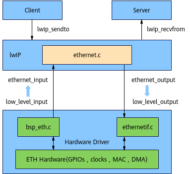

# 线程创建

主线程为app\_main线程，LwIP另起一个子线程如[图1](#zh-cn_topic_0000002517136188_fig510264010175)所示中的lwIP\_main。

**图 1**  LwIP线程  
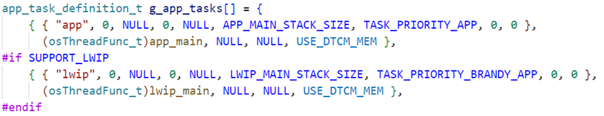

在LwIP线程中调用tcpip\_init初始化网络协议栈，并在其中创建一个tcpip\_mbox邮箱，邮箱的大小是TCPIP\_MBOX\_SIZE，用于接收从底层或者上层传递过来的消息，还会创建tcpip\_thread线程并调用协议栈初始化操作（创建邮箱、请求互斥锁等），如[图2](#zh-cn_topic_0000002517136188_fig19253122645710)所示。

**图 2**  tcpip\_thread线程  
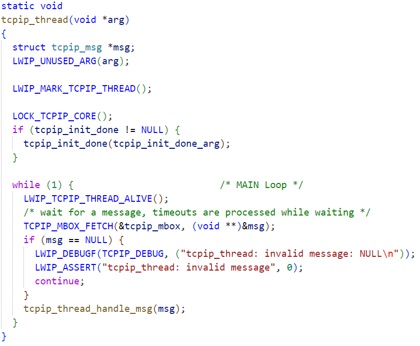

# 南向接口适配

1.  构建网卡驱动注册环境：构建IP地址、网关和网络掩码。

    **图 1**  IP地址、网关和网络掩码  
    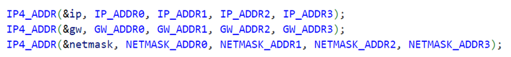

    > **说明：** 
    >此外还需配置MAC地址。

2.  初始化LwIP协议栈，调用netif\_add接口（LwIP社区开源框架）将其加入netif链表（挂载到链表上是使用的前提），根据IP协议IPv4/IPv6解析地址，初始化netif网卡结构，配置网卡各项基础参数，更改网络接口的IP地址配置（包括网络掩码和默认网关），在0～254范围内分配一个唯一的netif号（接口索引为num+1，假如分配的号为254，那么接口索引就是0），最后在接口上启动IGMP处理。

1.  调用netif\_set\_default（LwIP社区开源框架）切换默认路由。

    将网络接口设置为默认网络接口，输出所有找不到具体路由的报文。

2.  询问链路正常状态。
3.  调用netif\_set\_up函数（LwIP社区开源框架）开始运行。

    设置回调参数、发布报文、协议分流等。

总结就是开发板上eth接收完数据后产生一个中断，然后释放一个信号量通知网卡接收线程去处理这些接收的数据，然后将这些数据封装成消息，投递到tcpip\_mbox邮箱中，LwIP内核线程得到此消息，就对消息进行解析，根据消息中数据包类型进行处理。

> **说明：** 
>在使用4G CAT1访问公网时，LwIP使用默认的208.67.222.222 （OpenDNS ）DNS服务IP地址。

# 北向接口适配

创建client和server作为系统的起始和结果终端收发报文。

**图 1**  客户端和服务端线程  
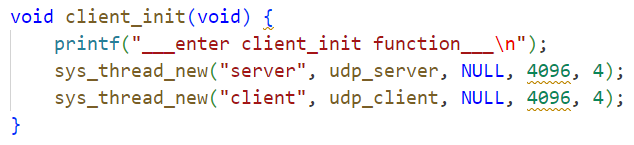

> **说明：** 
>线程空间要给充足，最少为4KB。

以下以Socket API为例。

**客户端正常进行数据发送（以UDP为例）**

创建UDP套接字，也就是调用LwIP socket函数（开源框架，本质上其实就是对netconn的封装）向内核申请一个套接字，如[图2](#zh-cn_topic_0000002548736061_fig73512327195)所示。

**图 2**  申请套接字  
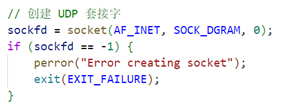

设置服务器地址信息如[图3](#zh-cn_topic_0000002548736061_fig10271541141916)所示，调用lwIP\_sendto（LwIP社区开源框架，如[图4](#zh-cn_topic_0000002548736061_fig20900448131916)）接口发送数据，进入LwIP协议栈。

> **说明：** 
>lwIP\_sendto主要是用于UDP协议传输数据中，它向另一端的UDP主机发送一个UDP报文，本质上是对netconn\_send\(\)函数的封装。

**图 3**  设置服务器地址信息  
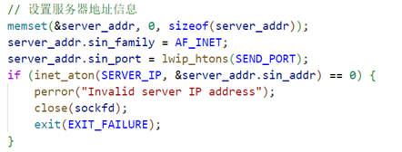

**图 4**  发送数据  
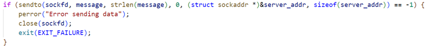

**服务端接收数据**

创建UDP套接字，设置服务器地址信息，绑定套接字（用于服务器端绑定套接字与网卡信息，如[图5](#zh-cn_topic_0000002548736061_fig209271808201)所示），循环调用recvfrom（开源框架，如[图6](#zh-cn_topic_0000002548736061_fig126971314172015)所示）接口接收数据。

**图 5**  绑定socket  
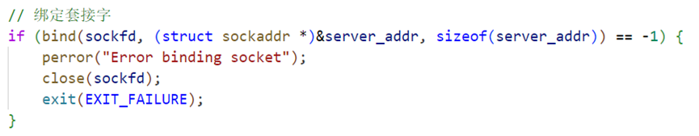

**图 6**  接收数据  
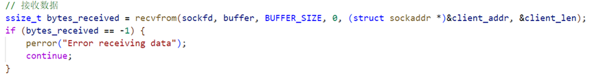

# 目录说明

**图 1**  适配层目录  
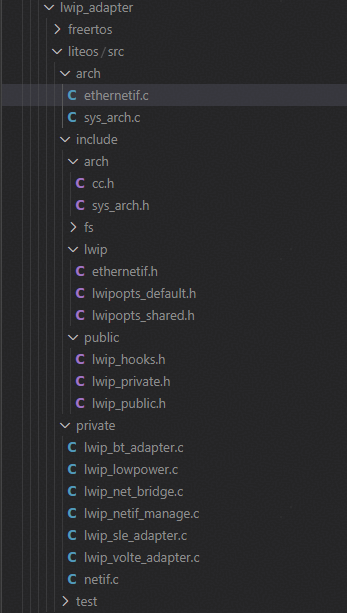

-   sys\_arch.c为邮箱、线程创建、互斥锁、信号量、内核时间获取等功能接口实现。

    sys\_arch.h展示其接口。

-   fs.h文件系统适配文件。
-   ethernetif.c提供了netif访问各种不同的网卡，每个网卡有不同的实现方式，初始化硬件和数据包传输等操作。

    > **说明：** 
    >ethernetif.c文件中的函数为与硬件打交道的底层函数，当有数据需要通过网卡接收或者发送数据的时候就会被调用，经过LwIP协议栈内部进行处理后，从应用层就能得到数据或者可以发送数据。

    以下就是具体实现：

    -   low\_level\_init\(\)为网卡初始化函数，它主要完成网卡的复位及参数初始化，根据实际的网卡属性配置netif中与网卡相关的字段，例如网卡的MAC地址、长度，最大发送单元等。
    -   low\_level\_output\(\)函数为网卡的发送函数，它主要将内核的数据包发送出去，数据包采用pbuf数据结构进行描述，该数据结构是一个比较复杂的数据结构。
    -   low\_level\_input\(\)函数为网卡的数据接收函数，该函数会接收一个数据包，为了内核易于对数据包的管理，该函数必须将接收的数据封装成pbuf的形式。

    ethernetif.h展示网卡实现接口。

-   lwipopts\_default.h为默认配置信息，一切外部未定义或重复定义宏或变量等在此定义或进行覆盖，比如与社区源码（如lwIP\_v2.1.3）相关宏的配置选项取舍和设定，常用见[表1](#zh-cn_topic_0000002548736063_table10562637564)。

    **表 1**  常用配置宏

    
    <table><thead align="left"><tr id="zh-cn_topic_0000002548736063_row858610371760"><th class="cellrowborder" valign="top" width="39.160000000000004%" id="mcps1.2.3.1.1">
配置项

    </th>
    <th class="cellrowborder" valign="top" width="60.84%" id="mcps1.2.3.1.2">
说明

    </th>
    </tr>
    </thead>
    <tbody><tr id="zh-cn_topic_0000002548736063_row10586103718611"><td class="cellrowborder" valign="top" width="39.160000000000004%" headers="mcps1.2.3.1.1 ">
NO_SYS

    </td>
    <td class="cellrowborder" valign="top" width="60.84%" headers="mcps1.2.3.1.2 ">
有无操作系统，有则置为0。

    </td>
    </tr>
    <tr id="zh-cn_topic_0000002548736063_row125867373619"><td class="cellrowborder" valign="top" width="39.160000000000004%" headers="mcps1.2.3.1.1 ">
LWIP_SOCKET

    </td>
    <td class="cellrowborder" valign="top" width="60.84%" headers="mcps1.2.3.1.2 ">
支持socket接口（需有操作系统）。

    </td>
    </tr>
    <tr id="zh-cn_topic_0000002548736063_row45871637565"><td class="cellrowborder" valign="top" width="39.160000000000004%" headers="mcps1.2.3.1.1 ">
LWIP_CONN

    </td>
    <td class="cellrowborder" valign="top" width="60.84%" headers="mcps1.2.3.1.2 ">
支持NETCONN接口，（需有操作系统）。

    </td>
    </tr>
    <tr id="zh-cn_topic_0000002548736063_row35871037163"><td class="cellrowborder" valign="top" width="39.160000000000004%" headers="mcps1.2.3.1.1 ">
LWIP_NETIF_API

    </td>
    <td class="cellrowborder" valign="top" width="60.84%" headers="mcps1.2.3.1.2 ">
支持netif API。

    </td>
    </tr>
    <tr id="zh-cn_topic_0000002548736063_row5587737368"><td class="cellrowborder" valign="top" width="39.160000000000004%" headers="mcps1.2.3.1.1 ">
TCPIP_MBOX_SIZE

    </td>
    <td class="cellrowborder" valign="top" width="60.84%" headers="mcps1.2.3.1.2 ">
定义邮箱大小。

    </td>
    </tr>
    <tr id="zh-cn_topic_0000002548736063_row25871537767"><td class="cellrowborder" valign="top" width="39.160000000000004%" headers="mcps1.2.3.1.1 ">
LWIP_NUM_SOCKETS_MAX

    </td>
    <td class="cellrowborder" valign="top" width="60.84%" headers="mcps1.2.3.1.2 ">
最大支持套接字数。

    </td>
    </tr>
    <tr id="zh-cn_topic_0000002548736063_row1458713374613"><td class="cellrowborder" valign="top" width="39.160000000000004%" headers="mcps1.2.3.1.1 ">
MEM_LIBC_MALLOC

    </td>
    <td class="cellrowborder" valign="top" width="60.84%" headers="mcps1.2.3.1.2 ">
分配内存方式，置为1，则使用此库函数（malloc、free）等。

    </td>
    </tr>
    </tbody>
    </table>

-   与lwip\_adapter同级的lwIP\_v2.1.3则为开源中心框架。

-   test目录内容则为示例程序，仅作参考。

# 必要操作

根据目标组件，适配LiteOS系统API，不同系统在线程、锁、邮箱、互斥体等方面实现不同，确认是否存在相应的目标组件库。例如[图1](#zh-cn_topic_0000002517136190_fig12566251135815)所示适配不同系统。

**图 1**  组件库选项  
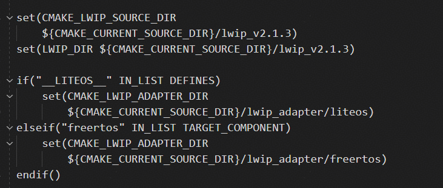

# 调试及优化

LwIP协议栈相关功能默认为打开状态。

-   tcpip\_init函数初始化LwIP各模块（包括定时器模块），开启tcpip\_thread线程（核心业务为不断循环获取并处理邮箱消息）。

-   lwip\_cat1\_open/lwip\_cat1\_set\_ip函数为CAT1南向适配层初始化，可开启cat1netif等相关功能【示例，仅供参考】。

> **须知：** 
>4G CAT1默认使用了公网DNS服务器：119.29.29.29 （DNSPod）、223.5.5.5 （AliDNS）、1.2.4.8 （CNNIC SDNS）。
>客户也可根据实际情况选择私有的DNS服务器。

**图 1**  lwip\_main任务  
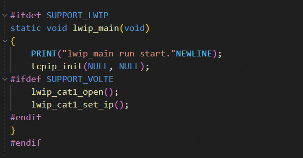

在lwipopts.h文件中配置LwIP的参数，具体见[图2](#zh-cn_topic_0000002516976274_fig8834314125911)。LwIP管理的内存建议稍多分配，而当发送数据是存储在ROM或者静态存储区时，还要将MEMP\_NUM\_PBUF宏定义数据做进一步提升，发送缓冲区大小和发送缓冲区队列长度决定了发送速度的大小，根据不同需求进行配置，并且需要不断调试；而对于接收数据的配置，应该配置TCP缓冲队列中的报文段数量与TCP接收窗口大小，特别是接收窗口的大小，会直接影响数据的接收速度。

**图 2**  配置项  
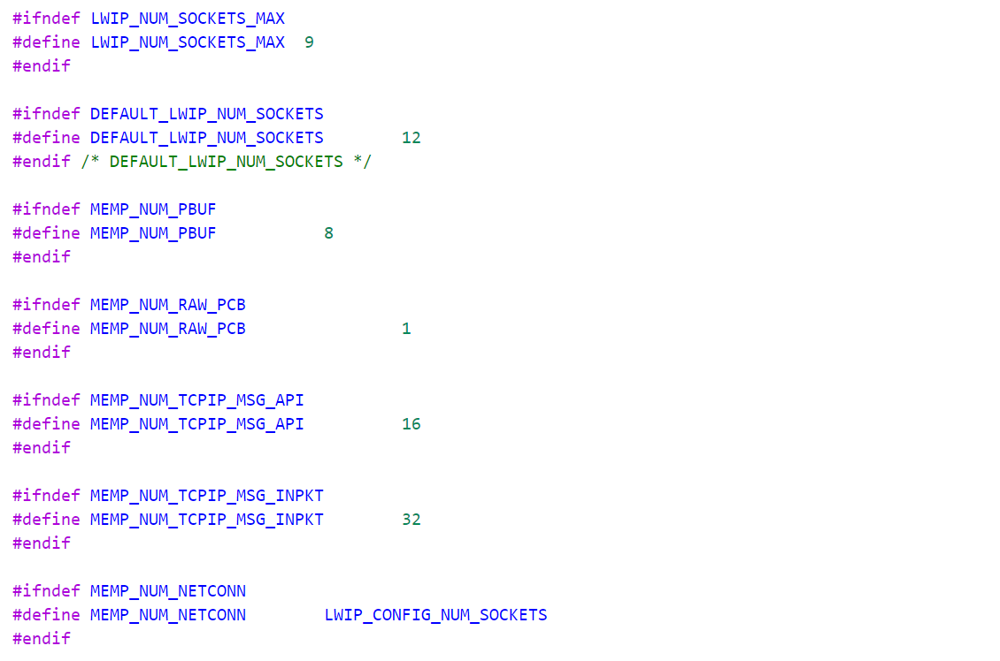

# LwIP日志开启说明

针对HiDiTing使用LiteOS操作系统，协议栈使用LwIP。开启日志调试打印方法如下：

日志总开关路径：ohos/third\_party/lwip/lwip\_adapter/liteos/src/include/lwip/lwipopts\_default.h。

1.  在上述文件路径中定义“LWIP\_DEBUG”宏，表示开启LwIP日志调试功能。
2.  “LWIP\_DBG\_TYPES\_ON”宏定义修改为“LWIP\_DBG\_ON”，表示开启debug日志。

    **图 1**  LwIP日志宏LWIP\_DEBUG  
    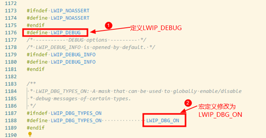

3.  开启相关模块日志功能。路径：ohos/third\_party/lwip/lwip\_v2.1.3/src/include/lwip/opt.h。

    例如开启TCP模块日志，需要修改如[图2](#zh-cn_topic_0000002548616073_fig43770965418)所示，将相关宏开启后重洗编译版本，运行相关程序，则会打印TCP相关日志。

    **图 2**  TCP模块相关宏定义开启  
    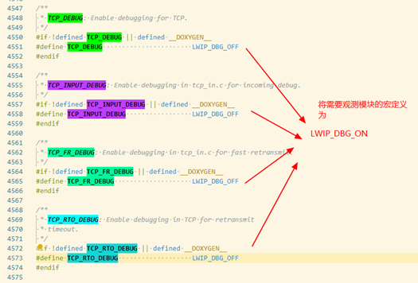

# 缩略语

<table><tbody><tr id="zh-cn_topic_0000002517207984_row14573720182619"><td class="nocellnorowborder" style="border:none" valign="top" width="20.89208920892089%">
<strong id="zh-cn_topic_0000002517207984_b15659232183512">A</strong>

</td>
<td class="nocellnorowborder" style="border:none" valign="top" width="45.77457745774577%">&nbsp;&nbsp;</td>
<td class="cell-norowborder" style="border:none" valign="top" width="33.33333333333333%">&nbsp;&nbsp;</td>
</tr>
<tr id="zh-cn_topic_0000002517207984_row6573020182620"><td class="nocellnorowborder" style="border:none" valign="top" width="20.89208920892089%">
<strong id="zh-cn_topic_0000002517207984_b13660193218355">API</strong>

</td>
<td class="nocellnorowborder" style="border:none" valign="top" width="45.77457745774577%">
Application Programming Interface

</td>
<td class="cell-norowborder" style="border:none" valign="top" width="33.33333333333333%">
应用编程接口

</td>
</tr>
<tr id="zh-cn_topic_0000002517207984_row557313206265"><td class="nocellnorowborder" style="border:none" valign="top" width="20.89208920892089%">&nbsp;&nbsp;</td>
<td class="nocellnorowborder" style="border:none" valign="top" width="45.77457745774577%">&nbsp;&nbsp;</td>
<td class="cell-norowborder" style="border:none" valign="top" width="33.33333333333333%">&nbsp;&nbsp;</td>
</tr>
<tr id="zh-cn_topic_0000002517207984_row1573620182616"><td class="nocellnorowborder" style="border:none" valign="top" width="20.89208920892089%">
<strong id="zh-cn_topic_0000002517207984_b26623320359">C</strong>

</td>
<td class="nocellnorowborder" style="border:none" valign="top" width="45.77457745774577%">&nbsp;&nbsp;</td>
<td class="cell-norowborder" style="border:none" valign="top" width="33.33333333333333%">&nbsp;&nbsp;</td>
</tr>
<tr id="zh-cn_topic_0000002517207984_row15731620192618"><td class="nocellnorowborder" style="border:none" valign="top" width="20.89208920892089%">
<strong id="zh-cn_topic_0000002517207984_b166637324351">CAT1</strong>

</td>
<td class="nocellnorowborder" style="border:none" valign="top" width="45.77457745774577%">
Category 1

</td>
<td class="cell-norowborder" style="border:none" valign="top" width="33.33333333333333%">
4G物联网终端

</td>
</tr>
<tr id="zh-cn_topic_0000002517207984_row2574102002617"><td class="nocellnorowborder" style="border:none" valign="top" width="20.89208920892089%">&nbsp;&nbsp;</td>
<td class="nocellnorowborder" style="border:none" valign="top" width="45.77457745774577%">&nbsp;&nbsp;</td>
<td class="cell-norowborder" style="border:none" valign="top" width="33.33333333333333%">&nbsp;&nbsp;</td>
</tr>
<tr id="zh-cn_topic_0000002517207984_row8574182020261"><td class="nocellnorowborder" style="border:none" valign="top" width="20.89208920892089%">
<strong id="zh-cn_topic_0000002517207984_b566419329352">D</strong>

</td>
<td class="nocellnorowborder" style="border:none" valign="top" width="45.77457745774577%">&nbsp;&nbsp;</td>
<td class="cell-norowborder" style="border:none" valign="top" width="33.33333333333333%">&nbsp;&nbsp;</td>
</tr>
<tr id="zh-cn_topic_0000002517207984_row1957482011261"><td class="nocellnorowborder" style="border:none" valign="top" width="20.89208920892089%">
<strong id="zh-cn_topic_0000002517207984_b2664183293513">DHCP</strong>

</td>
<td class="nocellnorowborder" style="border:none" valign="top" width="45.77457745774577%">
Dynamic Host Configuration Protocol

</td>
<td class="cell-norowborder" style="border:none" valign="top" width="33.33333333333333%">
动态主机配置协议

</td>
</tr>
<tr id="zh-cn_topic_0000002517207984_row125741320202620"><td class="nocellnorowborder" style="border:none" valign="top" width="20.89208920892089%">
<strong id="zh-cn_topic_0000002517207984_b2665153243510">DNS</strong>

</td>
<td class="nocellnorowborder" style="border:none" valign="top" width="45.77457745774577%">
Domain Name Server

</td>
<td class="cell-norowborder" style="border:none" valign="top" width="33.33333333333333%">
域名服务器

</td>
</tr>
<tr id="zh-cn_topic_0000002517207984_row1557412204267"><td class="nocellnorowborder" style="border:none" valign="top" width="20.89208920892089%">&nbsp;&nbsp;</td>
<td class="nocellnorowborder" style="border:none" valign="top" width="45.77457745774577%">&nbsp;&nbsp;</td>
<td class="cell-norowborder" style="border:none" valign="top" width="33.33333333333333%">&nbsp;&nbsp;</td>
</tr>
<tr id="zh-cn_topic_0000002517207984_row4574122012614"><td class="nocellnorowborder" style="border:none" valign="top" width="20.89208920892089%">
<strong id="zh-cn_topic_0000002517207984_b116668328353">I</strong>

</td>
<td class="nocellnorowborder" style="border:none" valign="top" width="45.77457745774577%">&nbsp;&nbsp;</td>
<td class="cell-norowborder" style="border:none" valign="top" width="33.33333333333333%">&nbsp;&nbsp;</td>
</tr>
<tr id="zh-cn_topic_0000002517207984_row257514200268"><td class="nocellnorowborder" style="border:none" valign="top" width="20.89208920892089%">
<strong id="zh-cn_topic_0000002517207984_b156671632153514">IGMP</strong>

</td>
<td class="nocellnorowborder" style="border:none" valign="top" width="45.77457745774577%">
Internet Group Management Protocol

</td>
<td class="cell-norowborder" style="border:none" valign="top" width="33.33333333333333%">
互联网组管理协议

</td>
</tr>
<tr id="zh-cn_topic_0000002517207984_row4575102017267"><td class="nocellnorowborder" style="border:none" valign="top" width="20.89208920892089%">&nbsp;&nbsp;</td>
<td class="nocellnorowborder" style="border:none" valign="top" width="45.77457745774577%">&nbsp;&nbsp;</td>
<td class="cell-norowborder" style="border:none" valign="top" width="33.33333333333333%">&nbsp;&nbsp;</td>
</tr>
<tr id="zh-cn_topic_0000002517207984_row257532052612"><td class="nocellnorowborder" style="border:none" valign="top" width="20.89208920892089%">
<strong id="zh-cn_topic_0000002517207984_b7668532163519">M</strong>

</td>
<td class="nocellnorowborder" style="border:none" valign="top" width="45.77457745774577%">&nbsp;&nbsp;</td>
<td class="cell-norowborder" style="border:none" valign="top" width="33.33333333333333%">&nbsp;&nbsp;</td>
</tr>
<tr id="zh-cn_topic_0000002517207984_row1657582052611"><td class="nocellnorowborder" style="border:none" valign="top" width="20.89208920892089%">
<strong id="zh-cn_topic_0000002517207984_b196687323359">MAC</strong>

</td>
<td class="nocellnorowborder" style="border:none" valign="top" width="45.77457745774577%">
Media Access Control Address

</td>
<td class="cell-norowborder" style="border:none" valign="top" width="33.33333333333333%">
媒体接入控制

</td>
</tr>
<tr id="zh-cn_topic_0000002517207984_row85751220142619"><td class="nocellnorowborder" style="border:none" valign="top" width="20.89208920892089%">&nbsp;&nbsp;</td>
<td class="nocellnorowborder" style="border:none" valign="top" width="45.77457745774577%">&nbsp;&nbsp;</td>
<td class="cell-norowborder" style="border:none" valign="top" width="33.33333333333333%">&nbsp;&nbsp;</td>
</tr>
<tr id="zh-cn_topic_0000002517207984_row7575142018263"><td class="nocellnorowborder" style="border:none" valign="top" width="20.89208920892089%">
<strong id="zh-cn_topic_0000002517207984_b1566919321356">T</strong>

</td>
<td class="nocellnorowborder" style="border:none" valign="top" width="45.77457745774577%">&nbsp;&nbsp;</td>
<td class="cell-norowborder" style="border:none" valign="top" width="33.33333333333333%">&nbsp;&nbsp;</td>
</tr>
<tr id="zh-cn_topic_0000002517207984_row857615209267"><td class="nocellnorowborder" style="border:none" valign="top" width="20.89208920892089%">
<strong id="zh-cn_topic_0000002517207984_b66702321356">TCP</strong>

</td>
<td class="nocellnorowborder" style="border:none" valign="top" width="45.77457745774577%">
Transmission Control Protocol

</td>
<td class="cell-norowborder" style="border:none" valign="top" width="33.33333333333333%">
传输控制协议

</td>
</tr>
<tr id="zh-cn_topic_0000002517207984_row35761220172618"><td class="nocellnorowborder" style="border:none" valign="top" width="20.89208920892089%">&nbsp;&nbsp;</td>
<td class="nocellnorowborder" style="border:none" valign="top" width="45.77457745774577%">&nbsp;&nbsp;</td>
<td class="cell-norowborder" style="border:none" valign="top" width="33.33333333333333%">&nbsp;&nbsp;</td>
</tr>
<tr id="zh-cn_topic_0000002517207984_row5576120152613"><td class="nocellnorowborder" style="border:none" valign="top" width="20.89208920892089%">
<strong id="zh-cn_topic_0000002517207984_b1967183213352">U</strong>

</td>
<td class="nocellnorowborder" style="border:none" valign="top" width="45.77457745774577%">&nbsp;&nbsp;</td>
<td class="cell-norowborder" style="border:none" valign="top" width="33.33333333333333%">&nbsp;&nbsp;</td>
</tr>
<tr id="zh-cn_topic_0000002517207984_row95762201265"><td class="row-nocellborder" style="border:none" valign="top" width="20.89208920892089%">
<strong id="zh-cn_topic_0000002517207984_b146728320352">UDP</strong>

</td>
<td class="row-nocellborder" style="border:none" valign="top" width="45.77457745774577%">
User Datagram Protocol

</td>
<td class="cellrowborder" style="border:none" valign="top" width="33.33333333333333%">
用户数据报协议

</td>
</tr>
</tbody>
</table>

