# 前言<a name="ZH-CN_TOPIC_0000002499502649"></a>

**概述<a name="zh-cn_topic_0000002444726821_section4537382116410"></a>**

本文档详细的描述了HiDiTing上OpenHarmony应用控件和JS API的使用方法，用于指导用户开发OH穿戴JS应用。

文档接口对应示例应用详见发布包“jsapp.zip”。注意示例应用代码仅用于验证和调测JS API功能，不能直接商用。弱密码算法不能应用于密码学安全场景，如system.cipher中的MD5、AES-ECB、BASE64。

**读者对象<a name="zh-cn_topic_0000002444726821_section4378592816410"></a>**

本文档主要适用于以下工程师：

-   技术支持工程师
-   软件开发工程师

**符号约定<a name="zh-cn_topic_0000002444726821_section133020216410"></a>**

在本文中可能出现下列标志，它们所代表的含义如下。

<a name="zh-cn_topic_0000002444726821_table2622507016410"></a>
<table><thead align="left"><tr id="zh-cn_topic_0000002444726821_row1530720816410"><th class="cellrowborder" valign="top" width="20.580000000000002%" id="mcps1.1.3.1.1"><p id="zh-cn_topic_0000002444726821_p6450074116410"><a name="zh-cn_topic_0000002444726821_p6450074116410"></a><a name="zh-cn_topic_0000002444726821_p6450074116410"></a><strong id="zh-cn_topic_0000002444726821_b2136615816410"><a name="zh-cn_topic_0000002444726821_b2136615816410"></a><a name="zh-cn_topic_0000002444726821_b2136615816410"></a>符号</strong></p>
</th>
<th class="cellrowborder" valign="top" width="79.42%" id="mcps1.1.3.1.2"><p id="zh-cn_topic_0000002444726821_p5435366816410"><a name="zh-cn_topic_0000002444726821_p5435366816410"></a><a name="zh-cn_topic_0000002444726821_p5435366816410"></a><strong id="zh-cn_topic_0000002444726821_b5941558116410"><a name="zh-cn_topic_0000002444726821_b5941558116410"></a><a name="zh-cn_topic_0000002444726821_b5941558116410"></a>说明</strong></p>
</th>
</tr>
</thead>
<tbody><tr id="zh-cn_topic_0000002444726821_row1372280416410"><td class="cellrowborder" valign="top" width="20.580000000000002%" headers="mcps1.1.3.1.1 "><p id="zh-cn_topic_0000002444726821_p3734547016410"><a name="zh-cn_topic_0000002444726821_p3734547016410"></a><a name="zh-cn_topic_0000002444726821_p3734547016410"></a><a name="zh-cn_topic_0000002444726821_image2670064316410"></a><a name="zh-cn_topic_0000002444726821_image2670064316410"></a><span></span></p>
</td>
<td class="cellrowborder" valign="top" width="79.42%" headers="mcps1.1.3.1.2 "><p id="zh-cn_topic_0000002444726821_p1757432116410"><a name="zh-cn_topic_0000002444726821_p1757432116410"></a><a name="zh-cn_topic_0000002444726821_p1757432116410"></a>表示如不避免则将会导致死亡或严重伤害的具有高等级风险的危害。</p>
</td>
</tr>
<tr id="zh-cn_topic_0000002444726821_row466863216410"><td class="cellrowborder" valign="top" width="20.580000000000002%" headers="mcps1.1.3.1.1 "><p id="zh-cn_topic_0000002444726821_p1432579516410"><a name="zh-cn_topic_0000002444726821_p1432579516410"></a><a name="zh-cn_topic_0000002444726821_p1432579516410"></a><a name="zh-cn_topic_0000002444726821_image4895582316410"></a><a name="zh-cn_topic_0000002444726821_image4895582316410"></a><span></span></p>
</td>
<td class="cellrowborder" valign="top" width="79.42%" headers="mcps1.1.3.1.2 "><p id="zh-cn_topic_0000002444726821_p959197916410"><a name="zh-cn_topic_0000002444726821_p959197916410"></a><a name="zh-cn_topic_0000002444726821_p959197916410"></a>表示如不避免则可能导致死亡或严重伤害的具有中等级风险的危害。</p>
</td>
</tr>
<tr id="zh-cn_topic_0000002444726821_row123863216410"><td class="cellrowborder" valign="top" width="20.580000000000002%" headers="mcps1.1.3.1.1 "><p id="zh-cn_topic_0000002444726821_p1232579516410"><a name="zh-cn_topic_0000002444726821_p1232579516410"></a><a name="zh-cn_topic_0000002444726821_p1232579516410"></a><a name="zh-cn_topic_0000002444726821_image1235582316410"></a><a name="zh-cn_topic_0000002444726821_image1235582316410"></a><span></span></p>
</td>
<td class="cellrowborder" valign="top" width="79.42%" headers="mcps1.1.3.1.2 "><p id="zh-cn_topic_0000002444726821_p123197916410"><a name="zh-cn_topic_0000002444726821_p123197916410"></a><a name="zh-cn_topic_0000002444726821_p123197916410"></a>表示如不避免则可能导致轻微或中度伤害的具有低等级风险的危害。</p>
</td>
</tr>
<tr id="zh-cn_topic_0000002444726821_row5786682116410"><td class="cellrowborder" valign="top" width="20.580000000000002%" headers="mcps1.1.3.1.1 "><p id="zh-cn_topic_0000002444726821_p2204984716410"><a name="zh-cn_topic_0000002444726821_p2204984716410"></a><a name="zh-cn_topic_0000002444726821_p2204984716410"></a><a name="zh-cn_topic_0000002444726821_image4504446716410"></a><a name="zh-cn_topic_0000002444726821_image4504446716410"></a><span></span></p>
</td>
<td class="cellrowborder" valign="top" width="79.42%" headers="mcps1.1.3.1.2 "><p id="zh-cn_topic_0000002444726821_p4388861916410"><a name="zh-cn_topic_0000002444726821_p4388861916410"></a><a name="zh-cn_topic_0000002444726821_p4388861916410"></a>用于传递设备或环境安全警示信息。如不避免则可能会导致设备损坏、数据丢失、设备性能降低或其它不可预知的结果。</p>
<p id="zh-cn_topic_0000002444726821_p1238861916410"><a name="zh-cn_topic_0000002444726821_p1238861916410"></a><a name="zh-cn_topic_0000002444726821_p1238861916410"></a>“须知”不涉及人身伤害。</p>
</td>
</tr>
<tr id="zh-cn_topic_0000002444726821_row2856923116410"><td class="cellrowborder" valign="top" width="20.580000000000002%" headers="mcps1.1.3.1.1 "><p id="zh-cn_topic_0000002444726821_p5555360116410"><a name="zh-cn_topic_0000002444726821_p5555360116410"></a><a name="zh-cn_topic_0000002444726821_p5555360116410"></a><a name="zh-cn_topic_0000002444726821_image799324016410"></a><a name="zh-cn_topic_0000002444726821_image799324016410"></a><span></span></p>
</td>
<td class="cellrowborder" valign="top" width="79.42%" headers="mcps1.1.3.1.2 "><p id="zh-cn_topic_0000002444726821_p4612588116410"><a name="zh-cn_topic_0000002444726821_p4612588116410"></a><a name="zh-cn_topic_0000002444726821_p4612588116410"></a>对正文中重点信息的补充说明。</p>
<p id="zh-cn_topic_0000002444726821_p1232588116410"><a name="zh-cn_topic_0000002444726821_p1232588116410"></a><a name="zh-cn_topic_0000002444726821_p1232588116410"></a>“说明”不是安全警示信息，不涉及人身、设备及环境伤害信息。</p>
</td>
</tr>
</tbody>
</table>

# 开发工具<a name="ZH-CN_TOPIC_0000002499502661"></a>

-   **[IDE](#ZH-CN_TOPIC_0000002499502669)**  

-   **[haptobin\_tool.jar工具使用](#ZH-CN_TOPIC_0000002499582729)**  

-   **[工程创建](#ZH-CN_TOPIC_0000002466383720)**  

-   **[图形工具使用](#ZH-CN_TOPIC_0000002466383768)**  

-   **[签名介绍](#ZH-CN_TOPIC_0000002499582741)**  

-   **[编译打包](#ZH-CN_TOPIC_0000002499502653)**  

-   **[应用安装](#ZH-CN_TOPIC_0000002499582737)**  

-   **[应用卸载](#ZH-CN_TOPIC_0000002466543376)**  

-   **[预置应用](#ZH-CN_TOPIC_0000002499582733)**  

## IDE<a name="ZH-CN_TOPIC_0000002499502669"></a>

目前支持OpenHarmony JS应用开发的IDE为DevEco Studio 5.0 Release。

-   5.0版本，5.0版本支持API 10。
-   不推荐：2.1版本为早期版本，支持API 5。

-   **[DevEco Studio 5.0 Release](#ZH-CN_TOPIC_0000002499502677)**  

### DevEco Studio 5.0 Release<a name="ZH-CN_TOPIC_0000002499502677"></a>

DevEco Studio For OpenHarmony（获取工具请单击[链接下载](https://developer.huawei.com/consumer/cn/download/deveco-studio)，以下简称DevEco Studio）是基于IntelliJ IDEA Community开源版本打造，用作开发穿戴JS应用。

> **说明：** 
>当前产品使用的IDE版本为DevEco Studio 5.0 Release。

## haptobin\_tool.jar工具使用<a name="ZH-CN_TOPIC_0000002499582729"></a>

背景：商用应用建议上架release版本安装包，本工具支持将release hap转换为bin。

工具介绍：将IDE编译出的release的hap转为bin的工具。

获取路径：解压sdk发布包中的jsapp.zip，在“jsapp\\js\_sample\\helper”路径下的“fastjson-1.2.83.jar”、“haptobin\_tool.jar”。

使用方法：

1.  将“fastjson-1.2.83.jar”、“haptobin\_tool.jar”放在同一目录下。
2.  执行命令“java -jar "xxx/haptobin\_tool.jar" --hap-path "xxx/xxx.hap" --bin-path "xxx/xxx.bin"”。

    --hap-path：hap包所在路径。

    --bin-path：所生成bin包所在路径。

> **说明：** 
>当前章节所指hap包是DevEco Studio使用release模式编译的“\*.hap”产物。如果使用IDE的debug模式，无需使用“haptobin\_tool.jar”。
>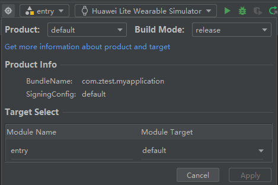

## 工程创建<a name="ZH-CN_TOPIC_0000002466383720"></a>

-   **[DevEco Studio 5.0 Release](#ZH-CN_TOPIC_0000002466543352)**  

### DevEco Studio 5.0 Release<a name="ZH-CN_TOPIC_0000002466543352"></a>

1.  选择“\[Lite\]Empty Ability\(JS\)”工程。

    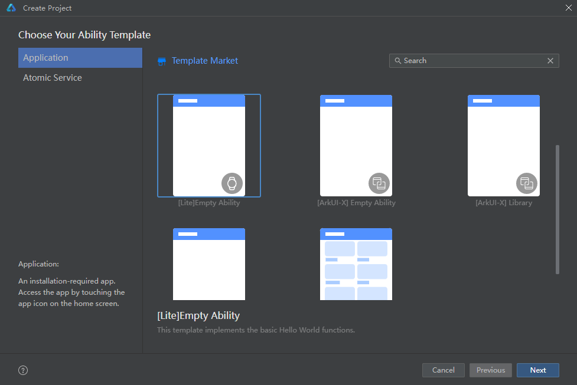

2.  配置项目，包括包名、工程路径、项目类型等。

    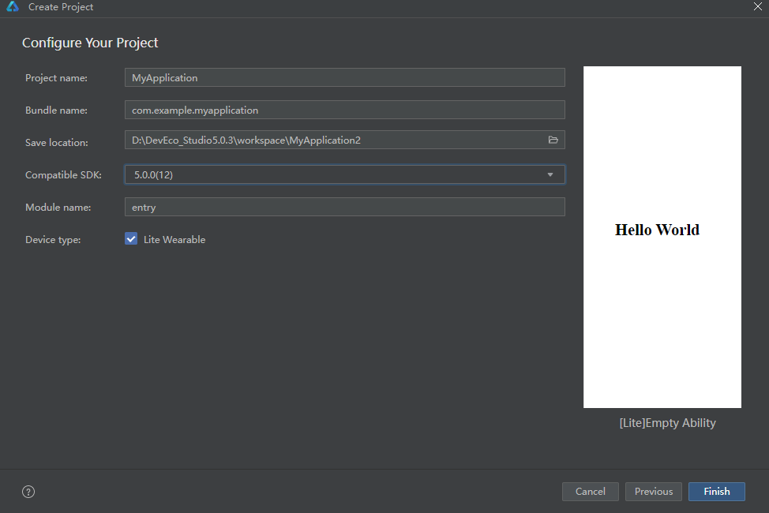

3.  在Hello World程序中打开Previewer预览器显示预览界面。

    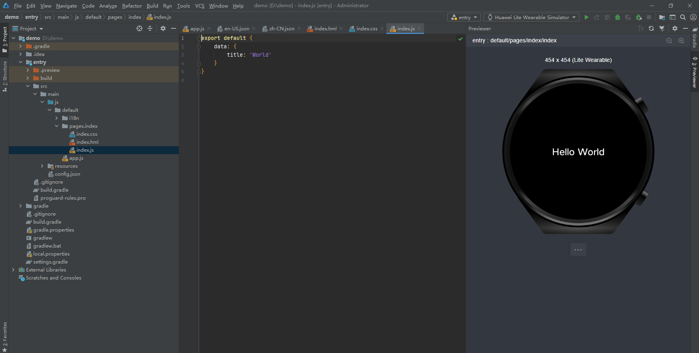

    > **说明：** 
    >页面视图逻辑主要由hml、css、js组成，详情请参考“[文件组织](#ZH-CN_TOPIC_0000002499502665)”。

## 图形工具使用<a name="ZH-CN_TOPIC_0000002466383768"></a>

-   **[DevEco Studio 5.0 Release](#ZH-CN_TOPIC_0000002499502697)**  

### DevEco Studio 5.0 Release<a name="ZH-CN_TOPIC_0000002499502697"></a>

图片压缩工具详见《图形工具 使用指南》。将图片资源解码成bin文件后打包到应用包中可以优化图片性能，使用步骤如下：

1.  <a name="zh-cn_topic_0000002411207548_li84627328218"></a>设置图像转换工具环境变量，本示例中设置如下，路径变量名为ImageTool：

    **图 1**  设置环境变量<a name="zh-cn_topic_0000002411207548_fig19204143811111"></a>  
    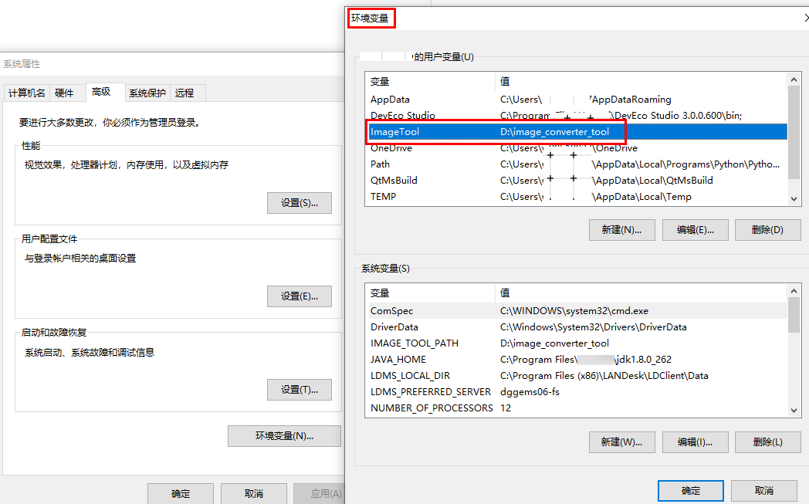

2.  进入DevEco Studio 5.0 Release版本新建工程entry目录，使用以下脚本替换替换“hvigorfile.ts”：

    ```
    import { legacyHapTasks ,OhosPluginId ,OhosHapContext} from '@ohos/hvigor-ohos-plugin';
    import { hvigor, HvigorNode, HvigorPlugin} from '@ohos/hvigor';
    import {spawn,exec,execSync} from 'child_process'
    import * as fs from 'fs';
    import * as path from 'path';
    import { PythonShell } from 'python-shell';
    function containsPng(filename: string): boolean {
        return filename.toLowerCase().includes('png') || filename.toLowerCase().includes('bmp') || filename.toLowerCase().includes('jpg');
    }
    function copyDirectorySync(src: string, dest: string) {
        if (!fs.existsSync(dest)) {
            fs.mkdirSync(dest, { recursive: true });
        }
        const entries = fs.readdirSync(src, { withFileTypes: true });
        for (const entry of entries) {
            const srcPath = path.join(src, entry.name);
            const destPath = path.join(dest, entry.name);
            if (entry.isDirectory()) {
                copyDirectorySync(srcPath, destPath);
            } else {
                if (containsPng(srcPath)) {
                    fs.copyFileSync(srcPath, destPath);
                }
            }
        }
    }
    function createDirSync(dir: string): void {
        if (!fs.existsSync(dir)) {
            createDirSync(path.dirname(dir));
            fs.mkdirSync(dir);
        }
    }
    function delay(milliseconds: number) {
        return new Promise<void>(resolve => {
            setTimeout(() => {
                resolve();
            }, milliseconds);
        });
    }
    function deletePngBinFiles(folderPath: string): void {
        fs.readdirSync(folderPath).forEach((file) => {
            const filePath = path.join(folderPath, file);
            if (fs.lstatSync(filePath).isFile() && file.endsWith('.png.bin')) {
                console.log(filePath);
                fs.unlinkSync(filePath);
            } else if (fs.lstatSync(filePath).isDirectory()) {
                deletePngBinFiles(filePath);
            }
        });
    }
    async function executeCommand(dirPath: string): Promise<void> {
        return new Promise((resolve, reject) => {
            const myVar = process.env.ImageTool;
            let options = { cwd: myVar };
            console.log(myVar);
            const result = execSync('python ' + myVar + "\\images_tool.py -p file -c config.xml -i "+dirPath+" -o "+dirPath, options);
            console.log(result.toString());
        });
    }
    export function customPlugin(): HvigorPlugin {
        return {
            pluginId: 'customPlugin',
            context() {
                return {
                    data: 'customPlugin xxx'
                };
            },
            async apply(currentNode: HvigorNode): Promise<void> {
                currentNode.registerTask({
                    // 任务名称
                    name: `default@makepicbin`,
                    // 任务执行逻辑主体函数
                    async run() {
                        const hapContext = currentNode.getContext(OhosPluginId.OHOS_HAP_PLUGIN) as OhosHapContext;
                        hapContext?.targets((target: default) => {
                            const outputPath = target.getBuildTargetOutputPath();
                            console.log(outputPath);
                            const appName = 'MainAbility';
                            const srcDir = `${target.projectPath}/entry/src/main/js/` + appName;
                            const destDir = `${target.projectPath}/entry/build/default/intermediates/lite_source/default/assets/js/` + appName;
                            const destDir2 = `${target.projectPath}/entry/build/default/intermediates/loader_out_lite/default/js/` + appName;
                            const testDir = `${target.projectPath}/test`;
                            try {
                                createDirSync(destDir);
                                console.log('目录创建成功');
                                createDirSync(destDir2);
                                console.log('目录创建成功');
                                copyDirectorySync(srcDir, destDir);
                                console.log('文件夹拷贝完成');
                                copyDirectorySync(srcDir, destDir2);
                                console.log('文件夹拷贝完成');
                                console.log(`${target.projectPath}/entry/build/default/intermediates`);
                                executeCommand(`${target.projectPath}/entry/build/default/intermediates`);
                                console.log('Command executed successfully11');
                                deletePngBinFiles(`${target.projectPath}/entry/build/default/intermediates`)
                            } catch (error) {
                                console.error('创建过程中出错:', error, destDir);
                            }
                        });
                    },
                    // 配置前置任务依赖
                    dependencies: [
                        `default@LegacyCompileLiteJS`,
                        `default@LegacyCompileArkTS`,
                        `default@LegacyGenerateLoaderJson`,
                        `default@CacheNativeLibs`],
                    // 配置任务的后置任务依赖
                    postDependencies: [
                        `default@LegacyGenerateLiteCode`,
                        `default@LegacyBuildJS`,
                        `default@LegacyPackageHap`,
                        `default@SignHap`,
                        `assembleHap`
                    ]
                });
            }
        };
    }
    export default {
        system: legacyHapTasks,  /* Built-in plugin of Hvigor. It cannot be modified. */
        plugins:[customPlugin()]               /* Custom plugin to extend the functionality of Hvigor. */
    }
    ```

    -   process.env.ImageTool：[1](#zh-cn_topic_0000002411207548_li84627328218)设置的图片转换工具所在目录。

> **说明：** 
>图形工具源码及安装请参考 《图形工具 使用指南》。

## 签名介绍<a name="ZH-CN_TOPIC_0000002499582741"></a>

> **说明：** 
>应用签名密钥由产品厂商自行管理，解决方案不指定具体密钥。非商用调试场景，可采用调试模式关闭验签，或使用OpenHarmony社区签名。

商用产品默认开启验签，当使用厂商对应公钥和证书后，可验证所安装应用的完整性和真实性。

OpenHarmony社区签名方法参考如下链接：

[#hapsigntool-guidelines](#hapsigntool-guidelines)

DevEco Studio自动签名如下图所示，调试阶段可使用默认配置，即OH社区签名。

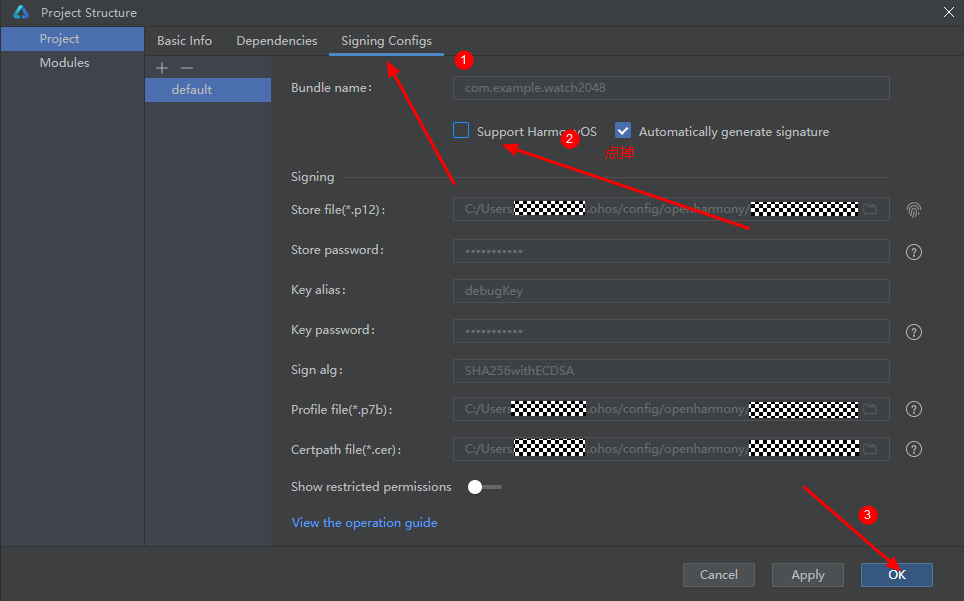

调试模式下关闭验签方法如下：

-   方法一：串口调试命令

    AT+OHOS=OHOSFWK\_BM\_SET,disable

-   方法二：使用调试接口

    使用SetSignMode\(\)接口，或修改“ohos/foundation/bundlemanager/bundle\_framework\_lite/services/bundlemgr\_lite/tools/signmode/sign\_mode.cpp”中isSignMode\_的值为false。

## 编译打包<a name="ZH-CN_TOPIC_0000002499502653"></a>

按照下图中①标记的步骤构建应用包，并将在下图中②位置生成对应的应用包。

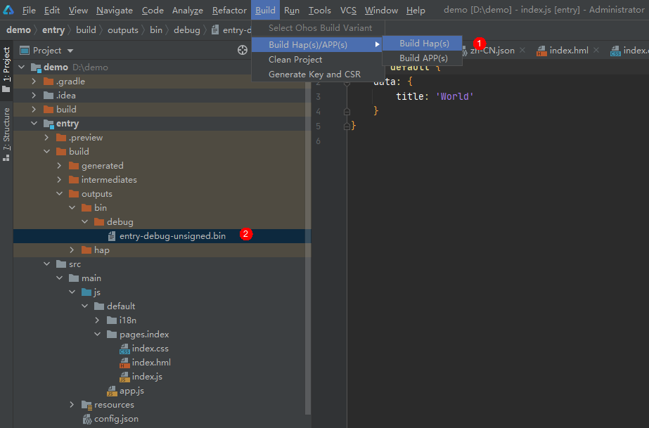

## 应用安装<a name="ZH-CN_TOPIC_0000002499582737"></a>

1.  将“[编译打包](#ZH-CN_TOPIC_0000002499502653)”中生成的应用包文件上传到板端任意位置，如“/user/jsapp/sample.bin”。

    > **说明：** 
    >文件上传方式请参考《DebugKits工具 使用指南》“数据上传与下载”章节内容。

2.  安装应用包：
    1.  如果调试非签名JSApp时，可以在串口上通过如下命令执行关闭验签。对已签名应用跳过此步骤。

        AT+OHOS=OHOSFWK\_BM\_SET,disable

    2.  在串口上执行应用安装，允许覆盖安装：

        AT+OHOS=OHOSFWK\_BM\_INSTALL,/user/jsapp/sample.bin

    3.  如果覆盖安装时，在命令末尾添加参数“rmdata”，则会删除应用沙箱历史数据：

        AT+OHOS=OHOSFWK\_BM\_INSTALL,/user/jsapp/sample.bin,rmdata

## 应用卸载<a name="ZH-CN_TOPIC_0000002466543376"></a>

在串口上执行卸载：AT+OHOS=OHOSFWK\_BM\_UNINSTALL,XXX

> **说明：** 
>XXX为需要卸载应用的包名，例如：AT+OHOS=OHOSFWK\_BM\_UNINSTALL,com.example.test。更多OHOS命令及参数，请见“middleware/utils/at/at\_ohos\_cmd/at/at\_ohos.c”中的g\_at\_ohos\_cmd中对应OHOS命令及参数定义。

## 预置应用<a name="ZH-CN_TOPIC_0000002499582733"></a>

1.  请参见《文件系统 使用指南》的“3.2.2 开发指导”中的说明，制作文件系统镜像，将需要预置的应用放到“/user/app/system/ace/vendor/”目录下。
2.  烧录镜像并重启设备，预置应用将会在设备启动时自动安装。

> **说明：** 
>-   卸载预置应用
>    当手动执行预置应用的卸载后，系统会在“/user/app/user/ace/etc/”目录下生成“uninstalled\_delbundle.json”文件。这确保了在设备下次重启时，手动卸载的应用不会被自动重新安装。
>-   恢复预置应用
>    如果希望恢复之前卸载的预置应用，只需删除“/user/app/user/ace/etc/”目录下的“uninstalled\_delbundle.json”文件。在删除该文件后，下次设备重启时预置应用将会重新安装。

# JS应用结构说明<a name="ZH-CN_TOPIC_0000002466383728"></a>

-   **[文件组织](#ZH-CN_TOPIC_0000002499502665)**  

-   **[js标签配置](#ZH-CN_TOPIC_0000002499502657)**  

-   **[app.js](#ZH-CN_TOPIC_0000002466543392)**  

-   **[语法](#ZH-CN_TOPIC_0000002466543332)**  

-   **[生命周期](#ZH-CN_TOPIC_0000002499502673)**  

-   **[国际化](#ZH-CN_TOPIC_0000002466543372)**  

## 文件组织<a name="ZH-CN_TOPIC_0000002499502665"></a>

**目录结构<a name="zh-cn_topic_0000002411207568_section1446mcpsimp"></a>**

JS应用的JS模块（entry/src/main/js/module）的典型开发目录结构如下：

```
├── app.js
├── pages
│     ├── index
│     │       ├── index.hml
│     │       ├── index.css
│     │       └── index.js
│     └── detail（可选）
│            ├── detail.hml
│            ├── detail.css
│            └── detail.js
├── common（可选）
│     ├── xxx.png
│     ├── style.css
│     └── utils.js
└── i18n（可选）
├── zh-CN.json
└── en-CN.json
```

目录结构中文件分类如下：

-   .hml结尾的HML模板文件，此文件用来描述当前页面的文件布局结构。
-   .css结尾的CSS样式文件，此文件用于描述页面样式。
-   .js结尾的JS文件，此文件用于处理页面和用户的交互。

各个文件夹的作用：

-   pages目录用于存放所有组件页面。
-   common目录用于存放公共资源文件，如：媒体资源和JS文件。
-   i18n目录用于配置不同语言场景资源内容，如应用文本词条、图片路径等资源。

> **须知：** 
>-   i18n是开发保留文件夹，不可重命名。
>-   在使用DevEco Studio进行应用开发时，目录结构中的可选文件夹需要开发者根据实际情况自行创建。

**文件访问规则<a name="zh-cn_topic_0000002411207568_section1470mcpsimp"></a>**

应用资源可通过绝对路径或相对路径的方式进行访问，本开发框架中绝对路径以“/”开头，相对路径以“./”或“../”。具体访问规则如下：

-   引用代码文件，推荐使用相对路径，如：../common/utils.js。
-   引用资源文件，推荐使用绝对路径，如：/common/xxx.png。
-   公共代码文件和资源文件建议放在common下，通过以上两条规则进行访问。
-   CSS样式文件中通过url\(\)函数创建<url\>数据类型，如：url\(/common/xxx.png\)。

> **说明：** 
>当代码文件A需要引用代码文件B时：
>-   如果代码文件A和文件B位于同一目录，则代码文件B引用资源文件时可使用相对路径，也可使用绝对路径。
>-   如果代码文件A和文件B位于不同目录，则代码文件B引用资源文件时必须使用绝对路径。因为Webpack打包时，代码文件B的目录会发生变化。

**媒体文件格式<a name="zh-cn_topic_0000002411207568_section1486mcpsimp"></a>**

> **说明：** 
>以下是JS应用工程可用的图片类型，当编译安装包时，会由IDE转换为海思压缩图片格式。

**表 1**  支持的图片格式

<a name="zh-cn_topic_0000002411207568_table1488mcpsimp"></a>
<table><thead align="left"><tr id="zh-cn_topic_0000002411207568_row1495mcpsimp"><th class="cellrowborder" valign="top" width="50%" id="mcps1.2.3.1.1"><p id="zh-cn_topic_0000002411207568_p1497mcpsimp"><a name="zh-cn_topic_0000002411207568_p1497mcpsimp"></a><a name="zh-cn_topic_0000002411207568_p1497mcpsimp"></a>格式</p>
</th>
<th class="cellrowborder" valign="top" width="50%" id="mcps1.2.3.1.2"><p id="zh-cn_topic_0000002411207568_p1501mcpsimp"><a name="zh-cn_topic_0000002411207568_p1501mcpsimp"></a><a name="zh-cn_topic_0000002411207568_p1501mcpsimp"></a>支持的文件类型</p>
</th>
</tr>
</thead>
<tbody><tr id="zh-cn_topic_0000002411207568_row1503mcpsimp"><td class="cellrowborder" valign="top" width="50%" headers="mcps1.2.3.1.1 "><p id="zh-cn_topic_0000002411207568_p1505mcpsimp"><a name="zh-cn_topic_0000002411207568_p1505mcpsimp"></a><a name="zh-cn_topic_0000002411207568_p1505mcpsimp"></a>BMP</p>
</td>
<td class="cellrowborder" valign="top" width="50%" headers="mcps1.2.3.1.2 "><p id="zh-cn_topic_0000002411207568_p1509mcpsimp"><a name="zh-cn_topic_0000002411207568_p1509mcpsimp"></a><a name="zh-cn_topic_0000002411207568_p1509mcpsimp"></a>.bmp</p>
</td>
</tr>
<tr id="zh-cn_topic_0000002411207568_row1510mcpsimp"><td class="cellrowborder" valign="top" width="50%" headers="mcps1.2.3.1.1 "><p id="zh-cn_topic_0000002411207568_p1512mcpsimp"><a name="zh-cn_topic_0000002411207568_p1512mcpsimp"></a><a name="zh-cn_topic_0000002411207568_p1512mcpsimp"></a>JPEG</p>
</td>
<td class="cellrowborder" valign="top" width="50%" headers="mcps1.2.3.1.2 "><p id="zh-cn_topic_0000002411207568_p1516mcpsimp"><a name="zh-cn_topic_0000002411207568_p1516mcpsimp"></a><a name="zh-cn_topic_0000002411207568_p1516mcpsimp"></a>.jpg</p>
</td>
</tr>
<tr id="zh-cn_topic_0000002411207568_row1517mcpsimp"><td class="cellrowborder" valign="top" width="50%" headers="mcps1.2.3.1.1 "><p id="zh-cn_topic_0000002411207568_p1519mcpsimp"><a name="zh-cn_topic_0000002411207568_p1519mcpsimp"></a><a name="zh-cn_topic_0000002411207568_p1519mcpsimp"></a>PNG</p>
</td>
<td class="cellrowborder" valign="top" width="50%" headers="mcps1.2.3.1.2 "><p id="zh-cn_topic_0000002411207568_p1523mcpsimp"><a name="zh-cn_topic_0000002411207568_p1523mcpsimp"></a><a name="zh-cn_topic_0000002411207568_p1523mcpsimp"></a>.png</p>
</td>
</tr>
</tbody>
</table>

**音频资源文件<a name="zh-cn_topic_0000002411207568_section95805402338"></a>**

音频资源文件可跟随应用一起打包编译，通过相对路径的方式进行访问；也可以预置在系统目录，使用绝对路径的方式进行访问，具体使用规则如下：

-   跟随应用打包的音频资源文件必须放置在resources下（默认文件夹或新增自定义子目录），如：resources/base/media/xxx.mp3。

    相对路径引用时，设置播放器的srcInner属性，如：player.srcInner = "resources/base/media/xxx.mp3" 。

-   预置在系统目录，如：/user/music/xxx.mp3。

    绝对路径引用时，设置播放器的src属性，如：player.src = "/user/music/xxx.mp3" 。

## js标签配置<a name="ZH-CN_TOPIC_0000002499502657"></a>

js标签中包含实例名称、页面路由信息如[表1](#zh-cn_topic_0000002444726829_table529mcpsimp)所示。

**表 1**  js标签配置

<a name="zh-cn_topic_0000002444726829_table529mcpsimp"></a>
<table><thead align="left"><tr id="zh-cn_topic_0000002444726829_row537mcpsimp"><th class="cellrowborder" valign="top" width="15.989999999999998%" id="mcps1.2.6.1.1"><p id="zh-cn_topic_0000002444726829_p539mcpsimp"><a name="zh-cn_topic_0000002444726829_p539mcpsimp"></a><a name="zh-cn_topic_0000002444726829_p539mcpsimp"></a>标签</p>
</th>
<th class="cellrowborder" valign="top" width="15.190000000000001%" id="mcps1.2.6.1.2"><p id="zh-cn_topic_0000002444726829_p541mcpsimp"><a name="zh-cn_topic_0000002444726829_p541mcpsimp"></a><a name="zh-cn_topic_0000002444726829_p541mcpsimp"></a>类型</p>
</th>
<th class="cellrowborder" valign="top" width="14.57%" id="mcps1.2.6.1.3"><p id="zh-cn_topic_0000002444726829_p543mcpsimp"><a name="zh-cn_topic_0000002444726829_p543mcpsimp"></a><a name="zh-cn_topic_0000002444726829_p543mcpsimp"></a>默认值</p>
</th>
<th class="cellrowborder" valign="top" width="12.25%" id="mcps1.2.6.1.4"><p id="zh-cn_topic_0000002444726829_p545mcpsimp"><a name="zh-cn_topic_0000002444726829_p545mcpsimp"></a><a name="zh-cn_topic_0000002444726829_p545mcpsimp"></a>必填</p>
</th>
<th class="cellrowborder" valign="top" width="42%" id="mcps1.2.6.1.5"><p id="zh-cn_topic_0000002444726829_p547mcpsimp"><a name="zh-cn_topic_0000002444726829_p547mcpsimp"></a><a name="zh-cn_topic_0000002444726829_p547mcpsimp"></a>说明</p>
</th>
</tr>
</thead>
<tbody><tr id="zh-cn_topic_0000002444726829_row549mcpsimp"><td class="cellrowborder" valign="top" width="15.989999999999998%" headers="mcps1.2.6.1.1 "><p id="zh-cn_topic_0000002444726829_p551mcpsimp"><a name="zh-cn_topic_0000002444726829_p551mcpsimp"></a><a name="zh-cn_topic_0000002444726829_p551mcpsimp"></a>name</p>
</td>
<td class="cellrowborder" valign="top" width="15.190000000000001%" headers="mcps1.2.6.1.2 "><p id="zh-cn_topic_0000002444726829_p553mcpsimp"><a name="zh-cn_topic_0000002444726829_p553mcpsimp"></a><a name="zh-cn_topic_0000002444726829_p553mcpsimp"></a>string</p>
</td>
<td class="cellrowborder" valign="top" width="14.57%" headers="mcps1.2.6.1.3 "><p id="zh-cn_topic_0000002444726829_p555mcpsimp"><a name="zh-cn_topic_0000002444726829_p555mcpsimp"></a><a name="zh-cn_topic_0000002444726829_p555mcpsimp"></a>default</p>
</td>
<td class="cellrowborder" valign="top" width="12.25%" headers="mcps1.2.6.1.4 "><p id="zh-cn_topic_0000002444726829_p557mcpsimp"><a name="zh-cn_topic_0000002444726829_p557mcpsimp"></a><a name="zh-cn_topic_0000002444726829_p557mcpsimp"></a>是</p>
</td>
<td class="cellrowborder" valign="top" width="42%" headers="mcps1.2.6.1.5 "><p id="zh-cn_topic_0000002444726829_p559mcpsimp"><a name="zh-cn_topic_0000002444726829_p559mcpsimp"></a><a name="zh-cn_topic_0000002444726829_p559mcpsimp"></a>标识JS实例的名字。</p>
</td>
</tr>
<tr id="zh-cn_topic_0000002444726829_row560mcpsimp"><td class="cellrowborder" valign="top" width="15.989999999999998%" headers="mcps1.2.6.1.1 "><p id="zh-cn_topic_0000002444726829_p562mcpsimp"><a name="zh-cn_topic_0000002444726829_p562mcpsimp"></a><a name="zh-cn_topic_0000002444726829_p562mcpsimp"></a>pages</p>
</td>
<td class="cellrowborder" valign="top" width="15.190000000000001%" headers="mcps1.2.6.1.2 "><p id="zh-cn_topic_0000002444726829_p564mcpsimp"><a name="zh-cn_topic_0000002444726829_p564mcpsimp"></a><a name="zh-cn_topic_0000002444726829_p564mcpsimp"></a>Array</p>
</td>
<td class="cellrowborder" valign="top" width="14.57%" headers="mcps1.2.6.1.3 "><p id="zh-cn_topic_0000002444726829_p566mcpsimp"><a name="zh-cn_topic_0000002444726829_p566mcpsimp"></a><a name="zh-cn_topic_0000002444726829_p566mcpsimp"></a>-</p>
</td>
<td class="cellrowborder" valign="top" width="12.25%" headers="mcps1.2.6.1.4 "><p id="zh-cn_topic_0000002444726829_p568mcpsimp"><a name="zh-cn_topic_0000002444726829_p568mcpsimp"></a><a name="zh-cn_topic_0000002444726829_p568mcpsimp"></a>是</p>
</td>
<td class="cellrowborder" valign="top" width="42%" headers="mcps1.2.6.1.5 "><p id="zh-cn_topic_0000002444726829_p570mcpsimp"><a name="zh-cn_topic_0000002444726829_p570mcpsimp"></a><a name="zh-cn_topic_0000002444726829_p570mcpsimp"></a>路由信息，请参见“<a href="#zh-cn_topic_0000002444726829_section576mcpsimp">pages</a>”内容。</p>
</td>
</tr>
</tbody>
</table>

> **说明：** 
>name、pages标签配置需在“[配置文件](https://developer.harmonyos.com/cn/docs/documentation/doc-guides/basic-config-file-elements-0000000000034463)”（config.json）中的“js”标签中完成设置。

**pages<a name="zh-cn_topic_0000002444726829_section576mcpsimp"></a>**

定义每个页面的路由信息，每个页面由页面路径和页面名组成，页面的文件名即页面名。如：

```
{ 
    ... 
    "pages": [ 
        "pages/index/index", 
        "pages/detail/detail" 
    ] 
    ... 
}
```

> **说明：** 
>-   应用首页固定为“pages/index/index”。
>-   页面文件名不能使用组件名称，如：text.hml、button.hml等。

**示例<a name="zh-cn_topic_0000002444726829_section585mcpsimp"></a>**

```
{ 
    "app": { 
        "bundleName": "com.example.player", 
        "version": { 
            "code": 1, 
            "name": "1.0" 
        }, 
        "vendor": "example" 
    } 
    "module": { 
        ... 
        "js": [ 
        { 
            "name": "default", 
            "pages": [ 
                "pages/index/index", 
                "pages/detail/detail" 
            ] 
        } 
        ], 
        "abilities": [ 
        { 
            ... 
        } 
        ] 
    } 
}
```

## app.js<a name="ZH-CN_TOPIC_0000002466543392"></a>

**应用生命周期<a name="zh-cn_topic_0000002411207592_section1944mcpsimp"></a>**

每个应用可以在app.js中自定义“[生命周期](#ZH-CN_TOPIC_0000002499502673)”的实现逻辑，以下示例仅在生命周期函数中打印对应日志：

```
// app.js 
export default { 
    onCreate() { 
        console.info('Application onCreate'); 
    }, 
 
    onDestroy() { 
        console.info('Application onDestroy'); 
    }, 
}
```

## 语法<a name="ZH-CN_TOPIC_0000002466543332"></a>

-   **[HML语法参考](#ZH-CN_TOPIC_0000002499582753)**  

-   **[CSS语法参考](#ZH-CN_TOPIC_0000002466383724)**  

-   **[JS语法参考](#ZH-CN_TOPIC_0000002466383764)**  

### HML语法参考<a name="ZH-CN_TOPIC_0000002499582753"></a>

HML（HarmonyOS Markup Language，鸿蒙标识语言）是一套类HTML（Hypertext Markup Language，超文本标记语言）的标记语言，通过组件、事件构建出页面的内容。页面具备数据绑定、事件绑定、列表渲染、条件渲染等高级能力。

**页面结构<a name="zh-cn_topic_0000002444726857_section4856mcpsimp"></a>**

```
<!-- xxx.hml --> 
<div class="item-container"> 
  <text class="item-title">Image Show</text> 
  <div class="item-content"> 
    <image src="/common/xxx.png" class="image"></image> 
  </div> 
</div>
```

**数据绑定<a name="zh-cn_topic_0000002444726857_section4859mcpsimp"></a>**

```
<!-- xxx.hml --> 
<div onclick="changeText"> 
  <text> {{content[1]}} </text> 
</div>
// xxx.js 
export default { 
    data: { 
        content: ['Hello World!', 'Welcome to my world!'] 
    }, 
    changeText: function() { 
        this.content.splice(1, 1, this.content[0]); 
    } 
}
```

> **说明：** 
>-   针对数组内的数据修改，请使用splice方法生效数据绑定变更。
>-   hml文件中的js表达式不支持ES6语法。

**事件绑定<a name="zh-cn_topic_0000002444726857_section4869mcpsimp"></a>**

事件通过'on'或者'@'绑定在组件上，当组件触发事件时会执行JS文件中对应的事件处理函数。

事件支持的写法如下：

-   "funcName"：funcName为事件回调函数名（在JS文件中定义相应的函数实现）。
-   "funcName\(a,b\)"：函数参数例如a、b（可以为常量），或是在JS文件中的data中定义的变量（前面不用写this）。
-   示例

    ```
     <!-- xxx.hml --> 
     <div class="container"> 
         <text class="title">{{count}}</text> 
         <div class="box"> 
             <input type="button" class="btn" value="increase" onclick="increase" /> 
             <input type="button" class="btn" value="decrease" @click="decrease" /> 
             <!-- 传递额外参数 --> 
             <input type="button" class="btn" value="double" @click="multiply(2)" /> 
             <input type="button" class="btn" value="decuple" @click="multiply(10)" /> 
             <input type="button" class="btn" value="square" @click="multiply(count)" /> 
         </div> 
     </div>
    /* xxx.js */ 
     export default { 
         data: { 
             count: 0 
         }, 
         increase() { 
             this.count++; 
         }, 
         decrease() { 
             this.count--; 
         }, 
         multiply(multiplier) { 
             this.count = multiplier * this.count; 
         } 
     };
    /* xxx.css */ 
     .container { 
         display: flex; 
         flex-direction: column; 
         justify-content: center; 
         align-items: center; 
         left: 0px; 
         top: 0px; 
         width: 454px; 
         height: 454px; 
     } 
     .title { 
         font-size: 30px; 
         text-align: center; 
         width: 200px; 
         height: 100px; 
     } 
     .box { 
         width: 454px; 
         height: 200px; 
         justify-content: center; 
         align-items: center; 
         flex-wrap: wrap; 
     } 
     .btn { 
         width: 200px; 
         border-radius: 0; 
         margin-top: 10px; 
         margin-left: 10px; 
     }
    ```

**列表渲染<a name="zh-cn_topic_0000002444726857_section28789211511"></a>**

```
<!-- xxx.hml -->
<div class="array-container">
  <!-- div列表渲染 -->
  <!-- 默认$item代表数组中的元素, $idx代表数组中的元素索引 -->
  <div class="div_item1" for="{{array}}" tid="id" onclick="changeText">
    <text>{{$idx}}.{{$item.name}}</text>
  </div>
  <!-- 自定义元素变量名称 -->
  <div class="div_item2" for="{{value in array}}" tid="id" onclick="changeText">    
    <text>{{$idx}}.{{value.name}}</text>
  </div>
  <!-- 自定义元素变量、索引名称 -->
  <div class="div_item3" for="{{(index, value) in array}}" tid="id" onclick="changeText">    
    <text>{{index}}.{{value.name}}</text>
  </div>
</div>

// xxx.js
export default {
    data: {
        array: [
            {id: 1, name: 'jack', age: 18}, 
            {id: 2, name: 'tony', age: 18},
        ],
    },
    changeText: function() {
        if (this.array[1].name === "tony"){
            this.array.splice(1, 1, {id:2, name: 'Isabella', age: 18});
        } else {
            this.array.splice(2, 1, {id:3, name: 'Bary', age: 18});
        }
    },
} 
/** css **/
.array-container{
    width: 100%;
    height: 100%;
    display: flex;
    justify-content: center;
    align-items: center;
    background-color: white;
}
.div_item1{
    width: 100px;
    height: 200px;
    flex-direction: column;
    background-color: blue;
}

.div_item2{
    width: 100px;
    height: 200px;
    flex-direction: column;
    background-color: gray;
}

.div_item3{
    width: 100px;
    height: 200px;
    flex-direction: column;
    background-color: red;
}

.text_item{
    color: black;
    width: 100px;
    height: 300px;
    text-align: left;
    font-size: 30px;
}
```

tid属性主要用来加速for循环的重渲染，旨在列表中的数据有变更时，提高重新渲染的效率。tid属性是用来指定数组中每个元素的唯一标识，如果未指定，数组中每个元素的索引为该元素的唯一id。例如上述“tid="id"”表示数组中的每个元素的id属性为该元素的唯一标识。for循环支持的写法如下：

-   for="array"：其中array为数组对象，array的元素变量默认为$item。
-   for="v in array"：其中v为自定义的元素变量，元素索引默认为$idx。
-   for="\(i, v\) in array"：其中元素索引为i，元素变量为v，遍历数组对象array。

> **须知：** 
>-   数组中的每个元素必须存在tid指定的数据属性，否则运行时可能会导致异常。
>-   数组中被tid指定的属性要保证唯一性，如果不是则会造成性能损耗。比如，示例中只有id和name可以作为tid字段，因为它们属于唯一字段。
>-   tid不支持表达式。

**条件渲染<a name="zh-cn_topic_0000002444726857_section1018055517513"></a>**

条件渲染分为2种：if/elif/else和show。两种写法的区别在于：第一种写法里if为false时，组件不会在vdom中构建，也不会渲染，而第二种写法里show为false时虽然也不渲染，但会在vdom中构建；另外，当使用if/elif/else写法时，节点必须是兄弟节点，否则编译无法通过。实例如下：

```
<!-- xxx.hml -->
<div class="container">
  <input class="btn" type="button" value="toggleShow" onclick="toggleShow"/>
  <input class="btn" type="button" value="toggleDisplay" onclick="toggleDisplay"/>
  <text class="title" if="{{visible}}"> Hello-TV </text>
  <text class="title" elif="{{display}}"> Hello-Wearable </text>
  <text class="title" else> Hello-World </text>
</div>
/* xxx.css */
.container{ 
    width: 100%;
    height: 100%;
    flex-direction: column;
    align-items: center;
    background-color: white;
    justify-content: center;
}
.btn{
    width: 280px;
    font-size: 26px;
    margin: 10px;
} 
.title {
    width: 300px;
    height: 36px;
    color: black;
    font-size: 30px;
}
// xxx.js
export default {
    data: {
        visible: false,
        display: true,
    },
    toggleShow: function() {
        this.visible = !this.visible;
    },
    toggleDisplay: function() {
        this.display = !this.display;
    }
}
```

优化渲染优化：show方法。

-   当show为true时，节点正常渲染。
-   当show为false时，仅仅设置display样式为none。

```
<!-- xxx.hml -->
<div class="container">
  <input class="btn" type="button" value="toggle" onclick="toggle"/>
  <text style="color: red;" show="{{visible}}" > Hello World </text>
</div>
/* xxx.css */
.container{
    width: 100%;
    height: 100%;
    flex-direction: column;
    align-items: center;
    background-color: white;
    justify-content: center;
}
.btn{
    width: 280px;
    font-size: 26px;
    margin: 10px;
}
// xxx.js
export default {
    data: {
        visible: false,
    },
    toggle: function() {
        this.visible = !this.visible;
    },
}
```

> **说明：** 
>禁止在同一个元素上同时设置for和if属性。

### CSS语法参考<a name="ZH-CN_TOPIC_0000002466383724"></a>

CSS是描述HML页面结构的样式语言。所有组件均存在系统默认样式，也可在页面CSS样式文件中对组件、页面自定义不同的样式。

**样式导入<a name="zh-cn_topic_0000002411047676_section5366mcpsimp"></a>**

为了模块化管理和代码复用，CSS样式文件支持“@import”语句导入css文件。

**声明样式<a name="zh-cn_topic_0000002411047676_section5369mcpsimp"></a>**

每个页面目录下存在一个与布局hml文件同名的css文件用来描述该hml页面中组件的样式，决定组件应该如何显示。

1.  内部样式，支持使用style、class属性来控制组件的样式。例如：

    ```
    <!-- index.hml --> 
     <div class="container"> 
       <text style="color: red">Hello World</text> 
     </div>
    /* index.css */ 
     .container { 
         width: 100%;
         height: 100%;
         align-items: center;
         background-color: white;
         flex-direction:column;
         justify-content: center; 
     }
    ```

2.  导入外部样式文件。例如，在common目录中定义样式文件“style.css”，并在“index.css”文件首行中进行导入：

    ```
    /* style.css */ 
     .title { 
         font-size: 38px; 
     }
    /* index.css */ 
     @import '../../common/style.css';  
    .container { 
         width: 100%;
         height: 100%;
         align-items: center;
         background-color: white;
         flex-direction:column;
         justify-content: center; 
     }
      
    <!-- index.hml -->
    <div class="container"> 
       <text class="title" style="color: red">Hello World</text> 
     </div>
    ```

**选择器<a name="zh-cn_topic_0000002411047676_section5392mcpsimp"></a>**

CSS选择器用于选择需要添加样式的元素，支持的选择器如[表1](#zh-cn_topic_0000002411047676_table5395mcpsimp)所示。

**表 1**  CSS选择器

<a name="zh-cn_topic_0000002411047676_table5395mcpsimp"></a>
<table><thead align="left"><tr id="zh-cn_topic_0000002411047676_row5401mcpsimp"><th class="cellrowborder" valign="top" width="15%" id="mcps1.2.4.1.1"><p id="zh-cn_topic_0000002411047676_p5403mcpsimp"><a name="zh-cn_topic_0000002411047676_p5403mcpsimp"></a><a name="zh-cn_topic_0000002411047676_p5403mcpsimp"></a>选择器</p>
</th>
<th class="cellrowborder" valign="top" width="25%" id="mcps1.2.4.1.2"><p id="zh-cn_topic_0000002411047676_p5405mcpsimp"><a name="zh-cn_topic_0000002411047676_p5405mcpsimp"></a><a name="zh-cn_topic_0000002411047676_p5405mcpsimp"></a>样例</p>
</th>
<th class="cellrowborder" valign="top" width="60%" id="mcps1.2.4.1.3"><p id="zh-cn_topic_0000002411047676_p5407mcpsimp"><a name="zh-cn_topic_0000002411047676_p5407mcpsimp"></a><a name="zh-cn_topic_0000002411047676_p5407mcpsimp"></a>样例说明</p>
</th>
</tr>
</thead>
<tbody><tr id="zh-cn_topic_0000002411047676_row5409mcpsimp"><td class="cellrowborder" valign="top" width="15%" headers="mcps1.2.4.1.1 "><p id="zh-cn_topic_0000002411047676_p5411mcpsimp"><a name="zh-cn_topic_0000002411047676_p5411mcpsimp"></a><a name="zh-cn_topic_0000002411047676_p5411mcpsimp"></a>.class</p>
</td>
<td class="cellrowborder" valign="top" width="25%" headers="mcps1.2.4.1.2 "><p id="zh-cn_topic_0000002411047676_p5413mcpsimp"><a name="zh-cn_topic_0000002411047676_p5413mcpsimp"></a><a name="zh-cn_topic_0000002411047676_p5413mcpsimp"></a>.container</p>
</td>
<td class="cellrowborder" valign="top" width="60%" headers="mcps1.2.4.1.3 "><p id="zh-cn_topic_0000002411047676_p5415mcpsimp"><a name="zh-cn_topic_0000002411047676_p5415mcpsimp"></a><a name="zh-cn_topic_0000002411047676_p5415mcpsimp"></a>用于选择class="container"的组件。</p>
</td>
</tr>
<tr id="zh-cn_topic_0000002411047676_row5416mcpsimp"><td class="cellrowborder" valign="top" width="15%" headers="mcps1.2.4.1.1 "><p id="zh-cn_topic_0000002411047676_p5418mcpsimp"><a name="zh-cn_topic_0000002411047676_p5418mcpsimp"></a><a name="zh-cn_topic_0000002411047676_p5418mcpsimp"></a>#id</p>
</td>
<td class="cellrowborder" valign="top" width="25%" headers="mcps1.2.4.1.2 "><p id="zh-cn_topic_0000002411047676_p5420mcpsimp"><a name="zh-cn_topic_0000002411047676_p5420mcpsimp"></a><a name="zh-cn_topic_0000002411047676_p5420mcpsimp"></a>#titleId</p>
</td>
<td class="cellrowborder" valign="top" width="60%" headers="mcps1.2.4.1.3 "><p id="zh-cn_topic_0000002411047676_p5422mcpsimp"><a name="zh-cn_topic_0000002411047676_p5422mcpsimp"></a><a name="zh-cn_topic_0000002411047676_p5422mcpsimp"></a>用于选择id="titleId"的组件。</p>
</td>
</tr>
<tr id="zh-cn_topic_0000002411047676_row5423mcpsimp"><td class="cellrowborder" valign="top" width="15%" headers="mcps1.2.4.1.1 "><p id="zh-cn_topic_0000002411047676_p5425mcpsimp"><a name="zh-cn_topic_0000002411047676_p5425mcpsimp"></a><a name="zh-cn_topic_0000002411047676_p5425mcpsimp"></a>,</p>
</td>
<td class="cellrowborder" valign="top" width="25%" headers="mcps1.2.4.1.2 "><p id="zh-cn_topic_0000002411047676_p5427mcpsimp"><a name="zh-cn_topic_0000002411047676_p5427mcpsimp"></a><a name="zh-cn_topic_0000002411047676_p5427mcpsimp"></a>.title, .content</p>
</td>
<td class="cellrowborder" valign="top" width="60%" headers="mcps1.2.4.1.3 "><p id="zh-cn_topic_0000002411047676_p5429mcpsimp"><a name="zh-cn_topic_0000002411047676_p5429mcpsimp"></a><a name="zh-cn_topic_0000002411047676_p5429mcpsimp"></a>用于选择class="title"和class="content"的组件。</p>
</td>
</tr>
</tbody>
</table>

示例：

```
<!-- 页面布局xxx.hml --> 
<div id="containerId" class="container"> 
  <text id="titleId" class="title">标题</text> 
  <div class="content"> 
    <text id="contentId">内容</text> 
  </div> 
</div>
```

```
/* 页面样式xxx.css */ 
/* 对class="title"的组件设置样式 */ 
.title { 
    width: 150px;
    height: 70px;
    color: black;
    font-size: 38px; 
} 
/* 对id="contentId"的组件设置样式 */ 
#contentId { 
    width: 150px;
    height: 70px;
    color: black;
    font-size: 38px; 
} 
.content{
    width: 150px;
    height: 70px;
    background-color: white;
}
/* 对所有class="title"以及class="content"的组件都设置padding为5px */ 
.title, .content { 
    padding: 5px; 
}
#containerId{
    width: 100%;
    height: 100%;
    background-color: white;
}
#titleId{
    color: green;
}
.container {
    width: 100%;
    height: 100%;
    align-items: center;
    flex-direction:column;
    justify-content: center;
}
```

**伪类<a name="zh-cn_topic_0000002411047676_section5433mcpsimp"></a>**

CSS伪类是选择器中的关键字如[表2](#zh-cn_topic_0000002411047676_table5436mcpsimp)所示，用于指定要选择元素的特殊状态。

**表 2**  CSS伪类

<a name="zh-cn_topic_0000002411047676_table5436mcpsimp"></a>
<table><thead align="left"><tr id="zh-cn_topic_0000002411047676_row5442mcpsimp"><th class="cellrowborder" valign="top" width="11.110000000000001%" id="mcps1.2.4.1.1"><p id="zh-cn_topic_0000002411047676_p5444mcpsimp"><a name="zh-cn_topic_0000002411047676_p5444mcpsimp"></a><a name="zh-cn_topic_0000002411047676_p5444mcpsimp"></a>名称</p>
</th>
<th class="cellrowborder" valign="top" width="26.26%" id="mcps1.2.4.1.2"><p id="zh-cn_topic_0000002411047676_p5446mcpsimp"><a name="zh-cn_topic_0000002411047676_p5446mcpsimp"></a><a name="zh-cn_topic_0000002411047676_p5446mcpsimp"></a>支持组件</p>
</th>
<th class="cellrowborder" valign="top" width="62.629999999999995%" id="mcps1.2.4.1.3"><p id="zh-cn_topic_0000002411047676_p5448mcpsimp"><a name="zh-cn_topic_0000002411047676_p5448mcpsimp"></a><a name="zh-cn_topic_0000002411047676_p5448mcpsimp"></a>说明</p>
</th>
</tr>
</thead>
<tbody><tr id="zh-cn_topic_0000002411047676_row5450mcpsimp"><td class="cellrowborder" valign="top" width="11.110000000000001%" headers="mcps1.2.4.1.1 "><p id="zh-cn_topic_0000002411047676_p5452mcpsimp"><a name="zh-cn_topic_0000002411047676_p5452mcpsimp"></a><a name="zh-cn_topic_0000002411047676_p5452mcpsimp"></a>:active</p>
</td>
<td class="cellrowborder" valign="top" width="26.26%" headers="mcps1.2.4.1.2 "><p id="zh-cn_topic_0000002411047676_p5454mcpsimp"><a name="zh-cn_topic_0000002411047676_p5454mcpsimp"></a><a name="zh-cn_topic_0000002411047676_p5454mcpsimp"></a>input[type="button"]</p>
</td>
<td class="cellrowborder" valign="top" width="62.629999999999995%" headers="mcps1.2.4.1.3 "><p id="zh-cn_topic_0000002411047676_p5456mcpsimp"><a name="zh-cn_topic_0000002411047676_p5456mcpsimp"></a><a name="zh-cn_topic_0000002411047676_p5456mcpsimp"></a>表示被用户激活的元素，如：被用户按下的按钮。轻量级智能穿戴上伪类选择器上仅支持background-color 和background-image的样式设置。</p>
</td>
</tr>
<tr id="zh-cn_topic_0000002411047676_row5457mcpsimp"><td class="cellrowborder" valign="top" width="11.110000000000001%" headers="mcps1.2.4.1.1 "><p id="zh-cn_topic_0000002411047676_p5459mcpsimp"><a name="zh-cn_topic_0000002411047676_p5459mcpsimp"></a><a name="zh-cn_topic_0000002411047676_p5459mcpsimp"></a>:checked</p>
</td>
<td class="cellrowborder" valign="top" width="26.26%" headers="mcps1.2.4.1.2 "><p id="zh-cn_topic_0000002411047676_p5461mcpsimp"><a name="zh-cn_topic_0000002411047676_p5461mcpsimp"></a><a name="zh-cn_topic_0000002411047676_p5461mcpsimp"></a>input[type="checkbox"、type="radio"]</p>
</td>
<td class="cellrowborder" valign="top" width="62.629999999999995%" headers="mcps1.2.4.1.3 "><p id="zh-cn_topic_0000002411047676_p5463mcpsimp"><a name="zh-cn_topic_0000002411047676_p5463mcpsimp"></a><a name="zh-cn_topic_0000002411047676_p5463mcpsimp"></a>表示checked属性为true的元素。轻量级智能穿戴上伪类选择器上仅支持background-image的样式设置。</p>
</td>
</tr>
</tbody>
</table>

设置按钮的“:active”伪类可以控制被用户按下时的样式，伪类示例如下：

```
<!-- index.hml --> 
<div class="container"> 
  <input type="button" class="button" value="Button"></input> 
</div>
```

```
/* index.css */ 
.container{
    width: 100%;
    height: 100%;
    align-items: center;
    justify-content: center;
}
.button:active { 
    background-color: #888888;/*按钮被激活时，背景颜色变为#888888 */ 
}
```

### JS语法参考<a name="ZH-CN_TOPIC_0000002466383764"></a>

JS文件用来定义HML页面的业务逻辑，支持ECMA（European Computer Manufacturers Association，欧洲计算机制造商协会）规范的JavaScript语言。基于JavaScript语言的动态化能力，可以使应用更加富有表现力，具备更加灵活的设计能力。下面讲述JS文件的编译和运行的支持情况。

**语法<a name="zh-cn_topic_0000002411047708_section5713mcpsimp"></a>**

支持ES6语法。轻量级智能穿戴支持的ES6语法有限，仅支持以下ES6语法：let/const、arrow functions、class、default value、destructuring assignment、destructuring binding pattern、enhanced object initializer、for-of、rest parameter、template strings。

-   模块声明

    使用import方法引入功能模块：import router from '@system.router';

-   代码引用

    使用import方法导入js代码：import utils from '../../common/utils.js';

**对象<a name="zh-cn_topic_0000002411047708_section5734mcpsimp"></a>**

**表 1**  页面对象

<a name="zh-cn_topic_0000002411047708_table5738mcpsimp"></a>
<table><thead align="left"><tr id="zh-cn_topic_0000002411047708_row5744mcpsimp"><th class="cellrowborder" valign="top" width="14.46%" id="mcps1.2.4.1.1"><p id="zh-cn_topic_0000002411047708_p5746mcpsimp"><a name="zh-cn_topic_0000002411047708_p5746mcpsimp"></a><a name="zh-cn_topic_0000002411047708_p5746mcpsimp"></a>属性</p>
</th>
<th class="cellrowborder" valign="top" width="20.52%" id="mcps1.2.4.1.2"><p id="zh-cn_topic_0000002411047708_p5748mcpsimp"><a name="zh-cn_topic_0000002411047708_p5748mcpsimp"></a><a name="zh-cn_topic_0000002411047708_p5748mcpsimp"></a>类型</p>
</th>
<th class="cellrowborder" valign="top" width="65.02%" id="mcps1.2.4.1.3"><p id="zh-cn_topic_0000002411047708_p5750mcpsimp"><a name="zh-cn_topic_0000002411047708_p5750mcpsimp"></a><a name="zh-cn_topic_0000002411047708_p5750mcpsimp"></a>说明</p>
</th>
</tr>
</thead>
<tbody><tr id="zh-cn_topic_0000002411047708_row5752mcpsimp"><td class="cellrowborder" valign="top" width="14.46%" headers="mcps1.2.4.1.1 "><p id="zh-cn_topic_0000002411047708_p5754mcpsimp"><a name="zh-cn_topic_0000002411047708_p5754mcpsimp"></a><a name="zh-cn_topic_0000002411047708_p5754mcpsimp"></a>data</p>
</td>
<td class="cellrowborder" valign="top" width="20.52%" headers="mcps1.2.4.1.2 "><p id="zh-cn_topic_0000002411047708_p5756mcpsimp"><a name="zh-cn_topic_0000002411047708_p5756mcpsimp"></a><a name="zh-cn_topic_0000002411047708_p5756mcpsimp"></a>Object/Function</p>
</td>
<td class="cellrowborder" valign="top" width="65.02%" headers="mcps1.2.4.1.3 "><p id="zh-cn_topic_0000002411047708_p5758mcpsimp"><a name="zh-cn_topic_0000002411047708_p5758mcpsimp"></a><a name="zh-cn_topic_0000002411047708_p5758mcpsimp"></a>页面的数据模型，类型是对象或者函数，如果类型是函数，返回值必须是对象。属性名不能以$或_开头，不要使用保留字for、if、show、tid。</p>
</td>
</tr>
<tr id="zh-cn_topic_0000002411047708_row5759mcpsimp"><td class="cellrowborder" valign="top" width="14.46%" headers="mcps1.2.4.1.1 "><p id="zh-cn_topic_0000002411047708_p5761mcpsimp"><a name="zh-cn_topic_0000002411047708_p5761mcpsimp"></a><a name="zh-cn_topic_0000002411047708_p5761mcpsimp"></a>$refs</p>
</td>
<td class="cellrowborder" valign="top" width="20.52%" headers="mcps1.2.4.1.2 "><p id="zh-cn_topic_0000002411047708_p5763mcpsimp"><a name="zh-cn_topic_0000002411047708_p5763mcpsimp"></a><a name="zh-cn_topic_0000002411047708_p5763mcpsimp"></a>Object</p>
</td>
<td class="cellrowborder" valign="top" width="65.02%" headers="mcps1.2.4.1.3 "><p id="zh-cn_topic_0000002411047708_p5765mcpsimp"><a name="zh-cn_topic_0000002411047708_p5765mcpsimp"></a><a name="zh-cn_topic_0000002411047708_p5765mcpsimp"></a>持有注册过ref属性的DOM元素或子组件实例的对象。示例请参见“<a href="#zh-cn_topic_0000002411047708_section5767mcpsimp">获取DOM元素</a>”。</p>
</td>
</tr>
</tbody>
</table>

**获取DOM元素<a name="zh-cn_topic_0000002411047708_section5767mcpsimp"></a>**

通过$refs获取DOM元素代码示例如下：

```
 <!-- index.hml --> 
 <div class="container"> 
   <image-animator class="image-player" ref="animator" images="{{images}}" duration="1s" onclick="handleClick"></image-animator> 
 </div>
// index.js 
 export default { 
     data: { 
         images: [ 
             { src: '/common/frame1.png' }, 
             { src: '/common/frame2.png' }, 
             { src: '/common/frame3.png' }, 
         ], 
     }, 
     handleClick() { 
         const animator = this.$refs.animator; // 获取ref属性为animator的DOM元素
         const state = animator.getState(); 
         if (state === 'paused') { 
             animator.resume(); 
         } else if (state === 'stopped') { 
             animator.start(); 
         } else { 
             animator.pause(); 
         } 
     }, 
 };
 /** css **/
.container {
    width: 100%;
    height: 100%;
    display: flex;
    justify-content: center;
    align-items: center;
    background-color: white;
}
.image-player{
    width: 210px;
    height: 210px;
    background-color: white;
}
```

## 生命周期<a name="ZH-CN_TOPIC_0000002499502673"></a>

**应用生命周期<a name="zh-cn_topic_0000002444646777_section2609mcpsimp"></a>**

在app.js中可以定义如[表1](#zh-cn_topic_0000002444646777_table2612mcpsimp)所示应用生命周期函数。

**表 1**  应用生命周期函数

<a name="zh-cn_topic_0000002444646777_table2612mcpsimp"></a>
<table><thead align="left"><tr id="zh-cn_topic_0000002444646777_row2619mcpsimp"><th class="cellrowborder" valign="top" width="21.21212121212121%" id="mcps1.2.5.1.1"><p id="zh-cn_topic_0000002444646777_p2621mcpsimp"><a name="zh-cn_topic_0000002444646777_p2621mcpsimp"></a><a name="zh-cn_topic_0000002444646777_p2621mcpsimp"></a>属性</p>
</th>
<th class="cellrowborder" valign="top" width="18.18181818181818%" id="mcps1.2.5.1.2"><p id="zh-cn_topic_0000002444646777_p2623mcpsimp"><a name="zh-cn_topic_0000002444646777_p2623mcpsimp"></a><a name="zh-cn_topic_0000002444646777_p2623mcpsimp"></a>类型</p>
</th>
<th class="cellrowborder" valign="top" width="21.21212121212121%" id="mcps1.2.5.1.3"><p id="zh-cn_topic_0000002444646777_p2625mcpsimp"><a name="zh-cn_topic_0000002444646777_p2625mcpsimp"></a><a name="zh-cn_topic_0000002444646777_p2625mcpsimp"></a>说明</p>
</th>
<th class="cellrowborder" valign="top" width="39.39393939393939%" id="mcps1.2.5.1.4"><p id="zh-cn_topic_0000002444646777_p2627mcpsimp"><a name="zh-cn_topic_0000002444646777_p2627mcpsimp"></a><a name="zh-cn_topic_0000002444646777_p2627mcpsimp"></a>触发时机</p>
</th>
</tr>
</thead>
<tbody><tr id="zh-cn_topic_0000002444646777_row2629mcpsimp"><td class="cellrowborder" valign="top" width="21.21212121212121%" headers="mcps1.2.5.1.1 "><p id="zh-cn_topic_0000002444646777_p2631mcpsimp"><a name="zh-cn_topic_0000002444646777_p2631mcpsimp"></a><a name="zh-cn_topic_0000002444646777_p2631mcpsimp"></a>onCreate</p>
</td>
<td class="cellrowborder" valign="top" width="18.18181818181818%" headers="mcps1.2.5.1.2 "><p id="zh-cn_topic_0000002444646777_p2633mcpsimp"><a name="zh-cn_topic_0000002444646777_p2633mcpsimp"></a><a name="zh-cn_topic_0000002444646777_p2633mcpsimp"></a>() =&gt; void</p>
</td>
<td class="cellrowborder" valign="top" width="21.21212121212121%" headers="mcps1.2.5.1.3 "><p id="zh-cn_topic_0000002444646777_p2635mcpsimp"><a name="zh-cn_topic_0000002444646777_p2635mcpsimp"></a><a name="zh-cn_topic_0000002444646777_p2635mcpsimp"></a>应用创建</p>
</td>
<td class="cellrowborder" valign="top" width="39.39393939393939%" headers="mcps1.2.5.1.4 "><p id="zh-cn_topic_0000002444646777_p2637mcpsimp"><a name="zh-cn_topic_0000002444646777_p2637mcpsimp"></a><a name="zh-cn_topic_0000002444646777_p2637mcpsimp"></a>当应用创建时调用。</p>
</td>
</tr>
<tr id="zh-cn_topic_0000002444646777_row2638mcpsimp"><td class="cellrowborder" valign="top" width="21.21212121212121%" headers="mcps1.2.5.1.1 "><p id="zh-cn_topic_0000002444646777_p2640mcpsimp"><a name="zh-cn_topic_0000002444646777_p2640mcpsimp"></a><a name="zh-cn_topic_0000002444646777_p2640mcpsimp"></a>onDestroy</p>
</td>
<td class="cellrowborder" valign="top" width="18.18181818181818%" headers="mcps1.2.5.1.2 "><p id="zh-cn_topic_0000002444646777_p2642mcpsimp"><a name="zh-cn_topic_0000002444646777_p2642mcpsimp"></a><a name="zh-cn_topic_0000002444646777_p2642mcpsimp"></a>() =&gt; void</p>
</td>
<td class="cellrowborder" valign="top" width="21.21212121212121%" headers="mcps1.2.5.1.3 "><p id="zh-cn_topic_0000002444646777_p2644mcpsimp"><a name="zh-cn_topic_0000002444646777_p2644mcpsimp"></a><a name="zh-cn_topic_0000002444646777_p2644mcpsimp"></a>应用销毁</p>
</td>
<td class="cellrowborder" valign="top" width="39.39393939393939%" headers="mcps1.2.5.1.4 "><p id="zh-cn_topic_0000002444646777_p2646mcpsimp"><a name="zh-cn_topic_0000002444646777_p2646mcpsimp"></a><a name="zh-cn_topic_0000002444646777_p2646mcpsimp"></a>当应用退出时触发。</p>
</td>
</tr>
</tbody>
</table>

**页面生命周期<a name="zh-cn_topic_0000002444646777_section2647mcpsimp"></a>**

在页面JS文件中可以定义如[表2](#zh-cn_topic_0000002444646777_table2650mcpsimp)所示页面生命周期函数。

**表 2**  页面生命周期函数

<a name="zh-cn_topic_0000002444646777_table2650mcpsimp"></a>
<table><thead align="left"><tr id="zh-cn_topic_0000002444646777_row2657mcpsimp"><th class="cellrowborder" valign="top" width="21.97%" id="mcps1.2.5.1.1"><p id="zh-cn_topic_0000002444646777_p2659mcpsimp"><a name="zh-cn_topic_0000002444646777_p2659mcpsimp"></a><a name="zh-cn_topic_0000002444646777_p2659mcpsimp"></a>属性</p>
</th>
<th class="cellrowborder" valign="top" width="23.03%" id="mcps1.2.5.1.2"><p id="zh-cn_topic_0000002444646777_p2661mcpsimp"><a name="zh-cn_topic_0000002444646777_p2661mcpsimp"></a><a name="zh-cn_topic_0000002444646777_p2661mcpsimp"></a>类型</p>
</th>
<th class="cellrowborder" valign="top" width="17%" id="mcps1.2.5.1.3"><p id="zh-cn_topic_0000002444646777_p2663mcpsimp"><a name="zh-cn_topic_0000002444646777_p2663mcpsimp"></a><a name="zh-cn_topic_0000002444646777_p2663mcpsimp"></a>说明</p>
</th>
<th class="cellrowborder" valign="top" width="38%" id="mcps1.2.5.1.4"><p id="zh-cn_topic_0000002444646777_p2665mcpsimp"><a name="zh-cn_topic_0000002444646777_p2665mcpsimp"></a><a name="zh-cn_topic_0000002444646777_p2665mcpsimp"></a>触发时机</p>
</th>
</tr>
</thead>
<tbody><tr id="zh-cn_topic_0000002444646777_row2667mcpsimp"><td class="cellrowborder" valign="top" width="21.97%" headers="mcps1.2.5.1.1 "><p id="zh-cn_topic_0000002444646777_p2669mcpsimp"><a name="zh-cn_topic_0000002444646777_p2669mcpsimp"></a><a name="zh-cn_topic_0000002444646777_p2669mcpsimp"></a>onInit</p>
</td>
<td class="cellrowborder" valign="top" width="23.03%" headers="mcps1.2.5.1.2 "><p id="zh-cn_topic_0000002444646777_p2671mcpsimp"><a name="zh-cn_topic_0000002444646777_p2671mcpsimp"></a><a name="zh-cn_topic_0000002444646777_p2671mcpsimp"></a>() =&gt; void</p>
</td>
<td class="cellrowborder" valign="top" width="17%" headers="mcps1.2.5.1.3 "><p id="zh-cn_topic_0000002444646777_p2673mcpsimp"><a name="zh-cn_topic_0000002444646777_p2673mcpsimp"></a><a name="zh-cn_topic_0000002444646777_p2673mcpsimp"></a>页面初始化</p>
</td>
<td class="cellrowborder" valign="top" width="38%" headers="mcps1.2.5.1.4 "><p id="zh-cn_topic_0000002444646777_p2675mcpsimp"><a name="zh-cn_topic_0000002444646777_p2675mcpsimp"></a><a name="zh-cn_topic_0000002444646777_p2675mcpsimp"></a>页面数据初始化完成时触发，只触发一次。</p>
</td>
</tr>
<tr id="zh-cn_topic_0000002444646777_row2676mcpsimp"><td class="cellrowborder" valign="top" width="21.97%" headers="mcps1.2.5.1.1 "><p id="zh-cn_topic_0000002444646777_p2678mcpsimp"><a name="zh-cn_topic_0000002444646777_p2678mcpsimp"></a><a name="zh-cn_topic_0000002444646777_p2678mcpsimp"></a>onReady</p>
</td>
<td class="cellrowborder" valign="top" width="23.03%" headers="mcps1.2.5.1.2 "><p id="zh-cn_topic_0000002444646777_p2680mcpsimp"><a name="zh-cn_topic_0000002444646777_p2680mcpsimp"></a><a name="zh-cn_topic_0000002444646777_p2680mcpsimp"></a>() =&gt; void</p>
</td>
<td class="cellrowborder" valign="top" width="17%" headers="mcps1.2.5.1.3 "><p id="zh-cn_topic_0000002444646777_p2682mcpsimp"><a name="zh-cn_topic_0000002444646777_p2682mcpsimp"></a><a name="zh-cn_topic_0000002444646777_p2682mcpsimp"></a>页面创建完成</p>
</td>
<td class="cellrowborder" valign="top" width="38%" headers="mcps1.2.5.1.4 "><p id="zh-cn_topic_0000002444646777_p2684mcpsimp"><a name="zh-cn_topic_0000002444646777_p2684mcpsimp"></a><a name="zh-cn_topic_0000002444646777_p2684mcpsimp"></a>页面创建完成时触发，只触发一次。</p>
</td>
</tr>
<tr id="zh-cn_topic_0000002444646777_row2685mcpsimp"><td class="cellrowborder" valign="top" width="21.97%" headers="mcps1.2.5.1.1 "><p id="zh-cn_topic_0000002444646777_p2687mcpsimp"><a name="zh-cn_topic_0000002444646777_p2687mcpsimp"></a><a name="zh-cn_topic_0000002444646777_p2687mcpsimp"></a>onShow</p>
</td>
<td class="cellrowborder" valign="top" width="23.03%" headers="mcps1.2.5.1.2 "><p id="zh-cn_topic_0000002444646777_p2689mcpsimp"><a name="zh-cn_topic_0000002444646777_p2689mcpsimp"></a><a name="zh-cn_topic_0000002444646777_p2689mcpsimp"></a>() =&gt; void</p>
</td>
<td class="cellrowborder" valign="top" width="17%" headers="mcps1.2.5.1.3 "><p id="zh-cn_topic_0000002444646777_p2691mcpsimp"><a name="zh-cn_topic_0000002444646777_p2691mcpsimp"></a><a name="zh-cn_topic_0000002444646777_p2691mcpsimp"></a>页面显示</p>
</td>
<td class="cellrowborder" valign="top" width="38%" headers="mcps1.2.5.1.4 "><p id="zh-cn_topic_0000002444646777_p2693mcpsimp"><a name="zh-cn_topic_0000002444646777_p2693mcpsimp"></a><a name="zh-cn_topic_0000002444646777_p2693mcpsimp"></a>页面显示时触发。</p>
</td>
</tr>
<tr id="zh-cn_topic_0000002444646777_row2694mcpsimp"><td class="cellrowborder" valign="top" width="21.97%" headers="mcps1.2.5.1.1 "><p id="zh-cn_topic_0000002444646777_p2696mcpsimp"><a name="zh-cn_topic_0000002444646777_p2696mcpsimp"></a><a name="zh-cn_topic_0000002444646777_p2696mcpsimp"></a>onHide</p>
</td>
<td class="cellrowborder" valign="top" width="23.03%" headers="mcps1.2.5.1.2 "><p id="zh-cn_topic_0000002444646777_p2698mcpsimp"><a name="zh-cn_topic_0000002444646777_p2698mcpsimp"></a><a name="zh-cn_topic_0000002444646777_p2698mcpsimp"></a>() =&gt; void</p>
</td>
<td class="cellrowborder" valign="top" width="17%" headers="mcps1.2.5.1.3 "><p id="zh-cn_topic_0000002444646777_p2700mcpsimp"><a name="zh-cn_topic_0000002444646777_p2700mcpsimp"></a><a name="zh-cn_topic_0000002444646777_p2700mcpsimp"></a>页面消失</p>
</td>
<td class="cellrowborder" valign="top" width="38%" headers="mcps1.2.5.1.4 "><p id="zh-cn_topic_0000002444646777_p2702mcpsimp"><a name="zh-cn_topic_0000002444646777_p2702mcpsimp"></a><a name="zh-cn_topic_0000002444646777_p2702mcpsimp"></a>页面消失时触发。</p>
</td>
</tr>
<tr id="zh-cn_topic_0000002444646777_row2703mcpsimp"><td class="cellrowborder" valign="top" width="21.97%" headers="mcps1.2.5.1.1 "><p id="zh-cn_topic_0000002444646777_p2705mcpsimp"><a name="zh-cn_topic_0000002444646777_p2705mcpsimp"></a><a name="zh-cn_topic_0000002444646777_p2705mcpsimp"></a>onDestroy</p>
</td>
<td class="cellrowborder" valign="top" width="23.03%" headers="mcps1.2.5.1.2 "><p id="zh-cn_topic_0000002444646777_p2707mcpsimp"><a name="zh-cn_topic_0000002444646777_p2707mcpsimp"></a><a name="zh-cn_topic_0000002444646777_p2707mcpsimp"></a>() =&gt; void</p>
</td>
<td class="cellrowborder" valign="top" width="17%" headers="mcps1.2.5.1.3 "><p id="zh-cn_topic_0000002444646777_p2709mcpsimp"><a name="zh-cn_topic_0000002444646777_p2709mcpsimp"></a><a name="zh-cn_topic_0000002444646777_p2709mcpsimp"></a>页面销毁</p>
</td>
<td class="cellrowborder" valign="top" width="38%" headers="mcps1.2.5.1.4 "><p id="zh-cn_topic_0000002444646777_p2711mcpsimp"><a name="zh-cn_topic_0000002444646777_p2711mcpsimp"></a><a name="zh-cn_topic_0000002444646777_p2711mcpsimp"></a>页面销毁时触发。</p>
</td>
</tr>
</tbody>
</table>

页面A的生命周期接口的调用步骤如下：

1.  打开页面A：onInit\(\) → onReady\(\) → onShow\(\)
2.  在页面A打开页面B：onHide\(\) → onDestroy\(\)
3.  从页面B返回页面A：onInit\(\) → onReady\(\) → onShow\(\)
4.  退出页面A：onHide\(\) → onDestroy\(\)
5.  页面隐藏到后台运行：onHide\(\)
6.  页面从后台运行恢复到前台：onShow\(\)

**图 1**  APP生命周期图<a name="zh-cn_topic_0000002444646777_fig71111249467"></a>  
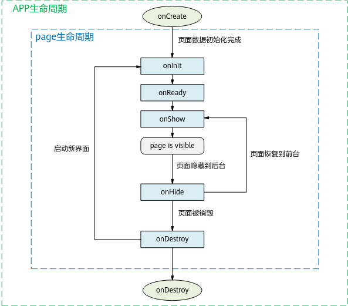

## 国际化<a name="ZH-CN_TOPIC_0000002466543372"></a>

-   **[地区语言](#ZH-CN_TOPIC_0000002499502689)**  

### 地区语言<a name="ZH-CN_TOPIC_0000002499502689"></a>

**语言场景资源内容<a name="zh-cn_topic_0000002444726809_section692315651116"></a>**

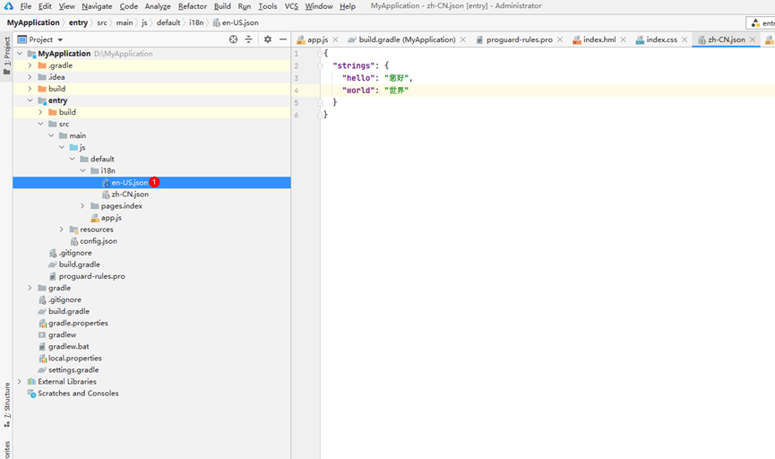

**在JS应用中添加语言资源**：

JSApp工程中i18n目录添加应用所需语言strings资源内容，并在app中引用。

json文件的命名格式可参考：zh-CN.json、en-US.json。

支持范围限制：支持的语言符合ISO 639标准2字母或3字母语言码，支持的国家符合ISO 3166标准2字母国家码。

示例：

```
<!-- xxx.json  -->
{
   "strings": {
     "hello": "您好",
     "world": "世界"
   }
}
```

```
<!-- xxx.hml -->
<div class="container">
     <text class="title" on:click="exit">
        {{ $t('strings.hello') }} {{ $t('strings.world') }}
     </text>
</div>
```

应用名与图标资源：

在entry→src→main→resources目录下，有base、en\_US、zh\_CN三个目录，分别代表默认、英语、中文资源，开发者可以根据不同语言、国家地区进行自定义。在其下级目录element中有“string.json”文件，修改其中value的值即可更改应用名称。其下级目录media中存储不同语言对应的图标资源文件。

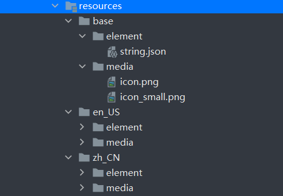

> **说明：** 
>发布包默认支持中英，客户根据商用字库能力按需扩展。
>扩展时，请根据多语言资源数量，按需调整最大值MAX\_RES\_CONFIG\_NUM。修改位置：open\_source/openharmony/base/global/resmgr\_lite/frameworks/resmgr\_lite/src/global\_utils.c

**切换语言**：

请在产品Settings系统设置应用中添加语言设置，调用以下C++接口切换系统语言，并设置默认字体样式。

示例：

```
#include "global.h"
#include "product_adapter.h"
…
// 中文
GLOBAL_ConfigLanguage("zh-CN");
// 英文
GLOBAL_ConfigLanguage("en-US");
// 根据语言设置对应的JS默认字体样式，参数1是字体名称，参数2是字体大小。
ACELite::ProductAdapter::SetDefaultFontStyle("FontName.ttf", 24);
…
```

> **说明：** 
>语言等相关配置，需在Settings中管理持久化。在系统启动时，查询持久化配置，调用global API初始化JSApp语言和默认字体样式。

# 组件<a name="ZH-CN_TOPIC_0000002466383712"></a>

-   **[通用](#ZH-CN_TOPIC_0000002466383772)**  

-   **[容器组件](#ZH-CN_TOPIC_0000002499582757)**  

-   **[基础组件](#ZH-CN_TOPIC_0000002499502705)**  

-   **[扩展组件](#ZH-CN_TOPIC_0000002466383744)**  

## 通用<a name="ZH-CN_TOPIC_0000002466383772"></a>

-   **[通用属性](#ZH-CN_TOPIC_0000002466543388)**  

-   **[通用样式](#ZH-CN_TOPIC_0000002499582761)**  

-   **[通用事件](#ZH-CN_TOPIC_0000002466543364)**  

-   **[动画样式](#ZH-CN_TOPIC_0000002466543380)**  

### 通用属性<a name="ZH-CN_TOPIC_0000002466543388"></a>

**常规属性<a name="zh-cn_topic_0000002444726817_section5796mcpsimp"></a>**

常规属性指的是组件普遍支持的用来设置组件基本标识和外观显示特征的属性。

**表 1**  常规属性说明

<a name="zh-cn_topic_0000002444726817_table5799mcpsimp"></a>
<table><thead align="left"><tr id="zh-cn_topic_0000002444726817_row5807mcpsimp"><th class="cellrowborder" valign="top" width="13.04%" id="mcps1.2.6.1.1"><p id="zh-cn_topic_0000002444726817_p5809mcpsimp"><a name="zh-cn_topic_0000002444726817_p5809mcpsimp"></a><a name="zh-cn_topic_0000002444726817_p5809mcpsimp"></a>名称</p>
</th>
<th class="cellrowborder" valign="top" width="13%" id="mcps1.2.6.1.2"><p id="zh-cn_topic_0000002444726817_p5811mcpsimp"><a name="zh-cn_topic_0000002444726817_p5811mcpsimp"></a><a name="zh-cn_topic_0000002444726817_p5811mcpsimp"></a>类型</p>
</th>
<th class="cellrowborder" valign="top" width="11.29%" id="mcps1.2.6.1.3"><p id="zh-cn_topic_0000002444726817_p5813mcpsimp"><a name="zh-cn_topic_0000002444726817_p5813mcpsimp"></a><a name="zh-cn_topic_0000002444726817_p5813mcpsimp"></a>默认值</p>
</th>
<th class="cellrowborder" valign="top" width="11.18%" id="mcps1.2.6.1.4"><p id="zh-cn_topic_0000002444726817_p5815mcpsimp"><a name="zh-cn_topic_0000002444726817_p5815mcpsimp"></a><a name="zh-cn_topic_0000002444726817_p5815mcpsimp"></a>必填</p>
</th>
<th class="cellrowborder" valign="top" width="51.49%" id="mcps1.2.6.1.5"><p id="zh-cn_topic_0000002444726817_p5817mcpsimp"><a name="zh-cn_topic_0000002444726817_p5817mcpsimp"></a><a name="zh-cn_topic_0000002444726817_p5817mcpsimp"></a>说明</p>
</th>
</tr>
</thead>
<tbody><tr id="zh-cn_topic_0000002444726817_row5819mcpsimp"><td class="cellrowborder" valign="top" width="13.04%" headers="mcps1.2.6.1.1 "><p id="zh-cn_topic_0000002444726817_p5821mcpsimp"><a name="zh-cn_topic_0000002444726817_p5821mcpsimp"></a><a name="zh-cn_topic_0000002444726817_p5821mcpsimp"></a>id</p>
</td>
<td class="cellrowborder" valign="top" width="13%" headers="mcps1.2.6.1.2 "><p id="zh-cn_topic_0000002444726817_p5823mcpsimp"><a name="zh-cn_topic_0000002444726817_p5823mcpsimp"></a><a name="zh-cn_topic_0000002444726817_p5823mcpsimp"></a>string</p>
</td>
<td class="cellrowborder" valign="top" width="11.29%" headers="mcps1.2.6.1.3 "><p id="zh-cn_topic_0000002444726817_p5825mcpsimp"><a name="zh-cn_topic_0000002444726817_p5825mcpsimp"></a><a name="zh-cn_topic_0000002444726817_p5825mcpsimp"></a>-</p>
</td>
<td class="cellrowborder" valign="top" width="11.18%" headers="mcps1.2.6.1.4 "><p id="zh-cn_topic_0000002444726817_p5827mcpsimp"><a name="zh-cn_topic_0000002444726817_p5827mcpsimp"></a><a name="zh-cn_topic_0000002444726817_p5827mcpsimp"></a>否</p>
</td>
<td class="cellrowborder" valign="top" width="51.49%" headers="mcps1.2.6.1.5 "><p id="zh-cn_topic_0000002444726817_p5829mcpsimp"><a name="zh-cn_topic_0000002444726817_p5829mcpsimp"></a><a name="zh-cn_topic_0000002444726817_p5829mcpsimp"></a>组件的唯一标识。</p>
</td>
</tr>
<tr id="zh-cn_topic_0000002444726817_row5830mcpsimp"><td class="cellrowborder" valign="top" width="13.04%" headers="mcps1.2.6.1.1 "><p id="zh-cn_topic_0000002444726817_p5832mcpsimp"><a name="zh-cn_topic_0000002444726817_p5832mcpsimp"></a><a name="zh-cn_topic_0000002444726817_p5832mcpsimp"></a>style</p>
</td>
<td class="cellrowborder" valign="top" width="13%" headers="mcps1.2.6.1.2 "><p id="zh-cn_topic_0000002444726817_p5834mcpsimp"><a name="zh-cn_topic_0000002444726817_p5834mcpsimp"></a><a name="zh-cn_topic_0000002444726817_p5834mcpsimp"></a>string</p>
</td>
<td class="cellrowborder" valign="top" width="11.29%" headers="mcps1.2.6.1.3 "><p id="zh-cn_topic_0000002444726817_p5836mcpsimp"><a name="zh-cn_topic_0000002444726817_p5836mcpsimp"></a><a name="zh-cn_topic_0000002444726817_p5836mcpsimp"></a>-</p>
</td>
<td class="cellrowborder" valign="top" width="11.18%" headers="mcps1.2.6.1.4 "><p id="zh-cn_topic_0000002444726817_p5838mcpsimp"><a name="zh-cn_topic_0000002444726817_p5838mcpsimp"></a><a name="zh-cn_topic_0000002444726817_p5838mcpsimp"></a>否</p>
</td>
<td class="cellrowborder" valign="top" width="51.49%" headers="mcps1.2.6.1.5 "><p id="zh-cn_topic_0000002444726817_p5840mcpsimp"><a name="zh-cn_topic_0000002444726817_p5840mcpsimp"></a><a name="zh-cn_topic_0000002444726817_p5840mcpsimp"></a>组件的样式声明。</p>
</td>
</tr>
<tr id="zh-cn_topic_0000002444726817_row5841mcpsimp"><td class="cellrowborder" valign="top" width="13.04%" headers="mcps1.2.6.1.1 "><p id="zh-cn_topic_0000002444726817_p5843mcpsimp"><a name="zh-cn_topic_0000002444726817_p5843mcpsimp"></a><a name="zh-cn_topic_0000002444726817_p5843mcpsimp"></a>class</p>
</td>
<td class="cellrowborder" valign="top" width="13%" headers="mcps1.2.6.1.2 "><p id="zh-cn_topic_0000002444726817_p5845mcpsimp"><a name="zh-cn_topic_0000002444726817_p5845mcpsimp"></a><a name="zh-cn_topic_0000002444726817_p5845mcpsimp"></a>string</p>
</td>
<td class="cellrowborder" valign="top" width="11.29%" headers="mcps1.2.6.1.3 "><p id="zh-cn_topic_0000002444726817_p5847mcpsimp"><a name="zh-cn_topic_0000002444726817_p5847mcpsimp"></a><a name="zh-cn_topic_0000002444726817_p5847mcpsimp"></a>-</p>
</td>
<td class="cellrowborder" valign="top" width="11.18%" headers="mcps1.2.6.1.4 "><p id="zh-cn_topic_0000002444726817_p5849mcpsimp"><a name="zh-cn_topic_0000002444726817_p5849mcpsimp"></a><a name="zh-cn_topic_0000002444726817_p5849mcpsimp"></a>否</p>
</td>
<td class="cellrowborder" valign="top" width="51.49%" headers="mcps1.2.6.1.5 "><p id="zh-cn_topic_0000002444726817_p5851mcpsimp"><a name="zh-cn_topic_0000002444726817_p5851mcpsimp"></a><a name="zh-cn_topic_0000002444726817_p5851mcpsimp"></a>组件的样式类，用于引用样式表。</p>
</td>
</tr>
<tr id="zh-cn_topic_0000002444726817_row5852mcpsimp"><td class="cellrowborder" valign="top" width="13.04%" headers="mcps1.2.6.1.1 "><p id="zh-cn_topic_0000002444726817_p5854mcpsimp"><a name="zh-cn_topic_0000002444726817_p5854mcpsimp"></a><a name="zh-cn_topic_0000002444726817_p5854mcpsimp"></a>ref</p>
</td>
<td class="cellrowborder" valign="top" width="13%" headers="mcps1.2.6.1.2 "><p id="zh-cn_topic_0000002444726817_p5856mcpsimp"><a name="zh-cn_topic_0000002444726817_p5856mcpsimp"></a><a name="zh-cn_topic_0000002444726817_p5856mcpsimp"></a>string</p>
</td>
<td class="cellrowborder" valign="top" width="11.29%" headers="mcps1.2.6.1.3 "><p id="zh-cn_topic_0000002444726817_p5858mcpsimp"><a name="zh-cn_topic_0000002444726817_p5858mcpsimp"></a><a name="zh-cn_topic_0000002444726817_p5858mcpsimp"></a>-</p>
</td>
<td class="cellrowborder" valign="top" width="11.18%" headers="mcps1.2.6.1.4 "><p id="zh-cn_topic_0000002444726817_p5860mcpsimp"><a name="zh-cn_topic_0000002444726817_p5860mcpsimp"></a><a name="zh-cn_topic_0000002444726817_p5860mcpsimp"></a>否</p>
</td>
<td class="cellrowborder" valign="top" width="51.49%" headers="mcps1.2.6.1.5 "><p id="zh-cn_topic_0000002444726817_p5862mcpsimp"><a name="zh-cn_topic_0000002444726817_p5862mcpsimp"></a><a name="zh-cn_topic_0000002444726817_p5862mcpsimp"></a>用来指定指向子元素的引用信息，该引用将注册到父组件的$refs属性对象上。</p>
</td>
</tr>
</tbody>
</table>

**渲染属性<a name="zh-cn_topic_0000002444726817_section5863mcpsimp"></a>**

渲染属性指的是组件普遍支持的用来设置组件是否渲染的属性。

**表 2**  渲染属性说明

<a name="zh-cn_topic_0000002444726817_table5866mcpsimp"></a>
<table><thead align="left"><tr id="zh-cn_topic_0000002444726817_row5873mcpsimp"><th class="cellrowborder" valign="top" width="11%" id="mcps1.2.5.1.1"><p id="zh-cn_topic_0000002444726817_p5875mcpsimp"><a name="zh-cn_topic_0000002444726817_p5875mcpsimp"></a><a name="zh-cn_topic_0000002444726817_p5875mcpsimp"></a>名称</p>
</th>
<th class="cellrowborder" valign="top" width="17%" id="mcps1.2.5.1.2"><p id="zh-cn_topic_0000002444726817_p5877mcpsimp"><a name="zh-cn_topic_0000002444726817_p5877mcpsimp"></a><a name="zh-cn_topic_0000002444726817_p5877mcpsimp"></a>类型</p>
</th>
<th class="cellrowborder" valign="top" width="13%" id="mcps1.2.5.1.3"><p id="zh-cn_topic_0000002444726817_p5879mcpsimp"><a name="zh-cn_topic_0000002444726817_p5879mcpsimp"></a><a name="zh-cn_topic_0000002444726817_p5879mcpsimp"></a>默认值</p>
</th>
<th class="cellrowborder" valign="top" width="59%" id="mcps1.2.5.1.4"><p id="zh-cn_topic_0000002444726817_p5881mcpsimp"><a name="zh-cn_topic_0000002444726817_p5881mcpsimp"></a><a name="zh-cn_topic_0000002444726817_p5881mcpsimp"></a>说明</p>
</th>
</tr>
</thead>
<tbody><tr id="zh-cn_topic_0000002444726817_row5883mcpsimp"><td class="cellrowborder" valign="top" width="11%" headers="mcps1.2.5.1.1 "><p id="zh-cn_topic_0000002444726817_p5885mcpsimp"><a name="zh-cn_topic_0000002444726817_p5885mcpsimp"></a><a name="zh-cn_topic_0000002444726817_p5885mcpsimp"></a>for</p>
</td>
<td class="cellrowborder" valign="top" width="17%" headers="mcps1.2.5.1.2 "><p id="zh-cn_topic_0000002444726817_p5887mcpsimp"><a name="zh-cn_topic_0000002444726817_p5887mcpsimp"></a><a name="zh-cn_topic_0000002444726817_p5887mcpsimp"></a>Array</p>
</td>
<td class="cellrowborder" valign="top" width="13%" headers="mcps1.2.5.1.3 "><p id="zh-cn_topic_0000002444726817_p5889mcpsimp"><a name="zh-cn_topic_0000002444726817_p5889mcpsimp"></a><a name="zh-cn_topic_0000002444726817_p5889mcpsimp"></a>-</p>
</td>
<td class="cellrowborder" valign="top" width="59%" headers="mcps1.2.5.1.4 "><p id="zh-cn_topic_0000002444726817_p5891mcpsimp"><a name="zh-cn_topic_0000002444726817_p5891mcpsimp"></a><a name="zh-cn_topic_0000002444726817_p5891mcpsimp"></a>根据设置的数据列表，展开当前元素。</p>
</td>
</tr>
<tr id="zh-cn_topic_0000002444726817_row5892mcpsimp"><td class="cellrowborder" valign="top" width="11%" headers="mcps1.2.5.1.1 "><p id="zh-cn_topic_0000002444726817_p5894mcpsimp"><a name="zh-cn_topic_0000002444726817_p5894mcpsimp"></a><a name="zh-cn_topic_0000002444726817_p5894mcpsimp"></a>if</p>
</td>
<td class="cellrowborder" valign="top" width="17%" headers="mcps1.2.5.1.2 "><p id="zh-cn_topic_0000002444726817_p5896mcpsimp"><a name="zh-cn_topic_0000002444726817_p5896mcpsimp"></a><a name="zh-cn_topic_0000002444726817_p5896mcpsimp"></a>boolean</p>
</td>
<td class="cellrowborder" valign="top" width="13%" headers="mcps1.2.5.1.3 "><p id="zh-cn_topic_0000002444726817_p5898mcpsimp"><a name="zh-cn_topic_0000002444726817_p5898mcpsimp"></a><a name="zh-cn_topic_0000002444726817_p5898mcpsimp"></a>-</p>
</td>
<td class="cellrowborder" valign="top" width="59%" headers="mcps1.2.5.1.4 "><p id="zh-cn_topic_0000002444726817_p5900mcpsimp"><a name="zh-cn_topic_0000002444726817_p5900mcpsimp"></a><a name="zh-cn_topic_0000002444726817_p5900mcpsimp"></a>根据设置的boolean值，添加或移除当前元素。</p>
</td>
</tr>
<tr id="zh-cn_topic_0000002444726817_row5901mcpsimp"><td class="cellrowborder" valign="top" width="11%" headers="mcps1.2.5.1.1 "><p id="zh-cn_topic_0000002444726817_p5903mcpsimp"><a name="zh-cn_topic_0000002444726817_p5903mcpsimp"></a><a name="zh-cn_topic_0000002444726817_p5903mcpsimp"></a>show</p>
</td>
<td class="cellrowborder" valign="top" width="17%" headers="mcps1.2.5.1.2 "><p id="zh-cn_topic_0000002444726817_p5905mcpsimp"><a name="zh-cn_topic_0000002444726817_p5905mcpsimp"></a><a name="zh-cn_topic_0000002444726817_p5905mcpsimp"></a>boolean</p>
</td>
<td class="cellrowborder" valign="top" width="13%" headers="mcps1.2.5.1.3 "><p id="zh-cn_topic_0000002444726817_p5907mcpsimp"><a name="zh-cn_topic_0000002444726817_p5907mcpsimp"></a><a name="zh-cn_topic_0000002444726817_p5907mcpsimp"></a>-</p>
</td>
<td class="cellrowborder" valign="top" width="59%" headers="mcps1.2.5.1.4 "><p id="zh-cn_topic_0000002444726817_p5909mcpsimp"><a name="zh-cn_topic_0000002444726817_p5909mcpsimp"></a><a name="zh-cn_topic_0000002444726817_p5909mcpsimp"></a>根据设置的boolean值，显示或隐藏当前元素。</p>
</td>
</tr>
</tbody>
</table>

> **说明：** 
>属性和样式不能混用，不能在属性字段中进行样式设置。

### 通用样式<a name="ZH-CN_TOPIC_0000002499582761"></a>

组件普遍支持的可以在style或css中设置组件外观样式。

> **说明：** 
>通用样式都不是必填项。

**表 1**  通用样式说明

<a name="zh-cn_topic_0000002411047700_table590mcpsimp"></a>
<table><thead align="left"><tr id="zh-cn_topic_0000002411047700_row597mcpsimp"><th class="cellrowborder" valign="top" width="17.130000000000003%" id="mcps1.2.5.1.1"><p id="zh-cn_topic_0000002411047700_p599mcpsimp"><a name="zh-cn_topic_0000002411047700_p599mcpsimp"></a><a name="zh-cn_topic_0000002411047700_p599mcpsimp"></a>名称</p>
</th>
<th class="cellrowborder" valign="top" width="16.93%" id="mcps1.2.5.1.2"><p id="zh-cn_topic_0000002411047700_p601mcpsimp"><a name="zh-cn_topic_0000002411047700_p601mcpsimp"></a><a name="zh-cn_topic_0000002411047700_p601mcpsimp"></a>类型</p>
</th>
<th class="cellrowborder" valign="top" width="11.93%" id="mcps1.2.5.1.3"><p id="zh-cn_topic_0000002411047700_p603mcpsimp"><a name="zh-cn_topic_0000002411047700_p603mcpsimp"></a><a name="zh-cn_topic_0000002411047700_p603mcpsimp"></a>默认值</p>
</th>
<th class="cellrowborder" valign="top" width="54.010000000000005%" id="mcps1.2.5.1.4"><p id="zh-cn_topic_0000002411047700_p605mcpsimp"><a name="zh-cn_topic_0000002411047700_p605mcpsimp"></a><a name="zh-cn_topic_0000002411047700_p605mcpsimp"></a>说明</p>
</th>
</tr>
</thead>
<tbody><tr id="zh-cn_topic_0000002411047700_row607mcpsimp"><td class="cellrowborder" valign="top" width="17.130000000000003%" headers="mcps1.2.5.1.1 "><p id="zh-cn_topic_0000002411047700_p609mcpsimp"><a name="zh-cn_topic_0000002411047700_p609mcpsimp"></a><a name="zh-cn_topic_0000002411047700_p609mcpsimp"></a>width</p>
</td>
<td class="cellrowborder" valign="top" width="16.93%" headers="mcps1.2.5.1.2 "><p id="zh-cn_topic_0000002411047700_p611mcpsimp"><a name="zh-cn_topic_0000002411047700_p611mcpsimp"></a><a name="zh-cn_topic_0000002411047700_p611mcpsimp"></a>&lt;length&gt; | &lt;percentage&gt;</p>
</td>
<td class="cellrowborder" valign="top" width="11.93%" headers="mcps1.2.5.1.3 "><p id="zh-cn_topic_0000002411047700_p614mcpsimp"><a name="zh-cn_topic_0000002411047700_p614mcpsimp"></a><a name="zh-cn_topic_0000002411047700_p614mcpsimp"></a>-</p>
</td>
<td class="cellrowborder" valign="top" width="54.010000000000005%" headers="mcps1.2.5.1.4 "><p id="zh-cn_topic_0000002411047700_p616mcpsimp"><a name="zh-cn_topic_0000002411047700_p616mcpsimp"></a><a name="zh-cn_topic_0000002411047700_p616mcpsimp"></a>设置组件自身的宽度。</p>
<p id="zh-cn_topic_0000002411047700_p617mcpsimp"><a name="zh-cn_topic_0000002411047700_p617mcpsimp"></a><a name="zh-cn_topic_0000002411047700_p617mcpsimp"></a>未设置时组件宽度默认为0。</p>
</td>
</tr>
<tr id="zh-cn_topic_0000002411047700_row618mcpsimp"><td class="cellrowborder" valign="top" width="17.130000000000003%" headers="mcps1.2.5.1.1 "><p id="zh-cn_topic_0000002411047700_p620mcpsimp"><a name="zh-cn_topic_0000002411047700_p620mcpsimp"></a><a name="zh-cn_topic_0000002411047700_p620mcpsimp"></a>height</p>
</td>
<td class="cellrowborder" valign="top" width="16.93%" headers="mcps1.2.5.1.2 "><p id="zh-cn_topic_0000002411047700_p622mcpsimp"><a name="zh-cn_topic_0000002411047700_p622mcpsimp"></a><a name="zh-cn_topic_0000002411047700_p622mcpsimp"></a>&lt;length&gt; | &lt;percentage&gt;</p>
</td>
<td class="cellrowborder" valign="top" width="11.93%" headers="mcps1.2.5.1.3 "><p id="zh-cn_topic_0000002411047700_p625mcpsimp"><a name="zh-cn_topic_0000002411047700_p625mcpsimp"></a><a name="zh-cn_topic_0000002411047700_p625mcpsimp"></a>-</p>
</td>
<td class="cellrowborder" valign="top" width="54.010000000000005%" headers="mcps1.2.5.1.4 "><p id="zh-cn_topic_0000002411047700_p627mcpsimp"><a name="zh-cn_topic_0000002411047700_p627mcpsimp"></a><a name="zh-cn_topic_0000002411047700_p627mcpsimp"></a>设置组件自身的高度。</p>
<p id="zh-cn_topic_0000002411047700_p628mcpsimp"><a name="zh-cn_topic_0000002411047700_p628mcpsimp"></a><a name="zh-cn_topic_0000002411047700_p628mcpsimp"></a>未设置时组件高度默认为0。</p>
</td>
</tr>
<tr id="zh-cn_topic_0000002411047700_row629mcpsimp"><td class="cellrowborder" valign="top" width="17.130000000000003%" headers="mcps1.2.5.1.1 "><p id="zh-cn_topic_0000002411047700_p631mcpsimp"><a name="zh-cn_topic_0000002411047700_p631mcpsimp"></a><a name="zh-cn_topic_0000002411047700_p631mcpsimp"></a>padding</p>
</td>
<td class="cellrowborder" valign="top" width="16.93%" headers="mcps1.2.5.1.2 "><p id="zh-cn_topic_0000002411047700_p633mcpsimp"><a name="zh-cn_topic_0000002411047700_p633mcpsimp"></a><a name="zh-cn_topic_0000002411047700_p633mcpsimp"></a>&lt;length&gt;</p>
</td>
<td class="cellrowborder" valign="top" width="11.93%" headers="mcps1.2.5.1.3 "><p id="zh-cn_topic_0000002411047700_p635mcpsimp"><a name="zh-cn_topic_0000002411047700_p635mcpsimp"></a><a name="zh-cn_topic_0000002411047700_p635mcpsimp"></a>0</p>
</td>
<td class="cellrowborder" valign="top" width="54.010000000000005%" headers="mcps1.2.5.1.4 "><p id="zh-cn_topic_0000002411047700_p637mcpsimp"><a name="zh-cn_topic_0000002411047700_p637mcpsimp"></a><a name="zh-cn_topic_0000002411047700_p637mcpsimp"></a>使用简写属性设置所有的内边距属性，该属性可以有1到4个值：</p>
<a name="zh-cn_topic_0000002411047700_ul639mcpsimp"></a><a name="zh-cn_topic_0000002411047700_ul639mcpsimp"></a><ul id="zh-cn_topic_0000002411047700_ul639mcpsimp"><li>指定一个值时，该值指定四个边的内边距。</li><li>指定两个值时，第一个值指定上下两边的内边距，第二个指定左右两边的内边距。</li><li>指定三个值时，第一个指定上边的内边距，第二个指定左右两边的内边距，第三个指定下边的内边距。</li><li>指定四个值时分别为上、右、下、左边的内边距（顺时针顺序）。</li></ul>
</td>
</tr>
<tr id="zh-cn_topic_0000002411047700_row644mcpsimp"><td class="cellrowborder" valign="top" width="17.130000000000003%" headers="mcps1.2.5.1.1 "><p id="zh-cn_topic_0000002411047700_p646mcpsimp"><a name="zh-cn_topic_0000002411047700_p646mcpsimp"></a><a name="zh-cn_topic_0000002411047700_p646mcpsimp"></a>padding-[left|top|right|bottom]</p>
</td>
<td class="cellrowborder" valign="top" width="16.93%" headers="mcps1.2.5.1.2 "><p id="zh-cn_topic_0000002411047700_p648mcpsimp"><a name="zh-cn_topic_0000002411047700_p648mcpsimp"></a><a name="zh-cn_topic_0000002411047700_p648mcpsimp"></a>&lt;length&gt;</p>
</td>
<td class="cellrowborder" valign="top" width="11.93%" headers="mcps1.2.5.1.3 "><p id="zh-cn_topic_0000002411047700_p650mcpsimp"><a name="zh-cn_topic_0000002411047700_p650mcpsimp"></a><a name="zh-cn_topic_0000002411047700_p650mcpsimp"></a>0</p>
</td>
<td class="cellrowborder" valign="top" width="54.010000000000005%" headers="mcps1.2.5.1.4 "><p id="zh-cn_topic_0000002411047700_p652mcpsimp"><a name="zh-cn_topic_0000002411047700_p652mcpsimp"></a><a name="zh-cn_topic_0000002411047700_p652mcpsimp"></a>设置左、上、右、下内边距属性。</p>
</td>
</tr>
<tr id="zh-cn_topic_0000002411047700_row653mcpsimp"><td class="cellrowborder" valign="top" width="17.130000000000003%" headers="mcps1.2.5.1.1 "><p id="zh-cn_topic_0000002411047700_p655mcpsimp"><a name="zh-cn_topic_0000002411047700_p655mcpsimp"></a><a name="zh-cn_topic_0000002411047700_p655mcpsimp"></a>margin</p>
</td>
<td class="cellrowborder" valign="top" width="16.93%" headers="mcps1.2.5.1.2 "><p id="zh-cn_topic_0000002411047700_p657mcpsimp"><a name="zh-cn_topic_0000002411047700_p657mcpsimp"></a><a name="zh-cn_topic_0000002411047700_p657mcpsimp"></a>&lt;length&gt; | &lt;percentage&gt;</p>
</td>
<td class="cellrowborder" valign="top" width="11.93%" headers="mcps1.2.5.1.3 "><p id="zh-cn_topic_0000002411047700_p660mcpsimp"><a name="zh-cn_topic_0000002411047700_p660mcpsimp"></a><a name="zh-cn_topic_0000002411047700_p660mcpsimp"></a>0</p>
</td>
<td class="cellrowborder" valign="top" width="54.010000000000005%" headers="mcps1.2.5.1.4 "><p id="zh-cn_topic_0000002411047700_p662mcpsimp"><a name="zh-cn_topic_0000002411047700_p662mcpsimp"></a><a name="zh-cn_topic_0000002411047700_p662mcpsimp"></a>使用简写属性设置所有的外边距属性，该属性可以有1到4个值：</p>
<a name="zh-cn_topic_0000002411047700_ul663mcpsimp"></a><a name="zh-cn_topic_0000002411047700_ul663mcpsimp"></a><ul id="zh-cn_topic_0000002411047700_ul663mcpsimp"><li>只有一个值时，这个值会被指定给全部的四个边。</li><li>两个值时，第一个值被匹配给上和下，第二个值被匹配给左和右。</li><li>三个值时，第一个值被匹配给上，第二个值被匹配给左和右，第三个值被匹配给下。</li><li>四个值时，会依次按上、右、下、左的顺序匹配（即顺时针顺序）。</li></ul>
</td>
</tr>
<tr id="zh-cn_topic_0000002411047700_row668mcpsimp"><td class="cellrowborder" valign="top" width="17.130000000000003%" headers="mcps1.2.5.1.1 "><p id="zh-cn_topic_0000002411047700_p670mcpsimp"><a name="zh-cn_topic_0000002411047700_p670mcpsimp"></a><a name="zh-cn_topic_0000002411047700_p670mcpsimp"></a>margin-[left|top|right|bottom]</p>
</td>
<td class="cellrowborder" valign="top" width="16.93%" headers="mcps1.2.5.1.2 "><p id="zh-cn_topic_0000002411047700_p672mcpsimp"><a name="zh-cn_topic_0000002411047700_p672mcpsimp"></a><a name="zh-cn_topic_0000002411047700_p672mcpsimp"></a>&lt;length&gt; | &lt;percentage&gt;</p>
</td>
<td class="cellrowborder" valign="top" width="11.93%" headers="mcps1.2.5.1.3 "><p id="zh-cn_topic_0000002411047700_p675mcpsimp"><a name="zh-cn_topic_0000002411047700_p675mcpsimp"></a><a name="zh-cn_topic_0000002411047700_p675mcpsimp"></a>0</p>
</td>
<td class="cellrowborder" valign="top" width="54.010000000000005%" headers="mcps1.2.5.1.4 "><p id="zh-cn_topic_0000002411047700_p677mcpsimp"><a name="zh-cn_topic_0000002411047700_p677mcpsimp"></a><a name="zh-cn_topic_0000002411047700_p677mcpsimp"></a>设置左、上、右、下外边距属性。</p>
</td>
</tr>
<tr id="zh-cn_topic_0000002411047700_row678mcpsimp"><td class="cellrowborder" valign="top" width="17.130000000000003%" headers="mcps1.2.5.1.1 "><p id="zh-cn_topic_0000002411047700_p680mcpsimp"><a name="zh-cn_topic_0000002411047700_p680mcpsimp"></a><a name="zh-cn_topic_0000002411047700_p680mcpsimp"></a>border-width</p>
</td>
<td class="cellrowborder" valign="top" width="16.93%" headers="mcps1.2.5.1.2 "><p id="zh-cn_topic_0000002411047700_p682mcpsimp"><a name="zh-cn_topic_0000002411047700_p682mcpsimp"></a><a name="zh-cn_topic_0000002411047700_p682mcpsimp"></a>&lt;length&gt;</p>
</td>
<td class="cellrowborder" valign="top" width="11.93%" headers="mcps1.2.5.1.3 "><p id="zh-cn_topic_0000002411047700_p684mcpsimp"><a name="zh-cn_topic_0000002411047700_p684mcpsimp"></a><a name="zh-cn_topic_0000002411047700_p684mcpsimp"></a>0</p>
</td>
<td class="cellrowborder" valign="top" width="54.010000000000005%" headers="mcps1.2.5.1.4 "><p id="zh-cn_topic_0000002411047700_p686mcpsimp"><a name="zh-cn_topic_0000002411047700_p686mcpsimp"></a><a name="zh-cn_topic_0000002411047700_p686mcpsimp"></a>使用简写属性设置元素的所有边框宽度。</p>
</td>
</tr>
<tr id="zh-cn_topic_0000002411047700_row687mcpsimp"><td class="cellrowborder" valign="top" width="17.130000000000003%" headers="mcps1.2.5.1.1 "><p id="zh-cn_topic_0000002411047700_p689mcpsimp"><a name="zh-cn_topic_0000002411047700_p689mcpsimp"></a><a name="zh-cn_topic_0000002411047700_p689mcpsimp"></a>border-color</p>
</td>
<td class="cellrowborder" valign="top" width="16.93%" headers="mcps1.2.5.1.2 "><p id="zh-cn_topic_0000002411047700_p691mcpsimp"><a name="zh-cn_topic_0000002411047700_p691mcpsimp"></a><a name="zh-cn_topic_0000002411047700_p691mcpsimp"></a>&lt;color&gt;</p>
</td>
<td class="cellrowborder" valign="top" width="11.93%" headers="mcps1.2.5.1.3 "><p id="zh-cn_topic_0000002411047700_p693mcpsimp"><a name="zh-cn_topic_0000002411047700_p693mcpsimp"></a><a name="zh-cn_topic_0000002411047700_p693mcpsimp"></a>black</p>
</td>
<td class="cellrowborder" valign="top" width="54.010000000000005%" headers="mcps1.2.5.1.4 "><p id="zh-cn_topic_0000002411047700_p695mcpsimp"><a name="zh-cn_topic_0000002411047700_p695mcpsimp"></a><a name="zh-cn_topic_0000002411047700_p695mcpsimp"></a>使用简写属性设置元素的所有边框颜色。</p>
</td>
</tr>
<tr id="zh-cn_topic_0000002411047700_row696mcpsimp"><td class="cellrowborder" valign="top" width="17.130000000000003%" headers="mcps1.2.5.1.1 "><p id="zh-cn_topic_0000002411047700_p698mcpsimp"><a name="zh-cn_topic_0000002411047700_p698mcpsimp"></a><a name="zh-cn_topic_0000002411047700_p698mcpsimp"></a>border-radius</p>
</td>
<td class="cellrowborder" valign="top" width="16.93%" headers="mcps1.2.5.1.2 "><p id="zh-cn_topic_0000002411047700_p700mcpsimp"><a name="zh-cn_topic_0000002411047700_p700mcpsimp"></a><a name="zh-cn_topic_0000002411047700_p700mcpsimp"></a>&lt;length&gt;</p>
</td>
<td class="cellrowborder" valign="top" width="11.93%" headers="mcps1.2.5.1.3 "><p id="zh-cn_topic_0000002411047700_p702mcpsimp"><a name="zh-cn_topic_0000002411047700_p702mcpsimp"></a><a name="zh-cn_topic_0000002411047700_p702mcpsimp"></a>-</p>
</td>
<td class="cellrowborder" valign="top" width="54.010000000000005%" headers="mcps1.2.5.1.4 "><p id="zh-cn_topic_0000002411047700_p704mcpsimp"><a name="zh-cn_topic_0000002411047700_p704mcpsimp"></a><a name="zh-cn_topic_0000002411047700_p704mcpsimp"></a>border-radius属性是设置元素的外边框圆角半径。</p>
</td>
</tr>
<tr id="zh-cn_topic_0000002411047700_row705mcpsimp"><td class="cellrowborder" valign="top" width="17.130000000000003%" headers="mcps1.2.5.1.1 "><p id="zh-cn_topic_0000002411047700_p707mcpsimp"><a name="zh-cn_topic_0000002411047700_p707mcpsimp"></a><a name="zh-cn_topic_0000002411047700_p707mcpsimp"></a>background-color</p>
</td>
<td class="cellrowborder" valign="top" width="16.93%" headers="mcps1.2.5.1.2 "><p id="zh-cn_topic_0000002411047700_p709mcpsimp"><a name="zh-cn_topic_0000002411047700_p709mcpsimp"></a><a name="zh-cn_topic_0000002411047700_p709mcpsimp"></a>&lt;color&gt;</p>
</td>
<td class="cellrowborder" valign="top" width="11.93%" headers="mcps1.2.5.1.3 "><p id="zh-cn_topic_0000002411047700_p711mcpsimp"><a name="zh-cn_topic_0000002411047700_p711mcpsimp"></a><a name="zh-cn_topic_0000002411047700_p711mcpsimp"></a>-</p>
</td>
<td class="cellrowborder" valign="top" width="54.010000000000005%" headers="mcps1.2.5.1.4 "><p id="zh-cn_topic_0000002411047700_p713mcpsimp"><a name="zh-cn_topic_0000002411047700_p713mcpsimp"></a><a name="zh-cn_topic_0000002411047700_p713mcpsimp"></a>设置背景颜色。</p>
</td>
</tr>
<tr id="zh-cn_topic_0000002411047700_row714mcpsimp"><td class="cellrowborder" valign="top" width="17.130000000000003%" headers="mcps1.2.5.1.1 "><p id="zh-cn_topic_0000002411047700_p716mcpsimp"><a name="zh-cn_topic_0000002411047700_p716mcpsimp"></a><a name="zh-cn_topic_0000002411047700_p716mcpsimp"></a>opacity<sup id="zh-cn_topic_0000002411047700_sup717mcpsimp"><a name="zh-cn_topic_0000002411047700_sup717mcpsimp"></a><a name="zh-cn_topic_0000002411047700_sup717mcpsimp"></a>5+</sup></p>
</td>
<td class="cellrowborder" valign="top" width="16.93%" headers="mcps1.2.5.1.2 "><p id="zh-cn_topic_0000002411047700_p719mcpsimp"><a name="zh-cn_topic_0000002411047700_p719mcpsimp"></a><a name="zh-cn_topic_0000002411047700_p719mcpsimp"></a>number</p>
</td>
<td class="cellrowborder" valign="top" width="11.93%" headers="mcps1.2.5.1.3 "><p id="zh-cn_topic_0000002411047700_p721mcpsimp"><a name="zh-cn_topic_0000002411047700_p721mcpsimp"></a><a name="zh-cn_topic_0000002411047700_p721mcpsimp"></a>1</p>
</td>
<td class="cellrowborder" valign="top" width="54.010000000000005%" headers="mcps1.2.5.1.4 "><p id="zh-cn_topic_0000002411047700_p4493755184020"><a name="zh-cn_topic_0000002411047700_p4493755184020"></a><a name="zh-cn_topic_0000002411047700_p4493755184020"></a>元素的透明度，取值范围为0到1。</p>
<a name="zh-cn_topic_0000002411047700_ul157711810124115"></a><a name="zh-cn_topic_0000002411047700_ul157711810124115"></a><ul id="zh-cn_topic_0000002411047700_ul157711810124115"><li>0：完全透明。</li><li>1：不透明。</li></ul>
</td>
</tr>
<tr id="zh-cn_topic_0000002411047700_row724mcpsimp"><td class="cellrowborder" valign="top" width="17.130000000000003%" headers="mcps1.2.5.1.1 "><p id="zh-cn_topic_0000002411047700_p726mcpsimp"><a name="zh-cn_topic_0000002411047700_p726mcpsimp"></a><a name="zh-cn_topic_0000002411047700_p726mcpsimp"></a>display</p>
</td>
<td class="cellrowborder" valign="top" width="16.93%" headers="mcps1.2.5.1.2 "><p id="zh-cn_topic_0000002411047700_p728mcpsimp"><a name="zh-cn_topic_0000002411047700_p728mcpsimp"></a><a name="zh-cn_topic_0000002411047700_p728mcpsimp"></a>string</p>
</td>
<td class="cellrowborder" valign="top" width="11.93%" headers="mcps1.2.5.1.3 "><p id="zh-cn_topic_0000002411047700_p730mcpsimp"><a name="zh-cn_topic_0000002411047700_p730mcpsimp"></a><a name="zh-cn_topic_0000002411047700_p730mcpsimp"></a>flex</p>
</td>
<td class="cellrowborder" valign="top" width="54.010000000000005%" headers="mcps1.2.5.1.4 "><p id="zh-cn_topic_0000002411047700_p732mcpsimp"><a name="zh-cn_topic_0000002411047700_p732mcpsimp"></a><a name="zh-cn_topic_0000002411047700_p732mcpsimp"></a>确定一个元素所产生的框的类型，可选值为：</p>
<a name="zh-cn_topic_0000002411047700_ul733mcpsimp"></a><a name="zh-cn_topic_0000002411047700_ul733mcpsimp"></a><ul id="zh-cn_topic_0000002411047700_ul733mcpsimp"><li>flex：弹性布局。</li><li>none：不渲染此元素。</li></ul>
</td>
</tr>
<tr id="zh-cn_topic_0000002411047700_row736mcpsimp"><td class="cellrowborder" valign="top" width="17.130000000000003%" headers="mcps1.2.5.1.1 "><p id="zh-cn_topic_0000002411047700_p738mcpsimp"><a name="zh-cn_topic_0000002411047700_p738mcpsimp"></a><a name="zh-cn_topic_0000002411047700_p738mcpsimp"></a>[left|top]</p>
</td>
<td class="cellrowborder" valign="top" width="16.93%" headers="mcps1.2.5.1.2 "><p id="zh-cn_topic_0000002411047700_p740mcpsimp"><a name="zh-cn_topic_0000002411047700_p740mcpsimp"></a><a name="zh-cn_topic_0000002411047700_p740mcpsimp"></a>&lt;length&gt; | &lt;percentage&gt;</p>
</td>
<td class="cellrowborder" valign="top" width="11.93%" headers="mcps1.2.5.1.3 "><p id="zh-cn_topic_0000002411047700_p743mcpsimp"><a name="zh-cn_topic_0000002411047700_p743mcpsimp"></a><a name="zh-cn_topic_0000002411047700_p743mcpsimp"></a>-</p>
</td>
<td class="cellrowborder" valign="top" width="54.010000000000005%" headers="mcps1.2.5.1.4 "><p id="zh-cn_topic_0000002411047700_p745mcpsimp"><a name="zh-cn_topic_0000002411047700_p745mcpsimp"></a><a name="zh-cn_topic_0000002411047700_p745mcpsimp"></a>left|top确定元素的偏移位置。</p>
<a name="zh-cn_topic_0000002411047700_ul746mcpsimp"></a><a name="zh-cn_topic_0000002411047700_ul746mcpsimp"></a><ul id="zh-cn_topic_0000002411047700_ul746mcpsimp"><li>left属性规定元素的左边缘。该属性定义了定位元素左外边距边界与其包含块左边界之间的偏移。</li><li>top属性规定元素的顶部边缘。该属性定义了一个定位元素的上外边距边界与其包含块上边界之间的偏移。</li></ul>
</td>
</tr>
</tbody>
</table>

### 通用事件<a name="ZH-CN_TOPIC_0000002466543364"></a>

**事件说明<a name="zh-cn_topic_0000002444646725_section5626mcpsimp"></a>**

-   事件绑定在组件上，当组件达到事件触发条件时，会执行JS中对应的事件回调函数，实现页面UI视图和页面JS逻辑层的交互。
-   事件回调函数中通过参数可以携带额外的信息，如组件上的数据对象dataset，事件特有的回调参数。

相对于私有事件，大部分组件都可以绑定如[表1](#zh-cn_topic_0000002444646725_table5632mcpsimp)所示事件。

**表 1**  通用事件说明

<a name="zh-cn_topic_0000002444646725_table5632mcpsimp"></a>
<table><thead align="left"><tr id="zh-cn_topic_0000002444646725_row5639mcpsimp"><th class="cellrowborder" valign="top" width="15.151515151515152%" id="mcps1.2.5.1.1"><p id="zh-cn_topic_0000002444646725_p5641mcpsimp"><a name="zh-cn_topic_0000002444646725_p5641mcpsimp"></a><a name="zh-cn_topic_0000002444646725_p5641mcpsimp"></a>名称</p>
</th>
<th class="cellrowborder" valign="top" width="24.62246224622462%" id="mcps1.2.5.1.2"><p id="zh-cn_topic_0000002444646725_p5643mcpsimp"><a name="zh-cn_topic_0000002444646725_p5643mcpsimp"></a><a name="zh-cn_topic_0000002444646725_p5643mcpsimp"></a>参数</p>
</th>
<th class="cellrowborder" valign="top" width="41.03410341034103%" id="mcps1.2.5.1.3"><p id="zh-cn_topic_0000002444646725_p5645mcpsimp"><a name="zh-cn_topic_0000002444646725_p5645mcpsimp"></a><a name="zh-cn_topic_0000002444646725_p5645mcpsimp"></a>说明</p>
</th>
<th class="cellrowborder" valign="top" width="19.19191919191919%" id="mcps1.2.5.1.4"><p id="zh-cn_topic_0000002444646725_p5647mcpsimp"><a name="zh-cn_topic_0000002444646725_p5647mcpsimp"></a><a name="zh-cn_topic_0000002444646725_p5647mcpsimp"></a>是否支持冒泡</p>
</th>
</tr>
</thead>
<tbody><tr id="zh-cn_topic_0000002444646725_row5649mcpsimp"><td class="cellrowborder" valign="top" width="15.151515151515152%" headers="mcps1.2.5.1.1 "><p id="zh-cn_topic_0000002444646725_p5651mcpsimp"><a name="zh-cn_topic_0000002444646725_p5651mcpsimp"></a><a name="zh-cn_topic_0000002444646725_p5651mcpsimp"></a>click</p>
</td>
<td class="cellrowborder" valign="top" width="24.62246224622462%" headers="mcps1.2.5.1.2 "><p id="zh-cn_topic_0000002444646725_p5653mcpsimp"><a name="zh-cn_topic_0000002444646725_p5653mcpsimp"></a><a name="zh-cn_topic_0000002444646725_p5653mcpsimp"></a>-</p>
</td>
<td class="cellrowborder" valign="top" width="41.03410341034103%" headers="mcps1.2.5.1.3 "><p id="zh-cn_topic_0000002444646725_p5655mcpsimp"><a name="zh-cn_topic_0000002444646725_p5655mcpsimp"></a><a name="zh-cn_topic_0000002444646725_p5655mcpsimp"></a>点击动作触发该事件。</p>
</td>
<td class="cellrowborder" valign="top" width="19.19191919191919%" headers="mcps1.2.5.1.4 "><p id="zh-cn_topic_0000002444646725_p5657mcpsimp"><a name="zh-cn_topic_0000002444646725_p5657mcpsimp"></a><a name="zh-cn_topic_0000002444646725_p5657mcpsimp"></a>是</p>
</td>
</tr>
<tr id="zh-cn_topic_0000002444646725_row5659mcpsimp"><td class="cellrowborder" valign="top" width="15.151515151515152%" headers="mcps1.2.5.1.1 "><p id="zh-cn_topic_0000002444646725_p5661mcpsimp"><a name="zh-cn_topic_0000002444646725_p5661mcpsimp"></a><a name="zh-cn_topic_0000002444646725_p5661mcpsimp"></a>longpress</p>
</td>
<td class="cellrowborder" valign="top" width="24.62246224622462%" headers="mcps1.2.5.1.2 "><p id="zh-cn_topic_0000002444646725_p5663mcpsimp"><a name="zh-cn_topic_0000002444646725_p5663mcpsimp"></a><a name="zh-cn_topic_0000002444646725_p5663mcpsimp"></a>-</p>
</td>
<td class="cellrowborder" valign="top" width="41.03410341034103%" headers="mcps1.2.5.1.3 "><p id="zh-cn_topic_0000002444646725_p5665mcpsimp"><a name="zh-cn_topic_0000002444646725_p5665mcpsimp"></a><a name="zh-cn_topic_0000002444646725_p5665mcpsimp"></a>长按动作触发该事件。</p>
</td>
<td class="cellrowborder" valign="top" width="19.19191919191919%" headers="mcps1.2.5.1.4 "><p id="zh-cn_topic_0000002444646725_p5667mcpsimp"><a name="zh-cn_topic_0000002444646725_p5667mcpsimp"></a><a name="zh-cn_topic_0000002444646725_p5667mcpsimp"></a>是</p>
</td>
</tr>
<tr id="zh-cn_topic_0000002444646725_row5669mcpsimp"><td class="cellrowborder" valign="top" width="15.151515151515152%" headers="mcps1.2.5.1.1 "><p id="zh-cn_topic_0000002444646725_p5671mcpsimp"><a name="zh-cn_topic_0000002444646725_p5671mcpsimp"></a><a name="zh-cn_topic_0000002444646725_p5671mcpsimp"></a>swipe</p>
</td>
<td class="cellrowborder" valign="top" width="24.62246224622462%" headers="mcps1.2.5.1.2 "><p id="zh-cn_topic_0000002444646725_p5673mcpsimp"><a name="zh-cn_topic_0000002444646725_p5673mcpsimp"></a><a name="zh-cn_topic_0000002444646725_p5673mcpsimp"></a><a href="#zh-cn_topic_0000002444646725__table111811577714">表2</a></p>
</td>
<td class="cellrowborder" valign="top" width="41.03410341034103%" headers="mcps1.2.5.1.3 "><p id="zh-cn_topic_0000002444646725_p5676mcpsimp"><a name="zh-cn_topic_0000002444646725_p5676mcpsimp"></a><a name="zh-cn_topic_0000002444646725_p5676mcpsimp"></a>组件上快速滑动后触发该事件。</p>
</td>
<td class="cellrowborder" valign="top" width="19.19191919191919%" headers="mcps1.2.5.1.4 "><p id="zh-cn_topic_0000002444646725_p5678mcpsimp"><a name="zh-cn_topic_0000002444646725_p5678mcpsimp"></a><a name="zh-cn_topic_0000002444646725_p5678mcpsimp"></a>是</p>
</td>
</tr>
</tbody>
</table>

> **说明：** 
>除上述事件外，其他事件均为非冒泡事件，如“[事件](#zh-cn_topic_0000002444646717_section3323mcpsimp)”，请参见各个组件。

**表 2**  SwipeEvent基础事件对象属性列表

<a name="zh-cn_topic_0000002444646725__table111811577714"></a>
<table><thead align="left"><tr id="zh-cn_topic_0000002444646725_row5690mcpsimp"><th class="cellrowborder" valign="top" width="16.24%" id="mcps1.2.4.1.1"><p id="zh-cn_topic_0000002444646725_p5692mcpsimp"><a name="zh-cn_topic_0000002444646725_p5692mcpsimp"></a><a name="zh-cn_topic_0000002444646725_p5692mcpsimp"></a>属性</p>
</th>
<th class="cellrowborder" valign="top" width="38.76%" id="mcps1.2.4.1.2"><p id="zh-cn_topic_0000002444646725_p5694mcpsimp"><a name="zh-cn_topic_0000002444646725_p5694mcpsimp"></a><a name="zh-cn_topic_0000002444646725_p5694mcpsimp"></a>类型</p>
</th>
<th class="cellrowborder" valign="top" width="45%" id="mcps1.2.4.1.3"><p id="zh-cn_topic_0000002444646725_p5696mcpsimp"><a name="zh-cn_topic_0000002444646725_p5696mcpsimp"></a><a name="zh-cn_topic_0000002444646725_p5696mcpsimp"></a>说明</p>
</th>
</tr>
</thead>
<tbody><tr id="zh-cn_topic_0000002444646725_row5698mcpsimp"><td class="cellrowborder" valign="top" width="16.24%" headers="mcps1.2.4.1.1 "><p id="zh-cn_topic_0000002444646725_p5700mcpsimp"><a name="zh-cn_topic_0000002444646725_p5700mcpsimp"></a><a name="zh-cn_topic_0000002444646725_p5700mcpsimp"></a>direction</p>
</td>
<td class="cellrowborder" valign="top" width="38.76%" headers="mcps1.2.4.1.2 "><p id="zh-cn_topic_0000002444646725_p5702mcpsimp"><a name="zh-cn_topic_0000002444646725_p5702mcpsimp"></a><a name="zh-cn_topic_0000002444646725_p5702mcpsimp"></a>string</p>
</td>
<td class="cellrowborder" valign="top" width="45%" headers="mcps1.2.4.1.3 "><p id="zh-cn_topic_0000002444646725_p5704mcpsimp"><a name="zh-cn_topic_0000002444646725_p5704mcpsimp"></a><a name="zh-cn_topic_0000002444646725_p5704mcpsimp"></a>滑动方向，可能值有：</p>
<a name="zh-cn_topic_0000002444646725_ul121221520164510"></a><a name="zh-cn_topic_0000002444646725_ul121221520164510"></a><ul id="zh-cn_topic_0000002444646725_ul121221520164510"><li>left：向左滑动；</li><li>right：向右滑动；</li><li>up：向上滑动；</li><li>down：向下滑动。</li></ul>
</td>
</tr>
</tbody>
</table>

### 动画样式<a name="ZH-CN_TOPIC_0000002466543380"></a>

组件支持动态的旋转、平移、缩放效果，可在style或css中设置。

**表 1**  动画样式说明

<a name="zh-cn_topic_0000002444646757__table28802443315"></a>
<table><thead align="left"><tr id="zh-cn_topic_0000002444646757_row5179mcpsimp"><th class="cellrowborder" valign="top" width="19.101910191019105%" id="mcps1.2.5.1.1"><p id="zh-cn_topic_0000002444646757_p5181mcpsimp"><a name="zh-cn_topic_0000002444646757_p5181mcpsimp"></a><a name="zh-cn_topic_0000002444646757_p5181mcpsimp"></a>名称</p>
</th>
<th class="cellrowborder" valign="top" width="15.941594159415938%" id="mcps1.2.5.1.2"><p id="zh-cn_topic_0000002444646757_p5183mcpsimp"><a name="zh-cn_topic_0000002444646757_p5183mcpsimp"></a><a name="zh-cn_topic_0000002444646757_p5183mcpsimp"></a>类型</p>
</th>
<th class="cellrowborder" valign="top" width="12.111211121112111%" id="mcps1.2.5.1.3"><p id="zh-cn_topic_0000002444646757_p5185mcpsimp"><a name="zh-cn_topic_0000002444646757_p5185mcpsimp"></a><a name="zh-cn_topic_0000002444646757_p5185mcpsimp"></a>默认值</p>
</th>
<th class="cellrowborder" valign="top" width="52.845284528452844%" id="mcps1.2.5.1.4"><p id="zh-cn_topic_0000002444646757_p5187mcpsimp"><a name="zh-cn_topic_0000002444646757_p5187mcpsimp"></a><a name="zh-cn_topic_0000002444646757_p5187mcpsimp"></a>说明</p>
</th>
</tr>
</thead>
<tbody><tr id="zh-cn_topic_0000002444646757_row5189mcpsimp"><td class="cellrowborder" valign="top" width="19.101910191019105%" headers="mcps1.2.5.1.1 "><p id="zh-cn_topic_0000002444646757_p5191mcpsimp"><a name="zh-cn_topic_0000002444646757_p5191mcpsimp"></a><a name="zh-cn_topic_0000002444646757_p5191mcpsimp"></a>transform</p>
</td>
<td class="cellrowborder" valign="top" width="15.941594159415938%" headers="mcps1.2.5.1.2 "><p id="zh-cn_topic_0000002444646757_p5193mcpsimp"><a name="zh-cn_topic_0000002444646757_p5193mcpsimp"></a><a name="zh-cn_topic_0000002444646757_p5193mcpsimp"></a>string</p>
</td>
<td class="cellrowborder" valign="top" width="12.111211121112111%" headers="mcps1.2.5.1.3 "><p id="zh-cn_topic_0000002444646757_p5195mcpsimp"><a name="zh-cn_topic_0000002444646757_p5195mcpsimp"></a><a name="zh-cn_topic_0000002444646757_p5195mcpsimp"></a>-</p>
</td>
<td class="cellrowborder" valign="top" width="52.845284528452844%" headers="mcps1.2.5.1.4 "><p id="zh-cn_topic_0000002444646757_p5197mcpsimp"><a name="zh-cn_topic_0000002444646757_p5197mcpsimp"></a><a name="zh-cn_topic_0000002444646757_p5197mcpsimp"></a>请参见<a href="#zh-cn_topic_0000002444646757_table5267mcpsimp">表2</a>。</p>
</td>
</tr>
<tr id="zh-cn_topic_0000002444646757_row5199mcpsimp"><td class="cellrowborder" valign="top" width="19.101910191019105%" headers="mcps1.2.5.1.1 "><p id="zh-cn_topic_0000002444646757_p5201mcpsimp"><a name="zh-cn_topic_0000002444646757_p5201mcpsimp"></a><a name="zh-cn_topic_0000002444646757_p5201mcpsimp"></a>animation-name</p>
</td>
<td class="cellrowborder" valign="top" width="15.941594159415938%" headers="mcps1.2.5.1.2 "><p id="zh-cn_topic_0000002444646757_p5203mcpsimp"><a name="zh-cn_topic_0000002444646757_p5203mcpsimp"></a><a name="zh-cn_topic_0000002444646757_p5203mcpsimp"></a>string</p>
</td>
<td class="cellrowborder" valign="top" width="12.111211121112111%" headers="mcps1.2.5.1.3 "><p id="zh-cn_topic_0000002444646757_p5205mcpsimp"><a name="zh-cn_topic_0000002444646757_p5205mcpsimp"></a><a name="zh-cn_topic_0000002444646757_p5205mcpsimp"></a>-</p>
</td>
<td class="cellrowborder" valign="top" width="52.845284528452844%" headers="mcps1.2.5.1.4 "><p id="zh-cn_topic_0000002444646757_p5207mcpsimp"><a name="zh-cn_topic_0000002444646757_p5207mcpsimp"></a><a name="zh-cn_topic_0000002444646757_p5207mcpsimp"></a>指定@keyframes，请参见<a href="#zh-cn_topic_0000002444646757__t48a722bba37a44c883ed4e046a4cf82e">表3</a>。</p>
</td>
</tr>
<tr id="zh-cn_topic_0000002444646757_row5209mcpsimp"><td class="cellrowborder" valign="top" width="19.101910191019105%" headers="mcps1.2.5.1.1 "><p id="zh-cn_topic_0000002444646757_p5211mcpsimp"><a name="zh-cn_topic_0000002444646757_p5211mcpsimp"></a><a name="zh-cn_topic_0000002444646757_p5211mcpsimp"></a>animation-delay</p>
</td>
<td class="cellrowborder" valign="top" width="15.941594159415938%" headers="mcps1.2.5.1.2 "><p id="zh-cn_topic_0000002444646757_p5213mcpsimp"><a name="zh-cn_topic_0000002444646757_p5213mcpsimp"></a><a name="zh-cn_topic_0000002444646757_p5213mcpsimp"></a>&lt;time&gt;</p>
</td>
<td class="cellrowborder" valign="top" width="12.111211121112111%" headers="mcps1.2.5.1.3 "><p id="zh-cn_topic_0000002444646757_p5215mcpsimp"><a name="zh-cn_topic_0000002444646757_p5215mcpsimp"></a><a name="zh-cn_topic_0000002444646757_p5215mcpsimp"></a>0</p>
</td>
<td class="cellrowborder" valign="top" width="52.845284528452844%" headers="mcps1.2.5.1.4 "><p id="zh-cn_topic_0000002444646757_p5217mcpsimp"><a name="zh-cn_topic_0000002444646757_p5217mcpsimp"></a><a name="zh-cn_topic_0000002444646757_p5217mcpsimp"></a>定义动画播放的延迟时间。支持的单位为[s(秒)|ms(毫秒) ]，默认单位为ms，格式为：1000ms或1s。</p>
</td>
</tr>
<tr id="zh-cn_topic_0000002444646757_row5218mcpsimp"><td class="cellrowborder" valign="top" width="19.101910191019105%" headers="mcps1.2.5.1.1 "><p id="zh-cn_topic_0000002444646757_p5220mcpsimp"><a name="zh-cn_topic_0000002444646757_p5220mcpsimp"></a><a name="zh-cn_topic_0000002444646757_p5220mcpsimp"></a>animation-duration</p>
</td>
<td class="cellrowborder" valign="top" width="15.941594159415938%" headers="mcps1.2.5.1.2 "><p id="zh-cn_topic_0000002444646757_p5222mcpsimp"><a name="zh-cn_topic_0000002444646757_p5222mcpsimp"></a><a name="zh-cn_topic_0000002444646757_p5222mcpsimp"></a>&lt;time&gt;</p>
</td>
<td class="cellrowborder" valign="top" width="12.111211121112111%" headers="mcps1.2.5.1.3 "><p id="zh-cn_topic_0000002444646757_p5224mcpsimp"><a name="zh-cn_topic_0000002444646757_p5224mcpsimp"></a><a name="zh-cn_topic_0000002444646757_p5224mcpsimp"></a>0</p>
</td>
<td class="cellrowborder" valign="top" width="52.845284528452844%" headers="mcps1.2.5.1.4 "><p id="zh-cn_topic_0000002444646757_p5226mcpsimp"><a name="zh-cn_topic_0000002444646757_p5226mcpsimp"></a><a name="zh-cn_topic_0000002444646757_p5226mcpsimp"></a>定义一个动画周期。支持的单位为[s(秒)|ms(毫秒) ]，默认单位为ms，格式为：1000ms或1s。</p>
<p id="zh-cn_topic_0000002444646757_p5402039112010"><a name="zh-cn_topic_0000002444646757_p5402039112010"></a><a name="zh-cn_topic_0000002444646757_p5402039112010"></a><strong id="zh-cn_topic_0000002444646757_b1731619518201"><a name="zh-cn_topic_0000002444646757_b1731619518201"></a><a name="zh-cn_topic_0000002444646757_b1731619518201"></a>注意：</strong></p>
<p id="zh-cn_topic_0000002444646757_p5228mcpsimp"><a name="zh-cn_topic_0000002444646757_p5228mcpsimp"></a><a name="zh-cn_topic_0000002444646757_p5228mcpsimp"></a><strong id="zh-cn_topic_0000002444646757_b10320205182019"><a name="zh-cn_topic_0000002444646757_b10320205182019"></a><a name="zh-cn_topic_0000002444646757_b10320205182019"></a>轻量级智能穿戴上，动画周期最大值为60s。</strong></p>
<p id="zh-cn_topic_0000002444646757_p5230mcpsimp"><a name="zh-cn_topic_0000002444646757_p5230mcpsimp"></a><a name="zh-cn_topic_0000002444646757_p5230mcpsimp"></a><strong id="zh-cn_topic_0000002444646757_b1232375162015"><a name="zh-cn_topic_0000002444646757_b1232375162015"></a><a name="zh-cn_topic_0000002444646757_b1232375162015"></a>animation-duration样式必须设置，否则时长为0，则不会播放动画。</strong></p>
</td>
</tr>
<tr id="zh-cn_topic_0000002444646757_row5231mcpsimp"><td class="cellrowborder" valign="top" width="19.101910191019105%" headers="mcps1.2.5.1.1 "><p id="zh-cn_topic_0000002444646757_p5233mcpsimp"><a name="zh-cn_topic_0000002444646757_p5233mcpsimp"></a><a name="zh-cn_topic_0000002444646757_p5233mcpsimp"></a>animation-iteration-count</p>
</td>
<td class="cellrowborder" valign="top" width="15.941594159415938%" headers="mcps1.2.5.1.2 "><p id="zh-cn_topic_0000002444646757_p5235mcpsimp"><a name="zh-cn_topic_0000002444646757_p5235mcpsimp"></a><a name="zh-cn_topic_0000002444646757_p5235mcpsimp"></a>number  | infinite</p>
</td>
<td class="cellrowborder" valign="top" width="12.111211121112111%" headers="mcps1.2.5.1.3 "><p id="zh-cn_topic_0000002444646757_p5237mcpsimp"><a name="zh-cn_topic_0000002444646757_p5237mcpsimp"></a><a name="zh-cn_topic_0000002444646757_p5237mcpsimp"></a>1</p>
</td>
<td class="cellrowborder" valign="top" width="52.845284528452844%" headers="mcps1.2.5.1.4 "><p id="zh-cn_topic_0000002444646757_p5239mcpsimp"><a name="zh-cn_topic_0000002444646757_p5239mcpsimp"></a><a name="zh-cn_topic_0000002444646757_p5239mcpsimp"></a>定义动画播放的次数，默认播放一次，可通过设置为infinite无限次播放。</p>
</td>
</tr>
<tr id="zh-cn_topic_0000002444646757_row5240mcpsimp"><td class="cellrowborder" valign="top" width="19.101910191019105%" headers="mcps1.2.5.1.1 "><p id="zh-cn_topic_0000002444646757_p5242mcpsimp"><a name="zh-cn_topic_0000002444646757_p5242mcpsimp"></a><a name="zh-cn_topic_0000002444646757_p5242mcpsimp"></a>animation-timing-function</p>
</td>
<td class="cellrowborder" valign="top" width="15.941594159415938%" headers="mcps1.2.5.1.2 "><p id="zh-cn_topic_0000002444646757_p5244mcpsimp"><a name="zh-cn_topic_0000002444646757_p5244mcpsimp"></a><a name="zh-cn_topic_0000002444646757_p5244mcpsimp"></a>string</p>
</td>
<td class="cellrowborder" valign="top" width="12.111211121112111%" headers="mcps1.2.5.1.3 "><p id="zh-cn_topic_0000002444646757_p5246mcpsimp"><a name="zh-cn_topic_0000002444646757_p5246mcpsimp"></a><a name="zh-cn_topic_0000002444646757_p5246mcpsimp"></a>linear</p>
</td>
<td class="cellrowborder" valign="top" width="52.845284528452844%" headers="mcps1.2.5.1.4 "><p id="zh-cn_topic_0000002444646757_p5248mcpsimp"><a name="zh-cn_topic_0000002444646757_p5248mcpsimp"></a><a name="zh-cn_topic_0000002444646757_p5248mcpsimp"></a>描述动画执行的速度曲线，用于使动画更为平滑。</p>
<p id="zh-cn_topic_0000002444646757_p5249mcpsimp"><a name="zh-cn_topic_0000002444646757_p5249mcpsimp"></a><a name="zh-cn_topic_0000002444646757_p5249mcpsimp"></a>可选项有：</p>
<a name="zh-cn_topic_0000002444646757_ul5250mcpsimp"></a><a name="zh-cn_topic_0000002444646757_ul5250mcpsimp"></a><ul id="zh-cn_topic_0000002444646757_ul5250mcpsimp"><li>linear：表示动画从头到尾的速度都是相同的。</li><li>ease-in：表示动画以低速开始，cubic-bezier(0.42, 0.0, 1.0, 1.0)。</li><li>ease-out：表示动画以低速结束，cubic-bezier(0.0, 0.0, 0.58, 1.0)。</li><li>ease-in-out：表示动画以低速开始和结束，cubic-bezier(0.42, 0.0, 0.58, 1.0)。</li></ul>
</td>
</tr>
<tr id="zh-cn_topic_0000002444646757_row5255mcpsimp"><td class="cellrowborder" valign="top" width="19.101910191019105%" headers="mcps1.2.5.1.1 "><p id="zh-cn_topic_0000002444646757_p5257mcpsimp"><a name="zh-cn_topic_0000002444646757_p5257mcpsimp"></a><a name="zh-cn_topic_0000002444646757_p5257mcpsimp"></a>animation-fill-mode</p>
</td>
<td class="cellrowborder" valign="top" width="15.941594159415938%" headers="mcps1.2.5.1.2 "><p id="zh-cn_topic_0000002444646757_p5259mcpsimp"><a name="zh-cn_topic_0000002444646757_p5259mcpsimp"></a><a name="zh-cn_topic_0000002444646757_p5259mcpsimp"></a>string</p>
</td>
<td class="cellrowborder" valign="top" width="12.111211121112111%" headers="mcps1.2.5.1.3 "><p id="zh-cn_topic_0000002444646757_p5261mcpsimp"><a name="zh-cn_topic_0000002444646757_p5261mcpsimp"></a><a name="zh-cn_topic_0000002444646757_p5261mcpsimp"></a>none</p>
</td>
<td class="cellrowborder" valign="top" width="52.845284528452844%" headers="mcps1.2.5.1.4 "><p id="zh-cn_topic_0000002444646757_p5263mcpsimp"><a name="zh-cn_topic_0000002444646757_p5263mcpsimp"></a><a name="zh-cn_topic_0000002444646757_p5263mcpsimp"></a>指定动画开始和结束的状态：</p>
<a name="zh-cn_topic_0000002444646757_ul5264mcpsimp"></a><a name="zh-cn_topic_0000002444646757_ul5264mcpsimp"></a><ul id="zh-cn_topic_0000002444646757_ul5264mcpsimp"><li>none：在动画执行之前和之后都不会应用任何样式到目标上。</li><li>forwards：在动画结束后，目标将保留动画结束时的状态（在最后一个关键帧中定义）。</li></ul>
</td>
</tr>
</tbody>
</table>

**表 2**  transform操作说明

<a name="zh-cn_topic_0000002444646757_table5267mcpsimp"></a>
<table><thead align="left"><tr id="zh-cn_topic_0000002444646757_row5273mcpsimp"><th class="cellrowborder" valign="top" width="18%" id="mcps1.2.4.1.1"><p id="zh-cn_topic_0000002444646757_p5275mcpsimp"><a name="zh-cn_topic_0000002444646757_p5275mcpsimp"></a><a name="zh-cn_topic_0000002444646757_p5275mcpsimp"></a>名称</p>
</th>
<th class="cellrowborder" valign="top" width="28.000000000000004%" id="mcps1.2.4.1.2"><p id="zh-cn_topic_0000002444646757_p5277mcpsimp"><a name="zh-cn_topic_0000002444646757_p5277mcpsimp"></a><a name="zh-cn_topic_0000002444646757_p5277mcpsimp"></a>类型</p>
</th>
<th class="cellrowborder" valign="top" width="54%" id="mcps1.2.4.1.3"><p id="zh-cn_topic_0000002444646757_p5279mcpsimp"><a name="zh-cn_topic_0000002444646757_p5279mcpsimp"></a><a name="zh-cn_topic_0000002444646757_p5279mcpsimp"></a>说明</p>
</th>
</tr>
</thead>
<tbody><tr id="zh-cn_topic_0000002444646757_row5281mcpsimp"><td class="cellrowborder" valign="top" width="18%" headers="mcps1.2.4.1.1 "><p id="zh-cn_topic_0000002444646757_p5283mcpsimp"><a name="zh-cn_topic_0000002444646757_p5283mcpsimp"></a><a name="zh-cn_topic_0000002444646757_p5283mcpsimp"></a>translateX</p>
</td>
<td class="cellrowborder" valign="top" width="28.000000000000004%" headers="mcps1.2.4.1.2 "><p id="zh-cn_topic_0000002444646757_p5285mcpsimp"><a name="zh-cn_topic_0000002444646757_p5285mcpsimp"></a><a name="zh-cn_topic_0000002444646757_p5285mcpsimp"></a>&lt;length&gt;</p>
</td>
<td class="cellrowborder" valign="top" width="54%" headers="mcps1.2.4.1.3 "><p id="zh-cn_topic_0000002444646757_p5287mcpsimp"><a name="zh-cn_topic_0000002444646757_p5287mcpsimp"></a><a name="zh-cn_topic_0000002444646757_p5287mcpsimp"></a>X轴方向平移动画属性。</p>
</td>
</tr>
<tr id="zh-cn_topic_0000002444646757_row5288mcpsimp"><td class="cellrowborder" valign="top" width="18%" headers="mcps1.2.4.1.1 "><p id="zh-cn_topic_0000002444646757_p5290mcpsimp"><a name="zh-cn_topic_0000002444646757_p5290mcpsimp"></a><a name="zh-cn_topic_0000002444646757_p5290mcpsimp"></a>translateY</p>
</td>
<td class="cellrowborder" valign="top" width="28.000000000000004%" headers="mcps1.2.4.1.2 "><p id="zh-cn_topic_0000002444646757_p5292mcpsimp"><a name="zh-cn_topic_0000002444646757_p5292mcpsimp"></a><a name="zh-cn_topic_0000002444646757_p5292mcpsimp"></a>&lt;length&gt;</p>
</td>
<td class="cellrowborder" valign="top" width="54%" headers="mcps1.2.4.1.3 "><p id="zh-cn_topic_0000002444646757_p5294mcpsimp"><a name="zh-cn_topic_0000002444646757_p5294mcpsimp"></a><a name="zh-cn_topic_0000002444646757_p5294mcpsimp"></a>Y轴方向平移动画属性。</p>
</td>
</tr>
<tr id="zh-cn_topic_0000002444646757_row5295mcpsimp"><td class="cellrowborder" valign="top" width="18%" headers="mcps1.2.4.1.1 "><p id="zh-cn_topic_0000002444646757_p5297mcpsimp"><a name="zh-cn_topic_0000002444646757_p5297mcpsimp"></a><a name="zh-cn_topic_0000002444646757_p5297mcpsimp"></a>rotate</p>
</td>
<td class="cellrowborder" valign="top" width="28.000000000000004%" headers="mcps1.2.4.1.2 "><p id="zh-cn_topic_0000002444646757_p5299mcpsimp"><a name="zh-cn_topic_0000002444646757_p5299mcpsimp"></a><a name="zh-cn_topic_0000002444646757_p5299mcpsimp"></a>&lt;deg&gt; | &lt;rad&gt;</p>
</td>
<td class="cellrowborder" valign="top" width="54%" headers="mcps1.2.4.1.3 "><p id="zh-cn_topic_0000002444646757_p5301mcpsimp"><a name="zh-cn_topic_0000002444646757_p5301mcpsimp"></a><a name="zh-cn_topic_0000002444646757_p5301mcpsimp"></a>旋转动画属性</p>
</td>
</tr>
</tbody>
</table>

> **说明：** 
>轻量级智能穿戴仅支持原始大小的图片进行旋转。

**表 3**  @keyframes属性说明

<a name="zh-cn_topic_0000002444646757__t48a722bba37a44c883ed4e046a4cf82e"></a>
<table><thead align="left"><tr id="zh-cn_topic_0000002444646757_row5311mcpsimp"><th class="cellrowborder" valign="top" width="24%" id="mcps1.2.5.1.1"><p id="zh-cn_topic_0000002444646757_p5313mcpsimp"><a name="zh-cn_topic_0000002444646757_p5313mcpsimp"></a><a name="zh-cn_topic_0000002444646757_p5313mcpsimp"></a>名称</p>
</th>
<th class="cellrowborder" valign="top" width="18%" id="mcps1.2.5.1.2"><p id="zh-cn_topic_0000002444646757_p5315mcpsimp"><a name="zh-cn_topic_0000002444646757_p5315mcpsimp"></a><a name="zh-cn_topic_0000002444646757_p5315mcpsimp"></a>类型</p>
</th>
<th class="cellrowborder" valign="top" width="12%" id="mcps1.2.5.1.3"><p id="zh-cn_topic_0000002444646757_p5317mcpsimp"><a name="zh-cn_topic_0000002444646757_p5317mcpsimp"></a><a name="zh-cn_topic_0000002444646757_p5317mcpsimp"></a>默认值</p>
</th>
<th class="cellrowborder" valign="top" width="46%" id="mcps1.2.5.1.4"><p id="zh-cn_topic_0000002444646757_p5319mcpsimp"><a name="zh-cn_topic_0000002444646757_p5319mcpsimp"></a><a name="zh-cn_topic_0000002444646757_p5319mcpsimp"></a>说明</p>
</th>
</tr>
</thead>
<tbody><tr id="zh-cn_topic_0000002444646757_row5321mcpsimp"><td class="cellrowborder" valign="top" width="24%" headers="mcps1.2.5.1.1 "><p id="zh-cn_topic_0000002444646757_p5323mcpsimp"><a name="zh-cn_topic_0000002444646757_p5323mcpsimp"></a><a name="zh-cn_topic_0000002444646757_p5323mcpsimp"></a>background-color</p>
</td>
<td class="cellrowborder" valign="top" width="18%" headers="mcps1.2.5.1.2 "><p id="zh-cn_topic_0000002444646757_p5325mcpsimp"><a name="zh-cn_topic_0000002444646757_p5325mcpsimp"></a><a name="zh-cn_topic_0000002444646757_p5325mcpsimp"></a>&lt;color&gt;</p>
</td>
<td class="cellrowborder" valign="top" width="12%" headers="mcps1.2.5.1.3 "><p id="zh-cn_topic_0000002444646757_p5327mcpsimp"><a name="zh-cn_topic_0000002444646757_p5327mcpsimp"></a><a name="zh-cn_topic_0000002444646757_p5327mcpsimp"></a>-</p>
</td>
<td class="cellrowborder" valign="top" width="46%" headers="mcps1.2.5.1.4 "><p id="zh-cn_topic_0000002444646757_p5329mcpsimp"><a name="zh-cn_topic_0000002444646757_p5329mcpsimp"></a><a name="zh-cn_topic_0000002444646757_p5329mcpsimp"></a>动画执行后应用到组件上的背景颜色。</p>
</td>
</tr>
<tr id="zh-cn_topic_0000002444646757_row5330mcpsimp"><td class="cellrowborder" valign="top" width="24%" headers="mcps1.2.5.1.1 "><p id="zh-cn_topic_0000002444646757_p5332mcpsimp"><a name="zh-cn_topic_0000002444646757_p5332mcpsimp"></a><a name="zh-cn_topic_0000002444646757_p5332mcpsimp"></a>width</p>
</td>
<td class="cellrowborder" valign="top" width="18%" headers="mcps1.2.5.1.2 "><p id="zh-cn_topic_0000002444646757_p5334mcpsimp"><a name="zh-cn_topic_0000002444646757_p5334mcpsimp"></a><a name="zh-cn_topic_0000002444646757_p5334mcpsimp"></a>&lt;length&gt;</p>
</td>
<td class="cellrowborder" valign="top" width="12%" headers="mcps1.2.5.1.3 "><p id="zh-cn_topic_0000002444646757_p5336mcpsimp"><a name="zh-cn_topic_0000002444646757_p5336mcpsimp"></a><a name="zh-cn_topic_0000002444646757_p5336mcpsimp"></a>-</p>
</td>
<td class="cellrowborder" valign="top" width="46%" headers="mcps1.2.5.1.4 "><p id="zh-cn_topic_0000002444646757_p5338mcpsimp"><a name="zh-cn_topic_0000002444646757_p5338mcpsimp"></a><a name="zh-cn_topic_0000002444646757_p5338mcpsimp"></a>动画执行后应用到组件上的宽度值。</p>
</td>
</tr>
<tr id="zh-cn_topic_0000002444646757_row5339mcpsimp"><td class="cellrowborder" valign="top" width="24%" headers="mcps1.2.5.1.1 "><p id="zh-cn_topic_0000002444646757_p5341mcpsimp"><a name="zh-cn_topic_0000002444646757_p5341mcpsimp"></a><a name="zh-cn_topic_0000002444646757_p5341mcpsimp"></a>height</p>
</td>
<td class="cellrowborder" valign="top" width="18%" headers="mcps1.2.5.1.2 "><p id="zh-cn_topic_0000002444646757_p5343mcpsimp"><a name="zh-cn_topic_0000002444646757_p5343mcpsimp"></a><a name="zh-cn_topic_0000002444646757_p5343mcpsimp"></a>&lt;length&gt;</p>
</td>
<td class="cellrowborder" valign="top" width="12%" headers="mcps1.2.5.1.3 "><p id="zh-cn_topic_0000002444646757_p5345mcpsimp"><a name="zh-cn_topic_0000002444646757_p5345mcpsimp"></a><a name="zh-cn_topic_0000002444646757_p5345mcpsimp"></a>-</p>
</td>
<td class="cellrowborder" valign="top" width="46%" headers="mcps1.2.5.1.4 "><p id="zh-cn_topic_0000002444646757_p5347mcpsimp"><a name="zh-cn_topic_0000002444646757_p5347mcpsimp"></a><a name="zh-cn_topic_0000002444646757_p5347mcpsimp"></a>动画执行后应用到组件上的高度值。</p>
</td>
</tr>
<tr id="zh-cn_topic_0000002444646757_row5348mcpsimp"><td class="cellrowborder" valign="top" width="24%" headers="mcps1.2.5.1.1 "><p id="zh-cn_topic_0000002444646757_p5350mcpsimp"><a name="zh-cn_topic_0000002444646757_p5350mcpsimp"></a><a name="zh-cn_topic_0000002444646757_p5350mcpsimp"></a>transform</p>
</td>
<td class="cellrowborder" valign="top" width="18%" headers="mcps1.2.5.1.2 "><p id="zh-cn_topic_0000002444646757_p5352mcpsimp"><a name="zh-cn_topic_0000002444646757_p5352mcpsimp"></a><a name="zh-cn_topic_0000002444646757_p5352mcpsimp"></a>string</p>
</td>
<td class="cellrowborder" valign="top" width="12%" headers="mcps1.2.5.1.3 "><p id="zh-cn_topic_0000002444646757_p5354mcpsimp"><a name="zh-cn_topic_0000002444646757_p5354mcpsimp"></a><a name="zh-cn_topic_0000002444646757_p5354mcpsimp"></a>-</p>
</td>
<td class="cellrowborder" valign="top" width="46%" headers="mcps1.2.5.1.4 "><p id="zh-cn_topic_0000002444646757_p5356mcpsimp"><a name="zh-cn_topic_0000002444646757_p5356mcpsimp"></a><a name="zh-cn_topic_0000002444646757_p5356mcpsimp"></a>定义应用在组件上的变换类型，见<a href="#zh-cn_topic_0000002444646757__table28802443315">表1</a>。</p>
</td>
</tr>
</tbody>
</table>

对于不支持起始值或终止值缺省的情况，可以通过from和to显示指定起始和结束。示例：

```
<!-- xxx.hml --> 
<div class="container"> 
  <div class="rect"> 
  </div> 
</div>
```

```
/* xxx.css */ 
.container { 
    width: 100%;
    height: 100%;
    display: flex; 
    justify-content: center; 
    align-items: center; 
} 
.rect{ 
    width: 200px; 
    height: 200px; 
    background-color: #f76160; 
    animation-name: Go;
    animation-iteration-count: infinite;
    animation-duration: 3s;
} 
@keyframes Go 
{ 
    from { 
        background-color: #f76160; 
    } 
    to { 
        background-color: #09ba07; 
    } 
}
```

> **说明：** 
>@keyframes的from/to不支持动态绑定。

**图 1**  动画样式-示例说明<a name="zh-cn_topic_0000002444646757_fig15881054919"></a>  
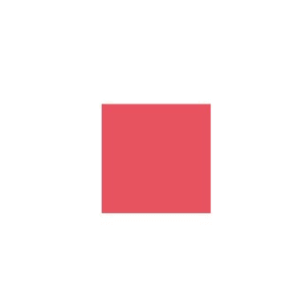

## 容器组件<a name="ZH-CN_TOPIC_0000002499582757"></a>

-   **[div](#ZH-CN_TOPIC_0000002499582709)**  

-   **[list](#ZH-CN_TOPIC_0000002466383752)**  

-   **[list-item](#ZH-CN_TOPIC_0000002499502681)**  

-   **[stack](#ZH-CN_TOPIC_0000002499582701)**  

-   **[swiper](#ZH-CN_TOPIC_0000002466383748)**  

### div<a name="ZH-CN_TOPIC_0000002499582709"></a>

基础容器，用作页面结构的根节点或将内容进行分组。

**子组件<a name="zh-cn_topic_0000002411047672_section6147mcpsimp"></a>**

支持。

**属性<a name="zh-cn_topic_0000002411047672_section6150mcpsimp"></a>**

支持“[通用属性](#ZH-CN_TOPIC_0000002466543388)”中所述属性。

**样式<a name="zh-cn_topic_0000002411047672_section6155mcpsimp"></a>**

除支持“[通用样式](#ZH-CN_TOPIC_0000002499582761)”中所述样式外，还支持如[表1](#zh-cn_topic_0000002411047672_table6160mcpsimp)所示样式。

**表 1**  div组件样式说明

<a name="zh-cn_topic_0000002411047672_table6160mcpsimp"></a>
<table><thead align="left"><tr id="zh-cn_topic_0000002411047672_row6168mcpsimp"><th class="cellrowborder" valign="top" width="15.64%" id="mcps1.2.6.1.1"><p id="zh-cn_topic_0000002411047672_p6170mcpsimp"><a name="zh-cn_topic_0000002411047672_p6170mcpsimp"></a><a name="zh-cn_topic_0000002411047672_p6170mcpsimp"></a>名称</p>
</th>
<th class="cellrowborder" valign="top" width="11.33%" id="mcps1.2.6.1.2"><p id="zh-cn_topic_0000002411047672_p6172mcpsimp"><a name="zh-cn_topic_0000002411047672_p6172mcpsimp"></a><a name="zh-cn_topic_0000002411047672_p6172mcpsimp"></a>类型</p>
</th>
<th class="cellrowborder" valign="top" width="16.470000000000002%" id="mcps1.2.6.1.3"><p id="zh-cn_topic_0000002411047672_p6174mcpsimp"><a name="zh-cn_topic_0000002411047672_p6174mcpsimp"></a><a name="zh-cn_topic_0000002411047672_p6174mcpsimp"></a>默认值</p>
</th>
<th class="cellrowborder" valign="top" width="10.040000000000001%" id="mcps1.2.6.1.4"><p id="zh-cn_topic_0000002411047672_p6176mcpsimp"><a name="zh-cn_topic_0000002411047672_p6176mcpsimp"></a><a name="zh-cn_topic_0000002411047672_p6176mcpsimp"></a>必填</p>
</th>
<th class="cellrowborder" valign="top" width="46.52%" id="mcps1.2.6.1.5"><p id="zh-cn_topic_0000002411047672_p6178mcpsimp"><a name="zh-cn_topic_0000002411047672_p6178mcpsimp"></a><a name="zh-cn_topic_0000002411047672_p6178mcpsimp"></a>说明</p>
</th>
</tr>
</thead>
<tbody><tr id="zh-cn_topic_0000002411047672_row6180mcpsimp"><td class="cellrowborder" valign="top" width="15.64%" headers="mcps1.2.6.1.1 "><p id="zh-cn_topic_0000002411047672_p6182mcpsimp"><a name="zh-cn_topic_0000002411047672_p6182mcpsimp"></a><a name="zh-cn_topic_0000002411047672_p6182mcpsimp"></a>flex-direction</p>
</td>
<td class="cellrowborder" valign="top" width="11.33%" headers="mcps1.2.6.1.2 "><p id="zh-cn_topic_0000002411047672_p6184mcpsimp"><a name="zh-cn_topic_0000002411047672_p6184mcpsimp"></a><a name="zh-cn_topic_0000002411047672_p6184mcpsimp"></a>string</p>
</td>
<td class="cellrowborder" valign="top" width="16.470000000000002%" headers="mcps1.2.6.1.3 "><p id="zh-cn_topic_0000002411047672_p6186mcpsimp"><a name="zh-cn_topic_0000002411047672_p6186mcpsimp"></a><a name="zh-cn_topic_0000002411047672_p6186mcpsimp"></a>row</p>
</td>
<td class="cellrowborder" valign="top" width="10.040000000000001%" headers="mcps1.2.6.1.4 "><p id="zh-cn_topic_0000002411047672_p6188mcpsimp"><a name="zh-cn_topic_0000002411047672_p6188mcpsimp"></a><a name="zh-cn_topic_0000002411047672_p6188mcpsimp"></a>否</p>
</td>
<td class="cellrowborder" valign="top" width="46.52%" headers="mcps1.2.6.1.5 "><p id="zh-cn_topic_0000002411047672_p6190mcpsimp"><a name="zh-cn_topic_0000002411047672_p6190mcpsimp"></a><a name="zh-cn_topic_0000002411047672_p6190mcpsimp"></a>flex容器主轴方向。可选项有：</p>
<a name="zh-cn_topic_0000002411047672_ul6191mcpsimp"></a><a name="zh-cn_topic_0000002411047672_ul6191mcpsimp"></a><ul id="zh-cn_topic_0000002411047672_ul6191mcpsimp"><li>column：垂直方向从上到下。</li><li>row：水平方向从左到右。</li></ul>
</td>
</tr>
<tr id="zh-cn_topic_0000002411047672_row6194mcpsimp"><td class="cellrowborder" valign="top" width="15.64%" headers="mcps1.2.6.1.1 "><p id="zh-cn_topic_0000002411047672_p6196mcpsimp"><a name="zh-cn_topic_0000002411047672_p6196mcpsimp"></a><a name="zh-cn_topic_0000002411047672_p6196mcpsimp"></a>flex-wrap</p>
</td>
<td class="cellrowborder" valign="top" width="11.33%" headers="mcps1.2.6.1.2 "><p id="zh-cn_topic_0000002411047672_p6198mcpsimp"><a name="zh-cn_topic_0000002411047672_p6198mcpsimp"></a><a name="zh-cn_topic_0000002411047672_p6198mcpsimp"></a>string</p>
</td>
<td class="cellrowborder" valign="top" width="16.470000000000002%" headers="mcps1.2.6.1.3 "><p id="zh-cn_topic_0000002411047672_p6200mcpsimp"><a name="zh-cn_topic_0000002411047672_p6200mcpsimp"></a><a name="zh-cn_topic_0000002411047672_p6200mcpsimp"></a>nowrap</p>
</td>
<td class="cellrowborder" valign="top" width="10.040000000000001%" headers="mcps1.2.6.1.4 "><p id="zh-cn_topic_0000002411047672_p6202mcpsimp"><a name="zh-cn_topic_0000002411047672_p6202mcpsimp"></a><a name="zh-cn_topic_0000002411047672_p6202mcpsimp"></a>否</p>
</td>
<td class="cellrowborder" valign="top" width="46.52%" headers="mcps1.2.6.1.5 "><p id="zh-cn_topic_0000002411047672_p6204mcpsimp"><a name="zh-cn_topic_0000002411047672_p6204mcpsimp"></a><a name="zh-cn_topic_0000002411047672_p6204mcpsimp"></a>flex容器是单行还是多行显示，该值暂不支持动态修改。可选项有：</p>
<a name="zh-cn_topic_0000002411047672_ul6205mcpsimp"></a><a name="zh-cn_topic_0000002411047672_ul6205mcpsimp"></a><ul id="zh-cn_topic_0000002411047672_ul6205mcpsimp"><li>nowrap：不换行，单行显示。</li><li>wrap：换行，多行显示。</li></ul>
</td>
</tr>
<tr id="zh-cn_topic_0000002411047672_row6208mcpsimp"><td class="cellrowborder" valign="top" width="15.64%" headers="mcps1.2.6.1.1 "><p id="zh-cn_topic_0000002411047672_p6210mcpsimp"><a name="zh-cn_topic_0000002411047672_p6210mcpsimp"></a><a name="zh-cn_topic_0000002411047672_p6210mcpsimp"></a>justify-content</p>
</td>
<td class="cellrowborder" valign="top" width="11.33%" headers="mcps1.2.6.1.2 "><p id="zh-cn_topic_0000002411047672_p6212mcpsimp"><a name="zh-cn_topic_0000002411047672_p6212mcpsimp"></a><a name="zh-cn_topic_0000002411047672_p6212mcpsimp"></a>string</p>
</td>
<td class="cellrowborder" valign="top" width="16.470000000000002%" headers="mcps1.2.6.1.3 "><p id="zh-cn_topic_0000002411047672_p6214mcpsimp"><a name="zh-cn_topic_0000002411047672_p6214mcpsimp"></a><a name="zh-cn_topic_0000002411047672_p6214mcpsimp"></a>flex-start</p>
</td>
<td class="cellrowborder" valign="top" width="10.040000000000001%" headers="mcps1.2.6.1.4 "><p id="zh-cn_topic_0000002411047672_p6216mcpsimp"><a name="zh-cn_topic_0000002411047672_p6216mcpsimp"></a><a name="zh-cn_topic_0000002411047672_p6216mcpsimp"></a>否</p>
</td>
<td class="cellrowborder" valign="top" width="46.52%" headers="mcps1.2.6.1.5 "><p id="zh-cn_topic_0000002411047672_p6218mcpsimp"><a name="zh-cn_topic_0000002411047672_p6218mcpsimp"></a><a name="zh-cn_topic_0000002411047672_p6218mcpsimp"></a>flex容器当前行的主轴对齐格式。可选项有：</p>
<a name="zh-cn_topic_0000002411047672_ul6219mcpsimp"></a><a name="zh-cn_topic_0000002411047672_ul6219mcpsimp"></a><ul id="zh-cn_topic_0000002411047672_ul6219mcpsimp"><li>flex-start：项目位于容器的开头。</li><li>flex-end：项目位于容器的结尾。</li><li>center：项目位于容器的中心。</li><li>space-between：项目位于各行之间留有空白的容器内。</li><li>space-around：项目位于各行之前、之间、之后都留有空白的容器内。</li></ul>
</td>
</tr>
<tr id="zh-cn_topic_0000002411047672_row6225mcpsimp"><td class="cellrowborder" valign="top" width="15.64%" headers="mcps1.2.6.1.1 "><p id="zh-cn_topic_0000002411047672_p6227mcpsimp"><a name="zh-cn_topic_0000002411047672_p6227mcpsimp"></a><a name="zh-cn_topic_0000002411047672_p6227mcpsimp"></a>align-items</p>
</td>
<td class="cellrowborder" valign="top" width="11.33%" headers="mcps1.2.6.1.2 "><p id="zh-cn_topic_0000002411047672_p6229mcpsimp"><a name="zh-cn_topic_0000002411047672_p6229mcpsimp"></a><a name="zh-cn_topic_0000002411047672_p6229mcpsimp"></a>string</p>
</td>
<td class="cellrowborder" valign="top" width="16.470000000000002%" headers="mcps1.2.6.1.3 "><p id="zh-cn_topic_0000002411047672_p6231mcpsimp"><a name="zh-cn_topic_0000002411047672_p6231mcpsimp"></a><a name="zh-cn_topic_0000002411047672_p6231mcpsimp"></a>stretch<sup id="zh-cn_topic_0000002411047672_sup6232mcpsimp"><a name="zh-cn_topic_0000002411047672_sup6232mcpsimp"></a><a name="zh-cn_topic_0000002411047672_sup6232mcpsimp"></a>5+</sup></p>
<p id="zh-cn_topic_0000002411047672_p126972273275"><a name="zh-cn_topic_0000002411047672_p126972273275"></a><a name="zh-cn_topic_0000002411047672_p126972273275"></a>flex-start<sup id="zh-cn_topic_0000002411047672_sup1869719279275"><a name="zh-cn_topic_0000002411047672_sup1869719279275"></a><a name="zh-cn_topic_0000002411047672_sup1869719279275"></a>1-4</sup></p>
<a name="zh-cn_topic_0000002411047672_ul685613582013"></a><a name="zh-cn_topic_0000002411047672_ul685613582013"></a><ul id="zh-cn_topic_0000002411047672_ul685613582013"><li>5+：支持SDK版本大于5。</li><li>1-4：支持SDK版本在1-4。</li></ul>
</td>
<td class="cellrowborder" valign="top" width="10.040000000000001%" headers="mcps1.2.6.1.4 "><p id="zh-cn_topic_0000002411047672_p6236mcpsimp"><a name="zh-cn_topic_0000002411047672_p6236mcpsimp"></a><a name="zh-cn_topic_0000002411047672_p6236mcpsimp"></a>否</p>
</td>
<td class="cellrowborder" valign="top" width="46.52%" headers="mcps1.2.6.1.5 "><p id="zh-cn_topic_0000002411047672_p6238mcpsimp"><a name="zh-cn_topic_0000002411047672_p6238mcpsimp"></a><a name="zh-cn_topic_0000002411047672_p6238mcpsimp"></a>flex容器当前行的交叉轴对齐格式，可选值为：</p>
<a name="zh-cn_topic_0000002411047672_ul6239mcpsimp"></a><a name="zh-cn_topic_0000002411047672_ul6239mcpsimp"></a><ul id="zh-cn_topic_0000002411047672_ul6239mcpsimp"><li>stretch：弹性元素在交叉轴方向被拉伸到与容器相同的高度或宽度。</li><li>flex-start：元素向交叉轴起点对齐。</li><li>flex-end：元素向交叉轴终点对齐。</li><li>center：元素在交叉轴居中。</li></ul>
</td>
</tr>
<tr id="zh-cn_topic_0000002411047672_row6245mcpsimp"><td class="cellrowborder" valign="top" width="15.64%" headers="mcps1.2.6.1.1 "><p id="zh-cn_topic_0000002411047672_p6247mcpsimp"><a name="zh-cn_topic_0000002411047672_p6247mcpsimp"></a><a name="zh-cn_topic_0000002411047672_p6247mcpsimp"></a>display</p>
</td>
<td class="cellrowborder" valign="top" width="11.33%" headers="mcps1.2.6.1.2 "><p id="zh-cn_topic_0000002411047672_p6249mcpsimp"><a name="zh-cn_topic_0000002411047672_p6249mcpsimp"></a><a name="zh-cn_topic_0000002411047672_p6249mcpsimp"></a>string</p>
</td>
<td class="cellrowborder" valign="top" width="16.470000000000002%" headers="mcps1.2.6.1.3 "><p id="zh-cn_topic_0000002411047672_p6251mcpsimp"><a name="zh-cn_topic_0000002411047672_p6251mcpsimp"></a><a name="zh-cn_topic_0000002411047672_p6251mcpsimp"></a>flex</p>
</td>
<td class="cellrowborder" valign="top" width="10.040000000000001%" headers="mcps1.2.6.1.4 "><p id="zh-cn_topic_0000002411047672_p6253mcpsimp"><a name="zh-cn_topic_0000002411047672_p6253mcpsimp"></a><a name="zh-cn_topic_0000002411047672_p6253mcpsimp"></a>否</p>
</td>
<td class="cellrowborder" valign="top" width="46.52%" headers="mcps1.2.6.1.5 "><p id="zh-cn_topic_0000002411047672_p6255mcpsimp"><a name="zh-cn_topic_0000002411047672_p6255mcpsimp"></a><a name="zh-cn_topic_0000002411047672_p6255mcpsimp"></a>确定该元素视图框的类型，该值暂不支持动态修改。可选值为：</p>
<a name="zh-cn_topic_0000002411047672_ul6256mcpsimp"></a><a name="zh-cn_topic_0000002411047672_ul6256mcpsimp"></a><ul id="zh-cn_topic_0000002411047672_ul6256mcpsimp"><li>flex：弹性布局。</li><li>none：不渲染此元素。</li></ul>
</td>
</tr>
</tbody>
</table>

**事件<a name="zh-cn_topic_0000002411047672_section6259mcpsimp"></a>**

支持“[通用事件](#ZH-CN_TOPIC_0000002466543364)”中所述事件。

**示例<a name="zh-cn_topic_0000002411047672_section6264mcpsimp"></a>**

-   Flex样式：

    ```
    <!-- xxx.hml --> 
     <div class="container"> 
       <div class="flex-box"> 
         <div class="flex-item color-primary"></div> 
         <div class="flex-item color-warning"></div> 
         <div class="flex-item color-success"></div> 
       </div> 
     </div>
    /* xxx.css */ 
     .container { 
         flex-direction: column; 
         justify-content: center; 
         align-items: center; 
         width: 454px; 
         height: 454px; 
     } 
     .flex-box { 
         justify-content: space-around; 
         align-items: center; 
         width: 400px; 
         height: 140px; 
         background-color: #ffffff; 
     } 
     .flex-item { 
         width: 120px; 
         height: 120px; 
         border-radius: 16px; 
     } 
     .color-primary { 
         background-color: #007dff; 
     } 
     .color-warning { 
         background-color: #ff7500; 
     } 
     .color-success { 
         background-color: #41ba41; 
     }
    ```

    **图 1**  div组件-Flex样式示例结果<a name="zh-cn_topic_0000002411047672_fig17927172718210"></a>  
    

-   Flex Wrap样式

    ```
     <!-- xxx.hml --> 
     <div class="container"> 
       <div class="flex-box"> 
         <div class="flex-item color-primary"></div> 
         <div class="flex-item color-warning"></div> 
         <div class="flex-item color-success"></div> 
       </div> 
     </div>
    /* xxx.css */ 
     .container { 
         flex-direction: column; 
         justify-content: center; 
         align-items: center; 
         width: 454px; 
         height: 454px; 
     } 
     .flex-box { 
         justify-content: space-around; 
         align-items: center; 
         flex-wrap: wrap; 
         width: 300px; 
         height: 250px; 
         background-color: #ffffff; 
     } 
     .flex-item { 
         width: 120px; 
         height: 120px; 
         border-radius: 16px; 
     } 
     .color-primary { 
         background-color: #007dff; 
     } 
     .color-warning { 
         background-color: #ff7500; 
     } 
     .color-success { 
         background-color: #41ba41; 
     }
    ```

    **图 2**  div组件-Flex Wrap样式示例结果<a name="zh-cn_topic_0000002411047672_fig16161160139"></a>  
    

### list<a name="ZH-CN_TOPIC_0000002466383752"></a>

列表包含一系列相同宽度的列表项。适合连续、多行呈现同类数据，例如图片和文本。

**子组件<a name="zh-cn_topic_0000002444646721_section2993mcpsimp"></a>**

仅支持<[list-item](#ZH-CN_TOPIC_0000002499502681)\>子组件。

**属性<a name="zh-cn_topic_0000002444646721_section2998mcpsimp"></a>**

支持“[通用属性](#ZH-CN_TOPIC_0000002466543388)”中所述属性。

**样式<a name="zh-cn_topic_0000002444646721_section3003mcpsimp"></a>**

除支持“[通用样式](#ZH-CN_TOPIC_0000002499582761)”中所述样式外，还支持如[表1](#zh-cn_topic_0000002444646721_table3008mcpsimp)所示样式。

**表 1**  list组件样式说明

<a name="zh-cn_topic_0000002444646721_table3008mcpsimp"></a>
<table><thead align="left"><tr id="zh-cn_topic_0000002444646721_row3016mcpsimp"><th class="cellrowborder" valign="top" width="18.27%" id="mcps1.2.6.1.1"><p id="zh-cn_topic_0000002444646721_p3018mcpsimp"><a name="zh-cn_topic_0000002444646721_p3018mcpsimp"></a><a name="zh-cn_topic_0000002444646721_p3018mcpsimp"></a>名称</p>
</th>
<th class="cellrowborder" valign="top" width="10.99%" id="mcps1.2.6.1.2"><p id="zh-cn_topic_0000002444646721_p3020mcpsimp"><a name="zh-cn_topic_0000002444646721_p3020mcpsimp"></a><a name="zh-cn_topic_0000002444646721_p3020mcpsimp"></a>类型</p>
</th>
<th class="cellrowborder" valign="top" width="14.649999999999999%" id="mcps1.2.6.1.3"><p id="zh-cn_topic_0000002444646721_p3022mcpsimp"><a name="zh-cn_topic_0000002444646721_p3022mcpsimp"></a><a name="zh-cn_topic_0000002444646721_p3022mcpsimp"></a>默认值</p>
</th>
<th class="cellrowborder" valign="top" width="11.35%" id="mcps1.2.6.1.4"><p id="zh-cn_topic_0000002444646721_p3024mcpsimp"><a name="zh-cn_topic_0000002444646721_p3024mcpsimp"></a><a name="zh-cn_topic_0000002444646721_p3024mcpsimp"></a>必填</p>
</th>
<th class="cellrowborder" valign="top" width="44.74%" id="mcps1.2.6.1.5"><p id="zh-cn_topic_0000002444646721_p3026mcpsimp"><a name="zh-cn_topic_0000002444646721_p3026mcpsimp"></a><a name="zh-cn_topic_0000002444646721_p3026mcpsimp"></a>说明</p>
</th>
</tr>
</thead>
<tbody><tr id="zh-cn_topic_0000002444646721_row3028mcpsimp"><td class="cellrowborder" valign="top" width="18.27%" headers="mcps1.2.6.1.1 "><p id="zh-cn_topic_0000002444646721_p3030mcpsimp"><a name="zh-cn_topic_0000002444646721_p3030mcpsimp"></a><a name="zh-cn_topic_0000002444646721_p3030mcpsimp"></a>flex-direction</p>
</td>
<td class="cellrowborder" valign="top" width="10.99%" headers="mcps1.2.6.1.2 "><p id="zh-cn_topic_0000002444646721_p3032mcpsimp"><a name="zh-cn_topic_0000002444646721_p3032mcpsimp"></a><a name="zh-cn_topic_0000002444646721_p3032mcpsimp"></a>string</p>
</td>
<td class="cellrowborder" valign="top" width="14.649999999999999%" headers="mcps1.2.6.1.3 "><p id="zh-cn_topic_0000002444646721_p3034mcpsimp"><a name="zh-cn_topic_0000002444646721_p3034mcpsimp"></a><a name="zh-cn_topic_0000002444646721_p3034mcpsimp"></a>column</p>
</td>
<td class="cellrowborder" valign="top" width="11.35%" headers="mcps1.2.6.1.4 "><p id="zh-cn_topic_0000002444646721_p3036mcpsimp"><a name="zh-cn_topic_0000002444646721_p3036mcpsimp"></a><a name="zh-cn_topic_0000002444646721_p3036mcpsimp"></a>否</p>
</td>
<td class="cellrowborder" valign="top" width="44.74%" headers="mcps1.2.6.1.5 "><p id="zh-cn_topic_0000002444646721_p3038mcpsimp"><a name="zh-cn_topic_0000002444646721_p3038mcpsimp"></a><a name="zh-cn_topic_0000002444646721_p3038mcpsimp"></a>设置flex容器主轴的方向，指定flex项如何放置在flex容器中，可选值为：</p>
<a name="zh-cn_topic_0000002444646721_ul3039mcpsimp"></a><a name="zh-cn_topic_0000002444646721_ul3039mcpsimp"></a><ul id="zh-cn_topic_0000002444646721_ul3039mcpsimp"><li>column：主轴为纵向。</li><li>row：主轴为横向。</li></ul>
<p id="zh-cn_topic_0000002444646721_p3042mcpsimp"><a name="zh-cn_topic_0000002444646721_p3042mcpsimp"></a><a name="zh-cn_topic_0000002444646721_p3042mcpsimp"></a>其他组件默认值为row，在list组件中默认值为column。轻量级智能穿戴不支持动态修改。</p>
</td>
</tr>
</tbody>
</table>

**事件<a name="zh-cn_topic_0000002444646721_section3043mcpsimp"></a>**

除支持“[通用事件](#ZH-CN_TOPIC_0000002466543364)”中所述事件外，还支持如[表2](#zh-cn_topic_0000002444646721_table3048mcpsimp)所示事件。

**表 2**  list组件事件说明

<a name="zh-cn_topic_0000002444646721_table3048mcpsimp"></a>
<table><thead align="left"><tr id="zh-cn_topic_0000002444646721_row3054mcpsimp"><th class="cellrowborder" valign="top" width="24.752475247524753%" id="mcps1.2.4.1.1"><p id="zh-cn_topic_0000002444646721_p3056mcpsimp"><a name="zh-cn_topic_0000002444646721_p3056mcpsimp"></a><a name="zh-cn_topic_0000002444646721_p3056mcpsimp"></a>名称</p>
</th>
<th class="cellrowborder" valign="top" width="29.672967296729674%" id="mcps1.2.4.1.2"><p id="zh-cn_topic_0000002444646721_p3058mcpsimp"><a name="zh-cn_topic_0000002444646721_p3058mcpsimp"></a><a name="zh-cn_topic_0000002444646721_p3058mcpsimp"></a>参数</p>
</th>
<th class="cellrowborder" valign="top" width="45.57455745574558%" id="mcps1.2.4.1.3"><p id="zh-cn_topic_0000002444646721_p3060mcpsimp"><a name="zh-cn_topic_0000002444646721_p3060mcpsimp"></a><a name="zh-cn_topic_0000002444646721_p3060mcpsimp"></a>说明</p>
</th>
</tr>
</thead>
<tbody><tr id="zh-cn_topic_0000002444646721_row3062mcpsimp"><td class="cellrowborder" valign="top" width="24.752475247524753%" headers="mcps1.2.4.1.1 "><p id="zh-cn_topic_0000002444646721_p3064mcpsimp"><a name="zh-cn_topic_0000002444646721_p3064mcpsimp"></a><a name="zh-cn_topic_0000002444646721_p3064mcpsimp"></a>scrollend</p>
</td>
<td class="cellrowborder" valign="top" width="29.672967296729674%" headers="mcps1.2.4.1.2 "><p id="zh-cn_topic_0000002444646721_p3066mcpsimp"><a name="zh-cn_topic_0000002444646721_p3066mcpsimp"></a><a name="zh-cn_topic_0000002444646721_p3066mcpsimp"></a>-</p>
</td>
<td class="cellrowborder" valign="top" width="45.57455745574558%" headers="mcps1.2.4.1.3 "><p id="zh-cn_topic_0000002444646721_p3068mcpsimp"><a name="zh-cn_topic_0000002444646721_p3068mcpsimp"></a><a name="zh-cn_topic_0000002444646721_p3068mcpsimp"></a>列表滑动已经结束。</p>
</td>
</tr>
<tr id="zh-cn_topic_0000002444646721_row6767163017120"><td class="cellrowborder" valign="top" width="24.752475247524753%" headers="mcps1.2.4.1.1 "><p id="zh-cn_topic_0000002444646721_p17671430121218"><a name="zh-cn_topic_0000002444646721_p17671430121218"></a><a name="zh-cn_topic_0000002444646721_p17671430121218"></a>scrollbar</p>
</td>
<td class="cellrowborder" valign="top" width="29.672967296729674%" headers="mcps1.2.4.1.2 "><p id="zh-cn_topic_0000002444646721_p16767183091216"><a name="zh-cn_topic_0000002444646721_p16767183091216"></a><a name="zh-cn_topic_0000002444646721_p16767183091216"></a>bool</p>
</td>
<td class="cellrowborder" valign="top" width="45.57455745574558%" headers="mcps1.2.4.1.3 "><p id="zh-cn_topic_0000002444646721_p17673306127"><a name="zh-cn_topic_0000002444646721_p17673306127"></a><a name="zh-cn_topic_0000002444646721_p17673306127"></a>是否展示list进度条，false为不显示，true为显示；组件scrollbar属性默认为false。</p>
</td>
</tr>
</tbody>
</table>

**方法<a name="zh-cn_topic_0000002444646721_section3069mcpsimp"></a>**

**表 3**  list组件方法说明

<a name="zh-cn_topic_0000002444646721_table3071mcpsimp"></a>
<table><thead align="left"><tr id="zh-cn_topic_0000002444646721_row3077mcpsimp"><th class="cellrowborder" valign="top" width="23.98%" id="mcps1.2.4.1.1"><p id="zh-cn_topic_0000002444646721_p3079mcpsimp"><a name="zh-cn_topic_0000002444646721_p3079mcpsimp"></a><a name="zh-cn_topic_0000002444646721_p3079mcpsimp"></a>名称</p>
</th>
<th class="cellrowborder" valign="top" width="30.81%" id="mcps1.2.4.1.2"><p id="zh-cn_topic_0000002444646721_p3081mcpsimp"><a name="zh-cn_topic_0000002444646721_p3081mcpsimp"></a><a name="zh-cn_topic_0000002444646721_p3081mcpsimp"></a>参数</p>
</th>
<th class="cellrowborder" valign="top" width="45.21%" id="mcps1.2.4.1.3"><p id="zh-cn_topic_0000002444646721_p3083mcpsimp"><a name="zh-cn_topic_0000002444646721_p3083mcpsimp"></a><a name="zh-cn_topic_0000002444646721_p3083mcpsimp"></a>说明</p>
</th>
</tr>
</thead>
<tbody><tr id="zh-cn_topic_0000002444646721_row3085mcpsimp"><td class="cellrowborder" valign="top" width="23.98%" headers="mcps1.2.4.1.1 "><p id="zh-cn_topic_0000002444646721_p3087mcpsimp"><a name="zh-cn_topic_0000002444646721_p3087mcpsimp"></a><a name="zh-cn_topic_0000002444646721_p3087mcpsimp"></a>scrollTo</p>
</td>
<td class="cellrowborder" valign="top" width="30.81%" headers="mcps1.2.4.1.2 "><p id="zh-cn_topic_0000002444646721_p3089mcpsimp"><a name="zh-cn_topic_0000002444646721_p3089mcpsimp"></a><a name="zh-cn_topic_0000002444646721_p3089mcpsimp"></a>{ index: number(指定位置) }</p>
</td>
<td class="cellrowborder" valign="top" width="45.21%" headers="mcps1.2.4.1.3 "><p id="zh-cn_topic_0000002444646721_p3091mcpsimp"><a name="zh-cn_topic_0000002444646721_p3091mcpsimp"></a><a name="zh-cn_topic_0000002444646721_p3091mcpsimp"></a>list滑动到指定index的item位置。</p>
</td>
</tr>
<tr id="zh-cn_topic_0000002444646721_row14363153995012"><td class="cellrowborder" valign="top" width="23.98%" headers="mcps1.2.4.1.1 "><p id="zh-cn_topic_0000002444646721_p18364183925018"><a name="zh-cn_topic_0000002444646721_p18364183925018"></a><a name="zh-cn_topic_0000002444646721_p18364183925018"></a>scrollToEnd</p>
</td>
<td class="cellrowborder" valign="top" width="30.81%" headers="mcps1.2.4.1.2 "><p id="zh-cn_topic_0000002444646721_p236410397506"><a name="zh-cn_topic_0000002444646721_p236410397506"></a><a name="zh-cn_topic_0000002444646721_p236410397506"></a>无</p>
</td>
<td class="cellrowborder" valign="top" width="45.21%" headers="mcps1.2.4.1.3 "><p id="zh-cn_topic_0000002444646721_p136414392502"><a name="zh-cn_topic_0000002444646721_p136414392502"></a><a name="zh-cn_topic_0000002444646721_p136414392502"></a>list滑动到底部。</p>
</td>
</tr>
<tr id="zh-cn_topic_0000002444646721_row209951449145011"><td class="cellrowborder" valign="top" width="23.98%" headers="mcps1.2.4.1.1 "><p id="zh-cn_topic_0000002444646721_p12996164910508"><a name="zh-cn_topic_0000002444646721_p12996164910508"></a><a name="zh-cn_topic_0000002444646721_p12996164910508"></a>long-text</p>
</td>
<td class="cellrowborder" valign="top" width="30.81%" headers="mcps1.2.4.1.2 "><p id="zh-cn_topic_0000002444646721_p12996154965018"><a name="zh-cn_topic_0000002444646721_p12996154965018"></a><a name="zh-cn_topic_0000002444646721_p12996154965018"></a>bool</p>
</td>
<td class="cellrowborder" valign="top" width="45.21%" headers="mcps1.2.4.1.3 "><p id="zh-cn_topic_0000002444646721_p17996194975016"><a name="zh-cn_topic_0000002444646721_p17996194975016"></a><a name="zh-cn_topic_0000002444646721_p17996194975016"></a>使能长文本模式。</p>
</td>
</tr>
<tr id="zh-cn_topic_0000002444646721_row528816454504"><td class="cellrowborder" valign="top" width="23.98%" headers="mcps1.2.4.1.1 "><p id="zh-cn_topic_0000002444646721_p82883453508"><a name="zh-cn_topic_0000002444646721_p82883453508"></a><a name="zh-cn_topic_0000002444646721_p82883453508"></a>value</p>
</td>
<td class="cellrowborder" valign="top" width="30.81%" headers="mcps1.2.4.1.2 "><p id="zh-cn_topic_0000002444646721_p42881445155011"><a name="zh-cn_topic_0000002444646721_p42881445155011"></a><a name="zh-cn_topic_0000002444646721_p42881445155011"></a>string</p>
</td>
<td class="cellrowborder" valign="top" width="45.21%" headers="mcps1.2.4.1.3 "><p id="zh-cn_topic_0000002444646721_p20288245105018"><a name="zh-cn_topic_0000002444646721_p20288245105018"></a><a name="zh-cn_topic_0000002444646721_p20288245105018"></a>设置文本内容，打开长文本模式后才能使用。建议控制在5000字以内。</p>
</td>
</tr>
</tbody>
</table>

**示例<a name="zh-cn_topic_0000002444646721_section3092mcpsimp"></a>**

```
<!-- index.hml --> 
<div class="container"> 
  <list class="todo-wrapper"> 
    <list-item for="{{todolist}}" class="todo-item"> 
      <text class="todo-title">{{$item.title}}</text> 
      <text class="todo-title">{{$item.date}}</text> 
    </list-item> 
  </list> 
</div>
```

```
// index.js 
export default { 
    data: { 
        todolist: [{ 
            title: '刷题', 
            date: '2021-12-31 10:00:00', 
        }, { 
            title: '看电影', 
            date: '2021-12-31 20:00:00', 
        }], 
    }, 
}
```

```
/* index.css */ 
.container { 
    display: flex; 
    justify-content: center; 
    align-items: center; 
    left: 0px; 
    top: 0px; 
    width: 454px; 
    height: 454px; 
} 
.todo-wrapper { 
    width: 454px; 
    height: 300px; 
} 
.todo-item { 
    width: 454px; 
    height: 80px; 
    flex-direction: column; 
} 
.todo-title { 
    width: 454px; 
    height: 40px; 
    text-align: center; 
}
```

**图 1**  list组件-示例结果<a name="zh-cn_topic_0000002444646721_fig174481722619"></a>  
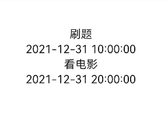

### list-item<a name="ZH-CN_TOPIC_0000002499502681"></a>

list-item是<[list](#ZH-CN_TOPIC_0000002466383752)\>的子组件，用来展示列表具体item。

**子组件<a name="zh-cn_topic_0000002444726841_section5000mcpsimp"></a>**

支持。

**属性<a name="zh-cn_topic_0000002444726841_section5003mcpsimp"></a>**

支持“[通用属性](#ZH-CN_TOPIC_0000002466543388)”中所述属性。

**样式<a name="zh-cn_topic_0000002444726841_section5008mcpsimp"></a>**

支持“[通用样式](#ZH-CN_TOPIC_0000002499582761)”中所述样式。

当使用text子组件时，样式如果只设置width，不设置height，会触发自适应高度模式，lite-item自动配置组件height。

**事件<a name="zh-cn_topic_0000002444726841_section5013mcpsimp"></a>**

支持“[通用事件](#ZH-CN_TOPIC_0000002466543364)”中所述事件。

**示例<a name="zh-cn_topic_0000002444726841_section5018mcpsimp"></a>**

请参见“[示例](#zh-cn_topic_0000002444646721_section3092mcpsimp)”中示例内容。

### stack<a name="ZH-CN_TOPIC_0000002499582701"></a>

堆叠容器，子组件按照顺序依次入栈，后一个子组件覆盖前一个子组件。

**子组件<a name="zh-cn_topic_0000002411207556_section5147mcpsimp"></a>**

支持。

**属性<a name="zh-cn_topic_0000002411207556_section5150mcpsimp"></a>**

支持“[通用属性](#ZH-CN_TOPIC_0000002466543388)”中所述属性。

**样式<a name="zh-cn_topic_0000002411207556_section5155mcpsimp"></a>**

支持“[通用样式](#ZH-CN_TOPIC_0000002499582761)”中所述样式。

**事件<a name="zh-cn_topic_0000002411207556_section5160mcpsimp"></a>**

支持“[通用事件](#ZH-CN_TOPIC_0000002466543364)”中所述事件。

**示例<a name="zh-cn_topic_0000002411207556_section5165mcpsimp"></a>**

```
<!-- xxx.hml --> 
<stack class="stack-parent"> 
  <div class="back-child bd-radius"></div> 
  <div class="positioned-child bd-radius"></div> 
  <div class="front-child bd-radius"></div> 
</stack>
```

```
/* xxx.css */ 
.stack-parent { 
    width: 400px; 
    height: 400px; 
    background-color: #ffffff; 
    border-width: 1px; 
    border-style: solid; 
} 
.back-child { 
    width: 300px; 
    height: 300px; 
    background-color: #3f56ea; 
} 
.front-child { 
    width: 100px; 
    height: 100px; 
    background-color: #00bfc9; 
} 
.positioned-child { 
    width: 100px; 
    height: 100px; 
    left: 50px; 
    top: 50px; 
    background-color: #47cc47; 
} 
.bd-radius { 
    border-radius: 16px; 
}
```

**图 1**  stack组件-示例结果<a name="zh-cn_topic_0000002411207556_fig2359148579"></a>  


### swiper<a name="ZH-CN_TOPIC_0000002466383748"></a>

滑动容器，提供切换子组件显示的能力。

**子组件<a name="zh-cn_topic_0000002444726849_section1830mcpsimp"></a>**

支持除<[list](#ZH-CN_TOPIC_0000002466383752)\>之外的子组件。

**属性<a name="zh-cn_topic_0000002444726849_section1833mcpsimp"></a>**

除支持“[通用属性](#ZH-CN_TOPIC_0000002466543388)”中所述属性外，还支持如[表1](#zh-cn_topic_0000002444726849_table1838mcpsimp)所示属性。

**表 1**  swiper组件属性说明

<a name="zh-cn_topic_0000002444726849_table1838mcpsimp"></a>
<table><thead align="left"><tr id="zh-cn_topic_0000002444726849_row1846mcpsimp"><th class="cellrowborder" valign="top" width="16.75%" id="mcps1.2.6.1.1"><p id="zh-cn_topic_0000002444726849_p1848mcpsimp"><a name="zh-cn_topic_0000002444726849_p1848mcpsimp"></a><a name="zh-cn_topic_0000002444726849_p1848mcpsimp"></a>名称</p>
</th>
<th class="cellrowborder" valign="top" width="14.74%" id="mcps1.2.6.1.2"><p id="zh-cn_topic_0000002444726849_p1850mcpsimp"><a name="zh-cn_topic_0000002444726849_p1850mcpsimp"></a><a name="zh-cn_topic_0000002444726849_p1850mcpsimp"></a>类型</p>
</th>
<th class="cellrowborder" valign="top" width="15.06%" id="mcps1.2.6.1.3"><p id="zh-cn_topic_0000002444726849_p1852mcpsimp"><a name="zh-cn_topic_0000002444726849_p1852mcpsimp"></a><a name="zh-cn_topic_0000002444726849_p1852mcpsimp"></a>默认值</p>
</th>
<th class="cellrowborder" valign="top" width="12.479999999999999%" id="mcps1.2.6.1.4"><p id="zh-cn_topic_0000002444726849_p1854mcpsimp"><a name="zh-cn_topic_0000002444726849_p1854mcpsimp"></a><a name="zh-cn_topic_0000002444726849_p1854mcpsimp"></a>必填</p>
</th>
<th class="cellrowborder" valign="top" width="40.97%" id="mcps1.2.6.1.5"><p id="zh-cn_topic_0000002444726849_p1856mcpsimp"><a name="zh-cn_topic_0000002444726849_p1856mcpsimp"></a><a name="zh-cn_topic_0000002444726849_p1856mcpsimp"></a>说明</p>
</th>
</tr>
</thead>
<tbody><tr id="zh-cn_topic_0000002444726849_row1858mcpsimp"><td class="cellrowborder" valign="top" width="16.75%" headers="mcps1.2.6.1.1 "><p id="zh-cn_topic_0000002444726849_p1860mcpsimp"><a name="zh-cn_topic_0000002444726849_p1860mcpsimp"></a><a name="zh-cn_topic_0000002444726849_p1860mcpsimp"></a>index</p>
</td>
<td class="cellrowborder" valign="top" width="14.74%" headers="mcps1.2.6.1.2 "><p id="zh-cn_topic_0000002444726849_p1862mcpsimp"><a name="zh-cn_topic_0000002444726849_p1862mcpsimp"></a><a name="zh-cn_topic_0000002444726849_p1862mcpsimp"></a>number</p>
</td>
<td class="cellrowborder" valign="top" width="15.06%" headers="mcps1.2.6.1.3 "><p id="zh-cn_topic_0000002444726849_p1864mcpsimp"><a name="zh-cn_topic_0000002444726849_p1864mcpsimp"></a><a name="zh-cn_topic_0000002444726849_p1864mcpsimp"></a>0</p>
</td>
<td class="cellrowborder" valign="top" width="12.479999999999999%" headers="mcps1.2.6.1.4 "><p id="zh-cn_topic_0000002444726849_p1866mcpsimp"><a name="zh-cn_topic_0000002444726849_p1866mcpsimp"></a><a name="zh-cn_topic_0000002444726849_p1866mcpsimp"></a>否</p>
</td>
<td class="cellrowborder" valign="top" width="40.97%" headers="mcps1.2.6.1.5 "><p id="zh-cn_topic_0000002444726849_p1868mcpsimp"><a name="zh-cn_topic_0000002444726849_p1868mcpsimp"></a><a name="zh-cn_topic_0000002444726849_p1868mcpsimp"></a>当前在容器中显示的子组件的索引值。如果需要在js page切换时指定index，请在onShow()方法中更新index值。</p>
</td>
</tr>
<tr id="zh-cn_topic_0000002444726849_row1869mcpsimp"><td class="cellrowborder" valign="top" width="16.75%" headers="mcps1.2.6.1.1 "><p id="zh-cn_topic_0000002444726849_p1871mcpsimp"><a name="zh-cn_topic_0000002444726849_p1871mcpsimp"></a><a name="zh-cn_topic_0000002444726849_p1871mcpsimp"></a>loop</p>
</td>
<td class="cellrowborder" valign="top" width="14.74%" headers="mcps1.2.6.1.2 "><p id="zh-cn_topic_0000002444726849_p1873mcpsimp"><a name="zh-cn_topic_0000002444726849_p1873mcpsimp"></a><a name="zh-cn_topic_0000002444726849_p1873mcpsimp"></a>boolean</p>
</td>
<td class="cellrowborder" valign="top" width="15.06%" headers="mcps1.2.6.1.3 "><p id="zh-cn_topic_0000002444726849_p1875mcpsimp"><a name="zh-cn_topic_0000002444726849_p1875mcpsimp"></a><a name="zh-cn_topic_0000002444726849_p1875mcpsimp"></a>true</p>
</td>
<td class="cellrowborder" valign="top" width="12.479999999999999%" headers="mcps1.2.6.1.4 "><p id="zh-cn_topic_0000002444726849_p1877mcpsimp"><a name="zh-cn_topic_0000002444726849_p1877mcpsimp"></a><a name="zh-cn_topic_0000002444726849_p1877mcpsimp"></a>否</p>
</td>
<td class="cellrowborder" valign="top" width="40.97%" headers="mcps1.2.6.1.5 "><p id="zh-cn_topic_0000002444726849_p1879mcpsimp"><a name="zh-cn_topic_0000002444726849_p1879mcpsimp"></a><a name="zh-cn_topic_0000002444726849_p1879mcpsimp"></a>是否开启循环滑动。</p>
<p id="zh-cn_topic_0000002444726849_p1880mcpsimp"><a name="zh-cn_topic_0000002444726849_p1880mcpsimp"></a><a name="zh-cn_topic_0000002444726849_p1880mcpsimp"></a>不支持动态修改。</p>
<p id="zh-cn_topic_0000002444726849_p1882mcpsimp"><a name="zh-cn_topic_0000002444726849_p1882mcpsimp"></a><a name="zh-cn_topic_0000002444726849_p1882mcpsimp"></a><strong id="zh-cn_topic_0000002444726849_b7214117282"><a name="zh-cn_topic_0000002444726849_b7214117282"></a><a name="zh-cn_topic_0000002444726849_b7214117282"></a>注意：loop参数生效需要满足以下两个条件：</strong></p>
<a name="zh-cn_topic_0000002444726849_ul10697182534818"></a><a name="zh-cn_topic_0000002444726849_ul10697182534818"></a><ul id="zh-cn_topic_0000002444726849_ul10697182534818"><li><strong id="zh-cn_topic_0000002444726849_b112187114284"><a name="zh-cn_topic_0000002444726849_b112187114284"></a><a name="zh-cn_topic_0000002444726849_b112187114284"></a>除第一个子组件之外，剩余子组件的总长度大于等于swiper的长度。</strong></li><li><strong id="zh-cn_topic_0000002444726849_b42209112284"><a name="zh-cn_topic_0000002444726849_b42209112284"></a><a name="zh-cn_topic_0000002444726849_b42209112284"></a>除最后一个子组件之外，剩余子组件的总长度大于等于swiper的长度。</strong></li></ul>
</td>
</tr>
<tr id="zh-cn_topic_0000002444726849_row1885mcpsimp"><td class="cellrowborder" valign="top" width="16.75%" headers="mcps1.2.6.1.1 "><p id="zh-cn_topic_0000002444726849_p1887mcpsimp"><a name="zh-cn_topic_0000002444726849_p1887mcpsimp"></a><a name="zh-cn_topic_0000002444726849_p1887mcpsimp"></a>duration</p>
</td>
<td class="cellrowborder" valign="top" width="14.74%" headers="mcps1.2.6.1.2 "><p id="zh-cn_topic_0000002444726849_p1889mcpsimp"><a name="zh-cn_topic_0000002444726849_p1889mcpsimp"></a><a name="zh-cn_topic_0000002444726849_p1889mcpsimp"></a>number</p>
</td>
<td class="cellrowborder" valign="top" width="15.06%" headers="mcps1.2.6.1.3 "><p id="zh-cn_topic_0000002444726849_p1891mcpsimp"><a name="zh-cn_topic_0000002444726849_p1891mcpsimp"></a><a name="zh-cn_topic_0000002444726849_p1891mcpsimp"></a>-</p>
</td>
<td class="cellrowborder" valign="top" width="12.479999999999999%" headers="mcps1.2.6.1.4 "><p id="zh-cn_topic_0000002444726849_p1893mcpsimp"><a name="zh-cn_topic_0000002444726849_p1893mcpsimp"></a><a name="zh-cn_topic_0000002444726849_p1893mcpsimp"></a>否</p>
</td>
<td class="cellrowborder" valign="top" width="40.97%" headers="mcps1.2.6.1.5 "><p id="zh-cn_topic_0000002444726849_p1895mcpsimp"><a name="zh-cn_topic_0000002444726849_p1895mcpsimp"></a><a name="zh-cn_topic_0000002444726849_p1895mcpsimp"></a>子组件切换的动画时长。</p>
</td>
</tr>
<tr id="zh-cn_topic_0000002444726849_row1896mcpsimp"><td class="cellrowborder" valign="top" width="16.75%" headers="mcps1.2.6.1.1 "><p id="zh-cn_topic_0000002444726849_p1898mcpsimp"><a name="zh-cn_topic_0000002444726849_p1898mcpsimp"></a><a name="zh-cn_topic_0000002444726849_p1898mcpsimp"></a>vertical</p>
</td>
<td class="cellrowborder" valign="top" width="14.74%" headers="mcps1.2.6.1.2 "><p id="zh-cn_topic_0000002444726849_p1900mcpsimp"><a name="zh-cn_topic_0000002444726849_p1900mcpsimp"></a><a name="zh-cn_topic_0000002444726849_p1900mcpsimp"></a>boolean</p>
</td>
<td class="cellrowborder" valign="top" width="15.06%" headers="mcps1.2.6.1.3 "><p id="zh-cn_topic_0000002444726849_p1902mcpsimp"><a name="zh-cn_topic_0000002444726849_p1902mcpsimp"></a><a name="zh-cn_topic_0000002444726849_p1902mcpsimp"></a>false</p>
</td>
<td class="cellrowborder" valign="top" width="12.479999999999999%" headers="mcps1.2.6.1.4 "><p id="zh-cn_topic_0000002444726849_p1904mcpsimp"><a name="zh-cn_topic_0000002444726849_p1904mcpsimp"></a><a name="zh-cn_topic_0000002444726849_p1904mcpsimp"></a>否</p>
</td>
<td class="cellrowborder" valign="top" width="40.97%" headers="mcps1.2.6.1.5 "><p id="zh-cn_topic_0000002444726849_p1906mcpsimp"><a name="zh-cn_topic_0000002444726849_p1906mcpsimp"></a><a name="zh-cn_topic_0000002444726849_p1906mcpsimp"></a>是否为纵向滑动，纵向滑动时采用纵向的指示器。</p>
<p id="zh-cn_topic_0000002444726849_p1907mcpsimp"><a name="zh-cn_topic_0000002444726849_p1907mcpsimp"></a><a name="zh-cn_topic_0000002444726849_p1907mcpsimp"></a>不支持动态修改。</p>
</td>
</tr>
</tbody>
</table>

**样式<a name="zh-cn_topic_0000002444726849_section1908mcpsimp"></a>**

支持“[通用样式](#ZH-CN_TOPIC_0000002499582761)”中所述样式。

**事件<a name="zh-cn_topic_0000002444726849_section1913mcpsimp"></a>**

**表 2**  swiper组件事件说明

<a name="zh-cn_topic_0000002444726849_table1915mcpsimp"></a>
<table><thead align="left"><tr id="zh-cn_topic_0000002444726849_row1921mcpsimp"><th class="cellrowborder" valign="top" width="29.54%" id="mcps1.2.4.1.1"><p id="zh-cn_topic_0000002444726849_p1923mcpsimp"><a name="zh-cn_topic_0000002444726849_p1923mcpsimp"></a><a name="zh-cn_topic_0000002444726849_p1923mcpsimp"></a>名称</p>
</th>
<th class="cellrowborder" valign="top" width="30.520000000000003%" id="mcps1.2.4.1.2"><p id="zh-cn_topic_0000002444726849_p1925mcpsimp"><a name="zh-cn_topic_0000002444726849_p1925mcpsimp"></a><a name="zh-cn_topic_0000002444726849_p1925mcpsimp"></a>参数</p>
</th>
<th class="cellrowborder" valign="top" width="39.94%" id="mcps1.2.4.1.3"><p id="zh-cn_topic_0000002444726849_p1927mcpsimp"><a name="zh-cn_topic_0000002444726849_p1927mcpsimp"></a><a name="zh-cn_topic_0000002444726849_p1927mcpsimp"></a>说明</p>
</th>
</tr>
</thead>
<tbody><tr id="zh-cn_topic_0000002444726849_row1929mcpsimp"><td class="cellrowborder" valign="top" width="29.54%" headers="mcps1.2.4.1.1 "><p id="zh-cn_topic_0000002444726849_p1931mcpsimp"><a name="zh-cn_topic_0000002444726849_p1931mcpsimp"></a><a name="zh-cn_topic_0000002444726849_p1931mcpsimp"></a>change</p>
</td>
<td class="cellrowborder" valign="top" width="30.520000000000003%" headers="mcps1.2.4.1.2 "><p id="zh-cn_topic_0000002444726849_p1933mcpsimp"><a name="zh-cn_topic_0000002444726849_p1933mcpsimp"></a><a name="zh-cn_topic_0000002444726849_p1933mcpsimp"></a>{ index: currentIndex }</p>
</td>
<td class="cellrowborder" valign="top" width="39.94%" headers="mcps1.2.4.1.3 "><p id="zh-cn_topic_0000002444726849_p1935mcpsimp"><a name="zh-cn_topic_0000002444726849_p1935mcpsimp"></a><a name="zh-cn_topic_0000002444726849_p1935mcpsimp"></a>当前显示的组件索引变化时触发该事件。</p>
</td>
</tr>
</tbody>
</table>

**示例<a name="zh-cn_topic_0000002444726849_section1936mcpsimp"></a>**

```
<!-- xxx.hml --> 
<swiper class="container" index="{{index}}"> 
  <div class="swiper-item primary-item"> 
    <text>1</text> 
  </div> 
  <div class="swiper-item warning-item"> 
    <text>2</text> 
  </div> 
  <div class="swiper-item success-item"> 
    <text>3</text> 
  </div> 
</swiper>
```

```
/* xxx.css */ 
.container { 
    left: 0px; 
    top: 0px; 
    width: 454px; 
    height: 454px; 
} 
.swiper-item { 
    width: 454px; 
    height: 454px; 
    justify-content: center; 
    align-items: center; 
} 
.primary-item { 
    background-color: #007dff; 
} 
.warning-item { 
    background-color: #ff7500; 
} 
.success-item { 
    background-color: #41ba41; 
}
```

```
/* xxx.js */ 
export default { 
    data: { 
        index: 1 
    } 
}
```

**图 1**  swiper组件-示例结果<a name="zh-cn_topic_0000002444726849_fig165131455155711"></a>  


## 基础组件<a name="ZH-CN_TOPIC_0000002499502705"></a>

-   **[chart](#ZH-CN_TOPIC_0000002466383716)**  

-   **[image](#ZH-CN_TOPIC_0000002466543336)**  

-   **[image-animator](#ZH-CN_TOPIC_0000002499582749)**  

-   **[input](#ZH-CN_TOPIC_0000002499502701)**  

-   **[marquee](#ZH-CN_TOPIC_0000002499502685)**  

-   **[picker-view](#ZH-CN_TOPIC_0000002499582725)**  

-   **[progress](#ZH-CN_TOPIC_0000002499582745)**  

-   **[qrcode](#ZH-CN_TOPIC_0000002466543384)**  

-   **[slider](#ZH-CN_TOPIC_0000002499582717)**  

-   **[switch](#ZH-CN_TOPIC_0000002466543356)**  

-   **[text](#ZH-CN_TOPIC_0000002499582721)**  

### chart<a name="ZH-CN_TOPIC_0000002466383716"></a>

图表组件，用于呈现线形图、柱状图界面。

**子组件<a name="zh-cn_topic_0000002411207596_section753mcpsimp"></a>**

不支持。

**属性<a name="zh-cn_topic_0000002411207596_section756mcpsimp"></a>**

除支持“[通用属性](#ZH-CN_TOPIC_0000002466543388)”中所述属性外，还支持如[表1](#zh-cn_topic_0000002411207596__table12775365017)所示属性。

**表 1**  chart组件属性说明

<a name="zh-cn_topic_0000002411207596__table12775365017"></a>
<table><thead align="left"><tr id="zh-cn_topic_0000002411207596_row769mcpsimp"><th class="cellrowborder" valign="top" width="15.591559155915593%" id="mcps1.2.6.1.1"><p id="zh-cn_topic_0000002411207596_p771mcpsimp"><a name="zh-cn_topic_0000002411207596_p771mcpsimp"></a><a name="zh-cn_topic_0000002411207596_p771mcpsimp"></a>名称</p>
</th>
<th class="cellrowborder" valign="top" width="18.07180718071807%" id="mcps1.2.6.1.2"><p id="zh-cn_topic_0000002411207596_p773mcpsimp"><a name="zh-cn_topic_0000002411207596_p773mcpsimp"></a><a name="zh-cn_topic_0000002411207596_p773mcpsimp"></a>类型</p>
</th>
<th class="cellrowborder" valign="top" width="10.891089108910892%" id="mcps1.2.6.1.3"><p id="zh-cn_topic_0000002411207596_p775mcpsimp"><a name="zh-cn_topic_0000002411207596_p775mcpsimp"></a><a name="zh-cn_topic_0000002411207596_p775mcpsimp"></a>默认值</p>
</th>
<th class="cellrowborder" valign="top" width="7.920792079207921%" id="mcps1.2.6.1.4"><p id="zh-cn_topic_0000002411207596_p777mcpsimp"><a name="zh-cn_topic_0000002411207596_p777mcpsimp"></a><a name="zh-cn_topic_0000002411207596_p777mcpsimp"></a>必填</p>
</th>
<th class="cellrowborder" valign="top" width="47.52475247524753%" id="mcps1.2.6.1.5"><p id="zh-cn_topic_0000002411207596_p779mcpsimp"><a name="zh-cn_topic_0000002411207596_p779mcpsimp"></a><a name="zh-cn_topic_0000002411207596_p779mcpsimp"></a>说明</p>
</th>
</tr>
</thead>
<tbody><tr id="zh-cn_topic_0000002411207596_row781mcpsimp"><td class="cellrowborder" valign="top" width="15.591559155915593%" headers="mcps1.2.6.1.1 "><p id="zh-cn_topic_0000002411207596_p783mcpsimp"><a name="zh-cn_topic_0000002411207596_p783mcpsimp"></a><a name="zh-cn_topic_0000002411207596_p783mcpsimp"></a>type</p>
</td>
<td class="cellrowborder" valign="top" width="18.07180718071807%" headers="mcps1.2.6.1.2 "><p id="zh-cn_topic_0000002411207596_p785mcpsimp"><a name="zh-cn_topic_0000002411207596_p785mcpsimp"></a><a name="zh-cn_topic_0000002411207596_p785mcpsimp"></a>string</p>
</td>
<td class="cellrowborder" valign="top" width="10.891089108910892%" headers="mcps1.2.6.1.3 "><p id="zh-cn_topic_0000002411207596_p787mcpsimp"><a name="zh-cn_topic_0000002411207596_p787mcpsimp"></a><a name="zh-cn_topic_0000002411207596_p787mcpsimp"></a>line</p>
</td>
<td class="cellrowborder" valign="top" width="7.920792079207921%" headers="mcps1.2.6.1.4 "><p id="zh-cn_topic_0000002411207596_p789mcpsimp"><a name="zh-cn_topic_0000002411207596_p789mcpsimp"></a><a name="zh-cn_topic_0000002411207596_p789mcpsimp"></a>否</p>
</td>
<td class="cellrowborder" valign="top" width="47.52475247524753%" headers="mcps1.2.6.1.5 "><p id="zh-cn_topic_0000002411207596_p791mcpsimp"><a name="zh-cn_topic_0000002411207596_p791mcpsimp"></a><a name="zh-cn_topic_0000002411207596_p791mcpsimp"></a>设置图表类型（不支持动态修改），可选项有：</p>
<a name="zh-cn_topic_0000002411207596_ul792mcpsimp"></a><a name="zh-cn_topic_0000002411207596_ul792mcpsimp"></a><ul id="zh-cn_topic_0000002411207596_ul792mcpsimp"><li>bar：柱状图。</li><li>line：线形图。</li></ul>
</td>
</tr>
<tr id="zh-cn_topic_0000002411207596_row795mcpsimp"><td class="cellrowborder" valign="top" width="15.591559155915593%" headers="mcps1.2.6.1.1 "><p id="zh-cn_topic_0000002411207596_p797mcpsimp"><a name="zh-cn_topic_0000002411207596_p797mcpsimp"></a><a name="zh-cn_topic_0000002411207596_p797mcpsimp"></a>options</p>
</td>
<td class="cellrowborder" valign="top" width="18.07180718071807%" headers="mcps1.2.6.1.2 "><p id="zh-cn_topic_0000002411207596_p799mcpsimp"><a name="zh-cn_topic_0000002411207596_p799mcpsimp"></a><a name="zh-cn_topic_0000002411207596_p799mcpsimp"></a><a href="#zh-cn_topic_0000002411207596__table13810518157">表2</a></p>
</td>
<td class="cellrowborder" valign="top" width="10.891089108910892%" headers="mcps1.2.6.1.3 "><p id="zh-cn_topic_0000002411207596_p802mcpsimp"><a name="zh-cn_topic_0000002411207596_p802mcpsimp"></a><a name="zh-cn_topic_0000002411207596_p802mcpsimp"></a>-</p>
</td>
<td class="cellrowborder" valign="top" width="7.920792079207921%" headers="mcps1.2.6.1.4 "><p id="zh-cn_topic_0000002411207596_p804mcpsimp"><a name="zh-cn_topic_0000002411207596_p804mcpsimp"></a><a name="zh-cn_topic_0000002411207596_p804mcpsimp"></a>是</p>
</td>
<td class="cellrowborder" valign="top" width="47.52475247524753%" headers="mcps1.2.6.1.5 "><p id="zh-cn_topic_0000002411207596_p806mcpsimp"><a name="zh-cn_topic_0000002411207596_p806mcpsimp"></a><a name="zh-cn_topic_0000002411207596_p806mcpsimp"></a>图表参数设置，柱状图和线形图必须设置参数设置。可以设置x轴、y轴的最小值、最大值、刻度数、是否显示，线条宽度、是否平滑等。（不支持动态修改）</p>
</td>
</tr>
<tr id="zh-cn_topic_0000002411207596_row807mcpsimp"><td class="cellrowborder" valign="top" width="15.591559155915593%" headers="mcps1.2.6.1.1 "><p id="zh-cn_topic_0000002411207596_p809mcpsimp"><a name="zh-cn_topic_0000002411207596_p809mcpsimp"></a><a name="zh-cn_topic_0000002411207596_p809mcpsimp"></a>datasets</p>
</td>
<td class="cellrowborder" valign="top" width="18.07180718071807%" headers="mcps1.2.6.1.2 "><p id="zh-cn_topic_0000002411207596_p811mcpsimp"><a name="zh-cn_topic_0000002411207596_p811mcpsimp"></a><a name="zh-cn_topic_0000002411207596_p811mcpsimp"></a>Array&lt;<a href="#zh-cn_topic_0000002411207596__table11312112919528">表3</a>&gt;</p>
</td>
<td class="cellrowborder" valign="top" width="10.891089108910892%" headers="mcps1.2.6.1.3 "><p id="zh-cn_topic_0000002411207596_p814mcpsimp"><a name="zh-cn_topic_0000002411207596_p814mcpsimp"></a><a name="zh-cn_topic_0000002411207596_p814mcpsimp"></a>-</p>
</td>
<td class="cellrowborder" valign="top" width="7.920792079207921%" headers="mcps1.2.6.1.4 "><p id="zh-cn_topic_0000002411207596_p816mcpsimp"><a name="zh-cn_topic_0000002411207596_p816mcpsimp"></a><a name="zh-cn_topic_0000002411207596_p816mcpsimp"></a>是</p>
</td>
<td class="cellrowborder" valign="top" width="47.52475247524753%" headers="mcps1.2.6.1.5 "><p id="zh-cn_topic_0000002411207596_p818mcpsimp"><a name="zh-cn_topic_0000002411207596_p818mcpsimp"></a><a name="zh-cn_topic_0000002411207596_p818mcpsimp"></a>数据集合，柱状图和线形图必须设置数据集合。可以设置多条数据集及其背景色。</p>
</td>
</tr>
</tbody>
</table>

**表 2**  ChartOptions

<a name="zh-cn_topic_0000002411207596__table13810518157"></a>
<table><thead align="left"><tr id="zh-cn_topic_0000002411207596_row827mcpsimp"><th class="cellrowborder" valign="top" width="16%" id="mcps1.2.6.1.1"><p id="zh-cn_topic_0000002411207596_p829mcpsimp"><a name="zh-cn_topic_0000002411207596_p829mcpsimp"></a><a name="zh-cn_topic_0000002411207596_p829mcpsimp"></a>名称</p>
</th>
<th class="cellrowborder" valign="top" width="16.32%" id="mcps1.2.6.1.2"><p id="zh-cn_topic_0000002411207596_p831mcpsimp"><a name="zh-cn_topic_0000002411207596_p831mcpsimp"></a><a name="zh-cn_topic_0000002411207596_p831mcpsimp"></a>类型</p>
</th>
<th class="cellrowborder" valign="top" width="12.520000000000001%" id="mcps1.2.6.1.3"><p id="zh-cn_topic_0000002411207596_p833mcpsimp"><a name="zh-cn_topic_0000002411207596_p833mcpsimp"></a><a name="zh-cn_topic_0000002411207596_p833mcpsimp"></a>默认值</p>
</th>
<th class="cellrowborder" valign="top" width="8.72%" id="mcps1.2.6.1.4"><p id="zh-cn_topic_0000002411207596_p835mcpsimp"><a name="zh-cn_topic_0000002411207596_p835mcpsimp"></a><a name="zh-cn_topic_0000002411207596_p835mcpsimp"></a>必填</p>
</th>
<th class="cellrowborder" valign="top" width="46.44%" id="mcps1.2.6.1.5"><p id="zh-cn_topic_0000002411207596_p837mcpsimp"><a name="zh-cn_topic_0000002411207596_p837mcpsimp"></a><a name="zh-cn_topic_0000002411207596_p837mcpsimp"></a>说明</p>
</th>
</tr>
</thead>
<tbody><tr id="zh-cn_topic_0000002411207596_row839mcpsimp"><td class="cellrowborder" valign="top" width="16%" headers="mcps1.2.6.1.1 "><p id="zh-cn_topic_0000002411207596_p841mcpsimp"><a name="zh-cn_topic_0000002411207596_p841mcpsimp"></a><a name="zh-cn_topic_0000002411207596_p841mcpsimp"></a>xAxis</p>
</td>
<td class="cellrowborder" valign="top" width="16.32%" headers="mcps1.2.6.1.2 "><p id="zh-cn_topic_0000002411207596_p843mcpsimp"><a name="zh-cn_topic_0000002411207596_p843mcpsimp"></a><a name="zh-cn_topic_0000002411207596_p843mcpsimp"></a><a href="#zh-cn_topic_0000002411207596__table029562010560">表4</a></p>
</td>
<td class="cellrowborder" valign="top" width="12.520000000000001%" headers="mcps1.2.6.1.3 "><p id="zh-cn_topic_0000002411207596_p846mcpsimp"><a name="zh-cn_topic_0000002411207596_p846mcpsimp"></a><a name="zh-cn_topic_0000002411207596_p846mcpsimp"></a>-</p>
</td>
<td class="cellrowborder" valign="top" width="8.72%" headers="mcps1.2.6.1.4 "><p id="zh-cn_topic_0000002411207596_p848mcpsimp"><a name="zh-cn_topic_0000002411207596_p848mcpsimp"></a><a name="zh-cn_topic_0000002411207596_p848mcpsimp"></a>是</p>
</td>
<td class="cellrowborder" valign="top" width="46.44%" headers="mcps1.2.6.1.5 "><p id="zh-cn_topic_0000002411207596_p850mcpsimp"><a name="zh-cn_topic_0000002411207596_p850mcpsimp"></a><a name="zh-cn_topic_0000002411207596_p850mcpsimp"></a>x轴参数设置。可以设置x轴最小值、最大值、刻度数以及是否显示。</p>
</td>
</tr>
<tr id="zh-cn_topic_0000002411207596_row851mcpsimp"><td class="cellrowborder" valign="top" width="16%" headers="mcps1.2.6.1.1 "><p id="zh-cn_topic_0000002411207596_p853mcpsimp"><a name="zh-cn_topic_0000002411207596_p853mcpsimp"></a><a name="zh-cn_topic_0000002411207596_p853mcpsimp"></a>yAxis</p>
</td>
<td class="cellrowborder" valign="top" width="16.32%" headers="mcps1.2.6.1.2 "><p id="zh-cn_topic_0000002411207596_p855mcpsimp"><a name="zh-cn_topic_0000002411207596_p855mcpsimp"></a><a name="zh-cn_topic_0000002411207596_p855mcpsimp"></a><a href="#zh-cn_topic_0000002411207596__table029562010560">表4</a></p>
</td>
<td class="cellrowborder" valign="top" width="12.520000000000001%" headers="mcps1.2.6.1.3 "><p id="zh-cn_topic_0000002411207596_p858mcpsimp"><a name="zh-cn_topic_0000002411207596_p858mcpsimp"></a><a name="zh-cn_topic_0000002411207596_p858mcpsimp"></a>-</p>
</td>
<td class="cellrowborder" valign="top" width="8.72%" headers="mcps1.2.6.1.4 "><p id="zh-cn_topic_0000002411207596_p860mcpsimp"><a name="zh-cn_topic_0000002411207596_p860mcpsimp"></a><a name="zh-cn_topic_0000002411207596_p860mcpsimp"></a>是</p>
</td>
<td class="cellrowborder" valign="top" width="46.44%" headers="mcps1.2.6.1.5 "><p id="zh-cn_topic_0000002411207596_p862mcpsimp"><a name="zh-cn_topic_0000002411207596_p862mcpsimp"></a><a name="zh-cn_topic_0000002411207596_p862mcpsimp"></a>y轴参数设置。可以设置y轴最小值、最大值、刻度数以及是否显示。</p>
</td>
</tr>
<tr id="zh-cn_topic_0000002411207596_row863mcpsimp"><td class="cellrowborder" valign="top" width="16%" headers="mcps1.2.6.1.1 "><p id="zh-cn_topic_0000002411207596_p865mcpsimp"><a name="zh-cn_topic_0000002411207596_p865mcpsimp"></a><a name="zh-cn_topic_0000002411207596_p865mcpsimp"></a>series</p>
</td>
<td class="cellrowborder" valign="top" width="16.32%" headers="mcps1.2.6.1.2 "><p id="zh-cn_topic_0000002411207596_p867mcpsimp"><a name="zh-cn_topic_0000002411207596_p867mcpsimp"></a><a name="zh-cn_topic_0000002411207596_p867mcpsimp"></a><a href="#zh-cn_topic_0000002411207596__table7790183513918">表5</a></p>
</td>
<td class="cellrowborder" valign="top" width="12.520000000000001%" headers="mcps1.2.6.1.3 "><p id="zh-cn_topic_0000002411207596_p870mcpsimp"><a name="zh-cn_topic_0000002411207596_p870mcpsimp"></a><a name="zh-cn_topic_0000002411207596_p870mcpsimp"></a>-</p>
</td>
<td class="cellrowborder" valign="top" width="8.72%" headers="mcps1.2.6.1.4 "><p id="zh-cn_topic_0000002411207596_p872mcpsimp"><a name="zh-cn_topic_0000002411207596_p872mcpsimp"></a><a name="zh-cn_topic_0000002411207596_p872mcpsimp"></a>否</p>
</td>
<td class="cellrowborder" valign="top" width="46.44%" headers="mcps1.2.6.1.5 "><p id="zh-cn_topic_0000002411207596_p1724145410546"><a name="zh-cn_topic_0000002411207596_p1724145410546"></a><a name="zh-cn_topic_0000002411207596_p1724145410546"></a>数据序列参数设置。</p>
<a name="zh-cn_topic_0000002411207596_ul41310519552"></a><a name="zh-cn_topic_0000002411207596_ul41310519552"></a><ul id="zh-cn_topic_0000002411207596_ul41310519552"><li>设置线的样式，如线宽、是否平滑。</li><li>设置线最前端位置白点的样式和大小。</li></ul>
</td>
</tr>
</tbody>
</table>

**表 3**  ChartDataset

<a name="zh-cn_topic_0000002411207596__table11312112919528"></a>
<table><thead align="left"><tr id="zh-cn_topic_0000002411207596_row885mcpsimp"><th class="cellrowborder" valign="top" width="17%" id="mcps1.2.6.1.1"><p id="zh-cn_topic_0000002411207596_p887mcpsimp"><a name="zh-cn_topic_0000002411207596_p887mcpsimp"></a><a name="zh-cn_topic_0000002411207596_p887mcpsimp"></a>名称</p>
</th>
<th class="cellrowborder" valign="top" width="15.52%" id="mcps1.2.6.1.2"><p id="zh-cn_topic_0000002411207596_p889mcpsimp"><a name="zh-cn_topic_0000002411207596_p889mcpsimp"></a><a name="zh-cn_topic_0000002411207596_p889mcpsimp"></a>类型</p>
</th>
<th class="cellrowborder" valign="top" width="11.799999999999999%" id="mcps1.2.6.1.3"><p id="zh-cn_topic_0000002411207596_p891mcpsimp"><a name="zh-cn_topic_0000002411207596_p891mcpsimp"></a><a name="zh-cn_topic_0000002411207596_p891mcpsimp"></a>默认值</p>
</th>
<th class="cellrowborder" valign="top" width="9.49%" id="mcps1.2.6.1.4"><p id="zh-cn_topic_0000002411207596_p893mcpsimp"><a name="zh-cn_topic_0000002411207596_p893mcpsimp"></a><a name="zh-cn_topic_0000002411207596_p893mcpsimp"></a>必填</p>
</th>
<th class="cellrowborder" valign="top" width="46.19%" id="mcps1.2.6.1.5"><p id="zh-cn_topic_0000002411207596_p895mcpsimp"><a name="zh-cn_topic_0000002411207596_p895mcpsimp"></a><a name="zh-cn_topic_0000002411207596_p895mcpsimp"></a>说明</p>
</th>
</tr>
</thead>
<tbody><tr id="zh-cn_topic_0000002411207596_row897mcpsimp"><td class="cellrowborder" valign="top" width="17%" headers="mcps1.2.6.1.1 "><p id="zh-cn_topic_0000002411207596_p899mcpsimp"><a name="zh-cn_topic_0000002411207596_p899mcpsimp"></a><a name="zh-cn_topic_0000002411207596_p899mcpsimp"></a>backgroundColor(deprecated)</p>
</td>
<td class="cellrowborder" valign="top" width="15.52%" headers="mcps1.2.6.1.2 "><p id="zh-cn_topic_0000002411207596_p901mcpsimp"><a name="zh-cn_topic_0000002411207596_p901mcpsimp"></a><a name="zh-cn_topic_0000002411207596_p901mcpsimp"></a>&lt;color&gt;</p>
</td>
<td class="cellrowborder" valign="top" width="11.799999999999999%" headers="mcps1.2.6.1.3 "><p id="zh-cn_topic_0000002411207596_p903mcpsimp"><a name="zh-cn_topic_0000002411207596_p903mcpsimp"></a><a name="zh-cn_topic_0000002411207596_p903mcpsimp"></a>#ff6384</p>
</td>
<td class="cellrowborder" valign="top" width="9.49%" headers="mcps1.2.6.1.4 "><p id="zh-cn_topic_0000002411207596_p905mcpsimp"><a name="zh-cn_topic_0000002411207596_p905mcpsimp"></a><a name="zh-cn_topic_0000002411207596_p905mcpsimp"></a>否</p>
</td>
<td class="cellrowborder" valign="top" width="46.19%" headers="mcps1.2.6.1.5 "><p id="zh-cn_topic_0000002411207596_p907mcpsimp"><a name="zh-cn_topic_0000002411207596_p907mcpsimp"></a><a name="zh-cn_topic_0000002411207596_p907mcpsimp"></a>设置线或柱的颜色（不推荐使用）。</p>
</td>
</tr>
<tr id="zh-cn_topic_0000002411207596_row908mcpsimp"><td class="cellrowborder" valign="top" width="17%" headers="mcps1.2.6.1.1 "><p id="zh-cn_topic_0000002411207596_p910mcpsimp"><a name="zh-cn_topic_0000002411207596_p910mcpsimp"></a><a name="zh-cn_topic_0000002411207596_p910mcpsimp"></a>strokeColor</p>
</td>
<td class="cellrowborder" valign="top" width="15.52%" headers="mcps1.2.6.1.2 "><p id="zh-cn_topic_0000002411207596_p912mcpsimp"><a name="zh-cn_topic_0000002411207596_p912mcpsimp"></a><a name="zh-cn_topic_0000002411207596_p912mcpsimp"></a>&lt;color&gt;</p>
</td>
<td class="cellrowborder" valign="top" width="11.799999999999999%" headers="mcps1.2.6.1.3 "><p id="zh-cn_topic_0000002411207596_p914mcpsimp"><a name="zh-cn_topic_0000002411207596_p914mcpsimp"></a><a name="zh-cn_topic_0000002411207596_p914mcpsimp"></a>#ff6384</p>
</td>
<td class="cellrowborder" valign="top" width="9.49%" headers="mcps1.2.6.1.4 "><p id="zh-cn_topic_0000002411207596_p916mcpsimp"><a name="zh-cn_topic_0000002411207596_p916mcpsimp"></a><a name="zh-cn_topic_0000002411207596_p916mcpsimp"></a>否</p>
</td>
<td class="cellrowborder" valign="top" width="46.19%" headers="mcps1.2.6.1.5 "><p id="zh-cn_topic_0000002411207596_p918mcpsimp"><a name="zh-cn_topic_0000002411207596_p918mcpsimp"></a><a name="zh-cn_topic_0000002411207596_p918mcpsimp"></a>线条颜色。</p>
<p id="zh-cn_topic_0000002411207596_p19538120293"><a name="zh-cn_topic_0000002411207596_p19538120293"></a><a name="zh-cn_topic_0000002411207596_p19538120293"></a><strong id="zh-cn_topic_0000002411207596_b16052512294"><a name="zh-cn_topic_0000002411207596_b16052512294"></a><a name="zh-cn_topic_0000002411207596_b16052512294"></a>注意：仅线形图支持。</strong></p>
</td>
</tr>
<tr id="zh-cn_topic_0000002411207596_row921mcpsimp"><td class="cellrowborder" valign="top" width="17%" headers="mcps1.2.6.1.1 "><p id="zh-cn_topic_0000002411207596_p923mcpsimp"><a name="zh-cn_topic_0000002411207596_p923mcpsimp"></a><a name="zh-cn_topic_0000002411207596_p923mcpsimp"></a>fillColor</p>
</td>
<td class="cellrowborder" valign="top" width="15.52%" headers="mcps1.2.6.1.2 "><p id="zh-cn_topic_0000002411207596_p925mcpsimp"><a name="zh-cn_topic_0000002411207596_p925mcpsimp"></a><a name="zh-cn_topic_0000002411207596_p925mcpsimp"></a>&lt;color&gt;</p>
</td>
<td class="cellrowborder" valign="top" width="11.799999999999999%" headers="mcps1.2.6.1.3 "><p id="zh-cn_topic_0000002411207596_p927mcpsimp"><a name="zh-cn_topic_0000002411207596_p927mcpsimp"></a><a name="zh-cn_topic_0000002411207596_p927mcpsimp"></a>#ff6384</p>
</td>
<td class="cellrowborder" valign="top" width="9.49%" headers="mcps1.2.6.1.4 "><p id="zh-cn_topic_0000002411207596_p929mcpsimp"><a name="zh-cn_topic_0000002411207596_p929mcpsimp"></a><a name="zh-cn_topic_0000002411207596_p929mcpsimp"></a>否</p>
</td>
<td class="cellrowborder" valign="top" width="46.19%" headers="mcps1.2.6.1.5 "><p id="zh-cn_topic_0000002411207596_p931mcpsimp"><a name="zh-cn_topic_0000002411207596_p931mcpsimp"></a><a name="zh-cn_topic_0000002411207596_p931mcpsimp"></a>填充颜色。线形图表示填充的渐变颜色。</p>
</td>
</tr>
<tr id="zh-cn_topic_0000002411207596_row932mcpsimp"><td class="cellrowborder" valign="top" width="17%" headers="mcps1.2.6.1.1 "><p id="zh-cn_topic_0000002411207596_p934mcpsimp"><a name="zh-cn_topic_0000002411207596_p934mcpsimp"></a><a name="zh-cn_topic_0000002411207596_p934mcpsimp"></a>data</p>
</td>
<td class="cellrowborder" valign="top" width="15.52%" headers="mcps1.2.6.1.2 "><p id="zh-cn_topic_0000002411207596_p936mcpsimp"><a name="zh-cn_topic_0000002411207596_p936mcpsimp"></a><a name="zh-cn_topic_0000002411207596_p936mcpsimp"></a>Array&lt;number&gt;</p>
</td>
<td class="cellrowborder" valign="top" width="11.799999999999999%" headers="mcps1.2.6.1.3 "><p id="zh-cn_topic_0000002411207596_p938mcpsimp"><a name="zh-cn_topic_0000002411207596_p938mcpsimp"></a><a name="zh-cn_topic_0000002411207596_p938mcpsimp"></a>-</p>
</td>
<td class="cellrowborder" valign="top" width="9.49%" headers="mcps1.2.6.1.4 "><p id="zh-cn_topic_0000002411207596_p940mcpsimp"><a name="zh-cn_topic_0000002411207596_p940mcpsimp"></a><a name="zh-cn_topic_0000002411207596_p940mcpsimp"></a>是</p>
</td>
<td class="cellrowborder" valign="top" width="46.19%" headers="mcps1.2.6.1.5 "><p id="zh-cn_topic_0000002411207596_p942mcpsimp"><a name="zh-cn_topic_0000002411207596_p942mcpsimp"></a><a name="zh-cn_topic_0000002411207596_p942mcpsimp"></a>设置绘制线或柱中的点集。</p>
</td>
</tr>
<tr id="zh-cn_topic_0000002411207596_row943mcpsimp"><td class="cellrowborder" valign="top" width="17%" headers="mcps1.2.6.1.1 "><p id="zh-cn_topic_0000002411207596_p945mcpsimp"><a name="zh-cn_topic_0000002411207596_p945mcpsimp"></a><a name="zh-cn_topic_0000002411207596_p945mcpsimp"></a>gradient</p>
</td>
<td class="cellrowborder" valign="top" width="15.52%" headers="mcps1.2.6.1.2 "><p id="zh-cn_topic_0000002411207596_p947mcpsimp"><a name="zh-cn_topic_0000002411207596_p947mcpsimp"></a><a name="zh-cn_topic_0000002411207596_p947mcpsimp"></a>boolean</p>
</td>
<td class="cellrowborder" valign="top" width="11.799999999999999%" headers="mcps1.2.6.1.3 "><p id="zh-cn_topic_0000002411207596_p949mcpsimp"><a name="zh-cn_topic_0000002411207596_p949mcpsimp"></a><a name="zh-cn_topic_0000002411207596_p949mcpsimp"></a>false</p>
</td>
<td class="cellrowborder" valign="top" width="9.49%" headers="mcps1.2.6.1.4 "><p id="zh-cn_topic_0000002411207596_p951mcpsimp"><a name="zh-cn_topic_0000002411207596_p951mcpsimp"></a><a name="zh-cn_topic_0000002411207596_p951mcpsimp"></a>否</p>
</td>
<td class="cellrowborder" valign="top" width="46.19%" headers="mcps1.2.6.1.5 "><p id="zh-cn_topic_0000002411207596_p953mcpsimp"><a name="zh-cn_topic_0000002411207596_p953mcpsimp"></a><a name="zh-cn_topic_0000002411207596_p953mcpsimp"></a>设置是否显示填充渐变颜色。</p>
<p id="zh-cn_topic_0000002411207596_p41112920297"><a name="zh-cn_topic_0000002411207596_p41112920297"></a><a name="zh-cn_topic_0000002411207596_p41112920297"></a><strong id="zh-cn_topic_0000002411207596_b14162972916"><a name="zh-cn_topic_0000002411207596_b14162972916"></a><a name="zh-cn_topic_0000002411207596_b14162972916"></a>注意：仅线形图支持。</strong></p>
</td>
</tr>
</tbody>
</table>

**表 4**  ChartAxis

<a name="zh-cn_topic_0000002411207596__table029562010560"></a>
<table><thead align="left"><tr id="zh-cn_topic_0000002411207596_row964mcpsimp"><th class="cellrowborder" valign="top" width="15.440000000000001%" id="mcps1.2.6.1.1"><p id="zh-cn_topic_0000002411207596_p966mcpsimp"><a name="zh-cn_topic_0000002411207596_p966mcpsimp"></a><a name="zh-cn_topic_0000002411207596_p966mcpsimp"></a>名称</p>
</th>
<th class="cellrowborder" valign="top" width="16.63%" id="mcps1.2.6.1.2"><p id="zh-cn_topic_0000002411207596_p968mcpsimp"><a name="zh-cn_topic_0000002411207596_p968mcpsimp"></a><a name="zh-cn_topic_0000002411207596_p968mcpsimp"></a>类型</p>
</th>
<th class="cellrowborder" valign="top" width="11.799999999999999%" id="mcps1.2.6.1.3"><p id="zh-cn_topic_0000002411207596_p970mcpsimp"><a name="zh-cn_topic_0000002411207596_p970mcpsimp"></a><a name="zh-cn_topic_0000002411207596_p970mcpsimp"></a>默认值</p>
</th>
<th class="cellrowborder" valign="top" width="9.42%" id="mcps1.2.6.1.4"><p id="zh-cn_topic_0000002411207596_p972mcpsimp"><a name="zh-cn_topic_0000002411207596_p972mcpsimp"></a><a name="zh-cn_topic_0000002411207596_p972mcpsimp"></a>必填</p>
</th>
<th class="cellrowborder" valign="top" width="46.71%" id="mcps1.2.6.1.5"><p id="zh-cn_topic_0000002411207596_p974mcpsimp"><a name="zh-cn_topic_0000002411207596_p974mcpsimp"></a><a name="zh-cn_topic_0000002411207596_p974mcpsimp"></a>说明</p>
</th>
</tr>
</thead>
<tbody><tr id="zh-cn_topic_0000002411207596_row976mcpsimp"><td class="cellrowborder" valign="top" width="15.440000000000001%" headers="mcps1.2.6.1.1 "><p id="zh-cn_topic_0000002411207596_p978mcpsimp"><a name="zh-cn_topic_0000002411207596_p978mcpsimp"></a><a name="zh-cn_topic_0000002411207596_p978mcpsimp"></a>min</p>
</td>
<td class="cellrowborder" valign="top" width="16.63%" headers="mcps1.2.6.1.2 "><p id="zh-cn_topic_0000002411207596_p980mcpsimp"><a name="zh-cn_topic_0000002411207596_p980mcpsimp"></a><a name="zh-cn_topic_0000002411207596_p980mcpsimp"></a>number</p>
</td>
<td class="cellrowborder" valign="top" width="11.799999999999999%" headers="mcps1.2.6.1.3 "><p id="zh-cn_topic_0000002411207596_p982mcpsimp"><a name="zh-cn_topic_0000002411207596_p982mcpsimp"></a><a name="zh-cn_topic_0000002411207596_p982mcpsimp"></a>0</p>
</td>
<td class="cellrowborder" valign="top" width="9.42%" headers="mcps1.2.6.1.4 "><p id="zh-cn_topic_0000002411207596_p984mcpsimp"><a name="zh-cn_topic_0000002411207596_p984mcpsimp"></a><a name="zh-cn_topic_0000002411207596_p984mcpsimp"></a>否</p>
</td>
<td class="cellrowborder" valign="top" width="46.71%" headers="mcps1.2.6.1.5 "><p id="zh-cn_topic_0000002411207596_p986mcpsimp"><a name="zh-cn_topic_0000002411207596_p986mcpsimp"></a><a name="zh-cn_topic_0000002411207596_p986mcpsimp"></a>轴的最小值。</p>
<p id="zh-cn_topic_0000002411207596_p988mcpsimp"><a name="zh-cn_topic_0000002411207596_p988mcpsimp"></a><a name="zh-cn_topic_0000002411207596_p988mcpsimp"></a><strong id="zh-cn_topic_0000002411207596_b17431192723115"><a name="zh-cn_topic_0000002411207596_b17431192723115"></a><a name="zh-cn_topic_0000002411207596_b17431192723115"></a>注意：仅线形图支持负数。</strong></p>
</td>
</tr>
<tr id="zh-cn_topic_0000002411207596_row989mcpsimp"><td class="cellrowborder" valign="top" width="15.440000000000001%" headers="mcps1.2.6.1.1 "><p id="zh-cn_topic_0000002411207596_p991mcpsimp"><a name="zh-cn_topic_0000002411207596_p991mcpsimp"></a><a name="zh-cn_topic_0000002411207596_p991mcpsimp"></a>max</p>
</td>
<td class="cellrowborder" valign="top" width="16.63%" headers="mcps1.2.6.1.2 "><p id="zh-cn_topic_0000002411207596_p993mcpsimp"><a name="zh-cn_topic_0000002411207596_p993mcpsimp"></a><a name="zh-cn_topic_0000002411207596_p993mcpsimp"></a>number</p>
</td>
<td class="cellrowborder" valign="top" width="11.799999999999999%" headers="mcps1.2.6.1.3 "><p id="zh-cn_topic_0000002411207596_p995mcpsimp"><a name="zh-cn_topic_0000002411207596_p995mcpsimp"></a><a name="zh-cn_topic_0000002411207596_p995mcpsimp"></a>100</p>
</td>
<td class="cellrowborder" valign="top" width="9.42%" headers="mcps1.2.6.1.4 "><p id="zh-cn_topic_0000002411207596_p997mcpsimp"><a name="zh-cn_topic_0000002411207596_p997mcpsimp"></a><a name="zh-cn_topic_0000002411207596_p997mcpsimp"></a>否</p>
</td>
<td class="cellrowborder" valign="top" width="46.71%" headers="mcps1.2.6.1.5 "><p id="zh-cn_topic_0000002411207596_p999mcpsimp"><a name="zh-cn_topic_0000002411207596_p999mcpsimp"></a><a name="zh-cn_topic_0000002411207596_p999mcpsimp"></a>轴的最大值。</p>
<p id="zh-cn_topic_0000002411207596_p1710214374315"><a name="zh-cn_topic_0000002411207596_p1710214374315"></a><a name="zh-cn_topic_0000002411207596_p1710214374315"></a><strong id="zh-cn_topic_0000002411207596_b410263717311"><a name="zh-cn_topic_0000002411207596_b410263717311"></a><a name="zh-cn_topic_0000002411207596_b410263717311"></a>注意：仅线形图支持负数。</strong></p>
</td>
</tr>
<tr id="zh-cn_topic_0000002411207596_row1002mcpsimp"><td class="cellrowborder" valign="top" width="15.440000000000001%" headers="mcps1.2.6.1.1 "><p id="zh-cn_topic_0000002411207596_p1004mcpsimp"><a name="zh-cn_topic_0000002411207596_p1004mcpsimp"></a><a name="zh-cn_topic_0000002411207596_p1004mcpsimp"></a>axisTick</p>
</td>
<td class="cellrowborder" valign="top" width="16.63%" headers="mcps1.2.6.1.2 "><p id="zh-cn_topic_0000002411207596_p1006mcpsimp"><a name="zh-cn_topic_0000002411207596_p1006mcpsimp"></a><a name="zh-cn_topic_0000002411207596_p1006mcpsimp"></a>number</p>
</td>
<td class="cellrowborder" valign="top" width="11.799999999999999%" headers="mcps1.2.6.1.3 "><p id="zh-cn_topic_0000002411207596_p1008mcpsimp"><a name="zh-cn_topic_0000002411207596_p1008mcpsimp"></a><a name="zh-cn_topic_0000002411207596_p1008mcpsimp"></a>10</p>
</td>
<td class="cellrowborder" valign="top" width="9.42%" headers="mcps1.2.6.1.4 "><p id="zh-cn_topic_0000002411207596_p1010mcpsimp"><a name="zh-cn_topic_0000002411207596_p1010mcpsimp"></a><a name="zh-cn_topic_0000002411207596_p1010mcpsimp"></a>否</p>
</td>
<td class="cellrowborder" valign="top" width="46.71%" headers="mcps1.2.6.1.5 "><p id="zh-cn_topic_0000002411207596_p1012mcpsimp"><a name="zh-cn_topic_0000002411207596_p1012mcpsimp"></a><a name="zh-cn_topic_0000002411207596_p1012mcpsimp"></a>轴显示的刻度数量。</p>
<p id="zh-cn_topic_0000002411207596_p185941952153120"><a name="zh-cn_topic_0000002411207596_p185941952153120"></a><a name="zh-cn_topic_0000002411207596_p185941952153120"></a><strong id="zh-cn_topic_0000002411207596_b168330813329"><a name="zh-cn_topic_0000002411207596_b168330813329"></a><a name="zh-cn_topic_0000002411207596_b168330813329"></a>注意：</strong></p>
<p id="zh-cn_topic_0000002411207596_p1014mcpsimp"><a name="zh-cn_topic_0000002411207596_p1014mcpsimp"></a><a name="zh-cn_topic_0000002411207596_p1014mcpsimp"></a><strong id="zh-cn_topic_0000002411207596_b68369817324"><a name="zh-cn_topic_0000002411207596_b68369817324"></a><a name="zh-cn_topic_0000002411207596_b68369817324"></a>仅支持1～20，且具体显示的效果与如下计算值有关（图的宽度所占的像素/（max-min））。</strong></p>
<p id="zh-cn_topic_0000002411207596_p1016mcpsimp"><a name="zh-cn_topic_0000002411207596_p1016mcpsimp"></a><a name="zh-cn_topic_0000002411207596_p1016mcpsimp"></a><strong id="zh-cn_topic_0000002411207596_b1483915863219"><a name="zh-cn_topic_0000002411207596_b1483915863219"></a><a name="zh-cn_topic_0000002411207596_b1483915863219"></a>因轻量级智能穿戴为整型运行，在除不尽的情况下会有误差产生，具体的表现形式是x轴末尾可能会空出一段。</strong></p>
<p id="zh-cn_topic_0000002411207596_p1018mcpsimp"><a name="zh-cn_topic_0000002411207596_p1018mcpsimp"></a><a name="zh-cn_topic_0000002411207596_p1018mcpsimp"></a><strong id="zh-cn_topic_0000002411207596_b138403813211"><a name="zh-cn_topic_0000002411207596_b138403813211"></a><a name="zh-cn_topic_0000002411207596_b138403813211"></a>在柱状图中，每组数据显示的柱子数量与刻度数量一致，且柱子显示在刻度处。</strong></p>
</td>
</tr>
<tr id="zh-cn_topic_0000002411207596_row1019mcpsimp"><td class="cellrowborder" valign="top" width="15.440000000000001%" headers="mcps1.2.6.1.1 "><p id="zh-cn_topic_0000002411207596_p1021mcpsimp"><a name="zh-cn_topic_0000002411207596_p1021mcpsimp"></a><a name="zh-cn_topic_0000002411207596_p1021mcpsimp"></a>display</p>
</td>
<td class="cellrowborder" valign="top" width="16.63%" headers="mcps1.2.6.1.2 "><p id="zh-cn_topic_0000002411207596_p1023mcpsimp"><a name="zh-cn_topic_0000002411207596_p1023mcpsimp"></a><a name="zh-cn_topic_0000002411207596_p1023mcpsimp"></a>boolean</p>
</td>
<td class="cellrowborder" valign="top" width="11.799999999999999%" headers="mcps1.2.6.1.3 "><p id="zh-cn_topic_0000002411207596_p1025mcpsimp"><a name="zh-cn_topic_0000002411207596_p1025mcpsimp"></a><a name="zh-cn_topic_0000002411207596_p1025mcpsimp"></a>false</p>
</td>
<td class="cellrowborder" valign="top" width="9.42%" headers="mcps1.2.6.1.4 "><p id="zh-cn_topic_0000002411207596_p1027mcpsimp"><a name="zh-cn_topic_0000002411207596_p1027mcpsimp"></a><a name="zh-cn_topic_0000002411207596_p1027mcpsimp"></a>否</p>
</td>
<td class="cellrowborder" valign="top" width="46.71%" headers="mcps1.2.6.1.5 "><p id="zh-cn_topic_0000002411207596_p1029mcpsimp"><a name="zh-cn_topic_0000002411207596_p1029mcpsimp"></a><a name="zh-cn_topic_0000002411207596_p1029mcpsimp"></a>是否显示轴。</p>
</td>
</tr>
<tr id="zh-cn_topic_0000002411207596_row1030mcpsimp"><td class="cellrowborder" valign="top" width="15.440000000000001%" headers="mcps1.2.6.1.1 "><p id="zh-cn_topic_0000002411207596_p1032mcpsimp"><a name="zh-cn_topic_0000002411207596_p1032mcpsimp"></a><a name="zh-cn_topic_0000002411207596_p1032mcpsimp"></a>color</p>
</td>
<td class="cellrowborder" valign="top" width="16.63%" headers="mcps1.2.6.1.2 "><p id="zh-cn_topic_0000002411207596_p1034mcpsimp"><a name="zh-cn_topic_0000002411207596_p1034mcpsimp"></a><a name="zh-cn_topic_0000002411207596_p1034mcpsimp"></a>&lt;color&gt;</p>
</td>
<td class="cellrowborder" valign="top" width="11.799999999999999%" headers="mcps1.2.6.1.3 "><p id="zh-cn_topic_0000002411207596_p1036mcpsimp"><a name="zh-cn_topic_0000002411207596_p1036mcpsimp"></a><a name="zh-cn_topic_0000002411207596_p1036mcpsimp"></a>#c0c0c0</p>
</td>
<td class="cellrowborder" valign="top" width="9.42%" headers="mcps1.2.6.1.4 "><p id="zh-cn_topic_0000002411207596_p1038mcpsimp"><a name="zh-cn_topic_0000002411207596_p1038mcpsimp"></a><a name="zh-cn_topic_0000002411207596_p1038mcpsimp"></a>否</p>
</td>
<td class="cellrowborder" valign="top" width="46.71%" headers="mcps1.2.6.1.5 "><p id="zh-cn_topic_0000002411207596_p1040mcpsimp"><a name="zh-cn_topic_0000002411207596_p1040mcpsimp"></a><a name="zh-cn_topic_0000002411207596_p1040mcpsimp"></a>轴颜色。</p>
</td>
</tr>
</tbody>
</table>

**表 5**  ChartSeries

<a name="zh-cn_topic_0000002411207596__table7790183513918"></a>
<table><thead align="left"><tr id="zh-cn_topic_0000002411207596_row1049mcpsimp"><th class="cellrowborder" valign="top" width="15.64%" id="mcps1.2.6.1.1"><p id="zh-cn_topic_0000002411207596_p1051mcpsimp"><a name="zh-cn_topic_0000002411207596_p1051mcpsimp"></a><a name="zh-cn_topic_0000002411207596_p1051mcpsimp"></a>名称</p>
</th>
<th class="cellrowborder" valign="top" width="16.61%" id="mcps1.2.6.1.2"><p id="zh-cn_topic_0000002411207596_p1053mcpsimp"><a name="zh-cn_topic_0000002411207596_p1053mcpsimp"></a><a name="zh-cn_topic_0000002411207596_p1053mcpsimp"></a>类型</p>
</th>
<th class="cellrowborder" valign="top" width="12.04%" id="mcps1.2.6.1.3"><p id="zh-cn_topic_0000002411207596_p1055mcpsimp"><a name="zh-cn_topic_0000002411207596_p1055mcpsimp"></a><a name="zh-cn_topic_0000002411207596_p1055mcpsimp"></a>默认值</p>
</th>
<th class="cellrowborder" valign="top" width="10.47%" id="mcps1.2.6.1.4"><p id="zh-cn_topic_0000002411207596_p1057mcpsimp"><a name="zh-cn_topic_0000002411207596_p1057mcpsimp"></a><a name="zh-cn_topic_0000002411207596_p1057mcpsimp"></a>必填</p>
</th>
<th class="cellrowborder" valign="top" width="45.24%" id="mcps1.2.6.1.5"><p id="zh-cn_topic_0000002411207596_p1059mcpsimp"><a name="zh-cn_topic_0000002411207596_p1059mcpsimp"></a><a name="zh-cn_topic_0000002411207596_p1059mcpsimp"></a>说明</p>
</th>
</tr>
</thead>
<tbody><tr id="zh-cn_topic_0000002411207596_row1061mcpsimp"><td class="cellrowborder" valign="top" width="15.64%" headers="mcps1.2.6.1.1 "><p id="zh-cn_topic_0000002411207596_p1063mcpsimp"><a name="zh-cn_topic_0000002411207596_p1063mcpsimp"></a><a name="zh-cn_topic_0000002411207596_p1063mcpsimp"></a>lineStyle</p>
</td>
<td class="cellrowborder" valign="top" width="16.61%" headers="mcps1.2.6.1.2 "><p id="zh-cn_topic_0000002411207596_p1065mcpsimp"><a name="zh-cn_topic_0000002411207596_p1065mcpsimp"></a><a name="zh-cn_topic_0000002411207596_p1065mcpsimp"></a><a href="#zh-cn_topic_0000002411207596__table1435760101317">表6</a></p>
</td>
<td class="cellrowborder" valign="top" width="12.04%" headers="mcps1.2.6.1.3 "><p id="zh-cn_topic_0000002411207596_p1068mcpsimp"><a name="zh-cn_topic_0000002411207596_p1068mcpsimp"></a><a name="zh-cn_topic_0000002411207596_p1068mcpsimp"></a>-</p>
</td>
<td class="cellrowborder" valign="top" width="10.47%" headers="mcps1.2.6.1.4 "><p id="zh-cn_topic_0000002411207596_p1070mcpsimp"><a name="zh-cn_topic_0000002411207596_p1070mcpsimp"></a><a name="zh-cn_topic_0000002411207596_p1070mcpsimp"></a>否</p>
</td>
<td class="cellrowborder" valign="top" width="45.24%" headers="mcps1.2.6.1.5 "><p id="zh-cn_topic_0000002411207596_p1072mcpsimp"><a name="zh-cn_topic_0000002411207596_p1072mcpsimp"></a><a name="zh-cn_topic_0000002411207596_p1072mcpsimp"></a>线样式设置，如线宽、是否平滑。</p>
</td>
</tr>
<tr id="zh-cn_topic_0000002411207596_row1073mcpsimp"><td class="cellrowborder" valign="top" width="15.64%" headers="mcps1.2.6.1.1 "><p id="zh-cn_topic_0000002411207596_p1075mcpsimp"><a name="zh-cn_topic_0000002411207596_p1075mcpsimp"></a><a name="zh-cn_topic_0000002411207596_p1075mcpsimp"></a>headPoint</p>
</td>
<td class="cellrowborder" valign="top" width="16.61%" headers="mcps1.2.6.1.2 "><p id="zh-cn_topic_0000002411207596_p1077mcpsimp"><a name="zh-cn_topic_0000002411207596_p1077mcpsimp"></a><a name="zh-cn_topic_0000002411207596_p1077mcpsimp"></a><a href="#zh-cn_topic_0000002411207596__table13982347173714">表7</a></p>
</td>
<td class="cellrowborder" valign="top" width="12.04%" headers="mcps1.2.6.1.3 "><p id="zh-cn_topic_0000002411207596_p1080mcpsimp"><a name="zh-cn_topic_0000002411207596_p1080mcpsimp"></a><a name="zh-cn_topic_0000002411207596_p1080mcpsimp"></a>-</p>
</td>
<td class="cellrowborder" valign="top" width="10.47%" headers="mcps1.2.6.1.4 "><p id="zh-cn_topic_0000002411207596_p1082mcpsimp"><a name="zh-cn_topic_0000002411207596_p1082mcpsimp"></a><a name="zh-cn_topic_0000002411207596_p1082mcpsimp"></a>否</p>
</td>
<td class="cellrowborder" valign="top" width="45.24%" headers="mcps1.2.6.1.5 "><p id="zh-cn_topic_0000002411207596_p1084mcpsimp"><a name="zh-cn_topic_0000002411207596_p1084mcpsimp"></a><a name="zh-cn_topic_0000002411207596_p1084mcpsimp"></a>线最前端位置白点的样式和大小。</p>
</td>
</tr>
<tr id="zh-cn_topic_0000002411207596_row1085mcpsimp"><td class="cellrowborder" valign="top" width="15.64%" headers="mcps1.2.6.1.1 "><p id="zh-cn_topic_0000002411207596_p1087mcpsimp"><a name="zh-cn_topic_0000002411207596_p1087mcpsimp"></a><a name="zh-cn_topic_0000002411207596_p1087mcpsimp"></a>topPoint</p>
</td>
<td class="cellrowborder" valign="top" width="16.61%" headers="mcps1.2.6.1.2 "><p id="zh-cn_topic_0000002411207596_p1089mcpsimp"><a name="zh-cn_topic_0000002411207596_p1089mcpsimp"></a><a name="zh-cn_topic_0000002411207596_p1089mcpsimp"></a><a href="#zh-cn_topic_0000002411207596__table13982347173714">表7</a></p>
</td>
<td class="cellrowborder" valign="top" width="12.04%" headers="mcps1.2.6.1.3 "><p id="zh-cn_topic_0000002411207596_p1092mcpsimp"><a name="zh-cn_topic_0000002411207596_p1092mcpsimp"></a><a name="zh-cn_topic_0000002411207596_p1092mcpsimp"></a>-</p>
</td>
<td class="cellrowborder" valign="top" width="10.47%" headers="mcps1.2.6.1.4 "><p id="zh-cn_topic_0000002411207596_p1094mcpsimp"><a name="zh-cn_topic_0000002411207596_p1094mcpsimp"></a><a name="zh-cn_topic_0000002411207596_p1094mcpsimp"></a>否</p>
</td>
<td class="cellrowborder" valign="top" width="45.24%" headers="mcps1.2.6.1.5 "><p id="zh-cn_topic_0000002411207596_p1096mcpsimp"><a name="zh-cn_topic_0000002411207596_p1096mcpsimp"></a><a name="zh-cn_topic_0000002411207596_p1096mcpsimp"></a>最高点的样式和大小。</p>
</td>
</tr>
<tr id="zh-cn_topic_0000002411207596_row1097mcpsimp"><td class="cellrowborder" valign="top" width="15.64%" headers="mcps1.2.6.1.1 "><p id="zh-cn_topic_0000002411207596_p1099mcpsimp"><a name="zh-cn_topic_0000002411207596_p1099mcpsimp"></a><a name="zh-cn_topic_0000002411207596_p1099mcpsimp"></a>bottomPoint</p>
</td>
<td class="cellrowborder" valign="top" width="16.61%" headers="mcps1.2.6.1.2 "><p id="zh-cn_topic_0000002411207596_p1101mcpsimp"><a name="zh-cn_topic_0000002411207596_p1101mcpsimp"></a><a name="zh-cn_topic_0000002411207596_p1101mcpsimp"></a><a href="#zh-cn_topic_0000002411207596__table13982347173714">表7</a></p>
</td>
<td class="cellrowborder" valign="top" width="12.04%" headers="mcps1.2.6.1.3 "><p id="zh-cn_topic_0000002411207596_p1104mcpsimp"><a name="zh-cn_topic_0000002411207596_p1104mcpsimp"></a><a name="zh-cn_topic_0000002411207596_p1104mcpsimp"></a>-</p>
</td>
<td class="cellrowborder" valign="top" width="10.47%" headers="mcps1.2.6.1.4 "><p id="zh-cn_topic_0000002411207596_p1106mcpsimp"><a name="zh-cn_topic_0000002411207596_p1106mcpsimp"></a><a name="zh-cn_topic_0000002411207596_p1106mcpsimp"></a>否</p>
</td>
<td class="cellrowborder" valign="top" width="45.24%" headers="mcps1.2.6.1.5 "><p id="zh-cn_topic_0000002411207596_p1108mcpsimp"><a name="zh-cn_topic_0000002411207596_p1108mcpsimp"></a><a name="zh-cn_topic_0000002411207596_p1108mcpsimp"></a>最低点的样式和大小。</p>
</td>
</tr>
<tr id="zh-cn_topic_0000002411207596_row1109mcpsimp"><td class="cellrowborder" valign="top" width="15.64%" headers="mcps1.2.6.1.1 "><p id="zh-cn_topic_0000002411207596_p1111mcpsimp"><a name="zh-cn_topic_0000002411207596_p1111mcpsimp"></a><a name="zh-cn_topic_0000002411207596_p1111mcpsimp"></a>loop</p>
</td>
<td class="cellrowborder" valign="top" width="16.61%" headers="mcps1.2.6.1.2 "><p id="zh-cn_topic_0000002411207596_p1113mcpsimp"><a name="zh-cn_topic_0000002411207596_p1113mcpsimp"></a><a name="zh-cn_topic_0000002411207596_p1113mcpsimp"></a><a href="#zh-cn_topic_0000002411207596_table1251mcpsimp">表8</a></p>
</td>
<td class="cellrowborder" valign="top" width="12.04%" headers="mcps1.2.6.1.3 "><p id="zh-cn_topic_0000002411207596_p1116mcpsimp"><a name="zh-cn_topic_0000002411207596_p1116mcpsimp"></a><a name="zh-cn_topic_0000002411207596_p1116mcpsimp"></a>-</p>
</td>
<td class="cellrowborder" valign="top" width="10.47%" headers="mcps1.2.6.1.4 "><p id="zh-cn_topic_0000002411207596_p1118mcpsimp"><a name="zh-cn_topic_0000002411207596_p1118mcpsimp"></a><a name="zh-cn_topic_0000002411207596_p1118mcpsimp"></a>否</p>
</td>
<td class="cellrowborder" valign="top" width="45.24%" headers="mcps1.2.6.1.5 "><p id="zh-cn_topic_0000002411207596_p1120mcpsimp"><a name="zh-cn_topic_0000002411207596_p1120mcpsimp"></a><a name="zh-cn_topic_0000002411207596_p1120mcpsimp"></a>设置屏幕显示满时，是否需要重头开始绘制。</p>
</td>
</tr>
</tbody>
</table>

**表 6**  ChartLineStyle

<a name="zh-cn_topic_0000002411207596__table1435760101317"></a>
<table><thead align="left"><tr id="zh-cn_topic_0000002411207596_row1129mcpsimp"><th class="cellrowborder" valign="top" width="17%" id="mcps1.2.6.1.1"><p id="zh-cn_topic_0000002411207596_p1131mcpsimp"><a name="zh-cn_topic_0000002411207596_p1131mcpsimp"></a><a name="zh-cn_topic_0000002411207596_p1131mcpsimp"></a>名称</p>
</th>
<th class="cellrowborder" valign="top" width="17%" id="mcps1.2.6.1.2"><p id="zh-cn_topic_0000002411207596_p1133mcpsimp"><a name="zh-cn_topic_0000002411207596_p1133mcpsimp"></a><a name="zh-cn_topic_0000002411207596_p1133mcpsimp"></a>类型</p>
</th>
<th class="cellrowborder" valign="top" width="13%" id="mcps1.2.6.1.3"><p id="zh-cn_topic_0000002411207596_p1135mcpsimp"><a name="zh-cn_topic_0000002411207596_p1135mcpsimp"></a><a name="zh-cn_topic_0000002411207596_p1135mcpsimp"></a>默认值</p>
</th>
<th class="cellrowborder" valign="top" width="10%" id="mcps1.2.6.1.4"><p id="zh-cn_topic_0000002411207596_p1137mcpsimp"><a name="zh-cn_topic_0000002411207596_p1137mcpsimp"></a><a name="zh-cn_topic_0000002411207596_p1137mcpsimp"></a>必填</p>
</th>
<th class="cellrowborder" valign="top" width="43%" id="mcps1.2.6.1.5"><p id="zh-cn_topic_0000002411207596_p1139mcpsimp"><a name="zh-cn_topic_0000002411207596_p1139mcpsimp"></a><a name="zh-cn_topic_0000002411207596_p1139mcpsimp"></a>说明</p>
</th>
</tr>
</thead>
<tbody><tr id="zh-cn_topic_0000002411207596_row1141mcpsimp"><td class="cellrowborder" valign="top" width="17%" headers="mcps1.2.6.1.1 "><p id="zh-cn_topic_0000002411207596_p1143mcpsimp"><a name="zh-cn_topic_0000002411207596_p1143mcpsimp"></a><a name="zh-cn_topic_0000002411207596_p1143mcpsimp"></a>width</p>
</td>
<td class="cellrowborder" valign="top" width="17%" headers="mcps1.2.6.1.2 "><p id="zh-cn_topic_0000002411207596_p1145mcpsimp"><a name="zh-cn_topic_0000002411207596_p1145mcpsimp"></a><a name="zh-cn_topic_0000002411207596_p1145mcpsimp"></a>&lt;length&gt;</p>
</td>
<td class="cellrowborder" valign="top" width="13%" headers="mcps1.2.6.1.3 "><p id="zh-cn_topic_0000002411207596_p1147mcpsimp"><a name="zh-cn_topic_0000002411207596_p1147mcpsimp"></a><a name="zh-cn_topic_0000002411207596_p1147mcpsimp"></a>1px</p>
</td>
<td class="cellrowborder" valign="top" width="10%" headers="mcps1.2.6.1.4 "><p id="zh-cn_topic_0000002411207596_p1149mcpsimp"><a name="zh-cn_topic_0000002411207596_p1149mcpsimp"></a><a name="zh-cn_topic_0000002411207596_p1149mcpsimp"></a>否</p>
</td>
<td class="cellrowborder" valign="top" width="43%" headers="mcps1.2.6.1.5 "><p id="zh-cn_topic_0000002411207596_p1151mcpsimp"><a name="zh-cn_topic_0000002411207596_p1151mcpsimp"></a><a name="zh-cn_topic_0000002411207596_p1151mcpsimp"></a>线宽设置。</p>
</td>
</tr>
<tr id="zh-cn_topic_0000002411207596_row1152mcpsimp"><td class="cellrowborder" valign="top" width="17%" headers="mcps1.2.6.1.1 "><p id="zh-cn_topic_0000002411207596_p1154mcpsimp"><a name="zh-cn_topic_0000002411207596_p1154mcpsimp"></a><a name="zh-cn_topic_0000002411207596_p1154mcpsimp"></a>smooth</p>
</td>
<td class="cellrowborder" valign="top" width="17%" headers="mcps1.2.6.1.2 "><p id="zh-cn_topic_0000002411207596_p1156mcpsimp"><a name="zh-cn_topic_0000002411207596_p1156mcpsimp"></a><a name="zh-cn_topic_0000002411207596_p1156mcpsimp"></a>boolean</p>
</td>
<td class="cellrowborder" valign="top" width="13%" headers="mcps1.2.6.1.3 "><p id="zh-cn_topic_0000002411207596_p1158mcpsimp"><a name="zh-cn_topic_0000002411207596_p1158mcpsimp"></a><a name="zh-cn_topic_0000002411207596_p1158mcpsimp"></a>false</p>
</td>
<td class="cellrowborder" valign="top" width="10%" headers="mcps1.2.6.1.4 "><p id="zh-cn_topic_0000002411207596_p1160mcpsimp"><a name="zh-cn_topic_0000002411207596_p1160mcpsimp"></a><a name="zh-cn_topic_0000002411207596_p1160mcpsimp"></a>否</p>
</td>
<td class="cellrowborder" valign="top" width="43%" headers="mcps1.2.6.1.5 "><p id="zh-cn_topic_0000002411207596_p1162mcpsimp"><a name="zh-cn_topic_0000002411207596_p1162mcpsimp"></a><a name="zh-cn_topic_0000002411207596_p1162mcpsimp"></a>是否平滑。</p>
</td>
</tr>
</tbody>
</table>

**表 7**  PointStyle

<a name="zh-cn_topic_0000002411207596__table13982347173714"></a>
<table><thead align="left"><tr id="zh-cn_topic_0000002411207596_row1171mcpsimp"><th class="cellrowborder" valign="top" width="16.831683168316832%" id="mcps1.2.6.1.1"><p id="zh-cn_topic_0000002411207596_p1173mcpsimp"><a name="zh-cn_topic_0000002411207596_p1173mcpsimp"></a><a name="zh-cn_topic_0000002411207596_p1173mcpsimp"></a>名称</p>
</th>
<th class="cellrowborder" valign="top" width="16.831683168316832%" id="mcps1.2.6.1.2"><p id="zh-cn_topic_0000002411207596_p1175mcpsimp"><a name="zh-cn_topic_0000002411207596_p1175mcpsimp"></a><a name="zh-cn_topic_0000002411207596_p1175mcpsimp"></a>类型</p>
</th>
<th class="cellrowborder" valign="top" width="12.871287128712872%" id="mcps1.2.6.1.3"><p id="zh-cn_topic_0000002411207596_p1177mcpsimp"><a name="zh-cn_topic_0000002411207596_p1177mcpsimp"></a><a name="zh-cn_topic_0000002411207596_p1177mcpsimp"></a>默认值</p>
</th>
<th class="cellrowborder" valign="top" width="10.891089108910892%" id="mcps1.2.6.1.4"><p id="zh-cn_topic_0000002411207596_p1179mcpsimp"><a name="zh-cn_topic_0000002411207596_p1179mcpsimp"></a><a name="zh-cn_topic_0000002411207596_p1179mcpsimp"></a>必填</p>
</th>
<th class="cellrowborder" valign="top" width="42.57425742574258%" id="mcps1.2.6.1.5"><p id="zh-cn_topic_0000002411207596_p1181mcpsimp"><a name="zh-cn_topic_0000002411207596_p1181mcpsimp"></a><a name="zh-cn_topic_0000002411207596_p1181mcpsimp"></a>说明</p>
</th>
</tr>
</thead>
<tbody><tr id="zh-cn_topic_0000002411207596_row1183mcpsimp"><td class="cellrowborder" valign="top" width="16.831683168316832%" headers="mcps1.2.6.1.1 "><p id="zh-cn_topic_0000002411207596_p1185mcpsimp"><a name="zh-cn_topic_0000002411207596_p1185mcpsimp"></a><a name="zh-cn_topic_0000002411207596_p1185mcpsimp"></a>shape</p>
</td>
<td class="cellrowborder" valign="top" width="16.831683168316832%" headers="mcps1.2.6.1.2 "><p id="zh-cn_topic_0000002411207596_p1187mcpsimp"><a name="zh-cn_topic_0000002411207596_p1187mcpsimp"></a><a name="zh-cn_topic_0000002411207596_p1187mcpsimp"></a>string</p>
</td>
<td class="cellrowborder" valign="top" width="12.871287128712872%" headers="mcps1.2.6.1.3 "><p id="zh-cn_topic_0000002411207596_p1189mcpsimp"><a name="zh-cn_topic_0000002411207596_p1189mcpsimp"></a><a name="zh-cn_topic_0000002411207596_p1189mcpsimp"></a>circle</p>
</td>
<td class="cellrowborder" valign="top" width="10.891089108910892%" headers="mcps1.2.6.1.4 "><p id="zh-cn_topic_0000002411207596_p1191mcpsimp"><a name="zh-cn_topic_0000002411207596_p1191mcpsimp"></a><a name="zh-cn_topic_0000002411207596_p1191mcpsimp"></a>否</p>
</td>
<td class="cellrowborder" valign="top" width="42.57425742574258%" headers="mcps1.2.6.1.5 "><p id="zh-cn_topic_0000002411207596_p1193mcpsimp"><a name="zh-cn_topic_0000002411207596_p1193mcpsimp"></a><a name="zh-cn_topic_0000002411207596_p1193mcpsimp"></a>高亮点的形状。可选值为：</p>
<p id="zh-cn_topic_0000002411207596_p15884137195318"><a name="zh-cn_topic_0000002411207596_p15884137195318"></a><a name="zh-cn_topic_0000002411207596_p15884137195318"></a>circle：圆形。</p>
</td>
</tr>
<tr id="zh-cn_topic_0000002411207596_row1196mcpsimp"><td class="cellrowborder" valign="top" width="16.831683168316832%" headers="mcps1.2.6.1.1 "><p id="zh-cn_topic_0000002411207596_p1198mcpsimp"><a name="zh-cn_topic_0000002411207596_p1198mcpsimp"></a><a name="zh-cn_topic_0000002411207596_p1198mcpsimp"></a>size</p>
</td>
<td class="cellrowborder" valign="top" width="16.831683168316832%" headers="mcps1.2.6.1.2 "><p id="zh-cn_topic_0000002411207596_p1200mcpsimp"><a name="zh-cn_topic_0000002411207596_p1200mcpsimp"></a><a name="zh-cn_topic_0000002411207596_p1200mcpsimp"></a>&lt;length&gt;</p>
</td>
<td class="cellrowborder" valign="top" width="12.871287128712872%" headers="mcps1.2.6.1.3 "><p id="zh-cn_topic_0000002411207596_p1202mcpsimp"><a name="zh-cn_topic_0000002411207596_p1202mcpsimp"></a><a name="zh-cn_topic_0000002411207596_p1202mcpsimp"></a>5px</p>
</td>
<td class="cellrowborder" valign="top" width="10.891089108910892%" headers="mcps1.2.6.1.4 "><p id="zh-cn_topic_0000002411207596_p1204mcpsimp"><a name="zh-cn_topic_0000002411207596_p1204mcpsimp"></a><a name="zh-cn_topic_0000002411207596_p1204mcpsimp"></a>否</p>
</td>
<td class="cellrowborder" valign="top" width="42.57425742574258%" headers="mcps1.2.6.1.5 "><p id="zh-cn_topic_0000002411207596_p1206mcpsimp"><a name="zh-cn_topic_0000002411207596_p1206mcpsimp"></a><a name="zh-cn_topic_0000002411207596_p1206mcpsimp"></a>高亮点的大小。</p>
</td>
</tr>
<tr id="zh-cn_topic_0000002411207596_row1207mcpsimp"><td class="cellrowborder" valign="top" width="16.831683168316832%" headers="mcps1.2.6.1.1 "><p id="zh-cn_topic_0000002411207596_p1209mcpsimp"><a name="zh-cn_topic_0000002411207596_p1209mcpsimp"></a><a name="zh-cn_topic_0000002411207596_p1209mcpsimp"></a>strokeWidth</p>
</td>
<td class="cellrowborder" valign="top" width="16.831683168316832%" headers="mcps1.2.6.1.2 "><p id="zh-cn_topic_0000002411207596_p1211mcpsimp"><a name="zh-cn_topic_0000002411207596_p1211mcpsimp"></a><a name="zh-cn_topic_0000002411207596_p1211mcpsimp"></a>&lt;length&gt;</p>
</td>
<td class="cellrowborder" valign="top" width="12.871287128712872%" headers="mcps1.2.6.1.3 "><p id="zh-cn_topic_0000002411207596_p1213mcpsimp"><a name="zh-cn_topic_0000002411207596_p1213mcpsimp"></a><a name="zh-cn_topic_0000002411207596_p1213mcpsimp"></a>1px</p>
</td>
<td class="cellrowborder" valign="top" width="10.891089108910892%" headers="mcps1.2.6.1.4 "><p id="zh-cn_topic_0000002411207596_p1215mcpsimp"><a name="zh-cn_topic_0000002411207596_p1215mcpsimp"></a><a name="zh-cn_topic_0000002411207596_p1215mcpsimp"></a>否</p>
</td>
<td class="cellrowborder" valign="top" width="42.57425742574258%" headers="mcps1.2.6.1.5 "><p id="zh-cn_topic_0000002411207596_p1217mcpsimp"><a name="zh-cn_topic_0000002411207596_p1217mcpsimp"></a><a name="zh-cn_topic_0000002411207596_p1217mcpsimp"></a>边框宽度</p>
</td>
</tr>
<tr id="zh-cn_topic_0000002411207596_row1218mcpsimp"><td class="cellrowborder" valign="top" width="16.831683168316832%" headers="mcps1.2.6.1.1 "><p id="zh-cn_topic_0000002411207596_p1220mcpsimp"><a name="zh-cn_topic_0000002411207596_p1220mcpsimp"></a><a name="zh-cn_topic_0000002411207596_p1220mcpsimp"></a>strokeColor</p>
</td>
<td class="cellrowborder" valign="top" width="16.831683168316832%" headers="mcps1.2.6.1.2 "><p id="zh-cn_topic_0000002411207596_p1222mcpsimp"><a name="zh-cn_topic_0000002411207596_p1222mcpsimp"></a><a name="zh-cn_topic_0000002411207596_p1222mcpsimp"></a>&lt;color&gt;</p>
</td>
<td class="cellrowborder" valign="top" width="12.871287128712872%" headers="mcps1.2.6.1.3 "><p id="zh-cn_topic_0000002411207596_p1224mcpsimp"><a name="zh-cn_topic_0000002411207596_p1224mcpsimp"></a><a name="zh-cn_topic_0000002411207596_p1224mcpsimp"></a>#ff0000</p>
</td>
<td class="cellrowborder" valign="top" width="10.891089108910892%" headers="mcps1.2.6.1.4 "><p id="zh-cn_topic_0000002411207596_p1226mcpsimp"><a name="zh-cn_topic_0000002411207596_p1226mcpsimp"></a><a name="zh-cn_topic_0000002411207596_p1226mcpsimp"></a>否</p>
</td>
<td class="cellrowborder" valign="top" width="42.57425742574258%" headers="mcps1.2.6.1.5 "><p id="zh-cn_topic_0000002411207596_p1228mcpsimp"><a name="zh-cn_topic_0000002411207596_p1228mcpsimp"></a><a name="zh-cn_topic_0000002411207596_p1228mcpsimp"></a>边框颜色。</p>
</td>
</tr>
<tr id="zh-cn_topic_0000002411207596_row1229mcpsimp"><td class="cellrowborder" valign="top" width="16.831683168316832%" headers="mcps1.2.6.1.1 "><p id="zh-cn_topic_0000002411207596_p1231mcpsimp"><a name="zh-cn_topic_0000002411207596_p1231mcpsimp"></a><a name="zh-cn_topic_0000002411207596_p1231mcpsimp"></a>fillColor</p>
</td>
<td class="cellrowborder" valign="top" width="16.831683168316832%" headers="mcps1.2.6.1.2 "><p id="zh-cn_topic_0000002411207596_p1233mcpsimp"><a name="zh-cn_topic_0000002411207596_p1233mcpsimp"></a><a name="zh-cn_topic_0000002411207596_p1233mcpsimp"></a>&lt;color&gt;</p>
</td>
<td class="cellrowborder" valign="top" width="12.871287128712872%" headers="mcps1.2.6.1.3 "><p id="zh-cn_topic_0000002411207596_p1235mcpsimp"><a name="zh-cn_topic_0000002411207596_p1235mcpsimp"></a><a name="zh-cn_topic_0000002411207596_p1235mcpsimp"></a>#ff0000</p>
</td>
<td class="cellrowborder" valign="top" width="10.891089108910892%" headers="mcps1.2.6.1.4 "><p id="zh-cn_topic_0000002411207596_p1237mcpsimp"><a name="zh-cn_topic_0000002411207596_p1237mcpsimp"></a><a name="zh-cn_topic_0000002411207596_p1237mcpsimp"></a>否</p>
</td>
<td class="cellrowborder" valign="top" width="42.57425742574258%" headers="mcps1.2.6.1.5 "><p id="zh-cn_topic_0000002411207596_p1239mcpsimp"><a name="zh-cn_topic_0000002411207596_p1239mcpsimp"></a><a name="zh-cn_topic_0000002411207596_p1239mcpsimp"></a>填充颜色。</p>
</td>
</tr>
<tr id="zh-cn_topic_0000002411207596_row1240mcpsimp"><td class="cellrowborder" valign="top" width="16.831683168316832%" headers="mcps1.2.6.1.1 "><p id="zh-cn_topic_0000002411207596_p1242mcpsimp"><a name="zh-cn_topic_0000002411207596_p1242mcpsimp"></a><a name="zh-cn_topic_0000002411207596_p1242mcpsimp"></a>display</p>
</td>
<td class="cellrowborder" valign="top" width="16.831683168316832%" headers="mcps1.2.6.1.2 "><p id="zh-cn_topic_0000002411207596_p1244mcpsimp"><a name="zh-cn_topic_0000002411207596_p1244mcpsimp"></a><a name="zh-cn_topic_0000002411207596_p1244mcpsimp"></a>boolean</p>
</td>
<td class="cellrowborder" valign="top" width="12.871287128712872%" headers="mcps1.2.6.1.3 "><p id="zh-cn_topic_0000002411207596_p1246mcpsimp"><a name="zh-cn_topic_0000002411207596_p1246mcpsimp"></a><a name="zh-cn_topic_0000002411207596_p1246mcpsimp"></a>true</p>
</td>
<td class="cellrowborder" valign="top" width="10.891089108910892%" headers="mcps1.2.6.1.4 "><p id="zh-cn_topic_0000002411207596_p1248mcpsimp"><a name="zh-cn_topic_0000002411207596_p1248mcpsimp"></a><a name="zh-cn_topic_0000002411207596_p1248mcpsimp"></a>否</p>
</td>
<td class="cellrowborder" valign="top" width="42.57425742574258%" headers="mcps1.2.6.1.5 "><p id="zh-cn_topic_0000002411207596_p1250mcpsimp"><a name="zh-cn_topic_0000002411207596_p1250mcpsimp"></a><a name="zh-cn_topic_0000002411207596_p1250mcpsimp"></a>是否高亮显示。</p>
</td>
</tr>
</tbody>
</table>

**表 8**  ChartLoop

<a name="zh-cn_topic_0000002411207596_table1251mcpsimp"></a>
<table><thead align="left"><tr id="zh-cn_topic_0000002411207596_row1259mcpsimp"><th class="cellrowborder" valign="top" width="16.830000000000002%" id="mcps1.2.6.1.1"><p id="zh-cn_topic_0000002411207596_p1261mcpsimp"><a name="zh-cn_topic_0000002411207596_p1261mcpsimp"></a><a name="zh-cn_topic_0000002411207596_p1261mcpsimp"></a>名称</p>
</th>
<th class="cellrowborder" valign="top" width="15.990000000000002%" id="mcps1.2.6.1.2"><p id="zh-cn_topic_0000002411207596_p1263mcpsimp"><a name="zh-cn_topic_0000002411207596_p1263mcpsimp"></a><a name="zh-cn_topic_0000002411207596_p1263mcpsimp"></a>类型</p>
</th>
<th class="cellrowborder" valign="top" width="13.390000000000002%" id="mcps1.2.6.1.3"><p id="zh-cn_topic_0000002411207596_p1265mcpsimp"><a name="zh-cn_topic_0000002411207596_p1265mcpsimp"></a><a name="zh-cn_topic_0000002411207596_p1265mcpsimp"></a>默认值</p>
</th>
<th class="cellrowborder" valign="top" width="10.83%" id="mcps1.2.6.1.4"><p id="zh-cn_topic_0000002411207596_p1267mcpsimp"><a name="zh-cn_topic_0000002411207596_p1267mcpsimp"></a><a name="zh-cn_topic_0000002411207596_p1267mcpsimp"></a>必填</p>
</th>
<th class="cellrowborder" valign="top" width="42.96%" id="mcps1.2.6.1.5"><p id="zh-cn_topic_0000002411207596_p1269mcpsimp"><a name="zh-cn_topic_0000002411207596_p1269mcpsimp"></a><a name="zh-cn_topic_0000002411207596_p1269mcpsimp"></a>说明</p>
</th>
</tr>
</thead>
<tbody><tr id="zh-cn_topic_0000002411207596_row1271mcpsimp"><td class="cellrowborder" valign="top" width="16.830000000000002%" headers="mcps1.2.6.1.1 "><p id="zh-cn_topic_0000002411207596_p1273mcpsimp"><a name="zh-cn_topic_0000002411207596_p1273mcpsimp"></a><a name="zh-cn_topic_0000002411207596_p1273mcpsimp"></a>margin</p>
</td>
<td class="cellrowborder" valign="top" width="15.990000000000002%" headers="mcps1.2.6.1.2 "><p id="zh-cn_topic_0000002411207596_p1275mcpsimp"><a name="zh-cn_topic_0000002411207596_p1275mcpsimp"></a><a name="zh-cn_topic_0000002411207596_p1275mcpsimp"></a>&lt;length&gt;</p>
</td>
<td class="cellrowborder" valign="top" width="13.390000000000002%" headers="mcps1.2.6.1.3 "><p id="zh-cn_topic_0000002411207596_p1277mcpsimp"><a name="zh-cn_topic_0000002411207596_p1277mcpsimp"></a><a name="zh-cn_topic_0000002411207596_p1277mcpsimp"></a>1</p>
</td>
<td class="cellrowborder" valign="top" width="10.83%" headers="mcps1.2.6.1.4 "><p id="zh-cn_topic_0000002411207596_p1279mcpsimp"><a name="zh-cn_topic_0000002411207596_p1279mcpsimp"></a><a name="zh-cn_topic_0000002411207596_p1279mcpsimp"></a>否</p>
</td>
<td class="cellrowborder" valign="top" width="42.96%" headers="mcps1.2.6.1.5 "><p id="zh-cn_topic_0000002411207596_p1062312133533"><a name="zh-cn_topic_0000002411207596_p1062312133533"></a><a name="zh-cn_topic_0000002411207596_p1062312133533"></a>擦除点的个数（最新绘制的点与最老的点之间的横向距离）。</p>
<p id="zh-cn_topic_0000002411207596_p1281mcpsimp"><a name="zh-cn_topic_0000002411207596_p1281mcpsimp"></a><a name="zh-cn_topic_0000002411207596_p1281mcpsimp"></a><strong id="zh-cn_topic_0000002411207596_b107561749103210"><a name="zh-cn_topic_0000002411207596_b107561749103210"></a><a name="zh-cn_topic_0000002411207596_b107561749103210"></a>注意：轻量设备margin和topPoint/bottomPoint/headPoint同时使用时，有概率出现point正好位于擦除区域的情况，导致point不可见，因此不建议同时使用。</strong></p>
</td>
</tr>
</tbody>
</table>

**样式<a name="zh-cn_topic_0000002411207596_section1282mcpsimp"></a>**

支持“[通用样式](#ZH-CN_TOPIC_0000002499582761)”中所述样式。

**事件<a name="zh-cn_topic_0000002411207596_section1287mcpsimp"></a>**

支持“[通用事件](#ZH-CN_TOPIC_0000002466543364)”中所述事件。

**方法<a name="zh-cn_topic_0000002411207596_section1292mcpsimp"></a>**

**表 9**  chart组件方法说明

<a name="zh-cn_topic_0000002411207596_table1294mcpsimp"></a>
<table><thead align="left"><tr id="zh-cn_topic_0000002411207596_row1300mcpsimp"><th class="cellrowborder" valign="top" width="11.88%" id="mcps1.2.4.1.1"><p id="zh-cn_topic_0000002411207596_p1302mcpsimp"><a name="zh-cn_topic_0000002411207596_p1302mcpsimp"></a><a name="zh-cn_topic_0000002411207596_p1302mcpsimp"></a>方法</p>
</th>
<th class="cellrowborder" valign="top" width="47.3%" id="mcps1.2.4.1.2"><p id="zh-cn_topic_0000002411207596_p1304mcpsimp"><a name="zh-cn_topic_0000002411207596_p1304mcpsimp"></a><a name="zh-cn_topic_0000002411207596_p1304mcpsimp"></a>参数</p>
</th>
<th class="cellrowborder" valign="top" width="40.82%" id="mcps1.2.4.1.3"><p id="zh-cn_topic_0000002411207596_p1306mcpsimp"><a name="zh-cn_topic_0000002411207596_p1306mcpsimp"></a><a name="zh-cn_topic_0000002411207596_p1306mcpsimp"></a>说明</p>
</th>
</tr>
</thead>
<tbody><tr id="zh-cn_topic_0000002411207596_row1308mcpsimp"><td class="cellrowborder" valign="top" width="11.88%" headers="mcps1.2.4.1.1 "><p id="zh-cn_topic_0000002411207596_p1310mcpsimp"><a name="zh-cn_topic_0000002411207596_p1310mcpsimp"></a><a name="zh-cn_topic_0000002411207596_p1310mcpsimp"></a>append</p>
</td>
<td class="cellrowborder" valign="top" width="47.3%" headers="mcps1.2.4.1.2 "><p id="zh-cn_topic_0000002411207596_p1312mcpsimp"><a name="zh-cn_topic_0000002411207596_p1312mcpsimp"></a><a name="zh-cn_topic_0000002411207596_p1312mcpsimp"></a>{</p>
<p id="zh-cn_topic_0000002411207596_p1313mcpsimp"><a name="zh-cn_topic_0000002411207596_p1313mcpsimp"></a><a name="zh-cn_topic_0000002411207596_p1313mcpsimp"></a>serial: number, // 设置要更新的线形图数据下标</p>
<p id="zh-cn_topic_0000002411207596_p1314mcpsimp"><a name="zh-cn_topic_0000002411207596_p1314mcpsimp"></a><a name="zh-cn_topic_0000002411207596_p1314mcpsimp"></a>data: Array&lt;number&gt;, // 设置新增的数据</p>
<p id="zh-cn_topic_0000002411207596_p1315mcpsimp"><a name="zh-cn_topic_0000002411207596_p1315mcpsimp"></a><a name="zh-cn_topic_0000002411207596_p1315mcpsimp"></a>}</p>
</td>
<td class="cellrowborder" valign="top" width="40.82%" headers="mcps1.2.4.1.3 "><p id="zh-cn_topic_0000002411207596_p168112516561"><a name="zh-cn_topic_0000002411207596_p168112516561"></a><a name="zh-cn_topic_0000002411207596_p168112516561"></a>往已有的数据序列中动态添加数据，根据serial指定目标序列。serial为datasets数组的下标，从0开始。</p>
<p id="zh-cn_topic_0000002411207596_p1317mcpsimp"><a name="zh-cn_topic_0000002411207596_p1317mcpsimp"></a><a name="zh-cn_topic_0000002411207596_p1317mcpsimp"></a><strong id="zh-cn_topic_0000002411207596_b1397425510334"><a name="zh-cn_topic_0000002411207596_b1397425510334"></a><a name="zh-cn_topic_0000002411207596_b1397425510334"></a>注意：不会更新datasets[index].data。仅线形图支持，按横坐标加1递增（与xAxis min/max设置相关）。</strong></p>
</td>
</tr>
</tbody>
</table>

**示例<a name="zh-cn_topic_0000002411207596_section1318mcpsimp"></a>**

-   线形图

    ```
     <!-- xxx.hml --> 
     <div class="container"> 
       <chart class="chart" type="line" ref="linechart" options="{{lineOps}}" datasets="{{lineData}}"></chart> 
       <input class="button" type="button" value="Add data" onclick="addData"/> 
     </div>
    /* xxx.css */ 
     .container { 
         flex-direction: column; 
         justify-content: center; 
         align-items: center; 
         width: 454px; 
         height: 454px; 
         background-color: white; 
     } 
     .chart { 
         width: 300px; 
         height: 300px; 
     } 
     .button { 
         width: 280px; 
         border-radius: 0px; 
     }
    // xxx.js 
    export default { 
        data: { 
            lineData: [ 
            { 
                strokeColor: '#0081ff', 
                fillColor: '#cce5ff', 
                data: [763, 550, 551, 554, 731, 654, 525, 696, 595, 628, 791, 505, 613, 575, 475, 553, 491, 680, 657, 716], 
                gradient: true, 
            } 
            ], 
            lineOps: { 
                xAxis: { 
                    min: 0, 
                    max: 20, 
                    display: false, 
                }, 
                yAxis: { 
                    min: 0, 
                    max: 1000, 
                    display: false, 
                }, 
                series: { 
                    lineStyle: { 
                        width: "5px", 
                        smooth: true, 
                    }, 
                    headPoint: { 
                        shape: "circle", 
                        size: 10, 
                        strokeWidth: 5, 
                        fillColor: '#ffffff', 
                        strokeColor: '#007aff', 
                        display: true, 
                    }, 
                    loop: { 
                        margin: 2, 
                    } 
                } 
            }, 
        }, 
        addData() { 
            this.$refs.linechart.append({ 
                serial: 0, 
                data: [Math.floor(Math.random() * 400) + 400] 
            }) 
        } 
    }
    ```

    **图 1**  chart组件-线形图示例结果<a name="zh-cn_topic_0000002411207596_fig18445561858"></a>  
    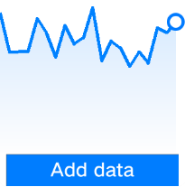

-   柱状图

    ```
     <!-- xxx.hml --> 
     <div class="container"> 
       <chart class="chart" type="bar" id="bar-chart" options="{{barOps}}" datasets="{{barData}}"></chart> 
     </div>
    /* xxx.css */ 
     .container { 
         flex-direction: column; 
         justify-content: center; 
         align-items: center; 
         width: 454px; 
         height: 454px; 
         background-color: white; 
     } 
     .chart { 
         width: 300px; 
         height: 300px; 
     }
    // xxx.js 
    export default { 
        data: { 
            barData: [ 
            { 
                fillColor: '#f07826', 
                data: [763, 550, 551, 554, 731, 654, 525, 696, 595, 628], 
            }, 
            { 
                fillColor: '#cce5ff', 
                data: [535, 776, 615, 444, 694, 785, 677, 609, 562, 410], 
            }, 
            { 
                fillColor: '#ff88bb', 
                data: [673, 500, 574, 483, 702, 583, 437, 506, 693, 657], 
            }, 
            ], 
            barOps: { 
                xAxis: { 
                    min: 0, 
                    max: 20, 
                    display: false, 
                    axisTick: 10 
                }, 
                yAxis: { 
                min: 0, 
                max: 1000, 
                display: false, 
                }, 
            }, 
        } 
    }
    ```

    **图 2**  chart组件-柱状图示例结果<a name="zh-cn_topic_0000002411207596_fig1766973320517"></a>  
    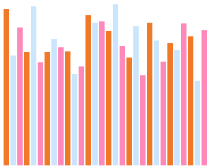

### image<a name="ZH-CN_TOPIC_0000002466543336"></a>

图片组件，用来渲染展示图片。

**子组件<a name="zh-cn_topic_0000002444726825_section3695mcpsimp"></a>**

不支持。

**属性<a name="zh-cn_topic_0000002444726825_section3698mcpsimp"></a>**

除支持“[通用属性](#ZH-CN_TOPIC_0000002466543388)”中所述属性外，还支持如[表1](#zh-cn_topic_0000002444726825_table3703mcpsimp)所示属性。

**表 1**  image组件属性说明

<a name="zh-cn_topic_0000002444726825_table3703mcpsimp"></a>
<table><thead align="left"><tr id="zh-cn_topic_0000002444726825_row3711mcpsimp"><th class="cellrowborder" valign="top" width="13.07%" id="mcps1.2.6.1.1"><p id="zh-cn_topic_0000002444726825_p3713mcpsimp"><a name="zh-cn_topic_0000002444726825_p3713mcpsimp"></a><a name="zh-cn_topic_0000002444726825_p3713mcpsimp"></a>名称</p>
</th>
<th class="cellrowborder" valign="top" width="13.719999999999999%" id="mcps1.2.6.1.2"><p id="zh-cn_topic_0000002444726825_p3715mcpsimp"><a name="zh-cn_topic_0000002444726825_p3715mcpsimp"></a><a name="zh-cn_topic_0000002444726825_p3715mcpsimp"></a>类型</p>
</th>
<th class="cellrowborder" valign="top" width="15.07%" id="mcps1.2.6.1.3"><p id="zh-cn_topic_0000002444726825_p3717mcpsimp"><a name="zh-cn_topic_0000002444726825_p3717mcpsimp"></a><a name="zh-cn_topic_0000002444726825_p3717mcpsimp"></a>默认值</p>
</th>
<th class="cellrowborder" valign="top" width="13.089999999999998%" id="mcps1.2.6.1.4"><p id="zh-cn_topic_0000002444726825_p3719mcpsimp"><a name="zh-cn_topic_0000002444726825_p3719mcpsimp"></a><a name="zh-cn_topic_0000002444726825_p3719mcpsimp"></a>必填</p>
</th>
<th class="cellrowborder" valign="top" width="45.050000000000004%" id="mcps1.2.6.1.5"><p id="zh-cn_topic_0000002444726825_p3721mcpsimp"><a name="zh-cn_topic_0000002444726825_p3721mcpsimp"></a><a name="zh-cn_topic_0000002444726825_p3721mcpsimp"></a>说明</p>
</th>
</tr>
</thead>
<tbody><tr id="zh-cn_topic_0000002444726825_row3723mcpsimp"><td class="cellrowborder" valign="top" width="13.07%" headers="mcps1.2.6.1.1 "><p id="zh-cn_topic_0000002444726825_p3725mcpsimp"><a name="zh-cn_topic_0000002444726825_p3725mcpsimp"></a><a name="zh-cn_topic_0000002444726825_p3725mcpsimp"></a>src</p>
</td>
<td class="cellrowborder" valign="top" width="13.719999999999999%" headers="mcps1.2.6.1.2 "><p id="zh-cn_topic_0000002444726825_p3727mcpsimp"><a name="zh-cn_topic_0000002444726825_p3727mcpsimp"></a><a name="zh-cn_topic_0000002444726825_p3727mcpsimp"></a>string</p>
</td>
<td class="cellrowborder" valign="top" width="15.07%" headers="mcps1.2.6.1.3 "><p id="zh-cn_topic_0000002444726825_p3729mcpsimp"><a name="zh-cn_topic_0000002444726825_p3729mcpsimp"></a><a name="zh-cn_topic_0000002444726825_p3729mcpsimp"></a>-</p>
</td>
<td class="cellrowborder" valign="top" width="13.089999999999998%" headers="mcps1.2.6.1.4 "><p id="zh-cn_topic_0000002444726825_p3731mcpsimp"><a name="zh-cn_topic_0000002444726825_p3731mcpsimp"></a><a name="zh-cn_topic_0000002444726825_p3731mcpsimp"></a>否</p>
</td>
<td class="cellrowborder" valign="top" width="45.050000000000004%" headers="mcps1.2.6.1.5 "><p id="zh-cn_topic_0000002444726825_p3733mcpsimp"><a name="zh-cn_topic_0000002444726825_p3733mcpsimp"></a><a name="zh-cn_topic_0000002444726825_p3733mcpsimp"></a>图片的路径，支持的图片格式包括png、jpg。</p>
</td>
</tr>
</tbody>
</table>

> **说明：** 
>轻量级智能穿戴上，单个应用所有的图片资源总大小不得超过8M。

**样式<a name="zh-cn_topic_0000002444726825_section3736mcpsimp"></a>**

支持“[通用样式](#ZH-CN_TOPIC_0000002499582761)”中所述样式。

**事件<a name="zh-cn_topic_0000002444726825_section3741mcpsimp"></a>**

支持“[通用事件](#ZH-CN_TOPIC_0000002466543364)”中所述事件。

### image-animator<a name="ZH-CN_TOPIC_0000002499582749"></a>

图片帧动画播放器。

**子组件<a name="zh-cn_topic_0000002411207544_section2723mcpsimp"></a>**

不支持。

**属性<a name="zh-cn_topic_0000002411207544_section2726mcpsimp"></a>**

除支持“[通用属性](#ZH-CN_TOPIC_0000002466543388)”中所述属性外，还支持如[表1](#zh-cn_topic_0000002411207544__table67453165913)所示属性。

**表 1**  image-animator组件属性说明

<a name="zh-cn_topic_0000002411207544__table67453165913"></a>
<table><thead align="left"><tr id="zh-cn_topic_0000002411207544_row2739mcpsimp"><th class="cellrowborder" valign="top" width="15.229999999999999%" id="mcps1.2.6.1.1"><p id="zh-cn_topic_0000002411207544_p2741mcpsimp"><a name="zh-cn_topic_0000002411207544_p2741mcpsimp"></a><a name="zh-cn_topic_0000002411207544_p2741mcpsimp"></a>名称</p>
</th>
<th class="cellrowborder" valign="top" width="15.6%" id="mcps1.2.6.1.2"><p id="zh-cn_topic_0000002411207544_p2743mcpsimp"><a name="zh-cn_topic_0000002411207544_p2743mcpsimp"></a><a name="zh-cn_topic_0000002411207544_p2743mcpsimp"></a>类型</p>
</th>
<th class="cellrowborder" valign="top" width="15.85%" id="mcps1.2.6.1.3"><p id="zh-cn_topic_0000002411207544_p2745mcpsimp"><a name="zh-cn_topic_0000002411207544_p2745mcpsimp"></a><a name="zh-cn_topic_0000002411207544_p2745mcpsimp"></a>默认值</p>
</th>
<th class="cellrowborder" valign="top" width="11.95%" id="mcps1.2.6.1.4"><p id="zh-cn_topic_0000002411207544_p2747mcpsimp"><a name="zh-cn_topic_0000002411207544_p2747mcpsimp"></a><a name="zh-cn_topic_0000002411207544_p2747mcpsimp"></a>必填</p>
</th>
<th class="cellrowborder" valign="top" width="41.370000000000005%" id="mcps1.2.6.1.5"><p id="zh-cn_topic_0000002411207544_p2749mcpsimp"><a name="zh-cn_topic_0000002411207544_p2749mcpsimp"></a><a name="zh-cn_topic_0000002411207544_p2749mcpsimp"></a>说明</p>
</th>
</tr>
</thead>
<tbody><tr id="zh-cn_topic_0000002411207544_row2751mcpsimp"><td class="cellrowborder" valign="top" width="15.229999999999999%" headers="mcps1.2.6.1.1 "><p id="zh-cn_topic_0000002411207544_p2753mcpsimp"><a name="zh-cn_topic_0000002411207544_p2753mcpsimp"></a><a name="zh-cn_topic_0000002411207544_p2753mcpsimp"></a>images</p>
</td>
<td class="cellrowborder" valign="top" width="15.6%" headers="mcps1.2.6.1.2 "><p id="zh-cn_topic_0000002411207544_p2755mcpsimp"><a name="zh-cn_topic_0000002411207544_p2755mcpsimp"></a><a name="zh-cn_topic_0000002411207544_p2755mcpsimp"></a>Array&lt;ImageFrame&gt;</p>
</td>
<td class="cellrowborder" valign="top" width="15.85%" headers="mcps1.2.6.1.3 "><p id="zh-cn_topic_0000002411207544_p2757mcpsimp"><a name="zh-cn_topic_0000002411207544_p2757mcpsimp"></a><a name="zh-cn_topic_0000002411207544_p2757mcpsimp"></a>-</p>
</td>
<td class="cellrowborder" valign="top" width="11.95%" headers="mcps1.2.6.1.4 "><p id="zh-cn_topic_0000002411207544_p2759mcpsimp"><a name="zh-cn_topic_0000002411207544_p2759mcpsimp"></a><a name="zh-cn_topic_0000002411207544_p2759mcpsimp"></a>是</p>
</td>
<td class="cellrowborder" valign="top" width="41.370000000000005%" headers="mcps1.2.6.1.5 "><p id="zh-cn_topic_0000002411207544_p2761mcpsimp"><a name="zh-cn_topic_0000002411207544_p2761mcpsimp"></a><a name="zh-cn_topic_0000002411207544_p2761mcpsimp"></a>设置图片帧信息集合。每一帧的帧信息包含图片路径、图片大小和图片位置信息。目前支持以下图片格式：png、jpg。ImageFrame的详细说明请见<a href="#zh-cn_topic_0000002411207544_table2824mcpsimp">表2</a>。</p>
<p id="zh-cn_topic_0000002411207544_p2764mcpsimp"><a name="zh-cn_topic_0000002411207544_p2764mcpsimp"></a><a name="zh-cn_topic_0000002411207544_p2764mcpsimp"></a><strong id="zh-cn_topic_0000002411207544_b194712406388"><a name="zh-cn_topic_0000002411207544_b194712406388"></a><a name="zh-cn_topic_0000002411207544_b194712406388"></a>注意：使用时需要使用数据绑定的方式，如images = {{images}}，js中声明相应变量：images: [{src: "/common/heart-rate01.png"}, {src: "/common/heart-rate02.png"}]。</strong></p>
</td>
</tr>
<tr id="zh-cn_topic_0000002411207544_row2765mcpsimp"><td class="cellrowborder" valign="top" width="15.229999999999999%" headers="mcps1.2.6.1.1 "><p id="zh-cn_topic_0000002411207544_p2767mcpsimp"><a name="zh-cn_topic_0000002411207544_p2767mcpsimp"></a><a name="zh-cn_topic_0000002411207544_p2767mcpsimp"></a>iteration</p>
</td>
<td class="cellrowborder" valign="top" width="15.6%" headers="mcps1.2.6.1.2 "><p id="zh-cn_topic_0000002411207544_p2769mcpsimp"><a name="zh-cn_topic_0000002411207544_p2769mcpsimp"></a><a name="zh-cn_topic_0000002411207544_p2769mcpsimp"></a>number | string</p>
</td>
<td class="cellrowborder" valign="top" width="15.85%" headers="mcps1.2.6.1.3 "><p id="zh-cn_topic_0000002411207544_p2771mcpsimp"><a name="zh-cn_topic_0000002411207544_p2771mcpsimp"></a><a name="zh-cn_topic_0000002411207544_p2771mcpsimp"></a>infinite</p>
</td>
<td class="cellrowborder" valign="top" width="11.95%" headers="mcps1.2.6.1.4 "><p id="zh-cn_topic_0000002411207544_p2773mcpsimp"><a name="zh-cn_topic_0000002411207544_p2773mcpsimp"></a><a name="zh-cn_topic_0000002411207544_p2773mcpsimp"></a>否</p>
</td>
<td class="cellrowborder" valign="top" width="41.370000000000005%" headers="mcps1.2.6.1.5 "><p id="zh-cn_topic_0000002411207544_p2775mcpsimp"><a name="zh-cn_topic_0000002411207544_p2775mcpsimp"></a><a name="zh-cn_topic_0000002411207544_p2775mcpsimp"></a>设置帧动画播放次数。number表示固定次数，infinite枚举表示无限次数播放。</p>
</td>
</tr>
<tr id="zh-cn_topic_0000002411207544_row2776mcpsimp"><td class="cellrowborder" valign="top" width="15.229999999999999%" headers="mcps1.2.6.1.1 "><p id="zh-cn_topic_0000002411207544_p2778mcpsimp"><a name="zh-cn_topic_0000002411207544_p2778mcpsimp"></a><a name="zh-cn_topic_0000002411207544_p2778mcpsimp"></a>reverse</p>
</td>
<td class="cellrowborder" valign="top" width="15.6%" headers="mcps1.2.6.1.2 "><p id="zh-cn_topic_0000002411207544_p2780mcpsimp"><a name="zh-cn_topic_0000002411207544_p2780mcpsimp"></a><a name="zh-cn_topic_0000002411207544_p2780mcpsimp"></a>boolean</p>
</td>
<td class="cellrowborder" valign="top" width="15.85%" headers="mcps1.2.6.1.3 "><p id="zh-cn_topic_0000002411207544_p2782mcpsimp"><a name="zh-cn_topic_0000002411207544_p2782mcpsimp"></a><a name="zh-cn_topic_0000002411207544_p2782mcpsimp"></a>false</p>
</td>
<td class="cellrowborder" valign="top" width="11.95%" headers="mcps1.2.6.1.4 "><p id="zh-cn_topic_0000002411207544_p2784mcpsimp"><a name="zh-cn_topic_0000002411207544_p2784mcpsimp"></a><a name="zh-cn_topic_0000002411207544_p2784mcpsimp"></a>否</p>
</td>
<td class="cellrowborder" valign="top" width="41.370000000000005%" headers="mcps1.2.6.1.5 "><p id="zh-cn_topic_0000002411207544_p13571847111611"><a name="zh-cn_topic_0000002411207544_p13571847111611"></a><a name="zh-cn_topic_0000002411207544_p13571847111611"></a>设置播放顺序。</p>
<a name="zh-cn_topic_0000002411207544_ul8711145413169"></a><a name="zh-cn_topic_0000002411207544_ul8711145413169"></a><ul id="zh-cn_topic_0000002411207544_ul8711145413169"><li>false：从第1张图片播放到最后1张图片。</li><li>true：从最后1张图片播放到第1张图片。</li></ul>
</td>
</tr>
<tr id="zh-cn_topic_0000002411207544_row2787mcpsimp"><td class="cellrowborder" valign="top" width="15.229999999999999%" headers="mcps1.2.6.1.1 "><p id="zh-cn_topic_0000002411207544_p2789mcpsimp"><a name="zh-cn_topic_0000002411207544_p2789mcpsimp"></a><a name="zh-cn_topic_0000002411207544_p2789mcpsimp"></a>fixedsize</p>
</td>
<td class="cellrowborder" valign="top" width="15.6%" headers="mcps1.2.6.1.2 "><p id="zh-cn_topic_0000002411207544_p2791mcpsimp"><a name="zh-cn_topic_0000002411207544_p2791mcpsimp"></a><a name="zh-cn_topic_0000002411207544_p2791mcpsimp"></a>boolean</p>
</td>
<td class="cellrowborder" valign="top" width="15.85%" headers="mcps1.2.6.1.3 "><p id="zh-cn_topic_0000002411207544_p2793mcpsimp"><a name="zh-cn_topic_0000002411207544_p2793mcpsimp"></a><a name="zh-cn_topic_0000002411207544_p2793mcpsimp"></a>true</p>
</td>
<td class="cellrowborder" valign="top" width="11.95%" headers="mcps1.2.6.1.4 "><p id="zh-cn_topic_0000002411207544_p2795mcpsimp"><a name="zh-cn_topic_0000002411207544_p2795mcpsimp"></a><a name="zh-cn_topic_0000002411207544_p2795mcpsimp"></a>否</p>
</td>
<td class="cellrowborder" valign="top" width="41.370000000000005%" headers="mcps1.2.6.1.5 "><p id="zh-cn_topic_0000002411207544_p1597011412171"><a name="zh-cn_topic_0000002411207544_p1597011412171"></a><a name="zh-cn_topic_0000002411207544_p1597011412171"></a>设置图片大小是否固定为组件大小。</p>
<a name="zh-cn_topic_0000002411207544_ul27711812191714"></a><a name="zh-cn_topic_0000002411207544_ul27711812191714"></a><ul id="zh-cn_topic_0000002411207544_ul27711812191714"><li>true：图片大小与组件大小一致，此时设置图片的width 、height 、top 和left属性是无效的。</li><li>false：每一张图片的 width 、height 、top和left属性都要单独设置。</li></ul>
</td>
</tr>
<tr id="zh-cn_topic_0000002411207544_row2798mcpsimp"><td class="cellrowborder" valign="top" width="15.229999999999999%" headers="mcps1.2.6.1.1 "><p id="zh-cn_topic_0000002411207544_p2800mcpsimp"><a name="zh-cn_topic_0000002411207544_p2800mcpsimp"></a><a name="zh-cn_topic_0000002411207544_p2800mcpsimp"></a>duration</p>
</td>
<td class="cellrowborder" valign="top" width="15.6%" headers="mcps1.2.6.1.2 "><p id="zh-cn_topic_0000002411207544_p2802mcpsimp"><a name="zh-cn_topic_0000002411207544_p2802mcpsimp"></a><a name="zh-cn_topic_0000002411207544_p2802mcpsimp"></a>string</p>
</td>
<td class="cellrowborder" valign="top" width="15.85%" headers="mcps1.2.6.1.3 "><p id="zh-cn_topic_0000002411207544_p2804mcpsimp"><a name="zh-cn_topic_0000002411207544_p2804mcpsimp"></a><a name="zh-cn_topic_0000002411207544_p2804mcpsimp"></a>-</p>
</td>
<td class="cellrowborder" valign="top" width="11.95%" headers="mcps1.2.6.1.4 "><p id="zh-cn_topic_0000002411207544_p2806mcpsimp"><a name="zh-cn_topic_0000002411207544_p2806mcpsimp"></a><a name="zh-cn_topic_0000002411207544_p2806mcpsimp"></a>是</p>
</td>
<td class="cellrowborder" valign="top" width="41.370000000000005%" headers="mcps1.2.6.1.5 "><p id="zh-cn_topic_0000002411207544_p2808mcpsimp"><a name="zh-cn_topic_0000002411207544_p2808mcpsimp"></a><a name="zh-cn_topic_0000002411207544_p2808mcpsimp"></a>设置单次播放时长。单位支持[s(秒)|ms(毫秒)]，默认单位为ms。 duration为0时，不播放图片。 值改变只会在下一次循环开始时生效。</p>
</td>
</tr>
<tr id="zh-cn_topic_0000002411207544_row2809mcpsimp"><td class="cellrowborder" valign="top" width="15.229999999999999%" headers="mcps1.2.6.1.1 "><p id="zh-cn_topic_0000002411207544_p2811mcpsimp"><a name="zh-cn_topic_0000002411207544_p2811mcpsimp"></a><a name="zh-cn_topic_0000002411207544_p2811mcpsimp"></a>fillmode<sup id="zh-cn_topic_0000002411207544_sup2812mcpsimp"><a name="zh-cn_topic_0000002411207544_sup2812mcpsimp"></a><a name="zh-cn_topic_0000002411207544_sup2812mcpsimp"></a>5+</sup></p>
</td>
<td class="cellrowborder" valign="top" width="15.6%" headers="mcps1.2.6.1.2 "><p id="zh-cn_topic_0000002411207544_p2814mcpsimp"><a name="zh-cn_topic_0000002411207544_p2814mcpsimp"></a><a name="zh-cn_topic_0000002411207544_p2814mcpsimp"></a>string</p>
</td>
<td class="cellrowborder" valign="top" width="15.85%" headers="mcps1.2.6.1.3 "><p id="zh-cn_topic_0000002411207544_p2816mcpsimp"><a name="zh-cn_topic_0000002411207544_p2816mcpsimp"></a><a name="zh-cn_topic_0000002411207544_p2816mcpsimp"></a>forwards</p>
</td>
<td class="cellrowborder" valign="top" width="11.95%" headers="mcps1.2.6.1.4 "><p id="zh-cn_topic_0000002411207544_p2818mcpsimp"><a name="zh-cn_topic_0000002411207544_p2818mcpsimp"></a><a name="zh-cn_topic_0000002411207544_p2818mcpsimp"></a>否</p>
</td>
<td class="cellrowborder" valign="top" width="41.370000000000005%" headers="mcps1.2.6.1.5 "><p id="zh-cn_topic_0000002411207544_p2820mcpsimp"><a name="zh-cn_topic_0000002411207544_p2820mcpsimp"></a><a name="zh-cn_topic_0000002411207544_p2820mcpsimp"></a>指定帧动画执行结束后的状态。可选项有：</p>
<a name="zh-cn_topic_0000002411207544_ul2821mcpsimp"></a><a name="zh-cn_topic_0000002411207544_ul2821mcpsimp"></a><ul id="zh-cn_topic_0000002411207544_ul2821mcpsimp"><li>none：恢复初始状态。</li><li>forwards：保持帧动画结束时的状态（在最后一个关键帧中定义）。</li></ul>
</td>
</tr>
</tbody>
</table>

**表 2**  ImageFrame说明

<a name="zh-cn_topic_0000002411207544_table2824mcpsimp"></a>
<table><thead align="left"><tr id="zh-cn_topic_0000002411207544_row2832mcpsimp"><th class="cellrowborder" valign="top" width="14.030000000000001%" id="mcps1.2.6.1.1"><p id="zh-cn_topic_0000002411207544_p2834mcpsimp"><a name="zh-cn_topic_0000002411207544_p2834mcpsimp"></a><a name="zh-cn_topic_0000002411207544_p2834mcpsimp"></a>名称</p>
</th>
<th class="cellrowborder" valign="top" width="16.6%" id="mcps1.2.6.1.2"><p id="zh-cn_topic_0000002411207544_p2836mcpsimp"><a name="zh-cn_topic_0000002411207544_p2836mcpsimp"></a><a name="zh-cn_topic_0000002411207544_p2836mcpsimp"></a>类型</p>
</th>
<th class="cellrowborder" valign="top" width="14.93%" id="mcps1.2.6.1.3"><p id="zh-cn_topic_0000002411207544_p2838mcpsimp"><a name="zh-cn_topic_0000002411207544_p2838mcpsimp"></a><a name="zh-cn_topic_0000002411207544_p2838mcpsimp"></a>默认值</p>
</th>
<th class="cellrowborder" valign="top" width="12.67%" id="mcps1.2.6.1.4"><p id="zh-cn_topic_0000002411207544_p2840mcpsimp"><a name="zh-cn_topic_0000002411207544_p2840mcpsimp"></a><a name="zh-cn_topic_0000002411207544_p2840mcpsimp"></a>必填</p>
</th>
<th class="cellrowborder" valign="top" width="41.77%" id="mcps1.2.6.1.5"><p id="zh-cn_topic_0000002411207544_p2842mcpsimp"><a name="zh-cn_topic_0000002411207544_p2842mcpsimp"></a><a name="zh-cn_topic_0000002411207544_p2842mcpsimp"></a>说明</p>
</th>
</tr>
</thead>
<tbody><tr id="zh-cn_topic_0000002411207544_row2844mcpsimp"><td class="cellrowborder" valign="top" width="14.030000000000001%" headers="mcps1.2.6.1.1 "><p id="zh-cn_topic_0000002411207544_p2846mcpsimp"><a name="zh-cn_topic_0000002411207544_p2846mcpsimp"></a><a name="zh-cn_topic_0000002411207544_p2846mcpsimp"></a>src</p>
</td>
<td class="cellrowborder" valign="top" width="16.6%" headers="mcps1.2.6.1.2 "><p id="zh-cn_topic_0000002411207544_p2848mcpsimp"><a name="zh-cn_topic_0000002411207544_p2848mcpsimp"></a><a name="zh-cn_topic_0000002411207544_p2848mcpsimp"></a>&lt;uri&gt;</p>
</td>
<td class="cellrowborder" valign="top" width="14.93%" headers="mcps1.2.6.1.3 "><p id="zh-cn_topic_0000002411207544_p2850mcpsimp"><a name="zh-cn_topic_0000002411207544_p2850mcpsimp"></a><a name="zh-cn_topic_0000002411207544_p2850mcpsimp"></a>-</p>
</td>
<td class="cellrowborder" valign="top" width="12.67%" headers="mcps1.2.6.1.4 "><p id="zh-cn_topic_0000002411207544_p2852mcpsimp"><a name="zh-cn_topic_0000002411207544_p2852mcpsimp"></a><a name="zh-cn_topic_0000002411207544_p2852mcpsimp"></a>是</p>
</td>
<td class="cellrowborder" valign="top" width="41.77%" headers="mcps1.2.6.1.5 "><p id="zh-cn_topic_0000002411207544_p2854mcpsimp"><a name="zh-cn_topic_0000002411207544_p2854mcpsimp"></a><a name="zh-cn_topic_0000002411207544_p2854mcpsimp"></a>图片路径。</p>
</td>
</tr>
<tr id="zh-cn_topic_0000002411207544_row2855mcpsimp"><td class="cellrowborder" valign="top" width="14.030000000000001%" headers="mcps1.2.6.1.1 "><p id="zh-cn_topic_0000002411207544_p2857mcpsimp"><a name="zh-cn_topic_0000002411207544_p2857mcpsimp"></a><a name="zh-cn_topic_0000002411207544_p2857mcpsimp"></a>width</p>
</td>
<td class="cellrowborder" valign="top" width="16.6%" headers="mcps1.2.6.1.2 "><p id="zh-cn_topic_0000002411207544_p2859mcpsimp"><a name="zh-cn_topic_0000002411207544_p2859mcpsimp"></a><a name="zh-cn_topic_0000002411207544_p2859mcpsimp"></a>&lt;length&gt;</p>
</td>
<td class="cellrowborder" valign="top" width="14.93%" headers="mcps1.2.6.1.3 "><p id="zh-cn_topic_0000002411207544_p2861mcpsimp"><a name="zh-cn_topic_0000002411207544_p2861mcpsimp"></a><a name="zh-cn_topic_0000002411207544_p2861mcpsimp"></a>0</p>
</td>
<td class="cellrowborder" valign="top" width="12.67%" headers="mcps1.2.6.1.4 "><p id="zh-cn_topic_0000002411207544_p2863mcpsimp"><a name="zh-cn_topic_0000002411207544_p2863mcpsimp"></a><a name="zh-cn_topic_0000002411207544_p2863mcpsimp"></a>否</p>
</td>
<td class="cellrowborder" valign="top" width="41.77%" headers="mcps1.2.6.1.5 "><p id="zh-cn_topic_0000002411207544_p2865mcpsimp"><a name="zh-cn_topic_0000002411207544_p2865mcpsimp"></a><a name="zh-cn_topic_0000002411207544_p2865mcpsimp"></a>图片宽度。</p>
</td>
</tr>
<tr id="zh-cn_topic_0000002411207544_row2866mcpsimp"><td class="cellrowborder" valign="top" width="14.030000000000001%" headers="mcps1.2.6.1.1 "><p id="zh-cn_topic_0000002411207544_p2868mcpsimp"><a name="zh-cn_topic_0000002411207544_p2868mcpsimp"></a><a name="zh-cn_topic_0000002411207544_p2868mcpsimp"></a>height</p>
</td>
<td class="cellrowborder" valign="top" width="16.6%" headers="mcps1.2.6.1.2 "><p id="zh-cn_topic_0000002411207544_p2870mcpsimp"><a name="zh-cn_topic_0000002411207544_p2870mcpsimp"></a><a name="zh-cn_topic_0000002411207544_p2870mcpsimp"></a>&lt;length&gt;</p>
</td>
<td class="cellrowborder" valign="top" width="14.93%" headers="mcps1.2.6.1.3 "><p id="zh-cn_topic_0000002411207544_p2872mcpsimp"><a name="zh-cn_topic_0000002411207544_p2872mcpsimp"></a><a name="zh-cn_topic_0000002411207544_p2872mcpsimp"></a>0</p>
</td>
<td class="cellrowborder" valign="top" width="12.67%" headers="mcps1.2.6.1.4 "><p id="zh-cn_topic_0000002411207544_p2874mcpsimp"><a name="zh-cn_topic_0000002411207544_p2874mcpsimp"></a><a name="zh-cn_topic_0000002411207544_p2874mcpsimp"></a>否</p>
</td>
<td class="cellrowborder" valign="top" width="41.77%" headers="mcps1.2.6.1.5 "><p id="zh-cn_topic_0000002411207544_p2876mcpsimp"><a name="zh-cn_topic_0000002411207544_p2876mcpsimp"></a><a name="zh-cn_topic_0000002411207544_p2876mcpsimp"></a>图片高度。</p>
</td>
</tr>
<tr id="zh-cn_topic_0000002411207544_row2877mcpsimp"><td class="cellrowborder" valign="top" width="14.030000000000001%" headers="mcps1.2.6.1.1 "><p id="zh-cn_topic_0000002411207544_p2879mcpsimp"><a name="zh-cn_topic_0000002411207544_p2879mcpsimp"></a><a name="zh-cn_topic_0000002411207544_p2879mcpsimp"></a>top</p>
</td>
<td class="cellrowborder" valign="top" width="16.6%" headers="mcps1.2.6.1.2 "><p id="zh-cn_topic_0000002411207544_p2881mcpsimp"><a name="zh-cn_topic_0000002411207544_p2881mcpsimp"></a><a name="zh-cn_topic_0000002411207544_p2881mcpsimp"></a>&lt;length&gt;</p>
</td>
<td class="cellrowborder" valign="top" width="14.93%" headers="mcps1.2.6.1.3 "><p id="zh-cn_topic_0000002411207544_p2883mcpsimp"><a name="zh-cn_topic_0000002411207544_p2883mcpsimp"></a><a name="zh-cn_topic_0000002411207544_p2883mcpsimp"></a>0</p>
</td>
<td class="cellrowborder" valign="top" width="12.67%" headers="mcps1.2.6.1.4 "><p id="zh-cn_topic_0000002411207544_p2885mcpsimp"><a name="zh-cn_topic_0000002411207544_p2885mcpsimp"></a><a name="zh-cn_topic_0000002411207544_p2885mcpsimp"></a>否</p>
</td>
<td class="cellrowborder" valign="top" width="41.77%" headers="mcps1.2.6.1.5 "><p id="zh-cn_topic_0000002411207544_p2887mcpsimp"><a name="zh-cn_topic_0000002411207544_p2887mcpsimp"></a><a name="zh-cn_topic_0000002411207544_p2887mcpsimp"></a>图片相对于组件左上角的纵向坐标。</p>
</td>
</tr>
<tr id="zh-cn_topic_0000002411207544_row2888mcpsimp"><td class="cellrowborder" valign="top" width="14.030000000000001%" headers="mcps1.2.6.1.1 "><p id="zh-cn_topic_0000002411207544_p2890mcpsimp"><a name="zh-cn_topic_0000002411207544_p2890mcpsimp"></a><a name="zh-cn_topic_0000002411207544_p2890mcpsimp"></a>left</p>
</td>
<td class="cellrowborder" valign="top" width="16.6%" headers="mcps1.2.6.1.2 "><p id="zh-cn_topic_0000002411207544_p2892mcpsimp"><a name="zh-cn_topic_0000002411207544_p2892mcpsimp"></a><a name="zh-cn_topic_0000002411207544_p2892mcpsimp"></a>&lt;length&gt;</p>
</td>
<td class="cellrowborder" valign="top" width="14.93%" headers="mcps1.2.6.1.3 "><p id="zh-cn_topic_0000002411207544_p2894mcpsimp"><a name="zh-cn_topic_0000002411207544_p2894mcpsimp"></a><a name="zh-cn_topic_0000002411207544_p2894mcpsimp"></a>0</p>
</td>
<td class="cellrowborder" valign="top" width="12.67%" headers="mcps1.2.6.1.4 "><p id="zh-cn_topic_0000002411207544_p2896mcpsimp"><a name="zh-cn_topic_0000002411207544_p2896mcpsimp"></a><a name="zh-cn_topic_0000002411207544_p2896mcpsimp"></a>否</p>
</td>
<td class="cellrowborder" valign="top" width="41.77%" headers="mcps1.2.6.1.5 "><p id="zh-cn_topic_0000002411207544_p2898mcpsimp"><a name="zh-cn_topic_0000002411207544_p2898mcpsimp"></a><a name="zh-cn_topic_0000002411207544_p2898mcpsimp"></a>图片相对于组件左上角的横向坐标。</p>
</td>
</tr>
</tbody>
</table>

**样式<a name="zh-cn_topic_0000002411207544_section2899mcpsimp"></a>**

支持“[通用样式](#ZH-CN_TOPIC_0000002499582761)”中所述样式。

**事件<a name="zh-cn_topic_0000002411207544_section2904mcpsimp"></a>**

除支持“[通用事件](#ZH-CN_TOPIC_0000002466543364)”中所述事件外，还支持如[表3](#zh-cn_topic_0000002411207544_table2909mcpsimp)所示事件。

**表 3**  image-animator组件事件说明

<a name="zh-cn_topic_0000002411207544_table2909mcpsimp"></a>
<table><thead align="left"><tr id="zh-cn_topic_0000002411207544_row2915mcpsimp"><th class="cellrowborder" valign="top" width="17.87178717871787%" id="mcps1.2.4.1.1"><p id="zh-cn_topic_0000002411207544_p2917mcpsimp"><a name="zh-cn_topic_0000002411207544_p2917mcpsimp"></a><a name="zh-cn_topic_0000002411207544_p2917mcpsimp"></a>名称</p>
</th>
<th class="cellrowborder" valign="top" width="17.57175717571757%" id="mcps1.2.4.1.2"><p id="zh-cn_topic_0000002411207544_p2919mcpsimp"><a name="zh-cn_topic_0000002411207544_p2919mcpsimp"></a><a name="zh-cn_topic_0000002411207544_p2919mcpsimp"></a>参数</p>
</th>
<th class="cellrowborder" valign="top" width="64.55645564556455%" id="mcps1.2.4.1.3"><p id="zh-cn_topic_0000002411207544_p2921mcpsimp"><a name="zh-cn_topic_0000002411207544_p2921mcpsimp"></a><a name="zh-cn_topic_0000002411207544_p2921mcpsimp"></a>说明</p>
</th>
</tr>
</thead>
<tbody><tr id="zh-cn_topic_0000002411207544_row2923mcpsimp"><td class="cellrowborder" valign="top" width="17.87178717871787%" headers="mcps1.2.4.1.1 "><p id="zh-cn_topic_0000002411207544_p2925mcpsimp"><a name="zh-cn_topic_0000002411207544_p2925mcpsimp"></a><a name="zh-cn_topic_0000002411207544_p2925mcpsimp"></a>stop</p>
</td>
<td class="cellrowborder" valign="top" width="17.57175717571757%" headers="mcps1.2.4.1.2 "><p id="zh-cn_topic_0000002411207544_p2927mcpsimp"><a name="zh-cn_topic_0000002411207544_p2927mcpsimp"></a><a name="zh-cn_topic_0000002411207544_p2927mcpsimp"></a>-</p>
</td>
<td class="cellrowborder" valign="top" width="64.55645564556455%" headers="mcps1.2.4.1.3 "><p id="zh-cn_topic_0000002411207544_p2929mcpsimp"><a name="zh-cn_topic_0000002411207544_p2929mcpsimp"></a><a name="zh-cn_topic_0000002411207544_p2929mcpsimp"></a>帧动画结束时触发。</p>
</td>
</tr>
</tbody>
</table>

**方法<a name="zh-cn_topic_0000002411207544_section2930mcpsimp"></a>**

**表 4**  image-animator组件方法说明

<a name="zh-cn_topic_0000002411207544_table2932mcpsimp"></a>
<table><thead align="left"><tr id="zh-cn_topic_0000002411207544_row2938mcpsimp"><th class="cellrowborder" valign="top" width="17.080000000000002%" id="mcps1.2.4.1.1"><p id="zh-cn_topic_0000002411207544_p2940mcpsimp"><a name="zh-cn_topic_0000002411207544_p2940mcpsimp"></a><a name="zh-cn_topic_0000002411207544_p2940mcpsimp"></a>名称</p>
</th>
<th class="cellrowborder" valign="top" width="17.31%" id="mcps1.2.4.1.2"><p id="zh-cn_topic_0000002411207544_p2942mcpsimp"><a name="zh-cn_topic_0000002411207544_p2942mcpsimp"></a><a name="zh-cn_topic_0000002411207544_p2942mcpsimp"></a>参数</p>
</th>
<th class="cellrowborder" valign="top" width="65.61%" id="mcps1.2.4.1.3"><p id="zh-cn_topic_0000002411207544_p2944mcpsimp"><a name="zh-cn_topic_0000002411207544_p2944mcpsimp"></a><a name="zh-cn_topic_0000002411207544_p2944mcpsimp"></a>说明</p>
</th>
</tr>
</thead>
<tbody><tr id="zh-cn_topic_0000002411207544_row2946mcpsimp"><td class="cellrowborder" valign="top" width="17.080000000000002%" headers="mcps1.2.4.1.1 "><p id="zh-cn_topic_0000002411207544_p2948mcpsimp"><a name="zh-cn_topic_0000002411207544_p2948mcpsimp"></a><a name="zh-cn_topic_0000002411207544_p2948mcpsimp"></a>start</p>
</td>
<td class="cellrowborder" valign="top" width="17.31%" headers="mcps1.2.4.1.2 "><p id="zh-cn_topic_0000002411207544_p2950mcpsimp"><a name="zh-cn_topic_0000002411207544_p2950mcpsimp"></a><a name="zh-cn_topic_0000002411207544_p2950mcpsimp"></a>-</p>
</td>
<td class="cellrowborder" valign="top" width="65.61%" headers="mcps1.2.4.1.3 "><p id="zh-cn_topic_0000002411207544_p2952mcpsimp"><a name="zh-cn_topic_0000002411207544_p2952mcpsimp"></a><a name="zh-cn_topic_0000002411207544_p2952mcpsimp"></a>开始播放图片帧动画。再次调用，重新从第1帧开始播放。</p>
</td>
</tr>
<tr id="zh-cn_topic_0000002411207544_row2953mcpsimp"><td class="cellrowborder" valign="top" width="17.080000000000002%" headers="mcps1.2.4.1.1 "><p id="zh-cn_topic_0000002411207544_p2955mcpsimp"><a name="zh-cn_topic_0000002411207544_p2955mcpsimp"></a><a name="zh-cn_topic_0000002411207544_p2955mcpsimp"></a>pause</p>
</td>
<td class="cellrowborder" valign="top" width="17.31%" headers="mcps1.2.4.1.2 "><p id="zh-cn_topic_0000002411207544_p2957mcpsimp"><a name="zh-cn_topic_0000002411207544_p2957mcpsimp"></a><a name="zh-cn_topic_0000002411207544_p2957mcpsimp"></a>-</p>
</td>
<td class="cellrowborder" valign="top" width="65.61%" headers="mcps1.2.4.1.3 "><p id="zh-cn_topic_0000002411207544_p2959mcpsimp"><a name="zh-cn_topic_0000002411207544_p2959mcpsimp"></a><a name="zh-cn_topic_0000002411207544_p2959mcpsimp"></a>暂停播放图片帧动画。</p>
</td>
</tr>
<tr id="zh-cn_topic_0000002411207544_row2960mcpsimp"><td class="cellrowborder" valign="top" width="17.080000000000002%" headers="mcps1.2.4.1.1 "><p id="zh-cn_topic_0000002411207544_p2962mcpsimp"><a name="zh-cn_topic_0000002411207544_p2962mcpsimp"></a><a name="zh-cn_topic_0000002411207544_p2962mcpsimp"></a>stop</p>
</td>
<td class="cellrowborder" valign="top" width="17.31%" headers="mcps1.2.4.1.2 "><p id="zh-cn_topic_0000002411207544_p2964mcpsimp"><a name="zh-cn_topic_0000002411207544_p2964mcpsimp"></a><a name="zh-cn_topic_0000002411207544_p2964mcpsimp"></a>-</p>
</td>
<td class="cellrowborder" valign="top" width="65.61%" headers="mcps1.2.4.1.3 "><p id="zh-cn_topic_0000002411207544_p2966mcpsimp"><a name="zh-cn_topic_0000002411207544_p2966mcpsimp"></a><a name="zh-cn_topic_0000002411207544_p2966mcpsimp"></a>停止播放图片帧动画。</p>
</td>
</tr>
<tr id="zh-cn_topic_0000002411207544_row2967mcpsimp"><td class="cellrowborder" valign="top" width="17.080000000000002%" headers="mcps1.2.4.1.1 "><p id="zh-cn_topic_0000002411207544_p2969mcpsimp"><a name="zh-cn_topic_0000002411207544_p2969mcpsimp"></a><a name="zh-cn_topic_0000002411207544_p2969mcpsimp"></a>resume</p>
</td>
<td class="cellrowborder" valign="top" width="17.31%" headers="mcps1.2.4.1.2 "><p id="zh-cn_topic_0000002411207544_p2971mcpsimp"><a name="zh-cn_topic_0000002411207544_p2971mcpsimp"></a><a name="zh-cn_topic_0000002411207544_p2971mcpsimp"></a>-</p>
</td>
<td class="cellrowborder" valign="top" width="65.61%" headers="mcps1.2.4.1.3 "><p id="zh-cn_topic_0000002411207544_p2973mcpsimp"><a name="zh-cn_topic_0000002411207544_p2973mcpsimp"></a><a name="zh-cn_topic_0000002411207544_p2973mcpsimp"></a>继续播放图片帧。</p>
</td>
</tr>
<tr id="zh-cn_topic_0000002411207544_row2974mcpsimp"><td class="cellrowborder" valign="top" width="17.080000000000002%" headers="mcps1.2.4.1.1 "><p id="zh-cn_topic_0000002411207544_p2976mcpsimp"><a name="zh-cn_topic_0000002411207544_p2976mcpsimp"></a><a name="zh-cn_topic_0000002411207544_p2976mcpsimp"></a>getState</p>
</td>
<td class="cellrowborder" valign="top" width="17.31%" headers="mcps1.2.4.1.2 "><p id="zh-cn_topic_0000002411207544_p2978mcpsimp"><a name="zh-cn_topic_0000002411207544_p2978mcpsimp"></a><a name="zh-cn_topic_0000002411207544_p2978mcpsimp"></a>-</p>
</td>
<td class="cellrowborder" valign="top" width="65.61%" headers="mcps1.2.4.1.3 "><p id="zh-cn_topic_0000002411207544_p2980mcpsimp"><a name="zh-cn_topic_0000002411207544_p2980mcpsimp"></a><a name="zh-cn_topic_0000002411207544_p2980mcpsimp"></a>获取播放状态。可能值有：</p>
<a name="zh-cn_topic_0000002411207544_ul2981mcpsimp"></a><a name="zh-cn_topic_0000002411207544_ul2981mcpsimp"></a><ul id="zh-cn_topic_0000002411207544_ul2981mcpsimp"><li>playing：播放中。</li><li>paused：已暂停。</li><li>stopped：已停止。</li></ul>
</td>
</tr>
</tbody>
</table>

**示例<a name="zh-cn_topic_0000002411207544_section2985mcpsimp"></a>**

```
<!-- xxx.hml --> 
<div class="container"> 
  <image-animator class="animator" ref="animator" images="{{frames}}" duration="1s" /> 
  <div class="btn-box"> 
    <input class="btn" type="button" value="start" @click="handleStart" /> 
    <input class="btn" type="button" value="stop" @click="handleStop" /> 
    <input class="btn" type="button" value="pause" @click="handlePause" /> 
    <input class="btn" type="button" value="resume" @click="handleResume" /> 
  </div> 
</div>
```

```
/* xxx.css */ 
.container { 
    flex-direction: column; 
    justify-content: center; 
    align-items: center; 
    left: 0px; 
    top: 0px; 
    width: 454px; 
    height: 454px; 
} 
.animator { 
    width: 70px; 
    height: 70px; 
} 
.btn-box { 
    width: 264px; 
    height: 120px; 
    flex-wrap: wrap; 
    justify-content: space-around; 
    align-items: center; 
} 
.btn { 
    border-radius: 8px; 
    width: 120px; 
    margin-top: 8px; 
}
```

```
//xxx.js 
export default { 
    data: { 
        frames: [ 
        { 
            src: "/common/asserts/heart78.png", 
        }, 
        { 
            src: "/common/asserts/heart79.png", 
        }, 
        { 
            src: "/common/asserts/heart80.png", 
        }, 
        { 
            src: "/common/asserts/heart81.png", 
        }, 
        { 
            src: "/common/asserts/heart82.png", 
        }, 
        { 
            src: "/common/asserts/heart83.png", 
        }, 
        { 
            src: "/common/asserts/heart84.png", 
        }, 
        { 
            src: "/common/asserts/heart85.png", 
        }, 
        { 
            src: "/common/asserts/heart86.png", 
        }, 
        { 
            src: "/common/asserts/heart87.png", 
        }, 
        { 
            src: "/common/asserts/heart88.png", 
        }, 
        { 
            src: "/common/asserts/heart89.png", 
        }, 
        { 
            src: "/common/asserts/heart90.png", 
        }, 
        { 
            src: "/common/asserts/heart91.png", 
        }, 
        { 
            src: "/common/asserts/heart92.png", 
        }, 
        { 
            src: "/common/asserts/heart93.png", 
        }, 
        { 
            src: "/common/asserts/heart94.png", 
        }, 
        { 
            src: "/common/asserts/heart95.png", 
        }, 
        { 
            src: "/common/asserts/heart96.png", 
        }, 
        ], 
    }, 
    handleStart() { 
        this.$refs.animator.start(); 
    }, 
    handlePause() { 
        this.$refs.animator.pause(); 
    }, 
    handleResume() { 
        this.$refs.animator.resume(); 
    }, 
    handleStop() { 
        this.$refs.animator.stop(); 
    }, 
};
```

**图 1**  image-animator组件-示例结果<a name="zh-cn_topic_0000002411207544_fig16074591673"></a>  


### input<a name="ZH-CN_TOPIC_0000002499502701"></a>

交互式组件，包括单选框、多选框、按钮。

**子组件<a name="zh-cn_topic_0000002444646717_section3199mcpsimp"></a>**

不支持。

**属性<a name="zh-cn_topic_0000002444646717_section3202mcpsimp"></a>**

除支持“[通用属性](#ZH-CN_TOPIC_0000002466543388)”中所述属性外，还支持如[表1](#zh-cn_topic_0000002444646717_table3207mcpsimp)所示属性。

**表 1**  input组件属性说明

<a name="zh-cn_topic_0000002444646717_table3207mcpsimp"></a>
<table><thead align="left"><tr id="zh-cn_topic_0000002444646717_row3215mcpsimp"><th class="cellrowborder" valign="top" width="12.989999999999998%" id="mcps1.2.6.1.1"><p id="zh-cn_topic_0000002444646717_p3217mcpsimp"><a name="zh-cn_topic_0000002444646717_p3217mcpsimp"></a><a name="zh-cn_topic_0000002444646717_p3217mcpsimp"></a>名称</p>
</th>
<th class="cellrowborder" valign="top" width="13.320000000000002%" id="mcps1.2.6.1.2"><p id="zh-cn_topic_0000002444646717_p3219mcpsimp"><a name="zh-cn_topic_0000002444646717_p3219mcpsimp"></a><a name="zh-cn_topic_0000002444646717_p3219mcpsimp"></a>类型</p>
</th>
<th class="cellrowborder" valign="top" width="14.74%" id="mcps1.2.6.1.3"><p id="zh-cn_topic_0000002444646717_p3221mcpsimp"><a name="zh-cn_topic_0000002444646717_p3221mcpsimp"></a><a name="zh-cn_topic_0000002444646717_p3221mcpsimp"></a>默认值</p>
</th>
<th class="cellrowborder" valign="top" width="10.95%" id="mcps1.2.6.1.4"><p id="zh-cn_topic_0000002444646717_p3223mcpsimp"><a name="zh-cn_topic_0000002444646717_p3223mcpsimp"></a><a name="zh-cn_topic_0000002444646717_p3223mcpsimp"></a>必填</p>
</th>
<th class="cellrowborder" valign="top" width="48%" id="mcps1.2.6.1.5"><p id="zh-cn_topic_0000002444646717_p3225mcpsimp"><a name="zh-cn_topic_0000002444646717_p3225mcpsimp"></a><a name="zh-cn_topic_0000002444646717_p3225mcpsimp"></a>说明</p>
</th>
</tr>
</thead>
<tbody><tr id="zh-cn_topic_0000002444646717_row3227mcpsimp"><td class="cellrowborder" valign="top" width="12.989999999999998%" headers="mcps1.2.6.1.1 "><p id="zh-cn_topic_0000002444646717_p3229mcpsimp"><a name="zh-cn_topic_0000002444646717_p3229mcpsimp"></a><a name="zh-cn_topic_0000002444646717_p3229mcpsimp"></a>type</p>
</td>
<td class="cellrowborder" valign="top" width="13.320000000000002%" headers="mcps1.2.6.1.2 "><p id="zh-cn_topic_0000002444646717_p3231mcpsimp"><a name="zh-cn_topic_0000002444646717_p3231mcpsimp"></a><a name="zh-cn_topic_0000002444646717_p3231mcpsimp"></a>string</p>
</td>
<td class="cellrowborder" valign="top" width="14.74%" headers="mcps1.2.6.1.3 "><p id="zh-cn_topic_0000002444646717_p3233mcpsimp"><a name="zh-cn_topic_0000002444646717_p3233mcpsimp"></a><a name="zh-cn_topic_0000002444646717_p3233mcpsimp"></a>button</p>
</td>
<td class="cellrowborder" valign="top" width="10.95%" headers="mcps1.2.6.1.4 "><p id="zh-cn_topic_0000002444646717_p3235mcpsimp"><a name="zh-cn_topic_0000002444646717_p3235mcpsimp"></a><a name="zh-cn_topic_0000002444646717_p3235mcpsimp"></a>否</p>
</td>
<td class="cellrowborder" valign="top" width="48%" headers="mcps1.2.6.1.5 "><p id="zh-cn_topic_0000002444646717_p3237mcpsimp"><a name="zh-cn_topic_0000002444646717_p3237mcpsimp"></a><a name="zh-cn_topic_0000002444646717_p3237mcpsimp"></a>input组件类型，可选值为button、checkbox、radio，均不支持动态修改。可选值定义如下：</p>
<a name="zh-cn_topic_0000002444646717_ul3239mcpsimp"></a><a name="zh-cn_topic_0000002444646717_ul3239mcpsimp"></a><ul id="zh-cn_topic_0000002444646717_ul3239mcpsimp"><li>button：定义可点击的按钮。</li><li>checkbox：定义多选框。</li><li>radio：定义单选按钮，允许在多个拥有相同name值的选项中选中其中一个。</li></ul>
</td>
</tr>
<tr id="zh-cn_topic_0000002444646717_row3243mcpsimp"><td class="cellrowborder" valign="top" width="12.989999999999998%" headers="mcps1.2.6.1.1 "><p id="zh-cn_topic_0000002444646717_p3245mcpsimp"><a name="zh-cn_topic_0000002444646717_p3245mcpsimp"></a><a name="zh-cn_topic_0000002444646717_p3245mcpsimp"></a>checked</p>
</td>
<td class="cellrowborder" valign="top" width="13.320000000000002%" headers="mcps1.2.6.1.2 "><p id="zh-cn_topic_0000002444646717_p3247mcpsimp"><a name="zh-cn_topic_0000002444646717_p3247mcpsimp"></a><a name="zh-cn_topic_0000002444646717_p3247mcpsimp"></a>boolean</p>
</td>
<td class="cellrowborder" valign="top" width="14.74%" headers="mcps1.2.6.1.3 "><p id="zh-cn_topic_0000002444646717_p3249mcpsimp"><a name="zh-cn_topic_0000002444646717_p3249mcpsimp"></a><a name="zh-cn_topic_0000002444646717_p3249mcpsimp"></a>false</p>
</td>
<td class="cellrowborder" valign="top" width="10.95%" headers="mcps1.2.6.1.4 "><p id="zh-cn_topic_0000002444646717_p3251mcpsimp"><a name="zh-cn_topic_0000002444646717_p3251mcpsimp"></a><a name="zh-cn_topic_0000002444646717_p3251mcpsimp"></a>否</p>
</td>
<td class="cellrowborder" valign="top" width="48%" headers="mcps1.2.6.1.5 "><p id="zh-cn_topic_0000002444646717_p3253mcpsimp"><a name="zh-cn_topic_0000002444646717_p3253mcpsimp"></a><a name="zh-cn_topic_0000002444646717_p3253mcpsimp"></a>当前组件是否选中，仅type为checkbox和radio生效。</p>
</td>
</tr>
<tr id="zh-cn_topic_0000002444646717_row3254mcpsimp"><td class="cellrowborder" valign="top" width="12.989999999999998%" headers="mcps1.2.6.1.1 "><p id="zh-cn_topic_0000002444646717_p3256mcpsimp"><a name="zh-cn_topic_0000002444646717_p3256mcpsimp"></a><a name="zh-cn_topic_0000002444646717_p3256mcpsimp"></a>name</p>
</td>
<td class="cellrowborder" valign="top" width="13.320000000000002%" headers="mcps1.2.6.1.2 "><p id="zh-cn_topic_0000002444646717_p3258mcpsimp"><a name="zh-cn_topic_0000002444646717_p3258mcpsimp"></a><a name="zh-cn_topic_0000002444646717_p3258mcpsimp"></a>string</p>
</td>
<td class="cellrowborder" valign="top" width="14.74%" headers="mcps1.2.6.1.3 "><p id="zh-cn_topic_0000002444646717_p3260mcpsimp"><a name="zh-cn_topic_0000002444646717_p3260mcpsimp"></a><a name="zh-cn_topic_0000002444646717_p3260mcpsimp"></a>-</p>
</td>
<td class="cellrowborder" valign="top" width="10.95%" headers="mcps1.2.6.1.4 "><p id="zh-cn_topic_0000002444646717_p3262mcpsimp"><a name="zh-cn_topic_0000002444646717_p3262mcpsimp"></a><a name="zh-cn_topic_0000002444646717_p3262mcpsimp"></a>否</p>
</td>
<td class="cellrowborder" valign="top" width="48%" headers="mcps1.2.6.1.5 "><p id="zh-cn_topic_0000002444646717_p3264mcpsimp"><a name="zh-cn_topic_0000002444646717_p3264mcpsimp"></a><a name="zh-cn_topic_0000002444646717_p3264mcpsimp"></a>input组件的名称。</p>
</td>
</tr>
<tr id="zh-cn_topic_0000002444646717_row3265mcpsimp"><td class="cellrowborder" valign="top" width="12.989999999999998%" headers="mcps1.2.6.1.1 "><p id="zh-cn_topic_0000002444646717_p3267mcpsimp"><a name="zh-cn_topic_0000002444646717_p3267mcpsimp"></a><a name="zh-cn_topic_0000002444646717_p3267mcpsimp"></a>value</p>
</td>
<td class="cellrowborder" valign="top" width="13.320000000000002%" headers="mcps1.2.6.1.2 "><p id="zh-cn_topic_0000002444646717_p3269mcpsimp"><a name="zh-cn_topic_0000002444646717_p3269mcpsimp"></a><a name="zh-cn_topic_0000002444646717_p3269mcpsimp"></a>string</p>
</td>
<td class="cellrowborder" valign="top" width="14.74%" headers="mcps1.2.6.1.3 "><p id="zh-cn_topic_0000002444646717_p3271mcpsimp"><a name="zh-cn_topic_0000002444646717_p3271mcpsimp"></a><a name="zh-cn_topic_0000002444646717_p3271mcpsimp"></a>-</p>
</td>
<td class="cellrowborder" valign="top" width="10.95%" headers="mcps1.2.6.1.4 "><p id="zh-cn_topic_0000002444646717_p3273mcpsimp"><a name="zh-cn_topic_0000002444646717_p3273mcpsimp"></a><a name="zh-cn_topic_0000002444646717_p3273mcpsimp"></a>否</p>
</td>
<td class="cellrowborder" valign="top" width="48%" headers="mcps1.2.6.1.5 "><p id="zh-cn_topic_0000002444646717_p3275mcpsimp"><a name="zh-cn_topic_0000002444646717_p3275mcpsimp"></a><a name="zh-cn_topic_0000002444646717_p3275mcpsimp"></a>input组件的value值，当类型为radio时必填且相同name值的选项该值唯一。</p>
</td>
</tr>
</tbody>
</table>

**样式<a name="zh-cn_topic_0000002444646717_section3276mcpsimp"></a>**

除支持“[通用样式](#ZH-CN_TOPIC_0000002499582761)”中所述样式外，还支持如[表2](#zh-cn_topic_0000002444646717_table3281mcpsimp)所示样式。

**表 2**  input组件样式说明

<a name="zh-cn_topic_0000002444646717_table3281mcpsimp"></a>
<table><thead align="left"><tr id="zh-cn_topic_0000002444646717_row3289mcpsimp"><th class="cellrowborder" valign="top" width="13.221322132213222%" id="mcps1.2.6.1.1"><p id="zh-cn_topic_0000002444646717_p3291mcpsimp"><a name="zh-cn_topic_0000002444646717_p3291mcpsimp"></a><a name="zh-cn_topic_0000002444646717_p3291mcpsimp"></a>名称</p>
</th>
<th class="cellrowborder" valign="top" width="14.311431143114312%" id="mcps1.2.6.1.2"><p id="zh-cn_topic_0000002444646717_p3293mcpsimp"><a name="zh-cn_topic_0000002444646717_p3293mcpsimp"></a><a name="zh-cn_topic_0000002444646717_p3293mcpsimp"></a>类型</p>
</th>
<th class="cellrowborder" valign="top" width="15.51155115511551%" id="mcps1.2.6.1.3"><p id="zh-cn_topic_0000002444646717_p3295mcpsimp"><a name="zh-cn_topic_0000002444646717_p3295mcpsimp"></a><a name="zh-cn_topic_0000002444646717_p3295mcpsimp"></a>默认值</p>
</th>
<th class="cellrowborder" valign="top" width="10.851085108510851%" id="mcps1.2.6.1.4"><p id="zh-cn_topic_0000002444646717_p3297mcpsimp"><a name="zh-cn_topic_0000002444646717_p3297mcpsimp"></a><a name="zh-cn_topic_0000002444646717_p3297mcpsimp"></a>必填</p>
</th>
<th class="cellrowborder" valign="top" width="46.10461046104611%" id="mcps1.2.6.1.5"><p id="zh-cn_topic_0000002444646717_p3299mcpsimp"><a name="zh-cn_topic_0000002444646717_p3299mcpsimp"></a><a name="zh-cn_topic_0000002444646717_p3299mcpsimp"></a>说明</p>
</th>
</tr>
</thead>
<tbody><tr id="zh-cn_topic_0000002444646717_row3301mcpsimp"><td class="cellrowborder" valign="top" width="13.221322132213222%" headers="mcps1.2.6.1.1 "><p id="zh-cn_topic_0000002444646717_p3303mcpsimp"><a name="zh-cn_topic_0000002444646717_p3303mcpsimp"></a><a name="zh-cn_topic_0000002444646717_p3303mcpsimp"></a>color</p>
</td>
<td class="cellrowborder" valign="top" width="14.311431143114312%" headers="mcps1.2.6.1.2 "><p id="zh-cn_topic_0000002444646717_p3305mcpsimp"><a name="zh-cn_topic_0000002444646717_p3305mcpsimp"></a><a name="zh-cn_topic_0000002444646717_p3305mcpsimp"></a>&lt;color&gt;</p>
</td>
<td class="cellrowborder" valign="top" width="15.51155115511551%" headers="mcps1.2.6.1.3 "><p id="zh-cn_topic_0000002444646717_p3307mcpsimp"><a name="zh-cn_topic_0000002444646717_p3307mcpsimp"></a><a name="zh-cn_topic_0000002444646717_p3307mcpsimp"></a>#ffffff</p>
</td>
<td class="cellrowborder" valign="top" width="10.851085108510851%" headers="mcps1.2.6.1.4 "><p id="zh-cn_topic_0000002444646717_p3309mcpsimp"><a name="zh-cn_topic_0000002444646717_p3309mcpsimp"></a><a name="zh-cn_topic_0000002444646717_p3309mcpsimp"></a>否</p>
</td>
<td class="cellrowborder" valign="top" width="46.10461046104611%" headers="mcps1.2.6.1.5 "><p id="zh-cn_topic_0000002444646717_p3311mcpsimp"><a name="zh-cn_topic_0000002444646717_p3311mcpsimp"></a><a name="zh-cn_topic_0000002444646717_p3311mcpsimp"></a>单行输入框或者按钮的文本颜色。</p>
</td>
</tr>
<tr id="zh-cn_topic_0000002444646717_row3312mcpsimp"><td class="cellrowborder" valign="top" width="13.221322132213222%" headers="mcps1.2.6.1.1 "><p id="zh-cn_topic_0000002444646717_p3314mcpsimp"><a name="zh-cn_topic_0000002444646717_p3314mcpsimp"></a><a name="zh-cn_topic_0000002444646717_p3314mcpsimp"></a>font-size</p>
</td>
<td class="cellrowborder" valign="top" width="14.311431143114312%" headers="mcps1.2.6.1.2 "><p id="zh-cn_topic_0000002444646717_p3316mcpsimp"><a name="zh-cn_topic_0000002444646717_p3316mcpsimp"></a><a name="zh-cn_topic_0000002444646717_p3316mcpsimp"></a>&lt;length&gt;</p>
</td>
<td class="cellrowborder" valign="top" width="15.51155115511551%" headers="mcps1.2.6.1.3 "><p id="zh-cn_topic_0000002444646717_p3318mcpsimp"><a name="zh-cn_topic_0000002444646717_p3318mcpsimp"></a><a name="zh-cn_topic_0000002444646717_p3318mcpsimp"></a>30px</p>
</td>
<td class="cellrowborder" valign="top" width="10.851085108510851%" headers="mcps1.2.6.1.4 "><p id="zh-cn_topic_0000002444646717_p3320mcpsimp"><a name="zh-cn_topic_0000002444646717_p3320mcpsimp"></a><a name="zh-cn_topic_0000002444646717_p3320mcpsimp"></a>否</p>
</td>
<td class="cellrowborder" valign="top" width="46.10461046104611%" headers="mcps1.2.6.1.5 "><p id="zh-cn_topic_0000002444646717_p3322mcpsimp"><a name="zh-cn_topic_0000002444646717_p3322mcpsimp"></a><a name="zh-cn_topic_0000002444646717_p3322mcpsimp"></a>单行输入框或者按钮的文本尺寸。</p>
</td>
</tr>
</tbody>
</table>

**事件<a name="zh-cn_topic_0000002444646717_section3323mcpsimp"></a>**

除支持“[通用事件](#ZH-CN_TOPIC_0000002466543364)”中所述事件外，还支持如下事件：

-   当input类型为checkbox、radio时，支持如下事件：

    **表 3**  input组件事件说明

    <a name="zh-cn_topic_0000002444646717_table103391924133318"></a>
    <table><thead align="left"><tr id="zh-cn_topic_0000002444646717_row3339924143312"><th class="cellrowborder" valign="top" width="25.252525252525253%" id="mcps1.2.4.1.1"><p id="zh-cn_topic_0000002444646717_p23391824163315"><a name="zh-cn_topic_0000002444646717_p23391824163315"></a><a name="zh-cn_topic_0000002444646717_p23391824163315"></a>名称</p>
    </th>
    <th class="cellrowborder" valign="top" width="28.762876287628764%" id="mcps1.2.4.1.2"><p id="zh-cn_topic_0000002444646717_p133919248331"><a name="zh-cn_topic_0000002444646717_p133919248331"></a><a name="zh-cn_topic_0000002444646717_p133919248331"></a>参数</p>
    </th>
    <th class="cellrowborder" valign="top" width="45.984598459845984%" id="mcps1.2.4.1.3"><p id="zh-cn_topic_0000002444646717_p1933972463315"><a name="zh-cn_topic_0000002444646717_p1933972463315"></a><a name="zh-cn_topic_0000002444646717_p1933972463315"></a>说明</p>
    </th>
    </tr>
    </thead>
    <tbody><tr id="zh-cn_topic_0000002444646717_row1733932419337"><td class="cellrowborder" valign="top" width="25.252525252525253%" headers="mcps1.2.4.1.1 "><p id="zh-cn_topic_0000002444646717_p6339162453314"><a name="zh-cn_topic_0000002444646717_p6339162453314"></a><a name="zh-cn_topic_0000002444646717_p6339162453314"></a>change</p>
    </td>
    <td class="cellrowborder" valign="top" width="28.762876287628764%" headers="mcps1.2.4.1.2 "><p id="zh-cn_topic_0000002444646717_p2339102433319"><a name="zh-cn_topic_0000002444646717_p2339102433319"></a><a name="zh-cn_topic_0000002444646717_p2339102433319"></a>{ checked:true | false }</p>
    </td>
    <td class="cellrowborder" valign="top" width="45.984598459845984%" headers="mcps1.2.4.1.3 "><p id="zh-cn_topic_0000002444646717_p1533912423315"><a name="zh-cn_topic_0000002444646717_p1533912423315"></a><a name="zh-cn_topic_0000002444646717_p1533912423315"></a>checkbox多选框或radio单选框的checked状态发生变化时触发该事件。</p>
    </td>
    </tr>
    </tbody>
    </table>

### marquee<a name="ZH-CN_TOPIC_0000002499502685"></a>

跑马灯组件，用于展示一段单行滚动的文字。

**子组件<a name="zh-cn_topic_0000002411207576_section3408mcpsimp"></a>**

不支持。

**属性<a name="zh-cn_topic_0000002411207576_section3411mcpsimp"></a>**

除支持“[通用属性](#ZH-CN_TOPIC_0000002466543388)”中所述属性外，还支持如[表1](#zh-cn_topic_0000002411207576_table3416mcpsimp)所示属性。

**表 1**  marquee组件属性说明

<a name="zh-cn_topic_0000002411207576_table3416mcpsimp"></a>
<table><thead align="left"><tr id="zh-cn_topic_0000002411207576_row3424mcpsimp"><th class="cellrowborder" valign="top" width="13.71%" id="mcps1.2.6.1.1"><p id="zh-cn_topic_0000002411207576_p3426mcpsimp"><a name="zh-cn_topic_0000002411207576_p3426mcpsimp"></a><a name="zh-cn_topic_0000002411207576_p3426mcpsimp"></a>名称</p>
</th>
<th class="cellrowborder" valign="top" width="13.84%" id="mcps1.2.6.1.2"><p id="zh-cn_topic_0000002411207576_p3428mcpsimp"><a name="zh-cn_topic_0000002411207576_p3428mcpsimp"></a><a name="zh-cn_topic_0000002411207576_p3428mcpsimp"></a>类型</p>
</th>
<th class="cellrowborder" valign="top" width="16.97%" id="mcps1.2.6.1.3"><p id="zh-cn_topic_0000002411207576_p3430mcpsimp"><a name="zh-cn_topic_0000002411207576_p3430mcpsimp"></a><a name="zh-cn_topic_0000002411207576_p3430mcpsimp"></a>默认值</p>
</th>
<th class="cellrowborder" valign="top" width="9.93%" id="mcps1.2.6.1.4"><p id="zh-cn_topic_0000002411207576_p3432mcpsimp"><a name="zh-cn_topic_0000002411207576_p3432mcpsimp"></a><a name="zh-cn_topic_0000002411207576_p3432mcpsimp"></a>必填</p>
</th>
<th class="cellrowborder" valign="top" width="45.550000000000004%" id="mcps1.2.6.1.5"><p id="zh-cn_topic_0000002411207576_p3434mcpsimp"><a name="zh-cn_topic_0000002411207576_p3434mcpsimp"></a><a name="zh-cn_topic_0000002411207576_p3434mcpsimp"></a>说明</p>
</th>
</tr>
</thead>
<tbody><tr id="zh-cn_topic_0000002411207576_row3436mcpsimp"><td class="cellrowborder" valign="top" width="13.71%" headers="mcps1.2.6.1.1 "><p id="zh-cn_topic_0000002411207576_p3438mcpsimp"><a name="zh-cn_topic_0000002411207576_p3438mcpsimp"></a><a name="zh-cn_topic_0000002411207576_p3438mcpsimp"></a>scrollamount</p>
</td>
<td class="cellrowborder" valign="top" width="13.84%" headers="mcps1.2.6.1.2 "><p id="zh-cn_topic_0000002411207576_p3440mcpsimp"><a name="zh-cn_topic_0000002411207576_p3440mcpsimp"></a><a name="zh-cn_topic_0000002411207576_p3440mcpsimp"></a>number</p>
</td>
<td class="cellrowborder" valign="top" width="16.97%" headers="mcps1.2.6.1.3 "><p id="zh-cn_topic_0000002411207576_p3442mcpsimp"><a name="zh-cn_topic_0000002411207576_p3442mcpsimp"></a><a name="zh-cn_topic_0000002411207576_p3442mcpsimp"></a>6</p>
</td>
<td class="cellrowborder" valign="top" width="9.93%" headers="mcps1.2.6.1.4 "><p id="zh-cn_topic_0000002411207576_p3444mcpsimp"><a name="zh-cn_topic_0000002411207576_p3444mcpsimp"></a><a name="zh-cn_topic_0000002411207576_p3444mcpsimp"></a>否</p>
</td>
<td class="cellrowborder" valign="top" width="45.550000000000004%" headers="mcps1.2.6.1.5 "><p id="zh-cn_topic_0000002411207576_p3446mcpsimp"><a name="zh-cn_topic_0000002411207576_p3446mcpsimp"></a><a name="zh-cn_topic_0000002411207576_p3446mcpsimp"></a>跑马灯每次滚动时移动的最大长度。</p>
</td>
</tr>
</tbody>
</table>

**样式<a name="zh-cn_topic_0000002411207576_section3447mcpsimp"></a>**

除支持“[通用样式](#ZH-CN_TOPIC_0000002499582761)”中所述样式外，还支持如[表2](#zh-cn_topic_0000002411207576_table3452mcpsimp)所示样式。

**表 2**  marquee组件样式说明

<a name="zh-cn_topic_0000002411207576_table3452mcpsimp"></a>
<table><thead align="left"><tr id="zh-cn_topic_0000002411207576_row3460mcpsimp"><th class="cellrowborder" valign="top" width="15.28%" id="mcps1.2.6.1.1"><p id="zh-cn_topic_0000002411207576_p3462mcpsimp"><a name="zh-cn_topic_0000002411207576_p3462mcpsimp"></a><a name="zh-cn_topic_0000002411207576_p3462mcpsimp"></a>名称</p>
</th>
<th class="cellrowborder" valign="top" width="14.249999999999998%" id="mcps1.2.6.1.2"><p id="zh-cn_topic_0000002411207576_p3464mcpsimp"><a name="zh-cn_topic_0000002411207576_p3464mcpsimp"></a><a name="zh-cn_topic_0000002411207576_p3464mcpsimp"></a>类型</p>
</th>
<th class="cellrowborder" valign="top" width="17.34%" id="mcps1.2.6.1.3"><p id="zh-cn_topic_0000002411207576_p3466mcpsimp"><a name="zh-cn_topic_0000002411207576_p3466mcpsimp"></a><a name="zh-cn_topic_0000002411207576_p3466mcpsimp"></a>默认值</p>
</th>
<th class="cellrowborder" valign="top" width="10.93%" id="mcps1.2.6.1.4"><p id="zh-cn_topic_0000002411207576_p3468mcpsimp"><a name="zh-cn_topic_0000002411207576_p3468mcpsimp"></a><a name="zh-cn_topic_0000002411207576_p3468mcpsimp"></a>必填</p>
</th>
<th class="cellrowborder" valign="top" width="42.199999999999996%" id="mcps1.2.6.1.5"><p id="zh-cn_topic_0000002411207576_p3470mcpsimp"><a name="zh-cn_topic_0000002411207576_p3470mcpsimp"></a><a name="zh-cn_topic_0000002411207576_p3470mcpsimp"></a>说明</p>
</th>
</tr>
</thead>
<tbody><tr id="zh-cn_topic_0000002411207576_row3472mcpsimp"><td class="cellrowborder" valign="top" width="15.28%" headers="mcps1.2.6.1.1 "><p id="zh-cn_topic_0000002411207576_p3474mcpsimp"><a name="zh-cn_topic_0000002411207576_p3474mcpsimp"></a><a name="zh-cn_topic_0000002411207576_p3474mcpsimp"></a>color</p>
</td>
<td class="cellrowborder" valign="top" width="14.249999999999998%" headers="mcps1.2.6.1.2 "><p id="zh-cn_topic_0000002411207576_p3476mcpsimp"><a name="zh-cn_topic_0000002411207576_p3476mcpsimp"></a><a name="zh-cn_topic_0000002411207576_p3476mcpsimp"></a>&lt;color&gt;</p>
</td>
<td class="cellrowborder" valign="top" width="17.34%" headers="mcps1.2.6.1.3 "><p id="zh-cn_topic_0000002411207576_p3478mcpsimp"><a name="zh-cn_topic_0000002411207576_p3478mcpsimp"></a><a name="zh-cn_topic_0000002411207576_p3478mcpsimp"></a>#ffffff</p>
</td>
<td class="cellrowborder" valign="top" width="10.93%" headers="mcps1.2.6.1.4 "><p id="zh-cn_topic_0000002411207576_p3480mcpsimp"><a name="zh-cn_topic_0000002411207576_p3480mcpsimp"></a><a name="zh-cn_topic_0000002411207576_p3480mcpsimp"></a>否</p>
</td>
<td class="cellrowborder" valign="top" width="42.199999999999996%" headers="mcps1.2.6.1.5 "><p id="zh-cn_topic_0000002411207576_p3482mcpsimp"><a name="zh-cn_topic_0000002411207576_p3482mcpsimp"></a><a name="zh-cn_topic_0000002411207576_p3482mcpsimp"></a>设置跑马灯中文字的文本颜色。</p>
</td>
</tr>
<tr id="zh-cn_topic_0000002411207576_row3483mcpsimp"><td class="cellrowborder" valign="top" width="15.28%" headers="mcps1.2.6.1.1 "><p id="zh-cn_topic_0000002411207576_p3485mcpsimp"><a name="zh-cn_topic_0000002411207576_p3485mcpsimp"></a><a name="zh-cn_topic_0000002411207576_p3485mcpsimp"></a>font-size</p>
</td>
<td class="cellrowborder" valign="top" width="14.249999999999998%" headers="mcps1.2.6.1.2 "><p id="zh-cn_topic_0000002411207576_p3487mcpsimp"><a name="zh-cn_topic_0000002411207576_p3487mcpsimp"></a><a name="zh-cn_topic_0000002411207576_p3487mcpsimp"></a>&lt;length&gt;</p>
</td>
<td class="cellrowborder" valign="top" width="17.34%" headers="mcps1.2.6.1.3 "><p id="zh-cn_topic_0000002411207576_p3489mcpsimp"><a name="zh-cn_topic_0000002411207576_p3489mcpsimp"></a><a name="zh-cn_topic_0000002411207576_p3489mcpsimp"></a>30</p>
</td>
<td class="cellrowborder" valign="top" width="10.93%" headers="mcps1.2.6.1.4 "><p id="zh-cn_topic_0000002411207576_p3491mcpsimp"><a name="zh-cn_topic_0000002411207576_p3491mcpsimp"></a><a name="zh-cn_topic_0000002411207576_p3491mcpsimp"></a>否</p>
</td>
<td class="cellrowborder" valign="top" width="42.199999999999996%" headers="mcps1.2.6.1.5 "><p id="zh-cn_topic_0000002411207576_p3493mcpsimp"><a name="zh-cn_topic_0000002411207576_p3493mcpsimp"></a><a name="zh-cn_topic_0000002411207576_p3493mcpsimp"></a>设置跑马灯中文字的文本尺寸。</p>
</td>
</tr>
<tr id="zh-cn_topic_0000002411207576_row3494mcpsimp"><td class="cellrowborder" valign="top" width="15.28%" headers="mcps1.2.6.1.1 "><p id="zh-cn_topic_0000002411207576_p3496mcpsimp"><a name="zh-cn_topic_0000002411207576_p3496mcpsimp"></a><a name="zh-cn_topic_0000002411207576_p3496mcpsimp"></a>font-family</p>
</td>
<td class="cellrowborder" valign="top" width="14.249999999999998%" headers="mcps1.2.6.1.2 "><p id="zh-cn_topic_0000002411207576_p3498mcpsimp"><a name="zh-cn_topic_0000002411207576_p3498mcpsimp"></a><a name="zh-cn_topic_0000002411207576_p3498mcpsimp"></a>string</p>
</td>
<td class="cellrowborder" valign="top" width="17.34%" headers="mcps1.2.6.1.3 "><p id="zh-cn_topic_0000002411207576_p3500mcpsimp"><a name="zh-cn_topic_0000002411207576_p3500mcpsimp"></a><a name="zh-cn_topic_0000002411207576_p3500mcpsimp"></a>HYQiHei-65S</p>
</td>
<td class="cellrowborder" valign="top" width="10.93%" headers="mcps1.2.6.1.4 "><p id="zh-cn_topic_0000002411207576_p3502mcpsimp"><a name="zh-cn_topic_0000002411207576_p3502mcpsimp"></a><a name="zh-cn_topic_0000002411207576_p3502mcpsimp"></a>否</p>
</td>
<td class="cellrowborder" valign="top" width="42.199999999999996%" headers="mcps1.2.6.1.5 "><p id="zh-cn_topic_0000002411207576_p3504mcpsimp"><a name="zh-cn_topic_0000002411207576_p3504mcpsimp"></a><a name="zh-cn_topic_0000002411207576_p3504mcpsimp"></a>字体。目前仅支持HYQiHei-65S字体。</p>
</td>
</tr>
</tbody>
</table>

**事件<a name="zh-cn_topic_0000002411207576_section3505mcpsimp"></a>**

支持“[通用事件](#ZH-CN_TOPIC_0000002466543364)”中所述事件。

### picker-view<a name="ZH-CN_TOPIC_0000002499582725"></a>

嵌入页面的滑动选择器。

**子组件<a name="zh-cn_topic_0000002411047680_section103mcpsimp"></a>**

不支持。

**属性<a name="zh-cn_topic_0000002411047680_section106mcpsimp"></a>**

除支持“[通用属性](#ZH-CN_TOPIC_0000002466543388)”中所述属性外，还支持如[表1](#zh-cn_topic_0000002411047680_table111mcpsimp)所示属性。

**表 1**  picker-view组件属性说明

<a name="zh-cn_topic_0000002411047680_table111mcpsimp"></a>
<table><thead align="left"><tr id="zh-cn_topic_0000002411047680_row119mcpsimp"><th class="cellrowborder" valign="top" width="13.52%" id="mcps1.2.6.1.1"><p id="zh-cn_topic_0000002411047680_p121mcpsimp"><a name="zh-cn_topic_0000002411047680_p121mcpsimp"></a><a name="zh-cn_topic_0000002411047680_p121mcpsimp"></a>名称</p>
</th>
<th class="cellrowborder" valign="top" width="13.76%" id="mcps1.2.6.1.2"><p id="zh-cn_topic_0000002411047680_p123mcpsimp"><a name="zh-cn_topic_0000002411047680_p123mcpsimp"></a><a name="zh-cn_topic_0000002411047680_p123mcpsimp"></a>类型</p>
</th>
<th class="cellrowborder" valign="top" width="16.75%" id="mcps1.2.6.1.3"><p id="zh-cn_topic_0000002411047680_p125mcpsimp"><a name="zh-cn_topic_0000002411047680_p125mcpsimp"></a><a name="zh-cn_topic_0000002411047680_p125mcpsimp"></a>默认值</p>
</th>
<th class="cellrowborder" valign="top" width="9.81%" id="mcps1.2.6.1.4"><p id="zh-cn_topic_0000002411047680_p127mcpsimp"><a name="zh-cn_topic_0000002411047680_p127mcpsimp"></a><a name="zh-cn_topic_0000002411047680_p127mcpsimp"></a>必填</p>
</th>
<th class="cellrowborder" valign="top" width="46.160000000000004%" id="mcps1.2.6.1.5"><p id="zh-cn_topic_0000002411047680_p129mcpsimp"><a name="zh-cn_topic_0000002411047680_p129mcpsimp"></a><a name="zh-cn_topic_0000002411047680_p129mcpsimp"></a>说明</p>
</th>
</tr>
</thead>
<tbody><tr id="zh-cn_topic_0000002411047680_row131mcpsimp"><td class="cellrowborder" valign="top" width="13.52%" headers="mcps1.2.6.1.1 "><p id="zh-cn_topic_0000002411047680_p133mcpsimp"><a name="zh-cn_topic_0000002411047680_p133mcpsimp"></a><a name="zh-cn_topic_0000002411047680_p133mcpsimp"></a>type</p>
</td>
<td class="cellrowborder" valign="top" width="13.76%" headers="mcps1.2.6.1.2 "><p id="zh-cn_topic_0000002411047680_p135mcpsimp"><a name="zh-cn_topic_0000002411047680_p135mcpsimp"></a><a name="zh-cn_topic_0000002411047680_p135mcpsimp"></a>string</p>
</td>
<td class="cellrowborder" valign="top" width="16.75%" headers="mcps1.2.6.1.3 "><p id="zh-cn_topic_0000002411047680_p137mcpsimp"><a name="zh-cn_topic_0000002411047680_p137mcpsimp"></a><a name="zh-cn_topic_0000002411047680_p137mcpsimp"></a>text</p>
</td>
<td class="cellrowborder" valign="top" width="9.81%" headers="mcps1.2.6.1.4 "><p id="zh-cn_topic_0000002411047680_p139mcpsimp"><a name="zh-cn_topic_0000002411047680_p139mcpsimp"></a><a name="zh-cn_topic_0000002411047680_p139mcpsimp"></a>否</p>
</td>
<td class="cellrowborder" valign="top" width="46.160000000000004%" headers="mcps1.2.6.1.5 "><p id="zh-cn_topic_0000002411047680_p141mcpsimp"><a name="zh-cn_topic_0000002411047680_p141mcpsimp"></a><a name="zh-cn_topic_0000002411047680_p141mcpsimp"></a>设置滑动选择器的类型，该属性不支持动态修改，可选项有：</p>
<a name="zh-cn_topic_0000002411047680_ul142mcpsimp"></a><a name="zh-cn_topic_0000002411047680_ul142mcpsimp"></a><ul id="zh-cn_topic_0000002411047680_ul142mcpsimp"><li>text：文本选择器。</li><li>time：时间选择器。</li></ul>
</td>
</tr>
<tr id="zh-cn_topic_0000002411047680_row4921115874213"><td class="cellrowborder" valign="top" width="13.52%" headers="mcps1.2.6.1.1 "><p id="zh-cn_topic_0000002411047680_p421045195420"><a name="zh-cn_topic_0000002411047680_p421045195420"></a><a name="zh-cn_topic_0000002411047680_p421045195420"></a>loop</p>
</td>
<td class="cellrowborder" valign="top" width="13.76%" headers="mcps1.2.6.1.2 "><p id="zh-cn_topic_0000002411047680_p82111512548"><a name="zh-cn_topic_0000002411047680_p82111512548"></a><a name="zh-cn_topic_0000002411047680_p82111512548"></a>boolean</p>
</td>
<td class="cellrowborder" valign="top" width="16.75%" headers="mcps1.2.6.1.3 "><p id="zh-cn_topic_0000002411047680_p18211856542"><a name="zh-cn_topic_0000002411047680_p18211856542"></a><a name="zh-cn_topic_0000002411047680_p18211856542"></a>true</p>
</td>
<td class="cellrowborder" valign="top" width="9.81%" headers="mcps1.2.6.1.4 "><p id="zh-cn_topic_0000002411047680_p20211175115415"><a name="zh-cn_topic_0000002411047680_p20211175115415"></a><a name="zh-cn_topic_0000002411047680_p20211175115415"></a>否</p>
</td>
<td class="cellrowborder" valign="top" width="46.160000000000004%" headers="mcps1.2.6.1.5 "><p id="zh-cn_topic_0000002411047680_p032718496516"><a name="zh-cn_topic_0000002411047680_p032718496516"></a><a name="zh-cn_topic_0000002411047680_p032718496516"></a>是否开启循环滑动。不支持动态修改。</p>
</td>
</tr>
</tbody>
</table>

不同的滑动选择器的类型还支持不同的属性。

-   类型为文本选择器时，type=text，支持如[表2](#zh-cn_topic_0000002411047680_table146mcpsimp)所示属性。

    **表 2**  文本选择器属性说明

    <a name="zh-cn_topic_0000002411047680_table146mcpsimp"></a>
    <table><thead align="left"><tr id="zh-cn_topic_0000002411047680_row154mcpsimp"><th class="cellrowborder" valign="top" width="14.680000000000001%" id="mcps1.2.6.1.1"><p id="zh-cn_topic_0000002411047680_p156mcpsimp"><a name="zh-cn_topic_0000002411047680_p156mcpsimp"></a><a name="zh-cn_topic_0000002411047680_p156mcpsimp"></a>名称</p>
    </th>
    <th class="cellrowborder" valign="top" width="12.989999999999998%" id="mcps1.2.6.1.2"><p id="zh-cn_topic_0000002411047680_p158mcpsimp"><a name="zh-cn_topic_0000002411047680_p158mcpsimp"></a><a name="zh-cn_topic_0000002411047680_p158mcpsimp"></a>类型</p>
    </th>
    <th class="cellrowborder" valign="top" width="16.16%" id="mcps1.2.6.1.3"><p id="zh-cn_topic_0000002411047680_p160mcpsimp"><a name="zh-cn_topic_0000002411047680_p160mcpsimp"></a><a name="zh-cn_topic_0000002411047680_p160mcpsimp"></a>默认值</p>
    </th>
    <th class="cellrowborder" valign="top" width="10.870000000000001%" id="mcps1.2.6.1.4"><p id="zh-cn_topic_0000002411047680_p162mcpsimp"><a name="zh-cn_topic_0000002411047680_p162mcpsimp"></a><a name="zh-cn_topic_0000002411047680_p162mcpsimp"></a>必填</p>
    </th>
    <th class="cellrowborder" valign="top" width="45.300000000000004%" id="mcps1.2.6.1.5"><p id="zh-cn_topic_0000002411047680_p164mcpsimp"><a name="zh-cn_topic_0000002411047680_p164mcpsimp"></a><a name="zh-cn_topic_0000002411047680_p164mcpsimp"></a>说明</p>
    </th>
    </tr>
    </thead>
    <tbody><tr id="zh-cn_topic_0000002411047680_row166mcpsimp"><td class="cellrowborder" valign="top" width="14.680000000000001%" headers="mcps1.2.6.1.1 "><p id="zh-cn_topic_0000002411047680_p168mcpsimp"><a name="zh-cn_topic_0000002411047680_p168mcpsimp"></a><a name="zh-cn_topic_0000002411047680_p168mcpsimp"></a>range</p>
    </td>
    <td class="cellrowborder" valign="top" width="12.989999999999998%" headers="mcps1.2.6.1.2 "><p id="zh-cn_topic_0000002411047680_p170mcpsimp"><a name="zh-cn_topic_0000002411047680_p170mcpsimp"></a><a name="zh-cn_topic_0000002411047680_p170mcpsimp"></a>Array</p>
    </td>
    <td class="cellrowborder" valign="top" width="16.16%" headers="mcps1.2.6.1.3 "><p id="zh-cn_topic_0000002411047680_p172mcpsimp"><a name="zh-cn_topic_0000002411047680_p172mcpsimp"></a><a name="zh-cn_topic_0000002411047680_p172mcpsimp"></a>-</p>
    </td>
    <td class="cellrowborder" valign="top" width="10.870000000000001%" headers="mcps1.2.6.1.4 "><p id="zh-cn_topic_0000002411047680_p174mcpsimp"><a name="zh-cn_topic_0000002411047680_p174mcpsimp"></a><a name="zh-cn_topic_0000002411047680_p174mcpsimp"></a>否</p>
    </td>
    <td class="cellrowborder" valign="top" width="45.300000000000004%" headers="mcps1.2.6.1.5 "><p id="zh-cn_topic_0000002411047680_p176mcpsimp"><a name="zh-cn_topic_0000002411047680_p176mcpsimp"></a><a name="zh-cn_topic_0000002411047680_p176mcpsimp"></a>设置文本选择器的取值范围。</p>
    <p id="zh-cn_topic_0000002411047680_p178mcpsimp"><a name="zh-cn_topic_0000002411047680_p178mcpsimp"></a><a name="zh-cn_topic_0000002411047680_p178mcpsimp"></a><strong id="zh-cn_topic_0000002411047680_b095141210439"><a name="zh-cn_topic_0000002411047680_b095141210439"></a><a name="zh-cn_topic_0000002411047680_b095141210439"></a>注意：使用时需要使用数据绑定的方式，如range = {{data}}，js中声明相应变量：data：["15", "20", "25"]。</strong></p>
    </td>
    </tr>
    <tr id="zh-cn_topic_0000002411047680_row179mcpsimp"><td class="cellrowborder" valign="top" width="14.680000000000001%" headers="mcps1.2.6.1.1 "><p id="zh-cn_topic_0000002411047680_p181mcpsimp"><a name="zh-cn_topic_0000002411047680_p181mcpsimp"></a><a name="zh-cn_topic_0000002411047680_p181mcpsimp"></a>selected</p>
    </td>
    <td class="cellrowborder" valign="top" width="12.989999999999998%" headers="mcps1.2.6.1.2 "><p id="zh-cn_topic_0000002411047680_p183mcpsimp"><a name="zh-cn_topic_0000002411047680_p183mcpsimp"></a><a name="zh-cn_topic_0000002411047680_p183mcpsimp"></a>string</p>
    </td>
    <td class="cellrowborder" valign="top" width="16.16%" headers="mcps1.2.6.1.3 "><p id="zh-cn_topic_0000002411047680_p185mcpsimp"><a name="zh-cn_topic_0000002411047680_p185mcpsimp"></a><a name="zh-cn_topic_0000002411047680_p185mcpsimp"></a>0</p>
    </td>
    <td class="cellrowborder" valign="top" width="10.870000000000001%" headers="mcps1.2.6.1.4 "><p id="zh-cn_topic_0000002411047680_p187mcpsimp"><a name="zh-cn_topic_0000002411047680_p187mcpsimp"></a><a name="zh-cn_topic_0000002411047680_p187mcpsimp"></a>否</p>
    </td>
    <td class="cellrowborder" valign="top" width="45.300000000000004%" headers="mcps1.2.6.1.5 "><p id="zh-cn_topic_0000002411047680_p189mcpsimp"><a name="zh-cn_topic_0000002411047680_p189mcpsimp"></a><a name="zh-cn_topic_0000002411047680_p189mcpsimp"></a>设置文本选择器的默认选择值，该值需要为range的索引。</p>
    </td>
    </tr>
    </tbody>
    </table>

-   类型为时间选择器时，type=time，支持如[表3](#zh-cn_topic_0000002411047680_table191mcpsimp)所示属性。

    **表 3**  时间选择器属性说明

    <a name="zh-cn_topic_0000002411047680_table191mcpsimp"></a>
    <table><thead align="left"><tr id="zh-cn_topic_0000002411047680_row199mcpsimp"><th class="cellrowborder" valign="top" width="14.41%" id="mcps1.2.6.1.1"><p id="zh-cn_topic_0000002411047680_p201mcpsimp"><a name="zh-cn_topic_0000002411047680_p201mcpsimp"></a><a name="zh-cn_topic_0000002411047680_p201mcpsimp"></a>名称</p>
    </th>
    <th class="cellrowborder" valign="top" width="13.4%" id="mcps1.2.6.1.2"><p id="zh-cn_topic_0000002411047680_p203mcpsimp"><a name="zh-cn_topic_0000002411047680_p203mcpsimp"></a><a name="zh-cn_topic_0000002411047680_p203mcpsimp"></a>类型</p>
    </th>
    <th class="cellrowborder" valign="top" width="16.009999999999998%" id="mcps1.2.6.1.3"><p id="zh-cn_topic_0000002411047680_p205mcpsimp"><a name="zh-cn_topic_0000002411047680_p205mcpsimp"></a><a name="zh-cn_topic_0000002411047680_p205mcpsimp"></a>默认值</p>
    </th>
    <th class="cellrowborder" valign="top" width="11.55%" id="mcps1.2.6.1.4"><p id="zh-cn_topic_0000002411047680_p207mcpsimp"><a name="zh-cn_topic_0000002411047680_p207mcpsimp"></a><a name="zh-cn_topic_0000002411047680_p207mcpsimp"></a>必填</p>
    </th>
    <th class="cellrowborder" valign="top" width="44.629999999999995%" id="mcps1.2.6.1.5"><p id="zh-cn_topic_0000002411047680_p209mcpsimp"><a name="zh-cn_topic_0000002411047680_p209mcpsimp"></a><a name="zh-cn_topic_0000002411047680_p209mcpsimp"></a>说明</p>
    </th>
    </tr>
    </thead>
    <tbody><tr id="zh-cn_topic_0000002411047680_row211mcpsimp"><td class="cellrowborder" valign="top" width="14.41%" headers="mcps1.2.6.1.1 "><p id="zh-cn_topic_0000002411047680_p213mcpsimp"><a name="zh-cn_topic_0000002411047680_p213mcpsimp"></a><a name="zh-cn_topic_0000002411047680_p213mcpsimp"></a>selected</p>
    </td>
    <td class="cellrowborder" valign="top" width="13.4%" headers="mcps1.2.6.1.2 "><p id="zh-cn_topic_0000002411047680_p215mcpsimp"><a name="zh-cn_topic_0000002411047680_p215mcpsimp"></a><a name="zh-cn_topic_0000002411047680_p215mcpsimp"></a>string</p>
    </td>
    <td class="cellrowborder" valign="top" width="16.009999999999998%" headers="mcps1.2.6.1.3 "><p id="zh-cn_topic_0000002411047680_p217mcpsimp"><a name="zh-cn_topic_0000002411047680_p217mcpsimp"></a><a name="zh-cn_topic_0000002411047680_p217mcpsimp"></a>00:00</p>
    </td>
    <td class="cellrowborder" valign="top" width="11.55%" headers="mcps1.2.6.1.4 "><p id="zh-cn_topic_0000002411047680_p219mcpsimp"><a name="zh-cn_topic_0000002411047680_p219mcpsimp"></a><a name="zh-cn_topic_0000002411047680_p219mcpsimp"></a>否</p>
    </td>
    <td class="cellrowborder" valign="top" width="44.629999999999995%" headers="mcps1.2.6.1.5 "><p id="zh-cn_topic_0000002411047680_p221mcpsimp"><a name="zh-cn_topic_0000002411047680_p221mcpsimp"></a><a name="zh-cn_topic_0000002411047680_p221mcpsimp"></a>设置时间选择器的默认取值，格式为HH:mm。</p>
    </td>
    </tr>
    </tbody>
    </table>

**样式<a name="zh-cn_topic_0000002411047680_section222mcpsimp"></a>**

除支持“[通用样式](#ZH-CN_TOPIC_0000002499582761)”中所述样式外，还支持如[表4](#zh-cn_topic_0000002411047680_table227mcpsimp)所示样式。

**表 4**  picker-view组件样式说明

<a name="zh-cn_topic_0000002411047680_table227mcpsimp"></a>
<table><thead align="left"><tr id="zh-cn_topic_0000002411047680_row235mcpsimp"><th class="cellrowborder" valign="top" width="16.731673167316732%" id="mcps1.2.6.1.1"><p id="zh-cn_topic_0000002411047680_p237mcpsimp"><a name="zh-cn_topic_0000002411047680_p237mcpsimp"></a><a name="zh-cn_topic_0000002411047680_p237mcpsimp"></a>名称</p>
</th>
<th class="cellrowborder" valign="top" width="13.34133413341334%" id="mcps1.2.6.1.2"><p id="zh-cn_topic_0000002411047680_p239mcpsimp"><a name="zh-cn_topic_0000002411047680_p239mcpsimp"></a><a name="zh-cn_topic_0000002411047680_p239mcpsimp"></a>类型</p>
</th>
<th class="cellrowborder" valign="top" width="15.641564156415644%" id="mcps1.2.6.1.3"><p id="zh-cn_topic_0000002411047680_p241mcpsimp"><a name="zh-cn_topic_0000002411047680_p241mcpsimp"></a><a name="zh-cn_topic_0000002411047680_p241mcpsimp"></a>默认值</p>
</th>
<th class="cellrowborder" valign="top" width="11.071107110711072%" id="mcps1.2.6.1.4"><p id="zh-cn_topic_0000002411047680_p243mcpsimp"><a name="zh-cn_topic_0000002411047680_p243mcpsimp"></a><a name="zh-cn_topic_0000002411047680_p243mcpsimp"></a>必填</p>
</th>
<th class="cellrowborder" valign="top" width="43.21432143214321%" id="mcps1.2.6.1.5"><p id="zh-cn_topic_0000002411047680_p245mcpsimp"><a name="zh-cn_topic_0000002411047680_p245mcpsimp"></a><a name="zh-cn_topic_0000002411047680_p245mcpsimp"></a>说明</p>
</th>
</tr>
</thead>
<tbody><tr id="zh-cn_topic_0000002411047680_row247mcpsimp"><td class="cellrowborder" valign="top" width="16.731673167316732%" headers="mcps1.2.6.1.1 "><p id="zh-cn_topic_0000002411047680_p249mcpsimp"><a name="zh-cn_topic_0000002411047680_p249mcpsimp"></a><a name="zh-cn_topic_0000002411047680_p249mcpsimp"></a>color</p>
</td>
<td class="cellrowborder" valign="top" width="13.34133413341334%" headers="mcps1.2.6.1.2 "><p id="zh-cn_topic_0000002411047680_p251mcpsimp"><a name="zh-cn_topic_0000002411047680_p251mcpsimp"></a><a name="zh-cn_topic_0000002411047680_p251mcpsimp"></a>&lt;color&gt;</p>
</td>
<td class="cellrowborder" valign="top" width="15.641564156415644%" headers="mcps1.2.6.1.3 "><p id="zh-cn_topic_0000002411047680_p253mcpsimp"><a name="zh-cn_topic_0000002411047680_p253mcpsimp"></a><a name="zh-cn_topic_0000002411047680_p253mcpsimp"></a>#808080</p>
</td>
<td class="cellrowborder" valign="top" width="11.071107110711072%" headers="mcps1.2.6.1.4 "><p id="zh-cn_topic_0000002411047680_p255mcpsimp"><a name="zh-cn_topic_0000002411047680_p255mcpsimp"></a><a name="zh-cn_topic_0000002411047680_p255mcpsimp"></a>否</p>
</td>
<td class="cellrowborder" valign="top" width="43.21432143214321%" headers="mcps1.2.6.1.5 "><p id="zh-cn_topic_0000002411047680_p257mcpsimp"><a name="zh-cn_topic_0000002411047680_p257mcpsimp"></a><a name="zh-cn_topic_0000002411047680_p257mcpsimp"></a>候选项字体颜色。</p>
</td>
</tr>
<tr id="zh-cn_topic_0000002411047680_row258mcpsimp"><td class="cellrowborder" valign="top" width="16.731673167316732%" headers="mcps1.2.6.1.1 "><p id="zh-cn_topic_0000002411047680_p260mcpsimp"><a name="zh-cn_topic_0000002411047680_p260mcpsimp"></a><a name="zh-cn_topic_0000002411047680_p260mcpsimp"></a>font-size</p>
</td>
<td class="cellrowborder" valign="top" width="13.34133413341334%" headers="mcps1.2.6.1.2 "><p id="zh-cn_topic_0000002411047680_p262mcpsimp"><a name="zh-cn_topic_0000002411047680_p262mcpsimp"></a><a name="zh-cn_topic_0000002411047680_p262mcpsimp"></a>&lt;length&gt;</p>
</td>
<td class="cellrowborder" valign="top" width="15.641564156415644%" headers="mcps1.2.6.1.3 "><p id="zh-cn_topic_0000002411047680_p264mcpsimp"><a name="zh-cn_topic_0000002411047680_p264mcpsimp"></a><a name="zh-cn_topic_0000002411047680_p264mcpsimp"></a>30px</p>
</td>
<td class="cellrowborder" valign="top" width="11.071107110711072%" headers="mcps1.2.6.1.4 "><p id="zh-cn_topic_0000002411047680_p266mcpsimp"><a name="zh-cn_topic_0000002411047680_p266mcpsimp"></a><a name="zh-cn_topic_0000002411047680_p266mcpsimp"></a>否</p>
</td>
<td class="cellrowborder" valign="top" width="43.21432143214321%" headers="mcps1.2.6.1.5 "><p id="zh-cn_topic_0000002411047680_p268mcpsimp"><a name="zh-cn_topic_0000002411047680_p268mcpsimp"></a><a name="zh-cn_topic_0000002411047680_p268mcpsimp"></a>候选项字体尺寸，类型length，单位：px。</p>
</td>
</tr>
<tr id="zh-cn_topic_0000002411047680_row269mcpsimp"><td class="cellrowborder" valign="top" width="16.731673167316732%" headers="mcps1.2.6.1.1 "><p id="zh-cn_topic_0000002411047680_p271mcpsimp"><a name="zh-cn_topic_0000002411047680_p271mcpsimp"></a><a name="zh-cn_topic_0000002411047680_p271mcpsimp"></a>selected-color</p>
</td>
<td class="cellrowborder" valign="top" width="13.34133413341334%" headers="mcps1.2.6.1.2 "><p id="zh-cn_topic_0000002411047680_p273mcpsimp"><a name="zh-cn_topic_0000002411047680_p273mcpsimp"></a><a name="zh-cn_topic_0000002411047680_p273mcpsimp"></a>&lt;color&gt;</p>
</td>
<td class="cellrowborder" valign="top" width="15.641564156415644%" headers="mcps1.2.6.1.3 "><p id="zh-cn_topic_0000002411047680_p275mcpsimp"><a name="zh-cn_topic_0000002411047680_p275mcpsimp"></a><a name="zh-cn_topic_0000002411047680_p275mcpsimp"></a>#ffffff</p>
</td>
<td class="cellrowborder" valign="top" width="11.071107110711072%" headers="mcps1.2.6.1.4 "><p id="zh-cn_topic_0000002411047680_p277mcpsimp"><a name="zh-cn_topic_0000002411047680_p277mcpsimp"></a><a name="zh-cn_topic_0000002411047680_p277mcpsimp"></a>否</p>
</td>
<td class="cellrowborder" valign="top" width="43.21432143214321%" headers="mcps1.2.6.1.5 "><p id="zh-cn_topic_0000002411047680_p279mcpsimp"><a name="zh-cn_topic_0000002411047680_p279mcpsimp"></a><a name="zh-cn_topic_0000002411047680_p279mcpsimp"></a>选中项字体颜色。</p>
</td>
</tr>
<tr id="zh-cn_topic_0000002411047680_row280mcpsimp"><td class="cellrowborder" valign="top" width="16.731673167316732%" headers="mcps1.2.6.1.1 "><p id="zh-cn_topic_0000002411047680_p282mcpsimp"><a name="zh-cn_topic_0000002411047680_p282mcpsimp"></a><a name="zh-cn_topic_0000002411047680_p282mcpsimp"></a>selected-font-size</p>
</td>
<td class="cellrowborder" valign="top" width="13.34133413341334%" headers="mcps1.2.6.1.2 "><p id="zh-cn_topic_0000002411047680_p284mcpsimp"><a name="zh-cn_topic_0000002411047680_p284mcpsimp"></a><a name="zh-cn_topic_0000002411047680_p284mcpsimp"></a>&lt;length&gt;</p>
</td>
<td class="cellrowborder" valign="top" width="15.641564156415644%" headers="mcps1.2.6.1.3 "><p id="zh-cn_topic_0000002411047680_p286mcpsimp"><a name="zh-cn_topic_0000002411047680_p286mcpsimp"></a><a name="zh-cn_topic_0000002411047680_p286mcpsimp"></a>38px</p>
</td>
<td class="cellrowborder" valign="top" width="11.071107110711072%" headers="mcps1.2.6.1.4 "><p id="zh-cn_topic_0000002411047680_p288mcpsimp"><a name="zh-cn_topic_0000002411047680_p288mcpsimp"></a><a name="zh-cn_topic_0000002411047680_p288mcpsimp"></a>否</p>
</td>
<td class="cellrowborder" valign="top" width="43.21432143214321%" headers="mcps1.2.6.1.5 "><p id="zh-cn_topic_0000002411047680_p290mcpsimp"><a name="zh-cn_topic_0000002411047680_p290mcpsimp"></a><a name="zh-cn_topic_0000002411047680_p290mcpsimp"></a>选中项字体尺寸，类型length，单位：px。</p>
</td>
</tr>
<tr id="zh-cn_topic_0000002411047680_row291mcpsimp"><td class="cellrowborder" valign="top" width="16.731673167316732%" headers="mcps1.2.6.1.1 "><p id="zh-cn_topic_0000002411047680_p293mcpsimp"><a name="zh-cn_topic_0000002411047680_p293mcpsimp"></a><a name="zh-cn_topic_0000002411047680_p293mcpsimp"></a>font-family</p>
</td>
<td class="cellrowborder" valign="top" width="13.34133413341334%" headers="mcps1.2.6.1.2 "><p id="zh-cn_topic_0000002411047680_p295mcpsimp"><a name="zh-cn_topic_0000002411047680_p295mcpsimp"></a><a name="zh-cn_topic_0000002411047680_p295mcpsimp"></a>string</p>
</td>
<td class="cellrowborder" valign="top" width="15.641564156415644%" headers="mcps1.2.6.1.3 "><p id="zh-cn_topic_0000002411047680_p297mcpsimp"><a name="zh-cn_topic_0000002411047680_p297mcpsimp"></a><a name="zh-cn_topic_0000002411047680_p297mcpsimp"></a>HYQiHei-65S</p>
</td>
<td class="cellrowborder" valign="top" width="11.071107110711072%" headers="mcps1.2.6.1.4 "><p id="zh-cn_topic_0000002411047680_p299mcpsimp"><a name="zh-cn_topic_0000002411047680_p299mcpsimp"></a><a name="zh-cn_topic_0000002411047680_p299mcpsimp"></a>否</p>
</td>
<td class="cellrowborder" valign="top" width="43.21432143214321%" headers="mcps1.2.6.1.5 "><p id="zh-cn_topic_0000002411047680_p301mcpsimp"><a name="zh-cn_topic_0000002411047680_p301mcpsimp"></a><a name="zh-cn_topic_0000002411047680_p301mcpsimp"></a>选项字体类型。</p>
<p id="zh-cn_topic_0000002411047680_p302mcpsimp"><a name="zh-cn_topic_0000002411047680_p302mcpsimp"></a><a name="zh-cn_topic_0000002411047680_p302mcpsimp"></a>字体。目前仅支持HYQiHei-65S字体。</p>
</td>
</tr>
</tbody>
</table>

**事件<a name="zh-cn_topic_0000002411047680_section303mcpsimp"></a>**

仅支持如下事件：

-   类型为文本选择器时，type=text，支持如[表5](#zh-cn_topic_0000002411047680_table307mcpsimp)所示事件。

    **表 5**  文本选择器事件说明

    <a name="zh-cn_topic_0000002411047680_table307mcpsimp"></a>
    <table><thead align="left"><tr id="zh-cn_topic_0000002411047680_row313mcpsimp"><th class="cellrowborder" valign="top" width="16.14161416141614%" id="mcps1.2.4.1.1"><p id="zh-cn_topic_0000002411047680_p315mcpsimp"><a name="zh-cn_topic_0000002411047680_p315mcpsimp"></a><a name="zh-cn_topic_0000002411047680_p315mcpsimp"></a>名称</p>
    </th>
    <th class="cellrowborder" valign="top" width="41.434143414341435%" id="mcps1.2.4.1.2"><p id="zh-cn_topic_0000002411047680_p317mcpsimp"><a name="zh-cn_topic_0000002411047680_p317mcpsimp"></a><a name="zh-cn_topic_0000002411047680_p317mcpsimp"></a>参数</p>
    </th>
    <th class="cellrowborder" valign="top" width="42.42424242424242%" id="mcps1.2.4.1.3"><p id="zh-cn_topic_0000002411047680_p319mcpsimp"><a name="zh-cn_topic_0000002411047680_p319mcpsimp"></a><a name="zh-cn_topic_0000002411047680_p319mcpsimp"></a>说明</p>
    </th>
    </tr>
    </thead>
    <tbody><tr id="zh-cn_topic_0000002411047680_row321mcpsimp"><td class="cellrowborder" valign="top" width="16.14161416141614%" headers="mcps1.2.4.1.1 "><p id="zh-cn_topic_0000002411047680_p323mcpsimp"><a name="zh-cn_topic_0000002411047680_p323mcpsimp"></a><a name="zh-cn_topic_0000002411047680_p323mcpsimp"></a>change</p>
    </td>
    <td class="cellrowborder" valign="top" width="41.434143414341435%" headers="mcps1.2.4.1.2 "><p id="zh-cn_topic_0000002411047680_p325mcpsimp"><a name="zh-cn_topic_0000002411047680_p325mcpsimp"></a><a name="zh-cn_topic_0000002411047680_p325mcpsimp"></a>{ newValue: newValue, newSelected: newSelected }</p>
    </td>
    <td class="cellrowborder" valign="top" width="42.42424242424242%" headers="mcps1.2.4.1.3 "><p id="zh-cn_topic_0000002411047680_p327mcpsimp"><a name="zh-cn_topic_0000002411047680_p327mcpsimp"></a><a name="zh-cn_topic_0000002411047680_p327mcpsimp"></a>文本选择器选定值后触发该事件。</p>
    </td>
    </tr>
    </tbody>
    </table>

-   类型为时间选择器时，type=time，支持如[表6](#zh-cn_topic_0000002411047680_table329mcpsimp)所示事件。

    **表 6**  时间选择器事件说明

    <a name="zh-cn_topic_0000002411047680_table329mcpsimp"></a>
    <table><thead align="left"><tr id="zh-cn_topic_0000002411047680_row335mcpsimp"><th class="cellrowborder" valign="top" width="16.16161616161616%" id="mcps1.2.4.1.1"><p id="zh-cn_topic_0000002411047680_p337mcpsimp"><a name="zh-cn_topic_0000002411047680_p337mcpsimp"></a><a name="zh-cn_topic_0000002411047680_p337mcpsimp"></a>名称</p>
    </th>
    <th class="cellrowborder" valign="top" width="41.41414141414141%" id="mcps1.2.4.1.2"><p id="zh-cn_topic_0000002411047680_p339mcpsimp"><a name="zh-cn_topic_0000002411047680_p339mcpsimp"></a><a name="zh-cn_topic_0000002411047680_p339mcpsimp"></a>参数</p>
    </th>
    <th class="cellrowborder" valign="top" width="42.42424242424242%" id="mcps1.2.4.1.3"><p id="zh-cn_topic_0000002411047680_p341mcpsimp"><a name="zh-cn_topic_0000002411047680_p341mcpsimp"></a><a name="zh-cn_topic_0000002411047680_p341mcpsimp"></a>说明</p>
    </th>
    </tr>
    </thead>
    <tbody><tr id="zh-cn_topic_0000002411047680_row343mcpsimp"><td class="cellrowborder" valign="top" width="16.16161616161616%" headers="mcps1.2.4.1.1 "><p id="zh-cn_topic_0000002411047680_p345mcpsimp"><a name="zh-cn_topic_0000002411047680_p345mcpsimp"></a><a name="zh-cn_topic_0000002411047680_p345mcpsimp"></a>change</p>
    </td>
    <td class="cellrowborder" valign="top" width="41.41414141414141%" headers="mcps1.2.4.1.2 "><p id="zh-cn_topic_0000002411047680_p347mcpsimp"><a name="zh-cn_topic_0000002411047680_p347mcpsimp"></a><a name="zh-cn_topic_0000002411047680_p347mcpsimp"></a>{ hour: hour, minute: minute}</p>
    </td>
    <td class="cellrowborder" valign="top" width="42.42424242424242%" headers="mcps1.2.4.1.3 "><p id="zh-cn_topic_0000002411047680_p349mcpsimp"><a name="zh-cn_topic_0000002411047680_p349mcpsimp"></a><a name="zh-cn_topic_0000002411047680_p349mcpsimp"></a>时间选择器选定值后触发该事件。</p>
    </td>
    </tr>
    </tbody>
    </table>

**方法<a name="zh-cn_topic_0000002411047680_section350mcpsimp"></a>**

不支持。

**示例<a name="zh-cn_topic_0000002411047680_section353mcpsimp"></a>**

```
<!-- xxx.hml --> 
<div class="container" @swipe="handleSwipe"> 
  <text class="title"> 
    Selected：{{time}} 
  </text> 
  <picker-view class="time-picker" type="time" selected="{{defaultTime}}" @change="handleChange"></picker-view> 
</div>
```

```
/* xxx.css */ 
.container { 
    flex-direction: column; 
    justify-content: center; 
    align-items: center; 
    left: 0px; 
    top: 0px; 
    width: 454px; 
    height: 454px; 
} 
.title { 
    font-size: 30px; 
    text-align: center; 
} 
.time-picker { 
    width: 500px; 
    height: 400px; 
    margin-top: 20px; 
}
```

```
/* xxx.js */ 
export default { 
    data: { 
        defaultTime: "", 
        time: "", 
    }, 
    onInit() { 
        this.defaultTime = this.now(); 
    }, 
    handleChange(data) { 
        this.time = this.concat(data.hour, data.minute); 
    }, 
    now() { 
        const date = new Date(); 
        const hours = date.getHours(); 
        const minutes = date.getMinutes(); 
        return this.concat(hours, minutes); 
    }, 
 
    fill(value) { 
        return (value > 9 ? "" : "0") + value; 
    }, 
 
    concat(hours, minutes) { 
        return `${this.fill(hours)}:${this.fill(minutes)}`; 
    }, 
}
```

**图 1**  picker-view组件-示例结果<a name="zh-cn_topic_0000002411047680_fig13484622192816"></a>  
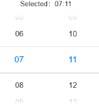

### progress<a name="ZH-CN_TOPIC_0000002499582745"></a>

进度条，用于显示内容加载或操作处理进度。

**子组件<a name="zh-cn_topic_0000002411207580_section2332mcpsimp"></a>**

不支持。

**属性<a name="zh-cn_topic_0000002411207580_section2335mcpsimp"></a>**

除支持“[通用属性](#ZH-CN_TOPIC_0000002466543388)”中所述属性外，还支持如[表1](#zh-cn_topic_0000002411207580_table2340mcpsimp)所示属性。

**表 1**  progress组件属性说明

<a name="zh-cn_topic_0000002411207580_table2340mcpsimp"></a>
<table><thead align="left"><tr id="zh-cn_topic_0000002411207580_row2348mcpsimp"><th class="cellrowborder" valign="top" width="15.55%" id="mcps1.2.6.1.1"><p id="zh-cn_topic_0000002411207580_p2350mcpsimp"><a name="zh-cn_topic_0000002411207580_p2350mcpsimp"></a><a name="zh-cn_topic_0000002411207580_p2350mcpsimp"></a>名称</p>
</th>
<th class="cellrowborder" valign="top" width="12.770000000000001%" id="mcps1.2.6.1.2"><p id="zh-cn_topic_0000002411207580_p2352mcpsimp"><a name="zh-cn_topic_0000002411207580_p2352mcpsimp"></a><a name="zh-cn_topic_0000002411207580_p2352mcpsimp"></a>类型</p>
</th>
<th class="cellrowborder" valign="top" width="17.83%" id="mcps1.2.6.1.3"><p id="zh-cn_topic_0000002411207580_p2354mcpsimp"><a name="zh-cn_topic_0000002411207580_p2354mcpsimp"></a><a name="zh-cn_topic_0000002411207580_p2354mcpsimp"></a>默认值</p>
</th>
<th class="cellrowborder" valign="top" width="12.09%" id="mcps1.2.6.1.4"><p id="zh-cn_topic_0000002411207580_p2356mcpsimp"><a name="zh-cn_topic_0000002411207580_p2356mcpsimp"></a><a name="zh-cn_topic_0000002411207580_p2356mcpsimp"></a>必填</p>
</th>
<th class="cellrowborder" valign="top" width="41.760000000000005%" id="mcps1.2.6.1.5"><p id="zh-cn_topic_0000002411207580_p2358mcpsimp"><a name="zh-cn_topic_0000002411207580_p2358mcpsimp"></a><a name="zh-cn_topic_0000002411207580_p2358mcpsimp"></a>说明</p>
</th>
</tr>
</thead>
<tbody><tr id="zh-cn_topic_0000002411207580_row2360mcpsimp"><td class="cellrowborder" valign="top" width="15.55%" headers="mcps1.2.6.1.1 "><p id="zh-cn_topic_0000002411207580_p2362mcpsimp"><a name="zh-cn_topic_0000002411207580_p2362mcpsimp"></a><a name="zh-cn_topic_0000002411207580_p2362mcpsimp"></a>type</p>
</td>
<td class="cellrowborder" valign="top" width="12.770000000000001%" headers="mcps1.2.6.1.2 "><p id="zh-cn_topic_0000002411207580_p2364mcpsimp"><a name="zh-cn_topic_0000002411207580_p2364mcpsimp"></a><a name="zh-cn_topic_0000002411207580_p2364mcpsimp"></a>string</p>
</td>
<td class="cellrowborder" valign="top" width="17.83%" headers="mcps1.2.6.1.3 "><p id="zh-cn_topic_0000002411207580_p2366mcpsimp"><a name="zh-cn_topic_0000002411207580_p2366mcpsimp"></a><a name="zh-cn_topic_0000002411207580_p2366mcpsimp"></a>horizontal</p>
</td>
<td class="cellrowborder" valign="top" width="12.09%" headers="mcps1.2.6.1.4 "><p id="zh-cn_topic_0000002411207580_p2368mcpsimp"><a name="zh-cn_topic_0000002411207580_p2368mcpsimp"></a><a name="zh-cn_topic_0000002411207580_p2368mcpsimp"></a>否</p>
</td>
<td class="cellrowborder" valign="top" width="41.760000000000005%" headers="mcps1.2.6.1.5 "><p id="zh-cn_topic_0000002411207580_p2370mcpsimp"><a name="zh-cn_topic_0000002411207580_p2370mcpsimp"></a><a name="zh-cn_topic_0000002411207580_p2370mcpsimp"></a>设置进度条的类型，该属性不支持动态修改，可选值为：</p>
<a name="zh-cn_topic_0000002411207580_ul2371mcpsimp"></a><a name="zh-cn_topic_0000002411207580_ul2371mcpsimp"></a><ul id="zh-cn_topic_0000002411207580_ul2371mcpsimp"><li>horizontal：线性进度条。</li><li>arc：弧形进度条。</li></ul>
</td>
</tr>
</tbody>
</table>

不同类型的进度条还支持不同的属性。

-   类型为horizontal时，type=horizontal，支持如[表2](#zh-cn_topic_0000002411207580_table2377mcpsimp)所示属性。

    **表 2**  线性进度条属性说明

    <a name="zh-cn_topic_0000002411207580_table2377mcpsimp"></a>
    <table><thead align="left"><tr id="zh-cn_topic_0000002411207580_row2385mcpsimp"><th class="cellrowborder" valign="top" width="13.781378137813782%" id="mcps1.2.6.1.1"><p id="zh-cn_topic_0000002411207580_p2387mcpsimp"><a name="zh-cn_topic_0000002411207580_p2387mcpsimp"></a><a name="zh-cn_topic_0000002411207580_p2387mcpsimp"></a>名称</p>
    </th>
    <th class="cellrowborder" valign="top" width="14.271427142714272%" id="mcps1.2.6.1.2"><p id="zh-cn_topic_0000002411207580_p2389mcpsimp"><a name="zh-cn_topic_0000002411207580_p2389mcpsimp"></a><a name="zh-cn_topic_0000002411207580_p2389mcpsimp"></a>类型</p>
    </th>
    <th class="cellrowborder" valign="top" width="17.32173217321732%" id="mcps1.2.6.1.3"><p id="zh-cn_topic_0000002411207580_p2391mcpsimp"><a name="zh-cn_topic_0000002411207580_p2391mcpsimp"></a><a name="zh-cn_topic_0000002411207580_p2391mcpsimp"></a>默认值</p>
    </th>
    <th class="cellrowborder" valign="top" width="12.181218121812181%" id="mcps1.2.6.1.4"><p id="zh-cn_topic_0000002411207580_p2393mcpsimp"><a name="zh-cn_topic_0000002411207580_p2393mcpsimp"></a><a name="zh-cn_topic_0000002411207580_p2393mcpsimp"></a>必填</p>
    </th>
    <th class="cellrowborder" valign="top" width="42.444244424442445%" id="mcps1.2.6.1.5"><p id="zh-cn_topic_0000002411207580_p2395mcpsimp"><a name="zh-cn_topic_0000002411207580_p2395mcpsimp"></a><a name="zh-cn_topic_0000002411207580_p2395mcpsimp"></a>说明</p>
    </th>
    </tr>
    </thead>
    <tbody><tr id="zh-cn_topic_0000002411207580_row2397mcpsimp"><td class="cellrowborder" valign="top" width="13.781378137813782%" headers="mcps1.2.6.1.1 "><p id="zh-cn_topic_0000002411207580_p2399mcpsimp"><a name="zh-cn_topic_0000002411207580_p2399mcpsimp"></a><a name="zh-cn_topic_0000002411207580_p2399mcpsimp"></a>percent</p>
    </td>
    <td class="cellrowborder" valign="top" width="14.271427142714272%" headers="mcps1.2.6.1.2 "><p id="zh-cn_topic_0000002411207580_p2401mcpsimp"><a name="zh-cn_topic_0000002411207580_p2401mcpsimp"></a><a name="zh-cn_topic_0000002411207580_p2401mcpsimp"></a>number</p>
    </td>
    <td class="cellrowborder" valign="top" width="17.32173217321732%" headers="mcps1.2.6.1.3 "><p id="zh-cn_topic_0000002411207580_p2403mcpsimp"><a name="zh-cn_topic_0000002411207580_p2403mcpsimp"></a><a name="zh-cn_topic_0000002411207580_p2403mcpsimp"></a>0</p>
    </td>
    <td class="cellrowborder" valign="top" width="12.181218121812181%" headers="mcps1.2.6.1.4 "><p id="zh-cn_topic_0000002411207580_p2405mcpsimp"><a name="zh-cn_topic_0000002411207580_p2405mcpsimp"></a><a name="zh-cn_topic_0000002411207580_p2405mcpsimp"></a>否</p>
    </td>
    <td class="cellrowborder" valign="top" width="42.444244424442445%" headers="mcps1.2.6.1.5 "><p id="zh-cn_topic_0000002411207580_p2407mcpsimp"><a name="zh-cn_topic_0000002411207580_p2407mcpsimp"></a><a name="zh-cn_topic_0000002411207580_p2407mcpsimp"></a>当前进度。取值范围为0～100。</p>
    </td>
    </tr>
    </tbody>
    </table>

-   类型为arc时，type=arc，支持如[表3](#zh-cn_topic_0000002411207580_table2410mcpsimp)所示属性。

    **表 3**  弧形进度条属性说明

    <a name="zh-cn_topic_0000002411207580_table2410mcpsimp"></a>
    <table><thead align="left"><tr id="zh-cn_topic_0000002411207580_row2418mcpsimp"><th class="cellrowborder" valign="top" width="13.511351135113511%" id="mcps1.2.6.1.1"><p id="zh-cn_topic_0000002411207580_p2420mcpsimp"><a name="zh-cn_topic_0000002411207580_p2420mcpsimp"></a><a name="zh-cn_topic_0000002411207580_p2420mcpsimp"></a>名称</p>
    </th>
    <th class="cellrowborder" valign="top" width="14.411441144114413%" id="mcps1.2.6.1.2"><p id="zh-cn_topic_0000002411207580_p2422mcpsimp"><a name="zh-cn_topic_0000002411207580_p2422mcpsimp"></a><a name="zh-cn_topic_0000002411207580_p2422mcpsimp"></a>类型</p>
    </th>
    <th class="cellrowborder" valign="top" width="17.85178517851785%" id="mcps1.2.6.1.3"><p id="zh-cn_topic_0000002411207580_p2424mcpsimp"><a name="zh-cn_topic_0000002411207580_p2424mcpsimp"></a><a name="zh-cn_topic_0000002411207580_p2424mcpsimp"></a>默认值</p>
    </th>
    <th class="cellrowborder" valign="top" width="11.91119111911191%" id="mcps1.2.6.1.4"><p id="zh-cn_topic_0000002411207580_p2426mcpsimp"><a name="zh-cn_topic_0000002411207580_p2426mcpsimp"></a><a name="zh-cn_topic_0000002411207580_p2426mcpsimp"></a>必填</p>
    </th>
    <th class="cellrowborder" valign="top" width="42.31423142314231%" id="mcps1.2.6.1.5"><p id="zh-cn_topic_0000002411207580_p2428mcpsimp"><a name="zh-cn_topic_0000002411207580_p2428mcpsimp"></a><a name="zh-cn_topic_0000002411207580_p2428mcpsimp"></a>说明</p>
    </th>
    </tr>
    </thead>
    <tbody><tr id="zh-cn_topic_0000002411207580_row2430mcpsimp"><td class="cellrowborder" valign="top" width="13.511351135113511%" headers="mcps1.2.6.1.1 "><p id="zh-cn_topic_0000002411207580_p2432mcpsimp"><a name="zh-cn_topic_0000002411207580_p2432mcpsimp"></a><a name="zh-cn_topic_0000002411207580_p2432mcpsimp"></a>percent</p>
    </td>
    <td class="cellrowborder" valign="top" width="14.411441144114413%" headers="mcps1.2.6.1.2 "><p id="zh-cn_topic_0000002411207580_p2434mcpsimp"><a name="zh-cn_topic_0000002411207580_p2434mcpsimp"></a><a name="zh-cn_topic_0000002411207580_p2434mcpsimp"></a>number</p>
    </td>
    <td class="cellrowborder" valign="top" width="17.85178517851785%" headers="mcps1.2.6.1.3 "><p id="zh-cn_topic_0000002411207580_p2436mcpsimp"><a name="zh-cn_topic_0000002411207580_p2436mcpsimp"></a><a name="zh-cn_topic_0000002411207580_p2436mcpsimp"></a>0</p>
    </td>
    <td class="cellrowborder" valign="top" width="11.91119111911191%" headers="mcps1.2.6.1.4 "><p id="zh-cn_topic_0000002411207580_p2438mcpsimp"><a name="zh-cn_topic_0000002411207580_p2438mcpsimp"></a><a name="zh-cn_topic_0000002411207580_p2438mcpsimp"></a>否</p>
    </td>
    <td class="cellrowborder" valign="top" width="42.31423142314231%" headers="mcps1.2.6.1.5 "><p id="zh-cn_topic_0000002411207580_p2440mcpsimp"><a name="zh-cn_topic_0000002411207580_p2440mcpsimp"></a><a name="zh-cn_topic_0000002411207580_p2440mcpsimp"></a>当前进度。取值范围为0～100。</p>
    </td>
    </tr>
    </tbody>
    </table>

**样式<a name="zh-cn_topic_0000002411207580_section2441mcpsimp"></a>**

除支持“[通用样式](#ZH-CN_TOPIC_0000002499582761)”中所述样式外，还支持如下样式。

-   类型为horizontal时，type=horizontal，支持如[表4](#zh-cn_topic_0000002411207580_table2447mcpsimp)所示样式。

    **表 4**  线性进度条样式说明

    <a name="zh-cn_topic_0000002411207580_table2447mcpsimp"></a>
    <table><thead align="left"><tr id="zh-cn_topic_0000002411207580_row2455mcpsimp"><th class="cellrowborder" valign="top" width="15.02150215021502%" id="mcps1.2.6.1.1"><p id="zh-cn_topic_0000002411207580_p2457mcpsimp"><a name="zh-cn_topic_0000002411207580_p2457mcpsimp"></a><a name="zh-cn_topic_0000002411207580_p2457mcpsimp"></a>名称</p>
    </th>
    <th class="cellrowborder" valign="top" width="13.271327132713273%" id="mcps1.2.6.1.2"><p id="zh-cn_topic_0000002411207580_p2459mcpsimp"><a name="zh-cn_topic_0000002411207580_p2459mcpsimp"></a><a name="zh-cn_topic_0000002411207580_p2459mcpsimp"></a>类型</p>
    </th>
    <th class="cellrowborder" valign="top" width="17.5017501750175%" id="mcps1.2.6.1.3"><p id="zh-cn_topic_0000002411207580_p2461mcpsimp"><a name="zh-cn_topic_0000002411207580_p2461mcpsimp"></a><a name="zh-cn_topic_0000002411207580_p2461mcpsimp"></a>默认值</p>
    </th>
    <th class="cellrowborder" valign="top" width="12.921292129212922%" id="mcps1.2.6.1.4"><p id="zh-cn_topic_0000002411207580_p2463mcpsimp"><a name="zh-cn_topic_0000002411207580_p2463mcpsimp"></a><a name="zh-cn_topic_0000002411207580_p2463mcpsimp"></a>必填</p>
    </th>
    <th class="cellrowborder" valign="top" width="41.284128412841284%" id="mcps1.2.6.1.5"><p id="zh-cn_topic_0000002411207580_p2465mcpsimp"><a name="zh-cn_topic_0000002411207580_p2465mcpsimp"></a><a name="zh-cn_topic_0000002411207580_p2465mcpsimp"></a>说明</p>
    </th>
    </tr>
    </thead>
    <tbody><tr id="zh-cn_topic_0000002411207580_row2467mcpsimp"><td class="cellrowborder" valign="top" width="15.02150215021502%" headers="mcps1.2.6.1.1 "><p id="zh-cn_topic_0000002411207580_p2469mcpsimp"><a name="zh-cn_topic_0000002411207580_p2469mcpsimp"></a><a name="zh-cn_topic_0000002411207580_p2469mcpsimp"></a>color</p>
    </td>
    <td class="cellrowborder" valign="top" width="13.271327132713273%" headers="mcps1.2.6.1.2 "><p id="zh-cn_topic_0000002411207580_p2471mcpsimp"><a name="zh-cn_topic_0000002411207580_p2471mcpsimp"></a><a name="zh-cn_topic_0000002411207580_p2471mcpsimp"></a>&lt;color&gt;</p>
    </td>
    <td class="cellrowborder" valign="top" width="17.5017501750175%" headers="mcps1.2.6.1.3 "><p id="zh-cn_topic_0000002411207580_p2473mcpsimp"><a name="zh-cn_topic_0000002411207580_p2473mcpsimp"></a><a name="zh-cn_topic_0000002411207580_p2473mcpsimp"></a>#6b9ac7</p>
    </td>
    <td class="cellrowborder" valign="top" width="12.921292129212922%" headers="mcps1.2.6.1.4 "><p id="zh-cn_topic_0000002411207580_p2475mcpsimp"><a name="zh-cn_topic_0000002411207580_p2475mcpsimp"></a><a name="zh-cn_topic_0000002411207580_p2475mcpsimp"></a>否</p>
    </td>
    <td class="cellrowborder" valign="top" width="41.284128412841284%" headers="mcps1.2.6.1.5 "><p id="zh-cn_topic_0000002411207580_p2477mcpsimp"><a name="zh-cn_topic_0000002411207580_p2477mcpsimp"></a><a name="zh-cn_topic_0000002411207580_p2477mcpsimp"></a>设置进度条的颜色。</p>
    </td>
    </tr>
    <tr id="zh-cn_topic_0000002411207580_row2478mcpsimp"><td class="cellrowborder" valign="top" width="15.02150215021502%" headers="mcps1.2.6.1.1 "><p id="zh-cn_topic_0000002411207580_p2480mcpsimp"><a name="zh-cn_topic_0000002411207580_p2480mcpsimp"></a><a name="zh-cn_topic_0000002411207580_p2480mcpsimp"></a>stroke-width</p>
    </td>
    <td class="cellrowborder" valign="top" width="13.271327132713273%" headers="mcps1.2.6.1.2 "><p id="zh-cn_topic_0000002411207580_p2482mcpsimp"><a name="zh-cn_topic_0000002411207580_p2482mcpsimp"></a><a name="zh-cn_topic_0000002411207580_p2482mcpsimp"></a>&lt;length&gt;</p>
    </td>
    <td class="cellrowborder" valign="top" width="17.5017501750175%" headers="mcps1.2.6.1.3 "><p id="zh-cn_topic_0000002411207580_p2484mcpsimp"><a name="zh-cn_topic_0000002411207580_p2484mcpsimp"></a><a name="zh-cn_topic_0000002411207580_p2484mcpsimp"></a>32px</p>
    </td>
    <td class="cellrowborder" valign="top" width="12.921292129212922%" headers="mcps1.2.6.1.4 "><p id="zh-cn_topic_0000002411207580_p2488mcpsimp"><a name="zh-cn_topic_0000002411207580_p2488mcpsimp"></a><a name="zh-cn_topic_0000002411207580_p2488mcpsimp"></a>否</p>
    </td>
    <td class="cellrowborder" valign="top" width="41.284128412841284%" headers="mcps1.2.6.1.5 "><p id="zh-cn_topic_0000002411207580_p2490mcpsimp"><a name="zh-cn_topic_0000002411207580_p2490mcpsimp"></a><a name="zh-cn_topic_0000002411207580_p2490mcpsimp"></a>设置进度条的宽度。</p>
    </td>
    </tr>
    </tbody>
    </table>

-   类型为arc时，type=arc，支持如[表5](#zh-cn_topic_0000002411207580_table2492mcpsimp)所示样式。

    **表 5**  弧形进度条样式说明

    <a name="zh-cn_topic_0000002411207580_table2492mcpsimp"></a>
    <table><thead align="left"><tr id="zh-cn_topic_0000002411207580_row2500mcpsimp"><th class="cellrowborder" valign="top" width="15.659999999999998%" id="mcps1.2.6.1.1"><p id="zh-cn_topic_0000002411207580_p2502mcpsimp"><a name="zh-cn_topic_0000002411207580_p2502mcpsimp"></a><a name="zh-cn_topic_0000002411207580_p2502mcpsimp"></a>名称</p>
    </th>
    <th class="cellrowborder" valign="top" width="13.200000000000001%" id="mcps1.2.6.1.2"><p id="zh-cn_topic_0000002411207580_p2504mcpsimp"><a name="zh-cn_topic_0000002411207580_p2504mcpsimp"></a><a name="zh-cn_topic_0000002411207580_p2504mcpsimp"></a>类型</p>
    </th>
    <th class="cellrowborder" valign="top" width="17.19%" id="mcps1.2.6.1.3"><p id="zh-cn_topic_0000002411207580_p2506mcpsimp"><a name="zh-cn_topic_0000002411207580_p2506mcpsimp"></a><a name="zh-cn_topic_0000002411207580_p2506mcpsimp"></a>默认值</p>
    </th>
    <th class="cellrowborder" valign="top" width="12.6%" id="mcps1.2.6.1.4"><p id="zh-cn_topic_0000002411207580_p2508mcpsimp"><a name="zh-cn_topic_0000002411207580_p2508mcpsimp"></a><a name="zh-cn_topic_0000002411207580_p2508mcpsimp"></a>必填</p>
    </th>
    <th class="cellrowborder" valign="top" width="41.349999999999994%" id="mcps1.2.6.1.5"><p id="zh-cn_topic_0000002411207580_p2510mcpsimp"><a name="zh-cn_topic_0000002411207580_p2510mcpsimp"></a><a name="zh-cn_topic_0000002411207580_p2510mcpsimp"></a>说明</p>
    </th>
    </tr>
    </thead>
    <tbody><tr id="zh-cn_topic_0000002411207580_row2512mcpsimp"><td class="cellrowborder" valign="top" width="15.659999999999998%" headers="mcps1.2.6.1.1 "><p id="zh-cn_topic_0000002411207580_p2514mcpsimp"><a name="zh-cn_topic_0000002411207580_p2514mcpsimp"></a><a name="zh-cn_topic_0000002411207580_p2514mcpsimp"></a>color</p>
    </td>
    <td class="cellrowborder" valign="top" width="13.200000000000001%" headers="mcps1.2.6.1.2 "><p id="zh-cn_topic_0000002411207580_p2516mcpsimp"><a name="zh-cn_topic_0000002411207580_p2516mcpsimp"></a><a name="zh-cn_topic_0000002411207580_p2516mcpsimp"></a>&lt;color&gt;</p>
    </td>
    <td class="cellrowborder" valign="top" width="17.19%" headers="mcps1.2.6.1.3 "><p id="zh-cn_topic_0000002411207580_p2518mcpsimp"><a name="zh-cn_topic_0000002411207580_p2518mcpsimp"></a><a name="zh-cn_topic_0000002411207580_p2518mcpsimp"></a>#5ea1ff</p>
    </td>
    <td class="cellrowborder" valign="top" width="12.6%" headers="mcps1.2.6.1.4 "><p id="zh-cn_topic_0000002411207580_p2520mcpsimp"><a name="zh-cn_topic_0000002411207580_p2520mcpsimp"></a><a name="zh-cn_topic_0000002411207580_p2520mcpsimp"></a>否</p>
    </td>
    <td class="cellrowborder" valign="top" width="41.349999999999994%" headers="mcps1.2.6.1.5 "><p id="zh-cn_topic_0000002411207580_p2522mcpsimp"><a name="zh-cn_topic_0000002411207580_p2522mcpsimp"></a><a name="zh-cn_topic_0000002411207580_p2522mcpsimp"></a>弧形进度条的颜色。</p>
    </td>
    </tr>
    <tr id="zh-cn_topic_0000002411207580_row2523mcpsimp"><td class="cellrowborder" valign="top" width="15.659999999999998%" headers="mcps1.2.6.1.1 "><p id="zh-cn_topic_0000002411207580_p2525mcpsimp"><a name="zh-cn_topic_0000002411207580_p2525mcpsimp"></a><a name="zh-cn_topic_0000002411207580_p2525mcpsimp"></a>background-color</p>
    </td>
    <td class="cellrowborder" valign="top" width="13.200000000000001%" headers="mcps1.2.6.1.2 "><p id="zh-cn_topic_0000002411207580_p2527mcpsimp"><a name="zh-cn_topic_0000002411207580_p2527mcpsimp"></a><a name="zh-cn_topic_0000002411207580_p2527mcpsimp"></a>&lt;color&gt;</p>
    </td>
    <td class="cellrowborder" valign="top" width="17.19%" headers="mcps1.2.6.1.3 "><p id="zh-cn_topic_0000002411207580_p2529mcpsimp"><a name="zh-cn_topic_0000002411207580_p2529mcpsimp"></a><a name="zh-cn_topic_0000002411207580_p2529mcpsimp"></a>rgba(255, 255, 255, 0.15)</p>
    </td>
    <td class="cellrowborder" valign="top" width="12.6%" headers="mcps1.2.6.1.4 "><p id="zh-cn_topic_0000002411207580_p2531mcpsimp"><a name="zh-cn_topic_0000002411207580_p2531mcpsimp"></a><a name="zh-cn_topic_0000002411207580_p2531mcpsimp"></a>否</p>
    </td>
    <td class="cellrowborder" valign="top" width="41.349999999999994%" headers="mcps1.2.6.1.5 "><p id="zh-cn_topic_0000002411207580_p2533mcpsimp"><a name="zh-cn_topic_0000002411207580_p2533mcpsimp"></a><a name="zh-cn_topic_0000002411207580_p2533mcpsimp"></a>弧形进度条的背景色。</p>
    </td>
    </tr>
    <tr id="zh-cn_topic_0000002411207580_row2534mcpsimp"><td class="cellrowborder" valign="top" width="15.659999999999998%" headers="mcps1.2.6.1.1 "><p id="zh-cn_topic_0000002411207580_p2536mcpsimp"><a name="zh-cn_topic_0000002411207580_p2536mcpsimp"></a><a name="zh-cn_topic_0000002411207580_p2536mcpsimp"></a>stroke-width</p>
    </td>
    <td class="cellrowborder" valign="top" width="13.200000000000001%" headers="mcps1.2.6.1.2 "><p id="zh-cn_topic_0000002411207580_p2538mcpsimp"><a name="zh-cn_topic_0000002411207580_p2538mcpsimp"></a><a name="zh-cn_topic_0000002411207580_p2538mcpsimp"></a>&lt;length&gt;</p>
    </td>
    <td class="cellrowborder" valign="top" width="17.19%" headers="mcps1.2.6.1.3 "><p id="zh-cn_topic_0000002411207580_p2540mcpsimp"><a name="zh-cn_topic_0000002411207580_p2540mcpsimp"></a><a name="zh-cn_topic_0000002411207580_p2540mcpsimp"></a>32px</p>
    </td>
    <td class="cellrowborder" valign="top" width="12.6%" headers="mcps1.2.6.1.4 "><p id="zh-cn_topic_0000002411207580_p2542mcpsimp"><a name="zh-cn_topic_0000002411207580_p2542mcpsimp"></a><a name="zh-cn_topic_0000002411207580_p2542mcpsimp"></a>否</p>
    </td>
    <td class="cellrowborder" valign="top" width="41.349999999999994%" headers="mcps1.2.6.1.5 "><p id="zh-cn_topic_0000002411207580_p2544mcpsimp"><a name="zh-cn_topic_0000002411207580_p2544mcpsimp"></a><a name="zh-cn_topic_0000002411207580_p2544mcpsimp"></a>弧形进度条的宽度。</p>
    <p id="zh-cn_topic_0000002411207580_p2546mcpsimp"><a name="zh-cn_topic_0000002411207580_p2546mcpsimp"></a><a name="zh-cn_topic_0000002411207580_p2546mcpsimp"></a>注意：进度条宽度越大，进度条越靠近圆心，进度条始终在半径区域内。</p>
    </td>
    </tr>
    <tr id="zh-cn_topic_0000002411207580_row2547mcpsimp"><td class="cellrowborder" valign="top" width="15.659999999999998%" headers="mcps1.2.6.1.1 "><p id="zh-cn_topic_0000002411207580_p2549mcpsimp"><a name="zh-cn_topic_0000002411207580_p2549mcpsimp"></a><a name="zh-cn_topic_0000002411207580_p2549mcpsimp"></a>start-angle</p>
    </td>
    <td class="cellrowborder" valign="top" width="13.200000000000001%" headers="mcps1.2.6.1.2 "><p id="zh-cn_topic_0000002411207580_p2551mcpsimp"><a name="zh-cn_topic_0000002411207580_p2551mcpsimp"></a><a name="zh-cn_topic_0000002411207580_p2551mcpsimp"></a>&lt;deg&gt;</p>
    </td>
    <td class="cellrowborder" valign="top" width="17.19%" headers="mcps1.2.6.1.3 "><p id="zh-cn_topic_0000002411207580_p2553mcpsimp"><a name="zh-cn_topic_0000002411207580_p2553mcpsimp"></a><a name="zh-cn_topic_0000002411207580_p2553mcpsimp"></a>240</p>
    </td>
    <td class="cellrowborder" valign="top" width="12.6%" headers="mcps1.2.6.1.4 "><p id="zh-cn_topic_0000002411207580_p2555mcpsimp"><a name="zh-cn_topic_0000002411207580_p2555mcpsimp"></a><a name="zh-cn_topic_0000002411207580_p2555mcpsimp"></a>否</p>
    </td>
    <td class="cellrowborder" valign="top" width="41.349999999999994%" headers="mcps1.2.6.1.5 "><p id="zh-cn_topic_0000002411207580_p2557mcpsimp"><a name="zh-cn_topic_0000002411207580_p2557mcpsimp"></a><a name="zh-cn_topic_0000002411207580_p2557mcpsimp"></a>弧形进度条起始角度，以时钟0点为基线，取值范围为0到360（顺时针）。</p>
    </td>
    </tr>
    <tr id="zh-cn_topic_0000002411207580_row2558mcpsimp"><td class="cellrowborder" valign="top" width="15.659999999999998%" headers="mcps1.2.6.1.1 "><p id="zh-cn_topic_0000002411207580_p2560mcpsimp"><a name="zh-cn_topic_0000002411207580_p2560mcpsimp"></a><a name="zh-cn_topic_0000002411207580_p2560mcpsimp"></a>total-angle</p>
    </td>
    <td class="cellrowborder" valign="top" width="13.200000000000001%" headers="mcps1.2.6.1.2 "><p id="zh-cn_topic_0000002411207580_p2562mcpsimp"><a name="zh-cn_topic_0000002411207580_p2562mcpsimp"></a><a name="zh-cn_topic_0000002411207580_p2562mcpsimp"></a>&lt;deg&gt;</p>
    </td>
    <td class="cellrowborder" valign="top" width="17.19%" headers="mcps1.2.6.1.3 "><p id="zh-cn_topic_0000002411207580_p2564mcpsimp"><a name="zh-cn_topic_0000002411207580_p2564mcpsimp"></a><a name="zh-cn_topic_0000002411207580_p2564mcpsimp"></a>240</p>
    </td>
    <td class="cellrowborder" valign="top" width="12.6%" headers="mcps1.2.6.1.4 "><p id="zh-cn_topic_0000002411207580_p2566mcpsimp"><a name="zh-cn_topic_0000002411207580_p2566mcpsimp"></a><a name="zh-cn_topic_0000002411207580_p2566mcpsimp"></a>否</p>
    </td>
    <td class="cellrowborder" valign="top" width="41.349999999999994%" headers="mcps1.2.6.1.5 "><p id="zh-cn_topic_0000002411207580_p2568mcpsimp"><a name="zh-cn_topic_0000002411207580_p2568mcpsimp"></a><a name="zh-cn_topic_0000002411207580_p2568mcpsimp"></a>弧形进度条总长度，范围为-360～+360，负数标识起点到终点为逆时针。</p>
    </td>
    </tr>
    <tr id="zh-cn_topic_0000002411207580_row2569mcpsimp"><td class="cellrowborder" valign="top" width="15.659999999999998%" headers="mcps1.2.6.1.1 "><p id="zh-cn_topic_0000002411207580_p2571mcpsimp"><a name="zh-cn_topic_0000002411207580_p2571mcpsimp"></a><a name="zh-cn_topic_0000002411207580_p2571mcpsimp"></a>center-x</p>
    </td>
    <td class="cellrowborder" valign="top" width="13.200000000000001%" headers="mcps1.2.6.1.2 "><p id="zh-cn_topic_0000002411207580_p2573mcpsimp"><a name="zh-cn_topic_0000002411207580_p2573mcpsimp"></a><a name="zh-cn_topic_0000002411207580_p2573mcpsimp"></a>&lt;length&gt;</p>
    </td>
    <td class="cellrowborder" valign="top" width="17.19%" headers="mcps1.2.6.1.3 "><p id="zh-cn_topic_0000002411207580_p2575mcpsimp"><a name="zh-cn_topic_0000002411207580_p2575mcpsimp"></a><a name="zh-cn_topic_0000002411207580_p2575mcpsimp"></a>弧形进度条宽度的一半</p>
    </td>
    <td class="cellrowborder" valign="top" width="12.6%" headers="mcps1.2.6.1.4 "><p id="zh-cn_topic_0000002411207580_p2577mcpsimp"><a name="zh-cn_topic_0000002411207580_p2577mcpsimp"></a><a name="zh-cn_topic_0000002411207580_p2577mcpsimp"></a>否</p>
    </td>
    <td class="cellrowborder" valign="top" width="41.349999999999994%" headers="mcps1.2.6.1.5 "><p id="zh-cn_topic_0000002411207580_p2579mcpsimp"><a name="zh-cn_topic_0000002411207580_p2579mcpsimp"></a><a name="zh-cn_topic_0000002411207580_p2579mcpsimp"></a>弧形进度条中心位置（坐标原点为组件左上角顶点）。该样式需要和center-y和radius一起使用。</p>
    </td>
    </tr>
    <tr id="zh-cn_topic_0000002411207580_row2580mcpsimp"><td class="cellrowborder" valign="top" width="15.659999999999998%" headers="mcps1.2.6.1.1 "><p id="zh-cn_topic_0000002411207580_p2582mcpsimp"><a name="zh-cn_topic_0000002411207580_p2582mcpsimp"></a><a name="zh-cn_topic_0000002411207580_p2582mcpsimp"></a>center-y</p>
    </td>
    <td class="cellrowborder" valign="top" width="13.200000000000001%" headers="mcps1.2.6.1.2 "><p id="zh-cn_topic_0000002411207580_p2584mcpsimp"><a name="zh-cn_topic_0000002411207580_p2584mcpsimp"></a><a name="zh-cn_topic_0000002411207580_p2584mcpsimp"></a>&lt;length&gt;</p>
    </td>
    <td class="cellrowborder" valign="top" width="17.19%" headers="mcps1.2.6.1.3 "><p id="zh-cn_topic_0000002411207580_p2586mcpsimp"><a name="zh-cn_topic_0000002411207580_p2586mcpsimp"></a><a name="zh-cn_topic_0000002411207580_p2586mcpsimp"></a>弧形进度条高度的一半</p>
    </td>
    <td class="cellrowborder" valign="top" width="12.6%" headers="mcps1.2.6.1.4 "><p id="zh-cn_topic_0000002411207580_p2588mcpsimp"><a name="zh-cn_topic_0000002411207580_p2588mcpsimp"></a><a name="zh-cn_topic_0000002411207580_p2588mcpsimp"></a>否</p>
    </td>
    <td class="cellrowborder" valign="top" width="41.349999999999994%" headers="mcps1.2.6.1.5 "><p id="zh-cn_topic_0000002411207580_p2590mcpsimp"><a name="zh-cn_topic_0000002411207580_p2590mcpsimp"></a><a name="zh-cn_topic_0000002411207580_p2590mcpsimp"></a>弧形进度条中心位置（坐标原点为组件左上角顶点）。该样式需要和center-x和radius一起使用。</p>
    </td>
    </tr>
    <tr id="zh-cn_topic_0000002411207580_row2591mcpsimp"><td class="cellrowborder" valign="top" width="15.659999999999998%" headers="mcps1.2.6.1.1 "><p id="zh-cn_topic_0000002411207580_p2593mcpsimp"><a name="zh-cn_topic_0000002411207580_p2593mcpsimp"></a><a name="zh-cn_topic_0000002411207580_p2593mcpsimp"></a>radius</p>
    </td>
    <td class="cellrowborder" valign="top" width="13.200000000000001%" headers="mcps1.2.6.1.2 "><p id="zh-cn_topic_0000002411207580_p2595mcpsimp"><a name="zh-cn_topic_0000002411207580_p2595mcpsimp"></a><a name="zh-cn_topic_0000002411207580_p2595mcpsimp"></a>&lt;length&gt;</p>
    </td>
    <td class="cellrowborder" valign="top" width="17.19%" headers="mcps1.2.6.1.3 "><p id="zh-cn_topic_0000002411207580_p2597mcpsimp"><a name="zh-cn_topic_0000002411207580_p2597mcpsimp"></a><a name="zh-cn_topic_0000002411207580_p2597mcpsimp"></a>弧形进度条宽高最小值的一半</p>
    </td>
    <td class="cellrowborder" valign="top" width="12.6%" headers="mcps1.2.6.1.4 "><p id="zh-cn_topic_0000002411207580_p2599mcpsimp"><a name="zh-cn_topic_0000002411207580_p2599mcpsimp"></a><a name="zh-cn_topic_0000002411207580_p2599mcpsimp"></a>否</p>
    </td>
    <td class="cellrowborder" valign="top" width="41.349999999999994%" headers="mcps1.2.6.1.5 "><p id="zh-cn_topic_0000002411207580_p2601mcpsimp"><a name="zh-cn_topic_0000002411207580_p2601mcpsimp"></a><a name="zh-cn_topic_0000002411207580_p2601mcpsimp"></a>弧形进度条半径，该样式需要和center-x和center-y一起使用。</p>
    </td>
    </tr>
    </tbody>
    </table>

**事件<a name="zh-cn_topic_0000002411207580_section2602mcpsimp"></a>**

支持“[通用事件](#ZH-CN_TOPIC_0000002466543364)”中所述事件。

### qrcode<a name="ZH-CN_TOPIC_0000002466543384"></a>

生成并显示二维码。

**子组件<a name="zh-cn_topic_0000002411207588_section3514mcpsimp"></a>**

不支持。

**属性<a name="zh-cn_topic_0000002411207588_section3517mcpsimp"></a>**

除支持“[通用属性](#ZH-CN_TOPIC_0000002466543388)”中所述属性外，还支持如[表1](#zh-cn_topic_0000002411207588_table3522mcpsimp)所示属性。

**表 1**  qrcode组件属性说明

<a name="zh-cn_topic_0000002411207588_table3522mcpsimp"></a>
<table><thead align="left"><tr id="zh-cn_topic_0000002411207588_row3530mcpsimp"><th class="cellrowborder" valign="top" width="15.36%" id="mcps1.2.6.1.1"><p id="zh-cn_topic_0000002411207588_p3532mcpsimp"><a name="zh-cn_topic_0000002411207588_p3532mcpsimp"></a><a name="zh-cn_topic_0000002411207588_p3532mcpsimp"></a>名称</p>
</th>
<th class="cellrowborder" valign="top" width="13.59%" id="mcps1.2.6.1.2"><p id="zh-cn_topic_0000002411207588_p3534mcpsimp"><a name="zh-cn_topic_0000002411207588_p3534mcpsimp"></a><a name="zh-cn_topic_0000002411207588_p3534mcpsimp"></a>类型</p>
</th>
<th class="cellrowborder" valign="top" width="15.85%" id="mcps1.2.6.1.3"><p id="zh-cn_topic_0000002411207588_p3536mcpsimp"><a name="zh-cn_topic_0000002411207588_p3536mcpsimp"></a><a name="zh-cn_topic_0000002411207588_p3536mcpsimp"></a>默认值</p>
</th>
<th class="cellrowborder" valign="top" width="13.459999999999999%" id="mcps1.2.6.1.4"><p id="zh-cn_topic_0000002411207588_p3538mcpsimp"><a name="zh-cn_topic_0000002411207588_p3538mcpsimp"></a><a name="zh-cn_topic_0000002411207588_p3538mcpsimp"></a>必填</p>
</th>
<th class="cellrowborder" valign="top" width="41.74%" id="mcps1.2.6.1.5"><p id="zh-cn_topic_0000002411207588_p3540mcpsimp"><a name="zh-cn_topic_0000002411207588_p3540mcpsimp"></a><a name="zh-cn_topic_0000002411207588_p3540mcpsimp"></a>说明</p>
</th>
</tr>
</thead>
<tbody><tr id="zh-cn_topic_0000002411207588_row3542mcpsimp"><td class="cellrowborder" valign="top" width="15.36%" headers="mcps1.2.6.1.1 "><p id="zh-cn_topic_0000002411207588_p3544mcpsimp"><a name="zh-cn_topic_0000002411207588_p3544mcpsimp"></a><a name="zh-cn_topic_0000002411207588_p3544mcpsimp"></a>value</p>
</td>
<td class="cellrowborder" valign="top" width="13.59%" headers="mcps1.2.6.1.2 "><p id="zh-cn_topic_0000002411207588_p3546mcpsimp"><a name="zh-cn_topic_0000002411207588_p3546mcpsimp"></a><a name="zh-cn_topic_0000002411207588_p3546mcpsimp"></a>string</p>
</td>
<td class="cellrowborder" valign="top" width="15.85%" headers="mcps1.2.6.1.3 "><p id="zh-cn_topic_0000002411207588_p3548mcpsimp"><a name="zh-cn_topic_0000002411207588_p3548mcpsimp"></a><a name="zh-cn_topic_0000002411207588_p3548mcpsimp"></a>-</p>
</td>
<td class="cellrowborder" valign="top" width="13.459999999999999%" headers="mcps1.2.6.1.4 "><p id="zh-cn_topic_0000002411207588_p3550mcpsimp"><a name="zh-cn_topic_0000002411207588_p3550mcpsimp"></a><a name="zh-cn_topic_0000002411207588_p3550mcpsimp"></a>是</p>
</td>
<td class="cellrowborder" valign="top" width="41.74%" headers="mcps1.2.6.1.5 "><p id="zh-cn_topic_0000002411207588_p3552mcpsimp"><a name="zh-cn_topic_0000002411207588_p3552mcpsimp"></a><a name="zh-cn_topic_0000002411207588_p3552mcpsimp"></a>用来生成二维码的内容。</p>
<p id="zh-cn_topic_0000002411207588_p19597435105620"><a name="zh-cn_topic_0000002411207588_p19597435105620"></a><a name="zh-cn_topic_0000002411207588_p19597435105620"></a>最大长度为256。</p>
</td>
</tr>
<tr id="zh-cn_topic_0000002411207588_row3555mcpsimp"><td class="cellrowborder" valign="top" width="15.36%" headers="mcps1.2.6.1.1 "><p id="zh-cn_topic_0000002411207588_p3557mcpsimp"><a name="zh-cn_topic_0000002411207588_p3557mcpsimp"></a><a name="zh-cn_topic_0000002411207588_p3557mcpsimp"></a>type</p>
</td>
<td class="cellrowborder" valign="top" width="13.59%" headers="mcps1.2.6.1.2 "><p id="zh-cn_topic_0000002411207588_p3559mcpsimp"><a name="zh-cn_topic_0000002411207588_p3559mcpsimp"></a><a name="zh-cn_topic_0000002411207588_p3559mcpsimp"></a>string</p>
</td>
<td class="cellrowborder" valign="top" width="15.85%" headers="mcps1.2.6.1.3 "><p id="zh-cn_topic_0000002411207588_p3561mcpsimp"><a name="zh-cn_topic_0000002411207588_p3561mcpsimp"></a><a name="zh-cn_topic_0000002411207588_p3561mcpsimp"></a>rect</p>
</td>
<td class="cellrowborder" valign="top" width="13.459999999999999%" headers="mcps1.2.6.1.4 "><p id="zh-cn_topic_0000002411207588_p3563mcpsimp"><a name="zh-cn_topic_0000002411207588_p3563mcpsimp"></a><a name="zh-cn_topic_0000002411207588_p3563mcpsimp"></a>否</p>
</td>
<td class="cellrowborder" valign="top" width="41.74%" headers="mcps1.2.6.1.5 "><p id="zh-cn_topic_0000002411207588_p3565mcpsimp"><a name="zh-cn_topic_0000002411207588_p3565mcpsimp"></a><a name="zh-cn_topic_0000002411207588_p3565mcpsimp"></a>二维码类型。</p>
<p id="zh-cn_topic_0000002411207588_p4561131435"><a name="zh-cn_topic_0000002411207588_p4561131435"></a><a name="zh-cn_topic_0000002411207588_p4561131435"></a>rect：矩形二维码。</p>
</td>
</tr>
</tbody>
</table>

**样式<a name="zh-cn_topic_0000002411207588_section3569mcpsimp"></a>**

除支持“[通用样式](#ZH-CN_TOPIC_0000002499582761)”中所述样式外，还支持如[表2](#zh-cn_topic_0000002411207588_table3574mcpsimp)所示样式。

**表 2**  qrcode组件样式说明

<a name="zh-cn_topic_0000002411207588_table3574mcpsimp"></a>
<table><thead align="left"><tr id="zh-cn_topic_0000002411207588_row3582mcpsimp"><th class="cellrowborder" valign="top" width="16.24%" id="mcps1.2.6.1.1"><p id="zh-cn_topic_0000002411207588_p3584mcpsimp"><a name="zh-cn_topic_0000002411207588_p3584mcpsimp"></a><a name="zh-cn_topic_0000002411207588_p3584mcpsimp"></a>名称</p>
</th>
<th class="cellrowborder" valign="top" width="13.91%" id="mcps1.2.6.1.2"><p id="zh-cn_topic_0000002411207588_p3586mcpsimp"><a name="zh-cn_topic_0000002411207588_p3586mcpsimp"></a><a name="zh-cn_topic_0000002411207588_p3586mcpsimp"></a>类型</p>
</th>
<th class="cellrowborder" valign="top" width="15.6%" id="mcps1.2.6.1.3"><p id="zh-cn_topic_0000002411207588_p3588mcpsimp"><a name="zh-cn_topic_0000002411207588_p3588mcpsimp"></a><a name="zh-cn_topic_0000002411207588_p3588mcpsimp"></a>默认值</p>
</th>
<th class="cellrowborder" valign="top" width="12.959999999999999%" id="mcps1.2.6.1.4"><p id="zh-cn_topic_0000002411207588_p3590mcpsimp"><a name="zh-cn_topic_0000002411207588_p3590mcpsimp"></a><a name="zh-cn_topic_0000002411207588_p3590mcpsimp"></a>必填</p>
</th>
<th class="cellrowborder" valign="top" width="41.29%" id="mcps1.2.6.1.5"><p id="zh-cn_topic_0000002411207588_p3592mcpsimp"><a name="zh-cn_topic_0000002411207588_p3592mcpsimp"></a><a name="zh-cn_topic_0000002411207588_p3592mcpsimp"></a>说明</p>
</th>
</tr>
</thead>
<tbody><tr id="zh-cn_topic_0000002411207588_row3594mcpsimp"><td class="cellrowborder" valign="top" width="16.24%" headers="mcps1.2.6.1.1 "><p id="zh-cn_topic_0000002411207588_p3596mcpsimp"><a name="zh-cn_topic_0000002411207588_p3596mcpsimp"></a><a name="zh-cn_topic_0000002411207588_p3596mcpsimp"></a>color</p>
</td>
<td class="cellrowborder" valign="top" width="13.91%" headers="mcps1.2.6.1.2 "><p id="zh-cn_topic_0000002411207588_p3598mcpsimp"><a name="zh-cn_topic_0000002411207588_p3598mcpsimp"></a><a name="zh-cn_topic_0000002411207588_p3598mcpsimp"></a>&lt;color&gt;</p>
</td>
<td class="cellrowborder" valign="top" width="15.6%" headers="mcps1.2.6.1.3 "><p id="zh-cn_topic_0000002411207588_p3600mcpsimp"><a name="zh-cn_topic_0000002411207588_p3600mcpsimp"></a><a name="zh-cn_topic_0000002411207588_p3600mcpsimp"></a>#000000</p>
</td>
<td class="cellrowborder" valign="top" width="12.959999999999999%" headers="mcps1.2.6.1.4 "><p id="zh-cn_topic_0000002411207588_p3602mcpsimp"><a name="zh-cn_topic_0000002411207588_p3602mcpsimp"></a><a name="zh-cn_topic_0000002411207588_p3602mcpsimp"></a>否</p>
</td>
<td class="cellrowborder" valign="top" width="41.29%" headers="mcps1.2.6.1.5 "><p id="zh-cn_topic_0000002411207588_p3604mcpsimp"><a name="zh-cn_topic_0000002411207588_p3604mcpsimp"></a><a name="zh-cn_topic_0000002411207588_p3604mcpsimp"></a>二维码颜色。</p>
</td>
</tr>
<tr id="zh-cn_topic_0000002411207588_row3605mcpsimp"><td class="cellrowborder" valign="top" width="16.24%" headers="mcps1.2.6.1.1 "><p id="zh-cn_topic_0000002411207588_p3607mcpsimp"><a name="zh-cn_topic_0000002411207588_p3607mcpsimp"></a><a name="zh-cn_topic_0000002411207588_p3607mcpsimp"></a>background-color</p>
</td>
<td class="cellrowborder" valign="top" width="13.91%" headers="mcps1.2.6.1.2 "><p id="zh-cn_topic_0000002411207588_p3609mcpsimp"><a name="zh-cn_topic_0000002411207588_p3609mcpsimp"></a><a name="zh-cn_topic_0000002411207588_p3609mcpsimp"></a>&lt;color&gt;</p>
</td>
<td class="cellrowborder" valign="top" width="15.6%" headers="mcps1.2.6.1.3 "><p id="zh-cn_topic_0000002411207588_p3611mcpsimp"><a name="zh-cn_topic_0000002411207588_p3611mcpsimp"></a><a name="zh-cn_topic_0000002411207588_p3611mcpsimp"></a>#ffffff</p>
</td>
<td class="cellrowborder" valign="top" width="12.959999999999999%" headers="mcps1.2.6.1.4 "><p id="zh-cn_topic_0000002411207588_p3613mcpsimp"><a name="zh-cn_topic_0000002411207588_p3613mcpsimp"></a><a name="zh-cn_topic_0000002411207588_p3613mcpsimp"></a>否</p>
</td>
<td class="cellrowborder" valign="top" width="41.29%" headers="mcps1.2.6.1.5 "><p id="zh-cn_topic_0000002411207588_p3615mcpsimp"><a name="zh-cn_topic_0000002411207588_p3615mcpsimp"></a><a name="zh-cn_topic_0000002411207588_p3615mcpsimp"></a>二维码背景颜色。</p>
</td>
</tr>
</tbody>
</table>

> **说明：** 
>-   width和height不一致时，取二者较小值作为二维码的边长。且最终生成的二维码居中显示。
>-   width和height的最小值与value长度成正比，请参见[表3](#zh-cn_topic_0000002411207588__table9928059293)。

**表 3**  二维码最小尺寸与value长度关系

<a name="zh-cn_topic_0000002411207588__table9928059293"></a>
<table><thead align="left"><tr id="zh-cn_topic_0000002411207588_row3642mcpsimp"><th class="cellrowborder" valign="top" width="10.000000000000002%" id="mcps1.2.11.1.1"><p id="zh-cn_topic_0000002411207588_p3644mcpsimp"><a name="zh-cn_topic_0000002411207588_p3644mcpsimp"></a><a name="zh-cn_topic_0000002411207588_p3644mcpsimp"></a>value长度</p>
</th>
<th class="cellrowborder" valign="top" width="10.000000000000002%" id="mcps1.2.11.1.2"><p id="zh-cn_topic_0000002411207588_p3646mcpsimp"><a name="zh-cn_topic_0000002411207588_p3646mcpsimp"></a><a name="zh-cn_topic_0000002411207588_p3646mcpsimp"></a>≤17</p>
</th>
<th class="cellrowborder" valign="top" width="10.000000000000002%" id="mcps1.2.11.1.3"><p id="zh-cn_topic_0000002411207588_p3648mcpsimp"><a name="zh-cn_topic_0000002411207588_p3648mcpsimp"></a><a name="zh-cn_topic_0000002411207588_p3648mcpsimp"></a>≤32</p>
</th>
<th class="cellrowborder" valign="top" width="10.000000000000002%" id="mcps1.2.11.1.4"><p id="zh-cn_topic_0000002411207588_p3650mcpsimp"><a name="zh-cn_topic_0000002411207588_p3650mcpsimp"></a><a name="zh-cn_topic_0000002411207588_p3650mcpsimp"></a>≤53</p>
</th>
<th class="cellrowborder" valign="top" width="10.000000000000002%" id="mcps1.2.11.1.5"><p id="zh-cn_topic_0000002411207588_p3652mcpsimp"><a name="zh-cn_topic_0000002411207588_p3652mcpsimp"></a><a name="zh-cn_topic_0000002411207588_p3652mcpsimp"></a>≤78</p>
</th>
<th class="cellrowborder" valign="top" width="10.000000000000002%" id="mcps1.2.11.1.6"><p id="zh-cn_topic_0000002411207588_p3654mcpsimp"><a name="zh-cn_topic_0000002411207588_p3654mcpsimp"></a><a name="zh-cn_topic_0000002411207588_p3654mcpsimp"></a>≤106</p>
</th>
<th class="cellrowborder" valign="top" width="10.000000000000002%" id="mcps1.2.11.1.7"><p id="zh-cn_topic_0000002411207588_p3656mcpsimp"><a name="zh-cn_topic_0000002411207588_p3656mcpsimp"></a><a name="zh-cn_topic_0000002411207588_p3656mcpsimp"></a>≤134</p>
</th>
<th class="cellrowborder" valign="top" width="10.000000000000002%" id="mcps1.2.11.1.8"><p id="zh-cn_topic_0000002411207588_p3658mcpsimp"><a name="zh-cn_topic_0000002411207588_p3658mcpsimp"></a><a name="zh-cn_topic_0000002411207588_p3658mcpsimp"></a>≤154</p>
</th>
<th class="cellrowborder" valign="top" width="10.000000000000002%" id="mcps1.2.11.1.9"><p id="zh-cn_topic_0000002411207588_p3660mcpsimp"><a name="zh-cn_topic_0000002411207588_p3660mcpsimp"></a><a name="zh-cn_topic_0000002411207588_p3660mcpsimp"></a>≤192</p>
</th>
<th class="cellrowborder" valign="top" width="10.000000000000002%" id="mcps1.2.11.1.10"><p id="zh-cn_topic_0000002411207588_p3662mcpsimp"><a name="zh-cn_topic_0000002411207588_p3662mcpsimp"></a><a name="zh-cn_topic_0000002411207588_p3662mcpsimp"></a>≤230</p>
</th>
</tr>
</thead>
<tbody><tr id="zh-cn_topic_0000002411207588_row3664mcpsimp"><td class="cellrowborder" valign="top" width="10.000000000000002%" headers="mcps1.2.11.1.1 "><p id="zh-cn_topic_0000002411207588_p3666mcpsimp"><a name="zh-cn_topic_0000002411207588_p3666mcpsimp"></a><a name="zh-cn_topic_0000002411207588_p3666mcpsimp"></a>二维码最小尺寸</p>
</td>
<td class="cellrowborder" valign="top" width="10.000000000000002%" headers="mcps1.2.11.1.2 "><p id="zh-cn_topic_0000002411207588_p3668mcpsimp"><a name="zh-cn_topic_0000002411207588_p3668mcpsimp"></a><a name="zh-cn_topic_0000002411207588_p3668mcpsimp"></a>21×21</p>
</td>
<td class="cellrowborder" valign="top" width="10.000000000000002%" headers="mcps1.2.11.1.3 "><p id="zh-cn_topic_0000002411207588_p3670mcpsimp"><a name="zh-cn_topic_0000002411207588_p3670mcpsimp"></a><a name="zh-cn_topic_0000002411207588_p3670mcpsimp"></a>25×25</p>
</td>
<td class="cellrowborder" valign="top" width="10.000000000000002%" headers="mcps1.2.11.1.4 "><p id="zh-cn_topic_0000002411207588_p3672mcpsimp"><a name="zh-cn_topic_0000002411207588_p3672mcpsimp"></a><a name="zh-cn_topic_0000002411207588_p3672mcpsimp"></a>29×29</p>
</td>
<td class="cellrowborder" valign="top" width="10.000000000000002%" headers="mcps1.2.11.1.5 "><p id="zh-cn_topic_0000002411207588_p3674mcpsimp"><a name="zh-cn_topic_0000002411207588_p3674mcpsimp"></a><a name="zh-cn_topic_0000002411207588_p3674mcpsimp"></a>33×33</p>
</td>
<td class="cellrowborder" valign="top" width="10.000000000000002%" headers="mcps1.2.11.1.6 "><p id="zh-cn_topic_0000002411207588_p3676mcpsimp"><a name="zh-cn_topic_0000002411207588_p3676mcpsimp"></a><a name="zh-cn_topic_0000002411207588_p3676mcpsimp"></a>37×37</p>
</td>
<td class="cellrowborder" valign="top" width="10.000000000000002%" headers="mcps1.2.11.1.7 "><p id="zh-cn_topic_0000002411207588_p3678mcpsimp"><a name="zh-cn_topic_0000002411207588_p3678mcpsimp"></a><a name="zh-cn_topic_0000002411207588_p3678mcpsimp"></a>41×41</p>
</td>
<td class="cellrowborder" valign="top" width="10.000000000000002%" headers="mcps1.2.11.1.8 "><p id="zh-cn_topic_0000002411207588_p3680mcpsimp"><a name="zh-cn_topic_0000002411207588_p3680mcpsimp"></a><a name="zh-cn_topic_0000002411207588_p3680mcpsimp"></a>45×45</p>
</td>
<td class="cellrowborder" valign="top" width="10.000000000000002%" headers="mcps1.2.11.1.9 "><p id="zh-cn_topic_0000002411207588_p3682mcpsimp"><a name="zh-cn_topic_0000002411207588_p3682mcpsimp"></a><a name="zh-cn_topic_0000002411207588_p3682mcpsimp"></a>49×49</p>
</td>
<td class="cellrowborder" valign="top" width="10.000000000000002%" headers="mcps1.2.11.1.10 "><p id="zh-cn_topic_0000002411207588_p3684mcpsimp"><a name="zh-cn_topic_0000002411207588_p3684mcpsimp"></a><a name="zh-cn_topic_0000002411207588_p3684mcpsimp"></a>53×53</p>
</td>
</tr>
</tbody>
</table>

**事件<a name="zh-cn_topic_0000002411207588_section3685mcpsimp"></a>**

支持“[通用事件](#ZH-CN_TOPIC_0000002466543364)”中所述事件。

**示例<a name="zh-cn_topic_0000002411207588_section3690mcpsimp"></a>**

```
/* xxx.css */
.qrcode_class{
    width: 53px;
    height: 53px;
}
.container{
    width: 100%;
    height: 100%;
    justify-content: center;
    align-items: center;
}
<!-- xxx.hml -->
<div class="container">
<qrcode class="qrcode_class" value="https://example.com"/>
</div>
```

### slider<a name="ZH-CN_TOPIC_0000002499582717"></a>

滑动条组件，用来快速调节设置值，如音量、亮度等。

**子组件<a name="zh-cn_topic_0000002411047728_section362mcpsimp"></a>**

不支持。

**属性<a name="zh-cn_topic_0000002411047728_section365mcpsimp"></a>**

除支持“[通用属性](#ZH-CN_TOPIC_0000002466543388)”中所述属性外，还支持如[表1](#zh-cn_topic_0000002411047728_table370mcpsimp)所示属性。

**表 1**  slider组件属性说明

<a name="zh-cn_topic_0000002411047728_table370mcpsimp"></a>
<table><thead align="left"><tr id="zh-cn_topic_0000002411047728_row378mcpsimp"><th class="cellrowborder" valign="top" width="14.09%" id="mcps1.2.6.1.1"><p id="zh-cn_topic_0000002411047728_p380mcpsimp"><a name="zh-cn_topic_0000002411047728_p380mcpsimp"></a><a name="zh-cn_topic_0000002411047728_p380mcpsimp"></a>名称</p>
</th>
<th class="cellrowborder" valign="top" width="15.45%" id="mcps1.2.6.1.2"><p id="zh-cn_topic_0000002411047728_p382mcpsimp"><a name="zh-cn_topic_0000002411047728_p382mcpsimp"></a><a name="zh-cn_topic_0000002411047728_p382mcpsimp"></a>类型</p>
</th>
<th class="cellrowborder" valign="top" width="18.56%" id="mcps1.2.6.1.3"><p id="zh-cn_topic_0000002411047728_p384mcpsimp"><a name="zh-cn_topic_0000002411047728_p384mcpsimp"></a><a name="zh-cn_topic_0000002411047728_p384mcpsimp"></a>默认值</p>
</th>
<th class="cellrowborder" valign="top" width="11.44%" id="mcps1.2.6.1.4"><p id="zh-cn_topic_0000002411047728_p386mcpsimp"><a name="zh-cn_topic_0000002411047728_p386mcpsimp"></a><a name="zh-cn_topic_0000002411047728_p386mcpsimp"></a>必填</p>
</th>
<th class="cellrowborder" valign="top" width="40.46%" id="mcps1.2.6.1.5"><p id="zh-cn_topic_0000002411047728_p388mcpsimp"><a name="zh-cn_topic_0000002411047728_p388mcpsimp"></a><a name="zh-cn_topic_0000002411047728_p388mcpsimp"></a>说明</p>
</th>
</tr>
</thead>
<tbody><tr id="zh-cn_topic_0000002411047728_row390mcpsimp"><td class="cellrowborder" valign="top" width="14.09%" headers="mcps1.2.6.1.1 "><p id="zh-cn_topic_0000002411047728_p392mcpsimp"><a name="zh-cn_topic_0000002411047728_p392mcpsimp"></a><a name="zh-cn_topic_0000002411047728_p392mcpsimp"></a>min</p>
</td>
<td class="cellrowborder" valign="top" width="15.45%" headers="mcps1.2.6.1.2 "><p id="zh-cn_topic_0000002411047728_p394mcpsimp"><a name="zh-cn_topic_0000002411047728_p394mcpsimp"></a><a name="zh-cn_topic_0000002411047728_p394mcpsimp"></a>number</p>
</td>
<td class="cellrowborder" valign="top" width="18.56%" headers="mcps1.2.6.1.3 "><p id="zh-cn_topic_0000002411047728_p396mcpsimp"><a name="zh-cn_topic_0000002411047728_p396mcpsimp"></a><a name="zh-cn_topic_0000002411047728_p396mcpsimp"></a>0</p>
</td>
<td class="cellrowborder" valign="top" width="11.44%" headers="mcps1.2.6.1.4 "><p id="zh-cn_topic_0000002411047728_p398mcpsimp"><a name="zh-cn_topic_0000002411047728_p398mcpsimp"></a><a name="zh-cn_topic_0000002411047728_p398mcpsimp"></a>否</p>
</td>
<td class="cellrowborder" valign="top" width="40.46%" headers="mcps1.2.6.1.5 "><p id="zh-cn_topic_0000002411047728_p400mcpsimp"><a name="zh-cn_topic_0000002411047728_p400mcpsimp"></a><a name="zh-cn_topic_0000002411047728_p400mcpsimp"></a>滑动选择器的最小值。</p>
</td>
</tr>
<tr id="zh-cn_topic_0000002411047728_row401mcpsimp"><td class="cellrowborder" valign="top" width="14.09%" headers="mcps1.2.6.1.1 "><p id="zh-cn_topic_0000002411047728_p403mcpsimp"><a name="zh-cn_topic_0000002411047728_p403mcpsimp"></a><a name="zh-cn_topic_0000002411047728_p403mcpsimp"></a>max</p>
</td>
<td class="cellrowborder" valign="top" width="15.45%" headers="mcps1.2.6.1.2 "><p id="zh-cn_topic_0000002411047728_p405mcpsimp"><a name="zh-cn_topic_0000002411047728_p405mcpsimp"></a><a name="zh-cn_topic_0000002411047728_p405mcpsimp"></a>number</p>
</td>
<td class="cellrowborder" valign="top" width="18.56%" headers="mcps1.2.6.1.3 "><p id="zh-cn_topic_0000002411047728_p407mcpsimp"><a name="zh-cn_topic_0000002411047728_p407mcpsimp"></a><a name="zh-cn_topic_0000002411047728_p407mcpsimp"></a>100</p>
</td>
<td class="cellrowborder" valign="top" width="11.44%" headers="mcps1.2.6.1.4 "><p id="zh-cn_topic_0000002411047728_p409mcpsimp"><a name="zh-cn_topic_0000002411047728_p409mcpsimp"></a><a name="zh-cn_topic_0000002411047728_p409mcpsimp"></a>否</p>
</td>
<td class="cellrowborder" valign="top" width="40.46%" headers="mcps1.2.6.1.5 "><p id="zh-cn_topic_0000002411047728_p411mcpsimp"><a name="zh-cn_topic_0000002411047728_p411mcpsimp"></a><a name="zh-cn_topic_0000002411047728_p411mcpsimp"></a>滑动选择器的最大值。</p>
</td>
</tr>
<tr id="zh-cn_topic_0000002411047728_row412mcpsimp"><td class="cellrowborder" valign="top" width="14.09%" headers="mcps1.2.6.1.1 "><p id="zh-cn_topic_0000002411047728_p414mcpsimp"><a name="zh-cn_topic_0000002411047728_p414mcpsimp"></a><a name="zh-cn_topic_0000002411047728_p414mcpsimp"></a>value</p>
</td>
<td class="cellrowborder" valign="top" width="15.45%" headers="mcps1.2.6.1.2 "><p id="zh-cn_topic_0000002411047728_p416mcpsimp"><a name="zh-cn_topic_0000002411047728_p416mcpsimp"></a><a name="zh-cn_topic_0000002411047728_p416mcpsimp"></a>number</p>
</td>
<td class="cellrowborder" valign="top" width="18.56%" headers="mcps1.2.6.1.3 "><p id="zh-cn_topic_0000002411047728_p418mcpsimp"><a name="zh-cn_topic_0000002411047728_p418mcpsimp"></a><a name="zh-cn_topic_0000002411047728_p418mcpsimp"></a>0</p>
</td>
<td class="cellrowborder" valign="top" width="11.44%" headers="mcps1.2.6.1.4 "><p id="zh-cn_topic_0000002411047728_p420mcpsimp"><a name="zh-cn_topic_0000002411047728_p420mcpsimp"></a><a name="zh-cn_topic_0000002411047728_p420mcpsimp"></a>否</p>
</td>
<td class="cellrowborder" valign="top" width="40.46%" headers="mcps1.2.6.1.5 "><p id="zh-cn_topic_0000002411047728_p422mcpsimp"><a name="zh-cn_topic_0000002411047728_p422mcpsimp"></a><a name="zh-cn_topic_0000002411047728_p422mcpsimp"></a>滑动选择器的初始值。</p>
</td>
</tr>
</tbody>
</table>

**样式<a name="zh-cn_topic_0000002411047728_section423mcpsimp"></a>**

除支持“[通用样式](#ZH-CN_TOPIC_0000002499582761)”中所述样式外，还支持如[表2](#zh-cn_topic_0000002411047728_table428mcpsimp)所示样式。

**表 2**  slider组件样式说明

<a name="zh-cn_topic_0000002411047728_table428mcpsimp"></a>
<table><thead align="left"><tr id="zh-cn_topic_0000002411047728_row436mcpsimp"><th class="cellrowborder" valign="top" width="15.51155115511551%" id="mcps1.2.6.1.1"><p id="zh-cn_topic_0000002411047728_p438mcpsimp"><a name="zh-cn_topic_0000002411047728_p438mcpsimp"></a><a name="zh-cn_topic_0000002411047728_p438mcpsimp"></a>名称</p>
</th>
<th class="cellrowborder" valign="top" width="13.691369136913693%" id="mcps1.2.6.1.2"><p id="zh-cn_topic_0000002411047728_p440mcpsimp"><a name="zh-cn_topic_0000002411047728_p440mcpsimp"></a><a name="zh-cn_topic_0000002411047728_p440mcpsimp"></a>类型</p>
</th>
<th class="cellrowborder" valign="top" width="18.67186718671867%" id="mcps1.2.6.1.3"><p id="zh-cn_topic_0000002411047728_p442mcpsimp"><a name="zh-cn_topic_0000002411047728_p442mcpsimp"></a><a name="zh-cn_topic_0000002411047728_p442mcpsimp"></a>默认值</p>
</th>
<th class="cellrowborder" valign="top" width="12.67126712671267%" id="mcps1.2.6.1.4"><p id="zh-cn_topic_0000002411047728_p444mcpsimp"><a name="zh-cn_topic_0000002411047728_p444mcpsimp"></a><a name="zh-cn_topic_0000002411047728_p444mcpsimp"></a>必填</p>
</th>
<th class="cellrowborder" valign="top" width="39.45394539453945%" id="mcps1.2.6.1.5"><p id="zh-cn_topic_0000002411047728_p446mcpsimp"><a name="zh-cn_topic_0000002411047728_p446mcpsimp"></a><a name="zh-cn_topic_0000002411047728_p446mcpsimp"></a>说明</p>
</th>
</tr>
</thead>
<tbody><tr id="zh-cn_topic_0000002411047728_row448mcpsimp"><td class="cellrowborder" valign="top" width="15.51155115511551%" headers="mcps1.2.6.1.1 "><p id="zh-cn_topic_0000002411047728_p450mcpsimp"><a name="zh-cn_topic_0000002411047728_p450mcpsimp"></a><a name="zh-cn_topic_0000002411047728_p450mcpsimp"></a>color</p>
</td>
<td class="cellrowborder" valign="top" width="13.691369136913693%" headers="mcps1.2.6.1.2 "><p id="zh-cn_topic_0000002411047728_p452mcpsimp"><a name="zh-cn_topic_0000002411047728_p452mcpsimp"></a><a name="zh-cn_topic_0000002411047728_p452mcpsimp"></a>&lt;color&gt;</p>
</td>
<td class="cellrowborder" valign="top" width="18.67186718671867%" headers="mcps1.2.6.1.3 "><p id="zh-cn_topic_0000002411047728_p454mcpsimp"><a name="zh-cn_topic_0000002411047728_p454mcpsimp"></a><a name="zh-cn_topic_0000002411047728_p454mcpsimp"></a>#000000</p>
</td>
<td class="cellrowborder" valign="top" width="12.67126712671267%" headers="mcps1.2.6.1.4 "><p id="zh-cn_topic_0000002411047728_p456mcpsimp"><a name="zh-cn_topic_0000002411047728_p456mcpsimp"></a><a name="zh-cn_topic_0000002411047728_p456mcpsimp"></a>否</p>
</td>
<td class="cellrowborder" valign="top" width="39.45394539453945%" headers="mcps1.2.6.1.5 "><p id="zh-cn_topic_0000002411047728_p458mcpsimp"><a name="zh-cn_topic_0000002411047728_p458mcpsimp"></a><a name="zh-cn_topic_0000002411047728_p458mcpsimp"></a>滑动条的背景颜色。</p>
</td>
</tr>
<tr id="zh-cn_topic_0000002411047728_row459mcpsimp"><td class="cellrowborder" valign="top" width="15.51155115511551%" headers="mcps1.2.6.1.1 "><p id="zh-cn_topic_0000002411047728_p461mcpsimp"><a name="zh-cn_topic_0000002411047728_p461mcpsimp"></a><a name="zh-cn_topic_0000002411047728_p461mcpsimp"></a>selected-color</p>
</td>
<td class="cellrowborder" valign="top" width="13.691369136913693%" headers="mcps1.2.6.1.2 "><p id="zh-cn_topic_0000002411047728_p463mcpsimp"><a name="zh-cn_topic_0000002411047728_p463mcpsimp"></a><a name="zh-cn_topic_0000002411047728_p463mcpsimp"></a>&lt;color&gt;</p>
</td>
<td class="cellrowborder" valign="top" width="18.67186718671867%" headers="mcps1.2.6.1.3 "><p id="zh-cn_topic_0000002411047728_p465mcpsimp"><a name="zh-cn_topic_0000002411047728_p465mcpsimp"></a><a name="zh-cn_topic_0000002411047728_p465mcpsimp"></a>#ffffff</p>
</td>
<td class="cellrowborder" valign="top" width="12.67126712671267%" headers="mcps1.2.6.1.4 "><p id="zh-cn_topic_0000002411047728_p467mcpsimp"><a name="zh-cn_topic_0000002411047728_p467mcpsimp"></a><a name="zh-cn_topic_0000002411047728_p467mcpsimp"></a>否</p>
</td>
<td class="cellrowborder" valign="top" width="39.45394539453945%" headers="mcps1.2.6.1.5 "><p id="zh-cn_topic_0000002411047728_p469mcpsimp"><a name="zh-cn_topic_0000002411047728_p469mcpsimp"></a><a name="zh-cn_topic_0000002411047728_p469mcpsimp"></a>滑动条的已选择颜色。</p>
</td>
</tr>
<tr id="zh-cn_topic_0000002411047728_row622612496339"><td class="cellrowborder" valign="top" width="15.51155115511551%" headers="mcps1.2.6.1.1 "><p id="zh-cn_topic_0000002411047728_p18227104953314"><a name="zh-cn_topic_0000002411047728_p18227104953314"></a><a name="zh-cn_topic_0000002411047728_p18227104953314"></a>direction</p>
</td>
<td class="cellrowborder" valign="top" width="13.691369136913693%" headers="mcps1.2.6.1.2 "><p id="zh-cn_topic_0000002411047728_p172271749123312"><a name="zh-cn_topic_0000002411047728_p172271749123312"></a><a name="zh-cn_topic_0000002411047728_p172271749123312"></a>column | row</p>
</td>
<td class="cellrowborder" valign="top" width="18.67186718671867%" headers="mcps1.2.6.1.3 "><p id="zh-cn_topic_0000002411047728_p622715492330"><a name="zh-cn_topic_0000002411047728_p622715492330"></a><a name="zh-cn_topic_0000002411047728_p622715492330"></a>row</p>
</td>
<td class="cellrowborder" valign="top" width="12.67126712671267%" headers="mcps1.2.6.1.4 "><p id="zh-cn_topic_0000002411047728_p122276498334"><a name="zh-cn_topic_0000002411047728_p122276498334"></a><a name="zh-cn_topic_0000002411047728_p122276498334"></a>否</p>
</td>
<td class="cellrowborder" valign="top" width="39.45394539453945%" headers="mcps1.2.6.1.5 "><p id="zh-cn_topic_0000002411047728_p0746143494710"><a name="zh-cn_topic_0000002411047728_p0746143494710"></a><a name="zh-cn_topic_0000002411047728_p0746143494710"></a>滑动条方向，可选项有：</p>
<p id="zh-cn_topic_0000002411047728_p11843253813"><a name="zh-cn_topic_0000002411047728_p11843253813"></a><a name="zh-cn_topic_0000002411047728_p11843253813"></a>column：垂直方向。</p>
<p id="zh-cn_topic_0000002411047728_p1422734917333"><a name="zh-cn_topic_0000002411047728_p1422734917333"></a><a name="zh-cn_topic_0000002411047728_p1422734917333"></a>row：水平方向。</p>
</td>
</tr>
</tbody>
</table>

**事件<a name="zh-cn_topic_0000002411047728_section470mcpsimp"></a>**

除支持“[通用事件](#ZH-CN_TOPIC_0000002466543364)”中所述事件外，还支持如[表3](#zh-cn_topic_0000002411047728__table12318174214516)所示事件。

**表 3**  slider组件事件说明

<a name="zh-cn_topic_0000002411047728__table12318174214516"></a>
<table><thead align="left"><tr id="zh-cn_topic_0000002411047728_row481mcpsimp"><th class="cellrowborder" valign="top" width="29.28%" id="mcps1.2.4.1.1"><p id="zh-cn_topic_0000002411047728_p483mcpsimp"><a name="zh-cn_topic_0000002411047728_p483mcpsimp"></a><a name="zh-cn_topic_0000002411047728_p483mcpsimp"></a>名称</p>
</th>
<th class="cellrowborder" valign="top" width="30.9%" id="mcps1.2.4.1.2"><p id="zh-cn_topic_0000002411047728_p485mcpsimp"><a name="zh-cn_topic_0000002411047728_p485mcpsimp"></a><a name="zh-cn_topic_0000002411047728_p485mcpsimp"></a>参数</p>
</th>
<th class="cellrowborder" valign="top" width="39.82%" id="mcps1.2.4.1.3"><p id="zh-cn_topic_0000002411047728_p487mcpsimp"><a name="zh-cn_topic_0000002411047728_p487mcpsimp"></a><a name="zh-cn_topic_0000002411047728_p487mcpsimp"></a>说明</p>
</th>
</tr>
</thead>
<tbody><tr id="zh-cn_topic_0000002411047728_row489mcpsimp"><td class="cellrowborder" valign="top" width="29.28%" headers="mcps1.2.4.1.1 "><p id="zh-cn_topic_0000002411047728_p491mcpsimp"><a name="zh-cn_topic_0000002411047728_p491mcpsimp"></a><a name="zh-cn_topic_0000002411047728_p491mcpsimp"></a>change</p>
</td>
<td class="cellrowborder" valign="top" width="30.9%" headers="mcps1.2.4.1.2 "><p id="zh-cn_topic_0000002411047728_p493mcpsimp"><a name="zh-cn_topic_0000002411047728_p493mcpsimp"></a><a name="zh-cn_topic_0000002411047728_p493mcpsimp"></a><a href="#zh-cn_topic_0000002411047728_table497mcpsimp">表4</a></p>
</td>
<td class="cellrowborder" valign="top" width="39.82%" headers="mcps1.2.4.1.3 "><p id="zh-cn_topic_0000002411047728_p496mcpsimp"><a name="zh-cn_topic_0000002411047728_p496mcpsimp"></a><a name="zh-cn_topic_0000002411047728_p496mcpsimp"></a>选择值发生变化时触发该事件。</p>
</td>
</tr>
</tbody>
</table>

**表 4**  ChangeEvent

<a name="zh-cn_topic_0000002411047728_table497mcpsimp"></a>
<table><thead align="left"><tr id="zh-cn_topic_0000002411047728_row503mcpsimp"><th class="cellrowborder" valign="top" width="29.072907290729074%" id="mcps1.2.4.1.1"><p id="zh-cn_topic_0000002411047728_p505mcpsimp"><a name="zh-cn_topic_0000002411047728_p505mcpsimp"></a><a name="zh-cn_topic_0000002411047728_p505mcpsimp"></a>属性</p>
</th>
<th class="cellrowborder" valign="top" width="29.3029302930293%" id="mcps1.2.4.1.2"><p id="zh-cn_topic_0000002411047728_p507mcpsimp"><a name="zh-cn_topic_0000002411047728_p507mcpsimp"></a><a name="zh-cn_topic_0000002411047728_p507mcpsimp"></a>类型</p>
</th>
<th class="cellrowborder" valign="top" width="41.624162416241624%" id="mcps1.2.4.1.3"><p id="zh-cn_topic_0000002411047728_p509mcpsimp"><a name="zh-cn_topic_0000002411047728_p509mcpsimp"></a><a name="zh-cn_topic_0000002411047728_p509mcpsimp"></a>说明</p>
</th>
</tr>
</thead>
<tbody><tr id="zh-cn_topic_0000002411047728_row511mcpsimp"><td class="cellrowborder" valign="top" width="29.072907290729074%" headers="mcps1.2.4.1.1 "><p id="zh-cn_topic_0000002411047728_p513mcpsimp"><a name="zh-cn_topic_0000002411047728_p513mcpsimp"></a><a name="zh-cn_topic_0000002411047728_p513mcpsimp"></a>progress(deprecated)</p>
</td>
<td class="cellrowborder" valign="top" width="29.3029302930293%" headers="mcps1.2.4.1.2 "><p id="zh-cn_topic_0000002411047728_p516mcpsimp"><a name="zh-cn_topic_0000002411047728_p516mcpsimp"></a><a name="zh-cn_topic_0000002411047728_p516mcpsimp"></a>string</p>
</td>
<td class="cellrowborder" valign="top" width="41.624162416241624%" headers="mcps1.2.4.1.3 "><p id="zh-cn_topic_0000002411047728_p518mcpsimp"><a name="zh-cn_topic_0000002411047728_p518mcpsimp"></a><a name="zh-cn_topic_0000002411047728_p518mcpsimp"></a>当前slider的进度值。</p>
</td>
</tr>
<tr id="zh-cn_topic_0000002411047728_row519mcpsimp"><td class="cellrowborder" valign="top" width="29.072907290729074%" headers="mcps1.2.4.1.1 "><p id="zh-cn_topic_0000002411047728_p521mcpsimp"><a name="zh-cn_topic_0000002411047728_p521mcpsimp"></a><a name="zh-cn_topic_0000002411047728_p521mcpsimp"></a>value</p>
</td>
<td class="cellrowborder" valign="top" width="29.3029302930293%" headers="mcps1.2.4.1.2 "><p id="zh-cn_topic_0000002411047728_p524mcpsimp"><a name="zh-cn_topic_0000002411047728_p524mcpsimp"></a><a name="zh-cn_topic_0000002411047728_p524mcpsimp"></a>number</p>
</td>
<td class="cellrowborder" valign="top" width="41.624162416241624%" headers="mcps1.2.4.1.3 "><p id="zh-cn_topic_0000002411047728_p526mcpsimp"><a name="zh-cn_topic_0000002411047728_p526mcpsimp"></a><a name="zh-cn_topic_0000002411047728_p526mcpsimp"></a>当前slider的值。</p>
</td>
</tr>
</tbody>
</table>

### switch<a name="ZH-CN_TOPIC_0000002466543356"></a>

开关选择器，通过开关开启或关闭某个功能。

**子组件<a name="zh-cn_topic_0000002444646733_section1953mcpsimp"></a>**

不支持。

**属性<a name="zh-cn_topic_0000002444646733_section1956mcpsimp"></a>**

除支持“[通用属性](#ZH-CN_TOPIC_0000002466543388)”中所述属性外，还支持如[表1](#zh-cn_topic_0000002444646733_table1961mcpsimp)所示属性。

**表 1**  switch组件属性说明

<a name="zh-cn_topic_0000002444646733_table1961mcpsimp"></a>
<table><thead align="left"><tr id="zh-cn_topic_0000002444646733_row1969mcpsimp"><th class="cellrowborder" valign="top" width="14.85%" id="mcps1.2.6.1.1"><p id="zh-cn_topic_0000002444646733_p1971mcpsimp"><a name="zh-cn_topic_0000002444646733_p1971mcpsimp"></a><a name="zh-cn_topic_0000002444646733_p1971mcpsimp"></a>名称</p>
</th>
<th class="cellrowborder" valign="top" width="17.02%" id="mcps1.2.6.1.2"><p id="zh-cn_topic_0000002444646733_p1973mcpsimp"><a name="zh-cn_topic_0000002444646733_p1973mcpsimp"></a><a name="zh-cn_topic_0000002444646733_p1973mcpsimp"></a>类型</p>
</th>
<th class="cellrowborder" valign="top" width="16.36%" id="mcps1.2.6.1.3"><p id="zh-cn_topic_0000002444646733_p1975mcpsimp"><a name="zh-cn_topic_0000002444646733_p1975mcpsimp"></a><a name="zh-cn_topic_0000002444646733_p1975mcpsimp"></a>默认值</p>
</th>
<th class="cellrowborder" valign="top" width="16.89%" id="mcps1.2.6.1.4"><p id="zh-cn_topic_0000002444646733_p1977mcpsimp"><a name="zh-cn_topic_0000002444646733_p1977mcpsimp"></a><a name="zh-cn_topic_0000002444646733_p1977mcpsimp"></a>必填</p>
</th>
<th class="cellrowborder" valign="top" width="34.88%" id="mcps1.2.6.1.5"><p id="zh-cn_topic_0000002444646733_p1979mcpsimp"><a name="zh-cn_topic_0000002444646733_p1979mcpsimp"></a><a name="zh-cn_topic_0000002444646733_p1979mcpsimp"></a>说明</p>
</th>
</tr>
</thead>
<tbody><tr id="zh-cn_topic_0000002444646733_row1981mcpsimp"><td class="cellrowborder" valign="top" width="14.85%" headers="mcps1.2.6.1.1 "><p id="zh-cn_topic_0000002444646733_p1983mcpsimp"><a name="zh-cn_topic_0000002444646733_p1983mcpsimp"></a><a name="zh-cn_topic_0000002444646733_p1983mcpsimp"></a>checked</p>
</td>
<td class="cellrowborder" valign="top" width="17.02%" headers="mcps1.2.6.1.2 "><p id="zh-cn_topic_0000002444646733_p1985mcpsimp"><a name="zh-cn_topic_0000002444646733_p1985mcpsimp"></a><a name="zh-cn_topic_0000002444646733_p1985mcpsimp"></a>boolean</p>
</td>
<td class="cellrowborder" valign="top" width="16.36%" headers="mcps1.2.6.1.3 "><p id="zh-cn_topic_0000002444646733_p1987mcpsimp"><a name="zh-cn_topic_0000002444646733_p1987mcpsimp"></a><a name="zh-cn_topic_0000002444646733_p1987mcpsimp"></a>false</p>
</td>
<td class="cellrowborder" valign="top" width="16.89%" headers="mcps1.2.6.1.4 "><p id="zh-cn_topic_0000002444646733_p1989mcpsimp"><a name="zh-cn_topic_0000002444646733_p1989mcpsimp"></a><a name="zh-cn_topic_0000002444646733_p1989mcpsimp"></a>否</p>
</td>
<td class="cellrowborder" valign="top" width="34.88%" headers="mcps1.2.6.1.5 "><p id="zh-cn_topic_0000002444646733_p1991mcpsimp"><a name="zh-cn_topic_0000002444646733_p1991mcpsimp"></a><a name="zh-cn_topic_0000002444646733_p1991mcpsimp"></a>是否选中。</p>
</td>
</tr>
</tbody>
</table>

**样式<a name="zh-cn_topic_0000002444646733_section1992mcpsimp"></a>**

支持“[通用样式](#ZH-CN_TOPIC_0000002499582761)”中所述样式。

**事件<a name="zh-cn_topic_0000002444646733_section1997mcpsimp"></a>**

除支持“[通用事件](#ZH-CN_TOPIC_0000002466543364)”中所述事件外，还支持如[表2](#zh-cn_topic_0000002444646733_table2002mcpsimp)所示事件。

**表 2**  switch组件事件说明

<a name="zh-cn_topic_0000002444646733_table2002mcpsimp"></a>
<table><thead align="left"><tr id="zh-cn_topic_0000002444646733_row2008mcpsimp"><th class="cellrowborder" valign="top" width="18.371837183718373%" id="mcps1.2.4.1.1"><p id="zh-cn_topic_0000002444646733_p2010mcpsimp"><a name="zh-cn_topic_0000002444646733_p2010mcpsimp"></a><a name="zh-cn_topic_0000002444646733_p2010mcpsimp"></a>名称</p>
</th>
<th class="cellrowborder" valign="top" width="37.943794379437946%" id="mcps1.2.4.1.2"><p id="zh-cn_topic_0000002444646733_p2012mcpsimp"><a name="zh-cn_topic_0000002444646733_p2012mcpsimp"></a><a name="zh-cn_topic_0000002444646733_p2012mcpsimp"></a>参数</p>
</th>
<th class="cellrowborder" valign="top" width="43.684368436843684%" id="mcps1.2.4.1.3"><p id="zh-cn_topic_0000002444646733_p2014mcpsimp"><a name="zh-cn_topic_0000002444646733_p2014mcpsimp"></a><a name="zh-cn_topic_0000002444646733_p2014mcpsimp"></a>说明</p>
</th>
</tr>
</thead>
<tbody><tr id="zh-cn_topic_0000002444646733_row2016mcpsimp"><td class="cellrowborder" valign="top" width="18.371837183718373%" headers="mcps1.2.4.1.1 "><p id="zh-cn_topic_0000002444646733_p2018mcpsimp"><a name="zh-cn_topic_0000002444646733_p2018mcpsimp"></a><a name="zh-cn_topic_0000002444646733_p2018mcpsimp"></a>change</p>
</td>
<td class="cellrowborder" valign="top" width="37.943794379437946%" headers="mcps1.2.4.1.2 "><p id="zh-cn_topic_0000002444646733_p2020mcpsimp"><a name="zh-cn_topic_0000002444646733_p2020mcpsimp"></a><a name="zh-cn_topic_0000002444646733_p2020mcpsimp"></a>{ checked: checkedValue }</p>
</td>
<td class="cellrowborder" valign="top" width="43.684368436843684%" headers="mcps1.2.4.1.3 "><p id="zh-cn_topic_0000002444646733_p2022mcpsimp"><a name="zh-cn_topic_0000002444646733_p2022mcpsimp"></a><a name="zh-cn_topic_0000002444646733_p2022mcpsimp"></a>选中状态改变时触发该事件。</p>
</td>
</tr>
</tbody>
</table>

**示例<a name="zh-cn_topic_0000002444646733_section2023mcpsimp"></a>**

```
<!-- xxx.hml --> 
<div class="container"> 
  <switch  checked="true" @change="switchChange"> 
  </switch> 
</div>
```

```
/* xxx.css */ 
.container { 
    width: 100%;
    height: 100%;
    display: flex; 
    justify-content: center; 
    align-items: center; 
} 
switch{ 
    width: 100px;
    height: 100px;
}
```

```
// xxx.js 
 
export default { 
    switchChange(e){ 
        console.log(e.checked); 
    }  
}
```

**图 1**  switch组件-示例说明<a name="zh-cn_topic_0000002444646733_fig18249108135314"></a>  


### text<a name="ZH-CN_TOPIC_0000002499582721"></a>

文本，用于呈现一段信息。

**子组件<a name="zh-cn_topic_0000002444646773_section5024mcpsimp"></a>**

不支持。

**属性<a name="zh-cn_topic_0000002444646773_section5027mcpsimp"></a>**

支持“[通用属性](#ZH-CN_TOPIC_0000002466543388)”中所述属性。

**样式<a name="zh-cn_topic_0000002444646773_section5032mcpsimp"></a>**

除支持“[通用样式](#ZH-CN_TOPIC_0000002499582761)”中所述样式外，还支持如[表1](#zh-cn_topic_0000002444646773_table5037mcpsimp)所示样式。

**表 1**  text组件样式说明

<a name="zh-cn_topic_0000002444646773_table5037mcpsimp"></a>
<table><thead align="left"><tr id="zh-cn_topic_0000002444646773_row5045mcpsimp"><th class="cellrowborder" valign="top" width="14.17%" id="mcps1.2.6.1.1"><p id="zh-cn_topic_0000002444646773_p5047mcpsimp"><a name="zh-cn_topic_0000002444646773_p5047mcpsimp"></a><a name="zh-cn_topic_0000002444646773_p5047mcpsimp"></a>名称</p>
</th>
<th class="cellrowborder" valign="top" width="14.01%" id="mcps1.2.6.1.2"><p id="zh-cn_topic_0000002444646773_p5049mcpsimp"><a name="zh-cn_topic_0000002444646773_p5049mcpsimp"></a><a name="zh-cn_topic_0000002444646773_p5049mcpsimp"></a>类型</p>
</th>
<th class="cellrowborder" valign="top" width="16.439999999999998%" id="mcps1.2.6.1.3"><p id="zh-cn_topic_0000002444646773_p5051mcpsimp"><a name="zh-cn_topic_0000002444646773_p5051mcpsimp"></a><a name="zh-cn_topic_0000002444646773_p5051mcpsimp"></a>默认值</p>
</th>
<th class="cellrowborder" valign="top" width="12.76%" id="mcps1.2.6.1.4"><p id="zh-cn_topic_0000002444646773_p5053mcpsimp"><a name="zh-cn_topic_0000002444646773_p5053mcpsimp"></a><a name="zh-cn_topic_0000002444646773_p5053mcpsimp"></a>必填</p>
</th>
<th class="cellrowborder" valign="top" width="42.620000000000005%" id="mcps1.2.6.1.5"><p id="zh-cn_topic_0000002444646773_p5055mcpsimp"><a name="zh-cn_topic_0000002444646773_p5055mcpsimp"></a><a name="zh-cn_topic_0000002444646773_p5055mcpsimp"></a>说明</p>
</th>
</tr>
</thead>
<tbody><tr id="zh-cn_topic_0000002444646773_row5057mcpsimp"><td class="cellrowborder" valign="top" width="14.17%" headers="mcps1.2.6.1.1 "><p id="zh-cn_topic_0000002444646773_p5059mcpsimp"><a name="zh-cn_topic_0000002444646773_p5059mcpsimp"></a><a name="zh-cn_topic_0000002444646773_p5059mcpsimp"></a>color</p>
</td>
<td class="cellrowborder" valign="top" width="14.01%" headers="mcps1.2.6.1.2 "><p id="zh-cn_topic_0000002444646773_p5061mcpsimp"><a name="zh-cn_topic_0000002444646773_p5061mcpsimp"></a><a name="zh-cn_topic_0000002444646773_p5061mcpsimp"></a>&lt;color&gt;</p>
</td>
<td class="cellrowborder" valign="top" width="16.439999999999998%" headers="mcps1.2.6.1.3 "><p id="zh-cn_topic_0000002444646773_p5063mcpsimp"><a name="zh-cn_topic_0000002444646773_p5063mcpsimp"></a><a name="zh-cn_topic_0000002444646773_p5063mcpsimp"></a>#ffffff</p>
</td>
<td class="cellrowborder" valign="top" width="12.76%" headers="mcps1.2.6.1.4 "><p id="zh-cn_topic_0000002444646773_p5065mcpsimp"><a name="zh-cn_topic_0000002444646773_p5065mcpsimp"></a><a name="zh-cn_topic_0000002444646773_p5065mcpsimp"></a>否</p>
</td>
<td class="cellrowborder" valign="top" width="42.620000000000005%" headers="mcps1.2.6.1.5 "><p id="zh-cn_topic_0000002444646773_p5067mcpsimp"><a name="zh-cn_topic_0000002444646773_p5067mcpsimp"></a><a name="zh-cn_topic_0000002444646773_p5067mcpsimp"></a>设置文本的颜色。</p>
</td>
</tr>
<tr id="zh-cn_topic_0000002444646773_row5068mcpsimp"><td class="cellrowborder" valign="top" width="14.17%" headers="mcps1.2.6.1.1 "><p id="zh-cn_topic_0000002444646773_p5070mcpsimp"><a name="zh-cn_topic_0000002444646773_p5070mcpsimp"></a><a name="zh-cn_topic_0000002444646773_p5070mcpsimp"></a>font-size</p>
</td>
<td class="cellrowborder" valign="top" width="14.01%" headers="mcps1.2.6.1.2 "><p id="zh-cn_topic_0000002444646773_p5072mcpsimp"><a name="zh-cn_topic_0000002444646773_p5072mcpsimp"></a><a name="zh-cn_topic_0000002444646773_p5072mcpsimp"></a>&lt;length&gt;</p>
</td>
<td class="cellrowborder" valign="top" width="16.439999999999998%" headers="mcps1.2.6.1.3 "><p id="zh-cn_topic_0000002444646773_p5074mcpsimp"><a name="zh-cn_topic_0000002444646773_p5074mcpsimp"></a><a name="zh-cn_topic_0000002444646773_p5074mcpsimp"></a>30px</p>
</td>
<td class="cellrowborder" valign="top" width="12.76%" headers="mcps1.2.6.1.4 "><p id="zh-cn_topic_0000002444646773_p5076mcpsimp"><a name="zh-cn_topic_0000002444646773_p5076mcpsimp"></a><a name="zh-cn_topic_0000002444646773_p5076mcpsimp"></a>否</p>
</td>
<td class="cellrowborder" valign="top" width="42.620000000000005%" headers="mcps1.2.6.1.5 "><p id="zh-cn_topic_0000002444646773_p5078mcpsimp"><a name="zh-cn_topic_0000002444646773_p5078mcpsimp"></a><a name="zh-cn_topic_0000002444646773_p5078mcpsimp"></a>设置文本的尺寸。</p>
<p id="zh-cn_topic_0000002444646773_p5079mcpsimp"><a name="zh-cn_topic_0000002444646773_p5079mcpsimp"></a><a name="zh-cn_topic_0000002444646773_p5079mcpsimp"></a>目前仅支持30px和38px两个字体大小。</p>
</td>
</tr>
<tr id="zh-cn_topic_0000002444646773_row5080mcpsimp"><td class="cellrowborder" valign="top" width="14.17%" headers="mcps1.2.6.1.1 "><p id="zh-cn_topic_0000002444646773_p5082mcpsimp"><a name="zh-cn_topic_0000002444646773_p5082mcpsimp"></a><a name="zh-cn_topic_0000002444646773_p5082mcpsimp"></a>letter-spacing</p>
</td>
<td class="cellrowborder" valign="top" width="14.01%" headers="mcps1.2.6.1.2 "><p id="zh-cn_topic_0000002444646773_p5084mcpsimp"><a name="zh-cn_topic_0000002444646773_p5084mcpsimp"></a><a name="zh-cn_topic_0000002444646773_p5084mcpsimp"></a>&lt;length&gt;</p>
</td>
<td class="cellrowborder" valign="top" width="16.439999999999998%" headers="mcps1.2.6.1.3 "><p id="zh-cn_topic_0000002444646773_p5086mcpsimp"><a name="zh-cn_topic_0000002444646773_p5086mcpsimp"></a><a name="zh-cn_topic_0000002444646773_p5086mcpsimp"></a>2px</p>
</td>
<td class="cellrowborder" valign="top" width="12.76%" headers="mcps1.2.6.1.4 "><p id="zh-cn_topic_0000002444646773_p5088mcpsimp"><a name="zh-cn_topic_0000002444646773_p5088mcpsimp"></a><a name="zh-cn_topic_0000002444646773_p5088mcpsimp"></a>否</p>
</td>
<td class="cellrowborder" valign="top" width="42.620000000000005%" headers="mcps1.2.6.1.5 "><p id="zh-cn_topic_0000002444646773_p5090mcpsimp"><a name="zh-cn_topic_0000002444646773_p5090mcpsimp"></a><a name="zh-cn_topic_0000002444646773_p5090mcpsimp"></a>设置文本的字符间距。</p>
</td>
</tr>
<tr id="zh-cn_topic_0000002444646773_row5091mcpsimp"><td class="cellrowborder" valign="top" width="14.17%" headers="mcps1.2.6.1.1 "><p id="zh-cn_topic_0000002444646773_p5093mcpsimp"><a name="zh-cn_topic_0000002444646773_p5093mcpsimp"></a><a name="zh-cn_topic_0000002444646773_p5093mcpsimp"></a>text-alignright</p>
</td>
<td class="cellrowborder" valign="top" width="14.01%" headers="mcps1.2.6.1.2 "><p id="zh-cn_topic_0000002444646773_p5095mcpsimp"><a name="zh-cn_topic_0000002444646773_p5095mcpsimp"></a><a name="zh-cn_topic_0000002444646773_p5095mcpsimp"></a>string</p>
</td>
<td class="cellrowborder" valign="top" width="16.439999999999998%" headers="mcps1.2.6.1.3 "><p id="zh-cn_topic_0000002444646773_p5097mcpsimp"><a name="zh-cn_topic_0000002444646773_p5097mcpsimp"></a><a name="zh-cn_topic_0000002444646773_p5097mcpsimp"></a>left</p>
</td>
<td class="cellrowborder" valign="top" width="12.76%" headers="mcps1.2.6.1.4 "><p id="zh-cn_topic_0000002444646773_p5099mcpsimp"><a name="zh-cn_topic_0000002444646773_p5099mcpsimp"></a><a name="zh-cn_topic_0000002444646773_p5099mcpsimp"></a>否</p>
</td>
<td class="cellrowborder" valign="top" width="42.620000000000005%" headers="mcps1.2.6.1.5 "><p id="zh-cn_topic_0000002444646773_p5101mcpsimp"><a name="zh-cn_topic_0000002444646773_p5101mcpsimp"></a><a name="zh-cn_topic_0000002444646773_p5101mcpsimp"></a>设置文本的文本对齐方式，可选值为：</p>
<a name="zh-cn_topic_0000002444646773_ul5102mcpsimp"></a><a name="zh-cn_topic_0000002444646773_ul5102mcpsimp"></a><ul id="zh-cn_topic_0000002444646773_ul5102mcpsimp"><li>left：文本水平方向左对齐。</li><li>center：文本水平方向居中对齐。</li><li>right：文本水平方向右对齐。</li></ul>
</td>
</tr>
<tr id="zh-cn_topic_0000002444646773_row14689191625914"><td class="cellrowborder" valign="top" width="14.17%" headers="mcps1.2.6.1.1 "><p id="zh-cn_topic_0000002444646773_p1869081625920"><a name="zh-cn_topic_0000002444646773_p1869081625920"></a><a name="zh-cn_topic_0000002444646773_p1869081625920"></a>text-align-vertical</p>
</td>
<td class="cellrowborder" valign="top" width="14.01%" headers="mcps1.2.6.1.2 "><p id="zh-cn_topic_0000002444646773_p16690116165919"><a name="zh-cn_topic_0000002444646773_p16690116165919"></a><a name="zh-cn_topic_0000002444646773_p16690116165919"></a>string</p>
</td>
<td class="cellrowborder" valign="top" width="16.439999999999998%" headers="mcps1.2.6.1.3 "><p id="zh-cn_topic_0000002444646773_p0690121655911"><a name="zh-cn_topic_0000002444646773_p0690121655911"></a><a name="zh-cn_topic_0000002444646773_p0690121655911"></a>top</p>
</td>
<td class="cellrowborder" valign="top" width="12.76%" headers="mcps1.2.6.1.4 "><p id="zh-cn_topic_0000002444646773_p14690416175910"><a name="zh-cn_topic_0000002444646773_p14690416175910"></a><a name="zh-cn_topic_0000002444646773_p14690416175910"></a>否</p>
</td>
<td class="cellrowborder" valign="top" width="42.620000000000005%" headers="mcps1.2.6.1.5 "><p id="zh-cn_topic_0000002444646773_p1028410581703"><a name="zh-cn_topic_0000002444646773_p1028410581703"></a><a name="zh-cn_topic_0000002444646773_p1028410581703"></a>设置文本的文本对齐方式，可选值为：</p>
<a name="zh-cn_topic_0000002444646773_ul8284658805"></a><a name="zh-cn_topic_0000002444646773_ul8284658805"></a><ul id="zh-cn_topic_0000002444646773_ul8284658805"><li>top：文本垂直方向顶部对齐。</li><li>center：文本垂直方向居中对齐。</li><li>bottom：文本垂直方向底部对齐。</li></ul>
</td>
</tr>
<tr id="zh-cn_topic_0000002444646773_row5106mcpsimp"><td class="cellrowborder" valign="top" width="14.17%" headers="mcps1.2.6.1.1 "><p id="zh-cn_topic_0000002444646773_p5108mcpsimp"><a name="zh-cn_topic_0000002444646773_p5108mcpsimp"></a><a name="zh-cn_topic_0000002444646773_p5108mcpsimp"></a>text-overflow</p>
</td>
<td class="cellrowborder" valign="top" width="14.01%" headers="mcps1.2.6.1.2 "><p id="zh-cn_topic_0000002444646773_p5110mcpsimp"><a name="zh-cn_topic_0000002444646773_p5110mcpsimp"></a><a name="zh-cn_topic_0000002444646773_p5110mcpsimp"></a>string</p>
</td>
<td class="cellrowborder" valign="top" width="16.439999999999998%" headers="mcps1.2.6.1.3 "><p id="zh-cn_topic_0000002444646773_p5112mcpsimp"><a name="zh-cn_topic_0000002444646773_p5112mcpsimp"></a><a name="zh-cn_topic_0000002444646773_p5112mcpsimp"></a>clip</p>
</td>
<td class="cellrowborder" valign="top" width="12.76%" headers="mcps1.2.6.1.4 "><p id="zh-cn_topic_0000002444646773_p5114mcpsimp"><a name="zh-cn_topic_0000002444646773_p5114mcpsimp"></a><a name="zh-cn_topic_0000002444646773_p5114mcpsimp"></a>否</p>
</td>
<td class="cellrowborder" valign="top" width="42.620000000000005%" headers="mcps1.2.6.1.5 "><p id="zh-cn_topic_0000002444646773_p5116mcpsimp"><a name="zh-cn_topic_0000002444646773_p5116mcpsimp"></a><a name="zh-cn_topic_0000002444646773_p5116mcpsimp"></a>可选值为：</p>
<a name="zh-cn_topic_0000002444646773_ul5117mcpsimp"></a><a name="zh-cn_topic_0000002444646773_ul5117mcpsimp"></a><ul id="zh-cn_topic_0000002444646773_ul5117mcpsimp"><li>clip：将文本根据父容器大小进行裁剪显示。</li><li>ellipsis：根据父容器大小显示，显示不下的文本用省略号代替。</li></ul>
</td>
</tr>
<tr id="zh-cn_topic_0000002444646773_row5120mcpsimp"><td class="cellrowborder" valign="top" width="14.17%" headers="mcps1.2.6.1.1 "><p id="zh-cn_topic_0000002444646773_p5122mcpsimp"><a name="zh-cn_topic_0000002444646773_p5122mcpsimp"></a><a name="zh-cn_topic_0000002444646773_p5122mcpsimp"></a>font-family</p>
</td>
<td class="cellrowborder" valign="top" width="14.01%" headers="mcps1.2.6.1.2 "><p id="zh-cn_topic_0000002444646773_p5124mcpsimp"><a name="zh-cn_topic_0000002444646773_p5124mcpsimp"></a><a name="zh-cn_topic_0000002444646773_p5124mcpsimp"></a>string</p>
</td>
<td class="cellrowborder" valign="top" width="16.439999999999998%" headers="mcps1.2.6.1.3 "><p id="zh-cn_topic_0000002444646773_p5126mcpsimp"><a name="zh-cn_topic_0000002444646773_p5126mcpsimp"></a><a name="zh-cn_topic_0000002444646773_p5126mcpsimp"></a>HYQiHei-65S</p>
</td>
<td class="cellrowborder" valign="top" width="12.76%" headers="mcps1.2.6.1.4 "><p id="zh-cn_topic_0000002444646773_p5128mcpsimp"><a name="zh-cn_topic_0000002444646773_p5128mcpsimp"></a><a name="zh-cn_topic_0000002444646773_p5128mcpsimp"></a>否</p>
</td>
<td class="cellrowborder" valign="top" width="42.620000000000005%" headers="mcps1.2.6.1.5 "><p id="zh-cn_topic_0000002444646773_p5130mcpsimp"><a name="zh-cn_topic_0000002444646773_p5130mcpsimp"></a><a name="zh-cn_topic_0000002444646773_p5130mcpsimp"></a>字体。默认支持HYQiHei-65S字体用于调试。</p>
</td>
</tr>
</tbody>
</table>

自定义字体：商用产品增加自定义字体库详见《UIKit 开发指南》。JSApp自定义字体需在DevEco Studio配置文件“sdk\\default\\openharmony\\js\\build-tools\\ace-loader\\lib\\styler\\lib\\validator.js”中添加字体名称，才能通过JS编译检查。示例如下：\["HYQiHei-65S","HarmonyOS\_Sans\_SC\_Bold"\]

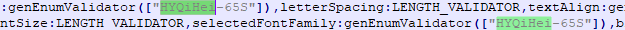

**事件<a name="zh-cn_topic_0000002444646773_section5131mcpsimp"></a>**

支持“[通用事件](#ZH-CN_TOPIC_0000002466543364)”中所述事件。

**示例<a name="zh-cn_topic_0000002444646773_section5136mcpsimp"></a>**

text组件示例：

```
<!-- xxx.hml --> 
<div class="container"> 
   
    <text class="title"> 
      Hello {{ title }} 
    </text> 
</div>
```

```
/* xxx.css */ 
.container { 
    width: 100%;
    height: 100%;
    display: flex; 
    justify-content: center; 
    align-items: center; 
} 
.title { 
    font-size: 30px; 
    text-align: center; 
    width: 100px; 
     
}
```

```
// xxx.js 
export default { 
    data: { 
        title: 'World' 
    } 
}
```

**图 1**  text组件-示例结果1<a name="zh-cn_topic_0000002444646773_fig1277033713379"></a>  


text组件截断属性示例：

```
<!-- xxx.hml --> 
<div class="container"> 
  <text class="text1"> 
    This is a passage 
  </text> 
  <text class="text2"> 
    This is a passage 
  </text> 
</div>
```

```
/* xxx.css */ 
.container { 
    width: 100%;
    height: 100%;
    flex-direction: column; 
    align-items: center; 
    background-color: #F1F3F5; 
    justify-content: center; 
} 
.text1{ 
    color: black;
} 
.text2{ 
    width: 200px; 
    height: 46px;
    color: black;
    max-lines: 1; 
    text-overflow: ellipsis; 
    text-valign: middle; 
    line-height: 40px; 
}
```

**图 2**  text组件-示例结果2<a name="zh-cn_topic_0000002444646773_fig106001816192812"></a>  


## 扩展组件<a name="ZH-CN_TOPIC_0000002466383744"></a>

禁止修改公版已交付组件，会导致稳定性下降并破坏应用兼容性。

1.  ACE上扩展组件。
    1.  在components路径下添加自定义组件的具体实现，自定义组件继承自“component.h”。

        components路径：ohos/foundation/arkui/ace\_engine\_lite/frameworks/src/core/components/

        ```
        class CanvasComponent final : public Component {
            ...
        };
        ```

    2.  在“keys.h”中添加组件的key值及名称。

        keys.h路径：ohos/foundation/arkui/ace\_engine\_lite/frameworks/src/core/base/keys.h

        ```
        enum {
            ...
            KEYWORD(CANVAS, canvas) // canvas component
        }
        ```

    3.  在“component\_factory.h”中增加新增组件对应的构造函数。

        component\_factory.h目录：ohos/foundation/arkui/ace\_engine\_lite/frameworks/src/core/components/component\_factory.h

        ```
        static Component* CreateComponent(...)
            {
                ...
                switch (componentNameId) {
                    ...
                    case K_QRCODE:
                        component = new CanvasComponent(options, children, styleManager);
                        break;
                }
            }
        ```

2.  将ACE扩展组件添加到Deveco Studio检查项。

    Deveco Studio SDK目录：点击“File”→ “Settings”进入“HarmonyOS SDK”。

    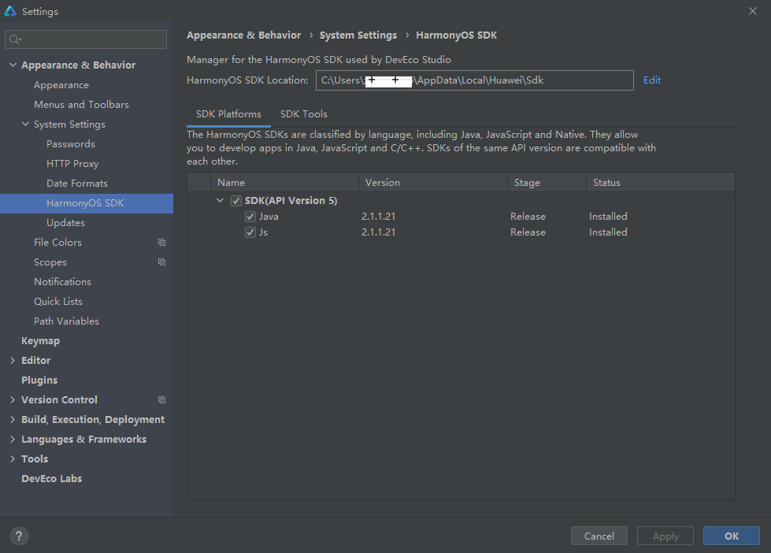

    修改SDK目录下检查配置

    IDE2.1（已日落）：js\\2.1.1.21\\build-tools\\ace-loader\\lib\\templater\\lite-validator.js

    IDE5.0：js\\build-tools\\ace-loader\\lib\\templater\\lite\_component\_map.js

    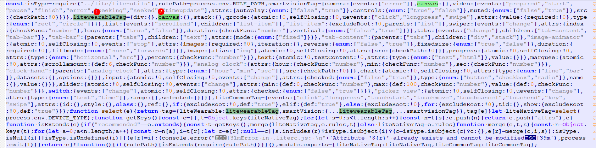

3.  在Deveco Studio中使用：

    ```
    <!-- index.hml -->
    <div class="full">
        <canvas class="canvas" ref="home"></canvas>
    </div>
    ```

# 接口<a name="ZH-CN_TOPIC_0000002499502709"></a>

-   **[通用规则](#ZH-CN_TOPIC_0000002466543360)**  

-   **[通用错误码](#ZH-CN_TOPIC_0000002466543348)**  

-   **[基本功能](#ZH-CN_TOPIC_0000002466383756)**  

-   **[扩展接口](#ZH-CN_TOPIC_0000002466543340)**  

## 通用规则<a name="ZH-CN_TOPIC_0000002466543360"></a>

**同步<a name="zh-cn_topic_0000002411207572_section1559mcpsimp"></a>**

同步方法调用后必须等到方法结果返回后才能继续后续的行为，返回值可以是任意类型。

示例：

```
var info = app.getInfo(); 
console.log(JSON.stringify(info));
```

**异步<a name="zh-cn_topic_0000002411207572_section1566mcpsimp"></a>**

异步方法调用整个过程不会阻碍调用者的工作。业务执行完成后会调用开发者提供的回调函数，异步接口支持的回调函数如[表1](#zh-cn_topic_0000002411207572_table1571mcpsimp)所示。

**表 1**  异步接口支持的回调函数

<a name="zh-cn_topic_0000002411207572_table1571mcpsimp"></a>
<table><thead align="left"><tr id="zh-cn_topic_0000002411207572_row1579mcpsimp"><th class="cellrowborder" valign="top" width="14.000000000000002%" id="mcps1.2.6.1.1"><p id="zh-cn_topic_0000002411207572_p1581mcpsimp"><a name="zh-cn_topic_0000002411207572_p1581mcpsimp"></a><a name="zh-cn_topic_0000002411207572_p1581mcpsimp"></a>回调函数</p>
</th>
<th class="cellrowborder" valign="top" width="13%" id="mcps1.2.6.1.2"><p id="zh-cn_topic_0000002411207572_p1583mcpsimp"><a name="zh-cn_topic_0000002411207572_p1583mcpsimp"></a><a name="zh-cn_topic_0000002411207572_p1583mcpsimp"></a>参数名</p>
</th>
<th class="cellrowborder" valign="top" width="13%" id="mcps1.2.6.1.3"><p id="zh-cn_topic_0000002411207572_p1585mcpsimp"><a name="zh-cn_topic_0000002411207572_p1585mcpsimp"></a><a name="zh-cn_topic_0000002411207572_p1585mcpsimp"></a>类型</p>
</th>
<th class="cellrowborder" valign="top" width="30%" id="mcps1.2.6.1.4"><p id="zh-cn_topic_0000002411207572_p1587mcpsimp"><a name="zh-cn_topic_0000002411207572_p1587mcpsimp"></a><a name="zh-cn_topic_0000002411207572_p1587mcpsimp"></a>返回值</p>
</th>
<th class="cellrowborder" valign="top" width="30%" id="mcps1.2.6.1.5"><p id="zh-cn_topic_0000002411207572_p1589mcpsimp"><a name="zh-cn_topic_0000002411207572_p1589mcpsimp"></a><a name="zh-cn_topic_0000002411207572_p1589mcpsimp"></a>说明</p>
</th>
</tr>
</thead>
<tbody><tr id="zh-cn_topic_0000002411207572_row1591mcpsimp"><td class="cellrowborder" valign="top" width="14.000000000000002%" headers="mcps1.2.6.1.1 "><p id="zh-cn_topic_0000002411207572_p1593mcpsimp"><a name="zh-cn_topic_0000002411207572_p1593mcpsimp"></a><a name="zh-cn_topic_0000002411207572_p1593mcpsimp"></a>success</p>
</td>
<td class="cellrowborder" valign="top" width="13%" headers="mcps1.2.6.1.2 "><p id="zh-cn_topic_0000002411207572_p1595mcpsimp"><a name="zh-cn_topic_0000002411207572_p1595mcpsimp"></a><a name="zh-cn_topic_0000002411207572_p1595mcpsimp"></a>data</p>
</td>
<td class="cellrowborder" valign="top" width="13%" headers="mcps1.2.6.1.3 "><p id="zh-cn_topic_0000002411207572_p1597mcpsimp"><a name="zh-cn_topic_0000002411207572_p1597mcpsimp"></a><a name="zh-cn_topic_0000002411207572_p1597mcpsimp"></a>any</p>
</td>
<td class="cellrowborder" valign="top" width="30%" headers="mcps1.2.6.1.4 "><p id="zh-cn_topic_0000002411207572_p1599mcpsimp"><a name="zh-cn_topic_0000002411207572_p1599mcpsimp"></a><a name="zh-cn_topic_0000002411207572_p1599mcpsimp"></a>可选，返回值可以是任意类型。</p>
</td>
<td class="cellrowborder" valign="top" width="30%" headers="mcps1.2.6.1.5 "><p id="zh-cn_topic_0000002411207572_p1601mcpsimp"><a name="zh-cn_topic_0000002411207572_p1601mcpsimp"></a><a name="zh-cn_topic_0000002411207572_p1601mcpsimp"></a>在执行成功时触发。</p>
</td>
</tr>
<tr id="zh-cn_topic_0000002411207572_row1602mcpsimp"><td class="cellrowborder" rowspan="2" valign="top" width="14.000000000000002%" headers="mcps1.2.6.1.1 "><p id="zh-cn_topic_0000002411207572_p1604mcpsimp"><a name="zh-cn_topic_0000002411207572_p1604mcpsimp"></a><a name="zh-cn_topic_0000002411207572_p1604mcpsimp"></a>fail</p>
</td>
<td class="cellrowborder" valign="top" width="13%" headers="mcps1.2.6.1.2 "><p id="zh-cn_topic_0000002411207572_p1606mcpsimp"><a name="zh-cn_topic_0000002411207572_p1606mcpsimp"></a><a name="zh-cn_topic_0000002411207572_p1606mcpsimp"></a>data</p>
</td>
<td class="cellrowborder" valign="top" width="13%" headers="mcps1.2.6.1.3 "><p id="zh-cn_topic_0000002411207572_p1608mcpsimp"><a name="zh-cn_topic_0000002411207572_p1608mcpsimp"></a><a name="zh-cn_topic_0000002411207572_p1608mcpsimp"></a>any</p>
</td>
<td class="cellrowborder" valign="top" width="30%" headers="mcps1.2.6.1.4 "><p id="zh-cn_topic_0000002411207572_p1610mcpsimp"><a name="zh-cn_topic_0000002411207572_p1610mcpsimp"></a><a name="zh-cn_topic_0000002411207572_p1610mcpsimp"></a>错误信息内容，一般是字符串，也可能是其他类型。</p>
</td>
<td class="cellrowborder" rowspan="2" valign="top" width="30%" headers="mcps1.2.6.1.5 "><p id="zh-cn_topic_0000002411207572_p1612mcpsimp"><a name="zh-cn_topic_0000002411207572_p1612mcpsimp"></a><a name="zh-cn_topic_0000002411207572_p1612mcpsimp"></a>在执行失败时触发。</p>
</td>
</tr>
<tr id="zh-cn_topic_0000002411207572_row1613mcpsimp"><td class="cellrowborder" valign="top" headers="mcps1.2.6.1.1 "><p id="zh-cn_topic_0000002411207572_p1615mcpsimp"><a name="zh-cn_topic_0000002411207572_p1615mcpsimp"></a><a name="zh-cn_topic_0000002411207572_p1615mcpsimp"></a>code</p>
</td>
<td class="cellrowborder" valign="top" headers="mcps1.2.6.1.2 "><p id="zh-cn_topic_0000002411207572_p1617mcpsimp"><a name="zh-cn_topic_0000002411207572_p1617mcpsimp"></a><a name="zh-cn_topic_0000002411207572_p1617mcpsimp"></a>number</p>
</td>
<td class="cellrowborder" valign="top" headers="mcps1.2.6.1.3 "><p id="zh-cn_topic_0000002411207572_p1619mcpsimp"><a name="zh-cn_topic_0000002411207572_p1619mcpsimp"></a><a name="zh-cn_topic_0000002411207572_p1619mcpsimp"></a>错误代码，请参见“<a href="#ZH-CN_TOPIC_0000002466543348">通用错误码</a>”。</p>
</td>
</tr>
<tr id="zh-cn_topic_0000002411207572_row1622mcpsimp"><td class="cellrowborder" valign="top" width="14.000000000000002%" headers="mcps1.2.6.1.1 "><p id="zh-cn_topic_0000002411207572_p1624mcpsimp"><a name="zh-cn_topic_0000002411207572_p1624mcpsimp"></a><a name="zh-cn_topic_0000002411207572_p1624mcpsimp"></a>cancel</p>
</td>
<td class="cellrowborder" valign="top" width="13%" headers="mcps1.2.6.1.2 "><p id="zh-cn_topic_0000002411207572_p1626mcpsimp"><a name="zh-cn_topic_0000002411207572_p1626mcpsimp"></a><a name="zh-cn_topic_0000002411207572_p1626mcpsimp"></a>data</p>
</td>
<td class="cellrowborder" valign="top" width="13%" headers="mcps1.2.6.1.3 "><p id="zh-cn_topic_0000002411207572_p1628mcpsimp"><a name="zh-cn_topic_0000002411207572_p1628mcpsimp"></a><a name="zh-cn_topic_0000002411207572_p1628mcpsimp"></a>any</p>
</td>
<td class="cellrowborder" valign="top" width="30%" headers="mcps1.2.6.1.4 "><p id="zh-cn_topic_0000002411207572_p1630mcpsimp"><a name="zh-cn_topic_0000002411207572_p1630mcpsimp"></a><a name="zh-cn_topic_0000002411207572_p1630mcpsimp"></a>一般无内容。</p>
</td>
<td class="cellrowborder" valign="top" width="30%" headers="mcps1.2.6.1.5 "><p id="zh-cn_topic_0000002411207572_p1632mcpsimp"><a name="zh-cn_topic_0000002411207572_p1632mcpsimp"></a><a name="zh-cn_topic_0000002411207572_p1632mcpsimp"></a>在用户取消时触发。</p>
</td>
</tr>
<tr id="zh-cn_topic_0000002411207572_row1633mcpsimp"><td class="cellrowborder" valign="top" width="14.000000000000002%" headers="mcps1.2.6.1.1 "><p id="zh-cn_topic_0000002411207572_p1635mcpsimp"><a name="zh-cn_topic_0000002411207572_p1635mcpsimp"></a><a name="zh-cn_topic_0000002411207572_p1635mcpsimp"></a>complete</p>
</td>
<td class="cellrowborder" valign="top" width="13%" headers="mcps1.2.6.1.2 "><p id="zh-cn_topic_0000002411207572_p1637mcpsimp"><a name="zh-cn_topic_0000002411207572_p1637mcpsimp"></a><a name="zh-cn_topic_0000002411207572_p1637mcpsimp"></a>-</p>
</td>
<td class="cellrowborder" valign="top" width="13%" headers="mcps1.2.6.1.3 "><p id="zh-cn_topic_0000002411207572_p1639mcpsimp"><a name="zh-cn_topic_0000002411207572_p1639mcpsimp"></a><a name="zh-cn_topic_0000002411207572_p1639mcpsimp"></a>-</p>
</td>
<td class="cellrowborder" valign="top" width="30%" headers="mcps1.2.6.1.4 "><p id="zh-cn_topic_0000002411207572_p1641mcpsimp"><a name="zh-cn_topic_0000002411207572_p1641mcpsimp"></a><a name="zh-cn_topic_0000002411207572_p1641mcpsimp"></a>-</p>
</td>
<td class="cellrowborder" valign="top" width="30%" headers="mcps1.2.6.1.5 "><p id="zh-cn_topic_0000002411207572_p1643mcpsimp"><a name="zh-cn_topic_0000002411207572_p1643mcpsimp"></a><a name="zh-cn_topic_0000002411207572_p1643mcpsimp"></a>在执行完成时触发。</p>
</td>
</tr>
</tbody>
</table>

> **说明：** 
>-   success、fail、cancel和complete四个回调函数是否支持请参考具体接口描述。
>-   success、fail和cancel三个回调函数的触发是互斥的，即会且只会有一个回调函数被触发，触发任意一个都会再次调用complete回调。

示例：

```
device.getInfo({  
    success: function(data) {  
        console.log('Device information obtained successfully. Device brand:' + data.brand);  
    },  
    fail: function(data, code) {  
        console.log('Failed to obtain device information. Error code:'+ code + '; Error information: ' + data);  
    },  
});
```

**订阅<a name="zh-cn_topic_0000002411207572_section1660mcpsimp"></a>**

订阅接口不会立即返回结果，开发者要在参数中设置相应的回调函数，该回调函数会在完成时或者事件变化时进行回调；可以执行多次。

**表 2**  订阅接口支持的回调函数

<a name="zh-cn_topic_0000002411207572_table1665mcpsimp"></a>
<table><thead align="left"><tr id="zh-cn_topic_0000002411207572_row1673mcpsimp"><th class="cellrowborder" valign="top" width="14.000000000000002%" id="mcps1.2.6.1.1"><p id="zh-cn_topic_0000002411207572_p1675mcpsimp"><a name="zh-cn_topic_0000002411207572_p1675mcpsimp"></a><a name="zh-cn_topic_0000002411207572_p1675mcpsimp"></a>回调函数</p>
</th>
<th class="cellrowborder" valign="top" width="13%" id="mcps1.2.6.1.2"><p id="zh-cn_topic_0000002411207572_p1677mcpsimp"><a name="zh-cn_topic_0000002411207572_p1677mcpsimp"></a><a name="zh-cn_topic_0000002411207572_p1677mcpsimp"></a>参数名</p>
</th>
<th class="cellrowborder" valign="top" width="13%" id="mcps1.2.6.1.3"><p id="zh-cn_topic_0000002411207572_p1679mcpsimp"><a name="zh-cn_topic_0000002411207572_p1679mcpsimp"></a><a name="zh-cn_topic_0000002411207572_p1679mcpsimp"></a>类型</p>
</th>
<th class="cellrowborder" valign="top" width="30%" id="mcps1.2.6.1.4"><p id="zh-cn_topic_0000002411207572_p1681mcpsimp"><a name="zh-cn_topic_0000002411207572_p1681mcpsimp"></a><a name="zh-cn_topic_0000002411207572_p1681mcpsimp"></a>返回值</p>
</th>
<th class="cellrowborder" valign="top" width="30%" id="mcps1.2.6.1.5"><p id="zh-cn_topic_0000002411207572_p1683mcpsimp"><a name="zh-cn_topic_0000002411207572_p1683mcpsimp"></a><a name="zh-cn_topic_0000002411207572_p1683mcpsimp"></a>说明</p>
</th>
</tr>
</thead>
<tbody><tr id="zh-cn_topic_0000002411207572_row1685mcpsimp"><td class="cellrowborder" valign="top" width="14.000000000000002%" headers="mcps1.2.6.1.1 "><p id="zh-cn_topic_0000002411207572_p1687mcpsimp"><a name="zh-cn_topic_0000002411207572_p1687mcpsimp"></a><a name="zh-cn_topic_0000002411207572_p1687mcpsimp"></a>success</p>
</td>
<td class="cellrowborder" valign="top" width="13%" headers="mcps1.2.6.1.2 "><p id="zh-cn_topic_0000002411207572_p1689mcpsimp"><a name="zh-cn_topic_0000002411207572_p1689mcpsimp"></a><a name="zh-cn_topic_0000002411207572_p1689mcpsimp"></a>data</p>
</td>
<td class="cellrowborder" valign="top" width="13%" headers="mcps1.2.6.1.3 "><p id="zh-cn_topic_0000002411207572_p1691mcpsimp"><a name="zh-cn_topic_0000002411207572_p1691mcpsimp"></a><a name="zh-cn_topic_0000002411207572_p1691mcpsimp"></a>any</p>
</td>
<td class="cellrowborder" valign="top" width="30%" headers="mcps1.2.6.1.4 "><p id="zh-cn_topic_0000002411207572_p1693mcpsimp"><a name="zh-cn_topic_0000002411207572_p1693mcpsimp"></a><a name="zh-cn_topic_0000002411207572_p1693mcpsimp"></a>返回值可以是任意类型。</p>
</td>
<td class="cellrowborder" valign="top" width="30%" headers="mcps1.2.6.1.5 "><p id="zh-cn_topic_0000002411207572_p1695mcpsimp"><a name="zh-cn_topic_0000002411207572_p1695mcpsimp"></a><a name="zh-cn_topic_0000002411207572_p1695mcpsimp"></a>接口调用成功或事件变更时触发，可能会触发多次。</p>
</td>
</tr>
<tr id="zh-cn_topic_0000002411207572_row1696mcpsimp"><td class="cellrowborder" rowspan="2" valign="top" width="14.000000000000002%" headers="mcps1.2.6.1.1 "><p id="zh-cn_topic_0000002411207572_p1698mcpsimp"><a name="zh-cn_topic_0000002411207572_p1698mcpsimp"></a><a name="zh-cn_topic_0000002411207572_p1698mcpsimp"></a>fail</p>
</td>
<td class="cellrowborder" valign="top" width="13%" headers="mcps1.2.6.1.2 "><p id="zh-cn_topic_0000002411207572_p1700mcpsimp"><a name="zh-cn_topic_0000002411207572_p1700mcpsimp"></a><a name="zh-cn_topic_0000002411207572_p1700mcpsimp"></a>data</p>
</td>
<td class="cellrowborder" valign="top" width="13%" headers="mcps1.2.6.1.3 "><p id="zh-cn_topic_0000002411207572_p1702mcpsimp"><a name="zh-cn_topic_0000002411207572_p1702mcpsimp"></a><a name="zh-cn_topic_0000002411207572_p1702mcpsimp"></a>any</p>
</td>
<td class="cellrowborder" valign="top" width="30%" headers="mcps1.2.6.1.4 "><p id="zh-cn_topic_0000002411207572_p1704mcpsimp"><a name="zh-cn_topic_0000002411207572_p1704mcpsimp"></a><a name="zh-cn_topic_0000002411207572_p1704mcpsimp"></a>错误信息内容，一般是字符串，也可能是其他类型。</p>
</td>
<td class="cellrowborder" rowspan="2" valign="top" width="30%" headers="mcps1.2.6.1.5 "><p id="zh-cn_topic_0000002411207572_p1706mcpsimp"><a name="zh-cn_topic_0000002411207572_p1706mcpsimp"></a><a name="zh-cn_topic_0000002411207572_p1706mcpsimp"></a>在执行失败时触发。一旦触发该回调函数，success不会再次被调用，接口调用结束。</p>
</td>
</tr>
<tr id="zh-cn_topic_0000002411207572_row1707mcpsimp"><td class="cellrowborder" valign="top" headers="mcps1.2.6.1.1 "><p id="zh-cn_topic_0000002411207572_p1709mcpsimp"><a name="zh-cn_topic_0000002411207572_p1709mcpsimp"></a><a name="zh-cn_topic_0000002411207572_p1709mcpsimp"></a>code</p>
</td>
<td class="cellrowborder" valign="top" headers="mcps1.2.6.1.2 "><p id="zh-cn_topic_0000002411207572_p1711mcpsimp"><a name="zh-cn_topic_0000002411207572_p1711mcpsimp"></a><a name="zh-cn_topic_0000002411207572_p1711mcpsimp"></a>number</p>
</td>
<td class="cellrowborder" valign="top" headers="mcps1.2.6.1.3 "><p id="zh-cn_topic_0000002411207572_p1713mcpsimp"><a name="zh-cn_topic_0000002411207572_p1713mcpsimp"></a><a name="zh-cn_topic_0000002411207572_p1713mcpsimp"></a>错误代码，请参见“<a href="#ZH-CN_TOPIC_0000002466543348">通用错误码</a>”。</p>
</td>
</tr>
</tbody>
</table>

## 通用错误码<a name="ZH-CN_TOPIC_0000002466543348"></a>

如[表1](#zh-cn_topic_0000002444646737_table1802mcpsimp)所示提供公共的错误码。其中，错误码200为系统通用错误码，所有系统未知异常发生时抛出，如框架申请内存空间失败等情况。

**表 1**  通用错误码

<a name="zh-cn_topic_0000002444646737_table1802mcpsimp"></a>
<table><thead align="left"><tr id="zh-cn_topic_0000002444646737_row1807mcpsimp"><th class="cellrowborder" valign="top" width="21%" id="mcps1.2.3.1.1"><p id="zh-cn_topic_0000002444646737_p1809mcpsimp"><a name="zh-cn_topic_0000002444646737_p1809mcpsimp"></a><a name="zh-cn_topic_0000002444646737_p1809mcpsimp"></a>code</p>
</th>
<th class="cellrowborder" valign="top" width="79%" id="mcps1.2.3.1.2"><p id="zh-cn_topic_0000002444646737_p1811mcpsimp"><a name="zh-cn_topic_0000002444646737_p1811mcpsimp"></a><a name="zh-cn_topic_0000002444646737_p1811mcpsimp"></a>含义</p>
</th>
</tr>
</thead>
<tbody><tr id="zh-cn_topic_0000002444646737_row1813mcpsimp"><td class="cellrowborder" valign="top" width="21%" headers="mcps1.2.3.1.1 "><p id="zh-cn_topic_0000002444646737_p1815mcpsimp"><a name="zh-cn_topic_0000002444646737_p1815mcpsimp"></a><a name="zh-cn_topic_0000002444646737_p1815mcpsimp"></a>200</p>
</td>
<td class="cellrowborder" valign="top" width="79%" headers="mcps1.2.3.1.2 "><p id="zh-cn_topic_0000002444646737_p1817mcpsimp"><a name="zh-cn_topic_0000002444646737_p1817mcpsimp"></a><a name="zh-cn_topic_0000002444646737_p1817mcpsimp"></a>通用错误。</p>
</td>
</tr>
<tr id="zh-cn_topic_0000002444646737_row1818mcpsimp"><td class="cellrowborder" valign="top" width="21%" headers="mcps1.2.3.1.1 "><p id="zh-cn_topic_0000002444646737_p1820mcpsimp"><a name="zh-cn_topic_0000002444646737_p1820mcpsimp"></a><a name="zh-cn_topic_0000002444646737_p1820mcpsimp"></a>202</p>
</td>
<td class="cellrowborder" valign="top" width="79%" headers="mcps1.2.3.1.2 "><p id="zh-cn_topic_0000002444646737_p1822mcpsimp"><a name="zh-cn_topic_0000002444646737_p1822mcpsimp"></a><a name="zh-cn_topic_0000002444646737_p1822mcpsimp"></a>参数错误。</p>
</td>
</tr>
<tr id="zh-cn_topic_0000002444646737_row1823mcpsimp"><td class="cellrowborder" valign="top" width="21%" headers="mcps1.2.3.1.1 "><p id="zh-cn_topic_0000002444646737_p1825mcpsimp"><a name="zh-cn_topic_0000002444646737_p1825mcpsimp"></a><a name="zh-cn_topic_0000002444646737_p1825mcpsimp"></a>300</p>
</td>
<td class="cellrowborder" valign="top" width="79%" headers="mcps1.2.3.1.2 "><p id="zh-cn_topic_0000002444646737_p1827mcpsimp"><a name="zh-cn_topic_0000002444646737_p1827mcpsimp"></a><a name="zh-cn_topic_0000002444646737_p1827mcpsimp"></a>I/O错误。</p>
</td>
</tr>
</tbody>
</table>

## 基本功能<a name="ZH-CN_TOPIC_0000002466383756"></a>

-   **[应用上下文](#ZH-CN_TOPIC_0000002466543368)**  

-   **[日志打印](#ZH-CN_TOPIC_0000002466543344)**  

-   **[页面路由](#ZH-CN_TOPIC_0000002466383740)**  

-   **[应用配置](#ZH-CN_TOPIC_0000002466383760)**  

-   **[定时器](#ZH-CN_TOPIC_0000002499502693)**  

-   **[网络](#ZH-CN_TOPIC_0000002466383736)**  

### 应用上下文<a name="ZH-CN_TOPIC_0000002466543368"></a>

**导入模块<a name="zh-cn_topic_0000002444646729_section3351mcpsimp"></a>**

```
import app from '@system.app';
```

**app.getInfo<a name="zh-cn_topic_0000002444646729_section3354mcpsimp"></a>**

获取当前应用配置文件中声明的信息：getInfo\(\)

-   返回值

    **表 1**  AppResponse

    <a name="zh-cn_topic_0000002444646729__t3e93239d9b134b80957bcdd4acb05291"></a>
    <table><thead align="left"><tr id="zh-cn_topic_0000002444646729_row3367mcpsimp"><th class="cellrowborder" valign="top" width="24.77%" id="mcps1.2.4.1.1"><p id="zh-cn_topic_0000002444646729_p3369mcpsimp"><a name="zh-cn_topic_0000002444646729_p3369mcpsimp"></a><a name="zh-cn_topic_0000002444646729_p3369mcpsimp"></a>参数名</p>
    </th>
    <th class="cellrowborder" valign="top" width="18.47%" id="mcps1.2.4.1.2"><p id="zh-cn_topic_0000002444646729_p3371mcpsimp"><a name="zh-cn_topic_0000002444646729_p3371mcpsimp"></a><a name="zh-cn_topic_0000002444646729_p3371mcpsimp"></a>类型</p>
    </th>
    <th class="cellrowborder" valign="top" width="56.76%" id="mcps1.2.4.1.3"><p id="zh-cn_topic_0000002444646729_p3373mcpsimp"><a name="zh-cn_topic_0000002444646729_p3373mcpsimp"></a><a name="zh-cn_topic_0000002444646729_p3373mcpsimp"></a>说明</p>
    </th>
    </tr>
    </thead>
    <tbody><tr id="zh-cn_topic_0000002444646729_row3374mcpsimp"><td class="cellrowborder" valign="top" width="24.77%" headers="mcps1.2.4.1.1 "><p id="zh-cn_topic_0000002444646729_p3376mcpsimp"><a name="zh-cn_topic_0000002444646729_p3376mcpsimp"></a><a name="zh-cn_topic_0000002444646729_p3376mcpsimp"></a>appName</p>
    </td>
    <td class="cellrowborder" valign="top" width="18.47%" headers="mcps1.2.4.1.2 "><p id="zh-cn_topic_0000002444646729_p3378mcpsimp"><a name="zh-cn_topic_0000002444646729_p3378mcpsimp"></a><a name="zh-cn_topic_0000002444646729_p3378mcpsimp"></a>string</p>
    </td>
    <td class="cellrowborder" valign="top" width="56.76%" headers="mcps1.2.4.1.3 "><p id="zh-cn_topic_0000002444646729_p3380mcpsimp"><a name="zh-cn_topic_0000002444646729_p3380mcpsimp"></a><a name="zh-cn_topic_0000002444646729_p3380mcpsimp"></a>表示应用的名称。</p>
    </td>
    </tr>
    <tr id="zh-cn_topic_0000002444646729_row3381mcpsimp"><td class="cellrowborder" valign="top" width="24.77%" headers="mcps1.2.4.1.1 "><p id="zh-cn_topic_0000002444646729_p3383mcpsimp"><a name="zh-cn_topic_0000002444646729_p3383mcpsimp"></a><a name="zh-cn_topic_0000002444646729_p3383mcpsimp"></a>versionName</p>
    </td>
    <td class="cellrowborder" valign="top" width="18.47%" headers="mcps1.2.4.1.2 "><p id="zh-cn_topic_0000002444646729_p3385mcpsimp"><a name="zh-cn_topic_0000002444646729_p3385mcpsimp"></a><a name="zh-cn_topic_0000002444646729_p3385mcpsimp"></a>string</p>
    </td>
    <td class="cellrowborder" valign="top" width="56.76%" headers="mcps1.2.4.1.3 "><p id="zh-cn_topic_0000002444646729_p3387mcpsimp"><a name="zh-cn_topic_0000002444646729_p3387mcpsimp"></a><a name="zh-cn_topic_0000002444646729_p3387mcpsimp"></a>表示应用的版本名称。</p>
    </td>
    </tr>
    <tr id="zh-cn_topic_0000002444646729_row3388mcpsimp"><td class="cellrowborder" valign="top" width="24.77%" headers="mcps1.2.4.1.1 "><p id="zh-cn_topic_0000002444646729_p3390mcpsimp"><a name="zh-cn_topic_0000002444646729_p3390mcpsimp"></a><a name="zh-cn_topic_0000002444646729_p3390mcpsimp"></a>versionCode</p>
    </td>
    <td class="cellrowborder" valign="top" width="18.47%" headers="mcps1.2.4.1.2 "><p id="zh-cn_topic_0000002444646729_p3392mcpsimp"><a name="zh-cn_topic_0000002444646729_p3392mcpsimp"></a><a name="zh-cn_topic_0000002444646729_p3392mcpsimp"></a>number</p>
    </td>
    <td class="cellrowborder" valign="top" width="56.76%" headers="mcps1.2.4.1.3 "><p id="zh-cn_topic_0000002444646729_p3394mcpsimp"><a name="zh-cn_topic_0000002444646729_p3394mcpsimp"></a><a name="zh-cn_topic_0000002444646729_p3394mcpsimp"></a>表示应用的版本号。</p>
    </td>
    </tr>
    </tbody>
    </table>

-   示例

    ```
    var info = app.getInfo(); 
    console.log(JSON.stringify(info));
    ```

**app.terminate<a name="zh-cn_topic_0000002444646729_section3399mcpsimp"></a>**

退出当前Ability：terminate\(\): void

示例：

```
 app.terminate();
```

### 日志打印<a name="ZH-CN_TOPIC_0000002466543344"></a>

**导入模块<a name="zh-cn_topic_0000002411207560_section2164mcpsimp"></a>**

无需导入。

**console.debug<a name="zh-cn_topic_0000002411207560_section2167mcpsimp"></a>**

打印debug级别的日志信息：debug\(message: string\): void

-   参数

    <a name="zh-cn_topic_0000002411207560_table2173mcpsimp"></a>
    <table><thead align="left"><tr id="zh-cn_topic_0000002411207560_row2180mcpsimp"><th class="cellrowborder" valign="top" width="16.21%" id="mcps1.1.5.1.1"><p id="zh-cn_topic_0000002411207560_p2182mcpsimp"><a name="zh-cn_topic_0000002411207560_p2182mcpsimp"></a><a name="zh-cn_topic_0000002411207560_p2182mcpsimp"></a>参数名</p>
    </th>
    <th class="cellrowborder" valign="top" width="14.71%" id="mcps1.1.5.1.2"><p id="zh-cn_topic_0000002411207560_p2184mcpsimp"><a name="zh-cn_topic_0000002411207560_p2184mcpsimp"></a><a name="zh-cn_topic_0000002411207560_p2184mcpsimp"></a>类型</p>
    </th>
    <th class="cellrowborder" valign="top" width="14.330000000000002%" id="mcps1.1.5.1.3"><p id="zh-cn_topic_0000002411207560_p2186mcpsimp"><a name="zh-cn_topic_0000002411207560_p2186mcpsimp"></a><a name="zh-cn_topic_0000002411207560_p2186mcpsimp"></a>必填</p>
    </th>
    <th class="cellrowborder" valign="top" width="54.75%" id="mcps1.1.5.1.4"><p id="zh-cn_topic_0000002411207560_p2188mcpsimp"><a name="zh-cn_topic_0000002411207560_p2188mcpsimp"></a><a name="zh-cn_topic_0000002411207560_p2188mcpsimp"></a>说明</p>
    </th>
    </tr>
    </thead>
    <tbody><tr id="zh-cn_topic_0000002411207560_row2190mcpsimp"><td class="cellrowborder" valign="top" width="16.21%" headers="mcps1.1.5.1.1 "><p id="zh-cn_topic_0000002411207560_p2192mcpsimp"><a name="zh-cn_topic_0000002411207560_p2192mcpsimp"></a><a name="zh-cn_topic_0000002411207560_p2192mcpsimp"></a>message</p>
    </td>
    <td class="cellrowborder" valign="top" width="14.71%" headers="mcps1.1.5.1.2 "><p id="zh-cn_topic_0000002411207560_p2194mcpsimp"><a name="zh-cn_topic_0000002411207560_p2194mcpsimp"></a><a name="zh-cn_topic_0000002411207560_p2194mcpsimp"></a>string</p>
    </td>
    <td class="cellrowborder" valign="top" width="14.330000000000002%" headers="mcps1.1.5.1.3 "><p id="zh-cn_topic_0000002411207560_p2196mcpsimp"><a name="zh-cn_topic_0000002411207560_p2196mcpsimp"></a><a name="zh-cn_topic_0000002411207560_p2196mcpsimp"></a>是</p>
    </td>
    <td class="cellrowborder" valign="top" width="54.75%" headers="mcps1.1.5.1.4 "><p id="zh-cn_topic_0000002411207560_p2198mcpsimp"><a name="zh-cn_topic_0000002411207560_p2198mcpsimp"></a><a name="zh-cn_topic_0000002411207560_p2198mcpsimp"></a>表示要打印的文本信息。</p>
    </td>
    </tr>
    </tbody>
    </table>

**console.log<a name="zh-cn_topic_0000002411207560_section2199mcpsimp"></a>**

打印log级别的日志信息：log\(message: string\): void

-   参数

    <a name="zh-cn_topic_0000002411207560_table2205mcpsimp"></a>
    <table><thead align="left"><tr id="zh-cn_topic_0000002411207560_row2212mcpsimp"><th class="cellrowborder" valign="top" width="16.1%" id="mcps1.1.5.1.1"><p id="zh-cn_topic_0000002411207560_p2214mcpsimp"><a name="zh-cn_topic_0000002411207560_p2214mcpsimp"></a><a name="zh-cn_topic_0000002411207560_p2214mcpsimp"></a>参数名</p>
    </th>
    <th class="cellrowborder" valign="top" width="14.97%" id="mcps1.1.5.1.2"><p id="zh-cn_topic_0000002411207560_p2216mcpsimp"><a name="zh-cn_topic_0000002411207560_p2216mcpsimp"></a><a name="zh-cn_topic_0000002411207560_p2216mcpsimp"></a>类型</p>
    </th>
    <th class="cellrowborder" valign="top" width="13.65%" id="mcps1.1.5.1.3"><p id="zh-cn_topic_0000002411207560_p2218mcpsimp"><a name="zh-cn_topic_0000002411207560_p2218mcpsimp"></a><a name="zh-cn_topic_0000002411207560_p2218mcpsimp"></a>必填</p>
    </th>
    <th class="cellrowborder" valign="top" width="55.279999999999994%" id="mcps1.1.5.1.4"><p id="zh-cn_topic_0000002411207560_p2220mcpsimp"><a name="zh-cn_topic_0000002411207560_p2220mcpsimp"></a><a name="zh-cn_topic_0000002411207560_p2220mcpsimp"></a>说明</p>
    </th>
    </tr>
    </thead>
    <tbody><tr id="zh-cn_topic_0000002411207560_row2222mcpsimp"><td class="cellrowborder" valign="top" width="16.1%" headers="mcps1.1.5.1.1 "><p id="zh-cn_topic_0000002411207560_p2224mcpsimp"><a name="zh-cn_topic_0000002411207560_p2224mcpsimp"></a><a name="zh-cn_topic_0000002411207560_p2224mcpsimp"></a>message</p>
    </td>
    <td class="cellrowborder" valign="top" width="14.97%" headers="mcps1.1.5.1.2 "><p id="zh-cn_topic_0000002411207560_p2226mcpsimp"><a name="zh-cn_topic_0000002411207560_p2226mcpsimp"></a><a name="zh-cn_topic_0000002411207560_p2226mcpsimp"></a>string</p>
    </td>
    <td class="cellrowborder" valign="top" width="13.65%" headers="mcps1.1.5.1.3 "><p id="zh-cn_topic_0000002411207560_p2228mcpsimp"><a name="zh-cn_topic_0000002411207560_p2228mcpsimp"></a><a name="zh-cn_topic_0000002411207560_p2228mcpsimp"></a>是</p>
    </td>
    <td class="cellrowborder" valign="top" width="55.279999999999994%" headers="mcps1.1.5.1.4 "><p id="zh-cn_topic_0000002411207560_p2230mcpsimp"><a name="zh-cn_topic_0000002411207560_p2230mcpsimp"></a><a name="zh-cn_topic_0000002411207560_p2230mcpsimp"></a>表示要打印的文本信息。</p>
    </td>
    </tr>
    </tbody>
    </table>

**console.info<a name="zh-cn_topic_0000002411207560_section2231mcpsimp"></a>**

打印info级别的日志信息：info\(message: string\): void

-   参数

    <a name="zh-cn_topic_0000002411207560_table2237mcpsimp"></a>
    <table><thead align="left"><tr id="zh-cn_topic_0000002411207560_row2244mcpsimp"><th class="cellrowborder" valign="top" width="15.55%" id="mcps1.1.5.1.1"><p id="zh-cn_topic_0000002411207560_p2246mcpsimp"><a name="zh-cn_topic_0000002411207560_p2246mcpsimp"></a><a name="zh-cn_topic_0000002411207560_p2246mcpsimp"></a>参数名</p>
    </th>
    <th class="cellrowborder" valign="top" width="15.52%" id="mcps1.1.5.1.2"><p id="zh-cn_topic_0000002411207560_p2248mcpsimp"><a name="zh-cn_topic_0000002411207560_p2248mcpsimp"></a><a name="zh-cn_topic_0000002411207560_p2248mcpsimp"></a>类型</p>
    </th>
    <th class="cellrowborder" valign="top" width="13.780000000000001%" id="mcps1.1.5.1.3"><p id="zh-cn_topic_0000002411207560_p2250mcpsimp"><a name="zh-cn_topic_0000002411207560_p2250mcpsimp"></a><a name="zh-cn_topic_0000002411207560_p2250mcpsimp"></a>必填</p>
    </th>
    <th class="cellrowborder" valign="top" width="55.15%" id="mcps1.1.5.1.4"><p id="zh-cn_topic_0000002411207560_p2252mcpsimp"><a name="zh-cn_topic_0000002411207560_p2252mcpsimp"></a><a name="zh-cn_topic_0000002411207560_p2252mcpsimp"></a>说明</p>
    </th>
    </tr>
    </thead>
    <tbody><tr id="zh-cn_topic_0000002411207560_row2254mcpsimp"><td class="cellrowborder" valign="top" width="15.55%" headers="mcps1.1.5.1.1 "><p id="zh-cn_topic_0000002411207560_p2256mcpsimp"><a name="zh-cn_topic_0000002411207560_p2256mcpsimp"></a><a name="zh-cn_topic_0000002411207560_p2256mcpsimp"></a>message</p>
    </td>
    <td class="cellrowborder" valign="top" width="15.52%" headers="mcps1.1.5.1.2 "><p id="zh-cn_topic_0000002411207560_p2258mcpsimp"><a name="zh-cn_topic_0000002411207560_p2258mcpsimp"></a><a name="zh-cn_topic_0000002411207560_p2258mcpsimp"></a>string</p>
    </td>
    <td class="cellrowborder" valign="top" width="13.780000000000001%" headers="mcps1.1.5.1.3 "><p id="zh-cn_topic_0000002411207560_p2260mcpsimp"><a name="zh-cn_topic_0000002411207560_p2260mcpsimp"></a><a name="zh-cn_topic_0000002411207560_p2260mcpsimp"></a>是</p>
    </td>
    <td class="cellrowborder" valign="top" width="55.15%" headers="mcps1.1.5.1.4 "><p id="zh-cn_topic_0000002411207560_p2262mcpsimp"><a name="zh-cn_topic_0000002411207560_p2262mcpsimp"></a><a name="zh-cn_topic_0000002411207560_p2262mcpsimp"></a>表示要打印的文本信息。</p>
    </td>
    </tr>
    </tbody>
    </table>

**console.warn<a name="zh-cn_topic_0000002411207560_section2263mcpsimp"></a>**

打印warn级别的日志信息：warn\(message: string\): void

-   参数

    <a name="zh-cn_topic_0000002411207560_table2269mcpsimp"></a>
    <table><thead align="left"><tr id="zh-cn_topic_0000002411207560_row2276mcpsimp"><th class="cellrowborder" valign="top" width="15.040000000000001%" id="mcps1.1.5.1.1"><p id="zh-cn_topic_0000002411207560_p2278mcpsimp"><a name="zh-cn_topic_0000002411207560_p2278mcpsimp"></a><a name="zh-cn_topic_0000002411207560_p2278mcpsimp"></a>参数名</p>
    </th>
    <th class="cellrowborder" valign="top" width="15.770000000000001%" id="mcps1.1.5.1.2"><p id="zh-cn_topic_0000002411207560_p2280mcpsimp"><a name="zh-cn_topic_0000002411207560_p2280mcpsimp"></a><a name="zh-cn_topic_0000002411207560_p2280mcpsimp"></a>类型</p>
    </th>
    <th class="cellrowborder" valign="top" width="14.31%" id="mcps1.1.5.1.3"><p id="zh-cn_topic_0000002411207560_p2282mcpsimp"><a name="zh-cn_topic_0000002411207560_p2282mcpsimp"></a><a name="zh-cn_topic_0000002411207560_p2282mcpsimp"></a>必填</p>
    </th>
    <th class="cellrowborder" valign="top" width="54.879999999999995%" id="mcps1.1.5.1.4"><p id="zh-cn_topic_0000002411207560_p2284mcpsimp"><a name="zh-cn_topic_0000002411207560_p2284mcpsimp"></a><a name="zh-cn_topic_0000002411207560_p2284mcpsimp"></a>说明</p>
    </th>
    </tr>
    </thead>
    <tbody><tr id="zh-cn_topic_0000002411207560_row2286mcpsimp"><td class="cellrowborder" valign="top" width="15.040000000000001%" headers="mcps1.1.5.1.1 "><p id="zh-cn_topic_0000002411207560_p2288mcpsimp"><a name="zh-cn_topic_0000002411207560_p2288mcpsimp"></a><a name="zh-cn_topic_0000002411207560_p2288mcpsimp"></a>message</p>
    </td>
    <td class="cellrowborder" valign="top" width="15.770000000000001%" headers="mcps1.1.5.1.2 "><p id="zh-cn_topic_0000002411207560_p2290mcpsimp"><a name="zh-cn_topic_0000002411207560_p2290mcpsimp"></a><a name="zh-cn_topic_0000002411207560_p2290mcpsimp"></a>string</p>
    </td>
    <td class="cellrowborder" valign="top" width="14.31%" headers="mcps1.1.5.1.3 "><p id="zh-cn_topic_0000002411207560_p2292mcpsimp"><a name="zh-cn_topic_0000002411207560_p2292mcpsimp"></a><a name="zh-cn_topic_0000002411207560_p2292mcpsimp"></a>是</p>
    </td>
    <td class="cellrowborder" valign="top" width="54.879999999999995%" headers="mcps1.1.5.1.4 "><p id="zh-cn_topic_0000002411207560_p2294mcpsimp"><a name="zh-cn_topic_0000002411207560_p2294mcpsimp"></a><a name="zh-cn_topic_0000002411207560_p2294mcpsimp"></a>表示要打印的文本信息。</p>
    </td>
    </tr>
    </tbody>
    </table>

**console.error<a name="zh-cn_topic_0000002411207560_section2295mcpsimp"></a>**

打印error级别的日志信息：error\(message: string\): void

-   参数

    <a name="zh-cn_topic_0000002411207560_table2301mcpsimp"></a>
    <table><thead align="left"><tr id="zh-cn_topic_0000002411207560_row2308mcpsimp"><th class="cellrowborder" valign="top" width="14.899999999999999%" id="mcps1.1.5.1.1"><p id="zh-cn_topic_0000002411207560_p2310mcpsimp"><a name="zh-cn_topic_0000002411207560_p2310mcpsimp"></a><a name="zh-cn_topic_0000002411207560_p2310mcpsimp"></a>参数名</p>
    </th>
    <th class="cellrowborder" valign="top" width="15.110000000000001%" id="mcps1.1.5.1.2"><p id="zh-cn_topic_0000002411207560_p2312mcpsimp"><a name="zh-cn_topic_0000002411207560_p2312mcpsimp"></a><a name="zh-cn_topic_0000002411207560_p2312mcpsimp"></a>类型</p>
    </th>
    <th class="cellrowborder" valign="top" width="14.84%" id="mcps1.1.5.1.3"><p id="zh-cn_topic_0000002411207560_p2314mcpsimp"><a name="zh-cn_topic_0000002411207560_p2314mcpsimp"></a><a name="zh-cn_topic_0000002411207560_p2314mcpsimp"></a>必填</p>
    </th>
    <th class="cellrowborder" valign="top" width="55.15%" id="mcps1.1.5.1.4"><p id="zh-cn_topic_0000002411207560_p2316mcpsimp"><a name="zh-cn_topic_0000002411207560_p2316mcpsimp"></a><a name="zh-cn_topic_0000002411207560_p2316mcpsimp"></a>说明</p>
    </th>
    </tr>
    </thead>
    <tbody><tr id="zh-cn_topic_0000002411207560_row2318mcpsimp"><td class="cellrowborder" valign="top" width="14.899999999999999%" headers="mcps1.1.5.1.1 "><p id="zh-cn_topic_0000002411207560_p2320mcpsimp"><a name="zh-cn_topic_0000002411207560_p2320mcpsimp"></a><a name="zh-cn_topic_0000002411207560_p2320mcpsimp"></a>message</p>
    </td>
    <td class="cellrowborder" valign="top" width="15.110000000000001%" headers="mcps1.1.5.1.2 "><p id="zh-cn_topic_0000002411207560_p2322mcpsimp"><a name="zh-cn_topic_0000002411207560_p2322mcpsimp"></a><a name="zh-cn_topic_0000002411207560_p2322mcpsimp"></a>string</p>
    </td>
    <td class="cellrowborder" valign="top" width="14.84%" headers="mcps1.1.5.1.3 "><p id="zh-cn_topic_0000002411207560_p2324mcpsimp"><a name="zh-cn_topic_0000002411207560_p2324mcpsimp"></a><a name="zh-cn_topic_0000002411207560_p2324mcpsimp"></a>是</p>
    </td>
    <td class="cellrowborder" valign="top" width="55.15%" headers="mcps1.1.5.1.4 "><p id="zh-cn_topic_0000002411207560_p2326mcpsimp"><a name="zh-cn_topic_0000002411207560_p2326mcpsimp"></a><a name="zh-cn_topic_0000002411207560_p2326mcpsimp"></a>表示要打印的文本信息。</p>
    </td>
    </tr>
    </tbody>
    </table>

**示例<a name="zh-cn_topic_0000002411207560_section2327mcpsimp"></a>**

```
var versionCode = 1; 
console.info('Hello World. The current version code is ' + versionCode); 
```

### 页面路由<a name="ZH-CN_TOPIC_0000002466383740"></a>

**导入模块<a name="zh-cn_topic_0000002411047720_section1727mcpsimp"></a>**

```
import router from '@system.router';
```

**router.replace<a name="zh-cn_topic_0000002411047720_section1730mcpsimp"></a>**

用应用内的某个页面替换当前页面并销毁被替换的页面：replace\(Object\): void

-   参数

    <a name="zh-cn_topic_0000002411047720_table1736mcpsimp"></a>
    <table><thead align="left"><tr id="zh-cn_topic_0000002411047720_row1743mcpsimp"><th class="cellrowborder" valign="top" width="12.610000000000001%" id="mcps1.1.5.1.1"><p id="zh-cn_topic_0000002411047720_p1745mcpsimp"><a name="zh-cn_topic_0000002411047720_p1745mcpsimp"></a><a name="zh-cn_topic_0000002411047720_p1745mcpsimp"></a>参数名</p>
    </th>
    <th class="cellrowborder" valign="top" width="13.340000000000002%" id="mcps1.1.5.1.2"><p id="zh-cn_topic_0000002411047720_p1747mcpsimp"><a name="zh-cn_topic_0000002411047720_p1747mcpsimp"></a><a name="zh-cn_topic_0000002411047720_p1747mcpsimp"></a>类型</p>
    </th>
    <th class="cellrowborder" valign="top" width="12.920000000000003%" id="mcps1.1.5.1.3"><p id="zh-cn_topic_0000002411047720_p1749mcpsimp"><a name="zh-cn_topic_0000002411047720_p1749mcpsimp"></a><a name="zh-cn_topic_0000002411047720_p1749mcpsimp"></a>必填</p>
    </th>
    <th class="cellrowborder" valign="top" width="61.13000000000001%" id="mcps1.1.5.1.4"><p id="zh-cn_topic_0000002411047720_p1751mcpsimp"><a name="zh-cn_topic_0000002411047720_p1751mcpsimp"></a><a name="zh-cn_topic_0000002411047720_p1751mcpsimp"></a>说明</p>
    </th>
    </tr>
    </thead>
    <tbody><tr id="zh-cn_topic_0000002411047720_row1753mcpsimp"><td class="cellrowborder" valign="top" width="12.610000000000001%" headers="mcps1.1.5.1.1 "><p id="zh-cn_topic_0000002411047720_p1755mcpsimp"><a name="zh-cn_topic_0000002411047720_p1755mcpsimp"></a><a name="zh-cn_topic_0000002411047720_p1755mcpsimp"></a>uri</p>
    </td>
    <td class="cellrowborder" valign="top" width="13.340000000000002%" headers="mcps1.1.5.1.2 "><p id="zh-cn_topic_0000002411047720_p1757mcpsimp"><a name="zh-cn_topic_0000002411047720_p1757mcpsimp"></a><a name="zh-cn_topic_0000002411047720_p1757mcpsimp"></a>string</p>
    </td>
    <td class="cellrowborder" valign="top" width="12.920000000000003%" headers="mcps1.1.5.1.3 "><p id="zh-cn_topic_0000002411047720_p1759mcpsimp"><a name="zh-cn_topic_0000002411047720_p1759mcpsimp"></a><a name="zh-cn_topic_0000002411047720_p1759mcpsimp"></a>是</p>
    </td>
    <td class="cellrowborder" valign="top" width="61.13000000000001%" headers="mcps1.1.5.1.4 "><p id="zh-cn_topic_0000002411047720_p1761mcpsimp"><a name="zh-cn_topic_0000002411047720_p1761mcpsimp"></a><a name="zh-cn_topic_0000002411047720_p1761mcpsimp"></a>目标页面的uri，可以是以下的两种格式：</p>
    <a name="zh-cn_topic_0000002411047720_ul1762mcpsimp"></a><a name="zh-cn_topic_0000002411047720_ul1762mcpsimp"></a><ul id="zh-cn_topic_0000002411047720_ul1762mcpsimp"><li>页面绝对路径，由配置文件中pages列表提供，例如：<a name="zh-cn_topic_0000002411047720_ul1764mcpsimp"></a><a name="zh-cn_topic_0000002411047720_ul1764mcpsimp"></a><ul id="zh-cn_topic_0000002411047720_ul1764mcpsimp"><li>pages/index/index</li><li>pages/detail/detail</li></ul>
    </li><li>特殊值，如果uri的值是“/”，则跳转到首页。</li></ul>
    </td>
    </tr>
    <tr id="zh-cn_topic_0000002411047720_row1768mcpsimp"><td class="cellrowborder" valign="top" width="12.610000000000001%" headers="mcps1.1.5.1.1 "><p id="zh-cn_topic_0000002411047720_p1770mcpsimp"><a name="zh-cn_topic_0000002411047720_p1770mcpsimp"></a><a name="zh-cn_topic_0000002411047720_p1770mcpsimp"></a>params</p>
    </td>
    <td class="cellrowborder" valign="top" width="13.340000000000002%" headers="mcps1.1.5.1.2 "><p id="zh-cn_topic_0000002411047720_p1772mcpsimp"><a name="zh-cn_topic_0000002411047720_p1772mcpsimp"></a><a name="zh-cn_topic_0000002411047720_p1772mcpsimp"></a>Object</p>
    </td>
    <td class="cellrowborder" valign="top" width="12.920000000000003%" headers="mcps1.1.5.1.3 "><p id="zh-cn_topic_0000002411047720_p1774mcpsimp"><a name="zh-cn_topic_0000002411047720_p1774mcpsimp"></a><a name="zh-cn_topic_0000002411047720_p1774mcpsimp"></a>否</p>
    </td>
    <td class="cellrowborder" valign="top" width="61.13000000000001%" headers="mcps1.1.5.1.4 "><p id="zh-cn_topic_0000002411047720_p1776mcpsimp"><a name="zh-cn_topic_0000002411047720_p1776mcpsimp"></a><a name="zh-cn_topic_0000002411047720_p1776mcpsimp"></a>跳转时要同时传递到目标页面的数据，跳转到目标页面后，参数可以在页面中直接使用，如this.data1（data1为跳转时params参数中的key值）。如果目标页面中已有该字段，则其值会被传入的字段值覆盖。</p>
    </td>
    </tr>
    </tbody>
    </table>

-   示例

    ```
    // 在当前页面中
     export default { 
         replacePage() { 
             router.replace({ 
                 uri: 'pages/detail/detail', 
                 params: { 
                     data1: 'message', 
                 }, 
             }); 
         } 
     } 
     // 在detail页面中
     export default { 
         data: { 
             data1: 'default' 
         }, 
         onInit() { 
             console.info('showData1:' + this.data1) 
         } 
     }
    ```

### 应用配置<a name="ZH-CN_TOPIC_0000002466383760"></a>

**导入模块<a name="zh-cn_topic_0000002444726853_section5573mcpsimp"></a>**

```
import configuration from '@system.configuration';
```

**configuration.getLocale<a name="zh-cn_topic_0000002444726853_section5576mcpsimp"></a>**

获取应用当前的语言和地区：getLocale\(\)，默认与系统的语言和地区同步。

-   返回值

    **表 1**  LocaleResponse

    <a name="zh-cn_topic_0000002444726853__table1544853546"></a>
    <table><thead align="left"><tr id="zh-cn_topic_0000002444726853_row5589mcpsimp"><th class="cellrowborder" valign="top" width="26.790000000000003%" id="mcps1.2.4.1.1"><p id="zh-cn_topic_0000002444726853_p5591mcpsimp"><a name="zh-cn_topic_0000002444726853_p5591mcpsimp"></a><a name="zh-cn_topic_0000002444726853_p5591mcpsimp"></a>参数名</p>
    </th>
    <th class="cellrowborder" valign="top" width="17.39%" id="mcps1.2.4.1.2"><p id="zh-cn_topic_0000002444726853_p5593mcpsimp"><a name="zh-cn_topic_0000002444726853_p5593mcpsimp"></a><a name="zh-cn_topic_0000002444726853_p5593mcpsimp"></a>类型</p>
    </th>
    <th class="cellrowborder" valign="top" width="55.82%" id="mcps1.2.4.1.3"><p id="zh-cn_topic_0000002444726853_p5595mcpsimp"><a name="zh-cn_topic_0000002444726853_p5595mcpsimp"></a><a name="zh-cn_topic_0000002444726853_p5595mcpsimp"></a>说明</p>
    </th>
    </tr>
    </thead>
    <tbody><tr id="zh-cn_topic_0000002444726853_row5597mcpsimp"><td class="cellrowborder" valign="top" width="26.790000000000003%" headers="mcps1.2.4.1.1 "><p id="zh-cn_topic_0000002444726853_p5599mcpsimp"><a name="zh-cn_topic_0000002444726853_p5599mcpsimp"></a><a name="zh-cn_topic_0000002444726853_p5599mcpsimp"></a>language</p>
    </td>
    <td class="cellrowborder" valign="top" width="17.39%" headers="mcps1.2.4.1.2 "><p id="zh-cn_topic_0000002444726853_p5601mcpsimp"><a name="zh-cn_topic_0000002444726853_p5601mcpsimp"></a><a name="zh-cn_topic_0000002444726853_p5601mcpsimp"></a>string</p>
    </td>
    <td class="cellrowborder" valign="top" width="55.82%" headers="mcps1.2.4.1.3 "><p id="zh-cn_topic_0000002444726853_p5603mcpsimp"><a name="zh-cn_topic_0000002444726853_p5603mcpsimp"></a><a name="zh-cn_topic_0000002444726853_p5603mcpsimp"></a>语言。例如：zh。</p>
    </td>
    </tr>
    <tr id="zh-cn_topic_0000002444726853_row5604mcpsimp"><td class="cellrowborder" valign="top" width="26.790000000000003%" headers="mcps1.2.4.1.1 "><p id="zh-cn_topic_0000002444726853_p5606mcpsimp"><a name="zh-cn_topic_0000002444726853_p5606mcpsimp"></a><a name="zh-cn_topic_0000002444726853_p5606mcpsimp"></a>countryOrRegion</p>
    </td>
    <td class="cellrowborder" valign="top" width="17.39%" headers="mcps1.2.4.1.2 "><p id="zh-cn_topic_0000002444726853_p5608mcpsimp"><a name="zh-cn_topic_0000002444726853_p5608mcpsimp"></a><a name="zh-cn_topic_0000002444726853_p5608mcpsimp"></a>string</p>
    </td>
    <td class="cellrowborder" valign="top" width="55.82%" headers="mcps1.2.4.1.3 "><p id="zh-cn_topic_0000002444726853_p5610mcpsimp"><a name="zh-cn_topic_0000002444726853_p5610mcpsimp"></a><a name="zh-cn_topic_0000002444726853_p5610mcpsimp"></a>国家或地区。例如：CN。</p>
    </td>
    </tr>
    <tr id="zh-cn_topic_0000002444726853_row5611mcpsimp"><td class="cellrowborder" valign="top" width="26.790000000000003%" headers="mcps1.2.4.1.1 "><p id="zh-cn_topic_0000002444726853_p5613mcpsimp"><a name="zh-cn_topic_0000002444726853_p5613mcpsimp"></a><a name="zh-cn_topic_0000002444726853_p5613mcpsimp"></a>dir</p>
    </td>
    <td class="cellrowborder" valign="top" width="17.39%" headers="mcps1.2.4.1.2 "><p id="zh-cn_topic_0000002444726853_p5615mcpsimp"><a name="zh-cn_topic_0000002444726853_p5615mcpsimp"></a><a name="zh-cn_topic_0000002444726853_p5615mcpsimp"></a>string</p>
    </td>
    <td class="cellrowborder" valign="top" width="55.82%" headers="mcps1.2.4.1.3 "><p id="zh-cn_topic_0000002444726853_p5617mcpsimp"><a name="zh-cn_topic_0000002444726853_p5617mcpsimp"></a><a name="zh-cn_topic_0000002444726853_p5617mcpsimp"></a>文字布局方向。取值范围：</p>
    <a name="zh-cn_topic_0000002444726853_ul5618mcpsimp"></a><a name="zh-cn_topic_0000002444726853_ul5618mcpsimp"></a><ul id="zh-cn_topic_0000002444726853_ul5618mcpsimp"><li>ltr：从左到右；</li><li>rtl：从右到左。</li></ul>
    </td>
    </tr>
    </tbody>
    </table>

-   示例

    ```
    const localeInfo = configuration.getLocale(); 
    console.info(localeInfo.language);
    ```

### 定时器<a name="ZH-CN_TOPIC_0000002499502693"></a>

**导入模块<a name="zh-cn_topic_0000002411047692_section5915mcpsimp"></a>**

无需导入。

**权限列表<a name="zh-cn_topic_0000002411047692_section5918mcpsimp"></a>**

无

**setTimeout<a name="zh-cn_topic_0000002411047692_section5921mcpsimp"></a>**

设置一个定时器，该定时器在定时器到期后执行一个函数：setTimeout\(handler\[,delay\[,…args\]\]\): number

-   参数

    <a name="zh-cn_topic_0000002411047692_table5927mcpsimp"></a>
    <table><thead align="left"><tr id="zh-cn_topic_0000002411047692_row5934mcpsimp"><th class="cellrowborder" valign="top" width="17%" id="mcps1.1.5.1.1"><p id="zh-cn_topic_0000002411047692_p5936mcpsimp"><a name="zh-cn_topic_0000002411047692_p5936mcpsimp"></a><a name="zh-cn_topic_0000002411047692_p5936mcpsimp"></a>参数名</p>
    </th>
    <th class="cellrowborder" valign="top" width="17.26%" id="mcps1.1.5.1.2"><p id="zh-cn_topic_0000002411047692_p5938mcpsimp"><a name="zh-cn_topic_0000002411047692_p5938mcpsimp"></a><a name="zh-cn_topic_0000002411047692_p5938mcpsimp"></a>类型</p>
    </th>
    <th class="cellrowborder" valign="top" width="15.870000000000001%" id="mcps1.1.5.1.3"><p id="zh-cn_topic_0000002411047692_p5940mcpsimp"><a name="zh-cn_topic_0000002411047692_p5940mcpsimp"></a><a name="zh-cn_topic_0000002411047692_p5940mcpsimp"></a>必填</p>
    </th>
    <th class="cellrowborder" valign="top" width="49.87%" id="mcps1.1.5.1.4"><p id="zh-cn_topic_0000002411047692_p5942mcpsimp"><a name="zh-cn_topic_0000002411047692_p5942mcpsimp"></a><a name="zh-cn_topic_0000002411047692_p5942mcpsimp"></a>说明</p>
    </th>
    </tr>
    </thead>
    <tbody><tr id="zh-cn_topic_0000002411047692_row5944mcpsimp"><td class="cellrowborder" valign="top" width="17%" headers="mcps1.1.5.1.1 "><p id="zh-cn_topic_0000002411047692_p5946mcpsimp"><a name="zh-cn_topic_0000002411047692_p5946mcpsimp"></a><a name="zh-cn_topic_0000002411047692_p5946mcpsimp"></a>handler</p>
    </td>
    <td class="cellrowborder" valign="top" width="17.26%" headers="mcps1.1.5.1.2 "><p id="zh-cn_topic_0000002411047692_p5948mcpsimp"><a name="zh-cn_topic_0000002411047692_p5948mcpsimp"></a><a name="zh-cn_topic_0000002411047692_p5948mcpsimp"></a>Function</p>
    </td>
    <td class="cellrowborder" valign="top" width="15.870000000000001%" headers="mcps1.1.5.1.3 "><p id="zh-cn_topic_0000002411047692_p5950mcpsimp"><a name="zh-cn_topic_0000002411047692_p5950mcpsimp"></a><a name="zh-cn_topic_0000002411047692_p5950mcpsimp"></a>是</p>
    </td>
    <td class="cellrowborder" valign="top" width="49.87%" headers="mcps1.1.5.1.4 "><p id="zh-cn_topic_0000002411047692_p5952mcpsimp"><a name="zh-cn_topic_0000002411047692_p5952mcpsimp"></a><a name="zh-cn_topic_0000002411047692_p5952mcpsimp"></a>定时器到期后执行函数。</p>
    </td>
    </tr>
    <tr id="zh-cn_topic_0000002411047692_row5953mcpsimp"><td class="cellrowborder" valign="top" width="17%" headers="mcps1.1.5.1.1 "><p id="zh-cn_topic_0000002411047692_p5955mcpsimp"><a name="zh-cn_topic_0000002411047692_p5955mcpsimp"></a><a name="zh-cn_topic_0000002411047692_p5955mcpsimp"></a>delay</p>
    </td>
    <td class="cellrowborder" valign="top" width="17.26%" headers="mcps1.1.5.1.2 "><p id="zh-cn_topic_0000002411047692_p5957mcpsimp"><a name="zh-cn_topic_0000002411047692_p5957mcpsimp"></a><a name="zh-cn_topic_0000002411047692_p5957mcpsimp"></a>number</p>
    </td>
    <td class="cellrowborder" valign="top" width="15.870000000000001%" headers="mcps1.1.5.1.3 "><p id="zh-cn_topic_0000002411047692_p5959mcpsimp"><a name="zh-cn_topic_0000002411047692_p5959mcpsimp"></a><a name="zh-cn_topic_0000002411047692_p5959mcpsimp"></a>否</p>
    </td>
    <td class="cellrowborder" valign="top" width="49.87%" headers="mcps1.1.5.1.4 "><p id="zh-cn_topic_0000002411047692_p5961mcpsimp"><a name="zh-cn_topic_0000002411047692_p5961mcpsimp"></a><a name="zh-cn_topic_0000002411047692_p5961mcpsimp"></a>延迟的毫秒数，函数的调用会在该延迟之后发生。如果省略该参数，delay取默认值0，意味着“马上”执行，或尽快执行。</p>
    </td>
    </tr>
    <tr id="zh-cn_topic_0000002411047692_row5962mcpsimp"><td class="cellrowborder" valign="top" width="17%" headers="mcps1.1.5.1.1 "><p id="zh-cn_topic_0000002411047692_p5964mcpsimp"><a name="zh-cn_topic_0000002411047692_p5964mcpsimp"></a><a name="zh-cn_topic_0000002411047692_p5964mcpsimp"></a>...args</p>
    </td>
    <td class="cellrowborder" valign="top" width="17.26%" headers="mcps1.1.5.1.2 "><p id="zh-cn_topic_0000002411047692_p5966mcpsimp"><a name="zh-cn_topic_0000002411047692_p5966mcpsimp"></a><a name="zh-cn_topic_0000002411047692_p5966mcpsimp"></a>Array&lt;any&gt;</p>
    </td>
    <td class="cellrowborder" valign="top" width="15.870000000000001%" headers="mcps1.1.5.1.3 "><p id="zh-cn_topic_0000002411047692_p5968mcpsimp"><a name="zh-cn_topic_0000002411047692_p5968mcpsimp"></a><a name="zh-cn_topic_0000002411047692_p5968mcpsimp"></a>否</p>
    </td>
    <td class="cellrowborder" valign="top" width="49.87%" headers="mcps1.1.5.1.4 "><p id="zh-cn_topic_0000002411047692_p5970mcpsimp"><a name="zh-cn_topic_0000002411047692_p5970mcpsimp"></a><a name="zh-cn_topic_0000002411047692_p5970mcpsimp"></a>附加参数，一旦定时器到期，它们会作为参数传递给handler。</p>
    </td>
    </tr>
    </tbody>
    </table>

-   返回值

    <a name="zh-cn_topic_0000002411047692_table5973mcpsimp"></a>
    <table><thead align="left"><tr id="zh-cn_topic_0000002411047692_row5978mcpsimp"><th class="cellrowborder" valign="top" width="17.8%" id="mcps1.1.3.1.1"><p id="zh-cn_topic_0000002411047692_p5980mcpsimp"><a name="zh-cn_topic_0000002411047692_p5980mcpsimp"></a><a name="zh-cn_topic_0000002411047692_p5980mcpsimp"></a>类型</p>
    </th>
    <th class="cellrowborder" valign="top" width="82.19999999999999%" id="mcps1.1.3.1.2"><p id="zh-cn_topic_0000002411047692_p5982mcpsimp"><a name="zh-cn_topic_0000002411047692_p5982mcpsimp"></a><a name="zh-cn_topic_0000002411047692_p5982mcpsimp"></a>说明</p>
    </th>
    </tr>
    </thead>
    <tbody><tr id="zh-cn_topic_0000002411047692_row5984mcpsimp"><td class="cellrowborder" valign="top" width="17.8%" headers="mcps1.1.3.1.1 "><p id="zh-cn_topic_0000002411047692_p5986mcpsimp"><a name="zh-cn_topic_0000002411047692_p5986mcpsimp"></a><a name="zh-cn_topic_0000002411047692_p5986mcpsimp"></a>number</p>
    </td>
    <td class="cellrowborder" valign="top" width="82.19999999999999%" headers="mcps1.1.3.1.2 "><p id="zh-cn_topic_0000002411047692_p5988mcpsimp"><a name="zh-cn_topic_0000002411047692_p5988mcpsimp"></a><a name="zh-cn_topic_0000002411047692_p5988mcpsimp"></a>timeout定时器的ID。</p>
    </td>
    </tr>
    </tbody>
    </table>

-   示例

    ```
    var timeoutID = setTimeout(function() { 
        console.log('delay 1s'); 
     }, 1000);
    ```

**clearTimeout<a name="zh-cn_topic_0000002411047692_section5994mcpsimp"></a>**

clearTimeout\(timeoutID: number\): void

取消了先前通过调用setTimeout\(\)建立的定时器。

-   参数

    <a name="zh-cn_topic_0000002411047692_table6000mcpsimp"></a>
    <table><thead align="left"><tr id="zh-cn_topic_0000002411047692_row6007mcpsimp"><th class="cellrowborder" valign="top" width="15.950000000000001%" id="mcps1.1.5.1.1"><p id="zh-cn_topic_0000002411047692_p6009mcpsimp"><a name="zh-cn_topic_0000002411047692_p6009mcpsimp"></a><a name="zh-cn_topic_0000002411047692_p6009mcpsimp"></a>参数名</p>
    </th>
    <th class="cellrowborder" valign="top" width="18.39%" id="mcps1.1.5.1.2"><p id="zh-cn_topic_0000002411047692_p6011mcpsimp"><a name="zh-cn_topic_0000002411047692_p6011mcpsimp"></a><a name="zh-cn_topic_0000002411047692_p6011mcpsimp"></a>类型</p>
    </th>
    <th class="cellrowborder" valign="top" width="14.23%" id="mcps1.1.5.1.3"><p id="zh-cn_topic_0000002411047692_p6013mcpsimp"><a name="zh-cn_topic_0000002411047692_p6013mcpsimp"></a><a name="zh-cn_topic_0000002411047692_p6013mcpsimp"></a>必填</p>
    </th>
    <th class="cellrowborder" valign="top" width="51.43%" id="mcps1.1.5.1.4"><p id="zh-cn_topic_0000002411047692_p6015mcpsimp"><a name="zh-cn_topic_0000002411047692_p6015mcpsimp"></a><a name="zh-cn_topic_0000002411047692_p6015mcpsimp"></a>说明</p>
    </th>
    </tr>
    </thead>
    <tbody><tr id="zh-cn_topic_0000002411047692_row6017mcpsimp"><td class="cellrowborder" valign="top" width="15.950000000000001%" headers="mcps1.1.5.1.1 "><p id="zh-cn_topic_0000002411047692_p6019mcpsimp"><a name="zh-cn_topic_0000002411047692_p6019mcpsimp"></a><a name="zh-cn_topic_0000002411047692_p6019mcpsimp"></a>timeoutID</p>
    </td>
    <td class="cellrowborder" valign="top" width="18.39%" headers="mcps1.1.5.1.2 "><p id="zh-cn_topic_0000002411047692_p6021mcpsimp"><a name="zh-cn_topic_0000002411047692_p6021mcpsimp"></a><a name="zh-cn_topic_0000002411047692_p6021mcpsimp"></a>number</p>
    </td>
    <td class="cellrowborder" valign="top" width="14.23%" headers="mcps1.1.5.1.3 "><p id="zh-cn_topic_0000002411047692_p6023mcpsimp"><a name="zh-cn_topic_0000002411047692_p6023mcpsimp"></a><a name="zh-cn_topic_0000002411047692_p6023mcpsimp"></a>是</p>
    </td>
    <td class="cellrowborder" valign="top" width="51.43%" headers="mcps1.1.5.1.4 "><p id="zh-cn_topic_0000002411047692_p6025mcpsimp"><a name="zh-cn_topic_0000002411047692_p6025mcpsimp"></a><a name="zh-cn_topic_0000002411047692_p6025mcpsimp"></a>要取消定时器的ID， 是由setTimeout()返回的。</p>
    </td>
    </tr>
    </tbody>
    </table>

-   示例

    ```
    var timeoutID = setTimeout(function() { 
        console.log('do after 1s delay.'); 
     }, 1000);  
    clearTimeout(timeoutID);
    ```

**setInterval<a name="zh-cn_topic_0000002411047692_section6033mcpsimp"></a>**

setInterval\(handler\[, delay\[, ...args\]\]\): number

重复调用一个函数，在每次调用之间具有固定的时间延迟。

-   参数

    <a name="zh-cn_topic_0000002411047692_table6039mcpsimp"></a>
    <table><thead align="left"><tr id="zh-cn_topic_0000002411047692_row6046mcpsimp"><th class="cellrowborder" valign="top" width="16.5%" id="mcps1.1.5.1.1"><p id="zh-cn_topic_0000002411047692_p6048mcpsimp"><a name="zh-cn_topic_0000002411047692_p6048mcpsimp"></a><a name="zh-cn_topic_0000002411047692_p6048mcpsimp"></a>参数名</p>
    </th>
    <th class="cellrowborder" valign="top" width="17.93%" id="mcps1.1.5.1.2"><p id="zh-cn_topic_0000002411047692_p6050mcpsimp"><a name="zh-cn_topic_0000002411047692_p6050mcpsimp"></a><a name="zh-cn_topic_0000002411047692_p6050mcpsimp"></a>类型</p>
    </th>
    <th class="cellrowborder" valign="top" width="14.37%" id="mcps1.1.5.1.3"><p id="zh-cn_topic_0000002411047692_p6052mcpsimp"><a name="zh-cn_topic_0000002411047692_p6052mcpsimp"></a><a name="zh-cn_topic_0000002411047692_p6052mcpsimp"></a>必填</p>
    </th>
    <th class="cellrowborder" valign="top" width="51.2%" id="mcps1.1.5.1.4"><p id="zh-cn_topic_0000002411047692_p6054mcpsimp"><a name="zh-cn_topic_0000002411047692_p6054mcpsimp"></a><a name="zh-cn_topic_0000002411047692_p6054mcpsimp"></a>说明</p>
    </th>
    </tr>
    </thead>
    <tbody><tr id="zh-cn_topic_0000002411047692_row6056mcpsimp"><td class="cellrowborder" valign="top" width="16.5%" headers="mcps1.1.5.1.1 "><p id="zh-cn_topic_0000002411047692_p6058mcpsimp"><a name="zh-cn_topic_0000002411047692_p6058mcpsimp"></a><a name="zh-cn_topic_0000002411047692_p6058mcpsimp"></a>handler</p>
    </td>
    <td class="cellrowborder" valign="top" width="17.93%" headers="mcps1.1.5.1.2 "><p id="zh-cn_topic_0000002411047692_p6060mcpsimp"><a name="zh-cn_topic_0000002411047692_p6060mcpsimp"></a><a name="zh-cn_topic_0000002411047692_p6060mcpsimp"></a>Function</p>
    </td>
    <td class="cellrowborder" valign="top" width="14.37%" headers="mcps1.1.5.1.3 "><p id="zh-cn_topic_0000002411047692_p6062mcpsimp"><a name="zh-cn_topic_0000002411047692_p6062mcpsimp"></a><a name="zh-cn_topic_0000002411047692_p6062mcpsimp"></a>是</p>
    </td>
    <td class="cellrowborder" valign="top" width="51.2%" headers="mcps1.1.5.1.4 "><p id="zh-cn_topic_0000002411047692_p6064mcpsimp"><a name="zh-cn_topic_0000002411047692_p6064mcpsimp"></a><a name="zh-cn_topic_0000002411047692_p6064mcpsimp"></a>要重复调用的函数。</p>
    </td>
    </tr>
    <tr id="zh-cn_topic_0000002411047692_row6065mcpsimp"><td class="cellrowborder" valign="top" width="16.5%" headers="mcps1.1.5.1.1 "><p id="zh-cn_topic_0000002411047692_p6067mcpsimp"><a name="zh-cn_topic_0000002411047692_p6067mcpsimp"></a><a name="zh-cn_topic_0000002411047692_p6067mcpsimp"></a>delay</p>
    </td>
    <td class="cellrowborder" valign="top" width="17.93%" headers="mcps1.1.5.1.2 "><p id="zh-cn_topic_0000002411047692_p6069mcpsimp"><a name="zh-cn_topic_0000002411047692_p6069mcpsimp"></a><a name="zh-cn_topic_0000002411047692_p6069mcpsimp"></a>number</p>
    </td>
    <td class="cellrowborder" valign="top" width="14.37%" headers="mcps1.1.5.1.3 "><p id="zh-cn_topic_0000002411047692_p6071mcpsimp"><a name="zh-cn_topic_0000002411047692_p6071mcpsimp"></a><a name="zh-cn_topic_0000002411047692_p6071mcpsimp"></a>否</p>
    </td>
    <td class="cellrowborder" valign="top" width="51.2%" headers="mcps1.1.5.1.4 "><p id="zh-cn_topic_0000002411047692_p6073mcpsimp"><a name="zh-cn_topic_0000002411047692_p6073mcpsimp"></a><a name="zh-cn_topic_0000002411047692_p6073mcpsimp"></a>延迟的毫秒数（一秒等于1000毫秒），函数的调用会在该延迟之后发生。</p>
    </td>
    </tr>
    <tr id="zh-cn_topic_0000002411047692_row6074mcpsimp"><td class="cellrowborder" valign="top" width="16.5%" headers="mcps1.1.5.1.1 "><p id="zh-cn_topic_0000002411047692_p6076mcpsimp"><a name="zh-cn_topic_0000002411047692_p6076mcpsimp"></a><a name="zh-cn_topic_0000002411047692_p6076mcpsimp"></a>...args</p>
    </td>
    <td class="cellrowborder" valign="top" width="17.93%" headers="mcps1.1.5.1.2 "><p id="zh-cn_topic_0000002411047692_p6078mcpsimp"><a name="zh-cn_topic_0000002411047692_p6078mcpsimp"></a><a name="zh-cn_topic_0000002411047692_p6078mcpsimp"></a>Array&lt;any&gt;</p>
    </td>
    <td class="cellrowborder" valign="top" width="14.37%" headers="mcps1.1.5.1.3 "><p id="zh-cn_topic_0000002411047692_p6080mcpsimp"><a name="zh-cn_topic_0000002411047692_p6080mcpsimp"></a><a name="zh-cn_topic_0000002411047692_p6080mcpsimp"></a>否</p>
    </td>
    <td class="cellrowborder" valign="top" width="51.2%" headers="mcps1.1.5.1.4 "><p id="zh-cn_topic_0000002411047692_p6082mcpsimp"><a name="zh-cn_topic_0000002411047692_p6082mcpsimp"></a><a name="zh-cn_topic_0000002411047692_p6082mcpsimp"></a>附加参数，一旦定时器到期，他们会作为参数传递给handler。</p>
    </td>
    </tr>
    </tbody>
    </table>

-   返回值

    <a name="zh-cn_topic_0000002411047692_table6085mcpsimp"></a>
    <table><thead align="left"><tr id="zh-cn_topic_0000002411047692_row6090mcpsimp"><th class="cellrowborder" valign="top" width="17.669999999999998%" id="mcps1.1.3.1.1"><p id="zh-cn_topic_0000002411047692_p6092mcpsimp"><a name="zh-cn_topic_0000002411047692_p6092mcpsimp"></a><a name="zh-cn_topic_0000002411047692_p6092mcpsimp"></a>类型</p>
    </th>
    <th class="cellrowborder" valign="top" width="82.33%" id="mcps1.1.3.1.2"><p id="zh-cn_topic_0000002411047692_p6094mcpsimp"><a name="zh-cn_topic_0000002411047692_p6094mcpsimp"></a><a name="zh-cn_topic_0000002411047692_p6094mcpsimp"></a>说明</p>
    </th>
    </tr>
    </thead>
    <tbody><tr id="zh-cn_topic_0000002411047692_row6096mcpsimp"><td class="cellrowborder" valign="top" width="17.669999999999998%" headers="mcps1.1.3.1.1 "><p id="zh-cn_topic_0000002411047692_p6098mcpsimp"><a name="zh-cn_topic_0000002411047692_p6098mcpsimp"></a><a name="zh-cn_topic_0000002411047692_p6098mcpsimp"></a>number</p>
    </td>
    <td class="cellrowborder" valign="top" width="82.33%" headers="mcps1.1.3.1.2 "><p id="zh-cn_topic_0000002411047692_p6100mcpsimp"><a name="zh-cn_topic_0000002411047692_p6100mcpsimp"></a><a name="zh-cn_topic_0000002411047692_p6100mcpsimp"></a>intervallID重复定时器的ID。</p>
    </td>
    </tr>
    </tbody>
    </table>

-   示例

    ```
    var intervalID = setInterval(function() { 
        console.log('do very 1s.'); 
     }, 1000);
    ```

**clearInterval<a name="zh-cn_topic_0000002411047692_section6106mcpsimp"></a>**

clearInterval\(intervalID: number\): void

可取消先前通过 setInterval\(\) 设置的重复定时任务。

-   参数

    <a name="zh-cn_topic_0000002411047692_table6112mcpsimp"></a>
    <table><thead align="left"><tr id="zh-cn_topic_0000002411047692_row6119mcpsimp"><th class="cellrowborder" valign="top" width="18.23%" id="mcps1.1.5.1.1"><p id="zh-cn_topic_0000002411047692_p6121mcpsimp"><a name="zh-cn_topic_0000002411047692_p6121mcpsimp"></a><a name="zh-cn_topic_0000002411047692_p6121mcpsimp"></a>参数名</p>
    </th>
    <th class="cellrowborder" valign="top" width="15.709999999999999%" id="mcps1.1.5.1.2"><p id="zh-cn_topic_0000002411047692_p6123mcpsimp"><a name="zh-cn_topic_0000002411047692_p6123mcpsimp"></a><a name="zh-cn_topic_0000002411047692_p6123mcpsimp"></a>类型</p>
    </th>
    <th class="cellrowborder" valign="top" width="13.68%" id="mcps1.1.5.1.3"><p id="zh-cn_topic_0000002411047692_p6125mcpsimp"><a name="zh-cn_topic_0000002411047692_p6125mcpsimp"></a><a name="zh-cn_topic_0000002411047692_p6125mcpsimp"></a>必填</p>
    </th>
    <th class="cellrowborder" valign="top" width="52.38%" id="mcps1.1.5.1.4"><p id="zh-cn_topic_0000002411047692_p6127mcpsimp"><a name="zh-cn_topic_0000002411047692_p6127mcpsimp"></a><a name="zh-cn_topic_0000002411047692_p6127mcpsimp"></a>说明</p>
    </th>
    </tr>
    </thead>
    <tbody><tr id="zh-cn_topic_0000002411047692_row6129mcpsimp"><td class="cellrowborder" valign="top" width="18.23%" headers="mcps1.1.5.1.1 "><p id="zh-cn_topic_0000002411047692_p6131mcpsimp"><a name="zh-cn_topic_0000002411047692_p6131mcpsimp"></a><a name="zh-cn_topic_0000002411047692_p6131mcpsimp"></a>intervalID</p>
    </td>
    <td class="cellrowborder" valign="top" width="15.709999999999999%" headers="mcps1.1.5.1.2 "><p id="zh-cn_topic_0000002411047692_p6133mcpsimp"><a name="zh-cn_topic_0000002411047692_p6133mcpsimp"></a><a name="zh-cn_topic_0000002411047692_p6133mcpsimp"></a>number</p>
    </td>
    <td class="cellrowborder" valign="top" width="13.68%" headers="mcps1.1.5.1.3 "><p id="zh-cn_topic_0000002411047692_p6135mcpsimp"><a name="zh-cn_topic_0000002411047692_p6135mcpsimp"></a><a name="zh-cn_topic_0000002411047692_p6135mcpsimp"></a>是</p>
    </td>
    <td class="cellrowborder" valign="top" width="52.38%" headers="mcps1.1.5.1.4 "><p id="zh-cn_topic_0000002411047692_p6137mcpsimp"><a name="zh-cn_topic_0000002411047692_p6137mcpsimp"></a><a name="zh-cn_topic_0000002411047692_p6137mcpsimp"></a>要取消的重复定时器的ID，是由 setInterval() 返回的。</p>
    </td>
    </tr>
    </tbody>
    </table>

-   示例

    ```
    var intervalID = setInterval(function() { 
        console.log('do very 1s.'); 
     }, 1000); 
    clearInterval(intervalID);
    
    ```

### 网络<a name="ZH-CN_TOPIC_0000002466383736"></a>

**导入模块<a name="zh-cn_topic_0000002411047684_section3351mcpsimp"></a>**

```
import http from '@ohos.net.http';
```

**http.createHttp<a name="zh-cn_topic_0000002411047684_section7855122154218"></a>**

创建一个HTTP请求，支持发起请求、中断请求。

-   返回值

    **表 1**  HttpRequest

    <a name="zh-cn_topic_0000002411047684__t3e93239d9b134b80957bcdd4acb05291"></a>
    <table><thead align="left"><tr id="zh-cn_topic_0000002411047684_row3367mcpsimp"><th class="cellrowborder" valign="top" width="21.87%" id="mcps1.2.4.1.1"><p id="zh-cn_topic_0000002411047684_p3369mcpsimp"><a name="zh-cn_topic_0000002411047684_p3369mcpsimp"></a><a name="zh-cn_topic_0000002411047684_p3369mcpsimp"></a>返回值名称</p>
    </th>
    <th class="cellrowborder" valign="top" width="15.42%" id="mcps1.2.4.1.2"><p id="zh-cn_topic_0000002411047684_p3371mcpsimp"><a name="zh-cn_topic_0000002411047684_p3371mcpsimp"></a><a name="zh-cn_topic_0000002411047684_p3371mcpsimp"></a>类型</p>
    </th>
    <th class="cellrowborder" valign="top" width="62.71%" id="mcps1.2.4.1.3"><p id="zh-cn_topic_0000002411047684_p3373mcpsimp"><a name="zh-cn_topic_0000002411047684_p3373mcpsimp"></a><a name="zh-cn_topic_0000002411047684_p3373mcpsimp"></a>说明</p>
    </th>
    </tr>
    </thead>
    <tbody><tr id="zh-cn_topic_0000002411047684_row3374mcpsimp"><td class="cellrowborder" valign="top" width="21.87%" headers="mcps1.2.4.1.1 "><p id="zh-cn_topic_0000002411047684_p3376mcpsimp"><a name="zh-cn_topic_0000002411047684_p3376mcpsimp"></a><a name="zh-cn_topic_0000002411047684_p3376mcpsimp"></a>HttpRequest</p>
    </td>
    <td class="cellrowborder" valign="top" width="15.42%" headers="mcps1.2.4.1.2 "><p id="zh-cn_topic_0000002411047684_p3378mcpsimp"><a name="zh-cn_topic_0000002411047684_p3378mcpsimp"></a><a name="zh-cn_topic_0000002411047684_p3378mcpsimp"></a>Object</p>
    </td>
    <td class="cellrowborder" valign="top" width="62.71%" headers="mcps1.2.4.1.3 "><p id="zh-cn_topic_0000002411047684_p3380mcpsimp"><a name="zh-cn_topic_0000002411047684_p3380mcpsimp"></a><a name="zh-cn_topic_0000002411047684_p3380mcpsimp"></a>HTTP请求对象，支持request、requestInStream、on、off、destroy等方法。</p>
    </td>
    </tr>
    </tbody>
    </table>

-   示例

    ```
    let httpRequest = http.createHttp();
    ```

**httpRequest.request<a name="zh-cn_topic_0000002411047684_section193312374917"></a>**

向URL地址，发起HTTP请求，通过注册异步回调方法，处理响应结果。

-   参数

    **表 2**  request

    <a name="zh-cn_topic_0000002411047684_table993373164915"></a>
    <table><thead align="left"><tr id="zh-cn_topic_0000002411047684_row29320320494"><th class="cellrowborder" valign="top" width="19.1%" id="mcps1.2.4.1.1"><p id="zh-cn_topic_0000002411047684_p119321315496"><a name="zh-cn_topic_0000002411047684_p119321315496"></a><a name="zh-cn_topic_0000002411047684_p119321315496"></a>参数名称</p>
    </th>
    <th class="cellrowborder" valign="top" width="18.099999999999998%" id="mcps1.2.4.1.2"><p id="zh-cn_topic_0000002411047684_p493203114916"><a name="zh-cn_topic_0000002411047684_p493203114916"></a><a name="zh-cn_topic_0000002411047684_p493203114916"></a>类型</p>
    </th>
    <th class="cellrowborder" valign="top" width="62.8%" id="mcps1.2.4.1.3"><p id="zh-cn_topic_0000002411047684_p1993218318496"><a name="zh-cn_topic_0000002411047684_p1993218318496"></a><a name="zh-cn_topic_0000002411047684_p1993218318496"></a>说明</p>
    </th>
    </tr>
    </thead>
    <tbody><tr id="zh-cn_topic_0000002411047684_row1932203164911"><td class="cellrowborder" valign="top" width="19.1%" headers="mcps1.2.4.1.1 "><p id="zh-cn_topic_0000002411047684_p7932123134913"><a name="zh-cn_topic_0000002411047684_p7932123134913"></a><a name="zh-cn_topic_0000002411047684_p7932123134913"></a>url</p>
    </td>
    <td class="cellrowborder" valign="top" width="18.099999999999998%" headers="mcps1.2.4.1.2 "><p id="zh-cn_topic_0000002411047684_p1293216314912"><a name="zh-cn_topic_0000002411047684_p1293216314912"></a><a name="zh-cn_topic_0000002411047684_p1293216314912"></a>string</p>
    </td>
    <td class="cellrowborder" valign="top" width="62.8%" headers="mcps1.2.4.1.3 "><p id="zh-cn_topic_0000002411047684_p39321316499"><a name="zh-cn_topic_0000002411047684_p39321316499"></a><a name="zh-cn_topic_0000002411047684_p39321316499"></a>请求地址。</p>
    </td>
    </tr>
    <tr id="zh-cn_topic_0000002411047684_row7932133124914"><td class="cellrowborder" valign="top" width="19.1%" headers="mcps1.2.4.1.1 "><p id="zh-cn_topic_0000002411047684_p7932173124910"><a name="zh-cn_topic_0000002411047684_p7932173124910"></a><a name="zh-cn_topic_0000002411047684_p7932173124910"></a>HttpRequestOptions</p>
    </td>
    <td class="cellrowborder" valign="top" width="18.099999999999998%" headers="mcps1.2.4.1.2 "><p id="zh-cn_topic_0000002411047684_p893219374918"><a name="zh-cn_topic_0000002411047684_p893219374918"></a><a name="zh-cn_topic_0000002411047684_p893219374918"></a>Object</p>
    </td>
    <td class="cellrowborder" valign="top" width="62.8%" headers="mcps1.2.4.1.3 "><p id="zh-cn_topic_0000002411047684_p793253204916"><a name="zh-cn_topic_0000002411047684_p793253204916"></a><a name="zh-cn_topic_0000002411047684_p793253204916"></a>请求参数结构如下：</p>
    <p id="zh-cn_topic_0000002411047684_p493243164916"><a name="zh-cn_topic_0000002411047684_p493243164916"></a><a name="zh-cn_topic_0000002411047684_p493243164916"></a>{ method: String,</p>
    <p id="zh-cn_topic_0000002411047684_p1393233194912"><a name="zh-cn_topic_0000002411047684_p1393233194912"></a><a name="zh-cn_topic_0000002411047684_p1393233194912"></a>header: String,</p>
    <p id="zh-cn_topic_0000002411047684_p793212354914"><a name="zh-cn_topic_0000002411047684_p793212354914"></a><a name="zh-cn_topic_0000002411047684_p793212354914"></a>clientCert: String,</p>
    <p id="zh-cn_topic_0000002411047684_p69323334911"><a name="zh-cn_topic_0000002411047684_p69323334911"></a><a name="zh-cn_topic_0000002411047684_p69323334911"></a>extraData: null, }</p>
    <p id="zh-cn_topic_0000002411047684_p593211324915"><a name="zh-cn_topic_0000002411047684_p593211324915"></a><a name="zh-cn_topic_0000002411047684_p593211324915"></a>其中method支持GET、POST、PUT、DELETE等常用方法。</p>
    </td>
    </tr>
    <tr id="zh-cn_topic_0000002411047684_row1493315317495"><td class="cellrowborder" valign="top" width="19.1%" headers="mcps1.2.4.1.1 "><p id="zh-cn_topic_0000002411047684_p17932930493"><a name="zh-cn_topic_0000002411047684_p17932930493"></a><a name="zh-cn_topic_0000002411047684_p17932930493"></a>AsyncCallback</p>
    </td>
    <td class="cellrowborder" valign="top" width="18.099999999999998%" headers="mcps1.2.4.1.2 "><p id="zh-cn_topic_0000002411047684_p593214364915"><a name="zh-cn_topic_0000002411047684_p593214364915"></a><a name="zh-cn_topic_0000002411047684_p593214364915"></a>Function</p>
    </td>
    <td class="cellrowborder" valign="top" width="62.8%" headers="mcps1.2.4.1.3 "><p id="zh-cn_topic_0000002411047684_p169326320492"><a name="zh-cn_topic_0000002411047684_p169326320492"></a><a name="zh-cn_topic_0000002411047684_p169326320492"></a>参数responseCode，类型number：请求返回的响应码。</p>
    <p id="zh-cn_topic_0000002411047684_p1393203204915"><a name="zh-cn_topic_0000002411047684_p1393203204915"></a><a name="zh-cn_topic_0000002411047684_p1393203204915"></a>参数data，类型string|ArrayBuffer：请求返回的数据内容。</p>
    </td>
    </tr>
    </tbody>
    </table>

-   示例

    ```
    let httpRequest = http.createHttp();
    httpRequest.request(
        "http://www.foo.com/img/test.png",
        {
            method: "GET",
            header: null,
            clientCert: null,
            extraData: null,
        },
        (responseCode, data) => {
            console.info('Result CallBack');
            if (responseCode == 200) {
                console.info('Http request Success: responseCode: ' + JSON.stringify(responseCode));
                console.info('Http request Success: data: ' + JSON.stringify(data.result));
            } else {
                console.info('Http request Fail: responseCode: ' + JSON.stringify(responseCode));
                console.info('Http request Fail: data: ' + JSON.stringify(data.result));
            }
        }
    );
    ```

**示例代码<a name="zh-cn_topic_0000002411047684_section1222792375316"></a>**

注意示例应用非商用应用，示例代码使用的网络地址、消息填充等仅用于接口功能验证，禁止用于商用应用。网络协议示例应用如下：

1.  http接口测试示例应用：httptest
2.  websocket接口测试示例应用：websockettest
3.  network连接状态接口示例代码：map\_sample/entry/src/main/js/MainAbility/pages/network/network.js

### 蓝牙ble<a name="ZH-CN_TOPIC_0000002466383737"></a>

**导入模块**

```js
import ble from '@ohos.bluetooth.ble';
```


**ble.createGattClientDevice<a name="createGattClientDevice"></a>**

createGattClientDevice(deviceId?: string): GattClientDevice

创建一个可使用的GattClientDevice实例。

- 系统能力：SystemCapability.Communication.Bluetooth.Core

- 参数：

| 参数名   | 类型   | 必填 | 说明                                            |
| -------- | ------ | ---- | ----------------------------------------------- |
| deviceId | string | 否   | 对端设备地址，&nbsp;例如："XX:XX:XX:XX:XX:XX"。 |

- 返回值：

| 类型                                  | 说明                                                         |
| ------------------------------------- | ------------------------------------------------------------ |
| [GattClientDevice](#GattClientDevice) | client端类，使用client端方法之前需要创建该类的实例进行操作。 |

- 示例：

```js
let device = ble.createGattClientDevice('XX:XX:XX:XX:XX:XX');
if (device != undefined) {
    console.info("create success")
}
```


**ble.createGattServer<a name="createGattServer"></a>**

createGattServer(): GattServer

创建GattServer实例，表示GATT连接中的server端。

- 系统能力：SystemCapability.Communication.Bluetooth.Core

- 返回值：

| 类型                                  | 说明                                                         |
| ------------------------------------- | ------------------------------------------------------------ |
| [GattServer](#GattServer) | server端类，使用server端方法之前需要创建该类的实例进行操作。 |

- 示例：

```js
let server = ble.createGattServer();
if (server == undefined) {
    console.info("create server failed!")
}
```


**ble.getConnectedBLEDevices<a name="getConnectedBLEDevices"></a>**

getConnectedBLEDevices(): Array&lt;string&gt;

获取和当前设备连接的BLE设备。当前接口暂不支持

- 需要权限：ohos.permission.ACCESS_BLUETOOTH

- 系统能力：SystemCapability.Communication.Bluetooth.Core

- 返回值：

| 类型                | 说明                                                         |
| ------------------- | ------------------------------------------------------------ |
| Array&lt;string&gt; | 返回当前设备作为Server端时连接BLE设备地址集合。<br>基于信息安全考虑，此处获取的设备地址为随机MAC地址。<br>- 配对成功后，该地址不会变更。<br>- 已配对设备取消配对后重新扫描或蓝牙服务下电时，该随机地址会变更。 |

- 示例：

```js
let result = ble.getConnectedBLEDevices();
```


**ble.startBLEScan<a name="startBLEScan"></a>**

startBLEScan(filters: Array&lt;ScanFilter&gt;, options?: ScanOptions): number

发起BLE扫描流程。

- 需要权限：ohos.permission.ACCESS_BLUETOOTH

- 系统能力：SystemCapability.Communication.Bluetooth.Core

- 参数：

| 参数名  | 类型                                   | 必填 | 说明                                                         |
| ------- | -------------------------------------- | ---- | ------------------------------------------------------------ |
| filters | Array&lt;[ScanFilter](#ScanFilter)&gt; | 是   | 表示扫描结果过滤策略集合，符合过滤条件的设备发现会保留。如果不使用过滤的方式，该参数设置为null。 |
| options | [ScanOptions](#ScanOptions)            | 否   | 表示扫描的参数配置，可选参数。                               |

- 错误码：

| 错误码ID | 错误信息                                                     |
| -------- | ------------------------------------------------------------ |
| 0        | success.                                                     |
| 201      | Permission denied.                                           |
| 401      | Invalid parameter. Possible causes: 1. Mandatory parameters are left unspecified. 2. Incorrect parameter types. 3. Parameter verification failed. |
| 801      | Capability not supported.                                    |
| 2900001  | Service stopped.                                             |
| 2900003  | Bluetooth disabled.                                          |
| 2900099  | Operation failed.                                            |

- 示例：

```js
function onReceiveEvent(data) {
    console.info('BLE scan device find result = '+ JSON.stringify(data));
}

ble.on("BLEDeviceFind", onReceiveEvent);
let scanFilter = {
        deviceId:"XX:XX:XX:XX:XX:XX",
        name:"test",
        serviceUuid:"00001888-0000-1000-8000-00805f9b34fb"
    };
let scanOptions = {
    interval: 500,
    dutyMode: ble.ScanDuty.SCAN_MODE_LOW_POWER,
    matchMode: ble.MatchMode.MATCH_MODE_AGGRESSIVE
}
let ret = ble.startBLEScan([scanFilter],scanOptions);
```


**ble.stopBLEScan<a name="stopBLEScan"></a>**

stopBLEScan(): number

停止BLE扫描流程。

- 需要权限：ohos.permission.ACCESS_BLUETOOTH

- 系统能力：SystemCapability.Communication.Bluetooth.Core

- 错误码：

| 错误码ID | 错误信息                  |
| -------- | ------------------------- |
| 0        | success.                  |
| 201      | Permission denied.        |
| 801      | Capability not supported. |
| 2900001  | Service stopped.          |
| 2900003  | Bluetooth disabled.       |
| 2900099  | Operation failed.         |

- 示例：

```js
let ret = ble.stopBLEScan();
```


**ble.startAdvertising<a name="startAdvertising"></a>**

startAdvertising(setting: AdvertiseSetting, advData: AdvertiseData, advResponse?: AdvertiseData): number

开始发送BLE广播。

- 需要权限：ohos.permission.ACCESS_BLUETOOTH

- 系统能力：SystemCapability.Communication.Bluetooth.Core

- 参数：

| 参数名      | 类型                                  | 必填 | 说明                      |
| ----------- | ------------------------------------- | ---- | ------------------------- |
| setting     | [AdvertiseSetting](#AdvertiseSetting) | 是   | BLE广播的相关参数。       |
| advData     | [AdvertiseData](#AdvertiseData)       | 是   | BLE广播包内容。           |
| advResponse | [AdvertiseData](#AdvertiseData)       | 否   | BLE回复扫描请求回复响应。 |

- 错误码：

| 错误码ID | 错误信息                                                     |
| -------- | ------------------------------------------------------------ |
| 0        | success.                                                     |
| 201      | Permission denied.                                           |
| 401      | Invalid parameter. Possible causes: 1. Mandatory parameters are left unspecified. 2. Incorrect parameter types. 3. Parameter verification failed. |
| 801      | Capability not supported.                                    |
| 2900001  | Service stopped.                                             |
| 2900003  | Bluetooth disabled.                                          |
| 2900099  | Operation failed.                                            |

- 示例：

```js
let manufactureValueBuffer = new Uint8Array(4);
manufactureValueBuffer[0] = 1;
manufactureValueBuffer[1] = 2;
manufactureValueBuffer[2] = 3;
manufactureValueBuffer[3] = 4;

let serviceValueBuffer = new Uint8Array(4);
serviceValueBuffer[0] = 4;
serviceValueBuffer[1] = 6;
serviceValueBuffer[2] = 7;
serviceValueBuffer[3] = 8;
console.info('manufactureValueBuffer = '+ JSON.stringify(manufactureValueBuffer));
console.info('serviceValueBuffer = '+ JSON.stringify(serviceValueBuffer));

let setting = {
    interval:150,
    txPower:0,
    connectable:true
};
let manufactureDataUnit = {
    manufactureId:4567,
    manufactureValue:manufactureValueBuffer.buffer
};
let serviceDataUnit = {
    serviceUuid:"00001888-0000-1000-8000-00805f9b34fb",
    serviceValue:serviceValueBuffer.buffer
};
let advData = {
    serviceUuids:["00001888-0000-1000-8000-00805f9b34fb"],
    manufactureData:[manufactureDataUnit],
    serviceData:[serviceDataUnit]
};
let advResponse = {
    serviceUuids:["00001888-0000-1000-8000-00805f9b34fb"],
    manufactureData:[manufactureDataUnit],
    serviceData:[serviceDataUnit]
};
let ret = ble.startAdvertising(setting, advData ,advResponse);
```


**ble.stopAdvertising<a name="stopAdvertising"></a>**

stopAdvertising(): number

停止发送BLE广播。

- 需要权限：ohos.permission.ACCESS_BLUETOOTH

- 系统能力：SystemCapability.Communication.Bluetooth.Core

- 错误码：

| 错误码ID | 错误信息                  |
| -------- | ------------------------- |
| 0        | success.                  |
| 201      | Permission denied.        |
| 801      | Capability not supported. |
| 2900001  | Service stopped.          |
| 2900003  | Bluetooth disabled.       |
| 2900099  | Operation failed.         |

- 示例：

```js
let ret = ble.stopAdvertising();
```


**ble.startAdvertising<a name="startAdvertising"></a>**

startAdvertising(advertisingParams: AdvertisingParams, callback: AsyncCallback&lt;number, number&gt;): void

开始发送BLE广播。使用Callback异步回调。

- 需要权限：ohos.permission.ACCESS_BLUETOOTH

- 系统能力：SystemCapability.Communication.Bluetooth.Core

- 参数：

| 参数名            | 类型                                    | 必填 | 说明                                       |
| ----------------- | --------------------------------------- | ---- | ------------------------------------------ |
| advertisingParams | [AdvertisingParams](#AdvertisingParams) | 是   | 启动BLE广播的相关参数。                    |
| callback          | AsyncCallback&lt;number, number&gt;     | 是   | 错误码和广播ID标识，通过注册回调函数获取。 |

- 错误码：

| 错误码ID | 错误信息                                                     |
| -------- | ------------------------------------------------------------ |
| 0        | success.                                                     |
| 201      | Permission denied.                                           |
| 401      | Invalid parameter. Possible causes: 1. Mandatory parameters are left unspecified. 2. Incorrect parameter types. 3. Parameter verification failed. |
| 801      | Capability not supported.                                    |
| 2900001  | Service stopped.                                             |
| 2900003  | Bluetooth disabled.                                          |
| 2900099  | Operation failed.                                            |

- 示例：

```js
let manufactureValueBuffer = new Uint8Array(4);
manufactureValueBuffer[0] = 1;
manufactureValueBuffer[1] = 2;
manufactureValueBuffer[2] = 3;
manufactureValueBuffer[3] = 4;

let serviceValueBuffer = new Uint8Array(4);
serviceValueBuffer[0] = 4;
serviceValueBuffer[1] = 6;
serviceValueBuffer[2] = 7;
serviceValueBuffer[3] = 8;
console.info('manufactureValueBuffer = '+ JSON.stringify(manufactureValueBuffer));
console.info('serviceValueBuffer = '+ JSON.stringify(serviceValueBuffer));

let setting = {
    interval:150,
    txPower:0,
    connectable:true,
};
let manufactureDataUnit = {
    manufactureId:4567,
    manufactureValue:manufactureValueBuffer.buffer
};
let serviceDataUnit = {
    serviceUuid:"00001888-0000-1000-8000-00805f9b34fb",
    serviceValue:serviceValueBuffer.buffer
};
let advData = {
    serviceUuids:["00001888-0000-1000-8000-00805f9b34fb"],
    manufactureData:[manufactureDataUnit],
    serviceData:[serviceDataUnit]
};
let advResponse = {
    serviceUuids:["00001888-0000-1000-8000-00805f9b34fb"],
    manufactureData:[manufactureDataUnit],
    serviceData:[serviceDataUnit]
};
let advertisingParams = {
    advertisingSettings: setting,
    advertisingData: advData,
    advertisingResponse: advResponse,
    duration: 0
}
let advHandle = 0xFF;
ble.startAdvertising(advertisingParams, (err, outAdvHandle) => {
    if (err) {
        return;
    } else {
        advHandle = outAdvHandle;
        console.info("advHandle: " + advHandle);
    }
});
```

**ble.stopAdvertising<a name="stopAdvertising"></a>**

stopAdvertising(advertisingId: number, callback: AsyncCallback&lt;number&gt;): void

停止发送BLE广播。使用Callback异步回调。

- 需要权限：ohos.permission.ACCESS_BLUETOOTH

- 系统能力：SystemCapability.Communication.Bluetooth.Core

- 参数：

| 参数名        | 类型                        | 必填 | 说明                   |
| ------------- | --------------------------- | ---- | ---------------------- |
| advertisingId | number                      | 是   | 需要停止的广播ID标识。 |
| callback      | AsyncCallback&lt;number&gt; | 是   | 回调函数。             |

- 错误码：

| 错误码ID | 错误信息                                                     |
| -------- | ------------------------------------------------------------ |
| 201      | Permission denied.                                           |
| 401      | Invalid parameter. Possible causes: 1. Mandatory parameters are left unspecified. 2. Incorrect parameter types. |
| 801      | Capability not supported.                                    |
| 2900001  | Service stopped.                                             |
| 2900003  | Bluetooth disabled.                                          |
| 2900099  | Operation failed.                                            |

- 示例：

```js
let manufactureValueBuffer = new Uint8Array(4);
manufactureValueBuffer[0] = 1;
manufactureValueBuffer[1] = 2;
manufactureValueBuffer[2] = 3;
manufactureValueBuffer[3] = 4;

let serviceValueBuffer = new Uint8Array(4);
serviceValueBuffer[0] = 4;
serviceValueBuffer[1] = 6;
serviceValueBuffer[2] = 7;
serviceValueBuffer[3] = 8;
console.info('manufactureValueBuffer = '+ JSON.stringify(manufactureValueBuffer));
console.info('serviceValueBuffer = '+ JSON.stringify(serviceValueBuffer));

let setting = {
    interval:150,
    txPower:0,
    connectable:true
};
let manufactureDataUnit = {
    manufactureId:4567,
    manufactureValue:manufactureValueBuffer.buffer
};
let serviceDataUnit = {
    serviceUuid:"00001888-0000-1000-8000-00805f9b34fb",
    serviceValue:serviceValueBuffer.buffer
};
let advData = {
    serviceUuids:["00001888-0000-1000-8000-00805f9b34fb"],
    manufactureData:[manufactureDataUnit],
    serviceData:[serviceDataUnit]
};
let advResponse = {
    serviceUuids:["00001888-0000-1000-8000-00805f9b34fb"],
    manufactureData:[manufactureDataUnit],
    serviceData:[serviceDataUnit]
};
let advertisingParams = {
    advertisingSettings: setting,
    advertisingData: advData,
    advertisingResponse: advResponse,
    duration: 0
}
let advHandle = 0xFF;
ble.startAdvertising(advertisingParams, (err, outAdvHandle) => {
    if (err) {
        return;
    } else {
        advHandle = outAdvHandle;
        console.info("advHandle: " + advHandle);
    }
});

ble.stopAdvertising(advHandle, (err) => {
    if (err) {
        return;
    }
});
```


**ble.on('advertisingStateChange')**

on(type: 'advertisingStateChange', callback: Callback&lt;AdvertisingStateChangeInfo&gt;): number

订阅BLE广播状态。使用Callback异步回调。

- 需要权限：ohos.permission.ACCESS_BLUETOOTH

- 系统能力：SystemCapability.Communication.Bluetooth.Core

- 参数：

| 参数名   | 类型                                                         | 必填 | 说明                                                         |
| -------- | ------------------------------------------------------------ | ---- | ------------------------------------------------------------ |
| type     | string                                                       | 是   | 填写"advertisingStateChange"字符串，表示广播状态事件。       |
| callback | Callback&lt;[AdvertisingStateChangeInfo](#AdvertisingStateChangeInfo)&gt; | 是   | 表示回调函数的入参，广播状态。回调函数由用户创建通过该接口注册。 |

- 错误码：

| 错误码ID | 错误信息                                                     |
| -------- | ------------------------------------------------------------ |
| 0        | success.                                                     |
| 201      | Permission denied.                                           |
| 401      | Invalid parameter. Possible causes: 1. Mandatory parameters are left unspecified. 2. Incorrect parameter types. 3. Parameter verification failed. |
| 801      | Capability not supported.                                    |
| 2900099  | Operation failed.                                            |

- 示例：

```js
function onReceiveEvent(data) {
    console.info('bluetooth advertising state = ' + JSON.stringify(data));
}

let ret = ble.on('advertisingStateChange', onReceiveEvent);
```


**ble.off('advertisingStateChange')**

off(type: 'advertisingStateChange', callback?: Callback&lt;AdvertisingStateChangeInfo&gt;): number

取消订阅BLE广播状态。

- 需要权限：ohos.permission.ACCESS_BLUETOOTH

- 系统能力：SystemCapability.Communication.Bluetooth.Core

- 参数：

| 参数名   | 类型                                                         | 必填 | 说明                                                         |
| -------- | ------------------------------------------------------------ | ---- | ------------------------------------------------------------ |
| type     | string                                                       | 是   | 填写"advertisingStateChange"字符串，表示广播状态事件。       |
| callback | Callback&lt;[AdvertisingStateChangeInfo](#AdvertisingStateChangeInfo)&gt; | 否   | 表示取消订阅广播状态上报。不填该参数则取消订阅该type对应的所有回调。 |

- 错误码：

| 错误码ID | 错误信息                                                     |
| -------- | ------------------------------------------------------------ |
| 0        | success.                                                     |
| 201      | Permission denied.                                           |
| 401      | Invalid parameter. Possible causes: 1. Mandatory parameters are left unspecified. 2. Incorrect parameter types. 3. Parameter verification failed. |
| 801      | Capability not supported.                                    |
| 2900099  | Operation failed.                                            |

- 示例：

```js
function onReceiveEvent(data) {
    console.info('bluetooth advertising state = ' + JSON.stringify(data));
}

let ret = ble.on('advertisingStateChange', onReceiveEvent);
ret = ble.off('advertisingStateChange', onReceiveEvent);
```


**ble.on('BLEDeviceFind')**

on(type: 'BLEDeviceFind', callback: Callback&lt;Array&lt;ScanResult&gt;&gt;): number

订阅BLE设备发现上报事件。使用Callback异步回调。

- 需要权限：ohos.permission.ACCESS_BLUETOOTH

- 系统能力：SystemCapability.Communication.Bluetooth.Core

- 参数：

| 参数名   | 类型                                                   | 必填 | 说明                                                         |
| -------- | ------------------------------------------------------ | ---- | ------------------------------------------------------------ |
| type     | string                                                 | 是   | 填写"BLEDeviceFind"字符串，表示BLE设备发现事件。             |
| callback | Callback&lt;Array&lt;[ScanResult](#ScanResult)&gt;&gt; | 是   | 表示回调函数的入参，发现的设备集合。回调函数由用户创建通过该接口注册。 |

- 错误码：

| 错误码ID | 错误信息                                                     |
| -------- | ------------------------------------------------------------ |
| 0        | success.                                                     |
| 201      | Permission denied.                                           |
| 401      | Invalid parameter. Possible causes: 1. Mandatory parameters are left unspecified. 2. Incorrect parameter types. 3. Parameter verification failed. |
| 801      | Capability not supported.                                    |
| 2900099  | Operation failed.                                            |

- 示例：

```js
function onReceiveEvent(data) {
    console.info('bluetooth device find = '+ JSON.stringify(data));
}

let ret = ble.on('BLEDeviceFind', onReceiveEvent);
```


**ble.off('BLEDeviceFind')**

off(type: 'BLEDeviceFind', callback?: Callback&lt;number, Array&lt;ScanResult&gt;&gt;): number

取消订阅BLE设备发现上报事件。

- 需要权限：ohos.permission.ACCESS_BLUETOOTH

- 系统能力：SystemCapability.Communication.Bluetooth.Core

- 参数：

| 参数名   | 类型                                                    | 必填 | 说明                                                         |
| -------- | ------------------------------------------------------- | ---- | ------------------------------------------------------------ |
| type     | string                                                  | 是   | 填写"BLEDeviceFind"字符串，表示BLE设备发现事件。             |
| callback | Callback&lt;number, Array&lt;[ScanResult](#ScanResult)&gt;&gt; | 否   | 表示取消订阅BLE设备发现事件上报。不填该参数则取消订阅该type对应的所有回调。 |

- 错误码：

| 错误码ID | 错误信息                                                     |
| -------- | ------------------------------------------------------------ |
| 0        | success.                                                     |
| 201      | Permission denied.                                           |
| 401      | Invalid parameter. Possible causes: 1. Mandatory parameters are left unspecified. 2. Incorrect parameter types. 3. Parameter verification failed. |
| 801      | Capability not supported.                                    |
| 2900099  | Operation failed.                                            |

- 示例：

```js
function onReceiveEvent(code, data) {
    if (code != 0) {
        return
    }
    console.info('bluetooth device find = '+ JSON.stringify(data));
}

ble.on('BLEDeviceFind', onReceiveEvent);
ble.off('BLEDeviceFind', onReceiveEvent);
```


**GattClientDevice**

client端类，使用client端方法之前需要创建该类的实例进行操作，通过createGattClientDevice(deviceId: string)方法构造此实例。


**Mtu**

client协商远端蓝牙低功耗设备的最大传输单元(Maximum Transmission Unit, MTU)，系统默认值设置512，不支持修改


**connect**

connect(deviceId?: string): number

client端发起连接远端蓝牙低功耗设备。若未输入参数，则向未连接的第一个deviceID发起连接；若输入参数，则向指定远端发起连接。

- 需要权限：ohos.permission.ACCESS_BLUETOOTH

- 系统能力：SystemCapability.Communication.Bluetooth.Core

- 参数：

| 参数名   | 类型   | 必填 | 说明                                            |
| -------- | ------ | ---- | ----------------------------------------------- |
| deviceId | string | 否   | 对端设备地址，&nbsp;例如："XX:XX:XX:XX:XX:XX"。 |

- 错误码：

| 错误码ID | 错误信息                  |
| -------- | ------------------------- |
| 0        | success.                  |
| 201      | Permission denied.        |
| 801      | Capability not supported. |
| 2900001  | Service stopped.          |
| 2900003  | Bluetooth disabled.       |
| 2900099  | Operation failed.         |

- 示例：

```js
let device = ble.createGattClientDevice('XX:XX:XX:XX:XX:XX');
let ret = device.connect();
```


**disconnect**

disconnect(deviceId?: string): number

client端断开与远端蓝牙低功耗设备的连接。若未输入参数，则断开客户端当前所有连接；若输入参数，则只断开deviceId对应的远端的连接。

- 需要权限：ohos.permission.ACCESS_BLUETOOTH

- 系统能力：SystemCapability.Communication.Bluetooth.Core

- 参数：

| 参数名   | 类型   | 必填 | 说明                                            |
| -------- | ------ | ---- | ----------------------------------------------- |
| deviceId | string | 否   | 对端设备地址，&nbsp;例如："XX:XX:XX:XX:XX:XX"。 |

- 错误码：

| 错误码ID | 错误信息                  |
| -------- | ------------------------- |
| 0        | success.                  |
| 201      | Permission denied.        |
| 801      | Capability not supported. |
| 2900001  | Service stopped.          |
| 2900003  | Bluetooth disabled.       |
| 2900099  | Operation failed.         |

- 示例：

```js
let device = ble.createGattClientDevice('XX:XX:XX:XX:XX:XX');
let ret = device.connect();
ret = device.disconnect();
```


**close**

close():number

关闭客户端功能，注销client在协议栈的注册，调用该接口后[GattClientDevice](#GattClientDevice)实例将不能再使用。

- 需要权限：ohos.permission.ACCESS_BLUETOOTH

- 系统能力：SystemCapability.Communication.Bluetooth.Core

- 错误码：

| 错误码ID | 错误信息                  |
| -------- | ------------------------- |
| 0        | success.                  |
| 201      | Permission denied.        |
| 801      | Capability not supported. |
| 2900001  | Service stopped.          |
| 2900003  | Bluetooth disabled.       |
| 2900099  | Operation failed.         |

- 示例：

```js
let device = ble.createGattClientDevice('XX:XX:XX:XX:XX:XX');
let ret = device.close();
```


**getDeviceMtu**

getDeviceMtu(deviceId: string, callback: AsyncCallback&lt;number, number&gt;): void

client获取与指示远端协商后的mtu。

- 需要权限：ohos.permission.ACCESS_BLUETOOTH

- 系统能力：SystemCapability.Communication.Bluetooth.Core

- 参数：

| 参数名         | 类型                                                         | 必填 | 说明                                     |
| -------------- | ------------------------------------------------------------ | ---- | ---------------------------------------- |
| deviceId | string | 是   | 对端设备地址，&nbsp;例如："XX:XX:XX:XX:XX:XX"。 |
| callback       | AsyncCallback&lt;number&gt; | 是   | client读取与对端协商后的mtu值。 |

- 错误码：

| 错误码ID | 错误信息                                                     |
| -------- | ------------------------------------------------------------ |
| 0        | success.                                                     |
| 201      | Permission denied.                                           |
| 401      | Invalid parameter. Possible causes: 1. Mandatory parameters are left unspecified. 2. Incorrect parameter types. 3. Parameter verification failed. |
| 801      | Capability not supported.                                    |
| 2900001  | Service stopped.                                             |
| 2901000  | Read forbidden.                                              |
| 2900099  | Operation failed.                                            |

- 示例：

```js
let device = ble.createGattClientDevice('XX:XX:XX:XX:XX:XX');
let ret = device.connect();
device.getDeviceMtu('XX:XX:XX:XX:XX:XX', (err, data)=> {
    console.info('get device mtu err ' + JSON.stringify(err));
    console.info('mtu: ' + JSON.stringify(data));
});
```


**getDeviceName**

getDeviceName(callback: AsyncCallback&lt;number, string&gt;, deviceId?: string): void

client获取指示远端的蓝牙低功耗设备名。使用Callback异步回调。

- 需要权限：ohos.permission.ACCESS_BLUETOOTH

- 系统能力：SystemCapability.Communication.Bluetooth.Core

- 参数：

| 参数名   | 类型                                | 必填 | 说明                                               |
| -------- | ----------------------------------- | ---- | -------------------------------------------------- |
| deviceId | string | 否   | 对端设备地址，&nbsp;例如："XX:XX:XX:XX:XX:XX"。 |
| callback | AsyncCallback&lt;number, string&gt; | 是   | client获取对端server设备名，通过注册回调函数获取。 |

- 错误码：

| 错误码ID | 错误信息                                                     |
| -------- | ------------------------------------------------------------ |
| 201      | Permission denied.                                           |
| 401      | Invalid parameter. Possible causes: 1. Mandatory parameters are left unspecified. 2. Incorrect parameter types. |
| 801      | Capability not supported.                                    |
| 2900001  | Service stopped.                                             |
| 2900099  | Operation failed.                                            |

- 示例：

```js
let gattClient = ble.createGattClientDevice("XX:XX:XX:XX:XX:XX");
gattClient.connect();
gattClient.getDeviceName((err, data)=> {
    console.info('device name err ' + JSON.stringify(err));
    console.info('device name' + JSON.stringify(data));
}, "XX:XX:XX:XX:XX:XX")
```


**getServices**

getServices(callback: AsyncCallback&lt;number, Array&lt;GattService&gt;&gt;, deviceId?: string): void

client端获取蓝牙低功耗设备的所有服务，即服务发现。使用Callback异步回调。

- 需要权限：ohos.permission.ACCESS_BLUETOOTH

- 系统能力：SystemCapability.Communication.Bluetooth.Core

- 参数：

| 参数名   | 类型                                                         | 必填 | 说明                                       |
| -------- | ------------------------------------------------------------ | ---- | ------------------------------------------ |
| deviceId | string | 否   | 对端设备地址，&nbsp;例如："XX:XX:XX:XX:XX:XX"。 |
| callback | AsyncCallback&lt;number, Array&lt;[GattService](#GattService)&gt;&gt; | 是   | client进行服务发现，通过注册回调函数获取。 |

- 错误码：

| 错误码ID | 错误信息                                                     |
| -------- | ------------------------------------------------------------ |
| 0        | success.                                                     |
| 201      | Permission denied.                                           |
| 401      | Invalid parameter. Possible causes: 1. Mandatory parameters are left unspecified. 2. Incorrect parameter types. |
| 801      | Capability not supported.                                    |
| 2900001  | Service stopped.                                             |
| 2900099  | Operation failed.                                            |

- 示例：

```js
let getServices = (code, gattServices) => {
    if (code != 0) {
        console.info('bluetooth code is ' + code);
        return;
    }
    let services = gattServices;
    console.info('bluetooth services size is ', services.length);
    for (let i = 0; i < services.length; i++) {
        console.info('bluetooth serviceUuid is ' + services[i].serviceUuid);
    }
}

let device = ble.createGattClientDevice('XX:XX:XX:XX:XX:XX');
device.connect();
device.getServices(getServices, 'XX:XX:XX:XX:XX:XX');
```


**readCharacteristicValue**

readCharacteristicValue(characteristic: BLECharacteristic, callback: AsyncCallback&lt;number, BLECharacteristic&gt;, deviceId?: string): void

client端读取蓝牙低功耗设备特定服务的特征值。使用Callback异步回调。

- 需要权限：ohos.permission.ACCESS_BLUETOOTH

- 系统能力：SystemCapability.Communication.Bluetooth.Core

- 参数：

| 参数名         | 类型                                                         | 必填 | 说明                                     |
| -------------- | ------------------------------------------------------------ | ---- | ---------------------------------------- |
| deviceId | string | 否   | 对端设备地址，&nbsp;例如："XX:XX:XX:XX:XX:XX"。 |
| characteristic | [BLECharacteristic](#BLECharacteristic)                      | 是   | 待读取的特征值。                         |
| callback       | AsyncCallback&lt;number, [BLECharacteristic](#BLECharacteristic)&gt; | 是   | client读取特征值，通过注册回调函数获取。 |

- 错误码：

| 错误码ID | 错误信息                                                     |
| -------- | ------------------------------------------------------------ |
| 0        | success.                                                     |
| 201      | Permission denied.                                           |
| 401      | Invalid parameter. Possible causes: 1. Mandatory parameters are left unspecified. 2. Incorrect parameter types. 3. Parameter verification failed. |
| 801      | Capability not supported.                                    |
| 2900001  | Service stopped.                                             |
| 2901000  | Read forbidden.                                              |
| 2900099  | Operation failed.                                            |

- 示例：

```js
function readCcc(code, BLECharacteristic) {
  if (code != 0) {
      return;
  }
  console.info('bluetooth characteristic uuid: ' + BLECharacteristic.characteristicUuid);
  let value = new Uint8Array(BLECharacteristic.characteristicValue);
  console.info('bluetooth characteristic value: ' + value[0] +','+ value[1]+','+ value[2]+','+ value[3]);
}

let descriptors = [];
let bufferDesc = new ArrayBuffer(8);
let descV = new Uint8Array(bufferDesc);
descV[0] = 11;
let descriptor = {
    serviceUuid: '00001810-0000-1000-8000-00805F9B34FB',
	characteristicUuid: '00001820-0000-1000-8000-00805F9B34FB',
	descriptorUuid: '00002903-0000-1000-8000-00805F9B34FB', 
    descriptorValue: bufferDesc
};
descriptors[0] = descriptor;

let bufferCCC = new ArrayBuffer(8);
let cccV = new Uint8Array(bufferCCC);
cccV[0] = 1;
let characteristic = {
    serviceUuid: '00001810-0000-1000-8000-00805F9B34FB',
	characteristicUuid: '00001820-0000-1000-8000-00805F9B34FB',
	characteristicValue: bufferCCC, 
    descriptors:descriptors
};

let device = ble.createGattClientDevice('XX:XX:XX:XX:XX:XX');
device.readCharacteristicValue(characteristic, readCcc, 'XX:XX:XX:XX:XX:XX');
```


**readDescriptorValue**

readDescriptorValue(descriptor: BLEDescriptor, callback: AsyncCallback&lt;number, BLEDescriptor&gt;, deviceId?: string): void

client端读取蓝牙低功耗设备特定的特征包含的描述符。使用Callback异步回调。

- 需要权限：ohos.permission.ACCESS_BLUETOOTH

- 系统能力：SystemCapability.Communication.Bluetooth.Core

- 参数：

| 参数名     | 类型                                                         | 必填 | 说明                                     |
| ---------- | ------------------------------------------------------------ | ---- | ---------------------------------------- |
| deviceId | string | 否   | 对端设备地址，&nbsp;例如："XX:XX:XX:XX:XX:XX"。 |
| descriptor | [BLEDescriptor](#BLEDescriptor)                              | 是   | 待读取的描述符。                         |
| callback   | AsyncCallback&lt;number, [BLEDescriptor](#BLEDescriptor)&gt; | 是   | client读取描述符，通过注册回调函数获取。 |

- 错误码：

| 错误码ID | 错误信息                                                     |
| -------- | ------------------------------------------------------------ |
| 0        | success.                                                     |
| 201      | Permission denied.                                           |
| 401      | Invalid parameter. Possible causes: 1. Mandatory parameters are left unspecified. 2. Incorrect parameter types. 3. Parameter verification failed. |
| 801      | Capability not supported.                                    |
| 2900001  | Service stopped.                                             |
| 2901000  | Read forbidden.                                              |
| 2900099  | Operation failed.                                            |

- 示例：

```js
function readDesc(code, BLEDescriptor) {
    if (code != 0) {
        return;
    }
    console.info('bluetooth descriptor uuid: ' + BLEDescriptor.descriptorUuid);
    let value = new Uint8Array(BLEDescriptor.descriptorValue);
    console.info('bluetooth descriptor value: ' + value[0] +','+ value[1]+','+ value[2]+','+ value[3]);
}

let bufferDesc = new ArrayBuffer(8);
let descV = new Uint8Array(bufferDesc);
descV[0] = 11;
let descriptor = {
    serviceUuid: '00001810-0000-1000-8000-00805F9B34FB',
    characteristicUuid: '00001820-0000-1000-8000-00805F9B34FB',
    descriptorUuid: '00002903-0000-1000-8000-00805F9B34FB',
    descriptorValue: bufferDesc
};

let device = ble.createGattClientDevice('XX:XX:XX:XX:XX:XX');
device.readDescriptorValue(descriptor, readDesc, 'XX:XX:XX:XX:XX:XX');
```


**writeCharacteristicValue**

writeCharacteristicValue(characteristic: BLECharacteristic, writeType: GattWriteType, callback: AsyncCallback&lt;number&gt;, deviceId?: string): void

client端向低功耗蓝牙设备写入特定的特征值。使用Callback异步回调。

- 需要权限：ohos.permission.ACCESS_BLUETOOTH

- 系统能力：SystemCapability.Communication.Bluetooth.Core

- 参数：

| 参数名         | 类型                                    | 必填 | 说明                                              |
| -------------- | --------------------------------------- | ---- | ------------------------------------------------- |
| deviceId | string | 否   | 对端设备地址，&nbsp;例如："XX:XX:XX:XX:XX:XX"。 |
| characteristic | [BLECharacteristic](#BLECharacteristic) | 是   | 蓝牙设备特征对应的二进制值及其它参数。            |
| writeType      | [GattWriteType](#GattWriteType)         | 是   | 蓝牙设备特征的写入类型。                          |
| callback       | AsyncCallback&lt;number&gt;             | 是   | 回调函数。当写入成功，number为0，否则为错误对象。 |

- 错误码：

| 错误码ID | 错误信息                                                     |
| -------- | ------------------------------------------------------------ |
| 0        | success.                                                     |
| 201      | Permission denied.                                           |
| 401      | Invalid parameter. Possible causes: 1. Mandatory parameters are left unspecified. 2. Incorrect parameter types. 3. Parameter verification failed. |
| 801      | Capability not supported.                                    |
| 2900001  | Service stopped.                                             |
| 2901001  | Write forbidden.                                             |
| 2900099  | Operation failed.                                            |

- 示例：

```js
let descriptors = [];
let bufferDesc = new ArrayBuffer(8);
let descV = new Uint8Array(bufferDesc);
descV[0] = 11;
let descriptor = {
    serviceUuid: '00001810-0000-1000-8000-00805F9B34FB',
  	characteristicUuid: '00001820-0000-1000-8000-00805F9B34FB',
  	descriptorUuid: '00002903-0000-1000-8000-00805F9B34FB', 
    descriptorValue: bufferDesc
};
descriptors[0] = descriptor;

let bufferCCC = new ArrayBuffer(8);
let cccV = new Uint8Array(bufferCCC);
cccV[0] = 1;
let characteristic = {
    serviceUuid: '00001810-0000-1000-8000-00805F9B34FB',
  	characteristicUuid: '00001820-0000-1000-8000-00805F9B34FB',
  	characteristicValue: bufferCCC, 
    descriptors: descriptors
};
function writeCharacteristicValueCallBack(code) {
    if (code != null) {
        return;
    }
    console.info('bluetooth writeCharacteristicValue success');
}

let device = ble.createGattClientDevice('XX:XX:XX:XX:XX:XX');
device.writeCharacteristicValue(characteristic, ble.GattWriteType.WRITE, writeCharacteristicValueCallBack, 'XX:XX:XX:XX:XX:XX');
```


**writeDescriptorValue**

writeDescriptorValue(descriptor: BLEDescriptor, callback: AsyncCallback&lt;number&gt;, deviceId?: string): void

client端向低功耗蓝牙设备特定的描述符写入二进制数据。使用Callback异步回调。

- 需要权限：ohos.permission.ACCESS_BLUETOOTH

- 系统能力：SystemCapability.Communication.Bluetooth.Core

- 参数：

| 参数名     | 类型                            | 必填 | 说明                                              |
| ---------- | ------------------------------- | ---- | ------------------------------------------------- |
| deviceId | string | 否   | 对端设备地址，&nbsp;例如："XX:XX:XX:XX:XX:XX"。 |
| descriptor | [BLEDescriptor](#BLEDescriptor) | 是   | 蓝牙设备描述符的二进制值及其它参数。              |
| callback   | AsyncCallback&lt;number&gt;     | 是   | 回调函数。当写入成功，number为0，否则为错误对象。 |

- 错误码：

| 错误码ID | 错误信息                                                     |
| -------- | ------------------------------------------------------------ |
| 0        | success.                                                     |
| 201      | Permission denied.                                           |
| 401      | Invalid parameter. Possible causes: 1. Mandatory parameters are left unspecified. 2. Incorrect parameter types. 3. Parameter verification failed. |
| 801      | Capability not supported.                                    |
| 2900001  | Service stopped.                                             |
| 2901001  | Write forbidden.                                             |
| 2900099  | Operation failed.                                            |

- 示例：

```js
let bufferDesc = new ArrayBuffer(8);
let descV = new Uint8Array(bufferDesc);
descV[0] = 22;
let descriptor = {
    serviceUuid: '00001810-0000-1000-8000-00805F9B34FB',
    characteristicUuid: '00001820-0000-1000-8000-00805F9B34FB',
    descriptorUuid: '00002903-0000-1000-8000-00805F9B34FB',
    descriptorValue: bufferDesc
};

let device = ble.createGattClientDevice('XX:XX:XX:XX:XX:XX');
device.writeDescriptorValue(descriptor, (err) => {
    if (err) {
        console.info('notifyCharacteristicChanged callback failed');
    } else {
        console.info('notifyCharacteristicChanged callback successful');
    }
}, 'XX:XX:XX:XX:XX:XX');
```


**getRssiValue**

getRssiValue(callback: AsyncCallback&lt;number, number&gt;, deviceId?: string): void

client获取远端蓝牙低功耗设备的信号强度 (Received Signal Strength Indication, RSSI)，调用[connect](#connect)接口连接成功后才能使用。使用Callback异步回调。

- 需要权限：ohos.permission.ACCESS_BLUETOOTH

- 系统能力：SystemCapability.Communication.Bluetooth.Core

- 参数：

| 参数名   | 类型                                | 必填 | 说明                                                |
| -------- | ----------------------------------- | ---- | --------------------------------------------------- |
| deviceId | string | 否   | 对端设备地址，&nbsp;例如："XX:XX:XX:XX:XX:XX"。 |
| callback | AsyncCallback&lt;number, number&gt; | 是   | 返回信号强度。单位&nbsp;dBm，通过注册回调函数获取。 |

- 错误码：

| 错误码ID | 错误信息                                                     |
| -------- | ------------------------------------------------------------ |
| 0        | success.                                                     |
| 201      | Permission denied.                                           |
| 401      | Invalid parameter. Possible causes: 1. Mandatory parameters are left unspecified. 2. Incorrect parameter types. 3. Parameter verification failed. |
| 801      | Capability not supported.                                    |
| 2900099  | Operation failed.                                            |

- 示例：

```js
let gattClient = ble.createGattClientDevice("XX:XX:XX:XX:XX:XX");
gattClient.connect();
gattClient.getRssiValue((err, rssi)=> {
    console.info('rssi err ' + JSON.stringify(err));
    console.info('rssi value' + JSON.stringify(rssi));
}, 'XX:XX:XX:XX:XX:XX')
```


**setCharacteristicChangeNotification**

setCharacteristicChangeNotification(characteristic: BLECharacteristic, enable: boolean, callback: AsyncCallback&lt;number&gt;, deviceId?: string): void

向服务端发送设置通知此特征值请求。使用Callback异步回调。

- 需要权限：ohos.permission.ACCESS_BLUETOOTH

- 系统能力：SystemCapability.Communication.Bluetooth.Core

- 参数：

| 参数名         | 类型                                    | 必填 | 说明                                              |
| -------------- | --------------------------------------- | ---- | ------------------------------------------------- |
| deviceId | string | 否   | 对端设备地址，&nbsp;例如："XX:XX:XX:XX:XX:XX"。 |
| characteristic | [BLECharacteristic](#BLECharacteristic) | 是   | 蓝牙低功耗特征。                                  |
| enable         | boolean                                 | 是   | 启用接收notify设置为true，否则设置为false。       |
| callback       | AsyncCallback&lt;number&gt;             | 是   | 回调函数。当发送成功，number为0，否则为错误对象。 |

- 错误码：

| 错误码ID | 错误信息                                                     |
| -------- | ------------------------------------------------------------ |
| 0        | success.                                                     |
| 201      | Permission denied.                                           |
| 401      | Invalid parameter. Possible causes: 1. Mandatory parameters are left unspecified. 2. Incorrect parameter types. 3. Parameter verification failed. |
| 801      | Capability not supported.                                    |
| 2900001  | Service stopped.                                             |
| 2900099  | Operation failed.                                            |

- 示例：

```js
let descriptors = [];
let arrayBuffer = new ArrayBuffer(8);
let descV = new Uint8Array(arrayBuffer);
descV[0] = 0x01;
let descriptor = {
    serviceUuid: '00001810-0000-1000-8000-00805F9B34FB',
  	characteristicUuid: '00001820-0000-1000-8000-00805F9B34FB',
  	descriptorUuid: '00002902-0000-1000-8000-00805F9B34FB', 
    descriptorValue: arrayBuffer
};
descriptors[0] = descriptor;
let arrayBufferC = new ArrayBuffer(8);
let cccV = new Uint8Array(bufferCCC);
cccV[0] = 1;
let characteristic = {
    serviceUuid: '00001810-0000-1000-8000-00805F9B34FB',
  	characteristicUuid: '00001820-0000-1000-8000-00805F9B34FB', 
    characteristicValue: arrayBufferC, 
    descriptors:descriptors
};

let device = ble.createGattClientDevice('XX:XX:XX:XX:XX:XX');
device.setCharacteristicChangeNotification(characteristic, true, (err) => {
    if (err) {
        console.info('notifyCharacteristicChanged callback failed');
    } else {
        console.info('notifyCharacteristicChanged callback successful');
    }
}, 'XX:XX:XX:XX:XX:XX');
```


**setCharacteristicChangeIndication**

setCharacteristicChangeIndication(characteristic: BLECharacteristic, enable: boolean, callback: AsyncCallback&lt;number&gt;, deviceId?: string): void

向服务端发送设置通知此特征值请求，需要对端设备的回复。使用Callback异步回调。

- 需要权限：ohos.permission.ACCESS_BLUETOOTH

- 系统能力：SystemCapability.Communication.Bluetooth.Core

- 参数：

| 参数名         | 类型                                    | 必填 | 说明                                                      |
| -------------- | --------------------------------------- | ---- | --------------------------------------------------------- |
| deviceId | string | 否   | 对端设备地址，&nbsp;例如："XX:XX:XX:XX:XX:XX"。 |
| characteristic | [BLECharacteristic](#BLECharacteristic) | 是   | 蓝牙低功耗特征。                                          |
| enable         | boolean                                 | 是   | 启用接收notify设置为true，否则设置为false。               |
| callback       | AsyncCallback&lt;number&gt;             | 是   | 回调函数。当发送成功，number为undefined，否则为错误对象。 |

- 错误码：

| 错误码ID | 错误信息                                                     |
| -------- | ------------------------------------------------------------ |
| 0        | success.                                                     |
| 201      | Permission denied.                                           |
| 401      | Invalid parameter. Possible causes: 1. Mandatory parameters are left unspecified. 2. Incorrect parameter types. 3. Parameter verification failed. |
| 801      | Capability not supported.                                    |
| 2900001  | Service stopped.                                             |
| 2900099  | Operation failed.                                            |

- 示例：

```js
let descriptors = [];
let arrayBuffer = new ArrayBuffer(8);
let descV = new Uint8Array(arrayBuffer);
descV[0] = 11;
let descriptor = {
    serviceUuid: '00001810-0000-1000-8000-00805F9B34FB',
  	characteristicUuid: '00001820-0000-1000-8000-00805F9B34FB',
  	descriptorUuid: '00002902-0000-1000-8000-00805F9B34FB', 
    descriptorValue: arrayBuffer
};
descriptors[0] = descriptor;
let arrayBufferC = new ArrayBuffer(8);
let cccV = new Uint8Array(bufferCCC);
cccV[0] = 1;
let characteristic = {
    serviceUuid: '00001810-0000-1000-8000-00805F9B34FB',
  	characteristicUuid: '00001820-0000-1000-8000-00805F9B34FB', 
    characteristicValue: arrayBufferC, 
    descriptors:descriptors
};

let device = ble.createGattClientDevice('XX:XX:XX:XX:XX:XX');
device.setCharacteristicChangeIndication(characteristic, false, (err) => {
if (err) {
  	console.info('notifyCharacteristicChanged callback failed');
} else {
  	console.info('notifyCharacteristicChanged callback successful');
}
}, 'XX:XX:XX:XX:XX:XX');
```


**on('BLECharacteristicChange')**

on(type: 'BLECharacteristicChange', callback: Callback&lt;number, string, BLECharacteristic&gt;): void

订阅蓝牙低功耗设备的特征值变化事件。需要先调用[setCharacteristicChangeNotification](#setCharacteristicChangeNotification)接口或[setCharacteristicChangeIndication](#setCharacteristicChangeIndication)接口才能接收server端的通知。使用Callback异步回调。

- 需要权限：ohos.permission.ACCESS_BLUETOOTH

- 系统能力：SystemCapability.Communication.Bluetooth.Core

- 参数：

| 参数名   | 类型                                                         | 必填 | 说明                                                      |
| -------- | ------------------------------------------------------------ | ---- | --------------------------------------------------------- |
| type     | string                                                       | 是   | 填写"BLECharacteristicChange"字符串，表示特征值变化事件。 |
| callback | Callback&lt;number, string, [BLECharacteristic](#BLECharacteristic)&gt; | 是   | 表示蓝牙低功耗设备的特征值变化事件的回调函数。            |

- 错误码：

| 错误码ID | 错误信息                                                     |
| -------- | ------------------------------------------------------------ |
| 0        | success.                                                     |
| 201      | Permission denied.                                           |
| 401      | Invalid parameter. Possible causes: 1. Mandatory parameters are left unspecified. 2. Incorrect parameter types. 3. Parameter verification failed. |
| 801      | Capability not supported.                                    |

- 示例：

```js
function CharacteristicChange(code, deviceId, characteristicChangeReq) {
    if (code != 0) {
        return
    }
    let serviceUuid = characteristicChangeReq.serviceUuid;
    let characteristicUuid = characteristicChangeReq.characteristicUuid;
    let value = new Uint8Array(characteristicChangeReq.characteristicValue);
}

let device = ble.createGattClientDevice('XX:XX:XX:XX:XX:XX');
device.on('BLECharacteristicChange', CharacteristicChange);
```


**off('BLECharacteristicChange')**

off(type: 'BLECharacteristicChange', callback?: Callback&lt;number, string, BLECharacteristic&gt;): void

取消订阅蓝牙低功耗设备的特征值变化事件。

- 需要权限：ohos.permission.ACCESS_BLUETOOTH

- 系统能力：SystemCapability.Communication.Bluetooth.Core

- 参数：

| 参数名   | 类型                                                         | 必填 | 说明                                                         |
| -------- | ------------------------------------------------------------ | ---- | ------------------------------------------------------------ |
| type     | string                                                       | 是   | 填写"BLECharacteristicChange"字符串，表示特征值变化事件。    |
| callback | Callback&lt;number, string, [BLECharacteristic](#BLECharacteristic)&gt; | 否   | 表示取消订阅蓝牙低功耗设备的特征值变化事件。不填该参数则取消订阅该type对应的所有回调。 |

- 错误码：

| 错误码ID | 错误信息                                                     |
| -------- | ------------------------------------------------------------ |
| 0        | success.                                                     |
| 201      | Permission denied.                                           |
| 401      | Invalid parameter. Possible causes: 1. Mandatory parameters are left unspecified. 2. Incorrect parameter types. 3. Parameter verification failed. |
| 801      | Capability not supported.                                    |

- 示例：

```js
let device = ble.createGattClientDevice('XX:XX:XX:XX:XX:XX');
device.off('BLECharacteristicChange');
```


**on('BLEConnectionStateChange')**

on(type: 'BLEConnectionStateChange', callback: Callback&lt;number, BLEConnectionChangeState&gt;): void

client端订阅蓝牙低功耗设备的连接状态变化事件。使用Callback异步回调。

- 需要权限：ohos.permission.ACCESS_BLUETOOTH

- 系统能力：SystemCapability.Communication.Bluetooth.Core

- 参数：

| 参数名   | 类型                                                         | 必填 | 说明                                                         |
| -------- | ------------------------------------------------------------ | ---- | ------------------------------------------------------------ |
| type     | string                                                       | 是   | 填写"BLEConnectionStateChange"字符串，表示连接状态变化事件。 |
| callback | Callback&lt;number, [BLEConnectionChangeState](#BLEConnectionChangeState)&gt; | 是   | 表示连接状态，已连接或断开。                                 |

- 错误码：

| 错误码ID | 错误信息                                                     |
| -------- | ------------------------------------------------------------ |
| 0        | success.                                                     |
| 201      | Permission denied.                                           |
| 401      | Invalid parameter. Possible causes: 1. Mandatory parameters are left unspecified. 2. Incorrect parameter types. 3. Parameter verification failed. |
| 801      | Capability not supported.                                    |

- 示例：

```js
function ConnectStateChanged(code, deviceId, state) {
    if (code != 0) {
        return
    }
    console.info('bluetooth connect state changed');
    let connectState = state.state;
}

let device = ble.createGattClientDevice('XX:XX:XX:XX:XX:XX');
device.on('BLEConnectionStateChange', ConnectStateChanged);
```


**off('BLEConnectionStateChange')**

off(type: 'BLEConnectionStateChange', callback?: Callback&lt;number, string, BLEConnectionChangeState&gt;): void

取消订阅蓝牙低功耗设备的连接状态变化事件。

- 需要权限：ohos.permission.ACCESS_BLUETOOTH

- 系统能力：SystemCapability.Communication.Bluetooth.Core

- 参数：

| 参数名   | 类型                                                         | 必填 | 说明                                                         |
| -------- | ------------------------------------------------------------ | ---- | ------------------------------------------------------------ |
| type     | string                                                       | 是   | 填写"BLEConnectionStateChange"字符串，表示连接状态变化事件。 |
| callback | Callback&lt;number, string, [BLEConnectionChangeState](#BLEConnectionChangeState)&gt; | 否   | 表示取消订阅蓝牙低功耗设备的连接状态变化事件。不填该参数则取消订阅该type对应的所有回调。 |

- 错误码：

| 错误码ID | 错误信息                                                     |
| -------- | ------------------------------------------------------------ |
| 201      | Permission denied.                                           |
| 401      | Invalid parameter. Possible causes: 1. Mandatory parameters are left unspecified. 2. Incorrect parameter types. 3. Parameter verification failed. |
| 801      | Capability not supported.                                    |

- 示例：

```js
let device = ble.createGattClientDevice('XX:XX:XX:XX:XX:XX');
device.off('BLEConnectionStateChange');
```


**GattServer**

server端类，使用server端方法之前需要创建该类的实例进行操作，通过createGattServer()方法构造此实例。

**addService**

addService(service: GattService, callback: AsyncCallback&lt;number, GattService&gt;): void

server端添加服务。

- 需要权限：ohos.permission.ACCESS_BLUETOOTH

- 系统能力：SystemCapability.Communication.Bluetooth.Core

- 参数：

| 参数名   | 类型   | 必填 | 说明                                            |
| -------- | ------ | ---- | ----------------------------------------------- |
| service | [GattService](#GattService) | 是   | 添加的服务。 |
| callback | AsyncCallback&lt;number, [GattService](#GattService)&gt; | 是   | 回调函数。 |

- 错误码：

| 错误码ID | 错误信息                  |
| -------- | ------------------------- |
| 0        | success.                  |
| 201      | Permission denied.        |
| 801      | Capability not supported. |
| 2900001  | Service stopped.          |
| 2900003  | Bluetooth disabled.       |
| 2900099  | Operation failed.         |

- 示例：

```js
let server = ble.createGattServer();

let descriptors = [];
let arrayBuffer = new ArrayBuffer(2);
let descV = new Uint8Array(arrayBuffer);
descV[0] = 0x01;
descV[1] = 0x00;
let descriptor = {
    serviceUuid: '180f',
    characteristicUuid: '2a19',
    descriptorUuid: '2902',
    descriptorValue: arrayBuffer,
};
descriptors[0] = descriptor;
let arrayBufferC = new ArrayBuffer(1);
let cccV = new Uint8Array(arrayBufferC);
cccV[0] = 0x58;
let propertie = {
    write: true,
    writeNoResponse: true,
    read: true,
    notify: true,
    indicate: true,
};
let characteristic = {
    serviceUuid: '180f',
    characteristicUuid: '2a19',
    characteristicValue: arrayBufferC,
    descriptors: descriptors,
    properties: propertie,
};
let serviceIn = {
    serviceUuid: '180f',
    isPrimary: true,
    characteristics: [characteristic],
    includeServices	: [],
};

server.addService(serviceIn, (err, resultService) => {
    if (err != 0) {
        console.info('addService callback failed');
    } else {
        console.log('Add service success: ' + JSON.stringify(resultService));
    }
});
```


**removeService**

removeService(serviceUuid: string，callback: AsyncCallback&lt;number&gt;): void

删除server端已添加的服务。当前暂不支持。

- 需要权限：ohos.permission.ACCESS_BLUETOOTH

- 系统能力：SystemCapability.Communication.Bluetooth.Core

- 参数：

| 参数名   | 类型   | 必填 | 说明                                            |
| -------- | ------ | ---- | ----------------------------------------------- |
| serviceUuid | string | 是   | 特定服务(service)的UUID。例如：00001888-0000-1000-8000-00805f9b34fb。 |
| callback | AsyncCallback&lt;number&gt; | 是   | 回调函数。当写入成功，number为0，否则为错误对象。 |

- 错误码：

| 错误码ID | 错误信息                  |
| -------- | ------------------------- |
| 0        | success.                  |
| 201      | Permission denied.        |
| 801      | Capability not supported. |
| 2900001  | Service stopped.          |
| 2900003  | Bluetooth disabled.       |
| 2900099  | Operation failed.         |

- 示例：

```js
let server = ble.createGattServer();
server.removeService(this.serviceHandle.serviceUuid, (err) => {
    if (err != 0) {
        console.error('Remove service failed: ' + err);
    } else {
        console.log('Remove service success');
    }
});
```


**close**

close(): number

销毁server端实例,注销server在协议栈的注册，调用该接口后[GattServer](#GattServer)实例将不能再使用。

- 需要权限：ohos.permission.ACCESS_BLUETOOTH

- 系统能力：SystemCapability.Communication.Bluetooth.Core

- 错误码：

| 错误码ID | 错误信息                  |
| -------- | ------------------------- |
| 0        | success.                  |
| 201      | Permission denied.        |
| 801      | Capability not supported. |
| 2900001  | Service stopped.          |
| 2900003  | Bluetooth disabled.       |
| 2900099  | Operation failed.         |

- 示例：

```js
let server = ble.createGattServer();
let ret = server.close();
```


**notifyCharacteristicChanged**

notifyCharacteristicChanged(deviceId: string, notifyCharacteristic: NotifyCharacteristic, callback: AsyncCallback&lt;number&gt;): void

server端发送特征值变化通知或者指示给client端。使用Callback异步回调。

- 需要权限：ohos.permission.ACCESS_BLUETOOTH

- 系统能力：SystemCapability.Communication.Bluetooth.Core

- 参数：

| 参数名         | 类型                                    | 必填 | 说明                                              |
| -------------- | --------------------------------------- | ---- | ------------------------------------------------- |
| deviceId | string | 是   | 接收通知的client设备地址，&nbsp;例如："XX:XX:XX:XX:XX:XX"。 |
| notifyCharacteristic | [NotifyCharacteristic](#NotifyCharacteristic) | 是   | 蓝牙低功耗特征。                                  |
| callback       | AsyncCallback&lt;number&gt;             | 是   | 回调函数。当发送成功，number为0，否则为错误对象。 |

- 错误码：

| 错误码ID | 错误信息                                                     |
| -------- | ------------------------------------------------------------ |
| 0        | success.                                                     |
| 201      | Permission denied.                                           |
| 401      | Invalid parameter. Possible causes: 1. Mandatory parameters are left unspecified. 2. Incorrect parameter types. 3. Parameter verification failed. |
| 801      | Capability not supported.                                    |
| 2900001  | Service stopped.                                             |
| 2900099  | Operation failed.                                            |

- 示例：

```js
let server = ble.createGattServer();
let bufferDesc = new ArrayBuffer(1);
let uint8View = new Uint8Array(bufferDesc);
uint8View[0] = 0x12;
let notifyCharacteristic = {
    serviceUuid: '180f',
    characteristicUuid: '2a19',
    characteristicValue: bufferDesc,
    confirm: true // false = 通知, true = 指示
};
// 连接回调返回大端deviceid，传大端deviceid，对端设备的deviceid可能变化
server.notifyCharacteristicChanged("69:7f:17:6b:a0:f4", notifyCharacteristic, (err) => {
    if (err) {
        console.error('Send notification failed for device ' + ': ' + err);
    } else {
        console.log('Notification sent successfully to device:');
    }
});
```


**on('characteristicRead')**

on(type: 'characteristicRead', callback: Callback&lt;CharacteristicReadRequest&gt;): void

server端订阅client的特征值读请求事件。使用Callback异步回调。

- 需要权限：ohos.permission.ACCESS_BLUETOOTH

- 系统能力：SystemCapability.Communication.Bluetooth.Core

- 参数：

| 参数名   | 类型                                                         | 必填 | 说明                                                      |
| -------- | ------------------------------------------------------------ | ---- | --------------------------------------------------------- |
| type     | string                                                       | 是   | 填写"characteristicRead"字符串，表示特征值读请求事件。 |
| callback | Callback&lt;[CharacteristicReadRequest](#CharacteristicReadRequest)&gt; | 是   | 表示收到client端发送的特征值读请求的回调函数。            |

- 错误码：

| 错误码ID | 错误信息                                                     |
| -------- | ------------------------------------------------------------ |
| 0        | success.                                                     |
| 201      | Permission denied.                                           |
| 401      | Invalid parameter. Possible causes: 1. Mandatory parameters are left unspecified. 2. Incorrect parameter types. 3. Parameter verification failed. |
| 801      | Capability not supported.                                    |

- 示例：

```js
let server = ble.createGattServer();
function CharacteristicRead(CharacteristicReadReq) {
    console.log('CharacteristicRead success: ' + JSON.stringify(CharacteristicReadReq));
}
server.on('characteristicRead', CharacteristicRead);
```


**off('characteristicRead')**

off(type: 'characteristicRead', callback?: Callback&lt;CharacteristicReadRequest&gt;): void

server端取消订阅client的特征值读请求事件。

- 需要权限：ohos.permission.ACCESS_BLUETOOTH

- 系统能力：SystemCapability.Communication.Bluetooth.Core

- 参数：

| 参数名   | 类型                                                         | 必填 | 说明                                                         |
| -------- | ------------------------------------------------------------ | ---- | ------------------------------------------------------------ |
| type     | string                                                       | 是   | 填写"characteristicRead"字符串，表示特征值读请求事件。    |
| callback | Callback&lt;[CharacteristicReadRequest](#CharacteristicReadRequest)&gt; | 否   | 表示取消订阅特征值读请求事件。不填该参数则取消订阅该type对应的所有回调。 |

- 错误码：

| 错误码ID | 错误信息                                                     |
| -------- | ------------------------------------------------------------ |
| 0        | success.                                                     |
| 201      | Permission denied.                                           |
| 401      | Invalid parameter. Possible causes: 1. Mandatory parameters are left unspecified. 2. Incorrect parameter types. 3. Parameter verification failed. |
| 801      | Capability not supported.                                    |

- 示例：

```js
let server = ble.createGattServer();
server.off('characteristicRead');
```


**on('characteristicWrite')**

on(type: 'characteristicWrite', callback: Callback&lt;CharacteristicWriteRequest&gt;): void

server端订阅client的特征值写请求事件。使用Callback异步回调。

- 需要权限：ohos.permission.ACCESS_BLUETOOTH

- 系统能力：SystemCapability.Communication.Bluetooth.Core

- 参数：

| 参数名   | 类型                                                         | 必填 | 说明                                                      |
| -------- | ------------------------------------------------------------ | ---- | --------------------------------------------------------- |
| type     | string                                                       | 是   | 填写"characteristicWrite"字符串，表示特征值写请求事件。 |
| callback | Callback&lt;[CharacteristicWriteRequest](#CharacteristicWriteRequest)&gt; | 是   | 表示收到client的特征值写请求的回调函数。            |

- 错误码：

| 错误码ID | 错误信息                                                     |
| -------- | ------------------------------------------------------------ |
| 0        | success.                                                     |
| 201      | Permission denied.                                           |
| 401      | Invalid parameter. Possible causes: 1. Mandatory parameters are left unspecified. 2. Incorrect parameter types. 3. Parameter verification failed. |
| 801      | Capability not supported.                                    |

- 示例：

```js
let server = ble.createGattServer();

function CharacteristicWrite(characteristicWriteReq) {
    console.info('CharacteristicWrite success: ' + JSON.stringify(characteristicWriteReq));
    // 读取ArrayBuffer内容
    const buffer = characteristicWriteReq.value;
    console.info('value length:'+ buffer.byteLength); // 先打印长度，确认是否有数据
    const uint8View = new Uint8Array(buffer);
    console.info('value content:'+ uint8View);
}
server.on('characteristicWrite', CharacteristicWrite);
```


**off('characteristicWrite')**

off(type: 'characteristicWrite', callback?: Callback&lt;CharacteristicWriteRequest&gt;): void

server端取消订阅client的特征值写请求事件。

- 需要权限：ohos.permission.ACCESS_BLUETOOTH

- 系统能力：SystemCapability.Communication.Bluetooth.Core

- 参数：

| 参数名   | 类型                                                         | 必填 | 说明                                                         |
| -------- | ------------------------------------------------------------ | ---- | ------------------------------------------------------------ |
| type     | string                                                       | 是   | 填写"characteristicWrite"字符串，表示特征值写请求事件。    |
| callback | Callback&lt;[CharacteristicWriteRequest](#CharacteristicWriteRequest)&gt; | 否   | 表示取消订阅特征值写请求事件。不填该参数则取消订阅该type对应的所有回调。 |

- 错误码：

| 错误码ID | 错误信息                                                     |
| -------- | ------------------------------------------------------------ |
| 0        | success.                                                     |
| 201      | Permission denied.                                           |
| 401      | Invalid parameter. Possible causes: 1. Mandatory parameters are left unspecified. 2. Incorrect parameter types. 3. Parameter verification failed. |
| 801      | Capability not supported.                                    |

- 示例：

```js
let server = ble.createGattServer();
server.off('characteristicWrite');
```


**on('descriptorRead')**

on(type: 'descriptorRead', callback: Callback&lt;DescriptorReadRequest&gt;): void

server端订阅client的描述符读请求事件。使用Callback异步回调。

- 需要权限：ohos.permission.ACCESS_BLUETOOTH

- 系统能力：SystemCapability.Communication.Bluetooth.Core

- 参数：

| 参数名   | 类型                                                         | 必填 | 说明                                                      |
| -------- | ------------------------------------------------------------ | ---- | --------------------------------------------------------- |
| type     | string                                                       | 是   | 填写"descriptorRead"字符串，表示描述符读请求事件。 |
| callback | Callback&lt;[DescriptorReadRequest](#DescriptorReadRequest)&gt; | 是   | 表示收到client的描述符读请求的回调函数。            |

- 错误码：

| 错误码ID | 错误信息                                                     |
| -------- | ------------------------------------------------------------ |
| 0        | success.                                                     |
| 201      | Permission denied.                                           |
| 401      | Invalid parameter. Possible causes: 1. Mandatory parameters are left unspecified. 2. Incorrect parameter types. 3. Parameter verification failed. |
| 801      | Capability not supported.                                    |

- 示例：

```js
let server = ble.createGattServer();

function DescriptorRead(descriptorReadReq) {
    console.log('DescriptorRead success: ' + JSON.stringify(descriptorReadReq));
}
server.on('descriptorRead', DescriptorRead);
```


**off('descriptorRead')**

off(type: 'descriptorRead', callback?: Callback&lt;DescriptorReadRequest&gt;): void

server端取消订阅client的描述符读请求事件。

- 需要权限：ohos.permission.ACCESS_BLUETOOTH

- 系统能力：SystemCapability.Communication.Bluetooth.Core

- 参数：

| 参数名   | 类型                                                         | 必填 | 说明                                                         |
| -------- | ------------------------------------------------------------ | ---- | ------------------------------------------------------------ |
| type     | string                                                       | 是   | 填写"descriptorRead"字符串，表示描述符读请求事件。    |
| callback | Callback&lt;[DescriptorReadRequest](#DescriptorReadRequest)&gt; | 否   | 表示取消订阅描述符读请求事件。不填该参数则取消订阅该type对应的所有回调。 |

- 错误码：

| 错误码ID | 错误信息                                                     |
| -------- | ------------------------------------------------------------ |
| 0        | success.                                                     |
| 201      | Permission denied.                                           |
| 401      | Invalid parameter. Possible causes: 1. Mandatory parameters are left unspecified. 2. Incorrect parameter types. 3. Parameter verification failed. |
| 801      | Capability not supported.                                    |

- 示例：

```js
let server = ble.createGattServer();
server.off('descriptorRead');
```


**on('descriptorWrite')**

on(type: 'descriptorWrite', callback: Callback&lt;DescriptorWriteRequest&gt;): void

server端订阅client的描述符写请求事件。使用Callback异步回调。

- 需要权限：ohos.permission.ACCESS_BLUETOOTH

- 系统能力：SystemCapability.Communication.Bluetooth.Core

- 参数：

| 参数名   | 类型                                                         | 必填 | 说明                                                      |
| -------- | ------------------------------------------------------------ | ---- | --------------------------------------------------------- |
| type     | string                                                       | 是   | 填写"descriptorWrite"字符串，表示描述符写请求事件。 |
| callback | Callback&lt;[DescriptorWriteRequest](#DescriptorWriteRequest)&gt; | 是   | 表示收到client的描述符写请求的回调函数。            |

- 错误码：

| 错误码ID | 错误信息                                                     |
| -------- | ------------------------------------------------------------ |
| 0        | success.                                                     |
| 201      | Permission denied.                                           |
| 401      | Invalid parameter. Possible causes: 1. Mandatory parameters are left unspecified. 2. Incorrect parameter types. 3. Parameter verification failed. |
| 801      | Capability not supported.                                    |

- 示例：

```js
let server = ble.createGattServer();

function DescriptorWrite(descriptorWriteReq) {
    console.log('DescriptorWrite success: ' + JSON.stringify(descriptorWriteReq));
    // 读取ArrayBuffer内容
    const buffer = descriptorWriteReq.value;
    console.info('value length:'+ buffer.byteLength); // 先打印长度，确认是否有数据
    const uint8View = new Uint8Array(buffer);
    console.info('value content:'+ uint8View);
}
server.on('DescriptorWrite', DescriptorWrite);
```


**off('descriptorWrite')**

off(type: 'descriptorWrite', callback?: Callback&lt;DescriptorWriteRequest&gt;): void

server端取消订阅client的描述符写请求事件。

- 需要权限：ohos.permission.ACCESS_BLUETOOTH

- 系统能力：SystemCapability.Communication.Bluetooth.Core

- 参数：

| 参数名   | 类型                                                         | 必填 | 说明                                                         |
| -------- | ------------------------------------------------------------ | ---- | ------------------------------------------------------------ |
| type     | string                                                       | 是   | 填写"descriptorWrite"字符串，表示描述符写请求事件。    |
| callback | Callback&lt;[DescriptorWriteRequest](#DescriptorWriteRequest)&gt; | 否   | 表示取消订阅描述符写请求事件。不填该参数则取消订阅该type对应的所有回调。 |

- 错误码：

| 错误码ID | 错误信息                                                     |
| -------- | ------------------------------------------------------------ |
| 0        | success.                                                     |
| 201      | Permission denied.                                           |
| 401      | Invalid parameter. Possible causes: 1. Mandatory parameters are left unspecified. 2. Incorrect parameter types. 3. Parameter verification failed. |
| 801      | Capability not supported.                                    |

- 示例：

```js
let server = ble.createGattServer();
server.off('descriptorWrite');
```


**on('connectionStateChange')**

on(type: 'connectionStateChange', callback: Callback&lt;number, BLEConnectionChangeState&gt;): void

server端订阅GATT profile协议的连接状态变化事件。使用Callback异步回调。

- 需要权限：ohos.permission.ACCESS_BLUETOOTH

- 系统能力：SystemCapability.Communication.Bluetooth.Core

- 参数：

| 参数名   | 类型                                                         | 必填 | 说明                                                      |
| -------- | ------------------------------------------------------------ | ---- | --------------------------------------------------------- |
| type     | string                                                       | 是   | 填写"connectionStateChange"字符串，表示GATT profile连接状态发生变化的事件。 |
| callback | Callback&lt;number, [BLEConnectionChangeState](#BLEConnectionChangeState)&gt; | 是   | 表示连接状态，已连接或断开。            |

- 错误码：

| 错误码ID | 错误信息                                                     |
| -------- | ------------------------------------------------------------ |
| 0        | success.                                                     |
| 201      | Permission denied.                                           |
| 401      | Invalid parameter. Possible causes: 1. Mandatory parameters are left unspecified. 2. Incorrect parameter types. 3. Parameter verification failed. |
| 801      | Capability not supported.                                    |

- 示例：

```js
let server = ble.createGattServer();

function ConnectionStateChange(code, state) {
    if (code != 0) {
        console.error('ConnectionStateChange failed!');
        return
    }
    console.info('bluetooth connect state changed');
    let connectState = state.state;
    console.info('bluetooth connect state value:' + connectState);
}
server.on('connectionStateChange', ConnectionStateChange);
```


**off('connectionStateChange')**

off(type: 'connectionStateChange', callback?: Callback&lt;number, BLEConnectionChangeState&gt;): void

server端取消订阅GATT profile协议的连接状态变化事件。

- 需要权限：ohos.permission.ACCESS_BLUETOOTH

- 系统能力：SystemCapability.Communication.Bluetooth.Core

- 参数：

| 参数名   | 类型                                                         | 必填 | 说明                                                         |
| -------- | ------------------------------------------------------------ | ---- | ------------------------------------------------------------ |
| type     | string                                                       | 是   | 填写"connectionStateChange"字符串，表示GATT profile协议的连接状态变化事件。    |
| callback | Callback&lt;number, [BLEConnectionChangeState](#BLEConnectionChangeState)&gt; | 否   | 表示取消订阅GATT profile协议的连接状态变化事件。不填该参数则取消订阅该type对应的所有回调。 |

- 错误码：

| 错误码ID | 错误信息                                                     |
| -------- | ------------------------------------------------------------ |
| 0        | success.                                                     |
| 201      | Permission denied.                                           |
| 401      | Invalid parameter. Possible causes: 1. Mandatory parameters are left unspecified. 2. Incorrect parameter types. 3. Parameter verification failed. |
| 801      | Capability not supported.                                    |

- 示例：

```js
let server = ble.createGattServer();
server.off('connectionStateChange');
```


**on('BLEMtuChange')**

on(type: 'BLEMtuChange', callback: Callback&lt;number&gt;): void

server端订阅MTU（最大传输单元）大小变更事件。使用Callback异步回调。

- 需要权限：ohos.permission.ACCESS_BLUETOOTH

- 系统能力：SystemCapability.Communication.Bluetooth.Core

- 参数：

| 参数名   | 类型                                                         | 必填 | 说明                                                      |
| -------- | ------------------------------------------------------------ | ---- | --------------------------------------------------------- |
| type     | string                                                       | 是   | 填写"BLEMtuChange"字符串，表示MTU状态变化事件。 |
| callback | Callback&lt;number&gt; | 是   | 指定订阅的回调函数，会携带协商后的MTU大小。单位：Byte。            |

- 错误码：

| 错误码ID | 错误信息                                                     |
| -------- | ------------------------------------------------------------ |
| 0        | success.                                                     |
| 201      | Permission denied.                                           |
| 401      | Invalid parameter. Possible causes: 1. Mandatory parameters are left unspecified. 2. Incorrect parameter types. 3. Parameter verification failed. |
| 801      | Capability not supported.                                    |

- 示例：

```js
let server = ble.createGattServer();

function BLEMtuChange(mtu) {
    console.log('BLEMtuChange success: ' + mtu);
}
server.on('BLEMtuChange', BLEMtuChange);
```


**off('BLEMtuChange')**

off(type: 'BLEMtuChange', callback?: Callback&lt;number&gt;): void

server端取消订阅MTU（最大传输单元）大小变更事件。

- 需要权限：ohos.permission.ACCESS_BLUETOOTH

- 系统能力：SystemCapability.Communication.Bluetooth.Core

- 参数：

| 参数名   | 类型                                                         | 必填 | 说明                                                         |
| -------- | ------------------------------------------------------------ | ---- | ------------------------------------------------------------ |
| type     | string                                                       | 是   | 填写"BLEMtuChange"字符串，表示MTU状态变化事件。    |
| callback | Callback&lt;[number](#number)&gt; | 否   | 表示取消订阅MTU状态变化事件。不填该参数则取消订阅该type对应的所有回调。 |

- 错误码：

| 错误码ID | 错误信息                                                     |
| -------- | ------------------------------------------------------------ |
| 0        | success.                                                     |
| 201      | Permission denied.                                           |
| 401      | Invalid parameter. Possible causes: 1. Mandatory parameters are left unspecified. 2. Incorrect parameter types. 3. Parameter verification failed. |
| 801      | Capability not supported.                                    |

- 示例：

```js
let server = ble.createGattServer();
server.off('BLEMtuChange');
```


**GattService**

描述service的接口参数定义。

- 系统能力：SystemCapability.Communication.Bluetooth.Core

| 名称            | 类型                                                 | 可读 | 可写 | 说明                                                         |
| --------------- | ---------------------------------------------------- | ---- | ---- | ------------------------------------------------------------ |
| serviceUuid     | string                                               | 是   | 是   | 特定服务(service)的UUID。例如：00001888-0000-1000-8000-00805f9b34fb。 |
| isPrimary       | boolean                                              | 是   | 是   | 如果是主服务设置为true，否则设置为false。                    |
| characteristics | Array&lt;[BLECharacteristic](#BLECharacteristic)&gt; | 是   | 是   | 当前服务包含的特征列表。                                     |
| includeServices | Array&lt;[GattService](#GattService)&gt;             | 是   | 是   | 当前服务依赖的其它服务。                                     |


**BLECharacteristic**

描述characteristic的接口参数定义 。

- 系统能力：SystemCapability.Communication.Bluetooth.Core

| 名称                      | 类型                                         | 可读 | 可写 | 说明                                                         |
| ------------------------- | -------------------------------------------- | ---- | ---- | ------------------------------------------------------------ |
| serviceUuid               | string                                       | 是   | 是   | 特征值所属的服务的UUID。例如：00001888-0000-1000-8000-00805f9b34fb。 |
| characteristicUuid        | string                                       | 是   | 是   | 特征值UUID。例如：00002a11-0000-1000-8000-00805f9b34fb。     |
| characteristicValue       | ArrayBuffer                                  | 是   | 是   | 特征值的数据内容。                                           |
| descriptors               | Array&lt;[BLEDescriptor](#BLEDescriptor)&gt; | 是   | 是   | 特征值包含的描述符列表。                                     |
| properties                | [GattProperties](#GattProperties)            | 是   | 是   | 特征值支持的属性。                                           |
| characteristicValueHandle | number                                       | 是   | 是   | 特征值的唯一标识句柄。当server端BLE蓝牙设备提供了多个相同UUID特征值时，可以通过此句柄区分不同的特征值。 |


**BLEDescriptor**

描述descriptor的接口参数定义。

- 系统能力：SystemCapability.Communication.Bluetooth.Core

| 名称               | 类型        | 可读 | 可写 | 说明                                                         |
| ------------------ | ----------- | ---- | ---- | ------------------------------------------------------------ |
| serviceUuid        | string      | 是   | 是   | 特征值所属的服务UUID。例如：00001888-0000-1000-8000-00805f9b34fb。 |
| characteristicUuid | string      | 是   | 是   | 描述符所属的特征值UUID。例如：00002a11-0000-1000-8000-00805f9b34fb。 |
| descriptorUuid     | string      | 是   | 是   | 描述符UUID。例如：00002902-0000-1000-8000-00805f9b34fb。     |
| descriptorValue    | ArrayBuffer | 是   | 是   | 描述符的数据内容。                                           |
| descriptorHandle   | number      | 是   | 是   | 描述符的唯一标识句柄。当server端BLE蓝牙设备提供了多个相同UUID描述符时，可以通过此句柄区分不同的描述符。 |


**BLEConnectionChangeState**

描述Gatt profile连接状态。

- 系统能力：SystemCapability.Communication.Bluetooth.Core

| 名称     | 类型                                              | 可读 | 可写 | 说明                                          |
| -------- | ------------------------------------------------- | ---- | ---- | --------------------------------------------- |
| deviceId | string                                            | 是   | 否   | 表示远端设备地址。例如："XX:XX:XX:XX:XX:XX"。 |
| state    | [ProfileConnectionState](#ProfileConnectionState) | 是   | 是   | 表示BLE连接状态的枚举。                       |


**NotifyCharacteristic**

描述notifyCharacteristicChanged的接口参数定义。

- 系统能力：SystemCapability.Communication.Bluetooth.Core

| 名称                      | 类型                                         | 可读 | 可写 | 说明                                                         |
| ------------------------- | -------------------------------------------- | ---- | ---- | ------------------------------------------------------------ |
| serviceUuid               | string                                       | 是   | 是   | 特征值所属的服务的UUID。例如：00001888-0000-1000-8000-00805f9b34fb。 |
| characteristicUuid        | string                                       | 是   | 是   | 特征值UUID。例如：00002a11-0000-1000-8000-00805f9b34fb。     |
| characteristicValue       | ArrayBuffer                                  | 是   | 是   | 特征值的数据内容。                                           |
| confirm | boolean                                       | 是   | 是   | true表示发送的是指示，需要client端回复确认。false表示发送的是通知，不需要client端回复确认。 |


**CharacteristicReadRequest**

描述server端订阅client端读特征值请求事件后，接收到的事件参数结构 。

- 系统能力：SystemCapability.Communication.Bluetooth.Core

| 名称                      | 类型                                         | 可读 | 可写 | 说明                                                         |
| ------------------------- | -------------------------------------------- | ---- | ---- | ------------------------------------------------------------ |
| deviceId               | string                                       | 是   | 否   | client端蓝牙设备地址。例如："XX:XX:XX:XX:XX:XX"。 |
| transId        | number                                       | 是   | 否   | client端读请求的标识符，server端回复时需填写相同的transId。     |
| characteristicUuid | string                                       | 是   | 否   | client端需要读取的特征值UUID。例如：00002a11-0000-1000-8000-00805f9b34fb。 |
| serviceUuid | string                                       | 是   | 否   | 特征值所属的服务UUID。例如：00001888-0000-1000-8000-00805f9b34fb。 |


**CharacteristicWriteRequest**

描述server端订阅client端写特征值请求事件后，接收到的事件参数结构。

- 系统能力：SystemCapability.Communication.Bluetooth.Core

| 名称                      | 类型                                         | 可读 | 可写 | 说明                                                         |
| ------------------------- | -------------------------------------------- | ---- | ---- | ------------------------------------------------------------ |
| deviceId               | string                                       | 是   | 否   | client端蓝牙设备地址。例如："XX:XX:XX:XX:XX:XX"。 |
| transId        | number                                       | 是   | 否   | client端读请求的标识符，server端回复时需填写相同的transId。     |
| needRsp | boolean                                       | 是   | 否   | 是否需要回复client端。true表示需要回复，false表示不需要回复。 |
| value | ArrayBuffer                                       | 是   | 否   | client端需要给特征值写入的数据。 |
| characteristicUuid | string                                       | 是   | 否   | client端需要写入的特征值UUID。例如：00002a11-0000-1000-8000-00805f9b34fb。 |
| serviceUuid | string                                       | 是   | 否   | 特征值所属的服务UUID。例如：00001888-0000-1000-8000-00805f9b34fb。 |


**DescriptorReadRequest**

描述server端订阅client端读描述符请求事件后，接收到的事件参数结构。

- 系统能力：SystemCapability.Communication.Bluetooth.Core

| 名称                      | 类型                                         | 可读 | 可写 | 说明                                                         |
| ------------------------- | -------------------------------------------- | ---- | ---- | ------------------------------------------------------------ |
| deviceId               | string                                       | 是   | 否   | client端蓝牙设备地址。例如："XX:XX:XX:XX:XX:XX"。 |
| transId        | number                                       | 是   | 否   | client端读请求的标识符，server端回复时需填写相同的transId。     |
| descriptorUuid | string                                       | 是   | 否   | client端需要读取的描述符UUID。例如：00002902-0000-1000-8000-00805f9b34fb。 |
| characteristicUuid | string                                       | 是   | 否   | 描述符所属的特征值UUID。例如：00002a11-0000-1000-8000-00805f9b34fb。 |
| serviceUuid | string                                       | 是   | 否   | 特征值所属的服务UUID。例如：00001888-0000-1000-8000-00805f9b34fb。 |


**DescriptorWriteRequest**

描述server端订阅client端写描述符请求事件后，接收到的事件参数结构。

- 系统能力：SystemCapability.Communication.Bluetooth.Core

| 名称                      | 类型                                         | 可读 | 可写 | 说明                                                         |
| ------------------------- | -------------------------------------------- | ---- | ---- | ------------------------------------------------------------ |
| deviceId               | string                                       | 是   | 否   | client端蓝牙设备地址。例如："XX:XX:XX:XX:XX:XX"。 |
| transId        | number                                       | 是   | 否   | client端读请求的标识符，server端回复时需填写相同的transId。     |
| needRsp       | boolean                                  | 是   | 否   | 是否需要回复client端。true表示需要回复，false表示不需要回复。                                           |
| value       | ArrayBuffer                                  | 是   | 否   | client端需要给描述符写入的数据。                                           |
| descriptorUuid | string                                       | 是   | 否   | client端需要写入的描述符UUID。例如：00002902-0000-1000-8000-00805f9b34fb。 |
| characteristicUuid | string                                       | 是   | 否   | 描述符所属的特征值UUID。例如：00002a11-0000-1000-8000-00805f9b34fb。 |
| serviceUuid | string                                       | 是   | 否   | 特征值所属的服务UUID。例如：00001888-0000-1000-8000-00805f9b34fb。 |


**ScanResult**

扫描结果上报数据。

- 系统能力：SystemCapability.Communication.Bluetooth.Core

| 名称        | 类型        | 可读 | 可写 | 说明                                                         |
| ----------- | ----------- | ---- | ---- | ------------------------------------------------------------ |
| deviceId    | string      | 是   | 否   | 表示扫描到的设备地址。例如："XX:XX:XX:XX:XX:XX"。<br>基于信息安全考虑，此处获取的设备地址为随机MAC地址。<br>- 配对成功后，该地址不会变更。<br>- 已配对设备取消配对后重新扫描或蓝牙服务下电时，该随机地址会变更。 |
| rssi        | number      | 是   | 否   | 表示扫描到的设备的rssi值。                                   |
| data        | ArrayBuffer | 是   | 否   | 表示扫描到的设备发送的广播包。                               |
| deviceName  | string      | 是   | 否   | 表示扫描到的设备名称。                                       |
| connectable | boolean     | 是   | 否   | 表示扫描到的设备是否可连接。true表示可连接，false表示不可连接。 |


**AdvertiseSetting**

描述蓝牙低功耗设备发送广播的参数。

- 系统能力：SystemCapability.Communication.Bluetooth.Core

| 名称        | 类型    | 可读 | 可写 | 必填 | 说明                                                         |
| ----------- | ------- | ---- | ---- | ---- | ------------------------------------------------------------ |
| interval    | number  | 是   | 是   | 否   | 表示广播间隔。<br>最小值设置32个slot表示20ms，最大值设置16777215个slot，默认值设置为1600个slot表示1s。(传统广播模式下最大值为16384个slot表示10.24s) |
| txPower     | number  | 是   | 是   | 否   | 表示发送功率。<br>最小值设置-127，最大值设置1，默认值设置-7，单位dbm。<br>推荐值：高档(1)，中档(-7)，低档(-15)。 |
| connectable | boolean | 是   | 是   | 否   | 表示是否是可连接广播。<br>默认值设置为true，表示可连接。false表示不可连接。 |


**AdvertiseData**

描述BLE广播数据包的内容，广播包数据长度为31个字节。

- 系统能力：SystemCapability.Communication.Bluetooth.Core

| 名称              | 类型                                             | 可读 | 可写 | 必填 | 说明                                                         |
| ----------------- | ------------------------------------------------ | ---- | ---- | ---- | ------------------------------------------------------------ |
| serviceUuids      | Array&lt;string&gt;                              | 是   | 是   | 是   | 表示要广播的服务&nbsp;UUID&nbsp;列表。                       |
| manufactureData   | Array&lt;[ManufactureData](#ManufactureData)&gt; | 是   | 是   | 是   | 表示要广播的广播的制造商信息列表。                           |
| serviceData       | Array&lt;[ServiceData](#ServiceData)&gt;         | 是   | 是   | 是   | 表示要广播的服务数据列表。                                   |
| includeDeviceName | boolean                                          | 是   | 是   | 否   | 表示是否携带设备名，可选参数。<br>true表示携带，false或未设置此参数表示不携带。<br>注意：带上设备名时广播包长度不能超出31个字节。 |

**AdvertisingParams**

描述首次启动广播设置的参数。

- 系统能力：SystemCapability.Communication.Bluetooth.Core

| 名称                | 类型                                  | 可读 | 可写 | 必填 | 说明                                                         |
| ------------------- | ------------------------------------- | ---- | ---- | ---- | ------------------------------------------------------------ |
| advertisingSettings | [AdvertiseSetting](#AdvertiseSetting) | 是   | 是   | 是   | 表示发送广播的相关参数。                                     |
| advertisingData     | [AdvertiseData](#AdvertiseData)       | 是   | 是   | 是   | 表示广播的数据包内容。                                       |
| advertisingResponse | [AdvertiseData](#AdvertiseData)       | 是   | 是   | 否   | 表示回复扫描请求的响应内容。                                 |
| duration            | number                                | 是   | 是   | 否   | 表示发送广播持续的时间。<br>单位为10ms，有效范围为1(10ms)~65535(655350ms)。<br>如果未指定此参数或者将其设置为0，则会连续发送广播。 |

**AdvertisingStateChangeInfo**

描述广播启动、停止等状态信息。

- 系统能力：SystemCapability.Communication.Bluetooth.Core

| 名称          | 类型                                    | 可读 | 可写 | 必填 | 说明             |
| ------------- | --------------------------------------- | ---- | ---- | ---- | ---------------- |
| advertisingId | number                                  | 是   | 是   | 是   | 表示广播ID标识。 |
| state         | [AdvertisingState](#AdvertisingState) | 是   | 是   | 是   | 表示广播状态。   |

**ScanFilter**

扫描过滤参数。

- 系统能力：SystemCapability.Communication.Bluetooth.Core

| 名称                        | 类型        | 必填 | 说明                                                         |
| --------------------------- | ----------- | ---- | ------------------------------------------------------------ |
| deviceId                    | string      | 否   | 表示过滤的BLE设备地址。例如："XX:XX:XX:XX:XX:XX"。           |
| name                        | string      | 否   | 表示过滤的BLE设备名。                                        |
| serviceUuid                 | string      | 否   | 表示过滤包含该UUID服务的设备。例如：00001888-0000-1000-8000-00805f9b34fb。 |
| serviceUuidMask             | string      | 否   | 表示过滤包含该UUID服务掩码的设备。例如：FFFFFFFF-FFFF-FFFF-FFFF-FFFFFFFFFFFF。 |
| serviceSolicitationUuid     | string      | 否   | 表示过滤包含该UUID服务请求的设备。例如：00001888-0000-1000-8000-00805F9B34FB。 |
| serviceSolicitationUuidMask | string      | 否   | 表示过滤包含该UUID服务请求掩码的设备。例如：FFFFFFFF-FFFF-FFFF-FFFF-FFFFFFFFFFFF。 |
| serviceData                 | ArrayBuffer | 否   | 表示过滤包含该服务相关数据的设备。例如：[0x90,0x00,0xF1,0xF2]。 |
| serviceDataMask             | ArrayBuffer | 否   | 表示过滤包含该服务相关数据掩码的设备。例如：[0xFF,0xFF,0xFF,0xFF]。 |
| manufactureId               | number      | 否   | 表示过滤包含该制造商ID的设备。例如：0x0006。                 |
| manufactureData             | ArrayBuffer | 否   | 表示过滤包含该制造商相关数据的设备。例如：[0x1F,0x2F,0x3F]。 |
| manufactureDataMask         | ArrayBuffer | 否   | 表示过滤包含该制造商相关数据掩码的设备。例如：[0xFF,0xFF,0xFF]。 |

**ManufactureData**

描述BLE广播数据包的内容。

- 系统能力：SystemCapability.Communication.Bluetooth.Core

| 名称             | 类型        | 可读 | 可写 | 必填 | 说明                            |
| ---------------- | ----------- | ---- | ---- | ---- | ------------------------------- |
| manufactureId    | number      | 是   | 是   | 是   | 表示制造商的ID，由蓝牙SIG分配。 |
| manufactureValue | ArrayBuffer | 是   | 是   | 是   | 表示制造商发送的制造商数据。    |

**ServiceData**

描述广播包中服务数据内容。

- 系统能力：SystemCapability.Communication.Bluetooth.Core

| 名称         | 类型        | 可读 | 可写 | 说明             | 必填 |
| ------------ | ----------- | ---- | ---- | ---------------- | ---- |
| serviceUuid  | string      | 是   | 是   | 表示服务的UUID。 | 是   |
| serviceValue | ArrayBuffer | 是   | 是   | 表示服务数据。   | 是   |

**ScanOptions**

扫描的配置参数。

- 系统能力：SystemCapability.Communication.Bluetooth.Core

| 名称       | 类型                              | 可读 | 可写 | 必填 | 说明                                                    |
| ---------- | --------------------------------- | ---- | ---- | ---- | ------------------------------------------------------- |
| interval   | number                            | 是   | 是   | 否   | 表示扫描结果上报延迟时间，默认值为0。                   |
| dutyMode   | [ScanDuty](#ScanDuty)             | 是   | 是   | 否   | 表示扫描模式，默认值为SCAN_MODE_LOW_POWER。             |
| matchMode  | [MatchMode](#MatchMode)           | 是   | 是   | 否   | 表示硬件的过滤匹配模式，默认值为MATCH_MODE_AGGRESSIVE。 |
| phyType    | [PhyType](#PhyType)               | 是   | 是   | 否   | 表示扫描中使用的PHY类型。                               |
| reportMode | [ScanReportMode](#ScanReportMode) | 是   | 是   | 否   | 表示扫描结果数据上报模式。                              |

**GattProperties<a name="GattProperties"></a>**

描述gatt characteristic的属性。

- 系统能力：SystemCapability.Communication.Bluetooth.Core

| 名称            | 类型    | 必填 | 说明                                               |
| --------------- | ------- | ---- | -------------------------------------------------- |
| write           | boolean | 否   | 表示该特征支持写操作，true表示需要对端设备的回复。 |
| writeNoResponse | boolean | 否   | true表示该特征支持写操作，无需对端设备回复。       |
| read            | boolean | 否   | true表示该特征支持读操作。                         |
| notify          | boolean | 否   | true表示该特征可通知对端设备。                     |
| indicate        | boolean | 否   | true表示该特征可通知对端设备，需要对端设备的回复。 |

**ProfileConnectionState<a name="profileconnectionstate"></a>**

枚举，蓝牙设备的profile连接状态。

- 系统能力：SystemCapability.Communication.Bluetooth.Core

| 名称                | 值   | 说明   |
| ------------------- | ---- | ------ |
| STATE_DISCONNECTED  | 0    | 断连   |
| STATE_CONNECTING    | 1    | 连接中 |
| STATE_CONNECTED     | 2    | 已连接 |
| STATE_DISCONNECTING | 3    | 断连中 |

**GattWriteType<a name="GattWriteType"></a>**

枚举，表示gatt写入类型。

- 系统能力：SystemCapability.Communication.Bluetooth.Core

| 名称              | 值   | 说明                                   |
| ----------------- | ---- | -------------------------------------- |
| WRITE             | 1    | 表示写入特征值，需要对端设备的回复。   |
| WRITE_NO_RESPONSE | 2    | 表示写入特征值，不需要对端设备的回复。 |


**ScanDuty**

枚举，扫描模式。

- 系统能力：SystemCapability.Communication.Bluetooth.Core

| 名称                  | 值   | 说明                     |
| --------------------- | ---- | ------------------------ |
| SCAN_MODE_LOW_POWER   | 0    | 表示低功耗模式，默认值。 |
| SCAN_MODE_BALANCED    | 1    | 表示均衡模式。           |
| SCAN_MODE_LOW_LATENCY | 2    | 表示低延迟模式。         |

**AdvertisingState**

枚举，广播状态。

- 系统能力：SystemCapability.Communication.Bluetooth.Core

| 名称     | 值   | 说明                       |
| -------- | ---- | -------------------------- |
| STARTED  | 1    | 表示首次启动广播后的状态。 |
| ENABLED  | 2    | 表示临时启动广播后的状态。 |
| DISABLED | 3    | 表示临时停止广播后的状态。 |
| STOPPED  | 4    | 表示完全停止广播后的状态。 |

**MatchMode**

枚举，硬件过滤匹配模式。

- 系统能力：SystemCapability.Communication.Bluetooth.Core

| 名称                  | 值   | 说明                                                         |
| --------------------- | ---- | ------------------------------------------------------------ |
| MATCH_MODE_AGGRESSIVE | 1    | 表示硬件上报扫描结果门限较低，比如扫描到的功率较低或者一段时间扫描到的次数较少也触发上报，默认值。 |
| MATCH_MODE_STICKY     | 2    | 表示硬件上报扫描结果门限较高，更高的功率门限以及扫描到多次才会上报。 |

**PhyType**

枚举，扫描中使用的PHY类型。

- 系统能力：SystemCapability.Communication.Bluetooth.Core

| 名称                 | 值   | 说明                                  |
| -------------------- | ---- | ------------------------------------- |
| PHY_LE_1M            | 1    | 表示扫描中使用1M PHY。                |
| PHY_LE_ALL_SUPPORTED | 255  | 表示扫描中使用蓝牙协议支持的PHY模式。 |

**ScanReportMode**

枚举，扫描结果数据上报模式。

- 系统能力：SystemCapability.Communication.Bluetooth.Core

| 名称   | 值   | 说明                   |
| :----- | :--- | :--------------------- |
| NORMAL | 1    | 表示常规扫描上报模式。 |

## 扩展接口<a name="ZH-CN_TOPIC_0000002466543340"></a>

1.  在“ohos\_module\_config.h”中定义模块名称及初始化模块入口。

    ohos\_module\_config.h目录：foundation/ace/ace\_engine\_lite/modules/ohos\_module\_config.h

    ```
    const Module OHOS_MODULES[] = {
    #ifdef FEATURE_MODULE_AUDIO
        {"audio", InitAudioModule},
    #endif // FEATURE_MODULE_AUDIO
    }
    ```

2.  模块定义。

    ```
    // AudioModule.h
    class AudioModule final : public MemoryHeap {
    public:
        // 模块结束时释放资源
        static void OnTerminate();
        // 自定义方法
        static JSIValue Play();
        static JSIValue Pause();
        static JSIValue SrcSetter();
        ...
    }
    // 模块初始化入口 
    void InitAudioModule(JSIValue exports);
    
    // AudioModule.cpp
    void InitAudioModule(JSIValue exports)
    {
        InitAdioPlayer();
        // 绑定模块终止方法
        JSI::SetOnTerminate(exports, AudioModule::OnTerminate);
        // 绑定方法到js
        JSI::SetModuleAPI(exports, "play", AudioModule::Play);
        JSI::SetModuleAPI(exports, "pause", AudioModule::Pause);
        JSI::SetModuleAPI(exports, "stop", AudioModule::Stop);
        ...
        // 绑定属性到js
        AudioModule::DefineProperty(exports, "src", AudioModule::SrcGetter, AudioModule::SrcSetter);
        ...
    }
    ```

3.  在Deveco Studio中使用。

    ```
    // index.js
    import player from '@system.audio'
    player.src = "test.mp3";
    player.play();
    ```

# OH应用市场<a name="ZH-CN_TOPIC_0000002499582705"></a>

穿戴设备配套的手机管理软件，在接入应用市场（[https://www.openwearplay.com](https://www.openwearplay.com)）后，可以安装管理OpenHarmony穿戴应用市场中的JsApp；应用安全安装需要使用根证书进行证书链的完整性校验。

穿戴设备端需上传证书链的根证书文件以及根证书文件的哈希列表、哈希列表签名文件到设备的“/user/app/user/certcfg”目录下，如下图所示：

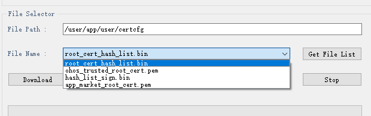

-   ohos\_trusted\_root\_cert.bin：OpenHarmony社区根证书文件。
-   app\_market\_root\_cert.pem：穿戴应用市场根证书文件。
-   root\_cert\_hash\_list.bin：包含根证书文件名及根证书内容SHA256值的哈希列表文件。
-   hash\_list\_sign.bin：使用穿戴市场私钥对哈希列表进行签名的签名文件，验签的公钥已预置在镜像内。

> **须知：** 
>根证书可以只传一个，也支持可扩展，如上是同时支持OpenHarmony社区签名的应用也支持穿戴应用市场签名的应用；如果不推上述文件，开启应用验签的情况下，设备只能安装OpenHarmony社区签名的应用。

# 类型说明<a name="ZH-CN_TOPIC_0000002466383732"></a>

**长度类型<a name="zh-cn_topic_0000002444726837_section3747mcpsimp"></a>**

<a name="zh-cn_topic_0000002444726837_table3749mcpsimp"></a>
<table><thead align="left"><tr id="zh-cn_topic_0000002444726837_row3755mcpsimp"><th class="cellrowborder" valign="top" width="13.13%" id="mcps1.1.4.1.1"><p id="zh-cn_topic_0000002444726837_p3757mcpsimp"><a name="zh-cn_topic_0000002444726837_p3757mcpsimp"></a><a name="zh-cn_topic_0000002444726837_p3757mcpsimp"></a>名称</p>
</th>
<th class="cellrowborder" valign="top" width="26.26%" id="mcps1.1.4.1.2"><p id="zh-cn_topic_0000002444726837_p3759mcpsimp"><a name="zh-cn_topic_0000002444726837_p3759mcpsimp"></a><a name="zh-cn_topic_0000002444726837_p3759mcpsimp"></a>类型定义</p>
</th>
<th class="cellrowborder" valign="top" width="60.61%" id="mcps1.1.4.1.3"><p id="zh-cn_topic_0000002444726837_p3761mcpsimp"><a name="zh-cn_topic_0000002444726837_p3761mcpsimp"></a><a name="zh-cn_topic_0000002444726837_p3761mcpsimp"></a>说明</p>
</th>
</tr>
</thead>
<tbody><tr id="zh-cn_topic_0000002444726837_row3763mcpsimp"><td class="cellrowborder" valign="top" width="13.13%" headers="mcps1.1.4.1.1 "><p id="zh-cn_topic_0000002444726837_p3765mcpsimp"><a name="zh-cn_topic_0000002444726837_p3765mcpsimp"></a><a name="zh-cn_topic_0000002444726837_p3765mcpsimp"></a>length</p>
</td>
<td class="cellrowborder" valign="top" width="26.26%" headers="mcps1.1.4.1.2 "><p id="zh-cn_topic_0000002444726837_p3767mcpsimp"><a name="zh-cn_topic_0000002444726837_p3767mcpsimp"></a><a name="zh-cn_topic_0000002444726837_p3767mcpsimp"></a>string | number</p>
</td>
<td class="cellrowborder" valign="top" width="60.61%" headers="mcps1.1.4.1.3 "><p id="zh-cn_topic_0000002444726837_p174611135818"><a name="zh-cn_topic_0000002444726837_p174611135818"></a><a name="zh-cn_topic_0000002444726837_p174611135818"></a>用于描述尺寸单位。</p>
<a name="zh-cn_topic_0000002444726837_ul16151103315585"></a><a name="zh-cn_topic_0000002444726837_ul16151103315585"></a><ul id="zh-cn_topic_0000002444726837_ul16151103315585"><li>输入为number类型时，使用px单位。</li><li>输入为string类型时，需要显式指定像素单位，当前支持的像素单位有：px（逻辑尺寸单位）。</li></ul>
</td>
</tr>
<tr id="zh-cn_topic_0000002444726837_row3772mcpsimp"><td class="cellrowborder" valign="top" width="13.13%" headers="mcps1.1.4.1.1 "><p id="zh-cn_topic_0000002444726837_p3774mcpsimp"><a name="zh-cn_topic_0000002444726837_p3774mcpsimp"></a><a name="zh-cn_topic_0000002444726837_p3774mcpsimp"></a>percentage</p>
</td>
<td class="cellrowborder" valign="top" width="26.26%" headers="mcps1.1.4.1.2 "><p id="zh-cn_topic_0000002444726837_p3776mcpsimp"><a name="zh-cn_topic_0000002444726837_p3776mcpsimp"></a><a name="zh-cn_topic_0000002444726837_p3776mcpsimp"></a>string</p>
</td>
<td class="cellrowborder" valign="top" width="60.61%" headers="mcps1.1.4.1.3 "><p id="zh-cn_topic_0000002444726837_p3778mcpsimp"><a name="zh-cn_topic_0000002444726837_p3778mcpsimp"></a><a name="zh-cn_topic_0000002444726837_p3778mcpsimp"></a>百分比尺寸单位，如“50%”。</p>
</td>
</tr>
</tbody>
</table>

**颜色类型<a name="zh-cn_topic_0000002444726837_section3779mcpsimp"></a>**

**表 1**  当前支持的颜色枚举

<a name="zh-cn_topic_0000002444726837__table16879155017425"></a>
<table><thead align="left"><tr id="zh-cn_topic_0000002444726837_row3787mcpsimp"><th class="cellrowborder" valign="top" width="13.13%" id="mcps1.2.4.1.1"><p id="zh-cn_topic_0000002444726837_p3789mcpsimp"><a name="zh-cn_topic_0000002444726837_p3789mcpsimp"></a><a name="zh-cn_topic_0000002444726837_p3789mcpsimp"></a>名称</p>
</th>
<th class="cellrowborder" valign="top" width="26.26%" id="mcps1.2.4.1.2"><p id="zh-cn_topic_0000002444726837_p3791mcpsimp"><a name="zh-cn_topic_0000002444726837_p3791mcpsimp"></a><a name="zh-cn_topic_0000002444726837_p3791mcpsimp"></a>类型定义</p>
</th>
<th class="cellrowborder" valign="top" width="60.61%" id="mcps1.2.4.1.3"><p id="zh-cn_topic_0000002444726837_p3793mcpsimp"><a name="zh-cn_topic_0000002444726837_p3793mcpsimp"></a><a name="zh-cn_topic_0000002444726837_p3793mcpsimp"></a>说明</p>
</th>
</tr>
</thead>
<tbody><tr id="zh-cn_topic_0000002444726837_row3795mcpsimp"><td class="cellrowborder" valign="top" width="13.13%" headers="mcps1.2.4.1.1 "><p id="zh-cn_topic_0000002444726837_p3797mcpsimp"><a name="zh-cn_topic_0000002444726837_p3797mcpsimp"></a><a name="zh-cn_topic_0000002444726837_p3797mcpsimp"></a>color</p>
</td>
<td class="cellrowborder" valign="top" width="26.26%" headers="mcps1.2.4.1.2 "><p id="zh-cn_topic_0000002444726837_p3799mcpsimp"><a name="zh-cn_topic_0000002444726837_p3799mcpsimp"></a><a name="zh-cn_topic_0000002444726837_p3799mcpsimp"></a>string | 下表中枚举名</p>
</td>
<td class="cellrowborder" valign="top" width="60.61%" headers="mcps1.2.4.1.3 "><p id="zh-cn_topic_0000002444726837_p3802mcpsimp"><a name="zh-cn_topic_0000002444726837_p3802mcpsimp"></a><a name="zh-cn_topic_0000002444726837_p3802mcpsimp"></a>用于描述颜色信息。</p>
<p id="zh-cn_topic_0000002444726837_p3803mcpsimp"><a name="zh-cn_topic_0000002444726837_p3803mcpsimp"></a><a name="zh-cn_topic_0000002444726837_p3803mcpsimp"></a>字符串格式如下：</p>
<a name="zh-cn_topic_0000002444726837_ul3804mcpsimp"></a><a name="zh-cn_topic_0000002444726837_ul3804mcpsimp"></a><ul id="zh-cn_topic_0000002444726837_ul3804mcpsimp"><li>'rgb(255, 255, 255)'</li><li>'rgba(255, 255, 255, 1.0)'</li><li>HEX格式：'#rrggbb'，'#aarrggbb'</li><li>枚举格式：'black'，'white'。</li></ul>
<p id="zh-cn_topic_0000002444726837_p157431340152518"><a name="zh-cn_topic_0000002444726837_p157431340152518"></a><a name="zh-cn_topic_0000002444726837_p157431340152518"></a></p>
</td>
</tr>
</tbody>
</table>

> **说明：** 
>JS脚本中暂不支持颜色枚举。

<a name="zh-cn_topic_0000002444726837_table3811mcpsimp"></a>
<table><thead align="left"><tr id="zh-cn_topic_0000002444726837_row3817mcpsimp"><th class="cellrowborder" valign="top" width="33%" id="mcps1.1.4.1.1"><p id="zh-cn_topic_0000002444726837_p3819mcpsimp"><a name="zh-cn_topic_0000002444726837_p3819mcpsimp"></a><a name="zh-cn_topic_0000002444726837_p3819mcpsimp"></a>枚举名称</p>
</th>
<th class="cellrowborder" valign="top" width="36%" id="mcps1.1.4.1.2"><p id="zh-cn_topic_0000002444726837_p3821mcpsimp"><a name="zh-cn_topic_0000002444726837_p3821mcpsimp"></a><a name="zh-cn_topic_0000002444726837_p3821mcpsimp"></a>十六进制颜色码</p>
</th>
<th class="cellrowborder" valign="top" width="31%" id="mcps1.1.4.1.3"><p id="zh-cn_topic_0000002444726837_p3823mcpsimp"><a name="zh-cn_topic_0000002444726837_p3823mcpsimp"></a><a name="zh-cn_topic_0000002444726837_p3823mcpsimp"></a>颜色</p>
</th>
</tr>
</thead>
<tbody><tr id="zh-cn_topic_0000002444726837_row3825mcpsimp"><td class="cellrowborder" valign="top" width="33%" headers="mcps1.1.4.1.1 "><p id="zh-cn_topic_0000002444726837_p3827mcpsimp"><a name="zh-cn_topic_0000002444726837_p3827mcpsimp"></a><a name="zh-cn_topic_0000002444726837_p3827mcpsimp"></a>aliceblue</p>
</td>
<td class="cellrowborder" valign="top" width="36%" headers="mcps1.1.4.1.2 "><p id="zh-cn_topic_0000002444726837_p3829mcpsimp"><a name="zh-cn_topic_0000002444726837_p3829mcpsimp"></a><a name="zh-cn_topic_0000002444726837_p3829mcpsimp"></a>#f0f8ff</p>
</td>
<td class="cellrowborder" valign="top" width="31%" headers="mcps1.1.4.1.3 "><p class="msonormal" id="zh-cn_topic_0000002444726837_p3831mcpsimp"><a name="zh-cn_topic_0000002444726837_p3831mcpsimp"></a><a name="zh-cn_topic_0000002444726837_p3831mcpsimp"></a><a name="zh-cn_topic_0000002444726837_image140"></a><a name="zh-cn_topic_0000002444726837_image140"></a><span></span></p>
</td>
</tr>
<tr id="zh-cn_topic_0000002444726837_row3832mcpsimp"><td class="cellrowborder" valign="top" width="33%" headers="mcps1.1.4.1.1 "><p id="zh-cn_topic_0000002444726837_p3834mcpsimp"><a name="zh-cn_topic_0000002444726837_p3834mcpsimp"></a><a name="zh-cn_topic_0000002444726837_p3834mcpsimp"></a>antiquewhite</p>
</td>
<td class="cellrowborder" valign="top" width="36%" headers="mcps1.1.4.1.2 "><p id="zh-cn_topic_0000002444726837_p3836mcpsimp"><a name="zh-cn_topic_0000002444726837_p3836mcpsimp"></a><a name="zh-cn_topic_0000002444726837_p3836mcpsimp"></a>#faebd7</p>
</td>
<td class="cellrowborder" valign="top" width="31%" headers="mcps1.1.4.1.3 "><p class="msonormal" id="zh-cn_topic_0000002444726837_p3838mcpsimp"><a name="zh-cn_topic_0000002444726837_p3838mcpsimp"></a><a name="zh-cn_topic_0000002444726837_p3838mcpsimp"></a><a name="zh-cn_topic_0000002444726837_image141"></a><a name="zh-cn_topic_0000002444726837_image141"></a><span></span></p>
</td>
</tr>
<tr id="zh-cn_topic_0000002444726837_row3839mcpsimp"><td class="cellrowborder" valign="top" width="33%" headers="mcps1.1.4.1.1 "><p id="zh-cn_topic_0000002444726837_p3841mcpsimp"><a name="zh-cn_topic_0000002444726837_p3841mcpsimp"></a><a name="zh-cn_topic_0000002444726837_p3841mcpsimp"></a>aqua</p>
</td>
<td class="cellrowborder" valign="top" width="36%" headers="mcps1.1.4.1.2 "><p id="zh-cn_topic_0000002444726837_p3843mcpsimp"><a name="zh-cn_topic_0000002444726837_p3843mcpsimp"></a><a name="zh-cn_topic_0000002444726837_p3843mcpsimp"></a>#00ffff</p>
</td>
<td class="cellrowborder" valign="top" width="31%" headers="mcps1.1.4.1.3 "><p class="msonormal" id="zh-cn_topic_0000002444726837_p3845mcpsimp"><a name="zh-cn_topic_0000002444726837_p3845mcpsimp"></a><a name="zh-cn_topic_0000002444726837_p3845mcpsimp"></a><a name="zh-cn_topic_0000002444726837_image142"></a><a name="zh-cn_topic_0000002444726837_image142"></a><span></span></p>
</td>
</tr>
<tr id="zh-cn_topic_0000002444726837_row3846mcpsimp"><td class="cellrowborder" valign="top" width="33%" headers="mcps1.1.4.1.1 "><p id="zh-cn_topic_0000002444726837_p3848mcpsimp"><a name="zh-cn_topic_0000002444726837_p3848mcpsimp"></a><a name="zh-cn_topic_0000002444726837_p3848mcpsimp"></a>aquamarine</p>
</td>
<td class="cellrowborder" valign="top" width="36%" headers="mcps1.1.4.1.2 "><p id="zh-cn_topic_0000002444726837_p3850mcpsimp"><a name="zh-cn_topic_0000002444726837_p3850mcpsimp"></a><a name="zh-cn_topic_0000002444726837_p3850mcpsimp"></a>#7fffd4</p>
</td>
<td class="cellrowborder" valign="top" width="31%" headers="mcps1.1.4.1.3 "><p class="msonormal" id="zh-cn_topic_0000002444726837_p3852mcpsimp"><a name="zh-cn_topic_0000002444726837_p3852mcpsimp"></a><a name="zh-cn_topic_0000002444726837_p3852mcpsimp"></a><a name="zh-cn_topic_0000002444726837_image143"></a><a name="zh-cn_topic_0000002444726837_image143"></a><span></span></p>
</td>
</tr>
<tr id="zh-cn_topic_0000002444726837_row3853mcpsimp"><td class="cellrowborder" valign="top" width="33%" headers="mcps1.1.4.1.1 "><p id="zh-cn_topic_0000002444726837_p3855mcpsimp"><a name="zh-cn_topic_0000002444726837_p3855mcpsimp"></a><a name="zh-cn_topic_0000002444726837_p3855mcpsimp"></a>azure</p>
</td>
<td class="cellrowborder" valign="top" width="36%" headers="mcps1.1.4.1.2 "><p id="zh-cn_topic_0000002444726837_p3857mcpsimp"><a name="zh-cn_topic_0000002444726837_p3857mcpsimp"></a><a name="zh-cn_topic_0000002444726837_p3857mcpsimp"></a>#f0ffff</p>
</td>
<td class="cellrowborder" valign="top" width="31%" headers="mcps1.1.4.1.3 "><p class="msonormal" id="zh-cn_topic_0000002444726837_p3859mcpsimp"><a name="zh-cn_topic_0000002444726837_p3859mcpsimp"></a><a name="zh-cn_topic_0000002444726837_p3859mcpsimp"></a><a name="zh-cn_topic_0000002444726837_image144"></a><a name="zh-cn_topic_0000002444726837_image144"></a><span></span></p>
</td>
</tr>
<tr id="zh-cn_topic_0000002444726837_row3860mcpsimp"><td class="cellrowborder" valign="top" width="33%" headers="mcps1.1.4.1.1 "><p id="zh-cn_topic_0000002444726837_p3862mcpsimp"><a name="zh-cn_topic_0000002444726837_p3862mcpsimp"></a><a name="zh-cn_topic_0000002444726837_p3862mcpsimp"></a>beige</p>
</td>
<td class="cellrowborder" valign="top" width="36%" headers="mcps1.1.4.1.2 "><p id="zh-cn_topic_0000002444726837_p3864mcpsimp"><a name="zh-cn_topic_0000002444726837_p3864mcpsimp"></a><a name="zh-cn_topic_0000002444726837_p3864mcpsimp"></a>#f5f5dc</p>
</td>
<td class="cellrowborder" valign="top" width="31%" headers="mcps1.1.4.1.3 "><p class="msonormal" id="zh-cn_topic_0000002444726837_p3866mcpsimp"><a name="zh-cn_topic_0000002444726837_p3866mcpsimp"></a><a name="zh-cn_topic_0000002444726837_p3866mcpsimp"></a><a name="zh-cn_topic_0000002444726837_image145"></a><a name="zh-cn_topic_0000002444726837_image145"></a><span></span></p>
</td>
</tr>
<tr id="zh-cn_topic_0000002444726837_row3867mcpsimp"><td class="cellrowborder" valign="top" width="33%" headers="mcps1.1.4.1.1 "><p id="zh-cn_topic_0000002444726837_p3869mcpsimp"><a name="zh-cn_topic_0000002444726837_p3869mcpsimp"></a><a name="zh-cn_topic_0000002444726837_p3869mcpsimp"></a>bisque</p>
</td>
<td class="cellrowborder" valign="top" width="36%" headers="mcps1.1.4.1.2 "><p id="zh-cn_topic_0000002444726837_p3871mcpsimp"><a name="zh-cn_topic_0000002444726837_p3871mcpsimp"></a><a name="zh-cn_topic_0000002444726837_p3871mcpsimp"></a>#ffe4c4</p>
</td>
<td class="cellrowborder" valign="top" width="31%" headers="mcps1.1.4.1.3 "><p class="msonormal" id="zh-cn_topic_0000002444726837_p3873mcpsimp"><a name="zh-cn_topic_0000002444726837_p3873mcpsimp"></a><a name="zh-cn_topic_0000002444726837_p3873mcpsimp"></a><a name="zh-cn_topic_0000002444726837_image146"></a><a name="zh-cn_topic_0000002444726837_image146"></a><span></span></p>
</td>
</tr>
<tr id="zh-cn_topic_0000002444726837_row3874mcpsimp"><td class="cellrowborder" valign="top" width="33%" headers="mcps1.1.4.1.1 "><p id="zh-cn_topic_0000002444726837_p3876mcpsimp"><a name="zh-cn_topic_0000002444726837_p3876mcpsimp"></a><a name="zh-cn_topic_0000002444726837_p3876mcpsimp"></a>black</p>
</td>
<td class="cellrowborder" valign="top" width="36%" headers="mcps1.1.4.1.2 "><p id="zh-cn_topic_0000002444726837_p3878mcpsimp"><a name="zh-cn_topic_0000002444726837_p3878mcpsimp"></a><a name="zh-cn_topic_0000002444726837_p3878mcpsimp"></a>#000000</p>
</td>
<td class="cellrowborder" valign="top" width="31%" headers="mcps1.1.4.1.3 "><p class="msonormal" id="zh-cn_topic_0000002444726837_p3880mcpsimp"><a name="zh-cn_topic_0000002444726837_p3880mcpsimp"></a><a name="zh-cn_topic_0000002444726837_p3880mcpsimp"></a><a name="zh-cn_topic_0000002444726837_image147"></a><a name="zh-cn_topic_0000002444726837_image147"></a><span></span></p>
</td>
</tr>
<tr id="zh-cn_topic_0000002444726837_row3881mcpsimp"><td class="cellrowborder" valign="top" width="33%" headers="mcps1.1.4.1.1 "><p id="zh-cn_topic_0000002444726837_p3883mcpsimp"><a name="zh-cn_topic_0000002444726837_p3883mcpsimp"></a><a name="zh-cn_topic_0000002444726837_p3883mcpsimp"></a>blanchedalmond</p>
</td>
<td class="cellrowborder" valign="top" width="36%" headers="mcps1.1.4.1.2 "><p id="zh-cn_topic_0000002444726837_p3885mcpsimp"><a name="zh-cn_topic_0000002444726837_p3885mcpsimp"></a><a name="zh-cn_topic_0000002444726837_p3885mcpsimp"></a>#ffebcd</p>
</td>
<td class="cellrowborder" valign="top" width="31%" headers="mcps1.1.4.1.3 "><p class="msonormal" id="zh-cn_topic_0000002444726837_p3887mcpsimp"><a name="zh-cn_topic_0000002444726837_p3887mcpsimp"></a><a name="zh-cn_topic_0000002444726837_p3887mcpsimp"></a><a name="zh-cn_topic_0000002444726837_image148"></a><a name="zh-cn_topic_0000002444726837_image148"></a><span></span></p>
</td>
</tr>
<tr id="zh-cn_topic_0000002444726837_row3888mcpsimp"><td class="cellrowborder" valign="top" width="33%" headers="mcps1.1.4.1.1 "><p id="zh-cn_topic_0000002444726837_p3890mcpsimp"><a name="zh-cn_topic_0000002444726837_p3890mcpsimp"></a><a name="zh-cn_topic_0000002444726837_p3890mcpsimp"></a>blue</p>
</td>
<td class="cellrowborder" valign="top" width="36%" headers="mcps1.1.4.1.2 "><p id="zh-cn_topic_0000002444726837_p3892mcpsimp"><a name="zh-cn_topic_0000002444726837_p3892mcpsimp"></a><a name="zh-cn_topic_0000002444726837_p3892mcpsimp"></a>#0000ff</p>
</td>
<td class="cellrowborder" valign="top" width="31%" headers="mcps1.1.4.1.3 "><p class="msonormal" id="zh-cn_topic_0000002444726837_p3894mcpsimp"><a name="zh-cn_topic_0000002444726837_p3894mcpsimp"></a><a name="zh-cn_topic_0000002444726837_p3894mcpsimp"></a><a name="zh-cn_topic_0000002444726837_image149"></a><a name="zh-cn_topic_0000002444726837_image149"></a><span></span></p>
</td>
</tr>
<tr id="zh-cn_topic_0000002444726837_row3895mcpsimp"><td class="cellrowborder" valign="top" width="33%" headers="mcps1.1.4.1.1 "><p id="zh-cn_topic_0000002444726837_p3897mcpsimp"><a name="zh-cn_topic_0000002444726837_p3897mcpsimp"></a><a name="zh-cn_topic_0000002444726837_p3897mcpsimp"></a>blueviolet</p>
</td>
<td class="cellrowborder" valign="top" width="36%" headers="mcps1.1.4.1.2 "><p id="zh-cn_topic_0000002444726837_p3899mcpsimp"><a name="zh-cn_topic_0000002444726837_p3899mcpsimp"></a><a name="zh-cn_topic_0000002444726837_p3899mcpsimp"></a>#8a2be2</p>
</td>
<td class="cellrowborder" valign="top" width="31%" headers="mcps1.1.4.1.3 "><p class="msonormal" id="zh-cn_topic_0000002444726837_p3901mcpsimp"><a name="zh-cn_topic_0000002444726837_p3901mcpsimp"></a><a name="zh-cn_topic_0000002444726837_p3901mcpsimp"></a><a name="zh-cn_topic_0000002444726837_image150"></a><a name="zh-cn_topic_0000002444726837_image150"></a><span></span></p>
</td>
</tr>
<tr id="zh-cn_topic_0000002444726837_row3902mcpsimp"><td class="cellrowborder" valign="top" width="33%" headers="mcps1.1.4.1.1 "><p id="zh-cn_topic_0000002444726837_p3904mcpsimp"><a name="zh-cn_topic_0000002444726837_p3904mcpsimp"></a><a name="zh-cn_topic_0000002444726837_p3904mcpsimp"></a>brown</p>
</td>
<td class="cellrowborder" valign="top" width="36%" headers="mcps1.1.4.1.2 "><p id="zh-cn_topic_0000002444726837_p3906mcpsimp"><a name="zh-cn_topic_0000002444726837_p3906mcpsimp"></a><a name="zh-cn_topic_0000002444726837_p3906mcpsimp"></a>#a52a2a</p>
</td>
<td class="cellrowborder" valign="top" width="31%" headers="mcps1.1.4.1.3 "><p class="msonormal" id="zh-cn_topic_0000002444726837_p3908mcpsimp"><a name="zh-cn_topic_0000002444726837_p3908mcpsimp"></a><a name="zh-cn_topic_0000002444726837_p3908mcpsimp"></a><a name="zh-cn_topic_0000002444726837_image151"></a><a name="zh-cn_topic_0000002444726837_image151"></a><span></span></p>
</td>
</tr>
<tr id="zh-cn_topic_0000002444726837_row3909mcpsimp"><td class="cellrowborder" valign="top" width="33%" headers="mcps1.1.4.1.1 "><p id="zh-cn_topic_0000002444726837_p3911mcpsimp"><a name="zh-cn_topic_0000002444726837_p3911mcpsimp"></a><a name="zh-cn_topic_0000002444726837_p3911mcpsimp"></a>burlywood</p>
</td>
<td class="cellrowborder" valign="top" width="36%" headers="mcps1.1.4.1.2 "><p id="zh-cn_topic_0000002444726837_p3913mcpsimp"><a name="zh-cn_topic_0000002444726837_p3913mcpsimp"></a><a name="zh-cn_topic_0000002444726837_p3913mcpsimp"></a>#deB887</p>
</td>
<td class="cellrowborder" valign="top" width="31%" headers="mcps1.1.4.1.3 "><p class="msonormal" id="zh-cn_topic_0000002444726837_p3915mcpsimp"><a name="zh-cn_topic_0000002444726837_p3915mcpsimp"></a><a name="zh-cn_topic_0000002444726837_p3915mcpsimp"></a><a name="zh-cn_topic_0000002444726837_image152"></a><a name="zh-cn_topic_0000002444726837_image152"></a><span></span></p>
</td>
</tr>
<tr id="zh-cn_topic_0000002444726837_row3916mcpsimp"><td class="cellrowborder" valign="top" width="33%" headers="mcps1.1.4.1.1 "><p id="zh-cn_topic_0000002444726837_p3918mcpsimp"><a name="zh-cn_topic_0000002444726837_p3918mcpsimp"></a><a name="zh-cn_topic_0000002444726837_p3918mcpsimp"></a>cadetblue</p>
</td>
<td class="cellrowborder" valign="top" width="36%" headers="mcps1.1.4.1.2 "><p id="zh-cn_topic_0000002444726837_p3920mcpsimp"><a name="zh-cn_topic_0000002444726837_p3920mcpsimp"></a><a name="zh-cn_topic_0000002444726837_p3920mcpsimp"></a>#5f9ea0</p>
</td>
<td class="cellrowborder" valign="top" width="31%" headers="mcps1.1.4.1.3 "><p class="msonormal" id="zh-cn_topic_0000002444726837_p3922mcpsimp"><a name="zh-cn_topic_0000002444726837_p3922mcpsimp"></a><a name="zh-cn_topic_0000002444726837_p3922mcpsimp"></a><a name="zh-cn_topic_0000002444726837_image153"></a><a name="zh-cn_topic_0000002444726837_image153"></a><span></span></p>
</td>
</tr>
<tr id="zh-cn_topic_0000002444726837_row3923mcpsimp"><td class="cellrowborder" valign="top" width="33%" headers="mcps1.1.4.1.1 "><p id="zh-cn_topic_0000002444726837_p3925mcpsimp"><a name="zh-cn_topic_0000002444726837_p3925mcpsimp"></a><a name="zh-cn_topic_0000002444726837_p3925mcpsimp"></a>chartreuse</p>
</td>
<td class="cellrowborder" valign="top" width="36%" headers="mcps1.1.4.1.2 "><p id="zh-cn_topic_0000002444726837_p3927mcpsimp"><a name="zh-cn_topic_0000002444726837_p3927mcpsimp"></a><a name="zh-cn_topic_0000002444726837_p3927mcpsimp"></a>#7fff00</p>
</td>
<td class="cellrowborder" valign="top" width="31%" headers="mcps1.1.4.1.3 "><p class="msonormal" id="zh-cn_topic_0000002444726837_p3929mcpsimp"><a name="zh-cn_topic_0000002444726837_p3929mcpsimp"></a><a name="zh-cn_topic_0000002444726837_p3929mcpsimp"></a><a name="zh-cn_topic_0000002444726837_image154"></a><a name="zh-cn_topic_0000002444726837_image154"></a><span></span></p>
</td>
</tr>
<tr id="zh-cn_topic_0000002444726837_row3930mcpsimp"><td class="cellrowborder" valign="top" width="33%" headers="mcps1.1.4.1.1 "><p id="zh-cn_topic_0000002444726837_p3932mcpsimp"><a name="zh-cn_topic_0000002444726837_p3932mcpsimp"></a><a name="zh-cn_topic_0000002444726837_p3932mcpsimp"></a>chocolate</p>
</td>
<td class="cellrowborder" valign="top" width="36%" headers="mcps1.1.4.1.2 "><p id="zh-cn_topic_0000002444726837_p3934mcpsimp"><a name="zh-cn_topic_0000002444726837_p3934mcpsimp"></a><a name="zh-cn_topic_0000002444726837_p3934mcpsimp"></a>#d2691e</p>
</td>
<td class="cellrowborder" valign="top" width="31%" headers="mcps1.1.4.1.3 "><p class="msonormal" id="zh-cn_topic_0000002444726837_p3936mcpsimp"><a name="zh-cn_topic_0000002444726837_p3936mcpsimp"></a><a name="zh-cn_topic_0000002444726837_p3936mcpsimp"></a><a name="zh-cn_topic_0000002444726837_image155"></a><a name="zh-cn_topic_0000002444726837_image155"></a><span></span></p>
</td>
</tr>
<tr id="zh-cn_topic_0000002444726837_row3937mcpsimp"><td class="cellrowborder" valign="top" width="33%" headers="mcps1.1.4.1.1 "><p id="zh-cn_topic_0000002444726837_p3939mcpsimp"><a name="zh-cn_topic_0000002444726837_p3939mcpsimp"></a><a name="zh-cn_topic_0000002444726837_p3939mcpsimp"></a>coral</p>
</td>
<td class="cellrowborder" valign="top" width="36%" headers="mcps1.1.4.1.2 "><p id="zh-cn_topic_0000002444726837_p3941mcpsimp"><a name="zh-cn_topic_0000002444726837_p3941mcpsimp"></a><a name="zh-cn_topic_0000002444726837_p3941mcpsimp"></a>#ff7f50</p>
</td>
<td class="cellrowborder" valign="top" width="31%" headers="mcps1.1.4.1.3 "><p class="msonormal" id="zh-cn_topic_0000002444726837_p3943mcpsimp"><a name="zh-cn_topic_0000002444726837_p3943mcpsimp"></a><a name="zh-cn_topic_0000002444726837_p3943mcpsimp"></a><a name="zh-cn_topic_0000002444726837_image156"></a><a name="zh-cn_topic_0000002444726837_image156"></a><span></span></p>
</td>
</tr>
<tr id="zh-cn_topic_0000002444726837_row3944mcpsimp"><td class="cellrowborder" valign="top" width="33%" headers="mcps1.1.4.1.1 "><p id="zh-cn_topic_0000002444726837_p3946mcpsimp"><a name="zh-cn_topic_0000002444726837_p3946mcpsimp"></a><a name="zh-cn_topic_0000002444726837_p3946mcpsimp"></a>cornflowerblue</p>
</td>
<td class="cellrowborder" valign="top" width="36%" headers="mcps1.1.4.1.2 "><p id="zh-cn_topic_0000002444726837_p3948mcpsimp"><a name="zh-cn_topic_0000002444726837_p3948mcpsimp"></a><a name="zh-cn_topic_0000002444726837_p3948mcpsimp"></a>#6495ed</p>
</td>
<td class="cellrowborder" valign="top" width="31%" headers="mcps1.1.4.1.3 "><p class="msonormal" id="zh-cn_topic_0000002444726837_p3950mcpsimp"><a name="zh-cn_topic_0000002444726837_p3950mcpsimp"></a><a name="zh-cn_topic_0000002444726837_p3950mcpsimp"></a><a name="zh-cn_topic_0000002444726837_image157"></a><a name="zh-cn_topic_0000002444726837_image157"></a><span></span></p>
</td>
</tr>
<tr id="zh-cn_topic_0000002444726837_row3951mcpsimp"><td class="cellrowborder" valign="top" width="33%" headers="mcps1.1.4.1.1 "><p id="zh-cn_topic_0000002444726837_p3953mcpsimp"><a name="zh-cn_topic_0000002444726837_p3953mcpsimp"></a><a name="zh-cn_topic_0000002444726837_p3953mcpsimp"></a>cornsilk</p>
</td>
<td class="cellrowborder" valign="top" width="36%" headers="mcps1.1.4.1.2 "><p id="zh-cn_topic_0000002444726837_p3955mcpsimp"><a name="zh-cn_topic_0000002444726837_p3955mcpsimp"></a><a name="zh-cn_topic_0000002444726837_p3955mcpsimp"></a>#fff8dc</p>
</td>
<td class="cellrowborder" valign="top" width="31%" headers="mcps1.1.4.1.3 "><p class="msonormal" id="zh-cn_topic_0000002444726837_p3957mcpsimp"><a name="zh-cn_topic_0000002444726837_p3957mcpsimp"></a><a name="zh-cn_topic_0000002444726837_p3957mcpsimp"></a><a name="zh-cn_topic_0000002444726837_image158"></a><a name="zh-cn_topic_0000002444726837_image158"></a><span></span></p>
</td>
</tr>
<tr id="zh-cn_topic_0000002444726837_row3958mcpsimp"><td class="cellrowborder" valign="top" width="33%" headers="mcps1.1.4.1.1 "><p id="zh-cn_topic_0000002444726837_p3960mcpsimp"><a name="zh-cn_topic_0000002444726837_p3960mcpsimp"></a><a name="zh-cn_topic_0000002444726837_p3960mcpsimp"></a>crimson</p>
</td>
<td class="cellrowborder" valign="top" width="36%" headers="mcps1.1.4.1.2 "><p id="zh-cn_topic_0000002444726837_p3962mcpsimp"><a name="zh-cn_topic_0000002444726837_p3962mcpsimp"></a><a name="zh-cn_topic_0000002444726837_p3962mcpsimp"></a>#dc143c</p>
</td>
<td class="cellrowborder" valign="top" width="31%" headers="mcps1.1.4.1.3 "><p class="msonormal" id="zh-cn_topic_0000002444726837_p3964mcpsimp"><a name="zh-cn_topic_0000002444726837_p3964mcpsimp"></a><a name="zh-cn_topic_0000002444726837_p3964mcpsimp"></a><a name="zh-cn_topic_0000002444726837_image159"></a><a name="zh-cn_topic_0000002444726837_image159"></a><span></span></p>
</td>
</tr>
<tr id="zh-cn_topic_0000002444726837_row3965mcpsimp"><td class="cellrowborder" valign="top" width="33%" headers="mcps1.1.4.1.1 "><p id="zh-cn_topic_0000002444726837_p3967mcpsimp"><a name="zh-cn_topic_0000002444726837_p3967mcpsimp"></a><a name="zh-cn_topic_0000002444726837_p3967mcpsimp"></a>cyan</p>
</td>
<td class="cellrowborder" valign="top" width="36%" headers="mcps1.1.4.1.2 "><p id="zh-cn_topic_0000002444726837_p3969mcpsimp"><a name="zh-cn_topic_0000002444726837_p3969mcpsimp"></a><a name="zh-cn_topic_0000002444726837_p3969mcpsimp"></a>#00ffff</p>
</td>
<td class="cellrowborder" valign="top" width="31%" headers="mcps1.1.4.1.3 "><p class="msonormal" id="zh-cn_topic_0000002444726837_p3971mcpsimp"><a name="zh-cn_topic_0000002444726837_p3971mcpsimp"></a><a name="zh-cn_topic_0000002444726837_p3971mcpsimp"></a><a name="zh-cn_topic_0000002444726837_image160"></a><a name="zh-cn_topic_0000002444726837_image160"></a><span></span></p>
</td>
</tr>
<tr id="zh-cn_topic_0000002444726837_row3972mcpsimp"><td class="cellrowborder" valign="top" width="33%" headers="mcps1.1.4.1.1 "><p id="zh-cn_topic_0000002444726837_p3974mcpsimp"><a name="zh-cn_topic_0000002444726837_p3974mcpsimp"></a><a name="zh-cn_topic_0000002444726837_p3974mcpsimp"></a>darkblue</p>
</td>
<td class="cellrowborder" valign="top" width="36%" headers="mcps1.1.4.1.2 "><p id="zh-cn_topic_0000002444726837_p3976mcpsimp"><a name="zh-cn_topic_0000002444726837_p3976mcpsimp"></a><a name="zh-cn_topic_0000002444726837_p3976mcpsimp"></a>#00008b</p>
</td>
<td class="cellrowborder" valign="top" width="31%" headers="mcps1.1.4.1.3 "><p class="msonormal" id="zh-cn_topic_0000002444726837_p3978mcpsimp"><a name="zh-cn_topic_0000002444726837_p3978mcpsimp"></a><a name="zh-cn_topic_0000002444726837_p3978mcpsimp"></a><a name="zh-cn_topic_0000002444726837_image161"></a><a name="zh-cn_topic_0000002444726837_image161"></a><span></span></p>
</td>
</tr>
<tr id="zh-cn_topic_0000002444726837_row3979mcpsimp"><td class="cellrowborder" valign="top" width="33%" headers="mcps1.1.4.1.1 "><p id="zh-cn_topic_0000002444726837_p3981mcpsimp"><a name="zh-cn_topic_0000002444726837_p3981mcpsimp"></a><a name="zh-cn_topic_0000002444726837_p3981mcpsimp"></a>darkcyan</p>
</td>
<td class="cellrowborder" valign="top" width="36%" headers="mcps1.1.4.1.2 "><p id="zh-cn_topic_0000002444726837_p3983mcpsimp"><a name="zh-cn_topic_0000002444726837_p3983mcpsimp"></a><a name="zh-cn_topic_0000002444726837_p3983mcpsimp"></a>#008b8b</p>
</td>
<td class="cellrowborder" valign="top" width="31%" headers="mcps1.1.4.1.3 "><p class="msonormal" id="zh-cn_topic_0000002444726837_p3985mcpsimp"><a name="zh-cn_topic_0000002444726837_p3985mcpsimp"></a><a name="zh-cn_topic_0000002444726837_p3985mcpsimp"></a><a name="zh-cn_topic_0000002444726837_image162"></a><a name="zh-cn_topic_0000002444726837_image162"></a><span></span></p>
</td>
</tr>
<tr id="zh-cn_topic_0000002444726837_row3986mcpsimp"><td class="cellrowborder" valign="top" width="33%" headers="mcps1.1.4.1.1 "><p id="zh-cn_topic_0000002444726837_p3988mcpsimp"><a name="zh-cn_topic_0000002444726837_p3988mcpsimp"></a><a name="zh-cn_topic_0000002444726837_p3988mcpsimp"></a>darkgoldenrod</p>
</td>
<td class="cellrowborder" valign="top" width="36%" headers="mcps1.1.4.1.2 "><p id="zh-cn_topic_0000002444726837_p3990mcpsimp"><a name="zh-cn_topic_0000002444726837_p3990mcpsimp"></a><a name="zh-cn_topic_0000002444726837_p3990mcpsimp"></a>#b8860b</p>
</td>
<td class="cellrowborder" valign="top" width="31%" headers="mcps1.1.4.1.3 "><p class="msonormal" id="zh-cn_topic_0000002444726837_p3992mcpsimp"><a name="zh-cn_topic_0000002444726837_p3992mcpsimp"></a><a name="zh-cn_topic_0000002444726837_p3992mcpsimp"></a><a name="zh-cn_topic_0000002444726837_image163"></a><a name="zh-cn_topic_0000002444726837_image163"></a><span></span></p>
</td>
</tr>
<tr id="zh-cn_topic_0000002444726837_row3993mcpsimp"><td class="cellrowborder" valign="top" width="33%" headers="mcps1.1.4.1.1 "><p id="zh-cn_topic_0000002444726837_p3995mcpsimp"><a name="zh-cn_topic_0000002444726837_p3995mcpsimp"></a><a name="zh-cn_topic_0000002444726837_p3995mcpsimp"></a>darkgray</p>
</td>
<td class="cellrowborder" valign="top" width="36%" headers="mcps1.1.4.1.2 "><p id="zh-cn_topic_0000002444726837_p3997mcpsimp"><a name="zh-cn_topic_0000002444726837_p3997mcpsimp"></a><a name="zh-cn_topic_0000002444726837_p3997mcpsimp"></a>#a9a9a9</p>
</td>
<td class="cellrowborder" valign="top" width="31%" headers="mcps1.1.4.1.3 "><p class="msonormal" id="zh-cn_topic_0000002444726837_p3999mcpsimp"><a name="zh-cn_topic_0000002444726837_p3999mcpsimp"></a><a name="zh-cn_topic_0000002444726837_p3999mcpsimp"></a><a name="zh-cn_topic_0000002444726837_image164"></a><a name="zh-cn_topic_0000002444726837_image164"></a><span></span></p>
</td>
</tr>
<tr id="zh-cn_topic_0000002444726837_row4000mcpsimp"><td class="cellrowborder" valign="top" width="33%" headers="mcps1.1.4.1.1 "><p id="zh-cn_topic_0000002444726837_p4002mcpsimp"><a name="zh-cn_topic_0000002444726837_p4002mcpsimp"></a><a name="zh-cn_topic_0000002444726837_p4002mcpsimp"></a>darkgreen</p>
</td>
<td class="cellrowborder" valign="top" width="36%" headers="mcps1.1.4.1.2 "><p id="zh-cn_topic_0000002444726837_p4004mcpsimp"><a name="zh-cn_topic_0000002444726837_p4004mcpsimp"></a><a name="zh-cn_topic_0000002444726837_p4004mcpsimp"></a>#006400</p>
</td>
<td class="cellrowborder" valign="top" width="31%" headers="mcps1.1.4.1.3 "><p class="msonormal" id="zh-cn_topic_0000002444726837_p4006mcpsimp"><a name="zh-cn_topic_0000002444726837_p4006mcpsimp"></a><a name="zh-cn_topic_0000002444726837_p4006mcpsimp"></a><a name="zh-cn_topic_0000002444726837_image165"></a><a name="zh-cn_topic_0000002444726837_image165"></a><span></span></p>
</td>
</tr>
<tr id="zh-cn_topic_0000002444726837_row4007mcpsimp"><td class="cellrowborder" valign="top" width="33%" headers="mcps1.1.4.1.1 "><p id="zh-cn_topic_0000002444726837_p4009mcpsimp"><a name="zh-cn_topic_0000002444726837_p4009mcpsimp"></a><a name="zh-cn_topic_0000002444726837_p4009mcpsimp"></a>darkgrey</p>
</td>
<td class="cellrowborder" valign="top" width="36%" headers="mcps1.1.4.1.2 "><p id="zh-cn_topic_0000002444726837_p4011mcpsimp"><a name="zh-cn_topic_0000002444726837_p4011mcpsimp"></a><a name="zh-cn_topic_0000002444726837_p4011mcpsimp"></a>#a9a9a9</p>
</td>
<td class="cellrowborder" valign="top" width="31%" headers="mcps1.1.4.1.3 "><p class="msonormal" id="zh-cn_topic_0000002444726837_p4013mcpsimp"><a name="zh-cn_topic_0000002444726837_p4013mcpsimp"></a><a name="zh-cn_topic_0000002444726837_p4013mcpsimp"></a><a name="zh-cn_topic_0000002444726837_image166"></a><a name="zh-cn_topic_0000002444726837_image166"></a><span></span></p>
</td>
</tr>
<tr id="zh-cn_topic_0000002444726837_row4014mcpsimp"><td class="cellrowborder" valign="top" width="33%" headers="mcps1.1.4.1.1 "><p id="zh-cn_topic_0000002444726837_p4016mcpsimp"><a name="zh-cn_topic_0000002444726837_p4016mcpsimp"></a><a name="zh-cn_topic_0000002444726837_p4016mcpsimp"></a>darkkhaki</p>
</td>
<td class="cellrowborder" valign="top" width="36%" headers="mcps1.1.4.1.2 "><p id="zh-cn_topic_0000002444726837_p4018mcpsimp"><a name="zh-cn_topic_0000002444726837_p4018mcpsimp"></a><a name="zh-cn_topic_0000002444726837_p4018mcpsimp"></a>#bdb76b</p>
</td>
<td class="cellrowborder" valign="top" width="31%" headers="mcps1.1.4.1.3 "><p class="msonormal" id="zh-cn_topic_0000002444726837_p4020mcpsimp"><a name="zh-cn_topic_0000002444726837_p4020mcpsimp"></a><a name="zh-cn_topic_0000002444726837_p4020mcpsimp"></a><a name="zh-cn_topic_0000002444726837_image167"></a><a name="zh-cn_topic_0000002444726837_image167"></a><span></span></p>
</td>
</tr>
<tr id="zh-cn_topic_0000002444726837_row4021mcpsimp"><td class="cellrowborder" valign="top" width="33%" headers="mcps1.1.4.1.1 "><p id="zh-cn_topic_0000002444726837_p4023mcpsimp"><a name="zh-cn_topic_0000002444726837_p4023mcpsimp"></a><a name="zh-cn_topic_0000002444726837_p4023mcpsimp"></a>darkmagenta</p>
</td>
<td class="cellrowborder" valign="top" width="36%" headers="mcps1.1.4.1.2 "><p id="zh-cn_topic_0000002444726837_p4025mcpsimp"><a name="zh-cn_topic_0000002444726837_p4025mcpsimp"></a><a name="zh-cn_topic_0000002444726837_p4025mcpsimp"></a>#8b008b</p>
</td>
<td class="cellrowborder" valign="top" width="31%" headers="mcps1.1.4.1.3 "><p class="msonormal" id="zh-cn_topic_0000002444726837_p4027mcpsimp"><a name="zh-cn_topic_0000002444726837_p4027mcpsimp"></a><a name="zh-cn_topic_0000002444726837_p4027mcpsimp"></a><a name="zh-cn_topic_0000002444726837_image168"></a><a name="zh-cn_topic_0000002444726837_image168"></a><span></span></p>
</td>
</tr>
<tr id="zh-cn_topic_0000002444726837_row4028mcpsimp"><td class="cellrowborder" valign="top" width="33%" headers="mcps1.1.4.1.1 "><p id="zh-cn_topic_0000002444726837_p4030mcpsimp"><a name="zh-cn_topic_0000002444726837_p4030mcpsimp"></a><a name="zh-cn_topic_0000002444726837_p4030mcpsimp"></a>darkolivegreen</p>
</td>
<td class="cellrowborder" valign="top" width="36%" headers="mcps1.1.4.1.2 "><p id="zh-cn_topic_0000002444726837_p4032mcpsimp"><a name="zh-cn_topic_0000002444726837_p4032mcpsimp"></a><a name="zh-cn_topic_0000002444726837_p4032mcpsimp"></a>#556b2f</p>
</td>
<td class="cellrowborder" valign="top" width="31%" headers="mcps1.1.4.1.3 "><p class="msonormal" id="zh-cn_topic_0000002444726837_p4034mcpsimp"><a name="zh-cn_topic_0000002444726837_p4034mcpsimp"></a><a name="zh-cn_topic_0000002444726837_p4034mcpsimp"></a><a name="zh-cn_topic_0000002444726837_image169"></a><a name="zh-cn_topic_0000002444726837_image169"></a><span></span></p>
</td>
</tr>
<tr id="zh-cn_topic_0000002444726837_row4035mcpsimp"><td class="cellrowborder" valign="top" width="33%" headers="mcps1.1.4.1.1 "><p id="zh-cn_topic_0000002444726837_p4037mcpsimp"><a name="zh-cn_topic_0000002444726837_p4037mcpsimp"></a><a name="zh-cn_topic_0000002444726837_p4037mcpsimp"></a>darkorange</p>
</td>
<td class="cellrowborder" valign="top" width="36%" headers="mcps1.1.4.1.2 "><p id="zh-cn_topic_0000002444726837_p4039mcpsimp"><a name="zh-cn_topic_0000002444726837_p4039mcpsimp"></a><a name="zh-cn_topic_0000002444726837_p4039mcpsimp"></a>#ff8c00</p>
</td>
<td class="cellrowborder" valign="top" width="31%" headers="mcps1.1.4.1.3 "><p class="msonormal" id="zh-cn_topic_0000002444726837_p4041mcpsimp"><a name="zh-cn_topic_0000002444726837_p4041mcpsimp"></a><a name="zh-cn_topic_0000002444726837_p4041mcpsimp"></a><a name="zh-cn_topic_0000002444726837_image170"></a><a name="zh-cn_topic_0000002444726837_image170"></a><span></span></p>
</td>
</tr>
<tr id="zh-cn_topic_0000002444726837_row4042mcpsimp"><td class="cellrowborder" valign="top" width="33%" headers="mcps1.1.4.1.1 "><p id="zh-cn_topic_0000002444726837_p4044mcpsimp"><a name="zh-cn_topic_0000002444726837_p4044mcpsimp"></a><a name="zh-cn_topic_0000002444726837_p4044mcpsimp"></a>darkorchid</p>
</td>
<td class="cellrowborder" valign="top" width="36%" headers="mcps1.1.4.1.2 "><p id="zh-cn_topic_0000002444726837_p4046mcpsimp"><a name="zh-cn_topic_0000002444726837_p4046mcpsimp"></a><a name="zh-cn_topic_0000002444726837_p4046mcpsimp"></a>#9932cc</p>
</td>
<td class="cellrowborder" valign="top" width="31%" headers="mcps1.1.4.1.3 "><p class="msonormal" id="zh-cn_topic_0000002444726837_p4048mcpsimp"><a name="zh-cn_topic_0000002444726837_p4048mcpsimp"></a><a name="zh-cn_topic_0000002444726837_p4048mcpsimp"></a><a name="zh-cn_topic_0000002444726837_image171"></a><a name="zh-cn_topic_0000002444726837_image171"></a><span></span></p>
</td>
</tr>
<tr id="zh-cn_topic_0000002444726837_row4049mcpsimp"><td class="cellrowborder" valign="top" width="33%" headers="mcps1.1.4.1.1 "><p id="zh-cn_topic_0000002444726837_p4051mcpsimp"><a name="zh-cn_topic_0000002444726837_p4051mcpsimp"></a><a name="zh-cn_topic_0000002444726837_p4051mcpsimp"></a>darkred</p>
</td>
<td class="cellrowborder" valign="top" width="36%" headers="mcps1.1.4.1.2 "><p id="zh-cn_topic_0000002444726837_p4053mcpsimp"><a name="zh-cn_topic_0000002444726837_p4053mcpsimp"></a><a name="zh-cn_topic_0000002444726837_p4053mcpsimp"></a>#8b0000</p>
</td>
<td class="cellrowborder" valign="top" width="31%" headers="mcps1.1.4.1.3 "><p class="msonormal" id="zh-cn_topic_0000002444726837_p4055mcpsimp"><a name="zh-cn_topic_0000002444726837_p4055mcpsimp"></a><a name="zh-cn_topic_0000002444726837_p4055mcpsimp"></a><a name="zh-cn_topic_0000002444726837_image172"></a><a name="zh-cn_topic_0000002444726837_image172"></a><span></span></p>
</td>
</tr>
<tr id="zh-cn_topic_0000002444726837_row4056mcpsimp"><td class="cellrowborder" valign="top" width="33%" headers="mcps1.1.4.1.1 "><p id="zh-cn_topic_0000002444726837_p4058mcpsimp"><a name="zh-cn_topic_0000002444726837_p4058mcpsimp"></a><a name="zh-cn_topic_0000002444726837_p4058mcpsimp"></a>darksalmon</p>
</td>
<td class="cellrowborder" valign="top" width="36%" headers="mcps1.1.4.1.2 "><p id="zh-cn_topic_0000002444726837_p4060mcpsimp"><a name="zh-cn_topic_0000002444726837_p4060mcpsimp"></a><a name="zh-cn_topic_0000002444726837_p4060mcpsimp"></a>#e9967a</p>
</td>
<td class="cellrowborder" valign="top" width="31%" headers="mcps1.1.4.1.3 "><p class="msonormal" id="zh-cn_topic_0000002444726837_p4062mcpsimp"><a name="zh-cn_topic_0000002444726837_p4062mcpsimp"></a><a name="zh-cn_topic_0000002444726837_p4062mcpsimp"></a><a name="zh-cn_topic_0000002444726837_image173"></a><a name="zh-cn_topic_0000002444726837_image173"></a><span></span></p>
</td>
</tr>
<tr id="zh-cn_topic_0000002444726837_row4063mcpsimp"><td class="cellrowborder" valign="top" width="33%" headers="mcps1.1.4.1.1 "><p id="zh-cn_topic_0000002444726837_p4065mcpsimp"><a name="zh-cn_topic_0000002444726837_p4065mcpsimp"></a><a name="zh-cn_topic_0000002444726837_p4065mcpsimp"></a>darkseagreen</p>
</td>
<td class="cellrowborder" valign="top" width="36%" headers="mcps1.1.4.1.2 "><p id="zh-cn_topic_0000002444726837_p4067mcpsimp"><a name="zh-cn_topic_0000002444726837_p4067mcpsimp"></a><a name="zh-cn_topic_0000002444726837_p4067mcpsimp"></a>#8fbc8f</p>
</td>
<td class="cellrowborder" valign="top" width="31%" headers="mcps1.1.4.1.3 "><p class="msonormal" id="zh-cn_topic_0000002444726837_p4069mcpsimp"><a name="zh-cn_topic_0000002444726837_p4069mcpsimp"></a><a name="zh-cn_topic_0000002444726837_p4069mcpsimp"></a><a name="zh-cn_topic_0000002444726837_image174"></a><a name="zh-cn_topic_0000002444726837_image174"></a><span></span></p>
</td>
</tr>
<tr id="zh-cn_topic_0000002444726837_row4070mcpsimp"><td class="cellrowborder" valign="top" width="33%" headers="mcps1.1.4.1.1 "><p id="zh-cn_topic_0000002444726837_p4072mcpsimp"><a name="zh-cn_topic_0000002444726837_p4072mcpsimp"></a><a name="zh-cn_topic_0000002444726837_p4072mcpsimp"></a>darkslateblue</p>
</td>
<td class="cellrowborder" valign="top" width="36%" headers="mcps1.1.4.1.2 "><p id="zh-cn_topic_0000002444726837_p4074mcpsimp"><a name="zh-cn_topic_0000002444726837_p4074mcpsimp"></a><a name="zh-cn_topic_0000002444726837_p4074mcpsimp"></a>#483d8b</p>
</td>
<td class="cellrowborder" valign="top" width="31%" headers="mcps1.1.4.1.3 "><p class="msonormal" id="zh-cn_topic_0000002444726837_p4076mcpsimp"><a name="zh-cn_topic_0000002444726837_p4076mcpsimp"></a><a name="zh-cn_topic_0000002444726837_p4076mcpsimp"></a><a name="zh-cn_topic_0000002444726837_image175"></a><a name="zh-cn_topic_0000002444726837_image175"></a><span></span></p>
</td>
</tr>
<tr id="zh-cn_topic_0000002444726837_row4077mcpsimp"><td class="cellrowborder" valign="top" width="33%" headers="mcps1.1.4.1.1 "><p id="zh-cn_topic_0000002444726837_p4079mcpsimp"><a name="zh-cn_topic_0000002444726837_p4079mcpsimp"></a><a name="zh-cn_topic_0000002444726837_p4079mcpsimp"></a>darkslategray</p>
</td>
<td class="cellrowborder" valign="top" width="36%" headers="mcps1.1.4.1.2 "><p id="zh-cn_topic_0000002444726837_p4081mcpsimp"><a name="zh-cn_topic_0000002444726837_p4081mcpsimp"></a><a name="zh-cn_topic_0000002444726837_p4081mcpsimp"></a>#2f4f4f</p>
</td>
<td class="cellrowborder" valign="top" width="31%" headers="mcps1.1.4.1.3 "><p class="msonormal" id="zh-cn_topic_0000002444726837_p4083mcpsimp"><a name="zh-cn_topic_0000002444726837_p4083mcpsimp"></a><a name="zh-cn_topic_0000002444726837_p4083mcpsimp"></a><a name="zh-cn_topic_0000002444726837_image176"></a><a name="zh-cn_topic_0000002444726837_image176"></a><span></span></p>
</td>
</tr>
<tr id="zh-cn_topic_0000002444726837_row4084mcpsimp"><td class="cellrowborder" valign="top" width="33%" headers="mcps1.1.4.1.1 "><p id="zh-cn_topic_0000002444726837_p4086mcpsimp"><a name="zh-cn_topic_0000002444726837_p4086mcpsimp"></a><a name="zh-cn_topic_0000002444726837_p4086mcpsimp"></a>darkslategrey</p>
</td>
<td class="cellrowborder" valign="top" width="36%" headers="mcps1.1.4.1.2 "><p id="zh-cn_topic_0000002444726837_p4088mcpsimp"><a name="zh-cn_topic_0000002444726837_p4088mcpsimp"></a><a name="zh-cn_topic_0000002444726837_p4088mcpsimp"></a>#2f4f4f</p>
</td>
<td class="cellrowborder" valign="top" width="31%" headers="mcps1.1.4.1.3 "><p class="msonormal" id="zh-cn_topic_0000002444726837_p4090mcpsimp"><a name="zh-cn_topic_0000002444726837_p4090mcpsimp"></a><a name="zh-cn_topic_0000002444726837_p4090mcpsimp"></a><a name="zh-cn_topic_0000002444726837_image177"></a><a name="zh-cn_topic_0000002444726837_image177"></a><span></span></p>
</td>
</tr>
<tr id="zh-cn_topic_0000002444726837_row4091mcpsimp"><td class="cellrowborder" valign="top" width="33%" headers="mcps1.1.4.1.1 "><p id="zh-cn_topic_0000002444726837_p4093mcpsimp"><a name="zh-cn_topic_0000002444726837_p4093mcpsimp"></a><a name="zh-cn_topic_0000002444726837_p4093mcpsimp"></a>darkturquoise</p>
</td>
<td class="cellrowborder" valign="top" width="36%" headers="mcps1.1.4.1.2 "><p id="zh-cn_topic_0000002444726837_p4095mcpsimp"><a name="zh-cn_topic_0000002444726837_p4095mcpsimp"></a><a name="zh-cn_topic_0000002444726837_p4095mcpsimp"></a>#00ced1</p>
</td>
<td class="cellrowborder" valign="top" width="31%" headers="mcps1.1.4.1.3 "><p class="msonormal" id="zh-cn_topic_0000002444726837_p4097mcpsimp"><a name="zh-cn_topic_0000002444726837_p4097mcpsimp"></a><a name="zh-cn_topic_0000002444726837_p4097mcpsimp"></a><a name="zh-cn_topic_0000002444726837_image178"></a><a name="zh-cn_topic_0000002444726837_image178"></a><span></span></p>
</td>
</tr>
<tr id="zh-cn_topic_0000002444726837_row4098mcpsimp"><td class="cellrowborder" valign="top" width="33%" headers="mcps1.1.4.1.1 "><p id="zh-cn_topic_0000002444726837_p4100mcpsimp"><a name="zh-cn_topic_0000002444726837_p4100mcpsimp"></a><a name="zh-cn_topic_0000002444726837_p4100mcpsimp"></a>darkviolet</p>
</td>
<td class="cellrowborder" valign="top" width="36%" headers="mcps1.1.4.1.2 "><p id="zh-cn_topic_0000002444726837_p4102mcpsimp"><a name="zh-cn_topic_0000002444726837_p4102mcpsimp"></a><a name="zh-cn_topic_0000002444726837_p4102mcpsimp"></a>#9400d3</p>
</td>
<td class="cellrowborder" valign="top" width="31%" headers="mcps1.1.4.1.3 "><p class="msonormal" id="zh-cn_topic_0000002444726837_p4104mcpsimp"><a name="zh-cn_topic_0000002444726837_p4104mcpsimp"></a><a name="zh-cn_topic_0000002444726837_p4104mcpsimp"></a><a name="zh-cn_topic_0000002444726837_image179"></a><a name="zh-cn_topic_0000002444726837_image179"></a><span></span></p>
</td>
</tr>
<tr id="zh-cn_topic_0000002444726837_row4105mcpsimp"><td class="cellrowborder" valign="top" width="33%" headers="mcps1.1.4.1.1 "><p id="zh-cn_topic_0000002444726837_p4107mcpsimp"><a name="zh-cn_topic_0000002444726837_p4107mcpsimp"></a><a name="zh-cn_topic_0000002444726837_p4107mcpsimp"></a>deeppink</p>
</td>
<td class="cellrowborder" valign="top" width="36%" headers="mcps1.1.4.1.2 "><p id="zh-cn_topic_0000002444726837_p4109mcpsimp"><a name="zh-cn_topic_0000002444726837_p4109mcpsimp"></a><a name="zh-cn_topic_0000002444726837_p4109mcpsimp"></a>#ff1493</p>
</td>
<td class="cellrowborder" valign="top" width="31%" headers="mcps1.1.4.1.3 "><p class="msonormal" id="zh-cn_topic_0000002444726837_p4111mcpsimp"><a name="zh-cn_topic_0000002444726837_p4111mcpsimp"></a><a name="zh-cn_topic_0000002444726837_p4111mcpsimp"></a><a name="zh-cn_topic_0000002444726837_image180"></a><a name="zh-cn_topic_0000002444726837_image180"></a><span></span></p>
</td>
</tr>
<tr id="zh-cn_topic_0000002444726837_row4112mcpsimp"><td class="cellrowborder" valign="top" width="33%" headers="mcps1.1.4.1.1 "><p id="zh-cn_topic_0000002444726837_p4114mcpsimp"><a name="zh-cn_topic_0000002444726837_p4114mcpsimp"></a><a name="zh-cn_topic_0000002444726837_p4114mcpsimp"></a>deepskyblue</p>
</td>
<td class="cellrowborder" valign="top" width="36%" headers="mcps1.1.4.1.2 "><p id="zh-cn_topic_0000002444726837_p4116mcpsimp"><a name="zh-cn_topic_0000002444726837_p4116mcpsimp"></a><a name="zh-cn_topic_0000002444726837_p4116mcpsimp"></a>#00bfff</p>
</td>
<td class="cellrowborder" valign="top" width="31%" headers="mcps1.1.4.1.3 "><p class="msonormal" id="zh-cn_topic_0000002444726837_p4118mcpsimp"><a name="zh-cn_topic_0000002444726837_p4118mcpsimp"></a><a name="zh-cn_topic_0000002444726837_p4118mcpsimp"></a><a name="zh-cn_topic_0000002444726837_image181"></a><a name="zh-cn_topic_0000002444726837_image181"></a><span></span></p>
</td>
</tr>
<tr id="zh-cn_topic_0000002444726837_row4119mcpsimp"><td class="cellrowborder" valign="top" width="33%" headers="mcps1.1.4.1.1 "><p id="zh-cn_topic_0000002444726837_p4121mcpsimp"><a name="zh-cn_topic_0000002444726837_p4121mcpsimp"></a><a name="zh-cn_topic_0000002444726837_p4121mcpsimp"></a>dimgray</p>
</td>
<td class="cellrowborder" valign="top" width="36%" headers="mcps1.1.4.1.2 "><p id="zh-cn_topic_0000002444726837_p4123mcpsimp"><a name="zh-cn_topic_0000002444726837_p4123mcpsimp"></a><a name="zh-cn_topic_0000002444726837_p4123mcpsimp"></a>#696969</p>
</td>
<td class="cellrowborder" valign="top" width="31%" headers="mcps1.1.4.1.3 "><p class="msonormal" id="zh-cn_topic_0000002444726837_p4125mcpsimp"><a name="zh-cn_topic_0000002444726837_p4125mcpsimp"></a><a name="zh-cn_topic_0000002444726837_p4125mcpsimp"></a><a name="zh-cn_topic_0000002444726837_image182"></a><a name="zh-cn_topic_0000002444726837_image182"></a><span></span></p>
</td>
</tr>
<tr id="zh-cn_topic_0000002444726837_row4126mcpsimp"><td class="cellrowborder" valign="top" width="33%" headers="mcps1.1.4.1.1 "><p id="zh-cn_topic_0000002444726837_p4128mcpsimp"><a name="zh-cn_topic_0000002444726837_p4128mcpsimp"></a><a name="zh-cn_topic_0000002444726837_p4128mcpsimp"></a>dimgrey</p>
</td>
<td class="cellrowborder" valign="top" width="36%" headers="mcps1.1.4.1.2 "><p id="zh-cn_topic_0000002444726837_p4130mcpsimp"><a name="zh-cn_topic_0000002444726837_p4130mcpsimp"></a><a name="zh-cn_topic_0000002444726837_p4130mcpsimp"></a>#696969</p>
</td>
<td class="cellrowborder" valign="top" width="31%" headers="mcps1.1.4.1.3 "><p class="msonormal" id="zh-cn_topic_0000002444726837_p4132mcpsimp"><a name="zh-cn_topic_0000002444726837_p4132mcpsimp"></a><a name="zh-cn_topic_0000002444726837_p4132mcpsimp"></a><a name="zh-cn_topic_0000002444726837_image183"></a><a name="zh-cn_topic_0000002444726837_image183"></a><span></span></p>
</td>
</tr>
<tr id="zh-cn_topic_0000002444726837_row4133mcpsimp"><td class="cellrowborder" valign="top" width="33%" headers="mcps1.1.4.1.1 "><p id="zh-cn_topic_0000002444726837_p4135mcpsimp"><a name="zh-cn_topic_0000002444726837_p4135mcpsimp"></a><a name="zh-cn_topic_0000002444726837_p4135mcpsimp"></a>dodgerblue</p>
</td>
<td class="cellrowborder" valign="top" width="36%" headers="mcps1.1.4.1.2 "><p id="zh-cn_topic_0000002444726837_p4137mcpsimp"><a name="zh-cn_topic_0000002444726837_p4137mcpsimp"></a><a name="zh-cn_topic_0000002444726837_p4137mcpsimp"></a>#1e90ff</p>
</td>
<td class="cellrowborder" valign="top" width="31%" headers="mcps1.1.4.1.3 "><p class="msonormal" id="zh-cn_topic_0000002444726837_p4139mcpsimp"><a name="zh-cn_topic_0000002444726837_p4139mcpsimp"></a><a name="zh-cn_topic_0000002444726837_p4139mcpsimp"></a><a name="zh-cn_topic_0000002444726837_image184"></a><a name="zh-cn_topic_0000002444726837_image184"></a><span></span></p>
</td>
</tr>
<tr id="zh-cn_topic_0000002444726837_row4140mcpsimp"><td class="cellrowborder" valign="top" width="33%" headers="mcps1.1.4.1.1 "><p id="zh-cn_topic_0000002444726837_p4142mcpsimp"><a name="zh-cn_topic_0000002444726837_p4142mcpsimp"></a><a name="zh-cn_topic_0000002444726837_p4142mcpsimp"></a>firebrick</p>
</td>
<td class="cellrowborder" valign="top" width="36%" headers="mcps1.1.4.1.2 "><p id="zh-cn_topic_0000002444726837_p4144mcpsimp"><a name="zh-cn_topic_0000002444726837_p4144mcpsimp"></a><a name="zh-cn_topic_0000002444726837_p4144mcpsimp"></a>#b22222</p>
</td>
<td class="cellrowborder" valign="top" width="31%" headers="mcps1.1.4.1.3 "><p class="msonormal" id="zh-cn_topic_0000002444726837_p4146mcpsimp"><a name="zh-cn_topic_0000002444726837_p4146mcpsimp"></a><a name="zh-cn_topic_0000002444726837_p4146mcpsimp"></a><a name="zh-cn_topic_0000002444726837_image185"></a><a name="zh-cn_topic_0000002444726837_image185"></a><span></span></p>
</td>
</tr>
<tr id="zh-cn_topic_0000002444726837_row4147mcpsimp"><td class="cellrowborder" valign="top" width="33%" headers="mcps1.1.4.1.1 "><p id="zh-cn_topic_0000002444726837_p4149mcpsimp"><a name="zh-cn_topic_0000002444726837_p4149mcpsimp"></a><a name="zh-cn_topic_0000002444726837_p4149mcpsimp"></a>floralwhite</p>
</td>
<td class="cellrowborder" valign="top" width="36%" headers="mcps1.1.4.1.2 "><p id="zh-cn_topic_0000002444726837_p4151mcpsimp"><a name="zh-cn_topic_0000002444726837_p4151mcpsimp"></a><a name="zh-cn_topic_0000002444726837_p4151mcpsimp"></a>#fffaf0</p>
</td>
<td class="cellrowborder" valign="top" width="31%" headers="mcps1.1.4.1.3 "><p class="msonormal" id="zh-cn_topic_0000002444726837_p4153mcpsimp"><a name="zh-cn_topic_0000002444726837_p4153mcpsimp"></a><a name="zh-cn_topic_0000002444726837_p4153mcpsimp"></a><a name="zh-cn_topic_0000002444726837_image186"></a><a name="zh-cn_topic_0000002444726837_image186"></a><span></span></p>
</td>
</tr>
<tr id="zh-cn_topic_0000002444726837_row4154mcpsimp"><td class="cellrowborder" valign="top" width="33%" headers="mcps1.1.4.1.1 "><p id="zh-cn_topic_0000002444726837_p4156mcpsimp"><a name="zh-cn_topic_0000002444726837_p4156mcpsimp"></a><a name="zh-cn_topic_0000002444726837_p4156mcpsimp"></a>forestgreen</p>
</td>
<td class="cellrowborder" valign="top" width="36%" headers="mcps1.1.4.1.2 "><p id="zh-cn_topic_0000002444726837_p4158mcpsimp"><a name="zh-cn_topic_0000002444726837_p4158mcpsimp"></a><a name="zh-cn_topic_0000002444726837_p4158mcpsimp"></a>#228b22</p>
</td>
<td class="cellrowborder" valign="top" width="31%" headers="mcps1.1.4.1.3 "><p class="msonormal" id="zh-cn_topic_0000002444726837_p4160mcpsimp"><a name="zh-cn_topic_0000002444726837_p4160mcpsimp"></a><a name="zh-cn_topic_0000002444726837_p4160mcpsimp"></a><a name="zh-cn_topic_0000002444726837_image187"></a><a name="zh-cn_topic_0000002444726837_image187"></a><span></span></p>
</td>
</tr>
<tr id="zh-cn_topic_0000002444726837_row4161mcpsimp"><td class="cellrowborder" valign="top" width="33%" headers="mcps1.1.4.1.1 "><p id="zh-cn_topic_0000002444726837_p4163mcpsimp"><a name="zh-cn_topic_0000002444726837_p4163mcpsimp"></a><a name="zh-cn_topic_0000002444726837_p4163mcpsimp"></a>fuchsia</p>
</td>
<td class="cellrowborder" valign="top" width="36%" headers="mcps1.1.4.1.2 "><p id="zh-cn_topic_0000002444726837_p4165mcpsimp"><a name="zh-cn_topic_0000002444726837_p4165mcpsimp"></a><a name="zh-cn_topic_0000002444726837_p4165mcpsimp"></a>#ff00ff</p>
</td>
<td class="cellrowborder" valign="top" width="31%" headers="mcps1.1.4.1.3 "><p class="msonormal" id="zh-cn_topic_0000002444726837_p4167mcpsimp"><a name="zh-cn_topic_0000002444726837_p4167mcpsimp"></a><a name="zh-cn_topic_0000002444726837_p4167mcpsimp"></a><a name="zh-cn_topic_0000002444726837_image188"></a><a name="zh-cn_topic_0000002444726837_image188"></a><span></span></p>
</td>
</tr>
<tr id="zh-cn_topic_0000002444726837_row4168mcpsimp"><td class="cellrowborder" valign="top" width="33%" headers="mcps1.1.4.1.1 "><p id="zh-cn_topic_0000002444726837_p4170mcpsimp"><a name="zh-cn_topic_0000002444726837_p4170mcpsimp"></a><a name="zh-cn_topic_0000002444726837_p4170mcpsimp"></a>gainsboro</p>
</td>
<td class="cellrowborder" valign="top" width="36%" headers="mcps1.1.4.1.2 "><p id="zh-cn_topic_0000002444726837_p4172mcpsimp"><a name="zh-cn_topic_0000002444726837_p4172mcpsimp"></a><a name="zh-cn_topic_0000002444726837_p4172mcpsimp"></a>#dcdcdc</p>
</td>
<td class="cellrowborder" valign="top" width="31%" headers="mcps1.1.4.1.3 "><p class="msonormal" id="zh-cn_topic_0000002444726837_p4174mcpsimp"><a name="zh-cn_topic_0000002444726837_p4174mcpsimp"></a><a name="zh-cn_topic_0000002444726837_p4174mcpsimp"></a><a name="zh-cn_topic_0000002444726837_image189"></a><a name="zh-cn_topic_0000002444726837_image189"></a><span></span></p>
</td>
</tr>
<tr id="zh-cn_topic_0000002444726837_row4175mcpsimp"><td class="cellrowborder" valign="top" width="33%" headers="mcps1.1.4.1.1 "><p id="zh-cn_topic_0000002444726837_p4177mcpsimp"><a name="zh-cn_topic_0000002444726837_p4177mcpsimp"></a><a name="zh-cn_topic_0000002444726837_p4177mcpsimp"></a>ghostwhite</p>
</td>
<td class="cellrowborder" valign="top" width="36%" headers="mcps1.1.4.1.2 "><p id="zh-cn_topic_0000002444726837_p4179mcpsimp"><a name="zh-cn_topic_0000002444726837_p4179mcpsimp"></a><a name="zh-cn_topic_0000002444726837_p4179mcpsimp"></a>#f8f8ff</p>
</td>
<td class="cellrowborder" valign="top" width="31%" headers="mcps1.1.4.1.3 "><p class="msonormal" id="zh-cn_topic_0000002444726837_p4181mcpsimp"><a name="zh-cn_topic_0000002444726837_p4181mcpsimp"></a><a name="zh-cn_topic_0000002444726837_p4181mcpsimp"></a><a name="zh-cn_topic_0000002444726837_image190"></a><a name="zh-cn_topic_0000002444726837_image190"></a><span></span></p>
</td>
</tr>
<tr id="zh-cn_topic_0000002444726837_row4182mcpsimp"><td class="cellrowborder" valign="top" width="33%" headers="mcps1.1.4.1.1 "><p id="zh-cn_topic_0000002444726837_p4184mcpsimp"><a name="zh-cn_topic_0000002444726837_p4184mcpsimp"></a><a name="zh-cn_topic_0000002444726837_p4184mcpsimp"></a>gold</p>
</td>
<td class="cellrowborder" valign="top" width="36%" headers="mcps1.1.4.1.2 "><p id="zh-cn_topic_0000002444726837_p4186mcpsimp"><a name="zh-cn_topic_0000002444726837_p4186mcpsimp"></a><a name="zh-cn_topic_0000002444726837_p4186mcpsimp"></a>#ffd700</p>
</td>
<td class="cellrowborder" valign="top" width="31%" headers="mcps1.1.4.1.3 "><p class="msonormal" id="zh-cn_topic_0000002444726837_p4188mcpsimp"><a name="zh-cn_topic_0000002444726837_p4188mcpsimp"></a><a name="zh-cn_topic_0000002444726837_p4188mcpsimp"></a><a name="zh-cn_topic_0000002444726837_image191"></a><a name="zh-cn_topic_0000002444726837_image191"></a><span></span></p>
</td>
</tr>
<tr id="zh-cn_topic_0000002444726837_row4189mcpsimp"><td class="cellrowborder" valign="top" width="33%" headers="mcps1.1.4.1.1 "><p id="zh-cn_topic_0000002444726837_p4191mcpsimp"><a name="zh-cn_topic_0000002444726837_p4191mcpsimp"></a><a name="zh-cn_topic_0000002444726837_p4191mcpsimp"></a>goldenrod</p>
</td>
<td class="cellrowborder" valign="top" width="36%" headers="mcps1.1.4.1.2 "><p id="zh-cn_topic_0000002444726837_p4193mcpsimp"><a name="zh-cn_topic_0000002444726837_p4193mcpsimp"></a><a name="zh-cn_topic_0000002444726837_p4193mcpsimp"></a>#daa520</p>
</td>
<td class="cellrowborder" valign="top" width="31%" headers="mcps1.1.4.1.3 "><p class="msonormal" id="zh-cn_topic_0000002444726837_p4195mcpsimp"><a name="zh-cn_topic_0000002444726837_p4195mcpsimp"></a><a name="zh-cn_topic_0000002444726837_p4195mcpsimp"></a><a name="zh-cn_topic_0000002444726837_image192"></a><a name="zh-cn_topic_0000002444726837_image192"></a><span></span></p>
</td>
</tr>
<tr id="zh-cn_topic_0000002444726837_row4196mcpsimp"><td class="cellrowborder" valign="top" width="33%" headers="mcps1.1.4.1.1 "><p id="zh-cn_topic_0000002444726837_p4198mcpsimp"><a name="zh-cn_topic_0000002444726837_p4198mcpsimp"></a><a name="zh-cn_topic_0000002444726837_p4198mcpsimp"></a>gray</p>
</td>
<td class="cellrowborder" valign="top" width="36%" headers="mcps1.1.4.1.2 "><p id="zh-cn_topic_0000002444726837_p4200mcpsimp"><a name="zh-cn_topic_0000002444726837_p4200mcpsimp"></a><a name="zh-cn_topic_0000002444726837_p4200mcpsimp"></a>#808080</p>
</td>
<td class="cellrowborder" valign="top" width="31%" headers="mcps1.1.4.1.3 "><p class="msonormal" id="zh-cn_topic_0000002444726837_p4202mcpsimp"><a name="zh-cn_topic_0000002444726837_p4202mcpsimp"></a><a name="zh-cn_topic_0000002444726837_p4202mcpsimp"></a><a name="zh-cn_topic_0000002444726837_image193"></a><a name="zh-cn_topic_0000002444726837_image193"></a><span></span></p>
</td>
</tr>
<tr id="zh-cn_topic_0000002444726837_row4203mcpsimp"><td class="cellrowborder" valign="top" width="33%" headers="mcps1.1.4.1.1 "><p id="zh-cn_topic_0000002444726837_p4205mcpsimp"><a name="zh-cn_topic_0000002444726837_p4205mcpsimp"></a><a name="zh-cn_topic_0000002444726837_p4205mcpsimp"></a>green</p>
</td>
<td class="cellrowborder" valign="top" width="36%" headers="mcps1.1.4.1.2 "><p id="zh-cn_topic_0000002444726837_p4207mcpsimp"><a name="zh-cn_topic_0000002444726837_p4207mcpsimp"></a><a name="zh-cn_topic_0000002444726837_p4207mcpsimp"></a>#008000</p>
</td>
<td class="cellrowborder" valign="top" width="31%" headers="mcps1.1.4.1.3 "><p class="msonormal" id="zh-cn_topic_0000002444726837_p4209mcpsimp"><a name="zh-cn_topic_0000002444726837_p4209mcpsimp"></a><a name="zh-cn_topic_0000002444726837_p4209mcpsimp"></a><a name="zh-cn_topic_0000002444726837_image194"></a><a name="zh-cn_topic_0000002444726837_image194"></a><span></span></p>
</td>
</tr>
<tr id="zh-cn_topic_0000002444726837_row4210mcpsimp"><td class="cellrowborder" valign="top" width="33%" headers="mcps1.1.4.1.1 "><p id="zh-cn_topic_0000002444726837_p4212mcpsimp"><a name="zh-cn_topic_0000002444726837_p4212mcpsimp"></a><a name="zh-cn_topic_0000002444726837_p4212mcpsimp"></a>greenyellow</p>
</td>
<td class="cellrowborder" valign="top" width="36%" headers="mcps1.1.4.1.2 "><p id="zh-cn_topic_0000002444726837_p4214mcpsimp"><a name="zh-cn_topic_0000002444726837_p4214mcpsimp"></a><a name="zh-cn_topic_0000002444726837_p4214mcpsimp"></a>#adff2f</p>
</td>
<td class="cellrowborder" valign="top" width="31%" headers="mcps1.1.4.1.3 "><p class="msonormal" id="zh-cn_topic_0000002444726837_p4216mcpsimp"><a name="zh-cn_topic_0000002444726837_p4216mcpsimp"></a><a name="zh-cn_topic_0000002444726837_p4216mcpsimp"></a><a name="zh-cn_topic_0000002444726837_image195"></a><a name="zh-cn_topic_0000002444726837_image195"></a><span></span></p>
</td>
</tr>
<tr id="zh-cn_topic_0000002444726837_row4217mcpsimp"><td class="cellrowborder" valign="top" width="33%" headers="mcps1.1.4.1.1 "><p id="zh-cn_topic_0000002444726837_p4219mcpsimp"><a name="zh-cn_topic_0000002444726837_p4219mcpsimp"></a><a name="zh-cn_topic_0000002444726837_p4219mcpsimp"></a>grey</p>
</td>
<td class="cellrowborder" valign="top" width="36%" headers="mcps1.1.4.1.2 "><p id="zh-cn_topic_0000002444726837_p4221mcpsimp"><a name="zh-cn_topic_0000002444726837_p4221mcpsimp"></a><a name="zh-cn_topic_0000002444726837_p4221mcpsimp"></a>#808080</p>
</td>
<td class="cellrowborder" valign="top" width="31%" headers="mcps1.1.4.1.3 "><p class="msonormal" id="zh-cn_topic_0000002444726837_p4223mcpsimp"><a name="zh-cn_topic_0000002444726837_p4223mcpsimp"></a><a name="zh-cn_topic_0000002444726837_p4223mcpsimp"></a><a name="zh-cn_topic_0000002444726837_image196"></a><a name="zh-cn_topic_0000002444726837_image196"></a><span></span></p>
</td>
</tr>
<tr id="zh-cn_topic_0000002444726837_row4224mcpsimp"><td class="cellrowborder" valign="top" width="33%" headers="mcps1.1.4.1.1 "><p id="zh-cn_topic_0000002444726837_p4226mcpsimp"><a name="zh-cn_topic_0000002444726837_p4226mcpsimp"></a><a name="zh-cn_topic_0000002444726837_p4226mcpsimp"></a>honeydew</p>
</td>
<td class="cellrowborder" valign="top" width="36%" headers="mcps1.1.4.1.2 "><p id="zh-cn_topic_0000002444726837_p4228mcpsimp"><a name="zh-cn_topic_0000002444726837_p4228mcpsimp"></a><a name="zh-cn_topic_0000002444726837_p4228mcpsimp"></a>#f0fff0</p>
</td>
<td class="cellrowborder" valign="top" width="31%" headers="mcps1.1.4.1.3 "><p class="msonormal" id="zh-cn_topic_0000002444726837_p4230mcpsimp"><a name="zh-cn_topic_0000002444726837_p4230mcpsimp"></a><a name="zh-cn_topic_0000002444726837_p4230mcpsimp"></a><a name="zh-cn_topic_0000002444726837_image197"></a><a name="zh-cn_topic_0000002444726837_image197"></a><span></span></p>
</td>
</tr>
<tr id="zh-cn_topic_0000002444726837_row4231mcpsimp"><td class="cellrowborder" valign="top" width="33%" headers="mcps1.1.4.1.1 "><p id="zh-cn_topic_0000002444726837_p4233mcpsimp"><a name="zh-cn_topic_0000002444726837_p4233mcpsimp"></a><a name="zh-cn_topic_0000002444726837_p4233mcpsimp"></a>hotpink</p>
</td>
<td class="cellrowborder" valign="top" width="36%" headers="mcps1.1.4.1.2 "><p id="zh-cn_topic_0000002444726837_p4235mcpsimp"><a name="zh-cn_topic_0000002444726837_p4235mcpsimp"></a><a name="zh-cn_topic_0000002444726837_p4235mcpsimp"></a>#ff69b4</p>
</td>
<td class="cellrowborder" valign="top" width="31%" headers="mcps1.1.4.1.3 "><p class="msonormal" id="zh-cn_topic_0000002444726837_p4237mcpsimp"><a name="zh-cn_topic_0000002444726837_p4237mcpsimp"></a><a name="zh-cn_topic_0000002444726837_p4237mcpsimp"></a><a name="zh-cn_topic_0000002444726837_image198"></a><a name="zh-cn_topic_0000002444726837_image198"></a><span></span></p>
</td>
</tr>
<tr id="zh-cn_topic_0000002444726837_row4238mcpsimp"><td class="cellrowborder" valign="top" width="33%" headers="mcps1.1.4.1.1 "><p id="zh-cn_topic_0000002444726837_p4240mcpsimp"><a name="zh-cn_topic_0000002444726837_p4240mcpsimp"></a><a name="zh-cn_topic_0000002444726837_p4240mcpsimp"></a>indianred</p>
</td>
<td class="cellrowborder" valign="top" width="36%" headers="mcps1.1.4.1.2 "><p id="zh-cn_topic_0000002444726837_p4242mcpsimp"><a name="zh-cn_topic_0000002444726837_p4242mcpsimp"></a><a name="zh-cn_topic_0000002444726837_p4242mcpsimp"></a>#cd5c5c</p>
</td>
<td class="cellrowborder" valign="top" width="31%" headers="mcps1.1.4.1.3 "><p class="msonormal" id="zh-cn_topic_0000002444726837_p4244mcpsimp"><a name="zh-cn_topic_0000002444726837_p4244mcpsimp"></a><a name="zh-cn_topic_0000002444726837_p4244mcpsimp"></a><a name="zh-cn_topic_0000002444726837_image199"></a><a name="zh-cn_topic_0000002444726837_image199"></a><span></span></p>
</td>
</tr>
<tr id="zh-cn_topic_0000002444726837_row4245mcpsimp"><td class="cellrowborder" valign="top" width="33%" headers="mcps1.1.4.1.1 "><p id="zh-cn_topic_0000002444726837_p4247mcpsimp"><a name="zh-cn_topic_0000002444726837_p4247mcpsimp"></a><a name="zh-cn_topic_0000002444726837_p4247mcpsimp"></a>indigo</p>
</td>
<td class="cellrowborder" valign="top" width="36%" headers="mcps1.1.4.1.2 "><p id="zh-cn_topic_0000002444726837_p4249mcpsimp"><a name="zh-cn_topic_0000002444726837_p4249mcpsimp"></a><a name="zh-cn_topic_0000002444726837_p4249mcpsimp"></a>#4b0082</p>
</td>
<td class="cellrowborder" valign="top" width="31%" headers="mcps1.1.4.1.3 "><p class="msonormal" id="zh-cn_topic_0000002444726837_p4251mcpsimp"><a name="zh-cn_topic_0000002444726837_p4251mcpsimp"></a><a name="zh-cn_topic_0000002444726837_p4251mcpsimp"></a><a name="zh-cn_topic_0000002444726837_image200"></a><a name="zh-cn_topic_0000002444726837_image200"></a><span></span></p>
</td>
</tr>
<tr id="zh-cn_topic_0000002444726837_row4252mcpsimp"><td class="cellrowborder" valign="top" width="33%" headers="mcps1.1.4.1.1 "><p id="zh-cn_topic_0000002444726837_p4254mcpsimp"><a name="zh-cn_topic_0000002444726837_p4254mcpsimp"></a><a name="zh-cn_topic_0000002444726837_p4254mcpsimp"></a>ivory</p>
</td>
<td class="cellrowborder" valign="top" width="36%" headers="mcps1.1.4.1.2 "><p id="zh-cn_topic_0000002444726837_p4256mcpsimp"><a name="zh-cn_topic_0000002444726837_p4256mcpsimp"></a><a name="zh-cn_topic_0000002444726837_p4256mcpsimp"></a>#fffff0</p>
</td>
<td class="cellrowborder" valign="top" width="31%" headers="mcps1.1.4.1.3 "><p class="msonormal" id="zh-cn_topic_0000002444726837_p4258mcpsimp"><a name="zh-cn_topic_0000002444726837_p4258mcpsimp"></a><a name="zh-cn_topic_0000002444726837_p4258mcpsimp"></a><a name="zh-cn_topic_0000002444726837_image201"></a><a name="zh-cn_topic_0000002444726837_image201"></a><span></span></p>
</td>
</tr>
<tr id="zh-cn_topic_0000002444726837_row4259mcpsimp"><td class="cellrowborder" valign="top" width="33%" headers="mcps1.1.4.1.1 "><p id="zh-cn_topic_0000002444726837_p4261mcpsimp"><a name="zh-cn_topic_0000002444726837_p4261mcpsimp"></a><a name="zh-cn_topic_0000002444726837_p4261mcpsimp"></a>khaki</p>
</td>
<td class="cellrowborder" valign="top" width="36%" headers="mcps1.1.4.1.2 "><p id="zh-cn_topic_0000002444726837_p4263mcpsimp"><a name="zh-cn_topic_0000002444726837_p4263mcpsimp"></a><a name="zh-cn_topic_0000002444726837_p4263mcpsimp"></a>#f0e68c</p>
</td>
<td class="cellrowborder" valign="top" width="31%" headers="mcps1.1.4.1.3 "><p class="msonormal" id="zh-cn_topic_0000002444726837_p4265mcpsimp"><a name="zh-cn_topic_0000002444726837_p4265mcpsimp"></a><a name="zh-cn_topic_0000002444726837_p4265mcpsimp"></a><a name="zh-cn_topic_0000002444726837_image202"></a><a name="zh-cn_topic_0000002444726837_image202"></a><span></span></p>
</td>
</tr>
<tr id="zh-cn_topic_0000002444726837_row4266mcpsimp"><td class="cellrowborder" valign="top" width="33%" headers="mcps1.1.4.1.1 "><p id="zh-cn_topic_0000002444726837_p4268mcpsimp"><a name="zh-cn_topic_0000002444726837_p4268mcpsimp"></a><a name="zh-cn_topic_0000002444726837_p4268mcpsimp"></a>lavender</p>
</td>
<td class="cellrowborder" valign="top" width="36%" headers="mcps1.1.4.1.2 "><p id="zh-cn_topic_0000002444726837_p4270mcpsimp"><a name="zh-cn_topic_0000002444726837_p4270mcpsimp"></a><a name="zh-cn_topic_0000002444726837_p4270mcpsimp"></a>#e6e6fa</p>
</td>
<td class="cellrowborder" valign="top" width="31%" headers="mcps1.1.4.1.3 "><p class="msonormal" id="zh-cn_topic_0000002444726837_p4272mcpsimp"><a name="zh-cn_topic_0000002444726837_p4272mcpsimp"></a><a name="zh-cn_topic_0000002444726837_p4272mcpsimp"></a><a name="zh-cn_topic_0000002444726837_image203"></a><a name="zh-cn_topic_0000002444726837_image203"></a><span></span></p>
</td>
</tr>
<tr id="zh-cn_topic_0000002444726837_row4273mcpsimp"><td class="cellrowborder" valign="top" width="33%" headers="mcps1.1.4.1.1 "><p id="zh-cn_topic_0000002444726837_p4275mcpsimp"><a name="zh-cn_topic_0000002444726837_p4275mcpsimp"></a><a name="zh-cn_topic_0000002444726837_p4275mcpsimp"></a>lavenderblush</p>
</td>
<td class="cellrowborder" valign="top" width="36%" headers="mcps1.1.4.1.2 "><p id="zh-cn_topic_0000002444726837_p4277mcpsimp"><a name="zh-cn_topic_0000002444726837_p4277mcpsimp"></a><a name="zh-cn_topic_0000002444726837_p4277mcpsimp"></a>#fff0f5</p>
</td>
<td class="cellrowborder" valign="top" width="31%" headers="mcps1.1.4.1.3 "><p class="msonormal" id="zh-cn_topic_0000002444726837_p4279mcpsimp"><a name="zh-cn_topic_0000002444726837_p4279mcpsimp"></a><a name="zh-cn_topic_0000002444726837_p4279mcpsimp"></a><a name="zh-cn_topic_0000002444726837_image204"></a><a name="zh-cn_topic_0000002444726837_image204"></a><span></span></p>
</td>
</tr>
<tr id="zh-cn_topic_0000002444726837_row4280mcpsimp"><td class="cellrowborder" valign="top" width="33%" headers="mcps1.1.4.1.1 "><p id="zh-cn_topic_0000002444726837_p4282mcpsimp"><a name="zh-cn_topic_0000002444726837_p4282mcpsimp"></a><a name="zh-cn_topic_0000002444726837_p4282mcpsimp"></a>lawngreen</p>
</td>
<td class="cellrowborder" valign="top" width="36%" headers="mcps1.1.4.1.2 "><p id="zh-cn_topic_0000002444726837_p4284mcpsimp"><a name="zh-cn_topic_0000002444726837_p4284mcpsimp"></a><a name="zh-cn_topic_0000002444726837_p4284mcpsimp"></a>#7cfc00</p>
</td>
<td class="cellrowborder" valign="top" width="31%" headers="mcps1.1.4.1.3 "><p class="msonormal" id="zh-cn_topic_0000002444726837_p4286mcpsimp"><a name="zh-cn_topic_0000002444726837_p4286mcpsimp"></a><a name="zh-cn_topic_0000002444726837_p4286mcpsimp"></a><a name="zh-cn_topic_0000002444726837_image205"></a><a name="zh-cn_topic_0000002444726837_image205"></a><span></span></p>
</td>
</tr>
<tr id="zh-cn_topic_0000002444726837_row4287mcpsimp"><td class="cellrowborder" valign="top" width="33%" headers="mcps1.1.4.1.1 "><p id="zh-cn_topic_0000002444726837_p4289mcpsimp"><a name="zh-cn_topic_0000002444726837_p4289mcpsimp"></a><a name="zh-cn_topic_0000002444726837_p4289mcpsimp"></a>lemonchiffon</p>
</td>
<td class="cellrowborder" valign="top" width="36%" headers="mcps1.1.4.1.2 "><p id="zh-cn_topic_0000002444726837_p4291mcpsimp"><a name="zh-cn_topic_0000002444726837_p4291mcpsimp"></a><a name="zh-cn_topic_0000002444726837_p4291mcpsimp"></a>#fffacd</p>
</td>
<td class="cellrowborder" valign="top" width="31%" headers="mcps1.1.4.1.3 "><p class="msonormal" id="zh-cn_topic_0000002444726837_p4293mcpsimp"><a name="zh-cn_topic_0000002444726837_p4293mcpsimp"></a><a name="zh-cn_topic_0000002444726837_p4293mcpsimp"></a><a name="zh-cn_topic_0000002444726837_image206"></a><a name="zh-cn_topic_0000002444726837_image206"></a><span></span></p>
</td>
</tr>
<tr id="zh-cn_topic_0000002444726837_row4294mcpsimp"><td class="cellrowborder" valign="top" width="33%" headers="mcps1.1.4.1.1 "><p id="zh-cn_topic_0000002444726837_p4296mcpsimp"><a name="zh-cn_topic_0000002444726837_p4296mcpsimp"></a><a name="zh-cn_topic_0000002444726837_p4296mcpsimp"></a>lightblue</p>
</td>
<td class="cellrowborder" valign="top" width="36%" headers="mcps1.1.4.1.2 "><p id="zh-cn_topic_0000002444726837_p4298mcpsimp"><a name="zh-cn_topic_0000002444726837_p4298mcpsimp"></a><a name="zh-cn_topic_0000002444726837_p4298mcpsimp"></a>#add8e6</p>
</td>
<td class="cellrowborder" valign="top" width="31%" headers="mcps1.1.4.1.3 "><p class="msonormal" id="zh-cn_topic_0000002444726837_p4300mcpsimp"><a name="zh-cn_topic_0000002444726837_p4300mcpsimp"></a><a name="zh-cn_topic_0000002444726837_p4300mcpsimp"></a><a name="zh-cn_topic_0000002444726837_image207"></a><a name="zh-cn_topic_0000002444726837_image207"></a><span></span></p>
</td>
</tr>
<tr id="zh-cn_topic_0000002444726837_row4301mcpsimp"><td class="cellrowborder" valign="top" width="33%" headers="mcps1.1.4.1.1 "><p id="zh-cn_topic_0000002444726837_p4303mcpsimp"><a name="zh-cn_topic_0000002444726837_p4303mcpsimp"></a><a name="zh-cn_topic_0000002444726837_p4303mcpsimp"></a>lightcoral</p>
</td>
<td class="cellrowborder" valign="top" width="36%" headers="mcps1.1.4.1.2 "><p id="zh-cn_topic_0000002444726837_p4305mcpsimp"><a name="zh-cn_topic_0000002444726837_p4305mcpsimp"></a><a name="zh-cn_topic_0000002444726837_p4305mcpsimp"></a>#f08080</p>
</td>
<td class="cellrowborder" valign="top" width="31%" headers="mcps1.1.4.1.3 "><p class="msonormal" id="zh-cn_topic_0000002444726837_p4307mcpsimp"><a name="zh-cn_topic_0000002444726837_p4307mcpsimp"></a><a name="zh-cn_topic_0000002444726837_p4307mcpsimp"></a><a name="zh-cn_topic_0000002444726837_image208"></a><a name="zh-cn_topic_0000002444726837_image208"></a><span></span></p>
</td>
</tr>
<tr id="zh-cn_topic_0000002444726837_row4308mcpsimp"><td class="cellrowborder" valign="top" width="33%" headers="mcps1.1.4.1.1 "><p id="zh-cn_topic_0000002444726837_p4310mcpsimp"><a name="zh-cn_topic_0000002444726837_p4310mcpsimp"></a><a name="zh-cn_topic_0000002444726837_p4310mcpsimp"></a>lightcyan</p>
</td>
<td class="cellrowborder" valign="top" width="36%" headers="mcps1.1.4.1.2 "><p id="zh-cn_topic_0000002444726837_p4312mcpsimp"><a name="zh-cn_topic_0000002444726837_p4312mcpsimp"></a><a name="zh-cn_topic_0000002444726837_p4312mcpsimp"></a>#e0ffff</p>
</td>
<td class="cellrowborder" valign="top" width="31%" headers="mcps1.1.4.1.3 "><p class="msonormal" id="zh-cn_topic_0000002444726837_p4314mcpsimp"><a name="zh-cn_topic_0000002444726837_p4314mcpsimp"></a><a name="zh-cn_topic_0000002444726837_p4314mcpsimp"></a><a name="zh-cn_topic_0000002444726837_image209"></a><a name="zh-cn_topic_0000002444726837_image209"></a><span></span></p>
</td>
</tr>
<tr id="zh-cn_topic_0000002444726837_row4315mcpsimp"><td class="cellrowborder" valign="top" width="33%" headers="mcps1.1.4.1.1 "><p id="zh-cn_topic_0000002444726837_p4317mcpsimp"><a name="zh-cn_topic_0000002444726837_p4317mcpsimp"></a><a name="zh-cn_topic_0000002444726837_p4317mcpsimp"></a>lightgoldenrodyellow</p>
</td>
<td class="cellrowborder" valign="top" width="36%" headers="mcps1.1.4.1.2 "><p id="zh-cn_topic_0000002444726837_p4319mcpsimp"><a name="zh-cn_topic_0000002444726837_p4319mcpsimp"></a><a name="zh-cn_topic_0000002444726837_p4319mcpsimp"></a>#fafad2</p>
</td>
<td class="cellrowborder" valign="top" width="31%" headers="mcps1.1.4.1.3 "><p class="msonormal" id="zh-cn_topic_0000002444726837_p4321mcpsimp"><a name="zh-cn_topic_0000002444726837_p4321mcpsimp"></a><a name="zh-cn_topic_0000002444726837_p4321mcpsimp"></a><a name="zh-cn_topic_0000002444726837_image210"></a><a name="zh-cn_topic_0000002444726837_image210"></a><span></span></p>
</td>
</tr>
<tr id="zh-cn_topic_0000002444726837_row4322mcpsimp"><td class="cellrowborder" valign="top" width="33%" headers="mcps1.1.4.1.1 "><p id="zh-cn_topic_0000002444726837_p4324mcpsimp"><a name="zh-cn_topic_0000002444726837_p4324mcpsimp"></a><a name="zh-cn_topic_0000002444726837_p4324mcpsimp"></a>lightgray</p>
</td>
<td class="cellrowborder" valign="top" width="36%" headers="mcps1.1.4.1.2 "><p id="zh-cn_topic_0000002444726837_p4326mcpsimp"><a name="zh-cn_topic_0000002444726837_p4326mcpsimp"></a><a name="zh-cn_topic_0000002444726837_p4326mcpsimp"></a>#d3d3d3</p>
</td>
<td class="cellrowborder" valign="top" width="31%" headers="mcps1.1.4.1.3 "><p class="msonormal" id="zh-cn_topic_0000002444726837_p4328mcpsimp"><a name="zh-cn_topic_0000002444726837_p4328mcpsimp"></a><a name="zh-cn_topic_0000002444726837_p4328mcpsimp"></a><a name="zh-cn_topic_0000002444726837_image211"></a><a name="zh-cn_topic_0000002444726837_image211"></a><span></span></p>
</td>
</tr>
<tr id="zh-cn_topic_0000002444726837_row4329mcpsimp"><td class="cellrowborder" valign="top" width="33%" headers="mcps1.1.4.1.1 "><p id="zh-cn_topic_0000002444726837_p4331mcpsimp"><a name="zh-cn_topic_0000002444726837_p4331mcpsimp"></a><a name="zh-cn_topic_0000002444726837_p4331mcpsimp"></a>lightgreen</p>
</td>
<td class="cellrowborder" valign="top" width="36%" headers="mcps1.1.4.1.2 "><p id="zh-cn_topic_0000002444726837_p4333mcpsimp"><a name="zh-cn_topic_0000002444726837_p4333mcpsimp"></a><a name="zh-cn_topic_0000002444726837_p4333mcpsimp"></a>#90ee90</p>
</td>
<td class="cellrowborder" valign="top" width="31%" headers="mcps1.1.4.1.3 "><p class="msonormal" id="zh-cn_topic_0000002444726837_p4335mcpsimp"><a name="zh-cn_topic_0000002444726837_p4335mcpsimp"></a><a name="zh-cn_topic_0000002444726837_p4335mcpsimp"></a><a name="zh-cn_topic_0000002444726837_image212"></a><a name="zh-cn_topic_0000002444726837_image212"></a><span></span></p>
</td>
</tr>
<tr id="zh-cn_topic_0000002444726837_row4336mcpsimp"><td class="cellrowborder" valign="top" width="33%" headers="mcps1.1.4.1.1 "><p id="zh-cn_topic_0000002444726837_p4338mcpsimp"><a name="zh-cn_topic_0000002444726837_p4338mcpsimp"></a><a name="zh-cn_topic_0000002444726837_p4338mcpsimp"></a>lightpink</p>
</td>
<td class="cellrowborder" valign="top" width="36%" headers="mcps1.1.4.1.2 "><p id="zh-cn_topic_0000002444726837_p4340mcpsimp"><a name="zh-cn_topic_0000002444726837_p4340mcpsimp"></a><a name="zh-cn_topic_0000002444726837_p4340mcpsimp"></a>#ffb6c1</p>
</td>
<td class="cellrowborder" valign="top" width="31%" headers="mcps1.1.4.1.3 "><p class="msonormal" id="zh-cn_topic_0000002444726837_p4342mcpsimp"><a name="zh-cn_topic_0000002444726837_p4342mcpsimp"></a><a name="zh-cn_topic_0000002444726837_p4342mcpsimp"></a><a name="zh-cn_topic_0000002444726837_image213"></a><a name="zh-cn_topic_0000002444726837_image213"></a><span></span></p>
</td>
</tr>
<tr id="zh-cn_topic_0000002444726837_row4343mcpsimp"><td class="cellrowborder" valign="top" width="33%" headers="mcps1.1.4.1.1 "><p id="zh-cn_topic_0000002444726837_p4345mcpsimp"><a name="zh-cn_topic_0000002444726837_p4345mcpsimp"></a><a name="zh-cn_topic_0000002444726837_p4345mcpsimp"></a>lightsalmon</p>
</td>
<td class="cellrowborder" valign="top" width="36%" headers="mcps1.1.4.1.2 "><p id="zh-cn_topic_0000002444726837_p4347mcpsimp"><a name="zh-cn_topic_0000002444726837_p4347mcpsimp"></a><a name="zh-cn_topic_0000002444726837_p4347mcpsimp"></a>#ffa07a</p>
</td>
<td class="cellrowborder" valign="top" width="31%" headers="mcps1.1.4.1.3 "><p class="msonormal" id="zh-cn_topic_0000002444726837_p4349mcpsimp"><a name="zh-cn_topic_0000002444726837_p4349mcpsimp"></a><a name="zh-cn_topic_0000002444726837_p4349mcpsimp"></a><a name="zh-cn_topic_0000002444726837_image214"></a><a name="zh-cn_topic_0000002444726837_image214"></a><span></span></p>
</td>
</tr>
<tr id="zh-cn_topic_0000002444726837_row4350mcpsimp"><td class="cellrowborder" valign="top" width="33%" headers="mcps1.1.4.1.1 "><p id="zh-cn_topic_0000002444726837_p4352mcpsimp"><a name="zh-cn_topic_0000002444726837_p4352mcpsimp"></a><a name="zh-cn_topic_0000002444726837_p4352mcpsimp"></a>lightseagreen</p>
</td>
<td class="cellrowborder" valign="top" width="36%" headers="mcps1.1.4.1.2 "><p id="zh-cn_topic_0000002444726837_p4354mcpsimp"><a name="zh-cn_topic_0000002444726837_p4354mcpsimp"></a><a name="zh-cn_topic_0000002444726837_p4354mcpsimp"></a>#20b2aa</p>
</td>
<td class="cellrowborder" valign="top" width="31%" headers="mcps1.1.4.1.3 "><p class="msonormal" id="zh-cn_topic_0000002444726837_p4356mcpsimp"><a name="zh-cn_topic_0000002444726837_p4356mcpsimp"></a><a name="zh-cn_topic_0000002444726837_p4356mcpsimp"></a><a name="zh-cn_topic_0000002444726837_image215"></a><a name="zh-cn_topic_0000002444726837_image215"></a><span></span></p>
</td>
</tr>
<tr id="zh-cn_topic_0000002444726837_row4357mcpsimp"><td class="cellrowborder" valign="top" width="33%" headers="mcps1.1.4.1.1 "><p id="zh-cn_topic_0000002444726837_p4359mcpsimp"><a name="zh-cn_topic_0000002444726837_p4359mcpsimp"></a><a name="zh-cn_topic_0000002444726837_p4359mcpsimp"></a>lightskyblue</p>
</td>
<td class="cellrowborder" valign="top" width="36%" headers="mcps1.1.4.1.2 "><p id="zh-cn_topic_0000002444726837_p4361mcpsimp"><a name="zh-cn_topic_0000002444726837_p4361mcpsimp"></a><a name="zh-cn_topic_0000002444726837_p4361mcpsimp"></a>#87cefa</p>
</td>
<td class="cellrowborder" valign="top" width="31%" headers="mcps1.1.4.1.3 "><p class="msonormal" id="zh-cn_topic_0000002444726837_p4363mcpsimp"><a name="zh-cn_topic_0000002444726837_p4363mcpsimp"></a><a name="zh-cn_topic_0000002444726837_p4363mcpsimp"></a><a name="zh-cn_topic_0000002444726837_image216"></a><a name="zh-cn_topic_0000002444726837_image216"></a><span></span></p>
</td>
</tr>
<tr id="zh-cn_topic_0000002444726837_row4364mcpsimp"><td class="cellrowborder" valign="top" width="33%" headers="mcps1.1.4.1.1 "><p id="zh-cn_topic_0000002444726837_p4366mcpsimp"><a name="zh-cn_topic_0000002444726837_p4366mcpsimp"></a><a name="zh-cn_topic_0000002444726837_p4366mcpsimp"></a>lightslategray</p>
</td>
<td class="cellrowborder" valign="top" width="36%" headers="mcps1.1.4.1.2 "><p id="zh-cn_topic_0000002444726837_p4368mcpsimp"><a name="zh-cn_topic_0000002444726837_p4368mcpsimp"></a><a name="zh-cn_topic_0000002444726837_p4368mcpsimp"></a>#778899</p>
</td>
<td class="cellrowborder" valign="top" width="31%" headers="mcps1.1.4.1.3 "><p class="msonormal" id="zh-cn_topic_0000002444726837_p4370mcpsimp"><a name="zh-cn_topic_0000002444726837_p4370mcpsimp"></a><a name="zh-cn_topic_0000002444726837_p4370mcpsimp"></a><a name="zh-cn_topic_0000002444726837_image217"></a><a name="zh-cn_topic_0000002444726837_image217"></a><span></span></p>
</td>
</tr>
<tr id="zh-cn_topic_0000002444726837_row4371mcpsimp"><td class="cellrowborder" valign="top" width="33%" headers="mcps1.1.4.1.1 "><p id="zh-cn_topic_0000002444726837_p4373mcpsimp"><a name="zh-cn_topic_0000002444726837_p4373mcpsimp"></a><a name="zh-cn_topic_0000002444726837_p4373mcpsimp"></a>lightslategrey</p>
</td>
<td class="cellrowborder" valign="top" width="36%" headers="mcps1.1.4.1.2 "><p id="zh-cn_topic_0000002444726837_p4375mcpsimp"><a name="zh-cn_topic_0000002444726837_p4375mcpsimp"></a><a name="zh-cn_topic_0000002444726837_p4375mcpsimp"></a>#778899</p>
</td>
<td class="cellrowborder" valign="top" width="31%" headers="mcps1.1.4.1.3 "><p class="msonormal" id="zh-cn_topic_0000002444726837_p4377mcpsimp"><a name="zh-cn_topic_0000002444726837_p4377mcpsimp"></a><a name="zh-cn_topic_0000002444726837_p4377mcpsimp"></a><a name="zh-cn_topic_0000002444726837_image218"></a><a name="zh-cn_topic_0000002444726837_image218"></a><span></span></p>
</td>
</tr>
<tr id="zh-cn_topic_0000002444726837_row4378mcpsimp"><td class="cellrowborder" valign="top" width="33%" headers="mcps1.1.4.1.1 "><p id="zh-cn_topic_0000002444726837_p4380mcpsimp"><a name="zh-cn_topic_0000002444726837_p4380mcpsimp"></a><a name="zh-cn_topic_0000002444726837_p4380mcpsimp"></a>lightsteelblue</p>
</td>
<td class="cellrowborder" valign="top" width="36%" headers="mcps1.1.4.1.2 "><p id="zh-cn_topic_0000002444726837_p4382mcpsimp"><a name="zh-cn_topic_0000002444726837_p4382mcpsimp"></a><a name="zh-cn_topic_0000002444726837_p4382mcpsimp"></a>#b0c4de</p>
</td>
<td class="cellrowborder" valign="top" width="31%" headers="mcps1.1.4.1.3 "><p class="msonormal" id="zh-cn_topic_0000002444726837_p4384mcpsimp"><a name="zh-cn_topic_0000002444726837_p4384mcpsimp"></a><a name="zh-cn_topic_0000002444726837_p4384mcpsimp"></a><a name="zh-cn_topic_0000002444726837_image219"></a><a name="zh-cn_topic_0000002444726837_image219"></a><span></span></p>
</td>
</tr>
<tr id="zh-cn_topic_0000002444726837_row4385mcpsimp"><td class="cellrowborder" valign="top" width="33%" headers="mcps1.1.4.1.1 "><p id="zh-cn_topic_0000002444726837_p4387mcpsimp"><a name="zh-cn_topic_0000002444726837_p4387mcpsimp"></a><a name="zh-cn_topic_0000002444726837_p4387mcpsimp"></a>lightyellow</p>
</td>
<td class="cellrowborder" valign="top" width="36%" headers="mcps1.1.4.1.2 "><p id="zh-cn_topic_0000002444726837_p4389mcpsimp"><a name="zh-cn_topic_0000002444726837_p4389mcpsimp"></a><a name="zh-cn_topic_0000002444726837_p4389mcpsimp"></a>#ffffe0</p>
</td>
<td class="cellrowborder" valign="top" width="31%" headers="mcps1.1.4.1.3 "><p class="msonormal" id="zh-cn_topic_0000002444726837_p4391mcpsimp"><a name="zh-cn_topic_0000002444726837_p4391mcpsimp"></a><a name="zh-cn_topic_0000002444726837_p4391mcpsimp"></a><a name="zh-cn_topic_0000002444726837_image220"></a><a name="zh-cn_topic_0000002444726837_image220"></a><span></span></p>
</td>
</tr>
<tr id="zh-cn_topic_0000002444726837_row4392mcpsimp"><td class="cellrowborder" valign="top" width="33%" headers="mcps1.1.4.1.1 "><p id="zh-cn_topic_0000002444726837_p4394mcpsimp"><a name="zh-cn_topic_0000002444726837_p4394mcpsimp"></a><a name="zh-cn_topic_0000002444726837_p4394mcpsimp"></a>lime</p>
</td>
<td class="cellrowborder" valign="top" width="36%" headers="mcps1.1.4.1.2 "><p id="zh-cn_topic_0000002444726837_p4396mcpsimp"><a name="zh-cn_topic_0000002444726837_p4396mcpsimp"></a><a name="zh-cn_topic_0000002444726837_p4396mcpsimp"></a>#00ff00</p>
</td>
<td class="cellrowborder" valign="top" width="31%" headers="mcps1.1.4.1.3 "><p class="msonormal" id="zh-cn_topic_0000002444726837_p4398mcpsimp"><a name="zh-cn_topic_0000002444726837_p4398mcpsimp"></a><a name="zh-cn_topic_0000002444726837_p4398mcpsimp"></a><a name="zh-cn_topic_0000002444726837_image221"></a><a name="zh-cn_topic_0000002444726837_image221"></a><span></span></p>
</td>
</tr>
<tr id="zh-cn_topic_0000002444726837_row4399mcpsimp"><td class="cellrowborder" valign="top" width="33%" headers="mcps1.1.4.1.1 "><p id="zh-cn_topic_0000002444726837_p4401mcpsimp"><a name="zh-cn_topic_0000002444726837_p4401mcpsimp"></a><a name="zh-cn_topic_0000002444726837_p4401mcpsimp"></a>limegreen</p>
</td>
<td class="cellrowborder" valign="top" width="36%" headers="mcps1.1.4.1.2 "><p id="zh-cn_topic_0000002444726837_p4403mcpsimp"><a name="zh-cn_topic_0000002444726837_p4403mcpsimp"></a><a name="zh-cn_topic_0000002444726837_p4403mcpsimp"></a>#32cd32</p>
</td>
<td class="cellrowborder" valign="top" width="31%" headers="mcps1.1.4.1.3 "><p class="msonormal" id="zh-cn_topic_0000002444726837_p4405mcpsimp"><a name="zh-cn_topic_0000002444726837_p4405mcpsimp"></a><a name="zh-cn_topic_0000002444726837_p4405mcpsimp"></a><a name="zh-cn_topic_0000002444726837_image222"></a><a name="zh-cn_topic_0000002444726837_image222"></a><span></span></p>
</td>
</tr>
<tr id="zh-cn_topic_0000002444726837_row4406mcpsimp"><td class="cellrowborder" valign="top" width="33%" headers="mcps1.1.4.1.1 "><p id="zh-cn_topic_0000002444726837_p4408mcpsimp"><a name="zh-cn_topic_0000002444726837_p4408mcpsimp"></a><a name="zh-cn_topic_0000002444726837_p4408mcpsimp"></a>linen</p>
</td>
<td class="cellrowborder" valign="top" width="36%" headers="mcps1.1.4.1.2 "><p id="zh-cn_topic_0000002444726837_p4410mcpsimp"><a name="zh-cn_topic_0000002444726837_p4410mcpsimp"></a><a name="zh-cn_topic_0000002444726837_p4410mcpsimp"></a>#faf0e6</p>
</td>
<td class="cellrowborder" valign="top" width="31%" headers="mcps1.1.4.1.3 "><p class="msonormal" id="zh-cn_topic_0000002444726837_p4412mcpsimp"><a name="zh-cn_topic_0000002444726837_p4412mcpsimp"></a><a name="zh-cn_topic_0000002444726837_p4412mcpsimp"></a><a name="zh-cn_topic_0000002444726837_image223"></a><a name="zh-cn_topic_0000002444726837_image223"></a><span></span></p>
</td>
</tr>
<tr id="zh-cn_topic_0000002444726837_row4413mcpsimp"><td class="cellrowborder" valign="top" width="33%" headers="mcps1.1.4.1.1 "><p id="zh-cn_topic_0000002444726837_p4415mcpsimp"><a name="zh-cn_topic_0000002444726837_p4415mcpsimp"></a><a name="zh-cn_topic_0000002444726837_p4415mcpsimp"></a>magenta</p>
</td>
<td class="cellrowborder" valign="top" width="36%" headers="mcps1.1.4.1.2 "><p id="zh-cn_topic_0000002444726837_p4417mcpsimp"><a name="zh-cn_topic_0000002444726837_p4417mcpsimp"></a><a name="zh-cn_topic_0000002444726837_p4417mcpsimp"></a>#ff00ff</p>
</td>
<td class="cellrowborder" valign="top" width="31%" headers="mcps1.1.4.1.3 "><p class="msonormal" id="zh-cn_topic_0000002444726837_p4419mcpsimp"><a name="zh-cn_topic_0000002444726837_p4419mcpsimp"></a><a name="zh-cn_topic_0000002444726837_p4419mcpsimp"></a><a name="zh-cn_topic_0000002444726837_image224"></a><a name="zh-cn_topic_0000002444726837_image224"></a><span></span></p>
</td>
</tr>
<tr id="zh-cn_topic_0000002444726837_row4420mcpsimp"><td class="cellrowborder" valign="top" width="33%" headers="mcps1.1.4.1.1 "><p id="zh-cn_topic_0000002444726837_p4422mcpsimp"><a name="zh-cn_topic_0000002444726837_p4422mcpsimp"></a><a name="zh-cn_topic_0000002444726837_p4422mcpsimp"></a>maroon</p>
</td>
<td class="cellrowborder" valign="top" width="36%" headers="mcps1.1.4.1.2 "><p id="zh-cn_topic_0000002444726837_p4424mcpsimp"><a name="zh-cn_topic_0000002444726837_p4424mcpsimp"></a><a name="zh-cn_topic_0000002444726837_p4424mcpsimp"></a>#800000</p>
</td>
<td class="cellrowborder" valign="top" width="31%" headers="mcps1.1.4.1.3 "><p class="msonormal" id="zh-cn_topic_0000002444726837_p4426mcpsimp"><a name="zh-cn_topic_0000002444726837_p4426mcpsimp"></a><a name="zh-cn_topic_0000002444726837_p4426mcpsimp"></a><a name="zh-cn_topic_0000002444726837_image225"></a><a name="zh-cn_topic_0000002444726837_image225"></a><span></span></p>
</td>
</tr>
<tr id="zh-cn_topic_0000002444726837_row4427mcpsimp"><td class="cellrowborder" valign="top" width="33%" headers="mcps1.1.4.1.1 "><p id="zh-cn_topic_0000002444726837_p4429mcpsimp"><a name="zh-cn_topic_0000002444726837_p4429mcpsimp"></a><a name="zh-cn_topic_0000002444726837_p4429mcpsimp"></a>mediumaquamarine</p>
</td>
<td class="cellrowborder" valign="top" width="36%" headers="mcps1.1.4.1.2 "><p id="zh-cn_topic_0000002444726837_p4431mcpsimp"><a name="zh-cn_topic_0000002444726837_p4431mcpsimp"></a><a name="zh-cn_topic_0000002444726837_p4431mcpsimp"></a>#66cdaa</p>
</td>
<td class="cellrowborder" valign="top" width="31%" headers="mcps1.1.4.1.3 "><p class="msonormal" id="zh-cn_topic_0000002444726837_p4433mcpsimp"><a name="zh-cn_topic_0000002444726837_p4433mcpsimp"></a><a name="zh-cn_topic_0000002444726837_p4433mcpsimp"></a><a name="zh-cn_topic_0000002444726837_image226"></a><a name="zh-cn_topic_0000002444726837_image226"></a><span></span></p>
</td>
</tr>
<tr id="zh-cn_topic_0000002444726837_row4434mcpsimp"><td class="cellrowborder" valign="top" width="33%" headers="mcps1.1.4.1.1 "><p id="zh-cn_topic_0000002444726837_p4436mcpsimp"><a name="zh-cn_topic_0000002444726837_p4436mcpsimp"></a><a name="zh-cn_topic_0000002444726837_p4436mcpsimp"></a>mediumblue</p>
</td>
<td class="cellrowborder" valign="top" width="36%" headers="mcps1.1.4.1.2 "><p id="zh-cn_topic_0000002444726837_p4438mcpsimp"><a name="zh-cn_topic_0000002444726837_p4438mcpsimp"></a><a name="zh-cn_topic_0000002444726837_p4438mcpsimp"></a>#0000cd</p>
</td>
<td class="cellrowborder" valign="top" width="31%" headers="mcps1.1.4.1.3 "><p class="msonormal" id="zh-cn_topic_0000002444726837_p4440mcpsimp"><a name="zh-cn_topic_0000002444726837_p4440mcpsimp"></a><a name="zh-cn_topic_0000002444726837_p4440mcpsimp"></a><a name="zh-cn_topic_0000002444726837_image227"></a><a name="zh-cn_topic_0000002444726837_image227"></a><span></span></p>
</td>
</tr>
<tr id="zh-cn_topic_0000002444726837_row4441mcpsimp"><td class="cellrowborder" valign="top" width="33%" headers="mcps1.1.4.1.1 "><p id="zh-cn_topic_0000002444726837_p4443mcpsimp"><a name="zh-cn_topic_0000002444726837_p4443mcpsimp"></a><a name="zh-cn_topic_0000002444726837_p4443mcpsimp"></a>mediumorchid</p>
</td>
<td class="cellrowborder" valign="top" width="36%" headers="mcps1.1.4.1.2 "><p id="zh-cn_topic_0000002444726837_p4445mcpsimp"><a name="zh-cn_topic_0000002444726837_p4445mcpsimp"></a><a name="zh-cn_topic_0000002444726837_p4445mcpsimp"></a>#ba55d3</p>
</td>
<td class="cellrowborder" valign="top" width="31%" headers="mcps1.1.4.1.3 "><p class="msonormal" id="zh-cn_topic_0000002444726837_p4447mcpsimp"><a name="zh-cn_topic_0000002444726837_p4447mcpsimp"></a><a name="zh-cn_topic_0000002444726837_p4447mcpsimp"></a><a name="zh-cn_topic_0000002444726837_image228"></a><a name="zh-cn_topic_0000002444726837_image228"></a><span></span></p>
</td>
</tr>
<tr id="zh-cn_topic_0000002444726837_row4448mcpsimp"><td class="cellrowborder" valign="top" width="33%" headers="mcps1.1.4.1.1 "><p id="zh-cn_topic_0000002444726837_p4450mcpsimp"><a name="zh-cn_topic_0000002444726837_p4450mcpsimp"></a><a name="zh-cn_topic_0000002444726837_p4450mcpsimp"></a>mediumpurple</p>
</td>
<td class="cellrowborder" valign="top" width="36%" headers="mcps1.1.4.1.2 "><p id="zh-cn_topic_0000002444726837_p4452mcpsimp"><a name="zh-cn_topic_0000002444726837_p4452mcpsimp"></a><a name="zh-cn_topic_0000002444726837_p4452mcpsimp"></a>#9370db</p>
</td>
<td class="cellrowborder" valign="top" width="31%" headers="mcps1.1.4.1.3 "><p class="msonormal" id="zh-cn_topic_0000002444726837_p4454mcpsimp"><a name="zh-cn_topic_0000002444726837_p4454mcpsimp"></a><a name="zh-cn_topic_0000002444726837_p4454mcpsimp"></a><a name="zh-cn_topic_0000002444726837_image229"></a><a name="zh-cn_topic_0000002444726837_image229"></a><span></span></p>
</td>
</tr>
<tr id="zh-cn_topic_0000002444726837_row4455mcpsimp"><td class="cellrowborder" valign="top" width="33%" headers="mcps1.1.4.1.1 "><p id="zh-cn_topic_0000002444726837_p4457mcpsimp"><a name="zh-cn_topic_0000002444726837_p4457mcpsimp"></a><a name="zh-cn_topic_0000002444726837_p4457mcpsimp"></a>mediumseagreen</p>
</td>
<td class="cellrowborder" valign="top" width="36%" headers="mcps1.1.4.1.2 "><p id="zh-cn_topic_0000002444726837_p4459mcpsimp"><a name="zh-cn_topic_0000002444726837_p4459mcpsimp"></a><a name="zh-cn_topic_0000002444726837_p4459mcpsimp"></a>#3cb371</p>
</td>
<td class="cellrowborder" valign="top" width="31%" headers="mcps1.1.4.1.3 "><p class="msonormal" id="zh-cn_topic_0000002444726837_p4461mcpsimp"><a name="zh-cn_topic_0000002444726837_p4461mcpsimp"></a><a name="zh-cn_topic_0000002444726837_p4461mcpsimp"></a><a name="zh-cn_topic_0000002444726837_image230"></a><a name="zh-cn_topic_0000002444726837_image230"></a><span></span></p>
</td>
</tr>
<tr id="zh-cn_topic_0000002444726837_row4462mcpsimp"><td class="cellrowborder" valign="top" width="33%" headers="mcps1.1.4.1.1 "><p id="zh-cn_topic_0000002444726837_p4464mcpsimp"><a name="zh-cn_topic_0000002444726837_p4464mcpsimp"></a><a name="zh-cn_topic_0000002444726837_p4464mcpsimp"></a>mediumslateblue</p>
</td>
<td class="cellrowborder" valign="top" width="36%" headers="mcps1.1.4.1.2 "><p id="zh-cn_topic_0000002444726837_p4466mcpsimp"><a name="zh-cn_topic_0000002444726837_p4466mcpsimp"></a><a name="zh-cn_topic_0000002444726837_p4466mcpsimp"></a>#7b68ee</p>
</td>
<td class="cellrowborder" valign="top" width="31%" headers="mcps1.1.4.1.3 "><p class="msonormal" id="zh-cn_topic_0000002444726837_p4468mcpsimp"><a name="zh-cn_topic_0000002444726837_p4468mcpsimp"></a><a name="zh-cn_topic_0000002444726837_p4468mcpsimp"></a><a name="zh-cn_topic_0000002444726837_image231"></a><a name="zh-cn_topic_0000002444726837_image231"></a><span></span></p>
</td>
</tr>
<tr id="zh-cn_topic_0000002444726837_row4469mcpsimp"><td class="cellrowborder" valign="top" width="33%" headers="mcps1.1.4.1.1 "><p id="zh-cn_topic_0000002444726837_p4471mcpsimp"><a name="zh-cn_topic_0000002444726837_p4471mcpsimp"></a><a name="zh-cn_topic_0000002444726837_p4471mcpsimp"></a>mediumspringgreen</p>
</td>
<td class="cellrowborder" valign="top" width="36%" headers="mcps1.1.4.1.2 "><p id="zh-cn_topic_0000002444726837_p4473mcpsimp"><a name="zh-cn_topic_0000002444726837_p4473mcpsimp"></a><a name="zh-cn_topic_0000002444726837_p4473mcpsimp"></a>#00fa9a</p>
</td>
<td class="cellrowborder" valign="top" width="31%" headers="mcps1.1.4.1.3 "><p class="msonormal" id="zh-cn_topic_0000002444726837_p4475mcpsimp"><a name="zh-cn_topic_0000002444726837_p4475mcpsimp"></a><a name="zh-cn_topic_0000002444726837_p4475mcpsimp"></a><a name="zh-cn_topic_0000002444726837_image232"></a><a name="zh-cn_topic_0000002444726837_image232"></a><span></span></p>
</td>
</tr>
<tr id="zh-cn_topic_0000002444726837_row4476mcpsimp"><td class="cellrowborder" valign="top" width="33%" headers="mcps1.1.4.1.1 "><p id="zh-cn_topic_0000002444726837_p4478mcpsimp"><a name="zh-cn_topic_0000002444726837_p4478mcpsimp"></a><a name="zh-cn_topic_0000002444726837_p4478mcpsimp"></a>mediumturquoise</p>
</td>
<td class="cellrowborder" valign="top" width="36%" headers="mcps1.1.4.1.2 "><p id="zh-cn_topic_0000002444726837_p4480mcpsimp"><a name="zh-cn_topic_0000002444726837_p4480mcpsimp"></a><a name="zh-cn_topic_0000002444726837_p4480mcpsimp"></a>#48d1cc</p>
</td>
<td class="cellrowborder" valign="top" width="31%" headers="mcps1.1.4.1.3 "><p class="msonormal" id="zh-cn_topic_0000002444726837_p4482mcpsimp"><a name="zh-cn_topic_0000002444726837_p4482mcpsimp"></a><a name="zh-cn_topic_0000002444726837_p4482mcpsimp"></a><a name="zh-cn_topic_0000002444726837_image233"></a><a name="zh-cn_topic_0000002444726837_image233"></a><span></span></p>
</td>
</tr>
<tr id="zh-cn_topic_0000002444726837_row4483mcpsimp"><td class="cellrowborder" valign="top" width="33%" headers="mcps1.1.4.1.1 "><p id="zh-cn_topic_0000002444726837_p4485mcpsimp"><a name="zh-cn_topic_0000002444726837_p4485mcpsimp"></a><a name="zh-cn_topic_0000002444726837_p4485mcpsimp"></a>mediumvioletred</p>
</td>
<td class="cellrowborder" valign="top" width="36%" headers="mcps1.1.4.1.2 "><p id="zh-cn_topic_0000002444726837_p4487mcpsimp"><a name="zh-cn_topic_0000002444726837_p4487mcpsimp"></a><a name="zh-cn_topic_0000002444726837_p4487mcpsimp"></a>#c71585</p>
</td>
<td class="cellrowborder" valign="top" width="31%" headers="mcps1.1.4.1.3 "><p class="msonormal" id="zh-cn_topic_0000002444726837_p4489mcpsimp"><a name="zh-cn_topic_0000002444726837_p4489mcpsimp"></a><a name="zh-cn_topic_0000002444726837_p4489mcpsimp"></a><a name="zh-cn_topic_0000002444726837_image234"></a><a name="zh-cn_topic_0000002444726837_image234"></a><span></span></p>
</td>
</tr>
<tr id="zh-cn_topic_0000002444726837_row4490mcpsimp"><td class="cellrowborder" valign="top" width="33%" headers="mcps1.1.4.1.1 "><p id="zh-cn_topic_0000002444726837_p4492mcpsimp"><a name="zh-cn_topic_0000002444726837_p4492mcpsimp"></a><a name="zh-cn_topic_0000002444726837_p4492mcpsimp"></a>midnightblue</p>
</td>
<td class="cellrowborder" valign="top" width="36%" headers="mcps1.1.4.1.2 "><p id="zh-cn_topic_0000002444726837_p4494mcpsimp"><a name="zh-cn_topic_0000002444726837_p4494mcpsimp"></a><a name="zh-cn_topic_0000002444726837_p4494mcpsimp"></a>#191970</p>
</td>
<td class="cellrowborder" valign="top" width="31%" headers="mcps1.1.4.1.3 "><p class="msonormal" id="zh-cn_topic_0000002444726837_p4496mcpsimp"><a name="zh-cn_topic_0000002444726837_p4496mcpsimp"></a><a name="zh-cn_topic_0000002444726837_p4496mcpsimp"></a><a name="zh-cn_topic_0000002444726837_image235"></a><a name="zh-cn_topic_0000002444726837_image235"></a><span></span></p>
</td>
</tr>
<tr id="zh-cn_topic_0000002444726837_row4497mcpsimp"><td class="cellrowborder" valign="top" width="33%" headers="mcps1.1.4.1.1 "><p id="zh-cn_topic_0000002444726837_p4499mcpsimp"><a name="zh-cn_topic_0000002444726837_p4499mcpsimp"></a><a name="zh-cn_topic_0000002444726837_p4499mcpsimp"></a>mintcream</p>
</td>
<td class="cellrowborder" valign="top" width="36%" headers="mcps1.1.4.1.2 "><p id="zh-cn_topic_0000002444726837_p4501mcpsimp"><a name="zh-cn_topic_0000002444726837_p4501mcpsimp"></a><a name="zh-cn_topic_0000002444726837_p4501mcpsimp"></a>#f5fffa</p>
</td>
<td class="cellrowborder" valign="top" width="31%" headers="mcps1.1.4.1.3 "><p class="msonormal" id="zh-cn_topic_0000002444726837_p4503mcpsimp"><a name="zh-cn_topic_0000002444726837_p4503mcpsimp"></a><a name="zh-cn_topic_0000002444726837_p4503mcpsimp"></a><a name="zh-cn_topic_0000002444726837_image236"></a><a name="zh-cn_topic_0000002444726837_image236"></a><span></span></p>
</td>
</tr>
<tr id="zh-cn_topic_0000002444726837_row4504mcpsimp"><td class="cellrowborder" valign="top" width="33%" headers="mcps1.1.4.1.1 "><p id="zh-cn_topic_0000002444726837_p4506mcpsimp"><a name="zh-cn_topic_0000002444726837_p4506mcpsimp"></a><a name="zh-cn_topic_0000002444726837_p4506mcpsimp"></a>mistyrose</p>
</td>
<td class="cellrowborder" valign="top" width="36%" headers="mcps1.1.4.1.2 "><p id="zh-cn_topic_0000002444726837_p4508mcpsimp"><a name="zh-cn_topic_0000002444726837_p4508mcpsimp"></a><a name="zh-cn_topic_0000002444726837_p4508mcpsimp"></a>#ffe4e1</p>
</td>
<td class="cellrowborder" valign="top" width="31%" headers="mcps1.1.4.1.3 "><p class="msonormal" id="zh-cn_topic_0000002444726837_p4510mcpsimp"><a name="zh-cn_topic_0000002444726837_p4510mcpsimp"></a><a name="zh-cn_topic_0000002444726837_p4510mcpsimp"></a><a name="zh-cn_topic_0000002444726837_image237"></a><a name="zh-cn_topic_0000002444726837_image237"></a><span></span></p>
</td>
</tr>
<tr id="zh-cn_topic_0000002444726837_row4511mcpsimp"><td class="cellrowborder" valign="top" width="33%" headers="mcps1.1.4.1.1 "><p id="zh-cn_topic_0000002444726837_p4513mcpsimp"><a name="zh-cn_topic_0000002444726837_p4513mcpsimp"></a><a name="zh-cn_topic_0000002444726837_p4513mcpsimp"></a>moccasin</p>
</td>
<td class="cellrowborder" valign="top" width="36%" headers="mcps1.1.4.1.2 "><p id="zh-cn_topic_0000002444726837_p4515mcpsimp"><a name="zh-cn_topic_0000002444726837_p4515mcpsimp"></a><a name="zh-cn_topic_0000002444726837_p4515mcpsimp"></a>#ffe4b5</p>
</td>
<td class="cellrowborder" valign="top" width="31%" headers="mcps1.1.4.1.3 "><p class="msonormal" id="zh-cn_topic_0000002444726837_p4517mcpsimp"><a name="zh-cn_topic_0000002444726837_p4517mcpsimp"></a><a name="zh-cn_topic_0000002444726837_p4517mcpsimp"></a><a name="zh-cn_topic_0000002444726837_image238"></a><a name="zh-cn_topic_0000002444726837_image238"></a><span></span></p>
</td>
</tr>
<tr id="zh-cn_topic_0000002444726837_row4518mcpsimp"><td class="cellrowborder" valign="top" width="33%" headers="mcps1.1.4.1.1 "><p id="zh-cn_topic_0000002444726837_p4520mcpsimp"><a name="zh-cn_topic_0000002444726837_p4520mcpsimp"></a><a name="zh-cn_topic_0000002444726837_p4520mcpsimp"></a>navajowhite</p>
</td>
<td class="cellrowborder" valign="top" width="36%" headers="mcps1.1.4.1.2 "><p id="zh-cn_topic_0000002444726837_p4522mcpsimp"><a name="zh-cn_topic_0000002444726837_p4522mcpsimp"></a><a name="zh-cn_topic_0000002444726837_p4522mcpsimp"></a>#ffdead</p>
</td>
<td class="cellrowborder" valign="top" width="31%" headers="mcps1.1.4.1.3 "><p class="msonormal" id="zh-cn_topic_0000002444726837_p4524mcpsimp"><a name="zh-cn_topic_0000002444726837_p4524mcpsimp"></a><a name="zh-cn_topic_0000002444726837_p4524mcpsimp"></a><a name="zh-cn_topic_0000002444726837_image239"></a><a name="zh-cn_topic_0000002444726837_image239"></a><span></span></p>
</td>
</tr>
<tr id="zh-cn_topic_0000002444726837_row4525mcpsimp"><td class="cellrowborder" valign="top" width="33%" headers="mcps1.1.4.1.1 "><p id="zh-cn_topic_0000002444726837_p4527mcpsimp"><a name="zh-cn_topic_0000002444726837_p4527mcpsimp"></a><a name="zh-cn_topic_0000002444726837_p4527mcpsimp"></a>navy</p>
</td>
<td class="cellrowborder" valign="top" width="36%" headers="mcps1.1.4.1.2 "><p id="zh-cn_topic_0000002444726837_p4529mcpsimp"><a name="zh-cn_topic_0000002444726837_p4529mcpsimp"></a><a name="zh-cn_topic_0000002444726837_p4529mcpsimp"></a>#000080</p>
</td>
<td class="cellrowborder" valign="top" width="31%" headers="mcps1.1.4.1.3 "><p class="msonormal" id="zh-cn_topic_0000002444726837_p4531mcpsimp"><a name="zh-cn_topic_0000002444726837_p4531mcpsimp"></a><a name="zh-cn_topic_0000002444726837_p4531mcpsimp"></a><a name="zh-cn_topic_0000002444726837_image240"></a><a name="zh-cn_topic_0000002444726837_image240"></a><span></span></p>
</td>
</tr>
<tr id="zh-cn_topic_0000002444726837_row4532mcpsimp"><td class="cellrowborder" valign="top" width="33%" headers="mcps1.1.4.1.1 "><p id="zh-cn_topic_0000002444726837_p4534mcpsimp"><a name="zh-cn_topic_0000002444726837_p4534mcpsimp"></a><a name="zh-cn_topic_0000002444726837_p4534mcpsimp"></a>oldlace</p>
</td>
<td class="cellrowborder" valign="top" width="36%" headers="mcps1.1.4.1.2 "><p id="zh-cn_topic_0000002444726837_p4536mcpsimp"><a name="zh-cn_topic_0000002444726837_p4536mcpsimp"></a><a name="zh-cn_topic_0000002444726837_p4536mcpsimp"></a>#fdf5e6</p>
</td>
<td class="cellrowborder" valign="top" width="31%" headers="mcps1.1.4.1.3 "><p class="msonormal" id="zh-cn_topic_0000002444726837_p4538mcpsimp"><a name="zh-cn_topic_0000002444726837_p4538mcpsimp"></a><a name="zh-cn_topic_0000002444726837_p4538mcpsimp"></a><a name="zh-cn_topic_0000002444726837_image241"></a><a name="zh-cn_topic_0000002444726837_image241"></a><span></span></p>
</td>
</tr>
<tr id="zh-cn_topic_0000002444726837_row4539mcpsimp"><td class="cellrowborder" valign="top" width="33%" headers="mcps1.1.4.1.1 "><p id="zh-cn_topic_0000002444726837_p4541mcpsimp"><a name="zh-cn_topic_0000002444726837_p4541mcpsimp"></a><a name="zh-cn_topic_0000002444726837_p4541mcpsimp"></a>olive</p>
</td>
<td class="cellrowborder" valign="top" width="36%" headers="mcps1.1.4.1.2 "><p id="zh-cn_topic_0000002444726837_p4543mcpsimp"><a name="zh-cn_topic_0000002444726837_p4543mcpsimp"></a><a name="zh-cn_topic_0000002444726837_p4543mcpsimp"></a>#808000</p>
</td>
<td class="cellrowborder" valign="top" width="31%" headers="mcps1.1.4.1.3 "><p class="msonormal" id="zh-cn_topic_0000002444726837_p4545mcpsimp"><a name="zh-cn_topic_0000002444726837_p4545mcpsimp"></a><a name="zh-cn_topic_0000002444726837_p4545mcpsimp"></a><a name="zh-cn_topic_0000002444726837_image242"></a><a name="zh-cn_topic_0000002444726837_image242"></a><span></span></p>
</td>
</tr>
<tr id="zh-cn_topic_0000002444726837_row4546mcpsimp"><td class="cellrowborder" valign="top" width="33%" headers="mcps1.1.4.1.1 "><p id="zh-cn_topic_0000002444726837_p4548mcpsimp"><a name="zh-cn_topic_0000002444726837_p4548mcpsimp"></a><a name="zh-cn_topic_0000002444726837_p4548mcpsimp"></a>olivedrab</p>
</td>
<td class="cellrowborder" valign="top" width="36%" headers="mcps1.1.4.1.2 "><p id="zh-cn_topic_0000002444726837_p4550mcpsimp"><a name="zh-cn_topic_0000002444726837_p4550mcpsimp"></a><a name="zh-cn_topic_0000002444726837_p4550mcpsimp"></a>#6b8e23</p>
</td>
<td class="cellrowborder" valign="top" width="31%" headers="mcps1.1.4.1.3 "><p class="msonormal" id="zh-cn_topic_0000002444726837_p4552mcpsimp"><a name="zh-cn_topic_0000002444726837_p4552mcpsimp"></a><a name="zh-cn_topic_0000002444726837_p4552mcpsimp"></a><a name="zh-cn_topic_0000002444726837_image243"></a><a name="zh-cn_topic_0000002444726837_image243"></a><span></span></p>
</td>
</tr>
<tr id="zh-cn_topic_0000002444726837_row4553mcpsimp"><td class="cellrowborder" valign="top" width="33%" headers="mcps1.1.4.1.1 "><p id="zh-cn_topic_0000002444726837_p4555mcpsimp"><a name="zh-cn_topic_0000002444726837_p4555mcpsimp"></a><a name="zh-cn_topic_0000002444726837_p4555mcpsimp"></a>orange</p>
</td>
<td class="cellrowborder" valign="top" width="36%" headers="mcps1.1.4.1.2 "><p id="zh-cn_topic_0000002444726837_p4557mcpsimp"><a name="zh-cn_topic_0000002444726837_p4557mcpsimp"></a><a name="zh-cn_topic_0000002444726837_p4557mcpsimp"></a>#ffa500</p>
</td>
<td class="cellrowborder" valign="top" width="31%" headers="mcps1.1.4.1.3 "><p class="msonormal" id="zh-cn_topic_0000002444726837_p4559mcpsimp"><a name="zh-cn_topic_0000002444726837_p4559mcpsimp"></a><a name="zh-cn_topic_0000002444726837_p4559mcpsimp"></a><a name="zh-cn_topic_0000002444726837_image244"></a><a name="zh-cn_topic_0000002444726837_image244"></a><span></span></p>
</td>
</tr>
<tr id="zh-cn_topic_0000002444726837_row4560mcpsimp"><td class="cellrowborder" valign="top" width="33%" headers="mcps1.1.4.1.1 "><p id="zh-cn_topic_0000002444726837_p4562mcpsimp"><a name="zh-cn_topic_0000002444726837_p4562mcpsimp"></a><a name="zh-cn_topic_0000002444726837_p4562mcpsimp"></a>orangered</p>
</td>
<td class="cellrowborder" valign="top" width="36%" headers="mcps1.1.4.1.2 "><p id="zh-cn_topic_0000002444726837_p4564mcpsimp"><a name="zh-cn_topic_0000002444726837_p4564mcpsimp"></a><a name="zh-cn_topic_0000002444726837_p4564mcpsimp"></a>#ff4500</p>
</td>
<td class="cellrowborder" valign="top" width="31%" headers="mcps1.1.4.1.3 "><p class="msonormal" id="zh-cn_topic_0000002444726837_p4566mcpsimp"><a name="zh-cn_topic_0000002444726837_p4566mcpsimp"></a><a name="zh-cn_topic_0000002444726837_p4566mcpsimp"></a><a name="zh-cn_topic_0000002444726837_image245"></a><a name="zh-cn_topic_0000002444726837_image245"></a><span></span></p>
</td>
</tr>
<tr id="zh-cn_topic_0000002444726837_row4567mcpsimp"><td class="cellrowborder" valign="top" width="33%" headers="mcps1.1.4.1.1 "><p id="zh-cn_topic_0000002444726837_p4569mcpsimp"><a name="zh-cn_topic_0000002444726837_p4569mcpsimp"></a><a name="zh-cn_topic_0000002444726837_p4569mcpsimp"></a>orchid</p>
</td>
<td class="cellrowborder" valign="top" width="36%" headers="mcps1.1.4.1.2 "><p id="zh-cn_topic_0000002444726837_p4571mcpsimp"><a name="zh-cn_topic_0000002444726837_p4571mcpsimp"></a><a name="zh-cn_topic_0000002444726837_p4571mcpsimp"></a>#da70d6</p>
</td>
<td class="cellrowborder" valign="top" width="31%" headers="mcps1.1.4.1.3 "><p class="msonormal" id="zh-cn_topic_0000002444726837_p4573mcpsimp"><a name="zh-cn_topic_0000002444726837_p4573mcpsimp"></a><a name="zh-cn_topic_0000002444726837_p4573mcpsimp"></a><a name="zh-cn_topic_0000002444726837_image246"></a><a name="zh-cn_topic_0000002444726837_image246"></a><span></span></p>
</td>
</tr>
<tr id="zh-cn_topic_0000002444726837_row4574mcpsimp"><td class="cellrowborder" valign="top" width="33%" headers="mcps1.1.4.1.1 "><p id="zh-cn_topic_0000002444726837_p4576mcpsimp"><a name="zh-cn_topic_0000002444726837_p4576mcpsimp"></a><a name="zh-cn_topic_0000002444726837_p4576mcpsimp"></a>palegoldenrod</p>
</td>
<td class="cellrowborder" valign="top" width="36%" headers="mcps1.1.4.1.2 "><p id="zh-cn_topic_0000002444726837_p4578mcpsimp"><a name="zh-cn_topic_0000002444726837_p4578mcpsimp"></a><a name="zh-cn_topic_0000002444726837_p4578mcpsimp"></a>#eee8aa</p>
</td>
<td class="cellrowborder" valign="top" width="31%" headers="mcps1.1.4.1.3 "><p class="msonormal" id="zh-cn_topic_0000002444726837_p4580mcpsimp"><a name="zh-cn_topic_0000002444726837_p4580mcpsimp"></a><a name="zh-cn_topic_0000002444726837_p4580mcpsimp"></a><a name="zh-cn_topic_0000002444726837_image247"></a><a name="zh-cn_topic_0000002444726837_image247"></a><span></span></p>
</td>
</tr>
<tr id="zh-cn_topic_0000002444726837_row4581mcpsimp"><td class="cellrowborder" valign="top" width="33%" headers="mcps1.1.4.1.1 "><p id="zh-cn_topic_0000002444726837_p4583mcpsimp"><a name="zh-cn_topic_0000002444726837_p4583mcpsimp"></a><a name="zh-cn_topic_0000002444726837_p4583mcpsimp"></a>palegreen</p>
</td>
<td class="cellrowborder" valign="top" width="36%" headers="mcps1.1.4.1.2 "><p id="zh-cn_topic_0000002444726837_p4585mcpsimp"><a name="zh-cn_topic_0000002444726837_p4585mcpsimp"></a><a name="zh-cn_topic_0000002444726837_p4585mcpsimp"></a>#98fb98</p>
</td>
<td class="cellrowborder" valign="top" width="31%" headers="mcps1.1.4.1.3 "><p class="msonormal" id="zh-cn_topic_0000002444726837_p4587mcpsimp"><a name="zh-cn_topic_0000002444726837_p4587mcpsimp"></a><a name="zh-cn_topic_0000002444726837_p4587mcpsimp"></a><a name="zh-cn_topic_0000002444726837_image248"></a><a name="zh-cn_topic_0000002444726837_image248"></a><span></span></p>
</td>
</tr>
<tr id="zh-cn_topic_0000002444726837_row4588mcpsimp"><td class="cellrowborder" valign="top" width="33%" headers="mcps1.1.4.1.1 "><p id="zh-cn_topic_0000002444726837_p4590mcpsimp"><a name="zh-cn_topic_0000002444726837_p4590mcpsimp"></a><a name="zh-cn_topic_0000002444726837_p4590mcpsimp"></a>paleturquoise</p>
</td>
<td class="cellrowborder" valign="top" width="36%" headers="mcps1.1.4.1.2 "><p id="zh-cn_topic_0000002444726837_p4592mcpsimp"><a name="zh-cn_topic_0000002444726837_p4592mcpsimp"></a><a name="zh-cn_topic_0000002444726837_p4592mcpsimp"></a>#afeeee</p>
</td>
<td class="cellrowborder" valign="top" width="31%" headers="mcps1.1.4.1.3 "><p class="msonormal" id="zh-cn_topic_0000002444726837_p4594mcpsimp"><a name="zh-cn_topic_0000002444726837_p4594mcpsimp"></a><a name="zh-cn_topic_0000002444726837_p4594mcpsimp"></a><a name="zh-cn_topic_0000002444726837_image249"></a><a name="zh-cn_topic_0000002444726837_image249"></a><span></span></p>
</td>
</tr>
<tr id="zh-cn_topic_0000002444726837_row4595mcpsimp"><td class="cellrowborder" valign="top" width="33%" headers="mcps1.1.4.1.1 "><p id="zh-cn_topic_0000002444726837_p4597mcpsimp"><a name="zh-cn_topic_0000002444726837_p4597mcpsimp"></a><a name="zh-cn_topic_0000002444726837_p4597mcpsimp"></a>palevioletred</p>
</td>
<td class="cellrowborder" valign="top" width="36%" headers="mcps1.1.4.1.2 "><p id="zh-cn_topic_0000002444726837_p4599mcpsimp"><a name="zh-cn_topic_0000002444726837_p4599mcpsimp"></a><a name="zh-cn_topic_0000002444726837_p4599mcpsimp"></a>#db7093</p>
</td>
<td class="cellrowborder" valign="top" width="31%" headers="mcps1.1.4.1.3 "><p class="msonormal" id="zh-cn_topic_0000002444726837_p4601mcpsimp"><a name="zh-cn_topic_0000002444726837_p4601mcpsimp"></a><a name="zh-cn_topic_0000002444726837_p4601mcpsimp"></a><a name="zh-cn_topic_0000002444726837_image250"></a><a name="zh-cn_topic_0000002444726837_image250"></a><span></span></p>
</td>
</tr>
<tr id="zh-cn_topic_0000002444726837_row4602mcpsimp"><td class="cellrowborder" valign="top" width="33%" headers="mcps1.1.4.1.1 "><p id="zh-cn_topic_0000002444726837_p4604mcpsimp"><a name="zh-cn_topic_0000002444726837_p4604mcpsimp"></a><a name="zh-cn_topic_0000002444726837_p4604mcpsimp"></a>papayawhip</p>
</td>
<td class="cellrowborder" valign="top" width="36%" headers="mcps1.1.4.1.2 "><p id="zh-cn_topic_0000002444726837_p4606mcpsimp"><a name="zh-cn_topic_0000002444726837_p4606mcpsimp"></a><a name="zh-cn_topic_0000002444726837_p4606mcpsimp"></a>#ffefd5</p>
</td>
<td class="cellrowborder" valign="top" width="31%" headers="mcps1.1.4.1.3 "><p class="msonormal" id="zh-cn_topic_0000002444726837_p4608mcpsimp"><a name="zh-cn_topic_0000002444726837_p4608mcpsimp"></a><a name="zh-cn_topic_0000002444726837_p4608mcpsimp"></a><a name="zh-cn_topic_0000002444726837_image251"></a><a name="zh-cn_topic_0000002444726837_image251"></a><span></span></p>
</td>
</tr>
<tr id="zh-cn_topic_0000002444726837_row4609mcpsimp"><td class="cellrowborder" valign="top" width="33%" headers="mcps1.1.4.1.1 "><p id="zh-cn_topic_0000002444726837_p4611mcpsimp"><a name="zh-cn_topic_0000002444726837_p4611mcpsimp"></a><a name="zh-cn_topic_0000002444726837_p4611mcpsimp"></a>peachpuff</p>
</td>
<td class="cellrowborder" valign="top" width="36%" headers="mcps1.1.4.1.2 "><p id="zh-cn_topic_0000002444726837_p4613mcpsimp"><a name="zh-cn_topic_0000002444726837_p4613mcpsimp"></a><a name="zh-cn_topic_0000002444726837_p4613mcpsimp"></a>#ffdab9</p>
</td>
<td class="cellrowborder" valign="top" width="31%" headers="mcps1.1.4.1.3 "><p class="msonormal" id="zh-cn_topic_0000002444726837_p4615mcpsimp"><a name="zh-cn_topic_0000002444726837_p4615mcpsimp"></a><a name="zh-cn_topic_0000002444726837_p4615mcpsimp"></a><a name="zh-cn_topic_0000002444726837_image252"></a><a name="zh-cn_topic_0000002444726837_image252"></a><span></span></p>
</td>
</tr>
<tr id="zh-cn_topic_0000002444726837_row4616mcpsimp"><td class="cellrowborder" valign="top" width="33%" headers="mcps1.1.4.1.1 "><p id="zh-cn_topic_0000002444726837_p4618mcpsimp"><a name="zh-cn_topic_0000002444726837_p4618mcpsimp"></a><a name="zh-cn_topic_0000002444726837_p4618mcpsimp"></a>peru</p>
</td>
<td class="cellrowborder" valign="top" width="36%" headers="mcps1.1.4.1.2 "><p id="zh-cn_topic_0000002444726837_p4620mcpsimp"><a name="zh-cn_topic_0000002444726837_p4620mcpsimp"></a><a name="zh-cn_topic_0000002444726837_p4620mcpsimp"></a>#cd853f</p>
</td>
<td class="cellrowborder" valign="top" width="31%" headers="mcps1.1.4.1.3 "><p class="msonormal" id="zh-cn_topic_0000002444726837_p4622mcpsimp"><a name="zh-cn_topic_0000002444726837_p4622mcpsimp"></a><a name="zh-cn_topic_0000002444726837_p4622mcpsimp"></a><a name="zh-cn_topic_0000002444726837_image253"></a><a name="zh-cn_topic_0000002444726837_image253"></a><span></span></p>
</td>
</tr>
<tr id="zh-cn_topic_0000002444726837_row4623mcpsimp"><td class="cellrowborder" valign="top" width="33%" headers="mcps1.1.4.1.1 "><p id="zh-cn_topic_0000002444726837_p4625mcpsimp"><a name="zh-cn_topic_0000002444726837_p4625mcpsimp"></a><a name="zh-cn_topic_0000002444726837_p4625mcpsimp"></a>pink</p>
</td>
<td class="cellrowborder" valign="top" width="36%" headers="mcps1.1.4.1.2 "><p id="zh-cn_topic_0000002444726837_p4627mcpsimp"><a name="zh-cn_topic_0000002444726837_p4627mcpsimp"></a><a name="zh-cn_topic_0000002444726837_p4627mcpsimp"></a>#ffc0cb</p>
</td>
<td class="cellrowborder" valign="top" width="31%" headers="mcps1.1.4.1.3 "><p class="msonormal" id="zh-cn_topic_0000002444726837_p4629mcpsimp"><a name="zh-cn_topic_0000002444726837_p4629mcpsimp"></a><a name="zh-cn_topic_0000002444726837_p4629mcpsimp"></a><a name="zh-cn_topic_0000002444726837_image254"></a><a name="zh-cn_topic_0000002444726837_image254"></a><span></span></p>
</td>
</tr>
<tr id="zh-cn_topic_0000002444726837_row4630mcpsimp"><td class="cellrowborder" valign="top" width="33%" headers="mcps1.1.4.1.1 "><p id="zh-cn_topic_0000002444726837_p4632mcpsimp"><a name="zh-cn_topic_0000002444726837_p4632mcpsimp"></a><a name="zh-cn_topic_0000002444726837_p4632mcpsimp"></a>plum</p>
</td>
<td class="cellrowborder" valign="top" width="36%" headers="mcps1.1.4.1.2 "><p id="zh-cn_topic_0000002444726837_p4634mcpsimp"><a name="zh-cn_topic_0000002444726837_p4634mcpsimp"></a><a name="zh-cn_topic_0000002444726837_p4634mcpsimp"></a>#dda0dd</p>
</td>
<td class="cellrowborder" valign="top" width="31%" headers="mcps1.1.4.1.3 "><p class="msonormal" id="zh-cn_topic_0000002444726837_p4636mcpsimp"><a name="zh-cn_topic_0000002444726837_p4636mcpsimp"></a><a name="zh-cn_topic_0000002444726837_p4636mcpsimp"></a><a name="zh-cn_topic_0000002444726837_image255"></a><a name="zh-cn_topic_0000002444726837_image255"></a><span></span></p>
</td>
</tr>
<tr id="zh-cn_topic_0000002444726837_row4637mcpsimp"><td class="cellrowborder" valign="top" width="33%" headers="mcps1.1.4.1.1 "><p id="zh-cn_topic_0000002444726837_p4639mcpsimp"><a name="zh-cn_topic_0000002444726837_p4639mcpsimp"></a><a name="zh-cn_topic_0000002444726837_p4639mcpsimp"></a>powderblue</p>
</td>
<td class="cellrowborder" valign="top" width="36%" headers="mcps1.1.4.1.2 "><p id="zh-cn_topic_0000002444726837_p4641mcpsimp"><a name="zh-cn_topic_0000002444726837_p4641mcpsimp"></a><a name="zh-cn_topic_0000002444726837_p4641mcpsimp"></a>#b0e0e6</p>
</td>
<td class="cellrowborder" valign="top" width="31%" headers="mcps1.1.4.1.3 "><p class="msonormal" id="zh-cn_topic_0000002444726837_p4643mcpsimp"><a name="zh-cn_topic_0000002444726837_p4643mcpsimp"></a><a name="zh-cn_topic_0000002444726837_p4643mcpsimp"></a><a name="zh-cn_topic_0000002444726837_image256"></a><a name="zh-cn_topic_0000002444726837_image256"></a><span></span></p>
</td>
</tr>
<tr id="zh-cn_topic_0000002444726837_row4644mcpsimp"><td class="cellrowborder" valign="top" width="33%" headers="mcps1.1.4.1.1 "><p id="zh-cn_topic_0000002444726837_p4646mcpsimp"><a name="zh-cn_topic_0000002444726837_p4646mcpsimp"></a><a name="zh-cn_topic_0000002444726837_p4646mcpsimp"></a>purple</p>
</td>
<td class="cellrowborder" valign="top" width="36%" headers="mcps1.1.4.1.2 "><p id="zh-cn_topic_0000002444726837_p4648mcpsimp"><a name="zh-cn_topic_0000002444726837_p4648mcpsimp"></a><a name="zh-cn_topic_0000002444726837_p4648mcpsimp"></a>#800080</p>
</td>
<td class="cellrowborder" valign="top" width="31%" headers="mcps1.1.4.1.3 "><p class="msonormal" id="zh-cn_topic_0000002444726837_p4650mcpsimp"><a name="zh-cn_topic_0000002444726837_p4650mcpsimp"></a><a name="zh-cn_topic_0000002444726837_p4650mcpsimp"></a><a name="zh-cn_topic_0000002444726837_image257"></a><a name="zh-cn_topic_0000002444726837_image257"></a><span></span></p>
</td>
</tr>
<tr id="zh-cn_topic_0000002444726837_row4651mcpsimp"><td class="cellrowborder" valign="top" width="33%" headers="mcps1.1.4.1.1 "><p id="zh-cn_topic_0000002444726837_p4653mcpsimp"><a name="zh-cn_topic_0000002444726837_p4653mcpsimp"></a><a name="zh-cn_topic_0000002444726837_p4653mcpsimp"></a>rebeccapurple</p>
</td>
<td class="cellrowborder" valign="top" width="36%" headers="mcps1.1.4.1.2 "><p id="zh-cn_topic_0000002444726837_p4655mcpsimp"><a name="zh-cn_topic_0000002444726837_p4655mcpsimp"></a><a name="zh-cn_topic_0000002444726837_p4655mcpsimp"></a>#663399</p>
</td>
<td class="cellrowborder" valign="top" width="31%" headers="mcps1.1.4.1.3 "><p class="msonormal" id="zh-cn_topic_0000002444726837_p4657mcpsimp"><a name="zh-cn_topic_0000002444726837_p4657mcpsimp"></a><a name="zh-cn_topic_0000002444726837_p4657mcpsimp"></a><a name="zh-cn_topic_0000002444726837_image258"></a><a name="zh-cn_topic_0000002444726837_image258"></a><span></span></p>
</td>
</tr>
<tr id="zh-cn_topic_0000002444726837_row4658mcpsimp"><td class="cellrowborder" valign="top" width="33%" headers="mcps1.1.4.1.1 "><p id="zh-cn_topic_0000002444726837_p4660mcpsimp"><a name="zh-cn_topic_0000002444726837_p4660mcpsimp"></a><a name="zh-cn_topic_0000002444726837_p4660mcpsimp"></a>red</p>
</td>
<td class="cellrowborder" valign="top" width="36%" headers="mcps1.1.4.1.2 "><p id="zh-cn_topic_0000002444726837_p4662mcpsimp"><a name="zh-cn_topic_0000002444726837_p4662mcpsimp"></a><a name="zh-cn_topic_0000002444726837_p4662mcpsimp"></a>#ff0000</p>
</td>
<td class="cellrowborder" valign="top" width="31%" headers="mcps1.1.4.1.3 "><p class="msonormal" id="zh-cn_topic_0000002444726837_p4664mcpsimp"><a name="zh-cn_topic_0000002444726837_p4664mcpsimp"></a><a name="zh-cn_topic_0000002444726837_p4664mcpsimp"></a><a name="zh-cn_topic_0000002444726837_image259"></a><a name="zh-cn_topic_0000002444726837_image259"></a><span></span></p>
</td>
</tr>
<tr id="zh-cn_topic_0000002444726837_row4665mcpsimp"><td class="cellrowborder" valign="top" width="33%" headers="mcps1.1.4.1.1 "><p id="zh-cn_topic_0000002444726837_p4667mcpsimp"><a name="zh-cn_topic_0000002444726837_p4667mcpsimp"></a><a name="zh-cn_topic_0000002444726837_p4667mcpsimp"></a>rosybrown</p>
</td>
<td class="cellrowborder" valign="top" width="36%" headers="mcps1.1.4.1.2 "><p id="zh-cn_topic_0000002444726837_p4669mcpsimp"><a name="zh-cn_topic_0000002444726837_p4669mcpsimp"></a><a name="zh-cn_topic_0000002444726837_p4669mcpsimp"></a>#bc8f8f</p>
</td>
<td class="cellrowborder" valign="top" width="31%" headers="mcps1.1.4.1.3 "><p class="msonormal" id="zh-cn_topic_0000002444726837_p4671mcpsimp"><a name="zh-cn_topic_0000002444726837_p4671mcpsimp"></a><a name="zh-cn_topic_0000002444726837_p4671mcpsimp"></a><a name="zh-cn_topic_0000002444726837_image260"></a><a name="zh-cn_topic_0000002444726837_image260"></a><span></span></p>
</td>
</tr>
<tr id="zh-cn_topic_0000002444726837_row4672mcpsimp"><td class="cellrowborder" valign="top" width="33%" headers="mcps1.1.4.1.1 "><p id="zh-cn_topic_0000002444726837_p4674mcpsimp"><a name="zh-cn_topic_0000002444726837_p4674mcpsimp"></a><a name="zh-cn_topic_0000002444726837_p4674mcpsimp"></a>royalblue</p>
</td>
<td class="cellrowborder" valign="top" width="36%" headers="mcps1.1.4.1.2 "><p id="zh-cn_topic_0000002444726837_p4676mcpsimp"><a name="zh-cn_topic_0000002444726837_p4676mcpsimp"></a><a name="zh-cn_topic_0000002444726837_p4676mcpsimp"></a>#4169e1</p>
</td>
<td class="cellrowborder" valign="top" width="31%" headers="mcps1.1.4.1.3 "><p class="msonormal" id="zh-cn_topic_0000002444726837_p4678mcpsimp"><a name="zh-cn_topic_0000002444726837_p4678mcpsimp"></a><a name="zh-cn_topic_0000002444726837_p4678mcpsimp"></a><a name="zh-cn_topic_0000002444726837_image261"></a><a name="zh-cn_topic_0000002444726837_image261"></a><span></span></p>
</td>
</tr>
<tr id="zh-cn_topic_0000002444726837_row4679mcpsimp"><td class="cellrowborder" valign="top" width="33%" headers="mcps1.1.4.1.1 "><p id="zh-cn_topic_0000002444726837_p4681mcpsimp"><a name="zh-cn_topic_0000002444726837_p4681mcpsimp"></a><a name="zh-cn_topic_0000002444726837_p4681mcpsimp"></a>saddlebrown</p>
</td>
<td class="cellrowborder" valign="top" width="36%" headers="mcps1.1.4.1.2 "><p id="zh-cn_topic_0000002444726837_p4683mcpsimp"><a name="zh-cn_topic_0000002444726837_p4683mcpsimp"></a><a name="zh-cn_topic_0000002444726837_p4683mcpsimp"></a>#8b4513</p>
</td>
<td class="cellrowborder" valign="top" width="31%" headers="mcps1.1.4.1.3 "><p class="msonormal" id="zh-cn_topic_0000002444726837_p4685mcpsimp"><a name="zh-cn_topic_0000002444726837_p4685mcpsimp"></a><a name="zh-cn_topic_0000002444726837_p4685mcpsimp"></a><a name="zh-cn_topic_0000002444726837_image262"></a><a name="zh-cn_topic_0000002444726837_image262"></a><span></span></p>
</td>
</tr>
<tr id="zh-cn_topic_0000002444726837_row4686mcpsimp"><td class="cellrowborder" valign="top" width="33%" headers="mcps1.1.4.1.1 "><p id="zh-cn_topic_0000002444726837_p4688mcpsimp"><a name="zh-cn_topic_0000002444726837_p4688mcpsimp"></a><a name="zh-cn_topic_0000002444726837_p4688mcpsimp"></a>salmon</p>
</td>
<td class="cellrowborder" valign="top" width="36%" headers="mcps1.1.4.1.2 "><p id="zh-cn_topic_0000002444726837_p4690mcpsimp"><a name="zh-cn_topic_0000002444726837_p4690mcpsimp"></a><a name="zh-cn_topic_0000002444726837_p4690mcpsimp"></a>#fa8072</p>
</td>
<td class="cellrowborder" valign="top" width="31%" headers="mcps1.1.4.1.3 "><p class="msonormal" id="zh-cn_topic_0000002444726837_p4692mcpsimp"><a name="zh-cn_topic_0000002444726837_p4692mcpsimp"></a><a name="zh-cn_topic_0000002444726837_p4692mcpsimp"></a><a name="zh-cn_topic_0000002444726837_image263"></a><a name="zh-cn_topic_0000002444726837_image263"></a><span></span></p>
</td>
</tr>
<tr id="zh-cn_topic_0000002444726837_row4693mcpsimp"><td class="cellrowborder" valign="top" width="33%" headers="mcps1.1.4.1.1 "><p id="zh-cn_topic_0000002444726837_p4695mcpsimp"><a name="zh-cn_topic_0000002444726837_p4695mcpsimp"></a><a name="zh-cn_topic_0000002444726837_p4695mcpsimp"></a>sandybrown</p>
</td>
<td class="cellrowborder" valign="top" width="36%" headers="mcps1.1.4.1.2 "><p id="zh-cn_topic_0000002444726837_p4697mcpsimp"><a name="zh-cn_topic_0000002444726837_p4697mcpsimp"></a><a name="zh-cn_topic_0000002444726837_p4697mcpsimp"></a>#f4a460</p>
</td>
<td class="cellrowborder" valign="top" width="31%" headers="mcps1.1.4.1.3 "><p class="msonormal" id="zh-cn_topic_0000002444726837_p4699mcpsimp"><a name="zh-cn_topic_0000002444726837_p4699mcpsimp"></a><a name="zh-cn_topic_0000002444726837_p4699mcpsimp"></a><a name="zh-cn_topic_0000002444726837_image264"></a><a name="zh-cn_topic_0000002444726837_image264"></a><span></span></p>
</td>
</tr>
<tr id="zh-cn_topic_0000002444726837_row4700mcpsimp"><td class="cellrowborder" valign="top" width="33%" headers="mcps1.1.4.1.1 "><p id="zh-cn_topic_0000002444726837_p4702mcpsimp"><a name="zh-cn_topic_0000002444726837_p4702mcpsimp"></a><a name="zh-cn_topic_0000002444726837_p4702mcpsimp"></a>seagreen</p>
</td>
<td class="cellrowborder" valign="top" width="36%" headers="mcps1.1.4.1.2 "><p id="zh-cn_topic_0000002444726837_p4704mcpsimp"><a name="zh-cn_topic_0000002444726837_p4704mcpsimp"></a><a name="zh-cn_topic_0000002444726837_p4704mcpsimp"></a>#2e8b57</p>
</td>
<td class="cellrowborder" valign="top" width="31%" headers="mcps1.1.4.1.3 "><p class="msonormal" id="zh-cn_topic_0000002444726837_p4706mcpsimp"><a name="zh-cn_topic_0000002444726837_p4706mcpsimp"></a><a name="zh-cn_topic_0000002444726837_p4706mcpsimp"></a><a name="zh-cn_topic_0000002444726837_image265"></a><a name="zh-cn_topic_0000002444726837_image265"></a><span></span></p>
</td>
</tr>
<tr id="zh-cn_topic_0000002444726837_row4707mcpsimp"><td class="cellrowborder" valign="top" width="33%" headers="mcps1.1.4.1.1 "><p id="zh-cn_topic_0000002444726837_p4709mcpsimp"><a name="zh-cn_topic_0000002444726837_p4709mcpsimp"></a><a name="zh-cn_topic_0000002444726837_p4709mcpsimp"></a>seashell</p>
</td>
<td class="cellrowborder" valign="top" width="36%" headers="mcps1.1.4.1.2 "><p id="zh-cn_topic_0000002444726837_p4711mcpsimp"><a name="zh-cn_topic_0000002444726837_p4711mcpsimp"></a><a name="zh-cn_topic_0000002444726837_p4711mcpsimp"></a>#fff5ee</p>
</td>
<td class="cellrowborder" valign="top" width="31%" headers="mcps1.1.4.1.3 "><p class="msonormal" id="zh-cn_topic_0000002444726837_p4713mcpsimp"><a name="zh-cn_topic_0000002444726837_p4713mcpsimp"></a><a name="zh-cn_topic_0000002444726837_p4713mcpsimp"></a><a name="zh-cn_topic_0000002444726837_image266"></a><a name="zh-cn_topic_0000002444726837_image266"></a><span></span></p>
</td>
</tr>
<tr id="zh-cn_topic_0000002444726837_row4714mcpsimp"><td class="cellrowborder" valign="top" width="33%" headers="mcps1.1.4.1.1 "><p id="zh-cn_topic_0000002444726837_p4716mcpsimp"><a name="zh-cn_topic_0000002444726837_p4716mcpsimp"></a><a name="zh-cn_topic_0000002444726837_p4716mcpsimp"></a>sienna</p>
</td>
<td class="cellrowborder" valign="top" width="36%" headers="mcps1.1.4.1.2 "><p id="zh-cn_topic_0000002444726837_p4718mcpsimp"><a name="zh-cn_topic_0000002444726837_p4718mcpsimp"></a><a name="zh-cn_topic_0000002444726837_p4718mcpsimp"></a>#a0522d</p>
</td>
<td class="cellrowborder" valign="top" width="31%" headers="mcps1.1.4.1.3 "><p class="msonormal" id="zh-cn_topic_0000002444726837_p4720mcpsimp"><a name="zh-cn_topic_0000002444726837_p4720mcpsimp"></a><a name="zh-cn_topic_0000002444726837_p4720mcpsimp"></a><a name="zh-cn_topic_0000002444726837_image267"></a><a name="zh-cn_topic_0000002444726837_image267"></a><span></span></p>
</td>
</tr>
<tr id="zh-cn_topic_0000002444726837_row4721mcpsimp"><td class="cellrowborder" valign="top" width="33%" headers="mcps1.1.4.1.1 "><p id="zh-cn_topic_0000002444726837_p4723mcpsimp"><a name="zh-cn_topic_0000002444726837_p4723mcpsimp"></a><a name="zh-cn_topic_0000002444726837_p4723mcpsimp"></a>silver</p>
</td>
<td class="cellrowborder" valign="top" width="36%" headers="mcps1.1.4.1.2 "><p id="zh-cn_topic_0000002444726837_p4725mcpsimp"><a name="zh-cn_topic_0000002444726837_p4725mcpsimp"></a><a name="zh-cn_topic_0000002444726837_p4725mcpsimp"></a>#c0c0c0</p>
</td>
<td class="cellrowborder" valign="top" width="31%" headers="mcps1.1.4.1.3 "><p class="msonormal" id="zh-cn_topic_0000002444726837_p4727mcpsimp"><a name="zh-cn_topic_0000002444726837_p4727mcpsimp"></a><a name="zh-cn_topic_0000002444726837_p4727mcpsimp"></a><a name="zh-cn_topic_0000002444726837_image268"></a><a name="zh-cn_topic_0000002444726837_image268"></a><span></span></p>
</td>
</tr>
<tr id="zh-cn_topic_0000002444726837_row4728mcpsimp"><td class="cellrowborder" valign="top" width="33%" headers="mcps1.1.4.1.1 "><p id="zh-cn_topic_0000002444726837_p4730mcpsimp"><a name="zh-cn_topic_0000002444726837_p4730mcpsimp"></a><a name="zh-cn_topic_0000002444726837_p4730mcpsimp"></a>skyblue</p>
</td>
<td class="cellrowborder" valign="top" width="36%" headers="mcps1.1.4.1.2 "><p id="zh-cn_topic_0000002444726837_p4732mcpsimp"><a name="zh-cn_topic_0000002444726837_p4732mcpsimp"></a><a name="zh-cn_topic_0000002444726837_p4732mcpsimp"></a>#87ceeb</p>
</td>
<td class="cellrowborder" valign="top" width="31%" headers="mcps1.1.4.1.3 "><p class="msonormal" id="zh-cn_topic_0000002444726837_p4734mcpsimp"><a name="zh-cn_topic_0000002444726837_p4734mcpsimp"></a><a name="zh-cn_topic_0000002444726837_p4734mcpsimp"></a><a name="zh-cn_topic_0000002444726837_image269"></a><a name="zh-cn_topic_0000002444726837_image269"></a><span></span></p>
</td>
</tr>
<tr id="zh-cn_topic_0000002444726837_row4735mcpsimp"><td class="cellrowborder" valign="top" width="33%" headers="mcps1.1.4.1.1 "><p id="zh-cn_topic_0000002444726837_p4737mcpsimp"><a name="zh-cn_topic_0000002444726837_p4737mcpsimp"></a><a name="zh-cn_topic_0000002444726837_p4737mcpsimp"></a>slateblue</p>
</td>
<td class="cellrowborder" valign="top" width="36%" headers="mcps1.1.4.1.2 "><p id="zh-cn_topic_0000002444726837_p4739mcpsimp"><a name="zh-cn_topic_0000002444726837_p4739mcpsimp"></a><a name="zh-cn_topic_0000002444726837_p4739mcpsimp"></a>#6a5acd</p>
</td>
<td class="cellrowborder" valign="top" width="31%" headers="mcps1.1.4.1.3 "><p class="msonormal" id="zh-cn_topic_0000002444726837_p4741mcpsimp"><a name="zh-cn_topic_0000002444726837_p4741mcpsimp"></a><a name="zh-cn_topic_0000002444726837_p4741mcpsimp"></a><a name="zh-cn_topic_0000002444726837_image270"></a><a name="zh-cn_topic_0000002444726837_image270"></a><span></span></p>
</td>
</tr>
<tr id="zh-cn_topic_0000002444726837_row4742mcpsimp"><td class="cellrowborder" valign="top" width="33%" headers="mcps1.1.4.1.1 "><p id="zh-cn_topic_0000002444726837_p4744mcpsimp"><a name="zh-cn_topic_0000002444726837_p4744mcpsimp"></a><a name="zh-cn_topic_0000002444726837_p4744mcpsimp"></a>slategray</p>
</td>
<td class="cellrowborder" valign="top" width="36%" headers="mcps1.1.4.1.2 "><p id="zh-cn_topic_0000002444726837_p4746mcpsimp"><a name="zh-cn_topic_0000002444726837_p4746mcpsimp"></a><a name="zh-cn_topic_0000002444726837_p4746mcpsimp"></a>#708090</p>
</td>
<td class="cellrowborder" valign="top" width="31%" headers="mcps1.1.4.1.3 "><p class="msonormal" id="zh-cn_topic_0000002444726837_p4748mcpsimp"><a name="zh-cn_topic_0000002444726837_p4748mcpsimp"></a><a name="zh-cn_topic_0000002444726837_p4748mcpsimp"></a><a name="zh-cn_topic_0000002444726837_image271"></a><a name="zh-cn_topic_0000002444726837_image271"></a><span></span></p>
</td>
</tr>
<tr id="zh-cn_topic_0000002444726837_row4749mcpsimp"><td class="cellrowborder" valign="top" width="33%" headers="mcps1.1.4.1.1 "><p id="zh-cn_topic_0000002444726837_p4751mcpsimp"><a name="zh-cn_topic_0000002444726837_p4751mcpsimp"></a><a name="zh-cn_topic_0000002444726837_p4751mcpsimp"></a>slategrey</p>
</td>
<td class="cellrowborder" valign="top" width="36%" headers="mcps1.1.4.1.2 "><p id="zh-cn_topic_0000002444726837_p4753mcpsimp"><a name="zh-cn_topic_0000002444726837_p4753mcpsimp"></a><a name="zh-cn_topic_0000002444726837_p4753mcpsimp"></a>#708090</p>
</td>
<td class="cellrowborder" valign="top" width="31%" headers="mcps1.1.4.1.3 "><p class="msonormal" id="zh-cn_topic_0000002444726837_p4755mcpsimp"><a name="zh-cn_topic_0000002444726837_p4755mcpsimp"></a><a name="zh-cn_topic_0000002444726837_p4755mcpsimp"></a><a name="zh-cn_topic_0000002444726837_image272"></a><a name="zh-cn_topic_0000002444726837_image272"></a><span></span></p>
</td>
</tr>
<tr id="zh-cn_topic_0000002444726837_row4756mcpsimp"><td class="cellrowborder" valign="top" width="33%" headers="mcps1.1.4.1.1 "><p id="zh-cn_topic_0000002444726837_p4758mcpsimp"><a name="zh-cn_topic_0000002444726837_p4758mcpsimp"></a><a name="zh-cn_topic_0000002444726837_p4758mcpsimp"></a>snow</p>
</td>
<td class="cellrowborder" valign="top" width="36%" headers="mcps1.1.4.1.2 "><p id="zh-cn_topic_0000002444726837_p4760mcpsimp"><a name="zh-cn_topic_0000002444726837_p4760mcpsimp"></a><a name="zh-cn_topic_0000002444726837_p4760mcpsimp"></a>#fffafa</p>
</td>
<td class="cellrowborder" valign="top" width="31%" headers="mcps1.1.4.1.3 "><p class="msonormal" id="zh-cn_topic_0000002444726837_p4762mcpsimp"><a name="zh-cn_topic_0000002444726837_p4762mcpsimp"></a><a name="zh-cn_topic_0000002444726837_p4762mcpsimp"></a><a name="zh-cn_topic_0000002444726837_image273"></a><a name="zh-cn_topic_0000002444726837_image273"></a><span></span></p>
</td>
</tr>
<tr id="zh-cn_topic_0000002444726837_row4763mcpsimp"><td class="cellrowborder" valign="top" width="33%" headers="mcps1.1.4.1.1 "><p id="zh-cn_topic_0000002444726837_p4765mcpsimp"><a name="zh-cn_topic_0000002444726837_p4765mcpsimp"></a><a name="zh-cn_topic_0000002444726837_p4765mcpsimp"></a>springgreen</p>
</td>
<td class="cellrowborder" valign="top" width="36%" headers="mcps1.1.4.1.2 "><p id="zh-cn_topic_0000002444726837_p4767mcpsimp"><a name="zh-cn_topic_0000002444726837_p4767mcpsimp"></a><a name="zh-cn_topic_0000002444726837_p4767mcpsimp"></a>#00ff7f</p>
</td>
<td class="cellrowborder" valign="top" width="31%" headers="mcps1.1.4.1.3 "><p class="msonormal" id="zh-cn_topic_0000002444726837_p4769mcpsimp"><a name="zh-cn_topic_0000002444726837_p4769mcpsimp"></a><a name="zh-cn_topic_0000002444726837_p4769mcpsimp"></a><a name="zh-cn_topic_0000002444726837_image274"></a><a name="zh-cn_topic_0000002444726837_image274"></a><span></span></p>
</td>
</tr>
<tr id="zh-cn_topic_0000002444726837_row4770mcpsimp"><td class="cellrowborder" valign="top" width="33%" headers="mcps1.1.4.1.1 "><p id="zh-cn_topic_0000002444726837_p4772mcpsimp"><a name="zh-cn_topic_0000002444726837_p4772mcpsimp"></a><a name="zh-cn_topic_0000002444726837_p4772mcpsimp"></a>steelblue</p>
</td>
<td class="cellrowborder" valign="top" width="36%" headers="mcps1.1.4.1.2 "><p id="zh-cn_topic_0000002444726837_p4774mcpsimp"><a name="zh-cn_topic_0000002444726837_p4774mcpsimp"></a><a name="zh-cn_topic_0000002444726837_p4774mcpsimp"></a>#4682b4</p>
</td>
<td class="cellrowborder" valign="top" width="31%" headers="mcps1.1.4.1.3 "><p class="msonormal" id="zh-cn_topic_0000002444726837_p4776mcpsimp"><a name="zh-cn_topic_0000002444726837_p4776mcpsimp"></a><a name="zh-cn_topic_0000002444726837_p4776mcpsimp"></a><a name="zh-cn_topic_0000002444726837_image275"></a><a name="zh-cn_topic_0000002444726837_image275"></a><span></span></p>
</td>
</tr>
<tr id="zh-cn_topic_0000002444726837_row4777mcpsimp"><td class="cellrowborder" valign="top" width="33%" headers="mcps1.1.4.1.1 "><p id="zh-cn_topic_0000002444726837_p4779mcpsimp"><a name="zh-cn_topic_0000002444726837_p4779mcpsimp"></a><a name="zh-cn_topic_0000002444726837_p4779mcpsimp"></a>tan</p>
</td>
<td class="cellrowborder" valign="top" width="36%" headers="mcps1.1.4.1.2 "><p id="zh-cn_topic_0000002444726837_p4781mcpsimp"><a name="zh-cn_topic_0000002444726837_p4781mcpsimp"></a><a name="zh-cn_topic_0000002444726837_p4781mcpsimp"></a>#d2b48c</p>
</td>
<td class="cellrowborder" valign="top" width="31%" headers="mcps1.1.4.1.3 "><p class="msonormal" id="zh-cn_topic_0000002444726837_p4783mcpsimp"><a name="zh-cn_topic_0000002444726837_p4783mcpsimp"></a><a name="zh-cn_topic_0000002444726837_p4783mcpsimp"></a><a name="zh-cn_topic_0000002444726837_image276"></a><a name="zh-cn_topic_0000002444726837_image276"></a><span></span></p>
</td>
</tr>
<tr id="zh-cn_topic_0000002444726837_row4784mcpsimp"><td class="cellrowborder" valign="top" width="33%" headers="mcps1.1.4.1.1 "><p id="zh-cn_topic_0000002444726837_p4786mcpsimp"><a name="zh-cn_topic_0000002444726837_p4786mcpsimp"></a><a name="zh-cn_topic_0000002444726837_p4786mcpsimp"></a>teal</p>
</td>
<td class="cellrowborder" valign="top" width="36%" headers="mcps1.1.4.1.2 "><p id="zh-cn_topic_0000002444726837_p4788mcpsimp"><a name="zh-cn_topic_0000002444726837_p4788mcpsimp"></a><a name="zh-cn_topic_0000002444726837_p4788mcpsimp"></a>#008080</p>
</td>
<td class="cellrowborder" valign="top" width="31%" headers="mcps1.1.4.1.3 "><p class="msonormal" id="zh-cn_topic_0000002444726837_p4790mcpsimp"><a name="zh-cn_topic_0000002444726837_p4790mcpsimp"></a><a name="zh-cn_topic_0000002444726837_p4790mcpsimp"></a><a name="zh-cn_topic_0000002444726837_image277"></a><a name="zh-cn_topic_0000002444726837_image277"></a><span></span></p>
</td>
</tr>
<tr id="zh-cn_topic_0000002444726837_row4791mcpsimp"><td class="cellrowborder" valign="top" width="33%" headers="mcps1.1.4.1.1 "><p id="zh-cn_topic_0000002444726837_p4793mcpsimp"><a name="zh-cn_topic_0000002444726837_p4793mcpsimp"></a><a name="zh-cn_topic_0000002444726837_p4793mcpsimp"></a>thistle</p>
</td>
<td class="cellrowborder" valign="top" width="36%" headers="mcps1.1.4.1.2 "><p id="zh-cn_topic_0000002444726837_p4795mcpsimp"><a name="zh-cn_topic_0000002444726837_p4795mcpsimp"></a><a name="zh-cn_topic_0000002444726837_p4795mcpsimp"></a>#d8Bfd8</p>
</td>
<td class="cellrowborder" valign="top" width="31%" headers="mcps1.1.4.1.3 "><p class="msonormal" id="zh-cn_topic_0000002444726837_p4797mcpsimp"><a name="zh-cn_topic_0000002444726837_p4797mcpsimp"></a><a name="zh-cn_topic_0000002444726837_p4797mcpsimp"></a><a name="zh-cn_topic_0000002444726837_image278"></a><a name="zh-cn_topic_0000002444726837_image278"></a><span></span></p>
</td>
</tr>
<tr id="zh-cn_topic_0000002444726837_row4798mcpsimp"><td class="cellrowborder" valign="top" width="33%" headers="mcps1.1.4.1.1 "><p id="zh-cn_topic_0000002444726837_p4800mcpsimp"><a name="zh-cn_topic_0000002444726837_p4800mcpsimp"></a><a name="zh-cn_topic_0000002444726837_p4800mcpsimp"></a>tomato</p>
</td>
<td class="cellrowborder" valign="top" width="36%" headers="mcps1.1.4.1.2 "><p id="zh-cn_topic_0000002444726837_p4802mcpsimp"><a name="zh-cn_topic_0000002444726837_p4802mcpsimp"></a><a name="zh-cn_topic_0000002444726837_p4802mcpsimp"></a>#ff6347</p>
</td>
<td class="cellrowborder" valign="top" width="31%" headers="mcps1.1.4.1.3 "><p class="msonormal" id="zh-cn_topic_0000002444726837_p4804mcpsimp"><a name="zh-cn_topic_0000002444726837_p4804mcpsimp"></a><a name="zh-cn_topic_0000002444726837_p4804mcpsimp"></a><a name="zh-cn_topic_0000002444726837_image279"></a><a name="zh-cn_topic_0000002444726837_image279"></a><span></span></p>
</td>
</tr>
<tr id="zh-cn_topic_0000002444726837_row4805mcpsimp"><td class="cellrowborder" valign="top" width="33%" headers="mcps1.1.4.1.1 "><p id="zh-cn_topic_0000002444726837_p4807mcpsimp"><a name="zh-cn_topic_0000002444726837_p4807mcpsimp"></a><a name="zh-cn_topic_0000002444726837_p4807mcpsimp"></a>turquoise</p>
</td>
<td class="cellrowborder" valign="top" width="36%" headers="mcps1.1.4.1.2 "><p id="zh-cn_topic_0000002444726837_p4809mcpsimp"><a name="zh-cn_topic_0000002444726837_p4809mcpsimp"></a><a name="zh-cn_topic_0000002444726837_p4809mcpsimp"></a>#40e0d0</p>
</td>
<td class="cellrowborder" valign="top" width="31%" headers="mcps1.1.4.1.3 "><p class="msonormal" id="zh-cn_topic_0000002444726837_p4811mcpsimp"><a name="zh-cn_topic_0000002444726837_p4811mcpsimp"></a><a name="zh-cn_topic_0000002444726837_p4811mcpsimp"></a><a name="zh-cn_topic_0000002444726837_image280"></a><a name="zh-cn_topic_0000002444726837_image280"></a><span></span></p>
</td>
</tr>
<tr id="zh-cn_topic_0000002444726837_row4812mcpsimp"><td class="cellrowborder" valign="top" width="33%" headers="mcps1.1.4.1.1 "><p id="zh-cn_topic_0000002444726837_p4814mcpsimp"><a name="zh-cn_topic_0000002444726837_p4814mcpsimp"></a><a name="zh-cn_topic_0000002444726837_p4814mcpsimp"></a>violet</p>
</td>
<td class="cellrowborder" valign="top" width="36%" headers="mcps1.1.4.1.2 "><p id="zh-cn_topic_0000002444726837_p4816mcpsimp"><a name="zh-cn_topic_0000002444726837_p4816mcpsimp"></a><a name="zh-cn_topic_0000002444726837_p4816mcpsimp"></a>#ee82ee</p>
</td>
<td class="cellrowborder" valign="top" width="31%" headers="mcps1.1.4.1.3 "><p class="msonormal" id="zh-cn_topic_0000002444726837_p4818mcpsimp"><a name="zh-cn_topic_0000002444726837_p4818mcpsimp"></a><a name="zh-cn_topic_0000002444726837_p4818mcpsimp"></a><a name="zh-cn_topic_0000002444726837_image281"></a><a name="zh-cn_topic_0000002444726837_image281"></a><span></span></p>
</td>
</tr>
<tr id="zh-cn_topic_0000002444726837_row4819mcpsimp"><td class="cellrowborder" valign="top" width="33%" headers="mcps1.1.4.1.1 "><p id="zh-cn_topic_0000002444726837_p4821mcpsimp"><a name="zh-cn_topic_0000002444726837_p4821mcpsimp"></a><a name="zh-cn_topic_0000002444726837_p4821mcpsimp"></a>wheat</p>
</td>
<td class="cellrowborder" valign="top" width="36%" headers="mcps1.1.4.1.2 "><p id="zh-cn_topic_0000002444726837_p4823mcpsimp"><a name="zh-cn_topic_0000002444726837_p4823mcpsimp"></a><a name="zh-cn_topic_0000002444726837_p4823mcpsimp"></a>#f5deb3</p>
</td>
<td class="cellrowborder" valign="top" width="31%" headers="mcps1.1.4.1.3 "><p class="msonormal" id="zh-cn_topic_0000002444726837_p4825mcpsimp"><a name="zh-cn_topic_0000002444726837_p4825mcpsimp"></a><a name="zh-cn_topic_0000002444726837_p4825mcpsimp"></a><a name="zh-cn_topic_0000002444726837_image282"></a><a name="zh-cn_topic_0000002444726837_image282"></a><span></span></p>
</td>
</tr>
<tr id="zh-cn_topic_0000002444726837_row4826mcpsimp"><td class="cellrowborder" valign="top" width="33%" headers="mcps1.1.4.1.1 "><p id="zh-cn_topic_0000002444726837_p4828mcpsimp"><a name="zh-cn_topic_0000002444726837_p4828mcpsimp"></a><a name="zh-cn_topic_0000002444726837_p4828mcpsimp"></a>white</p>
</td>
<td class="cellrowborder" valign="top" width="36%" headers="mcps1.1.4.1.2 "><p id="zh-cn_topic_0000002444726837_p4830mcpsimp"><a name="zh-cn_topic_0000002444726837_p4830mcpsimp"></a><a name="zh-cn_topic_0000002444726837_p4830mcpsimp"></a>#ffffff</p>
</td>
<td class="cellrowborder" valign="top" width="31%" headers="mcps1.1.4.1.3 "><p class="msonormal" id="zh-cn_topic_0000002444726837_p4832mcpsimp"><a name="zh-cn_topic_0000002444726837_p4832mcpsimp"></a><a name="zh-cn_topic_0000002444726837_p4832mcpsimp"></a><a name="zh-cn_topic_0000002444726837_image283"></a><a name="zh-cn_topic_0000002444726837_image283"></a><span></span></p>
</td>
</tr>
<tr id="zh-cn_topic_0000002444726837_row4833mcpsimp"><td class="cellrowborder" valign="top" width="33%" headers="mcps1.1.4.1.1 "><p id="zh-cn_topic_0000002444726837_p4835mcpsimp"><a name="zh-cn_topic_0000002444726837_p4835mcpsimp"></a><a name="zh-cn_topic_0000002444726837_p4835mcpsimp"></a>whitesmoke</p>
</td>
<td class="cellrowborder" valign="top" width="36%" headers="mcps1.1.4.1.2 "><p id="zh-cn_topic_0000002444726837_p4837mcpsimp"><a name="zh-cn_topic_0000002444726837_p4837mcpsimp"></a><a name="zh-cn_topic_0000002444726837_p4837mcpsimp"></a>#f5f5f5</p>
</td>
<td class="cellrowborder" valign="top" width="31%" headers="mcps1.1.4.1.3 "><p class="msonormal" id="zh-cn_topic_0000002444726837_p4839mcpsimp"><a name="zh-cn_topic_0000002444726837_p4839mcpsimp"></a><a name="zh-cn_topic_0000002444726837_p4839mcpsimp"></a><a name="zh-cn_topic_0000002444726837_image284"></a><a name="zh-cn_topic_0000002444726837_image284"></a><span></span></p>
</td>
</tr>
<tr id="zh-cn_topic_0000002444726837_row4840mcpsimp"><td class="cellrowborder" valign="top" width="33%" headers="mcps1.1.4.1.1 "><p id="zh-cn_topic_0000002444726837_p4842mcpsimp"><a name="zh-cn_topic_0000002444726837_p4842mcpsimp"></a><a name="zh-cn_topic_0000002444726837_p4842mcpsimp"></a>yellow</p>
</td>
<td class="cellrowborder" valign="top" width="36%" headers="mcps1.1.4.1.2 "><p id="zh-cn_topic_0000002444726837_p4844mcpsimp"><a name="zh-cn_topic_0000002444726837_p4844mcpsimp"></a><a name="zh-cn_topic_0000002444726837_p4844mcpsimp"></a>#ffff00</p>
</td>
<td class="cellrowborder" valign="top" width="31%" headers="mcps1.1.4.1.3 "><p class="msonormal" id="zh-cn_topic_0000002444726837_p4846mcpsimp"><a name="zh-cn_topic_0000002444726837_p4846mcpsimp"></a><a name="zh-cn_topic_0000002444726837_p4846mcpsimp"></a><a name="zh-cn_topic_0000002444726837_image285"></a><a name="zh-cn_topic_0000002444726837_image285"></a><span></span></p>
</td>
</tr>
<tr id="zh-cn_topic_0000002444726837_row4847mcpsimp"><td class="cellrowborder" valign="top" width="33%" headers="mcps1.1.4.1.1 "><p id="zh-cn_topic_0000002444726837_p4849mcpsimp"><a name="zh-cn_topic_0000002444726837_p4849mcpsimp"></a><a name="zh-cn_topic_0000002444726837_p4849mcpsimp"></a>yellowgreen</p>
</td>
<td class="cellrowborder" valign="top" width="36%" headers="mcps1.1.4.1.2 "><p id="zh-cn_topic_0000002444726837_p4851mcpsimp"><a name="zh-cn_topic_0000002444726837_p4851mcpsimp"></a><a name="zh-cn_topic_0000002444726837_p4851mcpsimp"></a>#9acd32</p>
</td>
<td class="cellrowborder" valign="top" width="31%" headers="mcps1.1.4.1.3 "><p class="msonormal" id="zh-cn_topic_0000002444726837_p4853mcpsimp"><a name="zh-cn_topic_0000002444726837_p4853mcpsimp"></a><a name="zh-cn_topic_0000002444726837_p4853mcpsimp"></a><a name="zh-cn_topic_0000002444726837_image286"></a><a name="zh-cn_topic_0000002444726837_image286"></a><span></span></p>
</td>
</tr>
</tbody>
</table>

