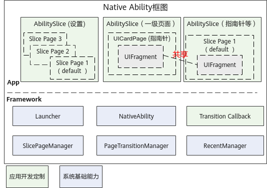
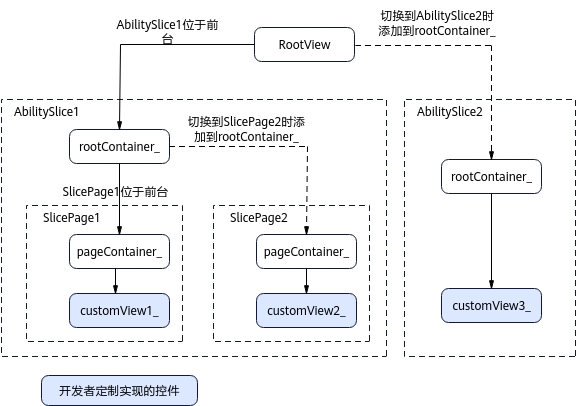
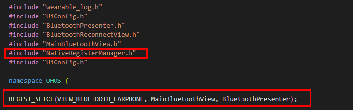
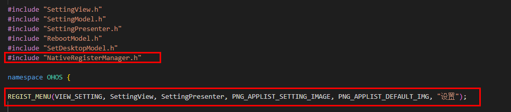
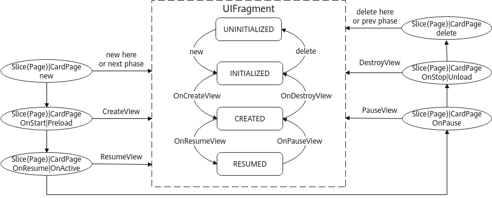
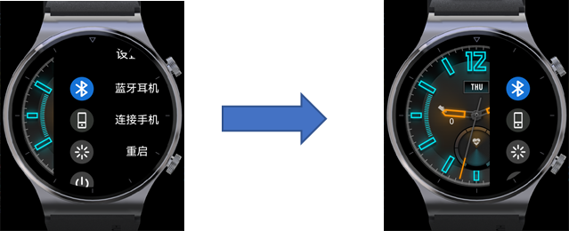
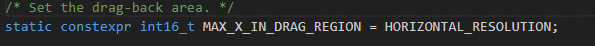

# 前言<a name="ZH-CN_TOPIC_0000002537662863"></a>

**概述<a name="zh-cn_topic_0000002504834018_section4537382116410"></a>**

本文档介绍了HiDiTing上NativeAbilityFwk子系统的整体框架和进行Native Slice应用开发的方法。

**读者对象<a name="zh-cn_topic_0000002504834018_section4378592816410"></a>**

本文档主要适用于以下工程师：

-   技术支持工程师
-   软件开发工程师

**符号约定<a name="zh-cn_topic_0000002504834018_section133020216410"></a>**

在本文中可能出现下列标志，它们所代表的含义如下。

<a name="zh-cn_topic_0000002504834018_table2622507016410"></a>
<table><thead align="left"><tr id="zh-cn_topic_0000002504834018_row1530720816410"><th class="cellrowborder" valign="top" width="20.560000000000002%" id="mcps1.1.3.1.1"><p id="zh-cn_topic_0000002504834018_p6450074116410"><a name="zh-cn_topic_0000002504834018_p6450074116410"></a><a name="zh-cn_topic_0000002504834018_p6450074116410"></a><strong id="zh-cn_topic_0000002504834018_b2136615816410"><a name="zh-cn_topic_0000002504834018_b2136615816410"></a><a name="zh-cn_topic_0000002504834018_b2136615816410"></a>符号</strong></p>
</th>
<th class="cellrowborder" valign="top" width="79.44%" id="mcps1.1.3.1.2"><p id="zh-cn_topic_0000002504834018_p5435366816410"><a name="zh-cn_topic_0000002504834018_p5435366816410"></a><a name="zh-cn_topic_0000002504834018_p5435366816410"></a><strong id="zh-cn_topic_0000002504834018_b5941558116410"><a name="zh-cn_topic_0000002504834018_b5941558116410"></a><a name="zh-cn_topic_0000002504834018_b5941558116410"></a>说明</strong></p>
</th>
</tr>
</thead>
<tbody><tr id="zh-cn_topic_0000002504834018_row1372280416410"><td class="cellrowborder" valign="top" width="20.560000000000002%" headers="mcps1.1.3.1.1 "><p id="zh-cn_topic_0000002504834018_p3734547016410"><a name="zh-cn_topic_0000002504834018_p3734547016410"></a><a name="zh-cn_topic_0000002504834018_p3734547016410"></a><a name="zh-cn_topic_0000002504834018_image2670064316410"></a><a name="zh-cn_topic_0000002504834018_image2670064316410"></a><span></span></p>
</td>
<td class="cellrowborder" valign="top" width="79.44%" headers="mcps1.1.3.1.2 "><p id="zh-cn_topic_0000002504834018_p1757432116410"><a name="zh-cn_topic_0000002504834018_p1757432116410"></a><a name="zh-cn_topic_0000002504834018_p1757432116410"></a>表示如不避免则将会导致死亡或严重伤害的具有高等级风险的危害。</p>
</td>
</tr>
<tr id="zh-cn_topic_0000002504834018_row466863216410"><td class="cellrowborder" valign="top" width="20.560000000000002%" headers="mcps1.1.3.1.1 "><p id="zh-cn_topic_0000002504834018_p1432579516410"><a name="zh-cn_topic_0000002504834018_p1432579516410"></a><a name="zh-cn_topic_0000002504834018_p1432579516410"></a><a name="zh-cn_topic_0000002504834018_image4895582316410"></a><a name="zh-cn_topic_0000002504834018_image4895582316410"></a><span></span></p>
</td>
<td class="cellrowborder" valign="top" width="79.44%" headers="mcps1.1.3.1.2 "><p id="zh-cn_topic_0000002504834018_p959197916410"><a name="zh-cn_topic_0000002504834018_p959197916410"></a><a name="zh-cn_topic_0000002504834018_p959197916410"></a>表示如不避免则可能导致死亡或严重伤害的具有中等级风险的危害。</p>
</td>
</tr>
<tr id="zh-cn_topic_0000002504834018_row123863216410"><td class="cellrowborder" valign="top" width="20.560000000000002%" headers="mcps1.1.3.1.1 "><p id="zh-cn_topic_0000002504834018_p1232579516410"><a name="zh-cn_topic_0000002504834018_p1232579516410"></a><a name="zh-cn_topic_0000002504834018_p1232579516410"></a><a name="zh-cn_topic_0000002504834018_image1235582316410"></a><a name="zh-cn_topic_0000002504834018_image1235582316410"></a><span></span></p>
</td>
<td class="cellrowborder" valign="top" width="79.44%" headers="mcps1.1.3.1.2 "><p id="zh-cn_topic_0000002504834018_p123197916410"><a name="zh-cn_topic_0000002504834018_p123197916410"></a><a name="zh-cn_topic_0000002504834018_p123197916410"></a>表示如不避免则可能导致轻微或中度伤害的具有低等级风险的危害。</p>
</td>
</tr>
<tr id="zh-cn_topic_0000002504834018_row5786682116410"><td class="cellrowborder" valign="top" width="20.560000000000002%" headers="mcps1.1.3.1.1 "><p id="zh-cn_topic_0000002504834018_p2204984716410"><a name="zh-cn_topic_0000002504834018_p2204984716410"></a><a name="zh-cn_topic_0000002504834018_p2204984716410"></a><a name="zh-cn_topic_0000002504834018_image4504446716410"></a><a name="zh-cn_topic_0000002504834018_image4504446716410"></a><span></span></p>
</td>
<td class="cellrowborder" valign="top" width="79.44%" headers="mcps1.1.3.1.2 "><p id="zh-cn_topic_0000002504834018_p4388861916410"><a name="zh-cn_topic_0000002504834018_p4388861916410"></a><a name="zh-cn_topic_0000002504834018_p4388861916410"></a>用于传递设备或环境安全警示信息。如不避免则可能会导致设备损坏、数据丢失、设备性能降低或其它不可预知的结果。</p>
<p id="zh-cn_topic_0000002504834018_p1238861916410"><a name="zh-cn_topic_0000002504834018_p1238861916410"></a><a name="zh-cn_topic_0000002504834018_p1238861916410"></a>“须知”不涉及人身伤害。</p>
</td>
</tr>
<tr id="zh-cn_topic_0000002504834018_row2856923116410"><td class="cellrowborder" valign="top" width="20.560000000000002%" headers="mcps1.1.3.1.1 "><p id="zh-cn_topic_0000002504834018_p5555360116410"><a name="zh-cn_topic_0000002504834018_p5555360116410"></a><a name="zh-cn_topic_0000002504834018_p5555360116410"></a><a name="zh-cn_topic_0000002504834018_image799324016410"></a><a name="zh-cn_topic_0000002504834018_image799324016410"></a><span></span></p>
</td>
<td class="cellrowborder" valign="top" width="79.44%" headers="mcps1.1.3.1.2 "><p id="zh-cn_topic_0000002504834018_p4612588116410"><a name="zh-cn_topic_0000002504834018_p4612588116410"></a><a name="zh-cn_topic_0000002504834018_p4612588116410"></a>对正文中重点信息的补充说明。</p>
<p id="zh-cn_topic_0000002504834018_p1232588116410"><a name="zh-cn_topic_0000002504834018_p1232588116410"></a><a name="zh-cn_topic_0000002504834018_p1232588116410"></a>“说明”不是安全警示信息，不涉及人身、设备及环境伤害信息。</p>
</td>
</tr>
</tbody>
</table>

# NativeAbilityFwk<a name="ZH-CN_TOPIC_0000002537662877"></a>

-   **[NativeAbilityFwk介绍](#ZH-CN_TOPIC_0000002505743150)**  

## NativeAbilityFwk介绍<a name="ZH-CN_TOPIC_0000002505743150"></a>

NativeAbilityFwk子系统是开发Native Slice应用的框架，包括Slice MVP架构、生命周期管理、转场动效、最近访问记录管理，是基于穿戴产品特点从鸿蒙原生Native应用框架演化而来。

Ability分Native Ability以及JS Ability两种，相关基础概念如下：

-   Native Ability，用来管理Native Slice应用，有且仅有一个实例。
    -   Slice，用来表示一个Native应用，拥有自己的生命周期；它与Native应用是等价的概念。
    -   SlicePage，用来表示Slice内部的某一个页面，拥有自己的生命周期。如果Slice内部只有一个页面，可以不使用SlicePage。比如包含多个卡片的一级页面，借助UICardPage（请参考《UIKit开发指南》中的“UICrossView”章节）可表示其中一个卡片，而单个卡片并不能被视作为一个页面。另外，也可以将同一个SlicePage注册（请参考“[创建并注册SlicePage](#ZH-CN_TOPIC_0000002537662861)”）到不同的Slice中，这样可以实现一个页面在不同Slice间的共享。
    -   UIFragment，用来表示一块显示内容，拥有自己的生命周期。借助它可以实现指定区域显示内容在不同页面间的共享，也可以实现指定区域显示内容的动态替换。比如：一级页面中的卡片与卡片应用间显示内容的共享（参考示例代码中的指南针卡片与应用）；应用列表不同风格显示内容的动态切换（参考《UIKit开发指南》中的“桌面样式”章节）。

        指南针共享内容代码：application/wearable/nativeapp/nativeui/compass/src/CompassFragment.cpp

-   JS Ability，为JS应用的入口，一个应用对应一个实例，用于管理JS Page，JS Page使用JS+HML+CSS编程，具体请参考《OpenHarmony JS应用开发 用户指南》。

Native Ability的框架如[图1](#zh-cn_topic_0000002536753799_fig1957015614013)所示，可以分为Framework和App两层。

**图 1**  Native Ability框架图<a name="zh-cn_topic_0000002536753799_fig1957015614013"></a>  


-   Framework层，是Native Ability应用开发的框架基础，模块具体职能如下：
    -   Launcher：负责Native应用资源和数据的初始化，以及Native Slice的注册。
    -   NativeAbility：负责Native Slice的创建以及生命周期的管理；并对外提供Slice和SlicePage跳转的接口。
    -   TransitionCallback：转场动效的对外接口，当前在“application\\wearable\\nativeabilityfwk\\src\\transition”目录中已提供示例，开发者可以新增定制动效。
    -   PageTransitionManager：负责JS应用、Native Slice应用间转场动效的管理。
    -   SlicePageManager：负责Slice应用内部SlicePage的创建以及生命周期的管理。
    -   RecentManager：负责记录和截图保存用户最近访问过的JS应用、Native Slice应用。

-   App层，即应用层，当前在“application\\wearable\\nativeapp”目录中已提供示例，开发者可以实现自己的Ability Slice、Slice内部的Slice Page、以及UIFragment。
    -   Slice开发可以借助MVP（可参考“[Slice MVP架构概述](#ZH-CN_TOPIC_0000002537542901)”）架构模式进行开发。
    -   如果Slice中的页面较多，可以使用SlicePage，这样页面的管理和切换可以交由Framework层来处理；如果Slice中仅有一个页面，可以不使用SlicePage。

# Slice应用开发<a name="ZH-CN_TOPIC_0000002505902960"></a>

-   **[Slice MVP架构概述](#ZH-CN_TOPIC_0000002537542901)**  

-   **[Slice开发](#ZH-CN_TOPIC_0000002537542891)**  

-   **[SlicePage开发](#ZH-CN_TOPIC_0000002537542893)**  

-   **[UIFragment开发](#ZH-CN_TOPIC_0000002505743142)**  

## Slice MVP架构概述<a name="ZH-CN_TOPIC_0000002537542901"></a>

一个完整的Slice页面使用MVP架构实现，有Model、View和Presenter三部分，其中Model与View原则上是解耦的，它们的职责如下：

-   M：Model，管理业务模型的数据和业务逻辑。
-   V：View，管理显示界面以及与用户的交互。如果Slice中包含SlicePage，SlicePage需要承担View的角色，可参考SettingView与SettingMainPage。
-   P：Presenter，负责完成View与Model之间的交互，数据变化触发更新界面；用户交互触发数据更新。如果一个应用包含较多的SlicePage，可以考虑将业务逻辑移到SlicePage中处理，即SlicePage可以承担Presenter的角色，可参考SettingPresenter与SettingMainPage。

总之，MVP是一个比较好的解耦设计，但是在代码简洁与解耦之间，开发者需要做好权衡。

-   **[Model](#ZH-CN_TOPIC_0000002505902970)**  

-   **[View](#ZH-CN_TOPIC_0000002537662871)**  

-   **[Presenter](#ZH-CN_TOPIC_0000002537542899)**  

### Model<a name="ZH-CN_TOPIC_0000002505902970"></a>

Model用于管理数据，通常以单例方式存在，以便在多Slice间更简单地共享数据。

### View<a name="ZH-CN_TOPIC_0000002537662871"></a>

View继承自“View.h”，用于视图构建和显示。“View.h”生命周期需要用户实现的接口如[表1](#zh-cn_topic_0000002504834026_table229191535014)所示。

**表 1**  View.h生命周期接口

<a name="zh-cn_topic_0000002504834026_table229191535014"></a>
<table><thead align="left"><tr id="zh-cn_topic_0000002504834026_row14292101510508"><th class="cellrowborder" valign="top" width="27.88%" id="mcps1.2.3.1.1"><p id="zh-cn_topic_0000002504834026_p1829211516505"><a name="zh-cn_topic_0000002504834026_p1829211516505"></a><a name="zh-cn_topic_0000002504834026_p1829211516505"></a>接口名</p>
</th>
<th class="cellrowborder" valign="top" width="72.11999999999999%" id="mcps1.2.3.1.2"><p id="zh-cn_topic_0000002504834026_p192929155501"><a name="zh-cn_topic_0000002504834026_p192929155501"></a><a name="zh-cn_topic_0000002504834026_p192929155501"></a>说明</p>
</th>
</tr>
</thead>
<tbody><tr id="zh-cn_topic_0000002504834026_row129221518508"><td class="cellrowborder" valign="top" width="27.88%" headers="mcps1.2.3.1.1 "><p id="zh-cn_topic_0000002504834026_p729210158500"><a name="zh-cn_topic_0000002504834026_p729210158500"></a><a name="zh-cn_topic_0000002504834026_p729210158500"></a>OnStart（data）</p>
</td>
<td class="cellrowborder" valign="top" width="72.11999999999999%" headers="mcps1.2.3.1.2 "><p id="zh-cn_topic_0000002504834026_p19292181565014"><a name="zh-cn_topic_0000002504834026_p19292181565014"></a><a name="zh-cn_topic_0000002504834026_p19292181565014"></a>启动Slice并且在动画（如果有）开始前调用，支撑传递数据，逻辑实现请参考“<a href="#ZH-CN_TOPIC_0000002505743144">Slice生命周期实现建议</a>”章节。</p>
</td>
</tr>
<tr id="zh-cn_topic_0000002504834026_row769343461017"><td class="cellrowborder" valign="top" width="27.88%" headers="mcps1.2.3.1.1 "><p id="zh-cn_topic_0000002504834026_p1269433414104"><a name="zh-cn_topic_0000002504834026_p1269433414104"></a><a name="zh-cn_topic_0000002504834026_p1269433414104"></a>OnStart</p>
</td>
<td class="cellrowborder" valign="top" width="72.11999999999999%" headers="mcps1.2.3.1.2 "><p id="zh-cn_topic_0000002504834026_p9694634181013"><a name="zh-cn_topic_0000002504834026_p9694634181013"></a><a name="zh-cn_topic_0000002504834026_p9694634181013"></a>同上，但不建议使用。</p>
</td>
</tr>
<tr id="zh-cn_topic_0000002504834026_row72921815165018"><td class="cellrowborder" valign="top" width="27.88%" headers="mcps1.2.3.1.1 "><p id="zh-cn_topic_0000002504834026_p1129291555013"><a name="zh-cn_topic_0000002504834026_p1129291555013"></a><a name="zh-cn_topic_0000002504834026_p1129291555013"></a>OnStop</p>
</td>
<td class="cellrowborder" valign="top" width="72.11999999999999%" headers="mcps1.2.3.1.2 "><p id="zh-cn_topic_0000002504834026_p18292181515500"><a name="zh-cn_topic_0000002504834026_p18292181515500"></a><a name="zh-cn_topic_0000002504834026_p18292181515500"></a>在当前页面不可见并且销毁的时候调用，逻辑实现建议参考“<a href="#ZH-CN_TOPIC_0000002505743144">Slice生命周期实现建议</a>”章节。</p>
</td>
</tr>
</tbody>
</table>

> **说明：** 
>OnStart和OnStart（data）都会调用，无论是否真正有data，都推荐使用OnStart\(data\)。

View中的RootView控件树嵌套层级如下：

**图 1**  MVP RootView控件树图<a name="zh-cn_topic_0000002504834026_fig1887799193917"></a>  


> **须知：** 
>不建议将自定义控件CustomView\[x\]直接添加到RootView中，因为转场动效基于RootContainer本身或者截图进行显示，如果将CustomView\[x\]直接添加到RootView中，则会导致转场动效的显示出现错乱。

### Presenter<a name="ZH-CN_TOPIC_0000002537542899"></a>

Presenter继承自“Presenter.h”，用于处理数据与视图之间的交互。“Presenter.h”生命周期需要用户实现的接口如[表1](#zh-cn_topic_0000002536753797_table15706368817)所示。

**表 1**  Presenter.h生命周期接口

<a name="zh-cn_topic_0000002536753797_table15706368817"></a>
<table><thead align="left"><tr id="zh-cn_topic_0000002536753797_row15706106988"><th class="cellrowborder" valign="top" width="40.300000000000004%" id="mcps1.2.3.1.1"><p id="zh-cn_topic_0000002536753797_p1706961488"><a name="zh-cn_topic_0000002536753797_p1706961488"></a><a name="zh-cn_topic_0000002536753797_p1706961488"></a>接口名</p>
</th>
<th class="cellrowborder" valign="top" width="59.699999999999996%" id="mcps1.2.3.1.2"><p id="zh-cn_topic_0000002536753797_p157069613813"><a name="zh-cn_topic_0000002536753797_p157069613813"></a><a name="zh-cn_topic_0000002536753797_p157069613813"></a>说明</p>
</th>
</tr>
</thead>
<tbody><tr id="zh-cn_topic_0000002536753797_row20595323791"><td class="cellrowborder" valign="top" width="40.300000000000004%" headers="mcps1.2.3.1.1 "><p id="zh-cn_topic_0000002536753797_p459614231994"><a name="zh-cn_topic_0000002536753797_p459614231994"></a><a name="zh-cn_topic_0000002536753797_p459614231994"></a>OnStart（data）</p>
</td>
<td class="cellrowborder" valign="top" width="59.699999999999996%" headers="mcps1.2.3.1.2 "><p id="zh-cn_topic_0000002536753797_p1459682317913"><a name="zh-cn_topic_0000002536753797_p1459682317913"></a><a name="zh-cn_topic_0000002536753797_p1459682317913"></a>启动Slice并且在动画（如果有）开始前调用，在View::OnStart之后调用，支撑传递数据，逻辑实现建议参考“<a href="#ZH-CN_TOPIC_0000002505743144">Slice生命周期实现建议</a>”章节。</p>
</td>
</tr>
<tr id="zh-cn_topic_0000002536753797_row199514110127"><td class="cellrowborder" valign="top" width="40.300000000000004%" headers="mcps1.2.3.1.1 "><p id="zh-cn_topic_0000002536753797_p11996415128"><a name="zh-cn_topic_0000002536753797_p11996415128"></a><a name="zh-cn_topic_0000002536753797_p11996415128"></a>OnStart</p>
</td>
<td class="cellrowborder" valign="top" width="59.699999999999996%" headers="mcps1.2.3.1.2 "><p id="zh-cn_topic_0000002536753797_p169961012121"><a name="zh-cn_topic_0000002536753797_p169961012121"></a><a name="zh-cn_topic_0000002536753797_p169961012121"></a>同上，但不建议使用。</p>
</td>
</tr>
<tr id="zh-cn_topic_0000002536753797_row2706561284"><td class="cellrowborder" valign="top" width="40.300000000000004%" headers="mcps1.2.3.1.1 "><p id="zh-cn_topic_0000002536753797_p1270674013913"><a name="zh-cn_topic_0000002536753797_p1270674013913"></a><a name="zh-cn_topic_0000002536753797_p1270674013913"></a>OnResume</p>
</td>
<td class="cellrowborder" valign="top" width="59.699999999999996%" headers="mcps1.2.3.1.2 "><p id="zh-cn_topic_0000002536753797_p187061962083"><a name="zh-cn_topic_0000002536753797_p187061962083"></a><a name="zh-cn_topic_0000002536753797_p187061962083"></a>动画（如果有）结束并且页面（恢复）可见时调用，逻辑实现建议参考“<a href="#ZH-CN_TOPIC_0000002505743144">Slice生命周期实现建议</a>”章节。</p>
</td>
</tr>
<tr id="zh-cn_topic_0000002536753797_row8606202919912"><td class="cellrowborder" valign="top" width="40.300000000000004%" headers="mcps1.2.3.1.1 "><p id="zh-cn_topic_0000002536753797_p1931510471196"><a name="zh-cn_topic_0000002536753797_p1931510471196"></a><a name="zh-cn_topic_0000002536753797_p1931510471196"></a>OnPause</p>
</td>
<td class="cellrowborder" valign="top" width="59.699999999999996%" headers="mcps1.2.3.1.2 "><p id="zh-cn_topic_0000002536753797_p186067291496"><a name="zh-cn_topic_0000002536753797_p186067291496"></a><a name="zh-cn_topic_0000002536753797_p186067291496"></a>页面进入后台时调用，逻辑实现建议参考“<a href="#ZH-CN_TOPIC_0000002505743144">Slice生命周期实现建议</a>”章节。</p>
</td>
</tr>
<tr id="zh-cn_topic_0000002536753797_row1684142922510"><td class="cellrowborder" valign="top" width="40.300000000000004%" headers="mcps1.2.3.1.1 "><p id="zh-cn_topic_0000002536753797_p138364285251"><a name="zh-cn_topic_0000002536753797_p138364285251"></a><a name="zh-cn_topic_0000002536753797_p138364285251"></a>OnStop</p>
</td>
<td class="cellrowborder" valign="top" width="59.699999999999996%" headers="mcps1.2.3.1.2 "><p id="zh-cn_topic_0000002536753797_p783622872520"><a name="zh-cn_topic_0000002536753797_p783622872520"></a><a name="zh-cn_topic_0000002536753797_p783622872520"></a>页面不可见并且销毁时调用，逻辑实现建议参考“<a href="#ZH-CN_TOPIC_0000002505743144">Slice生命周期实现建议</a>”章节。</p>
</td>
</tr>
</tbody>
</table>

## Slice开发<a name="ZH-CN_TOPIC_0000002537542891"></a>

-   **[创建并注册Slice](#ZH-CN_TOPIC_0000002537542887)**  

-   **[Slice生命周期实现建议](#ZH-CN_TOPIC_0000002505743144)**  

### 创建并注册Slice<a name="ZH-CN_TOPIC_0000002537542887"></a>

1.  创建Slice

    创建Slice有IDE GUI工程自动创建和手动创建两种方式，相比于手动创建，IDE GUI工程自动创建Slice优势如下：

    -   支持通过拖拉点拽边界UI界面。
    -   自动创建会自动生成View、Presenter、Model的代码。
    -   自动创建会生成静态注册的代码，并且注册的SliceId在\[VIEW\_MAX\_INTER\_ARRY\_APP, VIEW\_MAX\_INTER\_APP\]之间。

    IDE GUI工程自动创建Slice，可以参考《HiSpark Studio for VS Code 使用指南》的“GUI工程创建与使用”章节，本文不再赘述。

    手动创建Slice，需要手动添加View、Presenter、Model的代码，并手动添加Slice静态注册代码，具体可参考nativeapp目录下的示例。如果Slice内部有SlicePage，为了代码简洁性，View和Presenter可以简化，并将相关逻辑放到SlicePage中。

2.  静态注册Slice

    静态注册Slice支持如下两种方式：

    -   普通注册：借助宏REGIST\_SLICE完成，该方式注册的Slice可以借助Slice id跳转进入Slice页面，但是不会在菜单中显示该Slice的图标，注册方式为：REGIST\_SLICE\(id, V, P\)

    -   菜单注册：借助宏REGIST\_MENU或者REGIST\_MENU\_EXT完成，该方式注册的应用不仅可以借助Slice id进行跳转进入Slice页面，也可以在菜单中显示该Slice的图标，注册方式为：

        REGIST\_MENU\(id, V, P, icon, iconHexagon, label\)：不支持多语言以及图标打包。

        REGIST\_MENU\_EXT\(item,V, P\)：支持多语言以及图标打包，方便开发者借助AppItem的构造方法进一步扩展。

    Slice应用的注册顺序通过ID升序排序，如果用户期望改变菜单中Slice应用的排布顺序，可以在“application\\wearable\\nativeapp\\nativeui\\applist\\src\\ApplistModel.cpp”的ResolvingJSAppItems中定制排布顺序。

**表 1**  REGIST\_SLICE参数说明

<a name="zh-cn_topic_0000002536633813_table1256583518187"></a>
<table><thead align="left"><tr id="zh-cn_topic_0000002536633813_row1156533511814"><th class="cellrowborder" valign="top" width="33.37%" id="mcps1.2.3.1.1"><p id="zh-cn_topic_0000002536633813_p388575410186"><a name="zh-cn_topic_0000002536633813_p388575410186"></a><a name="zh-cn_topic_0000002536633813_p388575410186"></a>参数</p>
</th>
<th class="cellrowborder" valign="top" width="66.63%" id="mcps1.2.3.1.2"><p id="zh-cn_topic_0000002536633813_p155651635141815"><a name="zh-cn_topic_0000002536633813_p155651635141815"></a><a name="zh-cn_topic_0000002536633813_p155651635141815"></a>说明</p>
</th>
</tr>
</thead>
<tbody><tr id="zh-cn_topic_0000002536633813_row8565193520182"><td class="cellrowborder" valign="top" width="33.37%" headers="mcps1.2.3.1.1 "><p id="zh-cn_topic_0000002536633813_p191891285193"><a name="zh-cn_topic_0000002536633813_p191891285193"></a><a name="zh-cn_topic_0000002536633813_p191891285193"></a>id</p>
</td>
<td class="cellrowborder" valign="top" width="66.63%" headers="mcps1.2.3.1.2 "><p id="zh-cn_topic_0000002536633813_p145654358186"><a name="zh-cn_topic_0000002536633813_p145654358186"></a><a name="zh-cn_topic_0000002536633813_p145654358186"></a>Slice的ID（必须大于0，0为无效值）。</p>
</td>
</tr>
<tr id="zh-cn_topic_0000002536633813_row55651835161816"><td class="cellrowborder" valign="top" width="33.37%" headers="mcps1.2.3.1.1 "><p id="zh-cn_topic_0000002536633813_p427184317581"><a name="zh-cn_topic_0000002536633813_p427184317581"></a><a name="zh-cn_topic_0000002536633813_p427184317581"></a>V</p>
</td>
<td class="cellrowborder" valign="top" width="66.63%" headers="mcps1.2.3.1.2 "><p id="zh-cn_topic_0000002536633813_p13565635181819"><a name="zh-cn_topic_0000002536633813_p13565635181819"></a><a name="zh-cn_topic_0000002536633813_p13565635181819"></a>对应的View文件的类名。</p>
</td>
</tr>
<tr id="zh-cn_topic_0000002536633813_row15652359184"><td class="cellrowborder" valign="top" width="33.37%" headers="mcps1.2.3.1.1 "><p id="zh-cn_topic_0000002536633813_p11565935191815"><a name="zh-cn_topic_0000002536633813_p11565935191815"></a><a name="zh-cn_topic_0000002536633813_p11565935191815"></a>P</p>
</td>
<td class="cellrowborder" valign="top" width="66.63%" headers="mcps1.2.3.1.2 "><p id="zh-cn_topic_0000002536633813_p158603396594"><a name="zh-cn_topic_0000002536633813_p158603396594"></a><a name="zh-cn_topic_0000002536633813_p158603396594"></a>对应的Presenter文件的类名。</p>
</td>
</tr>
</tbody>
</table>

**表 2**  REGIST\_MENU参数说明

<a name="zh-cn_topic_0000002536633813_table6797722107"></a>
<table><thead align="left"><tr id="zh-cn_topic_0000002536633813_row97971422208"><th class="cellrowborder" valign="top" width="34.11%" id="mcps1.2.3.1.1"><p id="zh-cn_topic_0000002536633813_p0797122218010"><a name="zh-cn_topic_0000002536633813_p0797122218010"></a><a name="zh-cn_topic_0000002536633813_p0797122218010"></a>参数</p>
</th>
<th class="cellrowborder" valign="top" width="65.89%" id="mcps1.2.3.1.2"><p id="zh-cn_topic_0000002536633813_p67971022309"><a name="zh-cn_topic_0000002536633813_p67971022309"></a><a name="zh-cn_topic_0000002536633813_p67971022309"></a>说明</p>
</th>
</tr>
</thead>
<tbody><tr id="zh-cn_topic_0000002536633813_row1579720221603"><td class="cellrowborder" valign="top" width="34.11%" headers="mcps1.2.3.1.1 "><p id="zh-cn_topic_0000002536633813_p9797132216011"><a name="zh-cn_topic_0000002536633813_p9797132216011"></a><a name="zh-cn_topic_0000002536633813_p9797132216011"></a>id</p>
</td>
<td class="cellrowborder" valign="top" width="65.89%" headers="mcps1.2.3.1.2 "><p id="zh-cn_topic_0000002536633813_p13797182213020"><a name="zh-cn_topic_0000002536633813_p13797182213020"></a><a name="zh-cn_topic_0000002536633813_p13797182213020"></a>Slice的ID（必须大于0，0为无效值）。</p>
</td>
</tr>
<tr id="zh-cn_topic_0000002536633813_row1879752219011"><td class="cellrowborder" valign="top" width="34.11%" headers="mcps1.2.3.1.1 "><p id="zh-cn_topic_0000002536633813_p1279732219013"><a name="zh-cn_topic_0000002536633813_p1279732219013"></a><a name="zh-cn_topic_0000002536633813_p1279732219013"></a>V</p>
</td>
<td class="cellrowborder" valign="top" width="65.89%" headers="mcps1.2.3.1.2 "><p id="zh-cn_topic_0000002536633813_p19797132211019"><a name="zh-cn_topic_0000002536633813_p19797132211019"></a><a name="zh-cn_topic_0000002536633813_p19797132211019"></a>对应的View文件的类名。</p>
</td>
</tr>
<tr id="zh-cn_topic_0000002536633813_row11797152219010"><td class="cellrowborder" valign="top" width="34.11%" headers="mcps1.2.3.1.1 "><p id="zh-cn_topic_0000002536633813_p17971221507"><a name="zh-cn_topic_0000002536633813_p17971221507"></a><a name="zh-cn_topic_0000002536633813_p17971221507"></a>P</p>
</td>
<td class="cellrowborder" valign="top" width="65.89%" headers="mcps1.2.3.1.2 "><p id="zh-cn_topic_0000002536633813_p1379717220010"><a name="zh-cn_topic_0000002536633813_p1379717220010"></a><a name="zh-cn_topic_0000002536633813_p1379717220010"></a>对应的Presenter文件的类名。</p>
</td>
</tr>
<tr id="zh-cn_topic_0000002536633813_row112111838103"><td class="cellrowborder" valign="top" width="34.11%" headers="mcps1.2.3.1.1 "><p id="zh-cn_topic_0000002536633813_p6211238507"><a name="zh-cn_topic_0000002536633813_p6211238507"></a><a name="zh-cn_topic_0000002536633813_p6211238507"></a>icon</p>
</td>
<td class="cellrowborder" valign="top" width="65.89%" headers="mcps1.2.3.1.2 "><p id="zh-cn_topic_0000002536633813_p192118381502"><a name="zh-cn_topic_0000002536633813_p192118381502"></a><a name="zh-cn_topic_0000002536633813_p192118381502"></a>标准应用图标资源文件的路径。</p>
</td>
</tr>
<tr id="zh-cn_topic_0000002536633813_row8811045409"><td class="cellrowborder" valign="top" width="34.11%" headers="mcps1.2.3.1.1 "><p id="zh-cn_topic_0000002536633813_p98113451508"><a name="zh-cn_topic_0000002536633813_p98113451508"></a><a name="zh-cn_topic_0000002536633813_p98113451508"></a>iconHexagon</p>
</td>
<td class="cellrowborder" valign="top" width="65.89%" headers="mcps1.2.3.1.2 "><p id="zh-cn_topic_0000002536633813_p1381114518017"><a name="zh-cn_topic_0000002536633813_p1381114518017"></a><a name="zh-cn_topic_0000002536633813_p1381114518017"></a>六边形应用图标资源文件的路径。</p>
</td>
</tr>
<tr id="zh-cn_topic_0000002536633813_row065854115011"><td class="cellrowborder" valign="top" width="34.11%" headers="mcps1.2.3.1.1 "><p id="zh-cn_topic_0000002536633813_p76584411600"><a name="zh-cn_topic_0000002536633813_p76584411600"></a><a name="zh-cn_topic_0000002536633813_p76584411600"></a>label</p>
</td>
<td class="cellrowborder" valign="top" width="65.89%" headers="mcps1.2.3.1.2 "><p id="zh-cn_topic_0000002536633813_p1765818411000"><a name="zh-cn_topic_0000002536633813_p1765818411000"></a><a name="zh-cn_topic_0000002536633813_p1765818411000"></a>应用名。</p>
</td>
</tr>
</tbody>
</table>

**表 3**  REGIST\_MENU\_EXT参数说明

<a name="zh-cn_topic_0000002536633813_table152631435053"></a>
<table><thead align="left"><tr id="zh-cn_topic_0000002536633813_row82637353511"><th class="cellrowborder" valign="top" width="34.36%" id="mcps1.2.3.1.1"><p id="zh-cn_topic_0000002536633813_p102631356514"><a name="zh-cn_topic_0000002536633813_p102631356514"></a><a name="zh-cn_topic_0000002536633813_p102631356514"></a>参数</p>
</th>
<th class="cellrowborder" valign="top" width="65.64%" id="mcps1.2.3.1.2"><p id="zh-cn_topic_0000002536633813_p62631435550"><a name="zh-cn_topic_0000002536633813_p62631435550"></a><a name="zh-cn_topic_0000002536633813_p62631435550"></a>说明</p>
</th>
</tr>
</thead>
<tbody><tr id="zh-cn_topic_0000002536633813_row1026303520515"><td class="cellrowborder" valign="top" width="34.36%" headers="mcps1.2.3.1.1 "><p id="zh-cn_topic_0000002536633813_p9263163512510"><a name="zh-cn_topic_0000002536633813_p9263163512510"></a><a name="zh-cn_topic_0000002536633813_p9263163512510"></a>item</p>
</td>
<td class="cellrowborder" valign="top" width="65.64%" headers="mcps1.2.3.1.2 "><p id="zh-cn_topic_0000002536633813_p1826373518517"><a name="zh-cn_topic_0000002536633813_p1826373518517"></a><a name="zh-cn_topic_0000002536633813_p1826373518517"></a>AppItem结构体对象。</p>
</td>
</tr>
<tr id="zh-cn_topic_0000002536633813_row122631435057"><td class="cellrowborder" valign="top" width="34.36%" headers="mcps1.2.3.1.1 "><p id="zh-cn_topic_0000002536633813_p3263103516515"><a name="zh-cn_topic_0000002536633813_p3263103516515"></a><a name="zh-cn_topic_0000002536633813_p3263103516515"></a>V</p>
</td>
<td class="cellrowborder" valign="top" width="65.64%" headers="mcps1.2.3.1.2 "><p id="zh-cn_topic_0000002536633813_p2101113518343"><a name="zh-cn_topic_0000002536633813_p2101113518343"></a><a name="zh-cn_topic_0000002536633813_p2101113518343"></a>对应的View文件的类名。</p>
</td>
</tr>
<tr id="zh-cn_topic_0000002536633813_row152633351757"><td class="cellrowborder" valign="top" width="34.36%" headers="mcps1.2.3.1.1 "><p id="zh-cn_topic_0000002536633813_p326333515514"><a name="zh-cn_topic_0000002536633813_p326333515514"></a><a name="zh-cn_topic_0000002536633813_p326333515514"></a>P</p>
</td>
<td class="cellrowborder" valign="top" width="65.64%" headers="mcps1.2.3.1.2 "><p id="zh-cn_topic_0000002536633813_p92631635651"><a name="zh-cn_topic_0000002536633813_p92631635651"></a><a name="zh-cn_topic_0000002536633813_p92631635651"></a>对应的Presenter文件的类名。</p>
</td>
</tr>
</tbody>
</table>

建议在“XXXPresent.cpp”中进行注册，具体可以参考[图1](#zh-cn_topic_0000002536633813_fig66565616434)：

**图 1**  Slice注册示例图<a name="zh-cn_topic_0000002536633813_fig66565616434"></a>  




### Slice生命周期实现建议<a name="ZH-CN_TOPIC_0000002505743144"></a>

以Slice A转场到Slice B为例（不考虑转场动画），具体也可参考“Slice.h/View.h/Presenter.h”的注释。

1.  SliceA OnPause：Slice A进入Pause状态。

    Presenter::OnPause：建议暂停动画，清除焦点，清除输入事件监听。

2.  SliceA OnStop：Slice A进入Stop状态。

    View::OnStop/\~View：建议销毁Slice A中自创建的控件资源。（系统会自动将自创建控件从rootContainer\_中移除）

    Presenter::OnStop/\~Presenter：建议销毁Slice A中的非控件资源。

3.  SliceB OnStart：Slice B进入Start状态。

    View\(\)/View::OnStart：建议初始化控件资源，并借助接口GetRootContainer\(\)将其添加到RootView控件树中。

    Presenter\(\)/Presenter::OnStart：建议初始化非控件资源，基于Model非实时数据刷新已初始化的控件状态。

4.  SliceB OnResume：Slice B进入Resume状态。

    Presenter::OnResume：建议基于实时数据刷新控件状态、启动页面开场动画、获取焦点、设置输入事件监听等。

## SlicePage开发<a name="ZH-CN_TOPIC_0000002537542893"></a>

-   **[创建并注册SlicePage](#ZH-CN_TOPIC_0000002537662861)**  

-   **[SlicePage生命周期实现建议](#ZH-CN_TOPIC_0000002537662869)**  

### 创建并注册SlicePage<a name="ZH-CN_TOPIC_0000002537662861"></a>

首先，根据当前Slice内部页面的个数和实际业务诉求，决定是否使用SlicePage。即使只有一个页面，也可以使用SlicePage。

其次，如果创建SlicePage，需要新建一个继承于SlicePageBase的子类，并在该类的cpp文件中将SlicePage注册到Slice中。如前文所述，SlicePage可以同时承担View和Presenter的角色，具体可以参考实例SettingMainPage的实现。

注册SlicePage使用REGIST\_SLICE\_PAGE方法静态注册到指定的Slice中：REGIST\_SLICE\_PAGE\(sliceId, pageId, V, isMainPage\)

如果将同一个SlicePage注册到不同的应用中，那么这个页面就可以在两个不同的应用中共享使用。

**表 1**  REGIST\_SLICE\_PAGE参数说明

<a name="zh-cn_topic_0000002536633811_table6797722107"></a>
<table><thead align="left"><tr id="zh-cn_topic_0000002536633811_row97971422208"><th class="cellrowborder" valign="top" width="30.680000000000003%" id="mcps1.2.3.1.1"><p id="zh-cn_topic_0000002536633811_p0797122218010"><a name="zh-cn_topic_0000002536633811_p0797122218010"></a><a name="zh-cn_topic_0000002536633811_p0797122218010"></a>参数</p>
</th>
<th class="cellrowborder" valign="top" width="69.32000000000001%" id="mcps1.2.3.1.2"><p id="zh-cn_topic_0000002536633811_p67971022309"><a name="zh-cn_topic_0000002536633811_p67971022309"></a><a name="zh-cn_topic_0000002536633811_p67971022309"></a>说明</p>
</th>
</tr>
</thead>
<tbody><tr id="zh-cn_topic_0000002536633811_row1579720221603"><td class="cellrowborder" valign="top" width="30.680000000000003%" headers="mcps1.2.3.1.1 "><p id="zh-cn_topic_0000002536633811_p9797132216011"><a name="zh-cn_topic_0000002536633811_p9797132216011"></a><a name="zh-cn_topic_0000002536633811_p9797132216011"></a>sliceId</p>
</td>
<td class="cellrowborder" valign="top" width="69.32000000000001%" headers="mcps1.2.3.1.2 "><p id="zh-cn_topic_0000002536633811_p13797182213020"><a name="zh-cn_topic_0000002536633811_p13797182213020"></a><a name="zh-cn_topic_0000002536633811_p13797182213020"></a>Slice的ID（必须大于0，0为无效值）。</p>
</td>
</tr>
<tr id="zh-cn_topic_0000002536633811_row1879752219011"><td class="cellrowborder" valign="top" width="30.680000000000003%" headers="mcps1.2.3.1.1 "><p id="zh-cn_topic_0000002536633811_p1279732219013"><a name="zh-cn_topic_0000002536633811_p1279732219013"></a><a name="zh-cn_topic_0000002536633811_p1279732219013"></a>pageId</p>
</td>
<td class="cellrowborder" valign="top" width="69.32000000000001%" headers="mcps1.2.3.1.2 "><p id="zh-cn_topic_0000002536633811_p19797132211019"><a name="zh-cn_topic_0000002536633811_p19797132211019"></a><a name="zh-cn_topic_0000002536633811_p19797132211019"></a>SlicePage的Id（必须大于0，0为无效值）。</p>
</td>
</tr>
<tr id="zh-cn_topic_0000002536633811_row11797152219010"><td class="cellrowborder" valign="top" width="30.680000000000003%" headers="mcps1.2.3.1.1 "><p id="zh-cn_topic_0000002536633811_p17971221507"><a name="zh-cn_topic_0000002536633811_p17971221507"></a><a name="zh-cn_topic_0000002536633811_p17971221507"></a>V</p>
</td>
<td class="cellrowborder" valign="top" width="69.32000000000001%" headers="mcps1.2.3.1.2 "><p id="zh-cn_topic_0000002536633811_p2101113518343"><a name="zh-cn_topic_0000002536633811_p2101113518343"></a><a name="zh-cn_topic_0000002536633811_p2101113518343"></a>对应的View文件的类名。</p>
</td>
</tr>
<tr id="zh-cn_topic_0000002536633811_row112111838103"><td class="cellrowborder" valign="top" width="30.680000000000003%" headers="mcps1.2.3.1.1 "><p id="zh-cn_topic_0000002536633811_p6211238507"><a name="zh-cn_topic_0000002536633811_p6211238507"></a><a name="zh-cn_topic_0000002536633811_p6211238507"></a>isMainPage</p>
</td>
<td class="cellrowborder" valign="top" width="69.32000000000001%" headers="mcps1.2.3.1.2 "><p id="zh-cn_topic_0000002536633811_p192118381502"><a name="zh-cn_topic_0000002536633811_p192118381502"></a><a name="zh-cn_topic_0000002536633811_p192118381502"></a>当前SlicePage是否为当前Slice的默认Page，即启动Slice是否默认启动到该页面。</p>
</td>
</tr>
</tbody>
</table>

### SlicePage生命周期实现建议<a name="ZH-CN_TOPIC_0000002537662869"></a>

以Slice内部由SlicePage A跳转到SlicePage B为例（不考虑动画）：

1.  SlicePage A OnPause：SlicePage A进入Pause状态。如果支持缓存SlicePage A，则跳过[2](#zh-cn_topic_0000002504834022_li189951235122514)。

    建议暂停SlicePage A中的动画，并清除输入事件监听。

2.  <a name="zh-cn_topic_0000002504834022_li189951235122514"></a>SlicePage A OnStop：SlicePage A进入Stop状态。

    建议销毁SlicePage A中自创建的控件资源。（系统会自动将自创建控件从pageContainer\_中移除）

    为了代码简洁，可以承担Presenter角色销毁SlicePage A的非控件资源。

3.  SlicePage B OnStart：SlicePage B进入Start状态。

    建议初始化SlicePage B的控件资源，并借助接口GetSlicePageContainer\(\)将其添加到RootView控件树中。

    为了代码简洁，可以承担Presenter角色初始化非控件资源，并基于Model非实时数据刷新已初始化的控件状态。

4.  SlicePage B OnResume：SlicePage B进入Resume状态。

    为了代码简洁，可以承担Presenter角色基于实时数据刷新控件状态、启动页面开场动画、获取焦点、设置输入事件监听等。

当由Slice A跳转到Slice B的指定SlicePage B时，SlicePage B的生命周期调用与SliceB Presenter生命周期调用保持一致。针对这个不同的场景，SlicePage的实现建议并无区别。

## UIFragment开发<a name="ZH-CN_TOPIC_0000002505743142"></a>

-   **[UIFragment介绍](#ZH-CN_TOPIC_0000002505902962)**  

-   **[UIFragment使用场景](#ZH-CN_TOPIC_0000002537662867)**  

### UIFragment介绍<a name="ZH-CN_TOPIC_0000002505902962"></a>

UIFragment用来表示一块拥有自己生命周期的显示内容。与SlicePage类似，UIFragment同样拥有自己的根容器控件，将其添加到View、SlicePage或者UICradPage的根容器控件中就可以正常显示。

开发者需代码实现UIFragment的子类，并通过构造函数直接创建UIFragment子类的实例。创建UIFragment子类实例时如果指定了ID，则可以通过UIFragmentMananger借助该ID查找到该实例。

```
UIFragmentManager::GetInstance().GetFragmentById("id_name")
```

UIFragment不同生命周期的处理逻辑，一方面需要开发者自己实现，另一方面还需开发者在View、SlicePage或者UICardPage的生命周期主动触发调用。具体的生命周期变化时序以及生命周期调用函数可参考[图1](#zh-cn_topic_0000002536753801_fig26061696286)。

为了保证代码的简洁性以及内聚性，UIFragment建议同时承担View和Presenter的角色。

**图 1**  UIFragment状态变化示意图<a name="zh-cn_topic_0000002536753801_fig26061696286"></a>  


**表 1**  UIFragment的接口说明

<a name="zh-cn_topic_0000002536753801_table1924516074616"></a>
<table><thead align="left"><tr id="zh-cn_topic_0000002536753801_row1624520204617"><th class="cellrowborder" valign="top" width="35.76%" id="mcps1.2.3.1.1"><p id="zh-cn_topic_0000002536753801_p2024519074617"><a name="zh-cn_topic_0000002536753801_p2024519074617"></a><a name="zh-cn_topic_0000002536753801_p2024519074617"></a>接口名</p>
</th>
<th class="cellrowborder" valign="top" width="64.24%" id="mcps1.2.3.1.2"><p id="zh-cn_topic_0000002536753801_p924517014619"><a name="zh-cn_topic_0000002536753801_p924517014619"></a><a name="zh-cn_topic_0000002536753801_p924517014619"></a>说明</p>
</th>
</tr>
</thead>
<tbody><tr id="zh-cn_topic_0000002536753801_row924512019467"><td class="cellrowborder" valign="top" width="35.76%" headers="mcps1.2.3.1.1 "><p id="zh-cn_topic_0000002536753801_p123671741114611"><a name="zh-cn_topic_0000002536753801_p123671741114611"></a><a name="zh-cn_topic_0000002536753801_p123671741114611"></a>UIFragment()</p>
</td>
<td class="cellrowborder" valign="top" width="64.24%" headers="mcps1.2.3.1.2 "><p id="zh-cn_topic_0000002536753801_p224518024610"><a name="zh-cn_topic_0000002536753801_p224518024610"></a><a name="zh-cn_topic_0000002536753801_p224518024610"></a>构造函数，不会注册到UIFragmentManager中。</p>
</td>
</tr>
<tr id="zh-cn_topic_0000002536753801_row724540194613"><td class="cellrowborder" valign="top" width="35.76%" headers="mcps1.2.3.1.1 "><p id="zh-cn_topic_0000002536753801_p22451306469"><a name="zh-cn_topic_0000002536753801_p22451306469"></a><a name="zh-cn_topic_0000002536753801_p22451306469"></a>UIFragment(const std::string& id)</p>
</td>
<td class="cellrowborder" valign="top" width="64.24%" headers="mcps1.2.3.1.2 "><p id="zh-cn_topic_0000002536753801_p6245170194614"><a name="zh-cn_topic_0000002536753801_p6245170194614"></a><a name="zh-cn_topic_0000002536753801_p6245170194614"></a>带参数的构造函数，以key为id的方式注册到UIFragmentManager中。</p>
</td>
</tr>
<tr id="zh-cn_topic_0000002536753801_row5245502466"><td class="cellrowborder" valign="top" width="35.76%" headers="mcps1.2.3.1.1 "><p id="zh-cn_topic_0000002536753801_p12327814185213"><a name="zh-cn_topic_0000002536753801_p12327814185213"></a><a name="zh-cn_topic_0000002536753801_p12327814185213"></a>virtual void OnCreateView(void* data)</p>
</td>
<td class="cellrowborder" valign="top" width="64.24%" headers="mcps1.2.3.1.2 "><p id="zh-cn_topic_0000002536753801_p162151289492"><a name="zh-cn_topic_0000002536753801_p162151289492"></a><a name="zh-cn_topic_0000002536753801_p162151289492"></a>待子类实现的protected虚函数，建议创建控件并将其添加到UIFragment根容器控件fragmentview_中。</p>
</td>
</tr>
<tr id="zh-cn_topic_0000002536753801_row181771712174919"><td class="cellrowborder" valign="top" width="35.76%" headers="mcps1.2.3.1.1 "><p id="zh-cn_topic_0000002536753801_p3177151213496"><a name="zh-cn_topic_0000002536753801_p3177151213496"></a><a name="zh-cn_topic_0000002536753801_p3177151213496"></a>virtual void OnResumeView()</p>
</td>
<td class="cellrowborder" valign="top" width="64.24%" headers="mcps1.2.3.1.2 "><p id="zh-cn_topic_0000002536753801_p1861561675218"><a name="zh-cn_topic_0000002536753801_p1861561675218"></a><a name="zh-cn_topic_0000002536753801_p1861561675218"></a>待子类实现的protected虚函数，与Slice(Page) OnResume行为保持一致，建议设置输入监听，获取焦点以及启动动画等。</p>
</td>
</tr>
<tr id="zh-cn_topic_0000002536753801_row1124520034610"><td class="cellrowborder" valign="top" width="35.76%" headers="mcps1.2.3.1.1 "><p id="zh-cn_topic_0000002536753801_p225341618499"><a name="zh-cn_topic_0000002536753801_p225341618499"></a><a name="zh-cn_topic_0000002536753801_p225341618499"></a>virtual void OnPauseView()</p>
</td>
<td class="cellrowborder" valign="top" width="64.24%" headers="mcps1.2.3.1.2 "><p id="zh-cn_topic_0000002536753801_p11257203611593"><a name="zh-cn_topic_0000002536753801_p11257203611593"></a><a name="zh-cn_topic_0000002536753801_p11257203611593"></a>待子类实现的protected虚函数，与Slice(Page) OnPause行为保持一致，建议清除输入监听，清除焦点以及暂停动画等。</p>
</td>
</tr>
<tr id="zh-cn_topic_0000002536753801_row8252131664916"><td class="cellrowborder" valign="top" width="35.76%" headers="mcps1.2.3.1.1 "><p id="zh-cn_topic_0000002536753801_p43391820174914"><a name="zh-cn_topic_0000002536753801_p43391820174914"></a><a name="zh-cn_topic_0000002536753801_p43391820174914"></a>virtual void OnDestroyView()</p>
</td>
<td class="cellrowborder" valign="top" width="64.24%" headers="mcps1.2.3.1.2 "><p id="zh-cn_topic_0000002536753801_p76911529185213"><a name="zh-cn_topic_0000002536753801_p76911529185213"></a><a name="zh-cn_topic_0000002536753801_p76911529185213"></a>待子类实现的protected虚函数，建议销毁控件。</p>
</td>
</tr>
<tr id="zh-cn_topic_0000002536753801_row122455034617"><td class="cellrowborder" valign="top" width="35.76%" headers="mcps1.2.3.1.1 "><p id="zh-cn_topic_0000002536753801_p19245110134615"><a name="zh-cn_topic_0000002536753801_p19245110134615"></a><a name="zh-cn_topic_0000002536753801_p19245110134615"></a>void ResumeView()</p>
</td>
<td class="cellrowborder" valign="top" width="64.24%" headers="mcps1.2.3.1.2 "><p id="zh-cn_topic_0000002536753801_p9262038115218"><a name="zh-cn_topic_0000002536753801_p9262038115218"></a><a name="zh-cn_topic_0000002536753801_p9262038115218"></a>外部调用函数，如果状态为INITIALZIED，会触发调用OnCreateView方法。</p>
</td>
</tr>
<tr id="zh-cn_topic_0000002536753801_row1629615471529"><td class="cellrowborder" valign="top" width="35.76%" headers="mcps1.2.3.1.1 "><p id="zh-cn_topic_0000002536753801_p924520184618"><a name="zh-cn_topic_0000002536753801_p924520184618"></a><a name="zh-cn_topic_0000002536753801_p924520184618"></a>UIView* CreateView(void *data = nullptr)</p>
</td>
<td class="cellrowborder" valign="top" width="64.24%" headers="mcps1.2.3.1.2 "><p id="zh-cn_topic_0000002536753801_p1229664717521"><a name="zh-cn_topic_0000002536753801_p1229664717521"></a><a name="zh-cn_topic_0000002536753801_p1229664717521"></a>外部调用函数，如果状态为CREATED，会触发调用OnCreateView方法。</p>
</td>
</tr>
<tr id="zh-cn_topic_0000002536753801_row20339120134914"><td class="cellrowborder" valign="top" width="35.76%" headers="mcps1.2.3.1.1 "><p id="zh-cn_topic_0000002536753801_p0245150174611"><a name="zh-cn_topic_0000002536753801_p0245150174611"></a><a name="zh-cn_topic_0000002536753801_p0245150174611"></a>void PauseView()</p>
</td>
<td class="cellrowborder" valign="top" width="64.24%" headers="mcps1.2.3.1.2 "><p id="zh-cn_topic_0000002536753801_p1079241125214"><a name="zh-cn_topic_0000002536753801_p1079241125214"></a><a name="zh-cn_topic_0000002536753801_p1079241125214"></a>外部调用函数，如果状态为RESUMED，会触发调用OnCreateView方法。</p>
</td>
</tr>
<tr id="zh-cn_topic_0000002536753801_row74315413475"><td class="cellrowborder" valign="top" width="35.76%" headers="mcps1.2.3.1.1 "><p id="zh-cn_topic_0000002536753801_p174320416477"><a name="zh-cn_topic_0000002536753801_p174320416477"></a><a name="zh-cn_topic_0000002536753801_p174320416477"></a>void DestroyView()</p>
</td>
<td class="cellrowborder" valign="top" width="64.24%" headers="mcps1.2.3.1.2 "><p id="zh-cn_topic_0000002536753801_p137713436524"><a name="zh-cn_topic_0000002536753801_p137713436524"></a><a name="zh-cn_topic_0000002536753801_p137713436524"></a>外部调用函数，如果状态为CREATED|RESUMED，会触发调用OnCreateView方法。</p>
</td>
</tr>
<tr id="zh-cn_topic_0000002536753801_row1577216439475"><td class="cellrowborder" valign="top" width="35.76%" headers="mcps1.2.3.1.1 "><p id="zh-cn_topic_0000002536753801_p1277344314475"><a name="zh-cn_topic_0000002536753801_p1277344314475"></a><a name="zh-cn_topic_0000002536753801_p1277344314475"></a>UIView* GetFragmentView()</p>
</td>
<td class="cellrowborder" valign="top" width="64.24%" headers="mcps1.2.3.1.2 "><p id="zh-cn_topic_0000002536753801_p6633401131"><a name="zh-cn_topic_0000002536753801_p6633401131"></a><a name="zh-cn_topic_0000002536753801_p6633401131"></a>外部调用函数，用于获取UIFragment的根容器控件fragmentView_。</p>
</td>
</tr>
</tbody>
</table>

### UIFragment使用场景<a name="ZH-CN_TOPIC_0000002537662867"></a>

-   场景1：不同页面间的显示内容共享，可参考CompassFragment的使用示例代码：

    application/wearable/nativeapp/nativeui/include/compass/CompassFragment.h

-   场景2：页面内部显示内容的动态切换，可参考如下两个示例：
    -   应用列表页中UIDesktopFragment不同实例动态切换的示例代码：

        application/wearable/nativeapp/nativeui/include/applist/UIDesktopFragment.h

    -   最近应用列表中LoadingFragment与RollerRecentAppFragment动态切换的代码：

        application/wearable/nativeapp/nativeui/include/recent\_app/LoadingFragment.h

        application/wearable/nativeapp/nativeui/include/recent\_app/RollerRecentAppFragment.h

# Slice跳转<a name="ZH-CN_TOPIC_0000002505743138"></a>

-   **[Slice跳转方法说明](#ZH-CN_TOPIC_0000002505902958)**  

-   **[支持Slice跳转动效](#ZH-CN_TOPIC_0000002537542895)**  

-   **[支持Slice跟手返回](#ZH-CN_TOPIC_0000002505743136)**  

## Slice跳转方法说明<a name="ZH-CN_TOPIC_0000002505902958"></a>

NativeAbility单例提供了两种Slice跳转的方法：

```
    void ChangeSlice(uint16_t targetSliceId, TransitionType type = TransitionType::TRANSITION_INVALID,
        uint16_t priority = gSliceDefaultPriority, bool enableSlideBack = false);
    void SwitchSlice(uint16_t sliceId, uint16_t pageId = gPageInvalid,
        TransitionType type =  TransitionType::TRANSITION_INVALID, bool enableSlideBack = false);

// 示例，直接跳转到应用列表
    NativeAbility::GetInstance().ChangeSlice(VIEW_APPLIST); // 方式1
    NativeAbility::GetInstance().SwitchSlice(VIEW_APPLIST); // 方式2
```

-   SwitchSlice方法：用于跳转到指定Slice的匹配pageId的SlicePage页面，如果pageId不指定，则跳转到Slice默认页面，等价于ChangeSlice方法。Slice如果无SlicePage，那么默认页面通过MVP中的View创建，否则为已经注册的默认SlicePage页面。
-   ChangeSlice方法：用于跳转到Slice的默认页面，其实现依赖于SwitchSlice方法。

无论是SwitchSlice还是ChangeSlice，在快速点击或者AT压力测试环境下，若当前存在未完成的跳转任务，则新的跳转动作将会缓存起来。等到当前的跳转任务执行完毕后再延迟执行缓存的跳转动作。

**表 1**  ChangeSlice参数说明

<a name="zh-cn_topic_0000002504993874_table1256583518187"></a>
<table><thead align="left"><tr id="zh-cn_topic_0000002504993874_row1156533511814"><th class="cellrowborder" valign="top" width="25.96%" id="mcps1.2.3.1.1"><p id="zh-cn_topic_0000002504993874_p388575410186"><a name="zh-cn_topic_0000002504993874_p388575410186"></a><a name="zh-cn_topic_0000002504993874_p388575410186"></a>参数</p>
</th>
<th class="cellrowborder" valign="top" width="74.03999999999999%" id="mcps1.2.3.1.2"><p id="zh-cn_topic_0000002504993874_p155651635141815"><a name="zh-cn_topic_0000002504993874_p155651635141815"></a><a name="zh-cn_topic_0000002504993874_p155651635141815"></a>说明</p>
</th>
</tr>
</thead>
<tbody><tr id="zh-cn_topic_0000002504993874_row8565193520182"><td class="cellrowborder" valign="top" width="25.96%" headers="mcps1.2.3.1.1 "><p id="zh-cn_topic_0000002504993874_p191891285193"><a name="zh-cn_topic_0000002504993874_p191891285193"></a><a name="zh-cn_topic_0000002504993874_p191891285193"></a>targetSliceId</p>
</td>
<td class="cellrowborder" valign="top" width="74.03999999999999%" headers="mcps1.2.3.1.2 "><p id="zh-cn_topic_0000002504993874_p145654358186"><a name="zh-cn_topic_0000002504993874_p145654358186"></a><a name="zh-cn_topic_0000002504993874_p145654358186"></a>目标Slice的ID。</p>
</td>
</tr>
<tr id="zh-cn_topic_0000002504993874_row55651835161816"><td class="cellrowborder" valign="top" width="25.96%" headers="mcps1.2.3.1.1 "><p id="zh-cn_topic_0000002504993874_p3940524131911"><a name="zh-cn_topic_0000002504993874_p3940524131911"></a><a name="zh-cn_topic_0000002504993874_p3940524131911"></a>type</p>
</td>
<td class="cellrowborder" valign="top" width="74.03999999999999%" headers="mcps1.2.3.1.2 "><p id="zh-cn_topic_0000002504993874_p13565635181819"><a name="zh-cn_topic_0000002504993874_p13565635181819"></a><a name="zh-cn_topic_0000002504993874_p13565635181819"></a>切换动效类型，默认为TransitionType::TRANSITION_INVALID，即无动效。</p>
</td>
</tr>
<tr id="zh-cn_topic_0000002504993874_row15652359184"><td class="cellrowborder" valign="top" width="25.96%" headers="mcps1.2.3.1.1 "><p id="zh-cn_topic_0000002504993874_p11565935191815"><a name="zh-cn_topic_0000002504993874_p11565935191815"></a><a name="zh-cn_topic_0000002504993874_p11565935191815"></a>priority</p>
</td>
<td class="cellrowborder" valign="top" width="74.03999999999999%" headers="mcps1.2.3.1.2 "><p id="zh-cn_topic_0000002504993874_p15565193561819"><a name="zh-cn_topic_0000002504993874_p15565193561819"></a><a name="zh-cn_topic_0000002504993874_p15565193561819"></a>Slice优先级，默认值为4，当前未使用。</p>
</td>
</tr>
<tr id="zh-cn_topic_0000002504993874_row1956553513181"><td class="cellrowborder" valign="top" width="25.96%" headers="mcps1.2.3.1.1 "><p id="zh-cn_topic_0000002504993874_p13565133514184"><a name="zh-cn_topic_0000002504993874_p13565133514184"></a><a name="zh-cn_topic_0000002504993874_p13565133514184"></a>enableSlideBack</p>
</td>
<td class="cellrowborder" valign="top" width="74.03999999999999%" headers="mcps1.2.3.1.2 "><p id="zh-cn_topic_0000002504993874_p75651735191811"><a name="zh-cn_topic_0000002504993874_p75651735191811"></a><a name="zh-cn_topic_0000002504993874_p75651735191811"></a>是否支持跟手返回，默认值为false。</p>
</td>
</tr>
</tbody>
</table>

**表 2**  SwitchSlice参数说明

<a name="zh-cn_topic_0000002504993874_table1914713106522"></a>
<table><thead align="left"><tr id="zh-cn_topic_0000002504993874_row1714761005213"><th class="cellrowborder" valign="top" width="26.76%" id="mcps1.2.3.1.1"><p id="zh-cn_topic_0000002504993874_p171481310135213"><a name="zh-cn_topic_0000002504993874_p171481310135213"></a><a name="zh-cn_topic_0000002504993874_p171481310135213"></a>参数</p>
</th>
<th class="cellrowborder" valign="top" width="73.24000000000001%" id="mcps1.2.3.1.2"><p id="zh-cn_topic_0000002504993874_p81481310155212"><a name="zh-cn_topic_0000002504993874_p81481310155212"></a><a name="zh-cn_topic_0000002504993874_p81481310155212"></a>说明</p>
</th>
</tr>
</thead>
<tbody><tr id="zh-cn_topic_0000002504993874_row10148410165219"><td class="cellrowborder" valign="top" width="26.76%" headers="mcps1.2.3.1.1 "><p id="zh-cn_topic_0000002504993874_p5148210145215"><a name="zh-cn_topic_0000002504993874_p5148210145215"></a><a name="zh-cn_topic_0000002504993874_p5148210145215"></a>sliceId</p>
</td>
<td class="cellrowborder" valign="top" width="73.24000000000001%" headers="mcps1.2.3.1.2 "><p id="zh-cn_topic_0000002504993874_p19148210165215"><a name="zh-cn_topic_0000002504993874_p19148210165215"></a><a name="zh-cn_topic_0000002504993874_p19148210165215"></a>目标Slice的ID。</p>
</td>
</tr>
<tr id="zh-cn_topic_0000002504993874_row18259106"><td class="cellrowborder" valign="top" width="26.76%" headers="mcps1.2.3.1.1 "><p id="zh-cn_topic_0000002504993874_p11915515109"><a name="zh-cn_topic_0000002504993874_p11915515109"></a><a name="zh-cn_topic_0000002504993874_p11915515109"></a>pageId</p>
</td>
<td class="cellrowborder" valign="top" width="73.24000000000001%" headers="mcps1.2.3.1.2 "><p id="zh-cn_topic_0000002504993874_p18945111013"><a name="zh-cn_topic_0000002504993874_p18945111013"></a><a name="zh-cn_topic_0000002504993874_p18945111013"></a>目标SlicePage的ID。</p>
</td>
</tr>
<tr id="zh-cn_topic_0000002504993874_row16148510135218"><td class="cellrowborder" valign="top" width="26.76%" headers="mcps1.2.3.1.1 "><p id="zh-cn_topic_0000002504993874_p01488104527"><a name="zh-cn_topic_0000002504993874_p01488104527"></a><a name="zh-cn_topic_0000002504993874_p01488104527"></a>type</p>
</td>
<td class="cellrowborder" valign="top" width="73.24000000000001%" headers="mcps1.2.3.1.2 "><p id="zh-cn_topic_0000002504993874_p1861152931013"><a name="zh-cn_topic_0000002504993874_p1861152931013"></a><a name="zh-cn_topic_0000002504993874_p1861152931013"></a>切换动效类型，默认为TransitionType::TRANSITION_INVALID，即无动效。</p>
</td>
</tr>
<tr id="zh-cn_topic_0000002504993874_row20148191045215"><td class="cellrowborder" valign="top" width="26.76%" headers="mcps1.2.3.1.1 "><p id="zh-cn_topic_0000002504993874_p0148610135214"><a name="zh-cn_topic_0000002504993874_p0148610135214"></a><a name="zh-cn_topic_0000002504993874_p0148610135214"></a>enableSlideBack</p>
</td>
<td class="cellrowborder" valign="top" width="73.24000000000001%" headers="mcps1.2.3.1.2 "><p id="zh-cn_topic_0000002504993874_p5552104751018"><a name="zh-cn_topic_0000002504993874_p5552104751018"></a><a name="zh-cn_topic_0000002504993874_p5552104751018"></a>是否支持跟手返回，默认值为false。</p>
</td>
</tr>
</tbody>
</table>

## 支持Slice跳转动效<a name="ZH-CN_TOPIC_0000002537542895"></a>

-   **[系统自带的Slice跳转动效](#ZH-CN_TOPIC_0000002537542885)**  

-   **[定制Slice跳转动效](#ZH-CN_TOPIC_0000002505743152)**  

-   **[不同配置的动效对Slice生命周期的影响](#ZH-CN_TOPIC_0000002505743148)**  

### 系统自带的Slice跳转动效<a name="ZH-CN_TOPIC_0000002537542885"></a>

在头文件“TransitionType.h”中定义了系统自定的跳转动效类型，说明如[表1](#zh-cn_topic_0000002504993870_table18411053195316)所示。

**表 1**  默认动效跳转类型

<a name="zh-cn_topic_0000002504993870_table18411053195316"></a>
<table><thead align="left"><tr id="zh-cn_topic_0000002504993870_row204235310532"><th class="cellrowborder" valign="top" width="50%" id="mcps1.2.3.1.1"><p id="zh-cn_topic_0000002504993870_p15426531539"><a name="zh-cn_topic_0000002504993870_p15426531539"></a><a name="zh-cn_topic_0000002504993870_p15426531539"></a>type</p>
</th>
<th class="cellrowborder" valign="top" width="50%" id="mcps1.2.3.1.2"><p id="zh-cn_topic_0000002504993870_p1142353205315"><a name="zh-cn_topic_0000002504993870_p1142353205315"></a><a name="zh-cn_topic_0000002504993870_p1142353205315"></a>说明</p>
</th>
</tr>
</thead>
<tbody><tr id="zh-cn_topic_0000002504993870_row17420533537"><td class="cellrowborder" valign="top" width="50%" headers="mcps1.2.3.1.1 "><p id="zh-cn_topic_0000002504993870_p1481618125559"><a name="zh-cn_topic_0000002504993870_p1481618125559"></a><a name="zh-cn_topic_0000002504993870_p1481618125559"></a>TRANSITION_INVALID</p>
</td>
<td class="cellrowborder" valign="top" width="50%" headers="mcps1.2.3.1.2 "><p id="zh-cn_topic_0000002504993870_p164245385316"><a name="zh-cn_topic_0000002504993870_p164245385316"></a><a name="zh-cn_topic_0000002504993870_p164245385316"></a>无动效。</p>
</td>
</tr>
<tr id="zh-cn_topic_0000002504993870_row1142053165316"><td class="cellrowborder" valign="top" width="50%" headers="mcps1.2.3.1.1 "><p id="zh-cn_topic_0000002504993870_p2042165310537"><a name="zh-cn_topic_0000002504993870_p2042165310537"></a><a name="zh-cn_topic_0000002504993870_p2042165310537"></a>TRANSITION_ZOOM</p>
</td>
<td class="cellrowborder" valign="top" width="50%" headers="mcps1.2.3.1.2 "><p id="zh-cn_topic_0000002504993870_p542165314532"><a name="zh-cn_topic_0000002504993870_p542165314532"></a><a name="zh-cn_topic_0000002504993870_p542165314532"></a>缩放动效（先缩小，后放大）。</p>
</td>
</tr>
<tr id="zh-cn_topic_0000002504993870_row1421753195316"><td class="cellrowborder" valign="top" width="50%" headers="mcps1.2.3.1.1 "><p id="zh-cn_topic_0000002504993870_p2042185305315"><a name="zh-cn_topic_0000002504993870_p2042185305315"></a><a name="zh-cn_topic_0000002504993870_p2042185305315"></a>TRANSITION_HEXAGONS</p>
</td>
<td class="cellrowborder" valign="top" width="50%" headers="mcps1.2.3.1.2 "><p id="zh-cn_topic_0000002504993870_p2421353185312"><a name="zh-cn_topic_0000002504993870_p2421353185312"></a><a name="zh-cn_topic_0000002504993870_p2421353185312"></a>蜂窝菜单离场动效。</p>
</td>
</tr>
<tr id="zh-cn_topic_0000002504993870_row1642353195311"><td class="cellrowborder" valign="top" width="50%" headers="mcps1.2.3.1.1 "><p id="zh-cn_topic_0000002504993870_p19420537539"><a name="zh-cn_topic_0000002504993870_p19420537539"></a><a name="zh-cn_topic_0000002504993870_p19420537539"></a>TRANSITION_BACK_TO_HEXAGONS</p>
</td>
<td class="cellrowborder" valign="top" width="50%" headers="mcps1.2.3.1.2 "><p id="zh-cn_topic_0000002504993870_p442155375311"><a name="zh-cn_topic_0000002504993870_p442155375311"></a><a name="zh-cn_topic_0000002504993870_p442155375311"></a>蜂窝菜单返场动效。</p>
</td>
</tr>
<tr id="zh-cn_topic_0000002504993870_row154265314533"><td class="cellrowborder" valign="top" width="50%" headers="mcps1.2.3.1.1 "><p id="zh-cn_topic_0000002504993870_p1842195311532"><a name="zh-cn_topic_0000002504993870_p1842195311532"></a><a name="zh-cn_topic_0000002504993870_p1842195311532"></a>TRANSITION_ENTER_WATERFALL</p>
</td>
<td class="cellrowborder" valign="top" width="50%" headers="mcps1.2.3.1.2 "><p id="zh-cn_topic_0000002504993870_p4959469115"><a name="zh-cn_topic_0000002504993870_p4959469115"></a><a name="zh-cn_topic_0000002504993870_p4959469115"></a>瀑布流菜单入场动效。</p>
</td>
</tr>
<tr id="zh-cn_topic_0000002504993870_row54235315316"><td class="cellrowborder" valign="top" width="50%" headers="mcps1.2.3.1.1 "><p id="zh-cn_topic_0000002504993870_p14421553125319"><a name="zh-cn_topic_0000002504993870_p14421553125319"></a><a name="zh-cn_topic_0000002504993870_p14421553125319"></a>TRANSITION_BACK_TO_WATERFALL</p>
</td>
<td class="cellrowborder" valign="top" width="50%" headers="mcps1.2.3.1.2 "><p id="zh-cn_topic_0000002504993870_p1742165311535"><a name="zh-cn_topic_0000002504993870_p1742165311535"></a><a name="zh-cn_topic_0000002504993870_p1742165311535"></a>瀑布流菜单返场动效。</p>
</td>
</tr>
<tr id="zh-cn_topic_0000002504993870_row124218531534"><td class="cellrowborder" valign="top" width="50%" headers="mcps1.2.3.1.1 "><p id="zh-cn_topic_0000002504993870_p1644445610111"><a name="zh-cn_topic_0000002504993870_p1644445610111"></a><a name="zh-cn_topic_0000002504993870_p1644445610111"></a>TRANSITION_WATERFALL</p>
</td>
<td class="cellrowborder" valign="top" width="50%" headers="mcps1.2.3.1.2 "><p id="zh-cn_topic_0000002504993870_p84235365310"><a name="zh-cn_topic_0000002504993870_p84235365310"></a><a name="zh-cn_topic_0000002504993870_p84235365310"></a>瀑布流菜单离场动效。</p>
</td>
</tr>
</tbody>
</table>

### 定制Slice跳转动效<a name="ZH-CN_TOPIC_0000002505743152"></a>

1.  在“TransitionType.h”下添加定制动效ID。
2.  在transition目录下，新建定制动效类，该类继承TransitionCallback类并重写父类方法。

    **表 1**  TransitionCallback接口

    <a name="zh-cn_topic_0000002536633827_table13222217718"></a>
    <table><thead align="left"><tr id="zh-cn_topic_0000002536633827_row53262219713"><th class="cellrowborder" valign="top" width="9.09%" id="mcps1.2.4.1.1"><p id="zh-cn_topic_0000002536633827_p1567972843613"><a name="zh-cn_topic_0000002536633827_p1567972843613"></a><a name="zh-cn_topic_0000002536633827_p1567972843613"></a>类型</p>
    </th>
    <th class="cellrowborder" valign="top" width="44.629999999999995%" id="mcps1.2.4.1.2"><p id="zh-cn_topic_0000002536633827_p88811034154915"><a name="zh-cn_topic_0000002536633827_p88811034154915"></a><a name="zh-cn_topic_0000002536633827_p88811034154915"></a>接口名</p>
    </th>
    <th class="cellrowborder" valign="top" width="46.28%" id="mcps1.2.4.1.3"><p id="zh-cn_topic_0000002536633827_p93217223710"><a name="zh-cn_topic_0000002536633827_p93217223710"></a><a name="zh-cn_topic_0000002536633827_p93217223710"></a>说明</p>
    </th>
    </tr>
    </thead>
    <tbody><tr id="zh-cn_topic_0000002536633827_row173144154378"><td class="cellrowborder" rowspan="3" valign="top" width="9.09%" headers="mcps1.2.4.1.1 "><p id="zh-cn_topic_0000002536633827_p179983323715"><a name="zh-cn_topic_0000002536633827_p179983323715"></a><a name="zh-cn_topic_0000002536633827_p179983323715"></a>变量</p>
    </td>
    <td class="cellrowborder" valign="top" width="44.629999999999995%" headers="mcps1.2.4.1.2 "><p id="zh-cn_topic_0000002536633827_p1031471511374"><a name="zh-cn_topic_0000002536633827_p1031471511374"></a><a name="zh-cn_topic_0000002536633827_p1031471511374"></a>duration_</p>
    </td>
    <td class="cellrowborder" valign="top" width="46.28%" headers="mcps1.2.4.1.3 "><p id="zh-cn_topic_0000002536633827_p7314101510376"><a name="zh-cn_topic_0000002536633827_p7314101510376"></a><a name="zh-cn_topic_0000002536633827_p7314101510376"></a>动效持续时间，不能在类中指定，需要在<a href="#zh-cn_topic_0000002536633827_li02696964619">3</a>中指定。</p>
    </td>
    </tr>
    <tr id="zh-cn_topic_0000002536633827_row189972318379"><td class="cellrowborder" valign="top" headers="mcps1.2.4.1.1 "><p id="zh-cn_topic_0000002536633827_p1299813353714"><a name="zh-cn_topic_0000002536633827_p1299813353714"></a><a name="zh-cn_topic_0000002536633827_p1299813353714"></a>enableCurrentSnapshot_</p>
    </td>
    <td class="cellrowborder" valign="top" headers="mcps1.2.4.1.2 "><p id="zh-cn_topic_0000002536633827_p1399818363712"><a name="zh-cn_topic_0000002536633827_p1399818363712"></a><a name="zh-cn_topic_0000002536633827_p1399818363712"></a>当前页面是否截图，不能在类中指定，需要在<a href="#zh-cn_topic_0000002536633827_li02696964619">3</a>中指定。</p>
    </td>
    </tr>
    <tr id="zh-cn_topic_0000002536633827_row64384418384"><td class="cellrowborder" valign="top" headers="mcps1.2.4.1.1 "><p id="zh-cn_topic_0000002536633827_p1144134423820"><a name="zh-cn_topic_0000002536633827_p1144134423820"></a><a name="zh-cn_topic_0000002536633827_p1144134423820"></a>enableTargetSnapshot_</p>
    </td>
    <td class="cellrowborder" valign="top" headers="mcps1.2.4.1.2 "><p id="zh-cn_topic_0000002536633827_p344204416383"><a name="zh-cn_topic_0000002536633827_p344204416383"></a><a name="zh-cn_topic_0000002536633827_p344204416383"></a>跳转页面是否截图，不能在类中指定，需要在<a href="#zh-cn_topic_0000002536633827_li02696964619">3</a>中指定。</p>
    </td>
    </tr>
    <tr id="zh-cn_topic_0000002536633827_row1032122571"><td class="cellrowborder" rowspan="3" valign="top" width="9.09%" headers="mcps1.2.4.1.1 "><p id="zh-cn_topic_0000002536633827_p1867982811365"><a name="zh-cn_topic_0000002536633827_p1867982811365"></a><a name="zh-cn_topic_0000002536633827_p1867982811365"></a>函数</p>
    </td>
    <td class="cellrowborder" valign="top" width="44.629999999999995%" headers="mcps1.2.4.1.2 "><a name="zh-cn_topic_0000002536633827_ol108194913555"></a><a name="zh-cn_topic_0000002536633827_ol108194913555"></a><ol id="zh-cn_topic_0000002536633827_ol108194913555"><li>virtual void OnTransitionStart(UIImageView* current, UIImageView* target)</li><li>virtual void OnTransitionStart(UIImageView* current, UIViewGroup* target)</li><li>virtual void OnTransitionStart(UIViewGroup* current, UIImageView* target)</li><li>virtual void OnTransitionStart(UIViewGroup* current, UIViewGroup* target)</li></ol>
    </td>
    <td class="cellrowborder" valign="top" width="46.28%" headers="mcps1.2.4.1.3 "><p id="zh-cn_topic_0000002536633827_p18756145134213"><a name="zh-cn_topic_0000002536633827_p18756145134213"></a><a name="zh-cn_topic_0000002536633827_p18756145134213"></a>动效开始调用，用于动效所需控件和状态初始化，四个函数分别对应如下场景：</p>
    <a name="zh-cn_topic_0000002536633827_ol6284125115513"></a><a name="zh-cn_topic_0000002536633827_ol6284125115513"></a><ol id="zh-cn_topic_0000002536633827_ol6284125115513"><li>当前页面截图，跳转页面截图。</li><li>当前页面截图，跳转页面不截图。</li><li>当前页面不截图，跳转页面截图。</li><li>当前页面不截图，跳转页面不截图。</li></ol>
    </td>
    </tr>
    <tr id="zh-cn_topic_0000002536633827_row1832322778"><td class="cellrowborder" valign="top" headers="mcps1.2.4.1.1 "><p id="zh-cn_topic_0000002536633827_p175022559476"><a name="zh-cn_topic_0000002536633827_p175022559476"></a><a name="zh-cn_topic_0000002536633827_p175022559476"></a>virtual void TransitionAlg(uint32_t time)</p>
    </td>
    <td class="cellrowborder" valign="top" headers="mcps1.2.4.1.2 "><p id="zh-cn_topic_0000002536633827_p113215223717"><a name="zh-cn_topic_0000002536633827_p113215223717"></a><a name="zh-cn_topic_0000002536633827_p113215223717"></a>动效过程中调用，基于时间对初始化的控件进行状态调整。</p>
    </td>
    </tr>
    <tr id="zh-cn_topic_0000002536633827_row2032132210716"><td class="cellrowborder" valign="top" headers="mcps1.2.4.1.1 "><p id="zh-cn_topic_0000002536633827_p191206134815"><a name="zh-cn_topic_0000002536633827_p191206134815"></a><a name="zh-cn_topic_0000002536633827_p191206134815"></a>virtual void OnTransitionEnd()</p>
    </td>
    <td class="cellrowborder" valign="top" headers="mcps1.2.4.1.2 "><p id="zh-cn_topic_0000002536633827_p83219224712"><a name="zh-cn_topic_0000002536633827_p83219224712"></a><a name="zh-cn_topic_0000002536633827_p83219224712"></a>动效结束时调用，根据需要释放动效过程中申请的资源或者状态重置（按需实现）。</p>
    </td>
    </tr>
    </tbody>
    </table>

3.  <a name="zh-cn_topic_0000002536633827_li02696964619"></a>在动效源文件中调用REGIST\_TRANSITION将其注册到TransitionManager中。

    REGIST\_TRANSITION函数宏原型如下：

    ```
    #define REGIST_TRANSITION(type, func, time, enableCurSnapShot, enableTargetSnapShot) \
        const static OHOS::TransitionRegister (STATIC_VAR)(type, new func(time, enableCurSnapShot, enableTargetSnapShot))
    ```

    例如：

    ```
    REGIST_TRANSITION(TransitionType::TRANSITION_ZOOM, ZoomTransition, 800, true, true);
    ```

    **表 2**  REGIST\_TRANSITION注册参数解析

    <a name="zh-cn_topic_0000002536633827_table43541507562"></a>
    <table><thead align="left"><tr id="zh-cn_topic_0000002536633827_row11354105085614"><th class="cellrowborder" valign="top" width="38.62%" id="mcps1.2.3.1.1"><p id="zh-cn_topic_0000002536633827_p73544509567"><a name="zh-cn_topic_0000002536633827_p73544509567"></a><a name="zh-cn_topic_0000002536633827_p73544509567"></a>参数</p>
    </th>
    <th class="cellrowborder" valign="top" width="61.38%" id="mcps1.2.3.1.2"><p id="zh-cn_topic_0000002536633827_p10354175011567"><a name="zh-cn_topic_0000002536633827_p10354175011567"></a><a name="zh-cn_topic_0000002536633827_p10354175011567"></a>说明</p>
    </th>
    </tr>
    </thead>
    <tbody><tr id="zh-cn_topic_0000002536633827_row435475012564"><td class="cellrowborder" valign="top" width="38.62%" headers="mcps1.2.3.1.1 "><p id="zh-cn_topic_0000002536633827_p7354750185610"><a name="zh-cn_topic_0000002536633827_p7354750185610"></a><a name="zh-cn_topic_0000002536633827_p7354750185610"></a>type</p>
    </td>
    <td class="cellrowborder" valign="top" width="61.38%" headers="mcps1.2.3.1.2 "><p id="zh-cn_topic_0000002536633827_p83541650155615"><a name="zh-cn_topic_0000002536633827_p83541650155615"></a><a name="zh-cn_topic_0000002536633827_p83541650155615"></a>动效ID（在头文件“TransitionType.h”中管理）。</p>
    </td>
    </tr>
    <tr id="zh-cn_topic_0000002536633827_row103541250175610"><td class="cellrowborder" valign="top" width="38.62%" headers="mcps1.2.3.1.1 "><p id="zh-cn_topic_0000002536633827_p53541250165614"><a name="zh-cn_topic_0000002536633827_p53541250165614"></a><a name="zh-cn_topic_0000002536633827_p53541250165614"></a>func</p>
    </td>
    <td class="cellrowborder" valign="top" width="61.38%" headers="mcps1.2.3.1.2 "><p id="zh-cn_topic_0000002536633827_p2354650145611"><a name="zh-cn_topic_0000002536633827_p2354650145611"></a><a name="zh-cn_topic_0000002536633827_p2354650145611"></a>动效类名作为入参。</p>
    </td>
    </tr>
    <tr id="zh-cn_topic_0000002536633827_row153541550195616"><td class="cellrowborder" valign="top" width="38.62%" headers="mcps1.2.3.1.1 "><p id="zh-cn_topic_0000002536633827_p1635419505564"><a name="zh-cn_topic_0000002536633827_p1635419505564"></a><a name="zh-cn_topic_0000002536633827_p1635419505564"></a>time</p>
    </td>
    <td class="cellrowborder" valign="top" width="61.38%" headers="mcps1.2.3.1.2 "><p id="zh-cn_topic_0000002536633827_p1035412508561"><a name="zh-cn_topic_0000002536633827_p1035412508561"></a><a name="zh-cn_topic_0000002536633827_p1035412508561"></a>动画特效所需的时间，单位：ms。</p>
    </td>
    </tr>
    <tr id="zh-cn_topic_0000002536633827_row93546504563"><td class="cellrowborder" valign="top" width="38.62%" headers="mcps1.2.3.1.1 "><p id="zh-cn_topic_0000002536633827_p5354125065612"><a name="zh-cn_topic_0000002536633827_p5354125065612"></a><a name="zh-cn_topic_0000002536633827_p5354125065612"></a>enableCurSnapShot</p>
    </td>
    <td class="cellrowborder" valign="top" width="61.38%" headers="mcps1.2.3.1.2 "><p id="zh-cn_topic_0000002536633827_p4354125025613"><a name="zh-cn_topic_0000002536633827_p4354125025613"></a><a name="zh-cn_topic_0000002536633827_p4354125025613"></a>是否使能当前Slice的截图。</p>
    </td>
    </tr>
    <tr id="zh-cn_topic_0000002536633827_row3354165012564"><td class="cellrowborder" valign="top" width="38.62%" headers="mcps1.2.3.1.1 "><p id="zh-cn_topic_0000002536633827_p335415507565"><a name="zh-cn_topic_0000002536633827_p335415507565"></a><a name="zh-cn_topic_0000002536633827_p335415507565"></a>enableTargetSnapShot</p>
    </td>
    <td class="cellrowborder" valign="top" width="61.38%" headers="mcps1.2.3.1.2 "><p id="zh-cn_topic_0000002536633827_p83541650155613"><a name="zh-cn_topic_0000002536633827_p83541650155613"></a><a name="zh-cn_topic_0000002536633827_p83541650155613"></a>是否使能目标Slice的截图。</p>
    </td>
    </tr>
    </tbody>
    </table>

### 不同配置的动效对Slice生命周期的影响<a name="ZH-CN_TOPIC_0000002505743148"></a>

首先，无论跳转是否有动效，Slice里面各个生命周期的期望行为是保持不变；其次，基于是否使用截图，当前动画一共分为四类，不同的动画，生命周期调用会有些许差异：

-   Slice A使用截图、Slice B使用截图

    Slice A OnPause -\> Slice A OnStop -\> Slice B OnStart -\> Animator -\> Slice B OnResume

-   Slice A使用截图、Slice B不使用截图

    Slice A OnPause -\> Slice A OnStop -\> Slice B OnStart -\> Animator -\> Slice B OnResume

-   Slice A不使用截图、Slice B使用截图

    Slice A OnPause  -\> Slice B OnStart -\> Animator -\> Slice A OnStop -\> Slice B OnResume

-   Slice A不使用截图、Slice B不使用截图

    Slice A OnPause  -\> Slice B OnStart -\> Animator -\> Slice A OnStop -\> Slice B OnResume

更多细节可参考“application/wearable/nativeabilityfwk/include/TransitionCallback.h”中的注释。

## 支持Slice跟手返回<a name="ZH-CN_TOPIC_0000002505743136"></a>

Slice跟手返回，是指当从Slice A切换到Slice B后，Slice B界面可以跟手左右滑动。如果滑动松手时的距离超过屏幕的一半，那么Slice B会逐渐退出屏幕，并最终只显示Slice A的界面。具体效果可参考[图1](#zh-cn_topic_0000002504834030_fig179042114419)：

**图 1**  Slice跟手返回效果示例<a name="zh-cn_topic_0000002504834030_fig179042114419"></a>  


Slice跟手返回需要将Slice跳转方法中的参数enableSlideBack设置为true。

为了支持Slice跟手返回，系统会自动在跳转过程中对即将销毁的Slice进行截图。另外，也提供对外接口SaveSlideBackSnapShotIfNecessary供开发者定制截图内容。比如在一级页面下拉菜单中跳转到设置页面后，需要跟手返回到一级页面的表盘界面，此时就需要定制，具体可参考用例MainPresenterSample：

```
void MainPresenterSample::OnPause()
{
    Presenter<MainViewSample>::OnPause();
    // Save watchface content for slide back
    UIView* watchFace = view_->GetViewById(WATCH_FACE)->GetParent();
    uint8_t opaScale = watchFace->GetOpaScale();
    watchFace->SetOpaScale(OPA_OPAQUE);
    PageTransitionMgr::GetInstance().SaveSlideBackSnapShotIfNecessary(watchFace);
    watchFace->SetOpaScale(opaScale);
    mainPresenterState_ = MainPresenterState::PAUSE;
}
```

> **说明：** 
>1.  以下情况会导致历史截图被删除，进而不能够跟手返回：
>    -   没有连续设置跟手返回，例如从A进入B设置跟手返回、B进入C不设置跟手返回，那么A的截图将会被删除。
>    -   跟手返回最多只支持3张截图，例如从A进入B，B进入C，C进入D都设置了跟手返回，当前在D能够跟手返回到C。但如果从D进入到E，将会删除历史截图，在E界面不能跟手返回，只能通过其他方式跳转。
>2.  只能跟手返回到Native应用。
>3.  由于当前Slice的根容器控件通过监听拖拽事件进行跟手返回，当子控件同时监听拖拽事件的时候就会存在滑动冲突的问题，具体场景和对应方案如下：
>    -   子控件内容支持水平方向或竖直方向滑动（如UIList、UISwipeView及UIScrollView），建议客户根据需要使用UIListNested、UISwipeViewNested和UIScrollViewNested替代相应的类，具体参考Demo代码SettingView.cpp、SetDesktopView.cpp。
>    -   客户Slice内部嵌套多级页面，支持右滑返回上一级。如果多级子页面监听根容器的右滑事件，会与Slice跟手返回冲突。建议客户将Slice中多级页面的右滑监听配到到内部子页面，并拦截事件分发。
>4.  支持设置跟手返回水平区域，通过宏‘MAX\_X\_IN\_DRAG\_REGION’配置，文件路径为“middleware/services/gui/uikit/utils/interfaces/innerkits/graphic\_config.h”。
>    

# SlicePage跳转<a name="ZH-CN_TOPIC_0000002505743140"></a>

-   **[SlicePage跳转方法说明](#ZH-CN_TOPIC_0000002537662865)**  

-   **[支持SlicePage跳转动效](#ZH-CN_TOPIC_0000002505902966)**  

-   **[支持SlicePage跟手返回](#ZH-CN_TOPIC_0000002505902964)**  

## SlicePage跳转方法说明<a name="ZH-CN_TOPIC_0000002537662865"></a>

SlicePage跳转是指Slice内部SlicePage间的跳转，可以使用如下两种跳转方式：

-   使用NativeAbility提供的SwitchSliceInPage方法跳转到另一个SlicePage。

    ```
      bool SwitchSliceInPage(uint16_t pageId, void* data = nullptr,
          TransitionType type =  TransitionType::TRANSITION_INVALID, bool canBack = false);
    ```

    **表 1**  NativeAbility::SwitchSliceInPage参数说明

    <a name="zh-cn_topic_0000002536753787_table1914713106522"></a>
    <table><thead align="left"><tr id="zh-cn_topic_0000002536753787_row1714761005213"><th class="cellrowborder" valign="top" width="23.96%" id="mcps1.2.3.1.1"><p id="zh-cn_topic_0000002536753787_p171481310135213"><a name="zh-cn_topic_0000002536753787_p171481310135213"></a><a name="zh-cn_topic_0000002536753787_p171481310135213"></a>参数</p>
    </th>
    <th class="cellrowborder" valign="top" width="76.03999999999999%" id="mcps1.2.3.1.2"><p id="zh-cn_topic_0000002536753787_p81481310155212"><a name="zh-cn_topic_0000002536753787_p81481310155212"></a><a name="zh-cn_topic_0000002536753787_p81481310155212"></a>说明</p>
    </th>
    </tr>
    </thead>
    <tbody><tr id="zh-cn_topic_0000002536753787_row18259106"><td class="cellrowborder" valign="top" width="23.96%" headers="mcps1.2.3.1.1 "><p id="zh-cn_topic_0000002536753787_p11915515109"><a name="zh-cn_topic_0000002536753787_p11915515109"></a><a name="zh-cn_topic_0000002536753787_p11915515109"></a>pageId</p>
    </td>
    <td class="cellrowborder" valign="top" width="76.03999999999999%" headers="mcps1.2.3.1.2 "><p id="zh-cn_topic_0000002536753787_p18945111013"><a name="zh-cn_topic_0000002536753787_p18945111013"></a><a name="zh-cn_topic_0000002536753787_p18945111013"></a>目标SlicePage的ID。</p>
    </td>
    </tr>
    <tr id="zh-cn_topic_0000002536753787_row6899832123619"><td class="cellrowborder" valign="top" width="23.96%" headers="mcps1.2.3.1.1 "><p id="zh-cn_topic_0000002536753787_p188991323362"><a name="zh-cn_topic_0000002536753787_p188991323362"></a><a name="zh-cn_topic_0000002536753787_p188991323362"></a>data</p>
    </td>
    <td class="cellrowborder" valign="top" width="76.03999999999999%" headers="mcps1.2.3.1.2 "><p id="zh-cn_topic_0000002536753787_p1089913321369"><a name="zh-cn_topic_0000002536753787_p1089913321369"></a><a name="zh-cn_topic_0000002536753787_p1089913321369"></a>用于SlicePage间的数据传递，传递过程中不会做data备份。</p>
    </td>
    </tr>
    <tr id="zh-cn_topic_0000002536753787_row16148510135218"><td class="cellrowborder" valign="top" width="23.96%" headers="mcps1.2.3.1.1 "><p id="zh-cn_topic_0000002536753787_p01488104527"><a name="zh-cn_topic_0000002536753787_p01488104527"></a><a name="zh-cn_topic_0000002536753787_p01488104527"></a>type</p>
    </td>
    <td class="cellrowborder" valign="top" width="76.03999999999999%" headers="mcps1.2.3.1.2 "><p id="zh-cn_topic_0000002536753787_p1861152931013"><a name="zh-cn_topic_0000002536753787_p1861152931013"></a><a name="zh-cn_topic_0000002536753787_p1861152931013"></a>跳转动效类型，默认为TransitionType::TRANSITION_INVALID，即无动效。动效可复用不使用截图的TransitionCallback实例。</p>
    </td>
    </tr>
    <tr id="zh-cn_topic_0000002536753787_row20148191045215"><td class="cellrowborder" valign="top" width="23.96%" headers="mcps1.2.3.1.1 "><p id="zh-cn_topic_0000002536753787_p0148610135214"><a name="zh-cn_topic_0000002536753787_p0148610135214"></a><a name="zh-cn_topic_0000002536753787_p0148610135214"></a>canBack</p>
    </td>
    <td class="cellrowborder" valign="top" width="76.03999999999999%" headers="mcps1.2.3.1.2 "><p id="zh-cn_topic_0000002536753787_p5552104751018"><a name="zh-cn_topic_0000002536753787_p5552104751018"></a><a name="zh-cn_topic_0000002536753787_p5552104751018"></a>是否缓存当前页面，并支持跟手返回，默认值为false。</p>
    </td>
    </tr>
    </tbody>
    </table>

    如果Slice正在切换或者Slice内部的SlicePage正在切换，则该操作会被取消，并返回false。

    如果不缓存页面，请不要在该函数调用后继续访问当前slice的成员变量，因为当前slice会在该函数中销毁。

-   使用NativeAbility提供的BackToPrevSlicePage方法返回到上一个缓存的SlicePage：

    ```
      bool BackToPrevSlicePage();
    ```

    如果Slice正在切换、Slice内部的SlicePage正在切换或者没有缓存的Slice Page，则该操作会被取消，并返回false。

    请不要在该函数调用后继续访问当前slice的成员变量，因为当前slice会在该函数中销毁。

## 支持SlicePage跳转动效<a name="ZH-CN_TOPIC_0000002505902966"></a>

SlicePage的跳转动效可复用不使用截图的Slice跳转动效，即参数enableCurrentSnapShot和enableTargetSnapShot均为false的TransitionCallback实现类。开发者可以参考“[支持Slice跳转动效](#ZH-CN_TOPIC_0000002537542895)”章节定制SlicePage跳转动效。

在有跳转动效的场景，为了保证跳转过程中当前页面还能够实时变化，Slice内部SlicePage跳转的生命周期会有差异。以SlicePage A跳转到SlicePage B为例，生命周期如下：

SlicePage B OnStart -\> Animator -\> SlicePage A OnPause -\> SlicePage A OnStop -\> SlicePage B OnResume

## 支持SlicePage跟手返回<a name="ZH-CN_TOPIC_0000002505902964"></a>

SlicePage可以在跳转的时候指定是否缓存，如果缓存（参数canBack为true），那么在跳转离开后仍能够跟手返回到当前SlicePage。

SlicePage跟手返回需要注意如下约束：

-   未限制可缓存的SlicePage的数量，因此开发者在使用该功能的时候需考虑整个系统内存的限制。
-   如果Slice内部SlicePage的跳转不需要缓存，则会清空当前Slice内部已缓存的SlicePage。
-   如果跳转离开当前Slice，当前Slice内部的SlicePage缓存也会被清空。
-   如果SlicePage既要跟手返回到前一个页面，又要支持内部滑动，需要参考“[支持Slice跟手返回](#ZH-CN_TOPIC_0000002505743136)”章节妥善处理嵌套滑动问题。

# FAQ<a name="ZH-CN_TOPIC_0000002505902956"></a>

-   **[如何优化页面跳转时间](#ZH-CN_TOPIC_0000002537662875)**  

-   **[涉及屏幕管理的相关接口说明](#ZH-CN_TOPIC_0000002505902968)**  

-   **[如何设置当前页面的按键事件响应机制](#ZH-CN_TOPIC_0000002537662873)**  

-   **[如何自定义Slice的转场动效](#ZH-CN_TOPIC_0000002505902972)**  

-   **[如何定制页面的滑动响应](#ZH-CN_TOPIC_0000002505743146)**  

-   **[Native应用开发Checklist](#ZH-CN_TOPIC_0000002537542897)**  

## 如何优化页面跳转时间<a name="ZH-CN_TOPIC_0000002537662875"></a>

在页面跳转过程中，图片资源加载往往耗时最多，因此可以通过减少前期图片加载的时间来优化减少页面跳转时间，具体方法如下：

1.  在OnStart阶段建议一次性加载第一帧页面显示所需的图片；对于序列帧场景，仅需加载第一帧的图片资源。
2.  在OnResume阶段借助PostGraphicEvent方法延迟加载剩余的图片资源。注意，延迟访问是为了防止内存释放后的野指针问题，代码实现可参考下述示例：

    ```
    { 
        std::weakptr<bool> wk = isExits_; // isExits_为当前类的私有成员变量，类型为std::shared_ptr<bool>
        GraphicService::GetInstance()->PostGraphicEvent([this, wk](){
            if (wk.expired()) {
               return; //当前类已经销毁
            }
        });
    }
    ```

## 涉及屏幕管理的相关接口说明<a name="ZH-CN_TOPIC_0000002505902968"></a>

设置灭屏后的Slice的存活期，灭屏时长超过存活期时，再次亮屏会跳回默认界面，默认界面是**VIEW\_MAIN\_SAMPLE**。

**表 1**  ui\_screennotify.h接口说明

<a name="zh-cn_topic_0000002536633823_table13688205612615"></a>
<table><thead align="left"><tr id="zh-cn_topic_0000002536633823_row176887562267"><th class="cellrowborder" valign="top" width="29.23%" id="mcps1.2.3.1.1"><p id="zh-cn_topic_0000002536633823_p13688115616268"><a name="zh-cn_topic_0000002536633823_p13688115616268"></a><a name="zh-cn_topic_0000002536633823_p13688115616268"></a>接口名</p>
</th>
<th class="cellrowborder" valign="top" width="70.77%" id="mcps1.2.3.1.2"><p id="zh-cn_topic_0000002536633823_p7688115611269"><a name="zh-cn_topic_0000002536633823_p7688115611269"></a><a name="zh-cn_topic_0000002536633823_p7688115611269"></a>说明</p>
</th>
</tr>
</thead>
<tbody><tr id="zh-cn_topic_0000002536633823_row46880565268"><td class="cellrowborder" valign="top" width="29.23%" headers="mcps1.2.3.1.1 "><p id="zh-cn_topic_0000002536633823_p14313316282"><a name="zh-cn_topic_0000002536633823_p14313316282"></a><a name="zh-cn_topic_0000002536633823_p14313316282"></a>set_back_to_home_interval</p>
</td>
<td class="cellrowborder" valign="top" width="70.77%" headers="mcps1.2.3.1.2 "><p id="zh-cn_topic_0000002536633823_p76888562261"><a name="zh-cn_topic_0000002536633823_p76888562261"></a><a name="zh-cn_topic_0000002536633823_p76888562261"></a>设置存活期时间，单位：s，默认是5秒。</p>
<p id="zh-cn_topic_0000002536633823_p1894545932917"><a name="zh-cn_topic_0000002536633823_p1894545932917"></a><a name="zh-cn_topic_0000002536633823_p1894545932917"></a>设置灭屏后Slice的存活期，需要在Slice对应的Presenter的OnStart方法中调用，设置该Slice的灭屏后的存活时长。</p>
</td>
</tr>
<tr id="zh-cn_topic_0000002536633823_row206882056112618"><td class="cellrowborder" valign="top" width="29.23%" headers="mcps1.2.3.1.1 "><p id="zh-cn_topic_0000002536633823_p682413402281"><a name="zh-cn_topic_0000002536633823_p682413402281"></a><a name="zh-cn_topic_0000002536633823_p682413402281"></a>get_back_to_home_interval</p>
</td>
<td class="cellrowborder" valign="top" width="70.77%" headers="mcps1.2.3.1.2 "><p id="zh-cn_topic_0000002536633823_p1468825614263"><a name="zh-cn_topic_0000002536633823_p1468825614263"></a><a name="zh-cn_topic_0000002536633823_p1468825614263"></a>获取存活期时间，单位：s。</p>
</td>
</tr>
</tbody>
</table>

设置某个Slice亮屏时间，超过设置时间后，屏幕灭屏。

**表 2**  power\_display\_service.h接口说明

<a name="zh-cn_topic_0000002536633823_table16197393332"></a>
<table><thead align="left"><tr id="zh-cn_topic_0000002536633823_row1419729183314"><th class="cellrowborder" valign="top" width="29.4%" id="mcps1.2.3.1.1"><p id="zh-cn_topic_0000002536633823_p919718913334"><a name="zh-cn_topic_0000002536633823_p919718913334"></a><a name="zh-cn_topic_0000002536633823_p919718913334"></a>接口名</p>
</th>
<th class="cellrowborder" valign="top" width="70.6%" id="mcps1.2.3.1.2"><p id="zh-cn_topic_0000002536633823_p619729153312"><a name="zh-cn_topic_0000002536633823_p619729153312"></a><a name="zh-cn_topic_0000002536633823_p619729153312"></a>说明</p>
</th>
</tr>
</thead>
<tbody><tr id="zh-cn_topic_0000002536633823_row1819712914338"><td class="cellrowborder" valign="top" width="29.4%" headers="mcps1.2.3.1.1 "><p id="zh-cn_topic_0000002536633823_p288921810382"><a name="zh-cn_topic_0000002536633823_p288921810382"></a><a name="zh-cn_topic_0000002536633823_p288921810382"></a>set_screen_set_keepon_timeout</p>
</td>
<td class="cellrowborder" valign="top" width="70.6%" headers="mcps1.2.3.1.2 "><p id="zh-cn_topic_0000002536633823_p182817225391"><a name="zh-cn_topic_0000002536633823_p182817225391"></a><a name="zh-cn_topic_0000002536633823_p182817225391"></a>设置亮屏时间，单位：ms。</p>
<p id="zh-cn_topic_0000002536633823_p319715953311"><a name="zh-cn_topic_0000002536633823_p319715953311"></a><a name="zh-cn_topic_0000002536633823_p319715953311"></a>使用示例，如果需要设置某个Slice亮屏时间，可以在Slice对应的Presenter的OnStart方法里面添加如下代码。</p>
<pre class="codeblock" id="zh-cn_topic_0000002536633823_codeblock1256121411105"><a name="zh-cn_topic_0000002536633823_codeblock1256121411105"></a><a name="zh-cn_topic_0000002536633823_codeblock1256121411105"></a><strong id="zh-cn_topic_0000002536633823_b72551414161014"><a name="zh-cn_topic_0000002536633823_b72551414161014"></a><a name="zh-cn_topic_0000002536633823_b72551414161014"></a>const</strong> <strong id="zh-cn_topic_0000002536633823_b12555145104"><a name="zh-cn_topic_0000002536633823_b12555145104"></a><a name="zh-cn_topic_0000002536633823_b12555145104"></a>power_display_svr_api_t</strong> <span>*</span>display_api <span>=</span> <strong id="zh-cn_topic_0000002536633823_b17255514171017"><a name="zh-cn_topic_0000002536633823_b17255514171017"></a><a name="zh-cn_topic_0000002536633823_b17255514171017"></a>power_display_svr_get_api</strong>()<span>;</span>
<span>if</span> <span>(</span>display_api<span>-</span><span>&gt;</span><strong id="zh-cn_topic_0000002536633823_b14255151471014"><a name="zh-cn_topic_0000002536633823_b14255151471014"></a><a name="zh-cn_topic_0000002536633823_b14255151471014"></a>get_screen_state</strong>() <span>!=</span> <strong id="zh-cn_topic_0000002536633823_b1925620145102"><a name="zh-cn_topic_0000002536633823_b1925620145102"></a><a name="zh-cn_topic_0000002536633823_b1925620145102"></a>SCREEN_ON</strong><span>)</span> <span>{</span>
    display_api<span>-</span><span>&gt;</span><strong id="zh-cn_topic_0000002536633823_b625651491019"><a name="zh-cn_topic_0000002536633823_b625651491019"></a><a name="zh-cn_topic_0000002536633823_b625651491019"></a>turn_on_screen</strong>()<span>;</span>
<span>}</span>
//当设置的值是-1的时候，设置屏幕常亮
display_api<span>-</span><span>&gt;</span><strong id="zh-cn_topic_0000002536633823_b202561114191013"><a name="zh-cn_topic_0000002536633823_b202561114191013"></a><a name="zh-cn_topic_0000002536633823_b202561114191013"></a>set_screen_set_keepon_timeout</strong>(<span>-</span><span>1</span>)<span>;</span>
//设置屏幕亮屏5秒后灭屏
display_api<span>-</span><span>&gt;</span><strong id="zh-cn_topic_0000002536633823_b1325631413101"><a name="zh-cn_topic_0000002536633823_b1325631413101"></a><a name="zh-cn_topic_0000002536633823_b1325631413101"></a>set_screen_set_keepon_timeout</strong>(5000)<span>;</span>
//设置立刻灭屏
<strong id="zh-cn_topic_0000002536633823_b1125611148104"><a name="zh-cn_topic_0000002536633823_b1125611148104"></a><a name="zh-cn_topic_0000002536633823_b1125611148104"></a>set_screen_set_keepon_timeout(0)</strong>；</pre>
</td>
</tr>
</tbody>
</table>

## 如何设置当前页面的按键事件响应机制<a name="ZH-CN_TOPIC_0000002537662873"></a>

当前的MVP架构实现中已经配置了默认按键事件响应类KeyInputListener：

-   在AbilitySlice::OnResume中配置默认事件响应类。
-   在AbilitySlice::OnPause方法中清除事件响应类，保证在页面跳转的过程中不处理按键事件响应。

因此，有两种方法：

-   直接修改默认事件响应类KeyInputListener，根据Slice的不同来处理按键事件。
-   在Presenter::OnResume/OnPause方法或者SlicePage::OnResume/OnPause方法中，重新配置当前页面的自定义事件响应类。

## 如何自定义Slice的转场动效<a name="ZH-CN_TOPIC_0000002505902972"></a>

自定义Slice的转场动效简单来说就是重写TransitionCallback类，不同的动画类型使用不同的静态注册方法。

以蜂窝转场动效HexagonsTransition为例：

1.  根据转场的要求，明确是蜂窝页面以及目标页面是否需要截图。

    由于蜂窝界面需要对内部的图标做变换，所以不需要截图；而目标页面是个整体，可以使用截图。

    虽然转场使用截图会占用资源，但是性能会好，最终的选择需要结合效果、内存以及性能综合来看。

2.  在“TransitionType.h”中添加新的转场类型：TRANSITION\_HEXAGONS。
3.  重写TransitionCallback类：class HexagonsTransition : public TransitionCallback

    OnTransitionStart：动画开始阶段，对控件（Slice的截图控件或者root container）进行预处理。

    TransitionAlg：动画进行阶段，对控件做matrix变换或者alpha处理，已达到转场的效果。

    OnTransitionEnd： 动画结束阶段，重置状态。

4.  静态注册转场类型，保证后续可以直接使用。

    ```
    REGIST_TRANSITION(TransitionType::TRANSITION_HEXAGONS, HexagonsTransition, 300, false, true);
    ```

    -   参数300：转场持续时间，单位：ms。
    -   参数false：源界面不需要截图。
    -   参数true：目标界面需要截图。

## 如何定制页面的滑动响应<a name="ZH-CN_TOPIC_0000002505743146"></a>

如果当前页面配置支持跟手返回，系统会为当前页面配置跟手返回相应的滑动响应监听。

开发者也可以自定义滑动响应，如果系统默认已配置，则需要重写Presenter或者SlicePage的OnResume方法来覆盖系统默认配置。具体实现可以分为如下两个场景：

-   当前Slice无SlicePage：在Presenter的实现子类OnResume方法中自定义rootContainer\_的跟手滑动监听。

    view\_-\>GetRootContainer\(\)-\>SetOnDragListener\(this\)

-   当前Slice有SlicePage：在SlicePage的实现子类OnResume方法中自定义pageContainer\_的跟手滑动监听。

    pageContainer\_-\>SetOnDragListener\(dragListener\)

## Native应用开发Checklist<a name="ZH-CN_TOPIC_0000002537542897"></a>

由于部分应用存在生命周期不合理，根容器使用不规范和冗余代码较多等问题，因此总结了以下Checklist，用户可在开发应用时对照检查：

1.  检查并确认是否存在非UI线程修改UI控件的问题，常见的场景有：
    -   在OSTimer的Callback中直接操作UI，建议使用Animator或者Task替换实现。
    -   在MsgCenterNotifyProc中操作直接UI，建议配合PostGraphicEvent来实现，但需谨慎处理因延迟执行而导致的空指针或者野指针问题，可以借助shared\_ptr和weak\_ptr来解决，类似“[如何优化页面跳转时间](#ZH-CN_TOPIC_0000002537662875)”章节的处理。

2.  检查并删除冗余代码：
    1.  删除自实现应用中关于KeyActListener的配置，因为已在AbilitySlice::OnResume方法中配置，如需定制，可参考“[SlicePage跳转方法说明](#ZH-CN_TOPIC_0000002537662865)”章节内容。
    2.  删除自实现应用中关于RootView::RemoveAll的调用，因为已在View::TearDownView方法中统一处理。注意，请谨慎删除非OnStop和销毁阶段的RemoveAll函数调用。
    3.  删除XXXPresenter冗余的继承关系，即未重写函数或者重写为空方法体的基类。
    4.  删除XXXView和XXXPresente关于生命周期的日志代码，因为AbilitySlice文件已经添加了通用Log。
        1.  删除OnStart/OnStop日志
        2.  删除OnPause/OnResume日志

    5.  删除XXXView和XXXPresenter关于基类方法的冗余调用，因为基类的方法体为空实现。
        1.  删除基类View<P\>::OnStart|View<P\>::OnStop冗余调用
        2.  删除基类Presenter<V\>::OnStart|Presenter<V\>::OnPause|Presenter<V\>::OnResume|Presenter<V\>::OnStop冗余调用

1.  检查并确保无SlicePage的Slice应用使用GetRootContainer\(\)-\>Add方法将页面内的控件添加到RootView控件树中，而不是使用RootView-\>Add方法。
2.  检查并确保SlicePage使用GetSlicePageContainer\(\)-\>Add方法将页面内的控件添加到RootView控件树中，而不是使用RootView-\>Add方法。
3.  检查并确保OnPause阶段清空Focus，OnResume阶段恢复Focus，从而保证有动画转场过程中Focus时序不乱。
    1.  删除在页面销毁过程（OnStop或者析构）中的ClearFocus操作，因为AbilitySlice::OnPause方法会统一处理。
    2.  将RequestFocus操作放到Presenter或者SlicePage子类的OnResume方法中。

4.  检查并确保View或者SlicePage子类在OnStart阶段已完成当前待显示页面的初始化，从而保证转场动画可以拿到完整内容做动画。
5.  检查并确保Presenter或者SlicePage子类在OnResume阶段基于实时数据刷新当前页面的UI、启动页面开场动画、获取焦点、设置输入事件监听等，保证转场动画结束后才执行这些动作。
6.  检查并确保View或者SlicePage子类的OnStart实现逻辑不依赖于Presenter子类的OnStart逻辑，因为Presenter::OnStart方法的执行晚于View或者SlicePage子类的OnStart方法执行。

