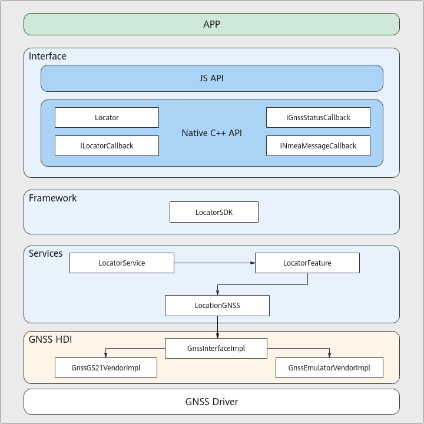
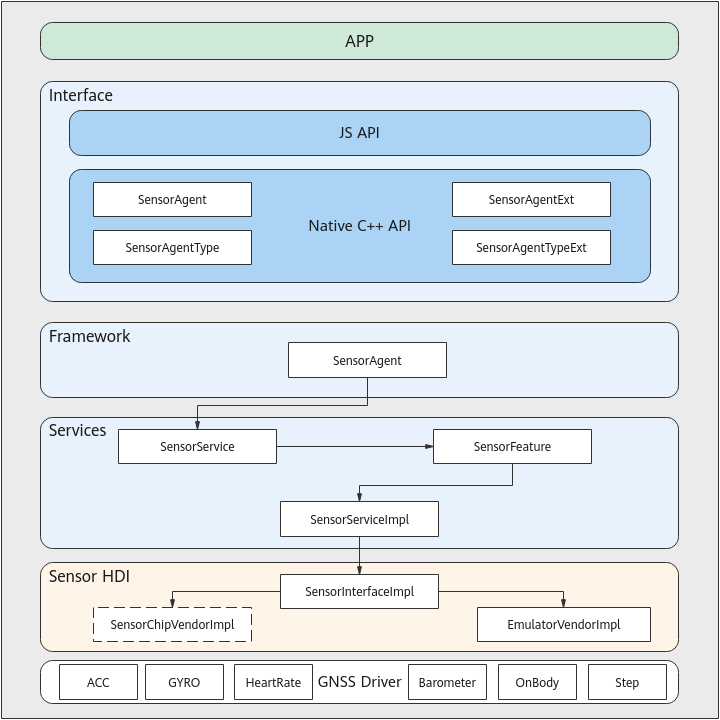
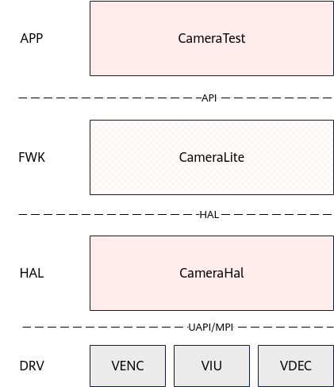
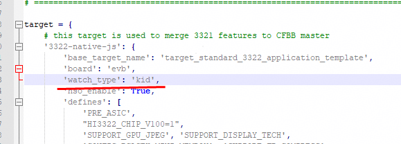

# 前言<a name="ZH-CN_TOPIC_0000002466382480"></a>

**概述<a name="zh-cn_topic_0000002411208016_section4537382116410"></a>**

本文档详细的描述了HiDiTing上Native组件和API接口的使用方法，用于指导用户开发Native组件。

**读者对象<a name="zh-cn_topic_0000002411208016_section4378592816410"></a>**

本文档主要适用于以下工程师：

-   技术支持工程师
-   软件开发工程师

**符号约定<a name="zh-cn_topic_0000002411208016_section133020216410"></a>**

在本文中可能出现下列标志，它们所代表的含义如下。

<a name="zh-cn_topic_0000002411208016_table2622507016410"></a>
<table><thead align="left"><tr id="zh-cn_topic_0000002411208016_row1530720816410"><th class="cellrowborder" valign="top" width="20.580000000000002%" id="mcps1.1.3.1.1"><p id="zh-cn_topic_0000002411208016_p6450074116410"><a name="zh-cn_topic_0000002411208016_p6450074116410"></a><a name="zh-cn_topic_0000002411208016_p6450074116410"></a><strong id="zh-cn_topic_0000002411208016_b2136615816410"><a name="zh-cn_topic_0000002411208016_b2136615816410"></a><a name="zh-cn_topic_0000002411208016_b2136615816410"></a>符号</strong></p>
</th>
<th class="cellrowborder" valign="top" width="79.42%" id="mcps1.1.3.1.2"><p id="zh-cn_topic_0000002411208016_p5435366816410"><a name="zh-cn_topic_0000002411208016_p5435366816410"></a><a name="zh-cn_topic_0000002411208016_p5435366816410"></a><strong id="zh-cn_topic_0000002411208016_b5941558116410"><a name="zh-cn_topic_0000002411208016_b5941558116410"></a><a name="zh-cn_topic_0000002411208016_b5941558116410"></a>说明</strong></p>
</th>
</tr>
</thead>
<tbody><tr id="zh-cn_topic_0000002411208016_row1372280416410"><td class="cellrowborder" valign="top" width="20.580000000000002%" headers="mcps1.1.3.1.1 "><p id="zh-cn_topic_0000002411208016_p3734547016410"><a name="zh-cn_topic_0000002411208016_p3734547016410"></a><a name="zh-cn_topic_0000002411208016_p3734547016410"></a><a name="zh-cn_topic_0000002411208016_image2670064316410"></a><a name="zh-cn_topic_0000002411208016_image2670064316410"></a><span></span></p>
</td>
<td class="cellrowborder" valign="top" width="79.42%" headers="mcps1.1.3.1.2 "><p id="zh-cn_topic_0000002411208016_p1757432116410"><a name="zh-cn_topic_0000002411208016_p1757432116410"></a><a name="zh-cn_topic_0000002411208016_p1757432116410"></a>表示如不避免则将会导致死亡或严重伤害的具有高等级风险的危害。</p>
</td>
</tr>
<tr id="zh-cn_topic_0000002411208016_row466863216410"><td class="cellrowborder" valign="top" width="20.580000000000002%" headers="mcps1.1.3.1.1 "><p id="zh-cn_topic_0000002411208016_p1432579516410"><a name="zh-cn_topic_0000002411208016_p1432579516410"></a><a name="zh-cn_topic_0000002411208016_p1432579516410"></a><a name="zh-cn_topic_0000002411208016_image4895582316410"></a><a name="zh-cn_topic_0000002411208016_image4895582316410"></a><span></span></p>
</td>
<td class="cellrowborder" valign="top" width="79.42%" headers="mcps1.1.3.1.2 "><p id="zh-cn_topic_0000002411208016_p959197916410"><a name="zh-cn_topic_0000002411208016_p959197916410"></a><a name="zh-cn_topic_0000002411208016_p959197916410"></a>表示如不避免则可能导致死亡或严重伤害的具有中等级风险的危害。</p>
</td>
</tr>
<tr id="zh-cn_topic_0000002411208016_row123863216410"><td class="cellrowborder" valign="top" width="20.580000000000002%" headers="mcps1.1.3.1.1 "><p id="zh-cn_topic_0000002411208016_p1232579516410"><a name="zh-cn_topic_0000002411208016_p1232579516410"></a><a name="zh-cn_topic_0000002411208016_p1232579516410"></a><a name="zh-cn_topic_0000002411208016_image1235582316410"></a><a name="zh-cn_topic_0000002411208016_image1235582316410"></a><span></span></p>
</td>
<td class="cellrowborder" valign="top" width="79.42%" headers="mcps1.1.3.1.2 "><p id="zh-cn_topic_0000002411208016_p123197916410"><a name="zh-cn_topic_0000002411208016_p123197916410"></a><a name="zh-cn_topic_0000002411208016_p123197916410"></a>表示如不避免则可能导致轻微或中度伤害的具有低等级风险的危害。</p>
</td>
</tr>
<tr id="zh-cn_topic_0000002411208016_row5786682116410"><td class="cellrowborder" valign="top" width="20.580000000000002%" headers="mcps1.1.3.1.1 "><p id="zh-cn_topic_0000002411208016_p2204984716410"><a name="zh-cn_topic_0000002411208016_p2204984716410"></a><a name="zh-cn_topic_0000002411208016_p2204984716410"></a><a name="zh-cn_topic_0000002411208016_image4504446716410"></a><a name="zh-cn_topic_0000002411208016_image4504446716410"></a><span></span></p>
</td>
<td class="cellrowborder" valign="top" width="79.42%" headers="mcps1.1.3.1.2 "><p id="zh-cn_topic_0000002411208016_p4388861916410"><a name="zh-cn_topic_0000002411208016_p4388861916410"></a><a name="zh-cn_topic_0000002411208016_p4388861916410"></a>用于传递设备或环境安全警示信息。如不避免则可能会导致设备损坏、数据丢失、设备性能降低或其它不可预知的结果。</p>
<p id="zh-cn_topic_0000002411208016_p1238861916410"><a name="zh-cn_topic_0000002411208016_p1238861916410"></a><a name="zh-cn_topic_0000002411208016_p1238861916410"></a>“须知”不涉及人身伤害。</p>
</td>
</tr>
<tr id="zh-cn_topic_0000002411208016_row2856923116410"><td class="cellrowborder" valign="top" width="20.580000000000002%" headers="mcps1.1.3.1.1 "><p id="zh-cn_topic_0000002411208016_p5555360116410"><a name="zh-cn_topic_0000002411208016_p5555360116410"></a><a name="zh-cn_topic_0000002411208016_p5555360116410"></a><a name="zh-cn_topic_0000002411208016_image799324016410"></a><a name="zh-cn_topic_0000002411208016_image799324016410"></a><span></span></p>
</td>
<td class="cellrowborder" valign="top" width="79.42%" headers="mcps1.1.3.1.2 "><p id="zh-cn_topic_0000002411208016_p4612588116410"><a name="zh-cn_topic_0000002411208016_p4612588116410"></a><a name="zh-cn_topic_0000002411208016_p4612588116410"></a>对正文中重点信息的补充说明。</p>
<p id="zh-cn_topic_0000002411208016_p1232588116410"><a name="zh-cn_topic_0000002411208016_p1232588116410"></a><a name="zh-cn_topic_0000002411208016_p1232588116410"></a>“说明”不是安全警示信息，不涉及人身、设备及环境伤害信息。</p>
</td>
</tr>
</tbody>
</table>

# Location组件<a name="ZH-CN_TOPIC_0000002499501449"></a>

-   **[概述](#ZH-CN_TOPIC_0000002466382372)**  

-   **[功能描述](#ZH-CN_TOPIC_0000002499581337)**  

-   **[Native API参考](#ZH-CN_TOPIC_0000002499501393)**  

-   **[数据结构](#ZH-CN_TOPIC_0000002499581409)**  

-   **[错误码](#ZH-CN_TOPIC_0000002466382412)**  

-   **[GNSS套片对接说明](#ZH-CN_TOPIC_0000002466542076)**  

-   **[开发指导](#ZH-CN_TOPIC_0000002466382460)**  

## 概述<a name="ZH-CN_TOPIC_0000002466382372"></a>

位置服务（LBS，Location Based Services）又称定位服务，位置能力用于确定用户设备在哪里，系统使用位置坐标标示用户设备的位置，并使用多种定位技术提供位置服务，如GNSS定位、基站定位、WLAN/蓝牙定位（基站定位、WLAN/蓝牙定位统称“网络定位技术”）。通过这些定位技术，无论用户设备在室内或是户外，都可以准确地确定用户设备的位置。本组件暂时仅支持GNSS定位。

## 功能描述<a name="ZH-CN_TOPIC_0000002499581337"></a>

定位子系统如[图1](#zh-cn_topic_0000002411048200_fig5812549185819)所示，主要包括定位接口、定位框架、定位HDI等，对应用提供基本的定位管理以及定位API能力，构建基于轻量OS的定位服务框架，提供硬件资源较小的物联网设备的定位能力。

**图 1**  定位子系统架构图<a name="zh-cn_topic_0000002411048200_fig5812549185819"></a>  


定位子系统分层实现，主要由4个层次组成：Interface（接口）、Framework（框架）、Services（服务）、GNSS HDI（硬件抽象）。

-   Interface接口层提供外部使用的C++/JS API ，负责为位置服务提供外部能力，主要提供位置服务的开启和关闭能力、位置服务的状态订阅能力、GNSS的定位信息上报、卫星信息上报能力、NMEA信息上报能力。
-   Framework框架层实现Interface接口，向下对接Locator Service，对上提供定位能力。
-   Services服务层对接SamgrLite，实现定位子系统的服务化，向上提供LocatorSDK的定位能力，管理GNSS定位；向下对接GNSS硬件抽象层，负责核心的位置服务的业务逻辑管理，如定位请求管理、位置上报管理、定位能力管理等。
-   GNSS硬件抽象层屏蔽硬件差异，负责硬件驱动对接管理，包括和
-   对接的GnssGS21VendorImpl以及模拟驱动GnssEmulatorVendorImpl。

## Native API参考<a name="ZH-CN_TOPIC_0000002499501393"></a>

-   **[Locator类](#ZH-CN_TOPIC_0000002499581493)**  

-   **[ILocatorCallback类](#ZH-CN_TOPIC_0000002499501329)**  

-   **[IGnssStatusCallback类](#ZH-CN_TOPIC_0000002499581457)**  

-   **[INmeaMessageCallback类](#ZH-CN_TOPIC_0000002466542116)**  

### Locator类<a name="ZH-CN_TOPIC_0000002499581493"></a>

Locator模块主要提供获取定位服务使能状态、使能/去使能定位服务、启动/停止定位、订阅/取消订阅GNSS状态回调函数、订阅/取消订阅NMEA消息回调函数等功能。提供以下API：

-   GetInstance：获取Locator实例（单例模式）。
-   IsLocationEnabled：查询定位服务是否使能。
-   EnableAbility：使能/去使能定位服务。
-   StartLocating：启动定位。
-   StopLocating：停止定位。
-   RegisterGnssStatusCallback：订阅GNSS状态回调函数。
-   UnregisterGnssStatusCallback：取消订阅GNSS状态回调函数。
-   RegisterNmeaMessageCallback：订阅NMEA消息回调函数。
-   UnregisterNmeaMessageCallback：取消订阅NMEA消息回调函数。
-   QuerySupportCoordinateSystemType：查询支持的坐标系。
-   IsLocationPrivacyConfirmed：查询用户是否同意定位服务隐私申明，是否同意启用定位服务。
-   SetLocationPrivacyConfirmStatus：设置用户确认定位服务隐私申明的状态，记录用户是否同意启用定位服务。
-   SendCommand：向定位子系统发送扩展命令。

-   **[GetInstance](#ZH-CN_TOPIC_0000002466542012)**  

-   **[IsLocationEnabled](#ZH-CN_TOPIC_0000002499501421)**  

-   **[EnableAbility](#ZH-CN_TOPIC_0000002499581401)**  

-   **[StartLocating](#ZH-CN_TOPIC_0000002499501445)**  

-   **[StopLocating](#ZH-CN_TOPIC_0000002499501409)**  

-   **[RegisterGnssStatusCallback](#ZH-CN_TOPIC_0000002466382340)**  

-   **[UnregisterGnssStatusCallback](#ZH-CN_TOPIC_0000002466542020)**  

-   **[RegisterNmeaMessageCallback](#ZH-CN_TOPIC_0000002499581469)**  

-   **[UnregisterNmeaMessageCallback](#ZH-CN_TOPIC_0000002466382420)**  

-   **[QuerySupportCoordinateSystemType](#ZH-CN_TOPIC_0000002499501377)**  

-   **[IsLocationPrivacyConfirmed](#ZH-CN_TOPIC_0000002466542060)**  

-   **[SetLocationPrivacyConfirmStatus](#ZH-CN_TOPIC_0000002499581449)**  

-   **[SendCommand](#ZH-CN_TOPIC_0000002466541984)**  

#### GetInstance<a name="ZH-CN_TOPIC_0000002466542012"></a>

【描述】

获取Locator实例。

【语法】

static Locator &GetInstance\(\);

【参数】

无

【返回值】

<a name="zh-cn_topic_0000002411048072_table333mcpsimp"></a>
<table><thead align="left"><tr id="zh-cn_topic_0000002411048072_row338mcpsimp"><th class="cellrowborder" valign="top" width="52%" id="mcps1.1.3.1.1"><p id="zh-cn_topic_0000002411048072_p340mcpsimp"><a name="zh-cn_topic_0000002411048072_p340mcpsimp"></a><a name="zh-cn_topic_0000002411048072_p340mcpsimp"></a>返回值</p>
</th>
<th class="cellrowborder" valign="top" width="48%" id="mcps1.1.3.1.2"><p id="zh-cn_topic_0000002411048072_p342mcpsimp"><a name="zh-cn_topic_0000002411048072_p342mcpsimp"></a><a name="zh-cn_topic_0000002411048072_p342mcpsimp"></a>描述</p>
</th>
</tr>
</thead>
<tbody><tr id="zh-cn_topic_0000002411048072_row344mcpsimp"><td class="cellrowborder" valign="top" width="52%" headers="mcps1.1.3.1.1 "><p id="zh-cn_topic_0000002411048072_p346mcpsimp"><a name="zh-cn_topic_0000002411048072_p346mcpsimp"></a><a name="zh-cn_topic_0000002411048072_p346mcpsimp"></a>Locator &</p>
</td>
<td class="cellrowborder" valign="top" width="48%" headers="mcps1.1.3.1.2 "><p id="zh-cn_topic_0000002411048072_p348mcpsimp"><a name="zh-cn_topic_0000002411048072_p348mcpsimp"></a><a name="zh-cn_topic_0000002411048072_p348mcpsimp"></a>获取Locator实例，单例模式。</p>
</td>
</tr>
</tbody>
</table>

【芯片差异】

无。

【注意】

无。

【举例】

具体示例内容请参见“[开发指导](#ZH-CN_TOPIC_0000002466382460)”章节。

【相关主题】

无。

#### IsLocationEnabled<a name="ZH-CN_TOPIC_0000002499501421"></a>

【描述】

查询定位服务是否使能。

【语法】

LocationErrCode IsLocationEnabled\(bool &isEnabled\);

【参数】

<a name="zh-cn_topic_0000002444647189_table437mcpsimp"></a>
<table><thead align="left"><tr id="zh-cn_topic_0000002444647189_row443mcpsimp"><th class="cellrowborder" valign="top" width="28.999999999999996%" id="mcps1.1.4.1.1"><p id="zh-cn_topic_0000002444647189_p445mcpsimp"><a name="zh-cn_topic_0000002444647189_p445mcpsimp"></a><a name="zh-cn_topic_0000002444647189_p445mcpsimp"></a>参数名称</p>
</th>
<th class="cellrowborder" valign="top" width="45.56%" id="mcps1.1.4.1.2"><p id="zh-cn_topic_0000002444647189_p447mcpsimp"><a name="zh-cn_topic_0000002444647189_p447mcpsimp"></a><a name="zh-cn_topic_0000002444647189_p447mcpsimp"></a>描述</p>
</th>
<th class="cellrowborder" valign="top" width="25.44%" id="mcps1.1.4.1.3"><p id="zh-cn_topic_0000002444647189_p449mcpsimp"><a name="zh-cn_topic_0000002444647189_p449mcpsimp"></a><a name="zh-cn_topic_0000002444647189_p449mcpsimp"></a>输入/输出</p>
</th>
</tr>
</thead>
<tbody><tr id="zh-cn_topic_0000002444647189_row450mcpsimp"><td class="cellrowborder" valign="top" width="28.999999999999996%" headers="mcps1.1.4.1.1 "><p id="zh-cn_topic_0000002444647189_p452mcpsimp"><a name="zh-cn_topic_0000002444647189_p452mcpsimp"></a><a name="zh-cn_topic_0000002444647189_p452mcpsimp"></a>isEnabled</p>
</td>
<td class="cellrowborder" valign="top" width="45.56%" headers="mcps1.1.4.1.2 "><p id="zh-cn_topic_0000002444647189_p454mcpsimp"><a name="zh-cn_topic_0000002444647189_p454mcpsimp"></a><a name="zh-cn_topic_0000002444647189_p454mcpsimp"></a>是否使能。</p>
</td>
<td class="cellrowborder" valign="top" width="25.44%" headers="mcps1.1.4.1.3 "><p id="zh-cn_topic_0000002444647189_p456mcpsimp"><a name="zh-cn_topic_0000002444647189_p456mcpsimp"></a><a name="zh-cn_topic_0000002444647189_p456mcpsimp"></a>输出</p>
</td>
</tr>
</tbody>
</table>

【返回值】

<a name="zh-cn_topic_0000002444647189_table333mcpsimp"></a>
<table><thead align="left"><tr id="zh-cn_topic_0000002444647189_row338mcpsimp"><th class="cellrowborder" valign="top" width="52%" id="mcps1.1.3.1.1"><p id="zh-cn_topic_0000002444647189_p340mcpsimp"><a name="zh-cn_topic_0000002444647189_p340mcpsimp"></a><a name="zh-cn_topic_0000002444647189_p340mcpsimp"></a>返回值</p>
</th>
<th class="cellrowborder" valign="top" width="48%" id="mcps1.1.3.1.2"><p id="zh-cn_topic_0000002444647189_p342mcpsimp"><a name="zh-cn_topic_0000002444647189_p342mcpsimp"></a><a name="zh-cn_topic_0000002444647189_p342mcpsimp"></a>描述</p>
</th>
</tr>
</thead>
<tbody><tr id="zh-cn_topic_0000002444647189_row344mcpsimp"><td class="cellrowborder" valign="top" width="52%" headers="mcps1.1.3.1.1 "><p id="zh-cn_topic_0000002444647189_p154681320892"><a name="zh-cn_topic_0000002444647189_p154681320892"></a><a name="zh-cn_topic_0000002444647189_p154681320892"></a>LocationErrCode</p>
</td>
<td class="cellrowborder" valign="top" width="48%" headers="mcps1.1.3.1.2 "><p id="zh-cn_topic_0000002444647189_p348mcpsimp"><a name="zh-cn_topic_0000002444647189_p348mcpsimp"></a><a name="zh-cn_topic_0000002444647189_p348mcpsimp"></a>参考“<a href="#ZH-CN_TOPIC_0000002466382412">错误码</a>”章节说明。</p>
</td>
</tr>
</tbody>
</table>

【芯片差异】

无。

【注意】

无。

【举例】

具体示例内容请参见“[开发指导](#ZH-CN_TOPIC_0000002466382460)”章节。

【相关主题】

无。

#### EnableAbility<a name="ZH-CN_TOPIC_0000002499581401"></a>

【描述】

使能定位服务。

【语法】

LocationErrCode EnableAbility\(bool enable\);

【参数】

<a name="zh-cn_topic_0000002444647209_table437mcpsimp"></a>
<table><thead align="left"><tr id="zh-cn_topic_0000002444647209_row443mcpsimp"><th class="cellrowborder" valign="top" width="28.999999999999996%" id="mcps1.1.4.1.1"><p id="zh-cn_topic_0000002444647209_p445mcpsimp"><a name="zh-cn_topic_0000002444647209_p445mcpsimp"></a><a name="zh-cn_topic_0000002444647209_p445mcpsimp"></a>参数名称</p>
</th>
<th class="cellrowborder" valign="top" width="45.56%" id="mcps1.1.4.1.2"><p id="zh-cn_topic_0000002444647209_p447mcpsimp"><a name="zh-cn_topic_0000002444647209_p447mcpsimp"></a><a name="zh-cn_topic_0000002444647209_p447mcpsimp"></a>描述</p>
</th>
<th class="cellrowborder" valign="top" width="25.44%" id="mcps1.1.4.1.3"><p id="zh-cn_topic_0000002444647209_p449mcpsimp"><a name="zh-cn_topic_0000002444647209_p449mcpsimp"></a><a name="zh-cn_topic_0000002444647209_p449mcpsimp"></a>输入/输出</p>
</th>
</tr>
</thead>
<tbody><tr id="zh-cn_topic_0000002444647209_row450mcpsimp"><td class="cellrowborder" valign="top" width="28.999999999999996%" headers="mcps1.1.4.1.1 "><p id="zh-cn_topic_0000002444647209_p452mcpsimp"><a name="zh-cn_topic_0000002444647209_p452mcpsimp"></a><a name="zh-cn_topic_0000002444647209_p452mcpsimp"></a>enable</p>
</td>
<td class="cellrowborder" valign="top" width="45.56%" headers="mcps1.1.4.1.2 "><p id="zh-cn_topic_0000002444647209_p454mcpsimp"><a name="zh-cn_topic_0000002444647209_p454mcpsimp"></a><a name="zh-cn_topic_0000002444647209_p454mcpsimp"></a>true：使能定位服务。</p>
<p id="zh-cn_topic_0000002444647209_p1243114108174"><a name="zh-cn_topic_0000002444647209_p1243114108174"></a><a name="zh-cn_topic_0000002444647209_p1243114108174"></a>false：去使能定位服务。</p>
</td>
<td class="cellrowborder" valign="top" width="25.44%" headers="mcps1.1.4.1.3 "><p id="zh-cn_topic_0000002444647209_p456mcpsimp"><a name="zh-cn_topic_0000002444647209_p456mcpsimp"></a><a name="zh-cn_topic_0000002444647209_p456mcpsimp"></a>输入</p>
</td>
</tr>
</tbody>
</table>

【返回值】

<a name="zh-cn_topic_0000002444647209_table333mcpsimp"></a>
<table><thead align="left"><tr id="zh-cn_topic_0000002444647209_row338mcpsimp"><th class="cellrowborder" valign="top" width="52%" id="mcps1.1.3.1.1"><p id="zh-cn_topic_0000002444647209_p340mcpsimp"><a name="zh-cn_topic_0000002444647209_p340mcpsimp"></a><a name="zh-cn_topic_0000002444647209_p340mcpsimp"></a>返回值</p>
</th>
<th class="cellrowborder" valign="top" width="48%" id="mcps1.1.3.1.2"><p id="zh-cn_topic_0000002444647209_p342mcpsimp"><a name="zh-cn_topic_0000002444647209_p342mcpsimp"></a><a name="zh-cn_topic_0000002444647209_p342mcpsimp"></a>描述</p>
</th>
</tr>
</thead>
<tbody><tr id="zh-cn_topic_0000002444647209_row344mcpsimp"><td class="cellrowborder" valign="top" width="52%" headers="mcps1.1.3.1.1 "><p id="zh-cn_topic_0000002444647209_p154681320892"><a name="zh-cn_topic_0000002444647209_p154681320892"></a><a name="zh-cn_topic_0000002444647209_p154681320892"></a>LocationErrCode</p>
</td>
<td class="cellrowborder" valign="top" width="48%" headers="mcps1.1.3.1.2 "><p id="zh-cn_topic_0000002444647209_p348mcpsimp"><a name="zh-cn_topic_0000002444647209_p348mcpsimp"></a><a name="zh-cn_topic_0000002444647209_p348mcpsimp"></a>参考“<a href="#ZH-CN_TOPIC_0000002466382412">错误码</a>”章节说明。</p>
</td>
</tr>
</tbody>
</table>

【芯片差异】

无。

【注意】

去使能需要在使能接口调用成功之后调用。

【举例】

具体示例内容请参见“[开发指导](#ZH-CN_TOPIC_0000002466382460)”章节。

【相关主题】

无。

#### StartLocating<a name="ZH-CN_TOPIC_0000002499501445"></a>

【描述】

启动定位服务。

【语法】

LocationErrCode StartLocating\(const RequestConfig \*requestConfig, ILocatorCallback \*callback\);

【参数】

<a name="zh-cn_topic_0000002411207944_table437mcpsimp"></a>
<table><thead align="left"><tr id="zh-cn_topic_0000002411207944_row443mcpsimp"><th class="cellrowborder" valign="top" width="28.999999999999996%" id="mcps1.1.4.1.1"><p id="zh-cn_topic_0000002411207944_p445mcpsimp"><a name="zh-cn_topic_0000002411207944_p445mcpsimp"></a><a name="zh-cn_topic_0000002411207944_p445mcpsimp"></a>参数名称</p>
</th>
<th class="cellrowborder" valign="top" width="45.56%" id="mcps1.1.4.1.2"><p id="zh-cn_topic_0000002411207944_p447mcpsimp"><a name="zh-cn_topic_0000002411207944_p447mcpsimp"></a><a name="zh-cn_topic_0000002411207944_p447mcpsimp"></a>描述</p>
</th>
<th class="cellrowborder" valign="top" width="25.44%" id="mcps1.1.4.1.3"><p id="zh-cn_topic_0000002411207944_p449mcpsimp"><a name="zh-cn_topic_0000002411207944_p449mcpsimp"></a><a name="zh-cn_topic_0000002411207944_p449mcpsimp"></a>输入/输出</p>
</th>
</tr>
</thead>
<tbody><tr id="zh-cn_topic_0000002411207944_row450mcpsimp"><td class="cellrowborder" valign="top" width="28.999999999999996%" headers="mcps1.1.4.1.1 "><p id="zh-cn_topic_0000002411207944_p452mcpsimp"><a name="zh-cn_topic_0000002411207944_p452mcpsimp"></a><a name="zh-cn_topic_0000002411207944_p452mcpsimp"></a>requestConfig</p>
</td>
<td class="cellrowborder" valign="top" width="45.56%" headers="mcps1.1.4.1.2 "><p id="zh-cn_topic_0000002411207944_p1243114108174"><a name="zh-cn_topic_0000002411207944_p1243114108174"></a><a name="zh-cn_topic_0000002411207944_p1243114108174"></a>启动定位的请求配置。</p>
</td>
<td class="cellrowborder" valign="top" width="25.44%" headers="mcps1.1.4.1.3 "><p id="zh-cn_topic_0000002411207944_p456mcpsimp"><a name="zh-cn_topic_0000002411207944_p456mcpsimp"></a><a name="zh-cn_topic_0000002411207944_p456mcpsimp"></a>输入</p>
</td>
</tr>
<tr id="zh-cn_topic_0000002411207944_row78591543201"><td class="cellrowborder" valign="top" width="28.999999999999996%" headers="mcps1.1.4.1.1 "><p id="zh-cn_topic_0000002411207944_p1786065416202"><a name="zh-cn_topic_0000002411207944_p1786065416202"></a><a name="zh-cn_topic_0000002411207944_p1786065416202"></a>callback</p>
</td>
<td class="cellrowborder" valign="top" width="45.56%" headers="mcps1.1.4.1.2 "><p id="zh-cn_topic_0000002411207944_p6860145414208"><a name="zh-cn_topic_0000002411207944_p6860145414208"></a><a name="zh-cn_topic_0000002411207944_p6860145414208"></a>定位服务状态回调。</p>
</td>
<td class="cellrowborder" valign="top" width="25.44%" headers="mcps1.1.4.1.3 "><p id="zh-cn_topic_0000002411207944_p19860054192019"><a name="zh-cn_topic_0000002411207944_p19860054192019"></a><a name="zh-cn_topic_0000002411207944_p19860054192019"></a>输入</p>
</td>
</tr>
</tbody>
</table>

【返回值】

<a name="zh-cn_topic_0000002411207944_table333mcpsimp"></a>
<table><thead align="left"><tr id="zh-cn_topic_0000002411207944_row338mcpsimp"><th class="cellrowborder" valign="top" width="52%" id="mcps1.1.3.1.1"><p id="zh-cn_topic_0000002411207944_p340mcpsimp"><a name="zh-cn_topic_0000002411207944_p340mcpsimp"></a><a name="zh-cn_topic_0000002411207944_p340mcpsimp"></a>返回值</p>
</th>
<th class="cellrowborder" valign="top" width="48%" id="mcps1.1.3.1.2"><p id="zh-cn_topic_0000002411207944_p342mcpsimp"><a name="zh-cn_topic_0000002411207944_p342mcpsimp"></a><a name="zh-cn_topic_0000002411207944_p342mcpsimp"></a>描述</p>
</th>
</tr>
</thead>
<tbody><tr id="zh-cn_topic_0000002411207944_row344mcpsimp"><td class="cellrowborder" valign="top" width="52%" headers="mcps1.1.3.1.1 "><p id="zh-cn_topic_0000002411207944_p154681320892"><a name="zh-cn_topic_0000002411207944_p154681320892"></a><a name="zh-cn_topic_0000002411207944_p154681320892"></a>LocationErrCode</p>
</td>
<td class="cellrowborder" valign="top" width="48%" headers="mcps1.1.3.1.2 "><p id="zh-cn_topic_0000002411207944_p348mcpsimp"><a name="zh-cn_topic_0000002411207944_p348mcpsimp"></a><a name="zh-cn_topic_0000002411207944_p348mcpsimp"></a>参考“<a href="#ZH-CN_TOPIC_0000002466382412">错误码</a>”章节说明。</p>
</td>
</tr>
</tbody>
</table>

【芯片差异】

无。

【注意】

必须在[EnableAbility](#ZH-CN_TOPIC_0000002499581401)使能定位服务接口调用成功之后。

【举例】

具体示例内容请参见“[开发指导](#ZH-CN_TOPIC_0000002466382460)”章节。

【相关主题】

无。

#### StopLocating<a name="ZH-CN_TOPIC_0000002499501409"></a>

【描述】

停止定位服务。

【语法】

LocationErrCode StopLocating\(ILocatorCallback \*callback\);

【参数】

<a name="zh-cn_topic_0000002444647121_table437mcpsimp"></a>
<table><thead align="left"><tr id="zh-cn_topic_0000002444647121_row443mcpsimp"><th class="cellrowborder" valign="top" width="28.999999999999996%" id="mcps1.1.4.1.1"><p id="zh-cn_topic_0000002444647121_p445mcpsimp"><a name="zh-cn_topic_0000002444647121_p445mcpsimp"></a><a name="zh-cn_topic_0000002444647121_p445mcpsimp"></a>参数名称</p>
</th>
<th class="cellrowborder" valign="top" width="45.56%" id="mcps1.1.4.1.2"><p id="zh-cn_topic_0000002444647121_p447mcpsimp"><a name="zh-cn_topic_0000002444647121_p447mcpsimp"></a><a name="zh-cn_topic_0000002444647121_p447mcpsimp"></a>描述</p>
</th>
<th class="cellrowborder" valign="top" width="25.44%" id="mcps1.1.4.1.3"><p id="zh-cn_topic_0000002444647121_p449mcpsimp"><a name="zh-cn_topic_0000002444647121_p449mcpsimp"></a><a name="zh-cn_topic_0000002444647121_p449mcpsimp"></a>输入/输出</p>
</th>
</tr>
</thead>
<tbody><tr id="zh-cn_topic_0000002444647121_row78591543201"><td class="cellrowborder" valign="top" width="28.999999999999996%" headers="mcps1.1.4.1.1 "><p id="zh-cn_topic_0000002444647121_p1786065416202"><a name="zh-cn_topic_0000002444647121_p1786065416202"></a><a name="zh-cn_topic_0000002444647121_p1786065416202"></a>callback</p>
</td>
<td class="cellrowborder" valign="top" width="45.56%" headers="mcps1.1.4.1.2 "><p id="zh-cn_topic_0000002444647121_p6860145414208"><a name="zh-cn_topic_0000002444647121_p6860145414208"></a><a name="zh-cn_topic_0000002444647121_p6860145414208"></a>定位服务状态回调。</p>
</td>
<td class="cellrowborder" valign="top" width="25.44%" headers="mcps1.1.4.1.3 "><p id="zh-cn_topic_0000002444647121_p19860054192019"><a name="zh-cn_topic_0000002444647121_p19860054192019"></a><a name="zh-cn_topic_0000002444647121_p19860054192019"></a>输入</p>
</td>
</tr>
</tbody>
</table>

【返回值】

<a name="zh-cn_topic_0000002444647121_table333mcpsimp"></a>
<table><thead align="left"><tr id="zh-cn_topic_0000002444647121_row338mcpsimp"><th class="cellrowborder" valign="top" width="52%" id="mcps1.1.3.1.1"><p id="zh-cn_topic_0000002444647121_p340mcpsimp"><a name="zh-cn_topic_0000002444647121_p340mcpsimp"></a><a name="zh-cn_topic_0000002444647121_p340mcpsimp"></a>返回值</p>
</th>
<th class="cellrowborder" valign="top" width="48%" id="mcps1.1.3.1.2"><p id="zh-cn_topic_0000002444647121_p342mcpsimp"><a name="zh-cn_topic_0000002444647121_p342mcpsimp"></a><a name="zh-cn_topic_0000002444647121_p342mcpsimp"></a>描述</p>
</th>
</tr>
</thead>
<tbody><tr id="zh-cn_topic_0000002444647121_row344mcpsimp"><td class="cellrowborder" valign="top" width="52%" headers="mcps1.1.3.1.1 "><p id="zh-cn_topic_0000002444647121_p154681320892"><a name="zh-cn_topic_0000002444647121_p154681320892"></a><a name="zh-cn_topic_0000002444647121_p154681320892"></a>LocationErrCode</p>
</td>
<td class="cellrowborder" valign="top" width="48%" headers="mcps1.1.3.1.2 "><p id="zh-cn_topic_0000002444647121_p348mcpsimp"><a name="zh-cn_topic_0000002444647121_p348mcpsimp"></a><a name="zh-cn_topic_0000002444647121_p348mcpsimp"></a>参考“<a href="#ZH-CN_TOPIC_0000002466382412">错误码</a>”章节说明。</p>
</td>
</tr>
</tbody>
</table>

【芯片差异】

无。

【注意】

1.  必须在“[EnableAbility](#ZH-CN_TOPIC_0000002499581401)”使能定位服务接口调用成功之后。
2.  必须在“[StartLocating](#ZH-CN_TOPIC_0000002499501445)”启动定位服务接口调用成功之后。

【举例】

具体示例内容请参见“[开发指导](#ZH-CN_TOPIC_0000002466382460)”章节。

【相关主题】

无。

#### RegisterGnssStatusCallback<a name="ZH-CN_TOPIC_0000002466382340"></a>

【描述】

订阅GNSS状态回调函数。

【语法】

LocationErrCode RegisterGnssStatusCallback\(IGnssStatusCallback \*callback\);

【参数】

<a name="zh-cn_topic_0000002411207996_table437mcpsimp"></a>
<table><thead align="left"><tr id="zh-cn_topic_0000002411207996_row443mcpsimp"><th class="cellrowborder" valign="top" width="28.999999999999996%" id="mcps1.1.4.1.1"><p id="zh-cn_topic_0000002411207996_p445mcpsimp"><a name="zh-cn_topic_0000002411207996_p445mcpsimp"></a><a name="zh-cn_topic_0000002411207996_p445mcpsimp"></a>参数名称</p>
</th>
<th class="cellrowborder" valign="top" width="45.56%" id="mcps1.1.4.1.2"><p id="zh-cn_topic_0000002411207996_p447mcpsimp"><a name="zh-cn_topic_0000002411207996_p447mcpsimp"></a><a name="zh-cn_topic_0000002411207996_p447mcpsimp"></a>描述</p>
</th>
<th class="cellrowborder" valign="top" width="25.44%" id="mcps1.1.4.1.3"><p id="zh-cn_topic_0000002411207996_p449mcpsimp"><a name="zh-cn_topic_0000002411207996_p449mcpsimp"></a><a name="zh-cn_topic_0000002411207996_p449mcpsimp"></a>输入/输出</p>
</th>
</tr>
</thead>
<tbody><tr id="zh-cn_topic_0000002411207996_row78591543201"><td class="cellrowborder" valign="top" width="28.999999999999996%" headers="mcps1.1.4.1.1 "><p id="zh-cn_topic_0000002411207996_p1786065416202"><a name="zh-cn_topic_0000002411207996_p1786065416202"></a><a name="zh-cn_topic_0000002411207996_p1786065416202"></a>callback</p>
</td>
<td class="cellrowborder" valign="top" width="45.56%" headers="mcps1.1.4.1.2 "><p id="zh-cn_topic_0000002411207996_p6860145414208"><a name="zh-cn_topic_0000002411207996_p6860145414208"></a><a name="zh-cn_topic_0000002411207996_p6860145414208"></a>GNSS状态回调函数。</p>
</td>
<td class="cellrowborder" valign="top" width="25.44%" headers="mcps1.1.4.1.3 "><p id="zh-cn_topic_0000002411207996_p19860054192019"><a name="zh-cn_topic_0000002411207996_p19860054192019"></a><a name="zh-cn_topic_0000002411207996_p19860054192019"></a>输入</p>
</td>
</tr>
</tbody>
</table>

【返回值】

<a name="zh-cn_topic_0000002411207996_table333mcpsimp"></a>
<table><thead align="left"><tr id="zh-cn_topic_0000002411207996_row338mcpsimp"><th class="cellrowborder" valign="top" width="52%" id="mcps1.1.3.1.1"><p id="zh-cn_topic_0000002411207996_p340mcpsimp"><a name="zh-cn_topic_0000002411207996_p340mcpsimp"></a><a name="zh-cn_topic_0000002411207996_p340mcpsimp"></a>返回值</p>
</th>
<th class="cellrowborder" valign="top" width="48%" id="mcps1.1.3.1.2"><p id="zh-cn_topic_0000002411207996_p342mcpsimp"><a name="zh-cn_topic_0000002411207996_p342mcpsimp"></a><a name="zh-cn_topic_0000002411207996_p342mcpsimp"></a>描述</p>
</th>
</tr>
</thead>
<tbody><tr id="zh-cn_topic_0000002411207996_row344mcpsimp"><td class="cellrowborder" valign="top" width="52%" headers="mcps1.1.3.1.1 "><p id="zh-cn_topic_0000002411207996_p154681320892"><a name="zh-cn_topic_0000002411207996_p154681320892"></a><a name="zh-cn_topic_0000002411207996_p154681320892"></a>LocationErrCode</p>
</td>
<td class="cellrowborder" valign="top" width="48%" headers="mcps1.1.3.1.2 "><p id="zh-cn_topic_0000002411207996_p348mcpsimp"><a name="zh-cn_topic_0000002411207996_p348mcpsimp"></a><a name="zh-cn_topic_0000002411207996_p348mcpsimp"></a>参考“<a href="#ZH-CN_TOPIC_0000002466382412">错误码</a>”章节说明。</p>
</td>
</tr>
</tbody>
</table>

【芯片差异】

无。

【注意】

1.  必须在“[EnableAbility](#ZH-CN_TOPIC_0000002499581401)”使能定位服务接口调用成功之后。
2.  必须在“[StartLocating](#ZH-CN_TOPIC_0000002499501445)”启动定位服务之前。

【举例】

具体示例内容请参见“[开发指导](#ZH-CN_TOPIC_0000002466382460)”章节。

【相关主题】

无。

#### UnregisterGnssStatusCallback<a name="ZH-CN_TOPIC_0000002466542020"></a>

【描述】

取消订阅GNSS状态回调函数。

【语法】

LocationErrCode UnregisterGnssStatusCallback\(IGnssStatusCallback \*callback\);

【参数】

<a name="zh-cn_topic_0000002411048188_table437mcpsimp"></a>
<table><thead align="left"><tr id="zh-cn_topic_0000002411048188_row443mcpsimp"><th class="cellrowborder" valign="top" width="28.999999999999996%" id="mcps1.1.4.1.1"><p id="zh-cn_topic_0000002411048188_p445mcpsimp"><a name="zh-cn_topic_0000002411048188_p445mcpsimp"></a><a name="zh-cn_topic_0000002411048188_p445mcpsimp"></a>参数名称</p>
</th>
<th class="cellrowborder" valign="top" width="45.56%" id="mcps1.1.4.1.2"><p id="zh-cn_topic_0000002411048188_p447mcpsimp"><a name="zh-cn_topic_0000002411048188_p447mcpsimp"></a><a name="zh-cn_topic_0000002411048188_p447mcpsimp"></a>描述</p>
</th>
<th class="cellrowborder" valign="top" width="25.44%" id="mcps1.1.4.1.3"><p id="zh-cn_topic_0000002411048188_p449mcpsimp"><a name="zh-cn_topic_0000002411048188_p449mcpsimp"></a><a name="zh-cn_topic_0000002411048188_p449mcpsimp"></a>输入/输出</p>
</th>
</tr>
</thead>
<tbody><tr id="zh-cn_topic_0000002411048188_row78591543201"><td class="cellrowborder" valign="top" width="28.999999999999996%" headers="mcps1.1.4.1.1 "><p id="zh-cn_topic_0000002411048188_p1786065416202"><a name="zh-cn_topic_0000002411048188_p1786065416202"></a><a name="zh-cn_topic_0000002411048188_p1786065416202"></a>callback</p>
</td>
<td class="cellrowborder" valign="top" width="45.56%" headers="mcps1.1.4.1.2 "><p id="zh-cn_topic_0000002411048188_p6860145414208"><a name="zh-cn_topic_0000002411048188_p6860145414208"></a><a name="zh-cn_topic_0000002411048188_p6860145414208"></a>GNSS状态回调函数。</p>
</td>
<td class="cellrowborder" valign="top" width="25.44%" headers="mcps1.1.4.1.3 "><p id="zh-cn_topic_0000002411048188_p19860054192019"><a name="zh-cn_topic_0000002411048188_p19860054192019"></a><a name="zh-cn_topic_0000002411048188_p19860054192019"></a>输入</p>
</td>
</tr>
</tbody>
</table>

【返回值】

<a name="zh-cn_topic_0000002411048188_table333mcpsimp"></a>
<table><thead align="left"><tr id="zh-cn_topic_0000002411048188_row338mcpsimp"><th class="cellrowborder" valign="top" width="52%" id="mcps1.1.3.1.1"><p id="zh-cn_topic_0000002411048188_p340mcpsimp"><a name="zh-cn_topic_0000002411048188_p340mcpsimp"></a><a name="zh-cn_topic_0000002411048188_p340mcpsimp"></a>返回值</p>
</th>
<th class="cellrowborder" valign="top" width="48%" id="mcps1.1.3.1.2"><p id="zh-cn_topic_0000002411048188_p342mcpsimp"><a name="zh-cn_topic_0000002411048188_p342mcpsimp"></a><a name="zh-cn_topic_0000002411048188_p342mcpsimp"></a>描述</p>
</th>
</tr>
</thead>
<tbody><tr id="zh-cn_topic_0000002411048188_row344mcpsimp"><td class="cellrowborder" valign="top" width="52%" headers="mcps1.1.3.1.1 "><p id="zh-cn_topic_0000002411048188_p154681320892"><a name="zh-cn_topic_0000002411048188_p154681320892"></a><a name="zh-cn_topic_0000002411048188_p154681320892"></a>LocationErrCode</p>
</td>
<td class="cellrowborder" valign="top" width="48%" headers="mcps1.1.3.1.2 "><p id="zh-cn_topic_0000002411048188_p348mcpsimp"><a name="zh-cn_topic_0000002411048188_p348mcpsimp"></a><a name="zh-cn_topic_0000002411048188_p348mcpsimp"></a>参考“<a href="#ZH-CN_TOPIC_0000002466382412">错误码</a>”章节说明。</p>
</td>
</tr>
</tbody>
</table>

【芯片差异】

无。

【注意】

1.  必须在“[EnableAbility](#ZH-CN_TOPIC_0000002499581401)”使能定位服务接口调用成功之后。
2.  必须在“[RegisterGnssStatusCallback](#ZH-CN_TOPIC_0000002466382340)”订阅GNSS状态回调成功之后。

【举例】

具体示例内容请参见“[开发指导](#ZH-CN_TOPIC_0000002466382460)”章节。

【相关主题】

无。

#### RegisterNmeaMessageCallback<a name="ZH-CN_TOPIC_0000002499581469"></a>

【描述】

订阅NMEA消息回调函数。

【语法】

LocationErrCode RegisterNmeaMessageCallback\(INmeaMessageCallback \*callback\);

【参数】

<a name="zh-cn_topic_0000002411048132_table437mcpsimp"></a>
<table><thead align="left"><tr id="zh-cn_topic_0000002411048132_row443mcpsimp"><th class="cellrowborder" valign="top" width="28.999999999999996%" id="mcps1.1.4.1.1"><p id="zh-cn_topic_0000002411048132_p445mcpsimp"><a name="zh-cn_topic_0000002411048132_p445mcpsimp"></a><a name="zh-cn_topic_0000002411048132_p445mcpsimp"></a>参数名称</p>
</th>
<th class="cellrowborder" valign="top" width="45.56%" id="mcps1.1.4.1.2"><p id="zh-cn_topic_0000002411048132_p447mcpsimp"><a name="zh-cn_topic_0000002411048132_p447mcpsimp"></a><a name="zh-cn_topic_0000002411048132_p447mcpsimp"></a>描述</p>
</th>
<th class="cellrowborder" valign="top" width="25.44%" id="mcps1.1.4.1.3"><p id="zh-cn_topic_0000002411048132_p449mcpsimp"><a name="zh-cn_topic_0000002411048132_p449mcpsimp"></a><a name="zh-cn_topic_0000002411048132_p449mcpsimp"></a>输入/输出</p>
</th>
</tr>
</thead>
<tbody><tr id="zh-cn_topic_0000002411048132_row78591543201"><td class="cellrowborder" valign="top" width="28.999999999999996%" headers="mcps1.1.4.1.1 "><p id="zh-cn_topic_0000002411048132_p1786065416202"><a name="zh-cn_topic_0000002411048132_p1786065416202"></a><a name="zh-cn_topic_0000002411048132_p1786065416202"></a>callback</p>
</td>
<td class="cellrowborder" valign="top" width="45.56%" headers="mcps1.1.4.1.2 "><p id="zh-cn_topic_0000002411048132_p6860145414208"><a name="zh-cn_topic_0000002411048132_p6860145414208"></a><a name="zh-cn_topic_0000002411048132_p6860145414208"></a>NMEA信息回调函数。</p>
</td>
<td class="cellrowborder" valign="top" width="25.44%" headers="mcps1.1.4.1.3 "><p id="zh-cn_topic_0000002411048132_p19860054192019"><a name="zh-cn_topic_0000002411048132_p19860054192019"></a><a name="zh-cn_topic_0000002411048132_p19860054192019"></a>输入</p>
</td>
</tr>
</tbody>
</table>

【返回值】

<a name="zh-cn_topic_0000002411048132_table333mcpsimp"></a>
<table><thead align="left"><tr id="zh-cn_topic_0000002411048132_row338mcpsimp"><th class="cellrowborder" valign="top" width="52%" id="mcps1.1.3.1.1"><p id="zh-cn_topic_0000002411048132_p340mcpsimp"><a name="zh-cn_topic_0000002411048132_p340mcpsimp"></a><a name="zh-cn_topic_0000002411048132_p340mcpsimp"></a>返回值</p>
</th>
<th class="cellrowborder" valign="top" width="48%" id="mcps1.1.3.1.2"><p id="zh-cn_topic_0000002411048132_p342mcpsimp"><a name="zh-cn_topic_0000002411048132_p342mcpsimp"></a><a name="zh-cn_topic_0000002411048132_p342mcpsimp"></a>描述</p>
</th>
</tr>
</thead>
<tbody><tr id="zh-cn_topic_0000002411048132_row344mcpsimp"><td class="cellrowborder" valign="top" width="52%" headers="mcps1.1.3.1.1 "><p id="zh-cn_topic_0000002411048132_p154681320892"><a name="zh-cn_topic_0000002411048132_p154681320892"></a><a name="zh-cn_topic_0000002411048132_p154681320892"></a>LocationErrCode</p>
</td>
<td class="cellrowborder" valign="top" width="48%" headers="mcps1.1.3.1.2 "><p id="zh-cn_topic_0000002411048132_p348mcpsimp"><a name="zh-cn_topic_0000002411048132_p348mcpsimp"></a><a name="zh-cn_topic_0000002411048132_p348mcpsimp"></a>参考“<a href="#ZH-CN_TOPIC_0000002466382412">错误码</a>”章节说明。</p>
</td>
</tr>
</tbody>
</table>

【芯片差异】

无。

【注意】

1.  必须在“[EnableAbility](#ZH-CN_TOPIC_0000002499581401)”使能定位服务接口调用成功之后。
2.  必须在“[StartLocating](#ZH-CN_TOPIC_0000002499501445)”启动定位服务之前。

【举例】

具体示例内容请参见“[开发指导](#ZH-CN_TOPIC_0000002466382460)”章节。

【相关主题】

无。

#### UnregisterNmeaMessageCallback<a name="ZH-CN_TOPIC_0000002466382420"></a>

【描述】

取消订阅NMEA消息回调函数。

【语法】

LocationErrCode UnregisterNmeaMessageCallback\(INmeaMessageCallback \*callback\);

【参数】

<a name="zh-cn_topic_0000002444727269_table437mcpsimp"></a>
<table><thead align="left"><tr id="zh-cn_topic_0000002444727269_row443mcpsimp"><th class="cellrowborder" valign="top" width="28.999999999999996%" id="mcps1.1.4.1.1"><p id="zh-cn_topic_0000002444727269_p445mcpsimp"><a name="zh-cn_topic_0000002444727269_p445mcpsimp"></a><a name="zh-cn_topic_0000002444727269_p445mcpsimp"></a>参数名称</p>
</th>
<th class="cellrowborder" valign="top" width="45.56%" id="mcps1.1.4.1.2"><p id="zh-cn_topic_0000002444727269_p447mcpsimp"><a name="zh-cn_topic_0000002444727269_p447mcpsimp"></a><a name="zh-cn_topic_0000002444727269_p447mcpsimp"></a>描述</p>
</th>
<th class="cellrowborder" valign="top" width="25.44%" id="mcps1.1.4.1.3"><p id="zh-cn_topic_0000002444727269_p449mcpsimp"><a name="zh-cn_topic_0000002444727269_p449mcpsimp"></a><a name="zh-cn_topic_0000002444727269_p449mcpsimp"></a>输入/输出</p>
</th>
</tr>
</thead>
<tbody><tr id="zh-cn_topic_0000002444727269_row78591543201"><td class="cellrowborder" valign="top" width="28.999999999999996%" headers="mcps1.1.4.1.1 "><p id="zh-cn_topic_0000002444727269_p1786065416202"><a name="zh-cn_topic_0000002444727269_p1786065416202"></a><a name="zh-cn_topic_0000002444727269_p1786065416202"></a>callback</p>
</td>
<td class="cellrowborder" valign="top" width="45.56%" headers="mcps1.1.4.1.2 "><p id="zh-cn_topic_0000002444727269_p6860145414208"><a name="zh-cn_topic_0000002444727269_p6860145414208"></a><a name="zh-cn_topic_0000002444727269_p6860145414208"></a>NMEA信息回调函数。</p>
</td>
<td class="cellrowborder" valign="top" width="25.44%" headers="mcps1.1.4.1.3 "><p id="zh-cn_topic_0000002444727269_p19860054192019"><a name="zh-cn_topic_0000002444727269_p19860054192019"></a><a name="zh-cn_topic_0000002444727269_p19860054192019"></a>输入</p>
</td>
</tr>
</tbody>
</table>

【返回值】

<a name="zh-cn_topic_0000002444727269_table333mcpsimp"></a>
<table><thead align="left"><tr id="zh-cn_topic_0000002444727269_row338mcpsimp"><th class="cellrowborder" valign="top" width="52%" id="mcps1.1.3.1.1"><p id="zh-cn_topic_0000002444727269_p340mcpsimp"><a name="zh-cn_topic_0000002444727269_p340mcpsimp"></a><a name="zh-cn_topic_0000002444727269_p340mcpsimp"></a>返回值</p>
</th>
<th class="cellrowborder" valign="top" width="48%" id="mcps1.1.3.1.2"><p id="zh-cn_topic_0000002444727269_p342mcpsimp"><a name="zh-cn_topic_0000002444727269_p342mcpsimp"></a><a name="zh-cn_topic_0000002444727269_p342mcpsimp"></a>描述</p>
</th>
</tr>
</thead>
<tbody><tr id="zh-cn_topic_0000002444727269_row344mcpsimp"><td class="cellrowborder" valign="top" width="52%" headers="mcps1.1.3.1.1 "><p id="zh-cn_topic_0000002444727269_p154681320892"><a name="zh-cn_topic_0000002444727269_p154681320892"></a><a name="zh-cn_topic_0000002444727269_p154681320892"></a>LocationErrCode</p>
</td>
<td class="cellrowborder" valign="top" width="48%" headers="mcps1.1.3.1.2 "><p id="zh-cn_topic_0000002444727269_p348mcpsimp"><a name="zh-cn_topic_0000002444727269_p348mcpsimp"></a><a name="zh-cn_topic_0000002444727269_p348mcpsimp"></a>参考“<a href="#ZH-CN_TOPIC_0000002466382412">错误码</a>”章节说明。</p>
</td>
</tr>
</tbody>
</table>

【芯片差异】

无。

【注意】

1.  必须在“[EnableAbility](#ZH-CN_TOPIC_0000002499581401)”使能定位服务接口调用成功之后。
2.  必须在“[RegisterNmeaMessageCallback](#ZH-CN_TOPIC_0000002499581469)”订阅NMEA消息成功之后。

【举例】

具体示例内容请参见“[开发指导](#ZH-CN_TOPIC_0000002466382460)”章节。

【相关主题】

无。

#### QuerySupportCoordinateSystemType<a name="ZH-CN_TOPIC_0000002499501377"></a>

【描述】

查询支持的坐标系。

【语法】

LocationErrCode QuerySupportCoordinateSystemType\(std::vector<LocationCoordinateSystemType\>& coordinateSystemTypes\);

【参数】

<a name="zh-cn_topic_0000002411048232_table437mcpsimp"></a>
<table><thead align="left"><tr id="zh-cn_topic_0000002411048232_row443mcpsimp"><th class="cellrowborder" valign="top" width="28.999999999999996%" id="mcps1.1.4.1.1"><p id="zh-cn_topic_0000002411048232_p445mcpsimp"><a name="zh-cn_topic_0000002411048232_p445mcpsimp"></a><a name="zh-cn_topic_0000002411048232_p445mcpsimp"></a>参数名称</p>
</th>
<th class="cellrowborder" valign="top" width="45.56%" id="mcps1.1.4.1.2"><p id="zh-cn_topic_0000002411048232_p447mcpsimp"><a name="zh-cn_topic_0000002411048232_p447mcpsimp"></a><a name="zh-cn_topic_0000002411048232_p447mcpsimp"></a>描述</p>
</th>
<th class="cellrowborder" valign="top" width="25.44%" id="mcps1.1.4.1.3"><p id="zh-cn_topic_0000002411048232_p449mcpsimp"><a name="zh-cn_topic_0000002411048232_p449mcpsimp"></a><a name="zh-cn_topic_0000002411048232_p449mcpsimp"></a>输入/输出</p>
</th>
</tr>
</thead>
<tbody><tr id="zh-cn_topic_0000002411048232_row78591543201"><td class="cellrowborder" valign="top" width="28.999999999999996%" headers="mcps1.1.4.1.1 "><p id="zh-cn_topic_0000002411048232_p1786065416202"><a name="zh-cn_topic_0000002411048232_p1786065416202"></a><a name="zh-cn_topic_0000002411048232_p1786065416202"></a>coordinateSystemTypes</p>
</td>
<td class="cellrowborder" valign="top" width="45.56%" headers="mcps1.1.4.1.2 "><p id="zh-cn_topic_0000002411048232_p6860145414208"><a name="zh-cn_topic_0000002411048232_p6860145414208"></a><a name="zh-cn_topic_0000002411048232_p6860145414208"></a>支持的坐标系统数组。参考“<a href="#ZH-CN_TOPIC_0000002499581377">LocationCoordinateSystemType</a>”。</p>
</td>
<td class="cellrowborder" valign="top" width="25.44%" headers="mcps1.1.4.1.3 "><p id="zh-cn_topic_0000002411048232_p19860054192019"><a name="zh-cn_topic_0000002411048232_p19860054192019"></a><a name="zh-cn_topic_0000002411048232_p19860054192019"></a>输出</p>
</td>
</tr>
</tbody>
</table>

【返回值】

<a name="zh-cn_topic_0000002411048232_table333mcpsimp"></a>
<table><thead align="left"><tr id="zh-cn_topic_0000002411048232_row338mcpsimp"><th class="cellrowborder" valign="top" width="52%" id="mcps1.1.3.1.1"><p id="zh-cn_topic_0000002411048232_p340mcpsimp"><a name="zh-cn_topic_0000002411048232_p340mcpsimp"></a><a name="zh-cn_topic_0000002411048232_p340mcpsimp"></a>返回值</p>
</th>
<th class="cellrowborder" valign="top" width="48%" id="mcps1.1.3.1.2"><p id="zh-cn_topic_0000002411048232_p342mcpsimp"><a name="zh-cn_topic_0000002411048232_p342mcpsimp"></a><a name="zh-cn_topic_0000002411048232_p342mcpsimp"></a>描述</p>
</th>
</tr>
</thead>
<tbody><tr id="zh-cn_topic_0000002411048232_row344mcpsimp"><td class="cellrowborder" valign="top" width="52%" headers="mcps1.1.3.1.1 "><p id="zh-cn_topic_0000002411048232_p154681320892"><a name="zh-cn_topic_0000002411048232_p154681320892"></a><a name="zh-cn_topic_0000002411048232_p154681320892"></a>LocationErrCode</p>
</td>
<td class="cellrowborder" valign="top" width="48%" headers="mcps1.1.3.1.2 "><p id="zh-cn_topic_0000002411048232_p348mcpsimp"><a name="zh-cn_topic_0000002411048232_p348mcpsimp"></a><a name="zh-cn_topic_0000002411048232_p348mcpsimp"></a>参考“<a href="#ZH-CN_TOPIC_0000002466382412">错误码</a>”章节说明。</p>
</td>
</tr>
</tbody>
</table>

【芯片差异】

无。

【注意】

必须在“[EnableAbility](#ZH-CN_TOPIC_0000002499581401)”使能定位服务接口调用成功之后。

【举例】

具体示例内容请参见“[开发指导](#ZH-CN_TOPIC_0000002466382460)”章节。

【相关主题】

无。

#### IsLocationPrivacyConfirmed<a name="ZH-CN_TOPIC_0000002466542060"></a>

【描述】

查询用户是否同意定位服务隐私申明，是否同意启用定位服务。

【语法】

LocationErrCode IsLocationPrivacyConfirmed\(const int type, bool &isConfirmed\);

【参数】

<a name="zh-cn_topic_0000002444647173_table437mcpsimp"></a>
<table><thead align="left"><tr id="zh-cn_topic_0000002444647173_row443mcpsimp"><th class="cellrowborder" valign="top" width="28.999999999999996%" id="mcps1.1.4.1.1"><p id="zh-cn_topic_0000002444647173_p445mcpsimp"><a name="zh-cn_topic_0000002444647173_p445mcpsimp"></a><a name="zh-cn_topic_0000002444647173_p445mcpsimp"></a>参数名称</p>
</th>
<th class="cellrowborder" valign="top" width="45.56%" id="mcps1.1.4.1.2"><p id="zh-cn_topic_0000002444647173_p447mcpsimp"><a name="zh-cn_topic_0000002444647173_p447mcpsimp"></a><a name="zh-cn_topic_0000002444647173_p447mcpsimp"></a>描述</p>
</th>
<th class="cellrowborder" valign="top" width="25.44%" id="mcps1.1.4.1.3"><p id="zh-cn_topic_0000002444647173_p449mcpsimp"><a name="zh-cn_topic_0000002444647173_p449mcpsimp"></a><a name="zh-cn_topic_0000002444647173_p449mcpsimp"></a>输入/输出</p>
</th>
</tr>
</thead>
<tbody><tr id="zh-cn_topic_0000002444647173_row1767681564710"><td class="cellrowborder" valign="top" width="28.999999999999996%" headers="mcps1.1.4.1.1 "><p id="zh-cn_topic_0000002444647173_p1467621511474"><a name="zh-cn_topic_0000002444647173_p1467621511474"></a><a name="zh-cn_topic_0000002444647173_p1467621511474"></a>type</p>
</td>
<td class="cellrowborder" valign="top" width="45.56%" headers="mcps1.1.4.1.2 "><p id="zh-cn_topic_0000002444647173_p5676615194718"><a name="zh-cn_topic_0000002444647173_p5676615194718"></a><a name="zh-cn_topic_0000002444647173_p5676615194718"></a>隐私申明类型，暂不支持。</p>
</td>
<td class="cellrowborder" valign="top" width="25.44%" headers="mcps1.1.4.1.3 "><p id="zh-cn_topic_0000002444647173_p867621510477"><a name="zh-cn_topic_0000002444647173_p867621510477"></a><a name="zh-cn_topic_0000002444647173_p867621510477"></a>输出</p>
</td>
</tr>
<tr id="zh-cn_topic_0000002444647173_row78591543201"><td class="cellrowborder" valign="top" width="28.999999999999996%" headers="mcps1.1.4.1.1 "><p id="zh-cn_topic_0000002444647173_p1786065416202"><a name="zh-cn_topic_0000002444647173_p1786065416202"></a><a name="zh-cn_topic_0000002444647173_p1786065416202"></a>isConfirmed</p>
</td>
<td class="cellrowborder" valign="top" width="45.56%" headers="mcps1.1.4.1.2 "><p id="zh-cn_topic_0000002444647173_p133617304375"><a name="zh-cn_topic_0000002444647173_p133617304375"></a><a name="zh-cn_topic_0000002444647173_p133617304375"></a>true：用户同意定位服务隐私申明。</p>
<p id="zh-cn_topic_0000002444647173_p6860145414208"><a name="zh-cn_topic_0000002444647173_p6860145414208"></a><a name="zh-cn_topic_0000002444647173_p6860145414208"></a>false：用户不同意定位服务隐私申明。</p>
</td>
<td class="cellrowborder" valign="top" width="25.44%" headers="mcps1.1.4.1.3 "><p id="zh-cn_topic_0000002444647173_p19860054192019"><a name="zh-cn_topic_0000002444647173_p19860054192019"></a><a name="zh-cn_topic_0000002444647173_p19860054192019"></a>输出</p>
</td>
</tr>
</tbody>
</table>

【返回值】

<a name="zh-cn_topic_0000002444647173_table333mcpsimp"></a>
<table><thead align="left"><tr id="zh-cn_topic_0000002444647173_row338mcpsimp"><th class="cellrowborder" valign="top" width="52%" id="mcps1.1.3.1.1"><p id="zh-cn_topic_0000002444647173_p340mcpsimp"><a name="zh-cn_topic_0000002444647173_p340mcpsimp"></a><a name="zh-cn_topic_0000002444647173_p340mcpsimp"></a>返回值</p>
</th>
<th class="cellrowborder" valign="top" width="48%" id="mcps1.1.3.1.2"><p id="zh-cn_topic_0000002444647173_p342mcpsimp"><a name="zh-cn_topic_0000002444647173_p342mcpsimp"></a><a name="zh-cn_topic_0000002444647173_p342mcpsimp"></a>描述</p>
</th>
</tr>
</thead>
<tbody><tr id="zh-cn_topic_0000002444647173_row344mcpsimp"><td class="cellrowborder" valign="top" width="52%" headers="mcps1.1.3.1.1 "><p id="zh-cn_topic_0000002444647173_p154681320892"><a name="zh-cn_topic_0000002444647173_p154681320892"></a><a name="zh-cn_topic_0000002444647173_p154681320892"></a>LocationErrCode</p>
</td>
<td class="cellrowborder" valign="top" width="48%" headers="mcps1.1.3.1.2 "><p id="zh-cn_topic_0000002444647173_p348mcpsimp"><a name="zh-cn_topic_0000002444647173_p348mcpsimp"></a><a name="zh-cn_topic_0000002444647173_p348mcpsimp"></a>参考“<a href="#ZH-CN_TOPIC_0000002466382412">错误码</a>”章节说明。</p>
</td>
</tr>
</tbody>
</table>

【芯片差异】

无。

【注意】

暂不支持该接口。

【举例】

无。

【相关主题】

无。

#### SetLocationPrivacyConfirmStatus<a name="ZH-CN_TOPIC_0000002499581449"></a>

【描述】

设置用户确认定位服务隐私申明的状态，记录用户是否同意启用定位服务。

【语法】

LocationErrCode SetLocationPrivacyConfirmStatus\(const int type, bool isConfirmed\);

【参数】

<a name="zh-cn_topic_0000002411048120_table437mcpsimp"></a>
<table><thead align="left"><tr id="zh-cn_topic_0000002411048120_row443mcpsimp"><th class="cellrowborder" valign="top" width="28.999999999999996%" id="mcps1.1.4.1.1"><p id="zh-cn_topic_0000002411048120_p445mcpsimp"><a name="zh-cn_topic_0000002411048120_p445mcpsimp"></a><a name="zh-cn_topic_0000002411048120_p445mcpsimp"></a>参数名称</p>
</th>
<th class="cellrowborder" valign="top" width="45.56%" id="mcps1.1.4.1.2"><p id="zh-cn_topic_0000002411048120_p447mcpsimp"><a name="zh-cn_topic_0000002411048120_p447mcpsimp"></a><a name="zh-cn_topic_0000002411048120_p447mcpsimp"></a>描述</p>
</th>
<th class="cellrowborder" valign="top" width="25.44%" id="mcps1.1.4.1.3"><p id="zh-cn_topic_0000002411048120_p449mcpsimp"><a name="zh-cn_topic_0000002411048120_p449mcpsimp"></a><a name="zh-cn_topic_0000002411048120_p449mcpsimp"></a>输入/输出</p>
</th>
</tr>
</thead>
<tbody><tr id="zh-cn_topic_0000002411048120_row124121254105914"><td class="cellrowborder" valign="top" width="28.999999999999996%" headers="mcps1.1.4.1.1 "><p id="zh-cn_topic_0000002411048120_p16412115425912"><a name="zh-cn_topic_0000002411048120_p16412115425912"></a><a name="zh-cn_topic_0000002411048120_p16412115425912"></a>type</p>
</td>
<td class="cellrowborder" valign="top" width="45.56%" headers="mcps1.1.4.1.2 "><p id="zh-cn_topic_0000002411048120_p5676615194718"><a name="zh-cn_topic_0000002411048120_p5676615194718"></a><a name="zh-cn_topic_0000002411048120_p5676615194718"></a>隐私申明类型，暂不支持。</p>
</td>
<td class="cellrowborder" valign="top" width="25.44%" headers="mcps1.1.4.1.3 "><p id="zh-cn_topic_0000002411048120_p4976471402"><a name="zh-cn_topic_0000002411048120_p4976471402"></a><a name="zh-cn_topic_0000002411048120_p4976471402"></a>输入</p>
</td>
</tr>
<tr id="zh-cn_topic_0000002411048120_row78591543201"><td class="cellrowborder" valign="top" width="28.999999999999996%" headers="mcps1.1.4.1.1 "><p id="zh-cn_topic_0000002411048120_p1786065416202"><a name="zh-cn_topic_0000002411048120_p1786065416202"></a><a name="zh-cn_topic_0000002411048120_p1786065416202"></a>isConfirmed</p>
</td>
<td class="cellrowborder" valign="top" width="45.56%" headers="mcps1.1.4.1.2 "><p id="zh-cn_topic_0000002411048120_p133617304375"><a name="zh-cn_topic_0000002411048120_p133617304375"></a><a name="zh-cn_topic_0000002411048120_p133617304375"></a>true：用户同意定位服务隐私申明。</p>
<p id="zh-cn_topic_0000002411048120_p6860145414208"><a name="zh-cn_topic_0000002411048120_p6860145414208"></a><a name="zh-cn_topic_0000002411048120_p6860145414208"></a>false：用户不同意定位服务隐私申明。</p>
</td>
<td class="cellrowborder" valign="top" width="25.44%" headers="mcps1.1.4.1.3 "><p id="zh-cn_topic_0000002411048120_p19860054192019"><a name="zh-cn_topic_0000002411048120_p19860054192019"></a><a name="zh-cn_topic_0000002411048120_p19860054192019"></a>输入</p>
</td>
</tr>
</tbody>
</table>

【返回值】

<a name="zh-cn_topic_0000002411048120_table333mcpsimp"></a>
<table><thead align="left"><tr id="zh-cn_topic_0000002411048120_row338mcpsimp"><th class="cellrowborder" valign="top" width="52%" id="mcps1.1.3.1.1"><p id="zh-cn_topic_0000002411048120_p340mcpsimp"><a name="zh-cn_topic_0000002411048120_p340mcpsimp"></a><a name="zh-cn_topic_0000002411048120_p340mcpsimp"></a>返回值</p>
</th>
<th class="cellrowborder" valign="top" width="48%" id="mcps1.1.3.1.2"><p id="zh-cn_topic_0000002411048120_p342mcpsimp"><a name="zh-cn_topic_0000002411048120_p342mcpsimp"></a><a name="zh-cn_topic_0000002411048120_p342mcpsimp"></a>描述</p>
</th>
</tr>
</thead>
<tbody><tr id="zh-cn_topic_0000002411048120_row344mcpsimp"><td class="cellrowborder" valign="top" width="52%" headers="mcps1.1.3.1.1 "><p id="zh-cn_topic_0000002411048120_p154681320892"><a name="zh-cn_topic_0000002411048120_p154681320892"></a><a name="zh-cn_topic_0000002411048120_p154681320892"></a>LocationErrCode</p>
</td>
<td class="cellrowborder" valign="top" width="48%" headers="mcps1.1.3.1.2 "><p id="zh-cn_topic_0000002411048120_p348mcpsimp"><a name="zh-cn_topic_0000002411048120_p348mcpsimp"></a><a name="zh-cn_topic_0000002411048120_p348mcpsimp"></a>参考“<a href="#ZH-CN_TOPIC_0000002466382412">错误码</a>”章节说明。</p>
</td>
</tr>
</tbody>
</table>

【芯片差异】

无。

【注意】

暂不支持该接口。

【举例】

无。

【相关主题】

无。

#### SendCommand<a name="ZH-CN_TOPIC_0000002466541984"></a>

【描述】

向定位子系统发送扩展命令。

【语法】

LocationErrCode SendCommand\(const LocationCommand \*commands\);

【参数】

<a name="zh-cn_topic_0000002444727285_table437mcpsimp"></a>
<table><thead align="left"><tr id="zh-cn_topic_0000002444727285_row443mcpsimp"><th class="cellrowborder" valign="top" width="28.999999999999996%" id="mcps1.1.4.1.1"><p id="zh-cn_topic_0000002444727285_p445mcpsimp"><a name="zh-cn_topic_0000002444727285_p445mcpsimp"></a><a name="zh-cn_topic_0000002444727285_p445mcpsimp"></a>参数名称</p>
</th>
<th class="cellrowborder" valign="top" width="45.56%" id="mcps1.1.4.1.2"><p id="zh-cn_topic_0000002444727285_p447mcpsimp"><a name="zh-cn_topic_0000002444727285_p447mcpsimp"></a><a name="zh-cn_topic_0000002444727285_p447mcpsimp"></a>描述</p>
</th>
<th class="cellrowborder" valign="top" width="25.44%" id="mcps1.1.4.1.3"><p id="zh-cn_topic_0000002444727285_p449mcpsimp"><a name="zh-cn_topic_0000002444727285_p449mcpsimp"></a><a name="zh-cn_topic_0000002444727285_p449mcpsimp"></a>输入/输出</p>
</th>
</tr>
</thead>
<tbody><tr id="zh-cn_topic_0000002444727285_row78591543201"><td class="cellrowborder" valign="top" width="28.999999999999996%" headers="mcps1.1.4.1.1 "><p id="zh-cn_topic_0000002444727285_p8381204623910"><a name="zh-cn_topic_0000002444727285_p8381204623910"></a><a name="zh-cn_topic_0000002444727285_p8381204623910"></a>commands</p>
</td>
<td class="cellrowborder" valign="top" width="45.56%" headers="mcps1.1.4.1.2 "><p id="zh-cn_topic_0000002444727285_p33051857173919"><a name="zh-cn_topic_0000002444727285_p33051857173919"></a><a name="zh-cn_topic_0000002444727285_p33051857173919"></a>扩展命令参数，详情请参见“<a href="#ZH-CN_TOPIC_0000002499581361">LocationCommand</a>”。</p>
</td>
<td class="cellrowborder" valign="top" width="25.44%" headers="mcps1.1.4.1.3 "><p id="zh-cn_topic_0000002444727285_p19860054192019"><a name="zh-cn_topic_0000002444727285_p19860054192019"></a><a name="zh-cn_topic_0000002444727285_p19860054192019"></a>输入</p>
</td>
</tr>
</tbody>
</table>

【返回值】

<a name="zh-cn_topic_0000002444727285_table333mcpsimp"></a>
<table><thead align="left"><tr id="zh-cn_topic_0000002444727285_row338mcpsimp"><th class="cellrowborder" valign="top" width="52%" id="mcps1.1.3.1.1"><p id="zh-cn_topic_0000002444727285_p340mcpsimp"><a name="zh-cn_topic_0000002444727285_p340mcpsimp"></a><a name="zh-cn_topic_0000002444727285_p340mcpsimp"></a>返回值</p>
</th>
<th class="cellrowborder" valign="top" width="48%" id="mcps1.1.3.1.2"><p id="zh-cn_topic_0000002444727285_p342mcpsimp"><a name="zh-cn_topic_0000002444727285_p342mcpsimp"></a><a name="zh-cn_topic_0000002444727285_p342mcpsimp"></a>描述</p>
</th>
</tr>
</thead>
<tbody><tr id="zh-cn_topic_0000002444727285_row344mcpsimp"><td class="cellrowborder" valign="top" width="52%" headers="mcps1.1.3.1.1 "><p id="zh-cn_topic_0000002444727285_p154681320892"><a name="zh-cn_topic_0000002444727285_p154681320892"></a><a name="zh-cn_topic_0000002444727285_p154681320892"></a>LocationErrCode</p>
</td>
<td class="cellrowborder" valign="top" width="48%" headers="mcps1.1.3.1.2 "><p id="zh-cn_topic_0000002444727285_p348mcpsimp"><a name="zh-cn_topic_0000002444727285_p348mcpsimp"></a><a name="zh-cn_topic_0000002444727285_p348mcpsimp"></a>参考“<a href="#ZH-CN_TOPIC_0000002466382412">错误码</a>”章节说明。</p>
</td>
</tr>
</tbody>
</table>

【芯片差异】

无。

【注意】

暂不支持该接口。

【举例】

无。

【相关主题】

无。

### ILocatorCallback类<a name="ZH-CN_TOPIC_0000002499501329"></a>

定位服务定位结果、定位状态及定位错误信息回调函数基类。

提供以下API：

-   OnLocationReport：上报定位结果信息。
-   OnLocatingStatusChange：上报定位服务状态改变。
-   OnErrorReport：上报定位服务错误信息。

-   **[OnLocationReport](#ZH-CN_TOPIC_0000002499581501)**  

-   **[OnLocatingStatusChange](#ZH-CN_TOPIC_0000002466382444)**  

-   **[OnErrorReport](#ZH-CN_TOPIC_0000002466542044)**  

#### OnLocationReport<a name="ZH-CN_TOPIC_0000002499581501"></a>

【描述】

上报定位结果信息。

【语法】

virtual void OnLocationReport\(const std::shared\_ptr<Location\>& location\) = 0;

【参数】

<a name="zh-cn_topic_0000002444727353_table437mcpsimp"></a>
<table><thead align="left"><tr id="zh-cn_topic_0000002444727353_row443mcpsimp"><th class="cellrowborder" valign="top" width="28.999999999999996%" id="mcps1.1.4.1.1"><p id="zh-cn_topic_0000002444727353_p445mcpsimp"><a name="zh-cn_topic_0000002444727353_p445mcpsimp"></a><a name="zh-cn_topic_0000002444727353_p445mcpsimp"></a>参数名称</p>
</th>
<th class="cellrowborder" valign="top" width="45.56%" id="mcps1.1.4.1.2"><p id="zh-cn_topic_0000002444727353_p447mcpsimp"><a name="zh-cn_topic_0000002444727353_p447mcpsimp"></a><a name="zh-cn_topic_0000002444727353_p447mcpsimp"></a>描述</p>
</th>
<th class="cellrowborder" valign="top" width="25.44%" id="mcps1.1.4.1.3"><p id="zh-cn_topic_0000002444727353_p449mcpsimp"><a name="zh-cn_topic_0000002444727353_p449mcpsimp"></a><a name="zh-cn_topic_0000002444727353_p449mcpsimp"></a>输入/输出</p>
</th>
</tr>
</thead>
<tbody><tr id="zh-cn_topic_0000002444727353_row78591543201"><td class="cellrowborder" valign="top" width="28.999999999999996%" headers="mcps1.1.4.1.1 "><p id="zh-cn_topic_0000002444727353_p1786065416202"><a name="zh-cn_topic_0000002444727353_p1786065416202"></a><a name="zh-cn_topic_0000002444727353_p1786065416202"></a>location</p>
</td>
<td class="cellrowborder" valign="top" width="45.56%" headers="mcps1.1.4.1.2 "><p id="zh-cn_topic_0000002444727353_p6860145414208"><a name="zh-cn_topic_0000002444727353_p6860145414208"></a><a name="zh-cn_topic_0000002444727353_p6860145414208"></a>定位结果，详情请参见“<a href="#ZH-CN_TOPIC_0000002466542124">Location</a>”。</p>
</td>
<td class="cellrowborder" valign="top" width="25.44%" headers="mcps1.1.4.1.3 "><p id="zh-cn_topic_0000002444727353_p19860054192019"><a name="zh-cn_topic_0000002444727353_p19860054192019"></a><a name="zh-cn_topic_0000002444727353_p19860054192019"></a>输出</p>
</td>
</tr>
</tbody>
</table>

【返回值】

无

【芯片差异】

无。

【注意】

不能在OnLocationReport函数实现中执行耗时操作，可能导致定位结果阻塞。

【举例】

具体示例内容请参见“[开发指导](#ZH-CN_TOPIC_0000002466382460)”章节。

【相关主题】

无。

#### OnLocatingStatusChange<a name="ZH-CN_TOPIC_0000002466382444"></a>

【描述】

上报定位服务状态改变。

【语法】

virtual void OnLocatingStatusChange\(const int status\) = 0;

【参数】

<a name="zh-cn_topic_0000002411048196_table437mcpsimp"></a>
<table><thead align="left"><tr id="zh-cn_topic_0000002411048196_row443mcpsimp"><th class="cellrowborder" valign="top" width="28.999999999999996%" id="mcps1.1.4.1.1"><p id="zh-cn_topic_0000002411048196_p445mcpsimp"><a name="zh-cn_topic_0000002411048196_p445mcpsimp"></a><a name="zh-cn_topic_0000002411048196_p445mcpsimp"></a>参数名称</p>
</th>
<th class="cellrowborder" valign="top" width="45.56%" id="mcps1.1.4.1.2"><p id="zh-cn_topic_0000002411048196_p447mcpsimp"><a name="zh-cn_topic_0000002411048196_p447mcpsimp"></a><a name="zh-cn_topic_0000002411048196_p447mcpsimp"></a>描述</p>
</th>
<th class="cellrowborder" valign="top" width="25.44%" id="mcps1.1.4.1.3"><p id="zh-cn_topic_0000002411048196_p449mcpsimp"><a name="zh-cn_topic_0000002411048196_p449mcpsimp"></a><a name="zh-cn_topic_0000002411048196_p449mcpsimp"></a>输入/输出</p>
</th>
</tr>
</thead>
<tbody><tr id="zh-cn_topic_0000002411048196_row78591543201"><td class="cellrowborder" valign="top" width="28.999999999999996%" headers="mcps1.1.4.1.1 "><p id="zh-cn_topic_0000002411048196_p1786065416202"><a name="zh-cn_topic_0000002411048196_p1786065416202"></a><a name="zh-cn_topic_0000002411048196_p1786065416202"></a>status</p>
</td>
<td class="cellrowborder" valign="top" width="45.56%" headers="mcps1.1.4.1.2 "><p id="zh-cn_topic_0000002411048196_p6860145414208"><a name="zh-cn_topic_0000002411048196_p6860145414208"></a><a name="zh-cn_topic_0000002411048196_p6860145414208"></a>定位服务状态，详情请参见“<a href="#ZH-CN_TOPIC_0000002466382436">LocationLocatingStatus</a>”。</p>
</td>
<td class="cellrowborder" valign="top" width="25.44%" headers="mcps1.1.4.1.3 "><p id="zh-cn_topic_0000002411048196_p19860054192019"><a name="zh-cn_topic_0000002411048196_p19860054192019"></a><a name="zh-cn_topic_0000002411048196_p19860054192019"></a>输出</p>
</td>
</tr>
</tbody>
</table>

【返回值】

无

【芯片差异】

无。

【注意】

无。

【举例】

具体示例内容请参见“[开发指导](#ZH-CN_TOPIC_0000002466382460)”章节。

【相关主题】

无。

#### OnErrorReport<a name="ZH-CN_TOPIC_0000002466542044"></a>

【描述】

上报定位服务错误信息。

【语法】

virtual void OnErrorReport\(const int errorCode\) = 0;

【参数】

<a name="zh-cn_topic_0000002444727309_table437mcpsimp"></a>
<table><thead align="left"><tr id="zh-cn_topic_0000002444727309_row443mcpsimp"><th class="cellrowborder" valign="top" width="28.999999999999996%" id="mcps1.1.4.1.1"><p id="zh-cn_topic_0000002444727309_p445mcpsimp"><a name="zh-cn_topic_0000002444727309_p445mcpsimp"></a><a name="zh-cn_topic_0000002444727309_p445mcpsimp"></a>参数名称</p>
</th>
<th class="cellrowborder" valign="top" width="45.56%" id="mcps1.1.4.1.2"><p id="zh-cn_topic_0000002444727309_p447mcpsimp"><a name="zh-cn_topic_0000002444727309_p447mcpsimp"></a><a name="zh-cn_topic_0000002444727309_p447mcpsimp"></a>描述</p>
</th>
<th class="cellrowborder" valign="top" width="25.44%" id="mcps1.1.4.1.3"><p id="zh-cn_topic_0000002444727309_p449mcpsimp"><a name="zh-cn_topic_0000002444727309_p449mcpsimp"></a><a name="zh-cn_topic_0000002444727309_p449mcpsimp"></a>输入/输出</p>
</th>
</tr>
</thead>
<tbody><tr id="zh-cn_topic_0000002444727309_row78591543201"><td class="cellrowborder" valign="top" width="28.999999999999996%" headers="mcps1.1.4.1.1 "><p id="zh-cn_topic_0000002444727309_p1786065416202"><a name="zh-cn_topic_0000002444727309_p1786065416202"></a><a name="zh-cn_topic_0000002444727309_p1786065416202"></a>errorCode</p>
</td>
<td class="cellrowborder" valign="top" width="45.56%" headers="mcps1.1.4.1.2 "><p id="zh-cn_topic_0000002444727309_p6860145414208"><a name="zh-cn_topic_0000002444727309_p6860145414208"></a><a name="zh-cn_topic_0000002444727309_p6860145414208"></a>定位服务错误信息。</p>
</td>
<td class="cellrowborder" valign="top" width="25.44%" headers="mcps1.1.4.1.3 "><p id="zh-cn_topic_0000002444727309_p19860054192019"><a name="zh-cn_topic_0000002444727309_p19860054192019"></a><a name="zh-cn_topic_0000002444727309_p19860054192019"></a>输出</p>
</td>
</tr>
</tbody>
</table>

【返回值】

无

【芯片差异】

无。

【注意】

暂不支持该接口。

【举例】

具体示例内容请参见“[开发指导](#ZH-CN_TOPIC_0000002466382460)”章节。

【相关主题】

无。

### IGnssStatusCallback类<a name="ZH-CN_TOPIC_0000002499581457"></a>

GNSS卫星状态信息回调函数基类。

提供以下API：

-   OnStatusChange：上报卫星状态信息。

-   **[OnStatusChange](#ZH-CN_TOPIC_0000002499581329)**  

#### OnStatusChange<a name="ZH-CN_TOPIC_0000002499581329"></a>

【描述】

上报卫星状态信息。

【语法】

virtual void OnStatusChange\(const std::shared\_ptr<SatelliteStatus\>& statusInfo\) = 0;

【参数】

<a name="zh-cn_topic_0000002411048172_table437mcpsimp"></a>
<table><thead align="left"><tr id="zh-cn_topic_0000002411048172_row443mcpsimp"><th class="cellrowborder" valign="top" width="28.999999999999996%" id="mcps1.1.4.1.1"><p id="zh-cn_topic_0000002411048172_p445mcpsimp"><a name="zh-cn_topic_0000002411048172_p445mcpsimp"></a><a name="zh-cn_topic_0000002411048172_p445mcpsimp"></a>参数名称</p>
</th>
<th class="cellrowborder" valign="top" width="45.56%" id="mcps1.1.4.1.2"><p id="zh-cn_topic_0000002411048172_p447mcpsimp"><a name="zh-cn_topic_0000002411048172_p447mcpsimp"></a><a name="zh-cn_topic_0000002411048172_p447mcpsimp"></a>描述</p>
</th>
<th class="cellrowborder" valign="top" width="25.44%" id="mcps1.1.4.1.3"><p id="zh-cn_topic_0000002411048172_p449mcpsimp"><a name="zh-cn_topic_0000002411048172_p449mcpsimp"></a><a name="zh-cn_topic_0000002411048172_p449mcpsimp"></a>输入/输出</p>
</th>
</tr>
</thead>
<tbody><tr id="zh-cn_topic_0000002411048172_row78591543201"><td class="cellrowborder" valign="top" width="28.999999999999996%" headers="mcps1.1.4.1.1 "><p id="zh-cn_topic_0000002411048172_p1786065416202"><a name="zh-cn_topic_0000002411048172_p1786065416202"></a><a name="zh-cn_topic_0000002411048172_p1786065416202"></a>statusInfo</p>
</td>
<td class="cellrowborder" valign="top" width="45.56%" headers="mcps1.1.4.1.2 "><p id="zh-cn_topic_0000002411048172_p6860145414208"><a name="zh-cn_topic_0000002411048172_p6860145414208"></a><a name="zh-cn_topic_0000002411048172_p6860145414208"></a>卫星状态信息，详情请参见“<a href="#ZH-CN_TOPIC_0000002466541976">SatelliteStatus</a>”。</p>
</td>
<td class="cellrowborder" valign="top" width="25.44%" headers="mcps1.1.4.1.3 "><p id="zh-cn_topic_0000002411048172_p19860054192019"><a name="zh-cn_topic_0000002411048172_p19860054192019"></a><a name="zh-cn_topic_0000002411048172_p19860054192019"></a>输出</p>
</td>
</tr>
</tbody>
</table>

【返回值】

无

【芯片差异】

无。

【注意】

无。

【举例】

具体示例内容请参见“[开发指导](#ZH-CN_TOPIC_0000002466382460)”章节。

【相关主题】

无。

### INmeaMessageCallback类<a name="ZH-CN_TOPIC_0000002466542116"></a>

NMEA信息回调函数基类。

提供以下API：

OnMessageChange：上报NMEA信息。

-   **[OnMessageChange](#ZH-CN_TOPIC_0000002466382496)**  

#### OnMessageChange<a name="ZH-CN_TOPIC_0000002466382496"></a>

【描述】

上报NMEA信息。

【语法】

virtual void OnMessageChange\(int64\_t timestamp, const std::string msg\) = 0;

【参数】

<a name="zh-cn_topic_0000002444647261_table437mcpsimp"></a>
<table><thead align="left"><tr id="zh-cn_topic_0000002444647261_row443mcpsimp"><th class="cellrowborder" valign="top" width="28.999999999999996%" id="mcps1.1.4.1.1"><p id="zh-cn_topic_0000002444647261_p445mcpsimp"><a name="zh-cn_topic_0000002444647261_p445mcpsimp"></a><a name="zh-cn_topic_0000002444647261_p445mcpsimp"></a>参数名称</p>
</th>
<th class="cellrowborder" valign="top" width="45.56%" id="mcps1.1.4.1.2"><p id="zh-cn_topic_0000002444647261_p447mcpsimp"><a name="zh-cn_topic_0000002444647261_p447mcpsimp"></a><a name="zh-cn_topic_0000002444647261_p447mcpsimp"></a>描述</p>
</th>
<th class="cellrowborder" valign="top" width="25.44%" id="mcps1.1.4.1.3"><p id="zh-cn_topic_0000002444647261_p449mcpsimp"><a name="zh-cn_topic_0000002444647261_p449mcpsimp"></a><a name="zh-cn_topic_0000002444647261_p449mcpsimp"></a>输入/输出</p>
</th>
</tr>
</thead>
<tbody><tr id="zh-cn_topic_0000002444647261_row78591543201"><td class="cellrowborder" valign="top" width="28.999999999999996%" headers="mcps1.1.4.1.1 "><p id="zh-cn_topic_0000002444647261_p1786065416202"><a name="zh-cn_topic_0000002444647261_p1786065416202"></a><a name="zh-cn_topic_0000002444647261_p1786065416202"></a>timestamp</p>
</td>
<td class="cellrowborder" valign="top" width="45.56%" headers="mcps1.1.4.1.2 "><p id="zh-cn_topic_0000002444647261_p6860145414208"><a name="zh-cn_topic_0000002444647261_p6860145414208"></a><a name="zh-cn_topic_0000002444647261_p6860145414208"></a>对应NMEA的时间戳信息，1970年1月1日以来的毫秒数。</p>
</td>
<td class="cellrowborder" valign="top" width="25.44%" headers="mcps1.1.4.1.3 "><p id="zh-cn_topic_0000002444647261_p19860054192019"><a name="zh-cn_topic_0000002444647261_p19860054192019"></a><a name="zh-cn_topic_0000002444647261_p19860054192019"></a>输出</p>
</td>
</tr>
<tr id="zh-cn_topic_0000002444647261_row1810210217478"><td class="cellrowborder" valign="top" width="28.999999999999996%" headers="mcps1.1.4.1.1 "><p id="zh-cn_topic_0000002444647261_p8102126478"><a name="zh-cn_topic_0000002444647261_p8102126478"></a><a name="zh-cn_topic_0000002444647261_p8102126478"></a>msg</p>
</td>
<td class="cellrowborder" valign="top" width="45.56%" headers="mcps1.1.4.1.2 "><p id="zh-cn_topic_0000002444647261_p121027219478"><a name="zh-cn_topic_0000002444647261_p121027219478"></a><a name="zh-cn_topic_0000002444647261_p121027219478"></a>对应的标准NMEA，由GS21芯片输出，兼容NMEA0183 4.1标准协议。</p>
</td>
<td class="cellrowborder" valign="top" width="25.44%" headers="mcps1.1.4.1.3 "><p id="zh-cn_topic_0000002444647261_p11021224479"><a name="zh-cn_topic_0000002444647261_p11021224479"></a><a name="zh-cn_topic_0000002444647261_p11021224479"></a>输出</p>
</td>
</tr>
</tbody>
</table>

【返回值】

无

【芯片差异】

无。

【注意】

无。

【举例】

具体示例内容请参见“[开发指导](#ZH-CN_TOPIC_0000002466382460)”章节。

【相关主题】

无。

## 数据结构<a name="ZH-CN_TOPIC_0000002499581409"></a>

-   Location：定位结果信息数据类型。
-   RequestConfig：定位请求配置信息。

-   SatelliteStatus：GNSS卫星状态信息。
-   LocationCommand：定位子系统扩展命令。
-   LocationSourceType：定位结果的来源。
-   LocationRequestScenario：位置请求中定位场景类型。
-   LocationRequestPriority：位置请求中位置信息优先级类型。
-   LocationSatelliteConstellation：表示卫星星座类型。
-   LocationSatelliteAdditionalInfo：卫星附加信息类型。
-   LocationErr：持续定位过程中的错误信息。
-   LocationCoordinateSystemType：坐标系类型。
-   LocationLocatingStatus：持续定位状态。

-   **[Location](#ZH-CN_TOPIC_0000002466542124)**  

-   **[RequestConfig](#ZH-CN_TOPIC_0000002466382520)**  

-   **[SatelliteStatus](#ZH-CN_TOPIC_0000002466541976)**  

-   **[LocationCommand](#ZH-CN_TOPIC_0000002499581361)**  

-   **[LocationSourceType](#ZH-CN_TOPIC_0000002466542132)**  

-   **[LocationRequestScenario](#ZH-CN_TOPIC_0000002499501301)**  

-   **[LocationRequestPriority](#ZH-CN_TOPIC_0000002499581485)**  

-   **[LocationSatelliteConstellation](#ZH-CN_TOPIC_0000002466541996)**  

-   **[LocationSatelliteAdditionalInfo](#ZH-CN_TOPIC_0000002499501361)**  

-   **[LocationErr](#ZH-CN_TOPIC_0000002499581353)**  

-   **[LocationCoordinateSystemType](#ZH-CN_TOPIC_0000002499581377)**  

-   **[LocationLocatingStatus](#ZH-CN_TOPIC_0000002466382436)**  

### Location<a name="ZH-CN_TOPIC_0000002466542124"></a>

【说明】

定位结果信息数据类型。

【定义】

```
class Location {
public:
    Location();
    explicit Location(Location &location);
    ~Location() = default;
    inline double GetLatitude() const
    {
        return latitude_;
    }
    inline void SetLatitude(double latitude)
    {
        latitude_ = latitude;
    }
    inline double GetLongitude() const
    {
        return longitude_;
    }
    inline void SetLongitude(double longitude)
    {
        longitude_ = longitude;
    }
    inline double GetAltitude() const
    {
        return altitude_;
    }
    inline void SetAltitude(double altitude)
    {
        altitude_ = altitude;
    }
    inline double GetAccuracy() const
    {
        return accuracy_;
    }
    inline void SetAccuracy(double accuracy)
    {
        accuracy_ = accuracy;
    }
    inline double GetSpeed() const
    {
        return speed_;
    }
    inline void SetSpeed(double speed)
    {
        speed_ = speed;
    }
    inline double GetDirection() const
    {
        return direction_;
    }
    inline void SetDirection(double direction)
    {
        direction_ = direction;
    }
    inline int64_t GetTimeStamp() const
    {
        return timeStamp_;
    }
    inline void SetTimeStamp(int64_t timeStamp)
    {
        timeStamp_ = timeStamp;
    }
    inline int64_t GetTimeSinceBoot() const
    {
        return timeSinceBoot_;
    }
    inline void SetTimeSinceBoot(int64_t timeStamp)
    {
        timeSinceBoot_ = timeStamp;
    }
    inline std::vector<std::string> GetAdditions() const
    {
        return additions_;
    }
    inline void SetAdditions(std::vector<std::string> additions, bool ifAppend)
    {
        if (!ifAppend) {
            std::vector<std::string>().swap(additions_);
        }
        for (auto it = additions.begin(); it != additions.end(); ++it) {
            additions_.push_back(*it);
        }
    }
    inline int64_t GetAdditionSize() const
    {
        return additionSize_;
    }
    inline void SetAdditionSize(int64_t size)
    {
        additionSize_ = size;
    }
    inline int32_t GetUncertaintyOfTimeSinceBoot() const
    {
        return uncertaintyOfTimeSinceBoot_;
    }
    inline void SetUncertaintyOfTimeSinceBoot(int32_t uncertaintyOfTimeSinceBoot)
    {
        uncertaintyOfTimeSinceBoot_ = uncertaintyOfTimeSinceBoot;
    }
    inline double GetAltitudeAccuracy() const
    {
        return altitudeAccuracy_;
    }
    inline void SetAltitudeAccuracy(double altitudeAccuracy)
    {
        altitudeAccuracy_ = altitudeAccuracy;
    }
    inline double GetSpeedAccuracy() const
    {
        return speedAccuracy_;
    }
    inline void SetSpeedAccuracy(double speedAccuracy)
    {
        speedAccuracy_ = speedAccuracy;
    }
    inline double GetDirectionAccuracy() const
    {
        return directionAccuracy_;
    }
    inline void SetDirectionAccuracy(double directionAccuracy)
    {
        directionAccuracy_ = directionAccuracy;
    }
    inline int32_t GetLocationSourceType() const
    {
        return locationSourceType_;
    }
    inline void SetLocationSourceType(int32_t locationSourceType)
    {
        locationSourceType_ = locationSourceType;
    }
    inline std::string GetUuid() const
    {
        return uuid_;
    }
    inline void SetUuid(std::string uuid)
    {
        uuid_ = uuid;
    }
    inline std::map<std::string, std::string> GetAdditionsMap() const
    {
        return additionsMap_;
    }
    std::string ToString() const;
    bool LocationEqual(const Location &location);
    bool AdditionEqual(const Location &location);
private:
    double latitude_;
    double longitude_;
    double altitude_;
    double accuracy_;
    double speed_;
    double direction_;
    int64_t timeStamp_;
    int64_t timeSinceBoot_;
    std::vector<std::string> additions_;
    int64_t additionSize_;
    std::map<std::string, std::string> additionsMap_;
    double altitudeAccuracy_;
    double speedAccuracy_;
    double directionAccuracy_;
    int64_t uncertaintyOfTimeSinceBoot_;
    int32_t locationSourceType_;
    std::string uuid_;
};
```

【成员】

<a name="zh-cn_topic_0000002444727225_table3036mcpsimp"></a>
<table><thead align="left"><tr id="zh-cn_topic_0000002444727225_row3041mcpsimp"><th class="cellrowborder" valign="top" width="32%" id="mcps1.1.3.1.1"><p id="zh-cn_topic_0000002444727225_p3043mcpsimp"><a name="zh-cn_topic_0000002444727225_p3043mcpsimp"></a><a name="zh-cn_topic_0000002444727225_p3043mcpsimp"></a>成员名称</p>
</th>
<th class="cellrowborder" valign="top" width="68%" id="mcps1.1.3.1.2"><p id="zh-cn_topic_0000002444727225_p3045mcpsimp"><a name="zh-cn_topic_0000002444727225_p3045mcpsimp"></a><a name="zh-cn_topic_0000002444727225_p3045mcpsimp"></a>描述</p>
</th>
</tr>
</thead>
<tbody><tr id="zh-cn_topic_0000002444727225_row3047mcpsimp"><td class="cellrowborder" valign="top" width="32%" headers="mcps1.1.3.1.1 "><p id="zh-cn_topic_0000002444727225_p103899285015"><a name="zh-cn_topic_0000002444727225_p103899285015"></a><a name="zh-cn_topic_0000002444727225_p103899285015"></a>latitude_</p>
</td>
<td class="cellrowborder" valign="top" width="68%" headers="mcps1.1.3.1.2 "><p id="zh-cn_topic_0000002444727225_p3051mcpsimp"><a name="zh-cn_topic_0000002444727225_p3051mcpsimp"></a><a name="zh-cn_topic_0000002444727225_p3051mcpsimp"></a>纬度信息，正值表示北纬，负值表示南纬。取值范围为-90～+90。仅支持WGS84坐标系。</p>
</td>
</tr>
<tr id="zh-cn_topic_0000002444727225_row3052mcpsimp"><td class="cellrowborder" valign="top" width="32%" headers="mcps1.1.3.1.1 "><p id="zh-cn_topic_0000002444727225_p182983795020"><a name="zh-cn_topic_0000002444727225_p182983795020"></a><a name="zh-cn_topic_0000002444727225_p182983795020"></a>longitude_</p>
</td>
<td class="cellrowborder" valign="top" width="68%" headers="mcps1.1.3.1.2 "><p id="zh-cn_topic_0000002444727225_p3056mcpsimp"><a name="zh-cn_topic_0000002444727225_p3056mcpsimp"></a><a name="zh-cn_topic_0000002444727225_p3056mcpsimp"></a>经度信息，正值表示东经，负值表是西经。取值范围为-180～+180。仅支持WGS84坐标系。</p>
</td>
</tr>
<tr id="zh-cn_topic_0000002444727225_row3057mcpsimp"><td class="cellrowborder" valign="top" width="32%" headers="mcps1.1.3.1.1 "><p id="zh-cn_topic_0000002444727225_p17917161125019"><a name="zh-cn_topic_0000002444727225_p17917161125019"></a><a name="zh-cn_topic_0000002444727225_p17917161125019"></a>altitude_</p>
</td>
<td class="cellrowborder" valign="top" width="68%" headers="mcps1.1.3.1.2 "><p id="zh-cn_topic_0000002444727225_p3061mcpsimp"><a name="zh-cn_topic_0000002444727225_p3061mcpsimp"></a><a name="zh-cn_topic_0000002444727225_p3061mcpsimp"></a>高度信息，单位：m。</p>
</td>
</tr>
<tr id="zh-cn_topic_0000002444727225_row3062mcpsimp"><td class="cellrowborder" valign="top" width="32%" headers="mcps1.1.3.1.1 "><p id="zh-cn_topic_0000002444727225_p1598551555011"><a name="zh-cn_topic_0000002444727225_p1598551555011"></a><a name="zh-cn_topic_0000002444727225_p1598551555011"></a>accuracy_</p>
</td>
<td class="cellrowborder" valign="top" width="68%" headers="mcps1.1.3.1.2 "><p id="zh-cn_topic_0000002444727225_p3066mcpsimp"><a name="zh-cn_topic_0000002444727225_p3066mcpsimp"></a><a name="zh-cn_topic_0000002444727225_p3066mcpsimp"></a>精度信息，单位：m，暂不支持。</p>
</td>
</tr>
<tr id="zh-cn_topic_0000002444727225_row3067mcpsimp"><td class="cellrowborder" valign="top" width="32%" headers="mcps1.1.3.1.1 "><p id="zh-cn_topic_0000002444727225_p3069mcpsimp"><a name="zh-cn_topic_0000002444727225_p3069mcpsimp"></a><a name="zh-cn_topic_0000002444727225_p3069mcpsimp"></a>speed_</p>
</td>
<td class="cellrowborder" valign="top" width="68%" headers="mcps1.1.3.1.2 "><p id="zh-cn_topic_0000002444727225_p3071mcpsimp"><a name="zh-cn_topic_0000002444727225_p3071mcpsimp"></a><a name="zh-cn_topic_0000002444727225_p3071mcpsimp"></a>速度信息，单位：m/s。</p>
</td>
</tr>
<tr id="zh-cn_topic_0000002444727225_row8419161193119"><td class="cellrowborder" valign="top" width="32%" headers="mcps1.1.3.1.1 "><p id="zh-cn_topic_0000002444727225_p17978192485016"><a name="zh-cn_topic_0000002444727225_p17978192485016"></a><a name="zh-cn_topic_0000002444727225_p17978192485016"></a>direction_</p>
</td>
<td class="cellrowborder" valign="top" width="68%" headers="mcps1.1.3.1.2 "><p id="zh-cn_topic_0000002444727225_p1041912115317"><a name="zh-cn_topic_0000002444727225_p1041912115317"></a><a name="zh-cn_topic_0000002444727225_p1041912115317"></a>航向信息。单位是“度”，取值范围为0～360。</p>
</td>
</tr>
<tr id="zh-cn_topic_0000002444727225_row3887107193219"><td class="cellrowborder" valign="top" width="32%" headers="mcps1.1.3.1.1 "><p id="zh-cn_topic_0000002444727225_p12887272328"><a name="zh-cn_topic_0000002444727225_p12887272328"></a><a name="zh-cn_topic_0000002444727225_p12887272328"></a>timeStamp_</p>
</td>
<td class="cellrowborder" valign="top" width="68%" headers="mcps1.1.3.1.2 "><p id="zh-cn_topic_0000002444727225_p388716710328"><a name="zh-cn_topic_0000002444727225_p388716710328"></a><a name="zh-cn_topic_0000002444727225_p388716710328"></a>位置时间戳，UTC格式。</p>
</td>
</tr>
<tr id="zh-cn_topic_0000002444727225_row3072mcpsimp"><td class="cellrowborder" valign="top" width="32%" headers="mcps1.1.3.1.1 "><p id="zh-cn_topic_0000002444727225_p3074mcpsimp"><a name="zh-cn_topic_0000002444727225_p3074mcpsimp"></a><a name="zh-cn_topic_0000002444727225_p3074mcpsimp"></a>timeSinceBoot_</p>
</td>
<td class="cellrowborder" valign="top" width="68%" headers="mcps1.1.3.1.2 "><p id="zh-cn_topic_0000002444727225_p3076mcpsimp"><a name="zh-cn_topic_0000002444727225_p3076mcpsimp"></a><a name="zh-cn_topic_0000002444727225_p3076mcpsimp"></a>位置时间戳，开机时间格式。</p>
</td>
</tr>
<tr id="zh-cn_topic_0000002444727225_row3077mcpsimp"><td class="cellrowborder" valign="top" width="32%" headers="mcps1.1.3.1.1 "><p id="zh-cn_topic_0000002444727225_p55361840145017"><a name="zh-cn_topic_0000002444727225_p55361840145017"></a><a name="zh-cn_topic_0000002444727225_p55361840145017"></a>additions_</p>
</td>
<td class="cellrowborder" valign="top" width="68%" headers="mcps1.1.3.1.2 "><p id="zh-cn_topic_0000002444727225_p3081mcpsimp"><a name="zh-cn_topic_0000002444727225_p3081mcpsimp"></a><a name="zh-cn_topic_0000002444727225_p3081mcpsimp"></a>附加信息，暂不支持。</p>
</td>
</tr>
<tr id="zh-cn_topic_0000002444727225_row11864125173311"><td class="cellrowborder" valign="top" width="32%" headers="mcps1.1.3.1.1 "><p id="zh-cn_topic_0000002444727225_p66555449504"><a name="zh-cn_topic_0000002444727225_p66555449504"></a><a name="zh-cn_topic_0000002444727225_p66555449504"></a>additionSize_</p>
</td>
<td class="cellrowborder" valign="top" width="68%" headers="mcps1.1.3.1.2 "><p id="zh-cn_topic_0000002444727225_p108641752331"><a name="zh-cn_topic_0000002444727225_p108641752331"></a><a name="zh-cn_topic_0000002444727225_p108641752331"></a>附加信息数量。取值范围为≥0，暂不支持。</p>
</td>
</tr>
<tr id="zh-cn_topic_0000002444727225_row11738520103319"><td class="cellrowborder" valign="top" width="32%" headers="mcps1.1.3.1.1 "><p id="zh-cn_topic_0000002444727225_p11271950135014"><a name="zh-cn_topic_0000002444727225_p11271950135014"></a><a name="zh-cn_topic_0000002444727225_p11271950135014"></a>additionsMap_</p>
</td>
<td class="cellrowborder" valign="top" width="68%" headers="mcps1.1.3.1.2 "><p id="zh-cn_topic_0000002444727225_p7738122043310"><a name="zh-cn_topic_0000002444727225_p7738122043310"></a><a name="zh-cn_topic_0000002444727225_p7738122043310"></a>附加信息。具体内容和顺序与additions一致，暂不支持。</p>
</td>
</tr>
<tr id="zh-cn_topic_0000002444727225_row18688724113314"><td class="cellrowborder" valign="top" width="32%" headers="mcps1.1.3.1.1 "><p id="zh-cn_topic_0000002444727225_p185145410502"><a name="zh-cn_topic_0000002444727225_p185145410502"></a><a name="zh-cn_topic_0000002444727225_p185145410502"></a>altitudeAccuracy_</p>
</td>
<td class="cellrowborder" valign="top" width="68%" headers="mcps1.1.3.1.2 "><p id="zh-cn_topic_0000002444727225_p468919249333"><a name="zh-cn_topic_0000002444727225_p468919249333"></a><a name="zh-cn_topic_0000002444727225_p468919249333"></a>高度信息的精度，单位：m，暂不支持。</p>
</td>
</tr>
<tr id="zh-cn_topic_0000002444727225_row842375915017"><td class="cellrowborder" valign="top" width="32%" headers="mcps1.1.3.1.1 "><p id="zh-cn_topic_0000002444727225_p124241459145016"><a name="zh-cn_topic_0000002444727225_p124241459145016"></a><a name="zh-cn_topic_0000002444727225_p124241459145016"></a>speedAccuracy_</p>
</td>
<td class="cellrowborder" valign="top" width="68%" headers="mcps1.1.3.1.2 "><p id="zh-cn_topic_0000002444727225_p24244590500"><a name="zh-cn_topic_0000002444727225_p24244590500"></a><a name="zh-cn_topic_0000002444727225_p24244590500"></a>速度信息的精度，单位：m/s，暂不支持。</p>
</td>
</tr>
<tr id="zh-cn_topic_0000002444727225_row188275515118"><td class="cellrowborder" valign="top" width="32%" headers="mcps1.1.3.1.1 "><p id="zh-cn_topic_0000002444727225_p108271853514"><a name="zh-cn_topic_0000002444727225_p108271853514"></a><a name="zh-cn_topic_0000002444727225_p108271853514"></a>directionAccuracy_</p>
</td>
<td class="cellrowborder" valign="top" width="68%" headers="mcps1.1.3.1.2 "><p id="zh-cn_topic_0000002444727225_p10827185145110"><a name="zh-cn_topic_0000002444727225_p10827185145110"></a><a name="zh-cn_topic_0000002444727225_p10827185145110"></a>航向信息的精度。单位是“度”，取值范围为0～360，暂不支持。</p>
</td>
</tr>
<tr id="zh-cn_topic_0000002444727225_row189792020513"><td class="cellrowborder" valign="top" width="32%" headers="mcps1.1.3.1.1 "><p id="zh-cn_topic_0000002444727225_p1197914215114"><a name="zh-cn_topic_0000002444727225_p1197914215114"></a><a name="zh-cn_topic_0000002444727225_p1197914215114"></a>uncertaintyOfTimeSinceBoot_</p>
</td>
<td class="cellrowborder" valign="top" width="68%" headers="mcps1.1.3.1.2 "><p id="zh-cn_topic_0000002444727225_p11979525518"><a name="zh-cn_topic_0000002444727225_p11979525518"></a><a name="zh-cn_topic_0000002444727225_p11979525518"></a>位置时间戳的不确定度，暂不支持。</p>
</td>
</tr>
<tr id="zh-cn_topic_0000002444727225_row1269619135120"><td class="cellrowborder" valign="top" width="32%" headers="mcps1.1.3.1.1 "><p id="zh-cn_topic_0000002444727225_p52691619175117"><a name="zh-cn_topic_0000002444727225_p52691619175117"></a><a name="zh-cn_topic_0000002444727225_p52691619175117"></a>locationSourceType_</p>
</td>
<td class="cellrowborder" valign="top" width="68%" headers="mcps1.1.3.1.2 "><p id="zh-cn_topic_0000002444727225_p4269111913518"><a name="zh-cn_topic_0000002444727225_p4269111913518"></a><a name="zh-cn_topic_0000002444727225_p4269111913518"></a>定位结果的来源，详情请参见“<a href="#ZH-CN_TOPIC_0000002466542132">LocationSourceType</a>”，当前仅支持GNSS_TYPE。</p>
</td>
</tr>
<tr id="zh-cn_topic_0000002444727225_row16871624175110"><td class="cellrowborder" valign="top" width="32%" headers="mcps1.1.3.1.1 "><p id="zh-cn_topic_0000002444727225_p15871192465112"><a name="zh-cn_topic_0000002444727225_p15871192465112"></a><a name="zh-cn_topic_0000002444727225_p15871192465112"></a>uuid_</p>
</td>
<td class="cellrowborder" valign="top" width="68%" headers="mcps1.1.3.1.2 "><p id="zh-cn_topic_0000002444727225_p18711224195111"><a name="zh-cn_topic_0000002444727225_p18711224195111"></a><a name="zh-cn_topic_0000002444727225_p18711224195111"></a>Universally Unique Identifier，通用唯一识别码，暂不支持。</p>
</td>
</tr>
</tbody>
</table>

【注意事项】

无。

【相关数据类型及接口】

```
class ILocatorCallback {
public:
    virtual void OnLocationReport(const std::shared_ptr<Location>& location) = 0;
};
```

### RequestConfig<a name="ZH-CN_TOPIC_0000002466382520"></a>

【说明】

定位请求配置信息。

【定义】

```
class RequestConfig {
public:
    RequestConfig();
    explicit RequestConfig(const int scenario);
    ~RequestConfig() = default;

    inline int GetScenario() const
    {
        return scenario_;
    }
    inline void SetScenario(int scenario)
    {
        scenario_ = scenario;
    }
    inline void SetPriority(int priority)
    {
        priority_ = priority;
    }
    inline int GetPriority() const
    {
        return priority_;
    }
    inline int GetTimeInterval() const
    {
        return timeInterval_;
    }
    inline void SetTimeInterval(int timeInterval)
    {
        timeInterval_ = timeInterval;
    }
    inline double GetDistanceInterval() const
    {
        return distanceInterval_;
    }
    inline void SetDistanceInterval(double distanceInterval)
    {
        distanceInterval_ = distanceInterval;
    }
    inline float GetMaxAccuracy() const
    {
        return maxAccuracy_;
    }
    inline void SetMaxAccuracy(float maxAccuracy)
    {
        maxAccuracy_ = maxAccuracy;
    }
    inline void SetFixNumber(int fixNumber)
    {
        fixNumber_ = fixNumber;
    }
    inline int GetFixNumber() const
    {
        return fixNumber_;
    }
    inline void SetTimeOut(int time)
    {
        timeOut_ = time;
    }
    inline int GetTimeOut() const
    {
        return timeOut_;
    }
    inline void SetTimeStamp(int64_t time)
    {
        timestamp_ = time;
    }
    inline int64_t GetTimeStamp() const
    {
        return timestamp_;
    }
    std::string ToString() const;
    void Set(const RequestConfig& requestConfig);
    bool IsSame(RequestConfig& requestConfig);
private:
    int scenario_;
    int timeInterval_; /* Units are seconds */
    double distanceInterval_ = 0.0;
    float maxAccuracy_;
    int fixNumber_;
    int priority_;
    int timeOut_;
    int64_t timestamp_;
};
```

【成员】

<a name="zh-cn_topic_0000002411208084_table3036mcpsimp"></a>
<table><thead align="left"><tr id="zh-cn_topic_0000002411208084_row3041mcpsimp"><th class="cellrowborder" valign="top" width="32%" id="mcps1.1.3.1.1"><p id="zh-cn_topic_0000002411208084_p3043mcpsimp"><a name="zh-cn_topic_0000002411208084_p3043mcpsimp"></a><a name="zh-cn_topic_0000002411208084_p3043mcpsimp"></a>成员名称</p>
</th>
<th class="cellrowborder" valign="top" width="68%" id="mcps1.1.3.1.2"><p id="zh-cn_topic_0000002411208084_p3045mcpsimp"><a name="zh-cn_topic_0000002411208084_p3045mcpsimp"></a><a name="zh-cn_topic_0000002411208084_p3045mcpsimp"></a>描述</p>
</th>
</tr>
</thead>
<tbody><tr id="zh-cn_topic_0000002411208084_row3047mcpsimp"><td class="cellrowborder" valign="top" width="32%" headers="mcps1.1.3.1.1 "><p id="zh-cn_topic_0000002411208084_p16749193393513"><a name="zh-cn_topic_0000002411208084_p16749193393513"></a><a name="zh-cn_topic_0000002411208084_p16749193393513"></a>scenario_</p>
</td>
<td class="cellrowborder" valign="top" width="68%" headers="mcps1.1.3.1.2 "><p id="zh-cn_topic_0000002411208084_p3051mcpsimp"><a name="zh-cn_topic_0000002411208084_p3051mcpsimp"></a><a name="zh-cn_topic_0000002411208084_p3051mcpsimp"></a>场景信息。当scenario取值为UNSET时，priority参数生效，否则priority参数不生效；当scenario和priority均取值为UNSET时，无法发起定位请求。取值范围请参见“<a href="#ZH-CN_TOPIC_0000002499501301">LocationRequestScenario</a>”的定义。</p>
</td>
</tr>
<tr id="zh-cn_topic_0000002411208084_row3052mcpsimp"><td class="cellrowborder" valign="top" width="32%" headers="mcps1.1.3.1.1 "><p id="zh-cn_topic_0000002411208084_p163141938103517"><a name="zh-cn_topic_0000002411208084_p163141938103517"></a><a name="zh-cn_topic_0000002411208084_p163141938103517"></a>timeInterval_</p>
</td>
<td class="cellrowborder" valign="top" width="68%" headers="mcps1.1.3.1.2 "><p id="zh-cn_topic_0000002411208084_p3056mcpsimp"><a name="zh-cn_topic_0000002411208084_p3056mcpsimp"></a><a name="zh-cn_topic_0000002411208084_p3056mcpsimp"></a>上报位置信息的时间间隔，单位：s。取值范围为≥0。默认值为对应定位模式下允许的最小时间间隔：1s。当设置值小于最小间隔时，以最小时间间隔生效。设置为0时不对时间间隔进行校验，直接上报位置信息。</p>
</td>
</tr>
<tr id="zh-cn_topic_0000002411208084_row3057mcpsimp"><td class="cellrowborder" valign="top" width="32%" headers="mcps1.1.3.1.1 "><p id="zh-cn_topic_0000002411208084_p3059mcpsimp"><a name="zh-cn_topic_0000002411208084_p3059mcpsimp"></a><a name="zh-cn_topic_0000002411208084_p3059mcpsimp"></a>distanceInterval_</p>
</td>
<td class="cellrowborder" valign="top" width="68%" headers="mcps1.1.3.1.2 "><p id="zh-cn_topic_0000002411208084_p3061mcpsimp"><a name="zh-cn_topic_0000002411208084_p3061mcpsimp"></a><a name="zh-cn_topic_0000002411208084_p3061mcpsimp"></a>上报位置信息的距离间隔。单位：m，默认值为0，取值范围为≥0。等于0时对位置上报距离间隔无限制。</p>
</td>
</tr>
<tr id="zh-cn_topic_0000002411208084_row3062mcpsimp"><td class="cellrowborder" valign="top" width="32%" headers="mcps1.1.3.1.1 "><p id="zh-cn_topic_0000002411208084_p3064mcpsimp"><a name="zh-cn_topic_0000002411208084_p3064mcpsimp"></a><a name="zh-cn_topic_0000002411208084_p3064mcpsimp"></a>maxAccuracy_</p>
</td>
<td class="cellrowborder" valign="top" width="68%" headers="mcps1.1.3.1.2 "><p id="zh-cn_topic_0000002411208084_p3066mcpsimp"><a name="zh-cn_topic_0000002411208084_p3066mcpsimp"></a><a name="zh-cn_topic_0000002411208084_p3066mcpsimp"></a>请求位置信息时要求的精度值，单位：m。该参数生效的情况下，系统会对比GNSS上报的位置信息与应用的位置信息申请。当位置信息Location中的精度值（accuracy）小于等于应用要求的精度值（maxAccuracy）时，位置信息会返回给应用；否则系统将丢弃本次收到的位置信息。默认值为0，表示不限制位置信息的精度，取值范围为≥0。</p>
</td>
</tr>
<tr id="zh-cn_topic_0000002411208084_row3067mcpsimp"><td class="cellrowborder" valign="top" width="32%" headers="mcps1.1.3.1.1 "><p id="zh-cn_topic_0000002411208084_p18294195173519"><a name="zh-cn_topic_0000002411208084_p18294195173519"></a><a name="zh-cn_topic_0000002411208084_p18294195173519"></a>fixNumber_</p>
</td>
<td class="cellrowborder" valign="top" width="68%" headers="mcps1.1.3.1.2 "><p id="zh-cn_topic_0000002411208084_p3071mcpsimp"><a name="zh-cn_topic_0000002411208084_p3071mcpsimp"></a><a name="zh-cn_topic_0000002411208084_p3071mcpsimp"></a>默认为0，暂不支持。</p>
</td>
</tr>
<tr id="zh-cn_topic_0000002411208084_row8419161193119"><td class="cellrowborder" valign="top" width="32%" headers="mcps1.1.3.1.1 "><p id="zh-cn_topic_0000002411208084_p9521185519357"><a name="zh-cn_topic_0000002411208084_p9521185519357"></a><a name="zh-cn_topic_0000002411208084_p9521185519357"></a>priority_</p>
</td>
<td class="cellrowborder" valign="top" width="68%" headers="mcps1.1.3.1.2 "><p id="zh-cn_topic_0000002411208084_p1041912115317"><a name="zh-cn_topic_0000002411208084_p1041912115317"></a><a name="zh-cn_topic_0000002411208084_p1041912115317"></a>优先级信息。当scenario取值为UNSET时，priority参数生效，否则priority参数不生效；当scenario和priority均取值为UNSET时，无法发起定位请求。取值范围请参见“<a href="#ZH-CN_TOPIC_0000002499581485">LocationRequestPriority</a>”的定义。</p>
</td>
</tr>
<tr id="zh-cn_topic_0000002411208084_row3887107193219"><td class="cellrowborder" valign="top" width="32%" headers="mcps1.1.3.1.1 "><p id="zh-cn_topic_0000002411208084_p41388012368"><a name="zh-cn_topic_0000002411208084_p41388012368"></a><a name="zh-cn_topic_0000002411208084_p41388012368"></a>timeOut_</p>
</td>
<td class="cellrowborder" valign="top" width="68%" headers="mcps1.1.3.1.2 "><p id="zh-cn_topic_0000002411208084_p388716710328"><a name="zh-cn_topic_0000002411208084_p388716710328"></a><a name="zh-cn_topic_0000002411208084_p388716710328"></a>超时时间，单位：ms，最小为1000ms。取值范围为≥1000。暂不支持。</p>
</td>
</tr>
<tr id="zh-cn_topic_0000002411208084_row3072mcpsimp"><td class="cellrowborder" valign="top" width="32%" headers="mcps1.1.3.1.1 "><p id="zh-cn_topic_0000002411208084_p106771345365"><a name="zh-cn_topic_0000002411208084_p106771345365"></a><a name="zh-cn_topic_0000002411208084_p106771345365"></a>timestamp_</p>
</td>
<td class="cellrowborder" valign="top" width="68%" headers="mcps1.1.3.1.2 "><p id="zh-cn_topic_0000002411208084_p3076mcpsimp"><a name="zh-cn_topic_0000002411208084_p3076mcpsimp"></a><a name="zh-cn_topic_0000002411208084_p3076mcpsimp"></a>请求时间戳。暂不支持。</p>
</td>
</tr>
</tbody>
</table>

【注意事项】

无。

【相关数据类型及接口】

```
LocationErrCode StartLocating(const RequestConfig *requestConfig, ILocatorCallback *callback);
```

### SatelliteStatus<a name="ZH-CN_TOPIC_0000002466541976"></a>

【说明】

GNSS卫星状态信息。

【定义】

```
class SatelliteStatus {
public:
    SatelliteStatus();
    explicit SatelliteStatus(SatelliteStatus &satelliteStatus);
    ~SatelliteStatus() = default;

    inline int GetSatellitesNumber() const
    {
        return satellitesNumber_;
    }
    inline void SetSatellitesNumber(int num)
    {
        satellitesNumber_ = num;
    }
    inline std::vector<int> GetSatelliteIds() const
    {
        return satelliteIds_;
    }
    inline void SetSatelliteIds(std::vector<int> ids)
    {
        for (std::vector<int>::iterator it = ids.begin(); it != ids.end(); ++it) {
            satelliteIds_.push_back(*it);
        }
    }
    inline void SetSatelliteId(int id)
    {
        satelliteIds_.push_back(id);
    }
    inline std::vector<double> GetCarrierToNoiseDensitys() const
    {
        return carrierToNoiseDensitys_;
    }
    inline void SetCarrierToNoiseDensitys(std::vector<double> cn0)
    {
        for (std::vector<double>::iterator it = cn0.begin(); it != cn0.end(); ++it) {
            carrierToNoiseDensitys_.push_back(*it);
        }
    }
    inline void SetCarrierToNoiseDensity(double cn0)
    {
        carrierToNoiseDensitys_.push_back(cn0);
    }
    inline std::vector<double> GetAltitudes() const
    {
        return altitudes_;
    }
    inline void SetAltitudes(std::vector<double> altitudes)
    {
        for (std::vector<double>::iterator it = altitudes.begin(); it != altitudes.end(); ++it) {
            altitudes_.push_back(*it);
        }
    }
    inline void SetAltitude(double altitude)
    {
        altitudes_.push_back(altitude);
    }
    inline std::vector<double> GetAzimuths() const
    {
        return azimuths_;
    }
    inline void SetAzimuths(std::vector<double> azimuths)
    {
        for (std::vector<double>::iterator it = azimuths.begin(); it != azimuths.end(); ++it) {
            azimuths_.push_back(*it);
        }
    }
    inline void SetAzimuth(double azimuth)
    {
        azimuths_.push_back(azimuth);
    }
    inline std::vector<double> GetCarrierFrequencies() const
    {
        return carrierFrequencies_;
    }
    inline void SetCarrierFrequencies(std::vector<double> cfs)
    {
        for (std::vector<double>::iterator it = cfs.begin(); it != cfs.end(); ++it) {
            carrierFrequencies_.push_back(*it);
        }
    }
    inline void SetCarrierFrequencie(double cf)
    {
        carrierFrequencies_.push_back(cf);
    }
    inline std::vector<int> GetConstellationTypes() const
    {
        return constellationTypes_;
    }
    inline void SetConstellationTypes(std::vector<int> types)
    {
        for (std::vector<int>::iterator it = types.begin(); it != types.end(); ++it) {
            constellationTypes_.push_back(*it);
        }
    }
    inline void SetConstellationType(int type)
    {
        constellationTypes_.push_back(type);
    }
    inline std::vector<int> GetSatelliteAdditionalInfoList()
    {
        return additionalInfoList_;
    }
    inline void SetSatelliteAdditionalInfo(int additionalInfo)
    {
        additionalInfoList_.push_back(additionalInfo);
    }
    inline void SetSatelliteAdditionalInfoList(std::vector<int> additionalInfo)
    {
        for (std::vector<int>::iterator it = additionalInfo.begin();
            it != additionalInfo.end(); ++it) {
            additionalInfoList_.push_back(*it);
        }
    }
private:
    int satellitesNumber_;
    std::vector<int> satelliteIds_;
    std::vector<double> carrierToNoiseDensitys_;
    std::vector<double> altitudes_;
    std::vector<double> azimuths_;
    std::vector<double> carrierFrequencies_;
    std::vector<int> constellationTypes_;
    std::vector<int> additionalInfoList_;
};
```

【成员】

<a name="zh-cn_topic_0000002444647161_table3036mcpsimp"></a>
<table><thead align="left"><tr id="zh-cn_topic_0000002444647161_row3041mcpsimp"><th class="cellrowborder" valign="top" width="32%" id="mcps1.1.3.1.1"><p id="zh-cn_topic_0000002444647161_p3043mcpsimp"><a name="zh-cn_topic_0000002444647161_p3043mcpsimp"></a><a name="zh-cn_topic_0000002444647161_p3043mcpsimp"></a>成员名称</p>
</th>
<th class="cellrowborder" valign="top" width="68%" id="mcps1.1.3.1.2"><p id="zh-cn_topic_0000002444647161_p3045mcpsimp"><a name="zh-cn_topic_0000002444647161_p3045mcpsimp"></a><a name="zh-cn_topic_0000002444647161_p3045mcpsimp"></a>描述</p>
</th>
</tr>
</thead>
<tbody><tr id="zh-cn_topic_0000002444647161_row3047mcpsimp"><td class="cellrowborder" valign="top" width="32%" headers="mcps1.1.3.1.1 "><p id="zh-cn_topic_0000002444647161_p3049mcpsimp"><a name="zh-cn_topic_0000002444647161_p3049mcpsimp"></a><a name="zh-cn_topic_0000002444647161_p3049mcpsimp"></a>satellitesNumber_</p>
</td>
<td class="cellrowborder" valign="top" width="68%" headers="mcps1.1.3.1.2 "><p id="zh-cn_topic_0000002444647161_p3051mcpsimp"><a name="zh-cn_topic_0000002444647161_p3051mcpsimp"></a><a name="zh-cn_topic_0000002444647161_p3051mcpsimp"></a>卫星个数。取值范围为≥0。</p>
</td>
</tr>
<tr id="zh-cn_topic_0000002444647161_row3052mcpsimp"><td class="cellrowborder" valign="top" width="32%" headers="mcps1.1.3.1.1 "><p id="zh-cn_topic_0000002444647161_p1652910491320"><a name="zh-cn_topic_0000002444647161_p1652910491320"></a><a name="zh-cn_topic_0000002444647161_p1652910491320"></a>satelliteIds_</p>
</td>
<td class="cellrowborder" valign="top" width="68%" headers="mcps1.1.3.1.2 "><p id="zh-cn_topic_0000002444647161_p3056mcpsimp"><a name="zh-cn_topic_0000002444647161_p3056mcpsimp"></a><a name="zh-cn_topic_0000002444647161_p3056mcpsimp"></a>每个卫星的ID，数组类型。取值范围为≥0。</p>
</td>
</tr>
<tr id="zh-cn_topic_0000002444647161_row3057mcpsimp"><td class="cellrowborder" valign="top" width="32%" headers="mcps1.1.3.1.1 "><p id="zh-cn_topic_0000002444647161_p12237105511327"><a name="zh-cn_topic_0000002444647161_p12237105511327"></a><a name="zh-cn_topic_0000002444647161_p12237105511327"></a>carrierToNoiseDensitys_</p>
</td>
<td class="cellrowborder" valign="top" width="68%" headers="mcps1.1.3.1.2 "><p id="zh-cn_topic_0000002444647161_p3061mcpsimp"><a name="zh-cn_topic_0000002444647161_p3061mcpsimp"></a><a name="zh-cn_topic_0000002444647161_p3061mcpsimp"></a>载波噪声功率谱密度比，即cn0。取值范围为＞0，暂不支持。</p>
</td>
</tr>
<tr id="zh-cn_topic_0000002444647161_row3062mcpsimp"><td class="cellrowborder" valign="top" width="32%" headers="mcps1.1.3.1.1 "><p id="zh-cn_topic_0000002444647161_p157361901338"><a name="zh-cn_topic_0000002444647161_p157361901338"></a><a name="zh-cn_topic_0000002444647161_p157361901338"></a>altitudes_</p>
</td>
<td class="cellrowborder" valign="top" width="68%" headers="mcps1.1.3.1.2 "><p id="zh-cn_topic_0000002444647161_p3066mcpsimp"><a name="zh-cn_topic_0000002444647161_p3066mcpsimp"></a><a name="zh-cn_topic_0000002444647161_p3066mcpsimp"></a>卫星高度角信息。单位是“度”，取值范围为-90～+90。</p>
</td>
</tr>
<tr id="zh-cn_topic_0000002444647161_row3067mcpsimp"><td class="cellrowborder" valign="top" width="32%" headers="mcps1.1.3.1.1 "><p id="zh-cn_topic_0000002444647161_p3069mcpsimp"><a name="zh-cn_topic_0000002444647161_p3069mcpsimp"></a><a name="zh-cn_topic_0000002444647161_p3069mcpsimp"></a>azimuths_</p>
</td>
<td class="cellrowborder" valign="top" width="68%" headers="mcps1.1.3.1.2 "><p id="zh-cn_topic_0000002444647161_p3071mcpsimp"><a name="zh-cn_topic_0000002444647161_p3071mcpsimp"></a><a name="zh-cn_topic_0000002444647161_p3071mcpsimp"></a>方位角。单位是“度”，取值范围为0～360。</p>
</td>
</tr>
<tr id="zh-cn_topic_0000002444647161_row8419161193119"><td class="cellrowborder" valign="top" width="32%" headers="mcps1.1.3.1.1 "><p id="zh-cn_topic_0000002444647161_p3156690333"><a name="zh-cn_topic_0000002444647161_p3156690333"></a><a name="zh-cn_topic_0000002444647161_p3156690333"></a>carrierFrequencies_</p>
</td>
<td class="cellrowborder" valign="top" width="68%" headers="mcps1.1.3.1.2 "><p id="zh-cn_topic_0000002444647161_p1041912115317"><a name="zh-cn_topic_0000002444647161_p1041912115317"></a><a name="zh-cn_topic_0000002444647161_p1041912115317"></a>载波频率。单位：Hz，取值范围为≥0。</p>
</td>
</tr>
<tr id="zh-cn_topic_0000002444647161_row3887107193219"><td class="cellrowborder" valign="top" width="32%" headers="mcps1.1.3.1.1 "><p id="zh-cn_topic_0000002444647161_p12887272328"><a name="zh-cn_topic_0000002444647161_p12887272328"></a><a name="zh-cn_topic_0000002444647161_p12887272328"></a>constellationTypes_</p>
</td>
<td class="cellrowborder" valign="top" width="68%" headers="mcps1.1.3.1.2 "><p id="zh-cn_topic_0000002444647161_p388716710328"><a name="zh-cn_topic_0000002444647161_p388716710328"></a><a name="zh-cn_topic_0000002444647161_p388716710328"></a>卫星星座类型，具体值参考“<a href="#ZH-CN_TOPIC_0000002466541996">LocationSatelliteConstellation</a>”。</p>
</td>
</tr>
<tr id="zh-cn_topic_0000002444647161_row3072mcpsimp"><td class="cellrowborder" valign="top" width="32%" headers="mcps1.1.3.1.1 "><p id="zh-cn_topic_0000002444647161_p15957318183312"><a name="zh-cn_topic_0000002444647161_p15957318183312"></a><a name="zh-cn_topic_0000002444647161_p15957318183312"></a>additionalInfoList_</p>
</td>
<td class="cellrowborder" valign="top" width="68%" headers="mcps1.1.3.1.2 "><p id="zh-cn_topic_0000002444647161_p3076mcpsimp"><a name="zh-cn_topic_0000002444647161_p3076mcpsimp"></a><a name="zh-cn_topic_0000002444647161_p3076mcpsimp"></a>卫星的附加信息。每个比特位代表不同含义，具体定义参见“<a href="#ZH-CN_TOPIC_0000002499501361">LocationSatelliteAdditionalInfo</a>”，暂不支持。</p>
</td>
</tr>
</tbody>
</table>

【注意事项】

无。

【相关数据类型及接口】

```
class IGnssStatusCallback {
public:
    virtual void OnStatusChange(const std::shared_ptr<SatelliteStatus>& statusInfo) = 0;
};
```

### LocationCommand<a name="ZH-CN_TOPIC_0000002499581361"></a>

【说明】

定位子系统扩展命令。

【定义】

```
typedef struct {
    int scenario;
    std::string command;
} LocationCommand;
```

【成员】

<a name="zh-cn_topic_0000002444647273_table3036mcpsimp"></a>
<table><thead align="left"><tr id="zh-cn_topic_0000002444647273_row3041mcpsimp"><th class="cellrowborder" valign="top" width="32%" id="mcps1.1.3.1.1"><p id="zh-cn_topic_0000002444647273_p3043mcpsimp"><a name="zh-cn_topic_0000002444647273_p3043mcpsimp"></a><a name="zh-cn_topic_0000002444647273_p3043mcpsimp"></a>成员名称</p>
</th>
<th class="cellrowborder" valign="top" width="68%" id="mcps1.1.3.1.2"><p id="zh-cn_topic_0000002444647273_p3045mcpsimp"><a name="zh-cn_topic_0000002444647273_p3045mcpsimp"></a><a name="zh-cn_topic_0000002444647273_p3045mcpsimp"></a>描述</p>
</th>
</tr>
</thead>
<tbody><tr id="zh-cn_topic_0000002444647273_row3047mcpsimp"><td class="cellrowborder" valign="top" width="32%" headers="mcps1.1.3.1.1 "><p id="zh-cn_topic_0000002444647273_p3049mcpsimp"><a name="zh-cn_topic_0000002444647273_p3049mcpsimp"></a><a name="zh-cn_topic_0000002444647273_p3049mcpsimp"></a>scenario</p>
</td>
<td class="cellrowborder" valign="top" width="68%" headers="mcps1.1.3.1.2 "><p id="zh-cn_topic_0000002444647273_p3051mcpsimp"><a name="zh-cn_topic_0000002444647273_p3051mcpsimp"></a><a name="zh-cn_topic_0000002444647273_p3051mcpsimp"></a>定位场景，具体值参考“<a href="#ZH-CN_TOPIC_0000002499501301">LocationRequestScenario</a>”。</p>
</td>
</tr>
<tr id="zh-cn_topic_0000002444647273_row3052mcpsimp"><td class="cellrowborder" valign="top" width="32%" headers="mcps1.1.3.1.1 "><p id="zh-cn_topic_0000002444647273_p3054mcpsimp"><a name="zh-cn_topic_0000002444647273_p3054mcpsimp"></a><a name="zh-cn_topic_0000002444647273_p3054mcpsimp"></a>command</p>
</td>
<td class="cellrowborder" valign="top" width="68%" headers="mcps1.1.3.1.2 "><p id="zh-cn_topic_0000002444647273_p3056mcpsimp"><a name="zh-cn_topic_0000002444647273_p3056mcpsimp"></a><a name="zh-cn_topic_0000002444647273_p3056mcpsimp"></a>扩展命令字符串。</p>
</td>
</tr>
</tbody>
</table>

【注意事项】

无。

【相关数据类型及接口】

```
LocationErrCode SendCommand(const LocationCommand *commands);
```

### LocationSourceType<a name="ZH-CN_TOPIC_0000002466542132"></a>

【说明】

定位结果的来源。

【定义】

```
enum LocationSourceType {
    GNSS_TYPE = 1,
    NETWORK_TYPE = 2,
    INDOOR_TYPE = 3,
    RTK_TYPE = 4,
};
```

【成员】

<a name="zh-cn_topic_0000002411048152_table3036mcpsimp"></a>
<table><thead align="left"><tr id="zh-cn_topic_0000002411048152_row3041mcpsimp"><th class="cellrowborder" valign="top" width="32%" id="mcps1.1.3.1.1"><p id="zh-cn_topic_0000002411048152_p3043mcpsimp"><a name="zh-cn_topic_0000002411048152_p3043mcpsimp"></a><a name="zh-cn_topic_0000002411048152_p3043mcpsimp"></a>成员名称</p>
</th>
<th class="cellrowborder" valign="top" width="68%" id="mcps1.1.3.1.2"><p id="zh-cn_topic_0000002411048152_p3045mcpsimp"><a name="zh-cn_topic_0000002411048152_p3045mcpsimp"></a><a name="zh-cn_topic_0000002411048152_p3045mcpsimp"></a>描述</p>
</th>
</tr>
</thead>
<tbody><tr id="zh-cn_topic_0000002411048152_row3047mcpsimp"><td class="cellrowborder" valign="top" width="32%" headers="mcps1.1.3.1.1 "><p id="zh-cn_topic_0000002411048152_p3049mcpsimp"><a name="zh-cn_topic_0000002411048152_p3049mcpsimp"></a><a name="zh-cn_topic_0000002411048152_p3049mcpsimp"></a>GNSS_TYPE</p>
</td>
<td class="cellrowborder" valign="top" width="68%" headers="mcps1.1.3.1.2 "><p id="zh-cn_topic_0000002411048152_p3051mcpsimp"><a name="zh-cn_topic_0000002411048152_p3051mcpsimp"></a><a name="zh-cn_topic_0000002411048152_p3051mcpsimp"></a>定位结果来自于GNSS定位技术。</p>
</td>
</tr>
<tr id="zh-cn_topic_0000002411048152_row3052mcpsimp"><td class="cellrowborder" valign="top" width="32%" headers="mcps1.1.3.1.1 "><p id="zh-cn_topic_0000002411048152_p3054mcpsimp"><a name="zh-cn_topic_0000002411048152_p3054mcpsimp"></a><a name="zh-cn_topic_0000002411048152_p3054mcpsimp"></a>NETWORK_TYPE</p>
</td>
<td class="cellrowborder" valign="top" width="68%" headers="mcps1.1.3.1.2 "><p id="zh-cn_topic_0000002411048152_p3056mcpsimp"><a name="zh-cn_topic_0000002411048152_p3056mcpsimp"></a><a name="zh-cn_topic_0000002411048152_p3056mcpsimp"></a>定位结果来自于网络定位技术。暂不支持。</p>
</td>
</tr>
<tr id="zh-cn_topic_0000002411048152_row159350155514"><td class="cellrowborder" valign="top" width="32%" headers="mcps1.1.3.1.1 "><p id="zh-cn_topic_0000002411048152_p1091950165518"><a name="zh-cn_topic_0000002411048152_p1091950165518"></a><a name="zh-cn_topic_0000002411048152_p1091950165518"></a>INDOOR_TYPE</p>
</td>
<td class="cellrowborder" valign="top" width="68%" headers="mcps1.1.3.1.2 "><p id="zh-cn_topic_0000002411048152_p16985017556"><a name="zh-cn_topic_0000002411048152_p16985017556"></a><a name="zh-cn_topic_0000002411048152_p16985017556"></a>定位结果来自于室内高精度定位技术。暂不支持。</p>
</td>
</tr>
<tr id="zh-cn_topic_0000002411048152_row9666105315517"><td class="cellrowborder" valign="top" width="32%" headers="mcps1.1.3.1.1 "><p id="zh-cn_topic_0000002411048152_p1766675319556"><a name="zh-cn_topic_0000002411048152_p1766675319556"></a><a name="zh-cn_topic_0000002411048152_p1766675319556"></a>RTK_TYPE</p>
</td>
<td class="cellrowborder" valign="top" width="68%" headers="mcps1.1.3.1.2 "><p id="zh-cn_topic_0000002411048152_p20666253175519"><a name="zh-cn_topic_0000002411048152_p20666253175519"></a><a name="zh-cn_topic_0000002411048152_p20666253175519"></a>定位结果来自于室外高精度定位技术。暂不支持。</p>
</td>
</tr>
</tbody>
</table>

【注意事项】

无。

【相关数据类型及接口】

-   [Location](#ZH-CN_TOPIC_0000002466542124)

```
inline int32_t GetLocationSourceType() const;
inline void SetLocationSourceType(int32_t locationSourceType)
```

### LocationRequestScenario<a name="ZH-CN_TOPIC_0000002499501301"></a>

【说明】

位置请求中定位场景类型。

【定义】

```
enum LocationRequestScenario {
    SCENE_UNSET = 0x0300,
    SCENE_NAVIGATION = 0x0301,
    SCENE_TRAJECTORY_TRACKING = 0x0302,
    SCENE_CAR_HAILING = 0x0303,
    SCENE_DAILY_LIFE_SERVICE = 0x0304,
    SCENE_NO_POWER = 0x0305
};
```

【成员】

<a name="zh-cn_topic_0000002444647165_table3036mcpsimp"></a>
<table><thead align="left"><tr id="zh-cn_topic_0000002444647165_row3041mcpsimp"><th class="cellrowborder" valign="top" width="32%" id="mcps1.1.3.1.1"><p id="zh-cn_topic_0000002444647165_p3043mcpsimp"><a name="zh-cn_topic_0000002444647165_p3043mcpsimp"></a><a name="zh-cn_topic_0000002444647165_p3043mcpsimp"></a>成员名称</p>
</th>
<th class="cellrowborder" valign="top" width="68%" id="mcps1.1.3.1.2"><p id="zh-cn_topic_0000002444647165_p3045mcpsimp"><a name="zh-cn_topic_0000002444647165_p3045mcpsimp"></a><a name="zh-cn_topic_0000002444647165_p3045mcpsimp"></a>描述</p>
</th>
</tr>
</thead>
<tbody><tr id="zh-cn_topic_0000002444647165_row3047mcpsimp"><td class="cellrowborder" valign="top" width="32%" headers="mcps1.1.3.1.1 "><p id="zh-cn_topic_0000002444647165_p3049mcpsimp"><a name="zh-cn_topic_0000002444647165_p3049mcpsimp"></a><a name="zh-cn_topic_0000002444647165_p3049mcpsimp"></a>SCENE_UNSET</p>
</td>
<td class="cellrowborder" valign="top" width="68%" headers="mcps1.1.3.1.2 "><p id="zh-cn_topic_0000002444647165_p3051mcpsimp"><a name="zh-cn_topic_0000002444647165_p3051mcpsimp"></a><a name="zh-cn_topic_0000002444647165_p3051mcpsimp"></a>未设置场景信息。表示LocationRequestScenario字段无效。</p>
</td>
</tr>
<tr id="zh-cn_topic_0000002444647165_row3052mcpsimp"><td class="cellrowborder" valign="top" width="32%" headers="mcps1.1.3.1.1 "><p id="zh-cn_topic_0000002444647165_p3054mcpsimp"><a name="zh-cn_topic_0000002444647165_p3054mcpsimp"></a><a name="zh-cn_topic_0000002444647165_p3054mcpsimp"></a>SCENE_NAVIGATION</p>
</td>
<td class="cellrowborder" valign="top" width="68%" headers="mcps1.1.3.1.2 "><p id="zh-cn_topic_0000002444647165_p3056mcpsimp"><a name="zh-cn_topic_0000002444647165_p3056mcpsimp"></a><a name="zh-cn_topic_0000002444647165_p3056mcpsimp"></a>导航场景。适用于在户外获取设备实时位置的场景，如车载、步行导航。主要使用GNSS定位技术提供定位服务，功耗较高。</p>
</td>
</tr>
<tr id="zh-cn_topic_0000002444647165_row174637291004"><td class="cellrowborder" valign="top" width="32%" headers="mcps1.1.3.1.1 "><p id="zh-cn_topic_0000002444647165_p54631629207"><a name="zh-cn_topic_0000002444647165_p54631629207"></a><a name="zh-cn_topic_0000002444647165_p54631629207"></a>SCENE_TRAJECTORY_TRACKING</p>
</td>
<td class="cellrowborder" valign="top" width="68%" headers="mcps1.1.3.1.2 "><p id="zh-cn_topic_0000002444647165_p646318291803"><a name="zh-cn_topic_0000002444647165_p646318291803"></a><a name="zh-cn_topic_0000002444647165_p646318291803"></a>运动轨迹记录场景。适用于记录用户位置轨迹的场景，如运动类应用记录轨迹功能。主要使用GNSS定位技术提供定位服务，功耗较高。</p>
</td>
</tr>
<tr id="zh-cn_topic_0000002444647165_row113471837304"><td class="cellrowborder" valign="top" width="32%" headers="mcps1.1.3.1.1 "><p id="zh-cn_topic_0000002444647165_p2347103715018"><a name="zh-cn_topic_0000002444647165_p2347103715018"></a><a name="zh-cn_topic_0000002444647165_p2347103715018"></a>SCENE_CAR_HAILING</p>
</td>
<td class="cellrowborder" valign="top" width="68%" headers="mcps1.1.3.1.2 "><p id="zh-cn_topic_0000002444647165_p83478375013"><a name="zh-cn_topic_0000002444647165_p83478375013"></a><a name="zh-cn_topic_0000002444647165_p83478375013"></a>打车场景。适用于用户出行打车时定位当前位置的场景，如网约车类应用。主要使用GNSS定位技术提供定位服务，功耗较高。</p>
</td>
</tr>
<tr id="zh-cn_topic_0000002444647165_row16820351401"><td class="cellrowborder" valign="top" width="32%" headers="mcps1.1.3.1.1 "><p id="zh-cn_topic_0000002444647165_p1482163512017"><a name="zh-cn_topic_0000002444647165_p1482163512017"></a><a name="zh-cn_topic_0000002444647165_p1482163512017"></a>SCENE_DAILY_LIFE_SERVICE</p>
</td>
<td class="cellrowborder" valign="top" width="68%" headers="mcps1.1.3.1.2 "><p id="zh-cn_topic_0000002444647165_p168211351201"><a name="zh-cn_topic_0000002444647165_p168211351201"></a><a name="zh-cn_topic_0000002444647165_p168211351201"></a>日常服务使用场景。适用于不需要定位用户精确位置的使用场景，如新闻资讯、网购、点餐类应用。该场景仅使用网络定位技术提供定位服务，功耗较低，暂不支持。</p>
</td>
</tr>
<tr id="zh-cn_topic_0000002444647165_row34101932901"><td class="cellrowborder" valign="top" width="32%" headers="mcps1.1.3.1.1 "><p id="zh-cn_topic_0000002444647165_p18410932200"><a name="zh-cn_topic_0000002444647165_p18410932200"></a><a name="zh-cn_topic_0000002444647165_p18410932200"></a>SCENE_NO_POWER</p>
</td>
<td class="cellrowborder" valign="top" width="68%" headers="mcps1.1.3.1.2 "><p id="zh-cn_topic_0000002444647165_p5410432702"><a name="zh-cn_topic_0000002444647165_p5410432702"></a><a name="zh-cn_topic_0000002444647165_p5410432702"></a>无功耗功场景，这种场景下不会主动触发定位，会在其他应用定位时，才给当前应用返回位置，暂不支持。</p>
</td>
</tr>
</tbody>
</table>

【注意事项】

无。

【相关数据类型及接口】

-   [RequestConfig](#ZH-CN_TOPIC_0000002466382520)

```
inline int GetScenario() const
inline void SetScenario(int scenario)
```

### LocationRequestPriority<a name="ZH-CN_TOPIC_0000002499581485"></a>

【说明】

位置请求中位置信息优先级类型。

【定义】

```
enum LocationRequestPriority {
    PRIORITY_UNSET = 0x0200,
    PRIORITY_ACCURACY = 0x0201,
    PRIORITY_LOW_POWER = 0x0202,
    PRIORITY_FAST_FIRST_FIX = 0x0203
};
```

【成员】

<a name="zh-cn_topic_0000002444727345_table3036mcpsimp"></a>
<table><thead align="left"><tr id="zh-cn_topic_0000002444727345_row3041mcpsimp"><th class="cellrowborder" valign="top" width="32%" id="mcps1.1.3.1.1"><p id="zh-cn_topic_0000002444727345_p3043mcpsimp"><a name="zh-cn_topic_0000002444727345_p3043mcpsimp"></a><a name="zh-cn_topic_0000002444727345_p3043mcpsimp"></a>成员名称</p>
</th>
<th class="cellrowborder" valign="top" width="68%" id="mcps1.1.3.1.2"><p id="zh-cn_topic_0000002444727345_p3045mcpsimp"><a name="zh-cn_topic_0000002444727345_p3045mcpsimp"></a><a name="zh-cn_topic_0000002444727345_p3045mcpsimp"></a>描述</p>
</th>
</tr>
</thead>
<tbody><tr id="zh-cn_topic_0000002444727345_row3047mcpsimp"><td class="cellrowborder" valign="top" width="32%" headers="mcps1.1.3.1.1 "><p id="zh-cn_topic_0000002444727345_p3049mcpsimp"><a name="zh-cn_topic_0000002444727345_p3049mcpsimp"></a><a name="zh-cn_topic_0000002444727345_p3049mcpsimp"></a>PRIORITY_UNSET</p>
</td>
<td class="cellrowborder" valign="top" width="68%" headers="mcps1.1.3.1.2 "><p id="zh-cn_topic_0000002444727345_p3051mcpsimp"><a name="zh-cn_topic_0000002444727345_p3051mcpsimp"></a><a name="zh-cn_topic_0000002444727345_p3051mcpsimp"></a>未设置优先级，表示LocationRequestPriority无效。</p>
</td>
</tr>
<tr id="zh-cn_topic_0000002444727345_row3052mcpsimp"><td class="cellrowborder" valign="top" width="32%" headers="mcps1.1.3.1.1 "><p id="zh-cn_topic_0000002444727345_p3054mcpsimp"><a name="zh-cn_topic_0000002444727345_p3054mcpsimp"></a><a name="zh-cn_topic_0000002444727345_p3054mcpsimp"></a>PRIORITY_ACCURACY</p>
</td>
<td class="cellrowborder" valign="top" width="68%" headers="mcps1.1.3.1.2 "><p id="zh-cn_topic_0000002444727345_p3056mcpsimp"><a name="zh-cn_topic_0000002444727345_p3056mcpsimp"></a><a name="zh-cn_topic_0000002444727345_p3056mcpsimp"></a>精度优先。定位精度优先策略主要以GNSS定位技术为主。</p>
</td>
</tr>
<tr id="zh-cn_topic_0000002444727345_row256212291715"><td class="cellrowborder" valign="top" width="32%" headers="mcps1.1.3.1.1 "><p id="zh-cn_topic_0000002444727345_p25621529117"><a name="zh-cn_topic_0000002444727345_p25621529117"></a><a name="zh-cn_topic_0000002444727345_p25621529117"></a>PRIORITY_LOW_POWER</p>
</td>
<td class="cellrowborder" valign="top" width="68%" headers="mcps1.1.3.1.2 "><p id="zh-cn_topic_0000002444727345_p45626290110"><a name="zh-cn_topic_0000002444727345_p45626290110"></a><a name="zh-cn_topic_0000002444727345_p45626290110"></a>低功耗优先，暂不支持。</p>
</td>
</tr>
<tr id="zh-cn_topic_0000002444727345_row17884113113112"><td class="cellrowborder" valign="top" width="32%" headers="mcps1.1.3.1.1 "><p id="zh-cn_topic_0000002444727345_p788413314112"><a name="zh-cn_topic_0000002444727345_p788413314112"></a><a name="zh-cn_topic_0000002444727345_p788413314112"></a>PRIORITY_FAST_FIRST_FIX</p>
</td>
<td class="cellrowborder" valign="top" width="68%" headers="mcps1.1.3.1.2 "><p id="zh-cn_topic_0000002444727345_p198848311711"><a name="zh-cn_topic_0000002444727345_p198848311711"></a><a name="zh-cn_topic_0000002444727345_p198848311711"></a>快速获取位置优先，如果应用希望快速拿到一个位置，可以将优先级设置为该字段，暂不支持。</p>
</td>
</tr>
</tbody>
</table>

【注意事项】

无。

【相关数据类型及接口】

-   [RequestConfig](#ZH-CN_TOPIC_0000002466382520)

```
inline void SetPriority(int priority);
inline int GetPriority() const;
```

### LocationSatelliteConstellation<a name="ZH-CN_TOPIC_0000002466541996"></a>

【说明】

表示卫星星座类型。

【定义】

```
enum LocationSatelliteConstellation {
    SV_CONSTELLATION_CATEGORY_UNKNOWN = 0,
    SV_CONSTELLATION_CATEGORY_GPS,
    SV_CONSTELLATION_CATEGORY_GLONASS,
    SV_CONSTELLATION_CATEGORY_QZSS,
    SV_CONSTELLATION_CATEGORY_BEIDOU,
    SV_CONSTELLATION_CATEGORY_GALILEO,
   };
```

【成员】

<a name="zh-cn_topic_0000002411208060_table3036mcpsimp"></a>
<table><thead align="left"><tr id="zh-cn_topic_0000002411208060_row3041mcpsimp"><th class="cellrowborder" valign="top" width="32%" id="mcps1.1.3.1.1"><p id="zh-cn_topic_0000002411208060_p3043mcpsimp"><a name="zh-cn_topic_0000002411208060_p3043mcpsimp"></a><a name="zh-cn_topic_0000002411208060_p3043mcpsimp"></a>成员名称</p>
</th>
<th class="cellrowborder" valign="top" width="68%" id="mcps1.1.3.1.2"><p id="zh-cn_topic_0000002411208060_p3045mcpsimp"><a name="zh-cn_topic_0000002411208060_p3045mcpsimp"></a><a name="zh-cn_topic_0000002411208060_p3045mcpsimp"></a>描述</p>
</th>
</tr>
</thead>
<tbody><tr id="zh-cn_topic_0000002411208060_row3047mcpsimp"><td class="cellrowborder" valign="top" width="32%" headers="mcps1.1.3.1.1 "><p id="zh-cn_topic_0000002411208060_p3049mcpsimp"><a name="zh-cn_topic_0000002411208060_p3049mcpsimp"></a><a name="zh-cn_topic_0000002411208060_p3049mcpsimp"></a>SV_CONSTELLATION_CATEGORY_UNKNOWN</p>
</td>
<td class="cellrowborder" valign="top" width="68%" headers="mcps1.1.3.1.2 "><p id="zh-cn_topic_0000002411208060_p3051mcpsimp"><a name="zh-cn_topic_0000002411208060_p3051mcpsimp"></a><a name="zh-cn_topic_0000002411208060_p3051mcpsimp"></a>默认值。</p>
</td>
</tr>
<tr id="zh-cn_topic_0000002411208060_row69818451082"><td class="cellrowborder" valign="top" width="32%" headers="mcps1.1.3.1.1 "><p id="zh-cn_topic_0000002411208060_p1598204512815"><a name="zh-cn_topic_0000002411208060_p1598204512815"></a><a name="zh-cn_topic_0000002411208060_p1598204512815"></a>SV_CONSTELLATION_CATEGORY_GPS</p>
</td>
<td class="cellrowborder" valign="top" width="68%" headers="mcps1.1.3.1.2 "><p id="zh-cn_topic_0000002411208060_p169810451788"><a name="zh-cn_topic_0000002411208060_p169810451788"></a><a name="zh-cn_topic_0000002411208060_p169810451788"></a>GPS（Global Positioning System），即全球定位系统，是美国研制发射的一种以人造地球卫星为基础的高精度无线电导航的定位系统。</p>
</td>
</tr>
<tr id="zh-cn_topic_0000002411208060_row77783421682"><td class="cellrowborder" valign="top" width="32%" headers="mcps1.1.3.1.1 "><p id="zh-cn_topic_0000002411208060_p1977812428814"><a name="zh-cn_topic_0000002411208060_p1977812428814"></a><a name="zh-cn_topic_0000002411208060_p1977812428814"></a>SV_CONSTELLATION_CATEGORY_GLONASS</p>
</td>
<td class="cellrowborder" valign="top" width="68%" headers="mcps1.1.3.1.2 "><p id="zh-cn_topic_0000002411208060_p97781442786"><a name="zh-cn_topic_0000002411208060_p97781442786"></a><a name="zh-cn_topic_0000002411208060_p97781442786"></a>GLONASS（Global Navigation Satellite System），是苏联/俄罗斯研制卫星导航系统。</p>
</td>
</tr>
<tr id="zh-cn_topic_0000002411208060_row93872040483"><td class="cellrowborder" valign="top" width="32%" headers="mcps1.1.3.1.1 "><p id="zh-cn_topic_0000002411208060_p83883404817"><a name="zh-cn_topic_0000002411208060_p83883404817"></a><a name="zh-cn_topic_0000002411208060_p83883404817"></a>SV_CONSTELLATION_CATEGORY_QZSS</p>
</td>
<td class="cellrowborder" valign="top" width="68%" headers="mcps1.1.3.1.2 "><p id="zh-cn_topic_0000002411208060_p15388164010818"><a name="zh-cn_topic_0000002411208060_p15388164010818"></a><a name="zh-cn_topic_0000002411208060_p15388164010818"></a>QZSS（Quasi-Zenith Satellite System），即准天顶卫星系统，是以三颗人造卫星透过时间转移完成全球定位系统区域性功能的卫星扩增系统，是日本研发的卫星系统。</p>
</td>
</tr>
<tr id="zh-cn_topic_0000002411208060_row3052mcpsimp"><td class="cellrowborder" valign="top" width="32%" headers="mcps1.1.3.1.1 "><p id="zh-cn_topic_0000002411208060_p3054mcpsimp"><a name="zh-cn_topic_0000002411208060_p3054mcpsimp"></a><a name="zh-cn_topic_0000002411208060_p3054mcpsimp"></a>SV_CONSTELLATION_CATEGORY_BEIDOU</p>
</td>
<td class="cellrowborder" valign="top" width="68%" headers="mcps1.1.3.1.2 "><p id="zh-cn_topic_0000002411208060_p3056mcpsimp"><a name="zh-cn_topic_0000002411208060_p3056mcpsimp"></a><a name="zh-cn_topic_0000002411208060_p3056mcpsimp"></a>北斗卫星导航系统（Beidou Navigation Satellite System）是中国自行研制的全球卫星导航系统。</p>
</td>
</tr>
<tr id="zh-cn_topic_0000002411208060_row14371216796"><td class="cellrowborder" valign="top" width="32%" headers="mcps1.1.3.1.1 "><p id="zh-cn_topic_0000002411208060_p173716161296"><a name="zh-cn_topic_0000002411208060_p173716161296"></a><a name="zh-cn_topic_0000002411208060_p173716161296"></a>SV_CONSTELLATION_CATEGORY_GALILEO</p>
</td>
<td class="cellrowborder" valign="top" width="68%" headers="mcps1.1.3.1.2 "><p id="zh-cn_topic_0000002411208060_p14373168915"><a name="zh-cn_topic_0000002411208060_p14373168915"></a><a name="zh-cn_topic_0000002411208060_p14373168915"></a>GALILEO（Galileo satellite navigation system），即伽利略卫星导航系统，是由欧盟研制和建立的全球卫星导航定位系统。</p>
</td>
</tr>
</tbody>
</table>

【注意事项】

无。

【相关数据类型及接口】

-   [SatelliteStatus](#ZH-CN_TOPIC_0000002466541976)
-   [LocationSatelliteConstellation](#ZH-CN_TOPIC_0000002466541996)

```
class IGnssStatusCallback {
public:
    virtual void OnStatusChange(const std::shared_ptr<SatelliteStatus>& statusInfo) = 0;
};
```

### LocationSatelliteAdditionalInfo<a name="ZH-CN_TOPIC_0000002499501361"></a>

【说明】

卫星附加信息类型。

【定义】

```
enum LocationSatelliteAdditionalInfo {
    SV_ADDITIONAL_INFO_NULL = 0,
    SV_ADDITIONAL_INFO_EPHEMERIS_DATA_EXIST = 1,
    SV_ADDITIONAL_INFO_ALMANAC_DATA_EXIST = 2,
    SV_ADDITIONAL_INFO_USED_IN_FIX = 4,
    SV_ADDITIONAL_INFO_CARRIER_FREQUENCY_EXIST = 8,
};
```

【成员】

<a name="zh-cn_topic_0000002411207984_table3036mcpsimp"></a>
<table><thead align="left"><tr id="zh-cn_topic_0000002411207984_row3041mcpsimp"><th class="cellrowborder" valign="top" width="32%" id="mcps1.1.3.1.1"><p id="zh-cn_topic_0000002411207984_p3043mcpsimp"><a name="zh-cn_topic_0000002411207984_p3043mcpsimp"></a><a name="zh-cn_topic_0000002411207984_p3043mcpsimp"></a>成员名称</p>
</th>
<th class="cellrowborder" valign="top" width="68%" id="mcps1.1.3.1.2"><p id="zh-cn_topic_0000002411207984_p3045mcpsimp"><a name="zh-cn_topic_0000002411207984_p3045mcpsimp"></a><a name="zh-cn_topic_0000002411207984_p3045mcpsimp"></a>描述</p>
</th>
</tr>
</thead>
<tbody><tr id="zh-cn_topic_0000002411207984_row3047mcpsimp"><td class="cellrowborder" valign="top" width="32%" headers="mcps1.1.3.1.1 "><p id="zh-cn_topic_0000002411207984_p3049mcpsimp"><a name="zh-cn_topic_0000002411207984_p3049mcpsimp"></a><a name="zh-cn_topic_0000002411207984_p3049mcpsimp"></a>SV_ADDITIONAL_INFO_NULL</p>
</td>
<td class="cellrowborder" valign="top" width="68%" headers="mcps1.1.3.1.2 "><p id="zh-cn_topic_0000002411207984_p3051mcpsimp"><a name="zh-cn_topic_0000002411207984_p3051mcpsimp"></a><a name="zh-cn_topic_0000002411207984_p3051mcpsimp"></a>默认值。</p>
</td>
</tr>
<tr id="zh-cn_topic_0000002411207984_row4171973141"><td class="cellrowborder" valign="top" width="32%" headers="mcps1.1.3.1.1 "><p id="zh-cn_topic_0000002411207984_p171712771416"><a name="zh-cn_topic_0000002411207984_p171712771416"></a><a name="zh-cn_topic_0000002411207984_p171712771416"></a>SV_ADDITIONAL_INFO_EPHEMERIS_DATA_EXIST</p>
</td>
<td class="cellrowborder" valign="top" width="68%" headers="mcps1.1.3.1.2 "><p id="zh-cn_topic_0000002411207984_p1217187121418"><a name="zh-cn_topic_0000002411207984_p1217187121418"></a><a name="zh-cn_topic_0000002411207984_p1217187121418"></a>本卫星具有星历数据，暂不支持。</p>
</td>
</tr>
<tr id="zh-cn_topic_0000002411207984_row119461641149"><td class="cellrowborder" valign="top" width="32%" headers="mcps1.1.3.1.1 "><p id="zh-cn_topic_0000002411207984_p394694141419"><a name="zh-cn_topic_0000002411207984_p394694141419"></a><a name="zh-cn_topic_0000002411207984_p394694141419"></a>SV_ADDITIONAL_INFO_ALMANAC_DATA_EXIST</p>
</td>
<td class="cellrowborder" valign="top" width="68%" headers="mcps1.1.3.1.2 "><p id="zh-cn_topic_0000002411207984_p394712412148"><a name="zh-cn_topic_0000002411207984_p394712412148"></a><a name="zh-cn_topic_0000002411207984_p394712412148"></a>本卫星具有年历数据，暂不支持。</p>
</td>
</tr>
<tr id="zh-cn_topic_0000002411207984_row3052mcpsimp"><td class="cellrowborder" valign="top" width="32%" headers="mcps1.1.3.1.1 "><p id="zh-cn_topic_0000002411207984_p3054mcpsimp"><a name="zh-cn_topic_0000002411207984_p3054mcpsimp"></a><a name="zh-cn_topic_0000002411207984_p3054mcpsimp"></a>SV_ADDITIONAL_INFO_USED_IN_FIX</p>
</td>
<td class="cellrowborder" valign="top" width="68%" headers="mcps1.1.3.1.2 "><p id="zh-cn_topic_0000002411207984_p3056mcpsimp"><a name="zh-cn_topic_0000002411207984_p3056mcpsimp"></a><a name="zh-cn_topic_0000002411207984_p3056mcpsimp"></a>在最新的位置解算中使用了本卫星，暂不支持。</p>
</td>
</tr>
<tr id="zh-cn_topic_0000002411207984_row17580121161414"><td class="cellrowborder" valign="top" width="32%" headers="mcps1.1.3.1.1 "><p id="zh-cn_topic_0000002411207984_p145801221101416"><a name="zh-cn_topic_0000002411207984_p145801221101416"></a><a name="zh-cn_topic_0000002411207984_p145801221101416"></a>SV_ADDITIONAL_INFO_CARRIER_FREQUENCY_EXIST</p>
</td>
<td class="cellrowborder" valign="top" width="68%" headers="mcps1.1.3.1.2 "><p id="zh-cn_topic_0000002411207984_p20580521101419"><a name="zh-cn_topic_0000002411207984_p20580521101419"></a><a name="zh-cn_topic_0000002411207984_p20580521101419"></a>本卫星具有载波频率，暂不支持。</p>
</td>
</tr>
</tbody>
</table>

【注意事项】

无。

【相关数据类型及接口】

-   [SatelliteStatus](#ZH-CN_TOPIC_0000002466541976)
-   [LocationSatelliteConstellation](#ZH-CN_TOPIC_0000002466541996)

```
class IGnssStatusCallback {
public:
    virtual void OnStatusChange(const std::shared_ptr<SatelliteStatus>& statusInfo) = 0;
};
```

### LocationErr<a name="ZH-CN_TOPIC_0000002499581353"></a>

【说明】

持续定位过程中的错误信息。

【定义】

```
enum LocationErr {
    LOCATING_FAILED_DEFAULT = -1,
    LOCATING_FAILED_LOCATION_PERMISSION_DENIED = -2,
    LOCATING_FAILED_BACKGROUND_PERMISSION_DENIED = -3,
    LOCATING_FAILED_LOCATION_SWITCH_OFF = -4,
};
```

【成员】

<a name="zh-cn_topic_0000002444647145_table3036mcpsimp"></a>
<table><thead align="left"><tr id="zh-cn_topic_0000002444647145_row3041mcpsimp"><th class="cellrowborder" valign="top" width="32%" id="mcps1.1.3.1.1"><p id="zh-cn_topic_0000002444647145_p3043mcpsimp"><a name="zh-cn_topic_0000002444647145_p3043mcpsimp"></a><a name="zh-cn_topic_0000002444647145_p3043mcpsimp"></a>成员名称</p>
</th>
<th class="cellrowborder" valign="top" width="68%" id="mcps1.1.3.1.2"><p id="zh-cn_topic_0000002444647145_p3045mcpsimp"><a name="zh-cn_topic_0000002444647145_p3045mcpsimp"></a><a name="zh-cn_topic_0000002444647145_p3045mcpsimp"></a>描述</p>
</th>
</tr>
</thead>
<tbody><tr id="zh-cn_topic_0000002444647145_row3047mcpsimp"><td class="cellrowborder" valign="top" width="32%" headers="mcps1.1.3.1.1 "><p id="zh-cn_topic_0000002444647145_p3049mcpsimp"><a name="zh-cn_topic_0000002444647145_p3049mcpsimp"></a><a name="zh-cn_topic_0000002444647145_p3049mcpsimp"></a>LOCATING_FAILED_DEFAULT</p>
</td>
<td class="cellrowborder" valign="top" width="68%" headers="mcps1.1.3.1.2 "><p id="zh-cn_topic_0000002444647145_p3051mcpsimp"><a name="zh-cn_topic_0000002444647145_p3051mcpsimp"></a><a name="zh-cn_topic_0000002444647145_p3051mcpsimp"></a>默认值。</p>
</td>
</tr>
<tr id="zh-cn_topic_0000002444647145_row1793814617154"><td class="cellrowborder" valign="top" width="32%" headers="mcps1.1.3.1.1 "><p id="zh-cn_topic_0000002444647145_p16938166171514"><a name="zh-cn_topic_0000002444647145_p16938166171514"></a><a name="zh-cn_topic_0000002444647145_p16938166171514"></a>LOCATING_FAILED_LOCATION_PERMISSION_DENIED</p>
</td>
<td class="cellrowborder" valign="top" width="68%" headers="mcps1.1.3.1.2 "><p id="zh-cn_topic_0000002444647145_p493814610157"><a name="zh-cn_topic_0000002444647145_p493814610157"></a><a name="zh-cn_topic_0000002444647145_p493814610157"></a>权限校验失败导致持续定位失败，暂不支持。</p>
</td>
</tr>
<tr id="zh-cn_topic_0000002444647145_row72111901519"><td class="cellrowborder" valign="top" width="32%" headers="mcps1.1.3.1.1 "><p id="zh-cn_topic_0000002444647145_p1421139151513"><a name="zh-cn_topic_0000002444647145_p1421139151513"></a><a name="zh-cn_topic_0000002444647145_p1421139151513"></a>LOCATING_FAILED_BACKGROUND_PERMISSION_DENIED</p>
</td>
<td class="cellrowborder" valign="top" width="68%" headers="mcps1.1.3.1.2 "><p id="zh-cn_topic_0000002444647145_p92116917155"><a name="zh-cn_topic_0000002444647145_p92116917155"></a><a name="zh-cn_topic_0000002444647145_p92116917155"></a>应用在后台时位置权限校验失败导致持续定位失败，暂不支持。</p>
</td>
</tr>
<tr id="zh-cn_topic_0000002444647145_row3052mcpsimp"><td class="cellrowborder" valign="top" width="32%" headers="mcps1.1.3.1.1 "><p id="zh-cn_topic_0000002444647145_p3054mcpsimp"><a name="zh-cn_topic_0000002444647145_p3054mcpsimp"></a><a name="zh-cn_topic_0000002444647145_p3054mcpsimp"></a>LOCATING_FAILED_LOCATION_SWITCH_OFF</p>
</td>
<td class="cellrowborder" valign="top" width="68%" headers="mcps1.1.3.1.2 "><p id="zh-cn_topic_0000002444647145_p3056mcpsimp"><a name="zh-cn_topic_0000002444647145_p3056mcpsimp"></a><a name="zh-cn_topic_0000002444647145_p3056mcpsimp"></a>位置信息开关关闭导致持续定位失败。</p>
</td>
</tr>
</tbody>
</table>

【注意事项】

无。

【相关数据类型及接口】

```
virtual void OnErrorReport(const int errorCode) = 0;
```

### LocationCoordinateSystemType<a name="ZH-CN_TOPIC_0000002499581377"></a>

【说明】

坐标系类型。

【定义】

```
enum LocationCoordinateSystemType {
    WGS84 = 1,
    GCJ02,
};
```

【成员】

<a name="zh-cn_topic_0000002444647217_table3036mcpsimp"></a>
<table><thead align="left"><tr id="zh-cn_topic_0000002444647217_row3041mcpsimp"><th class="cellrowborder" valign="top" width="32%" id="mcps1.1.3.1.1"><p id="zh-cn_topic_0000002444647217_p3043mcpsimp"><a name="zh-cn_topic_0000002444647217_p3043mcpsimp"></a><a name="zh-cn_topic_0000002444647217_p3043mcpsimp"></a>成员名称</p>
</th>
<th class="cellrowborder" valign="top" width="68%" id="mcps1.1.3.1.2"><p id="zh-cn_topic_0000002444647217_p3045mcpsimp"><a name="zh-cn_topic_0000002444647217_p3045mcpsimp"></a><a name="zh-cn_topic_0000002444647217_p3045mcpsimp"></a>描述</p>
</th>
</tr>
</thead>
<tbody><tr id="zh-cn_topic_0000002444647217_row3047mcpsimp"><td class="cellrowborder" valign="top" width="32%" headers="mcps1.1.3.1.1 "><p id="zh-cn_topic_0000002444647217_p3049mcpsimp"><a name="zh-cn_topic_0000002444647217_p3049mcpsimp"></a><a name="zh-cn_topic_0000002444647217_p3049mcpsimp"></a>WGS84</p>
</td>
<td class="cellrowborder" valign="top" width="68%" headers="mcps1.1.3.1.2 "><p id="zh-cn_topic_0000002444647217_p3051mcpsimp"><a name="zh-cn_topic_0000002444647217_p3051mcpsimp"></a><a name="zh-cn_topic_0000002444647217_p3051mcpsimp"></a>World Geodetic System 1984，是为GPS全球定位系统使用而建立的坐标系统。</p>
</td>
</tr>
<tr id="zh-cn_topic_0000002444647217_row3052mcpsimp"><td class="cellrowborder" valign="top" width="32%" headers="mcps1.1.3.1.1 "><p id="zh-cn_topic_0000002444647217_p3054mcpsimp"><a name="zh-cn_topic_0000002444647217_p3054mcpsimp"></a><a name="zh-cn_topic_0000002444647217_p3054mcpsimp"></a>GCJ02</p>
</td>
<td class="cellrowborder" valign="top" width="68%" headers="mcps1.1.3.1.2 "><p id="zh-cn_topic_0000002444647217_p3056mcpsimp"><a name="zh-cn_topic_0000002444647217_p3056mcpsimp"></a><a name="zh-cn_topic_0000002444647217_p3056mcpsimp"></a>GCJ-02是由中国国家测绘局制订的地理信息系统的坐标系统。</p>
</td>
</tr>
</tbody>
</table>

【注意事项】

无。

【相关数据类型及接口】

```
LocationErrCode SendCommand(const LocationCommand *commands);
```

### LocationLocatingStatus<a name="ZH-CN_TOPIC_0000002466382436"></a>

【说明】

持续定位状态。

【定义】

```
enum LocationLocatingStatus {
    LOCATING_STARTED = 0x0002,
    LOCATING_STOPED = 0x0003,
};
```

【成员】

<a name="zh-cn_topic_0000002411048080_table3036mcpsimp"></a>
<table><thead align="left"><tr id="zh-cn_topic_0000002411048080_row3041mcpsimp"><th class="cellrowborder" valign="top" width="32%" id="mcps1.1.3.1.1"><p id="zh-cn_topic_0000002411048080_p3043mcpsimp"><a name="zh-cn_topic_0000002411048080_p3043mcpsimp"></a><a name="zh-cn_topic_0000002411048080_p3043mcpsimp"></a>成员名称</p>
</th>
<th class="cellrowborder" valign="top" width="68%" id="mcps1.1.3.1.2"><p id="zh-cn_topic_0000002411048080_p3045mcpsimp"><a name="zh-cn_topic_0000002411048080_p3045mcpsimp"></a><a name="zh-cn_topic_0000002411048080_p3045mcpsimp"></a>描述</p>
</th>
</tr>
</thead>
<tbody><tr id="zh-cn_topic_0000002411048080_row3047mcpsimp"><td class="cellrowborder" valign="top" width="32%" headers="mcps1.1.3.1.1 "><p id="zh-cn_topic_0000002411048080_p3049mcpsimp"><a name="zh-cn_topic_0000002411048080_p3049mcpsimp"></a><a name="zh-cn_topic_0000002411048080_p3049mcpsimp"></a>LOCATING_STARTED</p>
</td>
<td class="cellrowborder" valign="top" width="68%" headers="mcps1.1.3.1.2 "><p id="zh-cn_topic_0000002411048080_p3051mcpsimp"><a name="zh-cn_topic_0000002411048080_p3051mcpsimp"></a><a name="zh-cn_topic_0000002411048080_p3051mcpsimp"></a>持续定位启动。</p>
</td>
</tr>
<tr id="zh-cn_topic_0000002411048080_row3052mcpsimp"><td class="cellrowborder" valign="top" width="32%" headers="mcps1.1.3.1.1 "><p id="zh-cn_topic_0000002411048080_p3054mcpsimp"><a name="zh-cn_topic_0000002411048080_p3054mcpsimp"></a><a name="zh-cn_topic_0000002411048080_p3054mcpsimp"></a>LOCATING_STOPED</p>
</td>
<td class="cellrowborder" valign="top" width="68%" headers="mcps1.1.3.1.2 "><p id="zh-cn_topic_0000002411048080_p3056mcpsimp"><a name="zh-cn_topic_0000002411048080_p3056mcpsimp"></a><a name="zh-cn_topic_0000002411048080_p3056mcpsimp"></a>持续定位停止。</p>
</td>
</tr>
</tbody>
</table>

【注意事项】

无。

【相关数据类型及接口】

```
class ILocatorCallback {
public:
    enum {
        RECEIVE_LOCATION_STATUS_EVENT = 1,
        RECEIVE_ERROR_INFO_EVENT = 2,
        RECEIVE_LOCATION_INFO_EVENT = 3,
    };
    virtual void OnLocationReport(const std::shared_ptr<Location>& location) = 0;
    virtual void OnLocatingStatusChange(const int status) = 0;
    virtual void OnErrorReport(const int errorCode) = 0;
};
```

## 错误码<a name="ZH-CN_TOPIC_0000002466382412"></a>

**表 1**  定位子系统API错误码

<a name="zh-cn_topic_0000002444727301_table6486mcpsimp"></a>
<table><thead align="left"><tr id="zh-cn_topic_0000002444727301_row6493mcpsimp"><th class="cellrowborder" valign="top" width="25%" id="mcps1.2.4.1.1"><p id="zh-cn_topic_0000002444727301_p6495mcpsimp"><a name="zh-cn_topic_0000002444727301_p6495mcpsimp"></a><a name="zh-cn_topic_0000002444727301_p6495mcpsimp"></a>错误代码</p>
</th>
<th class="cellrowborder" valign="top" width="43%" id="mcps1.2.4.1.2"><p id="zh-cn_topic_0000002444727301_p6497mcpsimp"><a name="zh-cn_topic_0000002444727301_p6497mcpsimp"></a><a name="zh-cn_topic_0000002444727301_p6497mcpsimp"></a>宏定义</p>
</th>
<th class="cellrowborder" valign="top" width="32%" id="mcps1.2.4.1.3"><p id="zh-cn_topic_0000002444727301_p6499mcpsimp"><a name="zh-cn_topic_0000002444727301_p6499mcpsimp"></a><a name="zh-cn_topic_0000002444727301_p6499mcpsimp"></a>描述</p>
</th>
</tr>
</thead>
<tbody><tr id="zh-cn_topic_0000002444727301_row6501mcpsimp"><td class="cellrowborder" valign="top" width="25%" headers="mcps1.2.4.1.1 "><p id="zh-cn_topic_0000002444727301_p6503mcpsimp"><a name="zh-cn_topic_0000002444727301_p6503mcpsimp"></a><a name="zh-cn_topic_0000002444727301_p6503mcpsimp"></a>0</p>
</td>
<td class="cellrowborder" valign="top" width="43%" headers="mcps1.2.4.1.2 "><p xml:lang="sv-SE" id="zh-cn_topic_0000002444727301_p6505mcpsimp"><a name="zh-cn_topic_0000002444727301_p6505mcpsimp"></a><a name="zh-cn_topic_0000002444727301_p6505mcpsimp"></a>ERRCODE_SUCCESS</p>
</td>
<td class="cellrowborder" valign="top" width="32%" headers="mcps1.2.4.1.3 "><p id="zh-cn_topic_0000002444727301_p6507mcpsimp"><a name="zh-cn_topic_0000002444727301_p6507mcpsimp"></a><a name="zh-cn_topic_0000002444727301_p6507mcpsimp"></a>成功。</p>
</td>
</tr>
<tr id="zh-cn_topic_0000002444727301_row6508mcpsimp"><td class="cellrowborder" valign="top" width="25%" headers="mcps1.2.4.1.1 "><p id="zh-cn_topic_0000002444727301_p6510mcpsimp"><a name="zh-cn_topic_0000002444727301_p6510mcpsimp"></a><a name="zh-cn_topic_0000002444727301_p6510mcpsimp"></a>-1</p>
</td>
<td class="cellrowborder" valign="top" width="43%" headers="mcps1.2.4.1.2 "><p xml:lang="sv-SE" id="zh-cn_topic_0000002444727301_p6512mcpsimp"><a name="zh-cn_topic_0000002444727301_p6512mcpsimp"></a><a name="zh-cn_topic_0000002444727301_p6512mcpsimp"></a>ERRCODE_FAILURE</p>
</td>
<td class="cellrowborder" valign="top" width="32%" headers="mcps1.2.4.1.3 "><p id="zh-cn_topic_0000002444727301_p6514mcpsimp"><a name="zh-cn_topic_0000002444727301_p6514mcpsimp"></a><a name="zh-cn_topic_0000002444727301_p6514mcpsimp"></a>失败。</p>
</td>
</tr>
<tr id="zh-cn_topic_0000002444727301_row6515mcpsimp"><td class="cellrowborder" valign="top" width="25%" headers="mcps1.2.4.1.1 "><p id="zh-cn_topic_0000002444727301_p6517mcpsimp"><a name="zh-cn_topic_0000002444727301_p6517mcpsimp"></a><a name="zh-cn_topic_0000002444727301_p6517mcpsimp"></a>401</p>
</td>
<td class="cellrowborder" valign="top" width="43%" headers="mcps1.2.4.1.2 "><p xml:lang="sv-SE" id="zh-cn_topic_0000002444727301_p6519mcpsimp"><a name="zh-cn_topic_0000002444727301_p6519mcpsimp"></a><a name="zh-cn_topic_0000002444727301_p6519mcpsimp"></a>ERRCODE_INVALID_PARAMS</p>
</td>
<td class="cellrowborder" valign="top" width="32%" headers="mcps1.2.4.1.3 "><p id="zh-cn_topic_0000002444727301_p6521mcpsimp"><a name="zh-cn_topic_0000002444727301_p6521mcpsimp"></a><a name="zh-cn_topic_0000002444727301_p6521mcpsimp"></a>失败。</p>
</td>
</tr>
<tr id="zh-cn_topic_0000002444727301_row6522mcpsimp"><td class="cellrowborder" valign="top" width="25%" headers="mcps1.2.4.1.1 "><p id="zh-cn_topic_0000002444727301_p6524mcpsimp"><a name="zh-cn_topic_0000002444727301_p6524mcpsimp"></a><a name="zh-cn_topic_0000002444727301_p6524mcpsimp"></a>801</p>
</td>
<td class="cellrowborder" valign="top" width="43%" headers="mcps1.2.4.1.2 "><p xml:lang="sv-SE" id="zh-cn_topic_0000002444727301_p6526mcpsimp"><a name="zh-cn_topic_0000002444727301_p6526mcpsimp"></a><a name="zh-cn_topic_0000002444727301_p6526mcpsimp"></a>ERRCODE_NOT_SUPPORTED</p>
</td>
<td class="cellrowborder" valign="top" width="32%" headers="mcps1.2.4.1.3 "><p id="zh-cn_topic_0000002444727301_p6528mcpsimp"><a name="zh-cn_topic_0000002444727301_p6528mcpsimp"></a><a name="zh-cn_topic_0000002444727301_p6528mcpsimp"></a>不支持的操作。</p>
</td>
</tr>
<tr id="zh-cn_topic_0000002444727301_row6529mcpsimp"><td class="cellrowborder" valign="top" width="25%" headers="mcps1.2.4.1.1 "><p id="zh-cn_topic_0000002444727301_p6531mcpsimp"><a name="zh-cn_topic_0000002444727301_p6531mcpsimp"></a><a name="zh-cn_topic_0000002444727301_p6531mcpsimp"></a>3301000</p>
</td>
<td class="cellrowborder" valign="top" width="43%" headers="mcps1.2.4.1.2 "><p id="zh-cn_topic_0000002444727301_p6533mcpsimp"><a name="zh-cn_topic_0000002444727301_p6533mcpsimp"></a><a name="zh-cn_topic_0000002444727301_p6533mcpsimp"></a>ERRCODE_SERVICE_UNAVAILABLE</p>
</td>
<td class="cellrowborder" valign="top" width="32%" headers="mcps1.2.4.1.3 "><p id="zh-cn_topic_0000002444727301_p6535mcpsimp"><a name="zh-cn_topic_0000002444727301_p6535mcpsimp"></a><a name="zh-cn_topic_0000002444727301_p6535mcpsimp"></a>位置服务不可用。</p>
</td>
</tr>
<tr id="zh-cn_topic_0000002444727301_row6536mcpsimp"><td class="cellrowborder" valign="top" width="25%" headers="mcps1.2.4.1.1 "><p id="zh-cn_topic_0000002444727301_p6538mcpsimp"><a name="zh-cn_topic_0000002444727301_p6538mcpsimp"></a><a name="zh-cn_topic_0000002444727301_p6538mcpsimp"></a>3301200</p>
</td>
<td class="cellrowborder" valign="top" width="43%" headers="mcps1.2.4.1.2 "><p xml:lang="da-DK" id="zh-cn_topic_0000002444727301_p6540mcpsimp"><a name="zh-cn_topic_0000002444727301_p6540mcpsimp"></a><a name="zh-cn_topic_0000002444727301_p6540mcpsimp"></a>ERRCODE_LOCATING_FAIL</p>
</td>
<td class="cellrowborder" valign="top" width="32%" headers="mcps1.2.4.1.3 "><p id="zh-cn_topic_0000002444727301_p6542mcpsimp"><a name="zh-cn_topic_0000002444727301_p6542mcpsimp"></a><a name="zh-cn_topic_0000002444727301_p6542mcpsimp"></a>定位失败，未获取到定位结果。</p>
</td>
</tr>
<tr id="zh-cn_topic_0000002444727301_row6543mcpsimp"><td class="cellrowborder" valign="top" width="25%" headers="mcps1.2.4.1.1 "><p id="zh-cn_topic_0000002444727301_p6545mcpsimp"><a name="zh-cn_topic_0000002444727301_p6545mcpsimp"></a><a name="zh-cn_topic_0000002444727301_p6545mcpsimp"></a>3301700</p>
</td>
<td class="cellrowborder" valign="top" width="43%" headers="mcps1.2.4.1.2 "><p id="zh-cn_topic_0000002444727301_p6547mcpsimp"><a name="zh-cn_topic_0000002444727301_p6547mcpsimp"></a><a name="zh-cn_topic_0000002444727301_p6547mcpsimp"></a>ERRCODE_NO_RESPONSE</p>
</td>
<td class="cellrowborder" valign="top" width="32%" headers="mcps1.2.4.1.3 "><p id="zh-cn_topic_0000002444727301_p6549mcpsimp"><a name="zh-cn_topic_0000002444727301_p6549mcpsimp"></a><a name="zh-cn_topic_0000002444727301_p6549mcpsimp"></a>请求无响应。</p>
</td>
</tr>
</tbody>
</table>

## GNSS套片对接说明<a name="ZH-CN_TOPIC_0000002466542076"></a>

Location组件对接2871W（GS21），HiDiTingV100与GS21套片对接请参考GS21套片相关开发指导文档自行完成，不在本文档范围。

-   **[GNSS Emulator说明](#ZH-CN_TOPIC_0000002466542052)**  

-   **[GNSS套片使用说明](#ZH-CN_TOPIC_0000002499581481)**  

### GNSS Emulator说明<a name="ZH-CN_TOPIC_0000002466542052"></a>

由于HiDiTingV100上没有默认对接GS21套片，硬件适配层提供模拟驱动实现GnssEmulatorVendorImpl，支持在未对接GS21的情况下测试定位子系统。

GNSS Emulator通过读取提前准备的保存自GS21实际定位结果的NMEA标准消息文件，解析并每隔1s上报文件中读取的定位结果。

默认文件位置为“/user/gnss\_nmea.log”，需要修改替换可以修改如下代码：

```
openharmony\drivers\peripheral\location\gnss\gnss_emulator\source\gnss_emulator_vendor_impl.cpp
std::string g_gnssNmeaFile = "/user/gnss_nmea.log";
```

### GNSS套片使用说明<a name="ZH-CN_TOPIC_0000002499581481"></a>

HiDiTingV100上默认使用GNSS Emulator，对已经完成适配对接GS21情况下，可以切换到GnssGS21VendorImpl使用。

-   **[编译切换](#ZH-CN_TOPIC_0000002499581345)**  

-   **[PGNSS注入说明](#ZH-CN_TOPIC_0000002466382516)**  

#### 编译切换<a name="ZH-CN_TOPIC_0000002499581345"></a>

-   编译配置组件切换

    修改路径：build\\config\\target\_config\\common\_config.py

    在'ohos\_set'中将location\_gnss\_emulator修改为location\_gnss\_hdi。

-   编译CMakeLists切换

    修改路径：ohos\\drivers\\peripheral\\location\\CMakeLists.txt

    将如下代码：

    ```
    #add_subdirectory_with_alias_if_exist(gnss/gnss_gs21 ${PROJECT_BINARY_DIR}/ohos/location/location_gnss_gs21)
    add_subdirectory_with_alias_if_exist(gnss/gnss_emulator ${PROJECT_BINARY_DIR}/ohos/location/location_gnss_emulator)
    ```

    修改为：

    ```
    add_subdirectory_with_alias_if_exist(gnss/gnss_gs21 ${PROJECT_BINARY_DIR}/ohos/location/location_gnss_gs21)
    #add_subdirectory_with_alias_if_exist(gnss/gnss_emulator ${PROJECT_BINARY_DIR}/ohos/location/location_gnss_emulator)
    ```

#### PGNSS注入说明<a name="ZH-CN_TOPIC_0000002466382516"></a>

GS21接收机在无任何辅助信息的情况下，冷启动定位受限于自主解调广播星历耗时，一般需要30s。

PGNSS（Precise Global Navigation Satellite System）服务提供联网一次下载PGNSS数据，后续可以离线预测未来的星历数据功能，可免除自主解星历时间，缩短首次定位时间；预测时间较长，可提供1\~28天预测数据，但预测天数越长数据下载量越大，且离线预测的精度会随时间增长变差。

定位子系统对接的GnssGS21VendorImpl使用PGNSS方案。

解析完的PGNSS数据需要上传到板端“/user/xgnss”路径。

启动定位业务之前需要使用AT命令设置当前系统时间，例如：“AT+TIMESET=2025,8,14,14,29,0”。

## 开发指导<a name="ZH-CN_TOPIC_0000002466382460"></a>

下面sample描述了定位子系统的使能、注册回调函数、启动定位到停止定位退出的过程。

对应AT命令：

使能定位：AT+OHOS=OHOSFWK\_LOCATION,enable

查询支持坐标系：AT+OHOS=OHOSFWK\_LOCATION,query

启动定位：AT+OHOS=OHOSFWK\_LOCATION,start

停止定位：AT+OHOS=OHOSFWK\_LOCATION,stop

去使能定位：AT+OHOS=OHOSFWK\_LOCATION,disable

-   **[定位准备工作](#ZH-CN_TOPIC_0000002499501401)**  

-   **[查询支持坐标系](#ZH-CN_TOPIC_0000002466542096)**  

-   **[实现GnssStatus及订阅回调函数](#ZH-CN_TOPIC_0000002499501385)**  

-   **[实现NmeaMessage及订阅回调函数](#ZH-CN_TOPIC_0000002499501289)**  

-   **[实现定位回调函数及启动定位](#ZH-CN_TOPIC_0000002499501281)**  

-   **[取消订阅GnssStatus回调函数](#ZH-CN_TOPIC_0000002466382476)**  

-   **[取消订阅NmeaMessage回调函数](#ZH-CN_TOPIC_0000002499581433)**  

-   **[停止定位及退出](#ZH-CN_TOPIC_0000002466542028)**  

### 定位准备工作<a name="ZH-CN_TOPIC_0000002499501401"></a>

```
/*******************************************************************/
获取定位实例、检查定位是否已经使能
/*******************************************************************/
/* 获取Locator实例 */
if (g_locationContext.locator == nullptr) {
    g_locationContext.locator = &Locator::GetInstance();
 }
 if (g_locationContext.locator == nullptr) {
     WEARABLE_LOGE(WEARABLE_LOG_MODULE_APP, "locator is nullptr\n");
     return ERRCODE_FAILURE;
 }
 /* 检查定位是否已经使能 */
 bool isEnabled = false;
 LocationErrCode errCode = g_locationContext.locator->IsLocationEnabled(isEnabled);
 if (errCode != ERRCODE_SUCCESS) {
     WEARABLE_LOGE(WEARABLE_LOG_MODULE_APP, "locator IsLocationEnabled failed:%d\n", errCode);
     return errCode;
 }
 if (isEnabled) {
     WEARABLE_LOGE(WEARABLE_LOG_MODULE_APP, "locator IsLocationEnabled\n");
     return ERRCODE_SUCCESS;
 }
 /* 使能定位 */
 errCode = g_locationContext.locator->EnableAbility(true);
 if (errCode != ERRCODE_SUCCESS) {
     WEARABLE_LOGE(WEARABLE_LOG_MODULE_APP, "locator EnableAbility failed:%d\n", errCode);
     return errCode;
 }
 WEARABLE_LOGI(WEARABLE_LOG_MODULE_APP, "Enable Locating end\n");
 return ERRCODE_SUCCESS;
```

### 查询支持坐标系<a name="ZH-CN_TOPIC_0000002466542096"></a>

```
/*******************************************************************/
查询支持坐标系
/*******************************************************************/
std::vector<LocationCoordinateSystemType> coordinateSystemTypes;
LocationErrCode errCode = g_locationContext.locator->QuerySupportCoordinateSystemType(coordinateSystemTypes);
if (errCode != ERRCODE_SUCCESS) {
    WEARABLE_LOGE(WEARABLE_LOG_MODULE_APP, "QuerySupportCoordinateSystemType failed:%d\n", errCode);
}
WEARABLE_LOGI(WEARABLE_LOG_MODULE_APP, "query size:%lu\n", coordinateSystemTypes.size());
for (auto type : coordinateSystemTypes) {
    WEARABLE_LOGI(WEARABLE_LOG_MODULE_APP, "query type:%d\n", type);
}
```

### 实现GnssStatus及订阅回调函数<a name="ZH-CN_TOPIC_0000002499501385"></a>

```
/*******************************************************************/
订阅GnssStatus回调函数
/*******************************************************************/
/* 实现回调函数 */
class GnssStatusCallback : public IGnssStatusCallback {
public:
    GnssStatusCallback() {}
    ~GnssStatusCallback() {}
    void OnStatusChange(const std::shared_ptr<SatelliteStatus> &statusInfo) override
    {
        WEARABLE_LOGI(WEARABLE_LOG_MODULE_APP, "OnStatusChange, num:%d\n", statusInfo->GetSatellitesNumber());
        for (int32_t satIdx = 0; satIdx < statusInfo->GetSatellitesNumber(); satIdx++) {
            WEARABLE_LOGI(WEARABLE_LOG_MODULE_APP, "sat index:%d svid:%d ele:%.3f az:%.3f  cnr:%.3f \n", satIdx,
                          statusInfo->GetSatelliteIds()[satIdx], statusInfo->GetAltitudes()[satIdx],
                          statusInfo->GetAzimuths()[satIdx], statusInfo->GetCarrierToNoiseDensitys()[satIdx]);
        }
    }
private:
};
/* 订阅回调函数 */
GnssStatusCallback gnssStatusCallback;
LocationErrCode errCode = g_locationContext.locator->RegisterGnssStatusCallback(&gnssStatusCallback);
if (errCode != ERRCODE_SUCCESS) {
    WEARABLE_LOGE(WEARABLE_LOG_MODULE_APP, "locator RegisterGnssStatusCallback failed:%d\n", errCode);
    return errCode;
}
```

### 实现NmeaMessage及订阅回调函数<a name="ZH-CN_TOPIC_0000002499501289"></a>

```
/*******************************************************************/
订阅NmeaMessage回调函数
/*******************************************************************/
/* 实现回调函数 */
class NmeaMessageCallback : public INmeaMessageCallback {
public:
    NmeaMessageCallback() {}
    ~NmeaMessageCallback() {}
    void OnMessageChange(int64_t timestamp, const std::string msg) override
    {
        WEARABLE_LOGI(WEARABLE_LOG_MODULE_APP, "OnMessageChange timestamp :%lld msg:%s\n", timestamp, msg.c_str());
    }
private:
};
/* 订阅回调函数 */
NmeaMessageCallback nmeaMessageCallback;
LocationErrCode errCode = g_locationContext.locator->RegisterNmeaMessageCallback(&nmeaMessageCallback);
if (errCode != ERRCODE_SUCCESS) {
    WEARABLE_LOGE(WEARABLE_LOG_MODULE_APP, "locator RegisterNmeaMessageCallback failed:%d\n", errCode);
    return errCode;
}
```

### 实现定位回调函数及启动定位<a name="ZH-CN_TOPIC_0000002499501281"></a>

```
/*******************************************************************/
注册LocatorCallback 回调函数
/*******************************************************************/
/* 实现回调函数 */
class LocatorCallback : public ILocatorCallback {
public:
    LocatorCallback() {}
    ~LocatorCallback() {}
    void OnLocationReport(const std::shared_ptr<Location> &location) override
    {
        WEARABLE_LOGI(WEARABLE_LOG_MODULE_APP, "OnLocationReport Lat:%f \n", location->GetLatitude());
        // 使用定位结果
    }
    void OnErrorReport(const int errorCode) override
    {
        WEARABLE_LOGI(WEARABLE_LOG_MODULE_APP, "error code:%d\n", errorCode);
        // 处理定位错误
    }
    void OnLocatingStatusChange(const int status) override
    {
        WEARABLE_LOGI(WEARABLE_LOG_MODULE_APP, "OnLocatingStatusChange status:%d\n", status);
        // 处理定位状态改变
    }
private:
};
/* 启动定位 */
RequestConfig requestConfig;
requestConfig.SetPriority(PRIORITY_ACCURACY);
LocationErrCode errCode = g_locationContext.locator->StartLocating(&requestConfig, &locatorCallback);
if (errCode != ERRCODE_SUCCESS) {
    WEARABLE_LOGE(WEARABLE_LOG_MODULE_APP, "locator StartLocating failed:%d\n", errCode);
    return errCode;
}
```

### 取消订阅GnssStatus回调函数<a name="ZH-CN_TOPIC_0000002466382476"></a>

```
/*******************************************************************/
取消订阅GnssStatus回调函数
/*******************************************************************/
LocationErrCode errCode = g_locationContext.locator->UnregisterGnssStatusCallback(&gnssStatusCallback);
if (errCode != ERRCODE_SUCCESS) {
    WEARABLE_LOGE(WEARABLE_LOG_MODULE_APP, "locator RegisterGnssStatusCallback failed:%d\n", errCode);
}
```

### 取消订阅NmeaMessage回调函数<a name="ZH-CN_TOPIC_0000002499581433"></a>

```
/*******************************************************************/
取消订阅NmeaMessage回调函数
/*******************************************************************/
LocationErrCode errCode =
g_locationContext.locator->UnregisterNmeaMessageCallback(&nmeaMessageCallback);
if (errCode != ERRCODE_SUCCESS) {
    WEARABLE_LOGE(WEARABLE_LOG_MODULE_APP, "locator UnregisterNmeaMessageCallback failed:%d\n", errCode);
}
```

### 停止定位及退出<a name="ZH-CN_TOPIC_0000002466542028"></a>

```
/*******************************************************************/
定位停止及退出
/*******************************************************************/
/* 停止定位 */
LocationErrCode errCode = g_locationContext.locator->StopLocating(&g_locationContext.locatorCallback);
if (errCode != ERRCODE_SUCCESS) {
    WEARABLE_LOGE(WEARABLE_LOG_MODULE_APP, "locator StopLocating failed:%d\n", errCode);
};
/* 去使能定位 */
errCode = g_locationContext.locator->EnableAbility(false);
if (errCode != ERRCODE_SUCCESS) {
    WEARABLE_LOGE(WEARABLE_LOG_MODULE_APP, "locator EnableAbility failed:%d\n", errCode);
    return errCode;
 };
```

# Sensor组件<a name="ZH-CN_TOPIC_0000002499501425"></a>

-   **[概述](#ZH-CN_TOPIC_0000002466542092)**  

-   **[功能描述](#ZH-CN_TOPIC_0000002499581441)**  

-   **[Native API参考](#ZH-CN_TOPIC_0000002466542128)**  

-   **[数据结构](#ZH-CN_TOPIC_0000002466542120)**  

-   **[错误码](#ZH-CN_TOPIC_0000002466382512)**  

-   **[Sensor驱动对接说明](#ZH-CN_TOPIC_0000002466542108)**  

-   **[开发指导](#ZH-CN_TOPIC_0000002466382468)**  

## 概述<a name="ZH-CN_TOPIC_0000002466542092"></a>

Sensor组件提供统一的轻量级sensor服务基础框架，支持L0轻量鸿蒙设备，使传感器可通过API开放能力。

## 功能描述<a name="ZH-CN_TOPIC_0000002499581441"></a>

传感器子系统如[图1](#zh-cn_topic_0000002411048092_fig540210492352)所示，主要包括北向API接口、传感器服务框架、传感器HDI等，对应用提供基本的传感器管理以及传感器API能力，构建基于轻量OS的定位服务框架，提供硬件资源较小的物联网设备的传感器管理能力。

**图 1**  传感器子系统架构图<a name="zh-cn_topic_0000002411048092_fig540210492352"></a>  


传感器子系统分层实现，主要由4个层次组成：Interface（接口）、Framework（框架）、Services（服务）、Sensor HDI（硬件抽象）。

-   Interface接口层提供外部使用的C++/JS API ，负责为传感器服务提供外部能力，主要提供传感器服务的以下功能：
    -   Sensor列表查询
    -   Sensor启停
    -   Sensor订阅/去订阅
    -   设置数据上报模式
    -   设置采样间隔等

-   Framework框架层实现Interface接口。向下对接SensorService，对上提供传感器管理能力。
-   Services服务层对接SamgrLite，实现传感器子系统的服务化。向下对接Sensor硬件抽象层，负责核心的传感器服务的业务逻辑管理。
-   Sensor硬件抽象层屏蔽硬件差异，负责硬件驱动对接管理，包括和实际Sensor驱动对接的SensorChipVendorImpl（暂未支持）以及模拟Sensor驱动实现EmulatorVendorImpl。

## Native API参考<a name="ZH-CN_TOPIC_0000002466542128"></a>

提供以下API：

-   GetAllSensors：获取系统中所有传感器的信息。
-   SubscribeSensor：订阅传感器数据，系统会将获取到的传感器数据上报给订阅者。
-   UnsubscribeSensor：去订阅传感器数据，系统将取消传感器数据上报给订阅者。
-   SetBatch：设置传感器的数据采样间隔和数据上报间隔。
-   ActivateSensor：使能一个传感器订阅用户，只有在传感器使能之后，订阅该传感器的用户才能获取到数据。
-   DeactivateSensor：去使能一个传感器订阅用户。
-   SetMode：设置传感器的数据上报模式。

-   **[GetAllSensors](#ZH-CN_TOPIC_0000002499501441)**  

-   **[SubscribeSensor](#ZH-CN_TOPIC_0000002466382380)**  

-   **[UnsubscribeSensor](#ZH-CN_TOPIC_0000002466382484)**  

-   **[SetBatch](#ZH-CN_TOPIC_0000002499501313)**  

-   **[ActivateSensor](#ZH-CN_TOPIC_0000002499501337)**  

-   **[DeactivateSensor](#ZH-CN_TOPIC_0000002499501457)**  

-   **[SetMode](#ZH-CN_TOPIC_0000002499501305)**  

### GetAllSensors<a name="ZH-CN_TOPIC_0000002499501441"></a>

【描述】

获取系统中所有传感器的信息。

【语法】

int32\_t GetAllSensors\(SensorInfo \*\*sensorInfo, int32\_t \*count\);

【参数】

<a name="zh-cn_topic_0000002411208076_table437mcpsimp"></a>
<table><thead align="left"><tr id="zh-cn_topic_0000002411208076_row443mcpsimp"><th class="cellrowborder" valign="top" width="28.999999999999996%" id="mcps1.1.4.1.1"><p id="zh-cn_topic_0000002411208076_p445mcpsimp"><a name="zh-cn_topic_0000002411208076_p445mcpsimp"></a><a name="zh-cn_topic_0000002411208076_p445mcpsimp"></a>参数名称</p>
</th>
<th class="cellrowborder" valign="top" width="45.56%" id="mcps1.1.4.1.2"><p id="zh-cn_topic_0000002411208076_p447mcpsimp"><a name="zh-cn_topic_0000002411208076_p447mcpsimp"></a><a name="zh-cn_topic_0000002411208076_p447mcpsimp"></a>描述</p>
</th>
<th class="cellrowborder" valign="top" width="25.44%" id="mcps1.1.4.1.3"><p id="zh-cn_topic_0000002411208076_p449mcpsimp"><a name="zh-cn_topic_0000002411208076_p449mcpsimp"></a><a name="zh-cn_topic_0000002411208076_p449mcpsimp"></a>输入/输出</p>
</th>
</tr>
</thead>
<tbody><tr id="zh-cn_topic_0000002411208076_row450mcpsimp"><td class="cellrowborder" valign="top" width="28.999999999999996%" headers="mcps1.1.4.1.1 "><p id="zh-cn_topic_0000002411208076_p452mcpsimp"><a name="zh-cn_topic_0000002411208076_p452mcpsimp"></a><a name="zh-cn_topic_0000002411208076_p452mcpsimp"></a>sensorInfo</p>
</td>
<td class="cellrowborder" valign="top" width="45.56%" headers="mcps1.1.4.1.2 "><p id="zh-cn_topic_0000002411208076_p454mcpsimp"><a name="zh-cn_topic_0000002411208076_p454mcpsimp"></a><a name="zh-cn_topic_0000002411208076_p454mcpsimp"></a>传感器信息，详情请参见“<a href="#ZH-CN_TOPIC_0000002499501321">SensorInfo</a>”。</p>
</td>
<td class="cellrowborder" valign="top" width="25.44%" headers="mcps1.1.4.1.3 "><p id="zh-cn_topic_0000002411208076_p456mcpsimp"><a name="zh-cn_topic_0000002411208076_p456mcpsimp"></a><a name="zh-cn_topic_0000002411208076_p456mcpsimp"></a>输出</p>
</td>
</tr>
<tr id="zh-cn_topic_0000002411208076_row1268443944210"><td class="cellrowborder" valign="top" width="28.999999999999996%" headers="mcps1.1.4.1.1 "><p id="zh-cn_topic_0000002411208076_p14685153954211"><a name="zh-cn_topic_0000002411208076_p14685153954211"></a><a name="zh-cn_topic_0000002411208076_p14685153954211"></a>count</p>
</td>
<td class="cellrowborder" valign="top" width="45.56%" headers="mcps1.1.4.1.2 "><p id="zh-cn_topic_0000002411208076_p76859399420"><a name="zh-cn_topic_0000002411208076_p76859399420"></a><a name="zh-cn_topic_0000002411208076_p76859399420"></a>传感器个数。</p>
</td>
<td class="cellrowborder" valign="top" width="25.44%" headers="mcps1.1.4.1.3 "><p id="zh-cn_topic_0000002411208076_p1268513919424"><a name="zh-cn_topic_0000002411208076_p1268513919424"></a><a name="zh-cn_topic_0000002411208076_p1268513919424"></a>输出</p>
</td>
</tr>
</tbody>
</table>

【返回值】

<a name="zh-cn_topic_0000002411208076_table333mcpsimp"></a>
<table><thead align="left"><tr id="zh-cn_topic_0000002411208076_row338mcpsimp"><th class="cellrowborder" valign="top" width="52%" id="mcps1.1.3.1.1"><p id="zh-cn_topic_0000002411208076_p340mcpsimp"><a name="zh-cn_topic_0000002411208076_p340mcpsimp"></a><a name="zh-cn_topic_0000002411208076_p340mcpsimp"></a>返回值</p>
</th>
<th class="cellrowborder" valign="top" width="48%" id="mcps1.1.3.1.2"><p id="zh-cn_topic_0000002411208076_p342mcpsimp"><a name="zh-cn_topic_0000002411208076_p342mcpsimp"></a><a name="zh-cn_topic_0000002411208076_p342mcpsimp"></a>描述</p>
</th>
</tr>
</thead>
<tbody><tr id="zh-cn_topic_0000002411208076_row344mcpsimp"><td class="cellrowborder" valign="top" width="52%" headers="mcps1.1.3.1.1 "><p id="zh-cn_topic_0000002411208076_p154681320892"><a name="zh-cn_topic_0000002411208076_p154681320892"></a><a name="zh-cn_topic_0000002411208076_p154681320892"></a>int32_t</p>
</td>
<td class="cellrowborder" valign="top" width="48%" headers="mcps1.1.3.1.2 "><a name="zh-cn_topic_0000002411208076_ul098614380518"></a><a name="zh-cn_topic_0000002411208076_ul098614380518"></a><ul id="zh-cn_topic_0000002411208076_ul098614380518"><li>0：成功。</li><li>非0：失败，请参考“<a href="#ZH-CN_TOPIC_0000002466382512">错误码</a>”章节说明。</li></ul>
</td>
</tr>
</tbody>
</table>

【芯片差异】

无。

【注意】

无。

【举例】

具体示例内容请参见“[获取设备支持的Sensor列表](#ZH-CN_TOPIC_0000002466542136)”章节。

【相关主题】

无。

### SubscribeSensor<a name="ZH-CN_TOPIC_0000002466382380"></a>

【描述】

订阅传感器数据，系统会将获取到的传感器数据上报给订阅者。

【语法】

int32\_t SubscribeSensor\(int32\_t sensorTypeId, SensorUser \*user\);

【参数】

<a name="zh-cn_topic_0000002444727293_table437mcpsimp"></a>
<table><thead align="left"><tr id="zh-cn_topic_0000002444727293_row443mcpsimp"><th class="cellrowborder" valign="top" width="28.999999999999996%" id="mcps1.1.4.1.1"><p id="zh-cn_topic_0000002444727293_p445mcpsimp"><a name="zh-cn_topic_0000002444727293_p445mcpsimp"></a><a name="zh-cn_topic_0000002444727293_p445mcpsimp"></a>参数名称</p>
</th>
<th class="cellrowborder" valign="top" width="45.56%" id="mcps1.1.4.1.2"><p id="zh-cn_topic_0000002444727293_p447mcpsimp"><a name="zh-cn_topic_0000002444727293_p447mcpsimp"></a><a name="zh-cn_topic_0000002444727293_p447mcpsimp"></a>描述</p>
</th>
<th class="cellrowborder" valign="top" width="25.44%" id="mcps1.1.4.1.3"><p id="zh-cn_topic_0000002444727293_p449mcpsimp"><a name="zh-cn_topic_0000002444727293_p449mcpsimp"></a><a name="zh-cn_topic_0000002444727293_p449mcpsimp"></a>输入/输出</p>
</th>
</tr>
</thead>
<tbody><tr id="zh-cn_topic_0000002444727293_row450mcpsimp"><td class="cellrowborder" valign="top" width="28.999999999999996%" headers="mcps1.1.4.1.1 "><p id="zh-cn_topic_0000002444727293_p452mcpsimp"><a name="zh-cn_topic_0000002444727293_p452mcpsimp"></a><a name="zh-cn_topic_0000002444727293_p452mcpsimp"></a>sensorTypeId</p>
</td>
<td class="cellrowborder" valign="top" width="45.56%" headers="mcps1.1.4.1.2 "><p id="zh-cn_topic_0000002444727293_p454mcpsimp"><a name="zh-cn_topic_0000002444727293_p454mcpsimp"></a><a name="zh-cn_topic_0000002444727293_p454mcpsimp"></a>传感器类型，详情请参见“<a href="#ZH-CN_TOPIC_0000002466382348">SensorTypeId</a>”。</p>
</td>
<td class="cellrowborder" valign="top" width="25.44%" headers="mcps1.1.4.1.3 "><p id="zh-cn_topic_0000002444727293_p456mcpsimp"><a name="zh-cn_topic_0000002444727293_p456mcpsimp"></a><a name="zh-cn_topic_0000002444727293_p456mcpsimp"></a>输入</p>
</td>
</tr>
<tr id="zh-cn_topic_0000002444727293_row1268443944210"><td class="cellrowborder" valign="top" width="28.999999999999996%" headers="mcps1.1.4.1.1 "><p id="zh-cn_topic_0000002444727293_p14685153954211"><a name="zh-cn_topic_0000002444727293_p14685153954211"></a><a name="zh-cn_topic_0000002444727293_p14685153954211"></a>user</p>
</td>
<td class="cellrowborder" valign="top" width="45.56%" headers="mcps1.1.4.1.2 "><p id="zh-cn_topic_0000002444727293_p76859399420"><a name="zh-cn_topic_0000002444727293_p76859399420"></a><a name="zh-cn_topic_0000002444727293_p76859399420"></a>传感器用户信息，详情请参见“<a href="#ZH-CN_TOPIC_0000002499581385">SensorUser</a>”。</p>
</td>
<td class="cellrowborder" valign="top" width="25.44%" headers="mcps1.1.4.1.3 "><p id="zh-cn_topic_0000002444727293_p1268513919424"><a name="zh-cn_topic_0000002444727293_p1268513919424"></a><a name="zh-cn_topic_0000002444727293_p1268513919424"></a>输入</p>
</td>
</tr>
</tbody>
</table>

【返回值】

<a name="zh-cn_topic_0000002444727293_table333mcpsimp"></a>
<table><thead align="left"><tr id="zh-cn_topic_0000002444727293_row338mcpsimp"><th class="cellrowborder" valign="top" width="52%" id="mcps1.1.3.1.1"><p id="zh-cn_topic_0000002444727293_p340mcpsimp"><a name="zh-cn_topic_0000002444727293_p340mcpsimp"></a><a name="zh-cn_topic_0000002444727293_p340mcpsimp"></a>返回值</p>
</th>
<th class="cellrowborder" valign="top" width="48%" id="mcps1.1.3.1.2"><p id="zh-cn_topic_0000002444727293_p342mcpsimp"><a name="zh-cn_topic_0000002444727293_p342mcpsimp"></a><a name="zh-cn_topic_0000002444727293_p342mcpsimp"></a>描述</p>
</th>
</tr>
</thead>
<tbody><tr id="zh-cn_topic_0000002444727293_row344mcpsimp"><td class="cellrowborder" valign="top" width="52%" headers="mcps1.1.3.1.1 "><p id="zh-cn_topic_0000002444727293_p154681320892"><a name="zh-cn_topic_0000002444727293_p154681320892"></a><a name="zh-cn_topic_0000002444727293_p154681320892"></a>int32_t</p>
</td>
<td class="cellrowborder" valign="top" width="48%" headers="mcps1.1.3.1.2 "><a name="zh-cn_topic_0000002444727293_ul098614380518"></a><a name="zh-cn_topic_0000002444727293_ul098614380518"></a><ul id="zh-cn_topic_0000002444727293_ul098614380518"><li>0：成功。</li><li>非0：失败，请参考“<a href="#ZH-CN_TOPIC_0000002466382512">错误码</a>”章节说明。</li></ul>
</td>
</tr>
</tbody>
</table>

【芯片差异】

无。

【注意】

无。

【举例】

具体示例内容请参见“[订阅传感器数据](#ZH-CN_TOPIC_0000002466542084)”章节。

【相关主题】

无。

### UnsubscribeSensor<a name="ZH-CN_TOPIC_0000002466382484"></a>

【描述】

去订阅传感器数据，系统将取消传感器数据上报给订阅者。

【语法】

int32\_t UnsubscribeSensor\(int32\_t sensorTypeId, SensorUser \*user\);

【参数】

<a name="zh-cn_topic_0000002444647229_table437mcpsimp"></a>
<table><thead align="left"><tr id="zh-cn_topic_0000002444647229_row443mcpsimp"><th class="cellrowborder" valign="top" width="28.999999999999996%" id="mcps1.1.4.1.1"><p id="zh-cn_topic_0000002444647229_p445mcpsimp"><a name="zh-cn_topic_0000002444647229_p445mcpsimp"></a><a name="zh-cn_topic_0000002444647229_p445mcpsimp"></a>参数名称</p>
</th>
<th class="cellrowborder" valign="top" width="45.56%" id="mcps1.1.4.1.2"><p id="zh-cn_topic_0000002444647229_p447mcpsimp"><a name="zh-cn_topic_0000002444647229_p447mcpsimp"></a><a name="zh-cn_topic_0000002444647229_p447mcpsimp"></a>描述</p>
</th>
<th class="cellrowborder" valign="top" width="25.44%" id="mcps1.1.4.1.3"><p id="zh-cn_topic_0000002444647229_p449mcpsimp"><a name="zh-cn_topic_0000002444647229_p449mcpsimp"></a><a name="zh-cn_topic_0000002444647229_p449mcpsimp"></a>输入/输出</p>
</th>
</tr>
</thead>
<tbody><tr id="zh-cn_topic_0000002444647229_row450mcpsimp"><td class="cellrowborder" valign="top" width="28.999999999999996%" headers="mcps1.1.4.1.1 "><p id="zh-cn_topic_0000002444647229_p452mcpsimp"><a name="zh-cn_topic_0000002444647229_p452mcpsimp"></a><a name="zh-cn_topic_0000002444647229_p452mcpsimp"></a>sensorTypeId</p>
</td>
<td class="cellrowborder" valign="top" width="45.56%" headers="mcps1.1.4.1.2 "><p id="zh-cn_topic_0000002444647229_p454mcpsimp"><a name="zh-cn_topic_0000002444647229_p454mcpsimp"></a><a name="zh-cn_topic_0000002444647229_p454mcpsimp"></a>传感器类型，详情请参见“<a href="#ZH-CN_TOPIC_0000002466382348">SensorTypeId</a>”。</p>
</td>
<td class="cellrowborder" valign="top" width="25.44%" headers="mcps1.1.4.1.3 "><p id="zh-cn_topic_0000002444647229_p456mcpsimp"><a name="zh-cn_topic_0000002444647229_p456mcpsimp"></a><a name="zh-cn_topic_0000002444647229_p456mcpsimp"></a>输入</p>
</td>
</tr>
<tr id="zh-cn_topic_0000002444647229_row1268443944210"><td class="cellrowborder" valign="top" width="28.999999999999996%" headers="mcps1.1.4.1.1 "><p id="zh-cn_topic_0000002444647229_p14685153954211"><a name="zh-cn_topic_0000002444647229_p14685153954211"></a><a name="zh-cn_topic_0000002444647229_p14685153954211"></a>user</p>
</td>
<td class="cellrowborder" valign="top" width="45.56%" headers="mcps1.1.4.1.2 "><p id="zh-cn_topic_0000002444647229_p76859399420"><a name="zh-cn_topic_0000002444647229_p76859399420"></a><a name="zh-cn_topic_0000002444647229_p76859399420"></a>传感器用户信息，详情请参见“<a href="#ZH-CN_TOPIC_0000002499581385">SensorUser</a>”。</p>
</td>
<td class="cellrowborder" valign="top" width="25.44%" headers="mcps1.1.4.1.3 "><p id="zh-cn_topic_0000002444647229_p1268513919424"><a name="zh-cn_topic_0000002444647229_p1268513919424"></a><a name="zh-cn_topic_0000002444647229_p1268513919424"></a>输入</p>
</td>
</tr>
</tbody>
</table>

【返回值】

<a name="zh-cn_topic_0000002444647229_table333mcpsimp"></a>
<table><thead align="left"><tr id="zh-cn_topic_0000002444647229_row338mcpsimp"><th class="cellrowborder" valign="top" width="52%" id="mcps1.1.3.1.1"><p id="zh-cn_topic_0000002444647229_p340mcpsimp"><a name="zh-cn_topic_0000002444647229_p340mcpsimp"></a><a name="zh-cn_topic_0000002444647229_p340mcpsimp"></a>返回值</p>
</th>
<th class="cellrowborder" valign="top" width="48%" id="mcps1.1.3.1.2"><p id="zh-cn_topic_0000002444647229_p342mcpsimp"><a name="zh-cn_topic_0000002444647229_p342mcpsimp"></a><a name="zh-cn_topic_0000002444647229_p342mcpsimp"></a>描述</p>
</th>
</tr>
</thead>
<tbody><tr id="zh-cn_topic_0000002444647229_row344mcpsimp"><td class="cellrowborder" valign="top" width="52%" headers="mcps1.1.3.1.1 "><p id="zh-cn_topic_0000002444647229_p154681320892"><a name="zh-cn_topic_0000002444647229_p154681320892"></a><a name="zh-cn_topic_0000002444647229_p154681320892"></a>int32_t</p>
</td>
<td class="cellrowborder" valign="top" width="48%" headers="mcps1.1.3.1.2 "><a name="zh-cn_topic_0000002444647229_ul098614380518"></a><a name="zh-cn_topic_0000002444647229_ul098614380518"></a><ul id="zh-cn_topic_0000002444647229_ul098614380518"><li>0：成功。</li><li>非0：失败，请参考“<a href="#ZH-CN_TOPIC_0000002466382512">错误码</a>”章节说明。</li></ul>
</td>
</tr>
</tbody>
</table>

【芯片差异】

无。

【注意】

必须在“[SubscribeSensor](#ZH-CN_TOPIC_0000002466382380)”成功之后调用。

【举例】

具体示例内容请参见“[取消传感器数据订阅](#ZH-CN_TOPIC_0000002466542104)”章节。

【相关主题】

无。

### SetBatch<a name="ZH-CN_TOPIC_0000002499501313"></a>

【描述】

设置传感器的数据采样间隔和数据上报间隔。

【语法】

int32\_t SetBatch\(int32\_t sensorTypeId, SensorUser \*user, int64\_t samplingInterval, int64\_t reportInterval\);

【参数】

<a name="zh-cn_topic_0000002444647149_table437mcpsimp"></a>
<table><thead align="left"><tr id="zh-cn_topic_0000002444647149_row443mcpsimp"><th class="cellrowborder" valign="top" width="28.999999999999996%" id="mcps1.1.4.1.1"><p id="zh-cn_topic_0000002444647149_p445mcpsimp"><a name="zh-cn_topic_0000002444647149_p445mcpsimp"></a><a name="zh-cn_topic_0000002444647149_p445mcpsimp"></a>参数名称</p>
</th>
<th class="cellrowborder" valign="top" width="45.56%" id="mcps1.1.4.1.2"><p id="zh-cn_topic_0000002444647149_p447mcpsimp"><a name="zh-cn_topic_0000002444647149_p447mcpsimp"></a><a name="zh-cn_topic_0000002444647149_p447mcpsimp"></a>描述</p>
</th>
<th class="cellrowborder" valign="top" width="25.44%" id="mcps1.1.4.1.3"><p id="zh-cn_topic_0000002444647149_p449mcpsimp"><a name="zh-cn_topic_0000002444647149_p449mcpsimp"></a><a name="zh-cn_topic_0000002444647149_p449mcpsimp"></a>输入/输出</p>
</th>
</tr>
</thead>
<tbody><tr id="zh-cn_topic_0000002444647149_row450mcpsimp"><td class="cellrowborder" valign="top" width="28.999999999999996%" headers="mcps1.1.4.1.1 "><p id="zh-cn_topic_0000002444647149_p452mcpsimp"><a name="zh-cn_topic_0000002444647149_p452mcpsimp"></a><a name="zh-cn_topic_0000002444647149_p452mcpsimp"></a>sensorTypeId</p>
</td>
<td class="cellrowborder" valign="top" width="45.56%" headers="mcps1.1.4.1.2 "><p id="zh-cn_topic_0000002444647149_p454mcpsimp"><a name="zh-cn_topic_0000002444647149_p454mcpsimp"></a><a name="zh-cn_topic_0000002444647149_p454mcpsimp"></a>传感器类型，详情请参见“<a href="#ZH-CN_TOPIC_0000002466382348">SensorTypeId</a>”。</p>
</td>
<td class="cellrowborder" valign="top" width="25.44%" headers="mcps1.1.4.1.3 "><p id="zh-cn_topic_0000002444647149_p456mcpsimp"><a name="zh-cn_topic_0000002444647149_p456mcpsimp"></a><a name="zh-cn_topic_0000002444647149_p456mcpsimp"></a>输入</p>
</td>
</tr>
<tr id="zh-cn_topic_0000002444647149_row1268443944210"><td class="cellrowborder" valign="top" width="28.999999999999996%" headers="mcps1.1.4.1.1 "><p id="zh-cn_topic_0000002444647149_p14685153954211"><a name="zh-cn_topic_0000002444647149_p14685153954211"></a><a name="zh-cn_topic_0000002444647149_p14685153954211"></a>user</p>
</td>
<td class="cellrowborder" valign="top" width="45.56%" headers="mcps1.1.4.1.2 "><p id="zh-cn_topic_0000002444647149_p76859399420"><a name="zh-cn_topic_0000002444647149_p76859399420"></a><a name="zh-cn_topic_0000002444647149_p76859399420"></a>传感器用户信息，详情请参见“<a href="#ZH-CN_TOPIC_0000002499581385">SensorUser</a>”。</p>
</td>
<td class="cellrowborder" valign="top" width="25.44%" headers="mcps1.1.4.1.3 "><p id="zh-cn_topic_0000002444647149_p1268513919424"><a name="zh-cn_topic_0000002444647149_p1268513919424"></a><a name="zh-cn_topic_0000002444647149_p1268513919424"></a>输入</p>
</td>
</tr>
<tr id="zh-cn_topic_0000002444647149_row1258715517131"><td class="cellrowborder" valign="top" width="28.999999999999996%" headers="mcps1.1.4.1.1 "><p id="zh-cn_topic_0000002444647149_p1658713551315"><a name="zh-cn_topic_0000002444647149_p1658713551315"></a><a name="zh-cn_topic_0000002444647149_p1658713551315"></a>samplingInterval</p>
</td>
<td class="cellrowborder" valign="top" width="45.56%" headers="mcps1.1.4.1.2 "><p id="zh-cn_topic_0000002444647149_p14587154130"><a name="zh-cn_topic_0000002444647149_p14587154130"></a><a name="zh-cn_topic_0000002444647149_p14587154130"></a>传感器采样间隔，单位：ns。</p>
</td>
<td class="cellrowborder" valign="top" width="25.44%" headers="mcps1.1.4.1.3 "><p id="zh-cn_topic_0000002444647149_p9682161772118"><a name="zh-cn_topic_0000002444647149_p9682161772118"></a><a name="zh-cn_topic_0000002444647149_p9682161772118"></a>输入</p>
</td>
</tr>
<tr id="zh-cn_topic_0000002444647149_row890141091317"><td class="cellrowborder" valign="top" width="28.999999999999996%" headers="mcps1.1.4.1.1 "><p id="zh-cn_topic_0000002444647149_p890111019138"><a name="zh-cn_topic_0000002444647149_p890111019138"></a><a name="zh-cn_topic_0000002444647149_p890111019138"></a>reportInterval</p>
</td>
<td class="cellrowborder" valign="top" width="45.56%" headers="mcps1.1.4.1.2 "><p id="zh-cn_topic_0000002444647149_p3901181011135"><a name="zh-cn_topic_0000002444647149_p3901181011135"></a><a name="zh-cn_topic_0000002444647149_p3901181011135"></a>传感器数据上报间隔，单位：ns。</p>
</td>
<td class="cellrowborder" valign="top" width="25.44%" headers="mcps1.1.4.1.3 "><p id="zh-cn_topic_0000002444647149_p143615189210"><a name="zh-cn_topic_0000002444647149_p143615189210"></a><a name="zh-cn_topic_0000002444647149_p143615189210"></a>输入</p>
</td>
</tr>
</tbody>
</table>

【返回值】

<a name="zh-cn_topic_0000002444647149_table333mcpsimp"></a>
<table><thead align="left"><tr id="zh-cn_topic_0000002444647149_row338mcpsimp"><th class="cellrowborder" valign="top" width="52%" id="mcps1.1.3.1.1"><p id="zh-cn_topic_0000002444647149_p340mcpsimp"><a name="zh-cn_topic_0000002444647149_p340mcpsimp"></a><a name="zh-cn_topic_0000002444647149_p340mcpsimp"></a>返回值</p>
</th>
<th class="cellrowborder" valign="top" width="48%" id="mcps1.1.3.1.2"><p id="zh-cn_topic_0000002444647149_p342mcpsimp"><a name="zh-cn_topic_0000002444647149_p342mcpsimp"></a><a name="zh-cn_topic_0000002444647149_p342mcpsimp"></a>描述</p>
</th>
</tr>
</thead>
<tbody><tr id="zh-cn_topic_0000002444647149_row344mcpsimp"><td class="cellrowborder" valign="top" width="52%" headers="mcps1.1.3.1.1 "><p id="zh-cn_topic_0000002444647149_p154681320892"><a name="zh-cn_topic_0000002444647149_p154681320892"></a><a name="zh-cn_topic_0000002444647149_p154681320892"></a>int32_t</p>
</td>
<td class="cellrowborder" valign="top" width="48%" headers="mcps1.1.3.1.2 "><a name="zh-cn_topic_0000002444647149_ul098614380518"></a><a name="zh-cn_topic_0000002444647149_ul098614380518"></a><ul id="zh-cn_topic_0000002444647149_ul098614380518"><li>0：成功。</li><li>非0：失败，请参考“<a href="#ZH-CN_TOPIC_0000002466382512">错误码</a>”章节说明。</li></ul>
</td>
</tr>
</tbody>
</table>

【芯片差异】

无。

【注意】

暂不支持该接口。

【举例】

无。

【相关主题】

无。

### ActivateSensor<a name="ZH-CN_TOPIC_0000002499501337"></a>

【描述】

使能一个传感器订阅用户，只有在传感器使能之后，订阅该传感器的用户才能获取到数据。

【语法】

int32\_t ActivateSensor\(int32\_t sensorTypeId, SensorUser \*user\);

【参数】

<a name="zh-cn_topic_0000002411048224_table437mcpsimp"></a>
<table><thead align="left"><tr id="zh-cn_topic_0000002411048224_row443mcpsimp"><th class="cellrowborder" valign="top" width="28.999999999999996%" id="mcps1.1.4.1.1"><p id="zh-cn_topic_0000002411048224_p445mcpsimp"><a name="zh-cn_topic_0000002411048224_p445mcpsimp"></a><a name="zh-cn_topic_0000002411048224_p445mcpsimp"></a>参数名称</p>
</th>
<th class="cellrowborder" valign="top" width="45.56%" id="mcps1.1.4.1.2"><p id="zh-cn_topic_0000002411048224_p447mcpsimp"><a name="zh-cn_topic_0000002411048224_p447mcpsimp"></a><a name="zh-cn_topic_0000002411048224_p447mcpsimp"></a>描述</p>
</th>
<th class="cellrowborder" valign="top" width="25.44%" id="mcps1.1.4.1.3"><p id="zh-cn_topic_0000002411048224_p449mcpsimp"><a name="zh-cn_topic_0000002411048224_p449mcpsimp"></a><a name="zh-cn_topic_0000002411048224_p449mcpsimp"></a>输入/输出</p>
</th>
</tr>
</thead>
<tbody><tr id="zh-cn_topic_0000002411048224_row450mcpsimp"><td class="cellrowborder" valign="top" width="28.999999999999996%" headers="mcps1.1.4.1.1 "><p id="zh-cn_topic_0000002411048224_p452mcpsimp"><a name="zh-cn_topic_0000002411048224_p452mcpsimp"></a><a name="zh-cn_topic_0000002411048224_p452mcpsimp"></a>sensorTypeId</p>
</td>
<td class="cellrowborder" valign="top" width="45.56%" headers="mcps1.1.4.1.2 "><p id="zh-cn_topic_0000002411048224_p454mcpsimp"><a name="zh-cn_topic_0000002411048224_p454mcpsimp"></a><a name="zh-cn_topic_0000002411048224_p454mcpsimp"></a>传感器类型，详情请参见“<a href="#ZH-CN_TOPIC_0000002466382348">SensorTypeId</a>”。</p>
</td>
<td class="cellrowborder" valign="top" width="25.44%" headers="mcps1.1.4.1.3 "><p id="zh-cn_topic_0000002411048224_p456mcpsimp"><a name="zh-cn_topic_0000002411048224_p456mcpsimp"></a><a name="zh-cn_topic_0000002411048224_p456mcpsimp"></a>输入</p>
</td>
</tr>
<tr id="zh-cn_topic_0000002411048224_row1268443944210"><td class="cellrowborder" valign="top" width="28.999999999999996%" headers="mcps1.1.4.1.1 "><p id="zh-cn_topic_0000002411048224_p14685153954211"><a name="zh-cn_topic_0000002411048224_p14685153954211"></a><a name="zh-cn_topic_0000002411048224_p14685153954211"></a>user</p>
</td>
<td class="cellrowborder" valign="top" width="45.56%" headers="mcps1.1.4.1.2 "><p id="zh-cn_topic_0000002411048224_p76859399420"><a name="zh-cn_topic_0000002411048224_p76859399420"></a><a name="zh-cn_topic_0000002411048224_p76859399420"></a>传感器用户信息，详情请参见“<a href="#ZH-CN_TOPIC_0000002499581385">SensorUser</a>”。</p>
</td>
<td class="cellrowborder" valign="top" width="25.44%" headers="mcps1.1.4.1.3 "><p id="zh-cn_topic_0000002411048224_p1268513919424"><a name="zh-cn_topic_0000002411048224_p1268513919424"></a><a name="zh-cn_topic_0000002411048224_p1268513919424"></a>输入</p>
</td>
</tr>
</tbody>
</table>

【返回值】

<a name="zh-cn_topic_0000002411048224_table333mcpsimp"></a>
<table><thead align="left"><tr id="zh-cn_topic_0000002411048224_row338mcpsimp"><th class="cellrowborder" valign="top" width="52%" id="mcps1.1.3.1.1"><p id="zh-cn_topic_0000002411048224_p340mcpsimp"><a name="zh-cn_topic_0000002411048224_p340mcpsimp"></a><a name="zh-cn_topic_0000002411048224_p340mcpsimp"></a>返回值</p>
</th>
<th class="cellrowborder" valign="top" width="48%" id="mcps1.1.3.1.2"><p id="zh-cn_topic_0000002411048224_p342mcpsimp"><a name="zh-cn_topic_0000002411048224_p342mcpsimp"></a><a name="zh-cn_topic_0000002411048224_p342mcpsimp"></a>描述</p>
</th>
</tr>
</thead>
<tbody><tr id="zh-cn_topic_0000002411048224_row344mcpsimp"><td class="cellrowborder" valign="top" width="52%" headers="mcps1.1.3.1.1 "><p id="zh-cn_topic_0000002411048224_p154681320892"><a name="zh-cn_topic_0000002411048224_p154681320892"></a><a name="zh-cn_topic_0000002411048224_p154681320892"></a>int32_t</p>
</td>
<td class="cellrowborder" valign="top" width="48%" headers="mcps1.1.3.1.2 "><a name="zh-cn_topic_0000002411048224_ul098614380518"></a><a name="zh-cn_topic_0000002411048224_ul098614380518"></a><ul id="zh-cn_topic_0000002411048224_ul098614380518"><li>0：成功。</li><li>非0：失败，请参考“<a href="#ZH-CN_TOPIC_0000002466382512">错误码</a>”章节说明。</li></ul>
</td>
</tr>
</tbody>
</table>

【芯片差异】

无。

【注意】

无。

【举例】

具体示例内容请参见“[使能传感器](#ZH-CN_TOPIC_0000002499581497)”章节。

【相关主题】

无。

### DeactivateSensor<a name="ZH-CN_TOPIC_0000002499501457"></a>

【描述】

去订阅传感器数据，系统将取消传感器数据上报给订阅者。

【语法】

int32\_t DeactivateSensor\(int32\_t sensorTypeId, SensorUser \*user\);

【参数】

<a name="zh-cn_topic_0000002411208000_table437mcpsimp"></a>
<table><thead align="left"><tr id="zh-cn_topic_0000002411208000_row443mcpsimp"><th class="cellrowborder" valign="top" width="28.999999999999996%" id="mcps1.1.4.1.1"><p id="zh-cn_topic_0000002411208000_p445mcpsimp"><a name="zh-cn_topic_0000002411208000_p445mcpsimp"></a><a name="zh-cn_topic_0000002411208000_p445mcpsimp"></a>参数名称</p>
</th>
<th class="cellrowborder" valign="top" width="45.56%" id="mcps1.1.4.1.2"><p id="zh-cn_topic_0000002411208000_p447mcpsimp"><a name="zh-cn_topic_0000002411208000_p447mcpsimp"></a><a name="zh-cn_topic_0000002411208000_p447mcpsimp"></a>描述</p>
</th>
<th class="cellrowborder" valign="top" width="25.44%" id="mcps1.1.4.1.3"><p id="zh-cn_topic_0000002411208000_p449mcpsimp"><a name="zh-cn_topic_0000002411208000_p449mcpsimp"></a><a name="zh-cn_topic_0000002411208000_p449mcpsimp"></a>输入/输出</p>
</th>
</tr>
</thead>
<tbody><tr id="zh-cn_topic_0000002411208000_row450mcpsimp"><td class="cellrowborder" valign="top" width="28.999999999999996%" headers="mcps1.1.4.1.1 "><p id="zh-cn_topic_0000002411208000_p452mcpsimp"><a name="zh-cn_topic_0000002411208000_p452mcpsimp"></a><a name="zh-cn_topic_0000002411208000_p452mcpsimp"></a>sensorTypeId</p>
</td>
<td class="cellrowborder" valign="top" width="45.56%" headers="mcps1.1.4.1.2 "><p id="zh-cn_topic_0000002411208000_p454mcpsimp"><a name="zh-cn_topic_0000002411208000_p454mcpsimp"></a><a name="zh-cn_topic_0000002411208000_p454mcpsimp"></a>传感器类型，详情请参见“<a href="#ZH-CN_TOPIC_0000002466382348">SensorTypeId</a>”。</p>
</td>
<td class="cellrowborder" valign="top" width="25.44%" headers="mcps1.1.4.1.3 "><p id="zh-cn_topic_0000002411208000_p456mcpsimp"><a name="zh-cn_topic_0000002411208000_p456mcpsimp"></a><a name="zh-cn_topic_0000002411208000_p456mcpsimp"></a>输入</p>
</td>
</tr>
<tr id="zh-cn_topic_0000002411208000_row1268443944210"><td class="cellrowborder" valign="top" width="28.999999999999996%" headers="mcps1.1.4.1.1 "><p id="zh-cn_topic_0000002411208000_p14685153954211"><a name="zh-cn_topic_0000002411208000_p14685153954211"></a><a name="zh-cn_topic_0000002411208000_p14685153954211"></a>user</p>
</td>
<td class="cellrowborder" valign="top" width="45.56%" headers="mcps1.1.4.1.2 "><p id="zh-cn_topic_0000002411208000_p76859399420"><a name="zh-cn_topic_0000002411208000_p76859399420"></a><a name="zh-cn_topic_0000002411208000_p76859399420"></a>传感器用户信息，详情请参见“<a href="#ZH-CN_TOPIC_0000002499581385">SensorUser</a>”。</p>
</td>
<td class="cellrowborder" valign="top" width="25.44%" headers="mcps1.1.4.1.3 "><p id="zh-cn_topic_0000002411208000_p1268513919424"><a name="zh-cn_topic_0000002411208000_p1268513919424"></a><a name="zh-cn_topic_0000002411208000_p1268513919424"></a>输入</p>
</td>
</tr>
</tbody>
</table>

【返回值】

<a name="zh-cn_topic_0000002411208000_table333mcpsimp"></a>
<table><thead align="left"><tr id="zh-cn_topic_0000002411208000_row338mcpsimp"><th class="cellrowborder" valign="top" width="52%" id="mcps1.1.3.1.1"><p id="zh-cn_topic_0000002411208000_p340mcpsimp"><a name="zh-cn_topic_0000002411208000_p340mcpsimp"></a><a name="zh-cn_topic_0000002411208000_p340mcpsimp"></a>返回值</p>
</th>
<th class="cellrowborder" valign="top" width="48%" id="mcps1.1.3.1.2"><p id="zh-cn_topic_0000002411208000_p342mcpsimp"><a name="zh-cn_topic_0000002411208000_p342mcpsimp"></a><a name="zh-cn_topic_0000002411208000_p342mcpsimp"></a>描述</p>
</th>
</tr>
</thead>
<tbody><tr id="zh-cn_topic_0000002411208000_row344mcpsimp"><td class="cellrowborder" valign="top" width="52%" headers="mcps1.1.3.1.1 "><p id="zh-cn_topic_0000002411208000_p154681320892"><a name="zh-cn_topic_0000002411208000_p154681320892"></a><a name="zh-cn_topic_0000002411208000_p154681320892"></a>int32_t</p>
</td>
<td class="cellrowborder" valign="top" width="48%" headers="mcps1.1.3.1.2 "><a name="zh-cn_topic_0000002411208000_ul098614380518"></a><a name="zh-cn_topic_0000002411208000_ul098614380518"></a><ul id="zh-cn_topic_0000002411208000_ul098614380518"><li>0：成功。</li><li>非0：失败，请参考“<a href="#ZH-CN_TOPIC_0000002466382512">错误码</a>”章节说明。</li></ul>
</td>
</tr>
</tbody>
</table>

【芯片差异】

无。

【注意】

必须在“[ActivateSensor](#ZH-CN_TOPIC_0000002499501337)”成功之后调用。

【举例】

具体示例内容请参见“[去使能一个传感器](#ZH-CN_TOPIC_0000002466541988)”章节。

【相关主题】

无。

### SetMode<a name="ZH-CN_TOPIC_0000002499501305"></a>

【描述】

设置传感器的数据上报模式。

【语法】

int32\_t SetMode\(int32\_t sensorTypeId, SensorUser \*user, int32\_t mode\);

【参数】

<a name="zh-cn_topic_0000002444727329_table437mcpsimp"></a>
<table><thead align="left"><tr id="zh-cn_topic_0000002444727329_row443mcpsimp"><th class="cellrowborder" valign="top" width="28.999999999999996%" id="mcps1.1.4.1.1"><p id="zh-cn_topic_0000002444727329_p445mcpsimp"><a name="zh-cn_topic_0000002444727329_p445mcpsimp"></a><a name="zh-cn_topic_0000002444727329_p445mcpsimp"></a>参数名称</p>
</th>
<th class="cellrowborder" valign="top" width="45.56%" id="mcps1.1.4.1.2"><p id="zh-cn_topic_0000002444727329_p447mcpsimp"><a name="zh-cn_topic_0000002444727329_p447mcpsimp"></a><a name="zh-cn_topic_0000002444727329_p447mcpsimp"></a>描述</p>
</th>
<th class="cellrowborder" valign="top" width="25.44%" id="mcps1.1.4.1.3"><p id="zh-cn_topic_0000002444727329_p449mcpsimp"><a name="zh-cn_topic_0000002444727329_p449mcpsimp"></a><a name="zh-cn_topic_0000002444727329_p449mcpsimp"></a>输入/输出</p>
</th>
</tr>
</thead>
<tbody><tr id="zh-cn_topic_0000002444727329_row450mcpsimp"><td class="cellrowborder" valign="top" width="28.999999999999996%" headers="mcps1.1.4.1.1 "><p id="zh-cn_topic_0000002444727329_p452mcpsimp"><a name="zh-cn_topic_0000002444727329_p452mcpsimp"></a><a name="zh-cn_topic_0000002444727329_p452mcpsimp"></a>sensorTypeId</p>
</td>
<td class="cellrowborder" valign="top" width="45.56%" headers="mcps1.1.4.1.2 "><p id="zh-cn_topic_0000002444727329_p454mcpsimp"><a name="zh-cn_topic_0000002444727329_p454mcpsimp"></a><a name="zh-cn_topic_0000002444727329_p454mcpsimp"></a>传感器类型，详情请参见“<a href="#ZH-CN_TOPIC_0000002466382348">SensorTypeId</a>”。</p>
</td>
<td class="cellrowborder" valign="top" width="25.44%" headers="mcps1.1.4.1.3 "><p id="zh-cn_topic_0000002444727329_p456mcpsimp"><a name="zh-cn_topic_0000002444727329_p456mcpsimp"></a><a name="zh-cn_topic_0000002444727329_p456mcpsimp"></a>输入</p>
</td>
</tr>
<tr id="zh-cn_topic_0000002444727329_row1268443944210"><td class="cellrowborder" valign="top" width="28.999999999999996%" headers="mcps1.1.4.1.1 "><p id="zh-cn_topic_0000002444727329_p14685153954211"><a name="zh-cn_topic_0000002444727329_p14685153954211"></a><a name="zh-cn_topic_0000002444727329_p14685153954211"></a>user</p>
</td>
<td class="cellrowborder" valign="top" width="45.56%" headers="mcps1.1.4.1.2 "><p id="zh-cn_topic_0000002444727329_p76859399420"><a name="zh-cn_topic_0000002444727329_p76859399420"></a><a name="zh-cn_topic_0000002444727329_p76859399420"></a>传感器用户信息，详情请参见“<a href="#ZH-CN_TOPIC_0000002499581385">SensorUser</a>”。</p>
</td>
<td class="cellrowborder" valign="top" width="25.44%" headers="mcps1.1.4.1.3 "><p id="zh-cn_topic_0000002444727329_p1268513919424"><a name="zh-cn_topic_0000002444727329_p1268513919424"></a><a name="zh-cn_topic_0000002444727329_p1268513919424"></a>输入</p>
</td>
</tr>
<tr id="zh-cn_topic_0000002444727329_row1258715517131"><td class="cellrowborder" valign="top" width="28.999999999999996%" headers="mcps1.1.4.1.1 "><p id="zh-cn_topic_0000002444727329_p122224320224"><a name="zh-cn_topic_0000002444727329_p122224320224"></a><a name="zh-cn_topic_0000002444727329_p122224320224"></a>mode</p>
</td>
<td class="cellrowborder" valign="top" width="45.56%" headers="mcps1.1.4.1.2 "><p id="zh-cn_topic_0000002444727329_p14587154130"><a name="zh-cn_topic_0000002444727329_p14587154130"></a><a name="zh-cn_topic_0000002444727329_p14587154130"></a>传感器数据上报模式，详情请参见“<a href="#ZH-CN_TOPIC_0000002499501429">SensorMode</a>”。</p>
</td>
<td class="cellrowborder" valign="top" width="25.44%" headers="mcps1.1.4.1.3 "><p id="zh-cn_topic_0000002444727329_p9682161772118"><a name="zh-cn_topic_0000002444727329_p9682161772118"></a><a name="zh-cn_topic_0000002444727329_p9682161772118"></a>输入</p>
</td>
</tr>
</tbody>
</table>

【返回值】

<a name="zh-cn_topic_0000002444727329_table333mcpsimp"></a>
<table><thead align="left"><tr id="zh-cn_topic_0000002444727329_row338mcpsimp"><th class="cellrowborder" valign="top" width="52%" id="mcps1.1.3.1.1"><p id="zh-cn_topic_0000002444727329_p340mcpsimp"><a name="zh-cn_topic_0000002444727329_p340mcpsimp"></a><a name="zh-cn_topic_0000002444727329_p340mcpsimp"></a>返回值</p>
</th>
<th class="cellrowborder" valign="top" width="48%" id="mcps1.1.3.1.2"><p id="zh-cn_topic_0000002444727329_p342mcpsimp"><a name="zh-cn_topic_0000002444727329_p342mcpsimp"></a><a name="zh-cn_topic_0000002444727329_p342mcpsimp"></a>描述</p>
</th>
</tr>
</thead>
<tbody><tr id="zh-cn_topic_0000002444727329_row344mcpsimp"><td class="cellrowborder" valign="top" width="52%" headers="mcps1.1.3.1.1 "><p id="zh-cn_topic_0000002444727329_p154681320892"><a name="zh-cn_topic_0000002444727329_p154681320892"></a><a name="zh-cn_topic_0000002444727329_p154681320892"></a>int32_t</p>
</td>
<td class="cellrowborder" valign="top" width="48%" headers="mcps1.1.3.1.2 "><a name="zh-cn_topic_0000002444727329_ul098614380518"></a><a name="zh-cn_topic_0000002444727329_ul098614380518"></a><ul id="zh-cn_topic_0000002444727329_ul098614380518"><li>0：成功。</li><li>非0：失败，请参考“<a href="#ZH-CN_TOPIC_0000002466382512">错误码</a>”章节说明。</li></ul>
</td>
</tr>
</tbody>
</table>

【芯片差异】

无。

【注意】

暂不支持该接口。

【举例】

无。

【相关主题】

无。

## 数据结构<a name="ZH-CN_TOPIC_0000002466542120"></a>

提供以下数据结构：

-   SensorTypeId：传感器类型标识。
-   SensorInfo：设备支持的传感器信息。
-   SensorEvent：传感器上报数据的结构。
-   RecordSensorCallback：传感器管理服务的传感器上报数据回调函数的定义。
-   UserData：传感器订阅的预留字段。
-   SensorUser：传感器的订阅用户。
-   SensorMode：传感器的打开模式。
-   AccelData：加速度传感器的数据结构。
-   GyroData：角速度传感器的数据结构。
-   PressureData：气压传感器的数据结构。
-   SENSOR\_NAME\_MAX\_LEN：Sensor命名的最大长度。
-   SENSOR\_USER\_DATA\_SIZE：传感器用户数据的大小。
-   VERSION\_MAX\_LEN：传感器版本号最大长度。
-   Hsensor：物理传感器数据结构。
-   Vsensor：虚拟传感器（算法）数据结构。
-   SensorCapability：传感器能力集。

-   **[SensorTypeId](#ZH-CN_TOPIC_0000002466382348)**  

-   **[SensorInfo](#ZH-CN_TOPIC_0000002499501321)**  

-   **[SensorEvent](#ZH-CN_TOPIC_0000002499581369)**  

-   **[RecordSensorCallback](#ZH-CN_TOPIC_0000002466542036)**  

-   **[UserData](#ZH-CN_TOPIC_0000002499581393)**  

-   **[SensorUser](#ZH-CN_TOPIC_0000002499581385)**  

-   **[SensorMode](#ZH-CN_TOPIC_0000002499501429)**  

-   **[AccelData](#ZH-CN_TOPIC_0000002499581425)**  

-   **[GyroData](#ZH-CN_TOPIC_0000002466541964)**  

-   **[PressureData](#ZH-CN_TOPIC_0000002499501433)**  

-   **[SENSOR\_NAME\_MAX\_LEN](#ZH-CN_TOPIC_0000002466382388)**  

-   **[SENSOR\_USER\_DATA\_SIZE](#ZH-CN_TOPIC_0000002466382504)**  

-   **[VERSION\_MAX\_LEN](#ZH-CN_TOPIC_0000002466382492)**  

-   **[Hsensor](#ZH-CN_TOPIC_0000002499581489)**  

-   **[Vsensor](#ZH-CN_TOPIC_0000002466542100)**  

-   **[SensorCapability](#ZH-CN_TOPIC_0000002499581477)**  

### SensorTypeId<a name="ZH-CN_TOPIC_0000002466382348"></a>

【说明】

传感器类型标识。

【定义】

```
typedef enum SensorTypeId {
    SENSOR_TYPE_ID_NONE = 0,                   /**< None */
    SENSOR_TYPE_ID_ACCELEROMETER = 1,          /**< Acceleration sensor */
    SENSOR_TYPE_ID_GYROSCOPE = 2,              /**< Gyroscope sensor */
    SENSOR_TYPE_ID_PHOTOPLETHYSMOGRAPH = 3,    /**< Photoplethysmography sensor */
    SENSOR_TYPE_ID_ELECTROCARDIOGRAPH = 4,     /**< Electrocardiogram (ECG) sensor */
    SENSOR_TYPE_ID_AMBIENT_LIGHT = 5,          /**< Ambient light sensor */
    SENSOR_TYPE_ID_MAGNETIC_FIELD = 6,         /**< Magnetic field sensor */
    SENSOR_TYPE_ID_CAPACITIVE = 7,             /**< Capacitive sensor */
    SENSOR_TYPE_ID_BAROMETER = 8,              /**< Barometric pressure sensor */
    SENSOR_TYPE_ID_TEMPERATURE = 9,            /**< Temperature sensor */
    SENSOR_TYPE_ID_HALL = 10,                  /**< Hall effect sensor */
    SENSOR_TYPE_ID_GESTURE = 11,               /**< Gesture sensor */
    SENSOR_TYPE_ID_PROXIMITY = 12,             /**< Proximity sensor */
    SENSOR_TYPE_ID_HUMIDITY = 13,              /**< Humidity sensor */
    SENSOR_TYPE_ID_PHYSICAL_MAX = 0xFF,        /**< Maximum type ID of a physical sensor */
    SENSOR_TYPE_ID_ORIENTATION = 256,          /**< Orientation sensor */
    SENSOR_TYPE_ID_GRAVITY = 257,              /**< Gravity sensor */
    SENSOR_TYPE_ID_LINEAR_ACCELERATION = 258,  /**< Linear acceleration sensor */
    SENSOR_TYPE_ID_ROTATION_VECTOR = 259,      /**< Rotation vector sensor */
    SENSOR_TYPE_ID_AMBIENT_TEMPERATURE = 260,  /**< Ambient temperature sensor */
    SENSOR_TYPE_ID_MAGNETIC_FIELD_UNCALIBRATED = 261,  /**< Uncalibrated magnetic field sensor */
    SENSOR_TYPE_ID_GAME_ROTATION_VECTOR = 262,    /**< Game rotation vector sensor */
    SENSOR_TYPE_ID_GYROSCOPE_UNCALIBRATED = 263,  /**< Uncalibrated gyroscope sensor */
    SENSOR_TYPE_ID_SIGNIFICANT_MOTION = 264,    /**< Significant motion sensor */
    SENSOR_TYPE_ID_PEDOMETER_DETECTION = 265,   /**< Pedometer detection sensor */
    SENSOR_TYPE_ID_PEDOMETER = 266,             /**< Pedometer sensor */
    SENSOR_TYPE_ID_GEOMAGNETIC_ROTATION_VECTOR = 277,  /**< Geomagnetic rotation vector sensor */
    SENSOR_TYPE_ID_HEART_RATE = 278,            /**< Heart rate sensor */
    SENSOR_TYPE_ID_DEVICE_ORIENTATION = 279,    /**< Device orientation sensor */
    SENSOR_TYPE_ID_WEAR_DETECTION = 280,        /**< Wear detection sensor */
    SENSOR_TYPE_ID_ACCELEROMETER_UNCALIBRATED = 281,   /**< Uncalibrated acceleration sensor */
    SENSOR_TYPE_ID_VSENSOR_EXPAND_START        = 0x1000,   /* 4096 */
    SENSOR_TYPE_ID_VSENSOR_ACCELEROMETER_ALG_SIMU,         /**< ACCELEROMETER ALG sensor */
    SENSOR_TYPE_ID_VSENSOR_WEAR_ALG,                       /**< WEAR ALG sensor */
    SENSOR_TYPE_ID_VSENSOR_PRESS_ALG,                      /**< PRESS ALG sensor */
    SENSOR_TYPE_ID_MAX = 0xFFF,      /**< Maximum number of sensor type IDs*/
} SensorTypeId;
```

【成员】

<a name="zh-cn_topic_0000002444647157_table3036mcpsimp"></a>
<table><thead align="left"><tr id="zh-cn_topic_0000002444647157_row3041mcpsimp"><th class="cellrowborder" valign="top" width="50.8%" id="mcps1.1.3.1.1"><p id="zh-cn_topic_0000002444647157_p3043mcpsimp"><a name="zh-cn_topic_0000002444647157_p3043mcpsimp"></a><a name="zh-cn_topic_0000002444647157_p3043mcpsimp"></a>成员名称</p>
</th>
<th class="cellrowborder" valign="top" width="49.2%" id="mcps1.1.3.1.2"><p id="zh-cn_topic_0000002444647157_p3045mcpsimp"><a name="zh-cn_topic_0000002444647157_p3045mcpsimp"></a><a name="zh-cn_topic_0000002444647157_p3045mcpsimp"></a>描述</p>
</th>
</tr>
</thead>
<tbody><tr id="zh-cn_topic_0000002444647157_row3047mcpsimp"><td class="cellrowborder" valign="top" width="50.8%" headers="mcps1.1.3.1.1 "><p id="zh-cn_topic_0000002444647157_p3049mcpsimp"><a name="zh-cn_topic_0000002444647157_p3049mcpsimp"></a><a name="zh-cn_topic_0000002444647157_p3049mcpsimp"></a>SENSOR_TYPE_ID_NONE</p>
</td>
<td class="cellrowborder" valign="top" width="49.2%" headers="mcps1.1.3.1.2 "><p id="zh-cn_topic_0000002444647157_p3051mcpsimp"><a name="zh-cn_topic_0000002444647157_p3051mcpsimp"></a><a name="zh-cn_topic_0000002444647157_p3051mcpsimp"></a>传感器类型ID起始值。</p>
</td>
</tr>
<tr id="zh-cn_topic_0000002444647157_row3052mcpsimp"><td class="cellrowborder" valign="top" width="50.8%" headers="mcps1.1.3.1.1 "><p id="zh-cn_topic_0000002444647157_p3054mcpsimp"><a name="zh-cn_topic_0000002444647157_p3054mcpsimp"></a><a name="zh-cn_topic_0000002444647157_p3054mcpsimp"></a>SENSOR_TYPE_ID_ACCELEROMETER</p>
</td>
<td class="cellrowborder" valign="top" width="49.2%" headers="mcps1.1.3.1.2 "><p id="zh-cn_topic_0000002444647157_p3837608121"><a name="zh-cn_topic_0000002444647157_p3837608121"></a><a name="zh-cn_topic_0000002444647157_p3837608121"></a>加速度传感器。</p>
</td>
</tr>
<tr id="zh-cn_topic_0000002444647157_row20660858611"><td class="cellrowborder" valign="top" width="50.8%" headers="mcps1.1.3.1.1 "><p id="zh-cn_topic_0000002444647157_p56601854611"><a name="zh-cn_topic_0000002444647157_p56601854611"></a><a name="zh-cn_topic_0000002444647157_p56601854611"></a>SENSOR_TYPE_ID_GYROSCOPE</p>
</td>
<td class="cellrowborder" valign="top" width="49.2%" headers="mcps1.1.3.1.2 "><p id="zh-cn_topic_0000002444647157_p186602514616"><a name="zh-cn_topic_0000002444647157_p186602514616"></a><a name="zh-cn_topic_0000002444647157_p186602514616"></a>陀螺仪传感器。</p>
</td>
</tr>
<tr id="zh-cn_topic_0000002444647157_row2409617467"><td class="cellrowborder" valign="top" width="50.8%" headers="mcps1.1.3.1.1 "><p id="zh-cn_topic_0000002444647157_p240918171869"><a name="zh-cn_topic_0000002444647157_p240918171869"></a><a name="zh-cn_topic_0000002444647157_p240918171869"></a>SENSOR_TYPE_ID_PHOTOPLETHYSMOGRAPH</p>
</td>
<td class="cellrowborder" valign="top" width="49.2%" headers="mcps1.1.3.1.2 "><p id="zh-cn_topic_0000002444647157_p164620226259"><a name="zh-cn_topic_0000002444647157_p164620226259"></a><a name="zh-cn_topic_0000002444647157_p164620226259"></a>心率传感器。</p>
</td>
</tr>
<tr id="zh-cn_topic_0000002444647157_row1172010969"><td class="cellrowborder" valign="top" width="50.8%" headers="mcps1.1.3.1.1 "><p id="zh-cn_topic_0000002444647157_p41721610969"><a name="zh-cn_topic_0000002444647157_p41721610969"></a><a name="zh-cn_topic_0000002444647157_p41721610969"></a>SENSOR_TYPE_ID_ELECTROCARDIOGRAPH</p>
</td>
<td class="cellrowborder" valign="top" width="49.2%" headers="mcps1.1.3.1.2 "><p id="zh-cn_topic_0000002444647157_p1223864362113"><a name="zh-cn_topic_0000002444647157_p1223864362113"></a><a name="zh-cn_topic_0000002444647157_p1223864362113"></a>心电（ECG）传感器。</p>
</td>
</tr>
<tr id="zh-cn_topic_0000002444647157_row2777235260"><td class="cellrowborder" valign="top" width="50.8%" headers="mcps1.1.3.1.1 "><p id="zh-cn_topic_0000002444647157_p19777535368"><a name="zh-cn_topic_0000002444647157_p19777535368"></a><a name="zh-cn_topic_0000002444647157_p19777535368"></a>SENSOR_TYPE_ID_AMBIENT_LIGHT</p>
</td>
<td class="cellrowborder" valign="top" width="49.2%" headers="mcps1.1.3.1.2 "><p id="zh-cn_topic_0000002444647157_p177710351164"><a name="zh-cn_topic_0000002444647157_p177710351164"></a><a name="zh-cn_topic_0000002444647157_p177710351164"></a>环境光传感器。</p>
</td>
</tr>
<tr id="zh-cn_topic_0000002444647157_row478512281467"><td class="cellrowborder" valign="top" width="50.8%" headers="mcps1.1.3.1.1 "><p id="zh-cn_topic_0000002444647157_p12785728366"><a name="zh-cn_topic_0000002444647157_p12785728366"></a><a name="zh-cn_topic_0000002444647157_p12785728366"></a>SENSOR_TYPE_ID_MAGNETIC_FIELD</p>
</td>
<td class="cellrowborder" valign="top" width="49.2%" headers="mcps1.1.3.1.2 "><p id="zh-cn_topic_0000002444647157_p197859281667"><a name="zh-cn_topic_0000002444647157_p197859281667"></a><a name="zh-cn_topic_0000002444647157_p197859281667"></a>磁场传感器。</p>
</td>
</tr>
<tr id="zh-cn_topic_0000002444647157_row1933952510610"><td class="cellrowborder" valign="top" width="50.8%" headers="mcps1.1.3.1.1 "><p id="zh-cn_topic_0000002444647157_p13391825665"><a name="zh-cn_topic_0000002444647157_p13391825665"></a><a name="zh-cn_topic_0000002444647157_p13391825665"></a>SENSOR_TYPE_ID_CAPACITIVE</p>
</td>
<td class="cellrowborder" valign="top" width="49.2%" headers="mcps1.1.3.1.2 "><p id="zh-cn_topic_0000002444647157_p83395251563"><a name="zh-cn_topic_0000002444647157_p83395251563"></a><a name="zh-cn_topic_0000002444647157_p83395251563"></a>电容式传感器。</p>
</td>
</tr>
<tr id="zh-cn_topic_0000002444647157_row2075122462"><td class="cellrowborder" valign="top" width="50.8%" headers="mcps1.1.3.1.1 "><p id="zh-cn_topic_0000002444647157_p147502213619"><a name="zh-cn_topic_0000002444647157_p147502213619"></a><a name="zh-cn_topic_0000002444647157_p147502213619"></a>SENSOR_TYPE_ID_BAROMETER</p>
</td>
<td class="cellrowborder" valign="top" width="49.2%" headers="mcps1.1.3.1.2 "><p id="zh-cn_topic_0000002444647157_p4752227618"><a name="zh-cn_topic_0000002444647157_p4752227618"></a><a name="zh-cn_topic_0000002444647157_p4752227618"></a>气压计传感器。</p>
</td>
</tr>
<tr id="zh-cn_topic_0000002444647157_row168771013361"><td class="cellrowborder" valign="top" width="50.8%" headers="mcps1.1.3.1.1 "><p id="zh-cn_topic_0000002444647157_p987791313618"><a name="zh-cn_topic_0000002444647157_p987791313618"></a><a name="zh-cn_topic_0000002444647157_p987791313618"></a>SENSOR_TYPE_ID_TEMPERATURE</p>
</td>
<td class="cellrowborder" valign="top" width="49.2%" headers="mcps1.1.3.1.2 "><p id="zh-cn_topic_0000002444647157_p12877201316620"><a name="zh-cn_topic_0000002444647157_p12877201316620"></a><a name="zh-cn_topic_0000002444647157_p12877201316620"></a>温度传感器。</p>
</td>
</tr>
<tr id="zh-cn_topic_0000002444647157_row1714513218711"><td class="cellrowborder" valign="top" width="50.8%" headers="mcps1.1.3.1.1 "><p id="zh-cn_topic_0000002444647157_p1414518321718"><a name="zh-cn_topic_0000002444647157_p1414518321718"></a><a name="zh-cn_topic_0000002444647157_p1414518321718"></a>SENSOR_TYPE_ID_HALL</p>
</td>
<td class="cellrowborder" valign="top" width="49.2%" headers="mcps1.1.3.1.2 "><p id="zh-cn_topic_0000002444647157_p11451321073"><a name="zh-cn_topic_0000002444647157_p11451321073"></a><a name="zh-cn_topic_0000002444647157_p11451321073"></a>霍尔传感器。</p>
</td>
</tr>
<tr id="zh-cn_topic_0000002444647157_row449310367718"><td class="cellrowborder" valign="top" width="50.8%" headers="mcps1.1.3.1.1 "><p id="zh-cn_topic_0000002444647157_p9493113614713"><a name="zh-cn_topic_0000002444647157_p9493113614713"></a><a name="zh-cn_topic_0000002444647157_p9493113614713"></a>SENSOR_TYPE_ID_GESTURE</p>
</td>
<td class="cellrowborder" valign="top" width="49.2%" headers="mcps1.1.3.1.2 "><p id="zh-cn_topic_0000002444647157_p204935366714"><a name="zh-cn_topic_0000002444647157_p204935366714"></a><a name="zh-cn_topic_0000002444647157_p204935366714"></a>手势传感器。</p>
</td>
</tr>
<tr id="zh-cn_topic_0000002444647157_row10208145511813"><td class="cellrowborder" valign="top" width="50.8%" headers="mcps1.1.3.1.1 "><p id="zh-cn_topic_0000002444647157_p720918554810"><a name="zh-cn_topic_0000002444647157_p720918554810"></a><a name="zh-cn_topic_0000002444647157_p720918554810"></a>SENSOR_TYPE_ID_PROXIMITY</p>
</td>
<td class="cellrowborder" valign="top" width="49.2%" headers="mcps1.1.3.1.2 "><p id="zh-cn_topic_0000002444647157_p1020911557812"><a name="zh-cn_topic_0000002444647157_p1020911557812"></a><a name="zh-cn_topic_0000002444647157_p1020911557812"></a>接近光传感器。</p>
</td>
</tr>
<tr id="zh-cn_topic_0000002444647157_row118275133915"><td class="cellrowborder" valign="top" width="50.8%" headers="mcps1.1.3.1.1 "><p id="zh-cn_topic_0000002444647157_p882717135917"><a name="zh-cn_topic_0000002444647157_p882717135917"></a><a name="zh-cn_topic_0000002444647157_p882717135917"></a>SENSOR_TYPE_ID_HUMIDITY</p>
</td>
<td class="cellrowborder" valign="top" width="49.2%" headers="mcps1.1.3.1.2 "><p id="zh-cn_topic_0000002444647157_p1827513199"><a name="zh-cn_topic_0000002444647157_p1827513199"></a><a name="zh-cn_topic_0000002444647157_p1827513199"></a>湿度传感器。</p>
</td>
</tr>
<tr id="zh-cn_topic_0000002444647157_row217714591186"><td class="cellrowborder" valign="top" width="50.8%" headers="mcps1.1.3.1.1 "><p id="zh-cn_topic_0000002444647157_p9177125919812"><a name="zh-cn_topic_0000002444647157_p9177125919812"></a><a name="zh-cn_topic_0000002444647157_p9177125919812"></a>SENSOR_TYPE_ID_PHYSICAL_MAX</p>
</td>
<td class="cellrowborder" valign="top" width="49.2%" headers="mcps1.1.3.1.2 "><p id="zh-cn_topic_0000002444647157_p217716594812"><a name="zh-cn_topic_0000002444647157_p217716594812"></a><a name="zh-cn_topic_0000002444647157_p217716594812"></a>物理传感器的最大类型ID。</p>
</td>
</tr>
<tr id="zh-cn_topic_0000002444647157_row38551673912"><td class="cellrowborder" valign="top" width="50.8%" headers="mcps1.1.3.1.1 "><p id="zh-cn_topic_0000002444647157_p168556713919"><a name="zh-cn_topic_0000002444647157_p168556713919"></a><a name="zh-cn_topic_0000002444647157_p168556713919"></a>SENSOR_TYPE_ID_ORIENTATION</p>
</td>
<td class="cellrowborder" valign="top" width="49.2%" headers="mcps1.1.3.1.2 "><p id="zh-cn_topic_0000002444647157_p1085557795"><a name="zh-cn_topic_0000002444647157_p1085557795"></a><a name="zh-cn_topic_0000002444647157_p1085557795"></a>方向传感器。</p>
</td>
</tr>
<tr id="zh-cn_topic_0000002444647157_row106213102914"><td class="cellrowborder" valign="top" width="50.8%" headers="mcps1.1.3.1.1 "><p id="zh-cn_topic_0000002444647157_p1662115101394"><a name="zh-cn_topic_0000002444647157_p1662115101394"></a><a name="zh-cn_topic_0000002444647157_p1662115101394"></a>SENSOR_TYPE_ID_GRAVITY</p>
</td>
<td class="cellrowborder" valign="top" width="49.2%" headers="mcps1.1.3.1.2 "><p id="zh-cn_topic_0000002444647157_p562118106920"><a name="zh-cn_topic_0000002444647157_p562118106920"></a><a name="zh-cn_topic_0000002444647157_p562118106920"></a>重力传感器。</p>
</td>
</tr>
<tr id="zh-cn_topic_0000002444647157_row6131051790"><td class="cellrowborder" valign="top" width="50.8%" headers="mcps1.1.3.1.1 "><p id="zh-cn_topic_0000002444647157_p6131551193"><a name="zh-cn_topic_0000002444647157_p6131551193"></a><a name="zh-cn_topic_0000002444647157_p6131551193"></a>SENSOR_TYPE_ID_LINEAR_ACCELERATION</p>
</td>
<td class="cellrowborder" valign="top" width="49.2%" headers="mcps1.1.3.1.2 "><p id="zh-cn_topic_0000002444647157_p31313520920"><a name="zh-cn_topic_0000002444647157_p31313520920"></a><a name="zh-cn_topic_0000002444647157_p31313520920"></a>线性加速度传感器。</p>
</td>
</tr>
<tr id="zh-cn_topic_0000002444647157_row41199212913"><td class="cellrowborder" valign="top" width="50.8%" headers="mcps1.1.3.1.1 "><p id="zh-cn_topic_0000002444647157_p0119320917"><a name="zh-cn_topic_0000002444647157_p0119320917"></a><a name="zh-cn_topic_0000002444647157_p0119320917"></a>SENSOR_TYPE_ID_ROTATION_VECTOR</p>
</td>
<td class="cellrowborder" valign="top" width="49.2%" headers="mcps1.1.3.1.2 "><p id="zh-cn_topic_0000002444647157_p131191024912"><a name="zh-cn_topic_0000002444647157_p131191024912"></a><a name="zh-cn_topic_0000002444647157_p131191024912"></a>旋转矢量传感器。</p>
</td>
</tr>
<tr id="zh-cn_topic_0000002444647157_row31501642797"><td class="cellrowborder" valign="top" width="50.8%" headers="mcps1.1.3.1.1 "><p id="zh-cn_topic_0000002444647157_p51503421498"><a name="zh-cn_topic_0000002444647157_p51503421498"></a><a name="zh-cn_topic_0000002444647157_p51503421498"></a>SENSOR_TYPE_ID_AMBIENT_TEMPERATURE</p>
</td>
<td class="cellrowborder" valign="top" width="49.2%" headers="mcps1.1.3.1.2 "><p id="zh-cn_topic_0000002444647157_p1015015426918"><a name="zh-cn_topic_0000002444647157_p1015015426918"></a><a name="zh-cn_topic_0000002444647157_p1015015426918"></a>环境温度传感器。</p>
</td>
</tr>
<tr id="zh-cn_topic_0000002444647157_row16992145820920"><td class="cellrowborder" valign="top" width="50.8%" headers="mcps1.1.3.1.1 "><p id="zh-cn_topic_0000002444647157_p10992958594"><a name="zh-cn_topic_0000002444647157_p10992958594"></a><a name="zh-cn_topic_0000002444647157_p10992958594"></a>SENSOR_TYPE_ID_MAGNETIC_FIELD_UNCALIBRATED</p>
</td>
<td class="cellrowborder" valign="top" width="49.2%" headers="mcps1.1.3.1.2 "><p id="zh-cn_topic_0000002444647157_p09921258995"><a name="zh-cn_topic_0000002444647157_p09921258995"></a><a name="zh-cn_topic_0000002444647157_p09921258995"></a>未校准磁场传感器。</p>
</td>
</tr>
<tr id="zh-cn_topic_0000002444647157_row294875511916"><td class="cellrowborder" valign="top" width="50.8%" headers="mcps1.1.3.1.1 "><p id="zh-cn_topic_0000002444647157_p1948205515917"><a name="zh-cn_topic_0000002444647157_p1948205515917"></a><a name="zh-cn_topic_0000002444647157_p1948205515917"></a>SENSOR_TYPE_ID_GAME_ROTATION_VECTOR</p>
</td>
<td class="cellrowborder" valign="top" width="49.2%" headers="mcps1.1.3.1.2 "><p id="zh-cn_topic_0000002444647157_p29481755294"><a name="zh-cn_topic_0000002444647157_p29481755294"></a><a name="zh-cn_topic_0000002444647157_p29481755294"></a>游戏旋转矢量传感器。</p>
</td>
</tr>
<tr id="zh-cn_topic_0000002444647157_row1892315523910"><td class="cellrowborder" valign="top" width="50.8%" headers="mcps1.1.3.1.1 "><p id="zh-cn_topic_0000002444647157_p129231452195"><a name="zh-cn_topic_0000002444647157_p129231452195"></a><a name="zh-cn_topic_0000002444647157_p129231452195"></a>SENSOR_TYPE_ID_GYROSCOPE_UNCALIBRATED</p>
</td>
<td class="cellrowborder" valign="top" width="49.2%" headers="mcps1.1.3.1.2 "><p id="zh-cn_topic_0000002444647157_p6923135210910"><a name="zh-cn_topic_0000002444647157_p6923135210910"></a><a name="zh-cn_topic_0000002444647157_p6923135210910"></a>未校准陀螺仪传感器。</p>
</td>
</tr>
<tr id="zh-cn_topic_0000002444647157_row1380818496915"><td class="cellrowborder" valign="top" width="50.8%" headers="mcps1.1.3.1.1 "><p id="zh-cn_topic_0000002444647157_p14808104910913"><a name="zh-cn_topic_0000002444647157_p14808104910913"></a><a name="zh-cn_topic_0000002444647157_p14808104910913"></a>SENSOR_TYPE_ID_SIGNIFICANT_MOTION</p>
</td>
<td class="cellrowborder" valign="top" width="49.2%" headers="mcps1.1.3.1.2 "><p id="zh-cn_topic_0000002444647157_p118081491693"><a name="zh-cn_topic_0000002444647157_p118081491693"></a><a name="zh-cn_topic_0000002444647157_p118081491693"></a>有效运动传感器。</p>
</td>
</tr>
<tr id="zh-cn_topic_0000002444647157_row6270104612916"><td class="cellrowborder" valign="top" width="50.8%" headers="mcps1.1.3.1.1 "><p id="zh-cn_topic_0000002444647157_p102708461397"><a name="zh-cn_topic_0000002444647157_p102708461397"></a><a name="zh-cn_topic_0000002444647157_p102708461397"></a>SENSOR_TYPE_ID_PEDOMETER_DETECTION</p>
</td>
<td class="cellrowborder" valign="top" width="49.2%" headers="mcps1.1.3.1.2 "><p id="zh-cn_topic_0000002444647157_p192701346092"><a name="zh-cn_topic_0000002444647157_p192701346092"></a><a name="zh-cn_topic_0000002444647157_p192701346092"></a>计步检测传感器。</p>
</td>
</tr>
<tr id="zh-cn_topic_0000002444647157_row48781325171011"><td class="cellrowborder" valign="top" width="50.8%" headers="mcps1.1.3.1.1 "><p id="zh-cn_topic_0000002444647157_p1987852511105"><a name="zh-cn_topic_0000002444647157_p1987852511105"></a><a name="zh-cn_topic_0000002444647157_p1987852511105"></a>SENSOR_TYPE_ID_PEDOMETER</p>
</td>
<td class="cellrowborder" valign="top" width="49.2%" headers="mcps1.1.3.1.2 "><p id="zh-cn_topic_0000002444647157_p687819255101"><a name="zh-cn_topic_0000002444647157_p687819255101"></a><a name="zh-cn_topic_0000002444647157_p687819255101"></a>计步传感器。</p>
</td>
</tr>
<tr id="zh-cn_topic_0000002444647157_row1862953191014"><td class="cellrowborder" valign="top" width="50.8%" headers="mcps1.1.3.1.1 "><p id="zh-cn_topic_0000002444647157_p136291931131010"><a name="zh-cn_topic_0000002444647157_p136291931131010"></a><a name="zh-cn_topic_0000002444647157_p136291931131010"></a>SENSOR_TYPE_ID_GEOMAGNETIC_ROTATION_VECTOR</p>
</td>
<td class="cellrowborder" valign="top" width="49.2%" headers="mcps1.1.3.1.2 "><p id="zh-cn_topic_0000002444647157_p46301631191019"><a name="zh-cn_topic_0000002444647157_p46301631191019"></a><a name="zh-cn_topic_0000002444647157_p46301631191019"></a>地磁旋转矢量传感器。</p>
</td>
</tr>
<tr id="zh-cn_topic_0000002444647157_row1097153831018"><td class="cellrowborder" valign="top" width="50.8%" headers="mcps1.1.3.1.1 "><p id="zh-cn_topic_0000002444647157_p10978382109"><a name="zh-cn_topic_0000002444647157_p10978382109"></a><a name="zh-cn_topic_0000002444647157_p10978382109"></a>SENSOR_TYPE_ID_HEART_RATE</p>
</td>
<td class="cellrowborder" valign="top" width="49.2%" headers="mcps1.1.3.1.2 "><p id="zh-cn_topic_0000002444647157_p4978387101"><a name="zh-cn_topic_0000002444647157_p4978387101"></a><a name="zh-cn_topic_0000002444647157_p4978387101"></a>心率传感器。</p>
</td>
</tr>
<tr id="zh-cn_topic_0000002444647157_row10557183441011"><td class="cellrowborder" valign="top" width="50.8%" headers="mcps1.1.3.1.1 "><p id="zh-cn_topic_0000002444647157_p65571934131013"><a name="zh-cn_topic_0000002444647157_p65571934131013"></a><a name="zh-cn_topic_0000002444647157_p65571934131013"></a>SENSOR_TYPE_ID_DEVICE_ORIENTATION</p>
</td>
<td class="cellrowborder" valign="top" width="49.2%" headers="mcps1.1.3.1.2 "><p id="zh-cn_topic_0000002444647157_p9557634121017"><a name="zh-cn_topic_0000002444647157_p9557634121017"></a><a name="zh-cn_topic_0000002444647157_p9557634121017"></a>设备方向传感器。</p>
</td>
</tr>
<tr id="zh-cn_topic_0000002444647157_row66582283103"><td class="cellrowborder" valign="top" width="50.8%" headers="mcps1.1.3.1.1 "><p id="zh-cn_topic_0000002444647157_p865852821015"><a name="zh-cn_topic_0000002444647157_p865852821015"></a><a name="zh-cn_topic_0000002444647157_p865852821015"></a>SENSOR_TYPE_ID_WEAR_DETECTION</p>
</td>
<td class="cellrowborder" valign="top" width="49.2%" headers="mcps1.1.3.1.2 "><p id="zh-cn_topic_0000002444647157_p36585288106"><a name="zh-cn_topic_0000002444647157_p36585288106"></a><a name="zh-cn_topic_0000002444647157_p36585288106"></a>佩戴检测传感器。</p>
</td>
</tr>
<tr id="zh-cn_topic_0000002444647157_row6832115913103"><td class="cellrowborder" valign="top" width="50.8%" headers="mcps1.1.3.1.1 "><p id="zh-cn_topic_0000002444647157_p983235931020"><a name="zh-cn_topic_0000002444647157_p983235931020"></a><a name="zh-cn_topic_0000002444647157_p983235931020"></a>SENSOR_TYPE_ID_ACCELEROMETER_UNCALIBRATED</p>
</td>
<td class="cellrowborder" valign="top" width="49.2%" headers="mcps1.1.3.1.2 "><p id="zh-cn_topic_0000002444647157_p083205981017"><a name="zh-cn_topic_0000002444647157_p083205981017"></a><a name="zh-cn_topic_0000002444647157_p083205981017"></a>未校准加速度计传感器。</p>
</td>
</tr>
<tr id="zh-cn_topic_0000002444647157_row1615383683114"><td class="cellrowborder" valign="top" width="50.8%" headers="mcps1.1.3.1.1 "><p id="zh-cn_topic_0000002444647157_p151531336173110"><a name="zh-cn_topic_0000002444647157_p151531336173110"></a><a name="zh-cn_topic_0000002444647157_p151531336173110"></a>SENSOR_TYPE_ID_VSENSOR_EXPAND_START</p>
</td>
<td class="cellrowborder" valign="top" width="49.2%" headers="mcps1.1.3.1.2 "><p id="zh-cn_topic_0000002444647157_p415311361319"><a name="zh-cn_topic_0000002444647157_p415311361319"></a><a name="zh-cn_topic_0000002444647157_p415311361319"></a>算法传感器。</p>
</td>
</tr>
<tr id="zh-cn_topic_0000002444647157_row554024010316"><td class="cellrowborder" valign="top" width="50.8%" headers="mcps1.1.3.1.1 "><p id="zh-cn_topic_0000002444647157_p45121251193211"><a name="zh-cn_topic_0000002444647157_p45121251193211"></a><a name="zh-cn_topic_0000002444647157_p45121251193211"></a>SENSOR_TYPE_ID_VSENSOR_ACCELEROMETER_ALG_SIMU</p>
</td>
<td class="cellrowborder" valign="top" width="49.2%" headers="mcps1.1.3.1.2 "><p id="zh-cn_topic_0000002444647157_p1954064083115"><a name="zh-cn_topic_0000002444647157_p1954064083115"></a><a name="zh-cn_topic_0000002444647157_p1954064083115"></a>加速度算法传感器。</p>
</td>
</tr>
<tr id="zh-cn_topic_0000002444647157_row10123943203116"><td class="cellrowborder" valign="top" width="50.8%" headers="mcps1.1.3.1.1 "><p id="zh-cn_topic_0000002444647157_p854024053113"><a name="zh-cn_topic_0000002444647157_p854024053113"></a><a name="zh-cn_topic_0000002444647157_p854024053113"></a>SENSOR_TYPE_ID_VSENSOR_WEAR_ALG</p>
</td>
<td class="cellrowborder" valign="top" width="49.2%" headers="mcps1.1.3.1.2 "><p id="zh-cn_topic_0000002444647157_p2012316436312"><a name="zh-cn_topic_0000002444647157_p2012316436312"></a><a name="zh-cn_topic_0000002444647157_p2012316436312"></a>穿戴算法传感器。</p>
</td>
</tr>
<tr id="zh-cn_topic_0000002444647157_row78341045163116"><td class="cellrowborder" valign="top" width="50.8%" headers="mcps1.1.3.1.1 "><p id="zh-cn_topic_0000002444647157_p2083417457315"><a name="zh-cn_topic_0000002444647157_p2083417457315"></a><a name="zh-cn_topic_0000002444647157_p2083417457315"></a>SENSOR_TYPE_ID_VSENSOR_PRESS_ALG</p>
</td>
<td class="cellrowborder" valign="top" width="49.2%" headers="mcps1.1.3.1.2 "><p id="zh-cn_topic_0000002444647157_p683411453311"><a name="zh-cn_topic_0000002444647157_p683411453311"></a><a name="zh-cn_topic_0000002444647157_p683411453311"></a>压力算法传感器。</p>
</td>
</tr>
<tr id="zh-cn_topic_0000002444647157_row204383191114"><td class="cellrowborder" valign="top" width="50.8%" headers="mcps1.1.3.1.1 "><p id="zh-cn_topic_0000002444647157_p114383101113"><a name="zh-cn_topic_0000002444647157_p114383101113"></a><a name="zh-cn_topic_0000002444647157_p114383101113"></a>SENSOR_TYPE_ID_MAX</p>
</td>
<td class="cellrowborder" valign="top" width="49.2%" headers="mcps1.1.3.1.2 "><p id="zh-cn_topic_0000002444647157_p19537153981415"><a name="zh-cn_topic_0000002444647157_p19537153981415"></a><a name="zh-cn_topic_0000002444647157_p19537153981415"></a>传感器类型ID最大值。</p>
</td>
</tr>
</tbody>
</table>

【注意事项】

无。

【相关数据类型及接口】

-   [SubscribeSensor](#ZH-CN_TOPIC_0000002466382380)
-   [UnsubscribeSensor](#ZH-CN_TOPIC_0000002466382484)
-   [ActivateSensor](#ZH-CN_TOPIC_0000002499501337)
-   [DeactivateSensor](#ZH-CN_TOPIC_0000002499501457)
-   [SetBatch](#ZH-CN_TOPIC_0000002499501313)
-   [SetMode](#ZH-CN_TOPIC_0000002499501305)

### SensorInfo<a name="ZH-CN_TOPIC_0000002499501321"></a>

【说明】

设备支持的传感器信息。

【定义】

```
typedef struct SensorInfo {
    char sensorName[SENSOR_NAME_MAX_LEN];   /**< Sensor name */
    char vendorName[SENSOR_NAME_MAX_LEN];   /**< Sensor vendor */
    char firmwareVersion[VERSION_MAX_LEN];  /**< Sensor firmware version */
    char hardwareVersion[VERSION_MAX_LEN];  /**< Sensor hardware version */
    int32_t sensorTypeId;  /**< Sensor type ID */
    int32_t sensorId;      /**< Sensor ID */
    float maxRange;        /**< Maximum measurement range of the sensor */
    float precision;       /**< Sensor accuracy */
    float power;           /**< Sensor power */
} SensorInfo;
```

【成员】

<a name="zh-cn_topic_0000002411208068_table3036mcpsimp"></a>
<table><thead align="left"><tr id="zh-cn_topic_0000002411208068_row3041mcpsimp"><th class="cellrowborder" valign="top" width="32%" id="mcps1.1.3.1.1"><p id="zh-cn_topic_0000002411208068_p3043mcpsimp"><a name="zh-cn_topic_0000002411208068_p3043mcpsimp"></a><a name="zh-cn_topic_0000002411208068_p3043mcpsimp"></a>成员名称</p>
</th>
<th class="cellrowborder" valign="top" width="68%" id="mcps1.1.3.1.2"><p id="zh-cn_topic_0000002411208068_p3045mcpsimp"><a name="zh-cn_topic_0000002411208068_p3045mcpsimp"></a><a name="zh-cn_topic_0000002411208068_p3045mcpsimp"></a>描述</p>
</th>
</tr>
</thead>
<tbody><tr id="zh-cn_topic_0000002411208068_row3047mcpsimp"><td class="cellrowborder" valign="top" width="32%" headers="mcps1.1.3.1.1 "><p id="zh-cn_topic_0000002411208068_p3049mcpsimp"><a name="zh-cn_topic_0000002411208068_p3049mcpsimp"></a><a name="zh-cn_topic_0000002411208068_p3049mcpsimp"></a>sensorName</p>
</td>
<td class="cellrowborder" valign="top" width="68%" headers="mcps1.1.3.1.2 "><p id="zh-cn_topic_0000002411208068_p3051mcpsimp"><a name="zh-cn_topic_0000002411208068_p3051mcpsimp"></a><a name="zh-cn_topic_0000002411208068_p3051mcpsimp"></a>传感器名称。</p>
</td>
</tr>
<tr id="zh-cn_topic_0000002411208068_row3052mcpsimp"><td class="cellrowborder" valign="top" width="32%" headers="mcps1.1.3.1.1 "><p id="zh-cn_topic_0000002411208068_p03707547297"><a name="zh-cn_topic_0000002411208068_p03707547297"></a><a name="zh-cn_topic_0000002411208068_p03707547297"></a>vendorName</p>
</td>
<td class="cellrowborder" valign="top" width="68%" headers="mcps1.1.3.1.2 "><p id="zh-cn_topic_0000002411208068_p185191742163016"><a name="zh-cn_topic_0000002411208068_p185191742163016"></a><a name="zh-cn_topic_0000002411208068_p185191742163016"></a>传感器厂商。</p>
</td>
</tr>
<tr id="zh-cn_topic_0000002411208068_row7286672913"><td class="cellrowborder" valign="top" width="32%" headers="mcps1.1.3.1.1 "><p id="zh-cn_topic_0000002411208068_p1328660294"><a name="zh-cn_topic_0000002411208068_p1328660294"></a><a name="zh-cn_topic_0000002411208068_p1328660294"></a>firmwareVersion</p>
</td>
<td class="cellrowborder" valign="top" width="68%" headers="mcps1.1.3.1.2 "><p id="zh-cn_topic_0000002411208068_p1128126192914"><a name="zh-cn_topic_0000002411208068_p1128126192914"></a><a name="zh-cn_topic_0000002411208068_p1128126192914"></a>传感器固件版本号。</p>
</td>
</tr>
<tr id="zh-cn_topic_0000002411208068_row9254691296"><td class="cellrowborder" valign="top" width="32%" headers="mcps1.1.3.1.1 "><p id="zh-cn_topic_0000002411208068_p18254209112910"><a name="zh-cn_topic_0000002411208068_p18254209112910"></a><a name="zh-cn_topic_0000002411208068_p18254209112910"></a>hardwareVersion</p>
</td>
<td class="cellrowborder" valign="top" width="68%" headers="mcps1.1.3.1.2 "><p id="zh-cn_topic_0000002411208068_p1254394292"><a name="zh-cn_topic_0000002411208068_p1254394292"></a><a name="zh-cn_topic_0000002411208068_p1254394292"></a>传感器硬件版本号。</p>
</td>
</tr>
<tr id="zh-cn_topic_0000002411208068_row174051622913"><td class="cellrowborder" valign="top" width="32%" headers="mcps1.1.3.1.1 "><p id="zh-cn_topic_0000002411208068_p1174041619299"><a name="zh-cn_topic_0000002411208068_p1174041619299"></a><a name="zh-cn_topic_0000002411208068_p1174041619299"></a>sensorTypeId</p>
</td>
<td class="cellrowborder" valign="top" width="68%" headers="mcps1.1.3.1.2 "><p id="zh-cn_topic_0000002411208068_p1074016165290"><a name="zh-cn_topic_0000002411208068_p1074016165290"></a><a name="zh-cn_topic_0000002411208068_p1074016165290"></a>唯一标识一个传感器类型，详情请参见“<a href="#ZH-CN_TOPIC_0000002466382348">SensorTypeId</a>”。</p>
</td>
</tr>
<tr id="zh-cn_topic_0000002411208068_row282262052916"><td class="cellrowborder" valign="top" width="32%" headers="mcps1.1.3.1.1 "><p id="zh-cn_topic_0000002411208068_p148221920142919"><a name="zh-cn_topic_0000002411208068_p148221920142919"></a><a name="zh-cn_topic_0000002411208068_p148221920142919"></a>sensorId</p>
</td>
<td class="cellrowborder" valign="top" width="68%" headers="mcps1.1.3.1.2 "><p id="zh-cn_topic_0000002411208068_p1482222062910"><a name="zh-cn_topic_0000002411208068_p1482222062910"></a><a name="zh-cn_topic_0000002411208068_p1482222062910"></a>传感器标识，硬件厂商自定义。</p>
</td>
</tr>
<tr id="zh-cn_topic_0000002411208068_row523911318298"><td class="cellrowborder" valign="top" width="32%" headers="mcps1.1.3.1.1 "><p id="zh-cn_topic_0000002411208068_p3239121311292"><a name="zh-cn_topic_0000002411208068_p3239121311292"></a><a name="zh-cn_topic_0000002411208068_p3239121311292"></a>maxRange</p>
</td>
<td class="cellrowborder" valign="top" width="68%" headers="mcps1.1.3.1.2 "><p id="zh-cn_topic_0000002411208068_p11239121311296"><a name="zh-cn_topic_0000002411208068_p11239121311296"></a><a name="zh-cn_topic_0000002411208068_p11239121311296"></a>传感器最大量程，暂不支持。</p>
</td>
</tr>
<tr id="zh-cn_topic_0000002411208068_row1726631433014"><td class="cellrowborder" valign="top" width="32%" headers="mcps1.1.3.1.1 "><p id="zh-cn_topic_0000002411208068_p7266161412303"><a name="zh-cn_topic_0000002411208068_p7266161412303"></a><a name="zh-cn_topic_0000002411208068_p7266161412303"></a>precision</p>
</td>
<td class="cellrowborder" valign="top" width="68%" headers="mcps1.1.3.1.2 "><p id="zh-cn_topic_0000002411208068_p11266111414308"><a name="zh-cn_topic_0000002411208068_p11266111414308"></a><a name="zh-cn_topic_0000002411208068_p11266111414308"></a>传感器精度，暂不支持。</p>
</td>
</tr>
<tr id="zh-cn_topic_0000002411208068_row1538172143011"><td class="cellrowborder" valign="top" width="32%" headers="mcps1.1.3.1.1 "><p id="zh-cn_topic_0000002411208068_p03822119309"><a name="zh-cn_topic_0000002411208068_p03822119309"></a><a name="zh-cn_topic_0000002411208068_p03822119309"></a>power</p>
</td>
<td class="cellrowborder" valign="top" width="68%" headers="mcps1.1.3.1.2 "><p id="zh-cn_topic_0000002411208068_p11381021193010"><a name="zh-cn_topic_0000002411208068_p11381021193010"></a><a name="zh-cn_topic_0000002411208068_p11381021193010"></a>传感器功率，暂不支持。</p>
</td>
</tr>
</tbody>
</table>

【注意事项】

无。

【相关数据类型及接口】

-   [GetAllSensors](#ZH-CN_TOPIC_0000002499501441)

### SensorEvent<a name="ZH-CN_TOPIC_0000002499581369"></a>

【说明】

传感器上报数据的结构。

【定义】

```
typedef struct SensorEvent {
    int32_t sensorTypeId;  /**< Sensor type ID */
    int32_t version;       /**< Sensor algorithm version */
    int64_t timestamp;     /**< Time when sensor data was reported */
    uint32_t option;       /**< Sensor data options, including the measurement range and accuracy */
    int32_t mode;          /**< Sensor data reporting mode (described in {@link SensorMode}) */
    uint8_t *data;         /**< Sensor data */
    uint32_t dataLen;      /**< Sensor data length */
} SensorEvent;
```

【成员】

<a name="zh-cn_topic_0000002411207976_table3036mcpsimp"></a>
<table><thead align="left"><tr id="zh-cn_topic_0000002411207976_row3041mcpsimp"><th class="cellrowborder" valign="top" width="32%" id="mcps1.1.3.1.1"><p id="zh-cn_topic_0000002411207976_p3043mcpsimp"><a name="zh-cn_topic_0000002411207976_p3043mcpsimp"></a><a name="zh-cn_topic_0000002411207976_p3043mcpsimp"></a>成员名称</p>
</th>
<th class="cellrowborder" valign="top" width="68%" id="mcps1.1.3.1.2"><p id="zh-cn_topic_0000002411207976_p3045mcpsimp"><a name="zh-cn_topic_0000002411207976_p3045mcpsimp"></a><a name="zh-cn_topic_0000002411207976_p3045mcpsimp"></a>描述</p>
</th>
</tr>
</thead>
<tbody><tr id="zh-cn_topic_0000002411207976_row174051622913"><td class="cellrowborder" valign="top" width="32%" headers="mcps1.1.3.1.1 "><p id="zh-cn_topic_0000002411207976_p1174041619299"><a name="zh-cn_topic_0000002411207976_p1174041619299"></a><a name="zh-cn_topic_0000002411207976_p1174041619299"></a>sensorTypeId</p>
</td>
<td class="cellrowborder" valign="top" width="68%" headers="mcps1.1.3.1.2 "><p id="zh-cn_topic_0000002411207976_p1074016165290"><a name="zh-cn_topic_0000002411207976_p1074016165290"></a><a name="zh-cn_topic_0000002411207976_p1074016165290"></a>唯一标识一个传感器类型，详情请参见“<a href="#ZH-CN_TOPIC_0000002466382348">SensorTypeId</a>”。</p>
</td>
</tr>
<tr id="zh-cn_topic_0000002411207976_row282262052916"><td class="cellrowborder" valign="top" width="32%" headers="mcps1.1.3.1.1 "><p id="zh-cn_topic_0000002411207976_p148221920142919"><a name="zh-cn_topic_0000002411207976_p148221920142919"></a><a name="zh-cn_topic_0000002411207976_p148221920142919"></a>version</p>
</td>
<td class="cellrowborder" valign="top" width="68%" headers="mcps1.1.3.1.2 "><p id="zh-cn_topic_0000002411207976_p1482222062910"><a name="zh-cn_topic_0000002411207976_p1482222062910"></a><a name="zh-cn_topic_0000002411207976_p1482222062910"></a>传感器算法版本，硬件厂商自定义。</p>
</td>
</tr>
<tr id="zh-cn_topic_0000002411207976_row523911318298"><td class="cellrowborder" valign="top" width="32%" headers="mcps1.1.3.1.1 "><p id="zh-cn_topic_0000002411207976_p3239121311292"><a name="zh-cn_topic_0000002411207976_p3239121311292"></a><a name="zh-cn_topic_0000002411207976_p3239121311292"></a>timestamp</p>
</td>
<td class="cellrowborder" valign="top" width="68%" headers="mcps1.1.3.1.2 "><p id="zh-cn_topic_0000002411207976_p11239121311296"><a name="zh-cn_topic_0000002411207976_p11239121311296"></a><a name="zh-cn_topic_0000002411207976_p11239121311296"></a>传感器数据上报时间。</p>
</td>
</tr>
<tr id="zh-cn_topic_0000002411207976_row1726631433014"><td class="cellrowborder" valign="top" width="32%" headers="mcps1.1.3.1.1 "><p id="zh-cn_topic_0000002411207976_p7266161412303"><a name="zh-cn_topic_0000002411207976_p7266161412303"></a><a name="zh-cn_topic_0000002411207976_p7266161412303"></a>option</p>
</td>
<td class="cellrowborder" valign="top" width="68%" headers="mcps1.1.3.1.2 "><p id="zh-cn_topic_0000002411207976_p11266111414308"><a name="zh-cn_topic_0000002411207976_p11266111414308"></a><a name="zh-cn_topic_0000002411207976_p11266111414308"></a>传感器数据的精度量程等选项，暂不支持。</p>
</td>
</tr>
<tr id="zh-cn_topic_0000002411207976_row1538172143011"><td class="cellrowborder" valign="top" width="32%" headers="mcps1.1.3.1.1 "><p id="zh-cn_topic_0000002411207976_p03822119309"><a name="zh-cn_topic_0000002411207976_p03822119309"></a><a name="zh-cn_topic_0000002411207976_p03822119309"></a>mode</p>
</td>
<td class="cellrowborder" valign="top" width="68%" headers="mcps1.1.3.1.2 "><p id="zh-cn_topic_0000002411207976_p11381021193010"><a name="zh-cn_topic_0000002411207976_p11381021193010"></a><a name="zh-cn_topic_0000002411207976_p11381021193010"></a>传感器数据上报模式。</p>
</td>
</tr>
<tr id="zh-cn_topic_0000002411207976_row18648183843419"><td class="cellrowborder" valign="top" width="32%" headers="mcps1.1.3.1.1 "><p id="zh-cn_topic_0000002411207976_p4649123819345"><a name="zh-cn_topic_0000002411207976_p4649123819345"></a><a name="zh-cn_topic_0000002411207976_p4649123819345"></a>data</p>
</td>
<td class="cellrowborder" valign="top" width="68%" headers="mcps1.1.3.1.2 "><p id="zh-cn_topic_0000002411207976_p264953813344"><a name="zh-cn_topic_0000002411207976_p264953813344"></a><a name="zh-cn_topic_0000002411207976_p264953813344"></a>传感器数据。</p>
</td>
</tr>
<tr id="zh-cn_topic_0000002411207976_row39221050173417"><td class="cellrowborder" valign="top" width="32%" headers="mcps1.1.3.1.1 "><p id="zh-cn_topic_0000002411207976_p1692216505347"><a name="zh-cn_topic_0000002411207976_p1692216505347"></a><a name="zh-cn_topic_0000002411207976_p1692216505347"></a>dataLen</p>
</td>
<td class="cellrowborder" valign="top" width="68%" headers="mcps1.1.3.1.2 "><p id="zh-cn_topic_0000002411207976_p1492295093418"><a name="zh-cn_topic_0000002411207976_p1492295093418"></a><a name="zh-cn_topic_0000002411207976_p1492295093418"></a>传感器数据长度。</p>
</td>
</tr>
</tbody>
</table>

【注意事项】

无。

【相关数据类型及接口】

-   [RecordSensorCallback](#ZH-CN_TOPIC_0000002466542036)

### RecordSensorCallback<a name="ZH-CN_TOPIC_0000002466542036"></a>

【说明】

传感器管理服务的传感器上报数据回调函数的定义。

【定义】

```
typedef void (*RecordSensorCallback)(SensorEvent *event);
```

【成员】

<a name="zh-cn_topic_0000002411207988_table3036mcpsimp"></a>
<table><thead align="left"><tr id="zh-cn_topic_0000002411207988_row3041mcpsimp"><th class="cellrowborder" valign="top" width="32%" id="mcps1.1.3.1.1"><p id="zh-cn_topic_0000002411207988_p3043mcpsimp"><a name="zh-cn_topic_0000002411207988_p3043mcpsimp"></a><a name="zh-cn_topic_0000002411207988_p3043mcpsimp"></a>成员名称</p>
</th>
<th class="cellrowborder" valign="top" width="68%" id="mcps1.1.3.1.2"><p id="zh-cn_topic_0000002411207988_p3045mcpsimp"><a name="zh-cn_topic_0000002411207988_p3045mcpsimp"></a><a name="zh-cn_topic_0000002411207988_p3045mcpsimp"></a>描述</p>
</th>
</tr>
</thead>
<tbody><tr id="zh-cn_topic_0000002411207988_row174051622913"><td class="cellrowborder" valign="top" width="32%" headers="mcps1.1.3.1.1 "><p id="zh-cn_topic_0000002411207988_p12884161044811"><a name="zh-cn_topic_0000002411207988_p12884161044811"></a><a name="zh-cn_topic_0000002411207988_p12884161044811"></a>event</p>
</td>
<td class="cellrowborder" valign="top" width="68%" headers="mcps1.1.3.1.2 "><p id="zh-cn_topic_0000002411207988_p1074016165290"><a name="zh-cn_topic_0000002411207988_p1074016165290"></a><a name="zh-cn_topic_0000002411207988_p1074016165290"></a>传感器上报数据的结构，详情请参见“<a href="#ZH-CN_TOPIC_0000002499581369">SensorEvent</a>”。</p>
</td>
</tr>
</tbody>
</table>

【注意事项】

无。

【相关数据类型及接口】

-   [SensorUser](#ZH-CN_TOPIC_0000002499581385)

### UserData<a name="ZH-CN_TOPIC_0000002499581393"></a>

【说明】

传感器订阅的预留字段。

【定义】

```
typedef struct UserData {
    char userData[SENSOR_USER_DATA_SIZE];  /**< Reserved for the sensor data subscriber */
} UserData;
```

【成员】

<a name="zh-cn_topic_0000002444727265_table3036mcpsimp"></a>
<table><thead align="left"><tr id="zh-cn_topic_0000002444727265_row3041mcpsimp"><th class="cellrowborder" valign="top" width="32%" id="mcps1.1.3.1.1"><p id="zh-cn_topic_0000002444727265_p3043mcpsimp"><a name="zh-cn_topic_0000002444727265_p3043mcpsimp"></a><a name="zh-cn_topic_0000002444727265_p3043mcpsimp"></a>成员名称</p>
</th>
<th class="cellrowborder" valign="top" width="68%" id="mcps1.1.3.1.2"><p id="zh-cn_topic_0000002444727265_p3045mcpsimp"><a name="zh-cn_topic_0000002444727265_p3045mcpsimp"></a><a name="zh-cn_topic_0000002444727265_p3045mcpsimp"></a>描述</p>
</th>
</tr>
</thead>
<tbody><tr id="zh-cn_topic_0000002444727265_row174051622913"><td class="cellrowborder" valign="top" width="32%" headers="mcps1.1.3.1.1 "><p id="zh-cn_topic_0000002444727265_p1174041619299"><a name="zh-cn_topic_0000002444727265_p1174041619299"></a><a name="zh-cn_topic_0000002444727265_p1174041619299"></a>userData</p>
</td>
<td class="cellrowborder" valign="top" width="68%" headers="mcps1.1.3.1.2 "><p id="zh-cn_topic_0000002444727265_p1074016165290"><a name="zh-cn_topic_0000002444727265_p1074016165290"></a><a name="zh-cn_topic_0000002444727265_p1074016165290"></a>传感器订阅者预留字段，最大SENSOR_USER_DATA_SIZE字节。</p>
</td>
</tr>
</tbody>
</table>

【注意事项】

无。

【相关数据类型及接口】

-   [SensorUser](#ZH-CN_TOPIC_0000002499581385)

### SensorUser<a name="ZH-CN_TOPIC_0000002499581385"></a>

【说明】

传感器的订阅用户。

【定义】

```
typedef struct SensorUser {
    char name[SENSOR_NAME_MAX_LEN];  /**< Name of the sensor data subscriber */
    RecordSensorCallback callback;   /**< Callback for reporting sensor data */
    UserData *userData;              /**< Reserved field for the sensor data subscriber */
} SensorUser;
```

【成员】

<a name="zh-cn_topic_0000002411048100_table3036mcpsimp"></a>
<table><thead align="left"><tr id="zh-cn_topic_0000002411048100_row3041mcpsimp"><th class="cellrowborder" valign="top" width="32%" id="mcps1.1.3.1.1"><p id="zh-cn_topic_0000002411048100_p3043mcpsimp"><a name="zh-cn_topic_0000002411048100_p3043mcpsimp"></a><a name="zh-cn_topic_0000002411048100_p3043mcpsimp"></a>成员名称</p>
</th>
<th class="cellrowborder" valign="top" width="68%" id="mcps1.1.3.1.2"><p id="zh-cn_topic_0000002411048100_p3045mcpsimp"><a name="zh-cn_topic_0000002411048100_p3045mcpsimp"></a><a name="zh-cn_topic_0000002411048100_p3045mcpsimp"></a>描述</p>
</th>
</tr>
</thead>
<tbody><tr id="zh-cn_topic_0000002411048100_row174051622913"><td class="cellrowborder" valign="top" width="32%" headers="mcps1.1.3.1.1 "><p id="zh-cn_topic_0000002411048100_p1174041619299"><a name="zh-cn_topic_0000002411048100_p1174041619299"></a><a name="zh-cn_topic_0000002411048100_p1174041619299"></a>name</p>
</td>
<td class="cellrowborder" valign="top" width="68%" headers="mcps1.1.3.1.2 "><p id="zh-cn_topic_0000002411048100_p1074016165290"><a name="zh-cn_topic_0000002411048100_p1074016165290"></a><a name="zh-cn_topic_0000002411048100_p1074016165290"></a>传感器订阅者的名称，最大SENSOR_NAME_MAX_LEN字节。</p>
</td>
</tr>
<tr id="zh-cn_topic_0000002411048100_row282262052916"><td class="cellrowborder" valign="top" width="32%" headers="mcps1.1.3.1.1 "><p id="zh-cn_topic_0000002411048100_p148221920142919"><a name="zh-cn_topic_0000002411048100_p148221920142919"></a><a name="zh-cn_topic_0000002411048100_p148221920142919"></a>callback</p>
</td>
<td class="cellrowborder" valign="top" width="68%" headers="mcps1.1.3.1.2 "><p id="zh-cn_topic_0000002411048100_p1482222062910"><a name="zh-cn_topic_0000002411048100_p1482222062910"></a><a name="zh-cn_topic_0000002411048100_p1482222062910"></a>传感器数据上报回调函数，详情请参见“<a href="#ZH-CN_TOPIC_0000002466542036">RecordSensorCallback</a>”。</p>
</td>
</tr>
<tr id="zh-cn_topic_0000002411048100_row523911318298"><td class="cellrowborder" valign="top" width="32%" headers="mcps1.1.3.1.1 "><p id="zh-cn_topic_0000002411048100_p3239121311292"><a name="zh-cn_topic_0000002411048100_p3239121311292"></a><a name="zh-cn_topic_0000002411048100_p3239121311292"></a>userData</p>
</td>
<td class="cellrowborder" valign="top" width="68%" headers="mcps1.1.3.1.2 "><p id="zh-cn_topic_0000002411048100_p11239121311296"><a name="zh-cn_topic_0000002411048100_p11239121311296"></a><a name="zh-cn_topic_0000002411048100_p11239121311296"></a>传感器订阅者预留字段，详情请参见“<a href="#ZH-CN_TOPIC_0000002499581393">UserData</a>”。</p>
</td>
</tr>
</tbody>
</table>

【注意事项】

无。

【相关数据类型及接口】

-   [SubscribeSensor](#ZH-CN_TOPIC_0000002466382380)
-   [UnsubscribeSensor](#ZH-CN_TOPIC_0000002466382484)
-   [SetBatch](#ZH-CN_TOPIC_0000002499501313)
-   [ActivateSensor](#ZH-CN_TOPIC_0000002499501337)
-   [DeactivateSensor](#ZH-CN_TOPIC_0000002499501457)
-   [SetMode](#ZH-CN_TOPIC_0000002499501305)

### SensorMode<a name="ZH-CN_TOPIC_0000002499501429"></a>

【说明】

传感器的打开模式。

【定义】

```
typedef enum SensorMode {
    SENSOR_DEFAULT_MODE = 0,   /**< Default data reporting mode */
    SENSOR_REALTIME_MODE = 1,  /**< Real-time data reporting mode to report a group of data each time */
    SENSOR_ON_CHANGE = 2,   /**< Real-time data reporting mode to report data upon status changes */
    SENSOR_ONE_SHOT = 3,    /**< Real-time data reporting mode to report data only once */
    SENSOR_FIFO_MODE = 4,   /**< FIFO-based data reporting mode to report data based on the <b>BatchCnt</b> setting */
    SENSOR_MAX_MODE,        /**< Maximum sensor data reporting mode */
} SensorMode;
```

【成员】

<a name="zh-cn_topic_0000002444727257_table3036mcpsimp"></a>
<table><thead align="left"><tr id="zh-cn_topic_0000002444727257_row3041mcpsimp"><th class="cellrowborder" valign="top" width="32%" id="mcps1.1.3.1.1"><p id="zh-cn_topic_0000002444727257_p3043mcpsimp"><a name="zh-cn_topic_0000002444727257_p3043mcpsimp"></a><a name="zh-cn_topic_0000002444727257_p3043mcpsimp"></a>成员名称</p>
</th>
<th class="cellrowborder" valign="top" width="68%" id="mcps1.1.3.1.2"><p id="zh-cn_topic_0000002444727257_p3045mcpsimp"><a name="zh-cn_topic_0000002444727257_p3045mcpsimp"></a><a name="zh-cn_topic_0000002444727257_p3045mcpsimp"></a>描述</p>
</th>
</tr>
</thead>
<tbody><tr id="zh-cn_topic_0000002444727257_row174051622913"><td class="cellrowborder" valign="top" width="32%" headers="mcps1.1.3.1.1 "><p id="zh-cn_topic_0000002444727257_p1174041619299"><a name="zh-cn_topic_0000002444727257_p1174041619299"></a><a name="zh-cn_topic_0000002444727257_p1174041619299"></a>SENSOR_DEFAULT_MODE</p>
</td>
<td class="cellrowborder" valign="top" width="68%" headers="mcps1.1.3.1.2 "><p id="zh-cn_topic_0000002444727257_p1074016165290"><a name="zh-cn_topic_0000002444727257_p1074016165290"></a><a name="zh-cn_topic_0000002444727257_p1074016165290"></a>传感器默认工作模式状态。</p>
</td>
</tr>
<tr id="zh-cn_topic_0000002444727257_row282262052916"><td class="cellrowborder" valign="top" width="32%" headers="mcps1.1.3.1.1 "><p id="zh-cn_topic_0000002444727257_p148221920142919"><a name="zh-cn_topic_0000002444727257_p148221920142919"></a><a name="zh-cn_topic_0000002444727257_p148221920142919"></a>SENSOR_REALTIME_MODE</p>
</td>
<td class="cellrowborder" valign="top" width="68%" headers="mcps1.1.3.1.2 "><p id="zh-cn_topic_0000002444727257_p1482222062910"><a name="zh-cn_topic_0000002444727257_p1482222062910"></a><a name="zh-cn_topic_0000002444727257_p1482222062910"></a>传感器实时工作模式状态，一组数据上报一次，暂不支持。</p>
</td>
</tr>
<tr id="zh-cn_topic_0000002444727257_row523911318298"><td class="cellrowborder" valign="top" width="32%" headers="mcps1.1.3.1.1 "><p id="zh-cn_topic_0000002444727257_p3239121311292"><a name="zh-cn_topic_0000002444727257_p3239121311292"></a><a name="zh-cn_topic_0000002444727257_p3239121311292"></a>SENSOR_ON_CHANGE</p>
</td>
<td class="cellrowborder" valign="top" width="68%" headers="mcps1.1.3.1.2 "><p id="zh-cn_topic_0000002444727257_p11239121311296"><a name="zh-cn_topic_0000002444727257_p11239121311296"></a><a name="zh-cn_topic_0000002444727257_p11239121311296"></a>传感器实时工作模式状态，状态变更上报一次，暂不支持。</p>
</td>
</tr>
<tr id="zh-cn_topic_0000002444727257_row1726631433014"><td class="cellrowborder" valign="top" width="32%" headers="mcps1.1.3.1.1 "><p id="zh-cn_topic_0000002444727257_p7266161412303"><a name="zh-cn_topic_0000002444727257_p7266161412303"></a><a name="zh-cn_topic_0000002444727257_p7266161412303"></a>SENSOR_ONE_SHOT</p>
</td>
<td class="cellrowborder" valign="top" width="68%" headers="mcps1.1.3.1.2 "><p id="zh-cn_topic_0000002444727257_p11266111414308"><a name="zh-cn_topic_0000002444727257_p11266111414308"></a><a name="zh-cn_topic_0000002444727257_p11266111414308"></a>传感器实时工作模式状态，只上报一次，暂不支持。</p>
</td>
</tr>
<tr id="zh-cn_topic_0000002444727257_row1538172143011"><td class="cellrowborder" valign="top" width="32%" headers="mcps1.1.3.1.1 "><p id="zh-cn_topic_0000002444727257_p03822119309"><a name="zh-cn_topic_0000002444727257_p03822119309"></a><a name="zh-cn_topic_0000002444727257_p03822119309"></a>SENSOR_FIFO_MODE</p>
</td>
<td class="cellrowborder" valign="top" width="68%" headers="mcps1.1.3.1.2 "><p id="zh-cn_topic_0000002444727257_p11381021193010"><a name="zh-cn_topic_0000002444727257_p11381021193010"></a><a name="zh-cn_topic_0000002444727257_p11381021193010"></a>传感器缓存工作模式状态，根据配置的BatchCnt参数，每BatchCnt组数据上报一次，暂不支持。</p>
</td>
</tr>
<tr id="zh-cn_topic_0000002444727257_row18648183843419"><td class="cellrowborder" valign="top" width="32%" headers="mcps1.1.3.1.1 "><p id="zh-cn_topic_0000002444727257_p4649123819345"><a name="zh-cn_topic_0000002444727257_p4649123819345"></a><a name="zh-cn_topic_0000002444727257_p4649123819345"></a>SENSOR_MAX_MODE</p>
</td>
<td class="cellrowborder" valign="top" width="68%" headers="mcps1.1.3.1.2 "><p id="zh-cn_topic_0000002444727257_p264953813344"><a name="zh-cn_topic_0000002444727257_p264953813344"></a><a name="zh-cn_topic_0000002444727257_p264953813344"></a>传感器最大模式类型标识</p>
</td>
</tr>
</tbody>
</table>

【注意事项】

无。

【相关数据类型及接口】

-   [SetMode](#ZH-CN_TOPIC_0000002499501305)

### AccelData<a name="ZH-CN_TOPIC_0000002499581425"></a>

【说明】

加速度传感器的数据结构。

【定义】

```
typedef struct AccelData {
     int16_t axisX;
     int16_t axisY;
     int16_t axisZ;
} AccelData;
```

【成员】

<a name="zh-cn_topic_0000002411048112_table3036mcpsimp"></a>
<table><thead align="left"><tr id="zh-cn_topic_0000002411048112_row3041mcpsimp"><th class="cellrowborder" valign="top" width="32%" id="mcps1.1.3.1.1"><p id="zh-cn_topic_0000002411048112_p3043mcpsimp"><a name="zh-cn_topic_0000002411048112_p3043mcpsimp"></a><a name="zh-cn_topic_0000002411048112_p3043mcpsimp"></a>成员名称</p>
</th>
<th class="cellrowborder" valign="top" width="68%" id="mcps1.1.3.1.2"><p id="zh-cn_topic_0000002411048112_p3045mcpsimp"><a name="zh-cn_topic_0000002411048112_p3045mcpsimp"></a><a name="zh-cn_topic_0000002411048112_p3045mcpsimp"></a>描述</p>
</th>
</tr>
</thead>
<tbody><tr id="zh-cn_topic_0000002411048112_row174051622913"><td class="cellrowborder" valign="top" width="32%" headers="mcps1.1.3.1.1 "><p id="zh-cn_topic_0000002411048112_p1174041619299"><a name="zh-cn_topic_0000002411048112_p1174041619299"></a><a name="zh-cn_topic_0000002411048112_p1174041619299"></a>axisX</p>
</td>
<td class="cellrowborder" valign="top" width="68%" headers="mcps1.1.3.1.2 "><p id="zh-cn_topic_0000002411048112_p1074016165290"><a name="zh-cn_topic_0000002411048112_p1074016165290"></a><a name="zh-cn_topic_0000002411048112_p1074016165290"></a>加速度X轴。</p>
</td>
</tr>
<tr id="zh-cn_topic_0000002411048112_row282262052916"><td class="cellrowborder" valign="top" width="32%" headers="mcps1.1.3.1.1 "><p id="zh-cn_topic_0000002411048112_p148221920142919"><a name="zh-cn_topic_0000002411048112_p148221920142919"></a><a name="zh-cn_topic_0000002411048112_p148221920142919"></a>axisY</p>
</td>
<td class="cellrowborder" valign="top" width="68%" headers="mcps1.1.3.1.2 "><p id="zh-cn_topic_0000002411048112_p1482222062910"><a name="zh-cn_topic_0000002411048112_p1482222062910"></a><a name="zh-cn_topic_0000002411048112_p1482222062910"></a>加速度Y轴。</p>
</td>
</tr>
<tr id="zh-cn_topic_0000002411048112_row523911318298"><td class="cellrowborder" valign="top" width="32%" headers="mcps1.1.3.1.1 "><p id="zh-cn_topic_0000002411048112_p3239121311292"><a name="zh-cn_topic_0000002411048112_p3239121311292"></a><a name="zh-cn_topic_0000002411048112_p3239121311292"></a>axisZ</p>
</td>
<td class="cellrowborder" valign="top" width="68%" headers="mcps1.1.3.1.2 "><p id="zh-cn_topic_0000002411048112_p11239121311296"><a name="zh-cn_topic_0000002411048112_p11239121311296"></a><a name="zh-cn_topic_0000002411048112_p11239121311296"></a>加速度Z轴。</p>
</td>
</tr>
</tbody>
</table>

【注意事项】

无。

【相关数据类型及接口】

-   [RecordSensorCallback](#ZH-CN_TOPIC_0000002466542036)

### GyroData<a name="ZH-CN_TOPIC_0000002466541964"></a>

【说明】

角速度传感器的数据结构。

【定义】

```
typedef struct GyroData {
    int16_t axisX;
    int16_t axisY;
    int16_t axisZ;
} GyroData;
```

【成员】

<a name="zh-cn_topic_0000002411207992_table3036mcpsimp"></a>
<table><thead align="left"><tr id="zh-cn_topic_0000002411207992_row3041mcpsimp"><th class="cellrowborder" valign="top" width="32%" id="mcps1.1.3.1.1"><p id="zh-cn_topic_0000002411207992_p3043mcpsimp"><a name="zh-cn_topic_0000002411207992_p3043mcpsimp"></a><a name="zh-cn_topic_0000002411207992_p3043mcpsimp"></a>成员名称</p>
</th>
<th class="cellrowborder" valign="top" width="68%" id="mcps1.1.3.1.2"><p id="zh-cn_topic_0000002411207992_p3045mcpsimp"><a name="zh-cn_topic_0000002411207992_p3045mcpsimp"></a><a name="zh-cn_topic_0000002411207992_p3045mcpsimp"></a>描述</p>
</th>
</tr>
</thead>
<tbody><tr id="zh-cn_topic_0000002411207992_row174051622913"><td class="cellrowborder" valign="top" width="32%" headers="mcps1.1.3.1.1 "><p id="zh-cn_topic_0000002411207992_p1174041619299"><a name="zh-cn_topic_0000002411207992_p1174041619299"></a><a name="zh-cn_topic_0000002411207992_p1174041619299"></a>axisX</p>
</td>
<td class="cellrowborder" valign="top" width="68%" headers="mcps1.1.3.1.2 "><p id="zh-cn_topic_0000002411207992_p1074016165290"><a name="zh-cn_topic_0000002411207992_p1074016165290"></a><a name="zh-cn_topic_0000002411207992_p1074016165290"></a>加速度X轴。</p>
</td>
</tr>
<tr id="zh-cn_topic_0000002411207992_row282262052916"><td class="cellrowborder" valign="top" width="32%" headers="mcps1.1.3.1.1 "><p id="zh-cn_topic_0000002411207992_p148221920142919"><a name="zh-cn_topic_0000002411207992_p148221920142919"></a><a name="zh-cn_topic_0000002411207992_p148221920142919"></a>axisY</p>
</td>
<td class="cellrowborder" valign="top" width="68%" headers="mcps1.1.3.1.2 "><p id="zh-cn_topic_0000002411207992_p1482222062910"><a name="zh-cn_topic_0000002411207992_p1482222062910"></a><a name="zh-cn_topic_0000002411207992_p1482222062910"></a>加速度Y轴。</p>
</td>
</tr>
<tr id="zh-cn_topic_0000002411207992_row523911318298"><td class="cellrowborder" valign="top" width="32%" headers="mcps1.1.3.1.1 "><p id="zh-cn_topic_0000002411207992_p3239121311292"><a name="zh-cn_topic_0000002411207992_p3239121311292"></a><a name="zh-cn_topic_0000002411207992_p3239121311292"></a>axisZ</p>
</td>
<td class="cellrowborder" valign="top" width="68%" headers="mcps1.1.3.1.2 "><p id="zh-cn_topic_0000002411207992_p11239121311296"><a name="zh-cn_topic_0000002411207992_p11239121311296"></a><a name="zh-cn_topic_0000002411207992_p11239121311296"></a>加速度Z轴。</p>
</td>
</tr>
</tbody>
</table>

【注意事项】

无。

【相关数据类型及接口】

-   [RecordSensorCallback](#ZH-CN_TOPIC_0000002466542036)

### PressureData<a name="ZH-CN_TOPIC_0000002499501433"></a>

【说明】

气压传感器的数据结构。

【定义】

```
typedef struct PressureData {
    uint32_t pressure;
    uint32_t temperature;
    uint32_t dataValid;
} PressureData;
```

【成员】

<a name="zh-cn_topic_0000002444647137_table3036mcpsimp"></a>
<table><thead align="left"><tr id="zh-cn_topic_0000002444647137_row3041mcpsimp"><th class="cellrowborder" valign="top" width="32%" id="mcps1.1.3.1.1"><p id="zh-cn_topic_0000002444647137_p3043mcpsimp"><a name="zh-cn_topic_0000002444647137_p3043mcpsimp"></a><a name="zh-cn_topic_0000002444647137_p3043mcpsimp"></a>成员名称</p>
</th>
<th class="cellrowborder" valign="top" width="68%" id="mcps1.1.3.1.2"><p id="zh-cn_topic_0000002444647137_p3045mcpsimp"><a name="zh-cn_topic_0000002444647137_p3045mcpsimp"></a><a name="zh-cn_topic_0000002444647137_p3045mcpsimp"></a>描述</p>
</th>
</tr>
</thead>
<tbody><tr id="zh-cn_topic_0000002444647137_row174051622913"><td class="cellrowborder" valign="top" width="32%" headers="mcps1.1.3.1.1 "><p id="zh-cn_topic_0000002444647137_p1174041619299"><a name="zh-cn_topic_0000002444647137_p1174041619299"></a><a name="zh-cn_topic_0000002444647137_p1174041619299"></a>pressure</p>
</td>
<td class="cellrowborder" valign="top" width="68%" headers="mcps1.1.3.1.2 "><p id="zh-cn_topic_0000002444647137_p1074016165290"><a name="zh-cn_topic_0000002444647137_p1074016165290"></a><a name="zh-cn_topic_0000002444647137_p1074016165290"></a>气压计气压值。</p>
</td>
</tr>
<tr id="zh-cn_topic_0000002444647137_row282262052916"><td class="cellrowborder" valign="top" width="32%" headers="mcps1.1.3.1.1 "><p id="zh-cn_topic_0000002444647137_p148221920142919"><a name="zh-cn_topic_0000002444647137_p148221920142919"></a><a name="zh-cn_topic_0000002444647137_p148221920142919"></a>temperature</p>
</td>
<td class="cellrowborder" valign="top" width="68%" headers="mcps1.1.3.1.2 "><p id="zh-cn_topic_0000002444647137_p1482222062910"><a name="zh-cn_topic_0000002444647137_p1482222062910"></a><a name="zh-cn_topic_0000002444647137_p1482222062910"></a>气压计温度值。</p>
</td>
</tr>
<tr id="zh-cn_topic_0000002444647137_row523911318298"><td class="cellrowborder" valign="top" width="32%" headers="mcps1.1.3.1.1 "><p id="zh-cn_topic_0000002444647137_p3239121311292"><a name="zh-cn_topic_0000002444647137_p3239121311292"></a><a name="zh-cn_topic_0000002444647137_p3239121311292"></a>dataValid</p>
</td>
<td class="cellrowborder" valign="top" width="68%" headers="mcps1.1.3.1.2 "><p id="zh-cn_topic_0000002444647137_p11239121311296"><a name="zh-cn_topic_0000002444647137_p11239121311296"></a><a name="zh-cn_topic_0000002444647137_p11239121311296"></a>气压计数据有效性。</p>
</td>
</tr>
</tbody>
</table>

【注意事项】

无。

【相关数据类型及接口】

-   [RecordSensorCallback](#ZH-CN_TOPIC_0000002466542036)

### SENSOR\_NAME\_MAX\_LEN<a name="ZH-CN_TOPIC_0000002466382388"></a>

【说明】

Sensor命名的最大长度。

【定义】

```
#define SENSOR_NAME_MAX_LEN 16
```

【成员】

无

【注意事项】

无。

【相关数据类型及接口】

-   [SensorInfo](#ZH-CN_TOPIC_0000002499501321)

### SENSOR\_USER\_DATA\_SIZE<a name="ZH-CN_TOPIC_0000002466382504"></a>

【说明】

传感器用户数据的大小。

【定义】

```
#define SENSOR_USER_DATA_SIZE 104
```

【成员】

无

【注意事项】

无。

【相关数据类型及接口】

-   [UserData](#ZH-CN_TOPIC_0000002499581393)

### VERSION\_MAX\_LEN<a name="ZH-CN_TOPIC_0000002466382492"></a>

【说明】

传感器版本号最大长度。

【定义】

```
#define VERSION_MAX_LEN 16
```

【成员】

无

【注意事项】

无。

【相关数据类型及接口】

-   [SensorInfo](#ZH-CN_TOPIC_0000002499501321)

### Hsensor<a name="ZH-CN_TOPIC_0000002499581489"></a>

【说明】

物理传感器数据结构。

【定义】

```
typedef struct {
    enum SensorTypeTag type;
    const char *name;
    SensorCapability caps;
    const void *privateData;
    uint32_t privateDataLen;
    int32_t (*init)(void);
    int32_t (*deinit)(void);
    int32_t (*open)(SensorPara *para);
    int32_t (*close)(void);
    int32_t (*read)(uint8_t *data, uint32_t len);
    int32_t (*ioctl)(SensorIoctlCmd cmd, void *data, uint32_t len);
} Hsensor;
```

【成员】

<a name="zh-cn_topic_0000002433704894_table3036mcpsimp"></a>
<table><thead align="left"><tr id="zh-cn_topic_0000002433704894_row3041mcpsimp"><th class="cellrowborder" valign="top" width="32%" id="mcps1.1.3.1.1"><p id="zh-cn_topic_0000002433704894_p3043mcpsimp"><a name="zh-cn_topic_0000002433704894_p3043mcpsimp"></a><a name="zh-cn_topic_0000002433704894_p3043mcpsimp"></a>成员名称</p>
</th>
<th class="cellrowborder" valign="top" width="68%" id="mcps1.1.3.1.2"><p id="zh-cn_topic_0000002433704894_p3045mcpsimp"><a name="zh-cn_topic_0000002433704894_p3045mcpsimp"></a><a name="zh-cn_topic_0000002433704894_p3045mcpsimp"></a>描述</p>
</th>
</tr>
</thead>
<tbody><tr id="zh-cn_topic_0000002433704894_row174051622913"><td class="cellrowborder" valign="top" width="32%" headers="mcps1.1.3.1.1 "><p id="zh-cn_topic_0000002433704894_p290112494452"><a name="zh-cn_topic_0000002433704894_p290112494452"></a><a name="zh-cn_topic_0000002433704894_p290112494452"></a>type</p>
</td>
<td class="cellrowborder" valign="top" width="68%" headers="mcps1.1.3.1.2 "><p id="zh-cn_topic_0000002433704894_p38612535457"><a name="zh-cn_topic_0000002433704894_p38612535457"></a><a name="zh-cn_topic_0000002433704894_p38612535457"></a>传感器类型。</p>
</td>
</tr>
<tr id="zh-cn_topic_0000002433704894_row282262052916"><td class="cellrowborder" valign="top" width="32%" headers="mcps1.1.3.1.1 "><p id="zh-cn_topic_0000002433704894_p148221920142919"><a name="zh-cn_topic_0000002433704894_p148221920142919"></a><a name="zh-cn_topic_0000002433704894_p148221920142919"></a>name</p>
</td>
<td class="cellrowborder" valign="top" width="68%" headers="mcps1.1.3.1.2 "><p id="zh-cn_topic_0000002433704894_p1482222062910"><a name="zh-cn_topic_0000002433704894_p1482222062910"></a><a name="zh-cn_topic_0000002433704894_p1482222062910"></a>传感器信息，如“ACCEL” “GYRO”等。</p>
</td>
</tr>
<tr id="zh-cn_topic_0000002433704894_row523911318298"><td class="cellrowborder" valign="top" width="32%" headers="mcps1.1.3.1.1 "><p id="zh-cn_topic_0000002433704894_p3239121311292"><a name="zh-cn_topic_0000002433704894_p3239121311292"></a><a name="zh-cn_topic_0000002433704894_p3239121311292"></a>caps</p>
</td>
<td class="cellrowborder" valign="top" width="68%" headers="mcps1.1.3.1.2 "><p id="zh-cn_topic_0000002433704894_p11239121311296"><a name="zh-cn_topic_0000002433704894_p11239121311296"></a><a name="zh-cn_topic_0000002433704894_p11239121311296"></a>传感器能力集。</p>
</td>
</tr>
<tr id="zh-cn_topic_0000002433704894_row19424147104616"><td class="cellrowborder" valign="top" width="32%" headers="mcps1.1.3.1.1 "><p id="zh-cn_topic_0000002433704894_p84240720462"><a name="zh-cn_topic_0000002433704894_p84240720462"></a><a name="zh-cn_topic_0000002433704894_p84240720462"></a>privateData</p>
</td>
<td class="cellrowborder" valign="top" width="68%" headers="mcps1.1.3.1.2 "><p id="zh-cn_topic_0000002433704894_p11424572466"><a name="zh-cn_topic_0000002433704894_p11424572466"></a><a name="zh-cn_topic_0000002433704894_p11424572466"></a>传感器的私有信息。</p>
</td>
</tr>
<tr id="zh-cn_topic_0000002433704894_row178091112461"><td class="cellrowborder" valign="top" width="32%" headers="mcps1.1.3.1.1 "><p id="zh-cn_topic_0000002433704894_p8809111134616"><a name="zh-cn_topic_0000002433704894_p8809111134616"></a><a name="zh-cn_topic_0000002433704894_p8809111134616"></a>privateDataLen</p>
</td>
<td class="cellrowborder" valign="top" width="68%" headers="mcps1.1.3.1.2 "><p id="zh-cn_topic_0000002433704894_p180917113464"><a name="zh-cn_topic_0000002433704894_p180917113464"></a><a name="zh-cn_topic_0000002433704894_p180917113464"></a>传感器的私有信息长度。</p>
</td>
</tr>
<tr id="zh-cn_topic_0000002433704894_row3487122945012"><td class="cellrowborder" valign="top" width="32%" headers="mcps1.1.3.1.1 "><p id="zh-cn_topic_0000002433704894_p114886291505"><a name="zh-cn_topic_0000002433704894_p114886291505"></a><a name="zh-cn_topic_0000002433704894_p114886291505"></a>init</p>
</td>
<td class="cellrowborder" valign="top" width="68%" headers="mcps1.1.3.1.2 "><p id="zh-cn_topic_0000002433704894_p16488182920503"><a name="zh-cn_topic_0000002433704894_p16488182920503"></a><a name="zh-cn_topic_0000002433704894_p16488182920503"></a>传感器上电，初始化。</p>
</td>
</tr>
<tr id="zh-cn_topic_0000002433704894_row560612329507"><td class="cellrowborder" valign="top" width="32%" headers="mcps1.1.3.1.1 "><p id="zh-cn_topic_0000002433704894_p86061732155011"><a name="zh-cn_topic_0000002433704894_p86061732155011"></a><a name="zh-cn_topic_0000002433704894_p86061732155011"></a>deinit</p>
</td>
<td class="cellrowborder" valign="top" width="68%" headers="mcps1.1.3.1.2 "><p id="zh-cn_topic_0000002433704894_p4606143235014"><a name="zh-cn_topic_0000002433704894_p4606143235014"></a><a name="zh-cn_topic_0000002433704894_p4606143235014"></a>传感器下电，去初始化。</p>
</td>
</tr>
<tr id="zh-cn_topic_0000002433704894_row12813133515010"><td class="cellrowborder" valign="top" width="32%" headers="mcps1.1.3.1.1 "><p id="zh-cn_topic_0000002433704894_p10813123555019"><a name="zh-cn_topic_0000002433704894_p10813123555019"></a><a name="zh-cn_topic_0000002433704894_p10813123555019"></a>open</p>
</td>
<td class="cellrowborder" valign="top" width="68%" headers="mcps1.1.3.1.2 "><p id="zh-cn_topic_0000002433704894_p118131235105011"><a name="zh-cn_topic_0000002433704894_p118131235105011"></a><a name="zh-cn_topic_0000002433704894_p118131235105011"></a>传感器开。</p>
</td>
</tr>
<tr id="zh-cn_topic_0000002433704894_row443116465502"><td class="cellrowborder" valign="top" width="32%" headers="mcps1.1.3.1.1 "><p id="zh-cn_topic_0000002433704894_p2431446135016"><a name="zh-cn_topic_0000002433704894_p2431446135016"></a><a name="zh-cn_topic_0000002433704894_p2431446135016"></a>close</p>
</td>
<td class="cellrowborder" valign="top" width="68%" headers="mcps1.1.3.1.2 "><p id="zh-cn_topic_0000002433704894_p174319467507"><a name="zh-cn_topic_0000002433704894_p174319467507"></a><a name="zh-cn_topic_0000002433704894_p174319467507"></a>传感器关。</p>
</td>
</tr>
<tr id="zh-cn_topic_0000002433704894_row2157145015018"><td class="cellrowborder" valign="top" width="32%" headers="mcps1.1.3.1.1 "><p id="zh-cn_topic_0000002433704894_p14157550105018"><a name="zh-cn_topic_0000002433704894_p14157550105018"></a><a name="zh-cn_topic_0000002433704894_p14157550105018"></a>read</p>
</td>
<td class="cellrowborder" valign="top" width="68%" headers="mcps1.1.3.1.2 "><p id="zh-cn_topic_0000002433704894_p10157125075018"><a name="zh-cn_topic_0000002433704894_p10157125075018"></a><a name="zh-cn_topic_0000002433704894_p10157125075018"></a>从传感器读数据。</p>
</td>
</tr>
<tr id="zh-cn_topic_0000002433704894_row1219017229515"><td class="cellrowborder" valign="top" width="32%" headers="mcps1.1.3.1.1 "><p id="zh-cn_topic_0000002433704894_p1119016224518"><a name="zh-cn_topic_0000002433704894_p1119016224518"></a><a name="zh-cn_topic_0000002433704894_p1119016224518"></a>ioctl</p>
</td>
<td class="cellrowborder" valign="top" width="68%" headers="mcps1.1.3.1.2 "><p id="zh-cn_topic_0000002433704894_p151904222513"><a name="zh-cn_topic_0000002433704894_p151904222513"></a><a name="zh-cn_topic_0000002433704894_p151904222513"></a>其他io操作。</p>
</td>
</tr>
</tbody>
</table>

【注意事项】

无。

【相关数据类型及接口】

无。

### Vsensor<a name="ZH-CN_TOPIC_0000002466542100"></a>

【说明】

虚拟传感器（算法）数据结构。

【定义】

```
typedef struct {
    enum SensorTypeTag type;
    const char *name;
    SensorCapability caps;
    const void *privateData;
    uint32_t privateDataLen;
    RelySensorsInfo *relySensors;
    int32_t (*registDataCb)(RecordDataCallback cb);
    int32_t (*unRegistDataCb)(RecordDataCallback cb);
    int32_t (*open)(SensorPara *para);
    int32_t (*close)(void);
    int32_t (*process)(enum SensorTypeTag type, uint8_t *data, uint64_t ts, uint32_t len);
    int32_t (*ioctl)(SensorIoctlCmd cmd, void *data, uint32_t len);
} Vsensor;
```

【成员】

<a name="zh-cn_topic_0000002433864726_table3036mcpsimp"></a>
<table><thead align="left"><tr id="zh-cn_topic_0000002433864726_row3041mcpsimp"><th class="cellrowborder" valign="top" width="32%" id="mcps1.1.3.1.1"><p id="zh-cn_topic_0000002433864726_p3043mcpsimp"><a name="zh-cn_topic_0000002433864726_p3043mcpsimp"></a><a name="zh-cn_topic_0000002433864726_p3043mcpsimp"></a>成员名称</p>
</th>
<th class="cellrowborder" valign="top" width="68%" id="mcps1.1.3.1.2"><p id="zh-cn_topic_0000002433864726_p3045mcpsimp"><a name="zh-cn_topic_0000002433864726_p3045mcpsimp"></a><a name="zh-cn_topic_0000002433864726_p3045mcpsimp"></a>描述</p>
</th>
</tr>
</thead>
<tbody><tr id="zh-cn_topic_0000002433864726_row174051622913"><td class="cellrowborder" valign="top" width="32%" headers="mcps1.1.3.1.1 "><p id="zh-cn_topic_0000002433864726_p290112494452"><a name="zh-cn_topic_0000002433864726_p290112494452"></a><a name="zh-cn_topic_0000002433864726_p290112494452"></a>type</p>
</td>
<td class="cellrowborder" valign="top" width="68%" headers="mcps1.1.3.1.2 "><p id="zh-cn_topic_0000002433864726_p38612535457"><a name="zh-cn_topic_0000002433864726_p38612535457"></a><a name="zh-cn_topic_0000002433864726_p38612535457"></a>传感器类型。</p>
</td>
</tr>
<tr id="zh-cn_topic_0000002433864726_row282262052916"><td class="cellrowborder" valign="top" width="32%" headers="mcps1.1.3.1.1 "><p id="zh-cn_topic_0000002433864726_p148221920142919"><a name="zh-cn_topic_0000002433864726_p148221920142919"></a><a name="zh-cn_topic_0000002433864726_p148221920142919"></a>name</p>
</td>
<td class="cellrowborder" valign="top" width="68%" headers="mcps1.1.3.1.2 "><p id="zh-cn_topic_0000002433864726_p1482222062910"><a name="zh-cn_topic_0000002433864726_p1482222062910"></a><a name="zh-cn_topic_0000002433864726_p1482222062910"></a>传感器信息，如“ACCEL” “GYRO”等。</p>
</td>
</tr>
<tr id="zh-cn_topic_0000002433864726_row523911318298"><td class="cellrowborder" valign="top" width="32%" headers="mcps1.1.3.1.1 "><p id="zh-cn_topic_0000002433864726_p3239121311292"><a name="zh-cn_topic_0000002433864726_p3239121311292"></a><a name="zh-cn_topic_0000002433864726_p3239121311292"></a>caps</p>
</td>
<td class="cellrowborder" valign="top" width="68%" headers="mcps1.1.3.1.2 "><p id="zh-cn_topic_0000002433864726_p11239121311296"><a name="zh-cn_topic_0000002433864726_p11239121311296"></a><a name="zh-cn_topic_0000002433864726_p11239121311296"></a>传感器能力集。</p>
</td>
</tr>
<tr id="zh-cn_topic_0000002433864726_row19424147104616"><td class="cellrowborder" valign="top" width="32%" headers="mcps1.1.3.1.1 "><p id="zh-cn_topic_0000002433864726_p84240720462"><a name="zh-cn_topic_0000002433864726_p84240720462"></a><a name="zh-cn_topic_0000002433864726_p84240720462"></a>privateData</p>
</td>
<td class="cellrowborder" valign="top" width="68%" headers="mcps1.1.3.1.2 "><p id="zh-cn_topic_0000002433864726_p11424572466"><a name="zh-cn_topic_0000002433864726_p11424572466"></a><a name="zh-cn_topic_0000002433864726_p11424572466"></a>传感器的私有信息。</p>
</td>
</tr>
<tr id="zh-cn_topic_0000002433864726_row178091112461"><td class="cellrowborder" valign="top" width="32%" headers="mcps1.1.3.1.1 "><p id="zh-cn_topic_0000002433864726_p8809111134616"><a name="zh-cn_topic_0000002433864726_p8809111134616"></a><a name="zh-cn_topic_0000002433864726_p8809111134616"></a>privateDataLen</p>
</td>
<td class="cellrowborder" valign="top" width="68%" headers="mcps1.1.3.1.2 "><p id="zh-cn_topic_0000002433864726_p180917113464"><a name="zh-cn_topic_0000002433864726_p180917113464"></a><a name="zh-cn_topic_0000002433864726_p180917113464"></a>传感器的私有信息长度。</p>
</td>
</tr>
<tr id="zh-cn_topic_0000002433864726_row1297316281336"><td class="cellrowborder" valign="top" width="32%" headers="mcps1.1.3.1.1 "><p id="zh-cn_topic_0000002433864726_p4973112817319"><a name="zh-cn_topic_0000002433864726_p4973112817319"></a><a name="zh-cn_topic_0000002433864726_p4973112817319"></a>relySensors</p>
</td>
<td class="cellrowborder" valign="top" width="68%" headers="mcps1.1.3.1.2 "><p id="zh-cn_topic_0000002433864726_p199737282312"><a name="zh-cn_topic_0000002433864726_p199737282312"></a><a name="zh-cn_topic_0000002433864726_p199737282312"></a>依赖的传感器。</p>
</td>
</tr>
<tr id="zh-cn_topic_0000002433864726_row3487122945012"><td class="cellrowborder" valign="top" width="32%" headers="mcps1.1.3.1.1 "><p id="zh-cn_topic_0000002433864726_p114886291505"><a name="zh-cn_topic_0000002433864726_p114886291505"></a><a name="zh-cn_topic_0000002433864726_p114886291505"></a>registDataCb</p>
</td>
<td class="cellrowborder" valign="top" width="68%" headers="mcps1.1.3.1.2 "><p id="zh-cn_topic_0000002433864726_p16488182920503"><a name="zh-cn_topic_0000002433864726_p16488182920503"></a><a name="zh-cn_topic_0000002433864726_p16488182920503"></a>注册结果回调函数。</p>
</td>
</tr>
<tr id="zh-cn_topic_0000002433864726_row560612329507"><td class="cellrowborder" valign="top" width="32%" headers="mcps1.1.3.1.1 "><p id="zh-cn_topic_0000002433864726_p86061732155011"><a name="zh-cn_topic_0000002433864726_p86061732155011"></a><a name="zh-cn_topic_0000002433864726_p86061732155011"></a>unRegistDataCb</p>
</td>
<td class="cellrowborder" valign="top" width="68%" headers="mcps1.1.3.1.2 "><p id="zh-cn_topic_0000002433864726_p4606143235014"><a name="zh-cn_topic_0000002433864726_p4606143235014"></a><a name="zh-cn_topic_0000002433864726_p4606143235014"></a>取消注册结果回调函数。</p>
</td>
</tr>
<tr id="zh-cn_topic_0000002433864726_row12813133515010"><td class="cellrowborder" valign="top" width="32%" headers="mcps1.1.3.1.1 "><p id="zh-cn_topic_0000002433864726_p10813123555019"><a name="zh-cn_topic_0000002433864726_p10813123555019"></a><a name="zh-cn_topic_0000002433864726_p10813123555019"></a>open</p>
</td>
<td class="cellrowborder" valign="top" width="68%" headers="mcps1.1.3.1.2 "><p id="zh-cn_topic_0000002433864726_p118131235105011"><a name="zh-cn_topic_0000002433864726_p118131235105011"></a><a name="zh-cn_topic_0000002433864726_p118131235105011"></a>传感器开。</p>
</td>
</tr>
<tr id="zh-cn_topic_0000002433864726_row443116465502"><td class="cellrowborder" valign="top" width="32%" headers="mcps1.1.3.1.1 "><p id="zh-cn_topic_0000002433864726_p2431446135016"><a name="zh-cn_topic_0000002433864726_p2431446135016"></a><a name="zh-cn_topic_0000002433864726_p2431446135016"></a>close</p>
</td>
<td class="cellrowborder" valign="top" width="68%" headers="mcps1.1.3.1.2 "><p id="zh-cn_topic_0000002433864726_p174319467507"><a name="zh-cn_topic_0000002433864726_p174319467507"></a><a name="zh-cn_topic_0000002433864726_p174319467507"></a>传感器关。</p>
</td>
</tr>
<tr id="zh-cn_topic_0000002433864726_row2157145015018"><td class="cellrowborder" valign="top" width="32%" headers="mcps1.1.3.1.1 "><p id="zh-cn_topic_0000002433864726_p14157550105018"><a name="zh-cn_topic_0000002433864726_p14157550105018"></a><a name="zh-cn_topic_0000002433864726_p14157550105018"></a>process</p>
</td>
<td class="cellrowborder" valign="top" width="68%" headers="mcps1.1.3.1.2 "><p id="zh-cn_topic_0000002433864726_p10157125075018"><a name="zh-cn_topic_0000002433864726_p10157125075018"></a><a name="zh-cn_topic_0000002433864726_p10157125075018"></a>接受算法传感器数据。</p>
</td>
</tr>
<tr id="zh-cn_topic_0000002433864726_row1219017229515"><td class="cellrowborder" valign="top" width="32%" headers="mcps1.1.3.1.1 "><p id="zh-cn_topic_0000002433864726_p1119016224518"><a name="zh-cn_topic_0000002433864726_p1119016224518"></a><a name="zh-cn_topic_0000002433864726_p1119016224518"></a>ioctl</p>
</td>
<td class="cellrowborder" valign="top" width="68%" headers="mcps1.1.3.1.2 "><p id="zh-cn_topic_0000002433864726_p151904222513"><a name="zh-cn_topic_0000002433864726_p151904222513"></a><a name="zh-cn_topic_0000002433864726_p151904222513"></a>其他io操作。</p>
</td>
</tr>
</tbody>
</table>

【注意事项】

无。

【相关数据类型及接口】

无。

### SensorCapability<a name="ZH-CN_TOPIC_0000002499581477"></a>

【说明】

传感器能力集。

【定义】

```
typedef struct {
    float maxRange;            /**< Maximum measurement range of the sensor, not support now */
    float accuracy;            /**< Sensor accuracy, not support now */
    int64_t minDelay;          /**< Minimum sample period allowed in microseconds, not support now */
    int64_t maxDelay;          /**< Maxmum sample period allowed in microseconds, not support now */
    uint32_t sampleElementlen; /**<  one sample len */
    uint32_t maxBatchCount;    /**< Maxmum number of data of this sensor that could be batched */
    uint32_t reserved;         /**< Reserved fields */
} SensorCapability;
```

【成员】

<a name="zh-cn_topic_0000002433749196_table3036mcpsimp"></a>
<table><thead align="left"><tr id="zh-cn_topic_0000002433749196_row3041mcpsimp"><th class="cellrowborder" valign="top" width="32%" id="mcps1.1.3.1.1"><p id="zh-cn_topic_0000002433749196_p3043mcpsimp"><a name="zh-cn_topic_0000002433749196_p3043mcpsimp"></a><a name="zh-cn_topic_0000002433749196_p3043mcpsimp"></a>成员名称</p>
</th>
<th class="cellrowborder" valign="top" width="68%" id="mcps1.1.3.1.2"><p id="zh-cn_topic_0000002433749196_p3045mcpsimp"><a name="zh-cn_topic_0000002433749196_p3045mcpsimp"></a><a name="zh-cn_topic_0000002433749196_p3045mcpsimp"></a>描述</p>
</th>
</tr>
</thead>
<tbody><tr id="zh-cn_topic_0000002433749196_row174051622913"><td class="cellrowborder" valign="top" width="32%" headers="mcps1.1.3.1.1 "><p id="zh-cn_topic_0000002433749196_p290112494452"><a name="zh-cn_topic_0000002433749196_p290112494452"></a><a name="zh-cn_topic_0000002433749196_p290112494452"></a>maxRange</p>
</td>
<td class="cellrowborder" valign="top" width="68%" headers="mcps1.1.3.1.2 "><p id="zh-cn_topic_0000002433749196_p38612535457"><a name="zh-cn_topic_0000002433749196_p38612535457"></a><a name="zh-cn_topic_0000002433749196_p38612535457"></a>传感器测量范围，暂不支持。</p>
</td>
</tr>
<tr id="zh-cn_topic_0000002433749196_row282262052916"><td class="cellrowborder" valign="top" width="32%" headers="mcps1.1.3.1.1 "><p id="zh-cn_topic_0000002433749196_p148221920142919"><a name="zh-cn_topic_0000002433749196_p148221920142919"></a><a name="zh-cn_topic_0000002433749196_p148221920142919"></a>accuracy</p>
</td>
<td class="cellrowborder" valign="top" width="68%" headers="mcps1.1.3.1.2 "><p id="zh-cn_topic_0000002433749196_p162042298146"><a name="zh-cn_topic_0000002433749196_p162042298146"></a><a name="zh-cn_topic_0000002433749196_p162042298146"></a>传感器测量精度，暂不支持。</p>
</td>
</tr>
<tr id="zh-cn_topic_0000002433749196_row523911318298"><td class="cellrowborder" valign="top" width="32%" headers="mcps1.1.3.1.1 "><p id="zh-cn_topic_0000002433749196_p3239121311292"><a name="zh-cn_topic_0000002433749196_p3239121311292"></a><a name="zh-cn_topic_0000002433749196_p3239121311292"></a>minDelay</p>
</td>
<td class="cellrowborder" valign="top" width="68%" headers="mcps1.1.3.1.2 "><p id="zh-cn_topic_0000002433749196_p3770715141513"><a name="zh-cn_topic_0000002433749196_p3770715141513"></a><a name="zh-cn_topic_0000002433749196_p3770715141513"></a>允许的最小采样周期（单位：μs），暂不支持。</p>
</td>
</tr>
<tr id="zh-cn_topic_0000002433749196_row19424147104616"><td class="cellrowborder" valign="top" width="32%" headers="mcps1.1.3.1.1 "><p id="zh-cn_topic_0000002433749196_p84240720462"><a name="zh-cn_topic_0000002433749196_p84240720462"></a><a name="zh-cn_topic_0000002433749196_p84240720462"></a>maxDelay</p>
</td>
<td class="cellrowborder" valign="top" width="68%" headers="mcps1.1.3.1.2 "><p id="zh-cn_topic_0000002433749196_p83011024131610"><a name="zh-cn_topic_0000002433749196_p83011024131610"></a><a name="zh-cn_topic_0000002433749196_p83011024131610"></a>允许的最大采样周期（单位：μs），暂不支持。</p>
</td>
</tr>
<tr id="zh-cn_topic_0000002433749196_row178091112461"><td class="cellrowborder" valign="top" width="32%" headers="mcps1.1.3.1.1 "><p id="zh-cn_topic_0000002433749196_p8809111134616"><a name="zh-cn_topic_0000002433749196_p8809111134616"></a><a name="zh-cn_topic_0000002433749196_p8809111134616"></a>sampleElementlen</p>
</td>
<td class="cellrowborder" valign="top" width="68%" headers="mcps1.1.3.1.2 "><p id="zh-cn_topic_0000002433749196_p180917113464"><a name="zh-cn_topic_0000002433749196_p180917113464"></a><a name="zh-cn_topic_0000002433749196_p180917113464"></a>单次采样长度。</p>
</td>
</tr>
<tr id="zh-cn_topic_0000002433749196_row1297316281336"><td class="cellrowborder" valign="top" width="32%" headers="mcps1.1.3.1.1 "><p id="zh-cn_topic_0000002433749196_p4973112817319"><a name="zh-cn_topic_0000002433749196_p4973112817319"></a><a name="zh-cn_topic_0000002433749196_p4973112817319"></a>maxBatchCount</p>
</td>
<td class="cellrowborder" valign="top" width="68%" headers="mcps1.1.3.1.2 "><p id="zh-cn_topic_0000002433749196_p199737282312"><a name="zh-cn_topic_0000002433749196_p199737282312"></a><a name="zh-cn_topic_0000002433749196_p199737282312"></a>传感器可以批处理的最大数据量。</p>
</td>
</tr>
<tr id="zh-cn_topic_0000002433749196_row3487122945012"><td class="cellrowborder" valign="top" width="32%" headers="mcps1.1.3.1.1 "><p id="zh-cn_topic_0000002433749196_p114886291505"><a name="zh-cn_topic_0000002433749196_p114886291505"></a><a name="zh-cn_topic_0000002433749196_p114886291505"></a>reserved</p>
</td>
<td class="cellrowborder" valign="top" width="68%" headers="mcps1.1.3.1.2 "><p id="zh-cn_topic_0000002433749196_p16488182920503"><a name="zh-cn_topic_0000002433749196_p16488182920503"></a><a name="zh-cn_topic_0000002433749196_p16488182920503"></a>保留字段。</p>
</td>
</tr>
</tbody>
</table>

【注意事项】

无。

【相关数据类型及接口】

无。

## 错误码<a name="ZH-CN_TOPIC_0000002466382512"></a>

**表 1**  传感器子系统API错误码

<a name="zh-cn_topic_0000002444647249_table6486mcpsimp"></a>
<table><thead align="left"><tr id="zh-cn_topic_0000002444647249_row6493mcpsimp"><th class="cellrowborder" valign="top" width="25%" id="mcps1.2.4.1.1"><p id="zh-cn_topic_0000002444647249_p6495mcpsimp"><a name="zh-cn_topic_0000002444647249_p6495mcpsimp"></a><a name="zh-cn_topic_0000002444647249_p6495mcpsimp"></a>错误代码</p>
</th>
<th class="cellrowborder" valign="top" width="43%" id="mcps1.2.4.1.2"><p id="zh-cn_topic_0000002444647249_p6497mcpsimp"><a name="zh-cn_topic_0000002444647249_p6497mcpsimp"></a><a name="zh-cn_topic_0000002444647249_p6497mcpsimp"></a>宏定义</p>
</th>
<th class="cellrowborder" valign="top" width="32%" id="mcps1.2.4.1.3"><p id="zh-cn_topic_0000002444647249_p6499mcpsimp"><a name="zh-cn_topic_0000002444647249_p6499mcpsimp"></a><a name="zh-cn_topic_0000002444647249_p6499mcpsimp"></a>描述</p>
</th>
</tr>
</thead>
<tbody><tr id="zh-cn_topic_0000002444647249_row6501mcpsimp"><td class="cellrowborder" valign="top" width="25%" headers="mcps1.2.4.1.1 "><p id="zh-cn_topic_0000002444647249_p6503mcpsimp"><a name="zh-cn_topic_0000002444647249_p6503mcpsimp"></a><a name="zh-cn_topic_0000002444647249_p6503mcpsimp"></a>0</p>
</td>
<td class="cellrowborder" valign="top" width="43%" headers="mcps1.2.4.1.2 "><p xml:lang="sv-SE" id="zh-cn_topic_0000002444647249_p6505mcpsimp"><a name="zh-cn_topic_0000002444647249_p6505mcpsimp"></a><a name="zh-cn_topic_0000002444647249_p6505mcpsimp"></a>SENSOR_OK</p>
</td>
<td class="cellrowborder" valign="top" width="32%" headers="mcps1.2.4.1.3 "><p id="zh-cn_topic_0000002444647249_p6507mcpsimp"><a name="zh-cn_topic_0000002444647249_p6507mcpsimp"></a><a name="zh-cn_topic_0000002444647249_p6507mcpsimp"></a>成功。</p>
</td>
</tr>
<tr id="zh-cn_topic_0000002444647249_row6508mcpsimp"><td class="cellrowborder" valign="top" width="25%" headers="mcps1.2.4.1.1 "><p id="zh-cn_topic_0000002444647249_p6510mcpsimp"><a name="zh-cn_topic_0000002444647249_p6510mcpsimp"></a><a name="zh-cn_topic_0000002444647249_p6510mcpsimp"></a>-1</p>
</td>
<td class="cellrowborder" valign="top" width="43%" headers="mcps1.2.4.1.2 "><p xml:lang="sv-SE" id="zh-cn_topic_0000002444647249_p6512mcpsimp"><a name="zh-cn_topic_0000002444647249_p6512mcpsimp"></a><a name="zh-cn_topic_0000002444647249_p6512mcpsimp"></a>SENSOR_ERROR_UNKNOWN</p>
</td>
<td class="cellrowborder" valign="top" width="32%" headers="mcps1.2.4.1.3 "><p id="zh-cn_topic_0000002444647249_p6514mcpsimp"><a name="zh-cn_topic_0000002444647249_p6514mcpsimp"></a><a name="zh-cn_topic_0000002444647249_p6514mcpsimp"></a>失败。</p>
</td>
</tr>
<tr id="zh-cn_topic_0000002444647249_row6515mcpsimp"><td class="cellrowborder" valign="top" width="25%" headers="mcps1.2.4.1.1 "><p id="zh-cn_topic_0000002444647249_p6517mcpsimp"><a name="zh-cn_topic_0000002444647249_p6517mcpsimp"></a><a name="zh-cn_topic_0000002444647249_p6517mcpsimp"></a>-2</p>
</td>
<td class="cellrowborder" valign="top" width="43%" headers="mcps1.2.4.1.2 "><p xml:lang="sv-SE" id="zh-cn_topic_0000002444647249_p6519mcpsimp"><a name="zh-cn_topic_0000002444647249_p6519mcpsimp"></a><a name="zh-cn_topic_0000002444647249_p6519mcpsimp"></a>SENSOR_ERROR_INVALID_ID</p>
</td>
<td class="cellrowborder" valign="top" width="32%" headers="mcps1.2.4.1.3 "><p id="zh-cn_topic_0000002444647249_p6521mcpsimp"><a name="zh-cn_topic_0000002444647249_p6521mcpsimp"></a><a name="zh-cn_topic_0000002444647249_p6521mcpsimp"></a>无效的ID。</p>
</td>
</tr>
<tr id="zh-cn_topic_0000002444647249_row6522mcpsimp"><td class="cellrowborder" valign="top" width="25%" headers="mcps1.2.4.1.1 "><p id="zh-cn_topic_0000002444647249_p6524mcpsimp"><a name="zh-cn_topic_0000002444647249_p6524mcpsimp"></a><a name="zh-cn_topic_0000002444647249_p6524mcpsimp"></a>-3</p>
</td>
<td class="cellrowborder" valign="top" width="43%" headers="mcps1.2.4.1.2 "><p xml:lang="sv-SE" id="zh-cn_topic_0000002444647249_p6526mcpsimp"><a name="zh-cn_topic_0000002444647249_p6526mcpsimp"></a><a name="zh-cn_topic_0000002444647249_p6526mcpsimp"></a>SENSOR_ERROR_INVALID_PARAM</p>
</td>
<td class="cellrowborder" valign="top" width="32%" headers="mcps1.2.4.1.3 "><p id="zh-cn_topic_0000002444647249_p6528mcpsimp"><a name="zh-cn_topic_0000002444647249_p6528mcpsimp"></a><a name="zh-cn_topic_0000002444647249_p6528mcpsimp"></a>无效的参数。</p>
</td>
</tr>
</tbody>
</table>

## Sensor驱动对接说明<a name="ZH-CN_TOPIC_0000002466542108"></a>

传感器子系统通过硬件抽象层屏蔽硬件差异，负责硬件驱动对接管理，HiDiTingV100上默认使用模拟Sensor驱动实现传感器抽象插件，在已经完成适配Sensor硬件驱动的情况下，需要根据驱动实现传感器抽象插件。

传感器驱动对接步骤：

1.  按照HDI接口实现对应的传感器抽象插件，可参考“ohos/drivers/peripheral/sensor/hal\_lite/sensors”。

    需要实现Hsenosr/Vsensor结构体，请参考“[Hsensor](#ZH-CN_TOPIC_0000002499581489)”、“[Vsensor](#ZH-CN_TOPIC_0000002466542100)”小节。

    接口路径：ohos/drivers/peripheral/sensor/hal\_lite/sensor\_mgr/include

2.  添加编译配置。

    修改路径：ohos/drivers/peripheral/sensor/CMakeLists.txt

    通过“add\_subdirectory\_with\_alias\_if\_exist”命令添加新增的传感器抽象插件。

## 开发指导<a name="ZH-CN_TOPIC_0000002466382468"></a>

以下为对应AT命令，xx为SensorType，例如accelerometer。

-   获取系统中所有传感器的信息：AT+OHOS=OHOSFWK\_SENSOR,getall
-   订阅传感器数据：AT+OHOS=OHOSFWK\_SENSOR,subscribe,xx
-   使能传感器订阅：AT+OHOS=OHOSFWK\_SENSOR,activate,xx
-   去订阅传感器数据：AT+OHOS=OHOSFWK\_SENSOR,unsubscribe,xx
-   去使能传感器订阅：AT+OHOS=OHOSFWK\_SENSOR,deactivate,xx

-   **[获取设备支持的Sensor列表](#ZH-CN_TOPIC_0000002466542136)**  

-   **[创建传感器订阅回调函数及传感器数据解析](#ZH-CN_TOPIC_0000002499581465)**  

-   **[创建传感器用户](#ZH-CN_TOPIC_0000002466542068)**  

-   **[使能传感器](#ZH-CN_TOPIC_0000002499581497)**  

-   **[订阅传感器数据](#ZH-CN_TOPIC_0000002466542084)**  

-   **[取消传感器数据订阅](#ZH-CN_TOPIC_0000002466542104)**  

-   **[去使能一个传感器](#ZH-CN_TOPIC_0000002466541988)**  

### 获取设备支持的Sensor列表<a name="ZH-CN_TOPIC_0000002466542136"></a>

```
typedef struct {
    bool isStarted;
    SensorInfo *sensorInfo;
    int32_t snsCnt;
 } SensorSampleContext;

static SensorSampleContext g_sensorContext = {
    .isStarted = false,
    .sensorInfo = NULL,
    .snsCnt = 0,
};
if (g_sensorContext.snsCnt != 0 || g_sensorContext.sensorInfo != NULL) {
     WEARABLE_LOGI(WEARABLE_LOG_MODULE_APP, "sensorInfo is Got\n");
     return SENSOR_OK;
 }
 int32_t errCode = GetAllSensors(&g_sensorContext.sensorInfo, &g_sensorContext.snsCnt);
 if (errCode != SENSOR_OK) {
     WEARABLE_LOGE(WEARABLE_LOG_MODULE_APP, "sensorInfo failed:%d\n", errCode);
     return errCode;
 }
```

### 创建传感器订阅回调函数及传感器数据解析<a name="ZH-CN_TOPIC_0000002499581465"></a>

```
/*******************************************************************/
加速度传感器回调函数及数据解析
/*******************************************************************/
void RecordAccelSensorCallback(SensorEvent *event)
{
    if (event->data == NULL || event->dataLen == 0 || event->dataLen != sizeof(AccelData)) {
        WEARABLE_LOGE(WEARABLE_LOG_MODULE_APP, "SensorEvent data invalid\n");
        return;
    }
    if (event->sensorTypeId != SENSOR_TYPE_ID_ACCELEROMETER) {
        WEARABLE_LOGE(WEARABLE_LOG_MODULE_APP, "sensorTypeId %d is not ACCELEROMETER\n", event->sensorTypeId);
        return;
    }
    AccelData *accelData = (AccelData *)event->data;
    WEARABLE_LOGI(WEARABLE_LOG_MODULE_APP,
        "accelData axisX:%d axisY:%d axisZ:%d \n",
        accelData->axisX,
        accelData->axisY,
        accelData->axisZ);
}
/*******************************************************************/
气压计传感器回调函数及数据解析
/*******************************************************************/
void RecordBarSensorCallback(SensorEvent *event)
{
    if (event->data == NULL || event->dataLen == 0 || event->dataLen != sizeof(PressureData)) {
        WEARABLE_LOGE(WEARABLE_LOG_MODULE_APP, "SensorEvent data invalid\n");
        return;
    }
    if (event->sensorTypeId != SENSOR_TYPE_ID_BAROMETER) {
        WEARABLE_LOGE(WEARABLE_LOG_MODULE_APP, "sensorTypeId %d is not BAROMETER\n", event->sensorTypeId);
        return;
    }
    PressureData *pressureData = (PressureData *)event->data;
    WEARABLE_LOGI(WEARABLE_LOG_MODULE_APP,
        "pressureData pressure:%u temperature:%u dataValid:%u \n",
        pressureData->pressure,
        pressureData->temperature,
        pressureData->dataValid);
}
/*******************************************************************/
陀螺仪传感器回调函数及数据解析
/*******************************************************************/
void RecordCyroSensorCallback(SensorEvent *event)
{
    if (event->data == NULL || event->dataLen == 0 || event->dataLen != sizeof(GyroData)) {
        WEARABLE_LOGE(WEARABLE_LOG_MODULE_APP, "SensorEvent data invalid\n");
        return;
    }
    if (event->sensorTypeId != SENSOR_TYPE_ID_GYROSCOPE) {
        WEARABLE_LOGE(WEARABLE_LOG_MODULE_APP, "sensorTypeId %d is not GYROSCOPE\n", event->sensorTypeId);
        return;
    }
    GyroData *gyroData = (GyroData *)event->data;
    WEARABLE_LOGI(WEARABLE_LOG_MODULE_APP,
        "gyroData axisX:%d axisY:%d axisZ:%d \n",
        gyroData->axisX,
        gyroData->axisY,
        gyroData->axisZ);
}
/*******************************************************************/
心率传感器回调函数及数据解析
/*******************************************************************/
void RecordHrSensorCallback(SensorEvent *event)
{
    if (event->data == NULL || event->dataLen == 0 || event->dataLen != sizeof(uint32_t)) {
        WEARABLE_LOGE(WEARABLE_LOG_MODULE_APP, "SensorEvent data invalid\n");
        return;
    }
    if (event->sensorTypeId != SENSOR_TYPE_ID_HEART_RATE) {
        WEARABLE_LOGE(WEARABLE_LOG_MODULE_APP, "sensorTypeId %d is not HEART_RATE\n", event->sensorTypeId);
        return;
    }
    uint32_t heartRate = *(uint32_t *)event->data;
    WEARABLE_LOGI(WEARABLE_LOG_MODULE_APP, "heartRate:%u", heartRate);
}
/*******************************************************************/
佩戴检测传感器回调函数及数据解析
/*******************************************************************/
void RecordObsSensorCallback(SensorEvent *event)
{
    if (event->data == NULL || event->dataLen == 0 || event->dataLen != sizeof(uint8_t)) {
        WEARABLE_LOGE(WEARABLE_LOG_MODULE_APP, "SensorEvent data invalid\n");
        return;
    }
    if (event->sensorTypeId != SENSOR_TYPE_ID_WEAR_DETECTION) {
        WEARABLE_LOGE(WEARABLE_LOG_MODULE_APP, "sensorTypeId %d is not WEAR_DETECTION\n", event->sensorTypeId);
        return;
    }
    uint8_t isonbody = *event->data;
    WEARABLE_LOGI(WEARABLE_LOG_MODULE_APP, "isonbody:%u", isonbody);
}
/*******************************************************************/
计步器传感器回调函数及数据解析
/*******************************************************************/
void RecordScSensorCallback(SensorEvent *event)
{
    if (event->data == NULL || event->dataLen == 0 || event->dataLen != sizeof(uint32_t)) {
        WEARABLE_LOGE(WEARABLE_LOG_MODULE_APP, "SensorEvent data invalid\n");
        return;
    }
    if (event->sensorTypeId != SENSOR_TYPE_ID_PEDOMETER) {
        WEARABLE_LOGE(WEARABLE_LOG_MODULE_APP, "sensorTypeId %d is not PEDOMETER\n", event->sensorTypeId);
        return;
    }
    uint32_t steps = *(uint32_t *)event->data;
    WEARABLE_LOGI(WEARABLE_LOG_MODULE_APP, "steps:%u", steps);
}
```

### 创建传感器用户<a name="ZH-CN_TOPIC_0000002466542068"></a>

```
SensorUser sensorUser;
sensorUser.callback = SensorDataCallbackImpl; //成员变量callback指向创建的回调方法
```

### 使能传感器<a name="ZH-CN_TOPIC_0000002499581497"></a>

```
SensorUser sensorUser;
sensorUser.callback = SensorDataCallbackImpl; //成员变量callback指向创建的回调方法
int32_t errCode = ActivateSensor(sensorTypeId, &sensorUser);
if (errCode != SENSOR_OK) {
    WEARABLE_LOGE(WEARABLE_LOG_MODULE_APP, "ActivateSensor failed:%d\n", errCode);
    return errCode;
}
```

### 订阅传感器数据<a name="ZH-CN_TOPIC_0000002466542084"></a>

```
SensorUser sensorUser;
sensorUser.callback = SensorDataCallbackImpl; //成员变量callback指向创建的回调方法
int32_t errCode = SubscribeSensor(sensorTypeId, &sensorUser);
if (errCode != SENSOR_OK) {
    WEARABLE_LOGE(WEARABLE_LOG_MODULE_APP, "SubscribeSensor failed:%d\n", errCode);
    return errCode;
}
```

### 取消传感器数据订阅<a name="ZH-CN_TOPIC_0000002466542104"></a>

```
SensorUser sensorUser;
sensorUser.callback = SensorDataCallbackImpl; //成员变量callback指向创建的回调方法
int32_t errCode = UnsubscribeSensor(sensorTypeId, &sensorUser);
if (errCode != SENSOR_OK) {
    WEARABLE_LOGE(WEARABLE_LOG_MODULE_APP, "UnsubscribeSensor failed:%d\n", errCode);
    return errCode;
}
```

### 去使能一个传感器<a name="ZH-CN_TOPIC_0000002466541988"></a>

```
SensorUser sensorUser;
sensorUser.callback = SensorDataCallbackImpl; //成员变量callback指向创建的回调方法
int32_t errCode = DeactivateSensor(sensorTypeId, &sensorUser);
if (errCode != SENSOR_OK) {
    WEARABLE_LOGE(WEARABLE_LOG_MODULE_APP, "DeactivateSensor failed:%d\n", errCode);
    return errCode;
}
```

# Camera组件<a name="ZH-CN_TOPIC_0000002578140378"></a>

-   **[概述](#ZH-CN_TOPIC_0000002608820205)**  

-   **[功能描述](#ZH-CN_TOPIC_0000002578300366)**  

-   **[Native API参考](#ZH-CN_TOPIC_0000002608660327)**  

-   **[数据结构](#ZH-CN_TOPIC_0000002608660417)**  

-   **[错误码](#ZH-CN_TOPIC_0000002578140504)**  

-   **[Camera对接说明](#ZH-CN_TOPIC_0000002608820333)**  

-   **[开发指导](#ZH-CN_TOPIC_0000002578300482)**  

## 概述<a name="ZH-CN_TOPIC_0000002608820205"></a>

Camera组件为OpenHarmony提供的轻量级Camera服务基础框架，在L0设备上使用camera\_lite框架，通过该框架的接口可以构造相机预览、视频流、拍照等场景。

## 功能描述<a name="ZH-CN_TOPIC_0000002578300366"></a>

**图 1**  Camera子系统架构图<a name="zh-cn_topic_0000002571444553_fig18899163115813"></a>  


如[图1](#zh-cn_topic_0000002571444553_fig18899163115813)所示，OpenHarmony应用可通过CameraLite提供的NAPI接口，构建相机使用场景（预览等业务）。

-   CameraTest：根据业务需要新开发的应用/测试代码。
-   CameraLite：OpenHarmony原生供的NAPI接口，用于构建相机使用场景（预览等业务）。
-   CameraHal：设备提供商需要实现的camera\_lite定义的抽象接口，按特定的规则提供相机的能力。
-   DRV层：CameraHal目前使用到的硬件驱动层。

## Native API参考<a name="ZH-CN_TOPIC_0000002608660327"></a>

**表 1**  Camera NAPI说明

<a name="zh-cn_topic_0000002571564505_table141511182210"></a>
<table><thead align="left"><tr id="zh-cn_topic_0000002571564505_row1319818172111"><th class="cellrowborder" valign="top" width="14.93%" id="mcps1.2.4.1.1"><p id="zh-cn_topic_0000002571564505_p1219817813216"><a name="zh-cn_topic_0000002571564505_p1219817813216"></a><a name="zh-cn_topic_0000002571564505_p1219817813216"></a>类名</p>
</th>
<th class="cellrowborder" valign="top" width="61.660000000000004%" id="mcps1.2.4.1.2"><p id="zh-cn_topic_0000002571564505_p8198481211"><a name="zh-cn_topic_0000002571564505_p8198481211"></a><a name="zh-cn_topic_0000002571564505_p8198481211"></a>接口名</p>
</th>
<th class="cellrowborder" valign="top" width="23.41%" id="mcps1.2.4.1.3"><p id="zh-cn_topic_0000002571564505_p9198884219"><a name="zh-cn_topic_0000002571564505_p9198884219"></a><a name="zh-cn_topic_0000002571564505_p9198884219"></a>描述</p>
</th>
</tr>
</thead>
<tbody><tr id="zh-cn_topic_0000002571564505_row31987815210"><td class="cellrowborder" valign="top" width="14.93%" headers="mcps1.2.4.1.1 "><p id="zh-cn_topic_0000002571564505_p1119918862111"><a name="zh-cn_topic_0000002571564505_p1119918862111"></a><a name="zh-cn_topic_0000002571564505_p1119918862111"></a>CameraKit</p>
</td>
<td class="cellrowborder" valign="top" width="61.660000000000004%" headers="mcps1.2.4.1.2 "><p id="zh-cn_topic_0000002571564505_p419918812214"><a name="zh-cn_topic_0000002571564505_p419918812214"></a><a name="zh-cn_topic_0000002571564505_p419918812214"></a>int32_t GetCameraIds(std::list&lt;string&gt; cameraList)</p>
</td>
<td class="cellrowborder" valign="top" width="23.41%" headers="mcps1.2.4.1.3 "><p id="zh-cn_topic_0000002571564505_p819918818214"><a name="zh-cn_topic_0000002571564505_p819918818214"></a><a name="zh-cn_topic_0000002571564505_p819918818214"></a>获取Camera ID列表</p>
</td>
</tr>
<tr id="zh-cn_topic_0000002571564505_row21998892118"><td class="cellrowborder" valign="top" width="14.93%" headers="mcps1.2.4.1.1 "><p id="zh-cn_topic_0000002571564505_p15199178162116"><a name="zh-cn_topic_0000002571564505_p15199178162116"></a><a name="zh-cn_topic_0000002571564505_p15199178162116"></a>CameraKit</p>
</td>
<td class="cellrowborder" valign="top" width="61.660000000000004%" headers="mcps1.2.4.1.2 "><p id="zh-cn_topic_0000002571564505_p121993862110"><a name="zh-cn_topic_0000002571564505_p121993862110"></a><a name="zh-cn_topic_0000002571564505_p121993862110"></a>CameraAbility& GetCameraAbility(string cameraId)</p>
</td>
<td class="cellrowborder" valign="top" width="23.41%" headers="mcps1.2.4.1.3 "><p id="zh-cn_topic_0000002571564505_p119928182116"><a name="zh-cn_topic_0000002571564505_p119928182116"></a><a name="zh-cn_topic_0000002571564505_p119928182116"></a>获取指定Camera的能力</p>
</td>
</tr>
<tr id="zh-cn_topic_0000002571564505_row14199158122114"><td class="cellrowborder" valign="top" width="14.93%" headers="mcps1.2.4.1.1 "><p id="zh-cn_topic_0000002571564505_p119917810218"><a name="zh-cn_topic_0000002571564505_p119917810218"></a><a name="zh-cn_topic_0000002571564505_p119917810218"></a>CameraKit</p>
</td>
<td class="cellrowborder" valign="top" width="61.660000000000004%" headers="mcps1.2.4.1.2 "><p id="zh-cn_topic_0000002571564505_p121991983213"><a name="zh-cn_topic_0000002571564505_p121991983213"></a><a name="zh-cn_topic_0000002571564505_p121991983213"></a>void CreateCamera(string cameraId, CameraStateCallback* callback, EventHandler* handler)</p>
</td>
<td class="cellrowborder" valign="top" width="23.41%" headers="mcps1.2.4.1.3 "><p id="zh-cn_topic_0000002571564505_p61994815210"><a name="zh-cn_topic_0000002571564505_p61994815210"></a><a name="zh-cn_topic_0000002571564505_p61994815210"></a>创建Camera实例</p>
</td>
</tr>
<tr id="zh-cn_topic_0000002571564505_row119912812112"><td class="cellrowborder" valign="top" width="14.93%" headers="mcps1.2.4.1.1 "><p id="zh-cn_topic_0000002571564505_p20199884212"><a name="zh-cn_topic_0000002571564505_p20199884212"></a><a name="zh-cn_topic_0000002571564505_p20199884212"></a>Camera</p>
</td>
<td class="cellrowborder" valign="top" width="61.660000000000004%" headers="mcps1.2.4.1.2 "><p id="zh-cn_topic_0000002571564505_p12199118142111"><a name="zh-cn_topic_0000002571564505_p12199118142111"></a><a name="zh-cn_topic_0000002571564505_p12199118142111"></a>string GetCameraId()</p>
</td>
<td class="cellrowborder" valign="top" width="23.41%" headers="mcps1.2.4.1.3 "><p id="zh-cn_topic_0000002571564505_p619919812116"><a name="zh-cn_topic_0000002571564505_p619919812116"></a><a name="zh-cn_topic_0000002571564505_p619919812116"></a>获取Camera ID</p>
</td>
</tr>
<tr id="zh-cn_topic_0000002571564505_row1419915862112"><td class="cellrowborder" valign="top" width="14.93%" headers="mcps1.2.4.1.1 "><p id="zh-cn_topic_0000002571564505_p201995814219"><a name="zh-cn_topic_0000002571564505_p201995814219"></a><a name="zh-cn_topic_0000002571564505_p201995814219"></a>Camera</p>
</td>
<td class="cellrowborder" valign="top" width="61.660000000000004%" headers="mcps1.2.4.1.2 "><p id="zh-cn_topic_0000002571564505_p92001862119"><a name="zh-cn_topic_0000002571564505_p92001862119"></a><a name="zh-cn_topic_0000002571564505_p92001862119"></a>CameraConfig& GetCameraConfig()</p>
</td>
<td class="cellrowborder" valign="top" width="23.41%" headers="mcps1.2.4.1.3 "><p id="zh-cn_topic_0000002571564505_p2020088132118"><a name="zh-cn_topic_0000002571564505_p2020088132118"></a><a name="zh-cn_topic_0000002571564505_p2020088132118"></a>获取Camera配置信息</p>
</td>
</tr>
<tr id="zh-cn_topic_0000002571564505_row112008862112"><td class="cellrowborder" valign="top" width="14.93%" headers="mcps1.2.4.1.1 "><p id="zh-cn_topic_0000002571564505_p3200148182110"><a name="zh-cn_topic_0000002571564505_p3200148182110"></a><a name="zh-cn_topic_0000002571564505_p3200148182110"></a>Camera</p>
</td>
<td class="cellrowborder" valign="top" width="61.660000000000004%" headers="mcps1.2.4.1.2 "><p id="zh-cn_topic_0000002571564505_p10200388215"><a name="zh-cn_topic_0000002571564505_p10200388215"></a><a name="zh-cn_topic_0000002571564505_p10200388215"></a>FrameConfig& GetFrameConfig(int32_t type)</p>
</td>
<td class="cellrowborder" valign="top" width="23.41%" headers="mcps1.2.4.1.3 "><p id="zh-cn_topic_0000002571564505_p132008811212"><a name="zh-cn_topic_0000002571564505_p132008811212"></a><a name="zh-cn_topic_0000002571564505_p132008811212"></a>获取捕获帧类型</p>
</td>
</tr>
<tr id="zh-cn_topic_0000002571564505_row5200982218"><td class="cellrowborder" valign="top" width="14.93%" headers="mcps1.2.4.1.1 "><p id="zh-cn_topic_0000002571564505_p12200689213"><a name="zh-cn_topic_0000002571564505_p12200689213"></a><a name="zh-cn_topic_0000002571564505_p12200689213"></a>Camera</p>
</td>
<td class="cellrowborder" valign="top" width="61.660000000000004%" headers="mcps1.2.4.1.2 "><p id="zh-cn_topic_0000002571564505_p132008872111"><a name="zh-cn_topic_0000002571564505_p132008872111"></a><a name="zh-cn_topic_0000002571564505_p132008872111"></a>void Configure(CameraConfig& config)</p>
</td>
<td class="cellrowborder" valign="top" width="23.41%" headers="mcps1.2.4.1.3 "><p id="zh-cn_topic_0000002571564505_p172001585218"><a name="zh-cn_topic_0000002571564505_p172001585218"></a><a name="zh-cn_topic_0000002571564505_p172001585218"></a>配置Camera</p>
</td>
</tr>
<tr id="zh-cn_topic_0000002571564505_row62006817213"><td class="cellrowborder" valign="top" width="14.93%" headers="mcps1.2.4.1.1 "><p id="zh-cn_topic_0000002571564505_p72011883213"><a name="zh-cn_topic_0000002571564505_p72011883213"></a><a name="zh-cn_topic_0000002571564505_p72011883213"></a>Camera</p>
</td>
<td class="cellrowborder" valign="top" width="61.660000000000004%" headers="mcps1.2.4.1.2 "><p id="zh-cn_topic_0000002571564505_p122011687211"><a name="zh-cn_topic_0000002571564505_p122011687211"></a><a name="zh-cn_topic_0000002571564505_p122011687211"></a>void Release()</p>
</td>
<td class="cellrowborder" valign="top" width="23.41%" headers="mcps1.2.4.1.3 "><p id="zh-cn_topic_0000002571564505_p1920188132113"><a name="zh-cn_topic_0000002571564505_p1920188132113"></a><a name="zh-cn_topic_0000002571564505_p1920188132113"></a>释放Camera</p>
</td>
</tr>
<tr id="zh-cn_topic_0000002571564505_row1320128122118"><td class="cellrowborder" valign="top" width="14.93%" headers="mcps1.2.4.1.1 "><p id="zh-cn_topic_0000002571564505_p18201085212"><a name="zh-cn_topic_0000002571564505_p18201085212"></a><a name="zh-cn_topic_0000002571564505_p18201085212"></a>Camera</p>
</td>
<td class="cellrowborder" valign="top" width="61.660000000000004%" headers="mcps1.2.4.1.2 "><p id="zh-cn_topic_0000002571564505_p13201582214"><a name="zh-cn_topic_0000002571564505_p13201582214"></a><a name="zh-cn_topic_0000002571564505_p13201582214"></a>int TriggerLoopingCapture(FrameConfig& frameConfig)</p>
</td>
<td class="cellrowborder" valign="top" width="23.41%" headers="mcps1.2.4.1.3 "><p id="zh-cn_topic_0000002571564505_p72012814213"><a name="zh-cn_topic_0000002571564505_p72012814213"></a><a name="zh-cn_topic_0000002571564505_p72012814213"></a>开始循环帧捕获</p>
</td>
</tr>
<tr id="zh-cn_topic_0000002571564505_row720111852113"><td class="cellrowborder" valign="top" width="14.93%" headers="mcps1.2.4.1.1 "><p id="zh-cn_topic_0000002571564505_p62016812118"><a name="zh-cn_topic_0000002571564505_p62016812118"></a><a name="zh-cn_topic_0000002571564505_p62016812118"></a>Camera</p>
</td>
<td class="cellrowborder" valign="top" width="61.660000000000004%" headers="mcps1.2.4.1.2 "><p id="zh-cn_topic_0000002571564505_p02012818217"><a name="zh-cn_topic_0000002571564505_p02012818217"></a><a name="zh-cn_topic_0000002571564505_p02012818217"></a>void StopLoopingCapture()</p>
</td>
<td class="cellrowborder" valign="top" width="23.41%" headers="mcps1.2.4.1.3 "><p id="zh-cn_topic_0000002571564505_p19201289214"><a name="zh-cn_topic_0000002571564505_p19201289214"></a><a name="zh-cn_topic_0000002571564505_p19201289214"></a>停止循环帧捕获</p>
</td>
</tr>
<tr id="zh-cn_topic_0000002571564505_row72015812111"><td class="cellrowborder" valign="top" width="14.93%" headers="mcps1.2.4.1.1 "><p id="zh-cn_topic_0000002571564505_p1520198162112"><a name="zh-cn_topic_0000002571564505_p1520198162112"></a><a name="zh-cn_topic_0000002571564505_p1520198162112"></a>Camera</p>
</td>
<td class="cellrowborder" valign="top" width="61.660000000000004%" headers="mcps1.2.4.1.2 "><p id="zh-cn_topic_0000002571564505_p92014802114"><a name="zh-cn_topic_0000002571564505_p92014802114"></a><a name="zh-cn_topic_0000002571564505_p92014802114"></a>int32_t TriggerSingleCapture(FrameConfig& frameConfig)</p>
</td>
<td class="cellrowborder" valign="top" width="23.41%" headers="mcps1.2.4.1.3 "><p id="zh-cn_topic_0000002571564505_p62011815218"><a name="zh-cn_topic_0000002571564505_p62011815218"></a><a name="zh-cn_topic_0000002571564505_p62011815218"></a>抓图</p>
</td>
</tr>
<tr id="zh-cn_topic_0000002571564505_row1520119862110"><td class="cellrowborder" valign="top" width="14.93%" headers="mcps1.2.4.1.1 "><p id="zh-cn_topic_0000002571564505_p420114811217"><a name="zh-cn_topic_0000002571564505_p420114811217"></a><a name="zh-cn_topic_0000002571564505_p420114811217"></a>CameraConfig</p>
</td>
<td class="cellrowborder" valign="top" width="61.660000000000004%" headers="mcps1.2.4.1.2 "><p id="zh-cn_topic_0000002571564505_p1820115822112"><a name="zh-cn_topic_0000002571564505_p1820115822112"></a><a name="zh-cn_topic_0000002571564505_p1820115822112"></a>void SetFrameStateCallback(FrameStateCallback* callback, EventHandler* handler);</p>
</td>
<td class="cellrowborder" valign="top" width="23.41%" headers="mcps1.2.4.1.3 "><p id="zh-cn_topic_0000002571564505_p1720116812112"><a name="zh-cn_topic_0000002571564505_p1720116812112"></a><a name="zh-cn_topic_0000002571564505_p1720116812112"></a>设置帧状态回调</p>
</td>
</tr>
<tr id="zh-cn_topic_0000002571564505_row1320118822110"><td class="cellrowborder" valign="top" width="14.93%" headers="mcps1.2.4.1.1 "><p id="zh-cn_topic_0000002571564505_p15201887218"><a name="zh-cn_topic_0000002571564505_p15201887218"></a><a name="zh-cn_topic_0000002571564505_p15201887218"></a>CameraConfig</p>
</td>
<td class="cellrowborder" valign="top" width="61.660000000000004%" headers="mcps1.2.4.1.2 "><p id="zh-cn_topic_0000002571564505_p14201118102113"><a name="zh-cn_topic_0000002571564505_p14201118102113"></a><a name="zh-cn_topic_0000002571564505_p14201118102113"></a>static CameraConfig* CreateCameraConfig()</p>
</td>
<td class="cellrowborder" valign="top" width="23.41%" headers="mcps1.2.4.1.3 "><p id="zh-cn_topic_0000002571564505_p12017813211"><a name="zh-cn_topic_0000002571564505_p12017813211"></a><a name="zh-cn_topic_0000002571564505_p12017813211"></a>创建Camera配置信息实例</p>
</td>
</tr>
<tr id="zh-cn_topic_0000002571564505_row02015812114"><td class="cellrowborder" valign="top" width="14.93%" headers="mcps1.2.4.1.1 "><p id="zh-cn_topic_0000002571564505_p1320138122119"><a name="zh-cn_topic_0000002571564505_p1320138122119"></a><a name="zh-cn_topic_0000002571564505_p1320138122119"></a>CameraAbility</p>
</td>
<td class="cellrowborder" valign="top" width="61.660000000000004%" headers="mcps1.2.4.1.2 "><p id="zh-cn_topic_0000002571564505_p1820118192118"><a name="zh-cn_topic_0000002571564505_p1820118192118"></a><a name="zh-cn_topic_0000002571564505_p1820118192118"></a>std::list&lt;Size&gt; GetSupportedSizes(int format)</p>
</td>
<td class="cellrowborder" valign="top" width="23.41%" headers="mcps1.2.4.1.3 "><p id="zh-cn_topic_0000002571564505_p1520111819211"><a name="zh-cn_topic_0000002571564505_p1520111819211"></a><a name="zh-cn_topic_0000002571564505_p1520111819211"></a>根据类型获取支持输出图像尺寸大小</p>
</td>
</tr>
<tr id="zh-cn_topic_0000002571564505_row920111842120"><td class="cellrowborder" valign="top" width="14.93%" headers="mcps1.2.4.1.1 "><p id="zh-cn_topic_0000002571564505_p16201080215"><a name="zh-cn_topic_0000002571564505_p16201080215"></a><a name="zh-cn_topic_0000002571564505_p16201080215"></a>CameraAbility</p>
</td>
<td class="cellrowborder" valign="top" width="61.660000000000004%" headers="mcps1.2.4.1.2 "><p id="zh-cn_topic_0000002571564505_p14201158162114"><a name="zh-cn_topic_0000002571564505_p14201158162114"></a><a name="zh-cn_topic_0000002571564505_p14201158162114"></a>std::list&lt;T&gt; GetParameterRange(uint32_t key)</p>
</td>
<td class="cellrowborder" valign="top" width="23.41%" headers="mcps1.2.4.1.3 "><p id="zh-cn_topic_0000002571564505_p1720118202118"><a name="zh-cn_topic_0000002571564505_p1720118202118"></a><a name="zh-cn_topic_0000002571564505_p1720118202118"></a>获取支持的参数范围</p>
</td>
</tr>
<tr id="zh-cn_topic_0000002571564505_row17201188102116"><td class="cellrowborder" valign="top" width="14.93%" headers="mcps1.2.4.1.1 "><p id="zh-cn_topic_0000002571564505_p1720178112110"><a name="zh-cn_topic_0000002571564505_p1720178112110"></a><a name="zh-cn_topic_0000002571564505_p1720178112110"></a>CameraStateCallback</p>
</td>
<td class="cellrowborder" valign="top" width="61.660000000000004%" headers="mcps1.2.4.1.2 "><p id="zh-cn_topic_0000002571564505_p1920113812210"><a name="zh-cn_topic_0000002571564505_p1920113812210"></a><a name="zh-cn_topic_0000002571564505_p1920113812210"></a>CameraStateCallback()</p>
</td>
<td class="cellrowborder" valign="top" width="23.41%" headers="mcps1.2.4.1.3 "><p id="zh-cn_topic_0000002571564505_p620110820214"><a name="zh-cn_topic_0000002571564505_p620110820214"></a><a name="zh-cn_topic_0000002571564505_p620110820214"></a>Camera状态回调类构造函数</p>
</td>
</tr>
<tr id="zh-cn_topic_0000002571564505_row92011587216"><td class="cellrowborder" valign="top" width="14.93%" headers="mcps1.2.4.1.1 "><p id="zh-cn_topic_0000002571564505_p52011802114"><a name="zh-cn_topic_0000002571564505_p52011802114"></a><a name="zh-cn_topic_0000002571564505_p52011802114"></a>CameraStateCallback</p>
</td>
<td class="cellrowborder" valign="top" width="61.660000000000004%" headers="mcps1.2.4.1.2 "><p id="zh-cn_topic_0000002571564505_p4202187212"><a name="zh-cn_topic_0000002571564505_p4202187212"></a><a name="zh-cn_topic_0000002571564505_p4202187212"></a>void OnConfigured(Camera& camera)</p>
</td>
<td class="cellrowborder" valign="top" width="23.41%" headers="mcps1.2.4.1.3 "><p id="zh-cn_topic_0000002571564505_p620214852116"><a name="zh-cn_topic_0000002571564505_p620214852116"></a><a name="zh-cn_topic_0000002571564505_p620214852116"></a>Camera配置成功回调</p>
</td>
</tr>
<tr id="zh-cn_topic_0000002571564505_row320278172112"><td class="cellrowborder" valign="top" width="14.93%" headers="mcps1.2.4.1.1 "><p id="zh-cn_topic_0000002571564505_p720268162117"><a name="zh-cn_topic_0000002571564505_p720268162117"></a><a name="zh-cn_topic_0000002571564505_p720268162117"></a>CameraStateCallback</p>
</td>
<td class="cellrowborder" valign="top" width="61.660000000000004%" headers="mcps1.2.4.1.2 "><p id="zh-cn_topic_0000002571564505_p92021882214"><a name="zh-cn_topic_0000002571564505_p92021882214"></a><a name="zh-cn_topic_0000002571564505_p92021882214"></a>void OnConfigureFailed(Camera& camera,int32_t errorCode)</p>
</td>
<td class="cellrowborder" valign="top" width="23.41%" headers="mcps1.2.4.1.3 "><p id="zh-cn_topic_0000002571564505_p122021482217"><a name="zh-cn_topic_0000002571564505_p122021482217"></a><a name="zh-cn_topic_0000002571564505_p122021482217"></a>Camera配置失败回调</p>
</td>
</tr>
<tr id="zh-cn_topic_0000002571564505_row220219872114"><td class="cellrowborder" valign="top" width="14.93%" headers="mcps1.2.4.1.1 "><p id="zh-cn_topic_0000002571564505_p17202128102117"><a name="zh-cn_topic_0000002571564505_p17202128102117"></a><a name="zh-cn_topic_0000002571564505_p17202128102117"></a>CameraStateCallback</p>
</td>
<td class="cellrowborder" valign="top" width="61.660000000000004%" headers="mcps1.2.4.1.2 "><p id="zh-cn_topic_0000002571564505_p7202168182117"><a name="zh-cn_topic_0000002571564505_p7202168182117"></a><a name="zh-cn_topic_0000002571564505_p7202168182117"></a>void OnCreated(Camera& camera)</p>
</td>
<td class="cellrowborder" valign="top" width="23.41%" headers="mcps1.2.4.1.3 "><p id="zh-cn_topic_0000002571564505_p1320213814212"><a name="zh-cn_topic_0000002571564505_p1320213814212"></a><a name="zh-cn_topic_0000002571564505_p1320213814212"></a>Camera创建成功回调</p>
</td>
</tr>
<tr id="zh-cn_topic_0000002571564505_row1020217882116"><td class="cellrowborder" valign="top" width="14.93%" headers="mcps1.2.4.1.1 "><p id="zh-cn_topic_0000002571564505_p8202188132119"><a name="zh-cn_topic_0000002571564505_p8202188132119"></a><a name="zh-cn_topic_0000002571564505_p8202188132119"></a>CameraStateCallback</p>
</td>
<td class="cellrowborder" valign="top" width="61.660000000000004%" headers="mcps1.2.4.1.2 "><p id="zh-cn_topic_0000002571564505_p8202981212"><a name="zh-cn_topic_0000002571564505_p8202981212"></a><a name="zh-cn_topic_0000002571564505_p8202981212"></a>void OnCreateFailed(std::string cameraId,int32_t errorCode)</p>
</td>
<td class="cellrowborder" valign="top" width="23.41%" headers="mcps1.2.4.1.3 "><p id="zh-cn_topic_0000002571564505_p172025872116"><a name="zh-cn_topic_0000002571564505_p172025872116"></a><a name="zh-cn_topic_0000002571564505_p172025872116"></a>Camera创建失败回调</p>
</td>
</tr>
<tr id="zh-cn_topic_0000002571564505_row020238102112"><td class="cellrowborder" valign="top" width="14.93%" headers="mcps1.2.4.1.1 "><p id="zh-cn_topic_0000002571564505_p172022085216"><a name="zh-cn_topic_0000002571564505_p172022085216"></a><a name="zh-cn_topic_0000002571564505_p172022085216"></a>CameraStateCallback</p>
</td>
<td class="cellrowborder" valign="top" width="61.660000000000004%" headers="mcps1.2.4.1.2 "><p id="zh-cn_topic_0000002571564505_p17202148152113"><a name="zh-cn_topic_0000002571564505_p17202148152113"></a><a name="zh-cn_topic_0000002571564505_p17202148152113"></a>void OnReleased(Camera& camera)</p>
</td>
<td class="cellrowborder" valign="top" width="23.41%" headers="mcps1.2.4.1.3 "><p id="zh-cn_topic_0000002571564505_p8202108182118"><a name="zh-cn_topic_0000002571564505_p8202108182118"></a><a name="zh-cn_topic_0000002571564505_p8202108182118"></a>Camera释放回调</p>
</td>
</tr>
<tr id="zh-cn_topic_0000002571564505_row820258182116"><td class="cellrowborder" valign="top" width="14.93%" headers="mcps1.2.4.1.1 "><p id="zh-cn_topic_0000002571564505_p2202487215"><a name="zh-cn_topic_0000002571564505_p2202487215"></a><a name="zh-cn_topic_0000002571564505_p2202487215"></a>FrameStateCallback</p>
</td>
<td class="cellrowborder" valign="top" width="61.660000000000004%" headers="mcps1.2.4.1.2 "><p id="zh-cn_topic_0000002571564505_p192023811219"><a name="zh-cn_topic_0000002571564505_p192023811219"></a><a name="zh-cn_topic_0000002571564505_p192023811219"></a>FrameStateCallback()</p>
</td>
<td class="cellrowborder" valign="top" width="23.41%" headers="mcps1.2.4.1.3 "><p id="zh-cn_topic_0000002571564505_p152022872113"><a name="zh-cn_topic_0000002571564505_p152022872113"></a><a name="zh-cn_topic_0000002571564505_p152022872113"></a>帧状态回调类构造函数</p>
</td>
</tr>
<tr id="zh-cn_topic_0000002571564505_row19202185215"><td class="cellrowborder" valign="top" width="14.93%" headers="mcps1.2.4.1.1 "><p id="zh-cn_topic_0000002571564505_p92023802113"><a name="zh-cn_topic_0000002571564505_p92023802113"></a><a name="zh-cn_topic_0000002571564505_p92023802113"></a>FrameStateCallback</p>
</td>
<td class="cellrowborder" valign="top" width="61.660000000000004%" headers="mcps1.2.4.1.2 "><p id="zh-cn_topic_0000002571564505_p12202128122113"><a name="zh-cn_topic_0000002571564505_p12202128122113"></a><a name="zh-cn_topic_0000002571564505_p12202128122113"></a>void OnFrameFinished(Camera& camera, FrameConfig& frameConfig, FrameResult& frameResult)</p>
</td>
<td class="cellrowborder" valign="top" width="23.41%" headers="mcps1.2.4.1.3 "><p id="zh-cn_topic_0000002571564505_p32021981214"><a name="zh-cn_topic_0000002571564505_p32021981214"></a><a name="zh-cn_topic_0000002571564505_p32021981214"></a>拍照帧完成回调</p>
</td>
</tr>
<tr id="zh-cn_topic_0000002571564505_row1420212813214"><td class="cellrowborder" valign="top" width="14.93%" headers="mcps1.2.4.1.1 "><p id="zh-cn_topic_0000002571564505_p720288102112"><a name="zh-cn_topic_0000002571564505_p720288102112"></a><a name="zh-cn_topic_0000002571564505_p720288102112"></a>FrameStateCallback</p>
</td>
<td class="cellrowborder" valign="top" width="61.660000000000004%" headers="mcps1.2.4.1.2 "><p id="zh-cn_topic_0000002571564505_p52027813216"><a name="zh-cn_topic_0000002571564505_p52027813216"></a><a name="zh-cn_topic_0000002571564505_p52027813216"></a>void OnFrameError(Camera& camera, FrameConfig& frameConfig, int32_t errorCode, FrameResult& frameResult)</p>
</td>
<td class="cellrowborder" valign="top" width="23.41%" headers="mcps1.2.4.1.3 "><p id="zh-cn_topic_0000002571564505_p1920218872110"><a name="zh-cn_topic_0000002571564505_p1920218872110"></a><a name="zh-cn_topic_0000002571564505_p1920218872110"></a>拍照帧异常回调</p>
</td>
</tr>
<tr id="zh-cn_topic_0000002571564505_row320215819215"><td class="cellrowborder" valign="top" width="14.93%" headers="mcps1.2.4.1.1 "><p id="zh-cn_topic_0000002571564505_p52026818214"><a name="zh-cn_topic_0000002571564505_p52026818214"></a><a name="zh-cn_topic_0000002571564505_p52026818214"></a>FrameConfig</p>
</td>
<td class="cellrowborder" valign="top" width="61.660000000000004%" headers="mcps1.2.4.1.2 "><p id="zh-cn_topic_0000002571564505_p120212882114"><a name="zh-cn_topic_0000002571564505_p120212882114"></a><a name="zh-cn_topic_0000002571564505_p120212882114"></a>int32_t GetFrameConfigType()</p>
</td>
<td class="cellrowborder" valign="top" width="23.41%" headers="mcps1.2.4.1.3 "><p id="zh-cn_topic_0000002571564505_p420210812114"><a name="zh-cn_topic_0000002571564505_p420210812114"></a><a name="zh-cn_topic_0000002571564505_p420210812114"></a>获取帧配置类型</p>
</td>
</tr>
<tr id="zh-cn_topic_0000002571564505_row02021389215"><td class="cellrowborder" valign="top" width="14.93%" headers="mcps1.2.4.1.1 "><p id="zh-cn_topic_0000002571564505_p32022088212"><a name="zh-cn_topic_0000002571564505_p32022088212"></a><a name="zh-cn_topic_0000002571564505_p32022088212"></a>FrameConfig</p>
</td>
<td class="cellrowborder" valign="top" width="61.660000000000004%" headers="mcps1.2.4.1.2 "><p id="zh-cn_topic_0000002571564505_p920217892118"><a name="zh-cn_topic_0000002571564505_p920217892118"></a><a name="zh-cn_topic_0000002571564505_p920217892118"></a>std::list&lt;OHOS::Surface&gt; GetSurfaces()</p>
</td>
<td class="cellrowborder" valign="top" width="23.41%" headers="mcps1.2.4.1.3 "><p id="zh-cn_topic_0000002571564505_p1820216862113"><a name="zh-cn_topic_0000002571564505_p1820216862113"></a><a name="zh-cn_topic_0000002571564505_p1820216862113"></a>获取帧配置的surface</p>
</td>
</tr>
<tr id="zh-cn_topic_0000002571564505_row92021389214"><td class="cellrowborder" valign="top" width="14.93%" headers="mcps1.2.4.1.1 "><p id="zh-cn_topic_0000002571564505_p520213862119"><a name="zh-cn_topic_0000002571564505_p520213862119"></a><a name="zh-cn_topic_0000002571564505_p520213862119"></a>FrameConfig</p>
</td>
<td class="cellrowborder" valign="top" width="61.660000000000004%" headers="mcps1.2.4.1.2 "><p id="zh-cn_topic_0000002571564505_p720248192115"><a name="zh-cn_topic_0000002571564505_p720248192115"></a><a name="zh-cn_topic_0000002571564505_p720248192115"></a>void AddSurface(OHOS::AGP::UISurface& surface);</p>
</td>
<td class="cellrowborder" valign="top" width="23.41%" headers="mcps1.2.4.1.3 "><p id="zh-cn_topic_0000002571564505_p16202681216"><a name="zh-cn_topic_0000002571564505_p16202681216"></a><a name="zh-cn_topic_0000002571564505_p16202681216"></a>添加surface</p>
</td>
</tr>
<tr id="zh-cn_topic_0000002571564505_row16202108172113"><td class="cellrowborder" valign="top" width="14.93%" headers="mcps1.2.4.1.1 "><p id="zh-cn_topic_0000002571564505_p192021681218"><a name="zh-cn_topic_0000002571564505_p192021681218"></a><a name="zh-cn_topic_0000002571564505_p192021681218"></a>FrameConfig</p>
</td>
<td class="cellrowborder" valign="top" width="61.660000000000004%" headers="mcps1.2.4.1.2 "><p id="zh-cn_topic_0000002571564505_p15202168132112"><a name="zh-cn_topic_0000002571564505_p15202168132112"></a><a name="zh-cn_topic_0000002571564505_p15202168132112"></a>void RemoveSurface(OHOS::AGP::UISurface& surface);</p>
</td>
<td class="cellrowborder" valign="top" width="23.41%" headers="mcps1.2.4.1.3 "><p id="zh-cn_topic_0000002571564505_p820218132119"><a name="zh-cn_topic_0000002571564505_p820218132119"></a><a name="zh-cn_topic_0000002571564505_p820218132119"></a>删除surface</p>
</td>
</tr>
</tbody>
</table>

-   **[GetCameraIds](#ZH-CN_TOPIC_0000002578140428)**  

-   **[GetCameraAbility](#ZH-CN_TOPIC_0000002608820271)**  

-   **[CreateCamera](#ZH-CN_TOPIC_0000002578300432)**  

-   **[GetCameraId](#ZH-CN_TOPIC_0000002608660393)**  

-   **[GetCameraConfig](#ZH-CN_TOPIC_0000002578140492)**  

-   **[GetFrameConfig](#ZH-CN_TOPIC_0000002608820321)**  

-   **[Configure](#ZH-CN_TOPIC_0000002578300470)**  

-   **[Release](#ZH-CN_TOPIC_0000002608660411)**  

-   **[TriggerLoopingCapture](#ZH-CN_TOPIC_0000002578140494)**  

-   **[StopLoopingCapture](#ZH-CN_TOPIC_0000002608820323)**  

-   **[TriggerSingleCapture](#ZH-CN_TOPIC_0000002578300472)**  

-   **[SetFrameStateCallback](#ZH-CN_TOPIC_0000002608660413)**  

-   **[CreateCameraConfig](#ZH-CN_TOPIC_0000002578140496)**  

-   **[GetSupportedSizes](#ZH-CN_TOPIC_0000002608820325)**  

-   **[GetParameterRange](#ZH-CN_TOPIC_0000002578300474)**  

-   **[GetFrameConfigType](#ZH-CN_TOPIC_0000002608660415)**  

-   **[GetSurfaces](#ZH-CN_TOPIC_0000002578140498)**  

-   **[AddSurface](#ZH-CN_TOPIC_0000002608820327)**  

-   **[RemoveSurface](#ZH-CN_TOPIC_0000002578300476)**  

### GetCameraIds<a name="ZH-CN_TOPIC_0000002578140428"></a>

【描述】

获取CameraId列表。

【语法】

```
int32_t GetCameraIds(std::list<string> cameraList);
```

【参数】

<a name="zh-cn_topic_0000002541084224_zh-cn_topic_0000002144487549_table437mcpsimp"></a>
<table><thead align="left"><tr id="zh-cn_topic_0000002541084224_zh-cn_topic_0000002144487549_row443mcpsimp"><th class="cellrowborder" valign="top" width="28.999999999999996%" id="mcps1.1.4.1.1"><p id="zh-cn_topic_0000002541084224_zh-cn_topic_0000002144487549_p445mcpsimp"><a name="zh-cn_topic_0000002541084224_zh-cn_topic_0000002144487549_p445mcpsimp"></a><a name="zh-cn_topic_0000002541084224_zh-cn_topic_0000002144487549_p445mcpsimp"></a>参数名称</p>
</th>
<th class="cellrowborder" valign="top" width="45.56%" id="mcps1.1.4.1.2"><p id="zh-cn_topic_0000002541084224_zh-cn_topic_0000002144487549_p447mcpsimp"><a name="zh-cn_topic_0000002541084224_zh-cn_topic_0000002144487549_p447mcpsimp"></a><a name="zh-cn_topic_0000002541084224_zh-cn_topic_0000002144487549_p447mcpsimp"></a>描述</p>
</th>
<th class="cellrowborder" valign="top" width="25.44%" id="mcps1.1.4.1.3"><p id="zh-cn_topic_0000002541084224_zh-cn_topic_0000002144487549_p449mcpsimp"><a name="zh-cn_topic_0000002541084224_zh-cn_topic_0000002144487549_p449mcpsimp"></a><a name="zh-cn_topic_0000002541084224_zh-cn_topic_0000002144487549_p449mcpsimp"></a>输入/输出</p>
</th>
</tr>
</thead>
<tbody><tr id="zh-cn_topic_0000002541084224_zh-cn_topic_0000002144487549_row450mcpsimp"><td class="cellrowborder" valign="top" width="28.999999999999996%" headers="mcps1.1.4.1.1 "><p id="zh-cn_topic_0000002541084224_p5367221154718"><a name="zh-cn_topic_0000002541084224_p5367221154718"></a><a name="zh-cn_topic_0000002541084224_p5367221154718"></a>cameraList</p>
</td>
<td class="cellrowborder" valign="top" width="45.56%" headers="mcps1.1.4.1.2 "><p id="zh-cn_topic_0000002541084224_p443553619478"><a name="zh-cn_topic_0000002541084224_p443553619478"></a><a name="zh-cn_topic_0000002541084224_p443553619478"></a>Camera ID列表。</p>
</td>
<td class="cellrowborder" valign="top" width="25.44%" headers="mcps1.1.4.1.3 "><p id="zh-cn_topic_0000002541084224_zh-cn_topic_0000002144487549_p456mcpsimp"><a name="zh-cn_topic_0000002541084224_zh-cn_topic_0000002144487549_p456mcpsimp"></a><a name="zh-cn_topic_0000002541084224_zh-cn_topic_0000002144487549_p456mcpsimp"></a>输出</p>
</td>
</tr>
</tbody>
</table>

【返回值】

<a name="zh-cn_topic_0000002541084224_zh-cn_topic_0000002144487549_table333mcpsimp"></a>
<table><thead align="left"><tr id="zh-cn_topic_0000002541084224_zh-cn_topic_0000002144487549_row338mcpsimp"><th class="cellrowborder" valign="top" width="30.830000000000002%" id="mcps1.1.3.1.1"><p id="zh-cn_topic_0000002541084224_zh-cn_topic_0000002144487549_p340mcpsimp"><a name="zh-cn_topic_0000002541084224_zh-cn_topic_0000002144487549_p340mcpsimp"></a><a name="zh-cn_topic_0000002541084224_zh-cn_topic_0000002144487549_p340mcpsimp"></a>返回值</p>
</th>
<th class="cellrowborder" valign="top" width="69.17%" id="mcps1.1.3.1.2"><p id="zh-cn_topic_0000002541084224_zh-cn_topic_0000002144487549_p342mcpsimp"><a name="zh-cn_topic_0000002541084224_zh-cn_topic_0000002144487549_p342mcpsimp"></a><a name="zh-cn_topic_0000002541084224_zh-cn_topic_0000002144487549_p342mcpsimp"></a>描述</p>
</th>
</tr>
</thead>
<tbody><tr id="zh-cn_topic_0000002541084224_zh-cn_topic_0000002144487549_row344mcpsimp"><td class="cellrowborder" valign="top" width="30.830000000000002%" headers="mcps1.1.3.1.1 "><p id="zh-cn_topic_0000002541084224_zh-cn_topic_0000002144487549_p154681320892"><a name="zh-cn_topic_0000002541084224_zh-cn_topic_0000002144487549_p154681320892"></a><a name="zh-cn_topic_0000002541084224_zh-cn_topic_0000002144487549_p154681320892"></a>int32_t</p>
</td>
<td class="cellrowborder" valign="top" width="69.17%" headers="mcps1.1.3.1.2 "><a name="zh-cn_topic_0000002541084224_zh-cn_topic_0000002144487549_ul098614380518"></a><a name="zh-cn_topic_0000002541084224_zh-cn_topic_0000002144487549_ul098614380518"></a><ul id="zh-cn_topic_0000002541084224_zh-cn_topic_0000002144487549_ul098614380518"><li>0：成功。</li><li>非0：失败，请参考“<a href="#ZH-CN_TOPIC_0000002578140504">错误码</a>”章节说明。</li></ul>
</td>
</tr>
</tbody>
</table>

【芯片差异】

无。

【注意】

无。

### GetCameraAbility<a name="ZH-CN_TOPIC_0000002608820271"></a>

【描述】

获取指定Camera的能力。

【语法】

```
CameraAbility& GetCameraAbility(string cameraId);
```

【参数】

<a name="zh-cn_topic_0000002540924566_zh-cn_topic_0000002144487549_table437mcpsimp"></a>
<table><thead align="left"><tr id="zh-cn_topic_0000002540924566_zh-cn_topic_0000002144487549_row443mcpsimp"><th class="cellrowborder" valign="top" width="28.999999999999996%" id="mcps1.1.4.1.1"><p id="zh-cn_topic_0000002540924566_zh-cn_topic_0000002144487549_p445mcpsimp"><a name="zh-cn_topic_0000002540924566_zh-cn_topic_0000002144487549_p445mcpsimp"></a><a name="zh-cn_topic_0000002540924566_zh-cn_topic_0000002144487549_p445mcpsimp"></a>参数名称</p>
</th>
<th class="cellrowborder" valign="top" width="45.56%" id="mcps1.1.4.1.2"><p id="zh-cn_topic_0000002540924566_zh-cn_topic_0000002144487549_p447mcpsimp"><a name="zh-cn_topic_0000002540924566_zh-cn_topic_0000002144487549_p447mcpsimp"></a><a name="zh-cn_topic_0000002540924566_zh-cn_topic_0000002144487549_p447mcpsimp"></a>描述</p>
</th>
<th class="cellrowborder" valign="top" width="25.44%" id="mcps1.1.4.1.3"><p id="zh-cn_topic_0000002540924566_zh-cn_topic_0000002144487549_p449mcpsimp"><a name="zh-cn_topic_0000002540924566_zh-cn_topic_0000002144487549_p449mcpsimp"></a><a name="zh-cn_topic_0000002540924566_zh-cn_topic_0000002144487549_p449mcpsimp"></a>输入/输出</p>
</th>
</tr>
</thead>
<tbody><tr id="zh-cn_topic_0000002540924566_zh-cn_topic_0000002144487549_row450mcpsimp"><td class="cellrowborder" valign="top" width="28.999999999999996%" headers="mcps1.1.4.1.1 "><p id="zh-cn_topic_0000002540924566_p5367221154718"><a name="zh-cn_topic_0000002540924566_p5367221154718"></a><a name="zh-cn_topic_0000002540924566_p5367221154718"></a>cameraId</p>
</td>
<td class="cellrowborder" valign="top" width="45.56%" headers="mcps1.1.4.1.2 "><p id="zh-cn_topic_0000002540924566_p443553619478"><a name="zh-cn_topic_0000002540924566_p443553619478"></a><a name="zh-cn_topic_0000002540924566_p443553619478"></a>Camera ID。</p>
</td>
<td class="cellrowborder" valign="top" width="25.44%" headers="mcps1.1.4.1.3 "><p id="zh-cn_topic_0000002540924566_zh-cn_topic_0000002144487549_p456mcpsimp"><a name="zh-cn_topic_0000002540924566_zh-cn_topic_0000002144487549_p456mcpsimp"></a><a name="zh-cn_topic_0000002540924566_zh-cn_topic_0000002144487549_p456mcpsimp"></a>输入</p>
</td>
</tr>
</tbody>
</table>

【返回值】

<a name="zh-cn_topic_0000002540924566_zh-cn_topic_0000002144487549_table333mcpsimp"></a>
<table><thead align="left"><tr id="zh-cn_topic_0000002540924566_zh-cn_topic_0000002144487549_row338mcpsimp"><th class="cellrowborder" valign="top" width="29.160000000000004%" id="mcps1.1.3.1.1"><p id="zh-cn_topic_0000002540924566_zh-cn_topic_0000002144487549_p340mcpsimp"><a name="zh-cn_topic_0000002540924566_zh-cn_topic_0000002144487549_p340mcpsimp"></a><a name="zh-cn_topic_0000002540924566_zh-cn_topic_0000002144487549_p340mcpsimp"></a>返回值</p>
</th>
<th class="cellrowborder" valign="top" width="70.84%" id="mcps1.1.3.1.2"><p id="zh-cn_topic_0000002540924566_zh-cn_topic_0000002144487549_p342mcpsimp"><a name="zh-cn_topic_0000002540924566_zh-cn_topic_0000002144487549_p342mcpsimp"></a><a name="zh-cn_topic_0000002540924566_zh-cn_topic_0000002144487549_p342mcpsimp"></a>描述</p>
</th>
</tr>
</thead>
<tbody><tr id="zh-cn_topic_0000002540924566_zh-cn_topic_0000002144487549_row344mcpsimp"><td class="cellrowborder" valign="top" width="29.160000000000004%" headers="mcps1.1.3.1.1 "><p id="zh-cn_topic_0000002540924566_zh-cn_topic_0000002144487549_p154681320892"><a name="zh-cn_topic_0000002540924566_zh-cn_topic_0000002144487549_p154681320892"></a><a name="zh-cn_topic_0000002540924566_zh-cn_topic_0000002144487549_p154681320892"></a>CameraAbility</p>
</td>
<td class="cellrowborder" valign="top" width="70.84%" headers="mcps1.1.3.1.2 "><p id="zh-cn_topic_0000002540924566_p7751135104919"><a name="zh-cn_topic_0000002540924566_p7751135104919"></a><a name="zh-cn_topic_0000002540924566_p7751135104919"></a>对应摄像头的能力集。</p>
</td>
</tr>
</tbody>
</table>

【芯片差异】

无。

【注意】

无。

### CreateCamera<a name="ZH-CN_TOPIC_0000002578300432"></a>

【描述】

创建Camera实例。

【语法】

```
void CreateCamera(string cameraId, CameraStateCallback* callback, EventHandler* handler);
```

【参数】

<a name="zh-cn_topic_0000002571444563_zh-cn_topic_0000002144487549_table437mcpsimp"></a>
<table><thead align="left"><tr id="zh-cn_topic_0000002571444563_zh-cn_topic_0000002144487549_row443mcpsimp"><th class="cellrowborder" valign="top" width="28.999999999999996%" id="mcps1.1.4.1.1"><p id="zh-cn_topic_0000002571444563_zh-cn_topic_0000002144487549_p445mcpsimp"><a name="zh-cn_topic_0000002571444563_zh-cn_topic_0000002144487549_p445mcpsimp"></a><a name="zh-cn_topic_0000002571444563_zh-cn_topic_0000002144487549_p445mcpsimp"></a>参数名称</p>
</th>
<th class="cellrowborder" valign="top" width="45.56%" id="mcps1.1.4.1.2"><p id="zh-cn_topic_0000002571444563_zh-cn_topic_0000002144487549_p447mcpsimp"><a name="zh-cn_topic_0000002571444563_zh-cn_topic_0000002144487549_p447mcpsimp"></a><a name="zh-cn_topic_0000002571444563_zh-cn_topic_0000002144487549_p447mcpsimp"></a>描述</p>
</th>
<th class="cellrowborder" valign="top" width="25.44%" id="mcps1.1.4.1.3"><p id="zh-cn_topic_0000002571444563_zh-cn_topic_0000002144487549_p449mcpsimp"><a name="zh-cn_topic_0000002571444563_zh-cn_topic_0000002144487549_p449mcpsimp"></a><a name="zh-cn_topic_0000002571444563_zh-cn_topic_0000002144487549_p449mcpsimp"></a>输入/输出</p>
</th>
</tr>
</thead>
<tbody><tr id="zh-cn_topic_0000002571444563_zh-cn_topic_0000002144487549_row450mcpsimp"><td class="cellrowborder" valign="top" width="28.999999999999996%" headers="mcps1.1.4.1.1 "><p id="zh-cn_topic_0000002571444563_p5367221154718"><a name="zh-cn_topic_0000002571444563_p5367221154718"></a><a name="zh-cn_topic_0000002571444563_p5367221154718"></a>cameraId</p>
</td>
<td class="cellrowborder" valign="top" width="45.56%" headers="mcps1.1.4.1.2 "><p id="zh-cn_topic_0000002571444563_p443553619478"><a name="zh-cn_topic_0000002571444563_p443553619478"></a><a name="zh-cn_topic_0000002571444563_p443553619478"></a>Camera ID。</p>
</td>
<td class="cellrowborder" valign="top" width="25.44%" headers="mcps1.1.4.1.3 "><p id="zh-cn_topic_0000002571444563_zh-cn_topic_0000002144487549_p456mcpsimp"><a name="zh-cn_topic_0000002571444563_zh-cn_topic_0000002144487549_p456mcpsimp"></a><a name="zh-cn_topic_0000002571444563_zh-cn_topic_0000002144487549_p456mcpsimp"></a>输入</p>
</td>
</tr>
<tr id="zh-cn_topic_0000002571444563_row1587110718514"><td class="cellrowborder" valign="top" width="28.999999999999996%" headers="mcps1.1.4.1.1 "><p id="zh-cn_topic_0000002571444563_p18712755116"><a name="zh-cn_topic_0000002571444563_p18712755116"></a><a name="zh-cn_topic_0000002571444563_p18712755116"></a>callback</p>
</td>
<td class="cellrowborder" valign="top" width="45.56%" headers="mcps1.1.4.1.2 "><p id="zh-cn_topic_0000002571444563_p148715714511"><a name="zh-cn_topic_0000002571444563_p148715714511"></a><a name="zh-cn_topic_0000002571444563_p148715714511"></a>相机状态的回调。详见“<a href="#ZH-CN_TOPIC_0000002578300478">CameraStateCallback</a>”。</p>
</td>
<td class="cellrowborder" valign="top" width="25.44%" headers="mcps1.1.4.1.3 "><p id="zh-cn_topic_0000002571444563_p1087187125115"><a name="zh-cn_topic_0000002571444563_p1087187125115"></a><a name="zh-cn_topic_0000002571444563_p1087187125115"></a>输入</p>
</td>
</tr>
<tr id="zh-cn_topic_0000002571444563_row948218415117"><td class="cellrowborder" valign="top" width="28.999999999999996%" headers="mcps1.1.4.1.1 "><p id="zh-cn_topic_0000002571444563_p4482124135114"><a name="zh-cn_topic_0000002571444563_p4482124135114"></a><a name="zh-cn_topic_0000002571444563_p4482124135114"></a>handler</p>
</td>
<td class="cellrowborder" valign="top" width="45.56%" headers="mcps1.1.4.1.2 "><p id="zh-cn_topic_0000002571444563_p24821644510"><a name="zh-cn_topic_0000002571444563_p24821644510"></a><a name="zh-cn_topic_0000002571444563_p24821644510"></a>回调执行线程。</p>
</td>
<td class="cellrowborder" valign="top" width="25.44%" headers="mcps1.1.4.1.3 "><p id="zh-cn_topic_0000002571444563_p134821147510"><a name="zh-cn_topic_0000002571444563_p134821147510"></a><a name="zh-cn_topic_0000002571444563_p134821147510"></a>输入</p>
</td>
</tr>
</tbody>
</table>

【返回值】

无。

【芯片差异】

无。

【注意】

无。

### GetCameraId<a name="ZH-CN_TOPIC_0000002608660393"></a>

【描述】

获取CameraId。

【语法】

```
string GetCameraId();
```

【参数】

无。

【返回值】

<a name="zh-cn_topic_0000002571564529_zh-cn_topic_0000002144487549_table333mcpsimp"></a>
<table><thead align="left"><tr id="zh-cn_topic_0000002571564529_zh-cn_topic_0000002144487549_row338mcpsimp"><th class="cellrowborder" valign="top" width="32.71%" id="mcps1.1.3.1.1"><p id="zh-cn_topic_0000002571564529_zh-cn_topic_0000002144487549_p340mcpsimp"><a name="zh-cn_topic_0000002571564529_zh-cn_topic_0000002144487549_p340mcpsimp"></a><a name="zh-cn_topic_0000002571564529_zh-cn_topic_0000002144487549_p340mcpsimp"></a>返回值</p>
</th>
<th class="cellrowborder" valign="top" width="67.29%" id="mcps1.1.3.1.2"><p id="zh-cn_topic_0000002571564529_zh-cn_topic_0000002144487549_p342mcpsimp"><a name="zh-cn_topic_0000002571564529_zh-cn_topic_0000002144487549_p342mcpsimp"></a><a name="zh-cn_topic_0000002571564529_zh-cn_topic_0000002144487549_p342mcpsimp"></a>描述</p>
</th>
</tr>
</thead>
<tbody><tr id="zh-cn_topic_0000002571564529_zh-cn_topic_0000002144487549_row344mcpsimp"><td class="cellrowborder" valign="top" width="32.71%" headers="mcps1.1.3.1.1 "><p id="zh-cn_topic_0000002571564529_zh-cn_topic_0000002144487549_p154681320892"><a name="zh-cn_topic_0000002571564529_zh-cn_topic_0000002144487549_p154681320892"></a><a name="zh-cn_topic_0000002571564529_zh-cn_topic_0000002144487549_p154681320892"></a>string</p>
</td>
<td class="cellrowborder" valign="top" width="67.29%" headers="mcps1.1.3.1.2 "><p id="zh-cn_topic_0000002571564529_p7751135104919"><a name="zh-cn_topic_0000002571564529_p7751135104919"></a><a name="zh-cn_topic_0000002571564529_p7751135104919"></a>对应摄像头的ID。</p>
</td>
</tr>
</tbody>
</table>

【芯片差异】

无。

【注意】

无。

### GetCameraConfig<a name="ZH-CN_TOPIC_0000002578140492"></a>

【描述】

获取Camera配置信息。

【语法】

```
CameraConfig& GetCameraConfig();
```

【参数】

无。

【返回值】

<a name="zh-cn_topic_0000002541084262_zh-cn_topic_0000002144487549_table333mcpsimp"></a>
<table><thead align="left"><tr id="zh-cn_topic_0000002541084262_zh-cn_topic_0000002144487549_row338mcpsimp"><th class="cellrowborder" valign="top" width="34.39%" id="mcps1.1.3.1.1"><p id="zh-cn_topic_0000002541084262_zh-cn_topic_0000002144487549_p340mcpsimp"><a name="zh-cn_topic_0000002541084262_zh-cn_topic_0000002144487549_p340mcpsimp"></a><a name="zh-cn_topic_0000002541084262_zh-cn_topic_0000002144487549_p340mcpsimp"></a>返回值</p>
</th>
<th class="cellrowborder" valign="top" width="65.61%" id="mcps1.1.3.1.2"><p id="zh-cn_topic_0000002541084262_zh-cn_topic_0000002144487549_p342mcpsimp"><a name="zh-cn_topic_0000002541084262_zh-cn_topic_0000002144487549_p342mcpsimp"></a><a name="zh-cn_topic_0000002541084262_zh-cn_topic_0000002144487549_p342mcpsimp"></a>描述</p>
</th>
</tr>
</thead>
<tbody><tr id="zh-cn_topic_0000002541084262_zh-cn_topic_0000002144487549_row344mcpsimp"><td class="cellrowborder" valign="top" width="34.39%" headers="mcps1.1.3.1.1 "><p id="zh-cn_topic_0000002541084262_zh-cn_topic_0000002144487549_p154681320892"><a name="zh-cn_topic_0000002541084262_zh-cn_topic_0000002144487549_p154681320892"></a><a name="zh-cn_topic_0000002541084262_zh-cn_topic_0000002144487549_p154681320892"></a>CameraConfig</p>
</td>
<td class="cellrowborder" valign="top" width="65.61%" headers="mcps1.1.3.1.2 "><p id="zh-cn_topic_0000002541084262_p1328306195412"><a name="zh-cn_topic_0000002541084262_p1328306195412"></a><a name="zh-cn_topic_0000002541084262_p1328306195412"></a>Camera配置信息。详见“<a href="#ZH-CN_TOPIC_0000002578140500">CameraConfig</a>”。</p>
</td>
</tr>
</tbody>
</table>

【芯片差异】

无。

【注意】

无。

### GetFrameConfig<a name="ZH-CN_TOPIC_0000002608820321"></a>

【描述】

根据类型获取捕获帧配置。

【语法】

```
FrameConfig& GetFrameConfig(int32_t type);
```

【参数】

<a name="zh-cn_topic_0000002540924606_zh-cn_topic_0000002144487549_table437mcpsimp"></a>
<table><thead align="left"><tr id="zh-cn_topic_0000002540924606_zh-cn_topic_0000002144487549_row443mcpsimp"><th class="cellrowborder" valign="top" width="28.999999999999996%" id="mcps1.1.4.1.1"><p id="zh-cn_topic_0000002540924606_zh-cn_topic_0000002144487549_p445mcpsimp"><a name="zh-cn_topic_0000002540924606_zh-cn_topic_0000002144487549_p445mcpsimp"></a><a name="zh-cn_topic_0000002540924606_zh-cn_topic_0000002144487549_p445mcpsimp"></a>参数名称</p>
</th>
<th class="cellrowborder" valign="top" width="45.56%" id="mcps1.1.4.1.2"><p id="zh-cn_topic_0000002540924606_zh-cn_topic_0000002144487549_p447mcpsimp"><a name="zh-cn_topic_0000002540924606_zh-cn_topic_0000002144487549_p447mcpsimp"></a><a name="zh-cn_topic_0000002540924606_zh-cn_topic_0000002144487549_p447mcpsimp"></a>描述</p>
</th>
<th class="cellrowborder" valign="top" width="25.44%" id="mcps1.1.4.1.3"><p id="zh-cn_topic_0000002540924606_zh-cn_topic_0000002144487549_p449mcpsimp"><a name="zh-cn_topic_0000002540924606_zh-cn_topic_0000002144487549_p449mcpsimp"></a><a name="zh-cn_topic_0000002540924606_zh-cn_topic_0000002144487549_p449mcpsimp"></a>输入/输出</p>
</th>
</tr>
</thead>
<tbody><tr id="zh-cn_topic_0000002540924606_zh-cn_topic_0000002144487549_row450mcpsimp"><td class="cellrowborder" valign="top" width="28.999999999999996%" headers="mcps1.1.4.1.1 "><p id="zh-cn_topic_0000002540924606_p5367221154718"><a name="zh-cn_topic_0000002540924606_p5367221154718"></a><a name="zh-cn_topic_0000002540924606_p5367221154718"></a>type</p>
</td>
<td class="cellrowborder" valign="top" width="45.56%" headers="mcps1.1.4.1.2 "><p id="zh-cn_topic_0000002540924606_p443553619478"><a name="zh-cn_topic_0000002540924606_p443553619478"></a><a name="zh-cn_topic_0000002540924606_p443553619478"></a>配置类型。可配置的值请参考“<a href="#ZH-CN_TOPIC_0000002608660421">FRAME_CONFIG_CALLBACK</a>”。</p>
</td>
<td class="cellrowborder" valign="top" width="25.44%" headers="mcps1.1.4.1.3 "><p id="zh-cn_topic_0000002540924606_zh-cn_topic_0000002144487549_p456mcpsimp"><a name="zh-cn_topic_0000002540924606_zh-cn_topic_0000002144487549_p456mcpsimp"></a><a name="zh-cn_topic_0000002540924606_zh-cn_topic_0000002144487549_p456mcpsimp"></a>输入</p>
</td>
</tr>
</tbody>
</table>

【返回值】

<a name="zh-cn_topic_0000002540924606_zh-cn_topic_0000002144487549_table333mcpsimp"></a>
<table><thead align="left"><tr id="zh-cn_topic_0000002540924606_zh-cn_topic_0000002144487549_row338mcpsimp"><th class="cellrowborder" valign="top" width="30.06%" id="mcps1.1.3.1.1"><p id="zh-cn_topic_0000002540924606_zh-cn_topic_0000002144487549_p340mcpsimp"><a name="zh-cn_topic_0000002540924606_zh-cn_topic_0000002144487549_p340mcpsimp"></a><a name="zh-cn_topic_0000002540924606_zh-cn_topic_0000002144487549_p340mcpsimp"></a>返回值</p>
</th>
<th class="cellrowborder" valign="top" width="69.94%" id="mcps1.1.3.1.2"><p id="zh-cn_topic_0000002540924606_zh-cn_topic_0000002144487549_p342mcpsimp"><a name="zh-cn_topic_0000002540924606_zh-cn_topic_0000002144487549_p342mcpsimp"></a><a name="zh-cn_topic_0000002540924606_zh-cn_topic_0000002144487549_p342mcpsimp"></a>描述</p>
</th>
</tr>
</thead>
<tbody><tr id="zh-cn_topic_0000002540924606_zh-cn_topic_0000002144487549_row344mcpsimp"><td class="cellrowborder" valign="top" width="30.06%" headers="mcps1.1.3.1.1 "><p id="zh-cn_topic_0000002540924606_zh-cn_topic_0000002144487549_p154681320892"><a name="zh-cn_topic_0000002540924606_zh-cn_topic_0000002144487549_p154681320892"></a><a name="zh-cn_topic_0000002540924606_zh-cn_topic_0000002144487549_p154681320892"></a>FrameConfig</p>
</td>
<td class="cellrowborder" valign="top" width="69.94%" headers="mcps1.1.3.1.2 "><p id="zh-cn_topic_0000002540924606_p73031346175816"><a name="zh-cn_topic_0000002540924606_p73031346175816"></a><a name="zh-cn_topic_0000002540924606_p73031346175816"></a>捕获帧配置。详见“<a href="#ZH-CN_TOPIC_0000002608820329">FrameConfig</a>”。</p>
</td>
</tr>
</tbody>
</table>

【芯片差异】

无。

【注意】

无。

### Configure<a name="ZH-CN_TOPIC_0000002578300470"></a>

【描述】

配置Camera。

【语法】

```
void Configure(CameraConfig& config);
```

【参数】

<a name="zh-cn_topic_0000002571444595_zh-cn_topic_0000002144487549_table437mcpsimp"></a>
<table><thead align="left"><tr id="zh-cn_topic_0000002571444595_zh-cn_topic_0000002144487549_row443mcpsimp"><th class="cellrowborder" valign="top" width="28.999999999999996%" id="mcps1.1.4.1.1"><p id="zh-cn_topic_0000002571444595_zh-cn_topic_0000002144487549_p445mcpsimp"><a name="zh-cn_topic_0000002571444595_zh-cn_topic_0000002144487549_p445mcpsimp"></a><a name="zh-cn_topic_0000002571444595_zh-cn_topic_0000002144487549_p445mcpsimp"></a>参数名称</p>
</th>
<th class="cellrowborder" valign="top" width="45.56%" id="mcps1.1.4.1.2"><p id="zh-cn_topic_0000002571444595_zh-cn_topic_0000002144487549_p447mcpsimp"><a name="zh-cn_topic_0000002571444595_zh-cn_topic_0000002144487549_p447mcpsimp"></a><a name="zh-cn_topic_0000002571444595_zh-cn_topic_0000002144487549_p447mcpsimp"></a>描述</p>
</th>
<th class="cellrowborder" valign="top" width="25.44%" id="mcps1.1.4.1.3"><p id="zh-cn_topic_0000002571444595_zh-cn_topic_0000002144487549_p449mcpsimp"><a name="zh-cn_topic_0000002571444595_zh-cn_topic_0000002144487549_p449mcpsimp"></a><a name="zh-cn_topic_0000002571444595_zh-cn_topic_0000002144487549_p449mcpsimp"></a>输入/输出</p>
</th>
</tr>
</thead>
<tbody><tr id="zh-cn_topic_0000002571444595_zh-cn_topic_0000002144487549_row450mcpsimp"><td class="cellrowborder" valign="top" width="28.999999999999996%" headers="mcps1.1.4.1.1 "><p id="zh-cn_topic_0000002571444595_p1681713355592"><a name="zh-cn_topic_0000002571444595_p1681713355592"></a><a name="zh-cn_topic_0000002571444595_p1681713355592"></a>config</p>
</td>
<td class="cellrowborder" valign="top" width="45.56%" headers="mcps1.1.4.1.2 "><p id="zh-cn_topic_0000002571444595_p443553619478"><a name="zh-cn_topic_0000002571444595_p443553619478"></a><a name="zh-cn_topic_0000002571444595_p443553619478"></a>Camera配置信息。详见“<a href="#ZH-CN_TOPIC_0000002578140500">CameraConfig</a>”。</p>
</td>
<td class="cellrowborder" valign="top" width="25.44%" headers="mcps1.1.4.1.3 "><p id="zh-cn_topic_0000002571444595_zh-cn_topic_0000002144487549_p456mcpsimp"><a name="zh-cn_topic_0000002571444595_zh-cn_topic_0000002144487549_p456mcpsimp"></a><a name="zh-cn_topic_0000002571444595_zh-cn_topic_0000002144487549_p456mcpsimp"></a>输入</p>
</td>
</tr>
</tbody>
</table>

【返回值】

无。

【芯片差异】

无。

【注意】

无。

### Release<a name="ZH-CN_TOPIC_0000002608660411"></a>

【描述】

释放Camera。

【语法】

```
void Release();
```

【参数】

无。

【返回值】

无。

【芯片差异】

无。

【注意】

无。

### TriggerLoopingCapture<a name="ZH-CN_TOPIC_0000002578140494"></a>

【描述】

开始循环帧捕获。

【语法】

```
int TriggerLoopingCapture(FrameConfig& frameConfig);
```

【参数】

<a name="zh-cn_topic_0000002541084266_zh-cn_topic_0000002144487549_table437mcpsimp"></a>
<table><thead align="left"><tr id="zh-cn_topic_0000002541084266_zh-cn_topic_0000002144487549_row443mcpsimp"><th class="cellrowborder" valign="top" width="28.999999999999996%" id="mcps1.1.4.1.1"><p id="zh-cn_topic_0000002541084266_zh-cn_topic_0000002144487549_p445mcpsimp"><a name="zh-cn_topic_0000002541084266_zh-cn_topic_0000002144487549_p445mcpsimp"></a><a name="zh-cn_topic_0000002541084266_zh-cn_topic_0000002144487549_p445mcpsimp"></a>参数名称</p>
</th>
<th class="cellrowborder" valign="top" width="45.56%" id="mcps1.1.4.1.2"><p id="zh-cn_topic_0000002541084266_zh-cn_topic_0000002144487549_p447mcpsimp"><a name="zh-cn_topic_0000002541084266_zh-cn_topic_0000002144487549_p447mcpsimp"></a><a name="zh-cn_topic_0000002541084266_zh-cn_topic_0000002144487549_p447mcpsimp"></a>描述</p>
</th>
<th class="cellrowborder" valign="top" width="25.44%" id="mcps1.1.4.1.3"><p id="zh-cn_topic_0000002541084266_zh-cn_topic_0000002144487549_p449mcpsimp"><a name="zh-cn_topic_0000002541084266_zh-cn_topic_0000002144487549_p449mcpsimp"></a><a name="zh-cn_topic_0000002541084266_zh-cn_topic_0000002144487549_p449mcpsimp"></a>输入/输出</p>
</th>
</tr>
</thead>
<tbody><tr id="zh-cn_topic_0000002541084266_zh-cn_topic_0000002144487549_row450mcpsimp"><td class="cellrowborder" valign="top" width="28.999999999999996%" headers="mcps1.1.4.1.1 "><p id="zh-cn_topic_0000002541084266_p5367221154718"><a name="zh-cn_topic_0000002541084266_p5367221154718"></a><a name="zh-cn_topic_0000002541084266_p5367221154718"></a>frameConfig</p>
</td>
<td class="cellrowborder" valign="top" width="45.56%" headers="mcps1.1.4.1.2 "><p id="zh-cn_topic_0000002541084266_p22088341118"><a name="zh-cn_topic_0000002541084266_p22088341118"></a><a name="zh-cn_topic_0000002541084266_p22088341118"></a>捕获帧配置。详见“<a href="#ZH-CN_TOPIC_0000002608820329">FrameConfig</a>”。</p>
</td>
<td class="cellrowborder" valign="top" width="25.44%" headers="mcps1.1.4.1.3 "><p id="zh-cn_topic_0000002541084266_zh-cn_topic_0000002144487549_p456mcpsimp"><a name="zh-cn_topic_0000002541084266_zh-cn_topic_0000002144487549_p456mcpsimp"></a><a name="zh-cn_topic_0000002541084266_zh-cn_topic_0000002144487549_p456mcpsimp"></a>输入</p>
</td>
</tr>
</tbody>
</table>

【返回值】

<a name="zh-cn_topic_0000002541084266_zh-cn_topic_0000002144487549_table333mcpsimp"></a>
<table><thead align="left"><tr id="zh-cn_topic_0000002541084266_zh-cn_topic_0000002144487549_row338mcpsimp"><th class="cellrowborder" valign="top" width="28.77%" id="mcps1.1.3.1.1"><p id="zh-cn_topic_0000002541084266_zh-cn_topic_0000002144487549_p340mcpsimp"><a name="zh-cn_topic_0000002541084266_zh-cn_topic_0000002144487549_p340mcpsimp"></a><a name="zh-cn_topic_0000002541084266_zh-cn_topic_0000002144487549_p340mcpsimp"></a>返回值</p>
</th>
<th class="cellrowborder" valign="top" width="71.23%" id="mcps1.1.3.1.2"><p id="zh-cn_topic_0000002541084266_zh-cn_topic_0000002144487549_p342mcpsimp"><a name="zh-cn_topic_0000002541084266_zh-cn_topic_0000002144487549_p342mcpsimp"></a><a name="zh-cn_topic_0000002541084266_zh-cn_topic_0000002144487549_p342mcpsimp"></a>描述</p>
</th>
</tr>
</thead>
<tbody><tr id="zh-cn_topic_0000002541084266_zh-cn_topic_0000002144487549_row344mcpsimp"><td class="cellrowborder" valign="top" width="28.77%" headers="mcps1.1.3.1.1 "><p id="zh-cn_topic_0000002541084266_zh-cn_topic_0000002144487549_p154681320892"><a name="zh-cn_topic_0000002541084266_zh-cn_topic_0000002144487549_p154681320892"></a><a name="zh-cn_topic_0000002541084266_zh-cn_topic_0000002144487549_p154681320892"></a>int</p>
</td>
<td class="cellrowborder" valign="top" width="71.23%" headers="mcps1.1.3.1.2 "><a name="zh-cn_topic_0000002541084266_zh-cn_topic_0000002144487549_ul098614380518"></a><a name="zh-cn_topic_0000002541084266_zh-cn_topic_0000002144487549_ul098614380518"></a><ul id="zh-cn_topic_0000002541084266_zh-cn_topic_0000002144487549_ul098614380518"><li>0：成功。</li><li>非0：失败，请参考“<a href="#ZH-CN_TOPIC_0000002578140504">错误码</a>”章节说明。</li></ul>
</td>
</tr>
</tbody>
</table>

【芯片差异】

无。

【注意】

无。

### StopLoopingCapture<a name="ZH-CN_TOPIC_0000002608820323"></a>

【描述】

停止循环帧捕获。

【语法】

```
void StopLoopingCapture()
```

【参数】

无。

【返回值】

无。

【芯片差异】

无。

【注意】

无。

### TriggerSingleCapture<a name="ZH-CN_TOPIC_0000002578300472"></a>

【描述】

单次抓图。

【语法】

```
int32_t TriggerSingleCapture(FrameConfig& frameConfig);
```

【参数】

<a name="zh-cn_topic_0000002571444597_zh-cn_topic_0000002144487549_table437mcpsimp"></a>
<table><thead align="left"><tr id="zh-cn_topic_0000002571444597_zh-cn_topic_0000002144487549_row443mcpsimp"><th class="cellrowborder" valign="top" width="28.999999999999996%" id="mcps1.1.4.1.1"><p id="zh-cn_topic_0000002571444597_zh-cn_topic_0000002144487549_p445mcpsimp"><a name="zh-cn_topic_0000002571444597_zh-cn_topic_0000002144487549_p445mcpsimp"></a><a name="zh-cn_topic_0000002571444597_zh-cn_topic_0000002144487549_p445mcpsimp"></a>参数名称</p>
</th>
<th class="cellrowborder" valign="top" width="45.56%" id="mcps1.1.4.1.2"><p id="zh-cn_topic_0000002571444597_zh-cn_topic_0000002144487549_p447mcpsimp"><a name="zh-cn_topic_0000002571444597_zh-cn_topic_0000002144487549_p447mcpsimp"></a><a name="zh-cn_topic_0000002571444597_zh-cn_topic_0000002144487549_p447mcpsimp"></a>描述</p>
</th>
<th class="cellrowborder" valign="top" width="25.44%" id="mcps1.1.4.1.3"><p id="zh-cn_topic_0000002571444597_zh-cn_topic_0000002144487549_p449mcpsimp"><a name="zh-cn_topic_0000002571444597_zh-cn_topic_0000002144487549_p449mcpsimp"></a><a name="zh-cn_topic_0000002571444597_zh-cn_topic_0000002144487549_p449mcpsimp"></a>输入/输出</p>
</th>
</tr>
</thead>
<tbody><tr id="zh-cn_topic_0000002571444597_zh-cn_topic_0000002144487549_row450mcpsimp"><td class="cellrowborder" valign="top" width="28.999999999999996%" headers="mcps1.1.4.1.1 "><p id="zh-cn_topic_0000002571444597_p5367221154718"><a name="zh-cn_topic_0000002571444597_p5367221154718"></a><a name="zh-cn_topic_0000002571444597_p5367221154718"></a>frameConfig</p>
</td>
<td class="cellrowborder" valign="top" width="45.56%" headers="mcps1.1.4.1.2 "><p id="zh-cn_topic_0000002571444597_p22088341118"><a name="zh-cn_topic_0000002571444597_p22088341118"></a><a name="zh-cn_topic_0000002571444597_p22088341118"></a>捕获帧配置。详见“<a href="#ZH-CN_TOPIC_0000002608820329">FrameConfig</a>”。</p>
</td>
<td class="cellrowborder" valign="top" width="25.44%" headers="mcps1.1.4.1.3 "><p id="zh-cn_topic_0000002571444597_zh-cn_topic_0000002144487549_p456mcpsimp"><a name="zh-cn_topic_0000002571444597_zh-cn_topic_0000002144487549_p456mcpsimp"></a><a name="zh-cn_topic_0000002571444597_zh-cn_topic_0000002144487549_p456mcpsimp"></a>输入</p>
</td>
</tr>
</tbody>
</table>

【返回值】

<a name="zh-cn_topic_0000002571444597_zh-cn_topic_0000002144487549_table333mcpsimp"></a>
<table><thead align="left"><tr id="zh-cn_topic_0000002571444597_zh-cn_topic_0000002144487549_row338mcpsimp"><th class="cellrowborder" valign="top" width="29.799999999999997%" id="mcps1.1.3.1.1"><p id="zh-cn_topic_0000002571444597_zh-cn_topic_0000002144487549_p340mcpsimp"><a name="zh-cn_topic_0000002571444597_zh-cn_topic_0000002144487549_p340mcpsimp"></a><a name="zh-cn_topic_0000002571444597_zh-cn_topic_0000002144487549_p340mcpsimp"></a>返回值</p>
</th>
<th class="cellrowborder" valign="top" width="70.19999999999999%" id="mcps1.1.3.1.2"><p id="zh-cn_topic_0000002571444597_zh-cn_topic_0000002144487549_p342mcpsimp"><a name="zh-cn_topic_0000002571444597_zh-cn_topic_0000002144487549_p342mcpsimp"></a><a name="zh-cn_topic_0000002571444597_zh-cn_topic_0000002144487549_p342mcpsimp"></a>描述</p>
</th>
</tr>
</thead>
<tbody><tr id="zh-cn_topic_0000002571444597_zh-cn_topic_0000002144487549_row344mcpsimp"><td class="cellrowborder" valign="top" width="29.799999999999997%" headers="mcps1.1.3.1.1 "><p id="zh-cn_topic_0000002571444597_zh-cn_topic_0000002144487549_p154681320892"><a name="zh-cn_topic_0000002571444597_zh-cn_topic_0000002144487549_p154681320892"></a><a name="zh-cn_topic_0000002571444597_zh-cn_topic_0000002144487549_p154681320892"></a>int</p>
</td>
<td class="cellrowborder" valign="top" width="70.19999999999999%" headers="mcps1.1.3.1.2 "><a name="zh-cn_topic_0000002571444597_zh-cn_topic_0000002144487549_ul098614380518"></a><a name="zh-cn_topic_0000002571444597_zh-cn_topic_0000002144487549_ul098614380518"></a><ul id="zh-cn_topic_0000002571444597_zh-cn_topic_0000002144487549_ul098614380518"><li>0：成功。</li><li>非0：失败，请参考“<a href="#ZH-CN_TOPIC_0000002578140504">错误码</a>”章节说明。</li></ul>
</td>
</tr>
</tbody>
</table>

【芯片差异】

无。

【注意】

无。

### SetFrameStateCallback<a name="ZH-CN_TOPIC_0000002608660413"></a>

【描述】

设置帧状态回调。

【语法】

```
void SetFrameStateCallback(FrameStateCallback* callback, EventHandler* handler);
```

【参数】

<a name="zh-cn_topic_0000002571564549_zh-cn_topic_0000002144487549_table437mcpsimp"></a>
<table><thead align="left"><tr id="zh-cn_topic_0000002571564549_zh-cn_topic_0000002144487549_row443mcpsimp"><th class="cellrowborder" valign="top" width="28.999999999999996%" id="mcps1.1.4.1.1"><p id="zh-cn_topic_0000002571564549_zh-cn_topic_0000002144487549_p445mcpsimp"><a name="zh-cn_topic_0000002571564549_zh-cn_topic_0000002144487549_p445mcpsimp"></a><a name="zh-cn_topic_0000002571564549_zh-cn_topic_0000002144487549_p445mcpsimp"></a>参数名称</p>
</th>
<th class="cellrowborder" valign="top" width="45.56%" id="mcps1.1.4.1.2"><p id="zh-cn_topic_0000002571564549_zh-cn_topic_0000002144487549_p447mcpsimp"><a name="zh-cn_topic_0000002571564549_zh-cn_topic_0000002144487549_p447mcpsimp"></a><a name="zh-cn_topic_0000002571564549_zh-cn_topic_0000002144487549_p447mcpsimp"></a>描述</p>
</th>
<th class="cellrowborder" valign="top" width="25.44%" id="mcps1.1.4.1.3"><p id="zh-cn_topic_0000002571564549_zh-cn_topic_0000002144487549_p449mcpsimp"><a name="zh-cn_topic_0000002571564549_zh-cn_topic_0000002144487549_p449mcpsimp"></a><a name="zh-cn_topic_0000002571564549_zh-cn_topic_0000002144487549_p449mcpsimp"></a>输入/输出</p>
</th>
</tr>
</thead>
<tbody><tr id="zh-cn_topic_0000002571564549_row1587110718514"><td class="cellrowborder" valign="top" width="28.999999999999996%" headers="mcps1.1.4.1.1 "><p id="zh-cn_topic_0000002571564549_p18712755116"><a name="zh-cn_topic_0000002571564549_p18712755116"></a><a name="zh-cn_topic_0000002571564549_p18712755116"></a>callback</p>
</td>
<td class="cellrowborder" valign="top" width="45.56%" headers="mcps1.1.4.1.2 "><p id="zh-cn_topic_0000002571564549_p148715714511"><a name="zh-cn_topic_0000002571564549_p148715714511"></a><a name="zh-cn_topic_0000002571564549_p148715714511"></a>帧状态的回调。详见“<a href="#ZH-CN_TOPIC_0000002608660419">FrameStateCallback</a>”。</p>
</td>
<td class="cellrowborder" valign="top" width="25.44%" headers="mcps1.1.4.1.3 "><p id="zh-cn_topic_0000002571564549_p1087187125115"><a name="zh-cn_topic_0000002571564549_p1087187125115"></a><a name="zh-cn_topic_0000002571564549_p1087187125115"></a>输入</p>
</td>
</tr>
<tr id="zh-cn_topic_0000002571564549_row948218415117"><td class="cellrowborder" valign="top" width="28.999999999999996%" headers="mcps1.1.4.1.1 "><p id="zh-cn_topic_0000002571564549_p4482124135114"><a name="zh-cn_topic_0000002571564549_p4482124135114"></a><a name="zh-cn_topic_0000002571564549_p4482124135114"></a>handler</p>
</td>
<td class="cellrowborder" valign="top" width="45.56%" headers="mcps1.1.4.1.2 "><p id="zh-cn_topic_0000002571564549_p24821644510"><a name="zh-cn_topic_0000002571564549_p24821644510"></a><a name="zh-cn_topic_0000002571564549_p24821644510"></a>回调执行线程。</p>
</td>
<td class="cellrowborder" valign="top" width="25.44%" headers="mcps1.1.4.1.3 "><p id="zh-cn_topic_0000002571564549_p134821147510"><a name="zh-cn_topic_0000002571564549_p134821147510"></a><a name="zh-cn_topic_0000002571564549_p134821147510"></a>输入</p>
</td>
</tr>
</tbody>
</table>

【返回值】

无。

【芯片差异】

无。

【注意】

无。

### CreateCameraConfig<a name="ZH-CN_TOPIC_0000002578140496"></a>

【描述】

创建Camera配置信息实例。

【语法】

```
static CameraConfig* CreateCameraConfig();
```

【参数】

无。

【返回值】

<a name="zh-cn_topic_0000002541084268_zh-cn_topic_0000002144487549_table333mcpsimp"></a>
<table><thead align="left"><tr id="zh-cn_topic_0000002541084268_zh-cn_topic_0000002144487549_row338mcpsimp"><th class="cellrowborder" valign="top" width="40.87%" id="mcps1.1.3.1.1"><p id="zh-cn_topic_0000002541084268_zh-cn_topic_0000002144487549_p340mcpsimp"><a name="zh-cn_topic_0000002541084268_zh-cn_topic_0000002144487549_p340mcpsimp"></a><a name="zh-cn_topic_0000002541084268_zh-cn_topic_0000002144487549_p340mcpsimp"></a>返回值</p>
</th>
<th class="cellrowborder" valign="top" width="59.13%" id="mcps1.1.3.1.2"><p id="zh-cn_topic_0000002541084268_zh-cn_topic_0000002144487549_p342mcpsimp"><a name="zh-cn_topic_0000002541084268_zh-cn_topic_0000002144487549_p342mcpsimp"></a><a name="zh-cn_topic_0000002541084268_zh-cn_topic_0000002144487549_p342mcpsimp"></a>描述</p>
</th>
</tr>
</thead>
<tbody><tr id="zh-cn_topic_0000002541084268_zh-cn_topic_0000002144487549_row344mcpsimp"><td class="cellrowborder" valign="top" width="40.87%" headers="mcps1.1.3.1.1 "><p id="zh-cn_topic_0000002541084268_p17216102618"><a name="zh-cn_topic_0000002541084268_p17216102618"></a><a name="zh-cn_topic_0000002541084268_p17216102618"></a>CameraConfig</p>
</td>
<td class="cellrowborder" valign="top" width="59.13%" headers="mcps1.1.3.1.2 "><p id="zh-cn_topic_0000002541084268_p79461171168"><a name="zh-cn_topic_0000002541084268_p79461171168"></a><a name="zh-cn_topic_0000002541084268_p79461171168"></a>Camera配置信息实例。详见“<a href="#ZH-CN_TOPIC_0000002578140500">CameraConfig</a>”。</p>
</td>
</tr>
</tbody>
</table>

【芯片差异】

无。

【注意】

无。

### GetSupportedSizes<a name="ZH-CN_TOPIC_0000002608820325"></a>

【描述】

根据类型获取支持输出图像分辨率大小。

【语法】

```
std::list<Size> GetSupportedSizes(int format);
```

【参数】

<a name="zh-cn_topic_0000002540924610_zh-cn_topic_0000002144487549_table437mcpsimp"></a>
<table><thead align="left"><tr id="zh-cn_topic_0000002540924610_zh-cn_topic_0000002144487549_row443mcpsimp"><th class="cellrowborder" valign="top" width="28.999999999999996%" id="mcps1.1.4.1.1"><p id="zh-cn_topic_0000002540924610_zh-cn_topic_0000002144487549_p445mcpsimp"><a name="zh-cn_topic_0000002540924610_zh-cn_topic_0000002144487549_p445mcpsimp"></a><a name="zh-cn_topic_0000002540924610_zh-cn_topic_0000002144487549_p445mcpsimp"></a>参数名称</p>
</th>
<th class="cellrowborder" valign="top" width="45.56%" id="mcps1.1.4.1.2"><p id="zh-cn_topic_0000002540924610_zh-cn_topic_0000002144487549_p447mcpsimp"><a name="zh-cn_topic_0000002540924610_zh-cn_topic_0000002144487549_p447mcpsimp"></a><a name="zh-cn_topic_0000002540924610_zh-cn_topic_0000002144487549_p447mcpsimp"></a>描述</p>
</th>
<th class="cellrowborder" valign="top" width="25.44%" id="mcps1.1.4.1.3"><p id="zh-cn_topic_0000002540924610_zh-cn_topic_0000002144487549_p449mcpsimp"><a name="zh-cn_topic_0000002540924610_zh-cn_topic_0000002144487549_p449mcpsimp"></a><a name="zh-cn_topic_0000002540924610_zh-cn_topic_0000002144487549_p449mcpsimp"></a>输入/输出</p>
</th>
</tr>
</thead>
<tbody><tr id="zh-cn_topic_0000002540924610_zh-cn_topic_0000002144487549_row450mcpsimp"><td class="cellrowborder" valign="top" width="28.999999999999996%" headers="mcps1.1.4.1.1 "><p id="zh-cn_topic_0000002540924610_p5367221154718"><a name="zh-cn_topic_0000002540924610_p5367221154718"></a><a name="zh-cn_topic_0000002540924610_p5367221154718"></a>format</p>
</td>
<td class="cellrowborder" valign="top" width="45.56%" headers="mcps1.1.4.1.2 "><p id="zh-cn_topic_0000002540924610_p22088341118"><a name="zh-cn_topic_0000002540924610_p22088341118"></a><a name="zh-cn_topic_0000002540924610_p22088341118"></a>图像格式。</p>
</td>
<td class="cellrowborder" valign="top" width="25.44%" headers="mcps1.1.4.1.3 "><p id="zh-cn_topic_0000002540924610_zh-cn_topic_0000002144487549_p456mcpsimp"><a name="zh-cn_topic_0000002540924610_zh-cn_topic_0000002144487549_p456mcpsimp"></a><a name="zh-cn_topic_0000002540924610_zh-cn_topic_0000002144487549_p456mcpsimp"></a>输入</p>
</td>
</tr>
</tbody>
</table>

【返回值】

<a name="zh-cn_topic_0000002540924610_zh-cn_topic_0000002144487549_table333mcpsimp"></a>
<table><thead align="left"><tr id="zh-cn_topic_0000002540924610_zh-cn_topic_0000002144487549_row338mcpsimp"><th class="cellrowborder" valign="top" width="30.14%" id="mcps1.1.3.1.1"><p id="zh-cn_topic_0000002540924610_zh-cn_topic_0000002144487549_p340mcpsimp"><a name="zh-cn_topic_0000002540924610_zh-cn_topic_0000002144487549_p340mcpsimp"></a><a name="zh-cn_topic_0000002540924610_zh-cn_topic_0000002144487549_p340mcpsimp"></a>返回值</p>
</th>
<th class="cellrowborder" valign="top" width="69.86%" id="mcps1.1.3.1.2"><p id="zh-cn_topic_0000002540924610_zh-cn_topic_0000002144487549_p342mcpsimp"><a name="zh-cn_topic_0000002540924610_zh-cn_topic_0000002144487549_p342mcpsimp"></a><a name="zh-cn_topic_0000002540924610_zh-cn_topic_0000002144487549_p342mcpsimp"></a>描述</p>
</th>
</tr>
</thead>
<tbody><tr id="zh-cn_topic_0000002540924610_zh-cn_topic_0000002144487549_row344mcpsimp"><td class="cellrowborder" valign="top" width="30.14%" headers="mcps1.1.3.1.1 "><p id="zh-cn_topic_0000002540924610_zh-cn_topic_0000002144487549_p154681320892"><a name="zh-cn_topic_0000002540924610_zh-cn_topic_0000002144487549_p154681320892"></a><a name="zh-cn_topic_0000002540924610_zh-cn_topic_0000002144487549_p154681320892"></a>std::list&lt;Size&gt;</p>
</td>
<td class="cellrowborder" valign="top" width="69.86%" headers="mcps1.1.3.1.2 "><p id="zh-cn_topic_0000002540924610_p14653123510714"><a name="zh-cn_topic_0000002540924610_p14653123510714"></a><a name="zh-cn_topic_0000002540924610_p14653123510714"></a>支持的分辨率列表。</p>
</td>
</tr>
</tbody>
</table>

【芯片差异】

无。

【注意】

无。

### GetParameterRange<a name="ZH-CN_TOPIC_0000002578300474"></a>

【描述】

获取支持的参数范围。

【语法】

```
std::list<T> GetParameterRange(uint32_t key);
```

【参数】

<a name="zh-cn_topic_0000002571444599_zh-cn_topic_0000002144487549_table437mcpsimp"></a>
<table><thead align="left"><tr id="zh-cn_topic_0000002571444599_zh-cn_topic_0000002144487549_row443mcpsimp"><th class="cellrowborder" valign="top" width="28.999999999999996%" id="mcps1.1.4.1.1"><p id="zh-cn_topic_0000002571444599_zh-cn_topic_0000002144487549_p445mcpsimp"><a name="zh-cn_topic_0000002571444599_zh-cn_topic_0000002144487549_p445mcpsimp"></a><a name="zh-cn_topic_0000002571444599_zh-cn_topic_0000002144487549_p445mcpsimp"></a>参数名称</p>
</th>
<th class="cellrowborder" valign="top" width="45.56%" id="mcps1.1.4.1.2"><p id="zh-cn_topic_0000002571444599_zh-cn_topic_0000002144487549_p447mcpsimp"><a name="zh-cn_topic_0000002571444599_zh-cn_topic_0000002144487549_p447mcpsimp"></a><a name="zh-cn_topic_0000002571444599_zh-cn_topic_0000002144487549_p447mcpsimp"></a>描述</p>
</th>
<th class="cellrowborder" valign="top" width="25.44%" id="mcps1.1.4.1.3"><p id="zh-cn_topic_0000002571444599_zh-cn_topic_0000002144487549_p449mcpsimp"><a name="zh-cn_topic_0000002571444599_zh-cn_topic_0000002144487549_p449mcpsimp"></a><a name="zh-cn_topic_0000002571444599_zh-cn_topic_0000002144487549_p449mcpsimp"></a>输入/输出</p>
</th>
</tr>
</thead>
<tbody><tr id="zh-cn_topic_0000002571444599_zh-cn_topic_0000002144487549_row450mcpsimp"><td class="cellrowborder" valign="top" width="28.999999999999996%" headers="mcps1.1.4.1.1 "><p id="zh-cn_topic_0000002571444599_p5367221154718"><a name="zh-cn_topic_0000002571444599_p5367221154718"></a><a name="zh-cn_topic_0000002571444599_p5367221154718"></a>key</p>
</td>
<td class="cellrowborder" valign="top" width="45.56%" headers="mcps1.1.4.1.2 "><p id="zh-cn_topic_0000002571444599_p22088341118"><a name="zh-cn_topic_0000002571444599_p22088341118"></a><a name="zh-cn_topic_0000002571444599_p22088341118"></a>待配置的键值对的键。</p>
</td>
<td class="cellrowborder" valign="top" width="25.44%" headers="mcps1.1.4.1.3 "><p id="zh-cn_topic_0000002571444599_zh-cn_topic_0000002144487549_p456mcpsimp"><a name="zh-cn_topic_0000002571444599_zh-cn_topic_0000002144487549_p456mcpsimp"></a><a name="zh-cn_topic_0000002571444599_zh-cn_topic_0000002144487549_p456mcpsimp"></a>输入</p>
</td>
</tr>
</tbody>
</table>

【返回值】

<a name="zh-cn_topic_0000002571444599_zh-cn_topic_0000002144487549_table333mcpsimp"></a>
<table><thead align="left"><tr id="zh-cn_topic_0000002571444599_zh-cn_topic_0000002144487549_row338mcpsimp"><th class="cellrowborder" valign="top" width="28.9%" id="mcps1.1.3.1.1"><p id="zh-cn_topic_0000002571444599_zh-cn_topic_0000002144487549_p340mcpsimp"><a name="zh-cn_topic_0000002571444599_zh-cn_topic_0000002144487549_p340mcpsimp"></a><a name="zh-cn_topic_0000002571444599_zh-cn_topic_0000002144487549_p340mcpsimp"></a>返回值</p>
</th>
<th class="cellrowborder" valign="top" width="71.1%" id="mcps1.1.3.1.2"><p id="zh-cn_topic_0000002571444599_zh-cn_topic_0000002144487549_p342mcpsimp"><a name="zh-cn_topic_0000002571444599_zh-cn_topic_0000002144487549_p342mcpsimp"></a><a name="zh-cn_topic_0000002571444599_zh-cn_topic_0000002144487549_p342mcpsimp"></a>描述</p>
</th>
</tr>
</thead>
<tbody><tr id="zh-cn_topic_0000002571444599_zh-cn_topic_0000002144487549_row344mcpsimp"><td class="cellrowborder" valign="top" width="28.9%" headers="mcps1.1.3.1.1 "><p id="zh-cn_topic_0000002571444599_zh-cn_topic_0000002144487549_p154681320892"><a name="zh-cn_topic_0000002571444599_zh-cn_topic_0000002144487549_p154681320892"></a><a name="zh-cn_topic_0000002571444599_zh-cn_topic_0000002144487549_p154681320892"></a>std::list&lt;T&gt;</p>
</td>
<td class="cellrowborder" valign="top" width="71.1%" headers="mcps1.1.3.1.2 "><p id="zh-cn_topic_0000002571444599_p14653123510714"><a name="zh-cn_topic_0000002571444599_p14653123510714"></a><a name="zh-cn_topic_0000002571444599_p14653123510714"></a>可配置的范围</p>
</td>
</tr>
</tbody>
</table>

【芯片差异】

无。

【注意】

无。

### GetFrameConfigType<a name="ZH-CN_TOPIC_0000002608660415"></a>

【描述】

获取帧配置类型。

【语法】

```
int32_t GetFrameConfigType()
```

【参数】

无。

【返回值】

<a name="zh-cn_topic_0000002571564551_zh-cn_topic_0000002144487549_table333mcpsimp"></a>
<table><thead align="left"><tr id="zh-cn_topic_0000002571564551_zh-cn_topic_0000002144487549_row338mcpsimp"><th class="cellrowborder" valign="top" width="36.230000000000004%" id="mcps1.1.3.1.1"><p id="zh-cn_topic_0000002571564551_zh-cn_topic_0000002144487549_p340mcpsimp"><a name="zh-cn_topic_0000002571564551_zh-cn_topic_0000002144487549_p340mcpsimp"></a><a name="zh-cn_topic_0000002571564551_zh-cn_topic_0000002144487549_p340mcpsimp"></a>返回值</p>
</th>
<th class="cellrowborder" valign="top" width="63.77%" id="mcps1.1.3.1.2"><p id="zh-cn_topic_0000002571564551_zh-cn_topic_0000002144487549_p342mcpsimp"><a name="zh-cn_topic_0000002571564551_zh-cn_topic_0000002144487549_p342mcpsimp"></a><a name="zh-cn_topic_0000002571564551_zh-cn_topic_0000002144487549_p342mcpsimp"></a>描述</p>
</th>
</tr>
</thead>
<tbody><tr id="zh-cn_topic_0000002571564551_zh-cn_topic_0000002144487549_row344mcpsimp"><td class="cellrowborder" valign="top" width="36.230000000000004%" headers="mcps1.1.3.1.1 "><p id="zh-cn_topic_0000002571564551_p207095220915"><a name="zh-cn_topic_0000002571564551_p207095220915"></a><a name="zh-cn_topic_0000002571564551_p207095220915"></a>int32_t</p>
</td>
<td class="cellrowborder" valign="top" width="63.77%" headers="mcps1.1.3.1.2 "><p id="zh-cn_topic_0000002571564551_p14653123510714"><a name="zh-cn_topic_0000002571564551_p14653123510714"></a><a name="zh-cn_topic_0000002571564551_p14653123510714"></a>帧配置的类型。</p>
</td>
</tr>
</tbody>
</table>

【芯片差异】

无。

【注意】

无。

### GetSurfaces<a name="ZH-CN_TOPIC_0000002578140498"></a>

【描述】

获取FrameConfig所关联的的surface。

【语法】

```
std::list<OHOS::Surface> GetSurfaces();
```

【参数】

无。

【返回值】

<a name="zh-cn_topic_0000002541084270_zh-cn_topic_0000002144487549_table333mcpsimp"></a>
<table><thead align="left"><tr id="zh-cn_topic_0000002541084270_zh-cn_topic_0000002144487549_row338mcpsimp"><th class="cellrowborder" valign="top" width="42.41%" id="mcps1.1.3.1.1"><p id="zh-cn_topic_0000002541084270_zh-cn_topic_0000002144487549_p340mcpsimp"><a name="zh-cn_topic_0000002541084270_zh-cn_topic_0000002144487549_p340mcpsimp"></a><a name="zh-cn_topic_0000002541084270_zh-cn_topic_0000002144487549_p340mcpsimp"></a>返回值</p>
</th>
<th class="cellrowborder" valign="top" width="57.589999999999996%" id="mcps1.1.3.1.2"><p id="zh-cn_topic_0000002541084270_zh-cn_topic_0000002144487549_p342mcpsimp"><a name="zh-cn_topic_0000002541084270_zh-cn_topic_0000002144487549_p342mcpsimp"></a><a name="zh-cn_topic_0000002541084270_zh-cn_topic_0000002144487549_p342mcpsimp"></a>描述</p>
</th>
</tr>
</thead>
<tbody><tr id="zh-cn_topic_0000002541084270_zh-cn_topic_0000002144487549_row344mcpsimp"><td class="cellrowborder" valign="top" width="42.41%" headers="mcps1.1.3.1.1 "><p id="zh-cn_topic_0000002541084270_p7755638112"><a name="zh-cn_topic_0000002541084270_p7755638112"></a><a name="zh-cn_topic_0000002541084270_p7755638112"></a>std::list&lt;OHOS::Surface&gt;</p>
</td>
<td class="cellrowborder" valign="top" width="57.589999999999996%" headers="mcps1.1.3.1.2 "><p id="zh-cn_topic_0000002541084270_p14653123510714"><a name="zh-cn_topic_0000002541084270_p14653123510714"></a><a name="zh-cn_topic_0000002541084270_p14653123510714"></a>已添加的所有surface。</p>
</td>
</tr>
</tbody>
</table>

【芯片差异】

无。

【注意】

无。

### AddSurface<a name="ZH-CN_TOPIC_0000002608820327"></a>

【描述】

添加surface。

【语法】

```
void AddSurface(OHOS::AGP::UISurface& surface);
```

【参数】

<a name="zh-cn_topic_0000002540924612_zh-cn_topic_0000002144487549_table437mcpsimp"></a>
<table><thead align="left"><tr id="zh-cn_topic_0000002540924612_zh-cn_topic_0000002144487549_row443mcpsimp"><th class="cellrowborder" valign="top" width="28.999999999999996%" id="mcps1.1.4.1.1"><p id="zh-cn_topic_0000002540924612_zh-cn_topic_0000002144487549_p445mcpsimp"><a name="zh-cn_topic_0000002540924612_zh-cn_topic_0000002144487549_p445mcpsimp"></a><a name="zh-cn_topic_0000002540924612_zh-cn_topic_0000002144487549_p445mcpsimp"></a>参数名称</p>
</th>
<th class="cellrowborder" valign="top" width="45.56%" id="mcps1.1.4.1.2"><p id="zh-cn_topic_0000002540924612_zh-cn_topic_0000002144487549_p447mcpsimp"><a name="zh-cn_topic_0000002540924612_zh-cn_topic_0000002144487549_p447mcpsimp"></a><a name="zh-cn_topic_0000002540924612_zh-cn_topic_0000002144487549_p447mcpsimp"></a>描述</p>
</th>
<th class="cellrowborder" valign="top" width="25.44%" id="mcps1.1.4.1.3"><p id="zh-cn_topic_0000002540924612_zh-cn_topic_0000002144487549_p449mcpsimp"><a name="zh-cn_topic_0000002540924612_zh-cn_topic_0000002144487549_p449mcpsimp"></a><a name="zh-cn_topic_0000002540924612_zh-cn_topic_0000002144487549_p449mcpsimp"></a>输入/输出</p>
</th>
</tr>
</thead>
<tbody><tr id="zh-cn_topic_0000002540924612_zh-cn_topic_0000002144487549_row450mcpsimp"><td class="cellrowborder" valign="top" width="28.999999999999996%" headers="mcps1.1.4.1.1 "><p id="zh-cn_topic_0000002540924612_p5367221154718"><a name="zh-cn_topic_0000002540924612_p5367221154718"></a><a name="zh-cn_topic_0000002540924612_p5367221154718"></a>surface</p>
</td>
<td class="cellrowborder" valign="top" width="45.56%" headers="mcps1.1.4.1.2 "><p id="zh-cn_topic_0000002540924612_p22088341118"><a name="zh-cn_topic_0000002540924612_p22088341118"></a><a name="zh-cn_topic_0000002540924612_p22088341118"></a>待添加的surface。</p>
</td>
<td class="cellrowborder" valign="top" width="25.44%" headers="mcps1.1.4.1.3 "><p id="zh-cn_topic_0000002540924612_zh-cn_topic_0000002144487549_p456mcpsimp"><a name="zh-cn_topic_0000002540924612_zh-cn_topic_0000002144487549_p456mcpsimp"></a><a name="zh-cn_topic_0000002540924612_zh-cn_topic_0000002144487549_p456mcpsimp"></a>输入</p>
</td>
</tr>
</tbody>
</table>

【返回值】

无。

【芯片差异】

无。

【注意】

无。

### RemoveSurface<a name="ZH-CN_TOPIC_0000002578300476"></a>

【描述】

删除已添加的surface。

【语法】

```
void RemoveSurface(OHOS::AGP::UISurface& surface);
```

【参数】

<a name="zh-cn_topic_0000002571444601_zh-cn_topic_0000002144487549_table437mcpsimp"></a>
<table><thead align="left"><tr id="zh-cn_topic_0000002571444601_zh-cn_topic_0000002144487549_row443mcpsimp"><th class="cellrowborder" valign="top" width="28.999999999999996%" id="mcps1.1.4.1.1"><p id="zh-cn_topic_0000002571444601_zh-cn_topic_0000002144487549_p445mcpsimp"><a name="zh-cn_topic_0000002571444601_zh-cn_topic_0000002144487549_p445mcpsimp"></a><a name="zh-cn_topic_0000002571444601_zh-cn_topic_0000002144487549_p445mcpsimp"></a>参数名称</p>
</th>
<th class="cellrowborder" valign="top" width="45.56%" id="mcps1.1.4.1.2"><p id="zh-cn_topic_0000002571444601_zh-cn_topic_0000002144487549_p447mcpsimp"><a name="zh-cn_topic_0000002571444601_zh-cn_topic_0000002144487549_p447mcpsimp"></a><a name="zh-cn_topic_0000002571444601_zh-cn_topic_0000002144487549_p447mcpsimp"></a>描述</p>
</th>
<th class="cellrowborder" valign="top" width="25.44%" id="mcps1.1.4.1.3"><p id="zh-cn_topic_0000002571444601_zh-cn_topic_0000002144487549_p449mcpsimp"><a name="zh-cn_topic_0000002571444601_zh-cn_topic_0000002144487549_p449mcpsimp"></a><a name="zh-cn_topic_0000002571444601_zh-cn_topic_0000002144487549_p449mcpsimp"></a>输入/输出</p>
</th>
</tr>
</thead>
<tbody><tr id="zh-cn_topic_0000002571444601_zh-cn_topic_0000002144487549_row450mcpsimp"><td class="cellrowborder" valign="top" width="28.999999999999996%" headers="mcps1.1.4.1.1 "><p id="zh-cn_topic_0000002571444601_p5367221154718"><a name="zh-cn_topic_0000002571444601_p5367221154718"></a><a name="zh-cn_topic_0000002571444601_p5367221154718"></a>surface</p>
</td>
<td class="cellrowborder" valign="top" width="45.56%" headers="mcps1.1.4.1.2 "><p id="zh-cn_topic_0000002571444601_p22088341118"><a name="zh-cn_topic_0000002571444601_p22088341118"></a><a name="zh-cn_topic_0000002571444601_p22088341118"></a>删除的已添加的surface。</p>
</td>
<td class="cellrowborder" valign="top" width="25.44%" headers="mcps1.1.4.1.3 "><p id="zh-cn_topic_0000002571444601_zh-cn_topic_0000002144487549_p456mcpsimp"><a name="zh-cn_topic_0000002571444601_zh-cn_topic_0000002144487549_p456mcpsimp"></a><a name="zh-cn_topic_0000002571444601_zh-cn_topic_0000002144487549_p456mcpsimp"></a>输入</p>
</td>
</tr>
</tbody>
</table>

【返回值】

无。

【芯片差异】

无。

【注意】

无。

## 数据结构<a name="ZH-CN_TOPIC_0000002608660417"></a>

-   **[CameraConfig](#ZH-CN_TOPIC_0000002578140500)**  

-   **[FrameConfig](#ZH-CN_TOPIC_0000002608820329)**  

-   **[CameraStateCallback](#ZH-CN_TOPIC_0000002578300478)**  

-   **[FrameStateCallback](#ZH-CN_TOPIC_0000002608660419)**  

-   **[FRAME\_CONFIG\_PREVIEW](#ZH-CN_TOPIC_0000002578140502)**  

-   **[FRAME\_CONFIG\_RECORD](#ZH-CN_TOPIC_0000002608820331)**  

-   **[FRAME\_CONFIG\_CAPTURE](#ZH-CN_TOPIC_0000002578300480)**  

-   **[FRAME\_CONFIG\_CALLBACK](#ZH-CN_TOPIC_0000002608660421)**  

### CameraConfig<a name="ZH-CN_TOPIC_0000002578140500"></a>

【说明】

相机配置。

【定义】

略。

【成员】

对外提供方法。可参见：

[CreateCameraConfig](#ZH-CN_TOPIC_0000002578140496)

[SetFrameStateCallback](#ZH-CN_TOPIC_0000002608660413)

【注意事项】

无。

【相关数据类型及接口】

[Configure](#ZH-CN_TOPIC_0000002578300470)

### FrameConfig<a name="ZH-CN_TOPIC_0000002608820329"></a>

【说明】

帧配置。

【定义】

略。

【成员】

对外提供三个方法。可参见：

[GetSurfaces](#ZH-CN_TOPIC_0000002578140498)

[AddSurface](#ZH-CN_TOPIC_0000002608820327)

[RemoveSurface](#ZH-CN_TOPIC_0000002578300476)

【注意事项】

无。

【相关数据类型及接口】

[TriggerSingleCapture](#ZH-CN_TOPIC_0000002578300472)

[TriggerLoopingCapture](#ZH-CN_TOPIC_0000002578140494)

### CameraStateCallback<a name="ZH-CN_TOPIC_0000002578300478"></a>

【说明】

相机状态回调。

【定义】

```
/**
* @brief Called when the camera is successfully created.
*
* @param c Indicates the <b>Camera</b> object.
*/
virtual void OnCreated(Camera &c) {}
/**
* @brief Called when the camera fails to be created.
*
* @param cameraId Indicates the camera ID.
* @param errorCode Indicates the error code.
*/
virtual void OnCreateFailed(const std::string cameraId, int32_t errorCode) {}
/**
* @brief Called when the camera is released.
*
* @param c Indicates the <b>Camera</b> object.
*/
virtual void OnReleased(Camera &c) {}
/**
* @brief Called when the camera is configured.
* @param c camera Indicates the <b>Camera</b> object.
*/
virtual void OnConfigured(Camera &c) {}
/**
* @brief Called when the camera fails to be configured.
*
* @param c Indicates the <b>Camera</b> object.
* @param errorCode Indicates the error code.
*/
virtual void OnConfigureFailed(const std::string cameraId, int32_t errorCode) {}
```

```

```

【成员】

<a name="zh-cn_topic_0000002571444603_table3036mcpsimp"></a>
<table><thead align="left"><tr id="zh-cn_topic_0000002571444603_row3041mcpsimp"><th class="cellrowborder" valign="top" width="32%" id="mcps1.1.3.1.1"><p id="zh-cn_topic_0000002571444603_p3043mcpsimp"><a name="zh-cn_topic_0000002571444603_p3043mcpsimp"></a><a name="zh-cn_topic_0000002571444603_p3043mcpsimp"></a>成员名称</p>
</th>
<th class="cellrowborder" valign="top" width="68%" id="mcps1.1.3.1.2"><p id="zh-cn_topic_0000002571444603_p3045mcpsimp"><a name="zh-cn_topic_0000002571444603_p3045mcpsimp"></a><a name="zh-cn_topic_0000002571444603_p3045mcpsimp"></a>描述</p>
</th>
</tr>
</thead>
<tbody><tr id="zh-cn_topic_0000002571444603_row1919311409259"><td class="cellrowborder" valign="top" width="32%" headers="mcps1.1.3.1.1 "><p id="zh-cn_topic_0000002571444603_p91931240172518"><a name="zh-cn_topic_0000002571444603_p91931240172518"></a><a name="zh-cn_topic_0000002571444603_p91931240172518"></a>OnCreated</p>
</td>
<td class="cellrowborder" valign="top" width="68%" headers="mcps1.1.3.1.2 "><p id="zh-cn_topic_0000002571444603_p2068810191069"><a name="zh-cn_topic_0000002571444603_p2068810191069"></a><a name="zh-cn_topic_0000002571444603_p2068810191069"></a>相机成功创建。</p>
<p id="zh-cn_topic_0000002571444603_p20193184010252"><a name="zh-cn_topic_0000002571444603_p20193184010252"></a><a name="zh-cn_topic_0000002571444603_p20193184010252"></a>参数c：成功创建的相机实例。</p>
</td>
</tr>
<tr id="zh-cn_topic_0000002571444603_row174051622913"><td class="cellrowborder" valign="top" width="32%" headers="mcps1.1.3.1.1 "><p id="zh-cn_topic_0000002571444603_p12884161044811"><a name="zh-cn_topic_0000002571444603_p12884161044811"></a><a name="zh-cn_topic_0000002571444603_p12884161044811"></a>OnCreateFailed</p>
</td>
<td class="cellrowborder" valign="top" width="68%" headers="mcps1.1.3.1.2 "><p id="zh-cn_topic_0000002571444603_p1091410251613"><a name="zh-cn_topic_0000002571444603_p1091410251613"></a><a name="zh-cn_topic_0000002571444603_p1091410251613"></a>相机创建失败。</p>
<p id="zh-cn_topic_0000002571444603_p54817318614"><a name="zh-cn_topic_0000002571444603_p54817318614"></a><a name="zh-cn_topic_0000002571444603_p54817318614"></a>参数cameraId：创建失败的ID。</p>
<p id="zh-cn_topic_0000002571444603_p1585155815200"><a name="zh-cn_topic_0000002571444603_p1585155815200"></a><a name="zh-cn_topic_0000002571444603_p1585155815200"></a>参数errorCode：错误码。</p>
</td>
</tr>
<tr id="zh-cn_topic_0000002571444603_row1389153472518"><td class="cellrowborder" valign="top" width="32%" headers="mcps1.1.3.1.1 "><p id="zh-cn_topic_0000002571444603_p489934152519"><a name="zh-cn_topic_0000002571444603_p489934152519"></a><a name="zh-cn_topic_0000002571444603_p489934152519"></a>OnReleased</p>
</td>
<td class="cellrowborder" valign="top" width="68%" headers="mcps1.1.3.1.2 "><p id="zh-cn_topic_0000002571444603_p11701350463"><a name="zh-cn_topic_0000002571444603_p11701350463"></a><a name="zh-cn_topic_0000002571444603_p11701350463"></a>相机成功释放。</p>
<p id="zh-cn_topic_0000002571444603_p13891634152517"><a name="zh-cn_topic_0000002571444603_p13891634152517"></a><a name="zh-cn_topic_0000002571444603_p13891634152517"></a>参数c：成功释放的相机实例。</p>
</td>
</tr>
<tr id="zh-cn_topic_0000002571444603_row1283637172514"><td class="cellrowborder" valign="top" width="32%" headers="mcps1.1.3.1.1 "><p id="zh-cn_topic_0000002571444603_p192831837102513"><a name="zh-cn_topic_0000002571444603_p192831837102513"></a><a name="zh-cn_topic_0000002571444603_p192831837102513"></a>OnConfigured</p>
</td>
<td class="cellrowborder" valign="top" width="68%" headers="mcps1.1.3.1.2 "><p id="zh-cn_topic_0000002571444603_p452545217620"><a name="zh-cn_topic_0000002571444603_p452545217620"></a><a name="zh-cn_topic_0000002571444603_p452545217620"></a>相机成功配置。</p>
<p id="zh-cn_topic_0000002571444603_p1571312279"><a name="zh-cn_topic_0000002571444603_p1571312279"></a><a name="zh-cn_topic_0000002571444603_p1571312279"></a>参数c：成功配置的相机实例。</p>
</td>
</tr>
<tr id="zh-cn_topic_0000002571444603_row485911242218"><td class="cellrowborder" valign="top" width="32%" headers="mcps1.1.3.1.1 "><p id="zh-cn_topic_0000002571444603_p1685915246219"><a name="zh-cn_topic_0000002571444603_p1685915246219"></a><a name="zh-cn_topic_0000002571444603_p1685915246219"></a>OnConfigureFailed</p>
</td>
<td class="cellrowborder" valign="top" width="68%" headers="mcps1.1.3.1.2 "><p id="zh-cn_topic_0000002571444603_p96688541969"><a name="zh-cn_topic_0000002571444603_p96688541969"></a><a name="zh-cn_topic_0000002571444603_p96688541969"></a>相机配置失败。</p>
<p id="zh-cn_topic_0000002571444603_p198381101377"><a name="zh-cn_topic_0000002571444603_p198381101377"></a><a name="zh-cn_topic_0000002571444603_p198381101377"></a>参数cameraId：创建失败的ID。</p>
<p id="zh-cn_topic_0000002571444603_p135850375277"><a name="zh-cn_topic_0000002571444603_p135850375277"></a><a name="zh-cn_topic_0000002571444603_p135850375277"></a>参数errorCode：错误码。</p>
</td>
</tr>
</tbody>
</table>

【注意事项】

无。

【相关数据类型及接口】

[CreateCamera](#ZH-CN_TOPIC_0000002578300432)

### FrameStateCallback<a name="ZH-CN_TOPIC_0000002608660419"></a>

【说明】

帧状态回调。

【定义】

```
    /**
     * @brief Called when the frame capture is finished.
     *
     * @param camera Indicates the camera.
     * @param frameConfig Indicates the frame configuration.
     * @param frameResult Indicates the capture results.
     */
    virtual void OnFrameFinished(Camera &camera, FrameConfig &frameConfig, FrameResult &frameResult) {}

    /**
     * @brief Called when the frame capture fails.
     *
     * @param camera Indicates the camera.
     * @param frameConfig Indicates the frame configuration.
     * @param errorCode Indicates the error code.
     * @param frameResult Indicates the capture results.
     */
    virtual void OnFrameError(Camera &camera, FrameConfig &frameConfig, int32_t errorCode, FrameResult &frameResult) {}
```

【成员】

<a name="zh-cn_topic_0000002571564557_table3036mcpsimp"></a>
<table><thead align="left"><tr id="zh-cn_topic_0000002571564557_row3041mcpsimp"><th class="cellrowborder" valign="top" width="32%" id="mcps1.1.3.1.1"><p id="zh-cn_topic_0000002571564557_p3043mcpsimp"><a name="zh-cn_topic_0000002571564557_p3043mcpsimp"></a><a name="zh-cn_topic_0000002571564557_p3043mcpsimp"></a>成员名称</p>
</th>
<th class="cellrowborder" valign="top" width="68%" id="mcps1.1.3.1.2"><p id="zh-cn_topic_0000002571564557_p3045mcpsimp"><a name="zh-cn_topic_0000002571564557_p3045mcpsimp"></a><a name="zh-cn_topic_0000002571564557_p3045mcpsimp"></a>描述</p>
</th>
</tr>
</thead>
<tbody><tr id="zh-cn_topic_0000002571564557_row174051622913"><td class="cellrowborder" valign="top" width="32%" headers="mcps1.1.3.1.1 "><p id="zh-cn_topic_0000002571564557_p12884161044811"><a name="zh-cn_topic_0000002571564557_p12884161044811"></a><a name="zh-cn_topic_0000002571564557_p12884161044811"></a>OnFrameFinished</p>
</td>
<td class="cellrowborder" valign="top" width="68%" headers="mcps1.1.3.1.2 "><p id="zh-cn_topic_0000002571564557_p196141428418"><a name="zh-cn_topic_0000002571564557_p196141428418"></a><a name="zh-cn_topic_0000002571564557_p196141428418"></a>帧数据上报。</p>
<p id="zh-cn_topic_0000002571564557_p34644491745"><a name="zh-cn_topic_0000002571564557_p34644491745"></a><a name="zh-cn_topic_0000002571564557_p34644491745"></a>参数camera：数据属于的设备。</p>
<p id="zh-cn_topic_0000002571564557_p26931853545"><a name="zh-cn_topic_0000002571564557_p26931853545"></a><a name="zh-cn_topic_0000002571564557_p26931853545"></a>参数frameConfig：帧的配置信息。</p>
<p id="zh-cn_topic_0000002571564557_p1585155815200"><a name="zh-cn_topic_0000002571564557_p1585155815200"></a><a name="zh-cn_topic_0000002571564557_p1585155815200"></a>参数frameResult：帧的结果。</p>
</td>
</tr>
<tr id="zh-cn_topic_0000002571564557_row485911242218"><td class="cellrowborder" valign="top" width="32%" headers="mcps1.1.3.1.1 "><p id="zh-cn_topic_0000002571564557_p1685915246219"><a name="zh-cn_topic_0000002571564557_p1685915246219"></a><a name="zh-cn_topic_0000002571564557_p1685915246219"></a>OnFrameError</p>
</td>
<td class="cellrowborder" valign="top" width="68%" headers="mcps1.1.3.1.2 "><p id="zh-cn_topic_0000002571564557_p15392759640"><a name="zh-cn_topic_0000002571564557_p15392759640"></a><a name="zh-cn_topic_0000002571564557_p15392759640"></a>帧数据错误。</p>
<p id="zh-cn_topic_0000002571564557_p43091062512"><a name="zh-cn_topic_0000002571564557_p43091062512"></a><a name="zh-cn_topic_0000002571564557_p43091062512"></a>参数camera：数据属于的设备。</p>
<p id="zh-cn_topic_0000002571564557_p728114129512"><a name="zh-cn_topic_0000002571564557_p728114129512"></a><a name="zh-cn_topic_0000002571564557_p728114129512"></a>参数frameConfig：帧的配置信息。</p>
<p id="zh-cn_topic_0000002571564557_p3703171717517"><a name="zh-cn_topic_0000002571564557_p3703171717517"></a><a name="zh-cn_topic_0000002571564557_p3703171717517"></a>参数errorCode：错误码。</p>
<p id="zh-cn_topic_0000002571564557_p98591324162114"><a name="zh-cn_topic_0000002571564557_p98591324162114"></a><a name="zh-cn_topic_0000002571564557_p98591324162114"></a>参数frameResult：帧的结果。</p>
</td>
</tr>
</tbody>
</table>

【注意事项】

无。

【相关数据类型及接口】

无。

### FRAME\_CONFIG\_PREVIEW<a name="ZH-CN_TOPIC_0000002578140502"></a>

【说明】

预览类型的配置。

【定义】

```
constexpr int32_t FRAME_CONFIG_PREVIEW = 0;
```

【成员】

无。

【注意事项】

无。

【相关数据类型及接口】

[FrameConfig](#ZH-CN_TOPIC_0000002608820329)

### FRAME\_CONFIG\_RECORD<a name="ZH-CN_TOPIC_0000002608820331"></a>

【说明】

录像类型的配置。

【定义】

```
constexpr int32_t FRAME_CONFIG_RECORD = 1;
```

【成员】

无。

【注意事项】

无。

【相关数据类型及接口】

[FrameConfig](#ZH-CN_TOPIC_0000002608820329)

### FRAME\_CONFIG\_CAPTURE<a name="ZH-CN_TOPIC_0000002578300480"></a>

【说明】

拍照类型的配置。

【定义】

```
constexpr int32_t FRAME_CONFIG_CAPTURE = 2;
```

【成员】

无。

【注意事项】

无。

【相关数据类型及接口】

[FrameConfig](#ZH-CN_TOPIC_0000002608820329)

### FRAME\_CONFIG\_CALLBACK<a name="ZH-CN_TOPIC_0000002608660421"></a>

【说明】

数据回调类型的配置。

【定义】

```
constexpr int32_t FRAME_CONFIG_CALLBACK = 3;
```

【成员】

无。

【注意事项】

无。

【相关数据类型及接口】

[FrameConfig](#ZH-CN_TOPIC_0000002608820329)

## 错误码<a name="ZH-CN_TOPIC_0000002578140504"></a>

**表 1**  Camera子系统API错误码

<a name="zh-cn_topic_0000002541084276_table6486mcpsimp"></a>
<table><thead align="left"><tr id="zh-cn_topic_0000002541084276_row6493mcpsimp"><th class="cellrowborder" valign="top" width="22.78%" id="mcps1.2.4.1.1"><p id="zh-cn_topic_0000002541084276_p6495mcpsimp"><a name="zh-cn_topic_0000002541084276_p6495mcpsimp"></a><a name="zh-cn_topic_0000002541084276_p6495mcpsimp"></a>错误代码</p>
</th>
<th class="cellrowborder" valign="top" width="45.22%" id="mcps1.2.4.1.2"><p id="zh-cn_topic_0000002541084276_p6497mcpsimp"><a name="zh-cn_topic_0000002541084276_p6497mcpsimp"></a><a name="zh-cn_topic_0000002541084276_p6497mcpsimp"></a>宏定义</p>
</th>
<th class="cellrowborder" valign="top" width="32%" id="mcps1.2.4.1.3"><p id="zh-cn_topic_0000002541084276_p6499mcpsimp"><a name="zh-cn_topic_0000002541084276_p6499mcpsimp"></a><a name="zh-cn_topic_0000002541084276_p6499mcpsimp"></a>描述</p>
</th>
</tr>
</thead>
<tbody><tr id="zh-cn_topic_0000002541084276_row6501mcpsimp"><td class="cellrowborder" valign="top" width="22.78%" headers="mcps1.2.4.1.1 "><p id="zh-cn_topic_0000002541084276_p6503mcpsimp"><a name="zh-cn_topic_0000002541084276_p6503mcpsimp"></a><a name="zh-cn_topic_0000002541084276_p6503mcpsimp"></a>0</p>
</td>
<td class="cellrowborder" valign="top" width="45.22%" headers="mcps1.2.4.1.2 "><p id="zh-cn_topic_0000002541084276_p222862319275"><a name="zh-cn_topic_0000002541084276_p222862319275"></a><a name="zh-cn_topic_0000002541084276_p222862319275"></a>MEDIA_OK</p>
</td>
<td class="cellrowborder" valign="top" width="32%" headers="mcps1.2.4.1.3 "><p id="zh-cn_topic_0000002541084276_p6507mcpsimp"><a name="zh-cn_topic_0000002541084276_p6507mcpsimp"></a><a name="zh-cn_topic_0000002541084276_p6507mcpsimp"></a>成功。</p>
</td>
</tr>
<tr id="zh-cn_topic_0000002541084276_row6508mcpsimp"><td class="cellrowborder" valign="top" width="22.78%" headers="mcps1.2.4.1.1 "><p id="zh-cn_topic_0000002541084276_p6510mcpsimp"><a name="zh-cn_topic_0000002541084276_p6510mcpsimp"></a><a name="zh-cn_topic_0000002541084276_p6510mcpsimp"></a>-1</p>
</td>
<td class="cellrowborder" valign="top" width="45.22%" headers="mcps1.2.4.1.2 "><p id="zh-cn_topic_0000002541084276_p1674672819274"><a name="zh-cn_topic_0000002541084276_p1674672819274"></a><a name="zh-cn_topic_0000002541084276_p1674672819274"></a>MEDIA_INVALID_PARAM</p>
</td>
<td class="cellrowborder" valign="top" width="32%" headers="mcps1.2.4.1.3 "><p id="zh-cn_topic_0000002541084276_p6514mcpsimp"><a name="zh-cn_topic_0000002541084276_p6514mcpsimp"></a><a name="zh-cn_topic_0000002541084276_p6514mcpsimp"></a>无效参数。</p>
</td>
</tr>
<tr id="zh-cn_topic_0000002541084276_row6515mcpsimp"><td class="cellrowborder" valign="top" width="22.78%" headers="mcps1.2.4.1.1 "><p id="zh-cn_topic_0000002541084276_p6517mcpsimp"><a name="zh-cn_topic_0000002541084276_p6517mcpsimp"></a><a name="zh-cn_topic_0000002541084276_p6517mcpsimp"></a>-2</p>
</td>
<td class="cellrowborder" valign="top" width="45.22%" headers="mcps1.2.4.1.2 "><p id="zh-cn_topic_0000002541084276_p11862203372712"><a name="zh-cn_topic_0000002541084276_p11862203372712"></a><a name="zh-cn_topic_0000002541084276_p11862203372712"></a>MEDIA_INIT_FAIL</p>
</td>
<td class="cellrowborder" valign="top" width="32%" headers="mcps1.2.4.1.3 "><p id="zh-cn_topic_0000002541084276_p6521mcpsimp"><a name="zh-cn_topic_0000002541084276_p6521mcpsimp"></a><a name="zh-cn_topic_0000002541084276_p6521mcpsimp"></a>初始化失败。</p>
</td>
</tr>
<tr id="zh-cn_topic_0000002541084276_row6522mcpsimp"><td class="cellrowborder" valign="top" width="22.78%" headers="mcps1.2.4.1.1 "><p id="zh-cn_topic_0000002541084276_p6524mcpsimp"><a name="zh-cn_topic_0000002541084276_p6524mcpsimp"></a><a name="zh-cn_topic_0000002541084276_p6524mcpsimp"></a>-3</p>
</td>
<td class="cellrowborder" valign="top" width="45.22%" headers="mcps1.2.4.1.2 "><p id="zh-cn_topic_0000002541084276_p16687143872713"><a name="zh-cn_topic_0000002541084276_p16687143872713"></a><a name="zh-cn_topic_0000002541084276_p16687143872713"></a>MEDIA_ERR</p>
</td>
<td class="cellrowborder" valign="top" width="32%" headers="mcps1.2.4.1.3 "><p id="zh-cn_topic_0000002541084276_p6528mcpsimp"><a name="zh-cn_topic_0000002541084276_p6528mcpsimp"></a><a name="zh-cn_topic_0000002541084276_p6528mcpsimp"></a>失败。</p>
</td>
</tr>
<tr id="zh-cn_topic_0000002541084276_row1117219478279"><td class="cellrowborder" valign="top" width="22.78%" headers="mcps1.2.4.1.1 "><p id="zh-cn_topic_0000002541084276_p21731747122715"><a name="zh-cn_topic_0000002541084276_p21731747122715"></a><a name="zh-cn_topic_0000002541084276_p21731747122715"></a>-4</p>
</td>
<td class="cellrowborder" valign="top" width="45.22%" headers="mcps1.2.4.1.2 "><p id="zh-cn_topic_0000002541084276_p13407629142919"><a name="zh-cn_topic_0000002541084276_p13407629142919"></a><a name="zh-cn_topic_0000002541084276_p13407629142919"></a>MEDIA_PERMISSION_DENIED</p>
</td>
<td class="cellrowborder" valign="top" width="32%" headers="mcps1.2.4.1.3 "><p id="zh-cn_topic_0000002541084276_p101735476278"><a name="zh-cn_topic_0000002541084276_p101735476278"></a><a name="zh-cn_topic_0000002541084276_p101735476278"></a>权限校验错误。</p>
</td>
</tr>
<tr id="zh-cn_topic_0000002541084276_row647017561279"><td class="cellrowborder" valign="top" width="22.78%" headers="mcps1.2.4.1.1 "><p id="zh-cn_topic_0000002541084276_p144701056132716"><a name="zh-cn_topic_0000002541084276_p144701056132716"></a><a name="zh-cn_topic_0000002541084276_p144701056132716"></a>-5</p>
</td>
<td class="cellrowborder" valign="top" width="45.22%" headers="mcps1.2.4.1.2 "><p id="zh-cn_topic_0000002541084276_p1125913332293"><a name="zh-cn_topic_0000002541084276_p1125913332293"></a><a name="zh-cn_topic_0000002541084276_p1125913332293"></a>MEDIA_READ_EOS</p>
</td>
<td class="cellrowborder" valign="top" width="32%" headers="mcps1.2.4.1.3 "><p id="zh-cn_topic_0000002541084276_p9470105610279"><a name="zh-cn_topic_0000002541084276_p9470105610279"></a><a name="zh-cn_topic_0000002541084276_p9470105610279"></a>End of Stream错误。</p>
</td>
</tr>
<tr id="zh-cn_topic_0000002541084276_row534016512919"><td class="cellrowborder" valign="top" width="22.78%" headers="mcps1.2.4.1.1 "><p id="zh-cn_topic_0000002541084276_p17340251297"><a name="zh-cn_topic_0000002541084276_p17340251297"></a><a name="zh-cn_topic_0000002541084276_p17340251297"></a>-6</p>
</td>
<td class="cellrowborder" valign="top" width="45.22%" headers="mcps1.2.4.1.2 "><p id="zh-cn_topic_0000002541084276_p440953714296"><a name="zh-cn_topic_0000002541084276_p440953714296"></a><a name="zh-cn_topic_0000002541084276_p440953714296"></a>MEDIA_NO_CACHE</p>
</td>
<td class="cellrowborder" valign="top" width="32%" headers="mcps1.2.4.1.3 "><p id="zh-cn_topic_0000002541084276_p63401056298"><a name="zh-cn_topic_0000002541084276_p63401056298"></a><a name="zh-cn_topic_0000002541084276_p63401056298"></a>无缓存错误。</p>
</td>
</tr>
<tr id="zh-cn_topic_0000002541084276_row1140513222914"><td class="cellrowborder" valign="top" width="22.78%" headers="mcps1.2.4.1.1 "><p id="zh-cn_topic_0000002541084276_p1240616212911"><a name="zh-cn_topic_0000002541084276_p1240616212911"></a><a name="zh-cn_topic_0000002541084276_p1240616212911"></a>-7</p>
</td>
<td class="cellrowborder" valign="top" width="45.22%" headers="mcps1.2.4.1.2 "><p id="zh-cn_topic_0000002541084276_p1038354119294"><a name="zh-cn_topic_0000002541084276_p1038354119294"></a><a name="zh-cn_topic_0000002541084276_p1038354119294"></a>MEDIA_NO_DATA</p>
</td>
<td class="cellrowborder" valign="top" width="32%" headers="mcps1.2.4.1.3 "><p id="zh-cn_topic_0000002541084276_p1540611218297"><a name="zh-cn_topic_0000002541084276_p1540611218297"></a><a name="zh-cn_topic_0000002541084276_p1540611218297"></a>无数据错误。</p>
</td>
</tr>
<tr id="zh-cn_topic_0000002541084276_row13520163792817"><td class="cellrowborder" valign="top" width="22.78%" headers="mcps1.2.4.1.1 "><p id="zh-cn_topic_0000002541084276_p7520037122813"><a name="zh-cn_topic_0000002541084276_p7520037122813"></a><a name="zh-cn_topic_0000002541084276_p7520037122813"></a>-8</p>
</td>
<td class="cellrowborder" valign="top" width="45.22%" headers="mcps1.2.4.1.2 "><p id="zh-cn_topic_0000002541084276_p92381146152920"><a name="zh-cn_topic_0000002541084276_p92381146152920"></a><a name="zh-cn_topic_0000002541084276_p92381146152920"></a>MEDIA_EMPTY</p>
</td>
<td class="cellrowborder" valign="top" width="32%" headers="mcps1.2.4.1.3 "><p id="zh-cn_topic_0000002541084276_p352013772810"><a name="zh-cn_topic_0000002541084276_p352013772810"></a><a name="zh-cn_topic_0000002541084276_p352013772810"></a>空错误。</p>
</td>
</tr>
</tbody>
</table>

## Camera对接说明<a name="ZH-CN_TOPIC_0000002608820333"></a>

Camera子系统存在硬件抽象层，屏蔽硬件差异，并对上提供Buffer填充等能力。硬件抽象层的实现代码路径：middleware/services/media/hal/camera\_lite。

若需要对接特定型号的摄像头，需要关注其中的几个部分：

1.  不同的摄像头要求的GPIO管脚可能不一样，需要关注函数vi\_gpio\_reset的配置是否适配具体硬件。
2.  不同的摄像头要求的IO\_PIN可能不一样，需要关注数组g\_isp\_io\_pins的配置是否适配具体硬件。
3.  不同的摄像头的I2C通信地址（作为从设备）大概率不一致，需要适配CAM\_CFG\_ISP\_I2C\_ADDR宏，修改为具体硬件要求的通信地址。
4.  不同的摄像头，初始化要求的I2C配置驱动不一致，需要找设备供应商提供对应的驱动，并适配到数组g\_sensor\_regs中。
5.  不同的摄像头支持的分辨率和帧率不一致，请适配HalCameraGetStreamCap函数，上报与设备匹配的能力集。

## 开发指导<a name="ZH-CN_TOPIC_0000002578300482"></a>

当前Camera仅在diting-community-native-js中被支持，需添加配置，将watch\_type配置为kid，添加到“build/config/target\_config/3322/config.py”对应的target中。

**图 1**  watch\_type配置为kid<a name="zh-cn_topic_0000002571444607_fig178153516516"></a>  


-   **[创建Camera](#ZH-CN_TOPIC_0000002608660423)**  

-   **[配置轮转Surface](#ZH-CN_TOPIC_0000002578140506)**  

-   **[启动业务](#ZH-CN_TOPIC_0000002608820335)**  

### 创建Camera<a name="ZH-CN_TOPIC_0000002608660423"></a>

创建Camera：

```
int CameraTest::CameraInit(void) {
    CAM_DBG("APP %s() enter\n", __FUNCTION__);
    CameraKit *camKit = CameraKit::GetInstance();
    if (camKit == nullptr) {
        CAM_ERR("no camera instance\n");r
        return -1;
    }
    CAM_DBG("FW CameraKit::GetCameraIds() enter\n");
    std::list<std::string> cameraIds = camKit->GetCameraIds();
    CAM_DBG("FW CameraKit::GetCameraIds() exit\n");
    CAM_INFO("camera num: %u\n", cameraIds.size());
    if (cameraIds.size() == 0) {
        CAM_ERR("no camera\n");
        return -1;
    }
    mCameraId = cameraIds.front();
    CAM_DBG("FW CameraKit::CreateCamera() enter\n");
    camKit->CreateCamera(mCameraId, *this, mEventHandler);
}
```

Camera成功创建回调：

```
void CameraTest::OnCreated(Camera &c) {
    CAM_INFO("FW CameraStateCallback::OnCreated() enter\n");
    CameraConfig *config = CameraConfig::CreateCameraConfig();
    if (config == nullptr) {
        CAM_ERR("config create error!\n");
        return;
    }
    config->SetFrameStateCallback(this, &mEventHandler);
    c.Configure(*config); // config free in CameraImpl::Release()
    ConfigFrameInfo(&mFrameCfgPreview);
    ConfigFrameInfo(&mFrameCfgRecord);
    mCamera = &c;
    CAM_INFO("FW CameraStateCallback::OnCreated() exit\n");
}
```

### 配置轮转Surface<a name="ZH-CN_TOPIC_0000002578140506"></a>

首先创建surface，如预览场景可创建surfaceview之后，将surfaceview添加到控件树中，Camera模块通过buffer轮转则可直接将画面内容显示到控件中。或是利用surface设置帧回调，可以获取Camera提供的帧数据，用于录制封装/发送码流等场景。

```
Surface *CameraTest::CreateSurface(int frameType) {
    UILiteSurfaceView *surfaceView = new UILiteSurfaceView();
    if (surfaceView == nullptr) {
        CAM_ERR("surfaceView is nullptr\n");
        return nullptr;
    }
    mSurfaceViewList.push_back(surfaceView);
    Surface *surface = surfaceView->GetSurface();
    if (frameType == FRAME_CONFIG_PREVIEW) {
        CAM_DBG("add surfaceView to RootView\n");
        surfaceView->SetViewId("cam");
        uint16_t screenW = Screen::GetInstance().GetWidth();
        uint16_t screenH = Screen::GetInstance().GetHeight();
        surfaceView->SetPosition(0, 0, screenW, screenH);
        surfaceView->SetTouchable(true);
        surfaceView->SetIntercept(true);
        RootView::GetInstance()->SetWidth(screenW);
        RootView::GetInstance()->SetHeight(screenH);
        RootView::GetInstance()->SetPosition(0, 0);
        RootView::GetInstance()->SetStyle(STYLE_BACKGROUND_OPA, 0);
        RootView::GetInstance()->Add(surfaceView);
        surface->SetFormat(PIXEL_FMT_YCBCR_420_SP);
        surface->SetSize(CAM_WIDTH * CAM_HEIGHT * 3 / 2); // 3/2 SP420 size 
        LiteSurface* liteSurface = dynamic_cast<LiteSurface*>(surface);
        liteSurface->SetUVOffset(CAM_WIDTH * CAM_HEIGHT);
        surface->SetQueueSize(CAM_PREVIEW_SURFACE_BUFFER_NUM);
    } else if (frameType == FRAME_CONFIG_CALLBACK) {
        // register OnBufferAvailable
        CAM_DBG("register record listener\n");
        surface->RegisterConsumerListener(*this);
        surface->SetFormat(PIXEL_FMT_YCBCR_420_SP); // actual image format is mjpeg
        surface->SetSize(CAM_JPEG_BUF_SIZE);
        surface->SetQueueSize(CAM_RECORD_SURFACE_BUFFER_NUM);
    } else {
        CAM_ERR("unsupport frame type: %d\n", frameType);
        return nullptr;
    }
    surface->SetWidthAndHeight(CAM_WIDTH, CAM_HEIGHT);
    return surface;
}
```

创建surface之后，配置到对应的FrameConfig中，待后续业务启动。

```
int CameraTest::ConfigFrameInfo(FrameConfig *fc) {
    int cfgType = fc->GetFrameConfigType();
    std::list<Surface*> surfaceList = fc->GetSurfaces();
    Surface *surface = nullptr;
    if (surfaceList.size() == 0) {
        surface = CreateSurface(cfgType);
        if (surface == nullptr) {
            CAM_ERR("create surface failed!\n");
            return -1;
        }
        fc->AddSurface(*surface);
    }
    CAM_DBG("FW ConfigFrameInfo::SetParameter() multi start\n");
    if (cfgType == FRAME_CONFIG_PREVIEW) {
        fc->SetParameter(CAM_IMAGE_FORMAT, CAM_PREVIEW_FORMAT);
    }
    fc->SetParameter(CAM_FRAME_FPS, 30);
    fc->SetParameter(CAM_IMAGE_INVERT_MODE, CAM_CENTER_MIRROR);
    CAM_DBG("FW ConfigFrameInfo::SetParameter() multi end\n");
    return 0;
}
```

### 启动业务<a name="ZH-CN_TOPIC_0000002608820335"></a>

调用TriggerLoopingCapture启动对应业务。

```
void CameraTest::StartPreview() {
    CAM_DBG("APP %s() enter\n", __FUNCTION__);
    if (mCamera == nullptr) {
        CAM_ERR("not init\n");
        return;
    }
    CAM_DBG("FW Camera::TriggerLoopingCapture(FRAME_CONFIG_PREVIEW) enter\n");
    mCamera->TriggerLoopingCapture(mFrameCfgPreview);
    CAM_DBG("FW Camera::TriggerLoopingCapture(FRAME_CONFIG_PREVIEW) exit\n");
    CAM_DBG("APP %s() exit\n", __FUNCTION__);
    return;
}
```

# HTTP组件<a name="ZH-CN_TOPIC_0000002466382428"></a>

-   **[Native API参考](#ZH-CN_TOPIC_0000002499501353)**  

-   **[数据结构](#ZH-CN_TOPIC_0000002466382356)**  

-   **[错误码](#ZH-CN_TOPIC_0000002466382364)**  

-   **[示例代码](#ZH-CN_TOPIC_0000002522314265)**  

## Native API参考<a name="ZH-CN_TOPIC_0000002499501353"></a>

提供一下API：

-   HttpClientGetRequest：提供基于URL的GET请求，同步阻塞接口。
-   HttpClientPostRequest：提供基于URL的POST请求，同步阻塞接口。
-   HttpClientHeadRequest：提供基于URL的HEAD请求，同步阻塞接口。
-   HttpClientPutRequest：提供基于URL的PUT请求，同步阻塞接口。
-   HttpClientDelete：提供基于URL的DELETE请求，同步阻塞接口。
-   HttpClientConn：基于URL建立HTTP/HTTPS连接。
-   HttpClientSend：发送HTTP/HTTPS请求接口。
-   HttpClientRecvResponse：从远端接收response。
-   HttpClientClose：关闭HTTP连接。
-   HttpClientGetResponseCode：获取HTTP response code。
-   HttpClientSetCustomHeader：配置自定义的HTTP header。

> **须知：** 
>在使用4G CAT1访问公网时，LWIP使用默认的208.67.222.222 （OpenDNS ）DNS服务器IP地址。

-   **[HttpClientGetRequest](#ZH-CN_TOPIC_0000002499581461)**  

-   **[HttpClientPostRequest](#ZH-CN_TOPIC_0000002466542112)**  

-   **[HttpClientHeadRequest](#ZH-CN_TOPIC_0000002466382404)**  

-   **[HttpClientPutRequest](#ZH-CN_TOPIC_0000002466382508)**  

-   **[HttpClientDelete](#ZH-CN_TOPIC_0000002466382452)**  

-   **[HttpClientConn](#ZH-CN_TOPIC_0000002466542004)**  

-   **[HttpClientSend](#ZH-CN_TOPIC_0000002499501417)**  

-   **[HttpClientRecvResponse](#ZH-CN_TOPIC_0000002499501369)**  

-   **[HttpClientClose](#ZH-CN_TOPIC_0000002466382396)**  

-   **[HttpClientGetResponseCode](#ZH-CN_TOPIC_0000002499501453)**  

-   **[HttpClientSetCustomHeader](#ZH-CN_TOPIC_0000002499501345)**  

### HttpClientGetRequest<a name="ZH-CN_TOPIC_0000002499581461"></a>

【描述】

提供基于URL的GET请求，同步阻塞接口。

【语法】

```
HTTPC_RESULT HttpClientGetRequest(HttpClient *client,  const char *url,  HttpClientData *clientData);
```

【参数】

<a name="zh-cn_topic_0000002411207964_zh-cn_topic_0000002144487549_table437mcpsimp"></a>
<table><thead align="left"><tr id="zh-cn_topic_0000002411207964_zh-cn_topic_0000002144487549_row443mcpsimp"><th class="cellrowborder" valign="top" width="28.999999999999996%" id="mcps1.1.4.1.1"><p id="zh-cn_topic_0000002411207964_zh-cn_topic_0000002144487549_p445mcpsimp"><a name="zh-cn_topic_0000002411207964_zh-cn_topic_0000002144487549_p445mcpsimp"></a><a name="zh-cn_topic_0000002411207964_zh-cn_topic_0000002144487549_p445mcpsimp"></a>参数名称</p>
</th>
<th class="cellrowborder" valign="top" width="45.56%" id="mcps1.1.4.1.2"><p id="zh-cn_topic_0000002411207964_zh-cn_topic_0000002144487549_p447mcpsimp"><a name="zh-cn_topic_0000002411207964_zh-cn_topic_0000002144487549_p447mcpsimp"></a><a name="zh-cn_topic_0000002411207964_zh-cn_topic_0000002144487549_p447mcpsimp"></a>描述</p>
</th>
<th class="cellrowborder" valign="top" width="25.44%" id="mcps1.1.4.1.3"><p id="zh-cn_topic_0000002411207964_zh-cn_topic_0000002144487549_p449mcpsimp"><a name="zh-cn_topic_0000002411207964_zh-cn_topic_0000002144487549_p449mcpsimp"></a><a name="zh-cn_topic_0000002411207964_zh-cn_topic_0000002144487549_p449mcpsimp"></a>输入/输出</p>
</th>
</tr>
</thead>
<tbody><tr id="zh-cn_topic_0000002411207964_zh-cn_topic_0000002144487549_row450mcpsimp"><td class="cellrowborder" valign="top" width="28.999999999999996%" headers="mcps1.1.4.1.1 "><p id="zh-cn_topic_0000002411207964_p5367221154718"><a name="zh-cn_topic_0000002411207964_p5367221154718"></a><a name="zh-cn_topic_0000002411207964_p5367221154718"></a>client</p>
</td>
<td class="cellrowborder" valign="top" width="45.56%" headers="mcps1.1.4.1.2 "><p id="zh-cn_topic_0000002411207964_p443553619478"><a name="zh-cn_topic_0000002411207964_p443553619478"></a><a name="zh-cn_topic_0000002411207964_p443553619478"></a>client指针指向HttpClient结构体。</p>
</td>
<td class="cellrowborder" valign="top" width="25.44%" headers="mcps1.1.4.1.3 "><p id="zh-cn_topic_0000002411207964_zh-cn_topic_0000002144487549_p456mcpsimp"><a name="zh-cn_topic_0000002411207964_zh-cn_topic_0000002144487549_p456mcpsimp"></a><a name="zh-cn_topic_0000002411207964_zh-cn_topic_0000002144487549_p456mcpsimp"></a>输入</p>
</td>
</tr>
<tr id="zh-cn_topic_0000002411207964_zh-cn_topic_0000002144487549_row1268443944210"><td class="cellrowborder" valign="top" width="28.999999999999996%" headers="mcps1.1.4.1.1 "><p id="zh-cn_topic_0000002411207964_p8293148144919"><a name="zh-cn_topic_0000002411207964_p8293148144919"></a><a name="zh-cn_topic_0000002411207964_p8293148144919"></a>url</p>
</td>
<td class="cellrowborder" valign="top" width="45.56%" headers="mcps1.1.4.1.2 "><p id="zh-cn_topic_0000002411207964_zh-cn_topic_0000002144487549_p76859399420"><a name="zh-cn_topic_0000002411207964_zh-cn_topic_0000002144487549_p76859399420"></a><a name="zh-cn_topic_0000002411207964_zh-cn_topic_0000002144487549_p76859399420"></a>请求的URL。</p>
</td>
<td class="cellrowborder" valign="top" width="25.44%" headers="mcps1.1.4.1.3 "><p id="zh-cn_topic_0000002411207964_zh-cn_topic_0000002144487549_p1268513919424"><a name="zh-cn_topic_0000002411207964_zh-cn_topic_0000002144487549_p1268513919424"></a><a name="zh-cn_topic_0000002411207964_zh-cn_topic_0000002144487549_p1268513919424"></a>输入</p>
</td>
</tr>
<tr id="zh-cn_topic_0000002411207964_row18768416508"><td class="cellrowborder" valign="top" width="28.999999999999996%" headers="mcps1.1.4.1.1 "><p id="zh-cn_topic_0000002411207964_p1496919137509"><a name="zh-cn_topic_0000002411207964_p1496919137509"></a><a name="zh-cn_topic_0000002411207964_p1496919137509"></a>clientData</p>
</td>
<td class="cellrowborder" valign="top" width="45.56%" headers="mcps1.1.4.1.2 "><p id="zh-cn_topic_0000002411207964_p1987718412508"><a name="zh-cn_topic_0000002411207964_p1987718412508"></a><a name="zh-cn_topic_0000002411207964_p1987718412508"></a>clientData是指针指向HttpClientData结构体，保存返回的数据。</p>
</td>
<td class="cellrowborder" valign="top" width="25.44%" headers="mcps1.1.4.1.3 "><p id="zh-cn_topic_0000002411207964_p68771243506"><a name="zh-cn_topic_0000002411207964_p68771243506"></a><a name="zh-cn_topic_0000002411207964_p68771243506"></a>输入，输出</p>
</td>
</tr>
</tbody>
</table>

【返回值】

<a name="zh-cn_topic_0000002411207964_zh-cn_topic_0000002144487549_table333mcpsimp"></a>
<table><thead align="left"><tr id="zh-cn_topic_0000002411207964_zh-cn_topic_0000002144487549_row338mcpsimp"><th class="cellrowborder" valign="top" width="52%" id="mcps1.1.3.1.1"><p id="zh-cn_topic_0000002411207964_zh-cn_topic_0000002144487549_p340mcpsimp"><a name="zh-cn_topic_0000002411207964_zh-cn_topic_0000002144487549_p340mcpsimp"></a><a name="zh-cn_topic_0000002411207964_zh-cn_topic_0000002144487549_p340mcpsimp"></a>返回值</p>
</th>
<th class="cellrowborder" valign="top" width="48%" id="mcps1.1.3.1.2"><p id="zh-cn_topic_0000002411207964_zh-cn_topic_0000002144487549_p342mcpsimp"><a name="zh-cn_topic_0000002411207964_zh-cn_topic_0000002144487549_p342mcpsimp"></a><a name="zh-cn_topic_0000002411207964_zh-cn_topic_0000002144487549_p342mcpsimp"></a>描述</p>
</th>
</tr>
</thead>
<tbody><tr id="zh-cn_topic_0000002411207964_zh-cn_topic_0000002144487549_row344mcpsimp"><td class="cellrowborder" valign="top" width="52%" headers="mcps1.1.3.1.1 "><p id="zh-cn_topic_0000002411207964_zh-cn_topic_0000002144487549_p154681320892"><a name="zh-cn_topic_0000002411207964_zh-cn_topic_0000002144487549_p154681320892"></a><a name="zh-cn_topic_0000002411207964_zh-cn_topic_0000002144487549_p154681320892"></a>HTTPC_RESULT</p>
</td>
<td class="cellrowborder" valign="top" width="48%" headers="mcps1.1.3.1.2 "><a name="zh-cn_topic_0000002411207964_zh-cn_topic_0000002144487549_ul098614380518"></a><a name="zh-cn_topic_0000002411207964_zh-cn_topic_0000002144487549_ul098614380518"></a><ul id="zh-cn_topic_0000002411207964_zh-cn_topic_0000002144487549_ul098614380518"><li>0：成功。</li><li>非0：失败，请参考“<a href="#ZH-CN_TOPIC_0000002466382364">错误码</a>”章节说明。</li></ul>
</td>
</tr>
</tbody>
</table>

【芯片差异】

无。

【注意】

无。

### HttpClientPostRequest<a name="ZH-CN_TOPIC_0000002466542112"></a>

【描述】

提供基于URL的POST请求，同步阻塞接口。

【语法】

```
HTTPC_RESULT HttpClientPostRequest(HttpClient *client,  const char *url,  HttpClientData *clientData);
```

【参数】

<a name="zh-cn_topic_0000002411207936_zh-cn_topic_0000002144487549_table437mcpsimp"></a>
<table><thead align="left"><tr id="zh-cn_topic_0000002411207936_zh-cn_topic_0000002144487549_row443mcpsimp"><th class="cellrowborder" valign="top" width="28.999999999999996%" id="mcps1.1.4.1.1"><p id="zh-cn_topic_0000002411207936_zh-cn_topic_0000002144487549_p445mcpsimp"><a name="zh-cn_topic_0000002411207936_zh-cn_topic_0000002144487549_p445mcpsimp"></a><a name="zh-cn_topic_0000002411207936_zh-cn_topic_0000002144487549_p445mcpsimp"></a>参数名称</p>
</th>
<th class="cellrowborder" valign="top" width="45.56%" id="mcps1.1.4.1.2"><p id="zh-cn_topic_0000002411207936_zh-cn_topic_0000002144487549_p447mcpsimp"><a name="zh-cn_topic_0000002411207936_zh-cn_topic_0000002144487549_p447mcpsimp"></a><a name="zh-cn_topic_0000002411207936_zh-cn_topic_0000002144487549_p447mcpsimp"></a>描述</p>
</th>
<th class="cellrowborder" valign="top" width="25.44%" id="mcps1.1.4.1.3"><p id="zh-cn_topic_0000002411207936_zh-cn_topic_0000002144487549_p449mcpsimp"><a name="zh-cn_topic_0000002411207936_zh-cn_topic_0000002144487549_p449mcpsimp"></a><a name="zh-cn_topic_0000002411207936_zh-cn_topic_0000002144487549_p449mcpsimp"></a>输入/输出</p>
</th>
</tr>
</thead>
<tbody><tr id="zh-cn_topic_0000002411207936_zh-cn_topic_0000002144487549_row450mcpsimp"><td class="cellrowborder" valign="top" width="28.999999999999996%" headers="mcps1.1.4.1.1 "><p id="zh-cn_topic_0000002411207936_p5367221154718"><a name="zh-cn_topic_0000002411207936_p5367221154718"></a><a name="zh-cn_topic_0000002411207936_p5367221154718"></a>client</p>
</td>
<td class="cellrowborder" valign="top" width="45.56%" headers="mcps1.1.4.1.2 "><p id="zh-cn_topic_0000002411207936_p443553619478"><a name="zh-cn_topic_0000002411207936_p443553619478"></a><a name="zh-cn_topic_0000002411207936_p443553619478"></a>client指针指向HttpClient结构体。</p>
</td>
<td class="cellrowborder" valign="top" width="25.44%" headers="mcps1.1.4.1.3 "><p id="zh-cn_topic_0000002411207936_zh-cn_topic_0000002144487549_p456mcpsimp"><a name="zh-cn_topic_0000002411207936_zh-cn_topic_0000002144487549_p456mcpsimp"></a><a name="zh-cn_topic_0000002411207936_zh-cn_topic_0000002144487549_p456mcpsimp"></a>输入</p>
</td>
</tr>
<tr id="zh-cn_topic_0000002411207936_zh-cn_topic_0000002144487549_row1268443944210"><td class="cellrowborder" valign="top" width="28.999999999999996%" headers="mcps1.1.4.1.1 "><p id="zh-cn_topic_0000002411207936_p8293148144919"><a name="zh-cn_topic_0000002411207936_p8293148144919"></a><a name="zh-cn_topic_0000002411207936_p8293148144919"></a>url</p>
</td>
<td class="cellrowborder" valign="top" width="45.56%" headers="mcps1.1.4.1.2 "><p id="zh-cn_topic_0000002411207936_zh-cn_topic_0000002144487549_p76859399420"><a name="zh-cn_topic_0000002411207936_zh-cn_topic_0000002144487549_p76859399420"></a><a name="zh-cn_topic_0000002411207936_zh-cn_topic_0000002144487549_p76859399420"></a>请求的URL。</p>
</td>
<td class="cellrowborder" valign="top" width="25.44%" headers="mcps1.1.4.1.3 "><p id="zh-cn_topic_0000002411207936_zh-cn_topic_0000002144487549_p1268513919424"><a name="zh-cn_topic_0000002411207936_zh-cn_topic_0000002144487549_p1268513919424"></a><a name="zh-cn_topic_0000002411207936_zh-cn_topic_0000002144487549_p1268513919424"></a>输入</p>
</td>
</tr>
<tr id="zh-cn_topic_0000002411207936_row18768416508"><td class="cellrowborder" valign="top" width="28.999999999999996%" headers="mcps1.1.4.1.1 "><p id="zh-cn_topic_0000002411207936_p1496919137509"><a name="zh-cn_topic_0000002411207936_p1496919137509"></a><a name="zh-cn_topic_0000002411207936_p1496919137509"></a>clientData</p>
</td>
<td class="cellrowborder" valign="top" width="45.56%" headers="mcps1.1.4.1.2 "><p id="zh-cn_topic_0000002411207936_p1987718412508"><a name="zh-cn_topic_0000002411207936_p1987718412508"></a><a name="zh-cn_topic_0000002411207936_p1987718412508"></a>clientData是指针指向HttpClientData结构体，保存返回的数据。</p>
</td>
<td class="cellrowborder" valign="top" width="25.44%" headers="mcps1.1.4.1.3 "><p id="zh-cn_topic_0000002411207936_p68771243506"><a name="zh-cn_topic_0000002411207936_p68771243506"></a><a name="zh-cn_topic_0000002411207936_p68771243506"></a>输入，输出</p>
</td>
</tr>
</tbody>
</table>

【返回值】

<a name="zh-cn_topic_0000002411207936_zh-cn_topic_0000002144487549_table333mcpsimp"></a>
<table><thead align="left"><tr id="zh-cn_topic_0000002411207936_zh-cn_topic_0000002144487549_row338mcpsimp"><th class="cellrowborder" valign="top" width="52%" id="mcps1.1.3.1.1"><p id="zh-cn_topic_0000002411207936_zh-cn_topic_0000002144487549_p340mcpsimp"><a name="zh-cn_topic_0000002411207936_zh-cn_topic_0000002144487549_p340mcpsimp"></a><a name="zh-cn_topic_0000002411207936_zh-cn_topic_0000002144487549_p340mcpsimp"></a>返回值</p>
</th>
<th class="cellrowborder" valign="top" width="48%" id="mcps1.1.3.1.2"><p id="zh-cn_topic_0000002411207936_zh-cn_topic_0000002144487549_p342mcpsimp"><a name="zh-cn_topic_0000002411207936_zh-cn_topic_0000002144487549_p342mcpsimp"></a><a name="zh-cn_topic_0000002411207936_zh-cn_topic_0000002144487549_p342mcpsimp"></a>描述</p>
</th>
</tr>
</thead>
<tbody><tr id="zh-cn_topic_0000002411207936_zh-cn_topic_0000002144487549_row344mcpsimp"><td class="cellrowborder" valign="top" width="52%" headers="mcps1.1.3.1.1 "><p id="zh-cn_topic_0000002411207936_zh-cn_topic_0000002144487549_p154681320892"><a name="zh-cn_topic_0000002411207936_zh-cn_topic_0000002144487549_p154681320892"></a><a name="zh-cn_topic_0000002411207936_zh-cn_topic_0000002144487549_p154681320892"></a>HTTPC_RESULT</p>
</td>
<td class="cellrowborder" valign="top" width="48%" headers="mcps1.1.3.1.2 "><a name="zh-cn_topic_0000002411207936_zh-cn_topic_0000002144487549_ul098614380518"></a><a name="zh-cn_topic_0000002411207936_zh-cn_topic_0000002144487549_ul098614380518"></a><ul id="zh-cn_topic_0000002411207936_zh-cn_topic_0000002144487549_ul098614380518"><li>0：成功。</li><li>非0：失败，请参考“<a href="#ZH-CN_TOPIC_0000002466382364">错误码</a>”章节说明。</li></ul>
</td>
</tr>
</tbody>
</table>

【芯片差异】

无。

【注意】

无。

### HttpClientHeadRequest<a name="ZH-CN_TOPIC_0000002466382404"></a>

【描述】

提供基于URL的HEAD请求，同步阻塞接口。

【语法】

```
HTTPC_RESULT HttpClientHeadRequest(HttpClient *client,  const char *url,  HttpClientData *clientData);
```

【参数】

<a name="zh-cn_topic_0000002444727261_zh-cn_topic_0000002144487549_table437mcpsimp"></a>
<table><thead align="left"><tr id="zh-cn_topic_0000002444727261_zh-cn_topic_0000002144487549_row443mcpsimp"><th class="cellrowborder" valign="top" width="28.999999999999996%" id="mcps1.1.4.1.1"><p id="zh-cn_topic_0000002444727261_zh-cn_topic_0000002144487549_p445mcpsimp"><a name="zh-cn_topic_0000002444727261_zh-cn_topic_0000002144487549_p445mcpsimp"></a><a name="zh-cn_topic_0000002444727261_zh-cn_topic_0000002144487549_p445mcpsimp"></a>参数名称</p>
</th>
<th class="cellrowborder" valign="top" width="45.56%" id="mcps1.1.4.1.2"><p id="zh-cn_topic_0000002444727261_zh-cn_topic_0000002144487549_p447mcpsimp"><a name="zh-cn_topic_0000002444727261_zh-cn_topic_0000002144487549_p447mcpsimp"></a><a name="zh-cn_topic_0000002444727261_zh-cn_topic_0000002144487549_p447mcpsimp"></a>描述</p>
</th>
<th class="cellrowborder" valign="top" width="25.44%" id="mcps1.1.4.1.3"><p id="zh-cn_topic_0000002444727261_zh-cn_topic_0000002144487549_p449mcpsimp"><a name="zh-cn_topic_0000002444727261_zh-cn_topic_0000002144487549_p449mcpsimp"></a><a name="zh-cn_topic_0000002444727261_zh-cn_topic_0000002144487549_p449mcpsimp"></a>输入/输出</p>
</th>
</tr>
</thead>
<tbody><tr id="zh-cn_topic_0000002444727261_zh-cn_topic_0000002144487549_row450mcpsimp"><td class="cellrowborder" valign="top" width="28.999999999999996%" headers="mcps1.1.4.1.1 "><p id="zh-cn_topic_0000002444727261_p5367221154718"><a name="zh-cn_topic_0000002444727261_p5367221154718"></a><a name="zh-cn_topic_0000002444727261_p5367221154718"></a>client</p>
</td>
<td class="cellrowborder" valign="top" width="45.56%" headers="mcps1.1.4.1.2 "><p id="zh-cn_topic_0000002444727261_p443553619478"><a name="zh-cn_topic_0000002444727261_p443553619478"></a><a name="zh-cn_topic_0000002444727261_p443553619478"></a>client指针指向HttpClient结构体。</p>
</td>
<td class="cellrowborder" valign="top" width="25.44%" headers="mcps1.1.4.1.3 "><p id="zh-cn_topic_0000002444727261_zh-cn_topic_0000002144487549_p456mcpsimp"><a name="zh-cn_topic_0000002444727261_zh-cn_topic_0000002144487549_p456mcpsimp"></a><a name="zh-cn_topic_0000002444727261_zh-cn_topic_0000002144487549_p456mcpsimp"></a>输入</p>
</td>
</tr>
<tr id="zh-cn_topic_0000002444727261_zh-cn_topic_0000002144487549_row1268443944210"><td class="cellrowborder" valign="top" width="28.999999999999996%" headers="mcps1.1.4.1.1 "><p id="zh-cn_topic_0000002444727261_p8293148144919"><a name="zh-cn_topic_0000002444727261_p8293148144919"></a><a name="zh-cn_topic_0000002444727261_p8293148144919"></a>url</p>
</td>
<td class="cellrowborder" valign="top" width="45.56%" headers="mcps1.1.4.1.2 "><p id="zh-cn_topic_0000002444727261_zh-cn_topic_0000002144487549_p76859399420"><a name="zh-cn_topic_0000002444727261_zh-cn_topic_0000002144487549_p76859399420"></a><a name="zh-cn_topic_0000002444727261_zh-cn_topic_0000002144487549_p76859399420"></a>请求的URL。</p>
</td>
<td class="cellrowborder" valign="top" width="25.44%" headers="mcps1.1.4.1.3 "><p id="zh-cn_topic_0000002444727261_zh-cn_topic_0000002144487549_p1268513919424"><a name="zh-cn_topic_0000002444727261_zh-cn_topic_0000002144487549_p1268513919424"></a><a name="zh-cn_topic_0000002444727261_zh-cn_topic_0000002144487549_p1268513919424"></a>输入</p>
</td>
</tr>
<tr id="zh-cn_topic_0000002444727261_row18768416508"><td class="cellrowborder" valign="top" width="28.999999999999996%" headers="mcps1.1.4.1.1 "><p id="zh-cn_topic_0000002444727261_p1496919137509"><a name="zh-cn_topic_0000002444727261_p1496919137509"></a><a name="zh-cn_topic_0000002444727261_p1496919137509"></a>clientData</p>
</td>
<td class="cellrowborder" valign="top" width="45.56%" headers="mcps1.1.4.1.2 "><p id="zh-cn_topic_0000002444727261_p1987718412508"><a name="zh-cn_topic_0000002444727261_p1987718412508"></a><a name="zh-cn_topic_0000002444727261_p1987718412508"></a>clientData是指针指向HttpClientData结构体，保存返回的数据。</p>
</td>
<td class="cellrowborder" valign="top" width="25.44%" headers="mcps1.1.4.1.3 "><p id="zh-cn_topic_0000002444727261_p68771243506"><a name="zh-cn_topic_0000002444727261_p68771243506"></a><a name="zh-cn_topic_0000002444727261_p68771243506"></a>输入，输出</p>
</td>
</tr>
</tbody>
</table>

【返回值】

<a name="zh-cn_topic_0000002444727261_zh-cn_topic_0000002144487549_table333mcpsimp"></a>
<table><thead align="left"><tr id="zh-cn_topic_0000002444727261_zh-cn_topic_0000002144487549_row338mcpsimp"><th class="cellrowborder" valign="top" width="52%" id="mcps1.1.3.1.1"><p id="zh-cn_topic_0000002444727261_zh-cn_topic_0000002144487549_p340mcpsimp"><a name="zh-cn_topic_0000002444727261_zh-cn_topic_0000002144487549_p340mcpsimp"></a><a name="zh-cn_topic_0000002444727261_zh-cn_topic_0000002144487549_p340mcpsimp"></a>返回值</p>
</th>
<th class="cellrowborder" valign="top" width="48%" id="mcps1.1.3.1.2"><p id="zh-cn_topic_0000002444727261_zh-cn_topic_0000002144487549_p342mcpsimp"><a name="zh-cn_topic_0000002444727261_zh-cn_topic_0000002144487549_p342mcpsimp"></a><a name="zh-cn_topic_0000002444727261_zh-cn_topic_0000002144487549_p342mcpsimp"></a>描述</p>
</th>
</tr>
</thead>
<tbody><tr id="zh-cn_topic_0000002444727261_zh-cn_topic_0000002144487549_row344mcpsimp"><td class="cellrowborder" valign="top" width="52%" headers="mcps1.1.3.1.1 "><p id="zh-cn_topic_0000002444727261_zh-cn_topic_0000002144487549_p154681320892"><a name="zh-cn_topic_0000002444727261_zh-cn_topic_0000002144487549_p154681320892"></a><a name="zh-cn_topic_0000002444727261_zh-cn_topic_0000002144487549_p154681320892"></a>HTTPC_RESULT</p>
</td>
<td class="cellrowborder" valign="top" width="48%" headers="mcps1.1.3.1.2 "><a name="zh-cn_topic_0000002444727261_zh-cn_topic_0000002144487549_ul098614380518"></a><a name="zh-cn_topic_0000002444727261_zh-cn_topic_0000002144487549_ul098614380518"></a><ul id="zh-cn_topic_0000002444727261_zh-cn_topic_0000002144487549_ul098614380518"><li>0：成功。</li><li>非0：失败，请参考“<a href="#ZH-CN_TOPIC_0000002466382364">错误码</a>”章节说明。</li></ul>
</td>
</tr>
</tbody>
</table>

【芯片差异】

无。

【注意】

无。

### HttpClientPutRequest<a name="ZH-CN_TOPIC_0000002466382508"></a>

【描述】

提供基于URL的PUT请求，同步阻塞接口。

【语法】

```
HTTPC_RESULT HttpClientPutRequest(HttpClient *client,  const char *url,  HttpClientData *clientData);
```

【参数】

<a name="zh-cn_topic_0000002411207940_zh-cn_topic_0000002144487549_table437mcpsimp"></a>
<table><thead align="left"><tr id="zh-cn_topic_0000002411207940_zh-cn_topic_0000002144487549_row443mcpsimp"><th class="cellrowborder" valign="top" width="28.999999999999996%" id="mcps1.1.4.1.1"><p id="zh-cn_topic_0000002411207940_zh-cn_topic_0000002144487549_p445mcpsimp"><a name="zh-cn_topic_0000002411207940_zh-cn_topic_0000002144487549_p445mcpsimp"></a><a name="zh-cn_topic_0000002411207940_zh-cn_topic_0000002144487549_p445mcpsimp"></a>参数名称</p>
</th>
<th class="cellrowborder" valign="top" width="45.56%" id="mcps1.1.4.1.2"><p id="zh-cn_topic_0000002411207940_zh-cn_topic_0000002144487549_p447mcpsimp"><a name="zh-cn_topic_0000002411207940_zh-cn_topic_0000002144487549_p447mcpsimp"></a><a name="zh-cn_topic_0000002411207940_zh-cn_topic_0000002144487549_p447mcpsimp"></a>描述</p>
</th>
<th class="cellrowborder" valign="top" width="25.44%" id="mcps1.1.4.1.3"><p id="zh-cn_topic_0000002411207940_zh-cn_topic_0000002144487549_p449mcpsimp"><a name="zh-cn_topic_0000002411207940_zh-cn_topic_0000002144487549_p449mcpsimp"></a><a name="zh-cn_topic_0000002411207940_zh-cn_topic_0000002144487549_p449mcpsimp"></a>输入/输出</p>
</th>
</tr>
</thead>
<tbody><tr id="zh-cn_topic_0000002411207940_zh-cn_topic_0000002144487549_row450mcpsimp"><td class="cellrowborder" valign="top" width="28.999999999999996%" headers="mcps1.1.4.1.1 "><p id="zh-cn_topic_0000002411207940_p5367221154718"><a name="zh-cn_topic_0000002411207940_p5367221154718"></a><a name="zh-cn_topic_0000002411207940_p5367221154718"></a>client</p>
</td>
<td class="cellrowborder" valign="top" width="45.56%" headers="mcps1.1.4.1.2 "><p id="zh-cn_topic_0000002411207940_p443553619478"><a name="zh-cn_topic_0000002411207940_p443553619478"></a><a name="zh-cn_topic_0000002411207940_p443553619478"></a>client指针指向HttpClient结构体。</p>
</td>
<td class="cellrowborder" valign="top" width="25.44%" headers="mcps1.1.4.1.3 "><p id="zh-cn_topic_0000002411207940_zh-cn_topic_0000002144487549_p456mcpsimp"><a name="zh-cn_topic_0000002411207940_zh-cn_topic_0000002144487549_p456mcpsimp"></a><a name="zh-cn_topic_0000002411207940_zh-cn_topic_0000002144487549_p456mcpsimp"></a>输入</p>
</td>
</tr>
<tr id="zh-cn_topic_0000002411207940_zh-cn_topic_0000002144487549_row1268443944210"><td class="cellrowborder" valign="top" width="28.999999999999996%" headers="mcps1.1.4.1.1 "><p id="zh-cn_topic_0000002411207940_p8293148144919"><a name="zh-cn_topic_0000002411207940_p8293148144919"></a><a name="zh-cn_topic_0000002411207940_p8293148144919"></a>url</p>
</td>
<td class="cellrowborder" valign="top" width="45.56%" headers="mcps1.1.4.1.2 "><p id="zh-cn_topic_0000002411207940_zh-cn_topic_0000002144487549_p76859399420"><a name="zh-cn_topic_0000002411207940_zh-cn_topic_0000002144487549_p76859399420"></a><a name="zh-cn_topic_0000002411207940_zh-cn_topic_0000002144487549_p76859399420"></a>请求的URL。</p>
</td>
<td class="cellrowborder" valign="top" width="25.44%" headers="mcps1.1.4.1.3 "><p id="zh-cn_topic_0000002411207940_zh-cn_topic_0000002144487549_p1268513919424"><a name="zh-cn_topic_0000002411207940_zh-cn_topic_0000002144487549_p1268513919424"></a><a name="zh-cn_topic_0000002411207940_zh-cn_topic_0000002144487549_p1268513919424"></a>输入</p>
</td>
</tr>
<tr id="zh-cn_topic_0000002411207940_row18768416508"><td class="cellrowborder" valign="top" width="28.999999999999996%" headers="mcps1.1.4.1.1 "><p id="zh-cn_topic_0000002411207940_p1496919137509"><a name="zh-cn_topic_0000002411207940_p1496919137509"></a><a name="zh-cn_topic_0000002411207940_p1496919137509"></a>clientData</p>
</td>
<td class="cellrowborder" valign="top" width="45.56%" headers="mcps1.1.4.1.2 "><p id="zh-cn_topic_0000002411207940_p1987718412508"><a name="zh-cn_topic_0000002411207940_p1987718412508"></a><a name="zh-cn_topic_0000002411207940_p1987718412508"></a>clientData是指针指向HttpClientData结构体，保存返回的数据。</p>
</td>
<td class="cellrowborder" valign="top" width="25.44%" headers="mcps1.1.4.1.3 "><p id="zh-cn_topic_0000002411207940_p68771243506"><a name="zh-cn_topic_0000002411207940_p68771243506"></a><a name="zh-cn_topic_0000002411207940_p68771243506"></a>输入，输出</p>
</td>
</tr>
</tbody>
</table>

【返回值】

<a name="zh-cn_topic_0000002411207940_zh-cn_topic_0000002144487549_table333mcpsimp"></a>
<table><thead align="left"><tr id="zh-cn_topic_0000002411207940_zh-cn_topic_0000002144487549_row338mcpsimp"><th class="cellrowborder" valign="top" width="52%" id="mcps1.1.3.1.1"><p id="zh-cn_topic_0000002411207940_zh-cn_topic_0000002144487549_p340mcpsimp"><a name="zh-cn_topic_0000002411207940_zh-cn_topic_0000002144487549_p340mcpsimp"></a><a name="zh-cn_topic_0000002411207940_zh-cn_topic_0000002144487549_p340mcpsimp"></a>返回值</p>
</th>
<th class="cellrowborder" valign="top" width="48%" id="mcps1.1.3.1.2"><p id="zh-cn_topic_0000002411207940_zh-cn_topic_0000002144487549_p342mcpsimp"><a name="zh-cn_topic_0000002411207940_zh-cn_topic_0000002144487549_p342mcpsimp"></a><a name="zh-cn_topic_0000002411207940_zh-cn_topic_0000002144487549_p342mcpsimp"></a>描述</p>
</th>
</tr>
</thead>
<tbody><tr id="zh-cn_topic_0000002411207940_zh-cn_topic_0000002144487549_row344mcpsimp"><td class="cellrowborder" valign="top" width="52%" headers="mcps1.1.3.1.1 "><p id="zh-cn_topic_0000002411207940_zh-cn_topic_0000002144487549_p154681320892"><a name="zh-cn_topic_0000002411207940_zh-cn_topic_0000002144487549_p154681320892"></a><a name="zh-cn_topic_0000002411207940_zh-cn_topic_0000002144487549_p154681320892"></a>HTTPC_RESULT</p>
</td>
<td class="cellrowborder" valign="top" width="48%" headers="mcps1.1.3.1.2 "><a name="zh-cn_topic_0000002411207940_zh-cn_topic_0000002144487549_ul098614380518"></a><a name="zh-cn_topic_0000002411207940_zh-cn_topic_0000002144487549_ul098614380518"></a><ul id="zh-cn_topic_0000002411207940_zh-cn_topic_0000002144487549_ul098614380518"><li>0：成功。</li><li>非0：失败，请参考“<a href="#ZH-CN_TOPIC_0000002466382364">错误码</a>”章节说明。</li></ul>
</td>
</tr>
</tbody>
</table>

【芯片差异】

无。

【注意】

无。

### HttpClientDelete<a name="ZH-CN_TOPIC_0000002466382452"></a>

【描述】

提供基于URL的Delete请求，同步阻塞接口。

【语法】

```
HTTPC_RESULT HttpClientDeleteRequest(HttpClient *client,  const char *url,  HttpClientData *clientData);
```

【参数】

<a name="zh-cn_topic_0000002444727237_zh-cn_topic_0000002144487549_table437mcpsimp"></a>
<table><thead align="left"><tr id="zh-cn_topic_0000002444727237_zh-cn_topic_0000002144487549_row443mcpsimp"><th class="cellrowborder" valign="top" width="28.999999999999996%" id="mcps1.1.4.1.1"><p id="zh-cn_topic_0000002444727237_zh-cn_topic_0000002144487549_p445mcpsimp"><a name="zh-cn_topic_0000002444727237_zh-cn_topic_0000002144487549_p445mcpsimp"></a><a name="zh-cn_topic_0000002444727237_zh-cn_topic_0000002144487549_p445mcpsimp"></a>参数名称</p>
</th>
<th class="cellrowborder" valign="top" width="45.56%" id="mcps1.1.4.1.2"><p id="zh-cn_topic_0000002444727237_zh-cn_topic_0000002144487549_p447mcpsimp"><a name="zh-cn_topic_0000002444727237_zh-cn_topic_0000002144487549_p447mcpsimp"></a><a name="zh-cn_topic_0000002444727237_zh-cn_topic_0000002144487549_p447mcpsimp"></a>描述</p>
</th>
<th class="cellrowborder" valign="top" width="25.44%" id="mcps1.1.4.1.3"><p id="zh-cn_topic_0000002444727237_zh-cn_topic_0000002144487549_p449mcpsimp"><a name="zh-cn_topic_0000002444727237_zh-cn_topic_0000002144487549_p449mcpsimp"></a><a name="zh-cn_topic_0000002444727237_zh-cn_topic_0000002144487549_p449mcpsimp"></a>输入/输出</p>
</th>
</tr>
</thead>
<tbody><tr id="zh-cn_topic_0000002444727237_zh-cn_topic_0000002144487549_row450mcpsimp"><td class="cellrowborder" valign="top" width="28.999999999999996%" headers="mcps1.1.4.1.1 "><p id="zh-cn_topic_0000002444727237_p5367221154718"><a name="zh-cn_topic_0000002444727237_p5367221154718"></a><a name="zh-cn_topic_0000002444727237_p5367221154718"></a>client</p>
</td>
<td class="cellrowborder" valign="top" width="45.56%" headers="mcps1.1.4.1.2 "><p id="zh-cn_topic_0000002444727237_p443553619478"><a name="zh-cn_topic_0000002444727237_p443553619478"></a><a name="zh-cn_topic_0000002444727237_p443553619478"></a>client指针指向HttpClient结构体。</p>
</td>
<td class="cellrowborder" valign="top" width="25.44%" headers="mcps1.1.4.1.3 "><p id="zh-cn_topic_0000002444727237_zh-cn_topic_0000002144487549_p456mcpsimp"><a name="zh-cn_topic_0000002444727237_zh-cn_topic_0000002144487549_p456mcpsimp"></a><a name="zh-cn_topic_0000002444727237_zh-cn_topic_0000002144487549_p456mcpsimp"></a>输入</p>
</td>
</tr>
<tr id="zh-cn_topic_0000002444727237_zh-cn_topic_0000002144487549_row1268443944210"><td class="cellrowborder" valign="top" width="28.999999999999996%" headers="mcps1.1.4.1.1 "><p id="zh-cn_topic_0000002444727237_p8293148144919"><a name="zh-cn_topic_0000002444727237_p8293148144919"></a><a name="zh-cn_topic_0000002444727237_p8293148144919"></a>url</p>
</td>
<td class="cellrowborder" valign="top" width="45.56%" headers="mcps1.1.4.1.2 "><p id="zh-cn_topic_0000002444727237_zh-cn_topic_0000002144487549_p76859399420"><a name="zh-cn_topic_0000002444727237_zh-cn_topic_0000002144487549_p76859399420"></a><a name="zh-cn_topic_0000002444727237_zh-cn_topic_0000002144487549_p76859399420"></a>请求的URL。</p>
</td>
<td class="cellrowborder" valign="top" width="25.44%" headers="mcps1.1.4.1.3 "><p id="zh-cn_topic_0000002444727237_zh-cn_topic_0000002144487549_p1268513919424"><a name="zh-cn_topic_0000002444727237_zh-cn_topic_0000002144487549_p1268513919424"></a><a name="zh-cn_topic_0000002444727237_zh-cn_topic_0000002144487549_p1268513919424"></a>输入</p>
</td>
</tr>
<tr id="zh-cn_topic_0000002444727237_row18768416508"><td class="cellrowborder" valign="top" width="28.999999999999996%" headers="mcps1.1.4.1.1 "><p id="zh-cn_topic_0000002444727237_p1496919137509"><a name="zh-cn_topic_0000002444727237_p1496919137509"></a><a name="zh-cn_topic_0000002444727237_p1496919137509"></a>clientData</p>
</td>
<td class="cellrowborder" valign="top" width="45.56%" headers="mcps1.1.4.1.2 "><p id="zh-cn_topic_0000002444727237_p1987718412508"><a name="zh-cn_topic_0000002444727237_p1987718412508"></a><a name="zh-cn_topic_0000002444727237_p1987718412508"></a>clientData是指针指向HttpClientData结构体，保存返回的数据。</p>
</td>
<td class="cellrowborder" valign="top" width="25.44%" headers="mcps1.1.4.1.3 "><p id="zh-cn_topic_0000002444727237_p68771243506"><a name="zh-cn_topic_0000002444727237_p68771243506"></a><a name="zh-cn_topic_0000002444727237_p68771243506"></a>输入，输出</p>
</td>
</tr>
</tbody>
</table>

【返回值】

<a name="zh-cn_topic_0000002444727237_zh-cn_topic_0000002144487549_table333mcpsimp"></a>
<table><thead align="left"><tr id="zh-cn_topic_0000002444727237_zh-cn_topic_0000002144487549_row338mcpsimp"><th class="cellrowborder" valign="top" width="52%" id="mcps1.1.3.1.1"><p id="zh-cn_topic_0000002444727237_zh-cn_topic_0000002144487549_p340mcpsimp"><a name="zh-cn_topic_0000002444727237_zh-cn_topic_0000002144487549_p340mcpsimp"></a><a name="zh-cn_topic_0000002444727237_zh-cn_topic_0000002144487549_p340mcpsimp"></a>返回值</p>
</th>
<th class="cellrowborder" valign="top" width="48%" id="mcps1.1.3.1.2"><p id="zh-cn_topic_0000002444727237_zh-cn_topic_0000002144487549_p342mcpsimp"><a name="zh-cn_topic_0000002444727237_zh-cn_topic_0000002144487549_p342mcpsimp"></a><a name="zh-cn_topic_0000002444727237_zh-cn_topic_0000002144487549_p342mcpsimp"></a>描述</p>
</th>
</tr>
</thead>
<tbody><tr id="zh-cn_topic_0000002444727237_zh-cn_topic_0000002144487549_row344mcpsimp"><td class="cellrowborder" valign="top" width="52%" headers="mcps1.1.3.1.1 "><p id="zh-cn_topic_0000002444727237_zh-cn_topic_0000002144487549_p154681320892"><a name="zh-cn_topic_0000002444727237_zh-cn_topic_0000002144487549_p154681320892"></a><a name="zh-cn_topic_0000002444727237_zh-cn_topic_0000002144487549_p154681320892"></a>HTTPC_RESULT</p>
</td>
<td class="cellrowborder" valign="top" width="48%" headers="mcps1.1.3.1.2 "><a name="zh-cn_topic_0000002444727237_zh-cn_topic_0000002144487549_ul098614380518"></a><a name="zh-cn_topic_0000002444727237_zh-cn_topic_0000002144487549_ul098614380518"></a><ul id="zh-cn_topic_0000002444727237_zh-cn_topic_0000002144487549_ul098614380518"><li>0：成功。</li><li>非0：失败，请参考“<a href="#ZH-CN_TOPIC_0000002466382364">错误码</a>”章节说明。</li></ul>
</td>
</tr>
</tbody>
</table>

【芯片差异】

无。

【注意】

无。

### HttpClientConn<a name="ZH-CN_TOPIC_0000002466542004"></a>

【描述】

基于URL建立HTTP/HTTPS连接。

【语法】

```
HTTPC_RESULT  HttpClientConn(HttpClient *client,  const char *url);
```

【参数】

<a name="zh-cn_topic_0000002444727213_zh-cn_topic_0000002144487549_table437mcpsimp"></a>
<table><thead align="left"><tr id="zh-cn_topic_0000002444727213_zh-cn_topic_0000002144487549_row443mcpsimp"><th class="cellrowborder" valign="top" width="28.999999999999996%" id="mcps1.1.4.1.1"><p id="zh-cn_topic_0000002444727213_zh-cn_topic_0000002144487549_p445mcpsimp"><a name="zh-cn_topic_0000002444727213_zh-cn_topic_0000002144487549_p445mcpsimp"></a><a name="zh-cn_topic_0000002444727213_zh-cn_topic_0000002144487549_p445mcpsimp"></a>参数名称</p>
</th>
<th class="cellrowborder" valign="top" width="45.56%" id="mcps1.1.4.1.2"><p id="zh-cn_topic_0000002444727213_zh-cn_topic_0000002144487549_p447mcpsimp"><a name="zh-cn_topic_0000002444727213_zh-cn_topic_0000002144487549_p447mcpsimp"></a><a name="zh-cn_topic_0000002444727213_zh-cn_topic_0000002144487549_p447mcpsimp"></a>描述</p>
</th>
<th class="cellrowborder" valign="top" width="25.44%" id="mcps1.1.4.1.3"><p id="zh-cn_topic_0000002444727213_zh-cn_topic_0000002144487549_p449mcpsimp"><a name="zh-cn_topic_0000002444727213_zh-cn_topic_0000002144487549_p449mcpsimp"></a><a name="zh-cn_topic_0000002444727213_zh-cn_topic_0000002144487549_p449mcpsimp"></a>输入/输出</p>
</th>
</tr>
</thead>
<tbody><tr id="zh-cn_topic_0000002444727213_zh-cn_topic_0000002144487549_row450mcpsimp"><td class="cellrowborder" valign="top" width="28.999999999999996%" headers="mcps1.1.4.1.1 "><p id="zh-cn_topic_0000002444727213_p5367221154718"><a name="zh-cn_topic_0000002444727213_p5367221154718"></a><a name="zh-cn_topic_0000002444727213_p5367221154718"></a>client</p>
</td>
<td class="cellrowborder" valign="top" width="45.56%" headers="mcps1.1.4.1.2 "><p id="zh-cn_topic_0000002444727213_p443553619478"><a name="zh-cn_topic_0000002444727213_p443553619478"></a><a name="zh-cn_topic_0000002444727213_p443553619478"></a>client指针指向HttpClient结构体。</p>
</td>
<td class="cellrowborder" valign="top" width="25.44%" headers="mcps1.1.4.1.3 "><p id="zh-cn_topic_0000002444727213_zh-cn_topic_0000002144487549_p456mcpsimp"><a name="zh-cn_topic_0000002444727213_zh-cn_topic_0000002144487549_p456mcpsimp"></a><a name="zh-cn_topic_0000002444727213_zh-cn_topic_0000002144487549_p456mcpsimp"></a>输入</p>
</td>
</tr>
<tr id="zh-cn_topic_0000002444727213_zh-cn_topic_0000002144487549_row1268443944210"><td class="cellrowborder" valign="top" width="28.999999999999996%" headers="mcps1.1.4.1.1 "><p id="zh-cn_topic_0000002444727213_p8293148144919"><a name="zh-cn_topic_0000002444727213_p8293148144919"></a><a name="zh-cn_topic_0000002444727213_p8293148144919"></a>url</p>
</td>
<td class="cellrowborder" valign="top" width="45.56%" headers="mcps1.1.4.1.2 "><p id="zh-cn_topic_0000002444727213_zh-cn_topic_0000002144487549_p76859399420"><a name="zh-cn_topic_0000002444727213_zh-cn_topic_0000002144487549_p76859399420"></a><a name="zh-cn_topic_0000002444727213_zh-cn_topic_0000002144487549_p76859399420"></a>请求的URL。</p>
</td>
<td class="cellrowborder" valign="top" width="25.44%" headers="mcps1.1.4.1.3 "><p id="zh-cn_topic_0000002444727213_zh-cn_topic_0000002144487549_p1268513919424"><a name="zh-cn_topic_0000002444727213_zh-cn_topic_0000002144487549_p1268513919424"></a><a name="zh-cn_topic_0000002444727213_zh-cn_topic_0000002144487549_p1268513919424"></a>输入</p>
</td>
</tr>
</tbody>
</table>

【返回值】

<a name="zh-cn_topic_0000002444727213_zh-cn_topic_0000002144487549_table333mcpsimp"></a>
<table><thead align="left"><tr id="zh-cn_topic_0000002444727213_zh-cn_topic_0000002144487549_row338mcpsimp"><th class="cellrowborder" valign="top" width="52%" id="mcps1.1.3.1.1"><p id="zh-cn_topic_0000002444727213_zh-cn_topic_0000002144487549_p340mcpsimp"><a name="zh-cn_topic_0000002444727213_zh-cn_topic_0000002144487549_p340mcpsimp"></a><a name="zh-cn_topic_0000002444727213_zh-cn_topic_0000002144487549_p340mcpsimp"></a>返回值</p>
</th>
<th class="cellrowborder" valign="top" width="48%" id="mcps1.1.3.1.2"><p id="zh-cn_topic_0000002444727213_zh-cn_topic_0000002144487549_p342mcpsimp"><a name="zh-cn_topic_0000002444727213_zh-cn_topic_0000002144487549_p342mcpsimp"></a><a name="zh-cn_topic_0000002444727213_zh-cn_topic_0000002144487549_p342mcpsimp"></a>描述</p>
</th>
</tr>
</thead>
<tbody><tr id="zh-cn_topic_0000002444727213_zh-cn_topic_0000002144487549_row344mcpsimp"><td class="cellrowborder" valign="top" width="52%" headers="mcps1.1.3.1.1 "><p id="zh-cn_topic_0000002444727213_zh-cn_topic_0000002144487549_p154681320892"><a name="zh-cn_topic_0000002444727213_zh-cn_topic_0000002144487549_p154681320892"></a><a name="zh-cn_topic_0000002444727213_zh-cn_topic_0000002144487549_p154681320892"></a>HTTPC_RESULT</p>
</td>
<td class="cellrowborder" valign="top" width="48%" headers="mcps1.1.3.1.2 "><a name="zh-cn_topic_0000002444727213_zh-cn_topic_0000002144487549_ul098614380518"></a><a name="zh-cn_topic_0000002444727213_zh-cn_topic_0000002144487549_ul098614380518"></a><ul id="zh-cn_topic_0000002444727213_zh-cn_topic_0000002144487549_ul098614380518"><li>0：成功。</li><li>非0：失败，请参考“<a href="#ZH-CN_TOPIC_0000002466382364">错误码</a>”章节说明。</li></ul>
</td>
</tr>
</tbody>
</table>

【芯片差异】

无。

【注意】

该接口和HttpClientConn、HttpClientSend、HttpClientRecvResponse、HttpClientClose组合使用。

### HttpClientSend<a name="ZH-CN_TOPIC_0000002499501417"></a>

【描述】

发送HTTP/HTTPS请求接口。

【语法】

```
HTTPC_RESULT  HttpClientSend(HttpClient *client,  const char *url, int method, HttpClientData *clientData);
```

【参数】

<a name="zh-cn_topic_0000002411048128_zh-cn_topic_0000002144487549_table437mcpsimp"></a>
<table><thead align="left"><tr id="zh-cn_topic_0000002411048128_zh-cn_topic_0000002144487549_row443mcpsimp"><th class="cellrowborder" valign="top" width="28.999999999999996%" id="mcps1.1.4.1.1"><p id="zh-cn_topic_0000002411048128_zh-cn_topic_0000002144487549_p445mcpsimp"><a name="zh-cn_topic_0000002411048128_zh-cn_topic_0000002144487549_p445mcpsimp"></a><a name="zh-cn_topic_0000002411048128_zh-cn_topic_0000002144487549_p445mcpsimp"></a>参数名称</p>
</th>
<th class="cellrowborder" valign="top" width="45.56%" id="mcps1.1.4.1.2"><p id="zh-cn_topic_0000002411048128_zh-cn_topic_0000002144487549_p447mcpsimp"><a name="zh-cn_topic_0000002411048128_zh-cn_topic_0000002144487549_p447mcpsimp"></a><a name="zh-cn_topic_0000002411048128_zh-cn_topic_0000002144487549_p447mcpsimp"></a>描述</p>
</th>
<th class="cellrowborder" valign="top" width="25.44%" id="mcps1.1.4.1.3"><p id="zh-cn_topic_0000002411048128_zh-cn_topic_0000002144487549_p449mcpsimp"><a name="zh-cn_topic_0000002411048128_zh-cn_topic_0000002144487549_p449mcpsimp"></a><a name="zh-cn_topic_0000002411048128_zh-cn_topic_0000002144487549_p449mcpsimp"></a>输入/输出</p>
</th>
</tr>
</thead>
<tbody><tr id="zh-cn_topic_0000002411048128_zh-cn_topic_0000002144487549_row450mcpsimp"><td class="cellrowborder" valign="top" width="28.999999999999996%" headers="mcps1.1.4.1.1 "><p id="zh-cn_topic_0000002411048128_p5367221154718"><a name="zh-cn_topic_0000002411048128_p5367221154718"></a><a name="zh-cn_topic_0000002411048128_p5367221154718"></a>client</p>
</td>
<td class="cellrowborder" valign="top" width="45.56%" headers="mcps1.1.4.1.2 "><p id="zh-cn_topic_0000002411048128_p443553619478"><a name="zh-cn_topic_0000002411048128_p443553619478"></a><a name="zh-cn_topic_0000002411048128_p443553619478"></a>client指针指向HttpClient结构体。</p>
</td>
<td class="cellrowborder" valign="top" width="25.44%" headers="mcps1.1.4.1.3 "><p id="zh-cn_topic_0000002411048128_zh-cn_topic_0000002144487549_p456mcpsimp"><a name="zh-cn_topic_0000002411048128_zh-cn_topic_0000002144487549_p456mcpsimp"></a><a name="zh-cn_topic_0000002411048128_zh-cn_topic_0000002144487549_p456mcpsimp"></a>输入</p>
</td>
</tr>
<tr id="zh-cn_topic_0000002411048128_zh-cn_topic_0000002144487549_row1268443944210"><td class="cellrowborder" valign="top" width="28.999999999999996%" headers="mcps1.1.4.1.1 "><p id="zh-cn_topic_0000002411048128_p8293148144919"><a name="zh-cn_topic_0000002411048128_p8293148144919"></a><a name="zh-cn_topic_0000002411048128_p8293148144919"></a>url</p>
</td>
<td class="cellrowborder" valign="top" width="45.56%" headers="mcps1.1.4.1.2 "><p id="zh-cn_topic_0000002411048128_zh-cn_topic_0000002144487549_p76859399420"><a name="zh-cn_topic_0000002411048128_zh-cn_topic_0000002144487549_p76859399420"></a><a name="zh-cn_topic_0000002411048128_zh-cn_topic_0000002144487549_p76859399420"></a>请求的URL。</p>
</td>
<td class="cellrowborder" valign="top" width="25.44%" headers="mcps1.1.4.1.3 "><p id="zh-cn_topic_0000002411048128_zh-cn_topic_0000002144487549_p1268513919424"><a name="zh-cn_topic_0000002411048128_zh-cn_topic_0000002144487549_p1268513919424"></a><a name="zh-cn_topic_0000002411048128_zh-cn_topic_0000002144487549_p1268513919424"></a>输入</p>
</td>
</tr>
<tr id="zh-cn_topic_0000002411048128_row166214279215"><td class="cellrowborder" valign="top" width="28.999999999999996%" headers="mcps1.1.4.1.1 "><p id="zh-cn_topic_0000002411048128_p4643163711213"><a name="zh-cn_topic_0000002411048128_p4643163711213"></a><a name="zh-cn_topic_0000002411048128_p4643163711213"></a>method</p>
</td>
<td class="cellrowborder" valign="top" width="45.56%" headers="mcps1.1.4.1.2 "><p id="zh-cn_topic_0000002411048128_p16210275211"><a name="zh-cn_topic_0000002411048128_p16210275211"></a><a name="zh-cn_topic_0000002411048128_p16210275211"></a>HTTP 请求方法。</p>
</td>
<td class="cellrowborder" valign="top" width="25.44%" headers="mcps1.1.4.1.3 "><p id="zh-cn_topic_0000002411048128_p3628271224"><a name="zh-cn_topic_0000002411048128_p3628271224"></a><a name="zh-cn_topic_0000002411048128_p3628271224"></a>输入</p>
</td>
</tr>
<tr id="zh-cn_topic_0000002411048128_row953218314214"><td class="cellrowborder" valign="top" width="28.999999999999996%" headers="mcps1.1.4.1.1 "><p id="zh-cn_topic_0000002411048128_p153096561029"><a name="zh-cn_topic_0000002411048128_p153096561029"></a><a name="zh-cn_topic_0000002411048128_p153096561029"></a>clientData</p>
</td>
<td class="cellrowborder" valign="top" width="45.56%" headers="mcps1.1.4.1.2 "><p id="zh-cn_topic_0000002411048128_p1987718412508"><a name="zh-cn_topic_0000002411048128_p1987718412508"></a><a name="zh-cn_topic_0000002411048128_p1987718412508"></a>clientData是指针指向HttpClientData结构体，发送的数据。</p>
</td>
<td class="cellrowborder" valign="top" width="25.44%" headers="mcps1.1.4.1.3 "><p id="zh-cn_topic_0000002411048128_p25325311829"><a name="zh-cn_topic_0000002411048128_p25325311829"></a><a name="zh-cn_topic_0000002411048128_p25325311829"></a>输入</p>
</td>
</tr>
</tbody>
</table>

【返回值】

<a name="zh-cn_topic_0000002411048128_zh-cn_topic_0000002144487549_table333mcpsimp"></a>
<table><thead align="left"><tr id="zh-cn_topic_0000002411048128_zh-cn_topic_0000002144487549_row338mcpsimp"><th class="cellrowborder" valign="top" width="52%" id="mcps1.1.3.1.1"><p id="zh-cn_topic_0000002411048128_zh-cn_topic_0000002144487549_p340mcpsimp"><a name="zh-cn_topic_0000002411048128_zh-cn_topic_0000002144487549_p340mcpsimp"></a><a name="zh-cn_topic_0000002411048128_zh-cn_topic_0000002144487549_p340mcpsimp"></a>返回值</p>
</th>
<th class="cellrowborder" valign="top" width="48%" id="mcps1.1.3.1.2"><p id="zh-cn_topic_0000002411048128_zh-cn_topic_0000002144487549_p342mcpsimp"><a name="zh-cn_topic_0000002411048128_zh-cn_topic_0000002144487549_p342mcpsimp"></a><a name="zh-cn_topic_0000002411048128_zh-cn_topic_0000002144487549_p342mcpsimp"></a>描述</p>
</th>
</tr>
</thead>
<tbody><tr id="zh-cn_topic_0000002411048128_zh-cn_topic_0000002144487549_row344mcpsimp"><td class="cellrowborder" valign="top" width="52%" headers="mcps1.1.3.1.1 "><p id="zh-cn_topic_0000002411048128_zh-cn_topic_0000002144487549_p154681320892"><a name="zh-cn_topic_0000002411048128_zh-cn_topic_0000002144487549_p154681320892"></a><a name="zh-cn_topic_0000002411048128_zh-cn_topic_0000002144487549_p154681320892"></a>HTTPC_RESULT</p>
</td>
<td class="cellrowborder" valign="top" width="48%" headers="mcps1.1.3.1.2 "><a name="zh-cn_topic_0000002411048128_zh-cn_topic_0000002144487549_ul098614380518"></a><a name="zh-cn_topic_0000002411048128_zh-cn_topic_0000002144487549_ul098614380518"></a><ul id="zh-cn_topic_0000002411048128_zh-cn_topic_0000002144487549_ul098614380518"><li>0：成功。</li><li>非0：失败，请参考“<a href="#ZH-CN_TOPIC_0000002466382364">错误码</a>”章节说明。</li></ul>
</td>
</tr>
</tbody>
</table>

【芯片差异】

无。

【注意】

该接口和HttpClientConn、HttpClientSend、HttpClientRecvResponse、HttpClientClose组合使用。

### HttpClientRecvResponse<a name="ZH-CN_TOPIC_0000002499501369"></a>

【描述】

从远端接收response。

【语法】

```
HTTPC_RESULT  HttpClientRecvResponse(HttpClient *client,  HttpClientData *clientData);
```

【参数】

<a name="zh-cn_topic_0000002411048084_zh-cn_topic_0000002144487549_table437mcpsimp"></a>
<table><thead align="left"><tr id="zh-cn_topic_0000002411048084_zh-cn_topic_0000002144487549_row443mcpsimp"><th class="cellrowborder" valign="top" width="28.999999999999996%" id="mcps1.1.4.1.1"><p id="zh-cn_topic_0000002411048084_zh-cn_topic_0000002144487549_p445mcpsimp"><a name="zh-cn_topic_0000002411048084_zh-cn_topic_0000002144487549_p445mcpsimp"></a><a name="zh-cn_topic_0000002411048084_zh-cn_topic_0000002144487549_p445mcpsimp"></a>参数名称</p>
</th>
<th class="cellrowborder" valign="top" width="45.56%" id="mcps1.1.4.1.2"><p id="zh-cn_topic_0000002411048084_zh-cn_topic_0000002144487549_p447mcpsimp"><a name="zh-cn_topic_0000002411048084_zh-cn_topic_0000002144487549_p447mcpsimp"></a><a name="zh-cn_topic_0000002411048084_zh-cn_topic_0000002144487549_p447mcpsimp"></a>描述</p>
</th>
<th class="cellrowborder" valign="top" width="25.44%" id="mcps1.1.4.1.3"><p id="zh-cn_topic_0000002411048084_zh-cn_topic_0000002144487549_p449mcpsimp"><a name="zh-cn_topic_0000002411048084_zh-cn_topic_0000002144487549_p449mcpsimp"></a><a name="zh-cn_topic_0000002411048084_zh-cn_topic_0000002144487549_p449mcpsimp"></a>输入/输出</p>
</th>
</tr>
</thead>
<tbody><tr id="zh-cn_topic_0000002411048084_zh-cn_topic_0000002144487549_row450mcpsimp"><td class="cellrowborder" valign="top" width="28.999999999999996%" headers="mcps1.1.4.1.1 "><p id="zh-cn_topic_0000002411048084_p5367221154718"><a name="zh-cn_topic_0000002411048084_p5367221154718"></a><a name="zh-cn_topic_0000002411048084_p5367221154718"></a>client</p>
</td>
<td class="cellrowborder" valign="top" width="45.56%" headers="mcps1.1.4.1.2 "><p id="zh-cn_topic_0000002411048084_p443553619478"><a name="zh-cn_topic_0000002411048084_p443553619478"></a><a name="zh-cn_topic_0000002411048084_p443553619478"></a>client指针指向HttpClient结构体。</p>
</td>
<td class="cellrowborder" valign="top" width="25.44%" headers="mcps1.1.4.1.3 "><p id="zh-cn_topic_0000002411048084_zh-cn_topic_0000002144487549_p456mcpsimp"><a name="zh-cn_topic_0000002411048084_zh-cn_topic_0000002144487549_p456mcpsimp"></a><a name="zh-cn_topic_0000002411048084_zh-cn_topic_0000002144487549_p456mcpsimp"></a>输入</p>
</td>
</tr>
<tr id="zh-cn_topic_0000002411048084_row953218314214"><td class="cellrowborder" valign="top" width="28.999999999999996%" headers="mcps1.1.4.1.1 "><p id="zh-cn_topic_0000002411048084_p153096561029"><a name="zh-cn_topic_0000002411048084_p153096561029"></a><a name="zh-cn_topic_0000002411048084_p153096561029"></a>clientData</p>
</td>
<td class="cellrowborder" valign="top" width="45.56%" headers="mcps1.1.4.1.2 "><p id="zh-cn_topic_0000002411048084_p1987718412508"><a name="zh-cn_topic_0000002411048084_p1987718412508"></a><a name="zh-cn_topic_0000002411048084_p1987718412508"></a>clientData是指针指向HttpClientData结构体，发送的数据。</p>
</td>
<td class="cellrowborder" valign="top" width="25.44%" headers="mcps1.1.4.1.3 "><p id="zh-cn_topic_0000002411048084_p25325311829"><a name="zh-cn_topic_0000002411048084_p25325311829"></a><a name="zh-cn_topic_0000002411048084_p25325311829"></a>输出</p>
</td>
</tr>
</tbody>
</table>

【返回值】

<a name="zh-cn_topic_0000002411048084_zh-cn_topic_0000002144487549_table333mcpsimp"></a>
<table><thead align="left"><tr id="zh-cn_topic_0000002411048084_zh-cn_topic_0000002144487549_row338mcpsimp"><th class="cellrowborder" valign="top" width="52%" id="mcps1.1.3.1.1"><p id="zh-cn_topic_0000002411048084_zh-cn_topic_0000002144487549_p340mcpsimp"><a name="zh-cn_topic_0000002411048084_zh-cn_topic_0000002144487549_p340mcpsimp"></a><a name="zh-cn_topic_0000002411048084_zh-cn_topic_0000002144487549_p340mcpsimp"></a>返回值</p>
</th>
<th class="cellrowborder" valign="top" width="48%" id="mcps1.1.3.1.2"><p id="zh-cn_topic_0000002411048084_zh-cn_topic_0000002144487549_p342mcpsimp"><a name="zh-cn_topic_0000002411048084_zh-cn_topic_0000002144487549_p342mcpsimp"></a><a name="zh-cn_topic_0000002411048084_zh-cn_topic_0000002144487549_p342mcpsimp"></a>描述</p>
</th>
</tr>
</thead>
<tbody><tr id="zh-cn_topic_0000002411048084_zh-cn_topic_0000002144487549_row344mcpsimp"><td class="cellrowborder" valign="top" width="52%" headers="mcps1.1.3.1.1 "><p id="zh-cn_topic_0000002411048084_zh-cn_topic_0000002144487549_p154681320892"><a name="zh-cn_topic_0000002411048084_zh-cn_topic_0000002144487549_p154681320892"></a><a name="zh-cn_topic_0000002411048084_zh-cn_topic_0000002144487549_p154681320892"></a>HTTPC_RESULT</p>
</td>
<td class="cellrowborder" valign="top" width="48%" headers="mcps1.1.3.1.2 "><a name="zh-cn_topic_0000002411048084_zh-cn_topic_0000002144487549_ul098614380518"></a><a name="zh-cn_topic_0000002411048084_zh-cn_topic_0000002144487549_ul098614380518"></a><ul id="zh-cn_topic_0000002411048084_zh-cn_topic_0000002144487549_ul098614380518"><li>0：成功。</li><li>非0：失败，请参考“<a href="#ZH-CN_TOPIC_0000002466382364">错误码</a>”章节说明。</li></ul>
</td>
</tr>
</tbody>
</table>

【芯片差异】

无。

【注意】

该接口和HttpClientConn、HttpClientSend、HttpClientRecvResponse、HttpClientClose组合使用。

### HttpClientClose<a name="ZH-CN_TOPIC_0000002466382396"></a>

【描述】

关闭HTTP连接。

【语法】

```
void HttpClientClose(HttpClient *client);
```

【参数】

<a name="zh-cn_topic_0000002444647181_zh-cn_topic_0000002144487549_table437mcpsimp"></a>
<table><thead align="left"><tr id="zh-cn_topic_0000002444647181_zh-cn_topic_0000002144487549_row443mcpsimp"><th class="cellrowborder" valign="top" width="28.999999999999996%" id="mcps1.1.4.1.1"><p id="zh-cn_topic_0000002444647181_zh-cn_topic_0000002144487549_p445mcpsimp"><a name="zh-cn_topic_0000002444647181_zh-cn_topic_0000002144487549_p445mcpsimp"></a><a name="zh-cn_topic_0000002444647181_zh-cn_topic_0000002144487549_p445mcpsimp"></a>参数名称</p>
</th>
<th class="cellrowborder" valign="top" width="45.56%" id="mcps1.1.4.1.2"><p id="zh-cn_topic_0000002444647181_zh-cn_topic_0000002144487549_p447mcpsimp"><a name="zh-cn_topic_0000002444647181_zh-cn_topic_0000002144487549_p447mcpsimp"></a><a name="zh-cn_topic_0000002444647181_zh-cn_topic_0000002144487549_p447mcpsimp"></a>描述</p>
</th>
<th class="cellrowborder" valign="top" width="25.44%" id="mcps1.1.4.1.3"><p id="zh-cn_topic_0000002444647181_zh-cn_topic_0000002144487549_p449mcpsimp"><a name="zh-cn_topic_0000002444647181_zh-cn_topic_0000002144487549_p449mcpsimp"></a><a name="zh-cn_topic_0000002444647181_zh-cn_topic_0000002144487549_p449mcpsimp"></a>输入/输出</p>
</th>
</tr>
</thead>
<tbody><tr id="zh-cn_topic_0000002444647181_zh-cn_topic_0000002144487549_row450mcpsimp"><td class="cellrowborder" valign="top" width="28.999999999999996%" headers="mcps1.1.4.1.1 "><p id="zh-cn_topic_0000002444647181_p5367221154718"><a name="zh-cn_topic_0000002444647181_p5367221154718"></a><a name="zh-cn_topic_0000002444647181_p5367221154718"></a>client</p>
</td>
<td class="cellrowborder" valign="top" width="45.56%" headers="mcps1.1.4.1.2 "><p id="zh-cn_topic_0000002444647181_p443553619478"><a name="zh-cn_topic_0000002444647181_p443553619478"></a><a name="zh-cn_topic_0000002444647181_p443553619478"></a>client指针指向HttpClient结构体。</p>
</td>
<td class="cellrowborder" valign="top" width="25.44%" headers="mcps1.1.4.1.3 "><p id="zh-cn_topic_0000002444647181_zh-cn_topic_0000002144487549_p456mcpsimp"><a name="zh-cn_topic_0000002444647181_zh-cn_topic_0000002144487549_p456mcpsimp"></a><a name="zh-cn_topic_0000002444647181_zh-cn_topic_0000002144487549_p456mcpsimp"></a>输入</p>
</td>
</tr>
</tbody>
</table>

【返回值】

<a name="zh-cn_topic_0000002444647181_zh-cn_topic_0000002144487549_table333mcpsimp"></a>
<table><thead align="left"><tr id="zh-cn_topic_0000002444647181_zh-cn_topic_0000002144487549_row338mcpsimp"><th class="cellrowborder" valign="top" width="52%" id="mcps1.1.3.1.1"><p id="zh-cn_topic_0000002444647181_zh-cn_topic_0000002144487549_p340mcpsimp"><a name="zh-cn_topic_0000002444647181_zh-cn_topic_0000002144487549_p340mcpsimp"></a><a name="zh-cn_topic_0000002444647181_zh-cn_topic_0000002144487549_p340mcpsimp"></a>返回值</p>
</th>
<th class="cellrowborder" valign="top" width="48%" id="mcps1.1.3.1.2"><p id="zh-cn_topic_0000002444647181_zh-cn_topic_0000002144487549_p342mcpsimp"><a name="zh-cn_topic_0000002444647181_zh-cn_topic_0000002144487549_p342mcpsimp"></a><a name="zh-cn_topic_0000002444647181_zh-cn_topic_0000002144487549_p342mcpsimp"></a>描述</p>
</th>
</tr>
</thead>
<tbody><tr id="zh-cn_topic_0000002444647181_zh-cn_topic_0000002144487549_row344mcpsimp"><td class="cellrowborder" valign="top" width="52%" headers="mcps1.1.3.1.1 "><p id="zh-cn_topic_0000002444647181_zh-cn_topic_0000002144487549_p154681320892"><a name="zh-cn_topic_0000002444647181_zh-cn_topic_0000002144487549_p154681320892"></a><a name="zh-cn_topic_0000002444647181_zh-cn_topic_0000002144487549_p154681320892"></a>void</p>
</td>
<td class="cellrowborder" valign="top" width="48%" headers="mcps1.1.3.1.2 "><p id="zh-cn_topic_0000002444647181_p55522221081"><a name="zh-cn_topic_0000002444647181_p55522221081"></a><a name="zh-cn_topic_0000002444647181_p55522221081"></a>返回空</p>
</td>
</tr>
</tbody>
</table>

【芯片差异】

无。

【注意】

该接口和HttpClientConn、HttpClientSend、HttpClientRecvResponse、HttpClientClose组合使用。

### HttpClientGetResponseCode<a name="ZH-CN_TOPIC_0000002499501453"></a>

【描述】

获取HTTP response code。

【语法】

```
int HttpClientGetResponseCode(HttpClient *client);
```

【参数】

<a name="zh-cn_topic_0000002444647129_zh-cn_topic_0000002144487549_table437mcpsimp"></a>
<table><thead align="left"><tr id="zh-cn_topic_0000002444647129_zh-cn_topic_0000002144487549_row443mcpsimp"><th class="cellrowborder" valign="top" width="28.999999999999996%" id="mcps1.1.4.1.1"><p id="zh-cn_topic_0000002444647129_zh-cn_topic_0000002144487549_p445mcpsimp"><a name="zh-cn_topic_0000002444647129_zh-cn_topic_0000002144487549_p445mcpsimp"></a><a name="zh-cn_topic_0000002444647129_zh-cn_topic_0000002144487549_p445mcpsimp"></a>参数名称</p>
</th>
<th class="cellrowborder" valign="top" width="45.56%" id="mcps1.1.4.1.2"><p id="zh-cn_topic_0000002444647129_zh-cn_topic_0000002144487549_p447mcpsimp"><a name="zh-cn_topic_0000002444647129_zh-cn_topic_0000002144487549_p447mcpsimp"></a><a name="zh-cn_topic_0000002444647129_zh-cn_topic_0000002144487549_p447mcpsimp"></a>描述</p>
</th>
<th class="cellrowborder" valign="top" width="25.44%" id="mcps1.1.4.1.3"><p id="zh-cn_topic_0000002444647129_zh-cn_topic_0000002144487549_p449mcpsimp"><a name="zh-cn_topic_0000002444647129_zh-cn_topic_0000002144487549_p449mcpsimp"></a><a name="zh-cn_topic_0000002444647129_zh-cn_topic_0000002144487549_p449mcpsimp"></a>输入/输出</p>
</th>
</tr>
</thead>
<tbody><tr id="zh-cn_topic_0000002444647129_zh-cn_topic_0000002144487549_row450mcpsimp"><td class="cellrowborder" valign="top" width="28.999999999999996%" headers="mcps1.1.4.1.1 "><p id="zh-cn_topic_0000002444647129_p5367221154718"><a name="zh-cn_topic_0000002444647129_p5367221154718"></a><a name="zh-cn_topic_0000002444647129_p5367221154718"></a>client</p>
</td>
<td class="cellrowborder" valign="top" width="45.56%" headers="mcps1.1.4.1.2 "><p id="zh-cn_topic_0000002444647129_p443553619478"><a name="zh-cn_topic_0000002444647129_p443553619478"></a><a name="zh-cn_topic_0000002444647129_p443553619478"></a>client指针指向HttpClient结构体。</p>
</td>
<td class="cellrowborder" valign="top" width="25.44%" headers="mcps1.1.4.1.3 "><p id="zh-cn_topic_0000002444647129_zh-cn_topic_0000002144487549_p456mcpsimp"><a name="zh-cn_topic_0000002444647129_zh-cn_topic_0000002144487549_p456mcpsimp"></a><a name="zh-cn_topic_0000002444647129_zh-cn_topic_0000002144487549_p456mcpsimp"></a>输入</p>
</td>
</tr>
</tbody>
</table>

【返回值】

<a name="zh-cn_topic_0000002444647129_zh-cn_topic_0000002144487549_table333mcpsimp"></a>
<table><thead align="left"><tr id="zh-cn_topic_0000002444647129_zh-cn_topic_0000002144487549_row338mcpsimp"><th class="cellrowborder" valign="top" width="52%" id="mcps1.1.3.1.1"><p id="zh-cn_topic_0000002444647129_zh-cn_topic_0000002144487549_p340mcpsimp"><a name="zh-cn_topic_0000002444647129_zh-cn_topic_0000002144487549_p340mcpsimp"></a><a name="zh-cn_topic_0000002444647129_zh-cn_topic_0000002144487549_p340mcpsimp"></a>返回值</p>
</th>
<th class="cellrowborder" valign="top" width="48%" id="mcps1.1.3.1.2"><p id="zh-cn_topic_0000002444647129_zh-cn_topic_0000002144487549_p342mcpsimp"><a name="zh-cn_topic_0000002444647129_zh-cn_topic_0000002144487549_p342mcpsimp"></a><a name="zh-cn_topic_0000002444647129_zh-cn_topic_0000002144487549_p342mcpsimp"></a>描述</p>
</th>
</tr>
</thead>
<tbody><tr id="zh-cn_topic_0000002444647129_zh-cn_topic_0000002144487549_row344mcpsimp"><td class="cellrowborder" valign="top" width="52%" headers="mcps1.1.3.1.1 "><p id="zh-cn_topic_0000002444647129_zh-cn_topic_0000002144487549_p154681320892"><a name="zh-cn_topic_0000002444647129_zh-cn_topic_0000002144487549_p154681320892"></a><a name="zh-cn_topic_0000002444647129_zh-cn_topic_0000002144487549_p154681320892"></a>int</p>
</td>
<td class="cellrowborder" valign="top" width="48%" headers="mcps1.1.3.1.2 "><p id="zh-cn_topic_0000002444647129_p55522221081"><a name="zh-cn_topic_0000002444647129_p55522221081"></a><a name="zh-cn_topic_0000002444647129_p55522221081"></a>HTTP服务端返回的状态码。</p>
</td>
</tr>
</tbody>
</table>

【芯片差异】

无。

【注意】

无。

### HttpClientSetCustomHeader<a name="ZH-CN_TOPIC_0000002499501345"></a>

【描述】

配置自定义的HTTP header。

【语法】

```
void HttpClientSetCustomHeader(HttpClient *client,  char *header);
```

【参数】

<a name="zh-cn_topic_0000002411048108_zh-cn_topic_0000002144487549_table437mcpsimp"></a>
<table><thead align="left"><tr id="zh-cn_topic_0000002411048108_zh-cn_topic_0000002144487549_row443mcpsimp"><th class="cellrowborder" valign="top" width="28.999999999999996%" id="mcps1.1.4.1.1"><p id="zh-cn_topic_0000002411048108_zh-cn_topic_0000002144487549_p445mcpsimp"><a name="zh-cn_topic_0000002411048108_zh-cn_topic_0000002144487549_p445mcpsimp"></a><a name="zh-cn_topic_0000002411048108_zh-cn_topic_0000002144487549_p445mcpsimp"></a>参数名称</p>
</th>
<th class="cellrowborder" valign="top" width="45.56%" id="mcps1.1.4.1.2"><p id="zh-cn_topic_0000002411048108_zh-cn_topic_0000002144487549_p447mcpsimp"><a name="zh-cn_topic_0000002411048108_zh-cn_topic_0000002144487549_p447mcpsimp"></a><a name="zh-cn_topic_0000002411048108_zh-cn_topic_0000002144487549_p447mcpsimp"></a>描述</p>
</th>
<th class="cellrowborder" valign="top" width="25.44%" id="mcps1.1.4.1.3"><p id="zh-cn_topic_0000002411048108_zh-cn_topic_0000002144487549_p449mcpsimp"><a name="zh-cn_topic_0000002411048108_zh-cn_topic_0000002144487549_p449mcpsimp"></a><a name="zh-cn_topic_0000002411048108_zh-cn_topic_0000002144487549_p449mcpsimp"></a>输入/输出</p>
</th>
</tr>
</thead>
<tbody><tr id="zh-cn_topic_0000002411048108_zh-cn_topic_0000002144487549_row450mcpsimp"><td class="cellrowborder" valign="top" width="28.999999999999996%" headers="mcps1.1.4.1.1 "><p id="zh-cn_topic_0000002411048108_p5367221154718"><a name="zh-cn_topic_0000002411048108_p5367221154718"></a><a name="zh-cn_topic_0000002411048108_p5367221154718"></a>client</p>
</td>
<td class="cellrowborder" valign="top" width="45.56%" headers="mcps1.1.4.1.2 "><p id="zh-cn_topic_0000002411048108_p443553619478"><a name="zh-cn_topic_0000002411048108_p443553619478"></a><a name="zh-cn_topic_0000002411048108_p443553619478"></a>client指针指向HttpClient结构体。</p>
</td>
<td class="cellrowborder" valign="top" width="25.44%" headers="mcps1.1.4.1.3 "><p id="zh-cn_topic_0000002411048108_zh-cn_topic_0000002144487549_p456mcpsimp"><a name="zh-cn_topic_0000002411048108_zh-cn_topic_0000002144487549_p456mcpsimp"></a><a name="zh-cn_topic_0000002411048108_zh-cn_topic_0000002144487549_p456mcpsimp"></a>输入</p>
</td>
</tr>
<tr id="zh-cn_topic_0000002411048108_row173322361118"><td class="cellrowborder" valign="top" width="28.999999999999996%" headers="mcps1.1.4.1.1 "><p id="zh-cn_topic_0000002411048108_p234723171111"><a name="zh-cn_topic_0000002411048108_p234723171111"></a><a name="zh-cn_topic_0000002411048108_p234723171111"></a>header</p>
</td>
<td class="cellrowborder" valign="top" width="45.56%" headers="mcps1.1.4.1.2 "><p id="zh-cn_topic_0000002411048108_p18341823201114"><a name="zh-cn_topic_0000002411048108_p18341823201114"></a><a name="zh-cn_topic_0000002411048108_p18341823201114"></a>header字符串指针。</p>
</td>
<td class="cellrowborder" valign="top" width="25.44%" headers="mcps1.1.4.1.3 "><p id="zh-cn_topic_0000002411048108_p1334723131113"><a name="zh-cn_topic_0000002411048108_p1334723131113"></a><a name="zh-cn_topic_0000002411048108_p1334723131113"></a>输入</p>
</td>
</tr>
</tbody>
</table>

【返回值】

<a name="zh-cn_topic_0000002411048108_zh-cn_topic_0000002144487549_table333mcpsimp"></a>
<table><thead align="left"><tr id="zh-cn_topic_0000002411048108_zh-cn_topic_0000002144487549_row338mcpsimp"><th class="cellrowborder" valign="top" width="52%" id="mcps1.1.3.1.1"><p id="zh-cn_topic_0000002411048108_zh-cn_topic_0000002144487549_p340mcpsimp"><a name="zh-cn_topic_0000002411048108_zh-cn_topic_0000002144487549_p340mcpsimp"></a><a name="zh-cn_topic_0000002411048108_zh-cn_topic_0000002144487549_p340mcpsimp"></a>返回值</p>
</th>
<th class="cellrowborder" valign="top" width="48%" id="mcps1.1.3.1.2"><p id="zh-cn_topic_0000002411048108_zh-cn_topic_0000002144487549_p342mcpsimp"><a name="zh-cn_topic_0000002411048108_zh-cn_topic_0000002144487549_p342mcpsimp"></a><a name="zh-cn_topic_0000002411048108_zh-cn_topic_0000002144487549_p342mcpsimp"></a>描述</p>
</th>
</tr>
</thead>
<tbody><tr id="zh-cn_topic_0000002411048108_zh-cn_topic_0000002144487549_row344mcpsimp"><td class="cellrowborder" valign="top" width="52%" headers="mcps1.1.3.1.1 "><p id="zh-cn_topic_0000002411048108_zh-cn_topic_0000002144487549_p154681320892"><a name="zh-cn_topic_0000002411048108_zh-cn_topic_0000002144487549_p154681320892"></a><a name="zh-cn_topic_0000002411048108_zh-cn_topic_0000002144487549_p154681320892"></a>void</p>
</td>
<td class="cellrowborder" valign="top" width="48%" headers="mcps1.1.3.1.2 "><p id="zh-cn_topic_0000002411048108_p18245175417117"><a name="zh-cn_topic_0000002411048108_p18245175417117"></a><a name="zh-cn_topic_0000002411048108_p18245175417117"></a>返回空</p>
</td>
</tr>
</tbody>
</table>

【芯片差异】

无。

【注意】

无。

## 数据结构<a name="ZH-CN_TOPIC_0000002466382356"></a>

-   **[HTTP Request类型](#ZH-CN_TOPIC_0000002466382488)**  

-   **[HTTP Client结构体](#ZH-CN_TOPIC_0000002499581473)**  

-   **[HttpClientData结构体](#ZH-CN_TOPIC_0000002499501437)**  

### HTTP Request类型<a name="ZH-CN_TOPIC_0000002466382488"></a>

【说明】

HTTP Request类型。

【定义】

```
/** @brief   http requst type */
typedef enum {
    HTTP_DELETE,
    HTTP_GET,
    HTTP_HEAD,
    HTTP_POST,
    HTTP_PUT
} HTTP_REQUEST_TYPE;
```

【成员】

<a name="zh-cn_topic_0000002444727253_zh-cn_topic_0000002144487557_table3036mcpsimp"></a>
<table><thead align="left"><tr id="zh-cn_topic_0000002444727253_zh-cn_topic_0000002144487557_row3041mcpsimp"><th class="cellrowborder" valign="top" width="32%" id="mcps1.1.3.1.1"><p id="zh-cn_topic_0000002444727253_zh-cn_topic_0000002144487557_p3043mcpsimp"><a name="zh-cn_topic_0000002444727253_zh-cn_topic_0000002144487557_p3043mcpsimp"></a><a name="zh-cn_topic_0000002444727253_zh-cn_topic_0000002144487557_p3043mcpsimp"></a>成员名称</p>
</th>
<th class="cellrowborder" valign="top" width="68%" id="mcps1.1.3.1.2"><p id="zh-cn_topic_0000002444727253_zh-cn_topic_0000002144487557_p3045mcpsimp"><a name="zh-cn_topic_0000002444727253_zh-cn_topic_0000002144487557_p3045mcpsimp"></a><a name="zh-cn_topic_0000002444727253_zh-cn_topic_0000002144487557_p3045mcpsimp"></a>描述</p>
</th>
</tr>
</thead>
<tbody><tr id="zh-cn_topic_0000002444727253_zh-cn_topic_0000002144487557_row3047mcpsimp"><td class="cellrowborder" valign="top" width="32%" headers="mcps1.1.3.1.1 "><p id="zh-cn_topic_0000002444727253_zh-cn_topic_0000002144487557_p3049mcpsimp"><a name="zh-cn_topic_0000002444727253_zh-cn_topic_0000002144487557_p3049mcpsimp"></a><a name="zh-cn_topic_0000002444727253_zh-cn_topic_0000002144487557_p3049mcpsimp"></a>HTTP_DELETE</p>
</td>
<td class="cellrowborder" valign="top" width="68%" headers="mcps1.1.3.1.2 "><p id="zh-cn_topic_0000002444727253_zh-cn_topic_0000002144487557_p3051mcpsimp"><a name="zh-cn_topic_0000002444727253_zh-cn_topic_0000002144487557_p3051mcpsimp"></a><a name="zh-cn_topic_0000002444727253_zh-cn_topic_0000002144487557_p3051mcpsimp"></a>HTTP Delete方法。</p>
</td>
</tr>
<tr id="zh-cn_topic_0000002444727253_zh-cn_topic_0000002144487557_row3052mcpsimp"><td class="cellrowborder" valign="top" width="32%" headers="mcps1.1.3.1.1 "><p id="zh-cn_topic_0000002444727253_zh-cn_topic_0000002144487557_p03707547297"><a name="zh-cn_topic_0000002444727253_zh-cn_topic_0000002144487557_p03707547297"></a><a name="zh-cn_topic_0000002444727253_zh-cn_topic_0000002144487557_p03707547297"></a>HTTP_GET</p>
</td>
<td class="cellrowborder" valign="top" width="68%" headers="mcps1.1.3.1.2 "><p id="zh-cn_topic_0000002444727253_zh-cn_topic_0000002144487557_p185191742163016"><a name="zh-cn_topic_0000002444727253_zh-cn_topic_0000002144487557_p185191742163016"></a><a name="zh-cn_topic_0000002444727253_zh-cn_topic_0000002144487557_p185191742163016"></a>HTTP Get方法。</p>
</td>
</tr>
<tr id="zh-cn_topic_0000002444727253_zh-cn_topic_0000002144487557_row7286672913"><td class="cellrowborder" valign="top" width="32%" headers="mcps1.1.3.1.1 "><p id="zh-cn_topic_0000002444727253_zh-cn_topic_0000002144487557_p1328660294"><a name="zh-cn_topic_0000002444727253_zh-cn_topic_0000002144487557_p1328660294"></a><a name="zh-cn_topic_0000002444727253_zh-cn_topic_0000002144487557_p1328660294"></a>HTTP_HEAD</p>
</td>
<td class="cellrowborder" valign="top" width="68%" headers="mcps1.1.3.1.2 "><p id="zh-cn_topic_0000002444727253_zh-cn_topic_0000002144487557_p1128126192914"><a name="zh-cn_topic_0000002444727253_zh-cn_topic_0000002144487557_p1128126192914"></a><a name="zh-cn_topic_0000002444727253_zh-cn_topic_0000002144487557_p1128126192914"></a>HTTP HEAD方法。</p>
</td>
</tr>
<tr id="zh-cn_topic_0000002444727253_zh-cn_topic_0000002144487557_row9254691296"><td class="cellrowborder" valign="top" width="32%" headers="mcps1.1.3.1.1 "><p id="zh-cn_topic_0000002444727253_p1372831010182"><a name="zh-cn_topic_0000002444727253_p1372831010182"></a><a name="zh-cn_topic_0000002444727253_p1372831010182"></a>HTTP_POST</p>
</td>
<td class="cellrowborder" valign="top" width="68%" headers="mcps1.1.3.1.2 "><p id="zh-cn_topic_0000002444727253_zh-cn_topic_0000002144487557_p1254394292"><a name="zh-cn_topic_0000002444727253_zh-cn_topic_0000002144487557_p1254394292"></a><a name="zh-cn_topic_0000002444727253_zh-cn_topic_0000002144487557_p1254394292"></a>HTTP POST方法。</p>
</td>
</tr>
<tr id="zh-cn_topic_0000002444727253_zh-cn_topic_0000002144487557_row174051622913"><td class="cellrowborder" valign="top" width="32%" headers="mcps1.1.3.1.1 "><p id="zh-cn_topic_0000002444727253_p12986122621816"><a name="zh-cn_topic_0000002444727253_p12986122621816"></a><a name="zh-cn_topic_0000002444727253_p12986122621816"></a>HTTP_PUT</p>
</td>
<td class="cellrowborder" valign="top" width="68%" headers="mcps1.1.3.1.2 "><p id="zh-cn_topic_0000002444727253_zh-cn_topic_0000002144487557_p1074016165290"><a name="zh-cn_topic_0000002444727253_zh-cn_topic_0000002144487557_p1074016165290"></a><a name="zh-cn_topic_0000002444727253_zh-cn_topic_0000002144487557_p1074016165290"></a>HTTP PUT方法。</p>
</td>
</tr>
</tbody>
</table>

【注意事项】

无。

### HTTP Client结构体<a name="ZH-CN_TOPIC_0000002499581473"></a>

【说明】

HTTP Client结构体。

【定义】

```
/** @brief   This structure defines the HttpClient structure   */
typedef struct {
    int socket;               /**< socket ID                 */
    int remotePort;           /**< hTTP or HTTPS port        */
    int responseCode;         /**< response code             */
    char *header;             /**< request custom header     */
    char *authUser;           /**< username for basic authentication         */
    char *authPassword;       /**< password for basic authentication         */
    bool isHttp;              /**< http connection? if 1, http; if 0, https  */
    #if CONFIG_HTTP_SECURE
    const char *serverCert;   /**< server certification      */
    const char *clientCert;   /**< client certification      */
    const char *clientPk;     /**< client private key        */
    int serverCertLen;        /**< server certification lenght, server_cert buffer size  */
    int clientCertLen;        /**< client certification lenght, client_cert buffer size  */
    int clientPkLen;          /**< client private key lenght, client_pk buffer size      */
    void *ssl;                /**< ssl content               */
    #endif
} HttpClient;
```

【成员】

<a name="zh-cn_topic_0000002444727217_table12226107202111"></a>
<table><thead align="left"><tr id="zh-cn_topic_0000002444727217_row14227478215"><th class="cellrowborder" valign="top" width="21.62%" id="mcps1.1.3.1.1"><p id="zh-cn_topic_0000002444727217_p42275732113"><a name="zh-cn_topic_0000002444727217_p42275732113"></a><a name="zh-cn_topic_0000002444727217_p42275732113"></a>成员名称</p>
</th>
<th class="cellrowborder" valign="top" width="78.38000000000001%" id="mcps1.1.3.1.2"><p id="zh-cn_topic_0000002444727217_p10227137202117"><a name="zh-cn_topic_0000002444727217_p10227137202117"></a><a name="zh-cn_topic_0000002444727217_p10227137202117"></a>描述</p>
</th>
</tr>
</thead>
<tbody><tr id="zh-cn_topic_0000002444727217_row132277742118"><td class="cellrowborder" valign="top" width="21.62%" headers="mcps1.1.3.1.1 "><p id="zh-cn_topic_0000002444727217_p32278782117"><a name="zh-cn_topic_0000002444727217_p32278782117"></a><a name="zh-cn_topic_0000002444727217_p32278782117"></a>socket</p>
</td>
<td class="cellrowborder" valign="top" width="78.38000000000001%" headers="mcps1.1.3.1.2 "><p id="zh-cn_topic_0000002444727217_p3227117162110"><a name="zh-cn_topic_0000002444727217_p3227117162110"></a><a name="zh-cn_topic_0000002444727217_p3227117162110"></a>传输套接字ID，非入参。</p>
</td>
</tr>
<tr id="zh-cn_topic_0000002444727217_row722712772114"><td class="cellrowborder" valign="top" width="21.62%" headers="mcps1.1.3.1.1 "><p id="zh-cn_topic_0000002444727217_p142271573215"><a name="zh-cn_topic_0000002444727217_p142271573215"></a><a name="zh-cn_topic_0000002444727217_p142271573215"></a>remotePort</p>
</td>
<td class="cellrowborder" valign="top" width="78.38000000000001%" headers="mcps1.1.3.1.2 "><p id="zh-cn_topic_0000002444727217_p1222737152115"><a name="zh-cn_topic_0000002444727217_p1222737152115"></a><a name="zh-cn_topic_0000002444727217_p1222737152115"></a>远端端口号，非入参。</p>
</td>
</tr>
<tr id="zh-cn_topic_0000002444727217_row72272720212"><td class="cellrowborder" valign="top" width="21.62%" headers="mcps1.1.3.1.1 "><p id="zh-cn_topic_0000002444727217_p192271718215"><a name="zh-cn_topic_0000002444727217_p192271718215"></a><a name="zh-cn_topic_0000002444727217_p192271718215"></a>responseCode</p>
</td>
<td class="cellrowborder" valign="top" width="78.38000000000001%" headers="mcps1.1.3.1.2 "><p id="zh-cn_topic_0000002444727217_p18227772211"><a name="zh-cn_topic_0000002444727217_p18227772211"></a><a name="zh-cn_topic_0000002444727217_p18227772211"></a>服务端返回HTTP状态码，出参。</p>
</td>
</tr>
<tr id="zh-cn_topic_0000002444727217_row152271674211"><td class="cellrowborder" valign="top" width="21.62%" headers="mcps1.1.3.1.1 "><p id="zh-cn_topic_0000002444727217_p72274772119"><a name="zh-cn_topic_0000002444727217_p72274772119"></a><a name="zh-cn_topic_0000002444727217_p72274772119"></a>header</p>
</td>
<td class="cellrowborder" valign="top" width="78.38000000000001%" headers="mcps1.1.3.1.2 "><p id="zh-cn_topic_0000002444727217_p9227197132117"><a name="zh-cn_topic_0000002444727217_p9227197132117"></a><a name="zh-cn_topic_0000002444727217_p9227197132117"></a>发送请求header指针，可选入参。</p>
</td>
</tr>
<tr id="zh-cn_topic_0000002444727217_row172273762110"><td class="cellrowborder" valign="top" width="21.62%" headers="mcps1.1.3.1.1 "><p id="zh-cn_topic_0000002444727217_p19227275210"><a name="zh-cn_topic_0000002444727217_p19227275210"></a><a name="zh-cn_topic_0000002444727217_p19227275210"></a>authUser</p>
</td>
<td class="cellrowborder" valign="top" width="78.38000000000001%" headers="mcps1.1.3.1.2 "><p id="zh-cn_topic_0000002444727217_p6227979216"><a name="zh-cn_topic_0000002444727217_p6227979216"></a><a name="zh-cn_topic_0000002444727217_p6227979216"></a>用于认证的用户名，可选入参。</p>
</td>
</tr>
<tr id="zh-cn_topic_0000002444727217_row13227876219"><td class="cellrowborder" valign="top" width="21.62%" headers="mcps1.1.3.1.1 "><p id="zh-cn_topic_0000002444727217_p52272772114"><a name="zh-cn_topic_0000002444727217_p52272772114"></a><a name="zh-cn_topic_0000002444727217_p52272772114"></a>authPassword</p>
</td>
<td class="cellrowborder" valign="top" width="78.38000000000001%" headers="mcps1.1.3.1.2 "><p id="zh-cn_topic_0000002444727217_p1722713712213"><a name="zh-cn_topic_0000002444727217_p1722713712213"></a><a name="zh-cn_topic_0000002444727217_p1722713712213"></a>用于认证的密码，可选入参。</p>
</td>
</tr>
<tr id="zh-cn_topic_0000002444727217_row1022797102110"><td class="cellrowborder" valign="top" width="21.62%" headers="mcps1.1.3.1.1 "><p id="zh-cn_topic_0000002444727217_p20227127102113"><a name="zh-cn_topic_0000002444727217_p20227127102113"></a><a name="zh-cn_topic_0000002444727217_p20227127102113"></a>isHttp</p>
</td>
<td class="cellrowborder" valign="top" width="78.38000000000001%" headers="mcps1.1.3.1.2 "><p id="zh-cn_topic_0000002444727217_p1227573214"><a name="zh-cn_topic_0000002444727217_p1227573214"></a><a name="zh-cn_topic_0000002444727217_p1227573214"></a>是否是http连接，0：https；1：http，非入参。</p>
</td>
</tr>
<tr id="zh-cn_topic_0000002444727217_row15203101712279"><td class="cellrowborder" valign="top" width="21.62%" headers="mcps1.1.3.1.1 "><p id="zh-cn_topic_0000002444727217_p18204181792715"><a name="zh-cn_topic_0000002444727217_p18204181792715"></a><a name="zh-cn_topic_0000002444727217_p18204181792715"></a>serverCert</p>
</td>
<td class="cellrowborder" valign="top" width="78.38000000000001%" headers="mcps1.1.3.1.2 "><p id="zh-cn_topic_0000002444727217_p19204141714274"><a name="zh-cn_topic_0000002444727217_p19204141714274"></a><a name="zh-cn_topic_0000002444727217_p19204141714274"></a>服务端证书内容指针，可选入参。</p>
</td>
</tr>
<tr id="zh-cn_topic_0000002444727217_row691055182710"><td class="cellrowborder" valign="top" width="21.62%" headers="mcps1.1.3.1.1 "><p id="zh-cn_topic_0000002444727217_p891012513271"><a name="zh-cn_topic_0000002444727217_p891012513271"></a><a name="zh-cn_topic_0000002444727217_p891012513271"></a>clientCert</p>
</td>
<td class="cellrowborder" valign="top" width="78.38000000000001%" headers="mcps1.1.3.1.2 "><p id="zh-cn_topic_0000002444727217_p4910135118272"><a name="zh-cn_topic_0000002444727217_p4910135118272"></a><a name="zh-cn_topic_0000002444727217_p4910135118272"></a>客户端证书内容指针，可选入参。</p>
</td>
</tr>
<tr id="zh-cn_topic_0000002444727217_row1614318117280"><td class="cellrowborder" valign="top" width="21.62%" headers="mcps1.1.3.1.1 "><p id="zh-cn_topic_0000002444727217_p61435115285"><a name="zh-cn_topic_0000002444727217_p61435115285"></a><a name="zh-cn_topic_0000002444727217_p61435115285"></a>clientPk</p>
</td>
<td class="cellrowborder" valign="top" width="78.38000000000001%" headers="mcps1.1.3.1.2 "><p id="zh-cn_topic_0000002444727217_p1614316119286"><a name="zh-cn_topic_0000002444727217_p1614316119286"></a><a name="zh-cn_topic_0000002444727217_p1614316119286"></a>客户端私钥。可选入参。</p>
</td>
</tr>
<tr id="zh-cn_topic_0000002444727217_row354963013287"><td class="cellrowborder" valign="top" width="21.62%" headers="mcps1.1.3.1.1 "><p id="zh-cn_topic_0000002444727217_p554983082818"><a name="zh-cn_topic_0000002444727217_p554983082818"></a><a name="zh-cn_topic_0000002444727217_p554983082818"></a>serverCertLen</p>
</td>
<td class="cellrowborder" valign="top" width="78.38000000000001%" headers="mcps1.1.3.1.2 "><p id="zh-cn_topic_0000002444727217_p1054943016288"><a name="zh-cn_topic_0000002444727217_p1054943016288"></a><a name="zh-cn_topic_0000002444727217_p1054943016288"></a>服务端证书大小，可选入参。</p>
</td>
</tr>
<tr id="zh-cn_topic_0000002444727217_row11304181122917"><td class="cellrowborder" valign="top" width="21.62%" headers="mcps1.1.3.1.1 "><p id="zh-cn_topic_0000002444727217_p183049119291"><a name="zh-cn_topic_0000002444727217_p183049119291"></a><a name="zh-cn_topic_0000002444727217_p183049119291"></a>clientCertLen</p>
</td>
<td class="cellrowborder" valign="top" width="78.38000000000001%" headers="mcps1.1.3.1.2 "><p id="zh-cn_topic_0000002444727217_p1730410112290"><a name="zh-cn_topic_0000002444727217_p1730410112290"></a><a name="zh-cn_topic_0000002444727217_p1730410112290"></a>客户端证书大小，可选入参。</p>
</td>
</tr>
<tr id="zh-cn_topic_0000002444727217_row1015912379297"><td class="cellrowborder" valign="top" width="21.62%" headers="mcps1.1.3.1.1 "><p id="zh-cn_topic_0000002444727217_p1715923732911"><a name="zh-cn_topic_0000002444727217_p1715923732911"></a><a name="zh-cn_topic_0000002444727217_p1715923732911"></a>ssl</p>
</td>
<td class="cellrowborder" valign="top" width="78.38000000000001%" headers="mcps1.1.3.1.2 "><p id="zh-cn_topic_0000002444727217_p18160123792917"><a name="zh-cn_topic_0000002444727217_p18160123792917"></a><a name="zh-cn_topic_0000002444727217_p18160123792917"></a>ssl内部指针，非入参。</p>
</td>
</tr>
</tbody>
</table>

【注意事项】

无

### HttpClientData结构体<a name="ZH-CN_TOPIC_0000002499501437"></a>

【说明】

HTTP ClientData结构体。

【定义】

```
/** @brief   This structure defines the HTTP data structure.  */
typedef struct {
    bool isMore;            /**< indicates if more data needs to be retrieved. */
    bool isChunked;         /**< response data is encoded in portions/chunks.*/
    int method;             /**< http method. */
    int retrieveLen;        /**< content length to be retrieved. */
    int responseContentLen; /**< response content total length. */
    int contentBlockLen;    /**< the content length of one block. */
    int postBufLen;         /**< post data length. */
    int responseBufLen;     /**< response body buffer length. */
    int headerBufLen;       /**< response head buffer lehgth. */
    char *postContentType;  /**< content type of the post data. */
    char *postBuf;          /**< user data to be posted. */
    char *responseBuf;      /**< buffer to store the response body data. */
    char *headerBuf;        /**< buffer to store the response head data. */
    bool isRedirected;      /**< redirected URL? if 1, has redirect url; if 0, no redirect url */
    char *redirectUrl;      /**< redirect url when got http 3** response code. */
} HttpClientData;
```

【成员】

<a name="zh-cn_topic_0000002444647141_table12226107202111"></a>
<table><thead align="left"><tr id="zh-cn_topic_0000002444647141_row14227478215"><th class="cellrowborder" valign="top" width="21.62%" id="mcps1.1.3.1.1"><p id="zh-cn_topic_0000002444647141_p42275732113"><a name="zh-cn_topic_0000002444647141_p42275732113"></a><a name="zh-cn_topic_0000002444647141_p42275732113"></a>成员名称</p>
</th>
<th class="cellrowborder" valign="top" width="78.38000000000001%" id="mcps1.1.3.1.2"><p id="zh-cn_topic_0000002444647141_p10227137202117"><a name="zh-cn_topic_0000002444647141_p10227137202117"></a><a name="zh-cn_topic_0000002444647141_p10227137202117"></a>描述</p>
</th>
</tr>
</thead>
<tbody><tr id="zh-cn_topic_0000002444647141_row132277742118"><td class="cellrowborder" valign="top" width="21.62%" headers="mcps1.1.3.1.1 "><p id="zh-cn_topic_0000002444647141_p32278782117"><a name="zh-cn_topic_0000002444647141_p32278782117"></a><a name="zh-cn_topic_0000002444647141_p32278782117"></a>isMore</p>
</td>
<td class="cellrowborder" valign="top" width="78.38000000000001%" headers="mcps1.1.3.1.2 "><p id="zh-cn_topic_0000002444647141_p3227117162110"><a name="zh-cn_topic_0000002444647141_p3227117162110"></a><a name="zh-cn_topic_0000002444647141_p3227117162110"></a>出参，表示当前是否有更多数据需要获取。</p>
</td>
</tr>
<tr id="zh-cn_topic_0000002444647141_row722712772114"><td class="cellrowborder" valign="top" width="21.62%" headers="mcps1.1.3.1.1 "><p id="zh-cn_topic_0000002444647141_p142271573215"><a name="zh-cn_topic_0000002444647141_p142271573215"></a><a name="zh-cn_topic_0000002444647141_p142271573215"></a>isChunked</p>
</td>
<td class="cellrowborder" valign="top" width="78.38000000000001%" headers="mcps1.1.3.1.2 "><p id="zh-cn_topic_0000002444647141_p1222737152115"><a name="zh-cn_topic_0000002444647141_p1222737152115"></a><a name="zh-cn_topic_0000002444647141_p1222737152115"></a>非入出参，内部使用。</p>
</td>
</tr>
<tr id="zh-cn_topic_0000002444647141_row72272720212"><td class="cellrowborder" valign="top" width="21.62%" headers="mcps1.1.3.1.1 "><p id="zh-cn_topic_0000002444647141_p192271718215"><a name="zh-cn_topic_0000002444647141_p192271718215"></a><a name="zh-cn_topic_0000002444647141_p192271718215"></a>method</p>
</td>
<td class="cellrowborder" valign="top" width="78.38000000000001%" headers="mcps1.1.3.1.2 "><p id="zh-cn_topic_0000002444647141_p18227772211"><a name="zh-cn_topic_0000002444647141_p18227772211"></a><a name="zh-cn_topic_0000002444647141_p18227772211"></a>非入参，HTTP请求方法。</p>
</td>
</tr>
<tr id="zh-cn_topic_0000002444647141_row152271674211"><td class="cellrowborder" valign="top" width="21.62%" headers="mcps1.1.3.1.1 "><p id="zh-cn_topic_0000002444647141_p72274772119"><a name="zh-cn_topic_0000002444647141_p72274772119"></a><a name="zh-cn_topic_0000002444647141_p72274772119"></a>retrieveLen</p>
</td>
<td class="cellrowborder" valign="top" width="78.38000000000001%" headers="mcps1.1.3.1.2 "><p id="zh-cn_topic_0000002444647141_p9227197132117"><a name="zh-cn_topic_0000002444647141_p9227197132117"></a><a name="zh-cn_topic_0000002444647141_p9227197132117"></a>非出参，内部使用。</p>
</td>
</tr>
<tr id="zh-cn_topic_0000002444647141_row172273762110"><td class="cellrowborder" valign="top" width="21.62%" headers="mcps1.1.3.1.1 "><p id="zh-cn_topic_0000002444647141_p08941132144011"><a name="zh-cn_topic_0000002444647141_p08941132144011"></a><a name="zh-cn_topic_0000002444647141_p08941132144011"></a>responseContentLen</p>
</td>
<td class="cellrowborder" valign="top" width="78.38000000000001%" headers="mcps1.1.3.1.2 "><p id="zh-cn_topic_0000002444647141_p174943774017"><a name="zh-cn_topic_0000002444647141_p174943774017"></a><a name="zh-cn_topic_0000002444647141_p174943774017"></a>服务端返回response body数据总大小，出参。</p>
</td>
</tr>
<tr id="zh-cn_topic_0000002444647141_row13227876219"><td class="cellrowborder" valign="top" width="21.62%" headers="mcps1.1.3.1.1 "><p id="zh-cn_topic_0000002444647141_p52272772114"><a name="zh-cn_topic_0000002444647141_p52272772114"></a><a name="zh-cn_topic_0000002444647141_p52272772114"></a>contentBlockLen</p>
</td>
<td class="cellrowborder" valign="top" width="78.38000000000001%" headers="mcps1.1.3.1.2 "><p id="zh-cn_topic_0000002444647141_p1722713712213"><a name="zh-cn_topic_0000002444647141_p1722713712213"></a><a name="zh-cn_topic_0000002444647141_p1722713712213"></a>本次请求返回的body数据大小，出参。</p>
</td>
</tr>
<tr id="zh-cn_topic_0000002444647141_row1022797102110"><td class="cellrowborder" valign="top" width="21.62%" headers="mcps1.1.3.1.1 "><p id="zh-cn_topic_0000002444647141_p20227127102113"><a name="zh-cn_topic_0000002444647141_p20227127102113"></a><a name="zh-cn_topic_0000002444647141_p20227127102113"></a>postBufLen</p>
</td>
<td class="cellrowborder" valign="top" width="78.38000000000001%" headers="mcps1.1.3.1.2 "><p id="zh-cn_topic_0000002444647141_p122583124211"><a name="zh-cn_topic_0000002444647141_p122583124211"></a><a name="zh-cn_topic_0000002444647141_p122583124211"></a>POST请求，POST缓冲区大小，入参。</p>
</td>
</tr>
<tr id="zh-cn_topic_0000002444647141_row15203101712279"><td class="cellrowborder" valign="top" width="21.62%" headers="mcps1.1.3.1.1 "><p id="zh-cn_topic_0000002444647141_p18204181792715"><a name="zh-cn_topic_0000002444647141_p18204181792715"></a><a name="zh-cn_topic_0000002444647141_p18204181792715"></a>responseBufLen</p>
</td>
<td class="cellrowborder" valign="top" width="78.38000000000001%" headers="mcps1.1.3.1.2 "><p id="zh-cn_topic_0000002444647141_p19204141714274"><a name="zh-cn_topic_0000002444647141_p19204141714274"></a><a name="zh-cn_topic_0000002444647141_p19204141714274"></a>用于获取服务端response body的缓存区大小，入参，要求大于等于2048Byte。</p>
</td>
</tr>
<tr id="zh-cn_topic_0000002444647141_row691055182710"><td class="cellrowborder" valign="top" width="21.62%" headers="mcps1.1.3.1.1 "><p id="zh-cn_topic_0000002444647141_p891012513271"><a name="zh-cn_topic_0000002444647141_p891012513271"></a><a name="zh-cn_topic_0000002444647141_p891012513271"></a>headerBufLen</p>
</td>
<td class="cellrowborder" valign="top" width="78.38000000000001%" headers="mcps1.1.3.1.2 "><p id="zh-cn_topic_0000002444647141_p4910135118272"><a name="zh-cn_topic_0000002444647141_p4910135118272"></a><a name="zh-cn_topic_0000002444647141_p4910135118272"></a>用户获取服务端返回的header缓冲区大小，入参，要求大于等于2048Byte。</p>
</td>
</tr>
<tr id="zh-cn_topic_0000002444647141_row1614318117280"><td class="cellrowborder" valign="top" width="21.62%" headers="mcps1.1.3.1.1 "><p id="zh-cn_topic_0000002444647141_p17891953164319"><a name="zh-cn_topic_0000002444647141_p17891953164319"></a><a name="zh-cn_topic_0000002444647141_p17891953164319"></a>postContentType</p>
</td>
<td class="cellrowborder" valign="top" width="78.38000000000001%" headers="mcps1.1.3.1.2 "><p id="zh-cn_topic_0000002444647141_p1614316119286"><a name="zh-cn_topic_0000002444647141_p1614316119286"></a><a name="zh-cn_topic_0000002444647141_p1614316119286"></a>POST数据内容类型，可选入参。</p>
</td>
</tr>
<tr id="zh-cn_topic_0000002444647141_row354963013287"><td class="cellrowborder" valign="top" width="21.62%" headers="mcps1.1.3.1.1 "><p id="zh-cn_topic_0000002444647141_p554983082818"><a name="zh-cn_topic_0000002444647141_p554983082818"></a><a name="zh-cn_topic_0000002444647141_p554983082818"></a>postBuf</p>
</td>
<td class="cellrowborder" valign="top" width="78.38000000000001%" headers="mcps1.1.3.1.2 "><p id="zh-cn_topic_0000002444647141_p1890317403585"><a name="zh-cn_topic_0000002444647141_p1890317403585"></a><a name="zh-cn_topic_0000002444647141_p1890317403585"></a>POST请求，POST缓冲区大小，入参。</p>
</td>
</tr>
<tr id="zh-cn_topic_0000002444647141_row11304181122917"><td class="cellrowborder" valign="top" width="21.62%" headers="mcps1.1.3.1.1 "><p id="zh-cn_topic_0000002444647141_p913323151711"><a name="zh-cn_topic_0000002444647141_p913323151711"></a><a name="zh-cn_topic_0000002444647141_p913323151711"></a>responseBuf</p>
</td>
<td class="cellrowborder" valign="top" width="78.38000000000001%" headers="mcps1.1.3.1.2 "><p id="zh-cn_topic_0000002444647141_p1234039121716"><a name="zh-cn_topic_0000002444647141_p1234039121716"></a><a name="zh-cn_topic_0000002444647141_p1234039121716"></a>用于获取服务端response body的缓存区指针，入参。</p>
</td>
</tr>
<tr id="zh-cn_topic_0000002444647141_row1015912379297"><td class="cellrowborder" valign="top" width="21.62%" headers="mcps1.1.3.1.1 "><p id="zh-cn_topic_0000002444647141_p1852925431715"><a name="zh-cn_topic_0000002444647141_p1852925431715"></a><a name="zh-cn_topic_0000002444647141_p1852925431715"></a>headerBuf</p>
</td>
<td class="cellrowborder" valign="top" width="78.38000000000001%" headers="mcps1.1.3.1.2 "><p id="zh-cn_topic_0000002444647141_p18160123792917"><a name="zh-cn_topic_0000002444647141_p18160123792917"></a><a name="zh-cn_topic_0000002444647141_p18160123792917"></a>ssl内部指针，非入参。</p>
</td>
</tr>
<tr id="zh-cn_topic_0000002444647141_row165951421111812"><td class="cellrowborder" valign="top" width="21.62%" headers="mcps1.1.3.1.1 "><p id="zh-cn_topic_0000002444647141_p9595521101813"><a name="zh-cn_topic_0000002444647141_p9595521101813"></a><a name="zh-cn_topic_0000002444647141_p9595521101813"></a>isRedirected</p>
</td>
<td class="cellrowborder" valign="top" width="78.38000000000001%" headers="mcps1.1.3.1.2 "><p id="zh-cn_topic_0000002444647141_p13595152191815"><a name="zh-cn_topic_0000002444647141_p13595152191815"></a><a name="zh-cn_topic_0000002444647141_p13595152191815"></a>是否重定位URL，出参。</p>
</td>
</tr>
<tr id="zh-cn_topic_0000002444647141_row254165541815"><td class="cellrowborder" valign="top" width="21.62%" headers="mcps1.1.3.1.1 "><p id="zh-cn_topic_0000002444647141_p75485516183"><a name="zh-cn_topic_0000002444647141_p75485516183"></a><a name="zh-cn_topic_0000002444647141_p75485516183"></a>redirectUrl</p>
</td>
<td class="cellrowborder" valign="top" width="78.38000000000001%" headers="mcps1.1.3.1.2 "><p id="zh-cn_topic_0000002444647141_p12542055131817"><a name="zh-cn_topic_0000002444647141_p12542055131817"></a><a name="zh-cn_topic_0000002444647141_p12542055131817"></a>重定位的URL，出参。</p>
</td>
</tr>
</tbody>
</table>

【注意事项】

无

## 错误码<a name="ZH-CN_TOPIC_0000002466382364"></a>

```
/** @brief   http error code */
typedef enum {
    HTTP_EAGAIN   =  1,  /**< more data to retrieved */
    HTTP_SUCCESS  =  0,  /**< operation success      */
    HTTP_ENOBUFS  = -1,  /**< buffer error           */
    HTTP_EARG     = -2,  /**< illegal argument       */
    HTTP_ENOTSUPP = -3,  /**< not support            */
    HTTP_EDNS     = -4,  /**< DNS fail               */
    HTTP_ECONN    = -5,  /**< connect fail           */
    HTTP_ESEND    = -6,  /**< send packet fail       */
    HTTP_ECLSD    = -7,  /**< connect closed         */
    HTTP_ERECV    = -8,  /**< recv packet fail       */
    HTTP_EPARSE   = -9,  /**< url parse error        */
    HTTP_EPROTO   = -10, /**< protocol error         */
    HTTP_EUNKOWN  = -11, /**< unknown error          */
    HTTP_ETIMEOUT = -12, /**< timeout                */
} HTTPC_RESULT;
```

**表 1**  HTTP API错误码

<a name="zh-cn_topic_0000002411208052_table132981516113813"></a>
<table><thead align="left"><tr id="zh-cn_topic_0000002411208052_row16324131618385"><th class="cellrowborder" valign="top" width="50%" id="mcps1.2.3.1.1"><p id="zh-cn_topic_0000002411208052_p132411693818"><a name="zh-cn_topic_0000002411208052_p132411693818"></a><a name="zh-cn_topic_0000002411208052_p132411693818"></a>错误码</p>
</th>
<th class="cellrowborder" valign="top" width="50%" id="mcps1.2.3.1.2"><p id="zh-cn_topic_0000002411208052_p5324141612388"><a name="zh-cn_topic_0000002411208052_p5324141612388"></a><a name="zh-cn_topic_0000002411208052_p5324141612388"></a>错误解释</p>
</th>
</tr>
</thead>
<tbody><tr id="zh-cn_topic_0000002411208052_row17324516133814"><td class="cellrowborder" valign="top" width="50%" headers="mcps1.2.3.1.1 "><p id="zh-cn_topic_0000002411208052_p183241016123818"><a name="zh-cn_topic_0000002411208052_p183241016123818"></a><a name="zh-cn_topic_0000002411208052_p183241016123818"></a>HTTP_EAGAIN = 1</p>
</td>
<td class="cellrowborder" valign="top" width="50%" headers="mcps1.2.3.1.2 "><p id="zh-cn_topic_0000002411208052_p9324171618381"><a name="zh-cn_topic_0000002411208052_p9324171618381"></a><a name="zh-cn_topic_0000002411208052_p9324171618381"></a>更多数据等待获取。</p>
</td>
</tr>
<tr id="zh-cn_topic_0000002411208052_row83241016193815"><td class="cellrowborder" valign="top" width="50%" headers="mcps1.2.3.1.1 "><p id="zh-cn_topic_0000002411208052_p532417168385"><a name="zh-cn_topic_0000002411208052_p532417168385"></a><a name="zh-cn_topic_0000002411208052_p532417168385"></a>HTTP_SUCCESS = 0</p>
</td>
<td class="cellrowborder" valign="top" width="50%" headers="mcps1.2.3.1.2 "><p id="zh-cn_topic_0000002411208052_p143248166383"><a name="zh-cn_topic_0000002411208052_p143248166383"></a><a name="zh-cn_topic_0000002411208052_p143248166383"></a>成功。</p>
</td>
</tr>
<tr id="zh-cn_topic_0000002411208052_row1132471623814"><td class="cellrowborder" valign="top" width="50%" headers="mcps1.2.3.1.1 "><p id="zh-cn_topic_0000002411208052_p13245165385"><a name="zh-cn_topic_0000002411208052_p13245165385"></a><a name="zh-cn_topic_0000002411208052_p13245165385"></a>HTTP_ENOBUFS  = -1</p>
</td>
<td class="cellrowborder" valign="top" width="50%" headers="mcps1.2.3.1.2 "><p id="zh-cn_topic_0000002411208052_p18324181693818"><a name="zh-cn_topic_0000002411208052_p18324181693818"></a><a name="zh-cn_topic_0000002411208052_p18324181693818"></a>无内存错误。</p>
</td>
</tr>
<tr id="zh-cn_topic_0000002411208052_row1532521693811"><td class="cellrowborder" valign="top" width="50%" headers="mcps1.2.3.1.1 "><p id="zh-cn_topic_0000002411208052_p123251816133819"><a name="zh-cn_topic_0000002411208052_p123251816133819"></a><a name="zh-cn_topic_0000002411208052_p123251816133819"></a>HTTP_EARG = -2</p>
</td>
<td class="cellrowborder" valign="top" width="50%" headers="mcps1.2.3.1.2 "><p id="zh-cn_topic_0000002411208052_p10325181616385"><a name="zh-cn_topic_0000002411208052_p10325181616385"></a><a name="zh-cn_topic_0000002411208052_p10325181616385"></a>非法参数。</p>
</td>
</tr>
<tr id="zh-cn_topic_0000002411208052_row123251116103820"><td class="cellrowborder" valign="top" width="50%" headers="mcps1.2.3.1.1 "><p id="zh-cn_topic_0000002411208052_p10325201613385"><a name="zh-cn_topic_0000002411208052_p10325201613385"></a><a name="zh-cn_topic_0000002411208052_p10325201613385"></a>HTTP_ENOTSUPP = -3</p>
</td>
<td class="cellrowborder" valign="top" width="50%" headers="mcps1.2.3.1.2 "><p id="zh-cn_topic_0000002411208052_p12325616103811"><a name="zh-cn_topic_0000002411208052_p12325616103811"></a><a name="zh-cn_topic_0000002411208052_p12325616103811"></a>功能不支持。</p>
</td>
</tr>
<tr id="zh-cn_topic_0000002411208052_row113257164389"><td class="cellrowborder" valign="top" width="50%" headers="mcps1.2.3.1.1 "><p id="zh-cn_topic_0000002411208052_p17325916103810"><a name="zh-cn_topic_0000002411208052_p17325916103810"></a><a name="zh-cn_topic_0000002411208052_p17325916103810"></a>HTTP_EDNS = -4</p>
</td>
<td class="cellrowborder" valign="top" width="50%" headers="mcps1.2.3.1.2 "><p id="zh-cn_topic_0000002411208052_p532512167387"><a name="zh-cn_topic_0000002411208052_p532512167387"></a><a name="zh-cn_topic_0000002411208052_p532512167387"></a>DNS失败。</p>
</td>
</tr>
<tr id="zh-cn_topic_0000002411208052_row133251016113816"><td class="cellrowborder" valign="top" width="50%" headers="mcps1.2.3.1.1 "><p id="zh-cn_topic_0000002411208052_p13251216103817"><a name="zh-cn_topic_0000002411208052_p13251216103817"></a><a name="zh-cn_topic_0000002411208052_p13251216103817"></a>HTTP_ECONN = -5</p>
</td>
<td class="cellrowborder" valign="top" width="50%" headers="mcps1.2.3.1.2 "><p id="zh-cn_topic_0000002411208052_p1432581613386"><a name="zh-cn_topic_0000002411208052_p1432581613386"></a><a name="zh-cn_topic_0000002411208052_p1432581613386"></a>连接失败。</p>
</td>
</tr>
<tr id="zh-cn_topic_0000002411208052_row16325816133810"><td class="cellrowborder" valign="top" width="50%" headers="mcps1.2.3.1.1 "><p id="zh-cn_topic_0000002411208052_p5325171683814"><a name="zh-cn_topic_0000002411208052_p5325171683814"></a><a name="zh-cn_topic_0000002411208052_p5325171683814"></a>HTTP_ESEND = -6</p>
</td>
<td class="cellrowborder" valign="top" width="50%" headers="mcps1.2.3.1.2 "><p id="zh-cn_topic_0000002411208052_p13325171619384"><a name="zh-cn_topic_0000002411208052_p13325171619384"></a><a name="zh-cn_topic_0000002411208052_p13325171619384"></a>发送报文失败。</p>
</td>
</tr>
<tr id="zh-cn_topic_0000002411208052_row3325116143810"><td class="cellrowborder" valign="top" width="50%" headers="mcps1.2.3.1.1 "><p id="zh-cn_topic_0000002411208052_p7325716163810"><a name="zh-cn_topic_0000002411208052_p7325716163810"></a><a name="zh-cn_topic_0000002411208052_p7325716163810"></a>HTTP_ECLSD = -7</p>
</td>
<td class="cellrowborder" valign="top" width="50%" headers="mcps1.2.3.1.2 "><p id="zh-cn_topic_0000002411208052_p13325111614388"><a name="zh-cn_topic_0000002411208052_p13325111614388"></a><a name="zh-cn_topic_0000002411208052_p13325111614388"></a>连接关闭。</p>
</td>
</tr>
<tr id="zh-cn_topic_0000002411208052_row732501623817"><td class="cellrowborder" valign="top" width="50%" headers="mcps1.2.3.1.1 "><p id="zh-cn_topic_0000002411208052_p432571610389"><a name="zh-cn_topic_0000002411208052_p432571610389"></a><a name="zh-cn_topic_0000002411208052_p432571610389"></a>HTTP_ERECV = -8</p>
</td>
<td class="cellrowborder" valign="top" width="50%" headers="mcps1.2.3.1.2 "><p id="zh-cn_topic_0000002411208052_p17325151623818"><a name="zh-cn_topic_0000002411208052_p17325151623818"></a><a name="zh-cn_topic_0000002411208052_p17325151623818"></a>接收报文失败。</p>
</td>
</tr>
<tr id="zh-cn_topic_0000002411208052_row53251616173810"><td class="cellrowborder" valign="top" width="50%" headers="mcps1.2.3.1.1 "><p id="zh-cn_topic_0000002411208052_p132501643815"><a name="zh-cn_topic_0000002411208052_p132501643815"></a><a name="zh-cn_topic_0000002411208052_p132501643815"></a>HTTP_EPARSE = -9</p>
</td>
<td class="cellrowborder" valign="top" width="50%" headers="mcps1.2.3.1.2 "><p id="zh-cn_topic_0000002411208052_p1432521623813"><a name="zh-cn_topic_0000002411208052_p1432521623813"></a><a name="zh-cn_topic_0000002411208052_p1432521623813"></a>URL解析失败。</p>
</td>
</tr>
<tr id="zh-cn_topic_0000002411208052_row12325161618389"><td class="cellrowborder" valign="top" width="50%" headers="mcps1.2.3.1.1 "><p id="zh-cn_topic_0000002411208052_p93251016123814"><a name="zh-cn_topic_0000002411208052_p93251016123814"></a><a name="zh-cn_topic_0000002411208052_p93251016123814"></a>HTTP_EPROTO   = -10</p>
</td>
<td class="cellrowborder" valign="top" width="50%" headers="mcps1.2.3.1.2 "><p id="zh-cn_topic_0000002411208052_p11325141611386"><a name="zh-cn_topic_0000002411208052_p11325141611386"></a><a name="zh-cn_topic_0000002411208052_p11325141611386"></a>协议错误。</p>
</td>
</tr>
<tr id="zh-cn_topic_0000002411208052_row1832551619388"><td class="cellrowborder" valign="top" width="50%" headers="mcps1.2.3.1.1 "><p id="zh-cn_topic_0000002411208052_p14325131633810"><a name="zh-cn_topic_0000002411208052_p14325131633810"></a><a name="zh-cn_topic_0000002411208052_p14325131633810"></a>HTTP_EUNKOWN = -11</p>
</td>
<td class="cellrowborder" valign="top" width="50%" headers="mcps1.2.3.1.2 "><p id="zh-cn_topic_0000002411208052_p133251316153813"><a name="zh-cn_topic_0000002411208052_p133251316153813"></a><a name="zh-cn_topic_0000002411208052_p133251316153813"></a>未知错误。</p>
</td>
</tr>
<tr id="zh-cn_topic_0000002411208052_row43251316193819"><td class="cellrowborder" valign="top" width="50%" headers="mcps1.2.3.1.1 "><p id="zh-cn_topic_0000002411208052_p432541603811"><a name="zh-cn_topic_0000002411208052_p432541603811"></a><a name="zh-cn_topic_0000002411208052_p432541603811"></a>HTTP_ETIMEOUT = -12</p>
</td>
<td class="cellrowborder" valign="top" width="50%" headers="mcps1.2.3.1.2 "><p id="zh-cn_topic_0000002411208052_p832591613817"><a name="zh-cn_topic_0000002411208052_p832591613817"></a><a name="zh-cn_topic_0000002411208052_p832591613817"></a>超时错误。</p>
</td>
</tr>
</tbody>
</table>

## 示例代码<a name="ZH-CN_TOPIC_0000002522314265"></a>

注意示例AT命令代码非商用，示例代码使用的网络地址、消息填充等仅用于接口功能验证，禁止用于商用应用。网络协议AT及示例应用如下：

1.  HTTP接口测试示例：middleware/utils/at/at\_ohos\_cmd/at/at\_ohos\_process\_cpp/ohosfwk\_at\_process.cpp
2.  websocket接口测试示例：middleware/utils/at/at\_ohos\_cmd/at/at\_ohos\_process\_cpp/ohosfwk\_at\_process.cpp
3.  MQTT接口测试示例：middleware/utils/at/at\_ohos\_cmd/at/at\_ohos\_process\_cpp/ohosfwk\_at\_process.cpp

# 缩略语<a name="ZH-CN_TOPIC_0000002499581417"></a>

<a name="zh-cn_topic_0000002432132850_table1670111455214"></a>
<table><tbody><tr id="zh-cn_topic_0000002432132850_row131371745182811"><td class="nocellnorowborder" style="border:none" valign="top" width="23.92239223922392%"><p id="zh-cn_topic_0000002432132850_p813734517284"><a name="zh-cn_topic_0000002432132850_p813734517284"></a><a name="zh-cn_topic_0000002432132850_p813734517284"></a><strong id="zh-cn_topic_0000002432132850_b85757571795"><a name="zh-cn_topic_0000002432132850_b85757571795"></a><a name="zh-cn_topic_0000002432132850_b85757571795"></a>A</strong></p>
</td>
<td class="nocellnorowborder" style="border:none" valign="top" width="42.74427442744275%">&nbsp;&nbsp;</td>
<td class="cell-norowborder" style="border:none" valign="top" width="33.33333333333333%">&nbsp;&nbsp;</td>
</tr>
<tr id="zh-cn_topic_0000002432132850_row11371945102815"><td class="nocellnorowborder" style="border:none" valign="top" width="23.92239223922392%"><p id="zh-cn_topic_0000002432132850_p51376456281"><a name="zh-cn_topic_0000002432132850_p51376456281"></a><a name="zh-cn_topic_0000002432132850_p51376456281"></a><strong id="zh-cn_topic_0000002432132850_b1157705714919"><a name="zh-cn_topic_0000002432132850_b1157705714919"></a><a name="zh-cn_topic_0000002432132850_b1157705714919"></a>API</strong></p>
</td>
<td class="nocellnorowborder" style="border:none" valign="top" width="42.74427442744275%"><p id="zh-cn_topic_0000002432132850_p1913712450286"><a name="zh-cn_topic_0000002432132850_p1913712450286"></a><a name="zh-cn_topic_0000002432132850_p1913712450286"></a>Application Programming Interface</p>
</td>
<td class="cell-norowborder" style="border:none" valign="top" width="33.33333333333333%"><p id="zh-cn_topic_0000002432132850_p2013754562817"><a name="zh-cn_topic_0000002432132850_p2013754562817"></a><a name="zh-cn_topic_0000002432132850_p2013754562817"></a>应用编程接口</p>
</td>
</tr>
<tr id="zh-cn_topic_0000002432132850_row9137174513280"><td class="nocellnorowborder" style="border:none" valign="top" width="23.92239223922392%">&nbsp;&nbsp;</td>
<td class="nocellnorowborder" style="border:none" valign="top" width="42.74427442744275%">&nbsp;&nbsp;</td>
<td class="cell-norowborder" style="border:none" valign="top" width="33.33333333333333%">&nbsp;&nbsp;</td>
</tr>
<tr id="zh-cn_topic_0000002432132850_row914454394120"><td class="nocellnorowborder" style="border:none" valign="top" width="23.92239223922392%"><p id="zh-cn_topic_0000002432132850_p6144104314116"><a name="zh-cn_topic_0000002432132850_p6144104314116"></a><a name="zh-cn_topic_0000002432132850_p6144104314116"></a><strong id="zh-cn_topic_0000002432132850_b857811577919"><a name="zh-cn_topic_0000002432132850_b857811577919"></a><a name="zh-cn_topic_0000002432132850_b857811577919"></a>D</strong></p>
</td>
<td class="nocellnorowborder" style="border:none" valign="top" width="42.74427442744275%">&nbsp;&nbsp;</td>
<td class="cell-norowborder" style="border:none" valign="top" width="33.33333333333333%">&nbsp;&nbsp;</td>
</tr>
<tr id="zh-cn_topic_0000002432132850_row01445436418"><td class="nocellnorowborder" style="border:none" valign="top" width="23.92239223922392%"><p id="zh-cn_topic_0000002432132850_p51458438412"><a name="zh-cn_topic_0000002432132850_p51458438412"></a><a name="zh-cn_topic_0000002432132850_p51458438412"></a><strong id="zh-cn_topic_0000002432132850_b3579165713913"><a name="zh-cn_topic_0000002432132850_b3579165713913"></a><a name="zh-cn_topic_0000002432132850_b3579165713913"></a>DNS</strong></p>
</td>
<td class="nocellnorowborder" style="border:none" valign="top" width="42.74427442744275%"><p id="zh-cn_topic_0000002432132850_p814584310413"><a name="zh-cn_topic_0000002432132850_p814584310413"></a><a name="zh-cn_topic_0000002432132850_p814584310413"></a>Domain Name Service</p>
</td>
<td class="cell-norowborder" style="border:none" valign="top" width="33.33333333333333%"><p id="zh-cn_topic_0000002432132850_p1914514311412"><a name="zh-cn_topic_0000002432132850_p1914514311412"></a><a name="zh-cn_topic_0000002432132850_p1914514311412"></a>网域名称解析服务</p>
</td>
</tr>
<tr id="zh-cn_topic_0000002432132850_row102373269204"><td class="cellrowborder" style="border:none" valign="top" width="23.92239223922392%"><p id="zh-cn_topic_0000002432132850_p3237126122015"><a name="zh-cn_topic_0000002432132850_p3237126122015"></a><a name="zh-cn_topic_0000002432132850_p3237126122015"></a><strong id="zh-cn_topic_0000002432132850_b6922232182017"><a name="zh-cn_topic_0000002432132850_b6922232182017"></a><a name="zh-cn_topic_0000002432132850_b6922232182017"></a>DRV</strong></p>
</td>
<td class="cellrowborder" style="border:none" valign="top" width="42.74427442744275%"><p id="zh-cn_topic_0000002432132850_p2237192613206"><a name="zh-cn_topic_0000002432132850_p2237192613206"></a><a name="zh-cn_topic_0000002432132850_p2237192613206"></a>Driver</p>
</td>
<td class="cellrowborder" style="border:none" valign="top" width="33.33333333333333%"><p id="zh-cn_topic_0000002432132850_p12374267209"><a name="zh-cn_topic_0000002432132850_p12374267209"></a><a name="zh-cn_topic_0000002432132850_p12374267209"></a>驱动层</p>
</td>
</tr>
<tr id="zh-cn_topic_0000002432132850_row414554312419"><td class="nocellnorowborder" style="border:none" valign="top" width="23.92239223922392%">&nbsp;&nbsp;</td>
<td class="nocellnorowborder" style="border:none" valign="top" width="42.74427442744275%">&nbsp;&nbsp;</td>
<td class="cell-norowborder" style="border:none" valign="top" width="33.33333333333333%">&nbsp;&nbsp;</td>
</tr>
<tr id="zh-cn_topic_0000002432132850_row178411636163815"><td class="nocellnorowborder" style="border:none" valign="top" width="23.92239223922392%"><p id="zh-cn_topic_0000002432132850_p584113613820"><a name="zh-cn_topic_0000002432132850_p584113613820"></a><a name="zh-cn_topic_0000002432132850_p584113613820"></a><strong id="zh-cn_topic_0000002432132850_b1558075711913"><a name="zh-cn_topic_0000002432132850_b1558075711913"></a><a name="zh-cn_topic_0000002432132850_b1558075711913"></a>E</strong></p>
</td>
<td class="nocellnorowborder" style="border:none" valign="top" width="42.74427442744275%">&nbsp;&nbsp;</td>
<td class="cell-norowborder" style="border:none" valign="top" width="33.33333333333333%">&nbsp;&nbsp;</td>
</tr>
<tr id="zh-cn_topic_0000002432132850_row1084153673815"><td class="nocellnorowborder" style="border:none" valign="top" width="23.92239223922392%"><p id="zh-cn_topic_0000002432132850_p178412036123813"><a name="zh-cn_topic_0000002432132850_p178412036123813"></a><a name="zh-cn_topic_0000002432132850_p178412036123813"></a><strong id="zh-cn_topic_0000002432132850_b25810573911"><a name="zh-cn_topic_0000002432132850_b25810573911"></a><a name="zh-cn_topic_0000002432132850_b25810573911"></a>ECG</strong></p>
</td>
<td class="nocellnorowborder" style="border:none" valign="top" width="42.74427442744275%"><p id="zh-cn_topic_0000002432132850_p168413361381"><a name="zh-cn_topic_0000002432132850_p168413361381"></a><a name="zh-cn_topic_0000002432132850_p168413361381"></a>Electrocardiograph</p>
</td>
<td class="cell-norowborder" style="border:none" valign="top" width="33.33333333333333%"><p id="zh-cn_topic_0000002432132850_p18841536203817"><a name="zh-cn_topic_0000002432132850_p18841536203817"></a><a name="zh-cn_topic_0000002432132850_p18841536203817"></a>心电图机</p>
</td>
</tr>
<tr id="zh-cn_topic_0000002432132850_row636817791916"><td class="cellrowborder" style="border:none" valign="top" width="23.92239223922392%">&nbsp;&nbsp;</td>
<td class="cellrowborder" style="border:none" valign="top" width="42.74427442744275%">&nbsp;&nbsp;</td>
<td class="cellrowborder" style="border:none" valign="top" width="33.33333333333333%">&nbsp;&nbsp;</td>
</tr>
<tr id="zh-cn_topic_0000002432132850_row6368117171913"><td class="cellrowborder" style="border:none" valign="top" width="23.92239223922392%"><p id="zh-cn_topic_0000002432132850_p153681774191"><a name="zh-cn_topic_0000002432132850_p153681774191"></a><a name="zh-cn_topic_0000002432132850_p153681774191"></a><strong id="zh-cn_topic_0000002432132850_b1367519135192"><a name="zh-cn_topic_0000002432132850_b1367519135192"></a><a name="zh-cn_topic_0000002432132850_b1367519135192"></a>F</strong></p>
</td>
<td class="cellrowborder" style="border:none" valign="top" width="42.74427442744275%">&nbsp;&nbsp;</td>
<td class="cellrowborder" style="border:none" valign="top" width="33.33333333333333%">&nbsp;&nbsp;</td>
</tr>
<tr id="zh-cn_topic_0000002432132850_row10369177141915"><td class="cellrowborder" style="border:none" valign="top" width="23.92239223922392%"><p id="zh-cn_topic_0000002432132850_p136977191912"><a name="zh-cn_topic_0000002432132850_p136977191912"></a><a name="zh-cn_topic_0000002432132850_p136977191912"></a><strong id="zh-cn_topic_0000002432132850_b667614137195"><a name="zh-cn_topic_0000002432132850_b667614137195"></a><a name="zh-cn_topic_0000002432132850_b667614137195"></a>FWK</strong></p>
</td>
<td class="cellrowborder" style="border:none" valign="top" width="42.74427442744275%"><p id="zh-cn_topic_0000002432132850_p836997181915"><a name="zh-cn_topic_0000002432132850_p836997181915"></a><a name="zh-cn_topic_0000002432132850_p836997181915"></a>Framework</p>
</td>
<td class="cellrowborder" style="border:none" valign="top" width="33.33333333333333%"><p id="zh-cn_topic_0000002432132850_p1036957121915"><a name="zh-cn_topic_0000002432132850_p1036957121915"></a><a name="zh-cn_topic_0000002432132850_p1036957121915"></a>框架层</p>
</td>
</tr>
<tr id="zh-cn_topic_0000002432132850_row1684143603818"><td class="nocellnorowborder" style="border:none" valign="top" width="23.92239223922392%">&nbsp;&nbsp;</td>
<td class="nocellnorowborder" style="border:none" valign="top" width="42.74427442744275%">&nbsp;&nbsp;</td>
<td class="cell-norowborder" style="border:none" valign="top" width="33.33333333333333%">&nbsp;&nbsp;</td>
</tr>
<tr id="zh-cn_topic_0000002432132850_row1962114710225"><td class="nocellnorowborder" style="border:none" valign="top" width="23.92239223922392%"><p id="zh-cn_topic_0000002432132850_p96221147182219"><a name="zh-cn_topic_0000002432132850_p96221147182219"></a><a name="zh-cn_topic_0000002432132850_p96221147182219"></a><strong id="zh-cn_topic_0000002432132850_b6582557592"><a name="zh-cn_topic_0000002432132850_b6582557592"></a><a name="zh-cn_topic_0000002432132850_b6582557592"></a>G</strong></p>
</td>
<td class="nocellnorowborder" style="border:none" valign="top" width="42.74427442744275%">&nbsp;&nbsp;</td>
<td class="cell-norowborder" style="border:none" valign="top" width="33.33333333333333%">&nbsp;&nbsp;</td>
</tr>
<tr id="zh-cn_topic_0000002432132850_row1220611713114"><td class="nocellnorowborder" style="border:none" valign="top" width="23.92239223922392%"><p id="zh-cn_topic_0000002432132850_p920667193120"><a name="zh-cn_topic_0000002432132850_p920667193120"></a><a name="zh-cn_topic_0000002432132850_p920667193120"></a><strong id="zh-cn_topic_0000002432132850_b115821357099"><a name="zh-cn_topic_0000002432132850_b115821357099"></a><a name="zh-cn_topic_0000002432132850_b115821357099"></a>GLONASS</strong></p>
</td>
<td class="nocellnorowborder" style="border:none" valign="top" width="42.74427442744275%"><p id="zh-cn_topic_0000002432132850_p72789116322"><a name="zh-cn_topic_0000002432132850_p72789116322"></a><a name="zh-cn_topic_0000002432132850_p72789116322"></a>Global Navigation Satellite System</p>
</td>
<td class="cell-norowborder" style="border:none" valign="top" width="33.33333333333333%"><p id="zh-cn_topic_0000002432132850_p120617193114"><a name="zh-cn_topic_0000002432132850_p120617193114"></a><a name="zh-cn_topic_0000002432132850_p120617193114"></a>苏联/俄罗斯研制卫星导航系统</p>
</td>
</tr>
<tr id="zh-cn_topic_0000002432132850_row156228471224"><td class="nocellnorowborder" style="border:none" valign="top" width="23.92239223922392%"><p id="zh-cn_topic_0000002432132850_p19622164713227"><a name="zh-cn_topic_0000002432132850_p19622164713227"></a><a name="zh-cn_topic_0000002432132850_p19622164713227"></a><strong id="zh-cn_topic_0000002432132850_b7583105715919"><a name="zh-cn_topic_0000002432132850_b7583105715919"></a><a name="zh-cn_topic_0000002432132850_b7583105715919"></a>GNSS</strong></p>
</td>
<td class="nocellnorowborder" style="border:none" valign="top" width="42.74427442744275%"><p id="zh-cn_topic_0000002432132850_p46221847162216"><a name="zh-cn_topic_0000002432132850_p46221847162216"></a><a name="zh-cn_topic_0000002432132850_p46221847162216"></a>Global Navigation Satellite System</p>
</td>
<td class="cell-norowborder" style="border:none" valign="top" width="33.33333333333333%"><p id="zh-cn_topic_0000002432132850_p4622154742215"><a name="zh-cn_topic_0000002432132850_p4622154742215"></a><a name="zh-cn_topic_0000002432132850_p4622154742215"></a>全球导航卫星系统</p>
</td>
</tr>
<tr id="zh-cn_topic_0000002432132850_row399982616178"><td class="cellrowborder" style="border:none" valign="top" width="23.92239223922392%"><p id="zh-cn_topic_0000002432132850_p1099992671718"><a name="zh-cn_topic_0000002432132850_p1099992671718"></a><a name="zh-cn_topic_0000002432132850_p1099992671718"></a><strong id="zh-cn_topic_0000002432132850_b38029971818"><a name="zh-cn_topic_0000002432132850_b38029971818"></a><a name="zh-cn_topic_0000002432132850_b38029971818"></a>GPIO</strong></p>
</td>
<td class="cellrowborder" style="border:none" valign="top" width="42.74427442744275%"><p id="zh-cn_topic_0000002432132850_p864135391712"><a name="zh-cn_topic_0000002432132850_p864135391712"></a><a name="zh-cn_topic_0000002432132850_p864135391712"></a>General Purpose Input/Output</p>
</td>
<td class="cellrowborder" style="border:none" valign="top" width="33.33333333333333%"><p id="zh-cn_topic_0000002432132850_p12641053131715"><a name="zh-cn_topic_0000002432132850_p12641053131715"></a><a name="zh-cn_topic_0000002432132850_p12641053131715"></a>通用输入输出</p>
</td>
</tr>
<tr id="zh-cn_topic_0000002432132850_row16766351305"><td class="nocellnorowborder" style="border:none" valign="top" width="23.92239223922392%"><p id="zh-cn_topic_0000002432132850_p177613359305"><a name="zh-cn_topic_0000002432132850_p177613359305"></a><a name="zh-cn_topic_0000002432132850_p177613359305"></a><strong id="zh-cn_topic_0000002432132850_b135841257696"><a name="zh-cn_topic_0000002432132850_b135841257696"></a><a name="zh-cn_topic_0000002432132850_b135841257696"></a>GPS</strong></p>
</td>
<td class="nocellnorowborder" style="border:none" valign="top" width="42.74427442744275%"><p id="zh-cn_topic_0000002432132850_p177683517305"><a name="zh-cn_topic_0000002432132850_p177683517305"></a><a name="zh-cn_topic_0000002432132850_p177683517305"></a>Global Positioning System</p>
</td>
<td class="cell-norowborder" style="border:none" valign="top" width="33.33333333333333%"><p id="zh-cn_topic_0000002432132850_p1777635203018"><a name="zh-cn_topic_0000002432132850_p1777635203018"></a><a name="zh-cn_topic_0000002432132850_p1777635203018"></a>全球定位系统</p>
</td>
</tr>
<tr id="zh-cn_topic_0000002432132850_row122342112415"><td class="nocellnorowborder" style="border:none" valign="top" width="23.92239223922392%">&nbsp;&nbsp;</td>
<td class="nocellnorowborder" style="border:none" valign="top" width="42.74427442744275%">&nbsp;&nbsp;</td>
<td class="cell-norowborder" style="border:none" valign="top" width="33.33333333333333%">&nbsp;&nbsp;</td>
</tr>
<tr id="zh-cn_topic_0000002432132850_row32412211243"><td class="nocellnorowborder" style="border:none" valign="top" width="23.92239223922392%"><p id="zh-cn_topic_0000002432132850_p122412214245"><a name="zh-cn_topic_0000002432132850_p122412214245"></a><a name="zh-cn_topic_0000002432132850_p122412214245"></a><strong id="zh-cn_topic_0000002432132850_b10585115713914"><a name="zh-cn_topic_0000002432132850_b10585115713914"></a><a name="zh-cn_topic_0000002432132850_b10585115713914"></a>H</strong></p>
</td>
<td class="nocellnorowborder" style="border:none" valign="top" width="42.74427442744275%">&nbsp;&nbsp;</td>
<td class="cell-norowborder" style="border:none" valign="top" width="33.33333333333333%">&nbsp;&nbsp;</td>
</tr>
<tr id="zh-cn_topic_0000002432132850_row16378195015185"><td class="cellrowborder" style="border:none" valign="top" width="23.92239223922392%"><p id="zh-cn_topic_0000002432132850_p14379195071816"><a name="zh-cn_topic_0000002432132850_p14379195071816"></a><a name="zh-cn_topic_0000002432132850_p14379195071816"></a><strong id="zh-cn_topic_0000002432132850_b27884557182"><a name="zh-cn_topic_0000002432132850_b27884557182"></a><a name="zh-cn_topic_0000002432132850_b27884557182"></a>HAL</strong></p>
</td>
<td class="cellrowborder" style="border:none" valign="top" width="42.74427442744275%"><p id="zh-cn_topic_0000002432132850_p13791450131811"><a name="zh-cn_topic_0000002432132850_p13791450131811"></a><a name="zh-cn_topic_0000002432132850_p13791450131811"></a>Hardware Abstract Layer</p>
</td>
<td class="cellrowborder" style="border:none" valign="top" width="33.33333333333333%"><p id="zh-cn_topic_0000002432132850_p83791250201814"><a name="zh-cn_topic_0000002432132850_p83791250201814"></a><a name="zh-cn_topic_0000002432132850_p83791250201814"></a>硬件抽象层</p>
</td>
</tr>
<tr id="zh-cn_topic_0000002432132850_row14249211242"><td class="nocellnorowborder" style="border:none" valign="top" width="23.92239223922392%"><p id="zh-cn_topic_0000002432132850_p162472120249"><a name="zh-cn_topic_0000002432132850_p162472120249"></a><a name="zh-cn_topic_0000002432132850_p162472120249"></a><strong id="zh-cn_topic_0000002432132850_b1258519578919"><a name="zh-cn_topic_0000002432132850_b1258519578919"></a><a name="zh-cn_topic_0000002432132850_b1258519578919"></a>HDI</strong></p>
</td>
<td class="nocellnorowborder" style="border:none" valign="top" width="42.74427442744275%"><p id="zh-cn_topic_0000002432132850_p624162114248"><a name="zh-cn_topic_0000002432132850_p624162114248"></a><a name="zh-cn_topic_0000002432132850_p624162114248"></a>High Density Interconnect</p>
</td>
<td class="cell-norowborder" style="border:none" valign="top" width="33.33333333333333%"><p id="zh-cn_topic_0000002432132850_p524112118243"><a name="zh-cn_topic_0000002432132850_p524112118243"></a><a name="zh-cn_topic_0000002432132850_p524112118243"></a>高密/高密度互连</p>
</td>
</tr>
<tr id="zh-cn_topic_0000002432132850_row153318531812"><td class="cellrowborder" style="border:none" valign="top" width="23.92239223922392%">&nbsp;&nbsp;</td>
<td class="cellrowborder" style="border:none" valign="top" width="42.74427442744275%">&nbsp;&nbsp;</td>
<td class="cellrowborder" style="border:none" valign="top" width="33.33333333333333%">&nbsp;&nbsp;</td>
</tr>
<tr id="zh-cn_topic_0000002432132850_row533275191820"><td class="cellrowborder" style="border:none" valign="top" width="23.92239223922392%"><p id="zh-cn_topic_0000002432132850_p7637764189"><a name="zh-cn_topic_0000002432132850_p7637764189"></a><a name="zh-cn_topic_0000002432132850_p7637764189"></a><strong id="zh-cn_topic_0000002432132850_b1763766171815"><a name="zh-cn_topic_0000002432132850_b1763766171815"></a><a name="zh-cn_topic_0000002432132850_b1763766171815"></a>I</strong></p>
</td>
<td class="cellrowborder" style="border:none" valign="top" width="42.74427442744275%">&nbsp;&nbsp;</td>
<td class="cellrowborder" style="border:none" valign="top" width="33.33333333333333%">&nbsp;&nbsp;</td>
</tr>
<tr id="zh-cn_topic_0000002432132850_row133211519189"><td class="cellrowborder" style="border:none" valign="top" width="23.92239223922392%"><p id="zh-cn_topic_0000002432132850_p2063756161811"><a name="zh-cn_topic_0000002432132850_p2063756161811"></a><a name="zh-cn_topic_0000002432132850_p2063756161811"></a><strong id="zh-cn_topic_0000002432132850_b3637265188"><a name="zh-cn_topic_0000002432132850_b3637265188"></a><a name="zh-cn_topic_0000002432132850_b3637265188"></a>I2C</strong></p>
</td>
<td class="cellrowborder" style="border:none" valign="top" width="42.74427442744275%"><p id="zh-cn_topic_0000002432132850_p663717618183"><a name="zh-cn_topic_0000002432132850_p663717618183"></a><a name="zh-cn_topic_0000002432132850_p663717618183"></a>The Inter-Integrated Circuit</p>
</td>
<td class="cellrowborder" style="border:none" valign="top" width="33.33333333333333%"><p id="zh-cn_topic_0000002432132850_p9637266189"><a name="zh-cn_topic_0000002432132850_p9637266189"></a><a name="zh-cn_topic_0000002432132850_p9637266189"></a>I2C总线</p>
</td>
</tr>
<tr id="zh-cn_topic_0000002432132850_row1362244792210"><td class="nocellnorowborder" style="border:none" valign="top" width="23.92239223922392%">&nbsp;&nbsp;</td>
<td class="nocellnorowborder" style="border:none" valign="top" width="42.74427442744275%">&nbsp;&nbsp;</td>
<td class="cell-norowborder" style="border:none" valign="top" width="33.33333333333333%">&nbsp;&nbsp;</td>
</tr>
<tr id="zh-cn_topic_0000002432132850_row1701204512218"><td class="nocellnorowborder" style="border:none" valign="top" width="23.92239223922392%"><p id="zh-cn_topic_0000002432132850_p5701345102112"><a name="zh-cn_topic_0000002432132850_p5701345102112"></a><a name="zh-cn_topic_0000002432132850_p5701345102112"></a><strong id="zh-cn_topic_0000002432132850_b25862574919"><a name="zh-cn_topic_0000002432132850_b25862574919"></a><a name="zh-cn_topic_0000002432132850_b25862574919"></a>L</strong></p>
</td>
<td class="nocellnorowborder" style="border:none" valign="top" width="42.74427442744275%">&nbsp;&nbsp;</td>
<td class="cell-norowborder" style="border:none" valign="top" width="33.33333333333333%">&nbsp;&nbsp;</td>
</tr>
<tr id="zh-cn_topic_0000002432132850_row1670194516215"><td class="nocellnorowborder" style="border:none" valign="top" width="23.92239223922392%"><p id="zh-cn_topic_0000002432132850_p137011245122110"><a name="zh-cn_topic_0000002432132850_p137011245122110"></a><a name="zh-cn_topic_0000002432132850_p137011245122110"></a><strong id="zh-cn_topic_0000002432132850_b18587185720911"><a name="zh-cn_topic_0000002432132850_b18587185720911"></a><a name="zh-cn_topic_0000002432132850_b18587185720911"></a>LBS</strong></p>
</td>
<td class="nocellnorowborder" style="border:none" valign="top" width="42.74427442744275%"><p id="zh-cn_topic_0000002432132850_p1670224514212"><a name="zh-cn_topic_0000002432132850_p1670224514212"></a><a name="zh-cn_topic_0000002432132850_p1670224514212"></a>Location Based Services</p>
</td>
<td class="cell-norowborder" style="border:none" valign="top" width="33.33333333333333%"><p id="zh-cn_topic_0000002432132850_p67021245132118"><a name="zh-cn_topic_0000002432132850_p67021245132118"></a><a name="zh-cn_topic_0000002432132850_p67021245132118"></a>基于位置的服务</p>
</td>
</tr>
<tr id="zh-cn_topic_0000002432132850_row1429020516212"><td class="cellrowborder" style="border:none" valign="top" width="23.92239223922392%">&nbsp;&nbsp;</td>
<td class="cellrowborder" style="border:none" valign="top" width="42.74427442744275%">&nbsp;&nbsp;</td>
<td class="cellrowborder" style="border:none" valign="top" width="33.33333333333333%">&nbsp;&nbsp;</td>
</tr>
<tr id="zh-cn_topic_0000002432132850_row93791850206"><td class="cellrowborder" style="border:none" valign="top" width="23.92239223922392%"><p id="zh-cn_topic_0000002432132850_p93795572015"><a name="zh-cn_topic_0000002432132850_p93795572015"></a><a name="zh-cn_topic_0000002432132850_p93795572015"></a><strong id="zh-cn_topic_0000002432132850_b185148123202"><a name="zh-cn_topic_0000002432132850_b185148123202"></a><a name="zh-cn_topic_0000002432132850_b185148123202"></a>N</strong></p>
</td>
<td class="cellrowborder" style="border:none" valign="top" width="42.74427442744275%">&nbsp;&nbsp;</td>
<td class="cellrowborder" style="border:none" valign="top" width="33.33333333333333%">&nbsp;&nbsp;</td>
</tr>
<tr id="zh-cn_topic_0000002432132850_row11379453204"><td class="cellrowborder" style="border:none" valign="top" width="23.92239223922392%"><p id="zh-cn_topic_0000002432132850_p637914582019"><a name="zh-cn_topic_0000002432132850_p637914582019"></a><a name="zh-cn_topic_0000002432132850_p637914582019"></a><strong id="zh-cn_topic_0000002432132850_b14515191217201"><a name="zh-cn_topic_0000002432132850_b14515191217201"></a><a name="zh-cn_topic_0000002432132850_b14515191217201"></a>NAPI</strong></p>
</td>
<td class="cellrowborder" style="border:none" valign="top" width="42.74427442744275%"><p id="zh-cn_topic_0000002432132850_p63795592011"><a name="zh-cn_topic_0000002432132850_p63795592011"></a><a name="zh-cn_topic_0000002432132850_p63795592011"></a>Native API</p>
</td>
<td class="cellrowborder" style="border:none" valign="top" width="33.33333333333333%"><p id="zh-cn_topic_0000002432132850_p9379350201"><a name="zh-cn_topic_0000002432132850_p9379350201"></a><a name="zh-cn_topic_0000002432132850_p9379350201"></a>OpenHarmony提供的C++接口</p>
</td>
</tr>
<tr id="zh-cn_topic_0000002432132850_row43801259206"><td class="cellrowborder" style="border:none" valign="top" width="23.92239223922392%">&nbsp;&nbsp;</td>
<td class="cellrowborder" style="border:none" valign="top" width="42.74427442744275%">&nbsp;&nbsp;</td>
<td class="cellrowborder" style="border:none" valign="top" width="33.33333333333333%">&nbsp;&nbsp;</td>
</tr>
<tr id="zh-cn_topic_0000002432132850_row187311291375"><td class="nocellnorowborder" style="border:none" valign="top" width="23.92239223922392%"><p id="zh-cn_topic_0000002432132850_p1073182983717"><a name="zh-cn_topic_0000002432132850_p1073182983717"></a><a name="zh-cn_topic_0000002432132850_p1073182983717"></a><strong id="zh-cn_topic_0000002432132850_b1858815573911"><a name="zh-cn_topic_0000002432132850_b1858815573911"></a><a name="zh-cn_topic_0000002432132850_b1858815573911"></a>P</strong></p>
</td>
<td class="nocellnorowborder" style="border:none" valign="top" width="42.74427442744275%">&nbsp;&nbsp;</td>
<td class="cell-norowborder" style="border:none" valign="top" width="33.33333333333333%">&nbsp;&nbsp;</td>
</tr>
<tr id="zh-cn_topic_0000002432132850_row27321229103713"><td class="nocellnorowborder" style="border:none" valign="top" width="23.92239223922392%"><p id="zh-cn_topic_0000002432132850_p67325294379"><a name="zh-cn_topic_0000002432132850_p67325294379"></a><a name="zh-cn_topic_0000002432132850_p67325294379"></a><strong id="zh-cn_topic_0000002432132850_b145881457099"><a name="zh-cn_topic_0000002432132850_b145881457099"></a><a name="zh-cn_topic_0000002432132850_b145881457099"></a>PGNSS</strong></p>
</td>
<td class="nocellnorowborder" style="border:none" valign="top" width="42.74427442744275%"><p id="zh-cn_topic_0000002432132850_p8732102919374"><a name="zh-cn_topic_0000002432132850_p8732102919374"></a><a name="zh-cn_topic_0000002432132850_p8732102919374"></a>Precise Global Navigation Satellite System</p>
</td>
<td class="cell-norowborder" style="border:none" valign="top" width="33.33333333333333%"><p id="zh-cn_topic_0000002432132850_p127321229173716"><a name="zh-cn_topic_0000002432132850_p127321229173716"></a><a name="zh-cn_topic_0000002432132850_p127321229173716"></a>精密全球导航卫星系统</p>
</td>
</tr>
<tr id="zh-cn_topic_0000002432132850_row19702445162117"><td class="nocellnorowborder" style="border:none" valign="top" width="23.92239223922392%">&nbsp;&nbsp;</td>
<td class="nocellnorowborder" style="border:none" valign="top" width="42.74427442744275%">&nbsp;&nbsp;</td>
<td class="cell-norowborder" style="border:none" valign="top" width="33.33333333333333%">&nbsp;&nbsp;</td>
</tr>
<tr id="zh-cn_topic_0000002432132850_row19702145192112"><td class="nocellnorowborder" style="border:none" valign="top" width="23.92239223922392%"><p id="zh-cn_topic_0000002432132850_p3702345112114"><a name="zh-cn_topic_0000002432132850_p3702345112114"></a><a name="zh-cn_topic_0000002432132850_p3702345112114"></a><strong id="zh-cn_topic_0000002432132850_b35893579917"><a name="zh-cn_topic_0000002432132850_b35893579917"></a><a name="zh-cn_topic_0000002432132850_b35893579917"></a>Q</strong></p>
</td>
<td class="nocellnorowborder" style="border:none" valign="top" width="42.74427442744275%">&nbsp;&nbsp;</td>
<td class="cell-norowborder" style="border:none" valign="top" width="33.33333333333333%">&nbsp;&nbsp;</td>
</tr>
<tr id="zh-cn_topic_0000002432132850_row184264294334"><td class="nocellnorowborder" style="border:none" valign="top" width="23.92239223922392%"><p id="zh-cn_topic_0000002432132850_p18426122910334"><a name="zh-cn_topic_0000002432132850_p18426122910334"></a><a name="zh-cn_topic_0000002432132850_p18426122910334"></a><strong id="zh-cn_topic_0000002432132850_b6590185711912"><a name="zh-cn_topic_0000002432132850_b6590185711912"></a><a name="zh-cn_topic_0000002432132850_b6590185711912"></a>QASS</strong></p>
</td>
<td class="nocellnorowborder" style="border:none" valign="top" width="42.74427442744275%"><p id="zh-cn_topic_0000002432132850_p042613298337"><a name="zh-cn_topic_0000002432132850_p042613298337"></a><a name="zh-cn_topic_0000002432132850_p042613298337"></a>Quasi-Zenith Satellite System</p>
</td>
<td class="cell-norowborder" style="border:none" valign="top" width="33.33333333333333%"><p id="zh-cn_topic_0000002432132850_p5426129133312"><a name="zh-cn_topic_0000002432132850_p5426129133312"></a><a name="zh-cn_topic_0000002432132850_p5426129133312"></a>准天顶卫星系统</p>
</td>
</tr>
<tr id="zh-cn_topic_0000002432132850_row49529293405"><td class="nocellnorowborder" style="border:none" valign="top" width="23.92239223922392%">&nbsp;&nbsp;</td>
<td class="nocellnorowborder" style="border:none" valign="top" width="42.74427442744275%">&nbsp;&nbsp;</td>
<td class="cell-norowborder" style="border:none" valign="top" width="33.33333333333333%">&nbsp;&nbsp;</td>
</tr>
<tr id="zh-cn_topic_0000002432132850_row14953529164016"><td class="nocellnorowborder" style="border:none" valign="top" width="23.92239223922392%"><p id="zh-cn_topic_0000002432132850_p695317298405"><a name="zh-cn_topic_0000002432132850_p695317298405"></a><a name="zh-cn_topic_0000002432132850_p695317298405"></a><strong id="zh-cn_topic_0000002432132850_b859111571994"><a name="zh-cn_topic_0000002432132850_b859111571994"></a><a name="zh-cn_topic_0000002432132850_b859111571994"></a>U</strong></p>
</td>
<td class="nocellnorowborder" style="border:none" valign="top" width="42.74427442744275%">&nbsp;&nbsp;</td>
<td class="cell-norowborder" style="border:none" valign="top" width="33.33333333333333%">&nbsp;&nbsp;</td>
</tr>
<tr id="zh-cn_topic_0000002432132850_row7953529134018"><td class="nocellnorowborder" style="border:none" valign="top" width="23.92239223922392%"><p id="zh-cn_topic_0000002432132850_p195392904019"><a name="zh-cn_topic_0000002432132850_p195392904019"></a><a name="zh-cn_topic_0000002432132850_p195392904019"></a><strong id="zh-cn_topic_0000002432132850_b175911157296"><a name="zh-cn_topic_0000002432132850_b175911157296"></a><a name="zh-cn_topic_0000002432132850_b175911157296"></a>URL</strong></p>
</td>
<td class="nocellnorowborder" style="border:none" valign="top" width="42.74427442744275%"><p id="zh-cn_topic_0000002432132850_p15953122934013"><a name="zh-cn_topic_0000002432132850_p15953122934013"></a><a name="zh-cn_topic_0000002432132850_p15953122934013"></a>Uniform Resource Locator</p>
</td>
<td class="cell-norowborder" style="border:none" valign="top" width="33.33333333333333%"><p id="zh-cn_topic_0000002432132850_p695302917408"><a name="zh-cn_topic_0000002432132850_p695302917408"></a><a name="zh-cn_topic_0000002432132850_p695302917408"></a>统一资源定位符</p>
</td>
</tr>
<tr id="zh-cn_topic_0000002432132850_row13869114416205"><td class="cellrowborder" style="border:none" valign="top" width="23.92239223922392%">&nbsp;&nbsp;</td>
<td class="cellrowborder" style="border:none" valign="top" width="42.74427442744275%">&nbsp;&nbsp;</td>
<td class="cellrowborder" style="border:none" valign="top" width="33.33333333333333%">&nbsp;&nbsp;</td>
</tr>
<tr id="zh-cn_topic_0000002432132850_row8869114417208"><td class="cellrowborder" style="border:none" valign="top" width="23.92239223922392%"><p id="zh-cn_topic_0000002432132850_p986984411201"><a name="zh-cn_topic_0000002432132850_p986984411201"></a><a name="zh-cn_topic_0000002432132850_p986984411201"></a><strong id="zh-cn_topic_0000002432132850_b127871877216"><a name="zh-cn_topic_0000002432132850_b127871877216"></a><a name="zh-cn_topic_0000002432132850_b127871877216"></a>V</strong></p>
</td>
<td class="cellrowborder" style="border:none" valign="top" width="42.74427442744275%">&nbsp;&nbsp;</td>
<td class="cellrowborder" style="border:none" valign="top" width="33.33333333333333%">&nbsp;&nbsp;</td>
</tr>
<tr id="zh-cn_topic_0000002432132850_row158691844152016"><td class="cellrowborder" style="border:none" valign="top" width="23.92239223922392%"><p id="zh-cn_topic_0000002432132850_p1869154492013"><a name="zh-cn_topic_0000002432132850_p1869154492013"></a><a name="zh-cn_topic_0000002432132850_p1869154492013"></a><strong id="zh-cn_topic_0000002432132850_b6788147202112"><a name="zh-cn_topic_0000002432132850_b6788147202112"></a><a name="zh-cn_topic_0000002432132850_b6788147202112"></a>VDEC</strong></p>
</td>
<td class="cellrowborder" style="border:none" valign="top" width="42.74427442744275%"><p id="zh-cn_topic_0000002432132850_p168691744202017"><a name="zh-cn_topic_0000002432132850_p168691744202017"></a><a name="zh-cn_topic_0000002432132850_p168691744202017"></a>Video Decoder</p>
</td>
<td class="cellrowborder" style="border:none" valign="top" width="33.33333333333333%"><p id="zh-cn_topic_0000002432132850_p1586924416201"><a name="zh-cn_topic_0000002432132850_p1586924416201"></a><a name="zh-cn_topic_0000002432132850_p1586924416201"></a>视频解码器</p>
</td>
</tr>
<tr id="zh-cn_topic_0000002432132850_row3869164420203"><td class="cellrowborder" style="border:none" valign="top" width="23.92239223922392%"><p id="zh-cn_topic_0000002432132850_p6869744102018"><a name="zh-cn_topic_0000002432132850_p6869744102018"></a><a name="zh-cn_topic_0000002432132850_p6869744102018"></a><strong id="zh-cn_topic_0000002432132850_b19788170210"><a name="zh-cn_topic_0000002432132850_b19788170210"></a><a name="zh-cn_topic_0000002432132850_b19788170210"></a>VENC</strong></p>
</td>
<td class="cellrowborder" style="border:none" valign="top" width="42.74427442744275%"><p id="zh-cn_topic_0000002432132850_p17869204416206"><a name="zh-cn_topic_0000002432132850_p17869204416206"></a><a name="zh-cn_topic_0000002432132850_p17869204416206"></a>Video Encoder</p>
</td>
<td class="cellrowborder" style="border:none" valign="top" width="33.33333333333333%"><p id="zh-cn_topic_0000002432132850_p487044418204"><a name="zh-cn_topic_0000002432132850_p487044418204"></a><a name="zh-cn_topic_0000002432132850_p487044418204"></a>视频编码器</p>
</td>
</tr>
<tr id="zh-cn_topic_0000002432132850_row11870104413206"><td class="cellrowborder" style="border:none" valign="top" width="23.92239223922392%"><p id="zh-cn_topic_0000002432132850_p1687094413206"><a name="zh-cn_topic_0000002432132850_p1687094413206"></a><a name="zh-cn_topic_0000002432132850_p1687094413206"></a><strong id="zh-cn_topic_0000002432132850_b278917152119"><a name="zh-cn_topic_0000002432132850_b278917152119"></a><a name="zh-cn_topic_0000002432132850_b278917152119"></a>VIU</strong></p>
</td>
<td class="cellrowborder" style="border:none" valign="top" width="42.74427442744275%"><p id="zh-cn_topic_0000002432132850_p15870144492014"><a name="zh-cn_topic_0000002432132850_p15870144492014"></a><a name="zh-cn_topic_0000002432132850_p15870144492014"></a>Video Input Unit</p>
</td>
<td class="cellrowborder" style="border:none" valign="top" width="33.33333333333333%"><p id="zh-cn_topic_0000002432132850_p1287020442200"><a name="zh-cn_topic_0000002432132850_p1287020442200"></a><a name="zh-cn_topic_0000002432132850_p1287020442200"></a>视频输入模块</p>
</td>
</tr>
<tr id="zh-cn_topic_0000002432132850_row1270204519219"><td class="nocellnorowborder" style="border:none" valign="top" width="23.92239223922392%">&nbsp;&nbsp;</td>
<td class="nocellnorowborder" style="border:none" valign="top" width="42.74427442744275%">&nbsp;&nbsp;</td>
<td class="cell-norowborder" style="border:none" valign="top" width="33.33333333333333%">&nbsp;&nbsp;</td>
</tr>
<tr id="zh-cn_topic_0000002432132850_row2702164552118"><td class="nocellnorowborder" style="border:none" valign="top" width="23.92239223922392%"><p id="zh-cn_topic_0000002432132850_p870219456215"><a name="zh-cn_topic_0000002432132850_p870219456215"></a><a name="zh-cn_topic_0000002432132850_p870219456215"></a><strong id="zh-cn_topic_0000002432132850_b205928572096"><a name="zh-cn_topic_0000002432132850_b205928572096"></a><a name="zh-cn_topic_0000002432132850_b205928572096"></a>W</strong></p>
</td>
<td class="nocellnorowborder" style="border:none" valign="top" width="42.74427442744275%">&nbsp;&nbsp;</td>
<td class="cell-norowborder" style="border:none" valign="top" width="33.33333333333333%">&nbsp;&nbsp;</td>
</tr>
<tr id="zh-cn_topic_0000002432132850_row19702945142117"><td class="row-nocellborder" style="border:none" valign="top" width="23.92239223922392%"><p id="zh-cn_topic_0000002432132850_p12702114552117"><a name="zh-cn_topic_0000002432132850_p12702114552117"></a><a name="zh-cn_topic_0000002432132850_p12702114552117"></a><strong id="zh-cn_topic_0000002432132850_b135933573914"><a name="zh-cn_topic_0000002432132850_b135933573914"></a><a name="zh-cn_topic_0000002432132850_b135933573914"></a>WLAN</strong></p>
</td>
<td class="row-nocellborder" style="border:none" valign="top" width="42.74427442744275%"><p id="zh-cn_topic_0000002432132850_p167021845182118"><a name="zh-cn_topic_0000002432132850_p167021845182118"></a><a name="zh-cn_topic_0000002432132850_p167021845182118"></a>Wireless Local Area Network</p>
</td>
<td class="cellrowborder" style="border:none" valign="top" width="33.33333333333333%"><p id="zh-cn_topic_0000002432132850_p177021045162119"><a name="zh-cn_topic_0000002432132850_p177021045162119"></a><a name="zh-cn_topic_0000002432132850_p177021045162119"></a>无线局域网</p>
</td>
</tr>
</tbody>
</table>

