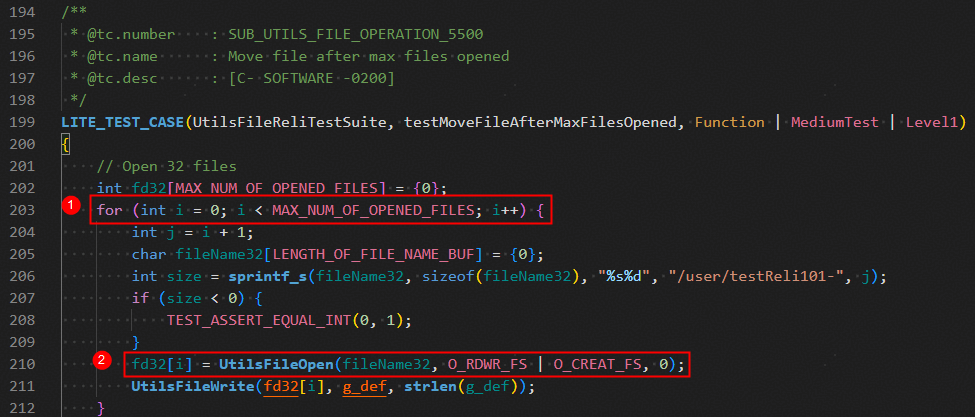
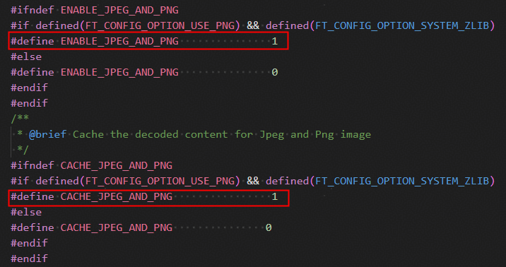
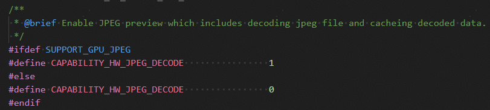
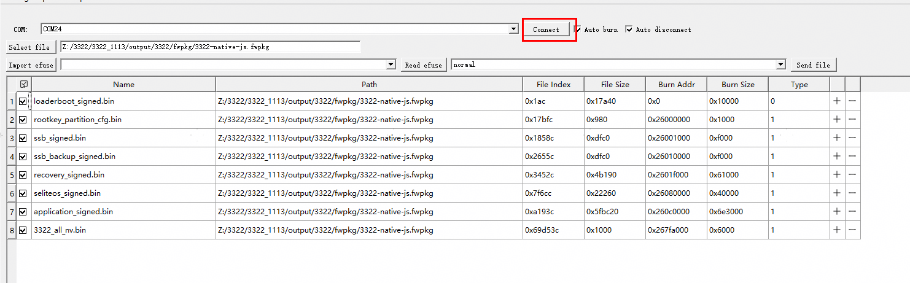
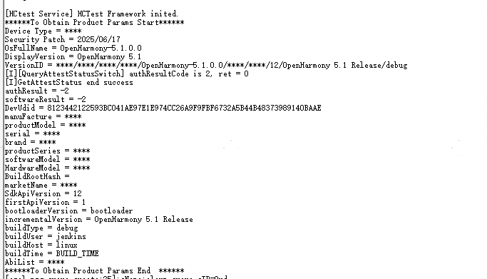
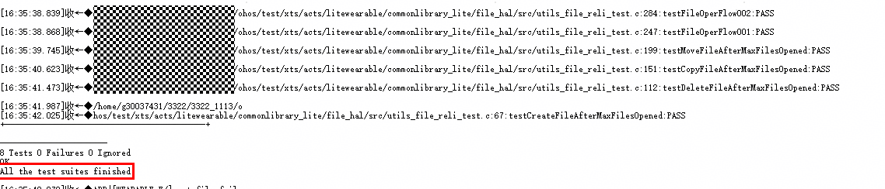
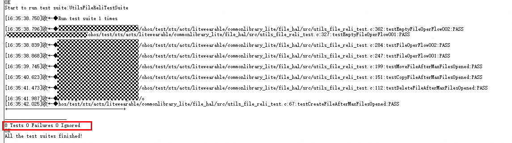
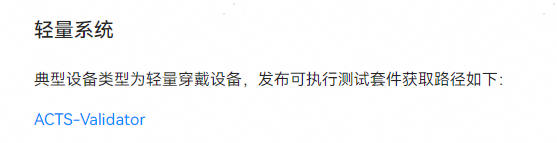
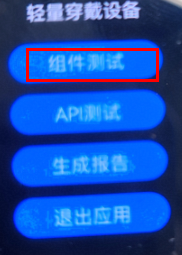
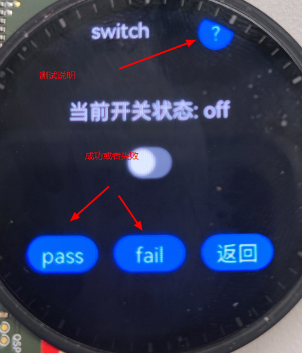

# 前言<a name="ZH-CN_TOPIC_0000002483901504"></a>

**概述<a name="zh-cn_topic_0000002512640261_section4537382116410"></a>**

本文档详细的描述了OpenHarmony XTS认证二次开发指导，同时提供了常见的问题解答及用例失败处理方法。

**读者对象<a name="zh-cn_topic_0000002512640261_section4378592816410"></a>**

本文档主要适用于XTS版本开发和测试操作人员。操作人员必须具备以下经验和技能：

-   了解XTS认证计划对应的OpenHarmony版本信息。
-   熟悉当前固件编译构建、烧写调试。

**符号约定<a name="zh-cn_topic_0000002512640261_section133020216410"></a>**

在本文中可能出现下列标志，它们所代表的含义如下。

<a name="zh-cn_topic_0000002512640261_table2622507016410"></a>
<table><thead align="left"><tr id="zh-cn_topic_0000002512640261_row1530720816410"><th class="cellrowborder" valign="top" width="20.580000000000002%" id="mcps1.1.3.1.1"><p id="zh-cn_topic_0000002512640261_p6450074116410"><a name="zh-cn_topic_0000002512640261_p6450074116410"></a><a name="zh-cn_topic_0000002512640261_p6450074116410"></a><strong id="zh-cn_topic_0000002512640261_b2136615816410"><a name="zh-cn_topic_0000002512640261_b2136615816410"></a><a name="zh-cn_topic_0000002512640261_b2136615816410"></a>符号</strong></p>
</th>
<th class="cellrowborder" valign="top" width="79.42%" id="mcps1.1.3.1.2"><p id="zh-cn_topic_0000002512640261_p5435366816410"><a name="zh-cn_topic_0000002512640261_p5435366816410"></a><a name="zh-cn_topic_0000002512640261_p5435366816410"></a><strong id="zh-cn_topic_0000002512640261_b5941558116410"><a name="zh-cn_topic_0000002512640261_b5941558116410"></a><a name="zh-cn_topic_0000002512640261_b5941558116410"></a>说明</strong></p>
</th>
</tr>
</thead>
<tbody><tr id="zh-cn_topic_0000002512640261_row1372280416410"><td class="cellrowborder" valign="top" width="20.580000000000002%" headers="mcps1.1.3.1.1 "><p id="zh-cn_topic_0000002512640261_p3734547016410"><a name="zh-cn_topic_0000002512640261_p3734547016410"></a><a name="zh-cn_topic_0000002512640261_p3734547016410"></a><a name="zh-cn_topic_0000002512640261_image2670064316410"></a><a name="zh-cn_topic_0000002512640261_image2670064316410"></a><span></span></p>
</td>
<td class="cellrowborder" valign="top" width="79.42%" headers="mcps1.1.3.1.2 "><p id="zh-cn_topic_0000002512640261_p1757432116410"><a name="zh-cn_topic_0000002512640261_p1757432116410"></a><a name="zh-cn_topic_0000002512640261_p1757432116410"></a>表示如不避免则将会导致死亡或严重伤害的具有高等级风险的危害。</p>
</td>
</tr>
<tr id="zh-cn_topic_0000002512640261_row466863216410"><td class="cellrowborder" valign="top" width="20.580000000000002%" headers="mcps1.1.3.1.1 "><p id="zh-cn_topic_0000002512640261_p1432579516410"><a name="zh-cn_topic_0000002512640261_p1432579516410"></a><a name="zh-cn_topic_0000002512640261_p1432579516410"></a><a name="zh-cn_topic_0000002512640261_image4895582316410"></a><a name="zh-cn_topic_0000002512640261_image4895582316410"></a><span></span></p>
</td>
<td class="cellrowborder" valign="top" width="79.42%" headers="mcps1.1.3.1.2 "><p id="zh-cn_topic_0000002512640261_p959197916410"><a name="zh-cn_topic_0000002512640261_p959197916410"></a><a name="zh-cn_topic_0000002512640261_p959197916410"></a>表示如不避免则可能导致死亡或严重伤害的具有中等级风险的危害。</p>
</td>
</tr>
<tr id="zh-cn_topic_0000002512640261_row123863216410"><td class="cellrowborder" valign="top" width="20.580000000000002%" headers="mcps1.1.3.1.1 "><p id="zh-cn_topic_0000002512640261_p1232579516410"><a name="zh-cn_topic_0000002512640261_p1232579516410"></a><a name="zh-cn_topic_0000002512640261_p1232579516410"></a><a name="zh-cn_topic_0000002512640261_image1235582316410"></a><a name="zh-cn_topic_0000002512640261_image1235582316410"></a><span></span></p>
</td>
<td class="cellrowborder" valign="top" width="79.42%" headers="mcps1.1.3.1.2 "><p id="zh-cn_topic_0000002512640261_p123197916410"><a name="zh-cn_topic_0000002512640261_p123197916410"></a><a name="zh-cn_topic_0000002512640261_p123197916410"></a>表示如不避免则可能导致轻微或中度伤害的具有低等级风险的危害。</p>
</td>
</tr>
<tr id="zh-cn_topic_0000002512640261_row5786682116410"><td class="cellrowborder" valign="top" width="20.580000000000002%" headers="mcps1.1.3.1.1 "><p id="zh-cn_topic_0000002512640261_p2204984716410"><a name="zh-cn_topic_0000002512640261_p2204984716410"></a><a name="zh-cn_topic_0000002512640261_p2204984716410"></a><a name="zh-cn_topic_0000002512640261_image4504446716410"></a><a name="zh-cn_topic_0000002512640261_image4504446716410"></a><span></span></p>
</td>
<td class="cellrowborder" valign="top" width="79.42%" headers="mcps1.1.3.1.2 "><p id="zh-cn_topic_0000002512640261_p4388861916410"><a name="zh-cn_topic_0000002512640261_p4388861916410"></a><a name="zh-cn_topic_0000002512640261_p4388861916410"></a>用于传递设备或环境安全警示信息。如不避免则可能会导致设备损坏、数据丢失、设备性能降低或其它不可预知的结果。</p>
<p id="zh-cn_topic_0000002512640261_p1238861916410"><a name="zh-cn_topic_0000002512640261_p1238861916410"></a><a name="zh-cn_topic_0000002512640261_p1238861916410"></a>“须知”不涉及人身伤害。</p>
</td>
</tr>
<tr id="zh-cn_topic_0000002512640261_row2856923116410"><td class="cellrowborder" valign="top" width="20.580000000000002%" headers="mcps1.1.3.1.1 "><p id="zh-cn_topic_0000002512640261_p5555360116410"><a name="zh-cn_topic_0000002512640261_p5555360116410"></a><a name="zh-cn_topic_0000002512640261_p5555360116410"></a><a name="zh-cn_topic_0000002512640261_image799324016410"></a><a name="zh-cn_topic_0000002512640261_image799324016410"></a><span></span></p>
</td>
<td class="cellrowborder" valign="top" width="79.42%" headers="mcps1.1.3.1.2 "><p id="zh-cn_topic_0000002512640261_p4612588116410"><a name="zh-cn_topic_0000002512640261_p4612588116410"></a><a name="zh-cn_topic_0000002512640261_p4612588116410"></a>对正文中重点信息的补充说明。</p>
<p id="zh-cn_topic_0000002512640261_p1232588116410"><a name="zh-cn_topic_0000002512640261_p1232588116410"></a><a name="zh-cn_topic_0000002512640261_p1232588116410"></a>“说明”不是安全警示信息，不涉及人身、设备及环境伤害信息。</p>
</td>
</tr>
</tbody>
</table>

# XTS认证版本二次开发注意事项<a name="ZH-CN_TOPIC_0000002516021445"></a>

-   **[最大访问文件数](#ZH-CN_TOPIC_0000002516141443)**  

-   **[最大线程数](#ZH-CN_TOPIC_0000002483741502)**  

-   **[KV使用数量](#ZH-CN_TOPIC_0000002516141461)**  

-   **[支持PNG图片解码](#ZH-CN_TOPIC_0000002483901484)**  

-   **[BMS测试套应用预置](#ZH-CN_TOPIC_0000002516021453)**  

## 最大访问文件数<a name="ZH-CN_TOPIC_0000002516141443"></a>

由于不同产品文件数访问存在差异，已和OpenHarmony实验室沟通允许修改XTS（X Test Suite，应用兼容性测试套）用例最大值。请按具体设备开机后实际剩余可用文件数量修改XTS可用最大文件数。

1.  计算规则

    XTS可用最大文件数＝系统最大访问文件数－开机已打开文件数。

    例如：系统最大访问文件数是100，开机业务已占用2，则XTS可用最大文件数是98。

1.  查看系统最大访问文件数
    -   Nand单板：yaffs最大访问文件数

        源码路径：middleware/utils/fs/yaffs2/yaffs/direct/include/yaffscfg.h

        宏定义：\#define YAFFSFS\_N\_HANDLES 100

    -   eMMC单板：fatfs最大访问文件数

        源码路径：kernel/liteos/LiteOS/Huawei\_LiteOS/self\_src/fs/fat/include/ffconf\_porting.h

        宏定义：\#define FF\_FS\_LOCK 100

1.  调整XTS可用最大文件数，修改位置如下

    源码路径：ohos/test/xts/acts/litewearable/commonlibrary\_lite/file\_hal/src/utils\_file\_reli\_test.c

    修改宏定义：\#define MAX\_NUM\_OF\_OPENED\_FILES 98

如果不确定业务开机后访问的文件总数，可以使用以下方式验证：

方式一：通过文件系统接口void lsfd\(void\)查询。

方式二：通过XTS用例实测，修改XTS可用最大文件数后，编译执行XTS用例。如果MAX\_NUM\_OF\_OPENED\_FILES配置偏大，则会在testMoveFileAfterMaxFilesOpened循环中失败，如[图1](#zh-cn_topic_0000002512695483_fig1806181835)所示。

**图 1**  方式验证示例图<a name="zh-cn_topic_0000002512695483_fig1806181835"></a>  


## 最大线程数<a name="ZH-CN_TOPIC_0000002483741502"></a>

如果开发时创建线程失败，可能原因是设置的最大线程数不够。

修改源码路径：kernel/liteos/LiteOS/Huawei\_LiteOS/self\_src/tools/build/config/3322\_xts.config

修改最大线程数位置：LOSCFG\_BASE\_CORE\_TSK\_LIMIT=64

## KV使用数量<a name="ZH-CN_TOPIC_0000002516141461"></a>

海思公版XTS版本默认关闭与认证测试无关的KV读写，避免影响kv\_store、file等文件系统用例执行。

1.  当使用UtilsSetEnv\(\)或UtilsSetValue\(\)对KV进行操作时，应采用XTS\_SUPPORT宏隔离，防止与XTS认证无关的KV操作占用最大文件访问数。

    例如“application/wearable/nativeapp/nativeui”路径示例代码如下：

    ```
    #ifndef XTS_SUPPORT 
    UtilsSetValue("abc", "1");
    #endif  
    ```

2.  当使用UtilsGetValue\(\)获取value时，应采用XTS\_SUPPORT宏隔离，并为业务变量初始化提供缺省值。防止XTS版本关闭业务UtilsGetValue\(\)后变量赋值错误。

## 支持PNG图片解码<a name="ZH-CN_TOPIC_0000002483901484"></a>

XTS版本为了支持acts\_validator用例，需要支持PNG图片解码。海思公版默认使能PNG解码，客户二次开发时请勿裁剪XTS版本PNG能力。

修改源码路径：middleware/services/gui/uikit/config/3322\_graphic\_lite\_config.h

修改位置：

```
ENABLE_JPEG_AND_PNG 1
CACHE_JPEG_AND_PNG 1
```

**图 1**  修改位置示例图<a name="zh-cn_topic_0000002480551656_fig1812684364615"></a>  


如果认证测试出现JPEG解码不兼容的问题，请尝试切换JPEG软解。

修改源码路径：middleware/services/gui/hal/common/include/graphic\_hardware\_config\_wearable.h

修改位置：CAPABILITY\_HW\_JPEG\_DECODE 0

**图 2**  修改位置示例图<a name="zh-cn_topic_0000002480551656_fig1463664564612"></a>  


## BMS测试套应用预置<a name="ZH-CN_TOPIC_0000002516021453"></a>

OHOS 5.0 XTS引入BundleMgrTest测试套，主要用于测试应用安装与卸载，需预置应用在板端“/user”下。

以下为预置应用的详情：

-   应用名称：testdemo1.bin

    包名：com.example.testdemo1

    预置到板端路径及名称：/user/testdemo1.bin

-   应用名称：testdemo2.bin

    包名：com.example.testdemo2

    预置到板端路径及名称：/user/testdemo2.bin

> **说明：** 
>1.  本章节提及到的应用皆为DevEco Studio 5.0 Release IDE编译出的应用，编译方式请参考 《OpenHarmony JS应用开发 用户指南》的“IDE”章节。
>2.  板端上传应用请参考《DebugKit工具 使用指南》的“串口连接”章节和“数据上传与下载”章节。

# XTS acts测试指导<a name="ZH-CN_TOPIC_0000002516021461"></a>

本章节介绍XTS镜像编译、烧写和acts测试运行方法，ACTS（Application Compatibility Test Suite）即应用兼容性测试套。

-   **[编译](#ZH-CN_TOPIC_0000002483741516)**  

-   **[烧写](#ZH-CN_TOPIC_0000002516141471)**  

-   **[运行](#ZH-CN_TOPIC_0000002483741528)**  

## 编译<a name="ZH-CN_TOPIC_0000002483741516"></a>

1.  XTS版本编译命令：/build.py pack\_diting-community\-xts -c -release
2.  镜像路径：output/3322/fwpkg
3.  dsp镜像路径：src/tools/pkg/bin/3322/dsp/normal 下 dsp\_main.bin dsp\_overlay.bin
4.  bt镜像路径：src/tools/pkg/bin/3322/bt_signed.bin

## 烧写<a name="ZH-CN_TOPIC_0000002516141471"></a>

1.  使用BurnTool工具烧写“diting-community-xts.fwpkg”镜像。

    **图 1**  烧写工具面板图<a name="zh-cn_topic_0000002481754832_fig217316332206"></a>  
    

2.  <a name="zh-cn_topic_0000002481754832_li66850592494"></a>使用DebugKits工具将“dsp\_main.bin”、“dsp\_overlay.bin”、“bt\_signed.bin”上传到板端对应路径。

    dsp\_main.bin镜像上传板端路径：/boot/dsp/dsp\_main.bin

    dsp\_overlay.bin镜像上传板端路径：/boot/dsp/dsp\_overlay.bin

    bt\_signed.bin镜像上传板端路径：/boot/bt/bt\_signed.bin

> **须知：** 
>1.  如烧写了包含“file.bin”的“diting-community-xts.fwpkg”镜像则忽略[2](#zh-cn_topic_0000002481754832_li66850592494)。
>    板端上传bt\_signed.bin、dsp\_overlay.bin、dsp\_main.bin请参考《DebugKit工具 使用指南》的“串口连接”章节和“数据上传与下载”章节。
>2.  BurnTool工具烧写请参考《BurnTool工具 使用指南》的“操作指南”章节。

## 运行<a name="ZH-CN_TOPIC_0000002483741528"></a>

完成烧写后连接串口工具重启单板，XTS用例自动运行标志：\[HCtest Service\] HCTest Framework inited.

**图 1**  启动日志图<a name="zh-cn_topic_0000002481914792_fig81451754202011"></a>  


当串口日志打印“All the test suites finished!”证明用例已跑完，如[图2](#zh-cn_topic_0000002481914792_fig16503297215)所示。

**图 2**  日志示例图-1<a name="zh-cn_topic_0000002481914792_fig16503297215"></a>  


对应测试套结果如[图3](#zh-cn_topic_0000002481914792_fig16478134022114)所示。

**图 3**  日志示例图-2<a name="zh-cn_topic_0000002481914792_fig16478134022114"></a>  


以UtilsFileReliTestSuite为例：UtilsFileReliTestSuite 8条用例 ，失败0条，忽略0条。

# XTS acts validator测试指导<a name="ZH-CN_TOPIC_0000002516021473"></a>

XTS 5.0引入JS应用测试套acts\_validator认证，使用镜像为“diting-community-xts.fwpkg”。

-   **[获取validator测试套](#ZH-CN_TOPIC_0000002516141451)**  

-   **[安装validator测试套](#ZH-CN_TOPIC_0000002483741540)**  

-   **[使用validator测试套](#ZH-CN_TOPIC_0000002483901496)**  

## 获取validator测试套<a name="ZH-CN_TOPIC_0000002516141451"></a>

-   官网下载validator测试应用

    官网：[https://www.openharmony.cn/systematic?tab=xts](https://www.openharmony.cn/systematic?tab=xts)

    兼容性测试套下载-\>OpenHarmony 5.1.0 Release-\>测试套件-\>轻量系统

    **图 1**  官网下载位置示意图<a name="zh-cn_topic_0000002513825085_fig147591043273"></a>  
    

-   SDK中validator测试应用安装包备份

    说明：海思版本发布后OH官网用例可能更新，正式认证测试应从官网下载最新用例。

    SDK包路径：sdk/application/wearable/res/js/IDE5.0/acts\_validator/validator-xts.bin

## 安装validator测试套<a name="ZH-CN_TOPIC_0000002483741540"></a>

1.  在OH认证镜像开机XTS用例结束后，上传validator用例安装包“entry-default-signed.bin”到单板user目录下。

    例如：/user/js/XTS/entry-default-signed.bin

2.  使用AT安装命令安装应用

    例如：AT+OHOS=OHOSFWK\_BM\_INSTALL,/user/js/XTS/entry-default-signed.bin

> **须知：** 
>1.  安装应用前，请保证单板系统时间正确，避免验签失败。
>2.  上传“entry-default-signed.bin”到板端，请参考《DebugKit工具 使用指南》的“串口连接”章节和“数据上传与下载”章节。

## 使用validator测试套<a name="ZH-CN_TOPIC_0000002483901496"></a>

安装完成后点亮表盘，点击validator应用图标进入应用按照应用指引完成测试。

**图 1**  validator应用测试套表端显示图<a name="zh-cn_topic_0000002481945208_fig135721753192111"></a>  


1.  点击组件测试按照测试指引完成测试。

    **图 2**  validator应用首页面显示图<a name="zh-cn_topic_0000002481945208_fig912102142214"></a>  
    

2.  点击API测试按照测试指引完成测试。

    **图 3**  测试指导图<a name="zh-cn_topic_0000002481945208_fig521265852211"></a>  
    

3.  回到主页面点击生成报告。
4.  退出应用完成测试。
5.  报告生成路径：/user/app/user/ace/data/com.examplemini.actsvalidator/summary\_report.json

> **须知：** 
>1.  开机等待XTS自动化用例测试完毕后，再测试validator手工用例，避免用例互相影响导致失败。
>2.  validator所有测试项都需要选择“pass”或“fail”结果，即测试项全部执行，才会生成validator测试报告。

# XTS认证版本二次开发注意事项<a name="ZH-CN_TOPIC_0000002577760036"></a>

-   **[最大访问文件数](#ZH-CN_TOPIC_0000002608119993)**  

-   **[最大线程数](#ZH-CN_TOPIC_0000002577920022)**  

-   **[KV使用数量](#ZH-CN_TOPIC_0000002608279907)**  

-   **[支持PNG图片解码](#ZH-CN_TOPIC_0000002577760038)**  

-   **[BMS测试套应用预置](#ZH-CN_TOPIC_0000002608119997)**  

-   **[重置HUKS工作密钥](#ZH-CN_TOPIC_0000002577920026)**  

## 最大访问文件数<a name="ZH-CN_TOPIC_0000002608119993"></a>

由于不同产品文件数访问存在差异，已和OpenHarmony实验室沟通允许修改XTS（X Test Suite，应用兼容性测试套）用例最大值。请按具体设备开机后实际剩余可用文件数量修改XTS可用最大文件数。

1.  计算规则

    XTS可用最大文件数＝系统最大访问文件数－开机已打开文件数。

    例如：系统最大访问文件数是100，开机业务已占用2，则XTS可用最大文件数是98。

1.  查看系统最大访问文件数
    -   Nand单板：yaffs最大访问文件数

        源码路径：middleware/utils/fs/yaffs2/yaffs/direct/include/yaffscfg.h

        宏定义：\#define YAFFSFS\_N\_HANDLES 100

    -   eMMC单板：fatfs最大访问文件数

        源码路径：kernel/liteos/LiteOS/Huawei\_LiteOS/self\_src/fs/fat/include/ffconf\_porting.h

        宏定义：\#define FF\_FS\_LOCK 100

1.  调整XTS可用最大文件数，修改位置如下

    源码路径：ohos/test/xts/acts/litewearable/commonlibrary\_lite/file\_hal/src/utils\_file\_reli\_test.c

    修改宏定义：\#define MAX\_NUM\_OF\_OPENED\_FILES 98

如果不确定业务开机后访问的文件总数，可以使用以下方式验证：

方式一：通过文件系统接口void lsfd\(void\)查询。

方式二：通过XTS用例实测，修改XTS可用最大文件数后，编译执行XTS用例。如果MAX\_NUM\_OF\_OPENED\_FILES配置偏大，则会在testMoveFileAfterMaxFilesOpened循环中失败，如[图1](#zh-cn_topic_0000002512695483_fig1806181835)所示。

**图 1**  方式验证示例图<a name="zh-cn_topic_0000002512695483_fig1806181835"></a>  


## 最大线程数<a name="ZH-CN_TOPIC_0000002577920022"></a>

如果开发时创建线程失败，可能原因是设置的最大线程数不够。

修改源码路径：kernel/liteos/LiteOS/Huawei\_LiteOS/self\_src/tools/build/config/3322\_xts.config

修改最大线程数位置：LOSCFG\_BASE\_CORE\_TSK\_LIMIT=64

## KV使用数量<a name="ZH-CN_TOPIC_0000002608279907"></a>

海思公版XTS版本默认关闭与认证测试无关的KV读写，避免影响kv\_store、file等文件系统用例执行。

1.  当使用UtilsSetEnv\(\)或UtilsSetValue\(\)对KV进行操作时，应采用XTS\_SUPPORT宏隔离，防止与XTS认证无关的KV操作占用最大文件访问数。

    例如“application/wearable/nativeapp/nativeui”路径示例代码如下：

    ```
    #ifndef XTS_SUPPORT 
    UtilsSetValue("abc", "1");
    #endif  
    ```

2.  当使用UtilsGetValue\(\)获取value时，应采用XTS\_SUPPORT宏隔离，并为业务变量初始化提供缺省值。防止XTS版本关闭业务UtilsGetValue\(\)后变量赋值错误。

## 支持PNG图片解码<a name="ZH-CN_TOPIC_0000002577760038"></a>

XTS版本为了支持acts\_validator用例，需要支持PNG图片解码。海思公版默认使能PNG解码，客户二次开发时请勿裁剪XTS版本PNG能力。

修改源码路径：middleware/services/gui/uikit/config/3322\_graphic\_lite\_config.h

修改位置：

```
ENABLE_JPEG_AND_PNG 1
CACHE_JPEG_AND_PNG 1
```

**图 1**  修改位置示例图<a name="zh-cn_topic_0000002480551656_fig1812684364615"></a>  


如果认证测试出现JPEG解码不兼容的问题，请尝试切换JPEG软解。

修改源码路径：middleware/services/gui/hal/common/include/graphic\_hardware\_config\_wearable.h

修改位置：CAPABILITY\_HW\_JPEG\_DECODE 0

**图 2**  修改位置示例图<a name="zh-cn_topic_0000002480551656_fig1463664564612"></a>  


## BMS测试套应用预置<a name="ZH-CN_TOPIC_0000002608119997"></a>

OHOS 5.0 XTS引入BundleMgrTest测试套，主要用于测试应用安装与卸载，需预置应用在板端“/user”下。

以下为预置应用的详情：

-   应用名称：testdemo1.bin

    包名：com.example.testdemo1

    预置到板端路径及名称：/user/testdemo1.bin

-   应用名称：testdemo2.bin

    包名：com.example.testdemo2

    预置到板端路径及名称：/user/testdemo2.bin

> **说明：** 
>1.  本章节提及到的应用皆为DevEco Studio 5.0 Release IDE编译出的应用，编译方式请参考 《OpenHarmony JS应用开发 用户指南》的“IDE”章节。
>2.  板端上传应用请参考《DebugKit工具 使用指南》的“串口连接”章节和“数据上传与下载”章节。

## 重置HUKS工作密钥<a name="ZH-CN_TOPIC_0000002577920026"></a>

OpenHarmony认证包含HUKS测试，工作密钥经加密后默认保存在“/user/app/user/maindata”中。烧写新XTS版本前确认删除旧密钥，避免新镜像HUKS使用错误的工作密钥导致XTS用例失败。操作步骤如下：

1.  烧写XTS镜像前，检查文件系统中是否有“/user/app/user/maindata”目录。如果已经存在该目录，则手动删除或格式化擦除FS。
2.  烧写OpenHarmony XTS镜像。
3.  开机执行XTS用例，检查HUKS用例结果是否全部通过。

# 缩略语<a name="ZH-CN_TOPIC_0000002483741508"></a>

<a name="zh-cn_topic_0000002483889856_table18628183284"></a>
<table><tbody><tr id="zh-cn_topic_0000002483889856_row1137614551115"><td class="cellrowborder" valign="top" width="33.333333333333336%"><p id="zh-cn_topic_0000002483889856_p12376657118"><a name="zh-cn_topic_0000002483889856_p12376657118"></a><a name="zh-cn_topic_0000002483889856_p12376657118"></a><strong id="zh-cn_topic_0000002483889856_b24731511181116"><a name="zh-cn_topic_0000002483889856_b24731511181116"></a><a name="zh-cn_topic_0000002483889856_b24731511181116"></a>X</strong></p>
</td>
<td class="cellrowborder" valign="top" width="33.29332933293329%">&nbsp;&nbsp;</td>
<td class="cellrowborder" valign="top" width="33.373337333733375%">&nbsp;&nbsp;</td>
</tr>
<tr id="zh-cn_topic_0000002483889856_row1137610561119"><td class="cellrowborder" valign="top" width="33.333333333333336%"><p id="zh-cn_topic_0000002483889856_p18376115141116"><a name="zh-cn_topic_0000002483889856_p18376115141116"></a><a name="zh-cn_topic_0000002483889856_p18376115141116"></a><strong id="zh-cn_topic_0000002483889856_b164741411121119"><a name="zh-cn_topic_0000002483889856_b164741411121119"></a><a name="zh-cn_topic_0000002483889856_b164741411121119"></a>XTS</strong></p>
</td>
<td class="cellrowborder" valign="top" width="33.29332933293329%"><p id="zh-cn_topic_0000002483889856_p93762516112"><a name="zh-cn_topic_0000002483889856_p93762516112"></a><a name="zh-cn_topic_0000002483889856_p93762516112"></a><span id="zh-cn_topic_0000002483889856_ph16184183122710"><a name="zh-cn_topic_0000002483889856_ph16184183122710"></a><a name="zh-cn_topic_0000002483889856_ph16184183122710"></a>X Test Suite</span></p>
</td>
<td class="cellrowborder" valign="top" width="33.373337333733375%"><p id="zh-cn_topic_0000002483889856_p4376105141113"><a name="zh-cn_topic_0000002483889856_p4376105141113"></a><a name="zh-cn_topic_0000002483889856_p4376105141113"></a><span id="zh-cn_topic_0000002483889856_ph13793102614253"><a name="zh-cn_topic_0000002483889856_ph13793102614253"></a><a name="zh-cn_topic_0000002483889856_ph13793102614253"></a>应用兼容性测试套</span></p>
</td>
</tr>
</tbody>
</table>

