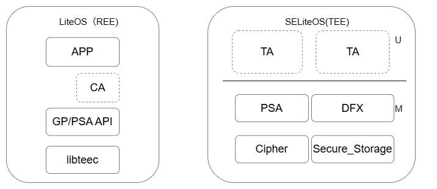
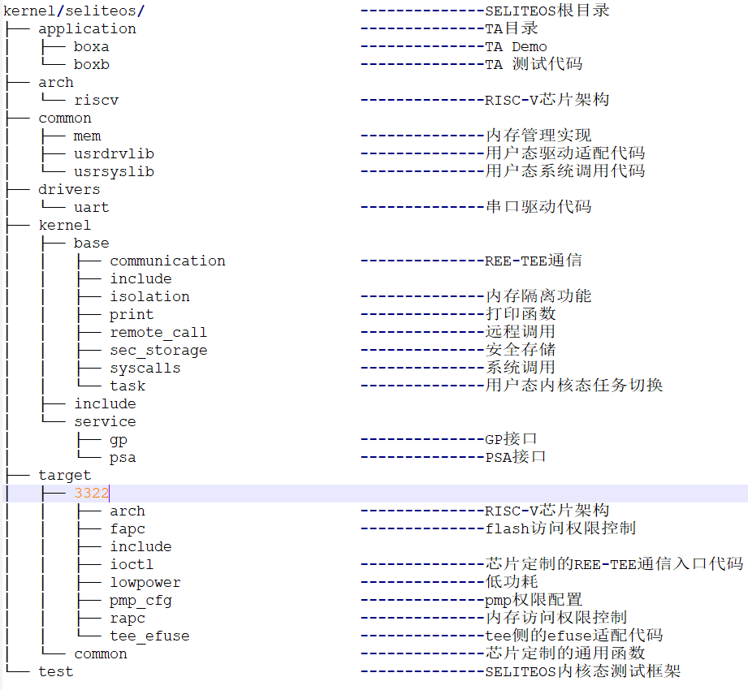
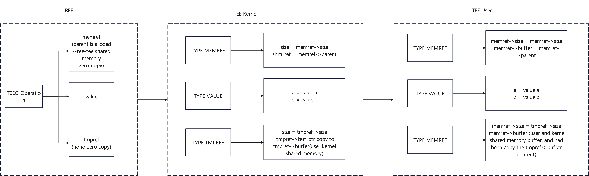
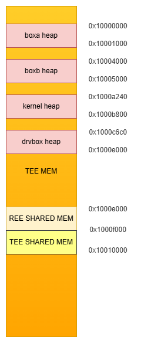

# 前言<a name="ZH-CN_TOPIC_0000002499581793"></a>

**概述<a name="zh-cn_topic_0000002411044876_section4537382116410"></a>**

本文主要介绍RISC-V TES 环境下SELiteOS的基本概念、软件开发方法、部分API使用指南以及相关的注意事项等。

**读者对象<a name="zh-cn_topic_0000002411044876_section4378592816410"></a>**

本文档主要适用于以下工程师：

-   技术支持工程师
-   软件开发工程师

**符号约定<a name="zh-cn_topic_0000002411044876_section133020216410"></a>**

在本文中可能出现下列标志，它们所代表的含义如下。

<a name="zh-cn_topic_0000002411044876_table2622507016410"></a>
<table><thead align="left"><tr id="zh-cn_topic_0000002411044876_row1530720816410"><th class="cellrowborder" valign="top" width="20.580000000000002%" id="mcps1.1.3.1.1"><p id="zh-cn_topic_0000002411044876_p6450074116410"><a name="zh-cn_topic_0000002411044876_p6450074116410"></a><a name="zh-cn_topic_0000002411044876_p6450074116410"></a><strong id="zh-cn_topic_0000002411044876_b2136615816410"><a name="zh-cn_topic_0000002411044876_b2136615816410"></a><a name="zh-cn_topic_0000002411044876_b2136615816410"></a>符号</strong></p>
</th>
<th class="cellrowborder" valign="top" width="79.42%" id="mcps1.1.3.1.2"><p id="zh-cn_topic_0000002411044876_p5435366816410"><a name="zh-cn_topic_0000002411044876_p5435366816410"></a><a name="zh-cn_topic_0000002411044876_p5435366816410"></a><strong id="zh-cn_topic_0000002411044876_b5941558116410"><a name="zh-cn_topic_0000002411044876_b5941558116410"></a><a name="zh-cn_topic_0000002411044876_b5941558116410"></a>说明</strong></p>
</th>
</tr>
</thead>
<tbody><tr id="zh-cn_topic_0000002411044876_row1372280416410"><td class="cellrowborder" valign="top" width="20.580000000000002%" headers="mcps1.1.3.1.1 "><p id="zh-cn_topic_0000002411044876_p3734547016410"><a name="zh-cn_topic_0000002411044876_p3734547016410"></a><a name="zh-cn_topic_0000002411044876_p3734547016410"></a><a name="zh-cn_topic_0000002411044876_image2670064316410"></a><a name="zh-cn_topic_0000002411044876_image2670064316410"></a><span></span></p>
</td>
<td class="cellrowborder" valign="top" width="79.42%" headers="mcps1.1.3.1.2 "><p id="zh-cn_topic_0000002411044876_p1757432116410"><a name="zh-cn_topic_0000002411044876_p1757432116410"></a><a name="zh-cn_topic_0000002411044876_p1757432116410"></a>表示如不避免则将会导致死亡或严重伤害的具有高等级风险的危害。</p>
</td>
</tr>
<tr id="zh-cn_topic_0000002411044876_row466863216410"><td class="cellrowborder" valign="top" width="20.580000000000002%" headers="mcps1.1.3.1.1 "><p id="zh-cn_topic_0000002411044876_p1432579516410"><a name="zh-cn_topic_0000002411044876_p1432579516410"></a><a name="zh-cn_topic_0000002411044876_p1432579516410"></a><a name="zh-cn_topic_0000002411044876_image4895582316410"></a><a name="zh-cn_topic_0000002411044876_image4895582316410"></a><span></span></p>
</td>
<td class="cellrowborder" valign="top" width="79.42%" headers="mcps1.1.3.1.2 "><p id="zh-cn_topic_0000002411044876_p959197916410"><a name="zh-cn_topic_0000002411044876_p959197916410"></a><a name="zh-cn_topic_0000002411044876_p959197916410"></a>表示如不避免则可能导致死亡或严重伤害的具有中等级风险的危害。</p>
</td>
</tr>
<tr id="zh-cn_topic_0000002411044876_row123863216410"><td class="cellrowborder" valign="top" width="20.580000000000002%" headers="mcps1.1.3.1.1 "><p id="zh-cn_topic_0000002411044876_p1232579516410"><a name="zh-cn_topic_0000002411044876_p1232579516410"></a><a name="zh-cn_topic_0000002411044876_p1232579516410"></a><a name="zh-cn_topic_0000002411044876_image1235582316410"></a><a name="zh-cn_topic_0000002411044876_image1235582316410"></a><span></span></p>
</td>
<td class="cellrowborder" valign="top" width="79.42%" headers="mcps1.1.3.1.2 "><p id="zh-cn_topic_0000002411044876_p123197916410"><a name="zh-cn_topic_0000002411044876_p123197916410"></a><a name="zh-cn_topic_0000002411044876_p123197916410"></a>表示如不避免则可能导致轻微或中度伤害的具有低等级风险的危害。</p>
</td>
</tr>
<tr id="zh-cn_topic_0000002411044876_row5786682116410"><td class="cellrowborder" valign="top" width="20.580000000000002%" headers="mcps1.1.3.1.1 "><p id="zh-cn_topic_0000002411044876_p2204984716410"><a name="zh-cn_topic_0000002411044876_p2204984716410"></a><a name="zh-cn_topic_0000002411044876_p2204984716410"></a><a name="zh-cn_topic_0000002411044876_image4504446716410"></a><a name="zh-cn_topic_0000002411044876_image4504446716410"></a><span></span></p>
</td>
<td class="cellrowborder" valign="top" width="79.42%" headers="mcps1.1.3.1.2 "><p id="zh-cn_topic_0000002411044876_p4388861916410"><a name="zh-cn_topic_0000002411044876_p4388861916410"></a><a name="zh-cn_topic_0000002411044876_p4388861916410"></a>用于传递设备或环境安全警示信息。如不避免则可能会导致设备损坏、数据丢失、设备性能降低或其它不可预知的结果。</p>
<p id="zh-cn_topic_0000002411044876_p1238861916410"><a name="zh-cn_topic_0000002411044876_p1238861916410"></a><a name="zh-cn_topic_0000002411044876_p1238861916410"></a>“须知”不涉及人身伤害。</p>
</td>
</tr>
<tr id="zh-cn_topic_0000002411044876_row2856923116410"><td class="cellrowborder" valign="top" width="20.580000000000002%" headers="mcps1.1.3.1.1 "><p id="zh-cn_topic_0000002411044876_p5555360116410"><a name="zh-cn_topic_0000002411044876_p5555360116410"></a><a name="zh-cn_topic_0000002411044876_p5555360116410"></a><a name="zh-cn_topic_0000002411044876_image799324016410"></a><a name="zh-cn_topic_0000002411044876_image799324016410"></a><span></span></p>
</td>
<td class="cellrowborder" valign="top" width="79.42%" headers="mcps1.1.3.1.2 "><p id="zh-cn_topic_0000002411044876_p4612588116410"><a name="zh-cn_topic_0000002411044876_p4612588116410"></a><a name="zh-cn_topic_0000002411044876_p4612588116410"></a>对正文中重点信息的补充说明。</p>
<p id="zh-cn_topic_0000002411044876_p1232588116410"><a name="zh-cn_topic_0000002411044876_p1232588116410"></a><a name="zh-cn_topic_0000002411044876_p1232588116410"></a>“说明”不是安全警示信息，不涉及人身、设备及环境伤害信息。</p>
</td>
</tr>
</tbody>
</table>

# 概述<a name="ZH-CN_TOPIC_0000002466542420"></a>

-   **[软件架构](#ZH-CN_TOPIC_0000002466542400)**  

-   **[基本概念](#ZH-CN_TOPIC_0000002499581781)**  

-   **[代码目录结构](#ZH-CN_TOPIC_0000002499581789)**  

-   **[TEE下的软件开发](#ZH-CN_TOPIC_0000002466542404)**  

## 软件架构<a name="ZH-CN_TOPIC_0000002466542400"></a>

SELiteOS是基于海思RISC-V TES架构构建的安全OS，与LiteOS隔离，提供以下核心能力：

1.  硬件级隔离：通过RISC-V TES实现内存和CPU的隔离。
2.  数据机密性：敏感数据在SELiteOS内部生成、存储和使用，外部无法访问。
3.  数据完整性：确保SELiteOS的代码未被篡改。

SELiteOS是能保证只有经过认证的代码才能运行的可信执行环境。

**图 1**  REE-TEE部署<a name="zh-cn_topic_0000002418111854_zh-cn_topic_0000002418245476_fig0239145115598"></a>  


架构图如[图1](#zh-cn_topic_0000002418111854_zh-cn_topic_0000002418245476_fig0239145115598)所示：

REE（Rich Execution Environment）：SELiteOS提供GP（Global Platform）和PSA（Platform Security Architecture）接口，libteec负责与SELiteOS通信。使用GP接口可以开发CA（Client Application），也可以选择直接使用PSA接口完成密钥管理和安全存储。

TEE（Trusted Execution Environment）：SELiteOS支持内核态和用户态隔离。提供Cipher和安全存储，支持用户开发TA（Trusted Application）对接REE侧CA。支持PSA密钥管理和安全存储。

## 基本概念<a name="ZH-CN_TOPIC_0000002499581781"></a>

【GP】

Global Platform，制定TEE技术规范的标准组织。

网址：[https://globalplatform.org/](https://globalplatform.org/)

【PSA】

Platform Security Architecture，PSA标准接口。

网址：[https://arm-software.github.io/psa-api/](https://arm-software.github.io/psa-api/)

【TEE】

Trusted Execution Environment，是一个独立的、安全性高的执行环境。文档中所称的安全世界、安全侧都是指TEE。

【REE】

Rich Execution Environment，相对于TEE，是常见的操作系统，如Linux、LiteOS等，与TEE配合完成业务功能。文档中所称的非安全世界、非安侧都是指REE。

【安全OS】

提供遵循Global Platform标准TEE的操作系统。文档中出现的SELiteOS即是安全OS。

【TA】

Trusted Application，运行在TEE的应用。TA可以被CA调用。

【CA】

Client Application，运行在REE的应用，通过跟TA的交互来实现安全世界、非安全世界的通信，从而实现所需的业务功能。

## 代码目录结构<a name="ZH-CN_TOPIC_0000002499581789"></a>

当前SELiteOS的开发依赖HiDiTingV100产品项目的目录结构。

TEE侧SELiteOS代码目录位于“kernel/seliteos”。

REE侧libteec代码目录位于“middleware/utils/libteec”。

SELiteOS具体目录结构如[图1](#zh-cn_topic_0000002451750761_zh-cn_topic_0000002451724513_fig846mcpsimp)所示。

**图 1**  SELiteOS目录结构<a name="zh-cn_topic_0000002451750761_zh-cn_topic_0000002451724513_fig846mcpsimp"></a>  



## TEE下的软件开发<a name="ZH-CN_TOPIC_0000002466542404"></a>

对于开发者客户来说，可能需要以下3种场景下进行开发：

-   安全世界的可信应用（TA）
-   非安全世界的客户端（CA）
-   安全世界的驱动开发（TEE Driver）

# TA和CA开发<a name="ZH-CN_TOPIC_0000002499581753"></a>

-   **[TA开发](#ZH-CN_TOPIC_0000002466542392)**  

-   **[CA开发](#ZH-CN_TOPIC_0000002466382808)**  

## TA开发<a name="ZH-CN_TOPIC_0000002466542392"></a>

应用开发者可能需要自行开发TA以实现不同的应用，本节将介绍TA开发相关流程和信息。以下所涉及到的目录结构，均基于以sdk包为根目录。

-   **[简介](#ZH-CN_TOPIC_0000002466382804)**  

-   **[增加TA](#ZH-CN_TOPIC_0000002466382768)**  

### 简介<a name="ZH-CN_TOPIC_0000002466382804"></a>

TA可以使用安全OS TEE API、TEE驱动API、TEE安全存储API。

-   安全OS TEE API

    包括以下接口：

    -   LOS\_Printf
    -   los\_usr\_malloc/los\_usr\_free

    打印接口参考： kernel/seliteos/kernel/base/print/los\_printf.h

    内存接口参考：[内存使用](#ZH-CN_TOPIC_0000002466542436)

-   TEE驱动API

    kernel/seliteos/common/usrdrvlib/security\_unified/drvbox\_call.h

-   TEE 安全存储API

    kernel/seliteos/common/usrsyslib/sec\_storage\_adapter/box\_sec\_storage\_adapter.h

### 增加TA<a name="ZH-CN_TOPIC_0000002466382768"></a>

安全OS为开发者提供了一套增加TA的框架。开发者只需要编写自己的TA程序，然后适配到这套框架中，就可以正常加载、运行自己的TA。

TA代码在“kernel/seliteos/application/boxa”目录下，开发者需要实现如[表1](#zh-cn_topic_0000002451870673_zh-cn_topic_0000002451684449_table908mcpsimp)所示接口函数。

**表 1**  TA实现函数

<a name="zh-cn_topic_0000002451870673_zh-cn_topic_0000002451684449_table908mcpsimp"></a>
<table><thead align="left"><tr id="zh-cn_topic_0000002451870673_zh-cn_topic_0000002451684449_row914mcpsimp"><th class="cellrowborder" valign="top" width="31.830000000000002%" id="mcps1.2.3.1.1"><p id="zh-cn_topic_0000002451870673_zh-cn_topic_0000002451684449_p916mcpsimp"><a name="zh-cn_topic_0000002451870673_zh-cn_topic_0000002451684449_p916mcpsimp"></a><a name="zh-cn_topic_0000002451870673_zh-cn_topic_0000002451684449_p916mcpsimp"></a>函数名称</p>
</th>
<th class="cellrowborder" valign="top" width="68.17%" id="mcps1.2.3.1.2"><p id="zh-cn_topic_0000002451870673_zh-cn_topic_0000002451684449_p918mcpsimp"><a name="zh-cn_topic_0000002451870673_zh-cn_topic_0000002451684449_p918mcpsimp"></a><a name="zh-cn_topic_0000002451870673_zh-cn_topic_0000002451684449_p918mcpsimp"></a>函数介绍</p>
</th>
</tr>
</thead>
<tbody><tr id="zh-cn_topic_0000002451870673_zh-cn_topic_0000002451684449_row919mcpsimp"><td class="cellrowborder" valign="top" width="31.830000000000002%" headers="mcps1.2.3.1.1 "><p id="zh-cn_topic_0000002451870673_zh-cn_topic_0000002451684449_p921mcpsimp"><a name="zh-cn_topic_0000002451870673_zh-cn_topic_0000002451684449_p921mcpsimp"></a><a name="zh-cn_topic_0000002451870673_zh-cn_topic_0000002451684449_p921mcpsimp"></a>TA_CreateEntryPoint</p>
</td>
<td class="cellrowborder" valign="top" width="68.17%" headers="mcps1.2.3.1.2 "><p id="zh-cn_topic_0000002451870673_zh-cn_topic_0000002451684449_p923mcpsimp"><a name="zh-cn_topic_0000002451870673_zh-cn_topic_0000002451684449_p923mcpsimp"></a><a name="zh-cn_topic_0000002451870673_zh-cn_topic_0000002451684449_p923mcpsimp"></a>TA的构造函数接口，该接口在CA第一次打开会话并创建TA实例时得到调用。如果此函数执行失败，则该TA实例构建失败。</p>
</td>
</tr>
<tr id="zh-cn_topic_0000002451870673_zh-cn_topic_0000002451684449_row924mcpsimp"><td class="cellrowborder" valign="top" width="31.830000000000002%" headers="mcps1.2.3.1.1 "><p id="zh-cn_topic_0000002451870673_zh-cn_topic_0000002451684449_p926mcpsimp"><a name="zh-cn_topic_0000002451870673_zh-cn_topic_0000002451684449_p926mcpsimp"></a><a name="zh-cn_topic_0000002451870673_zh-cn_topic_0000002451684449_p926mcpsimp"></a>TA_DestroyEntryPoint</p>
</td>
<td class="cellrowborder" valign="top" width="68.17%" headers="mcps1.2.3.1.2 "><p id="zh-cn_topic_0000002451870673_zh-cn_topic_0000002451684449_p928mcpsimp"><a name="zh-cn_topic_0000002451870673_zh-cn_topic_0000002451684449_p928mcpsimp"></a><a name="zh-cn_topic_0000002451870673_zh-cn_topic_0000002451684449_p928mcpsimp"></a>TA的析构函数接口，该接口在CA关闭会话并销毁TA实例时得到调用。</p>
</td>
</tr>
<tr id="zh-cn_topic_0000002451870673_zh-cn_topic_0000002451684449_row929mcpsimp"><td class="cellrowborder" valign="top" width="31.830000000000002%" headers="mcps1.2.3.1.1 "><p id="zh-cn_topic_0000002451870673_zh-cn_topic_0000002451684449_p931mcpsimp"><a name="zh-cn_topic_0000002451870673_zh-cn_topic_0000002451684449_p931mcpsimp"></a><a name="zh-cn_topic_0000002451870673_zh-cn_topic_0000002451684449_p931mcpsimp"></a>TA_OpenSessionEntryPoint</p>
</td>
<td class="cellrowborder" valign="top" width="68.17%" headers="mcps1.2.3.1.2 "><p id="zh-cn_topic_0000002451870673_zh-cn_topic_0000002451684449_p933mcpsimp"><a name="zh-cn_topic_0000002451870673_zh-cn_topic_0000002451684449_p933mcpsimp"></a><a name="zh-cn_topic_0000002451870673_zh-cn_topic_0000002451684449_p933mcpsimp"></a>当客户端应用打开会话时，SELiteOS会调用对应TA的此接口在安全世界创建一个会话。</p>
</td>
</tr>
<tr id="zh-cn_topic_0000002451870673_zh-cn_topic_0000002451684449_row934mcpsimp"><td class="cellrowborder" valign="top" width="31.830000000000002%" headers="mcps1.2.3.1.1 "><p id="zh-cn_topic_0000002451870673_zh-cn_topic_0000002451684449_p936mcpsimp"><a name="zh-cn_topic_0000002451870673_zh-cn_topic_0000002451684449_p936mcpsimp"></a><a name="zh-cn_topic_0000002451870673_zh-cn_topic_0000002451684449_p936mcpsimp"></a>TA_CloseSessionEntryPoint</p>
</td>
<td class="cellrowborder" valign="top" width="68.17%" headers="mcps1.2.3.1.2 "><p id="zh-cn_topic_0000002451870673_zh-cn_topic_0000002451684449_p938mcpsimp"><a name="zh-cn_topic_0000002451870673_zh-cn_topic_0000002451684449_p938mcpsimp"></a><a name="zh-cn_topic_0000002451870673_zh-cn_topic_0000002451684449_p938mcpsimp"></a>当客户端应用关闭会话时，SELiteOS会调用对应TA的此接口在安全世界关闭会话。</p>
</td>
</tr>
<tr id="zh-cn_topic_0000002451870673_zh-cn_topic_0000002451684449_row939mcpsimp"><td class="cellrowborder" valign="top" width="31.830000000000002%" headers="mcps1.2.3.1.1 "><p id="zh-cn_topic_0000002451870673_zh-cn_topic_0000002451684449_p941mcpsimp"><a name="zh-cn_topic_0000002451870673_zh-cn_topic_0000002451684449_p941mcpsimp"></a><a name="zh-cn_topic_0000002451870673_zh-cn_topic_0000002451684449_p941mcpsimp"></a>TA_InvokeCommandEntryPoint</p>
</td>
<td class="cellrowborder" valign="top" width="68.17%" headers="mcps1.2.3.1.2 "><p id="zh-cn_topic_0000002451870673_zh-cn_topic_0000002451684449_p943mcpsimp"><a name="zh-cn_topic_0000002451870673_zh-cn_topic_0000002451684449_p943mcpsimp"></a><a name="zh-cn_topic_0000002451870673_zh-cn_topic_0000002451684449_p943mcpsimp"></a>当客户端应用发送命令给SELiteOS时，SELiteOS会调用对应TA的此接口在安全世界执行相应操作，比如加解密、安全存储等。</p>
</td>
</tr>
</tbody>
</table>

需要在TA中新增可调用的命令时，应在TA\_InvokeCommandEntryPoint中增加新的case，case对应的枚举值定义在“kernel/seliteos/application/boxa/include/boxa\_header.h”中的ta\_command里，可参考TA\_HELLO\_TEST的使用；该头文件中的TA\_UUID也支持修改。

此外，还需要指定TA的地址范围（涉及修改的文件参见下面的须知），可参考如下示例：

```
static const struct ta_ops ta_op SECTION(".ta_array_ops") = {
    .create_entry_point = TA_CreateEntryPoint,
    .destroy_entry_point = TA_DestroyEntryPoint,
    .open_session_entry_point = TA_OpenSessionEntryPoint,
    .close_session_entry_point = TA_CloseSessionEntryPoint,
    .invoke_command_entry_point = TA_InvokeCommandEntryPoint,
};
ta_register(.name = "hello_world", .uuid = TA_UUID2, .ops = (struct ta_ops *)&ta_op,
 .data_addr = BOXA_DATA_START,
            .heap_size = BOXA_HEAP_SIZE, .data_size = BOXA_DATA_SIZE,
            .stack_addr = BOXA_STACK_START, .stack_size = BOXA_STACK_SIZE,
            .text_rodata_addr = BOXA_TEXT_RODATA_START,
            .text_rodata_size = BOXA_TEXT_RODATA_SIZE);
```

其中ta\_op结构体保存了当前TA实现的5个接口。

ta\_register宏用于对当前TA进行注册，需要填写如[表2](#zh-cn_topic_0000002451870673_zh-cn_topic_0000002451684449_table976mcpsimp)所示内容。

**表 2**  TA注册的参数说明

<a name="zh-cn_topic_0000002451870673_zh-cn_topic_0000002451684449_table976mcpsimp"></a>
<table><thead align="left"><tr id="zh-cn_topic_0000002451870673_zh-cn_topic_0000002451684449_row981mcpsimp"><th class="cellrowborder" valign="top" width="39%" id="mcps1.2.3.1.1"><p id="zh-cn_topic_0000002451870673_zh-cn_topic_0000002451684449_p983mcpsimp"><a name="zh-cn_topic_0000002451870673_zh-cn_topic_0000002451684449_p983mcpsimp"></a><a name="zh-cn_topic_0000002451870673_zh-cn_topic_0000002451684449_p983mcpsimp"></a><strong id="zh-cn_topic_0000002451870673_zh-cn_topic_0000002451684449_b984mcpsimp"><a name="zh-cn_topic_0000002451870673_zh-cn_topic_0000002451684449_b984mcpsimp"></a><a name="zh-cn_topic_0000002451870673_zh-cn_topic_0000002451684449_b984mcpsimp"></a>参数</strong></p>
</th>
<th class="cellrowborder" valign="top" width="61%" id="mcps1.2.3.1.2"><p id="zh-cn_topic_0000002451870673_zh-cn_topic_0000002451684449_p986mcpsimp"><a name="zh-cn_topic_0000002451870673_zh-cn_topic_0000002451684449_p986mcpsimp"></a><a name="zh-cn_topic_0000002451870673_zh-cn_topic_0000002451684449_p986mcpsimp"></a><strong id="zh-cn_topic_0000002451870673_zh-cn_topic_0000002451684449_b987mcpsimp"><a name="zh-cn_topic_0000002451870673_zh-cn_topic_0000002451684449_b987mcpsimp"></a><a name="zh-cn_topic_0000002451870673_zh-cn_topic_0000002451684449_b987mcpsimp"></a>说明</strong></p>
</th>
</tr>
</thead>
<tbody><tr id="zh-cn_topic_0000002451870673_zh-cn_topic_0000002451684449_row988mcpsimp"><td class="cellrowborder" valign="top" width="39%" headers="mcps1.2.3.1.1 "><p id="zh-cn_topic_0000002451870673_zh-cn_topic_0000002451684449_p990mcpsimp"><a name="zh-cn_topic_0000002451870673_zh-cn_topic_0000002451684449_p990mcpsimp"></a><a name="zh-cn_topic_0000002451870673_zh-cn_topic_0000002451684449_p990mcpsimp"></a>name</p>
</td>
<td class="cellrowborder" valign="top" width="61%" headers="mcps1.2.3.1.2 "><p id="zh-cn_topic_0000002451870673_zh-cn_topic_0000002451684449_p992mcpsimp"><a name="zh-cn_topic_0000002451870673_zh-cn_topic_0000002451684449_p992mcpsimp"></a><a name="zh-cn_topic_0000002451870673_zh-cn_topic_0000002451684449_p992mcpsimp"></a>TA名。</p>
</td>
</tr>
<tr id="zh-cn_topic_0000002451870673_zh-cn_topic_0000002451684449_row993mcpsimp"><td class="cellrowborder" valign="top" width="39%" headers="mcps1.2.3.1.1 "><p id="zh-cn_topic_0000002451870673_zh-cn_topic_0000002451684449_p995mcpsimp"><a name="zh-cn_topic_0000002451870673_zh-cn_topic_0000002451684449_p995mcpsimp"></a><a name="zh-cn_topic_0000002451870673_zh-cn_topic_0000002451684449_p995mcpsimp"></a>uuid</p>
</td>
<td class="cellrowborder" valign="top" width="61%" headers="mcps1.2.3.1.2 "><p id="zh-cn_topic_0000002451870673_zh-cn_topic_0000002451684449_p997mcpsimp"><a name="zh-cn_topic_0000002451870673_zh-cn_topic_0000002451684449_p997mcpsimp"></a><a name="zh-cn_topic_0000002451870673_zh-cn_topic_0000002451684449_p997mcpsimp"></a>TA的UUID（推荐使用UUID生成网站生成，避免重复）。</p>
</td>
</tr>
<tr id="zh-cn_topic_0000002451870673_zh-cn_topic_0000002451684449_row998mcpsimp"><td class="cellrowborder" valign="top" width="39%" headers="mcps1.2.3.1.1 "><p id="zh-cn_topic_0000002451870673_zh-cn_topic_0000002451684449_p1000mcpsimp"><a name="zh-cn_topic_0000002451870673_zh-cn_topic_0000002451684449_p1000mcpsimp"></a><a name="zh-cn_topic_0000002451870673_zh-cn_topic_0000002451684449_p1000mcpsimp"></a>ops</p>
</td>
<td class="cellrowborder" valign="top" width="61%" headers="mcps1.2.3.1.2 "><p id="zh-cn_topic_0000002451870673_zh-cn_topic_0000002451684449_p1002mcpsimp"><a name="zh-cn_topic_0000002451870673_zh-cn_topic_0000002451684449_p1002mcpsimp"></a><a name="zh-cn_topic_0000002451870673_zh-cn_topic_0000002451684449_p1002mcpsimp"></a>TA实现的5个接口。</p>
</td>
</tr>
<tr id="zh-cn_topic_0000002451870673_zh-cn_topic_0000002451684449_row1003mcpsimp"><td class="cellrowborder" valign="top" width="39%" headers="mcps1.2.3.1.1 "><p id="zh-cn_topic_0000002451870673_zh-cn_topic_0000002451684449_p1005mcpsimp"><a name="zh-cn_topic_0000002451870673_zh-cn_topic_0000002451684449_p1005mcpsimp"></a><a name="zh-cn_topic_0000002451870673_zh-cn_topic_0000002451684449_p1005mcpsimp"></a>data_addr/data_size/heap_size</p>
</td>
<td class="cellrowborder" valign="top" width="61%" headers="mcps1.2.3.1.2 "><p id="zh-cn_topic_0000002451870673_zh-cn_topic_0000002451684449_p1007mcpsimp"><a name="zh-cn_topic_0000002451870673_zh-cn_topic_0000002451684449_p1007mcpsimp"></a><a name="zh-cn_topic_0000002451870673_zh-cn_topic_0000002451684449_p1007mcpsimp"></a>data_addr是TA数据段和heap区的起始地址；data_size是TA数据段的大小；heap_size是TA heap区的大小。（heap区位于数据段的开头，属于数据段的一部分）</p>
</td>
</tr>
<tr id="zh-cn_topic_0000002451870673_zh-cn_topic_0000002451684449_row1008mcpsimp"><td class="cellrowborder" valign="top" width="39%" headers="mcps1.2.3.1.1 "><p id="zh-cn_topic_0000002451870673_zh-cn_topic_0000002451684449_p1010mcpsimp"><a name="zh-cn_topic_0000002451870673_zh-cn_topic_0000002451684449_p1010mcpsimp"></a><a name="zh-cn_topic_0000002451870673_zh-cn_topic_0000002451684449_p1010mcpsimp"></a>stack_addr/stack_size</p>
</td>
<td class="cellrowborder" valign="top" width="61%" headers="mcps1.2.3.1.2 "><p id="zh-cn_topic_0000002451870673_zh-cn_topic_0000002451684449_p1012mcpsimp"><a name="zh-cn_topic_0000002451870673_zh-cn_topic_0000002451684449_p1012mcpsimp"></a><a name="zh-cn_topic_0000002451870673_zh-cn_topic_0000002451684449_p1012mcpsimp"></a>TA栈的地址和大小。</p>
</td>
</tr>
<tr id="zh-cn_topic_0000002451870673_zh-cn_topic_0000002451684449_row1013mcpsimp"><td class="cellrowborder" valign="top" width="39%" headers="mcps1.2.3.1.1 "><p id="zh-cn_topic_0000002451870673_zh-cn_topic_0000002451684449_p1015mcpsimp"><a name="zh-cn_topic_0000002451870673_zh-cn_topic_0000002451684449_p1015mcpsimp"></a><a name="zh-cn_topic_0000002451870673_zh-cn_topic_0000002451684449_p1015mcpsimp"></a>text_rodata_addr/text_rodata_size</p>
</td>
<td class="cellrowborder" valign="top" width="61%" headers="mcps1.2.3.1.2 "><p id="zh-cn_topic_0000002451870673_zh-cn_topic_0000002451684449_p1017mcpsimp"><a name="zh-cn_topic_0000002451870673_zh-cn_topic_0000002451684449_p1017mcpsimp"></a><a name="zh-cn_topic_0000002451870673_zh-cn_topic_0000002451684449_p1017mcpsimp"></a>TA代码段/只读数据段的地址和大小。</p>
</td>
</tr>
</tbody>
</table>

> **须知：** 
>-   当前最多支持两个TA。
>-   TA注册时传入的data\_addr/data\_size/heap\_size、stack\_addr/stack\_size以及text\_rodata\_addr/text\_rodata\_size的值定义在头文件“drivers/boards/ 3322\_$\{BOARD\} /linker/seliteos/ta\_memory\_config.h”中，其中“BOARD”根据板端类型分为“evb”。
>-   单个TA情况下，text\_rodata\_size最大为0x10000，data\_size为0x8000；两个TA的情况下，则text\_rodata\_size最大为0x8000，data\_size为0x4000。
>-   开发者可根据TA大小调整以上地址和长度，但由于PMP地址和长度2<sup>N</sup>字节对齐的限制，需要保证这些地址和长度2<sup>N</sup>字节对齐。

## CA开发<a name="ZH-CN_TOPIC_0000002466382808"></a>

应用开发者可能需要开发CA来跟TA交互以实现业务功能。LiteOS下的CA就是正常的Task，调用libteec的接口跟TA通信。

-   **[CA和TA的交互流程](#ZH-CN_TOPIC_0000002466542388)**  

-   **[依赖](#ZH-CN_TOPIC_0000002466382772)**  

-   **[增加CA](#ZH-CN_TOPIC_0000002466542384)**  

### CA和TA的交互流程<a name="ZH-CN_TOPIC_0000002466542388"></a>

**图 1**  SELiteOS-TES REE-TEE通信<a name="zh-cn_topic_0000002418271722_zh-cn_topic_0000002418085592_fig428313215117"></a>  


1.  流程由CA发起。CA执行打开会话，通过通信代理传递到TEE，TEE中的TA会启动进而响应客户端应用发起的指令。
2.  CA发送要执行的操作命令，TA进行处理并把结果返回给CA，此时TA可完成加解密操作、安全存储操作等。
3.  CA发送关闭会话命令，TA关闭，同时申请的资源被回收。

### 依赖<a name="ZH-CN_TOPIC_0000002466382772"></a>

API：CA需要依赖位于“middleware/utils/libteec/libteec/libteec.h”的安全libteec的API。

### 增加CA<a name="ZH-CN_TOPIC_0000002466542384"></a>

开发CA的典型过程如下：

更多细节信息可以直接查看头文件“middleware/utils/libteec/libteec/libteec.h”以及[https://globalplatform.org/specs-library/tee-client-api-specification/](https://globalplatform.org/specs-library/tee-client-api-specification/)。

**表 1**  CA常调用函数

<a name="zh-cn_topic_0000002451870677_zh-cn_topic_0000002451684453_table420mcpsimp"></a>
<table><thead align="left"><tr id="zh-cn_topic_0000002451870677_zh-cn_topic_0000002451684453_row426mcpsimp"><th class="cellrowborder" valign="top" width="46.400000000000006%" id="mcps1.2.3.1.1"><p id="zh-cn_topic_0000002451870677_zh-cn_topic_0000002451684453_p428mcpsimp"><a name="zh-cn_topic_0000002451870677_zh-cn_topic_0000002451684453_p428mcpsimp"></a><a name="zh-cn_topic_0000002451870677_zh-cn_topic_0000002451684453_p428mcpsimp"></a>函数名称</p>
</th>
<th class="cellrowborder" valign="top" width="53.6%" id="mcps1.2.3.1.2"><p id="zh-cn_topic_0000002451870677_zh-cn_topic_0000002451684453_p430mcpsimp"><a name="zh-cn_topic_0000002451870677_zh-cn_topic_0000002451684453_p430mcpsimp"></a><a name="zh-cn_topic_0000002451870677_zh-cn_topic_0000002451684453_p430mcpsimp"></a>函数介绍</p>
</th>
</tr>
</thead>
<tbody><tr id="zh-cn_topic_0000002451870677_zh-cn_topic_0000002451684453_row431mcpsimp"><td class="cellrowborder" valign="top" width="46.400000000000006%" headers="mcps1.2.3.1.1 "><p id="zh-cn_topic_0000002451870677_zh-cn_topic_0000002451684453_p433mcpsimp"><a name="zh-cn_topic_0000002451870677_zh-cn_topic_0000002451684453_p433mcpsimp"></a><a name="zh-cn_topic_0000002451870677_zh-cn_topic_0000002451684453_p433mcpsimp"></a>TEEC_InitializeContext</p>
</td>
<td class="cellrowborder" valign="top" width="53.6%" headers="mcps1.2.3.1.2 "><p id="zh-cn_topic_0000002451870677_zh-cn_topic_0000002451684453_p435mcpsimp"><a name="zh-cn_topic_0000002451870677_zh-cn_topic_0000002451684453_p435mcpsimp"></a><a name="zh-cn_topic_0000002451870677_zh-cn_topic_0000002451684453_p435mcpsimp"></a>初始化TEE环境。</p>
</td>
</tr>
<tr id="zh-cn_topic_0000002451870677_zh-cn_topic_0000002451684453_row436mcpsimp"><td class="cellrowborder" valign="top" width="46.400000000000006%" headers="mcps1.2.3.1.1 "><p id="zh-cn_topic_0000002451870677_zh-cn_topic_0000002451684453_p438mcpsimp"><a name="zh-cn_topic_0000002451870677_zh-cn_topic_0000002451684453_p438mcpsimp"></a><a name="zh-cn_topic_0000002451870677_zh-cn_topic_0000002451684453_p438mcpsimp"></a>TEEC_OpenSession</p>
</td>
<td class="cellrowborder" valign="top" width="53.6%" headers="mcps1.2.3.1.2 "><p id="zh-cn_topic_0000002451870677_zh-cn_topic_0000002451684453_p440mcpsimp"><a name="zh-cn_topic_0000002451870677_zh-cn_topic_0000002451684453_p440mcpsimp"></a><a name="zh-cn_topic_0000002451870677_zh-cn_topic_0000002451684453_p440mcpsimp"></a>需对应指定TA的UUID；</p>
<p id="zh-cn_topic_0000002451870677_zh-cn_topic_0000002451684453_p441mcpsimp"><a name="zh-cn_topic_0000002451870677_zh-cn_topic_0000002451684453_p441mcpsimp"></a><a name="zh-cn_topic_0000002451870677_zh-cn_topic_0000002451684453_p441mcpsimp"></a>operation参数不能为空，需为有效。</p>
</td>
</tr>
<tr id="zh-cn_topic_0000002451870677_zh-cn_topic_0000002451684453_row442mcpsimp"><td class="cellrowborder" valign="top" width="46.400000000000006%" headers="mcps1.2.3.1.1 "><p id="zh-cn_topic_0000002451870677_zh-cn_topic_0000002451684453_p444mcpsimp"><a name="zh-cn_topic_0000002451870677_zh-cn_topic_0000002451684453_p444mcpsimp"></a><a name="zh-cn_topic_0000002451870677_zh-cn_topic_0000002451684453_p444mcpsimp"></a>TEEC_InvokeCommand</p>
</td>
<td class="cellrowborder" valign="top" width="53.6%" headers="mcps1.2.3.1.2 "><p id="zh-cn_topic_0000002451870677_zh-cn_topic_0000002451684453_p446mcpsimp"><a name="zh-cn_topic_0000002451870677_zh-cn_topic_0000002451684453_p446mcpsimp"></a><a name="zh-cn_topic_0000002451870677_zh-cn_topic_0000002451684453_p446mcpsimp"></a>向TA发送命令，可以携带参数。</p>
</td>
</tr>
<tr id="zh-cn_topic_0000002451870677_zh-cn_topic_0000002451684453_row447mcpsimp"><td class="cellrowborder" valign="top" width="46.400000000000006%" headers="mcps1.2.3.1.1 "><p id="zh-cn_topic_0000002451870677_zh-cn_topic_0000002451684453_p449mcpsimp"><a name="zh-cn_topic_0000002451870677_zh-cn_topic_0000002451684453_p449mcpsimp"></a><a name="zh-cn_topic_0000002451870677_zh-cn_topic_0000002451684453_p449mcpsimp"></a>TEEC_CloseSession</p>
</td>
<td class="cellrowborder" valign="top" width="53.6%" headers="mcps1.2.3.1.2 "><p id="zh-cn_topic_0000002451870677_zh-cn_topic_0000002451684453_p451mcpsimp"><a name="zh-cn_topic_0000002451870677_zh-cn_topic_0000002451684453_p451mcpsimp"></a><a name="zh-cn_topic_0000002451870677_zh-cn_topic_0000002451684453_p451mcpsimp"></a>关闭会话。</p>
</td>
</tr>
<tr id="zh-cn_topic_0000002451870677_zh-cn_topic_0000002451684453_row452mcpsimp"><td class="cellrowborder" valign="top" width="46.400000000000006%" headers="mcps1.2.3.1.1 "><p id="zh-cn_topic_0000002451870677_zh-cn_topic_0000002451684453_p454mcpsimp"><a name="zh-cn_topic_0000002451870677_zh-cn_topic_0000002451684453_p454mcpsimp"></a><a name="zh-cn_topic_0000002451870677_zh-cn_topic_0000002451684453_p454mcpsimp"></a>TEEC_FinalizeContext</p>
</td>
<td class="cellrowborder" valign="top" width="53.6%" headers="mcps1.2.3.1.2 "><p id="zh-cn_topic_0000002451870677_zh-cn_topic_0000002451684453_p456mcpsimp"><a name="zh-cn_topic_0000002451870677_zh-cn_topic_0000002451684453_p456mcpsimp"></a><a name="zh-cn_topic_0000002451870677_zh-cn_topic_0000002451684453_p456mcpsimp"></a>关闭TEE环境。</p>
</td>
</tr>
<tr id="zh-cn_topic_0000002451870677_zh-cn_topic_0000002451684453_row457mcpsimp"><td class="cellrowborder" valign="top" width="46.400000000000006%" headers="mcps1.2.3.1.1 "><p id="zh-cn_topic_0000002451870677_zh-cn_topic_0000002451684453_p459mcpsimp"><a name="zh-cn_topic_0000002451870677_zh-cn_topic_0000002451684453_p459mcpsimp"></a><a name="zh-cn_topic_0000002451870677_zh-cn_topic_0000002451684453_p459mcpsimp"></a>TEEC_AllocateSharedMemory</p>
</td>
<td class="cellrowborder" valign="top" width="53.6%" headers="mcps1.2.3.1.2 "><p id="zh-cn_topic_0000002451870677_zh-cn_topic_0000002451684453_p461mcpsimp"><a name="zh-cn_topic_0000002451870677_zh-cn_topic_0000002451684453_p461mcpsimp"></a><a name="zh-cn_topic_0000002451870677_zh-cn_topic_0000002451684453_p461mcpsimp"></a>申请一块共享内存。</p>
</td>
</tr>
<tr id="zh-cn_topic_0000002451870677_zh-cn_topic_0000002451684453_row462mcpsimp"><td class="cellrowborder" valign="top" width="46.400000000000006%" headers="mcps1.2.3.1.1 "><p id="zh-cn_topic_0000002451870677_zh-cn_topic_0000002451684453_p464mcpsimp"><a name="zh-cn_topic_0000002451870677_zh-cn_topic_0000002451684453_p464mcpsimp"></a><a name="zh-cn_topic_0000002451870677_zh-cn_topic_0000002451684453_p464mcpsimp"></a>TEEC_ReleaseSharedMemory</p>
</td>
<td class="cellrowborder" valign="top" width="53.6%" headers="mcps1.2.3.1.2 "><p id="zh-cn_topic_0000002451870677_zh-cn_topic_0000002451684453_p466mcpsimp"><a name="zh-cn_topic_0000002451870677_zh-cn_topic_0000002451684453_p466mcpsimp"></a><a name="zh-cn_topic_0000002451870677_zh-cn_topic_0000002451684453_p466mcpsimp"></a>释放注册或申请的共享内存。</p>
</td>
</tr>
</tbody>
</table>

REE-TEE参数传递分为三种形式：value、memref、tmpref。

value代表数值的传递，memref与tmpref都是buffer的传递，两者的区别在于使用的内存不同：memref使用的是REE-TEE之间的共享内存，传递过程中，对于buffer可以不进行拷贝动作，具有较高的性能优势；而tmpref使用的是临时申请的内存，在传递过程中，存在对buffer的拷贝动作。当memref与tmpref传递到TEE侧的用户态时，都将转换为memref，此时memref类型的使用的还是原先申请的共享内存，而tmpref则需要在此时申请一块用户态与内核态之间的共享内存，供用户态使用。使用过程中，共享内存可以使用的最大size为4KB，临时内存能够传入接口的最大size为1KB。

CA调用libteec接口时，会传递一个结构体operation，在调用open\_session以及invoke\_command命令时，该结构体中包含用户需要传递到TEE的参数信息，因此TEE需要对该参数信息进行处理；在对参数处理过程中，如果涉及到共享内存（memref）或者临时内存（tmpref）的使用，且该参数类型（如[表2](#zh-cn_topic_0000002451870677_zh-cn_topic_0000002451684453_table471mcpsimp)所示）包含OUTPUT属性，则需要输出该内存实际使用的size大小；即使实际使用大小大于输入buffer的size大小，buffer的内容能够拷贝可以不需要执行，但是需要输出实际需要使用的size大小。

**图 1**  REE-TEE参数传递过程<a name="zh-cn_topic_0000002451870677_zh-cn_topic_0000002451684453_fig469mcpsimp"></a>  


**表 2**  Operation中的参数类型

<a name="zh-cn_topic_0000002451870677_zh-cn_topic_0000002451684453_table471mcpsimp"></a>
<table><thead align="left"><tr id="zh-cn_topic_0000002451870677_zh-cn_topic_0000002451684453_row477mcpsimp"><th class="cellrowborder" valign="top" width="43.5%" id="mcps1.2.3.1.1"><p id="zh-cn_topic_0000002451870677_zh-cn_topic_0000002451684453_p479mcpsimp"><a name="zh-cn_topic_0000002451870677_zh-cn_topic_0000002451684453_p479mcpsimp"></a><a name="zh-cn_topic_0000002451870677_zh-cn_topic_0000002451684453_p479mcpsimp"></a>Operation中的参数类型</p>
</th>
<th class="cellrowborder" valign="top" width="56.49999999999999%" id="mcps1.2.3.1.2"><p id="zh-cn_topic_0000002451870677_zh-cn_topic_0000002451684453_p481mcpsimp"><a name="zh-cn_topic_0000002451870677_zh-cn_topic_0000002451684453_p481mcpsimp"></a><a name="zh-cn_topic_0000002451870677_zh-cn_topic_0000002451684453_p481mcpsimp"></a>说明</p>
</th>
</tr>
</thead>
<tbody><tr id="zh-cn_topic_0000002451870677_zh-cn_topic_0000002451684453_row482mcpsimp"><td class="cellrowborder" valign="top" width="43.5%" headers="mcps1.2.3.1.1 "><p id="zh-cn_topic_0000002451870677_zh-cn_topic_0000002451684453_p484mcpsimp"><a name="zh-cn_topic_0000002451870677_zh-cn_topic_0000002451684453_p484mcpsimp"></a><a name="zh-cn_topic_0000002451870677_zh-cn_topic_0000002451684453_p484mcpsimp"></a>TEEC_NONE</p>
</td>
<td class="cellrowborder" valign="top" width="56.49999999999999%" headers="mcps1.2.3.1.2 "><p id="zh-cn_topic_0000002451870677_zh-cn_topic_0000002451684453_p486mcpsimp"><a name="zh-cn_topic_0000002451870677_zh-cn_topic_0000002451684453_p486mcpsimp"></a><a name="zh-cn_topic_0000002451870677_zh-cn_topic_0000002451684453_p486mcpsimp"></a>不输入</p>
</td>
</tr>
<tr id="zh-cn_topic_0000002451870677_zh-cn_topic_0000002451684453_row487mcpsimp"><td class="cellrowborder" valign="top" width="43.5%" headers="mcps1.2.3.1.1 "><p id="zh-cn_topic_0000002451870677_zh-cn_topic_0000002451684453_p489mcpsimp"><a name="zh-cn_topic_0000002451870677_zh-cn_topic_0000002451684453_p489mcpsimp"></a><a name="zh-cn_topic_0000002451870677_zh-cn_topic_0000002451684453_p489mcpsimp"></a>TEEC_VALUE_INPUT</p>
</td>
<td class="cellrowborder" valign="top" width="56.49999999999999%" headers="mcps1.2.3.1.2 "><p id="zh-cn_topic_0000002451870677_zh-cn_topic_0000002451684453_p491mcpsimp"><a name="zh-cn_topic_0000002451870677_zh-cn_topic_0000002451684453_p491mcpsimp"></a><a name="zh-cn_topic_0000002451870677_zh-cn_topic_0000002451684453_p491mcpsimp"></a>value作为输入</p>
</td>
</tr>
<tr id="zh-cn_topic_0000002451870677_zh-cn_topic_0000002451684453_row492mcpsimp"><td class="cellrowborder" valign="top" width="43.5%" headers="mcps1.2.3.1.1 "><p id="zh-cn_topic_0000002451870677_zh-cn_topic_0000002451684453_p494mcpsimp"><a name="zh-cn_topic_0000002451870677_zh-cn_topic_0000002451684453_p494mcpsimp"></a><a name="zh-cn_topic_0000002451870677_zh-cn_topic_0000002451684453_p494mcpsimp"></a>TEEC_VALUE_OUTPUT</p>
</td>
<td class="cellrowborder" valign="top" width="56.49999999999999%" headers="mcps1.2.3.1.2 "><p id="zh-cn_topic_0000002451870677_zh-cn_topic_0000002451684453_p496mcpsimp"><a name="zh-cn_topic_0000002451870677_zh-cn_topic_0000002451684453_p496mcpsimp"></a><a name="zh-cn_topic_0000002451870677_zh-cn_topic_0000002451684453_p496mcpsimp"></a>value作为输出</p>
</td>
</tr>
<tr id="zh-cn_topic_0000002451870677_zh-cn_topic_0000002451684453_row497mcpsimp"><td class="cellrowborder" valign="top" width="43.5%" headers="mcps1.2.3.1.1 "><p id="zh-cn_topic_0000002451870677_zh-cn_topic_0000002451684453_p499mcpsimp"><a name="zh-cn_topic_0000002451870677_zh-cn_topic_0000002451684453_p499mcpsimp"></a><a name="zh-cn_topic_0000002451870677_zh-cn_topic_0000002451684453_p499mcpsimp"></a>TEEC_VALUE_INOUT</p>
</td>
<td class="cellrowborder" valign="top" width="56.49999999999999%" headers="mcps1.2.3.1.2 "><p id="zh-cn_topic_0000002451870677_zh-cn_topic_0000002451684453_p501mcpsimp"><a name="zh-cn_topic_0000002451870677_zh-cn_topic_0000002451684453_p501mcpsimp"></a><a name="zh-cn_topic_0000002451870677_zh-cn_topic_0000002451684453_p501mcpsimp"></a>value作为输入以及输出</p>
</td>
</tr>
<tr id="zh-cn_topic_0000002451870677_zh-cn_topic_0000002451684453_row502mcpsimp"><td class="cellrowborder" valign="top" width="43.5%" headers="mcps1.2.3.1.1 "><p id="zh-cn_topic_0000002451870677_zh-cn_topic_0000002451684453_p504mcpsimp"><a name="zh-cn_topic_0000002451870677_zh-cn_topic_0000002451684453_p504mcpsimp"></a><a name="zh-cn_topic_0000002451870677_zh-cn_topic_0000002451684453_p504mcpsimp"></a>TEEC_MEMREF_TEMP_INPUT</p>
</td>
<td class="cellrowborder" valign="top" width="56.49999999999999%" headers="mcps1.2.3.1.2 "><p id="zh-cn_topic_0000002451870677_zh-cn_topic_0000002451684453_p506mcpsimp"><a name="zh-cn_topic_0000002451870677_zh-cn_topic_0000002451684453_p506mcpsimp"></a><a name="zh-cn_topic_0000002451870677_zh-cn_topic_0000002451684453_p506mcpsimp"></a>tmpref作为输入</p>
</td>
</tr>
<tr id="zh-cn_topic_0000002451870677_zh-cn_topic_0000002451684453_row507mcpsimp"><td class="cellrowborder" valign="top" width="43.5%" headers="mcps1.2.3.1.1 "><p id="zh-cn_topic_0000002451870677_zh-cn_topic_0000002451684453_p509mcpsimp"><a name="zh-cn_topic_0000002451870677_zh-cn_topic_0000002451684453_p509mcpsimp"></a><a name="zh-cn_topic_0000002451870677_zh-cn_topic_0000002451684453_p509mcpsimp"></a>TEEC_MEMREF_TEMP_OUTPUT</p>
</td>
<td class="cellrowborder" valign="top" width="56.49999999999999%" headers="mcps1.2.3.1.2 "><p id="zh-cn_topic_0000002451870677_zh-cn_topic_0000002451684453_p511mcpsimp"><a name="zh-cn_topic_0000002451870677_zh-cn_topic_0000002451684453_p511mcpsimp"></a><a name="zh-cn_topic_0000002451870677_zh-cn_topic_0000002451684453_p511mcpsimp"></a>tmpref作为输出</p>
</td>
</tr>
<tr id="zh-cn_topic_0000002451870677_zh-cn_topic_0000002451684453_row512mcpsimp"><td class="cellrowborder" valign="top" width="43.5%" headers="mcps1.2.3.1.1 "><p id="zh-cn_topic_0000002451870677_zh-cn_topic_0000002451684453_p514mcpsimp"><a name="zh-cn_topic_0000002451870677_zh-cn_topic_0000002451684453_p514mcpsimp"></a><a name="zh-cn_topic_0000002451870677_zh-cn_topic_0000002451684453_p514mcpsimp"></a>TEEC_MEMREF_TEMP_INOUT</p>
</td>
<td class="cellrowborder" valign="top" width="56.49999999999999%" headers="mcps1.2.3.1.2 "><p id="zh-cn_topic_0000002451870677_zh-cn_topic_0000002451684453_p516mcpsimp"><a name="zh-cn_topic_0000002451870677_zh-cn_topic_0000002451684453_p516mcpsimp"></a><a name="zh-cn_topic_0000002451870677_zh-cn_topic_0000002451684453_p516mcpsimp"></a>tmpref作为输入以及输出</p>
</td>
</tr>
<tr id="zh-cn_topic_0000002451870677_zh-cn_topic_0000002451684453_row517mcpsimp"><td class="cellrowborder" valign="top" width="43.5%" headers="mcps1.2.3.1.1 "><p id="zh-cn_topic_0000002451870677_zh-cn_topic_0000002451684453_p519mcpsimp"><a name="zh-cn_topic_0000002451870677_zh-cn_topic_0000002451684453_p519mcpsimp"></a><a name="zh-cn_topic_0000002451870677_zh-cn_topic_0000002451684453_p519mcpsimp"></a>TEEC_MEMREF_WHOLE</p>
</td>
<td class="cellrowborder" valign="top" width="56.49999999999999%" headers="mcps1.2.3.1.2 "><p id="zh-cn_topic_0000002451870677_zh-cn_topic_0000002451684453_p521mcpsimp"><a name="zh-cn_topic_0000002451870677_zh-cn_topic_0000002451684453_p521mcpsimp"></a><a name="zh-cn_topic_0000002451870677_zh-cn_topic_0000002451684453_p521mcpsimp"></a>memref，根据共享内存的flag决定作为输入/输出/输入输出</p>
</td>
</tr>
<tr id="zh-cn_topic_0000002451870677_zh-cn_topic_0000002451684453_row522mcpsimp"><td class="cellrowborder" valign="top" width="43.5%" headers="mcps1.2.3.1.1 "><p id="zh-cn_topic_0000002451870677_zh-cn_topic_0000002451684453_p524mcpsimp"><a name="zh-cn_topic_0000002451870677_zh-cn_topic_0000002451684453_p524mcpsimp"></a><a name="zh-cn_topic_0000002451870677_zh-cn_topic_0000002451684453_p524mcpsimp"></a>TEEC_MEMREF_PARTIAL_INPUT</p>
</td>
<td class="cellrowborder" valign="top" width="56.49999999999999%" headers="mcps1.2.3.1.2 "><p id="zh-cn_topic_0000002451870677_zh-cn_topic_0000002451684453_p526mcpsimp"><a name="zh-cn_topic_0000002451870677_zh-cn_topic_0000002451684453_p526mcpsimp"></a><a name="zh-cn_topic_0000002451870677_zh-cn_topic_0000002451684453_p526mcpsimp"></a>memref作为输入</p>
</td>
</tr>
<tr id="zh-cn_topic_0000002451870677_zh-cn_topic_0000002451684453_row527mcpsimp"><td class="cellrowborder" valign="top" width="43.5%" headers="mcps1.2.3.1.1 "><p id="zh-cn_topic_0000002451870677_zh-cn_topic_0000002451684453_p529mcpsimp"><a name="zh-cn_topic_0000002451870677_zh-cn_topic_0000002451684453_p529mcpsimp"></a><a name="zh-cn_topic_0000002451870677_zh-cn_topic_0000002451684453_p529mcpsimp"></a>TEEC_MEMREF_PARTIAL_OUTPUT</p>
</td>
<td class="cellrowborder" valign="top" width="56.49999999999999%" headers="mcps1.2.3.1.2 "><p id="zh-cn_topic_0000002451870677_zh-cn_topic_0000002451684453_p531mcpsimp"><a name="zh-cn_topic_0000002451870677_zh-cn_topic_0000002451684453_p531mcpsimp"></a><a name="zh-cn_topic_0000002451870677_zh-cn_topic_0000002451684453_p531mcpsimp"></a>memref作为输出</p>
</td>
</tr>
<tr id="zh-cn_topic_0000002451870677_zh-cn_topic_0000002451684453_row532mcpsimp"><td class="cellrowborder" valign="top" width="43.5%" headers="mcps1.2.3.1.1 "><p id="zh-cn_topic_0000002451870677_zh-cn_topic_0000002451684453_p534mcpsimp"><a name="zh-cn_topic_0000002451870677_zh-cn_topic_0000002451684453_p534mcpsimp"></a><a name="zh-cn_topic_0000002451870677_zh-cn_topic_0000002451684453_p534mcpsimp"></a>TEEC_MEMREF_PARTIAL_INOUT</p>
</td>
<td class="cellrowborder" valign="top" width="56.49999999999999%" headers="mcps1.2.3.1.2 "><p id="zh-cn_topic_0000002451870677_zh-cn_topic_0000002451684453_p536mcpsimp"><a name="zh-cn_topic_0000002451870677_zh-cn_topic_0000002451684453_p536mcpsimp"></a><a name="zh-cn_topic_0000002451870677_zh-cn_topic_0000002451684453_p536mcpsimp"></a>memref作为输入以及输出</p>
</td>
</tr>
</tbody>
</table>

-   CA的sample如下：

    ```
    #include "libteec.h"
    #include "boxa_header.h"
    int seliteos_ree_tee_comm(void)
    {
        TEEC_Session session = {0};
        TEEC_Operation op = {0};
        TEEC_Result res = TEEC_SUCCESS;
        uint32_t ret_orig = 0;
        TEEC_Context tee_ctx = {0};
        TEEC_UUID uuid = TA_UUID;
        /* Initialize a context connecting us to the TEE */
        res = TEEC_InitializeContext(NULL, &tee_ctx);
        if (res != TEEC_SUCCESS) {
            return res; 
        }
        /*
        * Open a session to the "hello world" TA, the TA will print "hello
        * world!" in the log when the session is created.
        */
        res = TEEC_OpenSession(&tee_ctx, &session, &uuid, TEEC_LOGIN_PUBLIC, NULL, NULL, &ret_orig);
        if (res != TEEC_SUCCESS) {
            goto final_ctx;
        }
        /*
        * Prepare the argument. Pass parameter, the four parameters are unused.
        */
        op.paramTypes = TEEC_PARAM_TYPES(TEEC_NONE, TEEC_NONE, TEEC_NONE, TEEC_NONE);
        res = TEEC_InvokeCommand(&session, TA_HELLO_TEST, &op, &ret_orig);
        /*
        * We're done with the TA, close the session and
        * destroy the context.
        */
        TEEC_CloseSession(&session);
        final_ctx:
        TEEC_FinalizeContext(&tee_ctx);
        return res;
    }
    ```

-   共享内存的使用示例：

    ```
    ……
    TEEC_SharedMemory shm = {0}; // 声明一个共享内存
    shm.flags = TEEC_MEM_INPUT | TEEC_MEM_OUTPUT; // 配置共享内存是输入还是输出buffer
    shm.size = TEST_BUFFER_LEN; // 共享内存的长度
    res = TEEC_AllocateSharedMemory(&tee_ctx, &shm);
    if (res != TEEC_SUCCESS) {
        goto final_ctx;
    }
    res = TEEC_OpenSession(&tee_ctx, &session, &uuid, TEEC_LOGIN_PUBLIC, NULL, NULL, &ret_orig);
    if (res != TEEC_SUCCESS) {
        goto free_mem;
    }
    // 第一个参数表示使用全部的共享内存，第二个参数表示使用部分的共享内存
    op.paramTypes = TEEC_PARAM_TYPES(TEEC_MEMREF_WHOLE, TEEC_MEMREF_PARTIAL_INOUT, TEEC_NONE, TEEC_NONE);
    op.params[0].memref.parent = &shm;
    op.params[0].memref.size = shm.size;
    op.params[0].memref.offset = 0;
    op.params[1].memref.parent = &shm;
    op.params[1].memref.size = shm.size / 4;
    op.params[1].memref.offset = shm.size / 4;
    res = TEEC_InvokeCommand(&session, TA_SHARED_BUFFER_TEST, &op, &ret_orig);
    if (res != TEEC_SUCCESS) {
        goto close_sess;
    }
    ……
    free_mem:
    TEEC_ReleaseSharedMemory(&shm); // 使用完后，释放共享内存。
    ```

# 内存使用<a name="ZH-CN_TOPIC_0000002466542436"></a>

-   **[概述](#ZH-CN_TOPIC_0000002499501713)**  

-   **[接口](#ZH-CN_TOPIC_0000002499501709)**  

## 概述<a name="ZH-CN_TOPIC_0000002499501713"></a>

在整个TEE的内存方案里面，开发者使用的内存主要分为2部分：

-   heap区
    -   kernel heap：用于内核态动态内存申请。
    -   drvbox heap：用于驱动动态内存申请。
    -   TA heap：用于TA动态内存申请。

-   共享内存
    -   REE SHARED MEM：用于REE侧共享内存申请。
    -   TEE SHARED MEM：用于TEE侧共享内存使用。

布局如[图1](#zh-cn_topic_0000002418271726_zh-cn_topic_0000002418085596_fig413mcpsimp)所示。

**图 1**  内存布局示例<a name="zh-cn_topic_0000002418271726_zh-cn_topic_0000002418085596_fig413mcpsimp"></a>  


-   **[heap内存](#ZH-CN_TOPIC_0000002466382780)**  

-   **[共享内存](#ZH-CN_TOPIC_0000002466542412)**  

### heap内存<a name="ZH-CN_TOPIC_0000002466382780"></a>

heap内存专门用于TEE下的动态内存申请，其中：kernel heap和drvbox heap分别只有一块，TA heap的数量由TA的数量决定。

在TEE侧提供了接口用于内存的申请和释放。

### 共享内存<a name="ZH-CN_TOPIC_0000002466542412"></a>

共享内存是指REE侧、TEE侧都可访问的内存，如[图1](#zh-cn_topic_0000002418271726_zh-cn_topic_0000002418085596_fig413mcpsimp)中所示的SHARED MEM。

这块内存的权限是动态变化的，当任务在REE侧执行时，该块共享内存REE/TEE都可访问；当任务在TEE侧执行时，该块共享内存只有TEE侧能访问。当远程调用到REE侧时，REE侧仅能访问TEE共享内存。

主要使用场景如下：

-   在非安全侧申请共享内存，非安全侧写入数据后，传给安全侧使用。
-   在安全侧直接使用共享内存地址，在安全侧写入数据后，传给非安全侧使用。

在REE侧提供了接口用于共享内存的申请和释放。

## 接口<a name="ZH-CN_TOPIC_0000002499501709"></a>

-   **[heap内存接口](#ZH-CN_TOPIC_0000002466382788)**  

-   **[共享内存接口](#ZH-CN_TOPIC_0000002466542428)**  

### heap内存接口<a name="ZH-CN_TOPIC_0000002466382788"></a>

相关头文件路径：kernel/seliteos/common/mem/los\_mem.h。

-   kernel heap相关操作
    -   los\_kmalloc
    -   los\_kfree

-   drvbox heap相关操作
    -   los\_drvbox\_malloc
    -   los\_drvbox\_free

-   TA heap相关操作
    -   los\_usr\_malloc
    -   los\_usr\_free

### 共享内存接口<a name="ZH-CN_TOPIC_0000002466542428"></a>

REE共享内存接口，头文件路径：middleware/utils/libteec/libteec/libteec.h。

-   TEEC\_AllocateSharedMemory
-   TEEC\_ReleaseSharedMemory

# 用户态驱动开发<a name="ZH-CN_TOPIC_0000002499501737"></a>

-   **[概述](#ZH-CN_TOPIC_0000002499581757)**  

-   **[功能特点](#ZH-CN_TOPIC_0000002499581773)**  

-   **[开发指引](#ZH-CN_TOPIC_0000002499501745)**  

## 概述<a name="ZH-CN_TOPIC_0000002499581757"></a>

当前SELiteOS里海思提供的用户态驱动有Cipher、UART，后续可能会有其他驱动开发的需求，如SPI驱动等。本文档不详细介绍每个驱动的功能开发，只说明和内核态下驱动开发的差别。

## 功能特点<a name="ZH-CN_TOPIC_0000002499581773"></a>

TEE侧内核可以访问TEE侧驱动；TA和TEE驱动是隔离的，但TEE侧驱动可访问TA数据。

参照软件架构[图1](#zh-cn_topic_0000002418111854_zh-cn_topic_0000002418245476_fig0239145115598)，TEE侧驱动是部署在用户态下的drvbox中，TA不能直接访问drvbox下的代码和数据，需要先通过系统调用切换到drvbox中，执行完驱动功能，再通过系统调用切换回TA中。

## 开发指引<a name="ZH-CN_TOPIC_0000002499501745"></a>

**API说明<a name="zh-cn_topic_0000002451750785_zh-cn_topic_0000002451724533_title1039mcpsimp"></a>**

TA和驱动切换API和功能说明如[表1](#zh-cn_topic_0000002451750785_zh-cn_topic_0000002451724533_table1042mcpsimp)所示。

**表 1**  TA和驱动切换API

<a name="zh-cn_topic_0000002451750785_zh-cn_topic_0000002451724533_table1042mcpsimp"></a>
<table><thead align="left"><tr id="zh-cn_topic_0000002451750785_zh-cn_topic_0000002451724533_row1048mcpsimp"><th class="cellrowborder" valign="top" width="41.089999999999996%" id="mcps1.2.3.1.1"><p id="zh-cn_topic_0000002451750785_zh-cn_topic_0000002451724533_p1050mcpsimp"><a name="zh-cn_topic_0000002451750785_zh-cn_topic_0000002451724533_p1050mcpsimp"></a><a name="zh-cn_topic_0000002451750785_zh-cn_topic_0000002451724533_p1050mcpsimp"></a>函数名称</p>
</th>
<th class="cellrowborder" valign="top" width="58.91%" id="mcps1.2.3.1.2"><p id="zh-cn_topic_0000002451750785_zh-cn_topic_0000002451724533_p1052mcpsimp"><a name="zh-cn_topic_0000002451750785_zh-cn_topic_0000002451724533_p1052mcpsimp"></a><a name="zh-cn_topic_0000002451750785_zh-cn_topic_0000002451724533_p1052mcpsimp"></a>函数介绍</p>
</th>
</tr>
</thead>
<tbody><tr id="zh-cn_topic_0000002451750785_zh-cn_topic_0000002451724533_row1054mcpsimp"><td class="cellrowborder" valign="top" width="41.089999999999996%" headers="mcps1.2.3.1.1 "><p id="zh-cn_topic_0000002451750785_zh-cn_topic_0000002451724533_p1056mcpsimp"><a name="zh-cn_topic_0000002451750785_zh-cn_topic_0000002451724533_p1056mcpsimp"></a><a name="zh-cn_topic_0000002451750785_zh-cn_topic_0000002451724533_p1056mcpsimp"></a>LOS_DrvmgrSwitch2Drvbox</p>
</td>
<td class="cellrowborder" valign="top" width="58.91%" headers="mcps1.2.3.1.2 "><p id="zh-cn_topic_0000002451750785_zh-cn_topic_0000002451724533_p1058mcpsimp"><a name="zh-cn_topic_0000002451750785_zh-cn_topic_0000002451724533_p1058mcpsimp"></a><a name="zh-cn_topic_0000002451750785_zh-cn_topic_0000002451724533_p1058mcpsimp"></a>从TA权限切换到Drvbox权限</p>
</td>
</tr>
<tr id="zh-cn_topic_0000002451750785_zh-cn_topic_0000002451724533_row1059mcpsimp"><td class="cellrowborder" valign="top" width="41.089999999999996%" headers="mcps1.2.3.1.1 "><p id="zh-cn_topic_0000002451750785_zh-cn_topic_0000002451724533_p1061mcpsimp"><a name="zh-cn_topic_0000002451750785_zh-cn_topic_0000002451724533_p1061mcpsimp"></a><a name="zh-cn_topic_0000002451750785_zh-cn_topic_0000002451724533_p1061mcpsimp"></a>LOS_DrvmgrSwitch2Usrbox</p>
</td>
<td class="cellrowborder" valign="top" width="58.91%" headers="mcps1.2.3.1.2 "><p id="zh-cn_topic_0000002451750785_zh-cn_topic_0000002451724533_p1063mcpsimp"><a name="zh-cn_topic_0000002451750785_zh-cn_topic_0000002451724533_p1063mcpsimp"></a><a name="zh-cn_topic_0000002451750785_zh-cn_topic_0000002451724533_p1063mcpsimp"></a>从Drvbox权限切换到TA权限</p>
</td>
</tr>
</tbody>
</table>

详细的参数说明参考“kernel/seliteos/kernel/include/los\_drivermgr.h”头文件。

**示例<a name="zh-cn_topic_0000002451750785_zh-cn_topic_0000002451724533_title1067mcpsimp"></a>**

UART驱动参考代码：

kernel/seliteos/common/usrdrvlib/uart/udrv\_uart.c

kernel/seliteos/drivers/uart/drv\_uart.c

# 安全存储<a name="ZH-CN_TOPIC_0000002499581761"></a>

-   **[概述](#ZH-CN_TOPIC_0000002499501721)**  

-   **[功能特点](#ZH-CN_TOPIC_0000002466382796)**  

-   **[开发指引](#ZH-CN_TOPIC_0000002466382816)**  

## 概述<a name="ZH-CN_TOPIC_0000002499501721"></a>

安全存储主要用来存储用户的敏感数据，如密钥、密码、证书等。

安全存储功能具备如下几个重要特性：

-   秘密性：

    秘密性是指存储内容以密文形式进行存储，且存储位置仅允许安全世界访问，非安全世界不可访问。

-   完整性：

    对于存储的内容会进行完整性校验，可以发现对存储内容的篡改或删除。

-   设备绑定性：

    采用每个设备独有的密钥进行加密存储，转移到其它设备上无法正确解密。

-   应用隔离性：

    每个应用仅能访问自己的存储内容，无法打开、删除或篡改其它应用的存储内容。

上述特性可以实现对敏感信息的有效保护，同时，每一个TA都会有一个单独的、私有的存储空间，该存储空间数据仅能被创建它的TA解密出明文。

TA调用TEE侧用户态sec storage API，通过系统调用进入内核态执行数据加解密等操作，再通过内核的远程调用功能调用到REE侧的Flash驱动接口读或写Flash。在整个流程中，数据本身的加密、校验在TEE侧进行，TEE确保密钥的安全，加密数据的读、写操作由REE侧处理。

## 功能特点<a name="ZH-CN_TOPIC_0000002466382796"></a>

安全存储主要有两个功能：

-   存储关键数据到安全存储Flash区域。
-   从安全存储Flash区域读取关键数据到内存。

用于将数据和密钥存储到物理介质上，主要用来存储用户的敏感数据，如存储密钥、密钥对、证书等。该功能除了能够保证存储数据的机密性和完整性之外，还具有设备绑定性和TA间隔离等特性，即其他TA或其他设备无法正确读取当前TA保存的明文数据，可以实现对敏感信息的有效保护。

## 开发指引<a name="ZH-CN_TOPIC_0000002466382816"></a>

**API说明<a name="zh-cn_topic_0000002451750789_zh-cn_topic_0000002451724537_title1075mcpsimp"></a>**

主要API和功能说明如[表1](#zh-cn_topic_0000002451750789_zh-cn_topic_0000002451724537__toc475542261)所示。

**表 1**  安全存储支持的API

<a name="zh-cn_topic_0000002451750789_zh-cn_topic_0000002451724537__toc475542261"></a>
<table><thead align="left"><tr id="zh-cn_topic_0000002451750789_zh-cn_topic_0000002451724537_row1083mcpsimp"><th class="cellrowborder" valign="top" width="47.36%" id="mcps1.2.3.1.1"><p id="zh-cn_topic_0000002451750789_zh-cn_topic_0000002451724537_p1085mcpsimp"><a name="zh-cn_topic_0000002451750789_zh-cn_topic_0000002451724537_p1085mcpsimp"></a><a name="zh-cn_topic_0000002451750789_zh-cn_topic_0000002451724537_p1085mcpsimp"></a>函数名称</p>
</th>
<th class="cellrowborder" valign="top" width="52.64%" id="mcps1.2.3.1.2"><p id="zh-cn_topic_0000002451750789_zh-cn_topic_0000002451724537_p1087mcpsimp"><a name="zh-cn_topic_0000002451750789_zh-cn_topic_0000002451724537_p1087mcpsimp"></a><a name="zh-cn_topic_0000002451750789_zh-cn_topic_0000002451724537_p1087mcpsimp"></a>函数介绍</p>
</th>
</tr>
</thead>
<tbody><tr id="zh-cn_topic_0000002451750789_zh-cn_topic_0000002451724537_row1089mcpsimp"><td class="cellrowborder" valign="top" width="47.36%" headers="mcps1.2.3.1.1 "><p id="zh-cn_topic_0000002451750789_zh-cn_topic_0000002451724537_p1091mcpsimp"><a name="zh-cn_topic_0000002451750789_zh-cn_topic_0000002451724537_p1091mcpsimp"></a><a name="zh-cn_topic_0000002451750789_zh-cn_topic_0000002451724537_p1091mcpsimp"></a>uapi_sec_storage_read</p>
</td>
<td class="cellrowborder" valign="top" width="52.64%" headers="mcps1.2.3.1.2 "><p id="zh-cn_topic_0000002451750789_zh-cn_topic_0000002451724537_p1093mcpsimp"><a name="zh-cn_topic_0000002451750789_zh-cn_topic_0000002451724537_p1093mcpsimp"></a><a name="zh-cn_topic_0000002451750789_zh-cn_topic_0000002451724537_p1093mcpsimp"></a>安全存储读</p>
</td>
</tr>
<tr id="zh-cn_topic_0000002451750789_zh-cn_topic_0000002451724537_row1094mcpsimp"><td class="cellrowborder" valign="top" width="47.36%" headers="mcps1.2.3.1.1 "><p id="zh-cn_topic_0000002451750789_zh-cn_topic_0000002451724537_p1096mcpsimp"><a name="zh-cn_topic_0000002451750789_zh-cn_topic_0000002451724537_p1096mcpsimp"></a><a name="zh-cn_topic_0000002451750789_zh-cn_topic_0000002451724537_p1096mcpsimp"></a>uapi_sec_storage_write</p>
</td>
<td class="cellrowborder" valign="top" width="52.64%" headers="mcps1.2.3.1.2 "><p id="zh-cn_topic_0000002451750789_zh-cn_topic_0000002451724537_p1098mcpsimp"><a name="zh-cn_topic_0000002451750789_zh-cn_topic_0000002451724537_p1098mcpsimp"></a><a name="zh-cn_topic_0000002451750789_zh-cn_topic_0000002451724537_p1098mcpsimp"></a>安全存储写</p>
</td>
</tr>
<tr id="zh-cn_topic_0000002451750789_zh-cn_topic_0000002451724537_row1099mcpsimp"><td class="cellrowborder" valign="top" width="47.36%" headers="mcps1.2.3.1.1 "><p id="zh-cn_topic_0000002451750789_zh-cn_topic_0000002451724537_p1101mcpsimp"><a name="zh-cn_topic_0000002451750789_zh-cn_topic_0000002451724537_p1101mcpsimp"></a><a name="zh-cn_topic_0000002451750789_zh-cn_topic_0000002451724537_p1101mcpsimp"></a>uapi_sec_storage_delete</p>
</td>
<td class="cellrowborder" valign="top" width="52.64%" headers="mcps1.2.3.1.2 "><p id="zh-cn_topic_0000002451750789_zh-cn_topic_0000002451724537_p1103mcpsimp"><a name="zh-cn_topic_0000002451750789_zh-cn_topic_0000002451724537_p1103mcpsimp"></a><a name="zh-cn_topic_0000002451750789_zh-cn_topic_0000002451724537_p1103mcpsimp"></a>安全存储删除</p>
</td>
</tr>
</tbody>
</table>

详细的参数说明参考如下头文件：

kernel/seliteos/kernel/base/sec\_storage/include/sec\_storage.h

kernel/seliteos/common/usrsyslib/sec\_storage\_adapter/sec\_storage\_adapter.h

kernel/seliteos/common/usrsyslib/sec\_storage\_adapter/box\_sec\_storage\_adapter.h

**示例<a name="zh-cn_topic_0000002451750789_zh-cn_topic_0000002451724537_title1109mcpsimp"></a>**

```
#include "box_sec_storage_adapter.h"
#include "sec_storage_adapter.h"
......
uint16_t sec_storage_id = 0; // boxa对应的sec_storage_id
uint8_t kvalue[100] = {0,1,2};
uint16_t length = 100;
uint16_t output_length = 100;
/* 安全存储写入数据 */
uint32_t kv_ret = uapi_sec_storage_write(sec_storage_id, kvalue, length);
if (kv_ret != 0) {
    return kv_ret
}
/* 安全存储读取数据 */
kv_ret = uapi_sec_storage_read(sec_storage_id, length, &output_length, kvalue);
if (kv_ret != 0) {
    return kv_ret
}
/* 安全存储删除数据 */
kv_ret = uapi_sec_storage_delete(sec_storage_id);
if (kv_ret != 0) {
    return kv_ret
}
.......
```

> **须知：** 
>关于安全存储的使用，sec\_storage\_id范围要求在\[0, 0x100）内。

# PSA接口<a name="ZH-CN_TOPIC_0000002499581749"></a>

在REE-TEE通信场景下，PSA接口更适用于轻量级、资源有限的设备，如IoT设备；GP接口则更适用于开发TEE应用程序，如移动支付、数字版权等。当开发者的开发环境需要TEE提供的复杂功能，且进行TEE侧应用程序开发的场景下，可以使用GP接口进行开发；而当开发者希望避免GP接口的复杂通信流程，仅希望通过简单的接口来获取密码学、安全存储等基础服务时，可以使用PSA接口。

-   **[概述](#ZH-CN_TOPIC_0000002499501729)**  

-   **[开发指引](#ZH-CN_TOPIC_0000002466382764)**  

## 概述<a name="ZH-CN_TOPIC_0000002499501729"></a>

PSA要求为存储在设备上的任何敏感数据提供安全的存储服务，例如私有数据、隐私、密钥和关键信息。从制造商提供的隐私数据到应用程序生成和服务提供的隐私数据，以及用户生成的私有数据，一般需要提供的安全储存服务如下：

-   隐私和完整性保护，防止敏感数据被未授权的角色访问或修改。
-   防止在设备处于非安全状态（例如调试模式）时对敏感数据的未授权访问。

根据实现要求和认证配置，如上属性可以通过PSA隔离、加密或在很多情况下，以某种组合的方式实施。当前PSA接口提供了storage、attestation、crypto服务，其中storage提供安全存储能力、attestation提供安全证明能力、crypto提供加解密能力。PSA storage功能实现依赖TEE安全存储的能力，但PSA storage能够使用的sec\_storage\_id范围仅为（0, 0x80）。

## 开发指引<a name="ZH-CN_TOPIC_0000002466382764"></a>

-   头文件路径：

    include/middleware/utils/psa

-   代码路径：

    middleware/utils/psa/storage

    middleware/utils/psa/attestation

    middleware/utils/psa/crypto

参考官网接口文档：[https://arm-software.github.io/psa-api/](https://arm-software.github.io/psa-api/)

当前支持的PSA接口有protected\_storage、attestation、crypto，具体接口说明如下。

**表 1**  protected\_storage接口说明

<a name="zh-cn_topic_0000002418271742_zh-cn_topic_0000002418085612_table119mcpsimp"></a>
<table><thead align="left"><tr id="zh-cn_topic_0000002418271742_zh-cn_topic_0000002418085612_row124mcpsimp"><th class="cellrowborder" valign="top" width="43.04%" id="mcps1.2.3.1.1"><p id="zh-cn_topic_0000002418271742_zh-cn_topic_0000002418085612_p126mcpsimp"><a name="zh-cn_topic_0000002418271742_zh-cn_topic_0000002418085612_p126mcpsimp"></a><a name="zh-cn_topic_0000002418271742_zh-cn_topic_0000002418085612_p126mcpsimp"></a>函数名称</p>
</th>
<th class="cellrowborder" valign="top" width="56.96%" id="mcps1.2.3.1.2"><p id="zh-cn_topic_0000002418271742_zh-cn_topic_0000002418085612_p128mcpsimp"><a name="zh-cn_topic_0000002418271742_zh-cn_topic_0000002418085612_p128mcpsimp"></a><a name="zh-cn_topic_0000002418271742_zh-cn_topic_0000002418085612_p128mcpsimp"></a>函数介绍</p>
</th>
</tr>
</thead>
<tbody><tr id="zh-cn_topic_0000002418271742_zh-cn_topic_0000002418085612_row129mcpsimp"><td class="cellrowborder" valign="top" width="43.04%" headers="mcps1.2.3.1.1 "><p id="zh-cn_topic_0000002418271742_zh-cn_topic_0000002418085612_p131mcpsimp"><a name="zh-cn_topic_0000002418271742_zh-cn_topic_0000002418085612_p131mcpsimp"></a><a name="zh-cn_topic_0000002418271742_zh-cn_topic_0000002418085612_p131mcpsimp"></a>psa_ps_set</p>
</td>
<td class="cellrowborder" valign="top" width="56.96%" headers="mcps1.2.3.1.2 "><p id="zh-cn_topic_0000002418271742_zh-cn_topic_0000002418085612_p133mcpsimp"><a name="zh-cn_topic_0000002418271742_zh-cn_topic_0000002418085612_p133mcpsimp"></a><a name="zh-cn_topic_0000002418271742_zh-cn_topic_0000002418085612_p133mcpsimp"></a>存储数据。</p>
</td>
</tr>
<tr id="zh-cn_topic_0000002418271742_zh-cn_topic_0000002418085612_row134mcpsimp"><td class="cellrowborder" valign="top" width="43.04%" headers="mcps1.2.3.1.1 "><p id="zh-cn_topic_0000002418271742_zh-cn_topic_0000002418085612_p136mcpsimp"><a name="zh-cn_topic_0000002418271742_zh-cn_topic_0000002418085612_p136mcpsimp"></a><a name="zh-cn_topic_0000002418271742_zh-cn_topic_0000002418085612_p136mcpsimp"></a>psa_ps_get</p>
</td>
<td class="cellrowborder" valign="top" width="56.96%" headers="mcps1.2.3.1.2 "><p id="zh-cn_topic_0000002418271742_zh-cn_topic_0000002418085612_p138mcpsimp"><a name="zh-cn_topic_0000002418271742_zh-cn_topic_0000002418085612_p138mcpsimp"></a><a name="zh-cn_topic_0000002418271742_zh-cn_topic_0000002418085612_p138mcpsimp"></a>获取数据。</p>
</td>
</tr>
<tr id="zh-cn_topic_0000002418271742_zh-cn_topic_0000002418085612_row139mcpsimp"><td class="cellrowborder" valign="top" width="43.04%" headers="mcps1.2.3.1.1 "><p id="zh-cn_topic_0000002418271742_zh-cn_topic_0000002418085612_p141mcpsimp"><a name="zh-cn_topic_0000002418271742_zh-cn_topic_0000002418085612_p141mcpsimp"></a><a name="zh-cn_topic_0000002418271742_zh-cn_topic_0000002418085612_p141mcpsimp"></a>psa_ps_get_info</p>
</td>
<td class="cellrowborder" valign="top" width="56.96%" headers="mcps1.2.3.1.2 "><p id="zh-cn_topic_0000002418271742_zh-cn_topic_0000002418085612_p143mcpsimp"><a name="zh-cn_topic_0000002418271742_zh-cn_topic_0000002418085612_p143mcpsimp"></a><a name="zh-cn_topic_0000002418271742_zh-cn_topic_0000002418085612_p143mcpsimp"></a>获取数据头信息。</p>
</td>
</tr>
<tr id="zh-cn_topic_0000002418271742_zh-cn_topic_0000002418085612_row144mcpsimp"><td class="cellrowborder" valign="top" width="43.04%" headers="mcps1.2.3.1.1 "><p id="zh-cn_topic_0000002418271742_zh-cn_topic_0000002418085612_p146mcpsimp"><a name="zh-cn_topic_0000002418271742_zh-cn_topic_0000002418085612_p146mcpsimp"></a><a name="zh-cn_topic_0000002418271742_zh-cn_topic_0000002418085612_p146mcpsimp"></a>psa_ps_remove</p>
</td>
<td class="cellrowborder" valign="top" width="56.96%" headers="mcps1.2.3.1.2 "><p id="zh-cn_topic_0000002418271742_zh-cn_topic_0000002418085612_p148mcpsimp"><a name="zh-cn_topic_0000002418271742_zh-cn_topic_0000002418085612_p148mcpsimp"></a><a name="zh-cn_topic_0000002418271742_zh-cn_topic_0000002418085612_p148mcpsimp"></a>删除数据。</p>
</td>
</tr>
</tbody>
</table>

**表 2**  attestation接口说明

<a name="zh-cn_topic_0000002418271742_zh-cn_topic_0000002418085612_table150mcpsimp"></a>
<table><thead align="left"><tr id="zh-cn_topic_0000002418271742_zh-cn_topic_0000002418085612_row155mcpsimp"><th class="cellrowborder" valign="top" width="42.85%" id="mcps1.2.3.1.1"><p id="zh-cn_topic_0000002418271742_zh-cn_topic_0000002418085612_p157mcpsimp"><a name="zh-cn_topic_0000002418271742_zh-cn_topic_0000002418085612_p157mcpsimp"></a><a name="zh-cn_topic_0000002418271742_zh-cn_topic_0000002418085612_p157mcpsimp"></a>函数名称</p>
</th>
<th class="cellrowborder" valign="top" width="57.15%" id="mcps1.2.3.1.2"><p id="zh-cn_topic_0000002418271742_zh-cn_topic_0000002418085612_p159mcpsimp"><a name="zh-cn_topic_0000002418271742_zh-cn_topic_0000002418085612_p159mcpsimp"></a><a name="zh-cn_topic_0000002418271742_zh-cn_topic_0000002418085612_p159mcpsimp"></a>函数介绍</p>
</th>
</tr>
</thead>
<tbody><tr id="zh-cn_topic_0000002418271742_zh-cn_topic_0000002418085612_row160mcpsimp"><td class="cellrowborder" valign="top" width="42.85%" headers="mcps1.2.3.1.1 "><p id="zh-cn_topic_0000002418271742_zh-cn_topic_0000002418085612_p162mcpsimp"><a name="zh-cn_topic_0000002418271742_zh-cn_topic_0000002418085612_p162mcpsimp"></a><a name="zh-cn_topic_0000002418271742_zh-cn_topic_0000002418085612_p162mcpsimp"></a>psa_initial_attest_get_token</p>
</td>
<td class="cellrowborder" valign="top" width="57.15%" headers="mcps1.2.3.1.2 "><p id="zh-cn_topic_0000002418271742_zh-cn_topic_0000002418085612_p164mcpsimp"><a name="zh-cn_topic_0000002418271742_zh-cn_topic_0000002418085612_p164mcpsimp"></a><a name="zh-cn_topic_0000002418271742_zh-cn_topic_0000002418085612_p164mcpsimp"></a>生成一对公私钥，私钥保留在系统内部对token进行签名，公钥输出给用户用来对token验签。</p>
</td>
</tr>
<tr id="zh-cn_topic_0000002418271742_zh-cn_topic_0000002418085612_row165mcpsimp"><td class="cellrowborder" valign="top" width="42.85%" headers="mcps1.2.3.1.1 "><p id="zh-cn_topic_0000002418271742_zh-cn_topic_0000002418085612_p167mcpsimp"><a name="zh-cn_topic_0000002418271742_zh-cn_topic_0000002418085612_p167mcpsimp"></a><a name="zh-cn_topic_0000002418271742_zh-cn_topic_0000002418085612_p167mcpsimp"></a>psa_initial_attest_generate_key</p>
</td>
<td class="cellrowborder" valign="top" width="57.15%" headers="mcps1.2.3.1.2 "><p id="zh-cn_topic_0000002418271742_zh-cn_topic_0000002418085612_p169mcpsimp"><a name="zh-cn_topic_0000002418271742_zh-cn_topic_0000002418085612_p169mcpsimp"></a><a name="zh-cn_topic_0000002418271742_zh-cn_topic_0000002418085612_p169mcpsimp"></a>生成一对公私钥，私钥保留在系统内部对token进行签名，公钥输出给用户用来对token验签，token消息描述格式使用COBR（Concise Binary Object Representation）、签名描述格式使用COSE-Sign1。</p>
</td>
</tr>
</tbody>
</table>

**表 3**  crypto接口说明

<a name="zh-cn_topic_0000002418271742_zh-cn_topic_0000002418085612_table171mcpsimp"></a>
<table><thead align="left"><tr id="zh-cn_topic_0000002418271742_zh-cn_topic_0000002418085612_row176mcpsimp"><th class="cellrowborder" valign="top" width="42.38%" id="mcps1.2.3.1.1"><p id="zh-cn_topic_0000002418271742_zh-cn_topic_0000002418085612_p178mcpsimp"><a name="zh-cn_topic_0000002418271742_zh-cn_topic_0000002418085612_p178mcpsimp"></a><a name="zh-cn_topic_0000002418271742_zh-cn_topic_0000002418085612_p178mcpsimp"></a>函数名称</p>
</th>
<th class="cellrowborder" valign="top" width="57.620000000000005%" id="mcps1.2.3.1.2"><p id="zh-cn_topic_0000002418271742_zh-cn_topic_0000002418085612_p180mcpsimp"><a name="zh-cn_topic_0000002418271742_zh-cn_topic_0000002418085612_p180mcpsimp"></a><a name="zh-cn_topic_0000002418271742_zh-cn_topic_0000002418085612_p180mcpsimp"></a>函数介绍</p>
</th>
</tr>
</thead>
<tbody><tr id="zh-cn_topic_0000002418271742_zh-cn_topic_0000002418085612_row181mcpsimp"><td class="cellrowborder" valign="top" width="42.38%" headers="mcps1.2.3.1.1 "><p id="zh-cn_topic_0000002418271742_zh-cn_topic_0000002418085612_p183mcpsimp"><a name="zh-cn_topic_0000002418271742_zh-cn_topic_0000002418085612_p183mcpsimp"></a><a name="zh-cn_topic_0000002418271742_zh-cn_topic_0000002418085612_p183mcpsimp"></a>psa_crypto_init</p>
</td>
<td class="cellrowborder" valign="top" width="57.620000000000005%" headers="mcps1.2.3.1.2 "><p id="zh-cn_topic_0000002418271742_zh-cn_topic_0000002418085612_p185mcpsimp"><a name="zh-cn_topic_0000002418271742_zh-cn_topic_0000002418085612_p185mcpsimp"></a><a name="zh-cn_topic_0000002418271742_zh-cn_topic_0000002418085612_p185mcpsimp"></a>PSA crypto初始化。</p>
</td>
</tr>
<tr id="zh-cn_topic_0000002418271742_zh-cn_topic_0000002418085612_row186mcpsimp"><td class="cellrowborder" valign="top" width="42.38%" headers="mcps1.2.3.1.1 "><p id="zh-cn_topic_0000002418271742_zh-cn_topic_0000002418085612_p188mcpsimp"><a name="zh-cn_topic_0000002418271742_zh-cn_topic_0000002418085612_p188mcpsimp"></a><a name="zh-cn_topic_0000002418271742_zh-cn_topic_0000002418085612_p188mcpsimp"></a>psa_set_key_type</p>
</td>
<td class="cellrowborder" valign="top" width="57.620000000000005%" headers="mcps1.2.3.1.2 "><p id="zh-cn_topic_0000002418271742_zh-cn_topic_0000002418085612_p190mcpsimp"><a name="zh-cn_topic_0000002418271742_zh-cn_topic_0000002418085612_p190mcpsimp"></a><a name="zh-cn_topic_0000002418271742_zh-cn_topic_0000002418085612_p190mcpsimp"></a>设置key的类型。</p>
</td>
</tr>
<tr id="zh-cn_topic_0000002418271742_zh-cn_topic_0000002418085612_row191mcpsimp"><td class="cellrowborder" valign="top" width="42.38%" headers="mcps1.2.3.1.1 "><p id="zh-cn_topic_0000002418271742_zh-cn_topic_0000002418085612_p193mcpsimp"><a name="zh-cn_topic_0000002418271742_zh-cn_topic_0000002418085612_p193mcpsimp"></a><a name="zh-cn_topic_0000002418271742_zh-cn_topic_0000002418085612_p193mcpsimp"></a>psa_set_key_algorithm</p>
</td>
<td class="cellrowborder" valign="top" width="57.620000000000005%" headers="mcps1.2.3.1.2 "><p id="zh-cn_topic_0000002418271742_zh-cn_topic_0000002418085612_p195mcpsimp"><a name="zh-cn_topic_0000002418271742_zh-cn_topic_0000002418085612_p195mcpsimp"></a><a name="zh-cn_topic_0000002418271742_zh-cn_topic_0000002418085612_p195mcpsimp"></a>设置使用key的算法。</p>
</td>
</tr>
<tr id="zh-cn_topic_0000002418271742_zh-cn_topic_0000002418085612_row196mcpsimp"><td class="cellrowborder" valign="top" width="42.38%" headers="mcps1.2.3.1.1 "><p id="zh-cn_topic_0000002418271742_zh-cn_topic_0000002418085612_p198mcpsimp"><a name="zh-cn_topic_0000002418271742_zh-cn_topic_0000002418085612_p198mcpsimp"></a><a name="zh-cn_topic_0000002418271742_zh-cn_topic_0000002418085612_p198mcpsimp"></a>psa_set_key_bits</p>
</td>
<td class="cellrowborder" valign="top" width="57.620000000000005%" headers="mcps1.2.3.1.2 "><p id="zh-cn_topic_0000002418271742_zh-cn_topic_0000002418085612_p200mcpsimp"><a name="zh-cn_topic_0000002418271742_zh-cn_topic_0000002418085612_p200mcpsimp"></a><a name="zh-cn_topic_0000002418271742_zh-cn_topic_0000002418085612_p200mcpsimp"></a>设置key的bit长度。</p>
</td>
</tr>
<tr id="zh-cn_topic_0000002418271742_zh-cn_topic_0000002418085612_row201mcpsimp"><td class="cellrowborder" valign="top" width="42.38%" headers="mcps1.2.3.1.1 "><p id="zh-cn_topic_0000002418271742_zh-cn_topic_0000002418085612_p203mcpsimp"><a name="zh-cn_topic_0000002418271742_zh-cn_topic_0000002418085612_p203mcpsimp"></a><a name="zh-cn_topic_0000002418271742_zh-cn_topic_0000002418085612_p203mcpsimp"></a>psa_set_key_lifetime</p>
</td>
<td class="cellrowborder" valign="top" width="57.620000000000005%" headers="mcps1.2.3.1.2 "><p id="zh-cn_topic_0000002418271742_zh-cn_topic_0000002418085612_p205mcpsimp"><a name="zh-cn_topic_0000002418271742_zh-cn_topic_0000002418085612_p205mcpsimp"></a><a name="zh-cn_topic_0000002418271742_zh-cn_topic_0000002418085612_p205mcpsimp"></a>设置使用key的周期。</p>
</td>
</tr>
<tr id="zh-cn_topic_0000002418271742_zh-cn_topic_0000002418085612_row206mcpsimp"><td class="cellrowborder" valign="top" width="42.38%" headers="mcps1.2.3.1.1 "><p id="zh-cn_topic_0000002418271742_zh-cn_topic_0000002418085612_p208mcpsimp"><a name="zh-cn_topic_0000002418271742_zh-cn_topic_0000002418085612_p208mcpsimp"></a><a name="zh-cn_topic_0000002418271742_zh-cn_topic_0000002418085612_p208mcpsimp"></a>psa_set_key_id</p>
</td>
<td class="cellrowborder" valign="top" width="57.620000000000005%" headers="mcps1.2.3.1.2 "><p id="zh-cn_topic_0000002418271742_zh-cn_topic_0000002418085612_p210mcpsimp"><a name="zh-cn_topic_0000002418271742_zh-cn_topic_0000002418085612_p210mcpsimp"></a><a name="zh-cn_topic_0000002418271742_zh-cn_topic_0000002418085612_p210mcpsimp"></a>设置使用key的ID。</p>
</td>
</tr>
<tr id="zh-cn_topic_0000002418271742_zh-cn_topic_0000002418085612_row211mcpsimp"><td class="cellrowborder" valign="top" width="42.38%" headers="mcps1.2.3.1.1 "><p id="zh-cn_topic_0000002418271742_zh-cn_topic_0000002418085612_p213mcpsimp"><a name="zh-cn_topic_0000002418271742_zh-cn_topic_0000002418085612_p213mcpsimp"></a><a name="zh-cn_topic_0000002418271742_zh-cn_topic_0000002418085612_p213mcpsimp"></a>psa_set_key_usage_flags</p>
</td>
<td class="cellrowborder" valign="top" width="57.620000000000005%" headers="mcps1.2.3.1.2 "><p id="zh-cn_topic_0000002418271742_zh-cn_topic_0000002418085612_p215mcpsimp"><a name="zh-cn_topic_0000002418271742_zh-cn_topic_0000002418085612_p215mcpsimp"></a><a name="zh-cn_topic_0000002418271742_zh-cn_topic_0000002418085612_p215mcpsimp"></a>设置key使用方法。</p>
</td>
</tr>
<tr id="zh-cn_topic_0000002418271742_zh-cn_topic_0000002418085612_row216mcpsimp"><td class="cellrowborder" valign="top" width="42.38%" headers="mcps1.2.3.1.1 "><p id="zh-cn_topic_0000002418271742_zh-cn_topic_0000002418085612_p218mcpsimp"><a name="zh-cn_topic_0000002418271742_zh-cn_topic_0000002418085612_p218mcpsimp"></a><a name="zh-cn_topic_0000002418271742_zh-cn_topic_0000002418085612_p218mcpsimp"></a>psa_reset_key_attributes</p>
</td>
<td class="cellrowborder" valign="top" width="57.620000000000005%" headers="mcps1.2.3.1.2 "><p id="zh-cn_topic_0000002418271742_zh-cn_topic_0000002418085612_p220mcpsimp"><a name="zh-cn_topic_0000002418271742_zh-cn_topic_0000002418085612_p220mcpsimp"></a><a name="zh-cn_topic_0000002418271742_zh-cn_topic_0000002418085612_p220mcpsimp"></a>重置密钥属性。</p>
</td>
</tr>
<tr id="zh-cn_topic_0000002418271742_zh-cn_topic_0000002418085612_row221mcpsimp"><td class="cellrowborder" valign="top" width="42.38%" headers="mcps1.2.3.1.1 "><p id="zh-cn_topic_0000002418271742_zh-cn_topic_0000002418085612_p223mcpsimp"><a name="zh-cn_topic_0000002418271742_zh-cn_topic_0000002418085612_p223mcpsimp"></a><a name="zh-cn_topic_0000002418271742_zh-cn_topic_0000002418085612_p223mcpsimp"></a>psa_get_key_attributes</p>
</td>
<td class="cellrowborder" valign="top" width="57.620000000000005%" headers="mcps1.2.3.1.2 "><p id="zh-cn_topic_0000002418271742_zh-cn_topic_0000002418085612_p225mcpsimp"><a name="zh-cn_topic_0000002418271742_zh-cn_topic_0000002418085612_p225mcpsimp"></a><a name="zh-cn_topic_0000002418271742_zh-cn_topic_0000002418085612_p225mcpsimp"></a>获取密钥属性。</p>
</td>
</tr>
<tr id="zh-cn_topic_0000002418271742_zh-cn_topic_0000002418085612_row226mcpsimp"><td class="cellrowborder" valign="top" width="42.38%" headers="mcps1.2.3.1.1 "><p id="zh-cn_topic_0000002418271742_zh-cn_topic_0000002418085612_p228mcpsimp"><a name="zh-cn_topic_0000002418271742_zh-cn_topic_0000002418085612_p228mcpsimp"></a><a name="zh-cn_topic_0000002418271742_zh-cn_topic_0000002418085612_p228mcpsimp"></a>psa_import_key</p>
</td>
<td class="cellrowborder" valign="top" width="57.620000000000005%" headers="mcps1.2.3.1.2 "><p id="zh-cn_topic_0000002418271742_zh-cn_topic_0000002418085612_p230mcpsimp"><a name="zh-cn_topic_0000002418271742_zh-cn_topic_0000002418085612_p230mcpsimp"></a><a name="zh-cn_topic_0000002418271742_zh-cn_topic_0000002418085612_p230mcpsimp"></a>将指定的key导入。</p>
</td>
</tr>
<tr id="zh-cn_topic_0000002418271742_zh-cn_topic_0000002418085612_row231mcpsimp"><td class="cellrowborder" valign="top" width="42.38%" headers="mcps1.2.3.1.1 "><p id="zh-cn_topic_0000002418271742_zh-cn_topic_0000002418085612_p233mcpsimp"><a name="zh-cn_topic_0000002418271742_zh-cn_topic_0000002418085612_p233mcpsimp"></a><a name="zh-cn_topic_0000002418271742_zh-cn_topic_0000002418085612_p233mcpsimp"></a>psa_generate_key</p>
</td>
<td class="cellrowborder" valign="top" width="57.620000000000005%" headers="mcps1.2.3.1.2 "><p id="zh-cn_topic_0000002418271742_zh-cn_topic_0000002418085612_p235mcpsimp"><a name="zh-cn_topic_0000002418271742_zh-cn_topic_0000002418085612_p235mcpsimp"></a><a name="zh-cn_topic_0000002418271742_zh-cn_topic_0000002418085612_p235mcpsimp"></a>生成随机key。</p>
</td>
</tr>
<tr id="zh-cn_topic_0000002418271742_zh-cn_topic_0000002418085612_row236mcpsimp"><td class="cellrowborder" valign="top" width="42.38%" headers="mcps1.2.3.1.1 "><p id="zh-cn_topic_0000002418271742_zh-cn_topic_0000002418085612_p238mcpsimp"><a name="zh-cn_topic_0000002418271742_zh-cn_topic_0000002418085612_p238mcpsimp"></a><a name="zh-cn_topic_0000002418271742_zh-cn_topic_0000002418085612_p238mcpsimp"></a>psa_verify_key</p>
</td>
<td class="cellrowborder" valign="top" width="57.620000000000005%" headers="mcps1.2.3.1.2 "><p id="zh-cn_topic_0000002418271742_zh-cn_topic_0000002418085612_p240mcpsimp"><a name="zh-cn_topic_0000002418271742_zh-cn_topic_0000002418085612_p240mcpsimp"></a><a name="zh-cn_topic_0000002418271742_zh-cn_topic_0000002418085612_p240mcpsimp"></a>校验密钥的CRC32。</p>
</td>
</tr>
<tr id="zh-cn_topic_0000002418271742_zh-cn_topic_0000002418085612_row241mcpsimp"><td class="cellrowborder" valign="top" width="42.38%" headers="mcps1.2.3.1.1 "><p id="zh-cn_topic_0000002418271742_zh-cn_topic_0000002418085612_p243mcpsimp"><a name="zh-cn_topic_0000002418271742_zh-cn_topic_0000002418085612_p243mcpsimp"></a><a name="zh-cn_topic_0000002418271742_zh-cn_topic_0000002418085612_p243mcpsimp"></a>psa_destroy_key</p>
</td>
<td class="cellrowborder" valign="top" width="57.620000000000005%" headers="mcps1.2.3.1.2 "><p id="zh-cn_topic_0000002418271742_zh-cn_topic_0000002418085612_p245mcpsimp"><a name="zh-cn_topic_0000002418271742_zh-cn_topic_0000002418085612_p245mcpsimp"></a><a name="zh-cn_topic_0000002418271742_zh-cn_topic_0000002418085612_p245mcpsimp"></a>销毁key。</p>
</td>
</tr>
<tr id="zh-cn_topic_0000002418271742_zh-cn_topic_0000002418085612_row246mcpsimp"><td class="cellrowborder" valign="top" width="42.38%" headers="mcps1.2.3.1.1 "><p id="zh-cn_topic_0000002418271742_zh-cn_topic_0000002418085612_p248mcpsimp"><a name="zh-cn_topic_0000002418271742_zh-cn_topic_0000002418085612_p248mcpsimp"></a><a name="zh-cn_topic_0000002418271742_zh-cn_topic_0000002418085612_p248mcpsimp"></a>psa_generate_random</p>
</td>
<td class="cellrowborder" valign="top" width="57.620000000000005%" headers="mcps1.2.3.1.2 "><p id="zh-cn_topic_0000002418271742_zh-cn_topic_0000002418085612_p250mcpsimp"><a name="zh-cn_topic_0000002418271742_zh-cn_topic_0000002418085612_p250mcpsimp"></a><a name="zh-cn_topic_0000002418271742_zh-cn_topic_0000002418085612_p250mcpsimp"></a>生成随机数。</p>
</td>
</tr>
<tr id="zh-cn_topic_0000002418271742_zh-cn_topic_0000002418085612_row251mcpsimp"><td class="cellrowborder" valign="top" width="42.38%" headers="mcps1.2.3.1.1 "><p id="zh-cn_topic_0000002418271742_zh-cn_topic_0000002418085612_p253mcpsimp"><a name="zh-cn_topic_0000002418271742_zh-cn_topic_0000002418085612_p253mcpsimp"></a><a name="zh-cn_topic_0000002418271742_zh-cn_topic_0000002418085612_p253mcpsimp"></a>psa_key_agreement</p>
</td>
<td class="cellrowborder" valign="top" width="57.620000000000005%" headers="mcps1.2.3.1.2 "><p id="zh-cn_topic_0000002418271742_zh-cn_topic_0000002418085612_p255mcpsimp"><a name="zh-cn_topic_0000002418271742_zh-cn_topic_0000002418085612_p255mcpsimp"></a><a name="zh-cn_topic_0000002418271742_zh-cn_topic_0000002418085612_p255mcpsimp"></a>秘钥协商并将结果直接存入key槽。</p>
</td>
</tr>
<tr id="zh-cn_topic_0000002418271742_zh-cn_topic_0000002418085612_row256mcpsimp"><td class="cellrowborder" valign="top" width="42.38%" headers="mcps1.2.3.1.1 "><p id="zh-cn_topic_0000002418271742_zh-cn_topic_0000002418085612_p258mcpsimp"><a name="zh-cn_topic_0000002418271742_zh-cn_topic_0000002418085612_p258mcpsimp"></a><a name="zh-cn_topic_0000002418271742_zh-cn_topic_0000002418085612_p258mcpsimp"></a>psa_hash_compute</p>
</td>
<td class="cellrowborder" valign="top" width="57.620000000000005%" headers="mcps1.2.3.1.2 "><p id="zh-cn_topic_0000002418271742_zh-cn_topic_0000002418085612_p260mcpsimp"><a name="zh-cn_topic_0000002418271742_zh-cn_topic_0000002418085612_p260mcpsimp"></a><a name="zh-cn_topic_0000002418271742_zh-cn_topic_0000002418085612_p260mcpsimp"></a>计算一段buffer的摘要值。</p>
</td>
</tr>
<tr id="zh-cn_topic_0000002418271742_zh-cn_topic_0000002418085612_row261mcpsimp"><td class="cellrowborder" valign="top" width="42.38%" headers="mcps1.2.3.1.1 "><p id="zh-cn_topic_0000002418271742_zh-cn_topic_0000002418085612_p263mcpsimp"><a name="zh-cn_topic_0000002418271742_zh-cn_topic_0000002418085612_p263mcpsimp"></a><a name="zh-cn_topic_0000002418271742_zh-cn_topic_0000002418085612_p263mcpsimp"></a>psa_mac_compute</p>
</td>
<td class="cellrowborder" valign="top" width="57.620000000000005%" headers="mcps1.2.3.1.2 "><p id="zh-cn_topic_0000002418271742_zh-cn_topic_0000002418085612_p265mcpsimp"><a name="zh-cn_topic_0000002418271742_zh-cn_topic_0000002418085612_p265mcpsimp"></a><a name="zh-cn_topic_0000002418271742_zh-cn_topic_0000002418085612_p265mcpsimp"></a>计算一段buffer的消息认证码。</p>
</td>
</tr>
<tr id="zh-cn_topic_0000002418271742_zh-cn_topic_0000002418085612_row266mcpsimp"><td class="cellrowborder" valign="top" width="42.38%" headers="mcps1.2.3.1.1 "><p id="zh-cn_topic_0000002418271742_zh-cn_topic_0000002418085612_p268mcpsimp"><a name="zh-cn_topic_0000002418271742_zh-cn_topic_0000002418085612_p268mcpsimp"></a><a name="zh-cn_topic_0000002418271742_zh-cn_topic_0000002418085612_p268mcpsimp"></a>psa_cipher_encrypt</p>
</td>
<td class="cellrowborder" valign="top" width="57.620000000000005%" headers="mcps1.2.3.1.2 "><p id="zh-cn_topic_0000002418271742_zh-cn_topic_0000002418085612_p270mcpsimp"><a name="zh-cn_topic_0000002418271742_zh-cn_topic_0000002418085612_p270mcpsimp"></a><a name="zh-cn_topic_0000002418271742_zh-cn_topic_0000002418085612_p270mcpsimp"></a>对一段buffer进行加密并生成密文。</p>
</td>
</tr>
<tr id="zh-cn_topic_0000002418271742_zh-cn_topic_0000002418085612_row271mcpsimp"><td class="cellrowborder" valign="top" width="42.38%" headers="mcps1.2.3.1.1 "><p id="zh-cn_topic_0000002418271742_zh-cn_topic_0000002418085612_p273mcpsimp"><a name="zh-cn_topic_0000002418271742_zh-cn_topic_0000002418085612_p273mcpsimp"></a><a name="zh-cn_topic_0000002418271742_zh-cn_topic_0000002418085612_p273mcpsimp"></a>psa_cipher_decrypt</p>
</td>
<td class="cellrowborder" valign="top" width="57.620000000000005%" headers="mcps1.2.3.1.2 "><p id="zh-cn_topic_0000002418271742_zh-cn_topic_0000002418085612_p275mcpsimp"><a name="zh-cn_topic_0000002418271742_zh-cn_topic_0000002418085612_p275mcpsimp"></a><a name="zh-cn_topic_0000002418271742_zh-cn_topic_0000002418085612_p275mcpsimp"></a>对一段buffer进行解密并生成明文。</p>
</td>
</tr>
<tr id="zh-cn_topic_0000002418271742_zh-cn_topic_0000002418085612_row276mcpsimp"><td class="cellrowborder" valign="top" width="42.38%" headers="mcps1.2.3.1.1 "><p id="zh-cn_topic_0000002418271742_zh-cn_topic_0000002418085612_p278mcpsimp"><a name="zh-cn_topic_0000002418271742_zh-cn_topic_0000002418085612_p278mcpsimp"></a><a name="zh-cn_topic_0000002418271742_zh-cn_topic_0000002418085612_p278mcpsimp"></a>psa_aead_encrypt</p>
</td>
<td class="cellrowborder" valign="top" width="57.620000000000005%" headers="mcps1.2.3.1.2 "><p id="zh-cn_topic_0000002418271742_zh-cn_topic_0000002418085612_p280mcpsimp"><a name="zh-cn_topic_0000002418271742_zh-cn_topic_0000002418085612_p280mcpsimp"></a><a name="zh-cn_topic_0000002418271742_zh-cn_topic_0000002418085612_p280mcpsimp"></a>对一段buffer进行加密并生成消息认证码。</p>
</td>
</tr>
<tr id="zh-cn_topic_0000002418271742_zh-cn_topic_0000002418085612_row281mcpsimp"><td class="cellrowborder" valign="top" width="42.38%" headers="mcps1.2.3.1.1 "><p id="zh-cn_topic_0000002418271742_zh-cn_topic_0000002418085612_p283mcpsimp"><a name="zh-cn_topic_0000002418271742_zh-cn_topic_0000002418085612_p283mcpsimp"></a><a name="zh-cn_topic_0000002418271742_zh-cn_topic_0000002418085612_p283mcpsimp"></a>psa_aead_decrypt</p>
</td>
<td class="cellrowborder" valign="top" width="57.620000000000005%" headers="mcps1.2.3.1.2 "><p id="zh-cn_topic_0000002418271742_zh-cn_topic_0000002418085612_p285mcpsimp"><a name="zh-cn_topic_0000002418271742_zh-cn_topic_0000002418085612_p285mcpsimp"></a><a name="zh-cn_topic_0000002418271742_zh-cn_topic_0000002418085612_p285mcpsimp"></a>对一段buffer进行解密并比对消息认证码。</p>
</td>
</tr>
<tr id="zh-cn_topic_0000002418271742_zh-cn_topic_0000002418085612_row286mcpsimp"><td class="cellrowborder" valign="top" width="42.38%" headers="mcps1.2.3.1.1 "><p id="zh-cn_topic_0000002418271742_zh-cn_topic_0000002418085612_p288mcpsimp"><a name="zh-cn_topic_0000002418271742_zh-cn_topic_0000002418085612_p288mcpsimp"></a><a name="zh-cn_topic_0000002418271742_zh-cn_topic_0000002418085612_p288mcpsimp"></a>psa_sign_hash</p>
</td>
<td class="cellrowborder" valign="top" width="57.620000000000005%" headers="mcps1.2.3.1.2 "><p id="zh-cn_topic_0000002418271742_zh-cn_topic_0000002418085612_p290mcpsimp"><a name="zh-cn_topic_0000002418271742_zh-cn_topic_0000002418085612_p290mcpsimp"></a><a name="zh-cn_topic_0000002418271742_zh-cn_topic_0000002418085612_p290mcpsimp"></a>对一段hash进行签名。</p>
</td>
</tr>
<tr id="zh-cn_topic_0000002418271742_zh-cn_topic_0000002418085612_row291mcpsimp"><td class="cellrowborder" valign="top" width="42.38%" headers="mcps1.2.3.1.1 "><p id="zh-cn_topic_0000002418271742_zh-cn_topic_0000002418085612_p293mcpsimp"><a name="zh-cn_topic_0000002418271742_zh-cn_topic_0000002418085612_p293mcpsimp"></a><a name="zh-cn_topic_0000002418271742_zh-cn_topic_0000002418085612_p293mcpsimp"></a>psa_verify_hash</p>
</td>
<td class="cellrowborder" valign="top" width="57.620000000000005%" headers="mcps1.2.3.1.2 "><p id="zh-cn_topic_0000002418271742_zh-cn_topic_0000002418085612_p295mcpsimp"><a name="zh-cn_topic_0000002418271742_zh-cn_topic_0000002418085612_p295mcpsimp"></a><a name="zh-cn_topic_0000002418271742_zh-cn_topic_0000002418085612_p295mcpsimp"></a>对一段hash进行验签。</p>
</td>
</tr>
</tbody>
</table>

# 缩略语<a name="ZH-CN_TOPIC_0000002499501717"></a>

<a name="zh-cn_topic_0000002470170057_zh-cn_topic_0000002418328632_table1272116593117"></a>
<table><tbody><tr id="zh-cn_topic_0000002470170057_zh-cn_topic_0000002418328632_row1399313208408"><td class="cellrowborder" style="border:none" valign="top" width="17.071707170717072%"><p id="zh-cn_topic_0000002470170057_zh-cn_topic_0000002418328632_p7993620174015"><a name="zh-cn_topic_0000002470170057_zh-cn_topic_0000002418328632_p7993620174015"></a><a name="zh-cn_topic_0000002470170057_zh-cn_topic_0000002418328632_p7993620174015"></a><strong id="zh-cn_topic_0000002470170057_zh-cn_topic_0000002418328632_b1077033915459"><a name="zh-cn_topic_0000002470170057_zh-cn_topic_0000002418328632_b1077033915459"></a><a name="zh-cn_topic_0000002470170057_zh-cn_topic_0000002418328632_b1077033915459"></a>A</strong></p>
</td>
<td class="cellrowborder" style="border:none" valign="top" width="49.594959495949595%">&nbsp;&nbsp;</td>
<td class="cellrowborder" style="border:none" valign="top" width="33.33333333333333%">&nbsp;&nbsp;</td>
</tr>
<tr id="zh-cn_topic_0000002470170057_zh-cn_topic_0000002418328632_row1999318201401"><td class="cellrowborder" style="border:none" valign="top" width="17.071707170717072%"><p id="zh-cn_topic_0000002470170057_zh-cn_topic_0000002418328632_p14619112135115"><a name="zh-cn_topic_0000002470170057_zh-cn_topic_0000002418328632_p14619112135115"></a><a name="zh-cn_topic_0000002470170057_zh-cn_topic_0000002418328632_p14619112135115"></a><strong id="zh-cn_topic_0000002470170057_zh-cn_topic_0000002418328632_b0364333151912"><a name="zh-cn_topic_0000002470170057_zh-cn_topic_0000002418328632_b0364333151912"></a><a name="zh-cn_topic_0000002470170057_zh-cn_topic_0000002418328632_b0364333151912"></a>API</strong></p>
</td>
<td class="cellrowborder" style="border:none" valign="top" width="49.594959495949595%"><p id="zh-cn_topic_0000002470170057_zh-cn_topic_0000002418328632_p12447163713719"><a name="zh-cn_topic_0000002470170057_zh-cn_topic_0000002418328632_p12447163713719"></a><a name="zh-cn_topic_0000002470170057_zh-cn_topic_0000002418328632_p12447163713719"></a>Application Programming Interface</p>
</td>
<td class="cellrowborder" style="border:none" valign="top" width="33.33333333333333%"><p id="zh-cn_topic_0000002470170057_zh-cn_topic_0000002418328632_p15447123793710"><a name="zh-cn_topic_0000002470170057_zh-cn_topic_0000002418328632_p15447123793710"></a><a name="zh-cn_topic_0000002470170057_zh-cn_topic_0000002418328632_p15447123793710"></a>应用编程接口</p>
</td>
</tr>
<tr id="zh-cn_topic_0000002470170057_zh-cn_topic_0000002418328632_row109931320104013"><td class="cellrowborder" style="border:none" valign="top" width="17.071707170717072%">&nbsp;&nbsp;</td>
<td class="cellrowborder" style="border:none" valign="top" width="49.594959495949595%">&nbsp;&nbsp;</td>
<td class="cellrowborder" style="border:none" valign="top" width="33.33333333333333%">&nbsp;&nbsp;</td>
</tr>
<tr id="zh-cn_topic_0000002470170057_zh-cn_topic_0000002418328632_row151175485547"><td class="cellrowborder" style="border:none" valign="top" width="17.071707170717072%"><p id="zh-cn_topic_0000002470170057_zh-cn_topic_0000002418328632_p1211794865417"><a name="zh-cn_topic_0000002470170057_zh-cn_topic_0000002418328632_p1211794865417"></a><a name="zh-cn_topic_0000002470170057_zh-cn_topic_0000002418328632_p1211794865417"></a><strong id="zh-cn_topic_0000002470170057_zh-cn_topic_0000002418328632_b1723718494598"><a name="zh-cn_topic_0000002470170057_zh-cn_topic_0000002418328632_b1723718494598"></a><a name="zh-cn_topic_0000002470170057_zh-cn_topic_0000002418328632_b1723718494598"></a>C</strong></p>
</td>
<td class="cellrowborder" style="border:none" valign="top" width="49.594959495949595%">&nbsp;&nbsp;</td>
<td class="cellrowborder" style="border:none" valign="top" width="33.33333333333333%">&nbsp;&nbsp;</td>
</tr>
<tr id="zh-cn_topic_0000002470170057_zh-cn_topic_0000002418328632_row1911734815546"><td class="cellrowborder" style="border:none" valign="top" width="17.071707170717072%"><p id="zh-cn_topic_0000002470170057_zh-cn_topic_0000002418328632_p8309162065120"><a name="zh-cn_topic_0000002470170057_zh-cn_topic_0000002418328632_p8309162065120"></a><a name="zh-cn_topic_0000002470170057_zh-cn_topic_0000002418328632_p8309162065120"></a><strong id="zh-cn_topic_0000002470170057_zh-cn_topic_0000002418328632_b136663319190"><a name="zh-cn_topic_0000002470170057_zh-cn_topic_0000002418328632_b136663319190"></a><a name="zh-cn_topic_0000002470170057_zh-cn_topic_0000002418328632_b136663319190"></a>CA</strong></p>
</td>
<td class="cellrowborder" style="border:none" valign="top" width="49.594959495949595%"><p id="zh-cn_topic_0000002470170057_zh-cn_topic_0000002418328632_p730813203516"><a name="zh-cn_topic_0000002470170057_zh-cn_topic_0000002418328632_p730813203516"></a><a name="zh-cn_topic_0000002470170057_zh-cn_topic_0000002418328632_p730813203516"></a>Client Application</p>
</td>
<td class="cellrowborder" style="border:none" valign="top" width="33.33333333333333%"><p id="zh-cn_topic_0000002470170057_zh-cn_topic_0000002418328632_p9308220115117"><a name="zh-cn_topic_0000002470170057_zh-cn_topic_0000002418328632_p9308220115117"></a><a name="zh-cn_topic_0000002470170057_zh-cn_topic_0000002418328632_p9308220115117"></a>客户端应用</p>
</td>
</tr>
<tr id="zh-cn_topic_0000002470170057_zh-cn_topic_0000002418328632_row163730395208"><td class="cellrowborder" style="border:none" valign="top" width="17.071707170717072%"><p id="zh-cn_topic_0000002470170057_zh-cn_topic_0000002418328632_p10307320155110"><a name="zh-cn_topic_0000002470170057_zh-cn_topic_0000002418328632_p10307320155110"></a><a name="zh-cn_topic_0000002470170057_zh-cn_topic_0000002418328632_p10307320155110"></a><strong id="zh-cn_topic_0000002470170057_zh-cn_topic_0000002418328632_b93662033141919"><a name="zh-cn_topic_0000002470170057_zh-cn_topic_0000002418328632_b93662033141919"></a><a name="zh-cn_topic_0000002470170057_zh-cn_topic_0000002418328632_b93662033141919"></a>COBR</strong></p>
</td>
<td class="cellrowborder" style="border:none" valign="top" width="49.594959495949595%"><p id="zh-cn_topic_0000002470170057_zh-cn_topic_0000002418328632_p53061520195112"><a name="zh-cn_topic_0000002470170057_zh-cn_topic_0000002418328632_p53061520195112"></a><a name="zh-cn_topic_0000002470170057_zh-cn_topic_0000002418328632_p53061520195112"></a>Concise Binary Object Representation</p>
</td>
<td class="cellrowborder" style="border:none" valign="top" width="33.33333333333333%"><p id="zh-cn_topic_0000002470170057_zh-cn_topic_0000002418328632_p1530632010511"><a name="zh-cn_topic_0000002470170057_zh-cn_topic_0000002418328632_p1530632010511"></a><a name="zh-cn_topic_0000002470170057_zh-cn_topic_0000002418328632_p1530632010511"></a>紧凑二进制对象表示法</p>
</td>
</tr>
<tr id="zh-cn_topic_0000002470170057_zh-cn_topic_0000002418328632_row1054211426196"><td class="cellrowborder" style="border:none" valign="top" width="17.071707170717072%">&nbsp;&nbsp;</td>
<td class="cellrowborder" style="border:none" valign="top" width="49.594959495949595%">&nbsp;&nbsp;</td>
<td class="cellrowborder" style="border:none" valign="top" width="33.33333333333333%">&nbsp;&nbsp;</td>
</tr>
<tr id="zh-cn_topic_0000002470170057_zh-cn_topic_0000002418328632_row5413193875511"><td class="cellrowborder" style="border:none" valign="top" width="17.071707170717072%"><p id="zh-cn_topic_0000002470170057_zh-cn_topic_0000002418328632_p341353885516"><a name="zh-cn_topic_0000002470170057_zh-cn_topic_0000002418328632_p341353885516"></a><a name="zh-cn_topic_0000002470170057_zh-cn_topic_0000002418328632_p341353885516"></a><strong id="zh-cn_topic_0000002470170057_zh-cn_topic_0000002418328632_b1630410395592"><a name="zh-cn_topic_0000002470170057_zh-cn_topic_0000002418328632_b1630410395592"></a><a name="zh-cn_topic_0000002470170057_zh-cn_topic_0000002418328632_b1630410395592"></a>G</strong></p>
</td>
<td class="cellrowborder" style="border:none" valign="top" width="49.594959495949595%">&nbsp;&nbsp;</td>
<td class="cellrowborder" style="border:none" valign="top" width="33.33333333333333%">&nbsp;&nbsp;</td>
</tr>
<tr id="zh-cn_topic_0000002470170057_zh-cn_topic_0000002418328632_row1941318386555"><td class="cellrowborder" style="border:none" valign="top" width="17.071707170717072%"><p id="zh-cn_topic_0000002470170057_zh-cn_topic_0000002418328632_p1993719160514"><a name="zh-cn_topic_0000002470170057_zh-cn_topic_0000002418328632_p1993719160514"></a><a name="zh-cn_topic_0000002470170057_zh-cn_topic_0000002418328632_p1993719160514"></a><strong id="zh-cn_topic_0000002470170057_zh-cn_topic_0000002418328632_b336712339196"><a name="zh-cn_topic_0000002470170057_zh-cn_topic_0000002418328632_b336712339196"></a><a name="zh-cn_topic_0000002470170057_zh-cn_topic_0000002418328632_b336712339196"></a>GP</strong></p>
</td>
<td class="cellrowborder" style="border:none" valign="top" width="49.594959495949595%"><p id="zh-cn_topic_0000002470170057_zh-cn_topic_0000002418328632_p1936121615111"><a name="zh-cn_topic_0000002470170057_zh-cn_topic_0000002418328632_p1936121615111"></a><a name="zh-cn_topic_0000002470170057_zh-cn_topic_0000002418328632_p1936121615111"></a>GlobalPlatform</p>
</td>
<td class="cellrowborder" style="border:none" valign="top" width="33.33333333333333%"><p id="zh-cn_topic_0000002470170057_zh-cn_topic_0000002418328632_p12936016155120"><a name="zh-cn_topic_0000002470170057_zh-cn_topic_0000002418328632_p12936016155120"></a><a name="zh-cn_topic_0000002470170057_zh-cn_topic_0000002418328632_p12936016155120"></a>全球平台组织</p>
</td>
</tr>
<tr id="zh-cn_topic_0000002470170057_zh-cn_topic_0000002418328632_row114131538195517"><td class="cellrowborder" style="border:none" valign="top" width="17.071707170717072%">&nbsp;&nbsp;</td>
<td class="cellrowborder" style="border:none" valign="top" width="49.594959495949595%">&nbsp;&nbsp;</td>
<td class="cellrowborder" style="border:none" valign="top" width="33.33333333333333%">&nbsp;&nbsp;</td>
</tr>
<tr id="zh-cn_topic_0000002470170057_zh-cn_topic_0000002418328632_row155831229172213"><td class="cellrowborder" style="border:none" valign="top" width="17.071707170717072%"><p id="zh-cn_topic_0000002470170057_zh-cn_topic_0000002418328632_p256961511517"><a name="zh-cn_topic_0000002470170057_zh-cn_topic_0000002418328632_p256961511517"></a><a name="zh-cn_topic_0000002470170057_zh-cn_topic_0000002418328632_p256961511517"></a><strong id="zh-cn_topic_0000002470170057_zh-cn_topic_0000002418328632_b733568113617"><a name="zh-cn_topic_0000002470170057_zh-cn_topic_0000002418328632_b733568113617"></a><a name="zh-cn_topic_0000002470170057_zh-cn_topic_0000002418328632_b733568113617"></a>I</strong></p>
</td>
<td class="cellrowborder" style="border:none" valign="top" width="49.594959495949595%">&nbsp;&nbsp;</td>
<td class="cellrowborder" style="border:none" valign="top" width="33.33333333333333%">&nbsp;&nbsp;</td>
</tr>
<tr id="zh-cn_topic_0000002470170057_zh-cn_topic_0000002418328632_row129816104612"><td class="cellrowborder" style="border:none" valign="top" width="17.071707170717072%"><p id="zh-cn_topic_0000002470170057_zh-cn_topic_0000002418328632_p8567415135110"><a name="zh-cn_topic_0000002470170057_zh-cn_topic_0000002418328632_p8567415135110"></a><a name="zh-cn_topic_0000002470170057_zh-cn_topic_0000002418328632_p8567415135110"></a><strong id="zh-cn_topic_0000002470170057_zh-cn_topic_0000002418328632_b033668173619"><a name="zh-cn_topic_0000002470170057_zh-cn_topic_0000002418328632_b033668173619"></a><a name="zh-cn_topic_0000002470170057_zh-cn_topic_0000002418328632_b033668173619"></a>IOT</strong></p>
</td>
<td class="cellrowborder" style="border:none" valign="top" width="49.594959495949595%"><p id="zh-cn_topic_0000002470170057_zh-cn_topic_0000002418328632_p95664159516"><a name="zh-cn_topic_0000002470170057_zh-cn_topic_0000002418328632_p95664159516"></a><a name="zh-cn_topic_0000002470170057_zh-cn_topic_0000002418328632_p95664159516"></a>Internet of Things</p>
</td>
<td class="cellrowborder" style="border:none" valign="top" width="33.33333333333333%"><p id="zh-cn_topic_0000002470170057_zh-cn_topic_0000002418328632_p11566171545112"><a name="zh-cn_topic_0000002470170057_zh-cn_topic_0000002418328632_p11566171545112"></a><a name="zh-cn_topic_0000002470170057_zh-cn_topic_0000002418328632_p11566171545112"></a>物联网</p>
</td>
</tr>
<tr id="zh-cn_topic_0000002470170057_zh-cn_topic_0000002418328632_row52052266405"><td class="cellrowborder" style="border:none" valign="top" width="17.071707170717072%">&nbsp;&nbsp;</td>
<td class="cellrowborder" style="border:none" valign="top" width="49.594959495949595%">&nbsp;&nbsp;</td>
<td class="cellrowborder" style="border:none" valign="top" width="33.33333333333333%">&nbsp;&nbsp;</td>
</tr>
<tr id="zh-cn_topic_0000002470170057_zh-cn_topic_0000002418328632_row14021346165219"><td class="cellrowborder" style="border:none" valign="top" width="17.071707170717072%"><p id="zh-cn_topic_0000002470170057_zh-cn_topic_0000002418328632_p94022466522"><a name="zh-cn_topic_0000002470170057_zh-cn_topic_0000002418328632_p94022466522"></a><a name="zh-cn_topic_0000002470170057_zh-cn_topic_0000002418328632_p94022466522"></a><strong id="zh-cn_topic_0000002470170057_zh-cn_topic_0000002418328632_b123271937402"><a name="zh-cn_topic_0000002470170057_zh-cn_topic_0000002418328632_b123271937402"></a><a name="zh-cn_topic_0000002470170057_zh-cn_topic_0000002418328632_b123271937402"></a>P</strong></p>
</td>
<td class="cellrowborder" style="border:none" valign="top" width="49.594959495949595%">&nbsp;&nbsp;</td>
<td class="cellrowborder" style="border:none" valign="top" width="33.33333333333333%">&nbsp;&nbsp;</td>
</tr>
<tr id="zh-cn_topic_0000002470170057_zh-cn_topic_0000002418328632_row12721105921111"><td class="nocellnorowborder" style="border:none" valign="top" width="17.071707170717072%"><p id="zh-cn_topic_0000002470170057_zh-cn_topic_0000002418328632_p1732959115117"><a name="zh-cn_topic_0000002470170057_zh-cn_topic_0000002418328632_p1732959115117"></a><a name="zh-cn_topic_0000002470170057_zh-cn_topic_0000002418328632_p1732959115117"></a><strong id="zh-cn_topic_0000002470170057_zh-cn_topic_0000002418328632_b19370123310196"><a name="zh-cn_topic_0000002470170057_zh-cn_topic_0000002418328632_b19370123310196"></a><a name="zh-cn_topic_0000002470170057_zh-cn_topic_0000002418328632_b19370123310196"></a>PSA</strong></p>
</td>
<td class="nocellnorowborder" style="border:none" valign="top" width="49.594959495949595%"><p id="zh-cn_topic_0000002470170057_zh-cn_topic_0000002418328632_p732813945115"><a name="zh-cn_topic_0000002470170057_zh-cn_topic_0000002418328632_p732813945115"></a><a name="zh-cn_topic_0000002470170057_zh-cn_topic_0000002418328632_p732813945115"></a>Platform Security Architecture</p>
</td>
<td class="cell-norowborder" style="border:none" valign="top" width="33.33333333333333%"><p id="zh-cn_topic_0000002470170057_zh-cn_topic_0000002418328632_p19328199155119"><a name="zh-cn_topic_0000002470170057_zh-cn_topic_0000002418328632_p19328199155119"></a><a name="zh-cn_topic_0000002470170057_zh-cn_topic_0000002418328632_p19328199155119"></a>PSA平台安全架构</p>
</td>
</tr>
<tr id="zh-cn_topic_0000002470170057_zh-cn_topic_0000002418328632_row20639112351018"><td class="cellrowborder" style="border:none" valign="top" width="17.071707170717072%">&nbsp;&nbsp;</td>
<td class="cellrowborder" style="border:none" valign="top" width="49.594959495949595%">&nbsp;&nbsp;</td>
<td class="cellrowborder" style="border:none" valign="top" width="33.33333333333333%">&nbsp;&nbsp;</td>
</tr>
<tr id="zh-cn_topic_0000002470170057_zh-cn_topic_0000002418328632_row7878536145117"><td class="cellrowborder" style="border:none" valign="top" width="17.071707170717072%"><p id="zh-cn_topic_0000002470170057_zh-cn_topic_0000002418328632_p7878133635110"><a name="zh-cn_topic_0000002470170057_zh-cn_topic_0000002418328632_p7878133635110"></a><a name="zh-cn_topic_0000002470170057_zh-cn_topic_0000002418328632_p7878133635110"></a><strong id="zh-cn_topic_0000002470170057_zh-cn_topic_0000002418328632_b10229123165219"><a name="zh-cn_topic_0000002470170057_zh-cn_topic_0000002418328632_b10229123165219"></a><a name="zh-cn_topic_0000002470170057_zh-cn_topic_0000002418328632_b10229123165219"></a>R</strong></p>
</td>
<td class="cellrowborder" style="border:none" valign="top" width="49.594959495949595%">&nbsp;&nbsp;</td>
<td class="cellrowborder" style="border:none" valign="top" width="33.33333333333333%">&nbsp;&nbsp;</td>
</tr>
<tr id="zh-cn_topic_0000002470170057_zh-cn_topic_0000002418328632_row38781136145119"><td class="cellrowborder" style="border:none" valign="top" width="17.071707170717072%"><p id="zh-cn_topic_0000002470170057_zh-cn_topic_0000002418328632_p1985210715114"><a name="zh-cn_topic_0000002470170057_zh-cn_topic_0000002418328632_p1985210715114"></a><a name="zh-cn_topic_0000002470170057_zh-cn_topic_0000002418328632_p1985210715114"></a><strong id="zh-cn_topic_0000002470170057_zh-cn_topic_0000002418328632_b1437153314196"><a name="zh-cn_topic_0000002470170057_zh-cn_topic_0000002418328632_b1437153314196"></a><a name="zh-cn_topic_0000002470170057_zh-cn_topic_0000002418328632_b1437153314196"></a>REE</strong></p>
</td>
<td class="cellrowborder" style="border:none" valign="top" width="49.594959495949595%"><p id="zh-cn_topic_0000002470170057_zh-cn_topic_0000002418328632_p485117105114"><a name="zh-cn_topic_0000002470170057_zh-cn_topic_0000002418328632_p485117105114"></a><a name="zh-cn_topic_0000002470170057_zh-cn_topic_0000002418328632_p485117105114"></a>Rich Execution Environment</p>
</td>
<td class="cellrowborder" style="border:none" valign="top" width="33.33333333333333%"><p id="zh-cn_topic_0000002470170057_zh-cn_topic_0000002418328632_p88514725118"><a name="zh-cn_topic_0000002470170057_zh-cn_topic_0000002418328632_p88514725118"></a><a name="zh-cn_topic_0000002470170057_zh-cn_topic_0000002418328632_p88514725118"></a>富执行环境</p>
</td>
</tr>
<tr id="zh-cn_topic_0000002470170057_zh-cn_topic_0000002418328632_row1987843605114"><td class="cellrowborder" style="border:none" valign="top" width="17.071707170717072%">&nbsp;&nbsp;</td>
<td class="cellrowborder" style="border:none" valign="top" width="49.594959495949595%">&nbsp;&nbsp;</td>
<td class="cellrowborder" style="border:none" valign="top" width="33.33333333333333%">&nbsp;&nbsp;</td>
</tr>
<tr id="zh-cn_topic_0000002470170057_zh-cn_topic_0000002418328632_row11925171135215"><td class="cellrowborder" style="border:none" valign="top" width="17.071707170717072%"><p id="zh-cn_topic_0000002470170057_zh-cn_topic_0000002418328632_p1892571116526"><a name="zh-cn_topic_0000002470170057_zh-cn_topic_0000002418328632_p1892571116526"></a><a name="zh-cn_topic_0000002470170057_zh-cn_topic_0000002418328632_p1892571116526"></a><strong id="zh-cn_topic_0000002470170057_zh-cn_topic_0000002418328632_b18327437102"><a name="zh-cn_topic_0000002470170057_zh-cn_topic_0000002418328632_b18327437102"></a><a name="zh-cn_topic_0000002470170057_zh-cn_topic_0000002418328632_b18327437102"></a>S</strong></p>
</td>
<td class="cellrowborder" style="border:none" valign="top" width="49.594959495949595%">&nbsp;&nbsp;</td>
<td class="cellrowborder" style="border:none" valign="top" width="33.33333333333333%">&nbsp;&nbsp;</td>
</tr>
<tr id="zh-cn_topic_0000002470170057_zh-cn_topic_0000002418328632_row13125296566"><td class="cellrowborder" style="border:none" valign="top" width="17.071707170717072%"><p id="zh-cn_topic_0000002470170057_zh-cn_topic_0000002418328632_p33951064511"><a name="zh-cn_topic_0000002470170057_zh-cn_topic_0000002418328632_p33951064511"></a><a name="zh-cn_topic_0000002470170057_zh-cn_topic_0000002418328632_p33951064511"></a><strong id="zh-cn_topic_0000002470170057_zh-cn_topic_0000002418328632_b53723339196"><a name="zh-cn_topic_0000002470170057_zh-cn_topic_0000002418328632_b53723339196"></a><a name="zh-cn_topic_0000002470170057_zh-cn_topic_0000002418328632_b53723339196"></a>SOC</strong></p>
</td>
<td class="cellrowborder" style="border:none" valign="top" width="49.594959495949595%"><p id="zh-cn_topic_0000002470170057_zh-cn_topic_0000002418328632_p163951366511"><a name="zh-cn_topic_0000002470170057_zh-cn_topic_0000002418328632_p163951366511"></a><a name="zh-cn_topic_0000002470170057_zh-cn_topic_0000002418328632_p163951366511"></a>System-On-a-Chip</p>
</td>
<td class="cellrowborder" style="border:none" valign="top" width="33.33333333333333%"><p id="zh-cn_topic_0000002470170057_zh-cn_topic_0000002418328632_p1639414615511"><a name="zh-cn_topic_0000002470170057_zh-cn_topic_0000002418328632_p1639414615511"></a><a name="zh-cn_topic_0000002470170057_zh-cn_topic_0000002418328632_p1639414615511"></a>片上系统</p>
</td>
</tr>
<tr id="zh-cn_topic_0000002470170057_zh-cn_topic_0000002418328632_row2380162116410"><td class="cellrowborder" style="border:none" valign="top" width="17.071707170717072%">&nbsp;&nbsp;</td>
<td class="cellrowborder" style="border:none" valign="top" width="49.594959495949595%">&nbsp;&nbsp;</td>
<td class="cellrowborder" style="border:none" valign="top" width="33.33333333333333%">&nbsp;&nbsp;</td>
</tr>
<tr id="zh-cn_topic_0000002470170057_zh-cn_topic_0000002418328632_row12531209538"><td class="cellrowborder" style="border:none" valign="top" width="17.071707170717072%"><p id="zh-cn_topic_0000002470170057_zh-cn_topic_0000002418328632_p23928645112"><a name="zh-cn_topic_0000002470170057_zh-cn_topic_0000002418328632_p23928645112"></a><a name="zh-cn_topic_0000002470170057_zh-cn_topic_0000002418328632_p23928645112"></a><strong id="zh-cn_topic_0000002470170057_zh-cn_topic_0000002418328632_b1137311336196"><a name="zh-cn_topic_0000002470170057_zh-cn_topic_0000002418328632_b1137311336196"></a><a name="zh-cn_topic_0000002470170057_zh-cn_topic_0000002418328632_b1137311336196"></a>U</strong></p>
</td>
<td class="cellrowborder" style="border:none" valign="top" width="49.594959495949595%">&nbsp;&nbsp;</td>
<td class="cellrowborder" style="border:none" valign="top" width="33.33333333333333%">&nbsp;&nbsp;</td>
</tr>
<tr id="zh-cn_topic_0000002470170057_zh-cn_topic_0000002418328632_row359023215432"><td class="cellrowborder" style="border:none" valign="top" width="17.071707170717072%"><p id="zh-cn_topic_0000002470170057_zh-cn_topic_0000002418328632_p207050522387"><a name="zh-cn_topic_0000002470170057_zh-cn_topic_0000002418328632_p207050522387"></a><a name="zh-cn_topic_0000002470170057_zh-cn_topic_0000002418328632_p207050522387"></a><strong id="zh-cn_topic_0000002470170057_zh-cn_topic_0000002418328632_b167056527383"><a name="zh-cn_topic_0000002470170057_zh-cn_topic_0000002418328632_b167056527383"></a><a name="zh-cn_topic_0000002470170057_zh-cn_topic_0000002418328632_b167056527383"></a>UART</strong></p>
</td>
<td class="cellrowborder" style="border:none" valign="top" width="49.594959495949595%"><p id="zh-cn_topic_0000002470170057_zh-cn_topic_0000002418328632_p16705185215381"><a name="zh-cn_topic_0000002470170057_zh-cn_topic_0000002418328632_p16705185215381"></a><a name="zh-cn_topic_0000002470170057_zh-cn_topic_0000002418328632_p16705185215381"></a>Universal Asynchronous Receiver & Transmitter</p>
</td>
<td class="cellrowborder" style="border:none" valign="top" width="33.33333333333333%"><p id="zh-cn_topic_0000002470170057_zh-cn_topic_0000002418328632_p4705552113811"><a name="zh-cn_topic_0000002470170057_zh-cn_topic_0000002418328632_p4705552113811"></a><a name="zh-cn_topic_0000002470170057_zh-cn_topic_0000002418328632_p4705552113811"></a>通用异步收发器</p>
</td>
</tr>
<tr id="zh-cn_topic_0000002470170057_zh-cn_topic_0000002418328632_row1968225155314"><td class="cellrowborder" style="border:none" valign="top" width="17.071707170717072%">&nbsp;&nbsp;</td>
<td class="cellrowborder" style="border:none" valign="top" width="49.594959495949595%">&nbsp;&nbsp;</td>
<td class="cellrowborder" style="border:none" valign="top" width="33.33333333333333%">&nbsp;&nbsp;</td>
</tr>
<tr id="zh-cn_topic_0000002470170057_zh-cn_topic_0000002418328632_row11771611174910"><td class="cellrowborder" style="border:none" valign="top" width="17.071707170717072%"><p id="zh-cn_topic_0000002470170057_zh-cn_topic_0000002418328632_p977141194910"><a name="zh-cn_topic_0000002470170057_zh-cn_topic_0000002418328632_p977141194910"></a><a name="zh-cn_topic_0000002470170057_zh-cn_topic_0000002418328632_p977141194910"></a><strong id="zh-cn_topic_0000002470170057_zh-cn_topic_0000002418328632_b232883718020"><a name="zh-cn_topic_0000002470170057_zh-cn_topic_0000002418328632_b232883718020"></a><a name="zh-cn_topic_0000002470170057_zh-cn_topic_0000002418328632_b232883718020"></a>T</strong></p>
</td>
<td class="cellrowborder" style="border:none" valign="top" width="49.594959495949595%">&nbsp;&nbsp;</td>
<td class="cellrowborder" style="border:none" valign="top" width="33.33333333333333%">&nbsp;&nbsp;</td>
</tr>
<tr id="zh-cn_topic_0000002470170057_zh-cn_topic_0000002418328632_row931634175619"><td class="cellrowborder" style="border:none" valign="top" width="17.071707170717072%"><p id="zh-cn_topic_0000002470170057_zh-cn_topic_0000002418328632_p18311834175619"><a name="zh-cn_topic_0000002470170057_zh-cn_topic_0000002418328632_p18311834175619"></a><a name="zh-cn_topic_0000002470170057_zh-cn_topic_0000002418328632_p18311834175619"></a><strong id="zh-cn_topic_0000002470170057_zh-cn_topic_0000002418328632_b183756337192"><a name="zh-cn_topic_0000002470170057_zh-cn_topic_0000002418328632_b183756337192"></a><a name="zh-cn_topic_0000002470170057_zh-cn_topic_0000002418328632_b183756337192"></a>TA</strong></p>
</td>
<td class="cellrowborder" style="border:none" valign="top" width="49.594959495949595%"><p id="zh-cn_topic_0000002470170057_zh-cn_topic_0000002418328632_p193183495620"><a name="zh-cn_topic_0000002470170057_zh-cn_topic_0000002418328632_p193183495620"></a><a name="zh-cn_topic_0000002470170057_zh-cn_topic_0000002418328632_p193183495620"></a>Trusted Application</p>
</td>
<td class="cellrowborder" style="border:none" valign="top" width="33.33333333333333%"><p id="zh-cn_topic_0000002470170057_zh-cn_topic_0000002418328632_p1131163418566"><a name="zh-cn_topic_0000002470170057_zh-cn_topic_0000002418328632_p1131163418566"></a><a name="zh-cn_topic_0000002470170057_zh-cn_topic_0000002418328632_p1131163418566"></a>可信应用</p>
</td>
</tr>
<tr id="zh-cn_topic_0000002470170057_zh-cn_topic_0000002418328632_row82821611125913"><td class="cellrowborder" style="border:none" valign="top" width="17.071707170717072%"><p id="zh-cn_topic_0000002470170057_zh-cn_topic_0000002418328632_p1028214117597"><a name="zh-cn_topic_0000002470170057_zh-cn_topic_0000002418328632_p1028214117597"></a><a name="zh-cn_topic_0000002470170057_zh-cn_topic_0000002418328632_p1028214117597"></a><strong id="zh-cn_topic_0000002470170057_zh-cn_topic_0000002418328632_b123293371009"><a name="zh-cn_topic_0000002470170057_zh-cn_topic_0000002418328632_b123293371009"></a><a name="zh-cn_topic_0000002470170057_zh-cn_topic_0000002418328632_b123293371009"></a>TEE</strong></p>
</td>
<td class="cellrowborder" style="border:none" valign="top" width="49.594959495949595%"><p id="zh-cn_topic_0000002470170057_zh-cn_topic_0000002418328632_p1628213118597"><a name="zh-cn_topic_0000002470170057_zh-cn_topic_0000002418328632_p1628213118597"></a><a name="zh-cn_topic_0000002470170057_zh-cn_topic_0000002418328632_p1628213118597"></a>Trusted Execution Environment</p>
</td>
<td class="cellrowborder" style="border:none" valign="top" width="33.33333333333333%"><p id="zh-cn_topic_0000002470170057_zh-cn_topic_0000002418328632_p11365134125116"><a name="zh-cn_topic_0000002470170057_zh-cn_topic_0000002418328632_p11365134125116"></a><a name="zh-cn_topic_0000002470170057_zh-cn_topic_0000002418328632_p11365134125116"></a>可信执行环境</p>
</td>
</tr>
<tr id="zh-cn_topic_0000002470170057_zh-cn_topic_0000002418328632_row10228457131510"><td class="cellrowborder" style="border:none" valign="top" width="17.071707170717072%"><p id="zh-cn_topic_0000002470170057_zh-cn_topic_0000002418328632_p1122885741514"><a name="zh-cn_topic_0000002470170057_zh-cn_topic_0000002418328632_p1122885741514"></a><a name="zh-cn_topic_0000002470170057_zh-cn_topic_0000002418328632_p1122885741514"></a><strong id="zh-cn_topic_0000002470170057_zh-cn_topic_0000002418328632_b163763334195"><a name="zh-cn_topic_0000002470170057_zh-cn_topic_0000002418328632_b163763334195"></a><a name="zh-cn_topic_0000002470170057_zh-cn_topic_0000002418328632_b163763334195"></a>TES</strong></p>
</td>
<td class="cellrowborder" style="border:none" valign="top" width="49.594959495949595%"><p id="zh-cn_topic_0000002470170057_zh-cn_topic_0000002418328632_p112282577153"><a name="zh-cn_topic_0000002470170057_zh-cn_topic_0000002418328632_p112282577153"></a><a name="zh-cn_topic_0000002470170057_zh-cn_topic_0000002418328632_p112282577153"></a>Trusted Execution State</p>
</td>
<td class="cellrowborder" style="border:none" valign="top" width="33.33333333333333%"><p id="zh-cn_topic_0000002470170057_zh-cn_topic_0000002418328632_p182281457171515"><a name="zh-cn_topic_0000002470170057_zh-cn_topic_0000002418328632_p182281457171515"></a><a name="zh-cn_topic_0000002470170057_zh-cn_topic_0000002418328632_p182281457171515"></a>可信执行状态</p>
</td>
</tr>
</tbody>
</table>

