# 前言<a name="ZH-CN_TOPIC_0000002466542696"></a>

**概述<a name="zh-cn_topic_0000002411206632_section4537382116410"></a>**

本文档主要介绍UIKit基础架构，构建基于轻量OS应用框架，满足硬件资源较小的物联网设备，指导用户开发Native应用。

**读者对象<a name="zh-cn_topic_0000002411206632_section4378592816410"></a>**

本文档主要适用于以下工程师：

-   技术支持工程师
-   软件开发工程师

**符号约定<a name="zh-cn_topic_0000002411206632_section133020216410"></a>**

在本文中可能出现下列标志，它们所代表的含义如下。

<a name="zh-cn_topic_0000002411206632_table2622507016410"></a>
<table><thead align="left"><tr id="zh-cn_topic_0000002411206632_row1530720816410"><th class="cellrowborder" valign="top" width="20.580000000000002%" id="mcps1.1.3.1.1"><p id="zh-cn_topic_0000002411206632_p6450074116410"><a name="zh-cn_topic_0000002411206632_p6450074116410"></a><a name="zh-cn_topic_0000002411206632_p6450074116410"></a><strong id="zh-cn_topic_0000002411206632_b2136615816410"><a name="zh-cn_topic_0000002411206632_b2136615816410"></a><a name="zh-cn_topic_0000002411206632_b2136615816410"></a>符号</strong></p>
</th>
<th class="cellrowborder" valign="top" width="79.42%" id="mcps1.1.3.1.2"><p id="zh-cn_topic_0000002411206632_p5435366816410"><a name="zh-cn_topic_0000002411206632_p5435366816410"></a><a name="zh-cn_topic_0000002411206632_p5435366816410"></a><strong id="zh-cn_topic_0000002411206632_b5941558116410"><a name="zh-cn_topic_0000002411206632_b5941558116410"></a><a name="zh-cn_topic_0000002411206632_b5941558116410"></a>说明</strong></p>
</th>
</tr>
</thead>
<tbody><tr id="zh-cn_topic_0000002411206632_row1372280416410"><td class="cellrowborder" valign="top" width="20.580000000000002%" headers="mcps1.1.3.1.1 "><p id="zh-cn_topic_0000002411206632_p3734547016410"><a name="zh-cn_topic_0000002411206632_p3734547016410"></a><a name="zh-cn_topic_0000002411206632_p3734547016410"></a><a name="zh-cn_topic_0000002411206632_image2670064316410"></a><a name="zh-cn_topic_0000002411206632_image2670064316410"></a><span></span></p>
</td>
<td class="cellrowborder" valign="top" width="79.42%" headers="mcps1.1.3.1.2 "><p id="zh-cn_topic_0000002411206632_p1757432116410"><a name="zh-cn_topic_0000002411206632_p1757432116410"></a><a name="zh-cn_topic_0000002411206632_p1757432116410"></a>表示如不避免则将会导致死亡或严重伤害的具有高等级风险的危害。</p>
</td>
</tr>
<tr id="zh-cn_topic_0000002411206632_row466863216410"><td class="cellrowborder" valign="top" width="20.580000000000002%" headers="mcps1.1.3.1.1 "><p id="zh-cn_topic_0000002411206632_p1432579516410"><a name="zh-cn_topic_0000002411206632_p1432579516410"></a><a name="zh-cn_topic_0000002411206632_p1432579516410"></a><a name="zh-cn_topic_0000002411206632_image4895582316410"></a><a name="zh-cn_topic_0000002411206632_image4895582316410"></a><span></span></p>
</td>
<td class="cellrowborder" valign="top" width="79.42%" headers="mcps1.1.3.1.2 "><p id="zh-cn_topic_0000002411206632_p959197916410"><a name="zh-cn_topic_0000002411206632_p959197916410"></a><a name="zh-cn_topic_0000002411206632_p959197916410"></a>表示如不避免则可能导致死亡或严重伤害的具有中等级风险的危害。</p>
</td>
</tr>
<tr id="zh-cn_topic_0000002411206632_row123863216410"><td class="cellrowborder" valign="top" width="20.580000000000002%" headers="mcps1.1.3.1.1 "><p id="zh-cn_topic_0000002411206632_p1232579516410"><a name="zh-cn_topic_0000002411206632_p1232579516410"></a><a name="zh-cn_topic_0000002411206632_p1232579516410"></a><a name="zh-cn_topic_0000002411206632_image1235582316410"></a><a name="zh-cn_topic_0000002411206632_image1235582316410"></a><span></span></p>
</td>
<td class="cellrowborder" valign="top" width="79.42%" headers="mcps1.1.3.1.2 "><p id="zh-cn_topic_0000002411206632_p123197916410"><a name="zh-cn_topic_0000002411206632_p123197916410"></a><a name="zh-cn_topic_0000002411206632_p123197916410"></a>表示如不避免则可能导致轻微或中度伤害的具有低等级风险的危害。</p>
</td>
</tr>
<tr id="zh-cn_topic_0000002411206632_row5786682116410"><td class="cellrowborder" valign="top" width="20.580000000000002%" headers="mcps1.1.3.1.1 "><p id="zh-cn_topic_0000002411206632_p2204984716410"><a name="zh-cn_topic_0000002411206632_p2204984716410"></a><a name="zh-cn_topic_0000002411206632_p2204984716410"></a><a name="zh-cn_topic_0000002411206632_image4504446716410"></a><a name="zh-cn_topic_0000002411206632_image4504446716410"></a><span></span></p>
</td>
<td class="cellrowborder" valign="top" width="79.42%" headers="mcps1.1.3.1.2 "><p id="zh-cn_topic_0000002411206632_p4388861916410"><a name="zh-cn_topic_0000002411206632_p4388861916410"></a><a name="zh-cn_topic_0000002411206632_p4388861916410"></a>用于传递设备或环境安全警示信息。如不避免则可能会导致设备损坏、数据丢失、设备性能降低或其它不可预知的结果。</p>
<p id="zh-cn_topic_0000002411206632_p1238861916410"><a name="zh-cn_topic_0000002411206632_p1238861916410"></a><a name="zh-cn_topic_0000002411206632_p1238861916410"></a>“须知”不涉及人身伤害。</p>
</td>
</tr>
<tr id="zh-cn_topic_0000002411206632_row2856923116410"><td class="cellrowborder" valign="top" width="20.580000000000002%" headers="mcps1.1.3.1.1 "><p id="zh-cn_topic_0000002411206632_p5555360116410"><a name="zh-cn_topic_0000002411206632_p5555360116410"></a><a name="zh-cn_topic_0000002411206632_p5555360116410"></a><a name="zh-cn_topic_0000002411206632_image799324016410"></a><a name="zh-cn_topic_0000002411206632_image799324016410"></a><span></span></p>
</td>
<td class="cellrowborder" valign="top" width="79.42%" headers="mcps1.1.3.1.2 "><p id="zh-cn_topic_0000002411206632_p4612588116410"><a name="zh-cn_topic_0000002411206632_p4612588116410"></a><a name="zh-cn_topic_0000002411206632_p4612588116410"></a>对正文中重点信息的补充说明。</p>
<p id="zh-cn_topic_0000002411206632_p1232588116410"><a name="zh-cn_topic_0000002411206632_p1232588116410"></a><a name="zh-cn_topic_0000002411206632_p1232588116410"></a>“说明”不是安全警示信息，不涉及人身、设备及环境伤害信息。</p>
</td>
</tr>
</tbody>
</table>

# 概述<a name="ZH-CN_TOPIC_0000002499581961"></a>

UIKit是基于轻量OS构建的图形子系统，满足硬件资源较小的物联网设备的系统应用开发，其核心模块如[图1](#zh-cn_topic_0000002411046832_fig1357763015134)所示。

**图 1**  图形子系统架构图<a name="zh-cn_topic_0000002411046832_fig1357763015134"></a>  
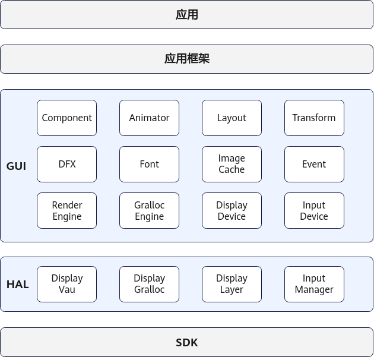

-   **各模块介绍**
    -   Component：应用组件，包括UIView、UIViewGroup、UIButton、UILabel、UILabelButton、UIList、UISlider等。
    -   Animator：动画模块，开发者可以自定义动画。
    -   Layout：布局控件，包括Flexlayout、GridLayout、ListLayout等。
    -   Transform：图形变换模块，包括旋转、平移、缩放等。
    -   DFX：维测模块。
    -   Font：字体模块，包括字库管理及多语言切换等。
    -   ImageCache：图片缓存模块，包括图片加载和释放功能以及LRU自动回收机制等。
    -   Event：事件模块，包括click、press、drag、long press等基础事件。
    -   Render Engine：渲染绘制模块。
    -   Gralloc Engine：图形内存管理模块。
    -   Display Device：图形显示管理模块。
    -   Input Device：输入设备管理模块。
    -   Display Vau：图形硬件渲染适配层。
    -   Display Gralloc：图形内存管理适配层。
    -   Display Layer：图层管理适配层。
    -   Input Manager：输入设备管理适配层。

-   **目录**

    ```
    middleware/services/gui  # uikit原生+自研
    ├── hal
    │   ├── display      # 显示相关功能的HAL层
    │   └── input        # 输入相关功能的HAL层
    └── uikit
         ├── ui       # UI模块，包括UI控件、动画、字体等功能
         ├── utils    # 图形基础库及南向适配层
         ├── proprietary  # 自研代码，包括新增控件及定制增强特性，以及graphic service服务等
         └── sample       # uikit演示用例
    ```

# 组件介绍<a name="ZH-CN_TOPIC_0000002466542668"></a>

-   **[概述](#ZH-CN_TOPIC_0000002466542560)**  

-   **[UIView和UIViewGroup](#ZH-CN_TOPIC_0000002499582081)**  

-   **[容器类组件](#ZH-CN_TOPIC_0000002509483493)**  

-   **[非容器类组件](#ZH-CN_TOPIC_0000002499501877)**  

## 概述<a name="ZH-CN_TOPIC_0000002466542560"></a>

所有组件均继承于UIView，组件分为基础组件和容器组件。

-   基础组件仅实现组件本身单一功能，例如UIButton、UILabel、UIImageView等。
-   容器类组件可以添加其他组件作为自身的子组件，例如RootView、UIList、UIPicker等。

本章主要介绍各个组件的使用，并以sample的形式呈现，指导用户开发。

**图 1**  组件继承关系图<a name="zh-cn_topic_0000002411206700_fig577310551194"></a>  

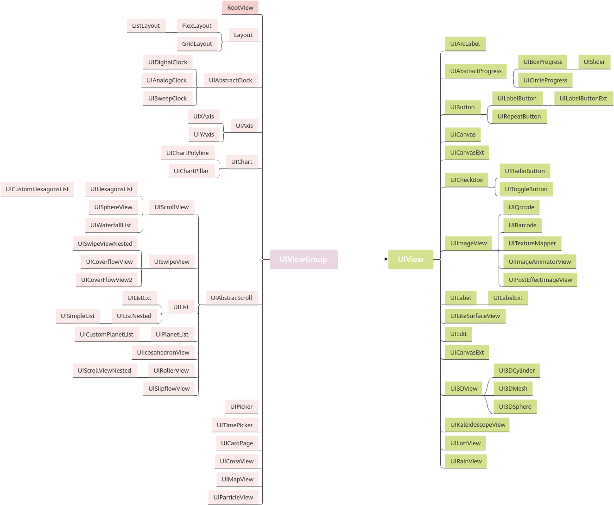

## UIView和UIViewGroup<a name="ZH-CN_TOPIC_0000002499582081"></a>

UIView为所有组件的父类，所有组件都继承自UIView，实现自定义扩展。例如UIViewGroup继承于UIView，并扩展其容器特性（允许添加其他组件）。

下面分别介绍了UIView和UIViewGroup的常用函数，同时也是所有派生组件的公共函数。

-   **[UIView函数介绍](#ZH-CN_TOPIC_0000002466542600)**  

-   **[UIView的监听器介绍](#ZH-CN_TOPIC_0000002466542576)**  

-   **[UIViewGroup介绍](#ZH-CN_TOPIC_0000002499581989)**  

### UIView函数介绍<a name="ZH-CN_TOPIC_0000002466542600"></a>

UIView常用函数如[表1](#zh-cn_topic_0000002444645809__table1590mcpsimp)所示，用户可以结合实际情况使用。

**表 1**  UIView常用函数说明

<a name="zh-cn_topic_0000002444645809__table1590mcpsimp"></a>
<table><thead align="left"><tr id="zh-cn_topic_0000002444645809_row3534mcpsimp"><th class="cellrowborder" valign="top" width="49.95%" id="mcps1.2.3.1.1"><p id="zh-cn_topic_0000002444645809_p3536mcpsimp"><a name="zh-cn_topic_0000002444645809_p3536mcpsimp"></a><a name="zh-cn_topic_0000002444645809_p3536mcpsimp"></a>函数</p>
</th>
<th class="cellrowborder" valign="top" width="50.05%" id="mcps1.2.3.1.2"><p id="zh-cn_topic_0000002444645809_p3538mcpsimp"><a name="zh-cn_topic_0000002444645809_p3538mcpsimp"></a><a name="zh-cn_topic_0000002444645809_p3538mcpsimp"></a>介绍</p>
</th>
</tr>
</thead>
<tbody><tr id="zh-cn_topic_0000002444645809_row3540mcpsimp"><td class="cellrowborder" valign="top" width="49.95%" headers="mcps1.2.3.1.1 "><p id="zh-cn_topic_0000002444645809_p3542mcpsimp"><a name="zh-cn_topic_0000002444645809_p3542mcpsimp"></a><a name="zh-cn_topic_0000002444645809_p3542mcpsimp"></a>virtual bool OnPreDraw(Rect& invalidatedArea) const</p>
</td>
<td class="cellrowborder" valign="top" width="50.05%" headers="mcps1.2.3.1.2 "><p id="zh-cn_topic_0000002444645809_p3544mcpsimp"><a name="zh-cn_topic_0000002444645809_p3544mcpsimp"></a><a name="zh-cn_topic_0000002444645809_p3544mcpsimp"></a>在绘制视图之前调用。该函数用于检查失效区域是否可以被该视图完全覆盖，以优化绘制过程。自定义的派生类按需重写该函数，实现定制化逻辑。</p>
</td>
</tr>
<tr id="zh-cn_topic_0000002444645809_row3545mcpsimp"><td class="cellrowborder" valign="top" width="49.95%" headers="mcps1.2.3.1.1 "><p id="zh-cn_topic_0000002444645809_p3547mcpsimp"><a name="zh-cn_topic_0000002444645809_p3547mcpsimp"></a><a name="zh-cn_topic_0000002444645809_p3547mcpsimp"></a>virtual void OnDraw(const Rect& invalidatedArea)</p>
</td>
<td class="cellrowborder" valign="top" width="50.05%" headers="mcps1.2.3.1.2 "><p id="zh-cn_topic_0000002444645809_p3549mcpsimp"><a name="zh-cn_topic_0000002444645809_p3549mcpsimp"></a><a name="zh-cn_topic_0000002444645809_p3549mcpsimp"></a>通过调用当前OnDraw函数来绘制。自定义的派生类按需重写该函数，实现定制化逻辑。</p>
</td>
</tr>
<tr id="zh-cn_topic_0000002444645809_row3550mcpsimp"><td class="cellrowborder" valign="top" width="49.95%" headers="mcps1.2.3.1.1 "><p id="zh-cn_topic_0000002444645809_p3552mcpsimp"><a name="zh-cn_topic_0000002444645809_p3552mcpsimp"></a><a name="zh-cn_topic_0000002444645809_p3552mcpsimp"></a>virtual void OnPostDraw(const Rect& invalidatedArea)</p>
</td>
<td class="cellrowborder" valign="top" width="50.05%" headers="mcps1.2.3.1.2 "><p id="zh-cn_topic_0000002444645809_p3554mcpsimp"><a name="zh-cn_topic_0000002444645809_p3554mcpsimp"></a><a name="zh-cn_topic_0000002444645809_p3554mcpsimp"></a>调用OnDraw函数后的调用该函数。自定义的派生类按需重写该函数，实现定制化逻辑。</p>
</td>
</tr>
<tr id="zh-cn_topic_0000002444645809_row3555mcpsimp"><td class="cellrowborder" valign="top" width="49.95%" headers="mcps1.2.3.1.1 "><p id="zh-cn_topic_0000002444645809_p3557mcpsimp"><a name="zh-cn_topic_0000002444645809_p3557mcpsimp"></a><a name="zh-cn_topic_0000002444645809_p3557mcpsimp"></a>virtual void ReMeasure()</p>
</td>
<td class="cellrowborder" valign="top" width="50.05%" headers="mcps1.2.3.1.2 "><p id="zh-cn_topic_0000002444645809_p3559mcpsimp"><a name="zh-cn_topic_0000002444645809_p3559mcpsimp"></a><a name="zh-cn_topic_0000002444645809_p3559mcpsimp"></a>重新测量视图大小。</p>
</td>
</tr>
<tr id="zh-cn_topic_0000002444645809_row3560mcpsimp"><td class="cellrowborder" valign="top" width="49.95%" headers="mcps1.2.3.1.1 "><p id="zh-cn_topic_0000002444645809_p3562mcpsimp"><a name="zh-cn_topic_0000002444645809_p3562mcpsimp"></a><a name="zh-cn_topic_0000002444645809_p3562mcpsimp"></a>void Invalidate()</p>
</td>
<td class="cellrowborder" valign="top" width="50.05%" headers="mcps1.2.3.1.2 "><p id="zh-cn_topic_0000002444645809_p3564mcpsimp"><a name="zh-cn_topic_0000002444645809_p3564mcpsimp"></a><a name="zh-cn_topic_0000002444645809_p3564mcpsimp"></a>刷新视图的区域。</p>
</td>
</tr>
<tr id="zh-cn_topic_0000002444645809_row3565mcpsimp"><td class="cellrowborder" valign="top" width="49.95%" headers="mcps1.2.3.1.1 "><p id="zh-cn_topic_0000002444645809_p3567mcpsimp"><a name="zh-cn_topic_0000002444645809_p3567mcpsimp"></a><a name="zh-cn_topic_0000002444645809_p3567mcpsimp"></a>void InvalidateRect(const Rect& invalidatedArea)</p>
</td>
<td class="cellrowborder" valign="top" width="50.05%" headers="mcps1.2.3.1.2 "><p id="zh-cn_topic_0000002444645809_p3569mcpsimp"><a name="zh-cn_topic_0000002444645809_p3569mcpsimp"></a><a name="zh-cn_topic_0000002444645809_p3569mcpsimp"></a>刷新视图的指定区域。</p>
</td>
</tr>
<tr id="zh-cn_topic_0000002444645809_row3570mcpsimp"><td class="cellrowborder" valign="top" width="49.95%" headers="mcps1.2.3.1.1 "><p id="zh-cn_topic_0000002444645809_p3572mcpsimp"><a name="zh-cn_topic_0000002444645809_p3572mcpsimp"></a><a name="zh-cn_topic_0000002444645809_p3572mcpsimp"></a>void SetParent(UIView* parent)</p>
</td>
<td class="cellrowborder" valign="top" width="50.05%" headers="mcps1.2.3.1.2 "><p id="zh-cn_topic_0000002444645809_p3574mcpsimp"><a name="zh-cn_topic_0000002444645809_p3574mcpsimp"></a><a name="zh-cn_topic_0000002444645809_p3574mcpsimp"></a>设置视图的父视图。</p>
</td>
</tr>
<tr id="zh-cn_topic_0000002444645809_row3575mcpsimp"><td class="cellrowborder" valign="top" width="49.95%" headers="mcps1.2.3.1.1 "><p id="zh-cn_topic_0000002444645809_p3577mcpsimp"><a name="zh-cn_topic_0000002444645809_p3577mcpsimp"></a><a name="zh-cn_topic_0000002444645809_p3577mcpsimp"></a>UIView* GetParent() const</p>
</td>
<td class="cellrowborder" valign="top" width="50.05%" headers="mcps1.2.3.1.2 "><p id="zh-cn_topic_0000002444645809_p3579mcpsimp"><a name="zh-cn_topic_0000002444645809_p3579mcpsimp"></a><a name="zh-cn_topic_0000002444645809_p3579mcpsimp"></a>获取视图的父视图。</p>
</td>
</tr>
<tr id="zh-cn_topic_0000002444645809_row3580mcpsimp"><td class="cellrowborder" valign="top" width="49.95%" headers="mcps1.2.3.1.1 "><p id="zh-cn_topic_0000002444645809_p3582mcpsimp"><a name="zh-cn_topic_0000002444645809_p3582mcpsimp"></a><a name="zh-cn_topic_0000002444645809_p3582mcpsimp"></a>void SetNextSibling(UIView* sibling)</p>
</td>
<td class="cellrowborder" valign="top" width="50.05%" headers="mcps1.2.3.1.2 "><p id="zh-cn_topic_0000002444645809_p3584mcpsimp"><a name="zh-cn_topic_0000002444645809_p3584mcpsimp"></a><a name="zh-cn_topic_0000002444645809_p3584mcpsimp"></a>设置视图的下一个同级视图。</p>
</td>
</tr>
<tr id="zh-cn_topic_0000002444645809_row3585mcpsimp"><td class="cellrowborder" valign="top" width="49.95%" headers="mcps1.2.3.1.1 "><p id="zh-cn_topic_0000002444645809_p3587mcpsimp"><a name="zh-cn_topic_0000002444645809_p3587mcpsimp"></a><a name="zh-cn_topic_0000002444645809_p3587mcpsimp"></a>UIView* GetNextSibling() const</p>
</td>
<td class="cellrowborder" valign="top" width="50.05%" headers="mcps1.2.3.1.2 "><p id="zh-cn_topic_0000002444645809_p3589mcpsimp"><a name="zh-cn_topic_0000002444645809_p3589mcpsimp"></a><a name="zh-cn_topic_0000002444645809_p3589mcpsimp"></a>获取视图的下一个同级视图。</p>
</td>
</tr>
<tr id="zh-cn_topic_0000002444645809_row3590mcpsimp"><td class="cellrowborder" valign="top" width="49.95%" headers="mcps1.2.3.1.1 "><p id="zh-cn_topic_0000002444645809_p3592mcpsimp"><a name="zh-cn_topic_0000002444645809_p3592mcpsimp"></a><a name="zh-cn_topic_0000002444645809_p3592mcpsimp"></a>virtual void SetVisible(bool visible)</p>
</td>
<td class="cellrowborder" valign="top" width="50.05%" headers="mcps1.2.3.1.2 "><p id="zh-cn_topic_0000002444645809_p3594mcpsimp"><a name="zh-cn_topic_0000002444645809_p3594mcpsimp"></a><a name="zh-cn_topic_0000002444645809_p3594mcpsimp"></a>设置视图是否可见。</p>
</td>
</tr>
<tr id="zh-cn_topic_0000002444645809_row3595mcpsimp"><td class="cellrowborder" valign="top" width="49.95%" headers="mcps1.2.3.1.1 "><p id="zh-cn_topic_0000002444645809_p3597mcpsimp"><a name="zh-cn_topic_0000002444645809_p3597mcpsimp"></a><a name="zh-cn_topic_0000002444645809_p3597mcpsimp"></a>bool IsVisible() const</p>
</td>
<td class="cellrowborder" valign="top" width="50.05%" headers="mcps1.2.3.1.2 "><p id="zh-cn_topic_0000002444645809_p3599mcpsimp"><a name="zh-cn_topic_0000002444645809_p3599mcpsimp"></a><a name="zh-cn_topic_0000002444645809_p3599mcpsimp"></a>获取视图是否可见。</p>
</td>
</tr>
<tr id="zh-cn_topic_0000002444645809_row3600mcpsimp"><td class="cellrowborder" valign="top" width="49.95%" headers="mcps1.2.3.1.1 "><p id="zh-cn_topic_0000002444645809_p3602mcpsimp"><a name="zh-cn_topic_0000002444645809_p3602mcpsimp"></a><a name="zh-cn_topic_0000002444645809_p3602mcpsimp"></a>void SetTouchable(bool touch)</p>
</td>
<td class="cellrowborder" valign="top" width="50.05%" headers="mcps1.2.3.1.2 "><p id="zh-cn_topic_0000002444645809_p3604mcpsimp"><a name="zh-cn_topic_0000002444645809_p3604mcpsimp"></a><a name="zh-cn_topic_0000002444645809_p3604mcpsimp"></a>设置视图是否可触摸。</p>
</td>
</tr>
<tr id="zh-cn_topic_0000002444645809_row3605mcpsimp"><td class="cellrowborder" valign="top" width="49.95%" headers="mcps1.2.3.1.1 "><p id="zh-cn_topic_0000002444645809_p3607mcpsimp"><a name="zh-cn_topic_0000002444645809_p3607mcpsimp"></a><a name="zh-cn_topic_0000002444645809_p3607mcpsimp"></a>bool IsTouchable() const</p>
</td>
<td class="cellrowborder" valign="top" width="50.05%" headers="mcps1.2.3.1.2 "><p id="zh-cn_topic_0000002444645809_p3609mcpsimp"><a name="zh-cn_topic_0000002444645809_p3609mcpsimp"></a><a name="zh-cn_topic_0000002444645809_p3609mcpsimp"></a>获取视图是否可触摸。</p>
</td>
</tr>
<tr id="zh-cn_topic_0000002444645809_row3610mcpsimp"><td class="cellrowborder" valign="top" width="49.95%" headers="mcps1.2.3.1.1 "><p id="zh-cn_topic_0000002444645809_p3612mcpsimp"><a name="zh-cn_topic_0000002444645809_p3612mcpsimp"></a><a name="zh-cn_topic_0000002444645809_p3612mcpsimp"></a>void SetDraggable(bool draggable)</p>
</td>
<td class="cellrowborder" valign="top" width="50.05%" headers="mcps1.2.3.1.2 "><p id="zh-cn_topic_0000002444645809_p3614mcpsimp"><a name="zh-cn_topic_0000002444645809_p3614mcpsimp"></a><a name="zh-cn_topic_0000002444645809_p3614mcpsimp"></a>设置视图是否可拖动。</p>
<p id="zh-cn_topic_0000002444645809_p3615mcpsimp"><a name="zh-cn_topic_0000002444645809_p3615mcpsimp"></a><a name="zh-cn_topic_0000002444645809_p3615mcpsimp"></a><strong id="zh-cn_topic_0000002444645809_b153951235142519"><a name="zh-cn_topic_0000002444645809_b153951235142519"></a><a name="zh-cn_topic_0000002444645809_b153951235142519"></a>注意：可拖动的前提为可触摸，仅这两个属性均被设置为true时，才能支持拖动交互。</strong></p>
</td>
</tr>
<tr id="zh-cn_topic_0000002444645809_row3616mcpsimp"><td class="cellrowborder" valign="top" width="49.95%" headers="mcps1.2.3.1.1 "><p id="zh-cn_topic_0000002444645809_p3618mcpsimp"><a name="zh-cn_topic_0000002444645809_p3618mcpsimp"></a><a name="zh-cn_topic_0000002444645809_p3618mcpsimp"></a>bool IsDraggable() const</p>
</td>
<td class="cellrowborder" valign="top" width="50.05%" headers="mcps1.2.3.1.2 "><p id="zh-cn_topic_0000002444645809_p3620mcpsimp"><a name="zh-cn_topic_0000002444645809_p3620mcpsimp"></a><a name="zh-cn_topic_0000002444645809_p3620mcpsimp"></a>获取视图是否可拖动。</p>
</td>
</tr>
<tr id="zh-cn_topic_0000002444645809_row3621mcpsimp"><td class="cellrowborder" valign="top" width="49.95%" headers="mcps1.2.3.1.1 "><p id="zh-cn_topic_0000002444645809_p3623mcpsimp"><a name="zh-cn_topic_0000002444645809_p3623mcpsimp"></a><a name="zh-cn_topic_0000002444645809_p3623mcpsimp"></a>void SetDragParentInstead(bool dragParentInstead)</p>
</td>
<td class="cellrowborder" valign="top" width="50.05%" headers="mcps1.2.3.1.2 "><p id="zh-cn_topic_0000002444645809_p3625mcpsimp"><a name="zh-cn_topic_0000002444645809_p3625mcpsimp"></a><a name="zh-cn_topic_0000002444645809_p3625mcpsimp"></a>设置拖动视图时是否将拖动事件传递给父视图进行处理。</p>
<p id="zh-cn_topic_0000002444645809_p13464152511616"><a name="zh-cn_topic_0000002444645809_p13464152511616"></a><a name="zh-cn_topic_0000002444645809_p13464152511616"></a><strong id="zh-cn_topic_0000002444645809_b5564153110254"><a name="zh-cn_topic_0000002444645809_b5564153110254"></a><a name="zh-cn_topic_0000002444645809_b5564153110254"></a>注意：在嵌套场景中，如果父子控件都需要响应拖动事件，子控件该属性应当确保已经被设置为false，否则子控件的拖拽事件会被传递到父控件，导致子控件的拖拽事件不响应。</strong></p>
</td>
</tr>
<tr id="zh-cn_topic_0000002444645809_row3626mcpsimp"><td class="cellrowborder" valign="top" width="49.95%" headers="mcps1.2.3.1.1 "><p id="zh-cn_topic_0000002444645809_p3628mcpsimp"><a name="zh-cn_topic_0000002444645809_p3628mcpsimp"></a><a name="zh-cn_topic_0000002444645809_p3628mcpsimp"></a>bool IsDragParentInstead() const</p>
</td>
<td class="cellrowborder" valign="top" width="50.05%" headers="mcps1.2.3.1.2 "><p id="zh-cn_topic_0000002444645809_p3630mcpsimp"><a name="zh-cn_topic_0000002444645809_p3630mcpsimp"></a><a name="zh-cn_topic_0000002444645809_p3630mcpsimp"></a>获取是否拖动事件会传递给父视图进行处理。</p>
</td>
</tr>
<tr id="zh-cn_topic_0000002444645809_row3631mcpsimp"><td class="cellrowborder" valign="top" width="49.95%" headers="mcps1.2.3.1.1 "><p id="zh-cn_topic_0000002444645809_p3633mcpsimp"><a name="zh-cn_topic_0000002444645809_p3633mcpsimp"></a><a name="zh-cn_topic_0000002444645809_p3633mcpsimp"></a>Rect GetRect() const</p>
</td>
<td class="cellrowborder" valign="top" width="50.05%" headers="mcps1.2.3.1.2 "><p id="zh-cn_topic_0000002444645809_p3635mcpsimp"><a name="zh-cn_topic_0000002444645809_p3635mcpsimp"></a><a name="zh-cn_topic_0000002444645809_p3635mcpsimp"></a>获取视图的绝对矩形区域，如经仿射变换，则为变换后的有效区域。</p>
</td>
</tr>
<tr id="zh-cn_topic_0000002444645809_row3636mcpsimp"><td class="cellrowborder" valign="top" width="49.95%" headers="mcps1.2.3.1.1 "><p id="zh-cn_topic_0000002444645809_p3638mcpsimp"><a name="zh-cn_topic_0000002444645809_p3638mcpsimp"></a><a name="zh-cn_topic_0000002444645809_p3638mcpsimp"></a>Rect GetVisibleRect() const</p>
</td>
<td class="cellrowborder" valign="top" width="50.05%" headers="mcps1.2.3.1.2 "><p id="zh-cn_topic_0000002444645809_p3640mcpsimp"><a name="zh-cn_topic_0000002444645809_p3640mcpsimp"></a><a name="zh-cn_topic_0000002444645809_p3640mcpsimp"></a>获取可见的绝对矩形区域。</p>
</td>
</tr>
<tr id="zh-cn_topic_0000002444645809_row3641mcpsimp"><td class="cellrowborder" valign="top" width="49.95%" headers="mcps1.2.3.1.1 "><p id="zh-cn_topic_0000002444645809_p3643mcpsimp"><a name="zh-cn_topic_0000002444645809_p3643mcpsimp"></a><a name="zh-cn_topic_0000002444645809_p3643mcpsimp"></a>Rect GetMaskedRect() const</p>
</td>
<td class="cellrowborder" valign="top" width="50.05%" headers="mcps1.2.3.1.2 "><p id="zh-cn_topic_0000002444645809_p3645mcpsimp"><a name="zh-cn_topic_0000002444645809_p3645mcpsimp"></a><a name="zh-cn_topic_0000002444645809_p3645mcpsimp"></a>获取有效的绝对矩形区域。</p>
</td>
</tr>
<tr id="zh-cn_topic_0000002444645809_row3646mcpsimp"><td class="cellrowborder" valign="top" width="49.95%" headers="mcps1.2.3.1.1 "><p id="zh-cn_topic_0000002444645809_p3648mcpsimp"><a name="zh-cn_topic_0000002444645809_p3648mcpsimp"></a><a name="zh-cn_topic_0000002444645809_p3648mcpsimp"></a>Rect GetOrigRect() const</p>
</td>
<td class="cellrowborder" valign="top" width="50.05%" headers="mcps1.2.3.1.2 "><p id="zh-cn_topic_0000002444645809_p3650mcpsimp"><a name="zh-cn_topic_0000002444645809_p3650mcpsimp"></a><a name="zh-cn_topic_0000002444645809_p3650mcpsimp"></a>获取控件设置的绝对矩形区域。</p>
</td>
</tr>
<tr id="zh-cn_topic_0000002444645809_row3651mcpsimp"><td class="cellrowborder" valign="top" width="49.95%" headers="mcps1.2.3.1.1 "><p id="zh-cn_topic_0000002444645809_p3653mcpsimp"><a name="zh-cn_topic_0000002444645809_p3653mcpsimp"></a><a name="zh-cn_topic_0000002444645809_p3653mcpsimp"></a>virtual Rect GetContentRect()</p>
</td>
<td class="cellrowborder" valign="top" width="50.05%" headers="mcps1.2.3.1.2 "><p id="zh-cn_topic_0000002444645809_p3655mcpsimp"><a name="zh-cn_topic_0000002444645809_p3655mcpsimp"></a><a name="zh-cn_topic_0000002444645809_p3655mcpsimp"></a>获取控件内容的绝对矩形区域，不包含padding和border。</p>
</td>
</tr>
<tr id="zh-cn_topic_0000002444645809_row3656mcpsimp"><td class="cellrowborder" valign="top" width="49.95%" headers="mcps1.2.3.1.1 "><p id="zh-cn_topic_0000002444645809_p3658mcpsimp"><a name="zh-cn_topic_0000002444645809_p3658mcpsimp"></a><a name="zh-cn_topic_0000002444645809_p3658mcpsimp"></a>Rect GetRelativeRect() const</p>
</td>
<td class="cellrowborder" valign="top" width="50.05%" headers="mcps1.2.3.1.2 "><p id="zh-cn_topic_0000002444645809_p3660mcpsimp"><a name="zh-cn_topic_0000002444645809_p3660mcpsimp"></a><a name="zh-cn_topic_0000002444645809_p3660mcpsimp"></a>获取相对于父视图的相对矩形区域。</p>
</td>
</tr>
<tr id="zh-cn_topic_0000002444645809_row3661mcpsimp"><td class="cellrowborder" valign="top" width="49.95%" headers="mcps1.2.3.1.1 "><p id="zh-cn_topic_0000002444645809_p3663mcpsimp"><a name="zh-cn_topic_0000002444645809_p3663mcpsimp"></a><a name="zh-cn_topic_0000002444645809_p3663mcpsimp"></a>void ResizeVisibleArea(int16_t x, int16_t y, int16_t width, int16_t height)</p>
</td>
<td class="cellrowborder" valign="top" width="50.05%" headers="mcps1.2.3.1.2 "><p id="zh-cn_topic_0000002444645809_p3665mcpsimp"><a name="zh-cn_topic_0000002444645809_p3665mcpsimp"></a><a name="zh-cn_topic_0000002444645809_p3665mcpsimp"></a>调整可见区域的大小。此操作可能会影响最终显示大小。</p>
</td>
</tr>
<tr id="zh-cn_topic_0000002444645809_row3666mcpsimp"><td class="cellrowborder" valign="top" width="49.95%" headers="mcps1.2.3.1.1 "><p id="zh-cn_topic_0000002444645809_p3668mcpsimp"><a name="zh-cn_topic_0000002444645809_p3668mcpsimp"></a><a name="zh-cn_topic_0000002444645809_p3668mcpsimp"></a>virtual void SetWidth(int16_t width)</p>
</td>
<td class="cellrowborder" valign="top" width="50.05%" headers="mcps1.2.3.1.2 "><p id="zh-cn_topic_0000002444645809_p3670mcpsimp"><a name="zh-cn_topic_0000002444645809_p3670mcpsimp"></a><a name="zh-cn_topic_0000002444645809_p3670mcpsimp"></a>设置视图的宽度。</p>
</td>
</tr>
<tr id="zh-cn_topic_0000002444645809_row3671mcpsimp"><td class="cellrowborder" valign="top" width="49.95%" headers="mcps1.2.3.1.1 "><p id="zh-cn_topic_0000002444645809_p3673mcpsimp"><a name="zh-cn_topic_0000002444645809_p3673mcpsimp"></a><a name="zh-cn_topic_0000002444645809_p3673mcpsimp"></a>virtual void SetHeight(int16_t height)</p>
</td>
<td class="cellrowborder" valign="top" width="50.05%" headers="mcps1.2.3.1.2 "><p id="zh-cn_topic_0000002444645809_p3675mcpsimp"><a name="zh-cn_topic_0000002444645809_p3675mcpsimp"></a><a name="zh-cn_topic_0000002444645809_p3675mcpsimp"></a>设置视图的高度。</p>
</td>
</tr>
<tr id="zh-cn_topic_0000002444645809_row3676mcpsimp"><td class="cellrowborder" valign="top" width="49.95%" headers="mcps1.2.3.1.1 "><p id="zh-cn_topic_0000002444645809_p3678mcpsimp"><a name="zh-cn_topic_0000002444645809_p3678mcpsimp"></a><a name="zh-cn_topic_0000002444645809_p3678mcpsimp"></a>virtual void SetWidthPercent(float widthPercent)</p>
</td>
<td class="cellrowborder" valign="top" width="50.05%" headers="mcps1.2.3.1.2 "><p id="zh-cn_topic_0000002444645809_p3680mcpsimp"><a name="zh-cn_topic_0000002444645809_p3680mcpsimp"></a><a name="zh-cn_topic_0000002444645809_p3680mcpsimp"></a>按照相对于父视图的百分比来设置宽度。</p>
</td>
</tr>
<tr id="zh-cn_topic_0000002444645809_row3681mcpsimp"><td class="cellrowborder" valign="top" width="49.95%" headers="mcps1.2.3.1.1 "><p id="zh-cn_topic_0000002444645809_p3683mcpsimp"><a name="zh-cn_topic_0000002444645809_p3683mcpsimp"></a><a name="zh-cn_topic_0000002444645809_p3683mcpsimp"></a>virtual void SetHeightPercent(float heightPercent)</p>
</td>
<td class="cellrowborder" valign="top" width="50.05%" headers="mcps1.2.3.1.2 "><p id="zh-cn_topic_0000002444645809_p3685mcpsimp"><a name="zh-cn_topic_0000002444645809_p3685mcpsimp"></a><a name="zh-cn_topic_0000002444645809_p3685mcpsimp"></a>按照相对于父视图的百分比来设置高度。</p>
</td>
</tr>
<tr id="zh-cn_topic_0000002444645809_row3686mcpsimp"><td class="cellrowborder" valign="top" width="49.95%" headers="mcps1.2.3.1.1 "><p id="zh-cn_topic_0000002444645809_p3688mcpsimp"><a name="zh-cn_topic_0000002444645809_p3688mcpsimp"></a><a name="zh-cn_topic_0000002444645809_p3688mcpsimp"></a>virtual void Resize(int16_t width, int16_t height)</p>
</td>
<td class="cellrowborder" valign="top" width="50.05%" headers="mcps1.2.3.1.2 "><p id="zh-cn_topic_0000002444645809_p3690mcpsimp"><a name="zh-cn_topic_0000002444645809_p3690mcpsimp"></a><a name="zh-cn_topic_0000002444645809_p3690mcpsimp"></a>调整当前视图大小。</p>
</td>
</tr>
<tr id="zh-cn_topic_0000002444645809_row3691mcpsimp"><td class="cellrowborder" valign="top" width="49.95%" headers="mcps1.2.3.1.1 "><p id="zh-cn_topic_0000002444645809_p3693mcpsimp"><a name="zh-cn_topic_0000002444645809_p3693mcpsimp"></a><a name="zh-cn_topic_0000002444645809_p3693mcpsimp"></a>virtual void SetPosition(int16_t x, int16_t y)</p>
</td>
<td class="cellrowborder" valign="top" width="50.05%" headers="mcps1.2.3.1.2 "><p id="zh-cn_topic_0000002444645809_p3695mcpsimp"><a name="zh-cn_topic_0000002444645809_p3695mcpsimp"></a><a name="zh-cn_topic_0000002444645809_p3695mcpsimp"></a>设置当前视图的起始点坐标。</p>
</td>
</tr>
<tr id="zh-cn_topic_0000002444645809_row3696mcpsimp"><td class="cellrowborder" valign="top" width="49.95%" headers="mcps1.2.3.1.1 "><p id="zh-cn_topic_0000002444645809_p3698mcpsimp"><a name="zh-cn_topic_0000002444645809_p3698mcpsimp"></a><a name="zh-cn_topic_0000002444645809_p3698mcpsimp"></a>virtual void SetPosition(int16_t x, int16_t y, int16_t width, int16_t height)</p>
</td>
<td class="cellrowborder" valign="top" width="50.05%" headers="mcps1.2.3.1.2 "><p id="zh-cn_topic_0000002444645809_p3700mcpsimp"><a name="zh-cn_topic_0000002444645809_p3700mcpsimp"></a><a name="zh-cn_topic_0000002444645809_p3700mcpsimp"></a>设置视图的X、Y坐标以及宽高。</p>
</td>
</tr>
<tr id="zh-cn_topic_0000002444645809_row3701mcpsimp"><td class="cellrowborder" valign="top" width="49.95%" headers="mcps1.2.3.1.1 "><p id="zh-cn_topic_0000002444645809_p3703mcpsimp"><a name="zh-cn_topic_0000002444645809_p3703mcpsimp"></a><a name="zh-cn_topic_0000002444645809_p3703mcpsimp"></a>virtual void SetPositionPercent(float xPercent, float yPercent, float widthPercent, float heightPercent)</p>
</td>
<td class="cellrowborder" valign="top" width="50.05%" headers="mcps1.2.3.1.2 "><p id="zh-cn_topic_0000002444645809_p3705mcpsimp"><a name="zh-cn_topic_0000002444645809_p3705mcpsimp"></a><a name="zh-cn_topic_0000002444645809_p3705mcpsimp"></a>按照父视图的百分比来设置X、Y坐标以及宽高。</p>
</td>
</tr>
<tr id="zh-cn_topic_0000002444645809_row3706mcpsimp"><td class="cellrowborder" valign="top" width="49.95%" headers="mcps1.2.3.1.1 "><p id="zh-cn_topic_0000002444645809_p3708mcpsimp"><a name="zh-cn_topic_0000002444645809_p3708mcpsimp"></a><a name="zh-cn_topic_0000002444645809_p3708mcpsimp"></a>virtual void ResizePercent(float widthPercent, float heightPercent)</p>
</td>
<td class="cellrowborder" valign="top" width="50.05%" headers="mcps1.2.3.1.2 "><p id="zh-cn_topic_0000002444645809_p3710mcpsimp"><a name="zh-cn_topic_0000002444645809_p3710mcpsimp"></a><a name="zh-cn_topic_0000002444645809_p3710mcpsimp"></a>按照父视图的百分比来设置宽高。</p>
</td>
</tr>
<tr id="zh-cn_topic_0000002444645809_row3711mcpsimp"><td class="cellrowborder" valign="top" width="49.95%" headers="mcps1.2.3.1.1 "><p id="zh-cn_topic_0000002444645809_p3713mcpsimp"><a name="zh-cn_topic_0000002444645809_p3713mcpsimp"></a><a name="zh-cn_topic_0000002444645809_p3713mcpsimp"></a>virtual void SetX(int16_t x)</p>
</td>
<td class="cellrowborder" valign="top" width="50.05%" headers="mcps1.2.3.1.2 "><p id="zh-cn_topic_0000002444645809_p3715mcpsimp"><a name="zh-cn_topic_0000002444645809_p3715mcpsimp"></a><a name="zh-cn_topic_0000002444645809_p3715mcpsimp"></a>设置视图左上点的X坐标。</p>
</td>
</tr>
<tr id="zh-cn_topic_0000002444645809_row3716mcpsimp"><td class="cellrowborder" valign="top" width="49.95%" headers="mcps1.2.3.1.1 "><p id="zh-cn_topic_0000002444645809_p3718mcpsimp"><a name="zh-cn_topic_0000002444645809_p3718mcpsimp"></a><a name="zh-cn_topic_0000002444645809_p3718mcpsimp"></a>virtual void SetXPercent(float xPercent)</p>
</td>
<td class="cellrowborder" valign="top" width="50.05%" headers="mcps1.2.3.1.2 "><p id="zh-cn_topic_0000002444645809_p3720mcpsimp"><a name="zh-cn_topic_0000002444645809_p3720mcpsimp"></a><a name="zh-cn_topic_0000002444645809_p3720mcpsimp"></a>按照相对于父视图的百分比来设置X坐标。</p>
</td>
</tr>
<tr id="zh-cn_topic_0000002444645809_row3721mcpsimp"><td class="cellrowborder" valign="top" width="49.95%" headers="mcps1.2.3.1.1 "><p id="zh-cn_topic_0000002444645809_p3723mcpsimp"><a name="zh-cn_topic_0000002444645809_p3723mcpsimp"></a><a name="zh-cn_topic_0000002444645809_p3723mcpsimp"></a>int16_t GetX() const</p>
</td>
<td class="cellrowborder" valign="top" width="50.05%" headers="mcps1.2.3.1.2 "><p id="zh-cn_topic_0000002444645809_p3725mcpsimp"><a name="zh-cn_topic_0000002444645809_p3725mcpsimp"></a><a name="zh-cn_topic_0000002444645809_p3725mcpsimp"></a>获取视图的X坐标。</p>
</td>
</tr>
<tr id="zh-cn_topic_0000002444645809_row3726mcpsimp"><td class="cellrowborder" valign="top" width="49.95%" headers="mcps1.2.3.1.1 "><p id="zh-cn_topic_0000002444645809_p3728mcpsimp"><a name="zh-cn_topic_0000002444645809_p3728mcpsimp"></a><a name="zh-cn_topic_0000002444645809_p3728mcpsimp"></a>virtual void SetY(int16_t y)</p>
</td>
<td class="cellrowborder" valign="top" width="50.05%" headers="mcps1.2.3.1.2 "><p id="zh-cn_topic_0000002444645809_p3730mcpsimp"><a name="zh-cn_topic_0000002444645809_p3730mcpsimp"></a><a name="zh-cn_topic_0000002444645809_p3730mcpsimp"></a>设置视图左上点的Y坐标。</p>
</td>
</tr>
<tr id="zh-cn_topic_0000002444645809_row3731mcpsimp"><td class="cellrowborder" valign="top" width="49.95%" headers="mcps1.2.3.1.1 "><p id="zh-cn_topic_0000002444645809_p3733mcpsimp"><a name="zh-cn_topic_0000002444645809_p3733mcpsimp"></a><a name="zh-cn_topic_0000002444645809_p3733mcpsimp"></a>virtual void SetYPercent(float yPercent)</p>
</td>
<td class="cellrowborder" valign="top" width="50.05%" headers="mcps1.2.3.1.2 "><p id="zh-cn_topic_0000002444645809_p3735mcpsimp"><a name="zh-cn_topic_0000002444645809_p3735mcpsimp"></a><a name="zh-cn_topic_0000002444645809_p3735mcpsimp"></a>按照相对于父视图的百分比来设置Y坐标。</p>
</td>
</tr>
<tr id="zh-cn_topic_0000002444645809_row3736mcpsimp"><td class="cellrowborder" valign="top" width="49.95%" headers="mcps1.2.3.1.1 "><p id="zh-cn_topic_0000002444645809_p3738mcpsimp"><a name="zh-cn_topic_0000002444645809_p3738mcpsimp"></a><a name="zh-cn_topic_0000002444645809_p3738mcpsimp"></a>int16_t GetY() const</p>
</td>
<td class="cellrowborder" valign="top" width="50.05%" headers="mcps1.2.3.1.2 "><p id="zh-cn_topic_0000002444645809_p3740mcpsimp"><a name="zh-cn_topic_0000002444645809_p3740mcpsimp"></a><a name="zh-cn_topic_0000002444645809_p3740mcpsimp"></a>获取视图的Y坐标。</p>
</td>
</tr>
<tr id="zh-cn_topic_0000002444645809_row3741mcpsimp"><td class="cellrowborder" valign="top" width="49.95%" headers="mcps1.2.3.1.1 "><p id="zh-cn_topic_0000002444645809_p3743mcpsimp"><a name="zh-cn_topic_0000002444645809_p3743mcpsimp"></a><a name="zh-cn_topic_0000002444645809_p3743mcpsimp"></a>bool IsViewGroup() const</p>
</td>
<td class="cellrowborder" valign="top" width="50.05%" headers="mcps1.2.3.1.2 "><p id="zh-cn_topic_0000002444645809_p3745mcpsimp"><a name="zh-cn_topic_0000002444645809_p3745mcpsimp"></a><a name="zh-cn_topic_0000002444645809_p3745mcpsimp"></a>当前视图是否包含其他视图。</p>
</td>
</tr>
<tr id="zh-cn_topic_0000002444645809_row3746mcpsimp"><td class="cellrowborder" valign="top" width="49.95%" headers="mcps1.2.3.1.1 "><p id="zh-cn_topic_0000002444645809_p3748mcpsimp"><a name="zh-cn_topic_0000002444645809_p3748mcpsimp"></a><a name="zh-cn_topic_0000002444645809_p3748mcpsimp"></a>void SetIntercept(bool isIntercept)</p>
</td>
<td class="cellrowborder" valign="top" width="50.05%" headers="mcps1.2.3.1.2 "><p id="zh-cn_topic_0000002444645809_p1890916351306"><a name="zh-cn_topic_0000002444645809_p1890916351306"></a><a name="zh-cn_topic_0000002444645809_p1890916351306"></a>设置是否拦截事件。仅在未注册对应事件监听器时生效：</p>
<a name="zh-cn_topic_0000002444645809_ul1647110161017"></a><a name="zh-cn_topic_0000002444645809_ul1647110161017"></a><ul id="zh-cn_topic_0000002444645809_ul1647110161017"><li>如果值为true，则不会将事件传递到父视图。</li><li>如果值为false，则会将事件传递到父视图。</li></ul>
<p id="zh-cn_topic_0000002444645809_p3750mcpsimp"><a name="zh-cn_topic_0000002444645809_p3750mcpsimp"></a><a name="zh-cn_topic_0000002444645809_p3750mcpsimp"></a>已注册对应事件监听器时，则根据回调函数返回值判断（同上）是否已经消费事件而不传递给父视图。</p>
</td>
</tr>
<tr id="zh-cn_topic_0000002444645809_row3751mcpsimp"><td class="cellrowborder" valign="top" width="49.95%" headers="mcps1.2.3.1.1 "><p id="zh-cn_topic_0000002444645809_p3753mcpsimp"><a name="zh-cn_topic_0000002444645809_p3753mcpsimp"></a><a name="zh-cn_topic_0000002444645809_p3753mcpsimp"></a>bool IsIntercept()</p>
</td>
<td class="cellrowborder" valign="top" width="50.05%" headers="mcps1.2.3.1.2 "><p id="zh-cn_topic_0000002444645809_p3755mcpsimp"><a name="zh-cn_topic_0000002444645809_p3755mcpsimp"></a><a name="zh-cn_topic_0000002444645809_p3755mcpsimp"></a>获取是否拦截事件。</p>
</td>
</tr>
<tr id="zh-cn_topic_0000002444645809_row3756mcpsimp"><td class="cellrowborder" valign="top" width="49.95%" headers="mcps1.2.3.1.1 "><p id="zh-cn_topic_0000002444645809_p3758mcpsimp"><a name="zh-cn_topic_0000002444645809_p3758mcpsimp"></a><a name="zh-cn_topic_0000002444645809_p3758mcpsimp"></a>void SetTransformMap(const TransformMap& transMap)</p>
</td>
<td class="cellrowborder" valign="top" width="50.05%" headers="mcps1.2.3.1.2 "><p id="zh-cn_topic_0000002444645809_p3760mcpsimp"><a name="zh-cn_topic_0000002444645809_p3760mcpsimp"></a><a name="zh-cn_topic_0000002444645809_p3760mcpsimp"></a>设置视图的仿射变换。</p>
</td>
</tr>
<tr id="zh-cn_topic_0000002444645809_row3761mcpsimp"><td class="cellrowborder" valign="top" width="49.95%" headers="mcps1.2.3.1.1 "><p id="zh-cn_topic_0000002444645809_p3763mcpsimp"><a name="zh-cn_topic_0000002444645809_p3763mcpsimp"></a><a name="zh-cn_topic_0000002444645809_p3763mcpsimp"></a>TransformMap& GetTransformMap()</p>
</td>
<td class="cellrowborder" valign="top" width="50.05%" headers="mcps1.2.3.1.2 "><p id="zh-cn_topic_0000002444645809_p3765mcpsimp"><a name="zh-cn_topic_0000002444645809_p3765mcpsimp"></a><a name="zh-cn_topic_0000002444645809_p3765mcpsimp"></a>获取视图的仿射变换。</p>
</td>
</tr>
<tr id="zh-cn_topic_0000002444645809_row3766mcpsimp"><td class="cellrowborder" valign="top" width="49.95%" headers="mcps1.2.3.1.1 "><p id="zh-cn_topic_0000002444645809_p3768mcpsimp"><a name="zh-cn_topic_0000002444645809_p3768mcpsimp"></a><a name="zh-cn_topic_0000002444645809_p3768mcpsimp"></a>void SetViewId(const char* id)</p>
</td>
<td class="cellrowborder" valign="top" width="50.05%" headers="mcps1.2.3.1.2 "><p id="zh-cn_topic_0000002444645809_p3770mcpsimp"><a name="zh-cn_topic_0000002444645809_p3770mcpsimp"></a><a name="zh-cn_topic_0000002444645809_p3770mcpsimp"></a>给视图设置ID。</p>
</td>
</tr>
<tr id="zh-cn_topic_0000002444645809_row3771mcpsimp"><td class="cellrowborder" valign="top" width="49.95%" headers="mcps1.2.3.1.1 "><p id="zh-cn_topic_0000002444645809_p3773mcpsimp"><a name="zh-cn_topic_0000002444645809_p3773mcpsimp"></a><a name="zh-cn_topic_0000002444645809_p3773mcpsimp"></a>const char* GetViewId() const</p>
</td>
<td class="cellrowborder" valign="top" width="50.05%" headers="mcps1.2.3.1.2 "><p id="zh-cn_topic_0000002444645809_p3775mcpsimp"><a name="zh-cn_topic_0000002444645809_p3775mcpsimp"></a><a name="zh-cn_topic_0000002444645809_p3775mcpsimp"></a>获取视图的ID。</p>
</td>
</tr>
<tr id="zh-cn_topic_0000002444645809_row3776mcpsimp"><td class="cellrowborder" valign="top" width="49.95%" headers="mcps1.2.3.1.1 "><p id="zh-cn_topic_0000002444645809_p3778mcpsimp"><a name="zh-cn_topic_0000002444645809_p3778mcpsimp"></a><a name="zh-cn_topic_0000002444645809_p3778mcpsimp"></a>void SetViewIndex(int16_t index)</p>
</td>
<td class="cellrowborder" valign="top" width="50.05%" headers="mcps1.2.3.1.2 "><p id="zh-cn_topic_0000002444645809_p3780mcpsimp"><a name="zh-cn_topic_0000002444645809_p3780mcpsimp"></a><a name="zh-cn_topic_0000002444645809_p3780mcpsimp"></a>设置视图下标。</p>
</td>
</tr>
<tr id="zh-cn_topic_0000002444645809_row3781mcpsimp"><td class="cellrowborder" valign="top" width="49.95%" headers="mcps1.2.3.1.1 "><p id="zh-cn_topic_0000002444645809_p3783mcpsimp"><a name="zh-cn_topic_0000002444645809_p3783mcpsimp"></a><a name="zh-cn_topic_0000002444645809_p3783mcpsimp"></a>int16_t GetViewIndex() const</p>
</td>
<td class="cellrowborder" valign="top" width="50.05%" headers="mcps1.2.3.1.2 "><p id="zh-cn_topic_0000002444645809_p3785mcpsimp"><a name="zh-cn_topic_0000002444645809_p3785mcpsimp"></a><a name="zh-cn_topic_0000002444645809_p3785mcpsimp"></a>获取视图下标。</p>
</td>
</tr>
<tr id="zh-cn_topic_0000002444645809_row3786mcpsimp"><td class="cellrowborder" valign="top" width="49.95%" headers="mcps1.2.3.1.1 "><p id="zh-cn_topic_0000002444645809_p3788mcpsimp"><a name="zh-cn_topic_0000002444645809_p3788mcpsimp"></a><a name="zh-cn_topic_0000002444645809_p3788mcpsimp"></a>virtual UIViewType GetViewType() const</p>
</td>
<td class="cellrowborder" valign="top" width="50.05%" headers="mcps1.2.3.1.2 "><p id="zh-cn_topic_0000002444645809_p3790mcpsimp"><a name="zh-cn_topic_0000002444645809_p3790mcpsimp"></a><a name="zh-cn_topic_0000002444645809_p3790mcpsimp"></a>获取视图类型。</p>
</td>
</tr>
<tr id="zh-cn_topic_0000002444645809_row3791mcpsimp"><td class="cellrowborder" valign="top" width="49.95%" headers="mcps1.2.3.1.1 "><p id="zh-cn_topic_0000002444645809_p3793mcpsimp"><a name="zh-cn_topic_0000002444645809_p3793mcpsimp"></a><a name="zh-cn_topic_0000002444645809_p3793mcpsimp"></a>void SetOpaScale(uint8_t opaScale)</p>
</td>
<td class="cellrowborder" valign="top" width="50.05%" headers="mcps1.2.3.1.2 "><p id="zh-cn_topic_0000002444645809_p3795mcpsimp"><a name="zh-cn_topic_0000002444645809_p3795mcpsimp"></a><a name="zh-cn_topic_0000002444645809_p3795mcpsimp"></a>设置视图的不透明度，合法值为[0，255]。</p>
</td>
</tr>
<tr id="zh-cn_topic_0000002444645809_row3796mcpsimp"><td class="cellrowborder" valign="top" width="49.95%" headers="mcps1.2.3.1.1 "><p id="zh-cn_topic_0000002444645809_p3798mcpsimp"><a name="zh-cn_topic_0000002444645809_p3798mcpsimp"></a><a name="zh-cn_topic_0000002444645809_p3798mcpsimp"></a>uint8_t GetOpaScale() const</p>
</td>
<td class="cellrowborder" valign="top" width="50.05%" headers="mcps1.2.3.1.2 "><p id="zh-cn_topic_0000002444645809_p3800mcpsimp"><a name="zh-cn_topic_0000002444645809_p3800mcpsimp"></a><a name="zh-cn_topic_0000002444645809_p3800mcpsimp"></a>获取视图的不透明度。</p>
</td>
</tr>
<tr id="zh-cn_topic_0000002444645809_row3801mcpsimp"><td class="cellrowborder" valign="top" width="49.95%" headers="mcps1.2.3.1.1 "><p id="zh-cn_topic_0000002444645809_p3803mcpsimp"><a name="zh-cn_topic_0000002444645809_p3803mcpsimp"></a><a name="zh-cn_topic_0000002444645809_p3803mcpsimp"></a>ViewExtraMsg* GetExtraMsg()</p>
</td>
<td class="cellrowborder" valign="top" width="50.05%" headers="mcps1.2.3.1.2 "><p id="zh-cn_topic_0000002444645809_p3805mcpsimp"><a name="zh-cn_topic_0000002444645809_p3805mcpsimp"></a><a name="zh-cn_topic_0000002444645809_p3805mcpsimp"></a>获取视图的额外信息。</p>
</td>
</tr>
<tr id="zh-cn_topic_0000002444645809_row3806mcpsimp"><td class="cellrowborder" valign="top" width="49.95%" headers="mcps1.2.3.1.1 "><p id="zh-cn_topic_0000002444645809_p3808mcpsimp"><a name="zh-cn_topic_0000002444645809_p3808mcpsimp"></a><a name="zh-cn_topic_0000002444645809_p3808mcpsimp"></a>void SetExtraMsg(ViewExtraMsg* extraMsg)</p>
</td>
<td class="cellrowborder" valign="top" width="50.05%" headers="mcps1.2.3.1.2 "><p id="zh-cn_topic_0000002444645809_p3810mcpsimp"><a name="zh-cn_topic_0000002444645809_p3810mcpsimp"></a><a name="zh-cn_topic_0000002444645809_p3810mcpsimp"></a>设置视图的额外信息。</p>
</td>
</tr>
<tr id="zh-cn_topic_0000002444645809_row3811mcpsimp"><td class="cellrowborder" valign="top" width="49.95%" headers="mcps1.2.3.1.1 "><p id="zh-cn_topic_0000002444645809_p3813mcpsimp"><a name="zh-cn_topic_0000002444645809_p3813mcpsimp"></a><a name="zh-cn_topic_0000002444645809_p3813mcpsimp"></a>void Rotate(int16_t angle, const Vector2&lt;float&gt;& pivot)</p>
</td>
<td class="cellrowborder" valign="top" width="50.05%" headers="mcps1.2.3.1.2 "><p id="zh-cn_topic_0000002444645809_p3815mcpsimp"><a name="zh-cn_topic_0000002444645809_p3815mcpsimp"></a><a name="zh-cn_topic_0000002444645809_p3815mcpsimp"></a>旋转该视图。</p>
<a name="zh-cn_topic_0000002444645809_ul3816mcpsimp"></a><a name="zh-cn_topic_0000002444645809_ul3816mcpsimp"></a><ul id="zh-cn_topic_0000002444645809_ul3816mcpsimp"><li>参数angle：旋转角度。</li><li>参数pivot：旋转中心点。</li></ul>
</td>
</tr>
<tr id="zh-cn_topic_0000002444645809_row3819mcpsimp"><td class="cellrowborder" valign="top" width="49.95%" headers="mcps1.2.3.1.1 "><p id="zh-cn_topic_0000002444645809_p3821mcpsimp"><a name="zh-cn_topic_0000002444645809_p3821mcpsimp"></a><a name="zh-cn_topic_0000002444645809_p3821mcpsimp"></a>void Rotate(int16_t angle, const Vector3&lt;float&gt;& pivotStart, const Vector3&lt;float&gt;& pivotEnd)</p>
</td>
<td class="cellrowborder" valign="top" width="50.05%" headers="mcps1.2.3.1.2 "><p id="zh-cn_topic_0000002444645809_p3823mcpsimp"><a name="zh-cn_topic_0000002444645809_p3823mcpsimp"></a><a name="zh-cn_topic_0000002444645809_p3823mcpsimp"></a>旋转该视图。</p>
<a name="zh-cn_topic_0000002444645809_ul3824mcpsimp"></a><a name="zh-cn_topic_0000002444645809_ul3824mcpsimp"></a><ul id="zh-cn_topic_0000002444645809_ul3824mcpsimp"><li>参数angle：旋转角度。</li><li>参数pivotStart：旋转起点。</li><li>参数pivotEnd：旋转终点。</li></ul>
</td>
</tr>
<tr id="zh-cn_topic_0000002444645809_row3828mcpsimp"><td class="cellrowborder" valign="top" width="49.95%" headers="mcps1.2.3.1.1 "><p id="zh-cn_topic_0000002444645809_p3830mcpsimp"><a name="zh-cn_topic_0000002444645809_p3830mcpsimp"></a><a name="zh-cn_topic_0000002444645809_p3830mcpsimp"></a>void Scale(const Vector2&lt;float&gt;& scale, const Vector2&lt;float&gt;& pivot)</p>
</td>
<td class="cellrowborder" valign="top" width="50.05%" headers="mcps1.2.3.1.2 "><p id="zh-cn_topic_0000002444645809_p3832mcpsimp"><a name="zh-cn_topic_0000002444645809_p3832mcpsimp"></a><a name="zh-cn_topic_0000002444645809_p3832mcpsimp"></a>缩放该视图。</p>
<a name="zh-cn_topic_0000002444645809_ul3833mcpsimp"></a><a name="zh-cn_topic_0000002444645809_ul3833mcpsimp"></a><ul id="zh-cn_topic_0000002444645809_ul3833mcpsimp"><li>参数scale：缩放系数（x, y）。</li><li>参数pivot：缩放中心点。</li></ul>
</td>
</tr>
<tr id="zh-cn_topic_0000002444645809_row3836mcpsimp"><td class="cellrowborder" valign="top" width="49.95%" headers="mcps1.2.3.1.1 "><p id="zh-cn_topic_0000002444645809_p3838mcpsimp"><a name="zh-cn_topic_0000002444645809_p3838mcpsimp"></a><a name="zh-cn_topic_0000002444645809_p3838mcpsimp"></a>void Scale(const Vector3&lt;float&gt;& scale, const Vector3&lt;float&gt;& pivot)</p>
</td>
<td class="cellrowborder" valign="top" width="50.05%" headers="mcps1.2.3.1.2 "><p id="zh-cn_topic_0000002444645809_p3840mcpsimp"><a name="zh-cn_topic_0000002444645809_p3840mcpsimp"></a><a name="zh-cn_topic_0000002444645809_p3840mcpsimp"></a>缩放该视图。</p>
<a name="zh-cn_topic_0000002444645809_ul3841mcpsimp"></a><a name="zh-cn_topic_0000002444645809_ul3841mcpsimp"></a><ul id="zh-cn_topic_0000002444645809_ul3841mcpsimp"><li>参数scale：缩放系数（x, y, z）。</li><li>参数pivot：缩放中心点。</li></ul>
</td>
</tr>
<tr id="zh-cn_topic_0000002444645809_row3844mcpsimp"><td class="cellrowborder" valign="top" width="49.95%" headers="mcps1.2.3.1.1 "><p id="zh-cn_topic_0000002444645809_p3846mcpsimp"><a name="zh-cn_topic_0000002444645809_p3846mcpsimp"></a><a name="zh-cn_topic_0000002444645809_p3846mcpsimp"></a>void Translate(const Vector2&lt;int16_t&gt;& trans)</p>
</td>
<td class="cellrowborder" valign="top" width="50.05%" headers="mcps1.2.3.1.2 "><p id="zh-cn_topic_0000002444645809_p3848mcpsimp"><a name="zh-cn_topic_0000002444645809_p3848mcpsimp"></a><a name="zh-cn_topic_0000002444645809_p3848mcpsimp"></a>平移该视图。</p>
<a name="zh-cn_topic_0000002444645809_ul15357279426"></a><a name="zh-cn_topic_0000002444645809_ul15357279426"></a><ul id="zh-cn_topic_0000002444645809_ul15357279426"><li>参数trans：平移系数（x, y）。</li></ul>
</td>
</tr>
<tr id="zh-cn_topic_0000002444645809_row3851mcpsimp"><td class="cellrowborder" valign="top" width="49.95%" headers="mcps1.2.3.1.1 "><p id="zh-cn_topic_0000002444645809_p3853mcpsimp"><a name="zh-cn_topic_0000002444645809_p3853mcpsimp"></a><a name="zh-cn_topic_0000002444645809_p3853mcpsimp"></a>void Translate(const Vector3&lt;int16_t&gt;& trans)</p>
</td>
<td class="cellrowborder" valign="top" width="50.05%" headers="mcps1.2.3.1.2 "><p id="zh-cn_topic_0000002444645809_p3855mcpsimp"><a name="zh-cn_topic_0000002444645809_p3855mcpsimp"></a><a name="zh-cn_topic_0000002444645809_p3855mcpsimp"></a>平移该视图。</p>
<a name="zh-cn_topic_0000002444645809_ul21548328426"></a><a name="zh-cn_topic_0000002444645809_ul21548328426"></a><ul id="zh-cn_topic_0000002444645809_ul21548328426"><li>参数trans：平移系数（x, y, z）。</li></ul>
</td>
</tr>
<tr id="zh-cn_topic_0000002444645809_row7476191824118"><td class="cellrowborder" valign="top" width="49.95%" headers="mcps1.2.3.1.1 "><p id="zh-cn_topic_0000002444645809_p114761218164113"><a name="zh-cn_topic_0000002444645809_p114761218164113"></a><a name="zh-cn_topic_0000002444645809_p114761218164113"></a>void SetCameraDistance(int16_t distance)</p>
</td>
<td class="cellrowborder" valign="top" width="50.05%" headers="mcps1.2.3.1.2 "><p id="zh-cn_topic_0000002444645809_p184761518144112"><a name="zh-cn_topic_0000002444645809_p184761518144112"></a><a name="zh-cn_topic_0000002444645809_p184761518144112"></a>设置视点距离（三维空间透视投影z轴方向）。</p>
<a name="zh-cn_topic_0000002444645809_ul171468366423"></a><a name="zh-cn_topic_0000002444645809_ul171468366423"></a><ul id="zh-cn_topic_0000002444645809_ul171468366423"><li>参数distance：视点距离。</li></ul>
</td>
</tr>
<tr id="zh-cn_topic_0000002444645809_row2072474814426"><td class="cellrowborder" valign="top" width="49.95%" headers="mcps1.2.3.1.1 "><p id="zh-cn_topic_0000002444645809_p1272474874214"><a name="zh-cn_topic_0000002444645809_p1272474874214"></a><a name="zh-cn_topic_0000002444645809_p1272474874214"></a>void SetCameraPosition(const Vector2&lt;float&gt;& position)</p>
</td>
<td class="cellrowborder" valign="top" width="50.05%" headers="mcps1.2.3.1.2 "><p id="zh-cn_topic_0000002444645809_p10724134820427"><a name="zh-cn_topic_0000002444645809_p10724134820427"></a><a name="zh-cn_topic_0000002444645809_p10724134820427"></a>设置视点位置（三维空间透视投影x、y平面位置）</p>
<a name="zh-cn_topic_0000002444645809_ul26428215440"></a><a name="zh-cn_topic_0000002444645809_ul26428215440"></a><ul id="zh-cn_topic_0000002444645809_ul26428215440"><li>参数position：视点位置。</li></ul>
</td>
</tr>
<tr id="zh-cn_topic_0000002444645809_row3857mcpsimp"><td class="cellrowborder" valign="top" width="49.95%" headers="mcps1.2.3.1.1 "><p id="zh-cn_topic_0000002444645809_p3859mcpsimp"><a name="zh-cn_topic_0000002444645809_p3859mcpsimp"></a><a name="zh-cn_topic_0000002444645809_p3859mcpsimp"></a>void Shear(const Vector2&lt;float&gt;& shearX, const Vector2&lt;float&gt;& shearY, const Vector2&lt;float&gt;& shearZ)</p>
</td>
<td class="cellrowborder" valign="top" width="50.05%" headers="mcps1.2.3.1.2 "><p id="zh-cn_topic_0000002444645809_p3861mcpsimp"><a name="zh-cn_topic_0000002444645809_p3861mcpsimp"></a><a name="zh-cn_topic_0000002444645809_p3861mcpsimp"></a>切变该视图。</p>
<a name="zh-cn_topic_0000002444645809_ul3862mcpsimp"></a><a name="zh-cn_topic_0000002444645809_ul3862mcpsimp"></a><ul id="zh-cn_topic_0000002444645809_ul3862mcpsimp"><li>参数shearX：x轴切变参数。</li><li>参数shearY：y轴切变参数。</li><li>参数shearZ：z轴切变参数。</li></ul>
</td>
</tr>
<tr id="zh-cn_topic_0000002444645809_row3866mcpsimp"><td class="cellrowborder" valign="top" width="49.95%" headers="mcps1.2.3.1.1 "><p id="zh-cn_topic_0000002444645809_p3868mcpsimp"><a name="zh-cn_topic_0000002444645809_p3868mcpsimp"></a><a name="zh-cn_topic_0000002444645809_p3868mcpsimp"></a>void SetOnDragListener(OnDragListener* onDragListener)</p>
</td>
<td class="cellrowborder" valign="top" width="50.05%" headers="mcps1.2.3.1.2 "><p id="zh-cn_topic_0000002444645809_p3870mcpsimp"><a name="zh-cn_topic_0000002444645809_p3870mcpsimp"></a><a name="zh-cn_topic_0000002444645809_p3870mcpsimp"></a>设置拖动事件监听。</p>
</td>
</tr>
<tr id="zh-cn_topic_0000002444645809_row3871mcpsimp"><td class="cellrowborder" valign="top" width="49.95%" headers="mcps1.2.3.1.1 "><p id="zh-cn_topic_0000002444645809_p3873mcpsimp"><a name="zh-cn_topic_0000002444645809_p3873mcpsimp"></a><a name="zh-cn_topic_0000002444645809_p3873mcpsimp"></a>void SetOnClickListener(OnClickListener* onClickListener)</p>
</td>
<td class="cellrowborder" valign="top" width="50.05%" headers="mcps1.2.3.1.2 "><p id="zh-cn_topic_0000002444645809_p3875mcpsimp"><a name="zh-cn_topic_0000002444645809_p3875mcpsimp"></a><a name="zh-cn_topic_0000002444645809_p3875mcpsimp"></a>设置点击事件监听。</p>
</td>
</tr>
<tr id="zh-cn_topic_0000002444645809_row3876mcpsimp"><td class="cellrowborder" valign="top" width="49.95%" headers="mcps1.2.3.1.1 "><p id="zh-cn_topic_0000002444645809_p3878mcpsimp"><a name="zh-cn_topic_0000002444645809_p3878mcpsimp"></a><a name="zh-cn_topic_0000002444645809_p3878mcpsimp"></a>void SetOnLongPressListener(OnLongPressListener* onLongPressListener)</p>
</td>
<td class="cellrowborder" valign="top" width="50.05%" headers="mcps1.2.3.1.2 "><p id="zh-cn_topic_0000002444645809_p3880mcpsimp"><a name="zh-cn_topic_0000002444645809_p3880mcpsimp"></a><a name="zh-cn_topic_0000002444645809_p3880mcpsimp"></a>设置长按事件监听。</p>
</td>
</tr>
<tr id="zh-cn_topic_0000002444645809_row3881mcpsimp"><td class="cellrowborder" valign="top" width="49.95%" headers="mcps1.2.3.1.1 "><p id="zh-cn_topic_0000002444645809_p3883mcpsimp"><a name="zh-cn_topic_0000002444645809_p3883mcpsimp"></a><a name="zh-cn_topic_0000002444645809_p3883mcpsimp"></a>void SetOnRotateListener(OnRotateListener* onRotateListener)</p>
</td>
<td class="cellrowborder" valign="top" width="50.05%" headers="mcps1.2.3.1.2 "><p id="zh-cn_topic_0000002444645809_p3885mcpsimp"><a name="zh-cn_topic_0000002444645809_p3885mcpsimp"></a><a name="zh-cn_topic_0000002444645809_p3885mcpsimp"></a>设置旋转表冠事件监听。仅通过RequestFocus()函数成功获焦的控件，才能触发该回调监听函数。</p>
</td>
</tr>
<tr id="zh-cn_topic_0000002444645809_row3886mcpsimp"><td class="cellrowborder" valign="top" width="49.95%" headers="mcps1.2.3.1.1 "><p id="zh-cn_topic_0000002444645809_p3888mcpsimp"><a name="zh-cn_topic_0000002444645809_p3888mcpsimp"></a><a name="zh-cn_topic_0000002444645809_p3888mcpsimp"></a>void SetOnTouchListener(OnTouchListener* onTouchListener)</p>
</td>
<td class="cellrowborder" valign="top" width="50.05%" headers="mcps1.2.3.1.2 "><p id="zh-cn_topic_0000002444645809_p3890mcpsimp"><a name="zh-cn_topic_0000002444645809_p3890mcpsimp"></a><a name="zh-cn_topic_0000002444645809_p3890mcpsimp"></a>设置触摸事件监听。</p>
</td>
</tr>
<tr id="zh-cn_topic_0000002444645809_row3891mcpsimp"><td class="cellrowborder" valign="top" width="49.95%" headers="mcps1.2.3.1.1 "><p id="zh-cn_topic_0000002444645809_p3893mcpsimp"><a name="zh-cn_topic_0000002444645809_p3893mcpsimp"></a><a name="zh-cn_topic_0000002444645809_p3893mcpsimp"></a>virtual bool OnLongPressEvent(const LongPressEvent& event)</p>
</td>
<td class="cellrowborder" valign="top" width="50.05%" headers="mcps1.2.3.1.2 "><p id="zh-cn_topic_0000002444645809_p3895mcpsimp"><a name="zh-cn_topic_0000002444645809_p3895mcpsimp"></a><a name="zh-cn_topic_0000002444645809_p3895mcpsimp"></a>回调长按事件监听，通过返回值判断是否继续上报。</p>
</td>
</tr>
<tr id="zh-cn_topic_0000002444645809_row3896mcpsimp"><td class="cellrowborder" valign="top" width="49.95%" headers="mcps1.2.3.1.1 "><p id="zh-cn_topic_0000002444645809_p3898mcpsimp"><a name="zh-cn_topic_0000002444645809_p3898mcpsimp"></a><a name="zh-cn_topic_0000002444645809_p3898mcpsimp"></a>virtual bool OnDragStartEvent(const DragEvent& event)</p>
</td>
<td class="cellrowborder" valign="top" width="50.05%" headers="mcps1.2.3.1.2 "><p id="zh-cn_topic_0000002444645809_p3900mcpsimp"><a name="zh-cn_topic_0000002444645809_p3900mcpsimp"></a><a name="zh-cn_topic_0000002444645809_p3900mcpsimp"></a>回调拖动开始事件监听，通过返回值判断是否继续上报。</p>
</td>
</tr>
<tr id="zh-cn_topic_0000002444645809_row3901mcpsimp"><td class="cellrowborder" valign="top" width="49.95%" headers="mcps1.2.3.1.1 "><p id="zh-cn_topic_0000002444645809_p3903mcpsimp"><a name="zh-cn_topic_0000002444645809_p3903mcpsimp"></a><a name="zh-cn_topic_0000002444645809_p3903mcpsimp"></a>virtual bool OnDragEvent(const DragEvent& event)</p>
</td>
<td class="cellrowborder" valign="top" width="50.05%" headers="mcps1.2.3.1.2 "><p id="zh-cn_topic_0000002444645809_p3905mcpsimp"><a name="zh-cn_topic_0000002444645809_p3905mcpsimp"></a><a name="zh-cn_topic_0000002444645809_p3905mcpsimp"></a>回调拖动中事件监听，通过返回值判断是否继续上报。</p>
</td>
</tr>
<tr id="zh-cn_topic_0000002444645809_row3906mcpsimp"><td class="cellrowborder" valign="top" width="49.95%" headers="mcps1.2.3.1.1 "><p id="zh-cn_topic_0000002444645809_p3908mcpsimp"><a name="zh-cn_topic_0000002444645809_p3908mcpsimp"></a><a name="zh-cn_topic_0000002444645809_p3908mcpsimp"></a>virtual bool OnDragEndEvent(const DragEvent& event)</p>
</td>
<td class="cellrowborder" valign="top" width="50.05%" headers="mcps1.2.3.1.2 "><p id="zh-cn_topic_0000002444645809_p3910mcpsimp"><a name="zh-cn_topic_0000002444645809_p3910mcpsimp"></a><a name="zh-cn_topic_0000002444645809_p3910mcpsimp"></a>回调拖动结束事件监听，通过返回值判断是否继续上报。</p>
</td>
</tr>
<tr id="zh-cn_topic_0000002444645809_row3911mcpsimp"><td class="cellrowborder" valign="top" width="49.95%" headers="mcps1.2.3.1.1 "><p id="zh-cn_topic_0000002444645809_p3913mcpsimp"><a name="zh-cn_topic_0000002444645809_p3913mcpsimp"></a><a name="zh-cn_topic_0000002444645809_p3913mcpsimp"></a>virtual bool OnClickEvent(const ClickEvent& event)</p>
</td>
<td class="cellrowborder" valign="top" width="50.05%" headers="mcps1.2.3.1.2 "><p id="zh-cn_topic_0000002444645809_p3915mcpsimp"><a name="zh-cn_topic_0000002444645809_p3915mcpsimp"></a><a name="zh-cn_topic_0000002444645809_p3915mcpsimp"></a>回调点击事件监听，通过返回值判断是否继续上报。</p>
</td>
</tr>
<tr id="zh-cn_topic_0000002444645809_row3916mcpsimp"><td class="cellrowborder" valign="top" width="49.95%" headers="mcps1.2.3.1.1 "><p id="zh-cn_topic_0000002444645809_p3918mcpsimp"><a name="zh-cn_topic_0000002444645809_p3918mcpsimp"></a><a name="zh-cn_topic_0000002444645809_p3918mcpsimp"></a>virtual bool OnPressEvent(const PressEvent& event)</p>
</td>
<td class="cellrowborder" valign="top" width="50.05%" headers="mcps1.2.3.1.2 "><p id="zh-cn_topic_0000002444645809_p3920mcpsimp"><a name="zh-cn_topic_0000002444645809_p3920mcpsimp"></a><a name="zh-cn_topic_0000002444645809_p3920mcpsimp"></a>回调触摸事件监听，通过返回值判断是否继续上报。</p>
</td>
</tr>
<tr id="zh-cn_topic_0000002444645809_row3921mcpsimp"><td class="cellrowborder" valign="top" width="49.95%" headers="mcps1.2.3.1.1 "><p id="zh-cn_topic_0000002444645809_p3923mcpsimp"><a name="zh-cn_topic_0000002444645809_p3923mcpsimp"></a><a name="zh-cn_topic_0000002444645809_p3923mcpsimp"></a>virtual bool OnCancelEvent(const CancelEvent& event)</p>
</td>
<td class="cellrowborder" valign="top" width="50.05%" headers="mcps1.2.3.1.2 "><p id="zh-cn_topic_0000002444645809_p3925mcpsimp"><a name="zh-cn_topic_0000002444645809_p3925mcpsimp"></a><a name="zh-cn_topic_0000002444645809_p3925mcpsimp"></a>回调触摸取消事件监听，通过返回值判断是否取消上报。</p>
</td>
</tr>
<tr id="zh-cn_topic_0000002444645809_row3926mcpsimp"><td class="cellrowborder" valign="top" width="49.95%" headers="mcps1.2.3.1.1 "><p id="zh-cn_topic_0000002444645809_p3928mcpsimp"><a name="zh-cn_topic_0000002444645809_p3928mcpsimp"></a><a name="zh-cn_topic_0000002444645809_p3928mcpsimp"></a>virtual bool OnReleaseEvent(const ReleaseEvent& event)</p>
</td>
<td class="cellrowborder" valign="top" width="50.05%" headers="mcps1.2.3.1.2 "><p id="zh-cn_topic_0000002444645809_p3930mcpsimp"><a name="zh-cn_topic_0000002444645809_p3930mcpsimp"></a><a name="zh-cn_topic_0000002444645809_p3930mcpsimp"></a>回调触摸释放事件监听，通过返回值判断是否继续上报。</p>
</td>
</tr>
<tr id="zh-cn_topic_0000002444645809_row3931mcpsimp"><td class="cellrowborder" valign="top" width="49.95%" headers="mcps1.2.3.1.1 "><p id="zh-cn_topic_0000002444645809_p3933mcpsimp"><a name="zh-cn_topic_0000002444645809_p3933mcpsimp"></a><a name="zh-cn_topic_0000002444645809_p3933mcpsimp"></a>virtual bool OnRotateStartEvent(const RotateEvent& event)</p>
</td>
<td class="cellrowborder" valign="top" width="50.05%" headers="mcps1.2.3.1.2 "><p id="zh-cn_topic_0000002444645809_p3935mcpsimp"><a name="zh-cn_topic_0000002444645809_p3935mcpsimp"></a><a name="zh-cn_topic_0000002444645809_p3935mcpsimp"></a>回调旋转表冠开始事件监听，仅获焦视图可响应此事件。</p>
</td>
</tr>
<tr id="zh-cn_topic_0000002444645809_row3936mcpsimp"><td class="cellrowborder" valign="top" width="49.95%" headers="mcps1.2.3.1.1 "><p id="zh-cn_topic_0000002444645809_p3938mcpsimp"><a name="zh-cn_topic_0000002444645809_p3938mcpsimp"></a><a name="zh-cn_topic_0000002444645809_p3938mcpsimp"></a>virtual bool OnRotateEvent(const RotateEvent& event)</p>
</td>
<td class="cellrowborder" valign="top" width="50.05%" headers="mcps1.2.3.1.2 "><p id="zh-cn_topic_0000002444645809_p3940mcpsimp"><a name="zh-cn_topic_0000002444645809_p3940mcpsimp"></a><a name="zh-cn_topic_0000002444645809_p3940mcpsimp"></a>回调旋转表冠事件监听，仅获焦视图可响应此事件。</p>
</td>
</tr>
<tr id="zh-cn_topic_0000002444645809_row3941mcpsimp"><td class="cellrowborder" valign="top" width="49.95%" headers="mcps1.2.3.1.1 "><p id="zh-cn_topic_0000002444645809_p3943mcpsimp"><a name="zh-cn_topic_0000002444645809_p3943mcpsimp"></a><a name="zh-cn_topic_0000002444645809_p3943mcpsimp"></a>virtual bool OnRotateEndEvent(const RotateEvent& event)</p>
</td>
<td class="cellrowborder" valign="top" width="50.05%" headers="mcps1.2.3.1.2 "><p id="zh-cn_topic_0000002444645809_p3945mcpsimp"><a name="zh-cn_topic_0000002444645809_p3945mcpsimp"></a><a name="zh-cn_topic_0000002444645809_p3945mcpsimp"></a>回调旋转表冠结束事件监听，仅获焦视图可响应此事件。</p>
</td>
</tr>
<tr id="zh-cn_topic_0000002444645809_row3946mcpsimp"><td class="cellrowborder" valign="top" width="49.95%" headers="mcps1.2.3.1.1 "><p id="zh-cn_topic_0000002444645809_p3948mcpsimp"><a name="zh-cn_topic_0000002444645809_p3948mcpsimp"></a><a name="zh-cn_topic_0000002444645809_p3948mcpsimp"></a>void SetBackgroundBlur(float radius)</p>
</td>
<td class="cellrowborder" valign="top" width="50.05%" headers="mcps1.2.3.1.2 "><p id="zh-cn_topic_0000002444645809_p3950mcpsimp"><a name="zh-cn_topic_0000002444645809_p3950mcpsimp"></a><a name="zh-cn_topic_0000002444645809_p3950mcpsimp"></a>对最上层可见的静态控件设置背景高斯模糊。</p>
<p id="zh-cn_topic_0000002444645809_p1713914398570"><a name="zh-cn_topic_0000002444645809_p1713914398570"></a><a name="zh-cn_topic_0000002444645809_p1713914398570"></a>参数radius：模糊半径。内部调参值，并非指半径内的区域才会模糊，此值决定不同程度的高斯模糊效果，合法值为[0，32]。</p>
</td>
</tr>
<tr id="zh-cn_topic_0000002444645809_row3953mcpsimp"><td class="cellrowborder" valign="top" width="49.95%" headers="mcps1.2.3.1.1 "><p id="zh-cn_topic_0000002444645809_p3955mcpsimp"><a name="zh-cn_topic_0000002444645809_p3955mcpsimp"></a><a name="zh-cn_topic_0000002444645809_p3955mcpsimp"></a>void ClearBackgroundBlur()</p>
</td>
<td class="cellrowborder" valign="top" width="50.05%" headers="mcps1.2.3.1.2 "><p id="zh-cn_topic_0000002444645809_p3957mcpsimp"><a name="zh-cn_topic_0000002444645809_p3957mcpsimp"></a><a name="zh-cn_topic_0000002444645809_p3957mcpsimp"></a>清除控件设置的背景高斯模糊效果。</p>
</td>
</tr>
<tr id="zh-cn_topic_0000002444645809_row878919116536"><td class="cellrowborder" valign="top" width="49.95%" headers="mcps1.2.3.1.1 "><p id="zh-cn_topic_0000002444645809_p3789151116530"><a name="zh-cn_topic_0000002444645809_p3789151116530"></a><a name="zh-cn_topic_0000002444645809_p3789151116530"></a>void SetBlurPath(uint32_t cmdNum, const uint8_t* cmd, uint32_t dataNum, const float* data)</p>
</td>
<td class="cellrowborder" valign="top" width="50.05%" headers="mcps1.2.3.1.2 "><p id="zh-cn_topic_0000002444645809_p1278941117536"><a name="zh-cn_topic_0000002444645809_p1278941117536"></a><a name="zh-cn_topic_0000002444645809_p1278941117536"></a>通过设置矢量路径进行高斯模糊。</p>
</td>
</tr>
<tr id="zh-cn_topic_0000002444645809_row583920818534"><td class="cellrowborder" valign="top" width="49.95%" headers="mcps1.2.3.1.1 "><p id="zh-cn_topic_0000002444645809_p1183912812536"><a name="zh-cn_topic_0000002444645809_p1183912812536"></a><a name="zh-cn_topic_0000002444645809_p1183912812536"></a>void ClearBlurPath()</p>
</td>
<td class="cellrowborder" valign="top" width="50.05%" headers="mcps1.2.3.1.2 "><p id="zh-cn_topic_0000002444645809_p158400812535"><a name="zh-cn_topic_0000002444645809_p158400812535"></a><a name="zh-cn_topic_0000002444645809_p158400812535"></a>清除高斯模糊所用的矢量路径。</p>
</td>
</tr>
<tr id="zh-cn_topic_0000002444645809_row3556834163315"><td class="cellrowborder" valign="top" width="49.95%" headers="mcps1.2.3.1.1 "><p id="zh-cn_topic_0000002444645809_p2055620341339"><a name="zh-cn_topic_0000002444645809_p2055620341339"></a><a name="zh-cn_topic_0000002444645809_p2055620341339"></a>void SetFullScreenBlur(bool isFull)</p>
</td>
<td class="cellrowborder" valign="top" width="50.05%" headers="mcps1.2.3.1.2 "><p id="zh-cn_topic_0000002444645809_p6556133463312"><a name="zh-cn_topic_0000002444645809_p6556133463312"></a><a name="zh-cn_topic_0000002444645809_p6556133463312"></a>设置高斯模糊为全屏高斯模糊（默认为局部高斯模糊）。</p>
</td>
</tr>
<tr id="zh-cn_topic_0000002444645809_row12181144123316"><td class="cellrowborder" valign="top" width="49.95%" headers="mcps1.2.3.1.1 "><p id="zh-cn_topic_0000002444645809_p518110442333"><a name="zh-cn_topic_0000002444645809_p518110442333"></a><a name="zh-cn_topic_0000002444645809_p518110442333"></a>bool IsFullScreenBlur() const</p>
</td>
<td class="cellrowborder" valign="top" width="50.05%" headers="mcps1.2.3.1.2 "><p id="zh-cn_topic_0000002444645809_p11811944153313"><a name="zh-cn_topic_0000002444645809_p11811944153313"></a><a name="zh-cn_topic_0000002444645809_p11811944153313"></a>获取高斯模糊状态。</p>
</td>
</tr>
<tr id="zh-cn_topic_0000002444645809_row1828042619322"><td class="cellrowborder" valign="top" width="49.95%" headers="mcps1.2.3.1.1 "><p id="zh-cn_topic_0000002444645809_p5281142614326"><a name="zh-cn_topic_0000002444645809_p5281142614326"></a><a name="zh-cn_topic_0000002444645809_p5281142614326"></a>void SetSpeLightStyle(const LightSpeStyle& speLightStyle)</p>
</td>
<td class="cellrowborder" valign="top" width="50.05%" headers="mcps1.2.3.1.2 "><p id="zh-cn_topic_0000002444645809_p728122612324"><a name="zh-cn_topic_0000002444645809_p728122612324"></a><a name="zh-cn_topic_0000002444645809_p728122612324"></a>设置反射光照参数，目前反射光效果仅支持圆形或扇形区。</p>
</td>
</tr>
<tr id="zh-cn_topic_0000002444645809_row115919363332"><td class="cellrowborder" valign="top" width="49.95%" headers="mcps1.2.3.1.1 "><p id="zh-cn_topic_0000002444645809_p8591123615333"><a name="zh-cn_topic_0000002444645809_p8591123615333"></a><a name="zh-cn_topic_0000002444645809_p8591123615333"></a>LightSpeStyle GetSpeLightStyle()</p>
</td>
<td class="cellrowborder" valign="top" width="50.05%" headers="mcps1.2.3.1.2 "><p id="zh-cn_topic_0000002444645809_p8591336153316"><a name="zh-cn_topic_0000002444645809_p8591336153316"></a><a name="zh-cn_topic_0000002444645809_p8591336153316"></a>调用获取反射光照参数。</p>
</td>
</tr>
<tr id="zh-cn_topic_0000002444645809_row16168183916332"><td class="cellrowborder" valign="top" width="49.95%" headers="mcps1.2.3.1.1 "><p id="zh-cn_topic_0000002444645809_p1616811398331"><a name="zh-cn_topic_0000002444645809_p1616811398331"></a><a name="zh-cn_topic_0000002444645809_p1616811398331"></a>void SetAmbLightStyle(float ambAmp)</p>
</td>
<td class="cellrowborder" valign="top" width="50.05%" headers="mcps1.2.3.1.2 "><p id="zh-cn_topic_0000002444645809_p19168123919335"><a name="zh-cn_topic_0000002444645809_p19168123919335"></a><a name="zh-cn_topic_0000002444645809_p19168123919335"></a>设置环境基础光照值，可调节控件所在的矩形区域的亮度。</p>
</td>
</tr>
<tr id="zh-cn_topic_0000002444645809_row106133413336"><td class="cellrowborder" valign="top" width="49.95%" headers="mcps1.2.3.1.1 "><p id="zh-cn_topic_0000002444645809_p2613124173311"><a name="zh-cn_topic_0000002444645809_p2613124173311"></a><a name="zh-cn_topic_0000002444645809_p2613124173311"></a>float GetAmbLightStyle()</p>
</td>
<td class="cellrowborder" valign="top" width="50.05%" headers="mcps1.2.3.1.2 "><p id="zh-cn_topic_0000002444645809_p5613154119338"><a name="zh-cn_topic_0000002444645809_p5613154119338"></a><a name="zh-cn_topic_0000002444645809_p5613154119338"></a>获取环境基础光照值。</p>
</td>
</tr>
<tr id="zh-cn_topic_0000002444645809_row152974224010"><td class="cellrowborder" valign="top" width="49.95%" headers="mcps1.2.3.1.1 "><p id="zh-cn_topic_0000002444645809_p729042184010"><a name="zh-cn_topic_0000002444645809_p729042184010"></a><a name="zh-cn_topic_0000002444645809_p729042184010"></a>void EnableLight(bool enable)</p>
</td>
<td class="cellrowborder" valign="top" width="50.05%" headers="mcps1.2.3.1.2 "><p id="zh-cn_topic_0000002444645809_p32914422403"><a name="zh-cn_topic_0000002444645809_p32914422403"></a><a name="zh-cn_topic_0000002444645809_p32914422403"></a>使能控件的光照设置。</p>
</td>
</tr>
<tr id="zh-cn_topic_0000002444645809_row1636719399406"><td class="cellrowborder" valign="top" width="49.95%" headers="mcps1.2.3.1.1 "><p id="zh-cn_topic_0000002444645809_p736717393400"><a name="zh-cn_topic_0000002444645809_p736717393400"></a><a name="zh-cn_topic_0000002444645809_p736717393400"></a>bool IsEnableLight()</p>
</td>
<td class="cellrowborder" valign="top" width="50.05%" headers="mcps1.2.3.1.2 "><p id="zh-cn_topic_0000002444645809_p1336733974013"><a name="zh-cn_topic_0000002444645809_p1336733974013"></a><a name="zh-cn_topic_0000002444645809_p1336733974013"></a>获取光照设置是否使能。</p>
</td>
</tr>
<tr id="zh-cn_topic_0000002444645809_row141534407178"><td class="cellrowborder" valign="top" width="49.95%" headers="mcps1.2.3.1.1 "><p id="zh-cn_topic_0000002444645809_p2015312409176"><a name="zh-cn_topic_0000002444645809_p2015312409176"></a><a name="zh-cn_topic_0000002444645809_p2015312409176"></a>virtual void RequestFocus()</p>
</td>
<td class="cellrowborder" valign="top" width="50.05%" headers="mcps1.2.3.1.2 "><p id="zh-cn_topic_0000002444645809_p01533406179"><a name="zh-cn_topic_0000002444645809_p01533406179"></a><a name="zh-cn_topic_0000002444645809_p01533406179"></a>使控件获焦。</p>
</td>
</tr>
<tr id="zh-cn_topic_0000002444645809_row4153194010170"><td class="cellrowborder" valign="top" width="49.95%" headers="mcps1.2.3.1.1 "><p id="zh-cn_topic_0000002444645809_p915374014177"><a name="zh-cn_topic_0000002444645809_p915374014177"></a><a name="zh-cn_topic_0000002444645809_p915374014177"></a>virtual void ClearFocus()</p>
</td>
<td class="cellrowborder" valign="top" width="50.05%" headers="mcps1.2.3.1.2 "><p id="zh-cn_topic_0000002444645809_p111532040141714"><a name="zh-cn_topic_0000002444645809_p111532040141714"></a><a name="zh-cn_topic_0000002444645809_p111532040141714"></a>使控件失焦。</p>
</td>
</tr>
<tr id="zh-cn_topic_0000002444645809_row1320021891915"><td class="cellrowborder" valign="top" width="49.95%" headers="mcps1.2.3.1.1 "><p id="zh-cn_topic_0000002444645809_p2200121811193"><a name="zh-cn_topic_0000002444645809_p2200121811193"></a><a name="zh-cn_topic_0000002444645809_p2200121811193"></a>virtual void SetFocusable(bool focusable)</p>
</td>
<td class="cellrowborder" valign="top" width="50.05%" headers="mcps1.2.3.1.2 "><p id="zh-cn_topic_0000002444645809_p142001918141914"><a name="zh-cn_topic_0000002444645809_p142001918141914"></a><a name="zh-cn_topic_0000002444645809_p142001918141914"></a>设置控件能否获焦。</p>
</td>
</tr>
<tr id="zh-cn_topic_0000002444645809_row12200131801914"><td class="cellrowborder" valign="top" width="49.95%" headers="mcps1.2.3.1.1 "><p id="zh-cn_topic_0000002444645809_p92001018181919"><a name="zh-cn_topic_0000002444645809_p92001018181919"></a><a name="zh-cn_topic_0000002444645809_p92001018181919"></a>virtual bool IsFocusable() const</p>
</td>
<td class="cellrowborder" valign="top" width="50.05%" headers="mcps1.2.3.1.2 "><p id="zh-cn_topic_0000002444645809_p1720071820197"><a name="zh-cn_topic_0000002444645809_p1720071820197"></a><a name="zh-cn_topic_0000002444645809_p1720071820197"></a>获取控件能否获焦。</p>
</td>
</tr>
<tr id="zh-cn_topic_0000002444645809_row143446332405"><td class="cellrowborder" valign="top" width="49.95%" headers="mcps1.2.3.1.1 "><p id="zh-cn_topic_0000002444645809_p1434410339403"><a name="zh-cn_topic_0000002444645809_p1434410339403"></a><a name="zh-cn_topic_0000002444645809_p1434410339403"></a>void AlignToReference(AlignmentType alignType, UIView* referView, int16_t ofsX = 0, int16_t ofsY = 0)</p>
</td>
<td class="cellrowborder" valign="top" width="50.05%" headers="mcps1.2.3.1.2 "><p id="zh-cn_topic_0000002444645809_p193441333124012"><a name="zh-cn_topic_0000002444645809_p193441333124012"></a><a name="zh-cn_topic_0000002444645809_p193441333124012"></a>将控件与referView进行对齐，alignType是对齐方式，具体请查看<a href="#zh-cn_topic_0000002444645809_table162531637185920">表2</a>，ofsX和ofsY是相对于referView的对齐后的偏移设置。</p>
</td>
</tr>
</tbody>
</table>

**表 2**  AlignmentType说明

<a name="zh-cn_topic_0000002444645809_table162531637185920"></a>
<table><thead align="left"><tr id="zh-cn_topic_0000002444645809_row15253143717599"><th class="cellrowborder" valign="top" width="50%" id="mcps1.2.3.1.1"><p id="zh-cn_topic_0000002444645809_p1925315376597"><a name="zh-cn_topic_0000002444645809_p1925315376597"></a><a name="zh-cn_topic_0000002444645809_p1925315376597"></a>枚举值</p>
</th>
<th class="cellrowborder" valign="top" width="50%" id="mcps1.2.3.1.2"><p id="zh-cn_topic_0000002444645809_p22539379591"><a name="zh-cn_topic_0000002444645809_p22539379591"></a><a name="zh-cn_topic_0000002444645809_p22539379591"></a>介绍</p>
</th>
</tr>
</thead>
<tbody><tr id="zh-cn_topic_0000002444645809_row1725312372596"><td class="cellrowborder" valign="top" width="50%" headers="mcps1.2.3.1.1 "><p id="zh-cn_topic_0000002444645809_p93471230428"><a name="zh-cn_topic_0000002444645809_p93471230428"></a><a name="zh-cn_topic_0000002444645809_p93471230428"></a>ALIGN_DEFAULT</p>
</td>
<td class="cellrowborder" valign="top" width="50%" headers="mcps1.2.3.1.2 "><p id="zh-cn_topic_0000002444645809_p3535943527"><a name="zh-cn_topic_0000002444645809_p3535943527"></a><a name="zh-cn_topic_0000002444645809_p3535943527"></a>默认值，不对齐</p>
</td>
</tr>
<tr id="zh-cn_topic_0000002444645809_row1125316375597"><td class="cellrowborder" valign="top" width="50%" headers="mcps1.2.3.1.1 "><p id="zh-cn_topic_0000002444645809_p1425383717598"><a name="zh-cn_topic_0000002444645809_p1425383717598"></a><a name="zh-cn_topic_0000002444645809_p1425383717598"></a>ALIGN_TOP_LEFT</p>
</td>
<td class="cellrowborder" valign="top" width="50%" headers="mcps1.2.3.1.2 "><p id="zh-cn_topic_0000002444645809_p182531637145912"><a name="zh-cn_topic_0000002444645809_p182531637145912"></a><a name="zh-cn_topic_0000002444645809_p182531637145912"></a>控件左上角对齐到父容器内容区左上角</p>
</td>
</tr>
<tr id="zh-cn_topic_0000002444645809_row7253163725919"><td class="cellrowborder" valign="top" width="50%" headers="mcps1.2.3.1.1 "><p id="zh-cn_topic_0000002444645809_p1825343725912"><a name="zh-cn_topic_0000002444645809_p1825343725912"></a><a name="zh-cn_topic_0000002444645809_p1825343725912"></a>ALIGN_TOP_MID</p>
</td>
<td class="cellrowborder" valign="top" width="50%" headers="mcps1.2.3.1.2 "><p id="zh-cn_topic_0000002444645809_p3254173745915"><a name="zh-cn_topic_0000002444645809_p3254173745915"></a><a name="zh-cn_topic_0000002444645809_p3254173745915"></a>控件顶部中点对齐到父容器内容区顶部中点</p>
</td>
</tr>
<tr id="zh-cn_topic_0000002444645809_row146111613425"><td class="cellrowborder" valign="top" width="50%" headers="mcps1.2.3.1.1 "><p id="zh-cn_topic_0000002444645809_p061118131421"><a name="zh-cn_topic_0000002444645809_p061118131421"></a><a name="zh-cn_topic_0000002444645809_p061118131421"></a>ALIGN_TOP_RIGHT</p>
</td>
<td class="cellrowborder" valign="top" width="50%" headers="mcps1.2.3.1.2 "><p id="zh-cn_topic_0000002444645809_p66116135218"><a name="zh-cn_topic_0000002444645809_p66116135218"></a><a name="zh-cn_topic_0000002444645809_p66116135218"></a>控件右上角对齐到父容器内容区右上角</p>
</td>
</tr>
<tr id="zh-cn_topic_0000002444645809_row02541237155913"><td class="cellrowborder" valign="top" width="50%" headers="mcps1.2.3.1.1 "><p id="zh-cn_topic_0000002444645809_p9254183716596"><a name="zh-cn_topic_0000002444645809_p9254183716596"></a><a name="zh-cn_topic_0000002444645809_p9254183716596"></a>ALIGN_MID_LEFT</p>
</td>
<td class="cellrowborder" valign="top" width="50%" headers="mcps1.2.3.1.2 "><p id="zh-cn_topic_0000002444645809_p1025443745918"><a name="zh-cn_topic_0000002444645809_p1025443745918"></a><a name="zh-cn_topic_0000002444645809_p1025443745918"></a>控件右下角对齐到父容器内容区右下角</p>
</td>
</tr>
<tr id="zh-cn_topic_0000002444645809_row1533141716216"><td class="cellrowborder" valign="top" width="50%" headers="mcps1.2.3.1.1 "><p id="zh-cn_topic_0000002444645809_p17331917123"><a name="zh-cn_topic_0000002444645809_p17331917123"></a><a name="zh-cn_topic_0000002444645809_p17331917123"></a>ALIGN_MID_MID</p>
</td>
<td class="cellrowborder" valign="top" width="50%" headers="mcps1.2.3.1.2 "><p id="zh-cn_topic_0000002444645809_p7331111710211"><a name="zh-cn_topic_0000002444645809_p7331111710211"></a><a name="zh-cn_topic_0000002444645809_p7331111710211"></a>控件右边缘中点对齐到父容器内容区右边缘中点</p>
</td>
</tr>
<tr id="zh-cn_topic_0000002444645809_row1656416531511"><td class="cellrowborder" valign="top" width="50%" headers="mcps1.2.3.1.1 "><p id="zh-cn_topic_0000002444645809_p20564953414"><a name="zh-cn_topic_0000002444645809_p20564953414"></a><a name="zh-cn_topic_0000002444645809_p20564953414"></a>ALIGN_MID_RIGHT</p>
</td>
<td class="cellrowborder" valign="top" width="50%" headers="mcps1.2.3.1.2 "><p id="zh-cn_topic_0000002444645809_p756495311110"><a name="zh-cn_topic_0000002444645809_p756495311110"></a><a name="zh-cn_topic_0000002444645809_p756495311110"></a>控件中心对齐到父容器内容区中心</p>
</td>
</tr>
<tr id="zh-cn_topic_0000002444645809_row1590471018213"><td class="cellrowborder" valign="top" width="50%" headers="mcps1.2.3.1.1 "><p id="zh-cn_topic_0000002444645809_p119045101123"><a name="zh-cn_topic_0000002444645809_p119045101123"></a><a name="zh-cn_topic_0000002444645809_p119045101123"></a>ALIGN_BOTTOM_LEFT</p>
</td>
<td class="cellrowborder" valign="top" width="50%" headers="mcps1.2.3.1.2 "><p id="zh-cn_topic_0000002444645809_p89047106214"><a name="zh-cn_topic_0000002444645809_p89047106214"></a><a name="zh-cn_topic_0000002444645809_p89047106214"></a>控件左下角对齐到父容器内容区左下角</p>
</td>
</tr>
<tr id="zh-cn_topic_0000002444645809_row2700371128"><td class="cellrowborder" valign="top" width="50%" headers="mcps1.2.3.1.1 "><p id="zh-cn_topic_0000002444645809_p6701147927"><a name="zh-cn_topic_0000002444645809_p6701147927"></a><a name="zh-cn_topic_0000002444645809_p6701147927"></a>ALIGN_BOTTOM_MID</p>
</td>
<td class="cellrowborder" valign="top" width="50%" headers="mcps1.2.3.1.2 "><p id="zh-cn_topic_0000002444645809_p57017712218"><a name="zh-cn_topic_0000002444645809_p57017712218"></a><a name="zh-cn_topic_0000002444645809_p57017712218"></a>控件底部中点对齐到父容器内容区底部中点</p>
</td>
</tr>
<tr id="zh-cn_topic_0000002444645809_row05877579117"><td class="cellrowborder" valign="top" width="50%" headers="mcps1.2.3.1.1 "><p id="zh-cn_topic_0000002444645809_p1458719571516"><a name="zh-cn_topic_0000002444645809_p1458719571516"></a><a name="zh-cn_topic_0000002444645809_p1458719571516"></a>ALIGN_BOTTOM_RIGHT</p>
</td>
<td class="cellrowborder" valign="top" width="50%" headers="mcps1.2.3.1.2 "><p id="zh-cn_topic_0000002444645809_p558755711118"><a name="zh-cn_topic_0000002444645809_p558755711118"></a><a name="zh-cn_topic_0000002444645809_p558755711118"></a>控件右下角对齐到父容器内容区右下角</p>
</td>
</tr>
<tr id="zh-cn_topic_0000002444645809_row648117542044"><td class="cellrowborder" valign="top" width="50%" headers="mcps1.2.3.1.1 "><p id="zh-cn_topic_0000002444645809_p148117542417"><a name="zh-cn_topic_0000002444645809_p148117542417"></a><a name="zh-cn_topic_0000002444645809_p148117542417"></a>ALIGN_OUT_TOP_LEFT</p>
</td>
<td class="cellrowborder" valign="top" width="50%" headers="mcps1.2.3.1.2 "><p id="zh-cn_topic_0000002444645809_p94811754649"><a name="zh-cn_topic_0000002444645809_p94811754649"></a><a name="zh-cn_topic_0000002444645809_p94811754649"></a>控件左下角对齐到参考对象左上角</p>
</td>
</tr>
<tr id="zh-cn_topic_0000002444645809_row14602511540"><td class="cellrowborder" valign="top" width="50%" headers="mcps1.2.3.1.1 "><p id="zh-cn_topic_0000002444645809_p16460125119417"><a name="zh-cn_topic_0000002444645809_p16460125119417"></a><a name="zh-cn_topic_0000002444645809_p16460125119417"></a>ALIGN_OUT_TOP_MID</p>
</td>
<td class="cellrowborder" valign="top" width="50%" headers="mcps1.2.3.1.2 "><p id="zh-cn_topic_0000002444645809_p34601651447"><a name="zh-cn_topic_0000002444645809_p34601651447"></a><a name="zh-cn_topic_0000002444645809_p34601651447"></a>控件底部中点对齐到参考对象顶部中点</p>
</td>
</tr>
<tr id="zh-cn_topic_0000002444645809_row54852119519"><td class="cellrowborder" valign="top" width="50%" headers="mcps1.2.3.1.1 "><p id="zh-cn_topic_0000002444645809_p12485191111517"><a name="zh-cn_topic_0000002444645809_p12485191111517"></a><a name="zh-cn_topic_0000002444645809_p12485191111517"></a>ALIGN_OUT_TOP_RIGHT</p>
</td>
<td class="cellrowborder" valign="top" width="50%" headers="mcps1.2.3.1.2 "><p id="zh-cn_topic_0000002444645809_p18485161112513"><a name="zh-cn_topic_0000002444645809_p18485161112513"></a><a name="zh-cn_topic_0000002444645809_p18485161112513"></a>控件右下角对齐到参考对象右上角</p>
</td>
</tr>
<tr id="zh-cn_topic_0000002444645809_row46326591748"><td class="cellrowborder" valign="top" width="50%" headers="mcps1.2.3.1.1 "><p id="zh-cn_topic_0000002444645809_p16320591042"><a name="zh-cn_topic_0000002444645809_p16320591042"></a><a name="zh-cn_topic_0000002444645809_p16320591042"></a>ALIGN_OUT_BOTTOM_LEFT</p>
</td>
<td class="cellrowborder" valign="top" width="50%" headers="mcps1.2.3.1.2 "><p id="zh-cn_topic_0000002444645809_p86322591414"><a name="zh-cn_topic_0000002444645809_p86322591414"></a><a name="zh-cn_topic_0000002444645809_p86322591414"></a>控件左上角对齐到参考对象左下角</p>
</td>
</tr>
<tr id="zh-cn_topic_0000002444645809_row06479213519"><td class="cellrowborder" valign="top" width="50%" headers="mcps1.2.3.1.1 "><p id="zh-cn_topic_0000002444645809_p1364822552"><a name="zh-cn_topic_0000002444645809_p1364822552"></a><a name="zh-cn_topic_0000002444645809_p1364822552"></a>ALIGN_OUT_BOTTOM_MID</p>
</td>
<td class="cellrowborder" valign="top" width="50%" headers="mcps1.2.3.1.2 "><p id="zh-cn_topic_0000002444645809_p136481623511"><a name="zh-cn_topic_0000002444645809_p136481623511"></a><a name="zh-cn_topic_0000002444645809_p136481623511"></a>控件顶部中点对齐到参考对象底部中点</p>
</td>
</tr>
<tr id="zh-cn_topic_0000002444645809_row928458753"><td class="cellrowborder" valign="top" width="50%" headers="mcps1.2.3.1.1 "><p id="zh-cn_topic_0000002444645809_p112841981155"><a name="zh-cn_topic_0000002444645809_p112841981155"></a><a name="zh-cn_topic_0000002444645809_p112841981155"></a>ALIGN_OUT_BOTTOM_RIGHT</p>
</td>
<td class="cellrowborder" valign="top" width="50%" headers="mcps1.2.3.1.2 "><p id="zh-cn_topic_0000002444645809_p9284888513"><a name="zh-cn_topic_0000002444645809_p9284888513"></a><a name="zh-cn_topic_0000002444645809_p9284888513"></a>控件右上角对齐到参考对象右下角</p>
</td>
</tr>
<tr id="zh-cn_topic_0000002444645809_row856665417713"><td class="cellrowborder" valign="top" width="50%" headers="mcps1.2.3.1.1 "><p id="zh-cn_topic_0000002444645809_p10567125411718"><a name="zh-cn_topic_0000002444645809_p10567125411718"></a><a name="zh-cn_topic_0000002444645809_p10567125411718"></a>ALIGN_OUT_LEFT_TOP</p>
</td>
<td class="cellrowborder" valign="top" width="50%" headers="mcps1.2.3.1.2 "><p id="zh-cn_topic_0000002444645809_p956714544719"><a name="zh-cn_topic_0000002444645809_p956714544719"></a><a name="zh-cn_topic_0000002444645809_p956714544719"></a>控件右上角对齐到参考对象左上角</p>
</td>
</tr>
<tr id="zh-cn_topic_0000002444645809_row62701057513"><td class="cellrowborder" valign="top" width="50%" headers="mcps1.2.3.1.1 "><p id="zh-cn_topic_0000002444645809_p9271155656"><a name="zh-cn_topic_0000002444645809_p9271155656"></a><a name="zh-cn_topic_0000002444645809_p9271155656"></a>ALIGN_OUT_LEFT_MID</p>
</td>
<td class="cellrowborder" valign="top" width="50%" headers="mcps1.2.3.1.2 "><p id="zh-cn_topic_0000002444645809_p16271115259"><a name="zh-cn_topic_0000002444645809_p16271115259"></a><a name="zh-cn_topic_0000002444645809_p16271115259"></a>控件右侧中点对齐到参考对象左侧中点</p>
</td>
</tr>
<tr id="zh-cn_topic_0000002444645809_row832716571544"><td class="cellrowborder" valign="top" width="50%" headers="mcps1.2.3.1.1 "><p id="zh-cn_topic_0000002444645809_p133277576411"><a name="zh-cn_topic_0000002444645809_p133277576411"></a><a name="zh-cn_topic_0000002444645809_p133277576411"></a>ALIGN_OUT_LEFT_BOTTOM</p>
</td>
<td class="cellrowborder" valign="top" width="50%" headers="mcps1.2.3.1.2 "><p id="zh-cn_topic_0000002444645809_p7327145714411"><a name="zh-cn_topic_0000002444645809_p7327145714411"></a><a name="zh-cn_topic_0000002444645809_p7327145714411"></a>控件右下角对齐到参考对象左下角</p>
</td>
</tr>
<tr id="zh-cn_topic_0000002444645809_row89470582086"><td class="cellrowborder" valign="top" width="50%" headers="mcps1.2.3.1.1 "><p id="zh-cn_topic_0000002444645809_p494725816818"><a name="zh-cn_topic_0000002444645809_p494725816818"></a><a name="zh-cn_topic_0000002444645809_p494725816818"></a>ALIGN_OUT_RIGHT_TOP</p>
</td>
<td class="cellrowborder" valign="top" width="50%" headers="mcps1.2.3.1.2 "><p id="zh-cn_topic_0000002444645809_p29470585816"><a name="zh-cn_topic_0000002444645809_p29470585816"></a><a name="zh-cn_topic_0000002444645809_p29470585816"></a>控件左上角对齐到参考对象右上角</p>
</td>
</tr>
<tr id="zh-cn_topic_0000002444645809_row61826556811"><td class="cellrowborder" valign="top" width="50%" headers="mcps1.2.3.1.1 "><p id="zh-cn_topic_0000002444645809_p20182165518819"><a name="zh-cn_topic_0000002444645809_p20182165518819"></a><a name="zh-cn_topic_0000002444645809_p20182165518819"></a>ALIGN_OUT_RIGHT_MID</p>
</td>
<td class="cellrowborder" valign="top" width="50%" headers="mcps1.2.3.1.2 "><p id="zh-cn_topic_0000002444645809_p10182555489"><a name="zh-cn_topic_0000002444645809_p10182555489"></a><a name="zh-cn_topic_0000002444645809_p10182555489"></a>控件左侧中点对齐到参考对象右侧中点</p>
</td>
</tr>
<tr id="zh-cn_topic_0000002444645809_row11771161097"><td class="cellrowborder" valign="top" width="50%" headers="mcps1.2.3.1.1 "><p id="zh-cn_topic_0000002444645809_p67717161919"><a name="zh-cn_topic_0000002444645809_p67717161919"></a><a name="zh-cn_topic_0000002444645809_p67717161919"></a>ALIGN_OUT_RIGHT_BOTTOM</p>
</td>
<td class="cellrowborder" valign="top" width="50%" headers="mcps1.2.3.1.2 "><p id="zh-cn_topic_0000002444645809_p12775164919"><a name="zh-cn_topic_0000002444645809_p12775164919"></a><a name="zh-cn_topic_0000002444645809_p12775164919"></a>控件左下角对齐到参考对象右下角</p>
</td>
</tr>
</tbody>
</table>

> **说明：** 
>全屏高斯模糊只支持1个控件持有，非全屏高斯模糊支持多个控件持有。如果高斯模糊在特定的模糊半径下的显示效果有方块感，建议添加蒙板来解决。

### UIView的监听器介绍<a name="ZH-CN_TOPIC_0000002466542576"></a>

UIView中定义了多种监听器，使用方式基本相同。用户需实例化监听器或者继承监听器，实现抽象函数，在执行具体操作时，会回调监听器中对应的回调函数。用户可以在回调函数中添加需要执行的逻辑。

下面分别介绍了UIView中定义的监听器。

-   OnClickListener，该监听器主要用来响应处理点击事件。

    **表 1**  OnClickListener回调函数

    <a name="zh-cn_topic_0000002444645889_table107mcpsimp"></a>
    <table><thead align="left"><tr id="zh-cn_topic_0000002444645889_row113mcpsimp"><th class="cellrowborder" valign="top" width="32.62%" id="mcps1.2.3.1.1"><p id="zh-cn_topic_0000002444645889_p115mcpsimp"><a name="zh-cn_topic_0000002444645889_p115mcpsimp"></a><a name="zh-cn_topic_0000002444645889_p115mcpsimp"></a>函数</p>
    </th>
    <th class="cellrowborder" valign="top" width="67.38%" id="mcps1.2.3.1.2"><p id="zh-cn_topic_0000002444645889_p117mcpsimp"><a name="zh-cn_topic_0000002444645889_p117mcpsimp"></a><a name="zh-cn_topic_0000002444645889_p117mcpsimp"></a>介绍</p>
    </th>
    </tr>
    </thead>
    <tbody><tr id="zh-cn_topic_0000002444645889_row119mcpsimp"><td class="cellrowborder" valign="top" width="32.62%" headers="mcps1.2.3.1.1 "><p id="zh-cn_topic_0000002444645889_p121mcpsimp"><a name="zh-cn_topic_0000002444645889_p121mcpsimp"></a><a name="zh-cn_topic_0000002444645889_p121mcpsimp"></a>virtual bool OnClick(UIView& view, const ClickEvent& event)</p>
    </td>
    <td class="cellrowborder" valign="top" width="67.38%" headers="mcps1.2.3.1.2 "><p id="zh-cn_topic_0000002444645889_p123mcpsimp"><a name="zh-cn_topic_0000002444645889_p123mcpsimp"></a><a name="zh-cn_topic_0000002444645889_p123mcpsimp"></a>当视图被点击时触发回调。</p>
    <a name="zh-cn_topic_0000002444645889_ul37183315182"></a><a name="zh-cn_topic_0000002444645889_ul37183315182"></a><ul id="zh-cn_topic_0000002444645889_ul37183315182"><li>参数view：点击的视图。</li><li>参数event：点击事件。</li></ul>
    <p id="zh-cn_topic_0000002444645889_p59551350131814"><a name="zh-cn_topic_0000002444645889_p59551350131814"></a><a name="zh-cn_topic_0000002444645889_p59551350131814"></a>返回值为bool类型：</p>
    <a name="zh-cn_topic_0000002444645889_ul3171196111915"></a><a name="zh-cn_topic_0000002444645889_ul3171196111915"></a><ul id="zh-cn_topic_0000002444645889_ul3171196111915"><li>返回true表示事件已经处理。</li><li>返回false表示事件未处理完成，会将该事件继续传递到父视图。</li></ul>
    </td>
    </tr>
    </tbody>
    </table>

-   OnLongPressListener，该监听器主要用来响应处理长按事件。

    **表 2**  OnLongPressListener回调函数

    <a name="zh-cn_topic_0000002444645889_table130mcpsimp"></a>
    <table><thead align="left"><tr id="zh-cn_topic_0000002444645889_row136mcpsimp"><th class="cellrowborder" valign="top" width="32.04%" id="mcps1.2.3.1.1"><p id="zh-cn_topic_0000002444645889_p138mcpsimp"><a name="zh-cn_topic_0000002444645889_p138mcpsimp"></a><a name="zh-cn_topic_0000002444645889_p138mcpsimp"></a>函数</p>
    </th>
    <th class="cellrowborder" valign="top" width="67.96%" id="mcps1.2.3.1.2"><p id="zh-cn_topic_0000002444645889_p140mcpsimp"><a name="zh-cn_topic_0000002444645889_p140mcpsimp"></a><a name="zh-cn_topic_0000002444645889_p140mcpsimp"></a>介绍</p>
    </th>
    </tr>
    </thead>
    <tbody><tr id="zh-cn_topic_0000002444645889_row142mcpsimp"><td class="cellrowborder" valign="top" width="32.04%" headers="mcps1.2.3.1.1 "><p id="zh-cn_topic_0000002444645889_p144mcpsimp"><a name="zh-cn_topic_0000002444645889_p144mcpsimp"></a><a name="zh-cn_topic_0000002444645889_p144mcpsimp"></a>virtual bool OnLongPress(UIView& view, const LongPressEvent& event)</p>
    </td>
    <td class="cellrowborder" valign="top" width="67.96%" headers="mcps1.2.3.1.2 "><p id="zh-cn_topic_0000002444645889_p146mcpsimp"><a name="zh-cn_topic_0000002444645889_p146mcpsimp"></a><a name="zh-cn_topic_0000002444645889_p146mcpsimp"></a>当视图被长按时触发回调。</p>
    <a name="zh-cn_topic_0000002444645889_ul147mcpsimp"></a><a name="zh-cn_topic_0000002444645889_ul147mcpsimp"></a><ul id="zh-cn_topic_0000002444645889_ul147mcpsimp"><li>参数view：长按的视图。</li><li>参数event：长按事件。</li></ul>
    <p id="zh-cn_topic_0000002444645889_p163815266195"><a name="zh-cn_topic_0000002444645889_p163815266195"></a><a name="zh-cn_topic_0000002444645889_p163815266195"></a>返回值为bool类型：</p>
    <a name="zh-cn_topic_0000002444645889_ul1735420335196"></a><a name="zh-cn_topic_0000002444645889_ul1735420335196"></a><ul id="zh-cn_topic_0000002444645889_ul1735420335196"><li>返回true表示事件已经处理。</li><li>返回false表示事件未处理完成，会将该事件继续传递到父视图。</li></ul>
    </td>
    </tr>
    </tbody>
    </table>

-   OnDragListener，该监听器主要用来响应处理拖动事件。

    **表 3**  OnDragListener回调函数

    <a name="zh-cn_topic_0000002444645889_table153mcpsimp"></a>
    <table><thead align="left"><tr id="zh-cn_topic_0000002444645889_row159mcpsimp"><th class="cellrowborder" valign="top" width="59.58%" id="mcps1.2.3.1.1"><p id="zh-cn_topic_0000002444645889_p161mcpsimp"><a name="zh-cn_topic_0000002444645889_p161mcpsimp"></a><a name="zh-cn_topic_0000002444645889_p161mcpsimp"></a>函数</p>
    </th>
    <th class="cellrowborder" valign="top" width="40.42%" id="mcps1.2.3.1.2"><p id="zh-cn_topic_0000002444645889_p163mcpsimp"><a name="zh-cn_topic_0000002444645889_p163mcpsimp"></a><a name="zh-cn_topic_0000002444645889_p163mcpsimp"></a>介绍</p>
    </th>
    </tr>
    </thead>
    <tbody><tr id="zh-cn_topic_0000002444645889_row165mcpsimp"><td class="cellrowborder" valign="top" width="59.58%" headers="mcps1.2.3.1.1 "><p id="zh-cn_topic_0000002444645889_p167mcpsimp"><a name="zh-cn_topic_0000002444645889_p167mcpsimp"></a><a name="zh-cn_topic_0000002444645889_p167mcpsimp"></a>virtual bool OnDragStart(UIView& view, const DragEvent& event)</p>
    </td>
    <td class="cellrowborder" valign="top" width="40.42%" headers="mcps1.2.3.1.2 "><p id="zh-cn_topic_0000002444645889_p169mcpsimp"><a name="zh-cn_topic_0000002444645889_p169mcpsimp"></a><a name="zh-cn_topic_0000002444645889_p169mcpsimp"></a>当视图开始拖动时调用。</p>
    </td>
    </tr>
    <tr id="zh-cn_topic_0000002444645889_row170mcpsimp"><td class="cellrowborder" valign="top" width="59.58%" headers="mcps1.2.3.1.1 "><p id="zh-cn_topic_0000002444645889_p172mcpsimp"><a name="zh-cn_topic_0000002444645889_p172mcpsimp"></a><a name="zh-cn_topic_0000002444645889_p172mcpsimp"></a>virtual bool OnDrag(UIView& view, const DragEvent& event)</p>
    </td>
    <td class="cellrowborder" valign="top" width="40.42%" headers="mcps1.2.3.1.2 "><p id="zh-cn_topic_0000002444645889_p174mcpsimp"><a name="zh-cn_topic_0000002444645889_p174mcpsimp"></a><a name="zh-cn_topic_0000002444645889_p174mcpsimp"></a>拖动视图过程中调用。</p>
    </td>
    </tr>
    <tr id="zh-cn_topic_0000002444645889_row175mcpsimp"><td class="cellrowborder" valign="top" width="59.58%" headers="mcps1.2.3.1.1 "><p id="zh-cn_topic_0000002444645889_p177mcpsimp"><a name="zh-cn_topic_0000002444645889_p177mcpsimp"></a><a name="zh-cn_topic_0000002444645889_p177mcpsimp"></a>virtual bool OnDragEnd(UIView& view, const DragEvent& event)</p>
    </td>
    <td class="cellrowborder" valign="top" width="40.42%" headers="mcps1.2.3.1.2 "><p id="zh-cn_topic_0000002444645889_p179mcpsimp"><a name="zh-cn_topic_0000002444645889_p179mcpsimp"></a><a name="zh-cn_topic_0000002444645889_p179mcpsimp"></a>当视图停止拖动时调用。</p>
    </td>
    </tr>
    </tbody>
    </table>

    以上函数中，

    -   参数view：接受拖动事件的视图。
    -   参数event：拖动事件。

    返回值为bool类型：

    -   返回true表示事件已经处理。
    -   返回false表示事件未处理完成，会将该事件继续传递到父视图。

-   OnTouchListener，该监听器主要用于响应处理触摸事件。

    **表 4**  OnTouchListener回调函数

    <a name="zh-cn_topic_0000002444645889_table183mcpsimp"></a>
    <table><thead align="left"><tr id="zh-cn_topic_0000002444645889_row189mcpsimp"><th class="cellrowborder" valign="top" width="66%" id="mcps1.2.3.1.1"><p id="zh-cn_topic_0000002444645889_p191mcpsimp"><a name="zh-cn_topic_0000002444645889_p191mcpsimp"></a><a name="zh-cn_topic_0000002444645889_p191mcpsimp"></a>函数</p>
    </th>
    <th class="cellrowborder" valign="top" width="34%" id="mcps1.2.3.1.2"><p id="zh-cn_topic_0000002444645889_p193mcpsimp"><a name="zh-cn_topic_0000002444645889_p193mcpsimp"></a><a name="zh-cn_topic_0000002444645889_p193mcpsimp"></a>介绍</p>
    </th>
    </tr>
    </thead>
    <tbody><tr id="zh-cn_topic_0000002444645889_row195mcpsimp"><td class="cellrowborder" valign="top" width="66%" headers="mcps1.2.3.1.1 "><p id="zh-cn_topic_0000002444645889_p197mcpsimp"><a name="zh-cn_topic_0000002444645889_p197mcpsimp"></a><a name="zh-cn_topic_0000002444645889_p197mcpsimp"></a>virtual bool OnPress(UIView& view, const PressEvent& event)</p>
    </td>
    <td class="cellrowborder" valign="top" width="34%" headers="mcps1.2.3.1.2 "><p id="zh-cn_topic_0000002444645889_p199mcpsimp"><a name="zh-cn_topic_0000002444645889_p199mcpsimp"></a><a name="zh-cn_topic_0000002444645889_p199mcpsimp"></a>当按下视图时调用。</p>
    </td>
    </tr>
    <tr id="zh-cn_topic_0000002444645889_row200mcpsimp"><td class="cellrowborder" valign="top" width="66%" headers="mcps1.2.3.1.1 "><p id="zh-cn_topic_0000002444645889_p202mcpsimp"><a name="zh-cn_topic_0000002444645889_p202mcpsimp"></a><a name="zh-cn_topic_0000002444645889_p202mcpsimp"></a>virtual bool OnRelease(UIView& view, const ReleaseEvent& event)</p>
    </td>
    <td class="cellrowborder" valign="top" width="34%" headers="mcps1.2.3.1.2 "><p id="zh-cn_topic_0000002444645889_p204mcpsimp"><a name="zh-cn_topic_0000002444645889_p204mcpsimp"></a><a name="zh-cn_topic_0000002444645889_p204mcpsimp"></a>当释放视图时调用。</p>
    </td>
    </tr>
    <tr id="zh-cn_topic_0000002444645889_row205mcpsimp"><td class="cellrowborder" valign="top" width="66%" headers="mcps1.2.3.1.1 "><p id="zh-cn_topic_0000002444645889_p207mcpsimp"><a name="zh-cn_topic_0000002444645889_p207mcpsimp"></a><a name="zh-cn_topic_0000002444645889_p207mcpsimp"></a>virtual bool OnCancel(UIView& view, const CancelEvent& event)</p>
    </td>
    <td class="cellrowborder" valign="top" width="34%" headers="mcps1.2.3.1.2 "><p id="zh-cn_topic_0000002444645889_p209mcpsimp"><a name="zh-cn_topic_0000002444645889_p209mcpsimp"></a><a name="zh-cn_topic_0000002444645889_p209mcpsimp"></a>当取消视图上报事件时调用。</p>
    </td>
    </tr>
    </tbody>
    </table>

    以上函数中，

    -   参数view：接受触摸事件的视图。
    -   参数event：分别为按下/松开/取消事件。

    返回值为bool类型：

    -   返回true表示事件已经处理。
    -   返回false表示事件未处理完成，会将该事件继续传递到父视图。

-   OnRotateListener，该监听器主要用于响应表冠事件。

    **表 5**  OnRotateListener回调函数

    <a name="zh-cn_topic_0000002444645889_table213mcpsimp"></a>
    <table><thead align="left"><tr id="zh-cn_topic_0000002444645889_row219mcpsimp"><th class="cellrowborder" valign="top" width="66%" id="mcps1.2.3.1.1"><p id="zh-cn_topic_0000002444645889_p221mcpsimp"><a name="zh-cn_topic_0000002444645889_p221mcpsimp"></a><a name="zh-cn_topic_0000002444645889_p221mcpsimp"></a>函数</p>
    </th>
    <th class="cellrowborder" valign="top" width="34%" id="mcps1.2.3.1.2"><p id="zh-cn_topic_0000002444645889_p223mcpsimp"><a name="zh-cn_topic_0000002444645889_p223mcpsimp"></a><a name="zh-cn_topic_0000002444645889_p223mcpsimp"></a>介绍</p>
    </th>
    </tr>
    </thead>
    <tbody><tr id="zh-cn_topic_0000002444645889_row225mcpsimp"><td class="cellrowborder" valign="top" width="66%" headers="mcps1.2.3.1.1 "><p id="zh-cn_topic_0000002444645889_p227mcpsimp"><a name="zh-cn_topic_0000002444645889_p227mcpsimp"></a><a name="zh-cn_topic_0000002444645889_p227mcpsimp"></a>virtual bool OnRotateStart(UIView& view, const RotateEvent& event)</p>
    </td>
    <td class="cellrowborder" valign="top" width="34%" headers="mcps1.2.3.1.2 "><p id="zh-cn_topic_0000002444645889_p229mcpsimp"><a name="zh-cn_topic_0000002444645889_p229mcpsimp"></a><a name="zh-cn_topic_0000002444645889_p229mcpsimp"></a>当开始旋转表冠时调用。</p>
    </td>
    </tr>
    <tr id="zh-cn_topic_0000002444645889_row230mcpsimp"><td class="cellrowborder" valign="top" width="66%" headers="mcps1.2.3.1.1 "><p id="zh-cn_topic_0000002444645889_p232mcpsimp"><a name="zh-cn_topic_0000002444645889_p232mcpsimp"></a><a name="zh-cn_topic_0000002444645889_p232mcpsimp"></a>virtual bool OnRotate(UIView& view, const ReleaseEvent& event)</p>
    </td>
    <td class="cellrowborder" valign="top" width="34%" headers="mcps1.2.3.1.2 "><p id="zh-cn_topic_0000002444645889_p234mcpsimp"><a name="zh-cn_topic_0000002444645889_p234mcpsimp"></a><a name="zh-cn_topic_0000002444645889_p234mcpsimp"></a>旋转表冠过程中调用。</p>
    </td>
    </tr>
    <tr id="zh-cn_topic_0000002444645889_row235mcpsimp"><td class="cellrowborder" valign="top" width="66%" headers="mcps1.2.3.1.1 "><p id="zh-cn_topic_0000002444645889_p237mcpsimp"><a name="zh-cn_topic_0000002444645889_p237mcpsimp"></a><a name="zh-cn_topic_0000002444645889_p237mcpsimp"></a>virtual bool OnRotateEnd(UIView& view, const CancelEvent& event)</p>
    </td>
    <td class="cellrowborder" valign="top" width="34%" headers="mcps1.2.3.1.2 "><p id="zh-cn_topic_0000002444645889_p239mcpsimp"><a name="zh-cn_topic_0000002444645889_p239mcpsimp"></a><a name="zh-cn_topic_0000002444645889_p239mcpsimp"></a>当结束旋转表冠时调用。</p>
    </td>
    </tr>
    </tbody>
    </table>

    以上函数中，

    -   参数view：接受表冠事件的视图。
    -   参数event：表示表冠事件。

    返回值为bool类型：

    -   返回true表示事件已经处理。
    -   返回false表示事件未处理完成，会将该事件继续传递到父视图。

### UIViewGroup介绍<a name="ZH-CN_TOPIC_0000002499581989"></a>

UIViewGroup继承于UIView，常用函数如[表1](#zh-cn_topic_0000002444645797__table1065mcpsimp)所示。

**表 1**  UIViewGroup核心函数

<a name="zh-cn_topic_0000002444645797__table1065mcpsimp"></a>
<table><thead align="left"><tr id="zh-cn_topic_0000002444645797_row249mcpsimp"><th class="cellrowborder" valign="top" width="48.69%" id="mcps1.2.3.1.1"><p id="zh-cn_topic_0000002444645797_p251mcpsimp"><a name="zh-cn_topic_0000002444645797_p251mcpsimp"></a><a name="zh-cn_topic_0000002444645797_p251mcpsimp"></a>函数</p>
</th>
<th class="cellrowborder" valign="top" width="51.31%" id="mcps1.2.3.1.2"><p id="zh-cn_topic_0000002444645797_p253mcpsimp"><a name="zh-cn_topic_0000002444645797_p253mcpsimp"></a><a name="zh-cn_topic_0000002444645797_p253mcpsimp"></a>介绍</p>
</th>
</tr>
</thead>
<tbody><tr id="zh-cn_topic_0000002444645797_row255mcpsimp"><td class="cellrowborder" valign="top" width="48.69%" headers="mcps1.2.3.1.1 "><p id="zh-cn_topic_0000002444645797_p257mcpsimp"><a name="zh-cn_topic_0000002444645797_p257mcpsimp"></a><a name="zh-cn_topic_0000002444645797_p257mcpsimp"></a>virtual void Add(UIView* view)</p>
</td>
<td class="cellrowborder" valign="top" width="51.31%" headers="mcps1.2.3.1.2 "><p id="zh-cn_topic_0000002444645797_p259mcpsimp"><a name="zh-cn_topic_0000002444645797_p259mcpsimp"></a><a name="zh-cn_topic_0000002444645797_p259mcpsimp"></a>添加一个子视图。如果入参视图已经有父视图，则无法加入。</p>
</td>
</tr>
<tr id="zh-cn_topic_0000002444645797_row260mcpsimp"><td class="cellrowborder" valign="top" width="48.69%" headers="mcps1.2.3.1.1 "><p id="zh-cn_topic_0000002444645797_p262mcpsimp"><a name="zh-cn_topic_0000002444645797_p262mcpsimp"></a><a name="zh-cn_topic_0000002444645797_p262mcpsimp"></a>virtual void Insert(UIView* prevView, UIView* insertView)</p>
</td>
<td class="cellrowborder" valign="top" width="51.31%" headers="mcps1.2.3.1.2 "><p id="zh-cn_topic_0000002444645797_p264mcpsimp"><a name="zh-cn_topic_0000002444645797_p264mcpsimp"></a><a name="zh-cn_topic_0000002444645797_p264mcpsimp"></a>在prevView视图后插入一个子视图。</p>
</td>
</tr>
<tr id="zh-cn_topic_0000002444645797_row265mcpsimp"><td class="cellrowborder" valign="top" width="48.69%" headers="mcps1.2.3.1.1 "><p id="zh-cn_topic_0000002444645797_p267mcpsimp"><a name="zh-cn_topic_0000002444645797_p267mcpsimp"></a><a name="zh-cn_topic_0000002444645797_p267mcpsimp"></a>virtual void Remove(UIView* view)</p>
</td>
<td class="cellrowborder" valign="top" width="51.31%" headers="mcps1.2.3.1.2 "><p id="zh-cn_topic_0000002444645797_p269mcpsimp"><a name="zh-cn_topic_0000002444645797_p269mcpsimp"></a><a name="zh-cn_topic_0000002444645797_p269mcpsimp"></a>从当前视图树中移除指定子视图，非释放子视图。</p>
</td>
</tr>
<tr id="zh-cn_topic_0000002444645797_row270mcpsimp"><td class="cellrowborder" valign="top" width="48.69%" headers="mcps1.2.3.1.1 "><p id="zh-cn_topic_0000002444645797_p272mcpsimp"><a name="zh-cn_topic_0000002444645797_p272mcpsimp"></a><a name="zh-cn_topic_0000002444645797_p272mcpsimp"></a>virtual void RemoveAll()</p>
</td>
<td class="cellrowborder" valign="top" width="51.31%" headers="mcps1.2.3.1.2 "><p id="zh-cn_topic_0000002444645797_p274mcpsimp"><a name="zh-cn_topic_0000002444645797_p274mcpsimp"></a><a name="zh-cn_topic_0000002444645797_p274mcpsimp"></a>从当前视图树中移除所有子视图，非释放子视图。</p>
</td>
</tr>
<tr id="zh-cn_topic_0000002444645797_row275mcpsimp"><td class="cellrowborder" valign="top" width="48.69%" headers="mcps1.2.3.1.1 "><p id="zh-cn_topic_0000002444645797_p277mcpsimp"><a name="zh-cn_topic_0000002444645797_p277mcpsimp"></a><a name="zh-cn_topic_0000002444645797_p277mcpsimp"></a>virtual void GetTargetView(const Point& point, UIView** last) override</p>
</td>
<td class="cellrowborder" valign="top" width="51.31%" headers="mcps1.2.3.1.2 "><p id="zh-cn_topic_0000002444645797_p279mcpsimp"><a name="zh-cn_topic_0000002444645797_p279mcpsimp"></a><a name="zh-cn_topic_0000002444645797_p279mcpsimp"></a>获取可见的、最上层的、可以响应指定坐标点的触摸事件的目标子视图。</p>
</td>
</tr>
<tr id="zh-cn_topic_0000002444645797_row280mcpsimp"><td class="cellrowborder" valign="top" width="48.69%" headers="mcps1.2.3.1.1 "><p id="zh-cn_topic_0000002444645797_p282mcpsimp"><a name="zh-cn_topic_0000002444645797_p282mcpsimp"></a><a name="zh-cn_topic_0000002444645797_p282mcpsimp"></a>virtual void GetTargetView(const Point& point, UIView** current, UIView** target) override</p>
</td>
<td class="cellrowborder" valign="top" width="51.31%" headers="mcps1.2.3.1.2 "><p id="zh-cn_topic_0000002444645797_p284mcpsimp"><a name="zh-cn_topic_0000002444645797_p284mcpsimp"></a><a name="zh-cn_topic_0000002444645797_p284mcpsimp"></a>获取一个可见的、最上层的、可以响应指定坐标点的触摸事件的目标子视图（current）。获取一个最上层的视图包含指定的坐标点（target）。</p>
</td>
</tr>
<tr id="zh-cn_topic_0000002444645797_row285mcpsimp"><td class="cellrowborder" valign="top" width="48.69%" headers="mcps1.2.3.1.1 "><p id="zh-cn_topic_0000002444645797_p287mcpsimp"><a name="zh-cn_topic_0000002444645797_p287mcpsimp"></a><a name="zh-cn_topic_0000002444645797_p287mcpsimp"></a>virtual void MoveChildByOffset(int16_t x, int16_t y)</p>
</td>
<td class="cellrowborder" valign="top" width="51.31%" headers="mcps1.2.3.1.2 "><p id="zh-cn_topic_0000002444645797_p289mcpsimp"><a name="zh-cn_topic_0000002444645797_p289mcpsimp"></a><a name="zh-cn_topic_0000002444645797_p289mcpsimp"></a>移动所有子视图。</p>
</td>
</tr>
<tr id="zh-cn_topic_0000002444645797_row290mcpsimp"><td class="cellrowborder" valign="top" width="48.69%" headers="mcps1.2.3.1.1 "><p id="zh-cn_topic_0000002444645797_p292mcpsimp"><a name="zh-cn_topic_0000002444645797_p292mcpsimp"></a><a name="zh-cn_topic_0000002444645797_p292mcpsimp"></a>UIView* GetChildrenHead() const</p>
</td>
<td class="cellrowborder" valign="top" width="51.31%" headers="mcps1.2.3.1.2 "><p id="zh-cn_topic_0000002444645797_p294mcpsimp"><a name="zh-cn_topic_0000002444645797_p294mcpsimp"></a><a name="zh-cn_topic_0000002444645797_p294mcpsimp"></a>获取此视图组中的最前一个子视图。</p>
</td>
</tr>
<tr id="zh-cn_topic_0000002444645797_row295mcpsimp"><td class="cellrowborder" valign="top" width="48.69%" headers="mcps1.2.3.1.1 "><p id="zh-cn_topic_0000002444645797_p297mcpsimp"><a name="zh-cn_topic_0000002444645797_p297mcpsimp"></a><a name="zh-cn_topic_0000002444645797_p297mcpsimp"></a>UIView* GetChildrenTail() const</p>
</td>
<td class="cellrowborder" valign="top" width="51.31%" headers="mcps1.2.3.1.2 "><p id="zh-cn_topic_0000002444645797_p299mcpsimp"><a name="zh-cn_topic_0000002444645797_p299mcpsimp"></a><a name="zh-cn_topic_0000002444645797_p299mcpsimp"></a>获取此视图组中的最后一个子视图。</p>
</td>
</tr>
<tr id="zh-cn_topic_0000002444645797_row300mcpsimp"><td class="cellrowborder" valign="top" width="48.69%" headers="mcps1.2.3.1.1 "><p id="zh-cn_topic_0000002444645797_p302mcpsimp"><a name="zh-cn_topic_0000002444645797_p302mcpsimp"></a><a name="zh-cn_topic_0000002444645797_p302mcpsimp"></a>UIView* GetChildById(const char* id) const</p>
</td>
<td class="cellrowborder" valign="top" width="51.31%" headers="mcps1.2.3.1.2 "><p id="zh-cn_topic_0000002444645797_p304mcpsimp"><a name="zh-cn_topic_0000002444645797_p304mcpsimp"></a><a name="zh-cn_topic_0000002444645797_p304mcpsimp"></a>通过校验id，获取对应子视图。</p>
</td>
</tr>
<tr id="zh-cn_topic_0000002444645797_row305mcpsimp"><td class="cellrowborder" valign="top" width="48.69%" headers="mcps1.2.3.1.1 "><p id="zh-cn_topic_0000002444645797_p307mcpsimp"><a name="zh-cn_topic_0000002444645797_p307mcpsimp"></a><a name="zh-cn_topic_0000002444645797_p307mcpsimp"></a>void SetDisallowIntercept(bool flag)</p>
</td>
<td class="cellrowborder" valign="top" width="51.31%" headers="mcps1.2.3.1.2 "><p id="zh-cn_topic_0000002444645797_p309mcpsimp"><a name="zh-cn_topic_0000002444645797_p309mcpsimp"></a><a name="zh-cn_topic_0000002444645797_p309mcpsimp"></a>设置是否拦截触摸事件至子视图。</p>
</td>
</tr>
<tr id="zh-cn_topic_0000002444645797_row310mcpsimp"><td class="cellrowborder" valign="top" width="48.69%" headers="mcps1.2.3.1.1 "><p id="zh-cn_topic_0000002444645797_p312mcpsimp"><a name="zh-cn_topic_0000002444645797_p312mcpsimp"></a><a name="zh-cn_topic_0000002444645797_p312mcpsimp"></a>virtual UIView* GetChildById(const char* id) const  override</p>
</td>
<td class="cellrowborder" valign="top" width="51.31%" headers="mcps1.2.3.1.2 "><p id="zh-cn_topic_0000002444645797_p314mcpsimp"><a name="zh-cn_topic_0000002444645797_p314mcpsimp"></a><a name="zh-cn_topic_0000002444645797_p314mcpsimp"></a>根据指定的id获取子控件。</p>
</td>
</tr>
<tr id="zh-cn_topic_0000002444645797_row315mcpsimp"><td class="cellrowborder" valign="top" width="48.69%" headers="mcps1.2.3.1.1 "><p id="zh-cn_topic_0000002444645797_p317mcpsimp"><a name="zh-cn_topic_0000002444645797_p317mcpsimp"></a><a name="zh-cn_topic_0000002444645797_p317mcpsimp"></a>void SetAutoSize(bool state)</p>
</td>
<td class="cellrowborder" valign="top" width="51.31%" headers="mcps1.2.3.1.2 "><p id="zh-cn_topic_0000002444645797_p319mcpsimp"><a name="zh-cn_topic_0000002444645797_p319mcpsimp"></a><a name="zh-cn_topic_0000002444645797_p319mcpsimp"></a>设置该视图是否适应子控件的尺寸：自调整为能够包含所有子视图的尺寸。</p>
</td>
</tr>
</tbody>
</table>

## 容器类组件<a name="ZH-CN_TOPIC_0000002509483493"></a>

容器类组件均继承于UIViewGroup，包含添加、删除、移动子节点等功能。布局类组件也属于容器类组件。

-   **[RootView](#ZH-CN_TOPIC_0000002477443488)**  

-   **[GridLayout](#ZH-CN_TOPIC_0000002509363447)**  

-   **[FlexLayout](#ZH-CN_TOPIC_0000002477283518)**  

-   **[ListLayout](#ZH-CN_TOPIC_0000002509483495)**  

-   **[UIAbstractScroll](#ZH-CN_TOPIC_0000002477443490)**  

-   **[UIScrollView](#ZH-CN_TOPIC_0000002509363449)**  

-   **[UISwipeView](#ZH-CN_TOPIC_0000002477283520)**  

-   **[UISwipeViewNested](#ZH-CN_TOPIC_0000002509483497)**  

-   **[UIList](#ZH-CN_TOPIC_0000002477443492)**  

-   **[UIListExt](#ZH-CN_TOPIC_0000002477283522)**  

-   **[UIListNested](#ZH-CN_TOPIC_0000002477443494)**  

-   **[UISimpleList](#ZH-CN_TOPIC_0000002509363453)**  

-   **[UITransformGroup](#ZH-CN_TOPIC_0000002477283524)**  

-   **[UITransformList](#ZH-CN_TOPIC_0000002509483501)**  

-   **[UISimpleTransformList](#ZH-CN_TOPIC_0000002477443496)**  

-   **[UIAnalogClock](#ZH-CN_TOPIC_0000002509363455)**  

-   **[UISweepClock](#ZH-CN_TOPIC_0000002477283526)**  

-   **[UIDigitalClock](#ZH-CN_TOPIC_0000002509483503)**  

-   **[UIPicker](#ZH-CN_TOPIC_0000002477443498)**  

-   **[UITimePicker](#ZH-CN_TOPIC_0000002509363457)**  

-   **[UIAxis](#ZH-CN_TOPIC_0000002477283528)**  

-   **[UIChart](#ZH-CN_TOPIC_0000002509483505)**  

-   **[UICrossView](#ZH-CN_TOPIC_0000002477443500)**  

-   **[UIRollerView](#ZH-CN_TOPIC_0000002509363459)**  

-   **[UICoverflowView](#ZH-CN_TOPIC_0000002477283530)**  

-   **[UICoverflowView2](#ZH-CN_TOPIC_0000002509483507)**  

-   **[UISphereView](#ZH-CN_TOPIC_0000002477443502)**  

-   **[UISlipflowView](#ZH-CN_TOPIC_0000002509363461)**  

-   **[UIIcosahedronView](#ZH-CN_TOPIC_0000002477283534)**  

-   **[UIHexagonList](#ZH-CN_TOPIC_0000002509483509)**  

-   **[UICustomHexagonsList](#ZH-CN_TOPIC_0000002477443504)**  

-   **[UIWaterfallList](#ZH-CN_TOPIC_0000002509363463)**  

-   **[UIParticleView](#ZH-CN_TOPIC_0000002477283536)**  

-   **[UIMapView](#ZH-CN_TOPIC_0000002509483511)**  

-   **[UIPlanetList](#ZH-CN_TOPIC_0000002477443506)**  

### RootView<a name="ZH-CN_TOPIC_0000002477443488"></a>

RootView类为单例模式，是UIKit组件视图树的根节点。

**表 1**  RootView核心函数

<a name="zh-cn_topic_0000002444645885_table324mcpsimp"></a>
<table><thead align="left"><tr id="zh-cn_topic_0000002444645885_row330mcpsimp"><th class="cellrowborder" valign="top" width="54.779999999999994%" id="mcps1.2.3.1.1"><p id="zh-cn_topic_0000002444645885_p332mcpsimp"><a name="zh-cn_topic_0000002444645885_p332mcpsimp"></a><a name="zh-cn_topic_0000002444645885_p332mcpsimp"></a>函数</p>
</th>
<th class="cellrowborder" valign="top" width="45.22%" id="mcps1.2.3.1.2"><p id="zh-cn_topic_0000002444645885_p334mcpsimp"><a name="zh-cn_topic_0000002444645885_p334mcpsimp"></a><a name="zh-cn_topic_0000002444645885_p334mcpsimp"></a>介绍</p>
</th>
</tr>
</thead>
<tbody><tr id="zh-cn_topic_0000002444645885_row336mcpsimp"><td class="cellrowborder" valign="top" width="54.779999999999994%" headers="mcps1.2.3.1.1 "><p id="zh-cn_topic_0000002444645885_p338mcpsimp"><a name="zh-cn_topic_0000002444645885_p338mcpsimp"></a><a name="zh-cn_topic_0000002444645885_p338mcpsimp"></a>void SetOnKeyActListener(OnKeyActListener* onKeyActListener)</p>
</td>
<td class="cellrowborder" valign="top" width="45.22%" headers="mcps1.2.3.1.2 "><p id="zh-cn_topic_0000002444645885_p340mcpsimp"><a name="zh-cn_topic_0000002444645885_p340mcpsimp"></a><a name="zh-cn_topic_0000002444645885_p340mcpsimp"></a>设置物理按键事件上报时需调用的监听器。</p>
</td>
</tr>
<tr id="zh-cn_topic_0000002444645885_row341mcpsimp"><td class="cellrowborder" valign="top" width="54.779999999999994%" headers="mcps1.2.3.1.1 "><p id="zh-cn_topic_0000002444645885_p343mcpsimp"><a name="zh-cn_topic_0000002444645885_p343mcpsimp"></a><a name="zh-cn_topic_0000002444645885_p343mcpsimp"></a>virtual void OnKeyEvent(const KeyEvent& event)</p>
</td>
<td class="cellrowborder" valign="top" width="45.22%" headers="mcps1.2.3.1.2 "><p id="zh-cn_topic_0000002444645885_p345mcpsimp"><a name="zh-cn_topic_0000002444645885_p345mcpsimp"></a><a name="zh-cn_topic_0000002444645885_p345mcpsimp"></a>回调物理按键事件监听器回调。</p>
</td>
</tr>
<tr id="zh-cn_topic_0000002444645885_row346mcpsimp"><td class="cellrowborder" valign="top" width="54.779999999999994%" headers="mcps1.2.3.1.1 "><p id="zh-cn_topic_0000002444645885_p348mcpsimp"><a name="zh-cn_topic_0000002444645885_p348mcpsimp"></a><a name="zh-cn_topic_0000002444645885_p348mcpsimp"></a>void ClearOnKeyActListener()</p>
</td>
<td class="cellrowborder" valign="top" width="45.22%" headers="mcps1.2.3.1.2 "><p id="zh-cn_topic_0000002444645885_p350mcpsimp"><a name="zh-cn_topic_0000002444645885_p350mcpsimp"></a><a name="zh-cn_topic_0000002444645885_p350mcpsimp"></a>清除物理按键监听器。</p>
</td>
</tr>
<tr id="zh-cn_topic_0000002444645885_row351mcpsimp"><td class="cellrowborder" valign="top" width="54.779999999999994%" headers="mcps1.2.3.1.1 "><p id="zh-cn_topic_0000002444645885_p353mcpsimp"><a name="zh-cn_topic_0000002444645885_p353mcpsimp"></a><a name="zh-cn_topic_0000002444645885_p353mcpsimp"></a>void SetOnVirtualDeviceEventListener(OnVirtualDeviceEventListener* onVirtualDeviceEventListener)</p>
</td>
<td class="cellrowborder" valign="top" width="45.22%" headers="mcps1.2.3.1.2 "><p id="zh-cn_topic_0000002444645885_p355mcpsimp"><a name="zh-cn_topic_0000002444645885_p355mcpsimp"></a><a name="zh-cn_topic_0000002444645885_p355mcpsimp"></a>设置监听器，用于监控虚拟设备的输入事件。</p>
</td>
</tr>
<tr id="zh-cn_topic_0000002444645885_row356mcpsimp"><td class="cellrowborder" valign="top" width="54.779999999999994%" headers="mcps1.2.3.1.1 "><p id="zh-cn_topic_0000002444645885_p358mcpsimp"><a name="zh-cn_topic_0000002444645885_p358mcpsimp"></a><a name="zh-cn_topic_0000002444645885_p358mcpsimp"></a>void ClearOnVirtualDeviceEventListener()</p>
</td>
<td class="cellrowborder" valign="top" width="45.22%" headers="mcps1.2.3.1.2 "><p id="zh-cn_topic_0000002444645885_p360mcpsimp"><a name="zh-cn_topic_0000002444645885_p360mcpsimp"></a><a name="zh-cn_topic_0000002444645885_p360mcpsimp"></a>清除虚拟设备监听器。</p>
</td>
</tr>
<tr id="zh-cn_topic_0000002444645885_row361mcpsimp"><td class="cellrowborder" valign="top" width="54.779999999999994%" headers="mcps1.2.3.1.1 "><p id="zh-cn_topic_0000002444645885_p363mcpsimp"><a name="zh-cn_topic_0000002444645885_p363mcpsimp"></a><a name="zh-cn_topic_0000002444645885_p363mcpsimp"></a>static bool FindSubView(const UIView& parentView, const UIView* subView);</p>
</td>
<td class="cellrowborder" valign="top" width="45.22%" headers="mcps1.2.3.1.2 "><p id="zh-cn_topic_0000002444645885_p365mcpsimp"><a name="zh-cn_topic_0000002444645885_p365mcpsimp"></a><a name="zh-cn_topic_0000002444645885_p365mcpsimp"></a>检查目标视图是否为指定父视图的子视图之一。</p>
</td>
</tr>
<tr id="zh-cn_topic_0000002444645885_row366mcpsimp"><td class="cellrowborder" valign="top" width="54.779999999999994%" headers="mcps1.2.3.1.1 "><p id="zh-cn_topic_0000002444645885_p368mcpsimp"><a name="zh-cn_topic_0000002444645885_p368mcpsimp"></a><a name="zh-cn_topic_0000002444645885_p368mcpsimp"></a>void Invalidate() override</p>
</td>
<td class="cellrowborder" valign="top" width="45.22%" headers="mcps1.2.3.1.2 "><p id="zh-cn_topic_0000002444645885_p370mcpsimp"><a name="zh-cn_topic_0000002444645885_p370mcpsimp"></a><a name="zh-cn_topic_0000002444645885_p370mcpsimp"></a>刷新视图。</p>
</td>
</tr>
<tr id="zh-cn_topic_0000002444645885_row1689831641218"><td class="cellrowborder" valign="top" width="54.779999999999994%" headers="mcps1.2.3.1.1 "><p id="zh-cn_topic_0000002444645885_p089841631211"><a name="zh-cn_topic_0000002444645885_p089841631211"></a><a name="zh-cn_topic_0000002444645885_p089841631211"></a>void AddSystemView(UIView* view)</p>
</td>
<td class="cellrowborder" valign="top" width="45.22%" headers="mcps1.2.3.1.2 "><p id="zh-cn_topic_0000002444645885_p689821616127"><a name="zh-cn_topic_0000002444645885_p689821616127"></a><a name="zh-cn_topic_0000002444645885_p689821616127"></a>系统层添加视图（主要用于消息、弹窗类视图，显示在最上层）。</p>
</td>
</tr>
<tr id="zh-cn_topic_0000002444645885_row98269531137"><td class="cellrowborder" valign="top" width="54.779999999999994%" headers="mcps1.2.3.1.1 "><p id="zh-cn_topic_0000002444645885_p9826115314131"><a name="zh-cn_topic_0000002444645885_p9826115314131"></a><a name="zh-cn_topic_0000002444645885_p9826115314131"></a>void RemoveSystemView(UIView* view)</p>
</td>
<td class="cellrowborder" valign="top" width="45.22%" headers="mcps1.2.3.1.2 "><p id="zh-cn_topic_0000002444645885_p11826353181312"><a name="zh-cn_topic_0000002444645885_p11826353181312"></a><a name="zh-cn_topic_0000002444645885_p11826353181312"></a>系统层删除视图。</p>
</td>
</tr>
</tbody>
</table>

OnKeyActListener，该监听器主要用来响应处理按键事件。

**表 2**  OnKeyActListener回调函数

<a name="zh-cn_topic_0000002444645885_table373mcpsimp"></a>
<table><thead align="left"><tr id="zh-cn_topic_0000002444645885_row379mcpsimp"><th class="cellrowborder" valign="top" width="37.480000000000004%" id="mcps1.2.3.1.1"><p id="zh-cn_topic_0000002444645885_p381mcpsimp"><a name="zh-cn_topic_0000002444645885_p381mcpsimp"></a><a name="zh-cn_topic_0000002444645885_p381mcpsimp"></a>函数</p>
</th>
<th class="cellrowborder" valign="top" width="62.519999999999996%" id="mcps1.2.3.1.2"><p id="zh-cn_topic_0000002444645885_p383mcpsimp"><a name="zh-cn_topic_0000002444645885_p383mcpsimp"></a><a name="zh-cn_topic_0000002444645885_p383mcpsimp"></a>介绍</p>
</th>
</tr>
</thead>
<tbody><tr id="zh-cn_topic_0000002444645885_row385mcpsimp"><td class="cellrowborder" valign="top" width="37.480000000000004%" headers="mcps1.2.3.1.1 "><p id="zh-cn_topic_0000002444645885_p387mcpsimp"><a name="zh-cn_topic_0000002444645885_p387mcpsimp"></a><a name="zh-cn_topic_0000002444645885_p387mcpsimp"></a>virtual bool OnKeyAct(UIView& view, const KeyEvent& event)</p>
</td>
<td class="cellrowborder" valign="top" width="62.519999999999996%" headers="mcps1.2.3.1.2 "><p id="zh-cn_topic_0000002444645885_p389mcpsimp"><a name="zh-cn_topic_0000002444645885_p389mcpsimp"></a><a name="zh-cn_topic_0000002444645885_p389mcpsimp"></a>当触发按键事件时调用。</p>
<a name="zh-cn_topic_0000002444645885_ul390mcpsimp"></a><a name="zh-cn_topic_0000002444645885_ul390mcpsimp"></a><ul id="zh-cn_topic_0000002444645885_ul390mcpsimp"><li>参数view：接受按键事件的视图。</li><li>参数event：按键事件。</li></ul>
<p id="zh-cn_topic_0000002444645885_p14541621125915"><a name="zh-cn_topic_0000002444645885_p14541621125915"></a><a name="zh-cn_topic_0000002444645885_p14541621125915"></a>返回值为bool类型：</p>
<a name="zh-cn_topic_0000002444645885_ul145391229185916"></a><a name="zh-cn_topic_0000002444645885_ul145391229185916"></a><ul id="zh-cn_topic_0000002444645885_ul145391229185916"><li>返回true表示事件已经处理。</li><li>返回false表示事件未处理完成，会将该事件继续传递到父视图。</li></ul>
</td>
</tr>
</tbody>
</table>

### GridLayout<a name="ZH-CN_TOPIC_0000002509363447"></a>

GridLayout又称为网格布局，继承关系为GridLayout→Layout→UIViewGroup，对外开发接口如[表1](#zh-cn_topic_0000002444645945__table103mcpsimp)所示。具体使用流程请参考示例“middleware/services/gui/uikit/sample/uitest/components/ui\_test\_view\_percent/ui\_test\_view\_percent.cpp”。

**表 1**  GridLayout核心函数

<a name="zh-cn_topic_0000002444645945__table103mcpsimp"></a>
<table><thead align="left"><tr id="zh-cn_topic_0000002444645945_row402mcpsimp"><th class="cellrowborder" valign="top" width="54.13%" id="mcps1.2.3.1.1"><p id="zh-cn_topic_0000002444645945_p404mcpsimp"><a name="zh-cn_topic_0000002444645945_p404mcpsimp"></a><a name="zh-cn_topic_0000002444645945_p404mcpsimp"></a>函数</p>
</th>
<th class="cellrowborder" valign="top" width="45.87%" id="mcps1.2.3.1.2"><p id="zh-cn_topic_0000002444645945_p406mcpsimp"><a name="zh-cn_topic_0000002444645945_p406mcpsimp"></a><a name="zh-cn_topic_0000002444645945_p406mcpsimp"></a>介绍</p>
</th>
</tr>
</thead>
<tbody><tr id="zh-cn_topic_0000002444645945_row408mcpsimp"><td class="cellrowborder" valign="top" width="54.13%" headers="mcps1.2.3.1.1 "><p id="zh-cn_topic_0000002444645945_p410mcpsimp"><a name="zh-cn_topic_0000002444645945_p410mcpsimp"></a><a name="zh-cn_topic_0000002444645945_p410mcpsimp"></a>void SetRows(const uint16_t& rows)</p>
</td>
<td class="cellrowborder" valign="top" width="45.87%" headers="mcps1.2.3.1.2 "><p id="zh-cn_topic_0000002444645945_p412mcpsimp"><a name="zh-cn_topic_0000002444645945_p412mcpsimp"></a><a name="zh-cn_topic_0000002444645945_p412mcpsimp"></a>设置行数。</p>
<p id="zh-cn_topic_0000002444645945_p1931059105914"><a name="zh-cn_topic_0000002444645945_p1931059105914"></a><a name="zh-cn_topic_0000002444645945_p1931059105914"></a>参数rows：行数。</p>
</td>
</tr>
<tr id="zh-cn_topic_0000002444645945_row415mcpsimp"><td class="cellrowborder" valign="top" width="54.13%" headers="mcps1.2.3.1.1 "><p id="zh-cn_topic_0000002444645945_p417mcpsimp"><a name="zh-cn_topic_0000002444645945_p417mcpsimp"></a><a name="zh-cn_topic_0000002444645945_p417mcpsimp"></a>void SetCols(const uint16_t& cols)</p>
</td>
<td class="cellrowborder" valign="top" width="45.87%" headers="mcps1.2.3.1.2 "><p id="zh-cn_topic_0000002444645945_p419mcpsimp"><a name="zh-cn_topic_0000002444645945_p419mcpsimp"></a><a name="zh-cn_topic_0000002444645945_p419mcpsimp"></a>设置列数。</p>
<p id="zh-cn_topic_0000002444645945_p17402141303"><a name="zh-cn_topic_0000002444645945_p17402141303"></a><a name="zh-cn_topic_0000002444645945_p17402141303"></a>参数cols：列数。</p>
</td>
</tr>
<tr id="zh-cn_topic_0000002444645945_row422mcpsimp"><td class="cellrowborder" valign="top" width="54.13%" headers="mcps1.2.3.1.1 "><p id="zh-cn_topic_0000002444645945_p424mcpsimp"><a name="zh-cn_topic_0000002444645945_p424mcpsimp"></a><a name="zh-cn_topic_0000002444645945_p424mcpsimp"></a>void LayoutChildren(bool needInvalidate = false)</p>
</td>
<td class="cellrowborder" valign="top" width="45.87%" headers="mcps1.2.3.1.2 "><p id="zh-cn_topic_0000002444645945_p426mcpsimp"><a name="zh-cn_topic_0000002444645945_p426mcpsimp"></a><a name="zh-cn_topic_0000002444645945_p426mcpsimp"></a>布局子组件。</p>
<p id="zh-cn_topic_0000002444645945_p101801031206"><a name="zh-cn_topic_0000002444645945_p101801031206"></a><a name="zh-cn_topic_0000002444645945_p101801031206"></a>参数needInvalidate：是否刷新。</p>
</td>
</tr>
</tbody>
</table>

### FlexLayout<a name="ZH-CN_TOPIC_0000002477283518"></a>

FlexLayout又称为弹性布局，继承关系为FlexLayout→Layout→UIViewGroup。具体使用流程请参考示例“middleware/services/gui/uikit/sample/uitest/components/ui\_test\_view\_percent/ui\_test\_view\_percent.cpp”。

**表 1**  FlexLayout核心函数

<a name="zh-cn_topic_0000002411046896_table431mcpsimp"></a>
<table><thead align="left"><tr id="zh-cn_topic_0000002411046896_row437mcpsimp"><th class="cellrowborder" valign="top" width="53.47%" id="mcps1.2.3.1.1"><p id="zh-cn_topic_0000002411046896_p439mcpsimp"><a name="zh-cn_topic_0000002411046896_p439mcpsimp"></a><a name="zh-cn_topic_0000002411046896_p439mcpsimp"></a>函数</p>
</th>
<th class="cellrowborder" valign="top" width="46.53%" id="mcps1.2.3.1.2"><p id="zh-cn_topic_0000002411046896_p441mcpsimp"><a name="zh-cn_topic_0000002411046896_p441mcpsimp"></a><a name="zh-cn_topic_0000002411046896_p441mcpsimp"></a>介绍</p>
</th>
</tr>
</thead>
<tbody><tr id="zh-cn_topic_0000002411046896_row443mcpsimp"><td class="cellrowborder" valign="top" width="53.47%" headers="mcps1.2.3.1.1 "><p id="zh-cn_topic_0000002411046896_p445mcpsimp"><a name="zh-cn_topic_0000002411046896_p445mcpsimp"></a><a name="zh-cn_topic_0000002411046896_p445mcpsimp"></a>void SetMajorAxisAlign(const AlignType& align)</p>
</td>
<td class="cellrowborder" valign="top" width="46.53%" headers="mcps1.2.3.1.2 "><p id="zh-cn_topic_0000002411046896_p447mcpsimp"><a name="zh-cn_topic_0000002411046896_p447mcpsimp"></a><a name="zh-cn_topic_0000002411046896_p447mcpsimp"></a>设置主方向上的布局方式。</p>
<p id="zh-cn_topic_0000002411046896_p245919402119"><a name="zh-cn_topic_0000002411046896_p245919402119"></a><a name="zh-cn_topic_0000002411046896_p245919402119"></a>参数align：开始、居中、结尾等</p>
</td>
</tr>
<tr id="zh-cn_topic_0000002411046896_row450mcpsimp"><td class="cellrowborder" valign="top" width="53.47%" headers="mcps1.2.3.1.1 "><p id="zh-cn_topic_0000002411046896_p452mcpsimp"><a name="zh-cn_topic_0000002411046896_p452mcpsimp"></a><a name="zh-cn_topic_0000002411046896_p452mcpsimp"></a>void SetSecondaryAxisAlign(const AlignType& align)</p>
</td>
<td class="cellrowborder" valign="top" width="46.53%" headers="mcps1.2.3.1.2 "><p id="zh-cn_topic_0000002411046896_p454mcpsimp"><a name="zh-cn_topic_0000002411046896_p454mcpsimp"></a><a name="zh-cn_topic_0000002411046896_p454mcpsimp"></a>设置副方向上的布局方式。</p>
<p id="zh-cn_topic_0000002411046896_p13761742713"><a name="zh-cn_topic_0000002411046896_p13761742713"></a><a name="zh-cn_topic_0000002411046896_p13761742713"></a>参数align：开始、居中、结尾等。</p>
</td>
</tr>
<tr id="zh-cn_topic_0000002411046896_row457mcpsimp"><td class="cellrowborder" valign="top" width="53.47%" headers="mcps1.2.3.1.1 "><p id="zh-cn_topic_0000002411046896_p459mcpsimp"><a name="zh-cn_topic_0000002411046896_p459mcpsimp"></a><a name="zh-cn_topic_0000002411046896_p459mcpsimp"></a>void SetFlexWrap(uint8_t wrap)</p>
</td>
<td class="cellrowborder" valign="top" width="46.53%" headers="mcps1.2.3.1.2 "><p id="zh-cn_topic_0000002411046896_p461mcpsimp"><a name="zh-cn_topic_0000002411046896_p461mcpsimp"></a><a name="zh-cn_topic_0000002411046896_p461mcpsimp"></a>设置是否支持换行NOWRAP（默认不换行）。</p>
<p id="zh-cn_topic_0000002411046896_p865011432116"><a name="zh-cn_topic_0000002411046896_p865011432116"></a><a name="zh-cn_topic_0000002411046896_p865011432116"></a>参数wrap：换行。</p>
</td>
</tr>
<tr id="zh-cn_topic_0000002411046896_row464mcpsimp"><td class="cellrowborder" valign="top" width="53.47%" headers="mcps1.2.3.1.1 "><p id="zh-cn_topic_0000002411046896_p466mcpsimp"><a name="zh-cn_topic_0000002411046896_p466mcpsimp"></a><a name="zh-cn_topic_0000002411046896_p466mcpsimp"></a>void LayoutChildren(bool needInvalidate = false)</p>
</td>
<td class="cellrowborder" valign="top" width="46.53%" headers="mcps1.2.3.1.2 "><p id="zh-cn_topic_0000002411046896_p468mcpsimp"><a name="zh-cn_topic_0000002411046896_p468mcpsimp"></a><a name="zh-cn_topic_0000002411046896_p468mcpsimp"></a>布局子组件。</p>
<p id="zh-cn_topic_0000002411046896_p676884417113"><a name="zh-cn_topic_0000002411046896_p676884417113"></a><a name="zh-cn_topic_0000002411046896_p676884417113"></a>参数needInvalidate：是否刷新。</p>
</td>
</tr>
</tbody>
</table>

### ListLayout<a name="ZH-CN_TOPIC_0000002509483495"></a>

ListLayout又称为线性布局，继承关系为ListLayout→FlexLayout→Layout→UIViewGroup，和Android中的LinearLayout类似。具体使用流程请参考示例“middleware/services/gui/uikit/sample/uitest/components/ui\_test\_ui\_list\_view/ui\_test\_list\_layout.cpp”。

**表 1**  ListLayout核心函数

<a name="zh-cn_topic_0000002411046788_table473mcpsimp"></a>
<table><thead align="left"><tr id="zh-cn_topic_0000002411046788_row479mcpsimp"><th class="cellrowborder" valign="top" width="48.63%" id="mcps1.2.3.1.1"><p id="zh-cn_topic_0000002411046788_p481mcpsimp"><a name="zh-cn_topic_0000002411046788_p481mcpsimp"></a><a name="zh-cn_topic_0000002411046788_p481mcpsimp"></a>函数</p>
</th>
<th class="cellrowborder" valign="top" width="51.370000000000005%" id="mcps1.2.3.1.2"><p id="zh-cn_topic_0000002411046788_p483mcpsimp"><a name="zh-cn_topic_0000002411046788_p483mcpsimp"></a><a name="zh-cn_topic_0000002411046788_p483mcpsimp"></a>介绍</p>
</th>
</tr>
</thead>
<tbody><tr id="zh-cn_topic_0000002411046788_row485mcpsimp"><td class="cellrowborder" valign="top" width="48.63%" headers="mcps1.2.3.1.1 "><p id="zh-cn_topic_0000002411046788_p487mcpsimp"><a name="zh-cn_topic_0000002411046788_p487mcpsimp"></a><a name="zh-cn_topic_0000002411046788_p487mcpsimp"></a>void SetDirection(uint8_t direction)</p>
</td>
<td class="cellrowborder" valign="top" width="51.370000000000005%" headers="mcps1.2.3.1.2 "><p id="zh-cn_topic_0000002411046788_p489mcpsimp"><a name="zh-cn_topic_0000002411046788_p489mcpsimp"></a><a name="zh-cn_topic_0000002411046788_p489mcpsimp"></a>设置布局方向。</p>
<div class="p" id="zh-cn_topic_0000002411046788_p178701851225"><a name="zh-cn_topic_0000002411046788_p178701851225"></a><a name="zh-cn_topic_0000002411046788_p178701851225"></a>参数direction：方向<a name="zh-cn_topic_0000002411046788_ul492mcpsimp"></a><a name="zh-cn_topic_0000002411046788_ul492mcpsimp"></a><ul id="zh-cn_topic_0000002411046788_ul492mcpsimp"><li>HORIZONTAL（横向）</li><li>VERTICAL（纵向）</li></ul>
</div>
</td>
</tr>
<tr id="zh-cn_topic_0000002411046788_row495mcpsimp"><td class="cellrowborder" valign="top" width="48.63%" headers="mcps1.2.3.1.1 "><p id="zh-cn_topic_0000002411046788_p497mcpsimp"><a name="zh-cn_topic_0000002411046788_p497mcpsimp"></a><a name="zh-cn_topic_0000002411046788_p497mcpsimp"></a>uint8_t GetDirection()</p>
</td>
<td class="cellrowborder" valign="top" width="51.370000000000005%" headers="mcps1.2.3.1.2 "><p id="zh-cn_topic_0000002411046788_p499mcpsimp"><a name="zh-cn_topic_0000002411046788_p499mcpsimp"></a><a name="zh-cn_topic_0000002411046788_p499mcpsimp"></a>获取布局方向。</p>
</td>
</tr>
</tbody>
</table>

### UIAbstractScroll<a name="ZH-CN_TOPIC_0000002477443490"></a>

UIAbstractScroll是所有支持滑动的容器组件的父类。

**表 1**  UIAbstractScroll核心函数

<a name="zh-cn_topic_0000002411046628_table502mcpsimp"></a>
<table><thead align="left"><tr id="zh-cn_topic_0000002411046628_row508mcpsimp"><th class="cellrowborder" valign="top" width="50%" id="mcps1.2.3.1.1"><p id="zh-cn_topic_0000002411046628_p510mcpsimp"><a name="zh-cn_topic_0000002411046628_p510mcpsimp"></a><a name="zh-cn_topic_0000002411046628_p510mcpsimp"></a>函数</p>
</th>
<th class="cellrowborder" valign="top" width="50%" id="mcps1.2.3.1.2"><p id="zh-cn_topic_0000002411046628_p512mcpsimp"><a name="zh-cn_topic_0000002411046628_p512mcpsimp"></a><a name="zh-cn_topic_0000002411046628_p512mcpsimp"></a>介绍</p>
</th>
</tr>
</thead>
<tbody><tr id="zh-cn_topic_0000002411046628_row514mcpsimp"><td class="cellrowborder" valign="top" width="50%" headers="mcps1.2.3.1.1 "><p id="zh-cn_topic_0000002411046628_p516mcpsimp"><a name="zh-cn_topic_0000002411046628_p516mcpsimp"></a><a name="zh-cn_topic_0000002411046628_p516mcpsimp"></a>void SetScrollBlankSize(uint16_t size)</p>
</td>
<td class="cellrowborder" valign="top" width="50%" headers="mcps1.2.3.1.2 "><p id="zh-cn_topic_0000002411046628_p518mcpsimp"><a name="zh-cn_topic_0000002411046628_p518mcpsimp"></a><a name="zh-cn_topic_0000002411046628_p518mcpsimp"></a>设置头结点或尾节点可滑动超出顶部或底部的距离。</p>
</td>
</tr>
<tr id="zh-cn_topic_0000002411046628_row519mcpsimp"><td class="cellrowborder" valign="top" width="50%" headers="mcps1.2.3.1.1 "><p id="zh-cn_topic_0000002411046628_p521mcpsimp"><a name="zh-cn_topic_0000002411046628_p521mcpsimp"></a><a name="zh-cn_topic_0000002411046628_p521mcpsimp"></a>void SetMaxScrollDistance(uint16_t distance)</p>
</td>
<td class="cellrowborder" valign="top" width="50%" headers="mcps1.2.3.1.2 "><p id="zh-cn_topic_0000002411046628_p523mcpsimp"><a name="zh-cn_topic_0000002411046628_p523mcpsimp"></a><a name="zh-cn_topic_0000002411046628_p523mcpsimp"></a>设置单次滑动手势造成的滑动距离限制。</p>
</td>
</tr>
<tr id="zh-cn_topic_0000002411046628_row524mcpsimp"><td class="cellrowborder" valign="top" width="50%" headers="mcps1.2.3.1.1 "><p id="zh-cn_topic_0000002411046628_p526mcpsimp"><a name="zh-cn_topic_0000002411046628_p526mcpsimp"></a><a name="zh-cn_topic_0000002411046628_p526mcpsimp"></a>uint16_t GetMaxScrollDistance()</p>
</td>
<td class="cellrowborder" valign="top" width="50%" headers="mcps1.2.3.1.2 "><p id="zh-cn_topic_0000002411046628_p528mcpsimp"><a name="zh-cn_topic_0000002411046628_p528mcpsimp"></a><a name="zh-cn_topic_0000002411046628_p528mcpsimp"></a>获取单次滑动手势造成的滑动距离限制。</p>
</td>
</tr>
<tr id="zh-cn_topic_0000002411046628_row529mcpsimp"><td class="cellrowborder" valign="top" width="50%" headers="mcps1.2.3.1.1 "><p id="zh-cn_topic_0000002411046628_p531mcpsimp"><a name="zh-cn_topic_0000002411046628_p531mcpsimp"></a><a name="zh-cn_topic_0000002411046628_p531mcpsimp"></a>void SetDragFunc(EasingFunc func)</p>
</td>
<td class="cellrowborder" valign="top" width="50%" headers="mcps1.2.3.1.2 "><p id="zh-cn_topic_0000002411046628_p533mcpsimp"><a name="zh-cn_topic_0000002411046628_p533mcpsimp"></a><a name="zh-cn_topic_0000002411046628_p533mcpsimp"></a>设置拖动动效的函数。</p>
</td>
</tr>
<tr id="zh-cn_topic_0000002411046628_row534mcpsimp"><td class="cellrowborder" valign="top" width="50%" headers="mcps1.2.3.1.1 "><p id="zh-cn_topic_0000002411046628_p536mcpsimp"><a name="zh-cn_topic_0000002411046628_p536mcpsimp"></a><a name="zh-cn_topic_0000002411046628_p536mcpsimp"></a>void SetThrowDrag(bool throwDrag)</p>
</td>
<td class="cellrowborder" valign="top" width="50%" headers="mcps1.2.3.1.2 "><p id="zh-cn_topic_0000002411046628_p538mcpsimp"><a name="zh-cn_topic_0000002411046628_p538mcpsimp"></a><a name="zh-cn_topic_0000002411046628_p538mcpsimp"></a>设置结束拖动时，是否产生惯性滑动动效。</p>
</td>
</tr>
<tr id="zh-cn_topic_0000002411046628_row539mcpsimp"><td class="cellrowborder" valign="top" width="50%" headers="mcps1.2.3.1.1 "><p id="zh-cn_topic_0000002411046628_p541mcpsimp"><a name="zh-cn_topic_0000002411046628_p541mcpsimp"></a><a name="zh-cn_topic_0000002411046628_p541mcpsimp"></a>void SetReboundSize(uint16_t size)</p>
</td>
<td class="cellrowborder" valign="top" width="50%" headers="mcps1.2.3.1.2 "><p id="zh-cn_topic_0000002411046628_p543mcpsimp"><a name="zh-cn_topic_0000002411046628_p543mcpsimp"></a><a name="zh-cn_topic_0000002411046628_p543mcpsimp"></a>设置头结点或尾节点可滑动超出顶部或底部并回弹的距离，达到对应位置后，即可回弹至顶部或底部对齐的状态。</p>
</td>
</tr>
<tr id="zh-cn_topic_0000002411046628_row544mcpsimp"><td class="cellrowborder" valign="top" width="50%" headers="mcps1.2.3.1.1 "><p id="zh-cn_topic_0000002411046628_p546mcpsimp"><a name="zh-cn_topic_0000002411046628_p546mcpsimp"></a><a name="zh-cn_topic_0000002411046628_p546mcpsimp"></a>void SetXScrollBarVisible(bool state)</p>
</td>
<td class="cellrowborder" valign="top" width="50%" headers="mcps1.2.3.1.2 "><p id="zh-cn_topic_0000002411046628_p548mcpsimp"><a name="zh-cn_topic_0000002411046628_p548mcpsimp"></a><a name="zh-cn_topic_0000002411046628_p548mcpsimp"></a>设置X轴滚动条是否可见。</p>
</td>
</tr>
<tr id="zh-cn_topic_0000002411046628_row549mcpsimp"><td class="cellrowborder" valign="top" width="50%" headers="mcps1.2.3.1.1 "><p id="zh-cn_topic_0000002411046628_p551mcpsimp"><a name="zh-cn_topic_0000002411046628_p551mcpsimp"></a><a name="zh-cn_topic_0000002411046628_p551mcpsimp"></a>void SetYScrollBarVisible(bool state)</p>
</td>
<td class="cellrowborder" valign="top" width="50%" headers="mcps1.2.3.1.2 "><p id="zh-cn_topic_0000002411046628_p553mcpsimp"><a name="zh-cn_topic_0000002411046628_p553mcpsimp"></a><a name="zh-cn_topic_0000002411046628_p553mcpsimp"></a>设置Y轴滚动条是否可见。</p>
</td>
</tr>
<tr id="zh-cn_topic_0000002411046628_row554mcpsimp"><td class="cellrowborder" valign="top" width="50%" headers="mcps1.2.3.1.1 "><p id="zh-cn_topic_0000002411046628_p556mcpsimp"><a name="zh-cn_topic_0000002411046628_p556mcpsimp"></a><a name="zh-cn_topic_0000002411046628_p556mcpsimp"></a>void SetScrollBarSide(uint8_t side)</p>
</td>
<td class="cellrowborder" valign="top" width="50%" headers="mcps1.2.3.1.2 "><p id="zh-cn_topic_0000002411046628_p558mcpsimp"><a name="zh-cn_topic_0000002411046628_p558mcpsimp"></a><a name="zh-cn_topic_0000002411046628_p558mcpsimp"></a>设置滚动条显示方位。参数参考枚举ScrollBarSide。</p>
</td>
</tr>
<tr id="zh-cn_topic_0000002411046628_row559mcpsimp"><td class="cellrowborder" valign="top" width="50%" headers="mcps1.2.3.1.1 "><p id="zh-cn_topic_0000002411046628_p561mcpsimp"><a name="zh-cn_topic_0000002411046628_p561mcpsimp"></a><a name="zh-cn_topic_0000002411046628_p561mcpsimp"></a>void SetScrollBarCenter(const Point& center)</p>
</td>
<td class="cellrowborder" valign="top" width="50%" headers="mcps1.2.3.1.2 "><p id="zh-cn_topic_0000002411046628_p563mcpsimp"><a name="zh-cn_topic_0000002411046628_p563mcpsimp"></a><a name="zh-cn_topic_0000002411046628_p563mcpsimp"></a>获取滚动条中心点。</p>
</td>
</tr>
<tr id="zh-cn_topic_0000002411046628_row564mcpsimp"><td class="cellrowborder" valign="top" width="50%" headers="mcps1.2.3.1.1 "><p id="zh-cn_topic_0000002411046628_p566mcpsimp"><a name="zh-cn_topic_0000002411046628_p566mcpsimp"></a><a name="zh-cn_topic_0000002411046628_p566mcpsimp"></a>void SetDirection(uint8_t direction)</p>
</td>
<td class="cellrowborder" valign="top" width="50%" headers="mcps1.2.3.1.2 "><p id="zh-cn_topic_0000002411046628_p568mcpsimp"><a name="zh-cn_topic_0000002411046628_p568mcpsimp"></a><a name="zh-cn_topic_0000002411046628_p568mcpsimp"></a>设置方向。</p>
</td>
</tr>
<tr id="zh-cn_topic_0000002411046628_row569mcpsimp"><td class="cellrowborder" valign="top" width="50%" headers="mcps1.2.3.1.1 "><p id="zh-cn_topic_0000002411046628_p571mcpsimp"><a name="zh-cn_topic_0000002411046628_p571mcpsimp"></a><a name="zh-cn_topic_0000002411046628_p571mcpsimp"></a>uint8_t GetDirection()</p>
</td>
<td class="cellrowborder" valign="top" width="50%" headers="mcps1.2.3.1.2 "><p id="zh-cn_topic_0000002411046628_p573mcpsimp"><a name="zh-cn_topic_0000002411046628_p573mcpsimp"></a><a name="zh-cn_topic_0000002411046628_p573mcpsimp"></a>获取方向。</p>
</td>
</tr>
<tr id="zh-cn_topic_0000002411046628_row1643172011364"><td class="cellrowborder" valign="top" width="50%" headers="mcps1.2.3.1.1 "><p id="zh-cn_topic_0000002411046628_p20431192033616"><a name="zh-cn_topic_0000002411046628_p20431192033616"></a><a name="zh-cn_topic_0000002411046628_p20431192033616"></a>void SetElastic(bool isElastic)</p>
</td>
<td class="cellrowborder" valign="top" width="50%" headers="mcps1.2.3.1.2 "><p id="zh-cn_topic_0000002411046628_p1243114208363"><a name="zh-cn_topic_0000002411046628_p1243114208363"></a><a name="zh-cn_topic_0000002411046628_p1243114208363"></a>设置弹簧效果。</p>
</td>
</tr>
<tr id="zh-cn_topic_0000002411046628_row53769259361"><td class="cellrowborder" valign="top" width="50%" headers="mcps1.2.3.1.1 "><p id="zh-cn_topic_0000002411046628_p14376825133610"><a name="zh-cn_topic_0000002411046628_p14376825133610"></a><a name="zh-cn_topic_0000002411046628_p14376825133610"></a>void SetElasticTime(uint16_t elasticTime)</p>
</td>
<td class="cellrowborder" valign="top" width="50%" headers="mcps1.2.3.1.2 "><p id="zh-cn_topic_0000002411046628_p1437612593620"><a name="zh-cn_topic_0000002411046628_p1437612593620"></a><a name="zh-cn_topic_0000002411046628_p1437612593620"></a>设置回弹时间（多长时间完成回弹）。</p>
</td>
</tr>
</tbody>
</table>

### UIScrollView<a name="ZH-CN_TOPIC_0000002509363449"></a>

UIScrollView是一个容器类组件。主要作用是在屏幕大小有限制时，在控件范围内移动内容，展示更多内容。

继承关系为UIScrollView→UIAbstractScroll→UIViewGroup。

UIScrollView内部定义了滚动监听器OnScrollListener，用来监听滚动状态。具流程请参考示例“middleware/services/gui/uikit/sample/uitest/components/ui\_test\_ui\_scroll\_view/ui\_test\_ui\_scroll\_view.cpp”。

**表 1**  UIScrollView核心函数

<a name="zh-cn_topic_0000002444725945_table578mcpsimp"></a>
<table><thead align="left"><tr id="zh-cn_topic_0000002444725945_row584mcpsimp"><th class="cellrowborder" valign="top" width="54%" id="mcps1.2.3.1.1"><p id="zh-cn_topic_0000002444725945_p586mcpsimp"><a name="zh-cn_topic_0000002444725945_p586mcpsimp"></a><a name="zh-cn_topic_0000002444725945_p586mcpsimp"></a>函数</p>
</th>
<th class="cellrowborder" valign="top" width="46%" id="mcps1.2.3.1.2"><p id="zh-cn_topic_0000002444725945_p588mcpsimp"><a name="zh-cn_topic_0000002444725945_p588mcpsimp"></a><a name="zh-cn_topic_0000002444725945_p588mcpsimp"></a>介绍</p>
</th>
</tr>
</thead>
<tbody><tr id="zh-cn_topic_0000002444725945_row590mcpsimp"><td class="cellrowborder" valign="top" width="54%" headers="mcps1.2.3.1.1 "><p id="zh-cn_topic_0000002444725945_p592mcpsimp"><a name="zh-cn_topic_0000002444725945_p592mcpsimp"></a><a name="zh-cn_topic_0000002444725945_p592mcpsimp"></a>void SetVerticalScrollState(bool state)</p>
</td>
<td class="cellrowborder" valign="top" width="46%" headers="mcps1.2.3.1.2 "><p id="zh-cn_topic_0000002444725945_p594mcpsimp"><a name="zh-cn_topic_0000002444725945_p594mcpsimp"></a><a name="zh-cn_topic_0000002444725945_p594mcpsimp"></a>设置纵向是否可滚动。</p>
</td>
</tr>
<tr id="zh-cn_topic_0000002444725945_row595mcpsimp"><td class="cellrowborder" valign="top" width="54%" headers="mcps1.2.3.1.1 "><p id="zh-cn_topic_0000002444725945_p597mcpsimp"><a name="zh-cn_topic_0000002444725945_p597mcpsimp"></a><a name="zh-cn_topic_0000002444725945_p597mcpsimp"></a>bool GetVerticalScrollState() const</p>
</td>
<td class="cellrowborder" valign="top" width="46%" headers="mcps1.2.3.1.2 "><p id="zh-cn_topic_0000002444725945_p599mcpsimp"><a name="zh-cn_topic_0000002444725945_p599mcpsimp"></a><a name="zh-cn_topic_0000002444725945_p599mcpsimp"></a>获取纵向是否可滚动。</p>
</td>
</tr>
<tr id="zh-cn_topic_0000002444725945_row600mcpsimp"><td class="cellrowborder" valign="top" width="54%" headers="mcps1.2.3.1.1 "><p id="zh-cn_topic_0000002444725945_p602mcpsimp"><a name="zh-cn_topic_0000002444725945_p602mcpsimp"></a><a name="zh-cn_topic_0000002444725945_p602mcpsimp"></a>void SetHorizontalScrollState(bool state)</p>
</td>
<td class="cellrowborder" valign="top" width="46%" headers="mcps1.2.3.1.2 "><p id="zh-cn_topic_0000002444725945_p604mcpsimp"><a name="zh-cn_topic_0000002444725945_p604mcpsimp"></a><a name="zh-cn_topic_0000002444725945_p604mcpsimp"></a>设置横向是否可滚动。</p>
</td>
</tr>
<tr id="zh-cn_topic_0000002444725945_row605mcpsimp"><td class="cellrowborder" valign="top" width="54%" headers="mcps1.2.3.1.1 "><p id="zh-cn_topic_0000002444725945_p607mcpsimp"><a name="zh-cn_topic_0000002444725945_p607mcpsimp"></a><a name="zh-cn_topic_0000002444725945_p607mcpsimp"></a>bool GetHorizontalScrollState() const</p>
</td>
<td class="cellrowborder" valign="top" width="46%" headers="mcps1.2.3.1.2 "><p id="zh-cn_topic_0000002444725945_p609mcpsimp"><a name="zh-cn_topic_0000002444725945_p609mcpsimp"></a><a name="zh-cn_topic_0000002444725945_p609mcpsimp"></a>获取横向是否可滚动。</p>
</td>
</tr>
<tr id="zh-cn_topic_0000002444725945_row610mcpsimp"><td class="cellrowborder" valign="top" width="54%" headers="mcps1.2.3.1.1 "><p id="zh-cn_topic_0000002444725945_p612mcpsimp"><a name="zh-cn_topic_0000002444725945_p612mcpsimp"></a><a name="zh-cn_topic_0000002444725945_p612mcpsimp"></a>void ScrollBy(int16_t xDistance, int16_t yDistance)</p>
</td>
<td class="cellrowborder" valign="top" width="46%" headers="mcps1.2.3.1.2 "><p id="zh-cn_topic_0000002444725945_p614mcpsimp"><a name="zh-cn_topic_0000002444725945_p614mcpsimp"></a><a name="zh-cn_topic_0000002444725945_p614mcpsimp"></a>设置滚动距离。</p>
<p id="zh-cn_topic_0000002444725945_p615mcpsimp"><a name="zh-cn_topic_0000002444725945_p615mcpsimp"></a><a name="zh-cn_topic_0000002444725945_p615mcpsimp"></a>注意：坐标系基准点是左上为（0，0），如果要向左下偏移，xDistance和yDistance应为负值。</p>
<a name="zh-cn_topic_0000002444725945_ul617mcpsimp"></a><a name="zh-cn_topic_0000002444725945_ul617mcpsimp"></a><ul id="zh-cn_topic_0000002444725945_ul617mcpsimp"><li>xDistance：X轴上偏移</li><li>yDistance：Y轴上偏移</li></ul>
</td>
</tr>
</tbody>
</table>

### UISwipeView<a name="ZH-CN_TOPIC_0000002477283520"></a>

UISwipeView类似于android中的ViewPage的Tab，继承于UIAbstractScroll，常用函数如[表1](#zh-cn_topic_0000002411046908_table622mcpsimp)所示。

具体使用流程请参考示例“middleware/services/gui/uikit/sample/uitest/components/ui\_test\_ui\_swipe\_view/ui\_test\_ui\_swipe\_view.cpp”。

**表 1**  UISwipeView核心函数

<a name="zh-cn_topic_0000002411046908_table622mcpsimp"></a>
<table><thead align="left"><tr id="zh-cn_topic_0000002411046908_row628mcpsimp"><th class="cellrowborder" valign="top" width="50%" id="mcps1.2.3.1.1"><p id="zh-cn_topic_0000002411046908_p630mcpsimp"><a name="zh-cn_topic_0000002411046908_p630mcpsimp"></a><a name="zh-cn_topic_0000002411046908_p630mcpsimp"></a>函数</p>
</th>
<th class="cellrowborder" valign="top" width="50%" id="mcps1.2.3.1.2"><p id="zh-cn_topic_0000002411046908_p632mcpsimp"><a name="zh-cn_topic_0000002411046908_p632mcpsimp"></a><a name="zh-cn_topic_0000002411046908_p632mcpsimp"></a>介绍</p>
</th>
</tr>
</thead>
<tbody><tr id="zh-cn_topic_0000002411046908_row634mcpsimp"><td class="cellrowborder" valign="top" width="50%" headers="mcps1.2.3.1.1 "><p id="zh-cn_topic_0000002411046908_p636mcpsimp"><a name="zh-cn_topic_0000002411046908_p636mcpsimp"></a><a name="zh-cn_topic_0000002411046908_p636mcpsimp"></a>void SetDirection(uint8_t direction)</p>
</td>
<td class="cellrowborder" valign="top" width="50%" headers="mcps1.2.3.1.2 "><p id="zh-cn_topic_0000002411046908_p638mcpsimp"><a name="zh-cn_topic_0000002411046908_p638mcpsimp"></a><a name="zh-cn_topic_0000002411046908_p638mcpsimp"></a>设置拖动方向。</p>
</td>
</tr>
<tr id="zh-cn_topic_0000002411046908_row639mcpsimp"><td class="cellrowborder" valign="top" width="50%" headers="mcps1.2.3.1.1 "><p id="zh-cn_topic_0000002411046908_p641mcpsimp"><a name="zh-cn_topic_0000002411046908_p641mcpsimp"></a><a name="zh-cn_topic_0000002411046908_p641mcpsimp"></a>void Add(UIView* view) override</p>
</td>
<td class="cellrowborder" valign="top" width="50%" headers="mcps1.2.3.1.2 "><p id="zh-cn_topic_0000002411046908_p643mcpsimp"><a name="zh-cn_topic_0000002411046908_p643mcpsimp"></a><a name="zh-cn_topic_0000002411046908_p643mcpsimp"></a>添加视图。</p>
</td>
</tr>
<tr id="zh-cn_topic_0000002411046908_row644mcpsimp"><td class="cellrowborder" valign="top" width="50%" headers="mcps1.2.3.1.1 "><p id="zh-cn_topic_0000002411046908_p646mcpsimp"><a name="zh-cn_topic_0000002411046908_p646mcpsimp"></a><a name="zh-cn_topic_0000002411046908_p646mcpsimp"></a>void Insert(UIView* prevView, UIView* insertView) override</p>
</td>
<td class="cellrowborder" valign="top" width="50%" headers="mcps1.2.3.1.2 "><p id="zh-cn_topic_0000002411046908_p648mcpsimp"><a name="zh-cn_topic_0000002411046908_p648mcpsimp"></a><a name="zh-cn_topic_0000002411046908_p648mcpsimp"></a>向UISwipeView中的prevView后面插入视图。</p>
</td>
</tr>
<tr id="zh-cn_topic_0000002411046908_row649mcpsimp"><td class="cellrowborder" valign="top" width="50%" headers="mcps1.2.3.1.1 "><p id="zh-cn_topic_0000002411046908_p651mcpsimp"><a name="zh-cn_topic_0000002411046908_p651mcpsimp"></a><a name="zh-cn_topic_0000002411046908_p651mcpsimp"></a>virtual void Remove(UIView* view) override</p>
</td>
<td class="cellrowborder" valign="top" width="50%" headers="mcps1.2.3.1.2 "><p id="zh-cn_topic_0000002411046908_p653mcpsimp"><a name="zh-cn_topic_0000002411046908_p653mcpsimp"></a><a name="zh-cn_topic_0000002411046908_p653mcpsimp"></a>移除视图。</p>
</td>
</tr>
<tr id="zh-cn_topic_0000002411046908_row654mcpsimp"><td class="cellrowborder" valign="top" width="50%" headers="mcps1.2.3.1.1 "><p id="zh-cn_topic_0000002411046908_p656mcpsimp"><a name="zh-cn_topic_0000002411046908_p656mcpsimp"></a><a name="zh-cn_topic_0000002411046908_p656mcpsimp"></a>void SetCurrentPage(uint16_t index, bool needAnimator = false)</p>
</td>
<td class="cellrowborder" valign="top" width="50%" headers="mcps1.2.3.1.2 "><p id="zh-cn_topic_0000002411046908_p658mcpsimp"><a name="zh-cn_topic_0000002411046908_p658mcpsimp"></a><a name="zh-cn_topic_0000002411046908_p658mcpsimp"></a>设置当前选项卡的索引（注意：需要保证已添加子元素）。</p>
</td>
</tr>
<tr id="zh-cn_topic_0000002411046908_row659mcpsimp"><td class="cellrowborder" valign="top" width="50%" headers="mcps1.2.3.1.1 "><p id="zh-cn_topic_0000002411046908_p661mcpsimp"><a name="zh-cn_topic_0000002411046908_p661mcpsimp"></a><a name="zh-cn_topic_0000002411046908_p661mcpsimp"></a>uint16_t GetCurrentPage() const</p>
</td>
<td class="cellrowborder" valign="top" width="50%" headers="mcps1.2.3.1.2 "><p id="zh-cn_topic_0000002411046908_p663mcpsimp"><a name="zh-cn_topic_0000002411046908_p663mcpsimp"></a><a name="zh-cn_topic_0000002411046908_p663mcpsimp"></a>获取当前选项卡的索引。</p>
</td>
</tr>
<tr id="zh-cn_topic_0000002411046908_row664mcpsimp"><td class="cellrowborder" valign="top" width="50%" headers="mcps1.2.3.1.1 "><p id="zh-cn_topic_0000002411046908_p666mcpsimp"><a name="zh-cn_topic_0000002411046908_p666mcpsimp"></a><a name="zh-cn_topic_0000002411046908_p666mcpsimp"></a>void SetBlankSize(uint16_t size)</p>
</td>
<td class="cellrowborder" valign="top" width="50%" headers="mcps1.2.3.1.2 "><p id="zh-cn_topic_0000002411046908_p668mcpsimp"><a name="zh-cn_topic_0000002411046908_p668mcpsimp"></a><a name="zh-cn_topic_0000002411046908_p668mcpsimp"></a>设置空白大小，默认DEFAULT_BLANK_SIZE。</p>
</td>
</tr>
<tr id="zh-cn_topic_0000002411046908_row669mcpsimp"><td class="cellrowborder" valign="top" width="50%" headers="mcps1.2.3.1.1 "><p id="zh-cn_topic_0000002411046908_p671mcpsimp"><a name="zh-cn_topic_0000002411046908_p671mcpsimp"></a><a name="zh-cn_topic_0000002411046908_p671mcpsimp"></a>bool OnDragEvent(const DragEvent& event) override</p>
</td>
<td class="cellrowborder" valign="top" width="50%" headers="mcps1.2.3.1.2 "><p id="zh-cn_topic_0000002411046908_p673mcpsimp"><a name="zh-cn_topic_0000002411046908_p673mcpsimp"></a><a name="zh-cn_topic_0000002411046908_p673mcpsimp"></a>拖动事件（内部回调，无需用户主动调用）。</p>
</td>
</tr>
<tr id="zh-cn_topic_0000002411046908_row674mcpsimp"><td class="cellrowborder" valign="top" width="50%" headers="mcps1.2.3.1.1 "><p id="zh-cn_topic_0000002411046908_p676mcpsimp"><a name="zh-cn_topic_0000002411046908_p676mcpsimp"></a><a name="zh-cn_topic_0000002411046908_p676mcpsimp"></a>bool OnDragEndEvent(const DragEvent& event) override</p>
</td>
<td class="cellrowborder" valign="top" width="50%" headers="mcps1.2.3.1.2 "><p id="zh-cn_topic_0000002411046908_p678mcpsimp"><a name="zh-cn_topic_0000002411046908_p678mcpsimp"></a><a name="zh-cn_topic_0000002411046908_p678mcpsimp"></a>拖动事件结束（内部回调，无需用户主动调用）。</p>
</td>
</tr>
<tr id="zh-cn_topic_0000002411046908_row679mcpsimp"><td class="cellrowborder" valign="top" width="50%" headers="mcps1.2.3.1.1 "><p id="zh-cn_topic_0000002411046908_p681mcpsimp"><a name="zh-cn_topic_0000002411046908_p681mcpsimp"></a><a name="zh-cn_topic_0000002411046908_p681mcpsimp"></a>void SetAlignMode(AlignMode alignMode = ALIGN_CENTER)</p>
</td>
<td class="cellrowborder" valign="top" width="50%" headers="mcps1.2.3.1.2 "><p id="zh-cn_topic_0000002411046908_p683mcpsimp"><a name="zh-cn_topic_0000002411046908_p683mcpsimp"></a><a name="zh-cn_topic_0000002411046908_p683mcpsimp"></a>设置UISwipeView子组件的对齐模式。</p>
</td>
</tr>
<tr id="zh-cn_topic_0000002411046908_row684mcpsimp"><td class="cellrowborder" valign="top" width="50%" headers="mcps1.2.3.1.1 "><p id="zh-cn_topic_0000002411046908_p686mcpsimp"><a name="zh-cn_topic_0000002411046908_p686mcpsimp"></a><a name="zh-cn_topic_0000002411046908_p686mcpsimp"></a>void SetOnSwipeListener(OnSwipeListener* onSwipeListener)</p>
</td>
<td class="cellrowborder" valign="top" width="50%" headers="mcps1.2.3.1.2 "><p id="zh-cn_topic_0000002411046908_p688mcpsimp"><a name="zh-cn_topic_0000002411046908_p688mcpsimp"></a><a name="zh-cn_topic_0000002411046908_p688mcpsimp"></a>设置滑动事件上报时需调用的监听器。</p>
</td>
</tr>
<tr id="zh-cn_topic_0000002411046908_row689mcpsimp"><td class="cellrowborder" valign="top" width="50%" headers="mcps1.2.3.1.1 "><p id="zh-cn_topic_0000002411046908_p691mcpsimp"><a name="zh-cn_topic_0000002411046908_p691mcpsimp"></a><a name="zh-cn_topic_0000002411046908_p691mcpsimp"></a>UIView* GetViewByIndex(uint16_t index) const</p>
</td>
<td class="cellrowborder" valign="top" width="50%" headers="mcps1.2.3.1.2 "><p id="zh-cn_topic_0000002411046908_p693mcpsimp"><a name="zh-cn_topic_0000002411046908_p693mcpsimp"></a><a name="zh-cn_topic_0000002411046908_p693mcpsimp"></a>获取当前View在UISwipeView中的位置。</p>
</td>
</tr>
<tr id="zh-cn_topic_0000002411046908_row694mcpsimp"><td class="cellrowborder" valign="top" width="50%" headers="mcps1.2.3.1.1 "><p id="zh-cn_topic_0000002411046908_p696mcpsimp"><a name="zh-cn_topic_0000002411046908_p696mcpsimp"></a><a name="zh-cn_topic_0000002411046908_p696mcpsimp"></a>void SetLoopState(bool loop)</p>
</td>
<td class="cellrowborder" valign="top" width="50%" headers="mcps1.2.3.1.2 "><p id="zh-cn_topic_0000002411046908_p698mcpsimp"><a name="zh-cn_topic_0000002411046908_p698mcpsimp"></a><a name="zh-cn_topic_0000002411046908_p698mcpsimp"></a>设置子视图循环显示。</p>
</td>
</tr>
<tr id="zh-cn_topic_0000002411046908_row699mcpsimp"><td class="cellrowborder" valign="top" width="50%" headers="mcps1.2.3.1.1 "><p id="zh-cn_topic_0000002411046908_p701mcpsimp"><a name="zh-cn_topic_0000002411046908_p701mcpsimp"></a><a name="zh-cn_topic_0000002411046908_p701mcpsimp"></a>void SetAnimatorTime(uint16_t time)</p>
</td>
<td class="cellrowborder" valign="top" width="50%" headers="mcps1.2.3.1.2 "><p id="zh-cn_topic_0000002411046908_p703mcpsimp"><a name="zh-cn_topic_0000002411046908_p703mcpsimp"></a><a name="zh-cn_topic_0000002411046908_p703mcpsimp"></a>设置页面动画的时间（ms）。</p>
</td>
</tr>
</tbody>
</table>

### UISwipeViewNested<a name="ZH-CN_TOPIC_0000002509483497"></a>

UISwipeViewNested继承于UISwipeView，用于解决滑动冲突。具体使用流程请参考示例“middleware/services/gui/uikit/sample/uitest/components/ui\_test\_nested/ui\_test\_nested.cpp”。

**表 1**  UISwipeViewNested核心函数

<a name="zh-cn_topic_0000002444645869_table622mcpsimp"></a>
<table><thead align="left"><tr id="zh-cn_topic_0000002444645869_row628mcpsimp"><th class="cellrowborder" valign="top" width="50%" id="mcps1.2.3.1.1"><p id="zh-cn_topic_0000002444645869_p630mcpsimp"><a name="zh-cn_topic_0000002444645869_p630mcpsimp"></a><a name="zh-cn_topic_0000002444645869_p630mcpsimp"></a>函数</p>
</th>
<th class="cellrowborder" valign="top" width="50%" id="mcps1.2.3.1.2"><p id="zh-cn_topic_0000002444645869_p632mcpsimp"><a name="zh-cn_topic_0000002444645869_p632mcpsimp"></a><a name="zh-cn_topic_0000002444645869_p632mcpsimp"></a>介绍</p>
</th>
</tr>
</thead>
<tbody><tr id="zh-cn_topic_0000002444645869_row634mcpsimp"><td class="cellrowborder" valign="top" width="50%" headers="mcps1.2.3.1.1 "><p id="zh-cn_topic_0000002444645869_p14411093117"><a name="zh-cn_topic_0000002444645869_p14411093117"></a><a name="zh-cn_topic_0000002444645869_p14411093117"></a>void SetBoundaryIntercept(uint8_t direction, bool isIntercept)</p>
</td>
<td class="cellrowborder" valign="top" width="50%" headers="mcps1.2.3.1.2 "><p id="zh-cn_topic_0000002444645869_p0817101483210"><a name="zh-cn_topic_0000002444645869_p0817101483210"></a><a name="zh-cn_topic_0000002444645869_p0817101483210"></a>设置当滑动超出边界时是否拦截滑动事件。</p>
</td>
</tr>
<tr id="zh-cn_topic_0000002444645869_row639mcpsimp"><td class="cellrowborder" valign="top" width="50%" headers="mcps1.2.3.1.1 "><p id="zh-cn_topic_0000002444645869_p641mcpsimp"><a name="zh-cn_topic_0000002444645869_p641mcpsimp"></a><a name="zh-cn_topic_0000002444645869_p641mcpsimp"></a>bool IsBoundaryIntercept(uint8_t direction) const</p>
</td>
<td class="cellrowborder" valign="top" width="50%" headers="mcps1.2.3.1.2 "><p id="zh-cn_topic_0000002444645869_p643mcpsimp"><a name="zh-cn_topic_0000002444645869_p643mcpsimp"></a><a name="zh-cn_topic_0000002444645869_p643mcpsimp"></a>查询当滑动超出边界时是否拦截滑动事件。</p>
</td>
</tr>
</tbody>
</table>

### UIList<a name="ZH-CN_TOPIC_0000002477443492"></a>

UIList控件用于展示垂直或水平排列的列表项。支持绑定适配器、选择项位置对齐、事件响应等功能。主要适用于设置界面、菜单界面、文件列表、聊天记录等。

**基类继承：**[UIAbstractScroll](#ZH-CN_TOPIC_0000002477443490)

**参考示例：**middleware/services/gui/uikit/sample/uitest/components/ui\_test\_ui\_list/ui\_test\_ui\_list.cpp

**表 1**  UIList核心函数

<a name="zh-cn_topic_0000002411206596_table707mcpsimp"></a>
<table><thead align="left"><tr id="zh-cn_topic_0000002411206596_row713mcpsimp"><th class="cellrowborder" valign="top" width="41.730000000000004%" id="mcps1.2.3.1.1"><p id="zh-cn_topic_0000002411206596_p715mcpsimp"><a name="zh-cn_topic_0000002411206596_p715mcpsimp"></a><a name="zh-cn_topic_0000002411206596_p715mcpsimp"></a>函数</p>
</th>
<th class="cellrowborder" valign="top" width="58.269999999999996%" id="mcps1.2.3.1.2"><p id="zh-cn_topic_0000002411206596_p717mcpsimp"><a name="zh-cn_topic_0000002411206596_p717mcpsimp"></a><a name="zh-cn_topic_0000002411206596_p717mcpsimp"></a>介绍</p>
</th>
</tr>
</thead>
<tbody><tr id="zh-cn_topic_0000002411206596_row719mcpsimp"><td class="cellrowborder" valign="top" width="41.730000000000004%" headers="mcps1.2.3.1.1 "><p id="zh-cn_topic_0000002411206596_p721mcpsimp"><a name="zh-cn_topic_0000002411206596_p721mcpsimp"></a><a name="zh-cn_topic_0000002411206596_p721mcpsimp"></a>UIList()</p>
</td>
<td class="cellrowborder" valign="top" width="58.269999999999996%" headers="mcps1.2.3.1.2 "><p id="zh-cn_topic_0000002411206596_p723mcpsimp"><a name="zh-cn_topic_0000002411206596_p723mcpsimp"></a><a name="zh-cn_topic_0000002411206596_p723mcpsimp"></a>构造函数，默认创建垂直排列的列表。</p>
</td>
</tr>
<tr id="zh-cn_topic_0000002411206596_row724mcpsimp"><td class="cellrowborder" valign="top" width="41.730000000000004%" headers="mcps1.2.3.1.1 "><p id="zh-cn_topic_0000002411206596_p726mcpsimp"><a name="zh-cn_topic_0000002411206596_p726mcpsimp"></a><a name="zh-cn_topic_0000002411206596_p726mcpsimp"></a>UIList(uint8_t direction)</p>
</td>
<td class="cellrowborder" valign="top" width="58.269999999999996%" headers="mcps1.2.3.1.2 "><p id="zh-cn_topic_0000002411206596_p728mcpsimp"><a name="zh-cn_topic_0000002411206596_p728mcpsimp"></a><a name="zh-cn_topic_0000002411206596_p728mcpsimp"></a>构造函数，选择创建垂直或者水平排列的列表。</p>
</td>
</tr>
<tr id="zh-cn_topic_0000002411206596_row729mcpsimp"><td class="cellrowborder" valign="top" width="41.730000000000004%" headers="mcps1.2.3.1.1 "><p id="zh-cn_topic_0000002411206596_p731mcpsimp"><a name="zh-cn_topic_0000002411206596_p731mcpsimp"></a><a name="zh-cn_topic_0000002411206596_p731mcpsimp"></a>void SetDirection(uint8_t direction)</p>
</td>
<td class="cellrowborder" valign="top" width="58.269999999999996%" headers="mcps1.2.3.1.2 "><p id="zh-cn_topic_0000002411206596_p733mcpsimp"><a name="zh-cn_topic_0000002411206596_p733mcpsimp"></a><a name="zh-cn_topic_0000002411206596_p733mcpsimp"></a>设置列表排列方向。</p>
</td>
</tr>
<tr id="zh-cn_topic_0000002411206596_row734mcpsimp"><td class="cellrowborder" valign="top" width="41.730000000000004%" headers="mcps1.2.3.1.1 "><p id="zh-cn_topic_0000002411206596_p736mcpsimp"><a name="zh-cn_topic_0000002411206596_p736mcpsimp"></a><a name="zh-cn_topic_0000002411206596_p736mcpsimp"></a>uint8_t GetDirection() const</p>
</td>
<td class="cellrowborder" valign="top" width="58.269999999999996%" headers="mcps1.2.3.1.2 "><p id="zh-cn_topic_0000002411206596_p738mcpsimp"><a name="zh-cn_topic_0000002411206596_p738mcpsimp"></a><a name="zh-cn_topic_0000002411206596_p738mcpsimp"></a>获取列表排列方向。</p>
</td>
</tr>
<tr id="zh-cn_topic_0000002411206596_row739mcpsimp"><td class="cellrowborder" valign="top" width="41.730000000000004%" headers="mcps1.2.3.1.1 "><p id="zh-cn_topic_0000002411206596_p741mcpsimp"><a name="zh-cn_topic_0000002411206596_p741mcpsimp"></a><a name="zh-cn_topic_0000002411206596_p741mcpsimp"></a>void SetAdapter(AbstractAdapter* adapter)</p>
</td>
<td class="cellrowborder" valign="top" width="58.269999999999996%" headers="mcps1.2.3.1.2 "><p id="zh-cn_topic_0000002411206596_p5144580322"><a name="zh-cn_topic_0000002411206596_p5144580322"></a><a name="zh-cn_topic_0000002411206596_p5144580322"></a>绑定列表的适配器，主要用于传递数据。sample中使用的是TextAdapter，还可以自定义适配器，继承于AbstractAdapter，实现类似于微信朋友圈效果。</p>
<p id="zh-cn_topic_0000002411206596_p743mcpsimp"><a name="zh-cn_topic_0000002411206596_p743mcpsimp"></a><a name="zh-cn_topic_0000002411206596_p743mcpsimp"></a><strong id="zh-cn_topic_0000002411206596_b13606431152410"><a name="zh-cn_topic_0000002411206596_b13606431152410"></a><a name="zh-cn_topic_0000002411206596_b13606431152410"></a>注意，调用该接口前需要保证UIList内部没有残余控件。</strong></p>
</td>
</tr>
<tr id="zh-cn_topic_0000002411206596_row744mcpsimp"><td class="cellrowborder" valign="top" width="41.730000000000004%" headers="mcps1.2.3.1.1 "><p id="zh-cn_topic_0000002411206596_p746mcpsimp"><a name="zh-cn_topic_0000002411206596_p746mcpsimp"></a><a name="zh-cn_topic_0000002411206596_p746mcpsimp"></a>void SetStartIndex(uint16_t index)</p>
</td>
<td class="cellrowborder" valign="top" width="58.269999999999996%" headers="mcps1.2.3.1.2 "><p id="zh-cn_topic_0000002411206596_p748mcpsimp"><a name="zh-cn_topic_0000002411206596_p748mcpsimp"></a><a name="zh-cn_topic_0000002411206596_p748mcpsimp"></a>设置当前显示列表从第几项开始展示。该函数仅在SetAdapter前调用才能生效。</p>
</td>
</tr>
<tr id="zh-cn_topic_0000002411206596_row749mcpsimp"><td class="cellrowborder" valign="top" width="41.730000000000004%" headers="mcps1.2.3.1.1 "><p id="zh-cn_topic_0000002411206596_p751mcpsimp"><a name="zh-cn_topic_0000002411206596_p751mcpsimp"></a><a name="zh-cn_topic_0000002411206596_p751mcpsimp"></a>void SetLoopState(bool state)</p>
</td>
<td class="cellrowborder" valign="top" width="58.269999999999996%" headers="mcps1.2.3.1.2 "><p id="zh-cn_topic_0000002411206596_p753mcpsimp"><a name="zh-cn_topic_0000002411206596_p753mcpsimp"></a><a name="zh-cn_topic_0000002411206596_p753mcpsimp"></a>设置列表是否循环展示。</p>
</td>
</tr>
<tr id="zh-cn_topic_0000002411206596_row754mcpsimp"><td class="cellrowborder" valign="top" width="41.730000000000004%" headers="mcps1.2.3.1.1 "><p id="zh-cn_topic_0000002411206596_p756mcpsimp"><a name="zh-cn_topic_0000002411206596_p756mcpsimp"></a><a name="zh-cn_topic_0000002411206596_p756mcpsimp"></a>UIView* GetSelectView()</p>
</td>
<td class="cellrowborder" valign="top" width="58.269999999999996%" headers="mcps1.2.3.1.2 "><p id="zh-cn_topic_0000002411206596_p758mcpsimp"><a name="zh-cn_topic_0000002411206596_p758mcpsimp"></a><a name="zh-cn_topic_0000002411206596_p758mcpsimp"></a>获取当前选择的项。</p>
</td>
</tr>
<tr id="zh-cn_topic_0000002411206596_row759mcpsimp"><td class="cellrowborder" valign="top" width="41.730000000000004%" headers="mcps1.2.3.1.1 "><p id="zh-cn_topic_0000002411206596_p761mcpsimp"><a name="zh-cn_topic_0000002411206596_p761mcpsimp"></a><a name="zh-cn_topic_0000002411206596_p761mcpsimp"></a>void RefreshList()</p>
</td>
<td class="cellrowborder" valign="top" width="58.269999999999996%" headers="mcps1.2.3.1.2 "><p id="zh-cn_topic_0000002411206596_p763mcpsimp"><a name="zh-cn_topic_0000002411206596_p763mcpsimp"></a><a name="zh-cn_topic_0000002411206596_p763mcpsimp"></a>刷新列表。</p>
</td>
</tr>
<tr id="zh-cn_topic_0000002411206596_row764mcpsimp"><td class="cellrowborder" valign="top" width="41.730000000000004%" headers="mcps1.2.3.1.1 "><p id="zh-cn_topic_0000002411206596_p766mcpsimp"><a name="zh-cn_topic_0000002411206596_p766mcpsimp"></a><a name="zh-cn_topic_0000002411206596_p766mcpsimp"></a>void SetSelectPosition(uint16_t position)</p>
</td>
<td class="cellrowborder" valign="top" width="58.269999999999996%" headers="mcps1.2.3.1.2 "><p id="zh-cn_topic_0000002411206596_p768mcpsimp"><a name="zh-cn_topic_0000002411206596_p768mcpsimp"></a><a name="zh-cn_topic_0000002411206596_p768mcpsimp"></a>设置当前选择的项，可以在选择项上做放大效果操作。</p>
<p id="zh-cn_topic_0000002411206596_p769mcpsimp"><a name="zh-cn_topic_0000002411206596_p769mcpsimp"></a><a name="zh-cn_topic_0000002411206596_p769mcpsimp"></a><strong id="zh-cn_topic_0000002411206596_b17177837142419"><a name="zh-cn_topic_0000002411206596_b17177837142419"></a><a name="zh-cn_topic_0000002411206596_b17177837142419"></a>注意：该值设置后，需要调用RefreshList刷新列表，GetSelectView()才会生效。</strong></p>
</td>
</tr>
<tr id="zh-cn_topic_0000002411206596_row771mcpsimp"><td class="cellrowborder" valign="top" width="41.730000000000004%" headers="mcps1.2.3.1.1 "><p id="zh-cn_topic_0000002411206596_p773mcpsimp"><a name="zh-cn_topic_0000002411206596_p773mcpsimp"></a><a name="zh-cn_topic_0000002411206596_p773mcpsimp"></a>void ScrollBy(int16_t distance)</p>
</td>
<td class="cellrowborder" valign="top" width="58.269999999999996%" headers="mcps1.2.3.1.2 "><p id="zh-cn_topic_0000002411206596_p775mcpsimp"><a name="zh-cn_topic_0000002411206596_p775mcpsimp"></a><a name="zh-cn_topic_0000002411206596_p775mcpsimp"></a>滚动列表。</p>
<p id="zh-cn_topic_0000002411206596_p776mcpsimp"><a name="zh-cn_topic_0000002411206596_p776mcpsimp"></a><a name="zh-cn_topic_0000002411206596_p776mcpsimp"></a><strong id="zh-cn_topic_0000002411206596_b486613441244"><a name="zh-cn_topic_0000002411206596_b486613441244"></a><a name="zh-cn_topic_0000002411206596_b486613441244"></a>注意：向上滚动应为负值。</strong></p>
</td>
</tr>
<tr id="zh-cn_topic_0000002411206596_row778mcpsimp"><td class="cellrowborder" valign="top" width="41.730000000000004%" headers="mcps1.2.3.1.1 "><p id="zh-cn_topic_0000002411206596_p780mcpsimp"><a name="zh-cn_topic_0000002411206596_p780mcpsimp"></a><a name="zh-cn_topic_0000002411206596_p780mcpsimp"></a>void ScrollTo(uint16_t index)</p>
</td>
<td class="cellrowborder" valign="top" width="58.269999999999996%" headers="mcps1.2.3.1.2 "><p id="zh-cn_topic_0000002411206596_p782mcpsimp"><a name="zh-cn_topic_0000002411206596_p782mcpsimp"></a><a name="zh-cn_topic_0000002411206596_p782mcpsimp"></a>滚动到第index条开始展示。</p>
</td>
</tr>
<tr id="zh-cn_topic_0000002411206596_row783mcpsimp"><td class="cellrowborder" valign="top" width="41.730000000000004%" headers="mcps1.2.3.1.1 "><p id="zh-cn_topic_0000002411206596_p785mcpsimp"><a name="zh-cn_topic_0000002411206596_p785mcpsimp"></a><a name="zh-cn_topic_0000002411206596_p785mcpsimp"></a>bool OnDragEvent(const DragEvent& event) override</p>
</td>
<td class="cellrowborder" valign="top" width="58.269999999999996%" headers="mcps1.2.3.1.2 "><p id="zh-cn_topic_0000002411206596_p7875161719489"><a name="zh-cn_topic_0000002411206596_p7875161719489"></a><a name="zh-cn_topic_0000002411206596_p7875161719489"></a>处理拖动事件，并上报父类，不需要主动调用。</p>
<p id="zh-cn_topic_0000002411206596_p787mcpsimp"><a name="zh-cn_topic_0000002411206596_p787mcpsimp"></a><a name="zh-cn_topic_0000002411206596_p787mcpsimp"></a>一般不重写，除非自定义组件。</p>
</td>
</tr>
<tr id="zh-cn_topic_0000002411206596_row788mcpsimp"><td class="cellrowborder" valign="top" width="41.730000000000004%" headers="mcps1.2.3.1.1 "><p id="zh-cn_topic_0000002411206596_p790mcpsimp"><a name="zh-cn_topic_0000002411206596_p790mcpsimp"></a><a name="zh-cn_topic_0000002411206596_p790mcpsimp"></a>bool OnDragEndEvent(const DragEvent& event) override</p>
</td>
<td class="cellrowborder" valign="top" width="58.269999999999996%" headers="mcps1.2.3.1.2 "><p id="zh-cn_topic_0000002411206596_p792mcpsimp"><a name="zh-cn_topic_0000002411206596_p792mcpsimp"></a><a name="zh-cn_topic_0000002411206596_p792mcpsimp"></a>处理拖动事件，并上报父类，不需要主动调用。</p>
<p id="zh-cn_topic_0000002411206596_p16354171611152"><a name="zh-cn_topic_0000002411206596_p16354171611152"></a><a name="zh-cn_topic_0000002411206596_p16354171611152"></a>一般不重写，除非自定义组件。</p>
</td>
</tr>
<tr id="zh-cn_topic_0000002411206596_row793mcpsimp"><td class="cellrowborder" valign="top" width="41.730000000000004%" headers="mcps1.2.3.1.1 "><p id="zh-cn_topic_0000002411206596_p795mcpsimp"><a name="zh-cn_topic_0000002411206596_p795mcpsimp"></a><a name="zh-cn_topic_0000002411206596_p795mcpsimp"></a>bool OnPressEvent(const PressEvent& event) override</p>
</td>
<td class="cellrowborder" valign="top" width="58.269999999999996%" headers="mcps1.2.3.1.2 "><p id="zh-cn_topic_0000002411206596_p797mcpsimp"><a name="zh-cn_topic_0000002411206596_p797mcpsimp"></a><a name="zh-cn_topic_0000002411206596_p797mcpsimp"></a>处理按下事件，并上报父类，不需要主动调用。</p>
<p id="zh-cn_topic_0000002411206596_p1496051817153"><a name="zh-cn_topic_0000002411206596_p1496051817153"></a><a name="zh-cn_topic_0000002411206596_p1496051817153"></a>一般不重写，除非自定义组件。</p>
</td>
</tr>
</tbody>
</table>

> **须知：** 
>-   UIList控件进度条已开启，默认设为圆屏（即弧形进度条），若用户使用的方屏，请在启动阶段将屏幕类型设置为方屏（即矩形进度条）：BaseGfxEngine::GetInstance\(\)-\>SetScreenShape\(RECTANGLE\);
>-   只需开启scroll bar即可看到对应的效果：SetXScrollBarVisible\(true\);
>-   推荐使用“[UISimpleList](#ZH-CN_TOPIC_0000002509363453)”控件。

-   **[AbstractAdapter](#ZH-CN_TOPIC_0000002509363451)**  

#### AbstractAdapter<a name="ZH-CN_TOPIC_0000002509363451"></a>

AbstractAdapter虚类，列表适配器。主要用于指定列表中的列如何显示以及存储列的数据。

**基类继承：**HeapBase

**参考示例：**

middleware/services/gui/uikit/ui/interfaces/kits/components/text\_adapter.h

middleware/services/gui/uikit/ui/frameworks/components/text\_adapter.cpp

**表 1**  AbstractAdapter核心函数

<a name="zh-cn_topic_0000002502796943_table622mcpsimp"></a>
<table><thead align="left"><tr id="zh-cn_topic_0000002502796943_row628mcpsimp"><th class="cellrowborder" valign="top" width="50%" id="mcps1.2.3.1.1"><p id="zh-cn_topic_0000002502796943_p630mcpsimp"><a name="zh-cn_topic_0000002502796943_p630mcpsimp"></a><a name="zh-cn_topic_0000002502796943_p630mcpsimp"></a>函数</p>
</th>
<th class="cellrowborder" valign="top" width="50%" id="mcps1.2.3.1.2"><p id="zh-cn_topic_0000002502796943_p632mcpsimp"><a name="zh-cn_topic_0000002502796943_p632mcpsimp"></a><a name="zh-cn_topic_0000002502796943_p632mcpsimp"></a>介绍</p>
</th>
</tr>
</thead>
<tbody><tr id="zh-cn_topic_0000002502796943_row634mcpsimp"><td class="cellrowborder" valign="top" width="50%" headers="mcps1.2.3.1.1 "><p id="zh-cn_topic_0000002502796943_p1929516496215"><a name="zh-cn_topic_0000002502796943_p1929516496215"></a><a name="zh-cn_topic_0000002502796943_p1929516496215"></a>virtual uint16_t GetCount() = 0;</p>
</td>
<td class="cellrowborder" valign="top" width="50%" headers="mcps1.2.3.1.2 "><p id="zh-cn_topic_0000002502796943_p114496547210"><a name="zh-cn_topic_0000002502796943_p114496547210"></a><a name="zh-cn_topic_0000002502796943_p114496547210"></a>获取列表列数据的个数。</p>
</td>
</tr>
<tr id="zh-cn_topic_0000002502796943_row639mcpsimp"><td class="cellrowborder" valign="top" width="50%" headers="mcps1.2.3.1.1 "><p id="zh-cn_topic_0000002502796943_p116081421347"><a name="zh-cn_topic_0000002502796943_p116081421347"></a><a name="zh-cn_topic_0000002502796943_p116081421347"></a>virtual UIView* GetView(UIView* inView, int16_t index) = 0;</p>
</td>
<td class="cellrowborder" valign="top" width="50%" headers="mcps1.2.3.1.2 "><p id="zh-cn_topic_0000002502796943_p1777122412418"><a name="zh-cn_topic_0000002502796943_p1777122412418"></a><a name="zh-cn_topic_0000002502796943_p1777122412418"></a>获取列表列的显示实例。</p>
<p id="zh-cn_topic_0000002502796943_p189478591209"><a name="zh-cn_topic_0000002502796943_p189478591209"></a><a name="zh-cn_topic_0000002502796943_p189478591209"></a>入参说明：</p>
<p id="zh-cn_topic_0000002502796943_p053310410213"><a name="zh-cn_topic_0000002502796943_p053310410213"></a><a name="zh-cn_topic_0000002502796943_p053310410213"></a>inView：列的可复用控件实例，如果该参数为nullptr则没有可复用的实例对象。</p>
<p id="zh-cn_topic_0000002502796943_p12379716172412"><a name="zh-cn_topic_0000002502796943_p12379716172412"></a><a name="zh-cn_topic_0000002502796943_p12379716172412"></a>index： 当前需要显示的列号。</p>
</td>
</tr>
<tr id="zh-cn_topic_0000002502796943_row19550110520"><td class="cellrowborder" valign="top" width="50%" headers="mcps1.2.3.1.1 "><p id="zh-cn_topic_0000002502796943_p169551211752"><a name="zh-cn_topic_0000002502796943_p169551211752"></a><a name="zh-cn_topic_0000002502796943_p169551211752"></a>virtual void DeleteView(UIView*& view)</p>
</td>
<td class="cellrowborder" valign="top" width="50%" headers="mcps1.2.3.1.2 "><p id="zh-cn_topic_0000002502796943_p13955911558"><a name="zh-cn_topic_0000002502796943_p13955911558"></a><a name="zh-cn_topic_0000002502796943_p13955911558"></a>删除视图对象</p>
</td>
</tr>
<tr id="zh-cn_topic_0000002502796943_row054019516168"><td class="cellrowborder" valign="top" width="50%" headers="mcps1.2.3.1.1 "><p id="zh-cn_topic_0000002502796943_p18541251131612"><a name="zh-cn_topic_0000002502796943_p18541251131612"></a><a name="zh-cn_topic_0000002502796943_p18541251131612"></a>virtual int16_t GetItemWidthWithMargin(int16_t index)</p>
</td>
<td class="cellrowborder" valign="top" width="50%" headers="mcps1.2.3.1.2 "><p id="zh-cn_topic_0000002502796943_p454155112162"><a name="zh-cn_topic_0000002502796943_p454155112162"></a><a name="zh-cn_topic_0000002502796943_p454155112162"></a>获取当前index列的宽。</p>
</td>
</tr>
<tr id="zh-cn_topic_0000002502796943_row14792754161616"><td class="cellrowborder" valign="top" width="50%" headers="mcps1.2.3.1.1 "><p id="zh-cn_topic_0000002502796943_p197929545161"><a name="zh-cn_topic_0000002502796943_p197929545161"></a><a name="zh-cn_topic_0000002502796943_p197929545161"></a>virtual int16_t GetItemHeightWithMargin(int16_t index)</p>
</td>
<td class="cellrowborder" valign="top" width="50%" headers="mcps1.2.3.1.2 "><p id="zh-cn_topic_0000002502796943_p204561720131711"><a name="zh-cn_topic_0000002502796943_p204561720131711"></a><a name="zh-cn_topic_0000002502796943_p204561720131711"></a>获取当前index列的高。</p>
</td>
</tr>
</tbody>
</table>

> **说明：** 
>推荐用户根据具体场景使用“[UISimpleList](#ZH-CN_TOPIC_0000002509363453)”和“[UISimpleTransformList](#ZH-CN_TOPIC_0000002477443496)”控件，不需要再关注对该类的继承实现。

### UIListExt<a name="ZH-CN_TOPIC_0000002477283522"></a>

UIListExt控件用于展示垂直或水平排列的列表项，列为UIMenuItem控件时，滑动过程中可支持列缩放。适用于圆屏的“单个图标 + 单个文本”的特殊列表场景。

**基类继承：**[UIList](#ZH-CN_TOPIC_0000002477443492)

**参考示例：**“middleware/services/gui/uikit/sample/uitest/components/ui\_test\_list\_ext/ui\_test\_list\_ext.cpp”

**表 1**  UIListExt核心函数

<a name="zh-cn_topic_0000002411206752_table622mcpsimp"></a>
<table><thead align="left"><tr id="zh-cn_topic_0000002411206752_row628mcpsimp"><th class="cellrowborder" valign="top" width="50%" id="mcps1.2.3.1.1"><p id="zh-cn_topic_0000002411206752_p630mcpsimp"><a name="zh-cn_topic_0000002411206752_p630mcpsimp"></a><a name="zh-cn_topic_0000002411206752_p630mcpsimp"></a>函数</p>
</th>
<th class="cellrowborder" valign="top" width="50%" id="mcps1.2.3.1.2"><p id="zh-cn_topic_0000002411206752_p632mcpsimp"><a name="zh-cn_topic_0000002411206752_p632mcpsimp"></a><a name="zh-cn_topic_0000002411206752_p632mcpsimp"></a>介绍</p>
</th>
</tr>
</thead>
<tbody><tr id="zh-cn_topic_0000002411206752_row634mcpsimp"><td class="cellrowborder" valign="top" width="50%" headers="mcps1.2.3.1.1 "><p id="zh-cn_topic_0000002411206752_p979912712408"><a name="zh-cn_topic_0000002411206752_p979912712408"></a><a name="zh-cn_topic_0000002411206752_p979912712408"></a>void SetScaleFactor(int16_t value)</p>
</td>
<td class="cellrowborder" valign="top" width="50%" headers="mcps1.2.3.1.2 "><p id="zh-cn_topic_0000002411206752_p0817101483210"><a name="zh-cn_topic_0000002411206752_p0817101483210"></a><a name="zh-cn_topic_0000002411206752_p0817101483210"></a>设置缩放因子。</p>
</td>
</tr>
<tr id="zh-cn_topic_0000002411206752_row639mcpsimp"><td class="cellrowborder" valign="top" width="50%" headers="mcps1.2.3.1.1 "><p id="zh-cn_topic_0000002411206752_p08611512194110"><a name="zh-cn_topic_0000002411206752_p08611512194110"></a><a name="zh-cn_topic_0000002411206752_p08611512194110"></a>void SetItemSpace(uint16_t value)</p>
</td>
<td class="cellrowborder" valign="top" width="50%" headers="mcps1.2.3.1.2 "><p id="zh-cn_topic_0000002411206752_p643mcpsimp"><a name="zh-cn_topic_0000002411206752_p643mcpsimp"></a><a name="zh-cn_topic_0000002411206752_p643mcpsimp"></a>设置条目与条目之间的间隙。</p>
</td>
</tr>
</tbody>
</table>

> **说明：** 
>推荐使用“[UISimpleTransformList](#ZH-CN_TOPIC_0000002477443496)”组件。

-   **[UIMenuItem](#ZH-CN_TOPIC_0000002509483499)**  

#### UIMenuItem<a name="ZH-CN_TOPIC_0000002509483499"></a>

UIMenuItem控件是一个“单个图标 + 单个文本”的特定列表适配器。支持设置图片和文本。

**基类继承：**[UIViewGroup介绍](#ZH-CN_TOPIC_0000002499581989)

**参考示例：**middleware/services/gui/uikit/sample/uitest/components/ui\_test\_list\_ext/menu\_item\_adapter.cpp

**表 1**  UIMenuItem核心函数

<a name="zh-cn_topic_0000002472479994_table622mcpsimp"></a>
<table><thead align="left"><tr id="zh-cn_topic_0000002472479994_row628mcpsimp"><th class="cellrowborder" valign="top" width="50%" id="mcps1.2.3.1.1"><p id="zh-cn_topic_0000002472479994_p630mcpsimp"><a name="zh-cn_topic_0000002472479994_p630mcpsimp"></a><a name="zh-cn_topic_0000002472479994_p630mcpsimp"></a>函数</p>
</th>
<th class="cellrowborder" valign="top" width="50%" id="mcps1.2.3.1.2"><p id="zh-cn_topic_0000002472479994_p632mcpsimp"><a name="zh-cn_topic_0000002472479994_p632mcpsimp"></a><a name="zh-cn_topic_0000002472479994_p632mcpsimp"></a>介绍</p>
</th>
</tr>
</thead>
<tbody><tr id="zh-cn_topic_0000002472479994_row634mcpsimp"><td class="cellrowborder" valign="top" width="50%" headers="mcps1.2.3.1.1 "><p id="zh-cn_topic_0000002472479994_p14411093117"><a name="zh-cn_topic_0000002472479994_p14411093117"></a><a name="zh-cn_topic_0000002472479994_p14411093117"></a>void SetImageSrc(const char* imgSrc)</p>
</td>
<td class="cellrowborder" valign="top" width="50%" headers="mcps1.2.3.1.2 "><p id="zh-cn_topic_0000002472479994_p0817101483210"><a name="zh-cn_topic_0000002472479994_p0817101483210"></a><a name="zh-cn_topic_0000002472479994_p0817101483210"></a>设置图片资源。</p>
</td>
</tr>
<tr id="zh-cn_topic_0000002472479994_row639mcpsimp"><td class="cellrowborder" valign="top" width="50%" headers="mcps1.2.3.1.1 "><p id="zh-cn_topic_0000002472479994_p14471341122515"><a name="zh-cn_topic_0000002472479994_p14471341122515"></a><a name="zh-cn_topic_0000002472479994_p14471341122515"></a>void SetImageSrc(const ImageInfo* imgSrc)</p>
</td>
<td class="cellrowborder" valign="top" width="50%" headers="mcps1.2.3.1.2 "><p id="zh-cn_topic_0000002472479994_p643mcpsimp"><a name="zh-cn_topic_0000002472479994_p643mcpsimp"></a><a name="zh-cn_topic_0000002472479994_p643mcpsimp"></a>设置图片资源。</p>
</td>
</tr>
<tr id="zh-cn_topic_0000002472479994_row14706164602512"><td class="cellrowborder" valign="top" width="50%" headers="mcps1.2.3.1.1 "><p id="zh-cn_topic_0000002472479994_p1570734672512"><a name="zh-cn_topic_0000002472479994_p1570734672512"></a><a name="zh-cn_topic_0000002472479994_p1570734672512"></a>void SetText(const char* text)</p>
</td>
<td class="cellrowborder" valign="top" width="50%" headers="mcps1.2.3.1.2 "><p id="zh-cn_topic_0000002472479994_p17707946132512"><a name="zh-cn_topic_0000002472479994_p17707946132512"></a><a name="zh-cn_topic_0000002472479994_p17707946132512"></a>设置文本。</p>
</td>
</tr>
<tr id="zh-cn_topic_0000002472479994_row2272155022515"><td class="cellrowborder" valign="top" width="50%" headers="mcps1.2.3.1.1 "><p id="zh-cn_topic_0000002472479994_p9272105042515"><a name="zh-cn_topic_0000002472479994_p9272105042515"></a><a name="zh-cn_topic_0000002472479994_p9272105042515"></a>void SetAlign(UITextLanguageAlignment align)</p>
</td>
<td class="cellrowborder" valign="top" width="50%" headers="mcps1.2.3.1.2 "><p id="zh-cn_topic_0000002472479994_p327220507256"><a name="zh-cn_topic_0000002472479994_p327220507256"></a><a name="zh-cn_topic_0000002472479994_p327220507256"></a>设置文字对齐。</p>
</td>
</tr>
<tr id="zh-cn_topic_0000002472479994_row4550125319258"><td class="cellrowborder" valign="top" width="50%" headers="mcps1.2.3.1.1 "><p id="zh-cn_topic_0000002472479994_p4550115352514"><a name="zh-cn_topic_0000002472479994_p4550115352514"></a><a name="zh-cn_topic_0000002472479994_p4550115352514"></a>void SetDirect(UITextLanguageDirect direct)</p>
</td>
<td class="cellrowborder" valign="top" width="50%" headers="mcps1.2.3.1.2 "><p id="zh-cn_topic_0000002472479994_p8550115342511"><a name="zh-cn_topic_0000002472479994_p8550115342511"></a><a name="zh-cn_topic_0000002472479994_p8550115342511"></a>设置文字显示方向。</p>
</td>
</tr>
<tr id="zh-cn_topic_0000002472479994_row13402101912613"><td class="cellrowborder" valign="top" width="50%" headers="mcps1.2.3.1.1 "><p id="zh-cn_topic_0000002472479994_p1402111982614"><a name="zh-cn_topic_0000002472479994_p1402111982614"></a><a name="zh-cn_topic_0000002472479994_p1402111982614"></a>void SetLabelStyle(Style& labelStyle)</p>
</td>
<td class="cellrowborder" valign="top" width="50%" headers="mcps1.2.3.1.2 "><p id="zh-cn_topic_0000002472479994_p1140291922620"><a name="zh-cn_topic_0000002472479994_p1140291922620"></a><a name="zh-cn_topic_0000002472479994_p1140291922620"></a>设置文字风格。</p>
</td>
</tr>
<tr id="zh-cn_topic_0000002472479994_row14842102118264"><td class="cellrowborder" valign="top" width="50%" headers="mcps1.2.3.1.1 "><p id="zh-cn_topic_0000002472479994_p1084202192617"><a name="zh-cn_topic_0000002472479994_p1084202192617"></a><a name="zh-cn_topic_0000002472479994_p1084202192617"></a>void SetLabelStyle(uint8_t key, int64_t value)</p>
</td>
<td class="cellrowborder" valign="top" width="50%" headers="mcps1.2.3.1.2 "><p id="zh-cn_topic_0000002472479994_p155675413712"><a name="zh-cn_topic_0000002472479994_p155675413712"></a><a name="zh-cn_topic_0000002472479994_p155675413712"></a>设置文字风格。</p>
</td>
</tr>
<tr id="zh-cn_topic_0000002472479994_row104474249262"><td class="cellrowborder" valign="top" width="50%" headers="mcps1.2.3.1.1 "><p id="zh-cn_topic_0000002472479994_p154479242268"><a name="zh-cn_topic_0000002472479994_p154479242268"></a><a name="zh-cn_topic_0000002472479994_p154479242268"></a>void SetTextColor(ColorType color)</p>
</td>
<td class="cellrowborder" valign="top" width="50%" headers="mcps1.2.3.1.2 "><p id="zh-cn_topic_0000002472479994_p1744714246269"><a name="zh-cn_topic_0000002472479994_p1744714246269"></a><a name="zh-cn_topic_0000002472479994_p1744714246269"></a>设置文字颜色。</p>
</td>
</tr>
<tr id="zh-cn_topic_0000002472479994_row176561644182613"><td class="cellrowborder" valign="top" width="50%" headers="mcps1.2.3.1.1 "><p id="zh-cn_topic_0000002472479994_p46567447265"><a name="zh-cn_topic_0000002472479994_p46567447265"></a><a name="zh-cn_topic_0000002472479994_p46567447265"></a>void SetFont(const char* name, uint8_t size)</p>
</td>
<td class="cellrowborder" valign="top" width="50%" headers="mcps1.2.3.1.2 "><p id="zh-cn_topic_0000002472479994_p116579444267"><a name="zh-cn_topic_0000002472479994_p116579444267"></a><a name="zh-cn_topic_0000002472479994_p116579444267"></a>设置字体属性。</p>
</td>
</tr>
<tr id="zh-cn_topic_0000002472479994_row1716205314269"><td class="cellrowborder" valign="top" width="50%" headers="mcps1.2.3.1.1 "><p id="zh-cn_topic_0000002472479994_p11713536268"><a name="zh-cn_topic_0000002472479994_p11713536268"></a><a name="zh-cn_topic_0000002472479994_p11713536268"></a>void SetFontId(uint16_t fontId)</p>
</td>
<td class="cellrowborder" valign="top" width="50%" headers="mcps1.2.3.1.2 "><p id="zh-cn_topic_0000002472479994_p1817155392612"><a name="zh-cn_topic_0000002472479994_p1817155392612"></a><a name="zh-cn_topic_0000002472479994_p1817155392612"></a>设置字体属性。</p>
</td>
</tr>
<tr id="zh-cn_topic_0000002472479994_row97428357272"><td class="cellrowborder" valign="top" width="50%" headers="mcps1.2.3.1.1 "><p id="zh-cn_topic_0000002472479994_p197431635132716"><a name="zh-cn_topic_0000002472479994_p197431635132716"></a><a name="zh-cn_topic_0000002472479994_p197431635132716"></a>void SetLineBreakMode(const uint8_t lineBreakMode)</p>
</td>
<td class="cellrowborder" valign="top" width="50%" headers="mcps1.2.3.1.2 "><p id="zh-cn_topic_0000002472479994_p1074353512271"><a name="zh-cn_topic_0000002472479994_p1074353512271"></a><a name="zh-cn_topic_0000002472479994_p1074353512271"></a>设置文本的显示模式。</p>
</td>
</tr>
<tr id="zh-cn_topic_0000002472479994_row155171942172816"><td class="cellrowborder" valign="top" width="50%" headers="mcps1.2.3.1.1 "><p id="zh-cn_topic_0000002472479994_p85172421284"><a name="zh-cn_topic_0000002472479994_p85172421284"></a><a name="zh-cn_topic_0000002472479994_p85172421284"></a>void SetTextId(uint16_t textId)</p>
</td>
<td class="cellrowborder" valign="top" width="50%" headers="mcps1.2.3.1.2 "><p id="zh-cn_topic_0000002472479994_p951794213284"><a name="zh-cn_topic_0000002472479994_p951794213284"></a><a name="zh-cn_topic_0000002472479994_p951794213284"></a>设置文本多语言。</p>
</td>
</tr>
<tr id="zh-cn_topic_0000002472479994_row932694616287"><td class="cellrowborder" valign="top" width="50%" headers="mcps1.2.3.1.1 "><p id="zh-cn_topic_0000002472479994_p1732615468287"><a name="zh-cn_topic_0000002472479994_p1732615468287"></a><a name="zh-cn_topic_0000002472479994_p1732615468287"></a>void SetImgResizeMode(UIImageView::ImageResizeMode mode)</p>
</td>
<td class="cellrowborder" valign="top" width="50%" headers="mcps1.2.3.1.2 "><p id="zh-cn_topic_0000002472479994_p5326546122810"><a name="zh-cn_topic_0000002472479994_p5326546122810"></a><a name="zh-cn_topic_0000002472479994_p5326546122810"></a>设置图片填充模式。</p>
</td>
</tr>
<tr id="zh-cn_topic_0000002472479994_row17141145520287"><td class="cellrowborder" valign="top" width="50%" headers="mcps1.2.3.1.1 "><p id="zh-cn_topic_0000002472479994_p171411155182816"><a name="zh-cn_topic_0000002472479994_p171411155182816"></a><a name="zh-cn_topic_0000002472479994_p171411155182816"></a>void SetImgOffset(int16_t offset)</p>
</td>
<td class="cellrowborder" valign="top" width="50%" headers="mcps1.2.3.1.2 "><p id="zh-cn_topic_0000002472479994_p114155562813"><a name="zh-cn_topic_0000002472479994_p114155562813"></a><a name="zh-cn_topic_0000002472479994_p114155562813"></a>设置图片距离控件左边缘的偏移。</p>
</td>
</tr>
<tr id="zh-cn_topic_0000002472479994_row135458382915"><td class="cellrowborder" valign="top" width="50%" headers="mcps1.2.3.1.1 "><p id="zh-cn_topic_0000002472479994_p1854553182917"><a name="zh-cn_topic_0000002472479994_p1854553182917"></a><a name="zh-cn_topic_0000002472479994_p1854553182917"></a>void SetTextOffset(int16_t offset)</p>
</td>
<td class="cellrowborder" valign="top" width="50%" headers="mcps1.2.3.1.2 "><p id="zh-cn_topic_0000002472479994_p1654517311292"><a name="zh-cn_topic_0000002472479994_p1654517311292"></a><a name="zh-cn_topic_0000002472479994_p1654517311292"></a>设置文本距离图片右边缘的偏移。</p>
</td>
</tr>
<tr id="zh-cn_topic_0000002472479994_row5768213162915"><td class="cellrowborder" valign="top" width="50%" headers="mcps1.2.3.1.1 "><p id="zh-cn_topic_0000002472479994_p207681613202911"><a name="zh-cn_topic_0000002472479994_p207681613202911"></a><a name="zh-cn_topic_0000002472479994_p207681613202911"></a>void SetScaleAlignMode(ScaleAlignMode mode)</p>
</td>
<td class="cellrowborder" valign="top" width="50%" headers="mcps1.2.3.1.2 "><p id="zh-cn_topic_0000002472479994_p137681113192918"><a name="zh-cn_topic_0000002472479994_p137681113192918"></a><a name="zh-cn_topic_0000002472479994_p137681113192918"></a>设置控件的缩放模式。</p>
</td>
</tr>
</tbody>
</table>

### UIListNested<a name="ZH-CN_TOPIC_0000002477443494"></a>

UIListNested用于解决滑动冲突。适用于嵌套使用列表与滚动场景，

**基类继承：**[UIList](#ZH-CN_TOPIC_0000002477443492)

**参考示例：**“middleware/services/gui/uikit/sample/uitest/components/ui\_test\_nested/ui\_test\_nested.cpp”

**表 1**  UIListNested核心函数

<a name="zh-cn_topic_0000002444645877_table622mcpsimp"></a>
<table><thead align="left"><tr id="zh-cn_topic_0000002444645877_row628mcpsimp"><th class="cellrowborder" valign="top" width="50%" id="mcps1.2.3.1.1"><p id="zh-cn_topic_0000002444645877_p630mcpsimp"><a name="zh-cn_topic_0000002444645877_p630mcpsimp"></a><a name="zh-cn_topic_0000002444645877_p630mcpsimp"></a>函数</p>
</th>
<th class="cellrowborder" valign="top" width="50%" id="mcps1.2.3.1.2"><p id="zh-cn_topic_0000002444645877_p632mcpsimp"><a name="zh-cn_topic_0000002444645877_p632mcpsimp"></a><a name="zh-cn_topic_0000002444645877_p632mcpsimp"></a>介绍</p>
</th>
</tr>
</thead>
<tbody><tr id="zh-cn_topic_0000002444645877_row634mcpsimp"><td class="cellrowborder" valign="top" width="50%" headers="mcps1.2.3.1.1 "><p id="zh-cn_topic_0000002444645877_p14411093117"><a name="zh-cn_topic_0000002444645877_p14411093117"></a><a name="zh-cn_topic_0000002444645877_p14411093117"></a>void SetBoundaryIntercept(uint8_t direction, bool isIntercept)</p>
</td>
<td class="cellrowborder" valign="top" width="50%" headers="mcps1.2.3.1.2 "><p id="zh-cn_topic_0000002444645877_p0817101483210"><a name="zh-cn_topic_0000002444645877_p0817101483210"></a><a name="zh-cn_topic_0000002444645877_p0817101483210"></a>设置当滑动超出边界时是否拦截滑动事件。</p>
</td>
</tr>
<tr id="zh-cn_topic_0000002444645877_row639mcpsimp"><td class="cellrowborder" valign="top" width="50%" headers="mcps1.2.3.1.1 "><p id="zh-cn_topic_0000002444645877_p641mcpsimp"><a name="zh-cn_topic_0000002444645877_p641mcpsimp"></a><a name="zh-cn_topic_0000002444645877_p641mcpsimp"></a>bool IsBoundaryIntercept(uint8_t direction) const</p>
</td>
<td class="cellrowborder" valign="top" width="50%" headers="mcps1.2.3.1.2 "><p id="zh-cn_topic_0000002444645877_p643mcpsimp"><a name="zh-cn_topic_0000002444645877_p643mcpsimp"></a><a name="zh-cn_topic_0000002444645877_p643mcpsimp"></a>查询当滑动超出边界时是否拦截滑动事件。</p>
</td>
</tr>
</tbody>
</table>

> **说明：** 
>推荐使用“[UISimpleList](#ZH-CN_TOPIC_0000002509363453)”控件。

### UISimpleList<a name="ZH-CN_TOPIC_0000002509363453"></a>

UISimpleList是“[UIListNested](#ZH-CN_TOPIC_0000002477443494)”和AdapterWrapper类的组合。UISimpleList为实现列表中的列，可以显示不同的控件类型组合，例如，（UIImageView, UILabel, UIImageView）组合、（UIImageVIew, UILabel, UIToggleButton）组合都可以在一个列表内进行显示，效果如[图1](#zh-cn_topic_0000002475949477_fig16479530131820)所示。并且该控件相比于普通的列表控件，用户不需要再关注对Adapter类的重写，只有需要关心每列属性，具体参考Contents类。列数据的增删改功能通过AdapterWrapper类设置给列表。

Contents类如下：

```
class Contents {
public:
    CreateViewCallback createFunc;  // 创建当前列控件组合。
    UpdateViewCallback updateFunc;  // 更新当前列控件属性。
    uint8_t type;                   // 当前列的控件组合类型。List会将同类型的列进行内存复用。
    void* data;                     // 当前列的数据。
};
```

**图 1**  UISimpleList效果图<a name="zh-cn_topic_0000002475949477_fig16479530131820"></a>  
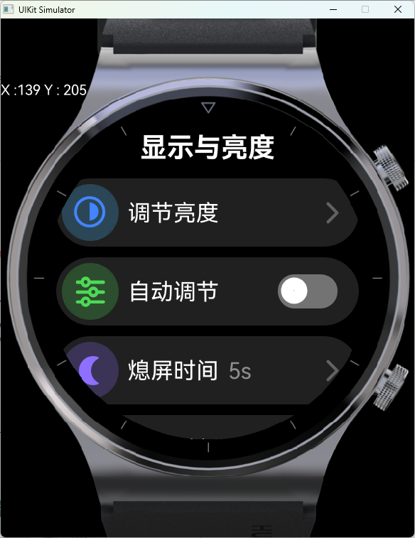

**表 1**  AdapterWrapper核心函数

<a name="zh-cn_topic_0000002475949477_table800mcpsimp"></a>
<table><thead align="left"><tr id="zh-cn_topic_0000002475949477_row806mcpsimp"><th class="cellrowborder" valign="top" width="50.51%" id="mcps1.2.3.1.1"><p id="zh-cn_topic_0000002475949477_p808mcpsimp"><a name="zh-cn_topic_0000002475949477_p808mcpsimp"></a><a name="zh-cn_topic_0000002475949477_p808mcpsimp"></a>函数</p>
</th>
<th class="cellrowborder" valign="top" width="49.49%" id="mcps1.2.3.1.2"><p id="zh-cn_topic_0000002475949477_p810mcpsimp"><a name="zh-cn_topic_0000002475949477_p810mcpsimp"></a><a name="zh-cn_topic_0000002475949477_p810mcpsimp"></a>介绍</p>
</th>
</tr>
</thead>
<tbody><tr id="zh-cn_topic_0000002475949477_row812mcpsimp"><td class="cellrowborder" valign="top" width="50.51%" headers="mcps1.2.3.1.1 "><p id="zh-cn_topic_0000002475949477_p81061398152"><a name="zh-cn_topic_0000002475949477_p81061398152"></a><a name="zh-cn_topic_0000002475949477_p81061398152"></a>void AddContent(Contents& metadata)</p>
</td>
<td class="cellrowborder" valign="top" width="49.49%" headers="mcps1.2.3.1.2 "><p id="zh-cn_topic_0000002475949477_p870710501291"><a name="zh-cn_topic_0000002475949477_p870710501291"></a><a name="zh-cn_topic_0000002475949477_p870710501291"></a>添加列的属性</p>
<a name="zh-cn_topic_0000002475949477_ul147901451153118"></a><a name="zh-cn_topic_0000002475949477_ul147901451153118"></a><ul id="zh-cn_topic_0000002475949477_ul147901451153118"><li>入参metadata：在列表最后，添加一列属性。</li></ul>
</td>
</tr>
<tr id="zh-cn_topic_0000002475949477_row822mcpsimp"><td class="cellrowborder" valign="top" width="50.51%" headers="mcps1.2.3.1.1 "><p id="zh-cn_topic_0000002475949477_p65403141297"><a name="zh-cn_topic_0000002475949477_p65403141297"></a><a name="zh-cn_topic_0000002475949477_p65403141297"></a>bool UpdateContent(int16_t index, Contents& metadata)</p>
</td>
<td class="cellrowborder" valign="top" width="49.49%" headers="mcps1.2.3.1.2 "><p id="zh-cn_topic_0000002475949477_p826mcpsimp"><a name="zh-cn_topic_0000002475949477_p826mcpsimp"></a><a name="zh-cn_topic_0000002475949477_p826mcpsimp"></a>更新指定列的属性</p>
<a name="zh-cn_topic_0000002475949477_ul168623020342"></a><a name="zh-cn_topic_0000002475949477_ul168623020342"></a><ul id="zh-cn_topic_0000002475949477_ul168623020342"><li>入参index：更新的列位置。</li><li>入参metadata：更新的列属性。</li></ul>
</td>
</tr>
<tr id="zh-cn_topic_0000002475949477_row835mcpsimp"><td class="cellrowborder" valign="top" width="50.51%" headers="mcps1.2.3.1.1 "><p id="zh-cn_topic_0000002475949477_p122131122301"><a name="zh-cn_topic_0000002475949477_p122131122301"></a><a name="zh-cn_topic_0000002475949477_p122131122301"></a>void RemoveContent(int16_t index)</p>
</td>
<td class="cellrowborder" valign="top" width="49.49%" headers="mcps1.2.3.1.2 "><p id="zh-cn_topic_0000002475949477_p14570205472913"><a name="zh-cn_topic_0000002475949477_p14570205472913"></a><a name="zh-cn_topic_0000002475949477_p14570205472913"></a>删除指定列</p>
<a name="zh-cn_topic_0000002475949477_ul587416414342"></a><a name="zh-cn_topic_0000002475949477_ul587416414342"></a><ul id="zh-cn_topic_0000002475949477_ul587416414342"><li>入参index：删除的列位置。</li></ul>
</td>
</tr>
<tr id="zh-cn_topic_0000002475949477_row842mcpsimp"><td class="cellrowborder" valign="top" width="50.51%" headers="mcps1.2.3.1.1 "><p id="zh-cn_topic_0000002475949477_p11861202343011"><a name="zh-cn_topic_0000002475949477_p11861202343011"></a><a name="zh-cn_topic_0000002475949477_p11861202343011"></a>void ClearAll()</p>
</td>
<td class="cellrowborder" valign="top" width="49.49%" headers="mcps1.2.3.1.2 "><p id="zh-cn_topic_0000002475949477_p16421633123010"><a name="zh-cn_topic_0000002475949477_p16421633123010"></a><a name="zh-cn_topic_0000002475949477_p16421633123010"></a>清空所有列。</p>
</td>
</tr>
</tbody>
</table>

### UITransformGroup<a name="ZH-CN_TOPIC_0000002477283524"></a>

UITransformGroup容器支持整体变换。对容器设置的变换将应用到子控件上。支持子控件为UIImageView、UIImageAnimatorView、UILabel、UILabelExt、UICanvasExt、UISlider。

> **须知：** 
>因为“[UILabel](#ZH-CN_TOPIC_0000002466383052)”、“[UILabelExt](#ZH-CN_TOPIC_0000002466383000)”控件不支持旋转变换，如果UITransformGroup添加了以上控件，请不要进行旋转变换。

**表 1**  UITransformGroup核心函数

<a name="zh-cn_topic_0000002444645753_table55411855020"></a>
<table><thead align="left"><tr id="zh-cn_topic_0000002444645753_row1154113551026"><th class="cellrowborder" valign="top" width="50%" id="mcps1.2.3.1.1"><p id="zh-cn_topic_0000002444645753_p1654120557213"><a name="zh-cn_topic_0000002444645753_p1654120557213"></a><a name="zh-cn_topic_0000002444645753_p1654120557213"></a>函数</p>
</th>
<th class="cellrowborder" valign="top" width="50%" id="mcps1.2.3.1.2"><p id="zh-cn_topic_0000002444645753_p1542955620"><a name="zh-cn_topic_0000002444645753_p1542955620"></a><a name="zh-cn_topic_0000002444645753_p1542955620"></a>介绍</p>
</th>
</tr>
</thead>
<tbody><tr id="zh-cn_topic_0000002444645753_row254215552215"><td class="cellrowborder" valign="top" width="50%" headers="mcps1.2.3.1.1 "><p id="zh-cn_topic_0000002444645753_p15542125518212"><a name="zh-cn_topic_0000002444645753_p15542125518212"></a><a name="zh-cn_topic_0000002444645753_p15542125518212"></a>void Add(UIView* view) override</p>
</td>
<td class="cellrowborder" valign="top" width="50%" headers="mcps1.2.3.1.2 "><p id="zh-cn_topic_0000002444645753_p145422055428"><a name="zh-cn_topic_0000002444645753_p145422055428"></a><a name="zh-cn_topic_0000002444645753_p145422055428"></a>添加子控件。</p>
</td>
</tr>
<tr id="zh-cn_topic_0000002444645753_row164281423153914"><td class="cellrowborder" valign="top" width="50%" headers="mcps1.2.3.1.1 "><p id="zh-cn_topic_0000002444645753_p134281523183916"><a name="zh-cn_topic_0000002444645753_p134281523183916"></a><a name="zh-cn_topic_0000002444645753_p134281523183916"></a>void Insert(UIView* prevView, UIView* insertView)</p>
</td>
<td class="cellrowborder" valign="top" width="50%" headers="mcps1.2.3.1.2 "><p id="zh-cn_topic_0000002444645753_p94281223163919"><a name="zh-cn_topic_0000002444645753_p94281223163919"></a><a name="zh-cn_topic_0000002444645753_p94281223163919"></a>插入子控件。</p>
</td>
</tr>
<tr id="zh-cn_topic_0000002444645753_row454218555217"><td class="cellrowborder" valign="top" width="50%" headers="mcps1.2.3.1.1 "><p id="zh-cn_topic_0000002444645753_p72751318153512"><a name="zh-cn_topic_0000002444645753_p72751318153512"></a><a name="zh-cn_topic_0000002444645753_p72751318153512"></a>void Remove(UIView* view) override</p>
</td>
<td class="cellrowborder" valign="top" width="50%" headers="mcps1.2.3.1.2 "><p id="zh-cn_topic_0000002444645753_p5401123163511"><a name="zh-cn_topic_0000002444645753_p5401123163511"></a><a name="zh-cn_topic_0000002444645753_p5401123163511"></a>移除子控件。</p>
</td>
</tr>
<tr id="zh-cn_topic_0000002444645753_row16341114917318"><td class="cellrowborder" valign="top" width="50%" headers="mcps1.2.3.1.1 "><p id="zh-cn_topic_0000002444645753_p10938121103510"><a name="zh-cn_topic_0000002444645753_p10938121103510"></a><a name="zh-cn_topic_0000002444645753_p10938121103510"></a>void RemoveAll() override</p>
</td>
<td class="cellrowborder" valign="top" width="50%" headers="mcps1.2.3.1.2 "><p id="zh-cn_topic_0000002444645753_p2927829113513"><a name="zh-cn_topic_0000002444645753_p2927829113513"></a><a name="zh-cn_topic_0000002444645753_p2927829113513"></a>移除所有子控件。</p>
</td>
</tr>
<tr id="zh-cn_topic_0000002444645753_row15131122312344"><td class="cellrowborder" valign="top" width="50%" headers="mcps1.2.3.1.1 "><p id="zh-cn_topic_0000002444645753_p12131323183419"><a name="zh-cn_topic_0000002444645753_p12131323183419"></a><a name="zh-cn_topic_0000002444645753_p12131323183419"></a>void TransformChild(UIView* view, TransformMap transmap)</p>
</td>
<td class="cellrowborder" valign="top" width="50%" headers="mcps1.2.3.1.2 "><p id="zh-cn_topic_0000002444645753_p181311523153414"><a name="zh-cn_topic_0000002444645753_p181311523153414"></a><a name="zh-cn_topic_0000002444645753_p181311523153414"></a>对内部特定子控件配置变换。内部计算时会根据实时位置调用SetTransMapRect。</p>
</td>
</tr>
<tr id="zh-cn_topic_0000002444645753_row682923919911"><td class="cellrowborder" valign="top" width="50%" headers="mcps1.2.3.1.1 "><p id="zh-cn_topic_0000002444645753_p20842112220109"><a name="zh-cn_topic_0000002444645753_p20842112220109"></a><a name="zh-cn_topic_0000002444645753_p20842112220109"></a>void SetAllStyle(uint8_t key, int64_t value) override</p>
</td>
<td class="cellrowborder" valign="top" width="50%" headers="mcps1.2.3.1.2 "><p id="zh-cn_topic_0000002444645753_p178294393916"><a name="zh-cn_topic_0000002444645753_p178294393916"></a><a name="zh-cn_topic_0000002444645753_p178294393916"></a>对内部所有控件（一级子控件）和本身设置style。</p>
</td>
</tr>
</tbody>
</table>

### UITransformList<a name="ZH-CN_TOPIC_0000002509483501"></a>

UITransformList容器继承于“[UIListNested](#ZH-CN_TOPIC_0000002477443494)”，使用时需要搭配列类型的Adapter。与UIList有所不同，该控件支持自定义设置在列表滑动时各列的变换状态。

具体使用流程请参考示例“middleware/services/gui/uikit/sample/uitest/components/ui\_test\_simple\_list/ui\_test\_simple\_transform\_list.cpp”。

> **说明：** 
>“[UISimpleTransformList](#ZH-CN_TOPIC_0000002477443496)”控件继承与UITransformList控件，UISimpleTransformList无需配置Adapter。所以推荐使用“[UISimpleTransformList](#ZH-CN_TOPIC_0000002477443496)”控件。

**表 1**  UITransformList核心函数

<a name="zh-cn_topic_0000002444725821_table58032432135"></a>
<table><thead align="left"><tr id="zh-cn_topic_0000002444725821_row38032435136"><th class="cellrowborder" valign="top" width="50.19%" id="mcps1.2.3.1.1"><p id="zh-cn_topic_0000002444725821_p080314434134"><a name="zh-cn_topic_0000002444725821_p080314434134"></a><a name="zh-cn_topic_0000002444725821_p080314434134"></a>函数</p>
</th>
<th class="cellrowborder" valign="top" width="49.81%" id="mcps1.2.3.1.2"><p id="zh-cn_topic_0000002444725821_p1542955620"><a name="zh-cn_topic_0000002444725821_p1542955620"></a><a name="zh-cn_topic_0000002444725821_p1542955620"></a>介绍</p>
</th>
</tr>
</thead>
<tbody><tr id="zh-cn_topic_0000002444725821_row5804143191316"><td class="cellrowborder" valign="top" width="50.19%" headers="mcps1.2.3.1.1 "><p id="zh-cn_topic_0000002444725821_p280454311317"><a name="zh-cn_topic_0000002444725821_p280454311317"></a><a name="zh-cn_topic_0000002444725821_p280454311317"></a>void SetItemSpace(uint16_t value)</p>
</td>
<td class="cellrowborder" valign="top" width="49.81%" headers="mcps1.2.3.1.2 "><p id="zh-cn_topic_0000002444725821_p178041443141311"><a name="zh-cn_topic_0000002444725821_p178041443141311"></a><a name="zh-cn_topic_0000002444725821_p178041443141311"></a>设置条目与条目之间的间隙。</p>
</td>
</tr>
<tr id="zh-cn_topic_0000002444725821_row380484371311"><td class="cellrowborder" valign="top" width="50.19%" headers="mcps1.2.3.1.1 "><p id="zh-cn_topic_0000002444725821_p168048434136"><a name="zh-cn_topic_0000002444725821_p168048434136"></a><a name="zh-cn_topic_0000002444725821_p168048434136"></a>using TransformFunc = bool (*)(UITransformList* list, UIView* item)</p>
</td>
<td class="cellrowborder" valign="top" width="49.81%" headers="mcps1.2.3.1.2 "><p id="zh-cn_topic_0000002444725821_p1880474371312"><a name="zh-cn_topic_0000002444725821_p1880474371312"></a><a name="zh-cn_topic_0000002444725821_p1880474371312"></a>滑动时，回调函数类型。</p>
</td>
</tr>
<tr id="zh-cn_topic_0000002444725821_row7804104316131"><td class="cellrowborder" valign="top" width="50.19%" headers="mcps1.2.3.1.1 "><p id="zh-cn_topic_0000002444725821_p480413431135"><a name="zh-cn_topic_0000002444725821_p480413431135"></a><a name="zh-cn_topic_0000002444725821_p480413431135"></a>void SetItemTransformFunc(TransformFunc func)</p>
</td>
<td class="cellrowborder" valign="top" width="49.81%" headers="mcps1.2.3.1.2 "><p id="zh-cn_topic_0000002444725821_p280424331313"><a name="zh-cn_topic_0000002444725821_p280424331313"></a><a name="zh-cn_topic_0000002444725821_p280424331313"></a>设置滑动时的回调函数，栏目将按照回调事件进行变换。</p>
</td>
</tr>
</tbody>
</table>

### UISimpleTransformList<a name="ZH-CN_TOPIC_0000002477443496"></a>

UISimpleTransformList是“[UITransformList](#ZH-CN_TOPIC_0000002509483501)”和AdapterWrapper类的组合。UISimpleTransformList可以实现列的仿射变换。UISimpleTransformList与UISimpleList功能一致，但是相较于UISimpleList，UISImpleTransformList可以自定义滑动时列表列的变换。具体效果如[图1](#zh-cn_topic_0000002482330173_fig16813311141812)所示。

**图 1**  UISimpleList显示效果<a name="zh-cn_topic_0000002482330173_fig16813311141812"></a>  
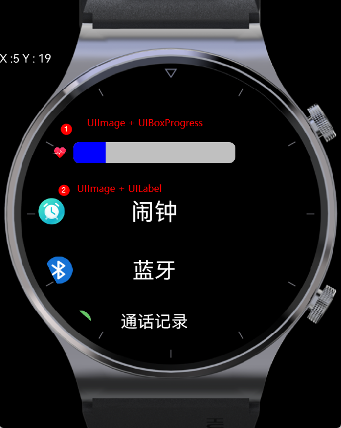

### UIAnalogClock<a name="ZH-CN_TOPIC_0000002509363455"></a>

UIAnalogClock是显示时间的组件，继承关系为UIAnalogClock→UIAbstractClock→ViewGroup。按照时针、分针、秒针的表盘模式来展示。具体创建流程和使用方法请参考“middleware/services/gui/uikit/sample/uitest/components/ui\_test\_analog\_clock/ui\_test\_analog\_clock.cpp”。

**表 1**  UIAnalogClock核心函数

<a name="zh-cn_topic_0000002411046800_table800mcpsimp"></a>
<table><thead align="left"><tr id="zh-cn_topic_0000002411046800_row806mcpsimp"><th class="cellrowborder" valign="top" width="50.51%" id="mcps1.2.3.1.1"><p id="zh-cn_topic_0000002411046800_p808mcpsimp"><a name="zh-cn_topic_0000002411046800_p808mcpsimp"></a><a name="zh-cn_topic_0000002411046800_p808mcpsimp"></a>函数</p>
</th>
<th class="cellrowborder" valign="top" width="49.49%" id="mcps1.2.3.1.2"><p id="zh-cn_topic_0000002411046800_p810mcpsimp"><a name="zh-cn_topic_0000002411046800_p810mcpsimp"></a><a name="zh-cn_topic_0000002411046800_p810mcpsimp"></a>介绍</p>
</th>
</tr>
</thead>
<tbody><tr id="zh-cn_topic_0000002411046800_row812mcpsimp"><td class="cellrowborder" valign="top" width="50.51%" headers="mcps1.2.3.1.1 "><p id="zh-cn_topic_0000002411046800_p814mcpsimp"><a name="zh-cn_topic_0000002411046800_p814mcpsimp"></a><a name="zh-cn_topic_0000002411046800_p814mcpsimp"></a>void SetHandImage(HandType type, const UIImageView& img, Point position, Point center)</p>
</td>
<td class="cellrowborder" valign="top" width="49.49%" headers="mcps1.2.3.1.2 "><p id="zh-cn_topic_0000002411046800_p816mcpsimp"><a name="zh-cn_topic_0000002411046800_p816mcpsimp"></a><a name="zh-cn_topic_0000002411046800_p816mcpsimp"></a>设置用于绘制时钟指针的图像。</p>
<a name="zh-cn_topic_0000002411046800_ul817mcpsimp"></a><a name="zh-cn_topic_0000002411046800_ul817mcpsimp"></a><ul id="zh-cn_topic_0000002411046800_ul817mcpsimp"><li>参数type：指针类型（时针、分针、秒针）。</li><li>参数img：指针类型对应的图片。</li><li>参数position：图像的开始位置。</li><li>参数center：此时钟指针的旋转中心。</li></ul>
</td>
</tr>
<tr id="zh-cn_topic_0000002411046800_row822mcpsimp"><td class="cellrowborder" valign="top" width="50.51%" headers="mcps1.2.3.1.1 "><p id="zh-cn_topic_0000002411046800_p824mcpsimp"><a name="zh-cn_topic_0000002411046800_p824mcpsimp"></a><a name="zh-cn_topic_0000002411046800_p824mcpsimp"></a>void SetHandLine(HandType type, Point position, Point center, ColorType color, uint16_t width, uint16_t height, OpacityType opacity)</p>
</td>
<td class="cellrowborder" valign="top" width="49.49%" headers="mcps1.2.3.1.2 "><p id="zh-cn_topic_0000002411046800_p826mcpsimp"><a name="zh-cn_topic_0000002411046800_p826mcpsimp"></a><a name="zh-cn_topic_0000002411046800_p826mcpsimp"></a>设置用于绘制时钟指针的线。</p>
<a name="zh-cn_topic_0000002411046800_ul827mcpsimp"></a><a name="zh-cn_topic_0000002411046800_ul827mcpsimp"></a><ul id="zh-cn_topic_0000002411046800_ul827mcpsimp"><li>参数type：指针类型（时针、分针、秒针）。</li><li>参数position：线端点靠近旋转中心的位置。</li><li>参数center：指示此时钟指针的旋转中心。</li><li>参数color：线条颜色。</li><li>参数width：线条宽度。</li><li>参数height：线条长度。</li><li>参数opacity：线条透明度。</li></ul>
</td>
</tr>
<tr id="zh-cn_topic_0000002411046800_row835mcpsimp"><td class="cellrowborder" valign="top" width="50.51%" headers="mcps1.2.3.1.1 "><p id="zh-cn_topic_0000002411046800_p837mcpsimp"><a name="zh-cn_topic_0000002411046800_p837mcpsimp"></a><a name="zh-cn_topic_0000002411046800_p837mcpsimp"></a>Point GetHandRotateCenter(HandType type) const</p>
</td>
<td class="cellrowborder" valign="top" width="49.49%" headers="mcps1.2.3.1.2 "><p id="zh-cn_topic_0000002411046800_p839mcpsimp"><a name="zh-cn_topic_0000002411046800_p839mcpsimp"></a><a name="zh-cn_topic_0000002411046800_p839mcpsimp"></a>获取指定时钟指针的旋转中心。</p>
<p id="zh-cn_topic_0000002411046800_p848072432110"><a name="zh-cn_topic_0000002411046800_p848072432110"></a><a name="zh-cn_topic_0000002411046800_p848072432110"></a>参数type：指针类型（时针、分针、秒针）。</p>
</td>
</tr>
<tr id="zh-cn_topic_0000002411046800_row842mcpsimp"><td class="cellrowborder" valign="top" width="50.51%" headers="mcps1.2.3.1.1 "><p id="zh-cn_topic_0000002411046800_p844mcpsimp"><a name="zh-cn_topic_0000002411046800_p844mcpsimp"></a><a name="zh-cn_topic_0000002411046800_p844mcpsimp"></a>Point GetHandPosition(HandType type) const</p>
</td>
<td class="cellrowborder" valign="top" width="49.49%" headers="mcps1.2.3.1.2 "><p id="zh-cn_topic_0000002411046800_p846mcpsimp"><a name="zh-cn_topic_0000002411046800_p846mcpsimp"></a><a name="zh-cn_topic_0000002411046800_p846mcpsimp"></a>获取指定时钟指针的位置。</p>
<p id="zh-cn_topic_0000002411046800_p16612152232115"><a name="zh-cn_topic_0000002411046800_p16612152232115"></a><a name="zh-cn_topic_0000002411046800_p16612152232115"></a>参数type：指针类型（时针、分针、秒针）。</p>
</td>
</tr>
<tr id="zh-cn_topic_0000002411046800_row849mcpsimp"><td class="cellrowborder" valign="top" width="50.51%" headers="mcps1.2.3.1.1 "><p id="zh-cn_topic_0000002411046800_p851mcpsimp"><a name="zh-cn_topic_0000002411046800_p851mcpsimp"></a><a name="zh-cn_topic_0000002411046800_p851mcpsimp"></a>uint16_t GetHandInitAngle(HandType type) const</p>
</td>
<td class="cellrowborder" valign="top" width="49.49%" headers="mcps1.2.3.1.2 "><p id="zh-cn_topic_0000002411046800_p853mcpsimp"><a name="zh-cn_topic_0000002411046800_p853mcpsimp"></a><a name="zh-cn_topic_0000002411046800_p853mcpsimp"></a>获取指定时钟指针的初始旋转角度。</p>
<p id="zh-cn_topic_0000002411046800_p19540152132114"><a name="zh-cn_topic_0000002411046800_p19540152132114"></a><a name="zh-cn_topic_0000002411046800_p19540152132114"></a>参数type：指针类型（时针、分针、秒针）。</p>
</td>
</tr>
<tr id="zh-cn_topic_0000002411046800_row856mcpsimp"><td class="cellrowborder" valign="top" width="50.51%" headers="mcps1.2.3.1.1 "><p id="zh-cn_topic_0000002411046800_p858mcpsimp"><a name="zh-cn_topic_0000002411046800_p858mcpsimp"></a><a name="zh-cn_topic_0000002411046800_p858mcpsimp"></a>uint16_t GetHandCurrentAngle(HandType type) const</p>
</td>
<td class="cellrowborder" valign="top" width="49.49%" headers="mcps1.2.3.1.2 "><p id="zh-cn_topic_0000002411046800_p860mcpsimp"><a name="zh-cn_topic_0000002411046800_p860mcpsimp"></a><a name="zh-cn_topic_0000002411046800_p860mcpsimp"></a>获取指定时钟指针的当前旋转角度。</p>
<p id="zh-cn_topic_0000002411046800_p53051820112120"><a name="zh-cn_topic_0000002411046800_p53051820112120"></a><a name="zh-cn_topic_0000002411046800_p53051820112120"></a>参数type：指针类型（时针、分针、秒针）。</p>
</td>
</tr>
<tr id="zh-cn_topic_0000002411046800_row863mcpsimp"><td class="cellrowborder" valign="top" width="50.51%" headers="mcps1.2.3.1.1 "><p id="zh-cn_topic_0000002411046800_p865mcpsimp"><a name="zh-cn_topic_0000002411046800_p865mcpsimp"></a><a name="zh-cn_topic_0000002411046800_p865mcpsimp"></a>void SetInitTime24Hour(uint8_t hour, uint8_t minute, uint8_t second)</p>
</td>
<td class="cellrowborder" valign="top" width="49.49%" headers="mcps1.2.3.1.2 "><p id="zh-cn_topic_0000002411046800_p867mcpsimp"><a name="zh-cn_topic_0000002411046800_p867mcpsimp"></a><a name="zh-cn_topic_0000002411046800_p867mcpsimp"></a>以24小时格式设置初始时间。</p>
</td>
</tr>
<tr id="zh-cn_topic_0000002411046800_row868mcpsimp"><td class="cellrowborder" valign="top" width="50.51%" headers="mcps1.2.3.1.1 "><p id="zh-cn_topic_0000002411046800_p870mcpsimp"><a name="zh-cn_topic_0000002411046800_p870mcpsimp"></a><a name="zh-cn_topic_0000002411046800_p870mcpsimp"></a>void SetInitTime12Hour(uint8_t hour, uint8_t minute, uint8_t second, bool am)</p>
</td>
<td class="cellrowborder" valign="top" width="49.49%" headers="mcps1.2.3.1.2 "><p id="zh-cn_topic_0000002411046800_p872mcpsimp"><a name="zh-cn_topic_0000002411046800_p872mcpsimp"></a><a name="zh-cn_topic_0000002411046800_p872mcpsimp"></a>以12小时格式设置初始时间。</p>
</td>
</tr>
<tr id="zh-cn_topic_0000002411046800_row873mcpsimp"><td class="cellrowborder" valign="top" width="50.51%" headers="mcps1.2.3.1.1 "><p id="zh-cn_topic_0000002411046800_p875mcpsimp"><a name="zh-cn_topic_0000002411046800_p875mcpsimp"></a><a name="zh-cn_topic_0000002411046800_p875mcpsimp"></a>void SetPosition(int16_t x, int16_t y) override</p>
</td>
<td class="cellrowborder" valign="top" width="49.49%" headers="mcps1.2.3.1.2 "><p id="zh-cn_topic_0000002411046800_p877mcpsimp"><a name="zh-cn_topic_0000002411046800_p877mcpsimp"></a><a name="zh-cn_topic_0000002411046800_p877mcpsimp"></a>设置组件的X、Y位置。</p>
</td>
</tr>
<tr id="zh-cn_topic_0000002411046800_row878mcpsimp"><td class="cellrowborder" valign="top" width="50.51%" headers="mcps1.2.3.1.1 "><p id="zh-cn_topic_0000002411046800_p880mcpsimp"><a name="zh-cn_topic_0000002411046800_p880mcpsimp"></a><a name="zh-cn_topic_0000002411046800_p880mcpsimp"></a>void SetPosition(int16_t x, int16_t y, int16_t width, int16_t height) override</p>
</td>
<td class="cellrowborder" valign="top" width="49.49%" headers="mcps1.2.3.1.2 "><p id="zh-cn_topic_0000002411046800_p882mcpsimp"><a name="zh-cn_topic_0000002411046800_p882mcpsimp"></a><a name="zh-cn_topic_0000002411046800_p882mcpsimp"></a>设置组件的X、Y、宽、高。</p>
</td>
</tr>
<tr id="zh-cn_topic_0000002411046800_row883mcpsimp"><td class="cellrowborder" valign="top" width="50.51%" headers="mcps1.2.3.1.1 "><p id="zh-cn_topic_0000002411046800_p885mcpsimp"><a name="zh-cn_topic_0000002411046800_p885mcpsimp"></a><a name="zh-cn_topic_0000002411046800_p885mcpsimp"></a>void SetWorkMode(WorkMode newMode) override</p>
</td>
<td class="cellrowborder" valign="top" width="49.49%" headers="mcps1.2.3.1.2 "><p id="zh-cn_topic_0000002411046800_p887mcpsimp"><a name="zh-cn_topic_0000002411046800_p887mcpsimp"></a><a name="zh-cn_topic_0000002411046800_p887mcpsimp"></a>设置时钟工作模式。</p>
</td>
</tr>
</tbody>
</table>

### UISweepClock<a name="ZH-CN_TOPIC_0000002477283526"></a>

UISweepClock是显示时间的组件，继承关系为UISweepClock→UIAbstractClock→ViewGroup。基本功能与UIAnalogClock相似，但可额外支持到毫秒级的精度。按照时针、分针、秒针以及每根指针对应的圆圈的表盘模式来展示。具体使用流程请参考示例“middleware/services/gui/uikit/sample/uitest/components/ui\_test\_clock\_dial/MainClockView.cpp”。

**图 1**  UISweepClock效果<a name="zh-cn_topic_0000002411206780_fig890mcpsimp"></a>  
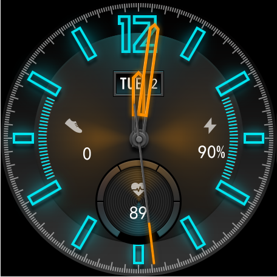

**表 1**  UISweepClock核心函数

<a name="zh-cn_topic_0000002411206780_table892mcpsimp"></a>
<table><thead align="left"><tr id="zh-cn_topic_0000002411206780_row898mcpsimp"><th class="cellrowborder" valign="top" width="46.86%" id="mcps1.2.3.1.1"><p id="zh-cn_topic_0000002411206780_p900mcpsimp"><a name="zh-cn_topic_0000002411206780_p900mcpsimp"></a><a name="zh-cn_topic_0000002411206780_p900mcpsimp"></a>函数</p>
</th>
<th class="cellrowborder" valign="top" width="53.14%" id="mcps1.2.3.1.2"><p id="zh-cn_topic_0000002411206780_p902mcpsimp"><a name="zh-cn_topic_0000002411206780_p902mcpsimp"></a><a name="zh-cn_topic_0000002411206780_p902mcpsimp"></a>介绍</p>
</th>
</tr>
</thead>
<tbody><tr id="zh-cn_topic_0000002411206780_row904mcpsimp"><td class="cellrowborder" valign="top" width="46.86%" headers="mcps1.2.3.1.1 "><p id="zh-cn_topic_0000002411206780_p906mcpsimp"><a name="zh-cn_topic_0000002411206780_p906mcpsimp"></a><a name="zh-cn_topic_0000002411206780_p906mcpsimp"></a>void SetHandImage(HandType type, const UIImageView& img, Point position, Point center)</p>
</td>
<td class="cellrowborder" valign="top" width="53.14%" headers="mcps1.2.3.1.2 "><p id="zh-cn_topic_0000002411206780_p908mcpsimp"><a name="zh-cn_topic_0000002411206780_p908mcpsimp"></a><a name="zh-cn_topic_0000002411206780_p908mcpsimp"></a>设置用于绘制时钟指针的图像。</p>
<a name="zh-cn_topic_0000002411206780_ul909mcpsimp"></a><a name="zh-cn_topic_0000002411206780_ul909mcpsimp"></a><ul id="zh-cn_topic_0000002411206780_ul909mcpsimp"><li>参数type：指针类型（时针、分针、秒针）。</li><li>参数img：指针对应的图片。</li><li>参数position：图像的开始位置。</li><li>参数center：此时钟指针的旋转中心。</li></ul>
</td>
</tr>
<tr id="zh-cn_topic_0000002411206780_row914mcpsimp"><td class="cellrowborder" valign="top" width="46.86%" headers="mcps1.2.3.1.1 "><p id="zh-cn_topic_0000002411206780_p916mcpsimp"><a name="zh-cn_topic_0000002411206780_p916mcpsimp"></a><a name="zh-cn_topic_0000002411206780_p916mcpsimp"></a>void SetHandCircleImage(HandType type, const Image& img, Point position)</p>
</td>
<td class="cellrowborder" valign="top" width="53.14%" headers="mcps1.2.3.1.2 "><p id="zh-cn_topic_0000002411206780_p918mcpsimp"><a name="zh-cn_topic_0000002411206780_p918mcpsimp"></a><a name="zh-cn_topic_0000002411206780_p918mcpsimp"></a>设置用于绘制时钟时指针圆圈的图像。</p>
<a name="zh-cn_topic_0000002411206780_ul919mcpsimp"></a><a name="zh-cn_topic_0000002411206780_ul919mcpsimp"></a><ul id="zh-cn_topic_0000002411206780_ul919mcpsimp"><li>参数type：对应指针的类型（时针、分针、秒针）。</li><li>参数img：指针圆圈的图片。</li><li>参数position：图像的开始位置。</li></ul>
</td>
</tr>
<tr id="zh-cn_topic_0000002411206780_row923mcpsimp"><td class="cellrowborder" valign="top" width="46.86%" headers="mcps1.2.3.1.1 "><p id="zh-cn_topic_0000002411206780_p925mcpsimp"><a name="zh-cn_topic_0000002411206780_p925mcpsimp"></a><a name="zh-cn_topic_0000002411206780_p925mcpsimp"></a>void SetHandLine(HandType type, Point position, Point center, ColorType color, uint16_t width, uint16_t height, OpacityType opacity)</p>
</td>
<td class="cellrowborder" valign="top" width="53.14%" headers="mcps1.2.3.1.2 "><p id="zh-cn_topic_0000002411206780_p929mcpsimp"><a name="zh-cn_topic_0000002411206780_p929mcpsimp"></a><a name="zh-cn_topic_0000002411206780_p929mcpsimp"></a>设置用于绘制时钟指针的线。</p>
<a name="zh-cn_topic_0000002411206780_ul930mcpsimp"></a><a name="zh-cn_topic_0000002411206780_ul930mcpsimp"></a><ul id="zh-cn_topic_0000002411206780_ul930mcpsimp"><li>参数type：指针类型（时针、分针、秒针）。</li><li>参数position：线端点靠近旋转中心的位置。</li><li>参数center：指示此时钟指针的旋转中心。</li><li>参数color：线条颜色。</li><li>参数width：线条宽度。</li><li>参数height：线条长度。</li><li>参数opacity：线条透明度。</li></ul>
</td>
</tr>
<tr id="zh-cn_topic_0000002411206780_row938mcpsimp"><td class="cellrowborder" valign="top" width="46.86%" headers="mcps1.2.3.1.1 "><p id="zh-cn_topic_0000002411206780_p940mcpsimp"><a name="zh-cn_topic_0000002411206780_p940mcpsimp"></a><a name="zh-cn_topic_0000002411206780_p940mcpsimp"></a>Point GetHandRotateCenter(HandType type) const</p>
</td>
<td class="cellrowborder" valign="top" width="53.14%" headers="mcps1.2.3.1.2 "><p id="zh-cn_topic_0000002411206780_p942mcpsimp"><a name="zh-cn_topic_0000002411206780_p942mcpsimp"></a><a name="zh-cn_topic_0000002411206780_p942mcpsimp"></a>获取指定时钟指针的旋转中心。</p>
<p id="zh-cn_topic_0000002411206780_p181641015112320"><a name="zh-cn_topic_0000002411206780_p181641015112320"></a><a name="zh-cn_topic_0000002411206780_p181641015112320"></a>参数type：指针类型（时针、分针、秒针）。</p>
</td>
</tr>
<tr id="zh-cn_topic_0000002411206780_row945mcpsimp"><td class="cellrowborder" valign="top" width="46.86%" headers="mcps1.2.3.1.1 "><p id="zh-cn_topic_0000002411206780_p947mcpsimp"><a name="zh-cn_topic_0000002411206780_p947mcpsimp"></a><a name="zh-cn_topic_0000002411206780_p947mcpsimp"></a>Point GetHandPosition(HandType type) const</p>
</td>
<td class="cellrowborder" valign="top" width="53.14%" headers="mcps1.2.3.1.2 "><p id="zh-cn_topic_0000002411206780_p949mcpsimp"><a name="zh-cn_topic_0000002411206780_p949mcpsimp"></a><a name="zh-cn_topic_0000002411206780_p949mcpsimp"></a>获取指定时钟指针的位置。</p>
<p id="zh-cn_topic_0000002411206780_p6223111672317"><a name="zh-cn_topic_0000002411206780_p6223111672317"></a><a name="zh-cn_topic_0000002411206780_p6223111672317"></a>参数type：指针类型（时针、分针、秒针）。</p>
</td>
</tr>
<tr id="zh-cn_topic_0000002411206780_row952mcpsimp"><td class="cellrowborder" valign="top" width="46.86%" headers="mcps1.2.3.1.1 "><p id="zh-cn_topic_0000002411206780_p954mcpsimp"><a name="zh-cn_topic_0000002411206780_p954mcpsimp"></a><a name="zh-cn_topic_0000002411206780_p954mcpsimp"></a>uint16_t GetHandInitAngle(HandType type) const</p>
</td>
<td class="cellrowborder" valign="top" width="53.14%" headers="mcps1.2.3.1.2 "><p id="zh-cn_topic_0000002411206780_p956mcpsimp"><a name="zh-cn_topic_0000002411206780_p956mcpsimp"></a><a name="zh-cn_topic_0000002411206780_p956mcpsimp"></a>获取指定时钟指针的初始旋转角度。</p>
<p id="zh-cn_topic_0000002411206780_p1028051722314"><a name="zh-cn_topic_0000002411206780_p1028051722314"></a><a name="zh-cn_topic_0000002411206780_p1028051722314"></a>参数type：指针类型（时针、分针、秒针）。</p>
</td>
</tr>
<tr id="zh-cn_topic_0000002411206780_row959mcpsimp"><td class="cellrowborder" valign="top" width="46.86%" headers="mcps1.2.3.1.1 "><p id="zh-cn_topic_0000002411206780_p961mcpsimp"><a name="zh-cn_topic_0000002411206780_p961mcpsimp"></a><a name="zh-cn_topic_0000002411206780_p961mcpsimp"></a>uint16_t GetHandCurrentAngle(HandType type) const</p>
</td>
<td class="cellrowborder" valign="top" width="53.14%" headers="mcps1.2.3.1.2 "><p id="zh-cn_topic_0000002411206780_p963mcpsimp"><a name="zh-cn_topic_0000002411206780_p963mcpsimp"></a><a name="zh-cn_topic_0000002411206780_p963mcpsimp"></a>获取指定时钟指针的当前旋转角度。</p>
<p id="zh-cn_topic_0000002411206780_p963091862310"><a name="zh-cn_topic_0000002411206780_p963091862310"></a><a name="zh-cn_topic_0000002411206780_p963091862310"></a>参数type：指针类型（时针、分针、秒针）。</p>
</td>
</tr>
<tr id="zh-cn_topic_0000002411206780_row966mcpsimp"><td class="cellrowborder" valign="top" width="46.86%" headers="mcps1.2.3.1.1 "><p id="zh-cn_topic_0000002411206780_p968mcpsimp"><a name="zh-cn_topic_0000002411206780_p968mcpsimp"></a><a name="zh-cn_topic_0000002411206780_p968mcpsimp"></a>void SetInitTime24Hour(uint8_t hour, uint8_t minute, uint8_t second)</p>
</td>
<td class="cellrowborder" valign="top" width="53.14%" headers="mcps1.2.3.1.2 "><p id="zh-cn_topic_0000002411206780_p970mcpsimp"><a name="zh-cn_topic_0000002411206780_p970mcpsimp"></a><a name="zh-cn_topic_0000002411206780_p970mcpsimp"></a>以24小时格式设置初始时间。</p>
</td>
</tr>
<tr id="zh-cn_topic_0000002411206780_row971mcpsimp"><td class="cellrowborder" valign="top" width="46.86%" headers="mcps1.2.3.1.1 "><p id="zh-cn_topic_0000002411206780_p973mcpsimp"><a name="zh-cn_topic_0000002411206780_p973mcpsimp"></a><a name="zh-cn_topic_0000002411206780_p973mcpsimp"></a>void SetInitTime12Hour(uint8_t hour, uint8_t minute, uint8_t second, bool am)</p>
</td>
<td class="cellrowborder" valign="top" width="53.14%" headers="mcps1.2.3.1.2 "><p id="zh-cn_topic_0000002411206780_p975mcpsimp"><a name="zh-cn_topic_0000002411206780_p975mcpsimp"></a><a name="zh-cn_topic_0000002411206780_p975mcpsimp"></a>以12小时格式设置初始时间。</p>
</td>
</tr>
<tr id="zh-cn_topic_0000002411206780_row976mcpsimp"><td class="cellrowborder" valign="top" width="46.86%" headers="mcps1.2.3.1.1 "><p id="zh-cn_topic_0000002411206780_p978mcpsimp"><a name="zh-cn_topic_0000002411206780_p978mcpsimp"></a><a name="zh-cn_topic_0000002411206780_p978mcpsimp"></a>void SetSweepTime24Hour(uint8_t hour, uint8_t minute, uint16_t millisecond)</p>
</td>
<td class="cellrowborder" valign="top" width="53.14%" headers="mcps1.2.3.1.2 "><p id="zh-cn_topic_0000002411206780_p980mcpsimp"><a name="zh-cn_topic_0000002411206780_p980mcpsimp"></a><a name="zh-cn_topic_0000002411206780_p980mcpsimp"></a>以24小时格式设置当前时间。此函数支持设置毫秒，由此可支持扫秒能力。</p>
</td>
</tr>
<tr id="zh-cn_topic_0000002411206780_row981mcpsimp"><td class="cellrowborder" valign="top" width="46.86%" headers="mcps1.2.3.1.1 "><p id="zh-cn_topic_0000002411206780_p983mcpsimp"><a name="zh-cn_topic_0000002411206780_p983mcpsimp"></a><a name="zh-cn_topic_0000002411206780_p983mcpsimp"></a>void SetSweepTime12Hour(uint8_t hour, uint8_t minute, uint16_t millisecond, bool am)</p>
</td>
<td class="cellrowborder" valign="top" width="53.14%" headers="mcps1.2.3.1.2 "><p id="zh-cn_topic_0000002411206780_p985mcpsimp"><a name="zh-cn_topic_0000002411206780_p985mcpsimp"></a><a name="zh-cn_topic_0000002411206780_p985mcpsimp"></a>以12小时格式设置当前时间。此函数支持设置毫秒，由此可支持扫秒能力。</p>
</td>
</tr>
<tr id="zh-cn_topic_0000002411206780_row986mcpsimp"><td class="cellrowborder" valign="top" width="46.86%" headers="mcps1.2.3.1.1 "><p id="zh-cn_topic_0000002411206780_p988mcpsimp"><a name="zh-cn_topic_0000002411206780_p988mcpsimp"></a><a name="zh-cn_topic_0000002411206780_p988mcpsimp"></a>void SetPosition(int16_t x, int16_t y) override</p>
</td>
<td class="cellrowborder" valign="top" width="53.14%" headers="mcps1.2.3.1.2 "><p id="zh-cn_topic_0000002411206780_p990mcpsimp"><a name="zh-cn_topic_0000002411206780_p990mcpsimp"></a><a name="zh-cn_topic_0000002411206780_p990mcpsimp"></a>设置组件的X、Y位置。</p>
</td>
</tr>
<tr id="zh-cn_topic_0000002411206780_row991mcpsimp"><td class="cellrowborder" valign="top" width="46.86%" headers="mcps1.2.3.1.1 "><p id="zh-cn_topic_0000002411206780_p993mcpsimp"><a name="zh-cn_topic_0000002411206780_p993mcpsimp"></a><a name="zh-cn_topic_0000002411206780_p993mcpsimp"></a>void SetPosition(int16_t x, int16_t y, int16_t width, int16_t height) override</p>
</td>
<td class="cellrowborder" valign="top" width="53.14%" headers="mcps1.2.3.1.2 "><p id="zh-cn_topic_0000002411206780_p995mcpsimp"><a name="zh-cn_topic_0000002411206780_p995mcpsimp"></a><a name="zh-cn_topic_0000002411206780_p995mcpsimp"></a>设置组件的X、Y、宽、高。</p>
</td>
</tr>
<tr id="zh-cn_topic_0000002411206780_row996mcpsimp"><td class="cellrowborder" valign="top" width="46.86%" headers="mcps1.2.3.1.1 "><p id="zh-cn_topic_0000002411206780_p998mcpsimp"><a name="zh-cn_topic_0000002411206780_p998mcpsimp"></a><a name="zh-cn_topic_0000002411206780_p998mcpsimp"></a>void SetWorkMode(WorkMode newMode) override</p>
</td>
<td class="cellrowborder" valign="top" width="53.14%" headers="mcps1.2.3.1.2 "><p id="zh-cn_topic_0000002411206780_p1000mcpsimp"><a name="zh-cn_topic_0000002411206780_p1000mcpsimp"></a><a name="zh-cn_topic_0000002411206780_p1000mcpsimp"></a>设置时钟工作模式。</p>
</td>
</tr>
</tbody>
</table>

**表盘开发约束及应用举例<a name="zh-cn_topic_0000002411206780_section153291220368"></a>**

1.  表盘使用的指针图片请使用垂直指针图片如[图2](#zh-cn_topic_0000002411206780_fig16997125753010)所示，方便后续位置计算。

    **图 2**  垂直指针图片<a name="zh-cn_topic_0000002411206780_fig16997125753010"></a>  
    

2.  以秒针为例，计算SetHandImage对应的center及position坐标：

    秒针图片分辨率为50×315，假定使用454×454圆形屏幕，且表盘显示在正中间，如[图1](#zh-cn_topic_0000002411206780_fig890mcpsimp)所示。

    1.  center选定为（25，211），center点位指的是在图片内的位置，与图片在屏幕上的位置无关，后续旋转也是以这个点为中心，大体位置如[图3](#zh-cn_topic_0000002411206780_fig6120333103013)所示。

        **图 3**  center位置示意图<a name="zh-cn_topic_0000002411206780_fig6120333103013"></a>  
        

        > **说明：** 
        >center的y值以实际展示效果为准，可以进行上下调整，此处仅以sample为例给出参考。

    2.  position选定为（202，16），这个点代表图片在表盘中的位置，即图片左上角对应的位置。

        这个点选取的原因如下：屏幕的中心点为（227，227），想要以屏幕中心点为各指针的旋转中心，则需要将center移到（227，227）位置，所以position值为（227，227）－（25，211）＝（202，16）。

3.  SetHandCircleImage的position值确定。

    sample中，时、分、秒的circle image原图都是50×50的图片，图片的中心点为（25， 25），所以直接将此center移到屏幕正中心（227， 227）即可，所以position值为（227，227）－（25，25）＝（202，202）。

> **说明：** 
>上述sample指的是随SDK版本发的uikit sample中“Sweep Clock”这个测试用例。

代码位置：middleware/services/gui/uikit/sample/uitest/components/ui\_test\_clock\_dial/MainClockView.cpp

### UIDigitalClock<a name="ZH-CN_TOPIC_0000002509483503"></a>

UIDigitalClock又称数字时钟，继承关系为UIDigitalClock→UIAbstractClock，常用函数参考如[表1](#zh-cn_topic_0000002444645961_table1005mcpsimp)所示。具体使用流程请参考示例“middleware/services/gui/uikit/sample/uitest/components/ui\_test\_digital\_clock/ui\_test\_digital\_clock.cpp”。

**图 1**  UIDigitalClock效果<a name="zh-cn_topic_0000002444645961_fig1003mcpsimp"></a>  


**表 1**  UIDigitalClock核心函数

<a name="zh-cn_topic_0000002444645961_table1005mcpsimp"></a>
<table><thead align="left"><tr id="zh-cn_topic_0000002444645961_row1011mcpsimp"><th class="cellrowborder" valign="top" width="50%" id="mcps1.2.3.1.1"><p id="zh-cn_topic_0000002444645961_p1013mcpsimp"><a name="zh-cn_topic_0000002444645961_p1013mcpsimp"></a><a name="zh-cn_topic_0000002444645961_p1013mcpsimp"></a>函数</p>
</th>
<th class="cellrowborder" valign="top" width="50%" id="mcps1.2.3.1.2"><p id="zh-cn_topic_0000002444645961_p1015mcpsimp"><a name="zh-cn_topic_0000002444645961_p1015mcpsimp"></a><a name="zh-cn_topic_0000002444645961_p1015mcpsimp"></a>介绍</p>
</th>
</tr>
</thead>
<tbody><tr id="zh-cn_topic_0000002444645961_row1017mcpsimp"><td class="cellrowborder" valign="top" width="50%" headers="mcps1.2.3.1.1 "><p id="zh-cn_topic_0000002444645961_p1019mcpsimp"><a name="zh-cn_topic_0000002444645961_p1019mcpsimp"></a><a name="zh-cn_topic_0000002444645961_p1019mcpsimp"></a>void SetFont(const char* name, uint8_t size)</p>
</td>
<td class="cellrowborder" valign="top" width="50%" headers="mcps1.2.3.1.2 "><p id="zh-cn_topic_0000002444645961_p1021mcpsimp"><a name="zh-cn_topic_0000002444645961_p1021mcpsimp"></a><a name="zh-cn_topic_0000002444645961_p1021mcpsimp"></a>设置此数字时钟的动态字体。</p>
</td>
</tr>
<tr id="zh-cn_topic_0000002444645961_row1022mcpsimp"><td class="cellrowborder" valign="top" width="50%" headers="mcps1.2.3.1.1 "><p id="zh-cn_topic_0000002444645961_p1024mcpsimp"><a name="zh-cn_topic_0000002444645961_p1024mcpsimp"></a><a name="zh-cn_topic_0000002444645961_p1024mcpsimp"></a>void SetFontId(uint8_t fontId)</p>
</td>
<td class="cellrowborder" valign="top" width="50%" headers="mcps1.2.3.1.2 "><p id="zh-cn_topic_0000002444645961_p1026mcpsimp"><a name="zh-cn_topic_0000002444645961_p1026mcpsimp"></a><a name="zh-cn_topic_0000002444645961_p1026mcpsimp"></a>设置此数字时钟的动态字体ID。</p>
</td>
</tr>
<tr id="zh-cn_topic_0000002444645961_row1027mcpsimp"><td class="cellrowborder" valign="top" width="50%" headers="mcps1.2.3.1.1 "><p id="zh-cn_topic_0000002444645961_p1029mcpsimp"><a name="zh-cn_topic_0000002444645961_p1029mcpsimp"></a><a name="zh-cn_topic_0000002444645961_p1029mcpsimp"></a>void SetColor(ColorType color)</p>
</td>
<td class="cellrowborder" valign="top" width="50%" headers="mcps1.2.3.1.2 "><p id="zh-cn_topic_0000002444645961_p1031mcpsimp"><a name="zh-cn_topic_0000002444645961_p1031mcpsimp"></a><a name="zh-cn_topic_0000002444645961_p1031mcpsimp"></a>设置展示时间的字体颜色。</p>
</td>
</tr>
<tr id="zh-cn_topic_0000002444645961_row1032mcpsimp"><td class="cellrowborder" valign="top" width="50%" headers="mcps1.2.3.1.1 "><p id="zh-cn_topic_0000002444645961_p1034mcpsimp"><a name="zh-cn_topic_0000002444645961_p1034mcpsimp"></a><a name="zh-cn_topic_0000002444645961_p1034mcpsimp"></a>void SetDisplayMode(DisplayMode dm)</p>
</td>
<td class="cellrowborder" valign="top" width="50%" headers="mcps1.2.3.1.2 "><p id="zh-cn_topic_0000002444645961_p1036mcpsimp"><a name="zh-cn_topic_0000002444645961_p1036mcpsimp"></a><a name="zh-cn_topic_0000002444645961_p1036mcpsimp"></a>设置此数字时钟的显示模式。</p>
<p id="zh-cn_topic_0000002444645961_p1037mcpsimp"><a name="zh-cn_topic_0000002444645961_p1037mcpsimp"></a><a name="zh-cn_topic_0000002444645961_p1037mcpsimp"></a>参数DisplayMode有四个枚举：</p>
<a name="zh-cn_topic_0000002444645961_ul1038mcpsimp"></a><a name="zh-cn_topic_0000002444645961_ul1038mcpsimp"></a><ul id="zh-cn_topic_0000002444645961_ul1038mcpsimp"><li>DISPLAY_12_HOUR_NO_SECONDS：12小时制，不展示秒。</li><li>DISPLAY_24_HOUR_NO_SECONDS：24小时制，不展示秒。</li><li>DISPLAY_12_HOUR：12小时制。</li><li>DISPLAY_24_HOUR：24小时制。</li></ul>
</td>
</tr>
<tr id="zh-cn_topic_0000002444645961_row1043mcpsimp"><td class="cellrowborder" valign="top" width="50%" headers="mcps1.2.3.1.1 "><p id="zh-cn_topic_0000002444645961_p1045mcpsimp"><a name="zh-cn_topic_0000002444645961_p1045mcpsimp"></a><a name="zh-cn_topic_0000002444645961_p1045mcpsimp"></a>DisplayMode GetDisplayMode() const</p>
</td>
<td class="cellrowborder" valign="top" width="50%" headers="mcps1.2.3.1.2 "><p id="zh-cn_topic_0000002444645961_p1047mcpsimp"><a name="zh-cn_topic_0000002444645961_p1047mcpsimp"></a><a name="zh-cn_topic_0000002444645961_p1047mcpsimp"></a>获取此数字时钟的显示模式。</p>
</td>
</tr>
<tr id="zh-cn_topic_0000002444645961_row1048mcpsimp"><td class="cellrowborder" valign="top" width="50%" headers="mcps1.2.3.1.1 "><p id="zh-cn_topic_0000002444645961_p1050mcpsimp"><a name="zh-cn_topic_0000002444645961_p1050mcpsimp"></a><a name="zh-cn_topic_0000002444645961_p1050mcpsimp"></a>void DisplayLeadingZero(bool displayLeadingZero)</p>
</td>
<td class="cellrowborder" valign="top" width="50%" headers="mcps1.2.3.1.2 "><p id="zh-cn_topic_0000002444645961_p1052mcpsimp"><a name="zh-cn_topic_0000002444645961_p1052mcpsimp"></a><a name="zh-cn_topic_0000002444645961_p1052mcpsimp"></a>设置是否在此数字时钟的小时之前添加‘0’。</p>
</td>
</tr>
<tr id="zh-cn_topic_0000002444645961_row1053mcpsimp"><td class="cellrowborder" valign="top" width="50%" headers="mcps1.2.3.1.1 "><p id="zh-cn_topic_0000002444645961_p1055mcpsimp"><a name="zh-cn_topic_0000002444645961_p1055mcpsimp"></a><a name="zh-cn_topic_0000002444645961_p1055mcpsimp"></a>void SetOpacity(uint8_t opacity)</p>
</td>
<td class="cellrowborder" valign="top" width="50%" headers="mcps1.2.3.1.2 "><p id="zh-cn_topic_0000002444645961_p1057mcpsimp"><a name="zh-cn_topic_0000002444645961_p1057mcpsimp"></a><a name="zh-cn_topic_0000002444645961_p1057mcpsimp"></a>设置此数字时钟的不透明度。</p>
</td>
</tr>
</tbody>
</table>

### UIPicker<a name="ZH-CN_TOPIC_0000002477443498"></a>

UIPicker是滑动选择器，主要使用场景是选择Item，常用函数介绍如[表1](#zh-cn_topic_0000002411046764_table1060mcpsimp)所示。

具体使用流程请参考示例“middleware/services/gui/uikit/sample/uitest/components/ui\_test\_picker/ui\_test\_ui\_picker.cpp”。

**表 1**  UIPicker核心函数

<a name="zh-cn_topic_0000002411046764_table1060mcpsimp"></a>
<table><thead align="left"><tr id="zh-cn_topic_0000002411046764_row1066mcpsimp"><th class="cellrowborder" valign="top" width="50%" id="mcps1.2.3.1.1"><p id="zh-cn_topic_0000002411046764_p1068mcpsimp"><a name="zh-cn_topic_0000002411046764_p1068mcpsimp"></a><a name="zh-cn_topic_0000002411046764_p1068mcpsimp"></a>函数</p>
</th>
<th class="cellrowborder" valign="top" width="50%" id="mcps1.2.3.1.2"><p id="zh-cn_topic_0000002411046764_p1070mcpsimp"><a name="zh-cn_topic_0000002411046764_p1070mcpsimp"></a><a name="zh-cn_topic_0000002411046764_p1070mcpsimp"></a>介绍</p>
</th>
</tr>
</thead>
<tbody><tr id="zh-cn_topic_0000002411046764_row1072mcpsimp"><td class="cellrowborder" valign="top" width="50%" headers="mcps1.2.3.1.1 "><p id="zh-cn_topic_0000002411046764_p1074mcpsimp"><a name="zh-cn_topic_0000002411046764_p1074mcpsimp"></a><a name="zh-cn_topic_0000002411046764_p1074mcpsimp"></a>virtual bool SetValues(const char* value[], uint16_t count)</p>
</td>
<td class="cellrowborder" valign="top" width="50%" headers="mcps1.2.3.1.2 "><p id="zh-cn_topic_0000002411046764_p1076mcpsimp"><a name="zh-cn_topic_0000002411046764_p1076mcpsimp"></a><a name="zh-cn_topic_0000002411046764_p1076mcpsimp"></a>使用字符串数组在选取器中设置动态文本数据。</p>
</td>
</tr>
<tr id="zh-cn_topic_0000002411046764_row1077mcpsimp"><td class="cellrowborder" valign="top" width="50%" headers="mcps1.2.3.1.1 "><p id="zh-cn_topic_0000002411046764_p1079mcpsimp"><a name="zh-cn_topic_0000002411046764_p1079mcpsimp"></a><a name="zh-cn_topic_0000002411046764_p1079mcpsimp"></a>virtual bool SetValues(int16_t start, int16_t end)</p>
</td>
<td class="cellrowborder" valign="top" width="50%" headers="mcps1.2.3.1.2 "><p id="zh-cn_topic_0000002411046764_p1081mcpsimp"><a name="zh-cn_topic_0000002411046764_p1081mcpsimp"></a><a name="zh-cn_topic_0000002411046764_p1081mcpsimp"></a>使用给定的数字范围设置选取器中的数字数据。</p>
</td>
</tr>
<tr id="zh-cn_topic_0000002411046764_row1082mcpsimp"><td class="cellrowborder" valign="top" width="50%" headers="mcps1.2.3.1.1 "><p id="zh-cn_topic_0000002411046764_p1084mcpsimp"><a name="zh-cn_topic_0000002411046764_p1084mcpsimp"></a><a name="zh-cn_topic_0000002411046764_p1084mcpsimp"></a>virtual void ClearValues()</p>
</td>
<td class="cellrowborder" valign="top" width="50%" headers="mcps1.2.3.1.2 "><p id="zh-cn_topic_0000002411046764_p1086mcpsimp"><a name="zh-cn_topic_0000002411046764_p1086mcpsimp"></a><a name="zh-cn_topic_0000002411046764_p1086mcpsimp"></a>清除选取器中的所有值。</p>
</td>
</tr>
<tr id="zh-cn_topic_0000002411046764_row1087mcpsimp"><td class="cellrowborder" valign="top" width="50%" headers="mcps1.2.3.1.1 "><p id="zh-cn_topic_0000002411046764_p1089mcpsimp"><a name="zh-cn_topic_0000002411046764_p1089mcpsimp"></a><a name="zh-cn_topic_0000002411046764_p1089mcpsimp"></a>void SetFontId(uint8_t backgroundFontId, uint8_t highlightFontId)</p>
</td>
<td class="cellrowborder" valign="top" width="50%" headers="mcps1.2.3.1.2 "><p id="zh-cn_topic_0000002411046764_p1091mcpsimp"><a name="zh-cn_topic_0000002411046764_p1091mcpsimp"></a><a name="zh-cn_topic_0000002411046764_p1091mcpsimp"></a>设置动态文本的字体ID。</p>
</td>
</tr>
<tr id="zh-cn_topic_0000002411046764_row1092mcpsimp"><td class="cellrowborder" valign="top" width="50%" headers="mcps1.2.3.1.1 "><p id="zh-cn_topic_0000002411046764_p1094mcpsimp"><a name="zh-cn_topic_0000002411046764_p1094mcpsimp"></a><a name="zh-cn_topic_0000002411046764_p1094mcpsimp"></a>void SetBackgroundFont(const char* name, uint8_t size)</p>
</td>
<td class="cellrowborder" valign="top" width="50%" headers="mcps1.2.3.1.2 "><p id="zh-cn_topic_0000002411046764_p1096mcpsimp"><a name="zh-cn_topic_0000002411046764_p1096mcpsimp"></a><a name="zh-cn_topic_0000002411046764_p1096mcpsimp"></a>设置背景文本的字体名称和大小。</p>
</td>
</tr>
<tr id="zh-cn_topic_0000002411046764_row1097mcpsimp"><td class="cellrowborder" valign="top" width="50%" headers="mcps1.2.3.1.1 "><p id="zh-cn_topic_0000002411046764_p1099mcpsimp"><a name="zh-cn_topic_0000002411046764_p1099mcpsimp"></a><a name="zh-cn_topic_0000002411046764_p1099mcpsimp"></a>void SetHighlightFont(const char* name, uint8_t size)</p>
</td>
<td class="cellrowborder" valign="top" width="50%" headers="mcps1.2.3.1.2 "><p id="zh-cn_topic_0000002411046764_p1101mcpsimp"><a name="zh-cn_topic_0000002411046764_p1101mcpsimp"></a><a name="zh-cn_topic_0000002411046764_p1101mcpsimp"></a>设置高亮显示文本的字体名称和大小。</p>
</td>
</tr>
<tr id="zh-cn_topic_0000002411046764_row1102mcpsimp"><td class="cellrowborder" valign="top" width="50%" headers="mcps1.2.3.1.1 "><p id="zh-cn_topic_0000002411046764_p1104mcpsimp"><a name="zh-cn_topic_0000002411046764_p1104mcpsimp"></a><a name="zh-cn_topic_0000002411046764_p1104mcpsimp"></a>void SetTextColor(ColorType backgroundColor, ColorType highlightColor)</p>
</td>
<td class="cellrowborder" valign="top" width="50%" headers="mcps1.2.3.1.2 "><p id="zh-cn_topic_0000002411046764_p1106mcpsimp"><a name="zh-cn_topic_0000002411046764_p1106mcpsimp"></a><a name="zh-cn_topic_0000002411046764_p1106mcpsimp"></a>设置文本颜色。</p>
</td>
</tr>
<tr id="zh-cn_topic_0000002411046764_row1107mcpsimp"><td class="cellrowborder" valign="top" width="50%" headers="mcps1.2.3.1.1 "><p id="zh-cn_topic_0000002411046764_p1109mcpsimp"><a name="zh-cn_topic_0000002411046764_p1109mcpsimp"></a><a name="zh-cn_topic_0000002411046764_p1109mcpsimp"></a>bool SetSelected(uint16_t index)</p>
</td>
<td class="cellrowborder" valign="top" width="50%" headers="mcps1.2.3.1.2 "><p id="zh-cn_topic_0000002411046764_p1111mcpsimp"><a name="zh-cn_topic_0000002411046764_p1111mcpsimp"></a><a name="zh-cn_topic_0000002411046764_p1111mcpsimp"></a>设置当前选定项目的索引。</p>
</td>
</tr>
<tr id="zh-cn_topic_0000002411046764_row1112mcpsimp"><td class="cellrowborder" valign="top" width="50%" headers="mcps1.2.3.1.1 "><p id="zh-cn_topic_0000002411046764_p1114mcpsimp"><a name="zh-cn_topic_0000002411046764_p1114mcpsimp"></a><a name="zh-cn_topic_0000002411046764_p1114mcpsimp"></a>void SetItemHeight(int16_t height)</p>
</td>
<td class="cellrowborder" valign="top" width="50%" headers="mcps1.2.3.1.2 "><p id="zh-cn_topic_0000002411046764_p1116mcpsimp"><a name="zh-cn_topic_0000002411046764_p1116mcpsimp"></a><a name="zh-cn_topic_0000002411046764_p1116mcpsimp"></a>设置每个项目的高度。</p>
</td>
</tr>
<tr id="zh-cn_topic_0000002411046764_row1117mcpsimp"><td class="cellrowborder" valign="top" width="50%" headers="mcps1.2.3.1.1 "><p id="zh-cn_topic_0000002411046764_p1119mcpsimp"><a name="zh-cn_topic_0000002411046764_p1119mcpsimp"></a><a name="zh-cn_topic_0000002411046764_p1119mcpsimp"></a>void SetWidth(int16_t width) override</p>
</td>
<td class="cellrowborder" valign="top" width="50%" headers="mcps1.2.3.1.2 "><p id="zh-cn_topic_0000002411046764_p1121mcpsimp"><a name="zh-cn_topic_0000002411046764_p1121mcpsimp"></a><a name="zh-cn_topic_0000002411046764_p1121mcpsimp"></a>设置当前组件的宽度。</p>
</td>
</tr>
<tr id="zh-cn_topic_0000002411046764_row1122mcpsimp"><td class="cellrowborder" valign="top" width="50%" headers="mcps1.2.3.1.1 "><p id="zh-cn_topic_0000002411046764_p1124mcpsimp"><a name="zh-cn_topic_0000002411046764_p1124mcpsimp"></a><a name="zh-cn_topic_0000002411046764_p1124mcpsimp"></a>void SetHeight(int16_t height) override</p>
</td>
<td class="cellrowborder" valign="top" width="50%" headers="mcps1.2.3.1.2 "><p id="zh-cn_topic_0000002411046764_p1126mcpsimp"><a name="zh-cn_topic_0000002411046764_p1126mcpsimp"></a><a name="zh-cn_topic_0000002411046764_p1126mcpsimp"></a>设置当前组件的高度。</p>
</td>
</tr>
<tr id="zh-cn_topic_0000002411046764_row1127mcpsimp"><td class="cellrowborder" valign="top" width="50%" headers="mcps1.2.3.1.1 "><p id="zh-cn_topic_0000002411046764_p1129mcpsimp"><a name="zh-cn_topic_0000002411046764_p1129mcpsimp"></a><a name="zh-cn_topic_0000002411046764_p1129mcpsimp"></a>void SetLoopState(bool state)</p>
</td>
<td class="cellrowborder" valign="top" width="50%" headers="mcps1.2.3.1.2 "><p id="zh-cn_topic_0000002411046764_p1131mcpsimp"><a name="zh-cn_topic_0000002411046764_p1131mcpsimp"></a><a name="zh-cn_topic_0000002411046764_p1131mcpsimp"></a>设置当前组件是否可以循环滑动。</p>
</td>
</tr>
<tr id="zh-cn_topic_0000002411046764_row1132mcpsimp"><td class="cellrowborder" valign="top" width="50%" headers="mcps1.2.3.1.1 "><p id="zh-cn_topic_0000002411046764_p1134mcpsimp"><a name="zh-cn_topic_0000002411046764_p1134mcpsimp"></a><a name="zh-cn_topic_0000002411046764_p1134mcpsimp"></a>void RegisterSelectedListener(SelectedListener* pickerListener)</p>
</td>
<td class="cellrowborder" valign="top" width="50%" headers="mcps1.2.3.1.2 "><p id="zh-cn_topic_0000002411046764_p1136mcpsimp"><a name="zh-cn_topic_0000002411046764_p1136mcpsimp"></a><a name="zh-cn_topic_0000002411046764_p1136mcpsimp"></a>为选定事件注册侦听器。</p>
</td>
</tr>
<tr id="zh-cn_topic_0000002411046764_row1137mcpsimp"><td class="cellrowborder" valign="top" width="50%" headers="mcps1.2.3.1.1 "><p id="zh-cn_topic_0000002411046764_p1139mcpsimp"><a name="zh-cn_topic_0000002411046764_p1139mcpsimp"></a><a name="zh-cn_topic_0000002411046764_p1139mcpsimp"></a>void SetDirect(UITextLanguageDirect direct)</p>
</td>
<td class="cellrowborder" valign="top" width="50%" headers="mcps1.2.3.1.2 "><p id="zh-cn_topic_0000002411046764_p1141mcpsimp"><a name="zh-cn_topic_0000002411046764_p1141mcpsimp"></a><a name="zh-cn_topic_0000002411046764_p1141mcpsimp"></a>设置文本方向。</p>
</td>
</tr>
<tr id="zh-cn_topic_0000002411046764_row1142mcpsimp"><td class="cellrowborder" valign="top" width="50%" headers="mcps1.2.3.1.1 "><p id="zh-cn_topic_0000002411046764_p1144mcpsimp"><a name="zh-cn_topic_0000002411046764_p1144mcpsimp"></a><a name="zh-cn_topic_0000002411046764_p1144mcpsimp"></a>void SetTextFormatter(TextFormatter* formatter)</p>
</td>
<td class="cellrowborder" valign="top" width="50%" headers="mcps1.2.3.1.2 "><p id="zh-cn_topic_0000002411046764_p1146mcpsimp"><a name="zh-cn_topic_0000002411046764_p1146mcpsimp"></a><a name="zh-cn_topic_0000002411046764_p1146mcpsimp"></a>设置文本格式器。</p>
</td>
</tr>
<tr id="zh-cn_topic_0000002411046764_row1444463505712"><td class="cellrowborder" valign="top" width="50%" headers="mcps1.2.3.1.1 "><p id="zh-cn_topic_0000002411046764_p64457352576"><a name="zh-cn_topic_0000002411046764_p64457352576"></a><a name="zh-cn_topic_0000002411046764_p64457352576"></a>uint16_t GetSelected()</p>
</td>
<td class="cellrowborder" valign="top" width="50%" headers="mcps1.2.3.1.2 "><p id="zh-cn_topic_0000002411046764_p94456356573"><a name="zh-cn_topic_0000002411046764_p94456356573"></a><a name="zh-cn_topic_0000002411046764_p94456356573"></a>获取当前选中值的下标。</p>
</td>
</tr>
</tbody>
</table>

### UITimePicker<a name="ZH-CN_TOPIC_0000002509363457"></a>

UITimePicker又称作时间选择器，主要用于时间选择，常用函数介绍如[表1](#zh-cn_topic_0000002411046664_table1149mcpsimp)所示。具体使用流程请参考示例“middleware/services/gui/uikit/sample/uitest/components/ui\_test\_picker/ui\_test\_ui\_picker.cpp”。

**表 1**  UITimePicker核心函数

<a name="zh-cn_topic_0000002411046664_table1149mcpsimp"></a>
<table><thead align="left"><tr id="zh-cn_topic_0000002411046664_row1155mcpsimp"><th class="cellrowborder" valign="top" width="50%" id="mcps1.2.3.1.1"><p id="zh-cn_topic_0000002411046664_p1157mcpsimp"><a name="zh-cn_topic_0000002411046664_p1157mcpsimp"></a><a name="zh-cn_topic_0000002411046664_p1157mcpsimp"></a>函数</p>
</th>
<th class="cellrowborder" valign="top" width="50%" id="mcps1.2.3.1.2"><p id="zh-cn_topic_0000002411046664_p1159mcpsimp"><a name="zh-cn_topic_0000002411046664_p1159mcpsimp"></a><a name="zh-cn_topic_0000002411046664_p1159mcpsimp"></a>介绍</p>
</th>
</tr>
</thead>
<tbody><tr id="zh-cn_topic_0000002411046664_row1161mcpsimp"><td class="cellrowborder" valign="top" width="50%" headers="mcps1.2.3.1.1 "><p id="zh-cn_topic_0000002411046664_p1163mcpsimp"><a name="zh-cn_topic_0000002411046664_p1163mcpsimp"></a><a name="zh-cn_topic_0000002411046664_p1163mcpsimp"></a>bool SetSelected(const char* value)</p>
</td>
<td class="cellrowborder" valign="top" width="50%" headers="mcps1.2.3.1.2 "><p id="zh-cn_topic_0000002411046664_p1165mcpsimp"><a name="zh-cn_topic_0000002411046664_p1165mcpsimp"></a><a name="zh-cn_topic_0000002411046664_p1165mcpsimp"></a>设置UITimePicker中当前选定的时间。</p>
</td>
</tr>
<tr id="zh-cn_topic_0000002411046664_row1166mcpsimp"><td class="cellrowborder" valign="top" width="50%" headers="mcps1.2.3.1.1 "><p id="zh-cn_topic_0000002411046664_p1168mcpsimp"><a name="zh-cn_topic_0000002411046664_p1168mcpsimp"></a><a name="zh-cn_topic_0000002411046664_p1168mcpsimp"></a>const char* GetSelectValue()</p>
</td>
<td class="cellrowborder" valign="top" width="50%" headers="mcps1.2.3.1.2 "><p id="zh-cn_topic_0000002411046664_p1170mcpsimp"><a name="zh-cn_topic_0000002411046664_p1170mcpsimp"></a><a name="zh-cn_topic_0000002411046664_p1170mcpsimp"></a>获取UITimePicker中当前选择的时间。</p>
</td>
</tr>
<tr id="zh-cn_topic_0000002411046664_row1172mcpsimp"><td class="cellrowborder" valign="top" width="50%" headers="mcps1.2.3.1.1 "><p id="zh-cn_topic_0000002411046664_p1174mcpsimp"><a name="zh-cn_topic_0000002411046664_p1174mcpsimp"></a><a name="zh-cn_topic_0000002411046664_p1174mcpsimp"></a>const char* GetSelectHour() const</p>
</td>
<td class="cellrowborder" valign="top" width="50%" headers="mcps1.2.3.1.2 "><p id="zh-cn_topic_0000002411046664_p1176mcpsimp"><a name="zh-cn_topic_0000002411046664_p1176mcpsimp"></a><a name="zh-cn_topic_0000002411046664_p1176mcpsimp"></a>获取UITimePicker中当前选定的小时。</p>
</td>
</tr>
<tr id="zh-cn_topic_0000002411046664_row1178mcpsimp"><td class="cellrowborder" valign="top" width="50%" headers="mcps1.2.3.1.1 "><p id="zh-cn_topic_0000002411046664_p1180mcpsimp"><a name="zh-cn_topic_0000002411046664_p1180mcpsimp"></a><a name="zh-cn_topic_0000002411046664_p1180mcpsimp"></a>const char* GetSelectMinute() const</p>
</td>
<td class="cellrowborder" valign="top" width="50%" headers="mcps1.2.3.1.2 "><p id="zh-cn_topic_0000002411046664_p1182mcpsimp"><a name="zh-cn_topic_0000002411046664_p1182mcpsimp"></a><a name="zh-cn_topic_0000002411046664_p1182mcpsimp"></a>获取UITimePicker中当前选定的分钟。</p>
</td>
</tr>
<tr id="zh-cn_topic_0000002411046664_row1184mcpsimp"><td class="cellrowborder" valign="top" width="50%" headers="mcps1.2.3.1.1 "><p id="zh-cn_topic_0000002411046664_p1186mcpsimp"><a name="zh-cn_topic_0000002411046664_p1186mcpsimp"></a><a name="zh-cn_topic_0000002411046664_p1186mcpsimp"></a>const char* GetSelectSecond() const</p>
</td>
<td class="cellrowborder" valign="top" width="50%" headers="mcps1.2.3.1.2 "><p id="zh-cn_topic_0000002411046664_p1188mcpsimp"><a name="zh-cn_topic_0000002411046664_p1188mcpsimp"></a><a name="zh-cn_topic_0000002411046664_p1188mcpsimp"></a>获取UITimePicker中当前选定的秒钟。</p>
</td>
</tr>
<tr id="zh-cn_topic_0000002411046664_row1190mcpsimp"><td class="cellrowborder" valign="top" width="50%" headers="mcps1.2.3.1.1 "><p id="zh-cn_topic_0000002411046664_p1192mcpsimp"><a name="zh-cn_topic_0000002411046664_p1192mcpsimp"></a><a name="zh-cn_topic_0000002411046664_p1192mcpsimp"></a>void SetItemHeight(int16_t height)</p>
</td>
<td class="cellrowborder" valign="top" width="50%" headers="mcps1.2.3.1.2 "><p id="zh-cn_topic_0000002411046664_p1194mcpsimp"><a name="zh-cn_topic_0000002411046664_p1194mcpsimp"></a><a name="zh-cn_topic_0000002411046664_p1194mcpsimp"></a>设置每一项Item的高度。</p>
</td>
</tr>
<tr id="zh-cn_topic_0000002411046664_row1195mcpsimp"><td class="cellrowborder" valign="top" width="50%" headers="mcps1.2.3.1.1 "><p id="zh-cn_topic_0000002411046664_p1197mcpsimp"><a name="zh-cn_topic_0000002411046664_p1197mcpsimp"></a><a name="zh-cn_topic_0000002411046664_p1197mcpsimp"></a>void EnableSecond(bool state)</p>
</td>
<td class="cellrowborder" valign="top" width="50%" headers="mcps1.2.3.1.2 "><p id="zh-cn_topic_0000002411046664_p1199mcpsimp"><a name="zh-cn_topic_0000002411046664_p1199mcpsimp"></a><a name="zh-cn_topic_0000002411046664_p1199mcpsimp"></a>设置是否在时间选择器中启用秒。</p>
</td>
</tr>
<tr id="zh-cn_topic_0000002411046664_row1200mcpsimp"><td class="cellrowborder" valign="top" width="50%" headers="mcps1.2.3.1.1 "><p id="zh-cn_topic_0000002411046664_p1202mcpsimp"><a name="zh-cn_topic_0000002411046664_p1202mcpsimp"></a><a name="zh-cn_topic_0000002411046664_p1202mcpsimp"></a>void SetTextStyle(uint8_t backgroundFontId,</p>
<p id="zh-cn_topic_0000002411046664_p1203mcpsimp"><a name="zh-cn_topic_0000002411046664_p1203mcpsimp"></a><a name="zh-cn_topic_0000002411046664_p1203mcpsimp"></a>uint8_t highlightFontId,</p>
<p id="zh-cn_topic_0000002411046664_p1204mcpsimp"><a name="zh-cn_topic_0000002411046664_p1204mcpsimp"></a><a name="zh-cn_topic_0000002411046664_p1204mcpsimp"></a>ColorType backgroundColor,</p>
<p id="zh-cn_topic_0000002411046664_p1205mcpsimp"><a name="zh-cn_topic_0000002411046664_p1205mcpsimp"></a><a name="zh-cn_topic_0000002411046664_p1205mcpsimp"></a>ColorType highlightColor)</p>
</td>
<td class="cellrowborder" valign="top" width="50%" headers="mcps1.2.3.1.2 "><p id="zh-cn_topic_0000002411046664_p1207mcpsimp"><a name="zh-cn_topic_0000002411046664_p1207mcpsimp"></a><a name="zh-cn_topic_0000002411046664_p1207mcpsimp"></a>设置时间选择器中的文本格式，包括字体ID和颜色。</p>
</td>
</tr>
<tr id="zh-cn_topic_0000002411046664_row1208mcpsimp"><td class="cellrowborder" valign="top" width="50%" headers="mcps1.2.3.1.1 "><p id="zh-cn_topic_0000002411046664_p1210mcpsimp"><a name="zh-cn_topic_0000002411046664_p1210mcpsimp"></a><a name="zh-cn_topic_0000002411046664_p1210mcpsimp"></a>void SetTextColor(ColorType backgroundColor, ColorType highlightColor)</p>
</td>
<td class="cellrowborder" valign="top" width="50%" headers="mcps1.2.3.1.2 "><p id="zh-cn_topic_0000002411046664_p1212mcpsimp"><a name="zh-cn_topic_0000002411046664_p1212mcpsimp"></a><a name="zh-cn_topic_0000002411046664_p1212mcpsimp"></a>设置时间选择器中的文本颜色。</p>
</td>
</tr>
<tr id="zh-cn_topic_0000002411046664_row1213mcpsimp"><td class="cellrowborder" valign="top" width="50%" headers="mcps1.2.3.1.1 "><p id="zh-cn_topic_0000002411046664_p1215mcpsimp"><a name="zh-cn_topic_0000002411046664_p1215mcpsimp"></a><a name="zh-cn_topic_0000002411046664_p1215mcpsimp"></a>void SetBackgroundFont(const char* name, uint8_t size)</p>
</td>
<td class="cellrowborder" valign="top" width="50%" headers="mcps1.2.3.1.2 "><p id="zh-cn_topic_0000002411046664_p1217mcpsimp"><a name="zh-cn_topic_0000002411046664_p1217mcpsimp"></a><a name="zh-cn_topic_0000002411046664_p1217mcpsimp"></a>设置背景文本的字体名称和大小。</p>
</td>
</tr>
<tr id="zh-cn_topic_0000002411046664_row1218mcpsimp"><td class="cellrowborder" valign="top" width="50%" headers="mcps1.2.3.1.1 "><p id="zh-cn_topic_0000002411046664_p1220mcpsimp"><a name="zh-cn_topic_0000002411046664_p1220mcpsimp"></a><a name="zh-cn_topic_0000002411046664_p1220mcpsimp"></a>void SetHighlightFont(const char* name, uint8_t size)</p>
</td>
<td class="cellrowborder" valign="top" width="50%" headers="mcps1.2.3.1.2 "><p id="zh-cn_topic_0000002411046664_p1222mcpsimp"><a name="zh-cn_topic_0000002411046664_p1222mcpsimp"></a><a name="zh-cn_topic_0000002411046664_p1222mcpsimp"></a>设置高亮显示文本的字体名称和大小。</p>
</td>
</tr>
<tr id="zh-cn_topic_0000002411046664_row1223mcpsimp"><td class="cellrowborder" valign="top" width="50%" headers="mcps1.2.3.1.1 "><p id="zh-cn_topic_0000002411046664_p1225mcpsimp"><a name="zh-cn_topic_0000002411046664_p1225mcpsimp"></a><a name="zh-cn_topic_0000002411046664_p1225mcpsimp"></a>void RegisterSelectedListener(SelectedListener* timePickerListener)</p>
</td>
<td class="cellrowborder" valign="top" width="50%" headers="mcps1.2.3.1.2 "><p id="zh-cn_topic_0000002411046664_p1227mcpsimp"><a name="zh-cn_topic_0000002411046664_p1227mcpsimp"></a><a name="zh-cn_topic_0000002411046664_p1227mcpsimp"></a>为选定事件注册监听器。</p>
</td>
</tr>
</tbody>
</table>

### UIAxis<a name="ZH-CN_TOPIC_0000002477283528"></a>

UIAxis是用来表示坐标轴的组件。该组件继承于UIViewGroup，常以子类UIXAxis和UIYAxis来展示坐标轴。具体使用流程请参考示例“middleware/services/gui/uikit/sample/uitest/components/ui\_test\_chart/ui\_test\_chart\_pillar.cpp”。

**UIAxis<a name="zh-cn_topic_0000002411206656_section1230mcpsimp"></a>**

**表 1**  UIAxis核心函数

<a name="zh-cn_topic_0000002411206656_table1232mcpsimp"></a>
<table><thead align="left"><tr id="zh-cn_topic_0000002411206656_row1238mcpsimp"><th class="cellrowborder" valign="top" width="50%" id="mcps1.2.3.1.1"><p id="zh-cn_topic_0000002411206656_p1240mcpsimp"><a name="zh-cn_topic_0000002411206656_p1240mcpsimp"></a><a name="zh-cn_topic_0000002411206656_p1240mcpsimp"></a>函数</p>
</th>
<th class="cellrowborder" valign="top" width="50%" id="mcps1.2.3.1.2"><p id="zh-cn_topic_0000002411206656_p1242mcpsimp"><a name="zh-cn_topic_0000002411206656_p1242mcpsimp"></a><a name="zh-cn_topic_0000002411206656_p1242mcpsimp"></a>介绍</p>
</th>
</tr>
</thead>
<tbody><tr id="zh-cn_topic_0000002411206656_row1244mcpsimp"><td class="cellrowborder" valign="top" width="50%" headers="mcps1.2.3.1.1 "><p id="zh-cn_topic_0000002411206656_p1246mcpsimp"><a name="zh-cn_topic_0000002411206656_p1246mcpsimp"></a><a name="zh-cn_topic_0000002411206656_p1246mcpsimp"></a>virtual bool SetDataRange(uint16_t min, uint16_t max) = 0</p>
</td>
<td class="cellrowborder" valign="top" width="50%" headers="mcps1.2.3.1.2 "><p id="zh-cn_topic_0000002411206656_p1248mcpsimp"><a name="zh-cn_topic_0000002411206656_p1248mcpsimp"></a><a name="zh-cn_topic_0000002411206656_p1248mcpsimp"></a>设置坐标轴的取值范围。</p>
</td>
</tr>
<tr id="zh-cn_topic_0000002411206656_row1249mcpsimp"><td class="cellrowborder" valign="top" width="50%" headers="mcps1.2.3.1.1 "><p id="zh-cn_topic_0000002411206656_p1251mcpsimp"><a name="zh-cn_topic_0000002411206656_p1251mcpsimp"></a><a name="zh-cn_topic_0000002411206656_p1251mcpsimp"></a>virtual void SetMarkNum(uint16_t count) = 0</p>
</td>
<td class="cellrowborder" valign="top" width="50%" headers="mcps1.2.3.1.2 "><p id="zh-cn_topic_0000002411206656_p1253mcpsimp"><a name="zh-cn_topic_0000002411206656_p1253mcpsimp"></a><a name="zh-cn_topic_0000002411206656_p1253mcpsimp"></a>设置坐标轴上的刻度数。</p>
</td>
</tr>
<tr id="zh-cn_topic_0000002411206656_row1254mcpsimp"><td class="cellrowborder" valign="top" width="50%" headers="mcps1.2.3.1.1 "><p id="zh-cn_topic_0000002411206656_p1256mcpsimp"><a name="zh-cn_topic_0000002411206656_p1256mcpsimp"></a><a name="zh-cn_topic_0000002411206656_p1256mcpsimp"></a>void SetLineColor(const ColorType& color)</p>
</td>
<td class="cellrowborder" valign="top" width="50%" headers="mcps1.2.3.1.2 "><p id="zh-cn_topic_0000002411206656_p1258mcpsimp"><a name="zh-cn_topic_0000002411206656_p1258mcpsimp"></a><a name="zh-cn_topic_0000002411206656_p1258mcpsimp"></a>设置线条颜色。</p>
</td>
</tr>
</tbody>
</table>

**UIXAxis<a name="zh-cn_topic_0000002411206656_section1259mcpsimp"></a>**

**表 2**  UIXAxis核心函数

<a name="zh-cn_topic_0000002411206656_table1261mcpsimp"></a>
<table><thead align="left"><tr id="zh-cn_topic_0000002411206656_row1267mcpsimp"><th class="cellrowborder" valign="top" width="50%" id="mcps1.2.3.1.1"><p id="zh-cn_topic_0000002411206656_p1269mcpsimp"><a name="zh-cn_topic_0000002411206656_p1269mcpsimp"></a><a name="zh-cn_topic_0000002411206656_p1269mcpsimp"></a>函数</p>
</th>
<th class="cellrowborder" valign="top" width="50%" id="mcps1.2.3.1.2"><p id="zh-cn_topic_0000002411206656_p1271mcpsimp"><a name="zh-cn_topic_0000002411206656_p1271mcpsimp"></a><a name="zh-cn_topic_0000002411206656_p1271mcpsimp"></a>介绍</p>
</th>
</tr>
</thead>
<tbody><tr id="zh-cn_topic_0000002411206656_row1273mcpsimp"><td class="cellrowborder" valign="top" width="50%" headers="mcps1.2.3.1.1 "><p id="zh-cn_topic_0000002411206656_p1275mcpsimp"><a name="zh-cn_topic_0000002411206656_p1275mcpsimp"></a><a name="zh-cn_topic_0000002411206656_p1275mcpsimp"></a>void TranslateToPixel(int16_t& value) override</p>
</td>
<td class="cellrowborder" valign="top" width="50%" headers="mcps1.2.3.1.2 "><p id="zh-cn_topic_0000002411206656_p1277mcpsimp"><a name="zh-cn_topic_0000002411206656_p1277mcpsimp"></a><a name="zh-cn_topic_0000002411206656_p1277mcpsimp"></a>将数据转换为像素的X坐标。</p>
</td>
</tr>
<tr id="zh-cn_topic_0000002411206656_row1278mcpsimp"><td class="cellrowborder" valign="top" width="50%" headers="mcps1.2.3.1.1 "><p id="zh-cn_topic_0000002411206656_p1280mcpsimp"><a name="zh-cn_topic_0000002411206656_p1280mcpsimp"></a><a name="zh-cn_topic_0000002411206656_p1280mcpsimp"></a>bool SetDataRange(uint16_t min, uint16_t max) override</p>
</td>
<td class="cellrowborder" valign="top" width="50%" headers="mcps1.2.3.1.2 "><p id="zh-cn_topic_0000002411206656_p1282mcpsimp"><a name="zh-cn_topic_0000002411206656_p1282mcpsimp"></a><a name="zh-cn_topic_0000002411206656_p1282mcpsimp"></a>设置X轴的取值范围。</p>
</td>
</tr>
<tr id="zh-cn_topic_0000002411206656_row1283mcpsimp"><td class="cellrowborder" valign="top" width="50%" headers="mcps1.2.3.1.1 "><p id="zh-cn_topic_0000002411206656_p1285mcpsimp"><a name="zh-cn_topic_0000002411206656_p1285mcpsimp"></a><a name="zh-cn_topic_0000002411206656_p1285mcpsimp"></a>void SetMarkNum(uint16_t count) override</p>
</td>
<td class="cellrowborder" valign="top" width="50%" headers="mcps1.2.3.1.2 "><p id="zh-cn_topic_0000002411206656_p1287mcpsimp"><a name="zh-cn_topic_0000002411206656_p1287mcpsimp"></a><a name="zh-cn_topic_0000002411206656_p1287mcpsimp"></a>设置X轴上的刻度数。</p>
</td>
</tr>
</tbody>
</table>

**UIYAxis<a name="zh-cn_topic_0000002411206656_section1288mcpsimp"></a>**

**表 3**  UIYAxis核心函数

<a name="zh-cn_topic_0000002411206656_table1290mcpsimp"></a>
<table><thead align="left"><tr id="zh-cn_topic_0000002411206656_row1296mcpsimp"><th class="cellrowborder" valign="top" width="50%" id="mcps1.2.3.1.1"><p id="zh-cn_topic_0000002411206656_p1298mcpsimp"><a name="zh-cn_topic_0000002411206656_p1298mcpsimp"></a><a name="zh-cn_topic_0000002411206656_p1298mcpsimp"></a>函数</p>
</th>
<th class="cellrowborder" valign="top" width="50%" id="mcps1.2.3.1.2"><p id="zh-cn_topic_0000002411206656_p1300mcpsimp"><a name="zh-cn_topic_0000002411206656_p1300mcpsimp"></a><a name="zh-cn_topic_0000002411206656_p1300mcpsimp"></a>介绍</p>
</th>
</tr>
</thead>
<tbody><tr id="zh-cn_topic_0000002411206656_row1302mcpsimp"><td class="cellrowborder" valign="top" width="50%" headers="mcps1.2.3.1.1 "><p id="zh-cn_topic_0000002411206656_p1304mcpsimp"><a name="zh-cn_topic_0000002411206656_p1304mcpsimp"></a><a name="zh-cn_topic_0000002411206656_p1304mcpsimp"></a>void TranslateToPixel(int16_t& value) override</p>
</td>
<td class="cellrowborder" valign="top" width="50%" headers="mcps1.2.3.1.2 "><p id="zh-cn_topic_0000002411206656_p1306mcpsimp"><a name="zh-cn_topic_0000002411206656_p1306mcpsimp"></a><a name="zh-cn_topic_0000002411206656_p1306mcpsimp"></a>将数据转换为像素的Y坐标。</p>
</td>
</tr>
<tr id="zh-cn_topic_0000002411206656_row1307mcpsimp"><td class="cellrowborder" valign="top" width="50%" headers="mcps1.2.3.1.1 "><p id="zh-cn_topic_0000002411206656_p1309mcpsimp"><a name="zh-cn_topic_0000002411206656_p1309mcpsimp"></a><a name="zh-cn_topic_0000002411206656_p1309mcpsimp"></a>bool SetDataRange(uint16_t min, uint16_t max) override</p>
</td>
<td class="cellrowborder" valign="top" width="50%" headers="mcps1.2.3.1.2 "><p id="zh-cn_topic_0000002411206656_p1311mcpsimp"><a name="zh-cn_topic_0000002411206656_p1311mcpsimp"></a><a name="zh-cn_topic_0000002411206656_p1311mcpsimp"></a>设置Y轴的取值范围。</p>
</td>
</tr>
<tr id="zh-cn_topic_0000002411206656_row1312mcpsimp"><td class="cellrowborder" valign="top" width="50%" headers="mcps1.2.3.1.1 "><p id="zh-cn_topic_0000002411206656_p1314mcpsimp"><a name="zh-cn_topic_0000002411206656_p1314mcpsimp"></a><a name="zh-cn_topic_0000002411206656_p1314mcpsimp"></a>void SetMarkNum(uint16_t count) override</p>
</td>
<td class="cellrowborder" valign="top" width="50%" headers="mcps1.2.3.1.2 "><p id="zh-cn_topic_0000002411206656_p1316mcpsimp"><a name="zh-cn_topic_0000002411206656_p1316mcpsimp"></a><a name="zh-cn_topic_0000002411206656_p1316mcpsimp"></a>设置Y轴上的刻度数。</p>
</td>
</tr>
<tr id="zh-cn_topic_0000002411206656_row18508111421815"><td class="cellrowborder" valign="top" width="50%" headers="mcps1.2.3.1.1 "><p id="zh-cn_topic_0000002411206656_p55087149187"><a name="zh-cn_topic_0000002411206656_p55087149187"></a><a name="zh-cn_topic_0000002411206656_p55087149187"></a>void SetAxisAlign(AxisAlign axisAlign)</p>
</td>
<td class="cellrowborder" valign="top" width="50%" headers="mcps1.2.3.1.2 "><p id="zh-cn_topic_0000002411206656_p1508014121817"><a name="zh-cn_topic_0000002411206656_p1508014121817"></a><a name="zh-cn_topic_0000002411206656_p1508014121817"></a>设置Y轴位置：左边或者右边。</p>
</td>
</tr>
</tbody>
</table>

### UIChart<a name="ZH-CN_TOPIC_0000002509483505"></a>

UIChart是图表类，提供添加、删除数据集等功能，以显示图表。常以子类UIChartPolyline（线条形）和UIChartPillar（柱状图）形式提供。具体使用流程请参考示例“middleware/services/gui/uikit/sample/uitest/components/ui\_test\_chart/ui\_test\_chart\_polyline.cpp”和“middleware/services/gui/uikit/sample/uitest/components/ui\_test\_chart/ui\_test\_chart\_pillar.cpp”。

**UIChart<a name="zh-cn_topic_0000002411206776_section1319mcpsimp"></a>**

**表 1**  UIChart核心函数

<a name="zh-cn_topic_0000002411206776_table1321mcpsimp"></a>
<table><thead align="left"><tr id="zh-cn_topic_0000002411206776_row1327mcpsimp"><th class="cellrowborder" valign="top" width="50%" id="mcps1.2.3.1.1"><p id="zh-cn_topic_0000002411206776_p1329mcpsimp"><a name="zh-cn_topic_0000002411206776_p1329mcpsimp"></a><a name="zh-cn_topic_0000002411206776_p1329mcpsimp"></a>函数</p>
</th>
<th class="cellrowborder" valign="top" width="50%" id="mcps1.2.3.1.2"><p id="zh-cn_topic_0000002411206776_p1331mcpsimp"><a name="zh-cn_topic_0000002411206776_p1331mcpsimp"></a><a name="zh-cn_topic_0000002411206776_p1331mcpsimp"></a>介绍</p>
</th>
</tr>
</thead>
<tbody><tr id="zh-cn_topic_0000002411206776_row1333mcpsimp"><td class="cellrowborder" valign="top" width="50%" headers="mcps1.2.3.1.1 "><p id="zh-cn_topic_0000002411206776_p1335mcpsimp"><a name="zh-cn_topic_0000002411206776_p1335mcpsimp"></a><a name="zh-cn_topic_0000002411206776_p1335mcpsimp"></a>void SetHeight(int16_t height) override</p>
</td>
<td class="cellrowborder" valign="top" width="50%" headers="mcps1.2.3.1.2 "><p id="zh-cn_topic_0000002411206776_p1337mcpsimp"><a name="zh-cn_topic_0000002411206776_p1337mcpsimp"></a><a name="zh-cn_topic_0000002411206776_p1337mcpsimp"></a>设置当前组件的高度。</p>
</td>
</tr>
<tr id="zh-cn_topic_0000002411206776_row1338mcpsimp"><td class="cellrowborder" valign="top" width="50%" headers="mcps1.2.3.1.1 "><p id="zh-cn_topic_0000002411206776_p1340mcpsimp"><a name="zh-cn_topic_0000002411206776_p1340mcpsimp"></a><a name="zh-cn_topic_0000002411206776_p1340mcpsimp"></a>void SetWidth(int16_t width) override</p>
</td>
<td class="cellrowborder" valign="top" width="50%" headers="mcps1.2.3.1.2 "><p id="zh-cn_topic_0000002411206776_p1342mcpsimp"><a name="zh-cn_topic_0000002411206776_p1342mcpsimp"></a><a name="zh-cn_topic_0000002411206776_p1342mcpsimp"></a>设置当前组件的宽度。</p>
</td>
</tr>
<tr id="zh-cn_topic_0000002411206776_row1343mcpsimp"><td class="cellrowborder" valign="top" width="50%" headers="mcps1.2.3.1.1 "><p id="zh-cn_topic_0000002411206776_p1345mcpsimp"><a name="zh-cn_topic_0000002411206776_p1345mcpsimp"></a><a name="zh-cn_topic_0000002411206776_p1345mcpsimp"></a>virtual bool AddDataSerial(UIChartDataSerial* dataSerial)</p>
</td>
<td class="cellrowborder" valign="top" width="50%" headers="mcps1.2.3.1.2 "><p id="zh-cn_topic_0000002411206776_p1347mcpsimp"><a name="zh-cn_topic_0000002411206776_p1347mcpsimp"></a><a name="zh-cn_topic_0000002411206776_p1347mcpsimp"></a>添加数据集。</p>
</td>
</tr>
<tr id="zh-cn_topic_0000002411206776_row1348mcpsimp"><td class="cellrowborder" valign="top" width="50%" headers="mcps1.2.3.1.1 "><p id="zh-cn_topic_0000002411206776_p1350mcpsimp"><a name="zh-cn_topic_0000002411206776_p1350mcpsimp"></a><a name="zh-cn_topic_0000002411206776_p1350mcpsimp"></a>virtual bool DeleteDataSerial(UIChartDataSerial* dataSerial)</p>
</td>
<td class="cellrowborder" valign="top" width="50%" headers="mcps1.2.3.1.2 "><p id="zh-cn_topic_0000002411206776_p1352mcpsimp"><a name="zh-cn_topic_0000002411206776_p1352mcpsimp"></a><a name="zh-cn_topic_0000002411206776_p1352mcpsimp"></a>删除数据集。</p>
</td>
</tr>
<tr id="zh-cn_topic_0000002411206776_row1353mcpsimp"><td class="cellrowborder" valign="top" width="50%" headers="mcps1.2.3.1.1 "><p id="zh-cn_topic_0000002411206776_p1355mcpsimp"><a name="zh-cn_topic_0000002411206776_p1355mcpsimp"></a><a name="zh-cn_topic_0000002411206776_p1355mcpsimp"></a>virtual void ClearDataSerial()</p>
</td>
<td class="cellrowborder" valign="top" width="50%" headers="mcps1.2.3.1.2 "><p id="zh-cn_topic_0000002411206776_p1357mcpsimp"><a name="zh-cn_topic_0000002411206776_p1357mcpsimp"></a><a name="zh-cn_topic_0000002411206776_p1357mcpsimp"></a>清理所有数据。</p>
</td>
</tr>
<tr id="zh-cn_topic_0000002411206776_row1358mcpsimp"><td class="cellrowborder" valign="top" width="50%" headers="mcps1.2.3.1.1 "><p id="zh-cn_topic_0000002411206776_p1360mcpsimp"><a name="zh-cn_topic_0000002411206776_p1360mcpsimp"></a><a name="zh-cn_topic_0000002411206776_p1360mcpsimp"></a>virtual void RefreshChart() = 0</p>
</td>
<td class="cellrowborder" valign="top" width="50%" headers="mcps1.2.3.1.2 "><p id="zh-cn_topic_0000002411206776_p1362mcpsimp"><a name="zh-cn_topic_0000002411206776_p1362mcpsimp"></a><a name="zh-cn_topic_0000002411206776_p1362mcpsimp"></a>刷新图表并重新绘制脏区域。</p>
</td>
</tr>
<tr id="zh-cn_topic_0000002411206776_row1363mcpsimp"><td class="cellrowborder" valign="top" width="50%" headers="mcps1.2.3.1.1 "><p id="zh-cn_topic_0000002411206776_p1365mcpsimp"><a name="zh-cn_topic_0000002411206776_p1365mcpsimp"></a><a name="zh-cn_topic_0000002411206776_p1365mcpsimp"></a>UIXAxis& GetXAxis()</p>
</td>
<td class="cellrowborder" valign="top" width="50%" headers="mcps1.2.3.1.2 "><p id="zh-cn_topic_0000002411206776_p1367mcpsimp"><a name="zh-cn_topic_0000002411206776_p1367mcpsimp"></a><a name="zh-cn_topic_0000002411206776_p1367mcpsimp"></a>获取X轴实例。</p>
</td>
</tr>
<tr id="zh-cn_topic_0000002411206776_row1368mcpsimp"><td class="cellrowborder" valign="top" width="50%" headers="mcps1.2.3.1.1 "><p id="zh-cn_topic_0000002411206776_p1370mcpsimp"><a name="zh-cn_topic_0000002411206776_p1370mcpsimp"></a><a name="zh-cn_topic_0000002411206776_p1370mcpsimp"></a>UIYAxis& GetYAxis()</p>
</td>
<td class="cellrowborder" valign="top" width="50%" headers="mcps1.2.3.1.2 "><p id="zh-cn_topic_0000002411206776_p1372mcpsimp"><a name="zh-cn_topic_0000002411206776_p1372mcpsimp"></a><a name="zh-cn_topic_0000002411206776_p1372mcpsimp"></a>获取Y轴实例。</p>
</td>
</tr>
<tr id="zh-cn_topic_0000002411206776_row1373mcpsimp"><td class="cellrowborder" valign="top" width="50%" headers="mcps1.2.3.1.1 "><p id="zh-cn_topic_0000002411206776_p1375mcpsimp"><a name="zh-cn_topic_0000002411206776_p1375mcpsimp"></a><a name="zh-cn_topic_0000002411206776_p1375mcpsimp"></a>void EnableReverse(bool enable)</p>
</td>
<td class="cellrowborder" valign="top" width="50%" headers="mcps1.2.3.1.2 "><p id="zh-cn_topic_0000002411206776_p1377mcpsimp"><a name="zh-cn_topic_0000002411206776_p1377mcpsimp"></a><a name="zh-cn_topic_0000002411206776_p1377mcpsimp"></a>启用图表反转。</p>
</td>
</tr>
</tbody>
</table>

**UIChartPillar<a name="zh-cn_topic_0000002411206776_section1378mcpsimp"></a>**

**图 1**  UIChartPillar效果<a name="zh-cn_topic_0000002411206776_fig1380mcpsimp"></a>  
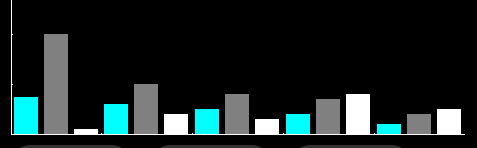

**表 2**  UIChartPillar核心函数

<a name="zh-cn_topic_0000002411206776_table1382mcpsimp"></a>
<table><thead align="left"><tr id="zh-cn_topic_0000002411206776_row1388mcpsimp"><th class="cellrowborder" valign="top" width="50%" id="mcps1.2.3.1.1"><p id="zh-cn_topic_0000002411206776_p1390mcpsimp"><a name="zh-cn_topic_0000002411206776_p1390mcpsimp"></a><a name="zh-cn_topic_0000002411206776_p1390mcpsimp"></a>函数</p>
</th>
<th class="cellrowborder" valign="top" width="50%" id="mcps1.2.3.1.2"><p id="zh-cn_topic_0000002411206776_p1392mcpsimp"><a name="zh-cn_topic_0000002411206776_p1392mcpsimp"></a><a name="zh-cn_topic_0000002411206776_p1392mcpsimp"></a>介绍</p>
</th>
</tr>
</thead>
<tbody><tr id="zh-cn_topic_0000002411206776_row1394mcpsimp"><td class="cellrowborder" valign="top" width="50%" headers="mcps1.2.3.1.1 "><p id="zh-cn_topic_0000002411206776_p1396mcpsimp"><a name="zh-cn_topic_0000002411206776_p1396mcpsimp"></a><a name="zh-cn_topic_0000002411206776_p1396mcpsimp"></a>void RefreshChart() override</p>
</td>
<td class="cellrowborder" valign="top" width="50%" headers="mcps1.2.3.1.2 "><p id="zh-cn_topic_0000002411206776_p1398mcpsimp"><a name="zh-cn_topic_0000002411206776_p1398mcpsimp"></a><a name="zh-cn_topic_0000002411206776_p1398mcpsimp"></a>刷新柱状图并重新绘制脏区域。</p>
</td>
</tr>
<tr id="zh-cn_topic_0000002411206776_row1487793612448"><td class="cellrowborder" valign="top" width="50%" headers="mcps1.2.3.1.1 "><p id="zh-cn_topic_0000002411206776_p587873619441"><a name="zh-cn_topic_0000002411206776_p587873619441"></a><a name="zh-cn_topic_0000002411206776_p587873619441"></a>bool SetGradient(const LinearGradient& linear, const ColorStop* stops, uint16_t stopCount)</p>
</td>
<td class="cellrowborder" valign="top" width="50%" headers="mcps1.2.3.1.2 "><p id="zh-cn_topic_0000002411206776_p15878113615441"><a name="zh-cn_topic_0000002411206776_p15878113615441"></a><a name="zh-cn_topic_0000002411206776_p15878113615441"></a>设置chart线性梯度渐变。</p>
</td>
</tr>
</tbody>
</table>

**UIChartPolyline<a name="zh-cn_topic_0000002411206776_section1399mcpsimp"></a>**

**图 2**  UIChartPolyline效果<a name="zh-cn_topic_0000002411206776_fig1401mcpsimp"></a>  
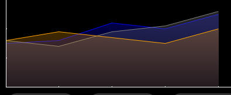

**表 3**  UIChartPolyline核心函数

<a name="zh-cn_topic_0000002411206776_table1403mcpsimp"></a>
<table><thead align="left"><tr id="zh-cn_topic_0000002411206776_row1409mcpsimp"><th class="cellrowborder" valign="top" width="50%" id="mcps1.2.3.1.1"><p id="zh-cn_topic_0000002411206776_p1411mcpsimp"><a name="zh-cn_topic_0000002411206776_p1411mcpsimp"></a><a name="zh-cn_topic_0000002411206776_p1411mcpsimp"></a>函数</p>
</th>
<th class="cellrowborder" valign="top" width="50%" id="mcps1.2.3.1.2"><p id="zh-cn_topic_0000002411206776_p1413mcpsimp"><a name="zh-cn_topic_0000002411206776_p1413mcpsimp"></a><a name="zh-cn_topic_0000002411206776_p1413mcpsimp"></a>介绍</p>
</th>
</tr>
</thead>
<tbody><tr id="zh-cn_topic_0000002411206776_row1415mcpsimp"><td class="cellrowborder" valign="top" width="50%" headers="mcps1.2.3.1.1 "><p id="zh-cn_topic_0000002411206776_p1417mcpsimp"><a name="zh-cn_topic_0000002411206776_p1417mcpsimp"></a><a name="zh-cn_topic_0000002411206776_p1417mcpsimp"></a>void RefreshChart() override</p>
</td>
<td class="cellrowborder" valign="top" width="50%" headers="mcps1.2.3.1.2 "><p id="zh-cn_topic_0000002411206776_p1419mcpsimp"><a name="zh-cn_topic_0000002411206776_p1419mcpsimp"></a><a name="zh-cn_topic_0000002411206776_p1419mcpsimp"></a>刷新折线图并重新绘制脏区域。</p>
</td>
</tr>
<tr id="zh-cn_topic_0000002411206776_row1420mcpsimp"><td class="cellrowborder" valign="top" width="50%" headers="mcps1.2.3.1.1 "><p id="zh-cn_topic_0000002411206776_p1422mcpsimp"><a name="zh-cn_topic_0000002411206776_p1422mcpsimp"></a><a name="zh-cn_topic_0000002411206776_p1422mcpsimp"></a>void SetGradientOpacity(uint8_t minOpa, uint8_t maxOpa)</p>
</td>
<td class="cellrowborder" valign="top" width="50%" headers="mcps1.2.3.1.2 "><p id="zh-cn_topic_0000002411206776_p1424mcpsimp"><a name="zh-cn_topic_0000002411206776_p1424mcpsimp"></a><a name="zh-cn_topic_0000002411206776_p1424mcpsimp"></a>设置填充颜色渐变的不透明度范围。</p>
</td>
</tr>
<tr id="zh-cn_topic_0000002411206776_row1425mcpsimp"><td class="cellrowborder" valign="top" width="50%" headers="mcps1.2.3.1.1 "><p id="zh-cn_topic_0000002411206776_p1427mcpsimp"><a name="zh-cn_topic_0000002411206776_p1427mcpsimp"></a><a name="zh-cn_topic_0000002411206776_p1427mcpsimp"></a>void SetGradientBottom(uint16_t bottom)</p>
</td>
<td class="cellrowborder" valign="top" width="50%" headers="mcps1.2.3.1.2 "><p id="zh-cn_topic_0000002411206776_p1429mcpsimp"><a name="zh-cn_topic_0000002411206776_p1429mcpsimp"></a><a name="zh-cn_topic_0000002411206776_p1429mcpsimp"></a>设置填充颜色范围的底边与x轴之间的距离。</p>
</td>
</tr>
</tbody>
</table>

### UICrossView<a name="ZH-CN_TOPIC_0000002477443500"></a>

UICrossView是用于管理主界面的卡片的容器组件，该组件支持的功能如下：

-   支持卡片添加、插入、删除。水平添加卡片数无限制，上下卡片各只支持一个。
-   支持上下卡片的局部和全局模糊。
-   支持监听滑动开始、滑动结束、覆盖开始、覆盖结束事件。
-   支持资源的预加载与卸载，可预加载当前显示卡片的上下左右页面。
-   支持卡片切换动效配置。目前GUI提供缩放、翻转、翻页动效，其他动效用户可以自定义。
-   水平方向至少需要插入一个页面，如果需要在某个界面支持上下拉，需要将这个页面的coverable设置为true（参考UICardPage）。

具体使用流程请参考示例“middleware/services/gui/uikit/sample/uitest/components/ui\_test\_clock\_dial/ui\_test\_clock\_dial.cpp”。

**表 1**  UICrossView核心函数

<a name="zh-cn_topic_0000002411046812_table17615123913112"></a>
<table><thead align="left"><tr id="zh-cn_topic_0000002411046812_row061511393116"><th class="cellrowborder" valign="top" width="50%" id="mcps1.2.3.1.1"><p id="zh-cn_topic_0000002411046812_p1615113912113"><a name="zh-cn_topic_0000002411046812_p1615113912113"></a><a name="zh-cn_topic_0000002411046812_p1615113912113"></a>函数</p>
</th>
<th class="cellrowborder" valign="top" width="50%" id="mcps1.2.3.1.2"><p id="zh-cn_topic_0000002411046812_p15615143921115"><a name="zh-cn_topic_0000002411046812_p15615143921115"></a><a name="zh-cn_topic_0000002411046812_p15615143921115"></a>介绍</p>
</th>
</tr>
</thead>
<tbody><tr id="zh-cn_topic_0000002411046812_row36151239191118"><td class="cellrowborder" valign="top" width="50%" headers="mcps1.2.3.1.1 "><p id="zh-cn_topic_0000002411046812_p11592815196"><a name="zh-cn_topic_0000002411046812_p11592815196"></a><a name="zh-cn_topic_0000002411046812_p11592815196"></a>void HorAdd(UICardPage* view)</p>
</td>
<td class="cellrowborder" valign="top" width="50%" headers="mcps1.2.3.1.2 "><p id="zh-cn_topic_0000002411046812_p66151739121120"><a name="zh-cn_topic_0000002411046812_p66151739121120"></a><a name="zh-cn_topic_0000002411046812_p66151739121120"></a>添加水平卡片。</p>
</td>
</tr>
<tr id="zh-cn_topic_0000002411046812_row6615173991115"><td class="cellrowborder" valign="top" width="50%" headers="mcps1.2.3.1.1 "><p id="zh-cn_topic_0000002411046812_p13169119142010"><a name="zh-cn_topic_0000002411046812_p13169119142010"></a><a name="zh-cn_topic_0000002411046812_p13169119142010"></a>void HorInsert(UICardPage* prevView, UICardPage* insertView)</p>
</td>
<td class="cellrowborder" valign="top" width="50%" headers="mcps1.2.3.1.2 "><p id="zh-cn_topic_0000002411046812_p7843517152018"><a name="zh-cn_topic_0000002411046812_p7843517152018"></a><a name="zh-cn_topic_0000002411046812_p7843517152018"></a>插入水平卡片。</p>
</td>
</tr>
<tr id="zh-cn_topic_0000002411046812_row9615123911115"><td class="cellrowborder" valign="top" width="50%" headers="mcps1.2.3.1.1 "><p id="zh-cn_topic_0000002411046812_p1394983282017"><a name="zh-cn_topic_0000002411046812_p1394983282017"></a><a name="zh-cn_topic_0000002411046812_p1394983282017"></a>void VerAdd(UICardPage* view, VPage page)</p>
</td>
<td class="cellrowborder" valign="top" width="50%" headers="mcps1.2.3.1.2 "><p id="zh-cn_topic_0000002411046812_p69481032182016"><a name="zh-cn_topic_0000002411046812_p69481032182016"></a><a name="zh-cn_topic_0000002411046812_p69481032182016"></a>添加垂直卡片。</p>
</td>
</tr>
<tr id="zh-cn_topic_0000002411046812_row06151339181110"><td class="cellrowborder" valign="top" width="50%" headers="mcps1.2.3.1.1 "><p id="zh-cn_topic_0000002411046812_p63213262017"><a name="zh-cn_topic_0000002411046812_p63213262017"></a><a name="zh-cn_topic_0000002411046812_p63213262017"></a>void Remove(UIView* view, uint8_t direction)</p>
</td>
<td class="cellrowborder" valign="top" width="50%" headers="mcps1.2.3.1.2 "><p id="zh-cn_topic_0000002411046812_p11311032172011"><a name="zh-cn_topic_0000002411046812_p11311032172011"></a><a name="zh-cn_topic_0000002411046812_p11311032172011"></a>删除卡片。</p>
</td>
</tr>
<tr id="zh-cn_topic_0000002411046812_row14615153911116"><td class="cellrowborder" valign="top" width="50%" headers="mcps1.2.3.1.1 "><p id="zh-cn_topic_0000002411046812_p1362117279204"><a name="zh-cn_topic_0000002411046812_p1362117279204"></a><a name="zh-cn_topic_0000002411046812_p1362117279204"></a>void SetHorCurrentPage(uint16_t index, bool loadAdjacent = true)</p>
</td>
<td class="cellrowborder" valign="top" width="50%" headers="mcps1.2.3.1.2 "><p id="zh-cn_topic_0000002411046812_p14615183912111"><a name="zh-cn_topic_0000002411046812_p14615183912111"></a><a name="zh-cn_topic_0000002411046812_p14615183912111"></a>设置当前水平显示卡片，并配置是否加载相邻的两张卡片。</p>
</td>
</tr>
<tr id="zh-cn_topic_0000002411046812_row48452953"><td class="cellrowborder" valign="top" width="50%" headers="mcps1.2.3.1.1 "><p id="zh-cn_topic_0000002411046812_p1784192955"><a name="zh-cn_topic_0000002411046812_p1784192955"></a><a name="zh-cn_topic_0000002411046812_p1784192955"></a>void SetSwipeACCLevel(uint8_t value, uint8_t direction = 0)</p>
</td>
<td class="cellrowborder" valign="top" width="50%" headers="mcps1.2.3.1.2 "><p id="zh-cn_topic_0000002411046812_p085422518"><a name="zh-cn_topic_0000002411046812_p085422518"></a><a name="zh-cn_topic_0000002411046812_p085422518"></a>设置快速滑动后松手的加速权值。direction为0代表水平方向，direction为1代表垂直方向。</p>
</td>
</tr>
<tr id="zh-cn_topic_0000002411046812_row17615183917111"><td class="cellrowborder" valign="top" width="50%" headers="mcps1.2.3.1.1 "><p id="zh-cn_topic_0000002411046812_p182021734112020"><a name="zh-cn_topic_0000002411046812_p182021734112020"></a><a name="zh-cn_topic_0000002411046812_p182021734112020"></a>uint16_t GetCurrentPageId(uint8_t direction = 0)</p>
</td>
<td class="cellrowborder" valign="top" width="50%" headers="mcps1.2.3.1.2 "><p id="zh-cn_topic_0000002411046812_p1582204131117"><a name="zh-cn_topic_0000002411046812_p1582204131117"></a><a name="zh-cn_topic_0000002411046812_p1582204131117"></a>获取目标方向的当前卡片索引。</p>
</td>
</tr>
<tr id="zh-cn_topic_0000002411046812_row1561583981117"><td class="cellrowborder" valign="top" width="50%" headers="mcps1.2.3.1.1 "><p id="zh-cn_topic_0000002411046812_p4953183552016"><a name="zh-cn_topic_0000002411046812_p4953183552016"></a><a name="zh-cn_topic_0000002411046812_p4953183552016"></a>UICardPage* GetCurrentPageView(uint8_t direction = 0)</p>
</td>
<td class="cellrowborder" valign="top" width="50%" headers="mcps1.2.3.1.2 "><p id="zh-cn_topic_0000002411046812_p895316359208"><a name="zh-cn_topic_0000002411046812_p895316359208"></a><a name="zh-cn_topic_0000002411046812_p895316359208"></a>获取目标方向的当前卡片对象。</p>
</td>
</tr>
<tr id="zh-cn_topic_0000002411046812_row861543917114"><td class="cellrowborder" valign="top" width="50%" headers="mcps1.2.3.1.1 "><p id="zh-cn_topic_0000002411046812_p19525358207"><a name="zh-cn_topic_0000002411046812_p19525358207"></a><a name="zh-cn_topic_0000002411046812_p19525358207"></a>void SetAnimatorTime(uint16_t time)</p>
</td>
<td class="cellrowborder" valign="top" width="50%" headers="mcps1.2.3.1.2 "><p id="zh-cn_topic_0000002411046812_p1195220352208"><a name="zh-cn_topic_0000002411046812_p1195220352208"></a><a name="zh-cn_topic_0000002411046812_p1195220352208"></a>设置松手动画时间。</p>
</td>
</tr>
<tr id="zh-cn_topic_0000002411046812_row166151339121110"><td class="cellrowborder" valign="top" width="50%" headers="mcps1.2.3.1.1 "><p id="zh-cn_topic_0000002411046812_p11951135132016"><a name="zh-cn_topic_0000002411046812_p11951135132016"></a><a name="zh-cn_topic_0000002411046812_p11951135132016"></a>void SetLoopState(bool loop)</p>
</td>
<td class="cellrowborder" valign="top" width="50%" headers="mcps1.2.3.1.2 "><p id="zh-cn_topic_0000002411046812_p9951143502019"><a name="zh-cn_topic_0000002411046812_p9951143502019"></a><a name="zh-cn_topic_0000002411046812_p9951143502019"></a>设置水平卡片循环模式。</p>
</td>
</tr>
<tr id="zh-cn_topic_0000002411046812_row182761614258"><td class="cellrowborder" valign="top" width="50%" headers="mcps1.2.3.1.1 "><p id="zh-cn_topic_0000002411046812_p182861692518"><a name="zh-cn_topic_0000002411046812_p182861692518"></a><a name="zh-cn_topic_0000002411046812_p182861692518"></a>void EnableScreenCap(bool enable)</p>
</td>
<td class="cellrowborder" valign="top" width="50%" headers="mcps1.2.3.1.2 "><p id="zh-cn_topic_0000002411046812_p582816162254"><a name="zh-cn_topic_0000002411046812_p582816162254"></a><a name="zh-cn_topic_0000002411046812_p582816162254"></a>设置切换卡片时，是否使能截图模式。</p>
</td>
</tr>
<tr id="zh-cn_topic_0000002411046812_row16375172052516"><td class="cellrowborder" valign="top" width="50%" headers="mcps1.2.3.1.1 "><p id="zh-cn_topic_0000002411046812_p9375920122512"><a name="zh-cn_topic_0000002411046812_p9375920122512"></a><a name="zh-cn_topic_0000002411046812_p9375920122512"></a>bool IsEnableScreenCap(void)</p>
</td>
<td class="cellrowborder" valign="top" width="50%" headers="mcps1.2.3.1.2 "><p id="zh-cn_topic_0000002411046812_p113755207255"><a name="zh-cn_topic_0000002411046812_p113755207255"></a><a name="zh-cn_topic_0000002411046812_p113755207255"></a>判断当前切换卡片模式。</p>
</td>
</tr>
<tr id="zh-cn_topic_0000002411046812_row6753144815258"><td class="cellrowborder" valign="top" width="50%" headers="mcps1.2.3.1.1 "><p id="zh-cn_topic_0000002411046812_p975374862513"><a name="zh-cn_topic_0000002411046812_p975374862513"></a><a name="zh-cn_topic_0000002411046812_p975374862513"></a>void RegisterSwipeCallback(CardSwipe* callback)</p>
</td>
<td class="cellrowborder" valign="top" width="50%" headers="mcps1.2.3.1.2 "><p id="zh-cn_topic_0000002411046812_p37531748142512"><a name="zh-cn_topic_0000002411046812_p37531748142512"></a><a name="zh-cn_topic_0000002411046812_p37531748142512"></a>注册一个拖拽动效回调函数。</p>
</td>
</tr>
<tr id="zh-cn_topic_0000002411046812_row1429125710258"><td class="cellrowborder" valign="top" width="50%" headers="mcps1.2.3.1.1 "><p id="zh-cn_topic_0000002411046812_p192911957192512"><a name="zh-cn_topic_0000002411046812_p192911957192512"></a><a name="zh-cn_topic_0000002411046812_p192911957192512"></a>void SetOnSwipeListener(UISwipeView::OnSwipeListener* onSwipeListener)</p>
</td>
<td class="cellrowborder" valign="top" width="50%" headers="mcps1.2.3.1.2 "><p id="zh-cn_topic_0000002411046812_p02916579256"><a name="zh-cn_topic_0000002411046812_p02916579256"></a><a name="zh-cn_topic_0000002411046812_p02916579256"></a>注册一个滑动动画结束监听器。</p>
</td>
</tr>
<tr id="zh-cn_topic_0000002411046812_row3969766578"><td class="cellrowborder" valign="top" width="50%" headers="mcps1.2.3.1.1 "><p id="zh-cn_topic_0000002411046812_p1896946175715"><a name="zh-cn_topic_0000002411046812_p1896946175715"></a><a name="zh-cn_topic_0000002411046812_p1896946175715"></a>UIViewType GetViewType()</p>
</td>
<td class="cellrowborder" valign="top" width="50%" headers="mcps1.2.3.1.2 "><p id="zh-cn_topic_0000002411046812_p99697675716"><a name="zh-cn_topic_0000002411046812_p99697675716"></a><a name="zh-cn_topic_0000002411046812_p99697675716"></a>获取控件类型。</p>
</td>
</tr>
<tr id="zh-cn_topic_0000002411046812_row113982316146"><td class="cellrowborder" valign="top" width="50%" headers="mcps1.2.3.1.1 "><p id="zh-cn_topic_0000002411046812_p154016234144"><a name="zh-cn_topic_0000002411046812_p154016234144"></a><a name="zh-cn_topic_0000002411046812_p154016234144"></a>void SetBlurRadius(float radius)</p>
</td>
<td class="cellrowborder" valign="top" width="50%" headers="mcps1.2.3.1.2 "><p id="zh-cn_topic_0000002411046812_p1215263610153"><a name="zh-cn_topic_0000002411046812_p1215263610153"></a><a name="zh-cn_topic_0000002411046812_p1215263610153"></a>设置上下界面的高斯模糊半径。</p>
<p id="zh-cn_topic_0000002411046812_p1713914398570"><a name="zh-cn_topic_0000002411046812_p1713914398570"></a><a name="zh-cn_topic_0000002411046812_p1713914398570"></a>参数radius：模糊半径。内部调参值，并非指半径内的区域才会模糊，此值决定不同程度的高斯模糊效果，合法值为[0，32]。</p>
</td>
</tr>
</tbody>
</table>

**UICardPage<a name="zh-cn_topic_0000002411046812_section35491559184418"></a>**

**表 2**  UICardPage核心函数

<a name="zh-cn_topic_0000002411046812_table79839448434"></a>
<table><thead align="left"><tr id="zh-cn_topic_0000002411046812_row19825446435"><th class="cellrowborder" valign="top" width="38.22%" id="mcps1.2.3.1.1"><p id="zh-cn_topic_0000002411046812_p698234434318"><a name="zh-cn_topic_0000002411046812_p698234434318"></a><a name="zh-cn_topic_0000002411046812_p698234434318"></a>函数</p>
</th>
<th class="cellrowborder" valign="top" width="61.78%" id="mcps1.2.3.1.2"><p id="zh-cn_topic_0000002411046812_p1098218445436"><a name="zh-cn_topic_0000002411046812_p1098218445436"></a><a name="zh-cn_topic_0000002411046812_p1098218445436"></a>介绍</p>
</th>
</tr>
</thead>
<tbody><tr id="zh-cn_topic_0000002411046812_row1098210442438"><td class="cellrowborder" valign="top" width="38.22%" headers="mcps1.2.3.1.1 "><p id="zh-cn_topic_0000002411046812_p169826446431"><a name="zh-cn_topic_0000002411046812_p169826446431"></a><a name="zh-cn_topic_0000002411046812_p169826446431"></a>virtual void PreLoad(void)</p>
</td>
<td class="cellrowborder" valign="top" width="61.78%" headers="mcps1.2.3.1.2 "><p id="zh-cn_topic_0000002411046812_p179821144194319"><a name="zh-cn_topic_0000002411046812_p179821144194319"></a><a name="zh-cn_topic_0000002411046812_p179821144194319"></a>卡片资源加载回调函数：在水平方向卡片切换（SetHorCurrentPage）或者滑动结束时，如果当前卡片未加载并且位于屏幕中间或者紧邻的左/右任一位置时，则会调用该函数。</p>
</td>
</tr>
<tr id="zh-cn_topic_0000002411046812_row798324494312"><td class="cellrowborder" valign="top" width="38.22%" headers="mcps1.2.3.1.1 "><p id="zh-cn_topic_0000002411046812_p159828448436"><a name="zh-cn_topic_0000002411046812_p159828448436"></a><a name="zh-cn_topic_0000002411046812_p159828448436"></a>virtual void UnLoad(void)</p>
</td>
<td class="cellrowborder" valign="top" width="61.78%" headers="mcps1.2.3.1.2 "><p id="zh-cn_topic_0000002411046812_p1698344484313"><a name="zh-cn_topic_0000002411046812_p1698344484313"></a><a name="zh-cn_topic_0000002411046812_p1698344484313"></a>卡片资源卸载回调函数：在水平方向卡片切换（SetHorCurrentPage）或者滑动结束时，如果当前卡片已加载并且远离屏幕（不在屏幕中间以及紧邻左右位置）时，则会调用该函数。</p>
</td>
</tr>
<tr id="zh-cn_topic_0000002411046812_row17983744174316"><td class="cellrowborder" valign="top" width="38.22%" headers="mcps1.2.3.1.1 "><p id="zh-cn_topic_0000002411046812_p14983134474317"><a name="zh-cn_topic_0000002411046812_p14983134474317"></a><a name="zh-cn_topic_0000002411046812_p14983134474317"></a>virtual void ScrollBegin(bool isActive)</p>
</td>
<td class="cellrowborder" valign="top" width="61.78%" headers="mcps1.2.3.1.2 "><p id="zh-cn_topic_0000002411046812_p926272214113"><a name="zh-cn_topic_0000002411046812_p926272214113"></a><a name="zh-cn_topic_0000002411046812_p926272214113"></a>卡片滑动开始回调函数：在水平滑动开始时，当前水平方向显示的卡片以及左右相邻卡片将调用该函数。向上滑动时，下界面调用该函数；向下滑动时，上界面调用该函数。</p>
<p id="zh-cn_topic_0000002411046812_p89831044144312"><a name="zh-cn_topic_0000002411046812_p89831044144312"></a><a name="zh-cn_topic_0000002411046812_p89831044144312"></a>isActive参数：无论是水平滑动，还是垂直滑动，滑动开始显示的卡片为true，其它调用该函数的卡片为false。</p>
</td>
</tr>
<tr id="zh-cn_topic_0000002411046812_row12983184464313"><td class="cellrowborder" valign="top" width="38.22%" headers="mcps1.2.3.1.1 "><p id="zh-cn_topic_0000002411046812_p8983174454318"><a name="zh-cn_topic_0000002411046812_p8983174454318"></a><a name="zh-cn_topic_0000002411046812_p8983174454318"></a>virtual void ScrollEnd(bool isActive)</p>
</td>
<td class="cellrowborder" valign="top" width="61.78%" headers="mcps1.2.3.1.2 "><p id="zh-cn_topic_0000002411046812_p54647209111"><a name="zh-cn_topic_0000002411046812_p54647209111"></a><a name="zh-cn_topic_0000002411046812_p54647209111"></a>卡片滑动结束回调函数：在水平/垂直滑动动画结束时，滑动开始时已经调用了ScrollBegin函数的卡片，都会接收到结束事件。</p>
<p id="zh-cn_topic_0000002411046812_p189832444431"><a name="zh-cn_topic_0000002411046812_p189832444431"></a><a name="zh-cn_topic_0000002411046812_p189832444431"></a>isActive参数：滑动结束时当前显示的卡片为true，其他为false。</p>
</td>
</tr>
<tr id="zh-cn_topic_0000002411046812_row4983144415437"><td class="cellrowborder" valign="top" width="38.22%" headers="mcps1.2.3.1.1 "><p id="zh-cn_topic_0000002411046812_p4983164494317"><a name="zh-cn_topic_0000002411046812_p4983164494317"></a><a name="zh-cn_topic_0000002411046812_p4983164494317"></a>virtual void CoverBegin(bool isCovered)</p>
</td>
<td class="cellrowborder" valign="top" width="61.78%" headers="mcps1.2.3.1.2 "><p id="zh-cn_topic_0000002411046812_p86539255116"><a name="zh-cn_topic_0000002411046812_p86539255116"></a><a name="zh-cn_topic_0000002411046812_p86539255116"></a>卡片覆盖开始回调函数：在垂直滑动开始时，水平方向当前显示的卡片调用该函数。</p>
<p id="zh-cn_topic_0000002411046812_p149831844184317"><a name="zh-cn_topic_0000002411046812_p149831844184317"></a><a name="zh-cn_topic_0000002411046812_p149831844184317"></a>isCovered参数：水平卡片被覆盖时为true，否则为false。</p>
</td>
</tr>
<tr id="zh-cn_topic_0000002411046812_row11983944154313"><td class="cellrowborder" valign="top" width="38.22%" headers="mcps1.2.3.1.1 "><p id="zh-cn_topic_0000002411046812_p8983144419430"><a name="zh-cn_topic_0000002411046812_p8983144419430"></a><a name="zh-cn_topic_0000002411046812_p8983144419430"></a>virtual void CoverEnd(bool isCovered)</p>
</td>
<td class="cellrowborder" valign="top" width="61.78%" headers="mcps1.2.3.1.2 "><p id="zh-cn_topic_0000002411046812_p193531439191115"><a name="zh-cn_topic_0000002411046812_p193531439191115"></a><a name="zh-cn_topic_0000002411046812_p193531439191115"></a>卡片覆盖结束回调函数：在垂直滑动动画结束时，水平方向当前显示的水平卡片调用该函数。</p>
<p id="zh-cn_topic_0000002411046812_p149831544144311"><a name="zh-cn_topic_0000002411046812_p149831544144311"></a><a name="zh-cn_topic_0000002411046812_p149831544144311"></a>isCovered参数：水平界面被覆盖时为true，否则为false。</p>
</td>
</tr>
<tr id="zh-cn_topic_0000002411046812_row1144164717316"><td class="cellrowborder" valign="top" width="38.22%" headers="mcps1.2.3.1.1 "><p id="zh-cn_topic_0000002411046812_p11144144715314"><a name="zh-cn_topic_0000002411046812_p11144144715314"></a><a name="zh-cn_topic_0000002411046812_p11144144715314"></a>virtual void OnActive(void)</p>
</td>
<td class="cellrowborder" valign="top" width="61.78%" headers="mcps1.2.3.1.2 "><p id="zh-cn_topic_0000002411046812_p1014404718315"><a name="zh-cn_topic_0000002411046812_p1014404718315"></a><a name="zh-cn_topic_0000002411046812_p1014404718315"></a>水平方向卡片切换（SetHorCurrentPage）回调函数：当水平方向卡片切换后，当前显示的卡片调用该函数。</p>
<p id="zh-cn_topic_0000002411046812_p1083219501757"><a name="zh-cn_topic_0000002411046812_p1083219501757"></a><a name="zh-cn_topic_0000002411046812_p1083219501757"></a>Slice状态变化回调函数：当Slice切换到Resume状态时，水平方向显示的卡片调用该函数。</p>
</td>
</tr>
<tr id="zh-cn_topic_0000002411046812_row113292207710"><td class="cellrowborder" valign="top" width="38.22%" headers="mcps1.2.3.1.1 "><p id="zh-cn_topic_0000002411046812_p93291520471"><a name="zh-cn_topic_0000002411046812_p93291520471"></a><a name="zh-cn_topic_0000002411046812_p93291520471"></a>virtual void OnPause(void)</p>
</td>
<td class="cellrowborder" valign="top" width="61.78%" headers="mcps1.2.3.1.2 "><p id="zh-cn_topic_0000002411046812_p1932982011719"><a name="zh-cn_topic_0000002411046812_p1932982011719"></a><a name="zh-cn_topic_0000002411046812_p1932982011719"></a>Slice状态变化回调函数：当Slice切换到Pause状态时，水平方向显示的卡片调用该函数。</p>
</td>
</tr>
<tr id="zh-cn_topic_0000002411046812_row175151643235"><td class="cellrowborder" valign="top" width="38.22%" headers="mcps1.2.3.1.1 "><p id="zh-cn_topic_0000002411046812_p951519431035"><a name="zh-cn_topic_0000002411046812_p951519431035"></a><a name="zh-cn_topic_0000002411046812_p951519431035"></a>virtual void OnInactive(void)</p>
</td>
<td class="cellrowborder" valign="top" width="61.78%" headers="mcps1.2.3.1.2 "><p id="zh-cn_topic_0000002411046812_p105151743038"><a name="zh-cn_topic_0000002411046812_p105151743038"></a><a name="zh-cn_topic_0000002411046812_p105151743038"></a>水平方向卡片切换（SetHorCurrentPage）回调函数：当水平方向显示卡片切换后，切换前显示的卡片调用该函数。</p>
</td>
</tr>
<tr id="zh-cn_topic_0000002411046812_row8273195685918"><td class="cellrowborder" valign="top" width="38.22%" headers="mcps1.2.3.1.1 "><p id="zh-cn_topic_0000002411046812_p0273185615911"><a name="zh-cn_topic_0000002411046812_p0273185615911"></a><a name="zh-cn_topic_0000002411046812_p0273185615911"></a>virtual void OnCovered(void)</p>
</td>
<td class="cellrowborder" valign="top" width="61.78%" headers="mcps1.2.3.1.2 "><p id="zh-cn_topic_0000002411046812_p10273105625914"><a name="zh-cn_topic_0000002411046812_p10273105625914"></a><a name="zh-cn_topic_0000002411046812_p10273105625914"></a>垂直方向卡片切换（SetVerCurrentPage）回调函数：在垂直方向卡片切换结束后，水平方向显示的卡片由被覆盖切换到可见状态时，调用该函数。</p>
</td>
</tr>
<tr id="zh-cn_topic_0000002411046812_row980551115913"><td class="cellrowborder" valign="top" width="38.22%" headers="mcps1.2.3.1.1 "><p id="zh-cn_topic_0000002411046812_p11816511591"><a name="zh-cn_topic_0000002411046812_p11816511591"></a><a name="zh-cn_topic_0000002411046812_p11816511591"></a>virtual void OnUncovered(void)</p>
</td>
<td class="cellrowborder" valign="top" width="61.78%" headers="mcps1.2.3.1.2 "><p id="zh-cn_topic_0000002411046812_p081551155917"><a name="zh-cn_topic_0000002411046812_p081551155917"></a><a name="zh-cn_topic_0000002411046812_p081551155917"></a>垂直方向卡片切换（SetVerCurrentPage）回调函数：在垂直方向卡片切换结束后，水平方向显示的卡片由可见切换到被覆盖状态时，调用该函数。</p>
</td>
</tr>
<tr id="zh-cn_topic_0000002411046812_row1598344419433"><td class="cellrowborder" valign="top" width="38.22%" headers="mcps1.2.3.1.1 "><p id="zh-cn_topic_0000002411046812_p59835447435"><a name="zh-cn_topic_0000002411046812_p59835447435"></a><a name="zh-cn_topic_0000002411046812_p59835447435"></a>void SetCoverable(bool coverable)</p>
</td>
<td class="cellrowborder" valign="top" width="61.78%" headers="mcps1.2.3.1.2 "><p id="zh-cn_topic_0000002411046812_p398364420439"><a name="zh-cn_topic_0000002411046812_p398364420439"></a><a name="zh-cn_topic_0000002411046812_p398364420439"></a>设置当前水平卡片是否能被垂直卡片覆盖。</p>
</td>
</tr>
<tr id="zh-cn_topic_0000002411046812_row1598334411434"><td class="cellrowborder" valign="top" width="38.22%" headers="mcps1.2.3.1.1 "><p id="zh-cn_topic_0000002411046812_p6983164414315"><a name="zh-cn_topic_0000002411046812_p6983164414315"></a><a name="zh-cn_topic_0000002411046812_p6983164414315"></a>bool IsCoverable(void)</p>
</td>
<td class="cellrowborder" valign="top" width="61.78%" headers="mcps1.2.3.1.2 "><p id="zh-cn_topic_0000002411046812_p14983744144312"><a name="zh-cn_topic_0000002411046812_p14983744144312"></a><a name="zh-cn_topic_0000002411046812_p14983744144312"></a>获取当前卡片覆盖状态。</p>
</td>
</tr>
<tr id="zh-cn_topic_0000002411046812_row46213712561"><td class="cellrowborder" valign="top" width="38.22%" headers="mcps1.2.3.1.1 "><p id="zh-cn_topic_0000002411046812_p176227711561"><a name="zh-cn_topic_0000002411046812_p176227711561"></a><a name="zh-cn_topic_0000002411046812_p176227711561"></a>UIViewType GetViewType()</p>
</td>
<td class="cellrowborder" valign="top" width="61.78%" headers="mcps1.2.3.1.2 "><p id="zh-cn_topic_0000002411046812_p562215718567"><a name="zh-cn_topic_0000002411046812_p562215718567"></a><a name="zh-cn_topic_0000002411046812_p562215718567"></a>获取控件类型。</p>
</td>
</tr>
</tbody>
</table>

**表 3**  CardSwipe核心函数

<a name="zh-cn_topic_0000002411046812_table11501812663"></a>
<table><thead align="left"><tr id="zh-cn_topic_0000002411046812_row13502121213616"><th class="cellrowborder" valign="top" width="50.03999999999999%" id="mcps1.2.3.1.1"><p id="zh-cn_topic_0000002411046812_p350261218614"><a name="zh-cn_topic_0000002411046812_p350261218614"></a><a name="zh-cn_topic_0000002411046812_p350261218614"></a>函数</p>
</th>
<th class="cellrowborder" valign="top" width="49.96%" id="mcps1.2.3.1.2"><p id="zh-cn_topic_0000002411046812_p1150219120612"><a name="zh-cn_topic_0000002411046812_p1150219120612"></a><a name="zh-cn_topic_0000002411046812_p1150219120612"></a>介绍</p>
</th>
</tr>
</thead>
<tbody><tr id="zh-cn_topic_0000002411046812_row10502171213619"><td class="cellrowborder" valign="top" width="50.03999999999999%" headers="mcps1.2.3.1.1 "><p id="zh-cn_topic_0000002411046812_p65757581564"><a name="zh-cn_topic_0000002411046812_p65757581564"></a><a name="zh-cn_topic_0000002411046812_p65757581564"></a>virtual void CardSwipeAlg(UICardPage* leftCard, UICardPage* rightCard, int16_t xOffset)</p>
</td>
<td class="cellrowborder" valign="top" width="49.96%" headers="mcps1.2.3.1.2 "><p id="zh-cn_topic_0000002411046812_p150217123610"><a name="zh-cn_topic_0000002411046812_p150217123610"></a><a name="zh-cn_topic_0000002411046812_p150217123610"></a>拖动卡片时的滑动算法，输入为UICardPage类型。</p>
</td>
</tr>
<tr id="zh-cn_topic_0000002411046812_row950281217612"><td class="cellrowborder" valign="top" width="50.03999999999999%" headers="mcps1.2.3.1.1 "><p id="zh-cn_topic_0000002411046812_p15785919714"><a name="zh-cn_topic_0000002411046812_p15785919714"></a><a name="zh-cn_topic_0000002411046812_p15785919714"></a>virtual void CardSwipeAlg(UIImageView* leftCard, UIImageView* rightCard, int16_t xOffset)</p>
</td>
<td class="cellrowborder" valign="top" width="49.96%" headers="mcps1.2.3.1.2 "><p id="zh-cn_topic_0000002411046812_p1678714191585"><a name="zh-cn_topic_0000002411046812_p1678714191585"></a><a name="zh-cn_topic_0000002411046812_p1678714191585"></a>拖动卡片时的滑动算法，输入为UIImageView类型。</p>
</td>
</tr>
</tbody>
</table>

### UIRollerView<a name="ZH-CN_TOPIC_0000002509363459"></a>

UIRollerView将图片按照滚筒的形式排布并支持滚动交互，目前仅支持水平方向。具体使用流程请参考示例“middleware/services/gui/uikit/sample/uitest/components/ui\_test\_roller\_view/ui\_test\_roller\_view.cpp”。

**图 1**  UIRollerView Display模式效果<a name="zh-cn_topic_0000002411046924_fig1555413123915"></a>  
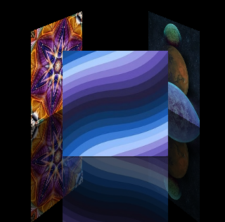

**表 1**  UIRollerView核心函数

<a name="zh-cn_topic_0000002411046924_table1433mcpsimp"></a>
<table><thead align="left"><tr id="zh-cn_topic_0000002411046924_row1439mcpsimp"><th class="cellrowborder" valign="top" width="50%" id="mcps1.2.3.1.1"><p id="zh-cn_topic_0000002411046924_p1441mcpsimp"><a name="zh-cn_topic_0000002411046924_p1441mcpsimp"></a><a name="zh-cn_topic_0000002411046924_p1441mcpsimp"></a>函数</p>
</th>
<th class="cellrowborder" valign="top" width="50%" id="mcps1.2.3.1.2"><p id="zh-cn_topic_0000002411046924_p1443mcpsimp"><a name="zh-cn_topic_0000002411046924_p1443mcpsimp"></a><a name="zh-cn_topic_0000002411046924_p1443mcpsimp"></a>介绍</p>
</th>
</tr>
</thead>
<tbody><tr id="zh-cn_topic_0000002411046924_row1445mcpsimp"><td class="cellrowborder" valign="top" width="50%" headers="mcps1.2.3.1.1 "><p id="zh-cn_topic_0000002411046924_p1941183011443"><a name="zh-cn_topic_0000002411046924_p1941183011443"></a><a name="zh-cn_topic_0000002411046924_p1941183011443"></a>void SetItemSize(uint16_t width, uint16_t height)</p>
</td>
<td class="cellrowborder" valign="top" width="50%" headers="mcps1.2.3.1.2 "><p id="zh-cn_topic_0000002411046924_p1449mcpsimp"><a name="zh-cn_topic_0000002411046924_p1449mcpsimp"></a><a name="zh-cn_topic_0000002411046924_p1449mcpsimp"></a>设置滚筒元素的原始宽高。</p>
</td>
</tr>
<tr id="zh-cn_topic_0000002411046924_row1450mcpsimp"><td class="cellrowborder" valign="top" width="50%" headers="mcps1.2.3.1.1 "><p id="zh-cn_topic_0000002411046924_p1452mcpsimp"><a name="zh-cn_topic_0000002411046924_p1452mcpsimp"></a><a name="zh-cn_topic_0000002411046924_p1452mcpsimp"></a>void SetItemPadding(uint16_t padding)</p>
</td>
<td class="cellrowborder" valign="top" width="50%" headers="mcps1.2.3.1.2 "><p id="zh-cn_topic_0000002411046924_p1094714442463"><a name="zh-cn_topic_0000002411046924_p1094714442463"></a><a name="zh-cn_topic_0000002411046924_p1094714442463"></a>设置滚筒元素的间隔距离。</p>
</td>
</tr>
<tr id="zh-cn_topic_0000002411046924_row1455mcpsimp"><td class="cellrowborder" valign="top" width="50%" headers="mcps1.2.3.1.1 "><p id="zh-cn_topic_0000002411046924_p6836845104419"><a name="zh-cn_topic_0000002411046924_p6836845104419"></a><a name="zh-cn_topic_0000002411046924_p6836845104419"></a>void SetMirrorOpacity(uint8_t opa)</p>
</td>
<td class="cellrowborder" valign="top" width="50%" headers="mcps1.2.3.1.2 "><p id="zh-cn_topic_0000002411046924_p16165446154617"><a name="zh-cn_topic_0000002411046924_p16165446154617"></a><a name="zh-cn_topic_0000002411046924_p16165446154617"></a>设置滚筒元素镜像图的透明度。</p>
</td>
</tr>
<tr id="zh-cn_topic_0000002411046924_row1460mcpsimp"><td class="cellrowborder" valign="top" width="50%" headers="mcps1.2.3.1.1 "><p id="zh-cn_topic_0000002411046924_p1170865410447"><a name="zh-cn_topic_0000002411046924_p1170865410447"></a><a name="zh-cn_topic_0000002411046924_p1170865410447"></a>void SetSensitivityFactor(float sensitivity)</p>
</td>
<td class="cellrowborder" valign="top" width="50%" headers="mcps1.2.3.1.2 "><p id="zh-cn_topic_0000002411046924_p956024774611"><a name="zh-cn_topic_0000002411046924_p956024774611"></a><a name="zh-cn_topic_0000002411046924_p956024774611"></a>设置滚筒灵敏度。</p>
</td>
</tr>
<tr id="zh-cn_topic_0000002411046924_row1465mcpsimp"><td class="cellrowborder" valign="top" width="50%" headers="mcps1.2.3.1.1 "><p id="zh-cn_topic_0000002411046924_p291010164517"><a name="zh-cn_topic_0000002411046924_p291010164517"></a><a name="zh-cn_topic_0000002411046924_p291010164517"></a>float GetSensitivityFactor()</p>
</td>
<td class="cellrowborder" valign="top" width="50%" headers="mcps1.2.3.1.2 "><p id="zh-cn_topic_0000002411046924_p16591154974613"><a name="zh-cn_topic_0000002411046924_p16591154974613"></a><a name="zh-cn_topic_0000002411046924_p16591154974613"></a>获取滚筒灵敏度。</p>
</td>
</tr>
<tr id="zh-cn_topic_0000002411046924_row1472mcpsimp"><td class="cellrowborder" valign="top" width="50%" headers="mcps1.2.3.1.1 "><p id="zh-cn_topic_0000002411046924_p1474mcpsimp"><a name="zh-cn_topic_0000002411046924_p1474mcpsimp"></a><a name="zh-cn_topic_0000002411046924_p1474mcpsimp"></a>bool AddItem(std::string name, const ImageInfo* src)</p>
</td>
<td class="cellrowborder" valign="top" width="50%" headers="mcps1.2.3.1.2 "><p id="zh-cn_topic_0000002411046924_p1476mcpsimp"><a name="zh-cn_topic_0000002411046924_p1476mcpsimp"></a><a name="zh-cn_topic_0000002411046924_p1476mcpsimp"></a>添加滚筒元素。</p>
</td>
</tr>
<tr id="zh-cn_topic_0000002411046924_row1477mcpsimp"><td class="cellrowborder" valign="top" width="50%" headers="mcps1.2.3.1.1 "><p id="zh-cn_topic_0000002411046924_p690411111452"><a name="zh-cn_topic_0000002411046924_p690411111452"></a><a name="zh-cn_topic_0000002411046924_p690411111452"></a>void RemoveItem(std::string name)</p>
</td>
<td class="cellrowborder" valign="top" width="50%" headers="mcps1.2.3.1.2 "><p id="zh-cn_topic_0000002411046924_p1481mcpsimp"><a name="zh-cn_topic_0000002411046924_p1481mcpsimp"></a><a name="zh-cn_topic_0000002411046924_p1481mcpsimp"></a>移除滚筒元素。</p>
</td>
</tr>
<tr id="zh-cn_topic_0000002411046924_row17297132314418"><td class="cellrowborder" valign="top" width="50%" headers="mcps1.2.3.1.1 "><p id="zh-cn_topic_0000002411046924_p52974238445"><a name="zh-cn_topic_0000002411046924_p52974238445"></a><a name="zh-cn_topic_0000002411046924_p52974238445"></a>void ClearAll()</p>
</td>
<td class="cellrowborder" valign="top" width="50%" headers="mcps1.2.3.1.2 "><p id="zh-cn_topic_0000002411046924_p47981056171717"><a name="zh-cn_topic_0000002411046924_p47981056171717"></a><a name="zh-cn_topic_0000002411046924_p47981056171717"></a>清除所有滚筒元素。</p>
</td>
</tr>
<tr id="zh-cn_topic_0000002411046924_row1829714239447"><td class="cellrowborder" valign="top" width="50%" headers="mcps1.2.3.1.1 "><p id="zh-cn_topic_0000002411046924_p42972237446"><a name="zh-cn_topic_0000002411046924_p42972237446"></a><a name="zh-cn_topic_0000002411046924_p42972237446"></a>std::string GetCurrentItemName()</p>
</td>
<td class="cellrowborder" valign="top" width="50%" headers="mcps1.2.3.1.2 "><p id="zh-cn_topic_0000002411046924_p19297823144412"><a name="zh-cn_topic_0000002411046924_p19297823144412"></a><a name="zh-cn_topic_0000002411046924_p19297823144412"></a>获取当前对齐的元素名称。</p>
</td>
</tr>
<tr id="zh-cn_topic_0000002411046924_row15297102364417"><td class="cellrowborder" valign="top" width="50%" headers="mcps1.2.3.1.1 "><p id="zh-cn_topic_0000002411046924_p1229716231442"><a name="zh-cn_topic_0000002411046924_p1229716231442"></a><a name="zh-cn_topic_0000002411046924_p1229716231442"></a>UIViewGroup* GetCurrentItem()</p>
</td>
<td class="cellrowborder" valign="top" width="50%" headers="mcps1.2.3.1.2 "><p id="zh-cn_topic_0000002411046924_p14297162394418"><a name="zh-cn_topic_0000002411046924_p14297162394418"></a><a name="zh-cn_topic_0000002411046924_p14297162394418"></a>获取当前对齐的元素组，包含原始元素以及该元素的镜像图。</p>
</td>
</tr>
<tr id="zh-cn_topic_0000002411046924_row1297223174410"><td class="cellrowborder" valign="top" width="50%" headers="mcps1.2.3.1.1 "><p id="zh-cn_topic_0000002411046924_p132971123124419"><a name="zh-cn_topic_0000002411046924_p132971123124419"></a><a name="zh-cn_topic_0000002411046924_p132971123124419"></a>void SetCurrentItem(std::string name, bool enableAnimator = false)</p>
</td>
<td class="cellrowborder" valign="top" width="50%" headers="mcps1.2.3.1.2 "><p id="zh-cn_topic_0000002411046924_p144301350111819"><a name="zh-cn_topic_0000002411046924_p144301350111819"></a><a name="zh-cn_topic_0000002411046924_p144301350111819"></a>设置当前对齐的元素，并配置是否进行切换动画。</p>
</td>
</tr>
<tr id="zh-cn_topic_0000002411046924_row1529712312446"><td class="cellrowborder" valign="top" width="50%" headers="mcps1.2.3.1.1 "><p id="zh-cn_topic_0000002411046924_p1297723124419"><a name="zh-cn_topic_0000002411046924_p1297723124419"></a><a name="zh-cn_topic_0000002411046924_p1297723124419"></a>void SetMode(RollerViewMode mode, bool enableAnimator = false)</p>
</td>
<td class="cellrowborder" valign="top" width="50%" headers="mcps1.2.3.1.2 "><p id="zh-cn_topic_0000002411046924_p1129816235449"><a name="zh-cn_topic_0000002411046924_p1129816235449"></a><a name="zh-cn_topic_0000002411046924_p1129816235449"></a>设置元素陈列模式，并配置是否进行切换动画。</p>
<p id="zh-cn_topic_0000002411046924_p17499181620568"><a name="zh-cn_topic_0000002411046924_p17499181620568"></a><a name="zh-cn_topic_0000002411046924_p17499181620568"></a>陈列模式分为以下三种：</p>
<a name="zh-cn_topic_0000002411046924_ul1616712365912"></a><a name="zh-cn_topic_0000002411046924_ul1616712365912"></a><ul id="zh-cn_topic_0000002411046924_ul1616712365912"><li>DISPLAY：将元素按照圆筒的形式排布。</li><li>COVER：将当前对齐的元素平铺满控件。</li><li>TRANSITION：特指上述两个模式切换过程中的状态，仅内部使用。</li></ul>
</td>
</tr>
<tr id="zh-cn_topic_0000002411046924_row3175946172111"><td class="cellrowborder" valign="top" width="50%" headers="mcps1.2.3.1.1 "><p id="zh-cn_topic_0000002411046924_p3452956102111"><a name="zh-cn_topic_0000002411046924_p3452956102111"></a><a name="zh-cn_topic_0000002411046924_p3452956102111"></a>RollerViewMode GetMode()</p>
</td>
<td class="cellrowborder" valign="top" width="50%" headers="mcps1.2.3.1.2 "><p id="zh-cn_topic_0000002411046924_p1445245902112"><a name="zh-cn_topic_0000002411046924_p1445245902112"></a><a name="zh-cn_topic_0000002411046924_p1445245902112"></a>获取元素陈列模式。</p>
</td>
</tr>
<tr id="zh-cn_topic_0000002411046924_row82981123164414"><td class="cellrowborder" valign="top" width="50%" headers="mcps1.2.3.1.1 "><p id="zh-cn_topic_0000002411046924_p185471029141910"><a name="zh-cn_topic_0000002411046924_p185471029141910"></a><a name="zh-cn_topic_0000002411046924_p185471029141910"></a>void SetOnModeChangeListener(OnModeChangeListener* onModeChangeListener)</p>
</td>
<td class="cellrowborder" valign="top" width="50%" headers="mcps1.2.3.1.2 "><p id="zh-cn_topic_0000002411046924_p3789174771913"><a name="zh-cn_topic_0000002411046924_p3789174771913"></a><a name="zh-cn_topic_0000002411046924_p3789174771913"></a>设置元素陈列模式变化监听器。</p>
</td>
</tr>
<tr id="zh-cn_topic_0000002411046924_row3298823174418"><td class="cellrowborder" valign="top" width="50%" headers="mcps1.2.3.1.1 "><p id="zh-cn_topic_0000002411046924_p65871525181913"><a name="zh-cn_topic_0000002411046924_p65871525181913"></a><a name="zh-cn_topic_0000002411046924_p65871525181913"></a>OnModeChangeListener*& GetOnModeChangeListener()</p>
</td>
<td class="cellrowborder" valign="top" width="50%" headers="mcps1.2.3.1.2 "><p id="zh-cn_topic_0000002411046924_p142831721171917"><a name="zh-cn_topic_0000002411046924_p142831721171917"></a><a name="zh-cn_topic_0000002411046924_p142831721171917"></a>获取元素陈列模式变化监听器。</p>
</td>
</tr>
<tr id="zh-cn_topic_0000002411046924_row140619515458"><td class="cellrowborder" valign="top" width="50%" headers="mcps1.2.3.1.1 "><p id="zh-cn_topic_0000002411046924_p17406115117453"><a name="zh-cn_topic_0000002411046924_p17406115117453"></a><a name="zh-cn_topic_0000002411046924_p17406115117453"></a>void SetOnScrollListener(OnScrollListener* onScrollListener)</p>
</td>
<td class="cellrowborder" valign="top" width="50%" headers="mcps1.2.3.1.2 "><p id="zh-cn_topic_0000002411046924_p940625134520"><a name="zh-cn_topic_0000002411046924_p940625134520"></a><a name="zh-cn_topic_0000002411046924_p940625134520"></a>设置滚动监听器。</p>
</td>
</tr>
<tr id="zh-cn_topic_0000002411046924_row104061151194516"><td class="cellrowborder" valign="top" width="50%" headers="mcps1.2.3.1.1 "><p id="zh-cn_topic_0000002411046924_p740645164513"><a name="zh-cn_topic_0000002411046924_p740645164513"></a><a name="zh-cn_topic_0000002411046924_p740645164513"></a>OnScrollListener*& GetOnScrollListener()</p>
</td>
<td class="cellrowborder" valign="top" width="50%" headers="mcps1.2.3.1.2 "><p id="zh-cn_topic_0000002411046924_p74061851124513"><a name="zh-cn_topic_0000002411046924_p74061851124513"></a><a name="zh-cn_topic_0000002411046924_p74061851124513"></a>获取滚动监听器。</p>
</td>
</tr>
<tr id="zh-cn_topic_0000002411046924_row1540635164515"><td class="cellrowborder" valign="top" width="50%" headers="mcps1.2.3.1.1 "><p id="zh-cn_topic_0000002411046924_p74063511451"><a name="zh-cn_topic_0000002411046924_p74063511451"></a><a name="zh-cn_topic_0000002411046924_p74063511451"></a>void SetCamDistance(int16_t distance)</p>
</td>
<td class="cellrowborder" valign="top" width="50%" headers="mcps1.2.3.1.2 "><p id="zh-cn_topic_0000002411046924_p11406751104511"><a name="zh-cn_topic_0000002411046924_p11406751104511"></a><a name="zh-cn_topic_0000002411046924_p11406751104511"></a>设置相机距离。</p>
</td>
</tr>
<tr id="zh-cn_topic_0000002411046924_row194062514452"><td class="cellrowborder" valign="top" width="50%" headers="mcps1.2.3.1.1 "><p id="zh-cn_topic_0000002411046924_p6406751184513"><a name="zh-cn_topic_0000002411046924_p6406751184513"></a><a name="zh-cn_topic_0000002411046924_p6406751184513"></a>void SetCamY(int16_t y)</p>
</td>
<td class="cellrowborder" valign="top" width="50%" headers="mcps1.2.3.1.2 "><p id="zh-cn_topic_0000002411046924_p1640655117456"><a name="zh-cn_topic_0000002411046924_p1640655117456"></a><a name="zh-cn_topic_0000002411046924_p1640655117456"></a>设置相机Y坐标。</p>
</td>
</tr>
</tbody>
</table>

### UICoverflowView<a name="ZH-CN_TOPIC_0000002477283530"></a>

UICoverflowView用于添加图片，使图片之间存在覆盖流效果。仅支持水平方向，效果如[图1](#zh-cn_topic_0000002444726081_fig172295744911)所示。具体使用流程请参考示例“middleware/services/gui/uikit/sample/uitest/components/ui\_test\_coverflow/ui\_test\_coverflow.cpp”。

**图 1**  覆盖流效果<a name="zh-cn_topic_0000002444726081_fig172295744911"></a>  
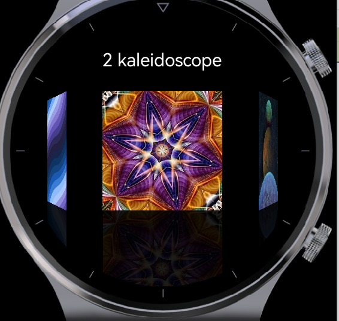

**表 1**  UICoverflowView核心函数

<a name="zh-cn_topic_0000002444726081_table1722811333172"></a>
<table><thead align="left"><tr id="zh-cn_topic_0000002444726081_row222893317175"><th class="cellrowborder" valign="top" width="50%" id="mcps1.2.3.1.1"><p id="zh-cn_topic_0000002444726081_p1441mcpsimp"><a name="zh-cn_topic_0000002444726081_p1441mcpsimp"></a><a name="zh-cn_topic_0000002444726081_p1441mcpsimp"></a>函数</p>
</th>
<th class="cellrowborder" valign="top" width="50%" id="mcps1.2.3.1.2"><p id="zh-cn_topic_0000002444726081_p1443mcpsimp"><a name="zh-cn_topic_0000002444726081_p1443mcpsimp"></a><a name="zh-cn_topic_0000002444726081_p1443mcpsimp"></a>介绍</p>
</th>
</tr>
</thead>
<tbody><tr id="zh-cn_topic_0000002444726081_row2229333131715"><td class="cellrowborder" valign="top" width="50%" headers="mcps1.2.3.1.1 "><p id="zh-cn_topic_0000002444726081_p11229163381711"><a name="zh-cn_topic_0000002444726081_p11229163381711"></a><a name="zh-cn_topic_0000002444726081_p11229163381711"></a>void Add(const char* id, const ImageInfo* src);</p>
</td>
<td class="cellrowborder" valign="top" width="50%" headers="mcps1.2.3.1.2 "><p id="zh-cn_topic_0000002444726081_p1022963391713"><a name="zh-cn_topic_0000002444726081_p1022963391713"></a><a name="zh-cn_topic_0000002444726081_p1022963391713"></a>添加图片资源，以及对应的ID值。</p>
</td>
</tr>
<tr id="zh-cn_topic_0000002444726081_row13229193318176"><td class="cellrowborder" valign="top" width="50%" headers="mcps1.2.3.1.1 "><p id="zh-cn_topic_0000002444726081_p1622915333173"><a name="zh-cn_topic_0000002444726081_p1622915333173"></a><a name="zh-cn_topic_0000002444726081_p1622915333173"></a>void Remove(const char* id);</p>
</td>
<td class="cellrowborder" valign="top" width="50%" headers="mcps1.2.3.1.2 "><p id="zh-cn_topic_0000002444726081_p622918338176"><a name="zh-cn_topic_0000002444726081_p622918338176"></a><a name="zh-cn_topic_0000002444726081_p622918338176"></a>移除对应ID的图片。</p>
</td>
</tr>
<tr id="zh-cn_topic_0000002444726081_row22292338179"><td class="cellrowborder" valign="top" width="50%" headers="mcps1.2.3.1.1 "><p id="zh-cn_topic_0000002444726081_p122291233121719"><a name="zh-cn_topic_0000002444726081_p122291233121719"></a><a name="zh-cn_topic_0000002444726081_p122291233121719"></a>void SetImgSize(uint16_t width, uint16_t height);</p>
</td>
<td class="cellrowborder" valign="top" width="50%" headers="mcps1.2.3.1.2 "><p id="zh-cn_topic_0000002444726081_p10229133301713"><a name="zh-cn_topic_0000002444726081_p10229133301713"></a><a name="zh-cn_topic_0000002444726081_p10229133301713"></a>设置图片的大小。</p>
</td>
</tr>
<tr id="zh-cn_topic_0000002444726081_row17229123317175"><td class="cellrowborder" valign="top" width="50%" headers="mcps1.2.3.1.1 "><p id="zh-cn_topic_0000002444726081_p1022993391715"><a name="zh-cn_topic_0000002444726081_p1022993391715"></a><a name="zh-cn_topic_0000002444726081_p1022993391715"></a>void SetImgPadding(uint16_t padding);</p>
</td>
<td class="cellrowborder" valign="top" width="50%" headers="mcps1.2.3.1.2 "><p id="zh-cn_topic_0000002444726081_p82293332173"><a name="zh-cn_topic_0000002444726081_p82293332173"></a><a name="zh-cn_topic_0000002444726081_p82293332173"></a>设置图片之间的间距。(需要在添加子控件前设置)</p>
</td>
</tr>
<tr id="zh-cn_topic_0000002444726081_row1322913313176"><td class="cellrowborder" valign="top" width="50%" headers="mcps1.2.3.1.1 "><p id="zh-cn_topic_0000002444726081_p32297333174"><a name="zh-cn_topic_0000002444726081_p32297333174"></a><a name="zh-cn_topic_0000002444726081_p32297333174"></a>void SetRotateAngle(float angle);</p>
</td>
<td class="cellrowborder" valign="top" width="50%" headers="mcps1.2.3.1.2 "><p id="zh-cn_topic_0000002444726081_p122291336178"><a name="zh-cn_topic_0000002444726081_p122291336178"></a><a name="zh-cn_topic_0000002444726081_p122291336178"></a>设置左右图片的最大旋转角度。</p>
</td>
</tr>
<tr id="zh-cn_topic_0000002444726081_row9229103311173"><td class="cellrowborder" valign="top" width="50%" headers="mcps1.2.3.1.1 "><p id="zh-cn_topic_0000002444726081_p19229133191716"><a name="zh-cn_topic_0000002444726081_p19229133191716"></a><a name="zh-cn_topic_0000002444726081_p19229133191716"></a>void SetOnCoverflowListener(OnCoverflowScrollListener* onCoverflowListener)</p>
</td>
<td class="cellrowborder" valign="top" width="50%" headers="mcps1.2.3.1.2 "><p id="zh-cn_topic_0000002444726081_p1822933391719"><a name="zh-cn_topic_0000002444726081_p1822933391719"></a><a name="zh-cn_topic_0000002444726081_p1822933391719"></a>设置滑动监听器，监听该控件的滑动事件，实现自定义的滑动处理。</p>
</td>
</tr>
</tbody>
</table>

> **说明：** 
>建议使用UICoverflowView2控件，具体请参见“[UICoverflowView2](#ZH-CN_TOPIC_0000002509483507)”。UICoverflowView2能够覆盖UICoverflowView功能，而且适用于更多的UI场景。

### UICoverflowView2<a name="ZH-CN_TOPIC_0000002509483507"></a>

适用于UICoverflowView子控件的内容为多种图片场景，示例如[图1](#zh-cn_topic_0000002411206496_fig13528161551614)所示。具体使用流程请参考示例“middleware/services/gui/uikit/sample/uitest/components/ui\_test\_coverflow/ui\_test\_coverflow2.cpp”。

**图 1**  UICoverflowView实例显示效果<a name="zh-cn_topic_0000002411206496_fig13528161551614"></a>  
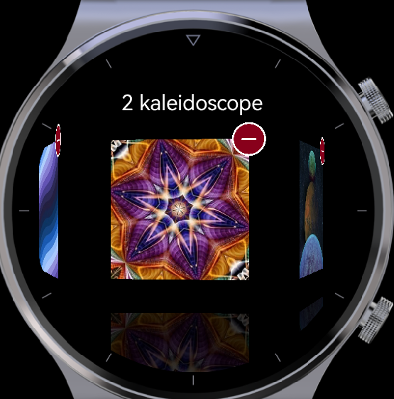

**表 1**  UICoverflowView2核心函数

<a name="zh-cn_topic_0000002411206496_table1722811333172"></a>
<table><thead align="left"><tr id="zh-cn_topic_0000002411206496_row222893317175"><th class="cellrowborder" valign="top" width="44.49%" id="mcps1.2.3.1.1"><p id="zh-cn_topic_0000002411206496_p1441mcpsimp"><a name="zh-cn_topic_0000002411206496_p1441mcpsimp"></a><a name="zh-cn_topic_0000002411206496_p1441mcpsimp"></a>函数</p>
</th>
<th class="cellrowborder" valign="top" width="55.510000000000005%" id="mcps1.2.3.1.2"><p id="zh-cn_topic_0000002411206496_p1443mcpsimp"><a name="zh-cn_topic_0000002411206496_p1443mcpsimp"></a><a name="zh-cn_topic_0000002411206496_p1443mcpsimp"></a>介绍</p>
</th>
</tr>
</thead>
<tbody><tr id="zh-cn_topic_0000002411206496_row2229333131715"><td class="cellrowborder" valign="top" width="44.49%" headers="mcps1.2.3.1.1 "><p id="zh-cn_topic_0000002411206496_p11229163381711"><a name="zh-cn_topic_0000002411206496_p11229163381711"></a><a name="zh-cn_topic_0000002411206496_p11229163381711"></a>void Add(UIView* view);</p>
</td>
<td class="cellrowborder" valign="top" width="55.510000000000005%" headers="mcps1.2.3.1.2 "><p id="zh-cn_topic_0000002411206496_p1022963391713"><a name="zh-cn_topic_0000002411206496_p1022963391713"></a><a name="zh-cn_topic_0000002411206496_p1022963391713"></a>添加一个UITransformGroup类型的子控件。</p>
</td>
</tr>
<tr id="zh-cn_topic_0000002411206496_row15590440184819"><td class="cellrowborder" valign="top" width="44.49%" headers="mcps1.2.3.1.1 "><p id="zh-cn_topic_0000002411206496_p11591154034819"><a name="zh-cn_topic_0000002411206496_p11591154034819"></a><a name="zh-cn_topic_0000002411206496_p11591154034819"></a>void Insert(UIView* prevView, UIView* insertView)</p>
</td>
<td class="cellrowborder" valign="top" width="55.510000000000005%" headers="mcps1.2.3.1.2 "><p id="zh-cn_topic_0000002411206496_p14591440154818"><a name="zh-cn_topic_0000002411206496_p14591440154818"></a><a name="zh-cn_topic_0000002411206496_p14591440154818"></a>插入一个UITransformGroup类型的子控件。</p>
</td>
</tr>
<tr id="zh-cn_topic_0000002411206496_row13229193318176"><td class="cellrowborder" valign="top" width="44.49%" headers="mcps1.2.3.1.1 "><p id="zh-cn_topic_0000002411206496_p1622915333173"><a name="zh-cn_topic_0000002411206496_p1622915333173"></a><a name="zh-cn_topic_0000002411206496_p1622915333173"></a>void Remove(UIView* view);</p>
</td>
<td class="cellrowborder" valign="top" width="55.510000000000005%" headers="mcps1.2.3.1.2 "><p id="zh-cn_topic_0000002411206496_p198254418483"><a name="zh-cn_topic_0000002411206496_p198254418483"></a><a name="zh-cn_topic_0000002411206496_p198254418483"></a>删除一个已添加的子控件。</p>
</td>
</tr>
<tr id="zh-cn_topic_0000002411206496_row22292338179"><td class="cellrowborder" valign="top" width="44.49%" headers="mcps1.2.3.1.1 "><p id="zh-cn_topic_0000002411206496_p3197113614820"><a name="zh-cn_topic_0000002411206496_p3197113614820"></a><a name="zh-cn_topic_0000002411206496_p3197113614820"></a>void SetPagePadding(uint16_t padding)</p>
</td>
<td class="cellrowborder" valign="top" width="55.510000000000005%" headers="mcps1.2.3.1.2 "><p id="zh-cn_topic_0000002411206496_p10229133301713"><a name="zh-cn_topic_0000002411206496_p10229133301713"></a><a name="zh-cn_topic_0000002411206496_p10229133301713"></a>设置每项之间的间距。(需要在添加子控件前设置)</p>
</td>
</tr>
<tr id="zh-cn_topic_0000002411206496_row17229123317175"><td class="cellrowborder" valign="top" width="44.49%" headers="mcps1.2.3.1.1 "><p id="zh-cn_topic_0000002411206496_p654833313511"><a name="zh-cn_topic_0000002411206496_p654833313511"></a><a name="zh-cn_topic_0000002411206496_p654833313511"></a>void SetChildMaxRotateAngle(float angle)</p>
</td>
<td class="cellrowborder" valign="top" width="55.510000000000005%" headers="mcps1.2.3.1.2 "><p id="zh-cn_topic_0000002411206496_p82293332173"><a name="zh-cn_topic_0000002411206496_p82293332173"></a><a name="zh-cn_topic_0000002411206496_p82293332173"></a>设置项的最大旋转角度。</p>
</td>
</tr>
<tr id="zh-cn_topic_0000002411206496_row9229103311173"><td class="cellrowborder" valign="top" width="44.49%" headers="mcps1.2.3.1.1 "><p id="zh-cn_topic_0000002411206496_p1686612216521"><a name="zh-cn_topic_0000002411206496_p1686612216521"></a><a name="zh-cn_topic_0000002411206496_p1686612216521"></a>void SetOnCoverflowListener(OnCoverflowScrollListener* onCoverflowListener)</p>
</td>
<td class="cellrowborder" valign="top" width="55.510000000000005%" headers="mcps1.2.3.1.2 "><p id="zh-cn_topic_0000002411206496_p1822933391719"><a name="zh-cn_topic_0000002411206496_p1822933391719"></a><a name="zh-cn_topic_0000002411206496_p1822933391719"></a>设置滑动监听器，监听该控件的滑动事件，实现自定义的滑动处理。</p>
</td>
</tr>
</tbody>
</table>

> **须知：** 
>不要添加UILabel UILabelExt到UITransformGroup类型的子控件中，会导致位置显示异常。

### UISphereView<a name="ZH-CN_TOPIC_0000002477443502"></a>

该控件可以实现2.5D球形菜单界面，显示效果如[图1](#zh-cn_topic_0000002444725957_fig4273835201516)所示。

具体使用流程请参考示例“middleware/services/gui/uikit/sample/uitest/components/ui\_test\_sphere\_view/ui\_test\_sphere\_view.cpp”。

**图 1**  球形效果<a name="zh-cn_topic_0000002444725957_fig4273835201516"></a>  
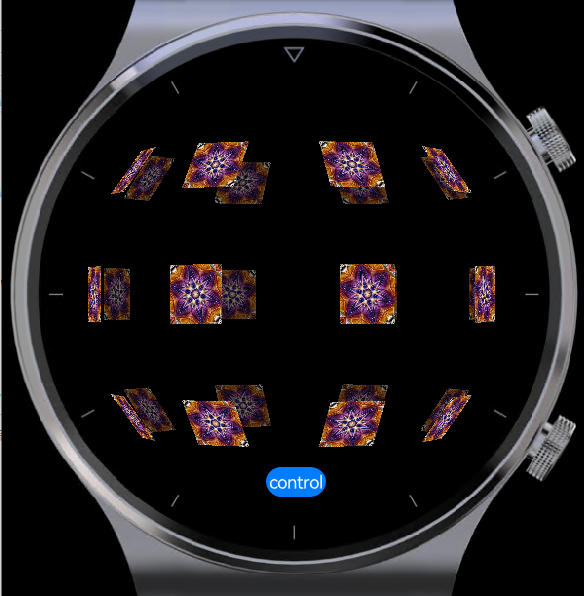

**表 1**  UISphereView核心参数

<a name="zh-cn_topic_0000002444725957_table121705691518"></a>
<table><thead align="left"><tr id="zh-cn_topic_0000002444725957_row71708614154"><th class="cellrowborder" valign="top" width="50%" id="mcps1.2.3.1.1"><p id="zh-cn_topic_0000002444725957_p017012641516"><a name="zh-cn_topic_0000002444725957_p017012641516"></a><a name="zh-cn_topic_0000002444725957_p017012641516"></a>函数</p>
</th>
<th class="cellrowborder" valign="top" width="50%" id="mcps1.2.3.1.2"><p id="zh-cn_topic_0000002444725957_p7245112231512"><a name="zh-cn_topic_0000002444725957_p7245112231512"></a><a name="zh-cn_topic_0000002444725957_p7245112231512"></a>介绍</p>
</th>
</tr>
</thead>
<tbody><tr id="zh-cn_topic_0000002444725957_row181700618158"><td class="cellrowborder" valign="top" width="50%" headers="mcps1.2.3.1.1 "><p id="zh-cn_topic_0000002444725957_p16170267158"><a name="zh-cn_topic_0000002444725957_p16170267158"></a><a name="zh-cn_topic_0000002444725957_p16170267158"></a>UISphereView(uint8_t numberOfRow);</p>
</td>
<td class="cellrowborder" valign="top" width="50%" headers="mcps1.2.3.1.2 "><p id="zh-cn_topic_0000002444725957_p111703617152"><a name="zh-cn_topic_0000002444725957_p111703617152"></a><a name="zh-cn_topic_0000002444725957_p111703617152"></a>构造函数，需要输入球形的一行最多显示数量，超过则换行。</p>
</td>
</tr>
<tr id="zh-cn_topic_0000002444725957_row1217006171512"><td class="cellrowborder" valign="top" width="50%" headers="mcps1.2.3.1.1 "><p id="zh-cn_topic_0000002444725957_p16427182417204"><a name="zh-cn_topic_0000002444725957_p16427182417204"></a><a name="zh-cn_topic_0000002444725957_p16427182417204"></a>void Add(UIView* view) override;</p>
</td>
<td class="cellrowborder" valign="top" width="50%" headers="mcps1.2.3.1.2 "><p id="zh-cn_topic_0000002444725957_p1017096131515"><a name="zh-cn_topic_0000002444725957_p1017096131515"></a><a name="zh-cn_topic_0000002444725957_p1017096131515"></a>添加子控件，只支持UITransformGroup类型控件。</p>
</td>
</tr>
<tr id="zh-cn_topic_0000002444725957_row51702067150"><td class="cellrowborder" valign="top" width="50%" headers="mcps1.2.3.1.1 "><p id="zh-cn_topic_0000002444725957_p14568143016205"><a name="zh-cn_topic_0000002444725957_p14568143016205"></a><a name="zh-cn_topic_0000002444725957_p14568143016205"></a>void Insert(UIView* prevView, UIView* insertView) override;</p>
</td>
<td class="cellrowborder" valign="top" width="50%" headers="mcps1.2.3.1.2 "><p id="zh-cn_topic_0000002444725957_p4170166151520"><a name="zh-cn_topic_0000002444725957_p4170166151520"></a><a name="zh-cn_topic_0000002444725957_p4170166151520"></a>插入子控件，只支持UITransformGroup类型控件。</p>
</td>
</tr>
<tr id="zh-cn_topic_0000002444725957_row12170146151514"><td class="cellrowborder" valign="top" width="50%" headers="mcps1.2.3.1.1 "><p id="zh-cn_topic_0000002444725957_p417011671517"><a name="zh-cn_topic_0000002444725957_p417011671517"></a><a name="zh-cn_topic_0000002444725957_p417011671517"></a>void Remove(UIView* view) override;</p>
</td>
<td class="cellrowborder" valign="top" width="50%" headers="mcps1.2.3.1.2 "><p id="zh-cn_topic_0000002444725957_p151709621517"><a name="zh-cn_topic_0000002444725957_p151709621517"></a><a name="zh-cn_topic_0000002444725957_p151709621517"></a>删除子控件，需要输入add或者insert的控件对象。</p>
</td>
</tr>
<tr id="zh-cn_topic_0000002444725957_row1617015661517"><td class="cellrowborder" valign="top" width="50%" headers="mcps1.2.3.1.1 "><p id="zh-cn_topic_0000002444725957_p131701662158"><a name="zh-cn_topic_0000002444725957_p131701662158"></a><a name="zh-cn_topic_0000002444725957_p131701662158"></a>void SetNumberOfRow(uint8_t numberOfRow);</p>
</td>
<td class="cellrowborder" valign="top" width="50%" headers="mcps1.2.3.1.2 "><p id="zh-cn_topic_0000002444725957_p117010617158"><a name="zh-cn_topic_0000002444725957_p117010617158"></a><a name="zh-cn_topic_0000002444725957_p117010617158"></a>设置球形每行最多显示控件数。</p>
</td>
</tr>
<tr id="zh-cn_topic_0000002444725957_row16170162152"><td class="cellrowborder" valign="top" width="50%" headers="mcps1.2.3.1.1 "><p id="zh-cn_topic_0000002444725957_p161704619156"><a name="zh-cn_topic_0000002444725957_p161704619156"></a><a name="zh-cn_topic_0000002444725957_p161704619156"></a>uint8_t GetNumberOfRow()；</p>
</td>
<td class="cellrowborder" valign="top" width="50%" headers="mcps1.2.3.1.2 "><p id="zh-cn_topic_0000002444725957_p41701641511"><a name="zh-cn_topic_0000002444725957_p41701641511"></a><a name="zh-cn_topic_0000002444725957_p41701641511"></a>获取当前球形每行的数量。</p>
</td>
</tr>
<tr id="zh-cn_topic_0000002444725957_row41709661513"><td class="cellrowborder" valign="top" width="50%" headers="mcps1.2.3.1.1 "><p id="zh-cn_topic_0000002444725957_p81706615154"><a name="zh-cn_topic_0000002444725957_p81706615154"></a><a name="zh-cn_topic_0000002444725957_p81706615154"></a>void UpdateItemAngle(float angle);</p>
</td>
<td class="cellrowborder" valign="top" width="50%" headers="mcps1.2.3.1.2 "><p id="zh-cn_topic_0000002444725957_p18170764153"><a name="zh-cn_topic_0000002444725957_p18170764153"></a><a name="zh-cn_topic_0000002444725957_p18170764153"></a>从当前位置旋转设置的角度。</p>
</td>
</tr>
<tr id="zh-cn_topic_0000002444725957_row2901154102510"><td class="cellrowborder" valign="top" width="50%" headers="mcps1.2.3.1.1 "><p id="zh-cn_topic_0000002444725957_p1170865410447"><a name="zh-cn_topic_0000002444725957_p1170865410447"></a><a name="zh-cn_topic_0000002444725957_p1170865410447"></a>void SetSensitivityFactor(float sensitivity)；</p>
</td>
<td class="cellrowborder" valign="top" width="50%" headers="mcps1.2.3.1.2 "><p id="zh-cn_topic_0000002444725957_p956024774611"><a name="zh-cn_topic_0000002444725957_p956024774611"></a><a name="zh-cn_topic_0000002444725957_p956024774611"></a>设置球形灵敏度。</p>
</td>
</tr>
<tr id="zh-cn_topic_0000002444725957_row7361256264"><td class="cellrowborder" valign="top" width="50%" headers="mcps1.2.3.1.1 "><p id="zh-cn_topic_0000002444725957_p73611956261"><a name="zh-cn_topic_0000002444725957_p73611956261"></a><a name="zh-cn_topic_0000002444725957_p73611956261"></a>float GetSensitivityFactor()；</p>
</td>
<td class="cellrowborder" valign="top" width="50%" headers="mcps1.2.3.1.2 "><p id="zh-cn_topic_0000002444725957_p53611516268"><a name="zh-cn_topic_0000002444725957_p53611516268"></a><a name="zh-cn_topic_0000002444725957_p53611516268"></a>获取球形灵敏度。</p>
</td>
</tr>
</tbody>
</table>

> **须知：** 
>球形控件的宽高需要设置一致。

以下是球型菜单控件的示例代码：

```
    UISphereView sphereView = new UISphereView(8); // 创建一个每行显示8个控件的球形菜单
    sphereView->SetPosition(0, 0, Screen::GetInstance().GetWidth(), Screen::GetInstance().GetHeight()); // 设置球形菜单大小为屏幕大小
    sphereView->SetThrowDrag(true);
    sphereView->RequestFocus(); // 申请焦点，支持表冠滚动。
     for (uint8_t i = 0; i < 24; i++) { // 添加24的子控件到球形菜单
        UITransformGroup* group = new UITransformGroup(); // 创建UITransformGroup控件。
        group->SetPosition(0, 0, 60, 60);
        group->SetStyle(STYLE_BACKGROUND_OPA, OPA_TRANSPARENT);
        UIImageView* image = new UIImageView(); // 创建需要显示的图片控件。
        image->SetPosition(0, 0, 60, 60);
        image->SetAutoEnable(false);
        image->SetResizeMode(UIImageView::ImageResizeMode::FILL);
        ImageInfo* info = ImageCacheManager::GetInstance().LoadSingleRes("[图片资源路径]");
        image->SetSrc(info);
        group->Add(image);
        sphereView->Add(group);
    }
```

### UISlipflowView<a name="ZH-CN_TOPIC_0000002509363461"></a>

具体使用流程请参考示例“middleware/services/gui/uikit/sample/uitest/components/ui\_test\_slipflow/ui\_test\_slipflow.cpp”。

**图 1**  滑动流效果<a name="zh-cn_topic_0000002444645785_fig1076843193812"></a>  
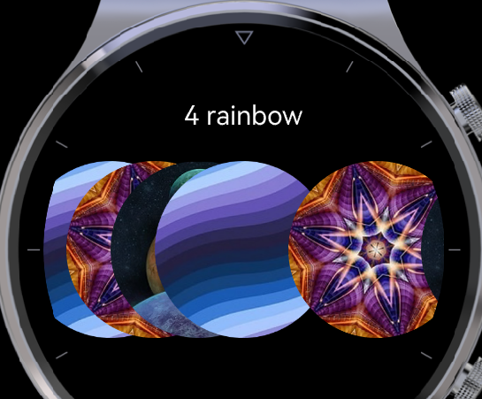

**表 1**  UISlipflowView核心函数

<a name="zh-cn_topic_0000002444645785_table1722811333172"></a>
<table><thead align="left"><tr id="zh-cn_topic_0000002444645785_row222893317175"><th class="cellrowborder" valign="top" width="50%" id="mcps1.2.3.1.1"><p id="zh-cn_topic_0000002444645785_p1441mcpsimp"><a name="zh-cn_topic_0000002444645785_p1441mcpsimp"></a><a name="zh-cn_topic_0000002444645785_p1441mcpsimp"></a>函数</p>
</th>
<th class="cellrowborder" valign="top" width="50%" id="mcps1.2.3.1.2"><p id="zh-cn_topic_0000002444645785_p1443mcpsimp"><a name="zh-cn_topic_0000002444645785_p1443mcpsimp"></a><a name="zh-cn_topic_0000002444645785_p1443mcpsimp"></a>介绍</p>
</th>
</tr>
</thead>
<tbody><tr id="zh-cn_topic_0000002444645785_row2229333131715"><td class="cellrowborder" valign="top" width="50%" headers="mcps1.2.3.1.1 "><p id="zh-cn_topic_0000002444645785_p11229163381711"><a name="zh-cn_topic_0000002444645785_p11229163381711"></a><a name="zh-cn_topic_0000002444645785_p11229163381711"></a>void Add(UIView* view);</p>
</td>
<td class="cellrowborder" valign="top" width="50%" headers="mcps1.2.3.1.2 "><p id="zh-cn_topic_0000002444645785_p1022963391713"><a name="zh-cn_topic_0000002444645785_p1022963391713"></a><a name="zh-cn_topic_0000002444645785_p1022963391713"></a>添加子控件。</p>
</td>
</tr>
<tr id="zh-cn_topic_0000002444645785_row13229193318176"><td class="cellrowborder" valign="top" width="50%" headers="mcps1.2.3.1.1 "><p id="zh-cn_topic_0000002444645785_p1622915333173"><a name="zh-cn_topic_0000002444645785_p1622915333173"></a><a name="zh-cn_topic_0000002444645785_p1622915333173"></a>void Remove(UIView* view);</p>
</td>
<td class="cellrowborder" valign="top" width="50%" headers="mcps1.2.3.1.2 "><p id="zh-cn_topic_0000002444645785_p622918338176"><a name="zh-cn_topic_0000002444645785_p622918338176"></a><a name="zh-cn_topic_0000002444645785_p622918338176"></a>删除子控件。</p>
</td>
</tr>
<tr id="zh-cn_topic_0000002444645785_row17229123317175"><td class="cellrowborder" valign="top" width="50%" headers="mcps1.2.3.1.1 "><p id="zh-cn_topic_0000002444645785_p1022993391715"><a name="zh-cn_topic_0000002444645785_p1022993391715"></a><a name="zh-cn_topic_0000002444645785_p1022993391715"></a>void SetCurrentPage(uint16_t index, bool needAnimator);</p>
</td>
<td class="cellrowborder" valign="top" width="50%" headers="mcps1.2.3.1.2 "><p id="zh-cn_topic_0000002444645785_p82293332173"><a name="zh-cn_topic_0000002444645785_p82293332173"></a><a name="zh-cn_topic_0000002444645785_p82293332173"></a>设置当前页。</p>
</td>
</tr>
<tr id="zh-cn_topic_0000002444645785_row1322913313176"><td class="cellrowborder" valign="top" width="50%" headers="mcps1.2.3.1.1 "><p id="zh-cn_topic_0000002444645785_p32297333174"><a name="zh-cn_topic_0000002444645785_p32297333174"></a><a name="zh-cn_topic_0000002444645785_p32297333174"></a>void SetAnimatorTime(uint16_t time);</p>
</td>
<td class="cellrowborder" valign="top" width="50%" headers="mcps1.2.3.1.2 "><p id="zh-cn_topic_0000002444645785_p122291336178"><a name="zh-cn_topic_0000002444645785_p122291336178"></a><a name="zh-cn_topic_0000002444645785_p122291336178"></a>设置页面切换的动画时间。</p>
</td>
</tr>
<tr id="zh-cn_topic_0000002444645785_row7733416204815"><td class="cellrowborder" valign="top" width="50%" headers="mcps1.2.3.1.1 "><p id="zh-cn_topic_0000002444645785_p14734516104812"><a name="zh-cn_topic_0000002444645785_p14734516104812"></a><a name="zh-cn_topic_0000002444645785_p14734516104812"></a>void SetMoveCoefficient(uint16_t coefficient);</p>
</td>
<td class="cellrowborder" valign="top" width="50%" headers="mcps1.2.3.1.2 "><p id="zh-cn_topic_0000002444645785_p15734161654816"><a name="zh-cn_topic_0000002444645785_p15734161654816"></a><a name="zh-cn_topic_0000002444645785_p15734161654816"></a>设置当前页面及右侧页面相对于其他页面的移动系数，及当前页面及右侧页面的移动速度是其他页的coefficient倍。</p>
</td>
</tr>
<tr id="zh-cn_topic_0000002444645785_row9229103311173"><td class="cellrowborder" valign="top" width="50%" headers="mcps1.2.3.1.1 "><p id="zh-cn_topic_0000002444645785_p19229133191716"><a name="zh-cn_topic_0000002444645785_p19229133191716"></a><a name="zh-cn_topic_0000002444645785_p19229133191716"></a>void SetOnSlipflowListener(OnSlipflowScrollListener* onSlipflowListener)</p>
</td>
<td class="cellrowborder" valign="top" width="50%" headers="mcps1.2.3.1.2 "><p id="zh-cn_topic_0000002444645785_p1822933391719"><a name="zh-cn_topic_0000002444645785_p1822933391719"></a><a name="zh-cn_topic_0000002444645785_p1822933391719"></a>设置滑动监听器，监听该控件的滑动事件，实现自定义的滑动处理。</p>
</td>
</tr>
</tbody>
</table>

### UIIcosahedronView<a name="ZH-CN_TOPIC_0000002477283534"></a>

UIIcosahedronView二十面体容器控件，可以实现足球效果，效果如[图1](#zh-cn_topic_0000002444645897_fig1444714318576)所示。具体使用流程请参考示例“middleware/services/gui/uikit/sample/uitest/components/ui\_test\_icosahedron/ui\_test\_icosahedron.cpp”。

**图 1**  足球效果<a name="zh-cn_topic_0000002444645897_fig1444714318576"></a>  
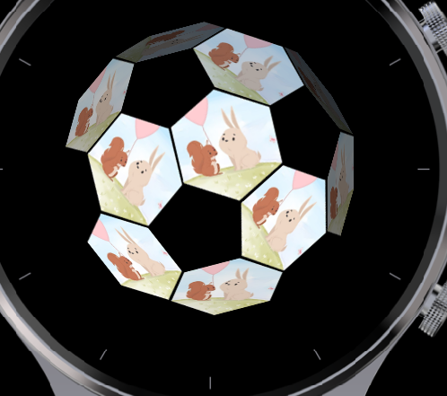

该控件实际是一个由20个三角面（三个顶点）组成的容器控件，每个六边形都按照特定方向在三角内，所以如果需要实现足球效果，对传入的各个面的图片资源存在限制。每个面图片需要是背景透明的正六边的图片，如[图2](#zh-cn_topic_0000002444645897_fig69601039195012)所示，方向也需要特别注意，要与实例一致。具体使用流程请参考示例“middleware/services/gui/uikit/sample/uitest/components/ui\_test\_icosahedron/ui\_test\_icosahedron.cpp”。

**图 2**  足球面的图片要求<a name="zh-cn_topic_0000002444645897_fig69601039195012"></a>  
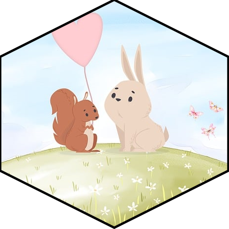

**表 1**  UIIcosahedronView核心函数

<a name="zh-cn_topic_0000002444645897_table166642040162317"></a>
<table><thead align="left"><tr id="zh-cn_topic_0000002444645897_row666411408235"><th class="cellrowborder" valign="top" width="50%" id="mcps1.2.3.1.1"><p id="zh-cn_topic_0000002444645897_p166444012231"><a name="zh-cn_topic_0000002444645897_p166444012231"></a><a name="zh-cn_topic_0000002444645897_p166444012231"></a>函数</p>
</th>
<th class="cellrowborder" valign="top" width="50%" id="mcps1.2.3.1.2"><p id="zh-cn_topic_0000002444645897_p1443mcpsimp"><a name="zh-cn_topic_0000002444645897_p1443mcpsimp"></a><a name="zh-cn_topic_0000002444645897_p1443mcpsimp"></a>介绍</p>
</th>
</tr>
</thead>
<tbody><tr id="zh-cn_topic_0000002444645897_row766414042315"><td class="cellrowborder" valign="top" width="50%" headers="mcps1.2.3.1.1 "><p id="zh-cn_topic_0000002444645897_p3664640162312"><a name="zh-cn_topic_0000002444645897_p3664640162312"></a><a name="zh-cn_topic_0000002444645897_p3664640162312"></a>void SetSideLength(uint16_t sideLen);</p>
</td>
<td class="cellrowborder" valign="top" width="50%" headers="mcps1.2.3.1.2 "><p id="zh-cn_topic_0000002444645897_p066444012318"><a name="zh-cn_topic_0000002444645897_p066444012318"></a><a name="zh-cn_topic_0000002444645897_p066444012318"></a>设置二十面体的棱长，通过该接口可以控制球体的大小。</p>
</td>
</tr>
<tr id="zh-cn_topic_0000002444645897_row186647401234"><td class="cellrowborder" valign="top" width="50%" headers="mcps1.2.3.1.1 "><p id="zh-cn_topic_0000002444645897_p4664124032318"><a name="zh-cn_topic_0000002444645897_p4664124032318"></a><a name="zh-cn_topic_0000002444645897_p4664124032318"></a>void Add(UIView* view) override;</p>
</td>
<td class="cellrowborder" valign="top" width="50%" headers="mcps1.2.3.1.2 "><p id="zh-cn_topic_0000002444645897_p1866484062314"><a name="zh-cn_topic_0000002444645897_p1866484062314"></a><a name="zh-cn_topic_0000002444645897_p1866484062314"></a>添加UIViewImage控件。</p>
</td>
</tr>
<tr id="zh-cn_topic_0000002444645897_row866484020232"><td class="cellrowborder" valign="top" width="50%" headers="mcps1.2.3.1.1 "><p id="zh-cn_topic_0000002444645897_p3664740142318"><a name="zh-cn_topic_0000002444645897_p3664740142318"></a><a name="zh-cn_topic_0000002444645897_p3664740142318"></a>void RefreshIcosahedron();</p>
</td>
<td class="cellrowborder" valign="top" width="50%" headers="mcps1.2.3.1.2 "><p id="zh-cn_topic_0000002444645897_p266464011230"><a name="zh-cn_topic_0000002444645897_p266464011230"></a><a name="zh-cn_topic_0000002444645897_p266464011230"></a>刷新二十面体容器，在更新棱长或旋转的角度后使用。</p>
</td>
</tr>
<tr id="zh-cn_topic_0000002444645897_row0664134016235"><td class="cellrowborder" valign="top" width="50%" headers="mcps1.2.3.1.1 "><p id="zh-cn_topic_0000002444645897_p26642405238"><a name="zh-cn_topic_0000002444645897_p26642405238"></a><a name="zh-cn_topic_0000002444645897_p26642405238"></a>bool RotatePlanes(int16_t angle, const Vector3&lt;float&gt;& pivotStart, const Vector3&lt;float&gt;& pivotEnd);</p>
</td>
<td class="cellrowborder" valign="top" width="50%" headers="mcps1.2.3.1.2 "><p id="zh-cn_topic_0000002444645897_p1966444052311"><a name="zh-cn_topic_0000002444645897_p1966444052311"></a><a name="zh-cn_topic_0000002444645897_p1966444052311"></a>旋转二十面体容器。</p>
</td>
</tr>
<tr id="zh-cn_topic_0000002444645897_row16649405230"><td class="cellrowborder" valign="top" width="50%" headers="mcps1.2.3.1.1 "><p id="zh-cn_topic_0000002444645897_p15664144042316"><a name="zh-cn_topic_0000002444645897_p15664144042316"></a><a name="zh-cn_topic_0000002444645897_p15664144042316"></a>void SetDefaultImage(ImageInfo* src)</p>
</td>
<td class="cellrowborder" valign="top" width="50%" headers="mcps1.2.3.1.2 "><p id="zh-cn_topic_0000002444645897_p1366484017237"><a name="zh-cn_topic_0000002444645897_p1366484017237"></a><a name="zh-cn_topic_0000002444645897_p1366484017237"></a>设置默认图片。在添加子控件不满二十面体时，使用该图片进行显示。</p>
</td>
</tr>
<tr id="zh-cn_topic_0000002444645897_row1666414012311"><td class="cellrowborder" valign="top" width="50%" headers="mcps1.2.3.1.1 "><p id="zh-cn_topic_0000002444645897_p466424015238"><a name="zh-cn_topic_0000002444645897_p466424015238"></a><a name="zh-cn_topic_0000002444645897_p466424015238"></a>void SetLuminanceFactor(float value)</p>
</td>
<td class="cellrowborder" valign="top" width="50%" headers="mcps1.2.3.1.2 "><p id="zh-cn_topic_0000002444645897_p8664174011233"><a name="zh-cn_topic_0000002444645897_p8664174011233"></a><a name="zh-cn_topic_0000002444645897_p8664174011233"></a>设置惯性的补偿系数。系数越大，惯性越大。</p>
</td>
</tr>
</tbody>
</table>

### UIHexagonList<a name="ZH-CN_TOPIC_0000002509483509"></a>

UIHexagonList是呈蜂窝状排布子节点的容器控件，常用于陈列菜单界面的各应用图标。该控件仅支持添加UIImageView和UITransformGroup。具体使用流程请参考示例“middleware/services/gui/uikit/sample/uitest/components/ui\_test\_hexagons\_list/ui\_test\_hexagons\_list.cpp”。

**表 1**  UIHexagonList核心函数

<a name="zh-cn_topic_0000002411046728_table1433mcpsimp"></a>
<table><thead align="left"><tr id="zh-cn_topic_0000002411046728_row1439mcpsimp"><th class="cellrowborder" valign="top" width="49.919999999999995%" id="mcps1.2.3.1.1"><p id="zh-cn_topic_0000002411046728_p1441mcpsimp"><a name="zh-cn_topic_0000002411046728_p1441mcpsimp"></a><a name="zh-cn_topic_0000002411046728_p1441mcpsimp"></a>函数</p>
</th>
<th class="cellrowborder" valign="top" width="50.080000000000005%" id="mcps1.2.3.1.2"><p id="zh-cn_topic_0000002411046728_p1443mcpsimp"><a name="zh-cn_topic_0000002411046728_p1443mcpsimp"></a><a name="zh-cn_topic_0000002411046728_p1443mcpsimp"></a>介绍</p>
</th>
</tr>
</thead>
<tbody><tr id="zh-cn_topic_0000002411046728_row1445mcpsimp"><td class="cellrowborder" valign="top" width="49.919999999999995%" headers="mcps1.2.3.1.1 "><p id="zh-cn_topic_0000002411046728_p59885955310"><a name="zh-cn_topic_0000002411046728_p59885955310"></a><a name="zh-cn_topic_0000002411046728_p59885955310"></a>void SetImageDistance(uint16_t distance)</p>
</td>
<td class="cellrowborder" valign="top" width="50.080000000000005%" headers="mcps1.2.3.1.2 "><p id="zh-cn_topic_0000002411046728_p1449mcpsimp"><a name="zh-cn_topic_0000002411046728_p1449mcpsimp"></a><a name="zh-cn_topic_0000002411046728_p1449mcpsimp"></a>设置图标的间距。</p>
</td>
</tr>
<tr id="zh-cn_topic_0000002411046728_row1450mcpsimp"><td class="cellrowborder" valign="top" width="49.919999999999995%" headers="mcps1.2.3.1.1 "><p id="zh-cn_topic_0000002411046728_p88004325410"><a name="zh-cn_topic_0000002411046728_p88004325410"></a><a name="zh-cn_topic_0000002411046728_p88004325410"></a>void SetImageSizeInCenter(uint16_t size)</p>
</td>
<td class="cellrowborder" valign="top" width="50.080000000000005%" headers="mcps1.2.3.1.2 "><p id="zh-cn_topic_0000002411046728_p1454mcpsimp"><a name="zh-cn_topic_0000002411046728_p1454mcpsimp"></a><a name="zh-cn_topic_0000002411046728_p1454mcpsimp"></a>设置图标居中显示时的尺寸。</p>
</td>
</tr>
<tr id="zh-cn_topic_0000002411046728_row1455mcpsimp"><td class="cellrowborder" valign="top" width="49.919999999999995%" headers="mcps1.2.3.1.1 "><p id="zh-cn_topic_0000002411046728_p10806182547"><a name="zh-cn_topic_0000002411046728_p10806182547"></a><a name="zh-cn_topic_0000002411046728_p10806182547"></a>void SetScaleFactorByDistance(float factor)</p>
</td>
<td class="cellrowborder" valign="top" width="50.080000000000005%" headers="mcps1.2.3.1.2 "><p id="zh-cn_topic_0000002411046728_p1459mcpsimp"><a name="zh-cn_topic_0000002411046728_p1459mcpsimp"></a><a name="zh-cn_topic_0000002411046728_p1459mcpsimp"></a>设置图标缩放系数。</p>
</td>
</tr>
<tr id="zh-cn_topic_0000002411046728_row1460mcpsimp"><td class="cellrowborder" valign="top" width="49.919999999999995%" headers="mcps1.2.3.1.1 "><p id="zh-cn_topic_0000002411046728_p336281311541"><a name="zh-cn_topic_0000002411046728_p336281311541"></a><a name="zh-cn_topic_0000002411046728_p336281311541"></a>float GetScaleFactorByDistance()</p>
</td>
<td class="cellrowborder" valign="top" width="50.080000000000005%" headers="mcps1.2.3.1.2 "><p id="zh-cn_topic_0000002411046728_p1464mcpsimp"><a name="zh-cn_topic_0000002411046728_p1464mcpsimp"></a><a name="zh-cn_topic_0000002411046728_p1464mcpsimp"></a>获取图标缩放系数。</p>
</td>
</tr>
<tr id="zh-cn_topic_0000002411046728_row1465mcpsimp"><td class="cellrowborder" valign="top" width="49.919999999999995%" headers="mcps1.2.3.1.1 "><p id="zh-cn_topic_0000002411046728_p159490177542"><a name="zh-cn_topic_0000002411046728_p159490177542"></a><a name="zh-cn_topic_0000002411046728_p159490177542"></a>void SetScaleThesholdOfZeroFactor(float threshold)</p>
</td>
<td class="cellrowborder" valign="top" width="50.080000000000005%" headers="mcps1.2.3.1.2 "><p id="zh-cn_topic_0000002411046728_p1469mcpsimp"><a name="zh-cn_topic_0000002411046728_p1469mcpsimp"></a><a name="zh-cn_topic_0000002411046728_p1469mcpsimp"></a>设置图标缩放阈值。</p>
</td>
</tr>
<tr id="zh-cn_topic_0000002411046728_row1472mcpsimp"><td class="cellrowborder" valign="top" width="49.919999999999995%" headers="mcps1.2.3.1.1 "><p id="zh-cn_topic_0000002411046728_p16725112315414"><a name="zh-cn_topic_0000002411046728_p16725112315414"></a><a name="zh-cn_topic_0000002411046728_p16725112315414"></a>float GetScaleThesholdOfZeroFactor()</p>
</td>
<td class="cellrowborder" valign="top" width="50.080000000000005%" headers="mcps1.2.3.1.2 "><p id="zh-cn_topic_0000002411046728_p1476mcpsimp"><a name="zh-cn_topic_0000002411046728_p1476mcpsimp"></a><a name="zh-cn_topic_0000002411046728_p1476mcpsimp"></a>获取图标缩放阈值。</p>
</td>
</tr>
<tr id="zh-cn_topic_0000002411046728_row1477mcpsimp"><td class="cellrowborder" valign="top" width="49.919999999999995%" headers="mcps1.2.3.1.1 "><p id="zh-cn_topic_0000002411046728_p16369527175415"><a name="zh-cn_topic_0000002411046728_p16369527175415"></a><a name="zh-cn_topic_0000002411046728_p16369527175415"></a>void Add(UIView* view)</p>
</td>
<td class="cellrowborder" valign="top" width="50.080000000000005%" headers="mcps1.2.3.1.2 "><p id="zh-cn_topic_0000002411046728_p1418716402270"><a name="zh-cn_topic_0000002411046728_p1418716402270"></a><a name="zh-cn_topic_0000002411046728_p1418716402270"></a>添加控件，支持控件类型为UIImageView和UITransformGroup。</p>
</td>
</tr>
<tr id="zh-cn_topic_0000002411046728_row1176210325549"><td class="cellrowborder" valign="top" width="49.919999999999995%" headers="mcps1.2.3.1.1 "><p id="zh-cn_topic_0000002411046728_p1676210322542"><a name="zh-cn_topic_0000002411046728_p1676210322542"></a><a name="zh-cn_topic_0000002411046728_p1676210322542"></a>void Insert(UIView* prevView, UIView* insertView)</p>
</td>
<td class="cellrowborder" valign="top" width="50.080000000000005%" headers="mcps1.2.3.1.2 "><p id="zh-cn_topic_0000002411046728_p1798313513272"><a name="zh-cn_topic_0000002411046728_p1798313513272"></a><a name="zh-cn_topic_0000002411046728_p1798313513272"></a>插入控件，支持控件类型为UIImageView和UITransformGroup。</p>
</td>
</tr>
<tr id="zh-cn_topic_0000002411046728_row11762173285413"><td class="cellrowborder" valign="top" width="49.919999999999995%" headers="mcps1.2.3.1.1 "><p id="zh-cn_topic_0000002411046728_p176243245416"><a name="zh-cn_topic_0000002411046728_p176243245416"></a><a name="zh-cn_topic_0000002411046728_p176243245416"></a>void LayoutChildren(bool needInvalidate = false)</p>
</td>
<td class="cellrowborder" valign="top" width="50.080000000000005%" headers="mcps1.2.3.1.2 "><p id="zh-cn_topic_0000002411046728_p14601453102812"><a name="zh-cn_topic_0000002411046728_p14601453102812"></a><a name="zh-cn_topic_0000002411046728_p14601453102812"></a>按照蜂窝状布局控件。</p>
</td>
</tr>
<tr id="zh-cn_topic_0000002411046728_row1684513445619"><td class="cellrowborder" valign="top" width="49.919999999999995%" headers="mcps1.2.3.1.1 "><p id="zh-cn_topic_0000002411046728_p108451444565"><a name="zh-cn_topic_0000002411046728_p108451444565"></a><a name="zh-cn_topic_0000002411046728_p108451444565"></a>void MoveChildByOffset(int16_t offsetX, int16_t offsetY)</p>
</td>
<td class="cellrowborder" valign="top" width="50.080000000000005%" headers="mcps1.2.3.1.2 "><p id="zh-cn_topic_0000002411046728_p1184513419566"><a name="zh-cn_topic_0000002411046728_p1184513419566"></a><a name="zh-cn_topic_0000002411046728_p1184513419566"></a>移动控件。</p>
</td>
</tr>
<tr id="zh-cn_topic_0000002411046728_row207623326548"><td class="cellrowborder" valign="top" width="49.919999999999995%" headers="mcps1.2.3.1.1 "><p id="zh-cn_topic_0000002411046728_p97621132125415"><a name="zh-cn_topic_0000002411046728_p97621132125415"></a><a name="zh-cn_topic_0000002411046728_p97621132125415"></a>void Scale(float scale, uint8_t centerIndex)</p>
</td>
<td class="cellrowborder" valign="top" width="50.080000000000005%" headers="mcps1.2.3.1.2 "><p id="zh-cn_topic_0000002411046728_p1193873352912"><a name="zh-cn_topic_0000002411046728_p1193873352912"></a><a name="zh-cn_topic_0000002411046728_p1193873352912"></a>以索引值为centerIndex的控件为中心点缩放指定倍数。</p>
</td>
</tr>
<tr id="zh-cn_topic_0000002411046728_row1776363220545"><td class="cellrowborder" valign="top" width="49.919999999999995%" headers="mcps1.2.3.1.1 "><p id="zh-cn_topic_0000002411046728_p4763153265413"><a name="zh-cn_topic_0000002411046728_p4763153265413"></a><a name="zh-cn_topic_0000002411046728_p4763153265413"></a>float GetGlobalScale()</p>
</td>
<td class="cellrowborder" valign="top" width="50.080000000000005%" headers="mcps1.2.3.1.2 "><p id="zh-cn_topic_0000002411046728_p07631328545"><a name="zh-cn_topic_0000002411046728_p07631328545"></a><a name="zh-cn_topic_0000002411046728_p07631328545"></a>获取全局缩放倍数。</p>
</td>
</tr>
<tr id="zh-cn_topic_0000002411046728_row201178162555"><td class="cellrowborder" valign="top" width="49.919999999999995%" headers="mcps1.2.3.1.1 "><p id="zh-cn_topic_0000002411046728_p611719168551"><a name="zh-cn_topic_0000002411046728_p611719168551"></a><a name="zh-cn_topic_0000002411046728_p611719168551"></a>UIView* GetViewByIndex(uint8_t index)</p>
</td>
<td class="cellrowborder" valign="top" width="50.080000000000005%" headers="mcps1.2.3.1.2 "><p id="zh-cn_topic_0000002411046728_p20677132523012"><a name="zh-cn_topic_0000002411046728_p20677132523012"></a><a name="zh-cn_topic_0000002411046728_p20677132523012"></a>获取指定索引值关联的控件。</p>
</td>
</tr>
<tr id="zh-cn_topic_0000002411046728_row1117916105515"><td class="cellrowborder" valign="top" width="49.919999999999995%" headers="mcps1.2.3.1.1 "><p id="zh-cn_topic_0000002411046728_p111731635513"><a name="zh-cn_topic_0000002411046728_p111731635513"></a><a name="zh-cn_topic_0000002411046728_p111731635513"></a>void SetReboundMode(ReboundMode mode)</p>
</td>
<td class="cellrowborder" valign="top" width="50.080000000000005%" headers="mcps1.2.3.1.2 "><p id="zh-cn_topic_0000002411046728_p17117416185515"><a name="zh-cn_topic_0000002411046728_p17117416185515"></a><a name="zh-cn_topic_0000002411046728_p17117416185515"></a>设置回弹模式，支持模式为：</p>
<a name="zh-cn_topic_0000002411046728_ul95621374313"></a><a name="zh-cn_topic_0000002411046728_ul95621374313"></a><ul id="zh-cn_topic_0000002411046728_ul95621374313"><li>NEAREST_IMG_ON_SCR_CENTER：离屏幕中心点最近的图标将回弹至屏幕中间。</li><li>CENTER_IMG_ON_SCR_CENTER：初始位于中心的图标将回弹至屏幕中间。</li><li>NORMAL：与UIScrollView相同的模式。</li></ul>
</td>
</tr>
<tr id="zh-cn_topic_0000002411046728_row71171916195515"><td class="cellrowborder" valign="top" width="49.919999999999995%" headers="mcps1.2.3.1.1 "><p id="zh-cn_topic_0000002411046728_p15117116155510"><a name="zh-cn_topic_0000002411046728_p15117116155510"></a><a name="zh-cn_topic_0000002411046728_p15117116155510"></a>int8_t GetFocusedImgIndex()</p>
</td>
<td class="cellrowborder" valign="top" width="50.080000000000005%" headers="mcps1.2.3.1.2 "><p id="zh-cn_topic_0000002411046728_p1311751610558"><a name="zh-cn_topic_0000002411046728_p1311751610558"></a><a name="zh-cn_topic_0000002411046728_p1311751610558"></a>获取位于屏幕中间的图标索引。</p>
</td>
</tr>
<tr id="zh-cn_topic_0000002411046728_row111711695515"><td class="cellrowborder" valign="top" width="49.919999999999995%" headers="mcps1.2.3.1.1 "><p id="zh-cn_topic_0000002411046728_p1711714168558"><a name="zh-cn_topic_0000002411046728_p1711714168558"></a><a name="zh-cn_topic_0000002411046728_p1711714168558"></a>Vector2&lt;int16_t&gt; GetCurrentPosition(uint8_t index)</p>
</td>
<td class="cellrowborder" valign="top" width="50.080000000000005%" headers="mcps1.2.3.1.2 "><p id="zh-cn_topic_0000002411046728_p1111715160552"><a name="zh-cn_topic_0000002411046728_p1111715160552"></a><a name="zh-cn_topic_0000002411046728_p1111715160552"></a>获取指定索引值关联的控件位置。</p>
</td>
</tr>
</tbody>
</table>

### UICustomHexagonsList<a name="ZH-CN_TOPIC_0000002477443504"></a>

UICustomHexagonList继承自UIHexagonList，额外支持表冠响应，可通过SetOnRotateListener实现表冠转动监听。具体使用流程请参考示例“middleware/services/gui/uikit/sample/uitest/components/ui\_test\_hexagons\_list/ui\_test\_hexagons\_list.cpp”。

**表 1**  UICustomHexagonList核心函数

<a name="zh-cn_topic_0000002411046936_table213474017397"></a>
<table><thead align="left"><tr id="zh-cn_topic_0000002411046936_row1813454013916"><th class="cellrowborder" valign="top" width="50%" id="mcps1.2.3.1.1"><p id="zh-cn_topic_0000002411046936_p18134140163916"><a name="zh-cn_topic_0000002411046936_p18134140163916"></a><a name="zh-cn_topic_0000002411046936_p18134140163916"></a>函数</p>
</th>
<th class="cellrowborder" valign="top" width="50%" id="mcps1.2.3.1.2"><p id="zh-cn_topic_0000002411046936_p1613454073913"><a name="zh-cn_topic_0000002411046936_p1613454073913"></a><a name="zh-cn_topic_0000002411046936_p1613454073913"></a>介绍</p>
</th>
</tr>
</thead>
<tbody><tr id="zh-cn_topic_0000002411046936_row11341040193912"><td class="cellrowborder" valign="top" width="50%" headers="mcps1.2.3.1.1 "><p id="zh-cn_topic_0000002411046936_p93187565489"><a name="zh-cn_topic_0000002411046936_p93187565489"></a><a name="zh-cn_topic_0000002411046936_p93187565489"></a>void StartRotateAnimator(uint8_t center, int16_t xDistance, int16_t yDistance, float startScale, float endScale)</p>
</td>
<td class="cellrowborder" valign="top" width="50%" headers="mcps1.2.3.1.2 "><p id="zh-cn_topic_0000002411046936_p162513588485"><a name="zh-cn_topic_0000002411046936_p162513588485"></a><a name="zh-cn_topic_0000002411046936_p162513588485"></a>以索引值为center的控件为中心，启动一段动画完成指定距离偏移和指定倍数缩放。</p>
</td>
</tr>
<tr id="zh-cn_topic_0000002411046936_row181341440183910"><td class="cellrowborder" valign="top" width="50%" headers="mcps1.2.3.1.1 "><p id="zh-cn_topic_0000002411046936_p10910113613510"><a name="zh-cn_topic_0000002411046936_p10910113613510"></a><a name="zh-cn_topic_0000002411046936_p10910113613510"></a>void StopRotateAnimator()</p>
</td>
<td class="cellrowborder" valign="top" width="50%" headers="mcps1.2.3.1.2 "><p id="zh-cn_topic_0000002411046936_p1992593619515"><a name="zh-cn_topic_0000002411046936_p1992593619515"></a><a name="zh-cn_topic_0000002411046936_p1992593619515"></a>停止动画。</p>
</td>
</tr>
</tbody>
</table>

### UIWaterfallList<a name="ZH-CN_TOPIC_0000002509363463"></a>

UIWaterfallList是以每行3列或4列交叉排布子控件的容器控件，常用于陈列菜单界面的各应用图标。具体使用流程请参考示例“middleware/services/gui/uikit/sample/uitest/components/ui\_test\_waterfall\_list/ui\_test\_waterfall\_list.cpp”。

**表 1**  UIWaterfallList核心函数

<a name="zh-cn_topic_0000002411206644_table1433mcpsimp"></a>
<table><thead align="left"><tr id="zh-cn_topic_0000002411206644_row1439mcpsimp"><th class="cellrowborder" valign="top" width="50%" id="mcps1.2.3.1.1"><p id="zh-cn_topic_0000002411206644_p1441mcpsimp"><a name="zh-cn_topic_0000002411206644_p1441mcpsimp"></a><a name="zh-cn_topic_0000002411206644_p1441mcpsimp"></a>函数</p>
</th>
<th class="cellrowborder" valign="top" width="50%" id="mcps1.2.3.1.2"><p id="zh-cn_topic_0000002411206644_p1443mcpsimp"><a name="zh-cn_topic_0000002411206644_p1443mcpsimp"></a><a name="zh-cn_topic_0000002411206644_p1443mcpsimp"></a>介绍</p>
</th>
</tr>
</thead>
<tbody><tr id="zh-cn_topic_0000002411206644_row1445mcpsimp"><td class="cellrowborder" valign="top" width="50%" headers="mcps1.2.3.1.1 "><p id="zh-cn_topic_0000002411206644_p59885955310"><a name="zh-cn_topic_0000002411206644_p59885955310"></a><a name="zh-cn_topic_0000002411206644_p59885955310"></a>void SetImageDistance(uint16_t distance)</p>
</td>
<td class="cellrowborder" valign="top" width="50%" headers="mcps1.2.3.1.2 "><p id="zh-cn_topic_0000002411206644_p1449mcpsimp"><a name="zh-cn_topic_0000002411206644_p1449mcpsimp"></a><a name="zh-cn_topic_0000002411206644_p1449mcpsimp"></a>设置图标的间距。</p>
</td>
</tr>
<tr id="zh-cn_topic_0000002411206644_row1450mcpsimp"><td class="cellrowborder" valign="top" width="50%" headers="mcps1.2.3.1.1 "><p id="zh-cn_topic_0000002411206644_p88004325410"><a name="zh-cn_topic_0000002411206644_p88004325410"></a><a name="zh-cn_topic_0000002411206644_p88004325410"></a>void SetImageSizeInCenter(uint16_t size)</p>
</td>
<td class="cellrowborder" valign="top" width="50%" headers="mcps1.2.3.1.2 "><p id="zh-cn_topic_0000002411206644_p1454mcpsimp"><a name="zh-cn_topic_0000002411206644_p1454mcpsimp"></a><a name="zh-cn_topic_0000002411206644_p1454mcpsimp"></a>设置图标居中显示时的尺寸。</p>
</td>
</tr>
<tr id="zh-cn_topic_0000002411206644_row1455mcpsimp"><td class="cellrowborder" valign="top" width="50%" headers="mcps1.2.3.1.1 "><p id="zh-cn_topic_0000002411206644_p10806182547"><a name="zh-cn_topic_0000002411206644_p10806182547"></a><a name="zh-cn_topic_0000002411206644_p10806182547"></a>void SetScaleFactorByDistance(float factor)</p>
</td>
<td class="cellrowborder" valign="top" width="50%" headers="mcps1.2.3.1.2 "><p id="zh-cn_topic_0000002411206644_p1459mcpsimp"><a name="zh-cn_topic_0000002411206644_p1459mcpsimp"></a><a name="zh-cn_topic_0000002411206644_p1459mcpsimp"></a>设置图标缩放系数。</p>
</td>
</tr>
<tr id="zh-cn_topic_0000002411206644_row1460mcpsimp"><td class="cellrowborder" valign="top" width="50%" headers="mcps1.2.3.1.1 "><p id="zh-cn_topic_0000002411206644_p336281311541"><a name="zh-cn_topic_0000002411206644_p336281311541"></a><a name="zh-cn_topic_0000002411206644_p336281311541"></a>float GetScaleFactorByDistance()</p>
</td>
<td class="cellrowborder" valign="top" width="50%" headers="mcps1.2.3.1.2 "><p id="zh-cn_topic_0000002411206644_p1464mcpsimp"><a name="zh-cn_topic_0000002411206644_p1464mcpsimp"></a><a name="zh-cn_topic_0000002411206644_p1464mcpsimp"></a>获取图标缩放系数。</p>
</td>
</tr>
<tr id="zh-cn_topic_0000002411206644_row1465mcpsimp"><td class="cellrowborder" valign="top" width="50%" headers="mcps1.2.3.1.1 "><p id="zh-cn_topic_0000002411206644_p159490177542"><a name="zh-cn_topic_0000002411206644_p159490177542"></a><a name="zh-cn_topic_0000002411206644_p159490177542"></a>void SetScaleThesholdOfZeroFactor(float threshold)</p>
</td>
<td class="cellrowborder" valign="top" width="50%" headers="mcps1.2.3.1.2 "><p id="zh-cn_topic_0000002411206644_p1469mcpsimp"><a name="zh-cn_topic_0000002411206644_p1469mcpsimp"></a><a name="zh-cn_topic_0000002411206644_p1469mcpsimp"></a>设置图标缩放阈值。</p>
</td>
</tr>
<tr id="zh-cn_topic_0000002411206644_row1472mcpsimp"><td class="cellrowborder" valign="top" width="50%" headers="mcps1.2.3.1.1 "><p id="zh-cn_topic_0000002411206644_p16725112315414"><a name="zh-cn_topic_0000002411206644_p16725112315414"></a><a name="zh-cn_topic_0000002411206644_p16725112315414"></a>float GetScaleThesholdOfZeroFactor()</p>
</td>
<td class="cellrowborder" valign="top" width="50%" headers="mcps1.2.3.1.2 "><p id="zh-cn_topic_0000002411206644_p1476mcpsimp"><a name="zh-cn_topic_0000002411206644_p1476mcpsimp"></a><a name="zh-cn_topic_0000002411206644_p1476mcpsimp"></a>获取图标缩放阈值。</p>
</td>
</tr>
<tr id="zh-cn_topic_0000002411206644_row1477mcpsimp"><td class="cellrowborder" valign="top" width="50%" headers="mcps1.2.3.1.1 "><p id="zh-cn_topic_0000002411206644_p16369527175415"><a name="zh-cn_topic_0000002411206644_p16369527175415"></a><a name="zh-cn_topic_0000002411206644_p16369527175415"></a>void Add(UIView* view)</p>
</td>
<td class="cellrowborder" valign="top" width="50%" headers="mcps1.2.3.1.2 "><p id="zh-cn_topic_0000002411206644_p1418716402270"><a name="zh-cn_topic_0000002411206644_p1418716402270"></a><a name="zh-cn_topic_0000002411206644_p1418716402270"></a>添加控件，支持控件类型为UIImageView和UITransformGroup。</p>
</td>
</tr>
<tr id="zh-cn_topic_0000002411206644_row1176210325549"><td class="cellrowborder" valign="top" width="50%" headers="mcps1.2.3.1.1 "><p id="zh-cn_topic_0000002411206644_p1676210322542"><a name="zh-cn_topic_0000002411206644_p1676210322542"></a><a name="zh-cn_topic_0000002411206644_p1676210322542"></a>void Insert(UIView* prevView, UIView* insertView)</p>
</td>
<td class="cellrowborder" valign="top" width="50%" headers="mcps1.2.3.1.2 "><p id="zh-cn_topic_0000002411206644_p1798313513272"><a name="zh-cn_topic_0000002411206644_p1798313513272"></a><a name="zh-cn_topic_0000002411206644_p1798313513272"></a>插入控件，支持控件类型为UIImageView和UITransformGroup。</p>
</td>
</tr>
<tr id="zh-cn_topic_0000002411206644_row11762173285413"><td class="cellrowborder" valign="top" width="50%" headers="mcps1.2.3.1.1 "><p id="zh-cn_topic_0000002411206644_p176243245416"><a name="zh-cn_topic_0000002411206644_p176243245416"></a><a name="zh-cn_topic_0000002411206644_p176243245416"></a>void LayoutChildren(bool needInvalidate = false)</p>
</td>
<td class="cellrowborder" valign="top" width="50%" headers="mcps1.2.3.1.2 "><p id="zh-cn_topic_0000002411206644_p14601453102812"><a name="zh-cn_topic_0000002411206644_p14601453102812"></a><a name="zh-cn_topic_0000002411206644_p14601453102812"></a>按照瀑布状布局控件。</p>
</td>
</tr>
<tr id="zh-cn_topic_0000002411206644_row1684513445619"><td class="cellrowborder" valign="top" width="50%" headers="mcps1.2.3.1.1 "><p id="zh-cn_topic_0000002411206644_p108451444565"><a name="zh-cn_topic_0000002411206644_p108451444565"></a><a name="zh-cn_topic_0000002411206644_p108451444565"></a>void MoveChildByOffset(int16_t offsetX, int16_t offsetY)</p>
</td>
<td class="cellrowborder" valign="top" width="50%" headers="mcps1.2.3.1.2 "><p id="zh-cn_topic_0000002411206644_p1184513419566"><a name="zh-cn_topic_0000002411206644_p1184513419566"></a><a name="zh-cn_topic_0000002411206644_p1184513419566"></a>移动控件。</p>
</td>
</tr>
<tr id="zh-cn_topic_0000002411206644_row207623326548"><td class="cellrowborder" valign="top" width="50%" headers="mcps1.2.3.1.1 "><p id="zh-cn_topic_0000002411206644_p97621132125415"><a name="zh-cn_topic_0000002411206644_p97621132125415"></a><a name="zh-cn_topic_0000002411206644_p97621132125415"></a>void Scale(float scale, uint8_t centerIndex)</p>
</td>
<td class="cellrowborder" valign="top" width="50%" headers="mcps1.2.3.1.2 "><p id="zh-cn_topic_0000002411206644_p1193873352912"><a name="zh-cn_topic_0000002411206644_p1193873352912"></a><a name="zh-cn_topic_0000002411206644_p1193873352912"></a>以索引值为centerIndex的控件为中心点缩放指定倍数。</p>
</td>
</tr>
<tr id="zh-cn_topic_0000002411206644_row1776363220545"><td class="cellrowborder" valign="top" width="50%" headers="mcps1.2.3.1.1 "><p id="zh-cn_topic_0000002411206644_p4763153265413"><a name="zh-cn_topic_0000002411206644_p4763153265413"></a><a name="zh-cn_topic_0000002411206644_p4763153265413"></a>float GetGlobalScale()</p>
</td>
<td class="cellrowborder" valign="top" width="50%" headers="mcps1.2.3.1.2 "><p id="zh-cn_topic_0000002411206644_p07631328545"><a name="zh-cn_topic_0000002411206644_p07631328545"></a><a name="zh-cn_topic_0000002411206644_p07631328545"></a>获取全局缩放倍数。</p>
</td>
</tr>
<tr id="zh-cn_topic_0000002411206644_row201178162555"><td class="cellrowborder" valign="top" width="50%" headers="mcps1.2.3.1.1 "><p id="zh-cn_topic_0000002411206644_p611719168551"><a name="zh-cn_topic_0000002411206644_p611719168551"></a><a name="zh-cn_topic_0000002411206644_p611719168551"></a>UIView* GetViewByIndex(uint8_t index)</p>
</td>
<td class="cellrowborder" valign="top" width="50%" headers="mcps1.2.3.1.2 "><p id="zh-cn_topic_0000002411206644_p20677132523012"><a name="zh-cn_topic_0000002411206644_p20677132523012"></a><a name="zh-cn_topic_0000002411206644_p20677132523012"></a>获取指定索引值关联的控件。</p>
</td>
</tr>
<tr id="zh-cn_topic_0000002411206644_row71171916195515"><td class="cellrowborder" valign="top" width="50%" headers="mcps1.2.3.1.1 "><p id="zh-cn_topic_0000002411206644_p15117116155510"><a name="zh-cn_topic_0000002411206644_p15117116155510"></a><a name="zh-cn_topic_0000002411206644_p15117116155510"></a>int8_t GetFocusedImgIndex()</p>
</td>
<td class="cellrowborder" valign="top" width="50%" headers="mcps1.2.3.1.2 "><p id="zh-cn_topic_0000002411206644_p1311751610558"><a name="zh-cn_topic_0000002411206644_p1311751610558"></a><a name="zh-cn_topic_0000002411206644_p1311751610558"></a>获取位于屏幕中间的图标索引。</p>
</td>
</tr>
<tr id="zh-cn_topic_0000002411206644_row111711695515"><td class="cellrowborder" valign="top" width="50%" headers="mcps1.2.3.1.1 "><p id="zh-cn_topic_0000002411206644_p1711714168558"><a name="zh-cn_topic_0000002411206644_p1711714168558"></a><a name="zh-cn_topic_0000002411206644_p1711714168558"></a>Vector2&lt;int16_t&gt; GetCurrentPosition(uint8_t index)</p>
</td>
<td class="cellrowborder" valign="top" width="50%" headers="mcps1.2.3.1.2 "><p id="zh-cn_topic_0000002411206644_p1111715160552"><a name="zh-cn_topic_0000002411206644_p1111715160552"></a><a name="zh-cn_topic_0000002411206644_p1111715160552"></a>获取指定索引值关联的控件位置。</p>
</td>
</tr>
<tr id="zh-cn_topic_0000002411206644_row1468813489011"><td class="cellrowborder" valign="top" width="50%" headers="mcps1.2.3.1.1 "><p id="zh-cn_topic_0000002411206644_p76881648007"><a name="zh-cn_topic_0000002411206644_p76881648007"></a><a name="zh-cn_topic_0000002411206644_p76881648007"></a>int16_t GetInitRow(uint8_t index)</p>
</td>
<td class="cellrowborder" valign="top" width="50%" headers="mcps1.2.3.1.2 "><p id="zh-cn_topic_0000002411206644_p66889481703"><a name="zh-cn_topic_0000002411206644_p66889481703"></a><a name="zh-cn_topic_0000002411206644_p66889481703"></a>获取指定索引值关联的控件初始行数。</p>
</td>
</tr>
<tr id="zh-cn_topic_0000002411206644_row168820483013"><td class="cellrowborder" valign="top" width="50%" headers="mcps1.2.3.1.1 "><p id="zh-cn_topic_0000002411206644_p9688174819019"><a name="zh-cn_topic_0000002411206644_p9688174819019"></a><a name="zh-cn_topic_0000002411206644_p9688174819019"></a>int16_t GetInitCol(uint8_t index)</p>
</td>
<td class="cellrowborder" valign="top" width="50%" headers="mcps1.2.3.1.2 "><p id="zh-cn_topic_0000002411206644_p1568810481209"><a name="zh-cn_topic_0000002411206644_p1568810481209"></a><a name="zh-cn_topic_0000002411206644_p1568810481209"></a>获取指定索引值关联的控件初始列数。</p>
</td>
</tr>
<tr id="zh-cn_topic_0000002411206644_row06881848003"><td class="cellrowborder" valign="top" width="50%" headers="mcps1.2.3.1.1 "><p id="zh-cn_topic_0000002411206644_p136886483016"><a name="zh-cn_topic_0000002411206644_p136886483016"></a><a name="zh-cn_topic_0000002411206644_p136886483016"></a>Vector2&lt;int16_t&gt; GetInitPosition(uint8_t index)</p>
</td>
<td class="cellrowborder" valign="top" width="50%" headers="mcps1.2.3.1.2 "><p id="zh-cn_topic_0000002411206644_p1696863214213"><a name="zh-cn_topic_0000002411206644_p1696863214213"></a><a name="zh-cn_topic_0000002411206644_p1696863214213"></a>获取指定索引值关联的控件初始位置。</p>
</td>
</tr>
<tr id="zh-cn_topic_0000002411206644_row1468819488019"><td class="cellrowborder" valign="top" width="50%" headers="mcps1.2.3.1.1 "><p id="zh-cn_topic_0000002411206644_p1568811481020"><a name="zh-cn_topic_0000002411206644_p1568811481020"></a><a name="zh-cn_topic_0000002411206644_p1568811481020"></a>void EnterMove(float curTime, float totalTime)</p>
</td>
<td class="cellrowborder" valign="top" width="50%" headers="mcps1.2.3.1.2 "><p id="zh-cn_topic_0000002411206644_p126884481808"><a name="zh-cn_topic_0000002411206644_p126884481808"></a><a name="zh-cn_topic_0000002411206644_p126884481808"></a>启动入场动画。</p>
</td>
</tr>
<tr id="zh-cn_topic_0000002411206644_row7191114210115"><td class="cellrowborder" valign="top" width="50%" headers="mcps1.2.3.1.1 "><p id="zh-cn_topic_0000002411206644_p519113421113"><a name="zh-cn_topic_0000002411206644_p519113421113"></a><a name="zh-cn_topic_0000002411206644_p519113421113"></a>Vector2&lt;int16_t&gt; GetReboundDistance()</p>
</td>
<td class="cellrowborder" valign="top" width="50%" headers="mcps1.2.3.1.2 "><p id="zh-cn_topic_0000002411206644_p71911942418"><a name="zh-cn_topic_0000002411206644_p71911942418"></a><a name="zh-cn_topic_0000002411206644_p71911942418"></a>获取回弹距离。</p>
</td>
</tr>
</tbody>
</table>

### UIParticleView<a name="ZH-CN_TOPIC_0000002477283536"></a>

UIParticleView是用于生成粒子效果的容器控件。UIParticleView通过ParticleCell来定义一组粒子的样式和行为，同时也提供适用于所有粒子的全局属性配置。通过调整属性，可以创造丰富多样的粒子效果。具体使用流程请参考示例“middleware/services/gui/uikit/sample/uitest/components/ui\_test\_particle/ui\_test\_particle.cpp”。

**图 1**  粒子效果<a name="zh-cn_topic_0000002411206788_fig637641334911"></a>  
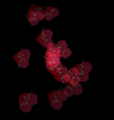

**表 1**  UIParticleView核心函数

<a name="zh-cn_topic_0000002411206788_table1433mcpsimp"></a>
<table><thead align="left"><tr id="zh-cn_topic_0000002411206788_row1439mcpsimp"><th class="cellrowborder" valign="top" width="50%" id="mcps1.2.3.1.1"><p id="zh-cn_topic_0000002411206788_p1441mcpsimp"><a name="zh-cn_topic_0000002411206788_p1441mcpsimp"></a><a name="zh-cn_topic_0000002411206788_p1441mcpsimp"></a>函数</p>
</th>
<th class="cellrowborder" valign="top" width="50%" id="mcps1.2.3.1.2"><p id="zh-cn_topic_0000002411206788_p1443mcpsimp"><a name="zh-cn_topic_0000002411206788_p1443mcpsimp"></a><a name="zh-cn_topic_0000002411206788_p1443mcpsimp"></a>介绍</p>
</th>
</tr>
</thead>
<tbody><tr id="zh-cn_topic_0000002411206788_row1445mcpsimp"><td class="cellrowborder" valign="top" width="50%" headers="mcps1.2.3.1.1 "><p id="zh-cn_topic_0000002411206788_p436143817368"><a name="zh-cn_topic_0000002411206788_p436143817368"></a><a name="zh-cn_topic_0000002411206788_p436143817368"></a>UIParticleView()</p>
</td>
<td class="cellrowborder" valign="top" width="50%" headers="mcps1.2.3.1.2 "><p id="zh-cn_topic_0000002411206788_p1449mcpsimp"><a name="zh-cn_topic_0000002411206788_p1449mcpsimp"></a><a name="zh-cn_topic_0000002411206788_p1449mcpsimp"></a>粒子容器控件构造函数。粒子动画将不间断运行。具体是否有内容显示取决于ParticelCell的配置。</p>
</td>
</tr>
<tr id="zh-cn_topic_0000002411206788_row1450mcpsimp"><td class="cellrowborder" valign="top" width="50%" headers="mcps1.2.3.1.1 "><p id="zh-cn_topic_0000002411206788_p324415431362"><a name="zh-cn_topic_0000002411206788_p324415431362"></a><a name="zh-cn_topic_0000002411206788_p324415431362"></a>UIParticleView(uint32_t time, bool repeat)</p>
</td>
<td class="cellrowborder" valign="top" width="50%" headers="mcps1.2.3.1.2 "><p id="zh-cn_topic_0000002411206788_p1454mcpsimp"><a name="zh-cn_topic_0000002411206788_p1454mcpsimp"></a><a name="zh-cn_topic_0000002411206788_p1454mcpsimp"></a>粒子容器控件构造函数。可指定粒子动画运行时长（ms）以及是否重复运行。</p>
</td>
</tr>
<tr id="zh-cn_topic_0000002411206788_row1455mcpsimp"><td class="cellrowborder" valign="top" width="50%" headers="mcps1.2.3.1.1 "><p id="zh-cn_topic_0000002411206788_p79131297374"><a name="zh-cn_topic_0000002411206788_p79131297374"></a><a name="zh-cn_topic_0000002411206788_p79131297374"></a>virtual ~UIParticleView() override</p>
</td>
<td class="cellrowborder" valign="top" width="50%" headers="mcps1.2.3.1.2 "><p id="zh-cn_topic_0000002411206788_p1459mcpsimp"><a name="zh-cn_topic_0000002411206788_p1459mcpsimp"></a><a name="zh-cn_topic_0000002411206788_p1459mcpsimp"></a>粒子容器控件析构函数。停止粒子动画，并销毁所有ParticleCell及粒子。</p>
</td>
</tr>
<tr id="zh-cn_topic_0000002411206788_row1460mcpsimp"><td class="cellrowborder" valign="top" width="50%" headers="mcps1.2.3.1.1 "><p id="zh-cn_topic_0000002411206788_p17898143353715"><a name="zh-cn_topic_0000002411206788_p17898143353715"></a><a name="zh-cn_topic_0000002411206788_p17898143353715"></a>ParticleCell* CreateParticleCell()</p>
</td>
<td class="cellrowborder" valign="top" width="50%" headers="mcps1.2.3.1.2 "><p id="zh-cn_topic_0000002411206788_p14809418154218"><a name="zh-cn_topic_0000002411206788_p14809418154218"></a><a name="zh-cn_topic_0000002411206788_p14809418154218"></a>创建并返回ParticleCell。ParticleCell用于定义一组粒子的样式和行为。</p>
</td>
</tr>
<tr id="zh-cn_topic_0000002411206788_row1465mcpsimp"><td class="cellrowborder" valign="top" width="50%" headers="mcps1.2.3.1.1 "><p id="zh-cn_topic_0000002411206788_p724710418376"><a name="zh-cn_topic_0000002411206788_p724710418376"></a><a name="zh-cn_topic_0000002411206788_p724710418376"></a>void SetBirthRateRatio(float ratio)</p>
</td>
<td class="cellrowborder" valign="top" width="50%" headers="mcps1.2.3.1.2 "><p id="zh-cn_topic_0000002411206788_p1679014252433"><a name="zh-cn_topic_0000002411206788_p1679014252433"></a><a name="zh-cn_topic_0000002411206788_p1679014252433"></a>设置粒子生产率系数，将与ParticleCell定义的粒子生产率相乘，默认值为1.0。</p>
</td>
</tr>
<tr id="zh-cn_topic_0000002411206788_row1472mcpsimp"><td class="cellrowborder" valign="top" width="50%" headers="mcps1.2.3.1.1 "><p id="zh-cn_topic_0000002411206788_p1794844683719"><a name="zh-cn_topic_0000002411206788_p1794844683719"></a><a name="zh-cn_topic_0000002411206788_p1794844683719"></a>void SetLifetimeRatio(float ratio)</p>
</td>
<td class="cellrowborder" valign="top" width="50%" headers="mcps1.2.3.1.2 "><p id="zh-cn_topic_0000002411206788_p020712407447"><a name="zh-cn_topic_0000002411206788_p020712407447"></a><a name="zh-cn_topic_0000002411206788_p020712407447"></a>设置粒子生命周期系数，将与ParticleCell定义的粒子生命周期相乘，默认值为1.0。</p>
</td>
</tr>
<tr id="zh-cn_topic_0000002411206788_row1477mcpsimp"><td class="cellrowborder" valign="top" width="50%" headers="mcps1.2.3.1.1 "><p id="zh-cn_topic_0000002411206788_p040613521378"><a name="zh-cn_topic_0000002411206788_p040613521378"></a><a name="zh-cn_topic_0000002411206788_p040613521378"></a>void SetScaleRatio(float ratio)</p>
</td>
<td class="cellrowborder" valign="top" width="50%" headers="mcps1.2.3.1.2 "><p id="zh-cn_topic_0000002411206788_p1882484219442"><a name="zh-cn_topic_0000002411206788_p1882484219442"></a><a name="zh-cn_topic_0000002411206788_p1882484219442"></a>设置粒子缩放系数，将与ParticleCell定义的粒子缩放倍数相乘，默认值为1.0。</p>
</td>
</tr>
<tr id="zh-cn_topic_0000002411206788_row181233575375"><td class="cellrowborder" valign="top" width="50%" headers="mcps1.2.3.1.1 "><p id="zh-cn_topic_0000002411206788_p812310573371"><a name="zh-cn_topic_0000002411206788_p812310573371"></a><a name="zh-cn_topic_0000002411206788_p812310573371"></a>void SetVelocityRatio(float ratio)</p>
</td>
<td class="cellrowborder" valign="top" width="50%" headers="mcps1.2.3.1.2 "><p id="zh-cn_topic_0000002411206788_p146814440464"><a name="zh-cn_topic_0000002411206788_p146814440464"></a><a name="zh-cn_topic_0000002411206788_p146814440464"></a>设置粒子速度系数，将与ParticleCell定义的粒子速度相乘，默认值为1.0。</p>
</td>
</tr>
<tr id="zh-cn_topic_0000002411206788_row612305716374"><td class="cellrowborder" valign="top" width="50%" headers="mcps1.2.3.1.1 "><p id="zh-cn_topic_0000002411206788_p131232057133717"><a name="zh-cn_topic_0000002411206788_p131232057133717"></a><a name="zh-cn_topic_0000002411206788_p131232057133717"></a>float GetBirthRateRatio()</p>
</td>
<td class="cellrowborder" valign="top" width="50%" headers="mcps1.2.3.1.2 "><p id="zh-cn_topic_0000002411206788_p3729190144718"><a name="zh-cn_topic_0000002411206788_p3729190144718"></a><a name="zh-cn_topic_0000002411206788_p3729190144718"></a>获取粒子生产率系数。</p>
</td>
</tr>
<tr id="zh-cn_topic_0000002411206788_row912320575371"><td class="cellrowborder" valign="top" width="50%" headers="mcps1.2.3.1.1 "><p id="zh-cn_topic_0000002411206788_p8123145743715"><a name="zh-cn_topic_0000002411206788_p8123145743715"></a><a name="zh-cn_topic_0000002411206788_p8123145743715"></a>float GetLifetimeRatio()</p>
</td>
<td class="cellrowborder" valign="top" width="50%" headers="mcps1.2.3.1.2 "><p id="zh-cn_topic_0000002411206788_p163762326473"><a name="zh-cn_topic_0000002411206788_p163762326473"></a><a name="zh-cn_topic_0000002411206788_p163762326473"></a>获取粒子生命周期系数。</p>
</td>
</tr>
<tr id="zh-cn_topic_0000002411206788_row19123175753715"><td class="cellrowborder" valign="top" width="50%" headers="mcps1.2.3.1.1 "><p id="zh-cn_topic_0000002411206788_p1123757133713"><a name="zh-cn_topic_0000002411206788_p1123757133713"></a><a name="zh-cn_topic_0000002411206788_p1123757133713"></a>float GetScaleRatio()</p>
</td>
<td class="cellrowborder" valign="top" width="50%" headers="mcps1.2.3.1.2 "><p id="zh-cn_topic_0000002411206788_p12599134144716"><a name="zh-cn_topic_0000002411206788_p12599134144716"></a><a name="zh-cn_topic_0000002411206788_p12599134144716"></a>获取粒子缩放系数。</p>
</td>
</tr>
<tr id="zh-cn_topic_0000002411206788_row15123157193718"><td class="cellrowborder" valign="top" width="50%" headers="mcps1.2.3.1.1 "><p id="zh-cn_topic_0000002411206788_p2123205783718"><a name="zh-cn_topic_0000002411206788_p2123205783718"></a><a name="zh-cn_topic_0000002411206788_p2123205783718"></a>float GetVelocityRatio()</p>
</td>
<td class="cellrowborder" valign="top" width="50%" headers="mcps1.2.3.1.2 "><p id="zh-cn_topic_0000002411206788_p51235578374"><a name="zh-cn_topic_0000002411206788_p51235578374"></a><a name="zh-cn_topic_0000002411206788_p51235578374"></a>获取粒子速度系数。</p>
</td>
</tr>
<tr id="zh-cn_topic_0000002411206788_row012315715378"><td class="cellrowborder" valign="top" width="50%" headers="mcps1.2.3.1.1 "><p id="zh-cn_topic_0000002411206788_p712335713375"><a name="zh-cn_topic_0000002411206788_p712335713375"></a><a name="zh-cn_topic_0000002411206788_p712335713375"></a>void SetTime(uint32_t time)</p>
</td>
<td class="cellrowborder" valign="top" width="50%" headers="mcps1.2.3.1.2 "><p id="zh-cn_topic_0000002411206788_p19123195733711"><a name="zh-cn_topic_0000002411206788_p19123195733711"></a><a name="zh-cn_topic_0000002411206788_p19123195733711"></a>设置粒子动画运行周期。</p>
</td>
</tr>
<tr id="zh-cn_topic_0000002411206788_row111249573378"><td class="cellrowborder" valign="top" width="50%" headers="mcps1.2.3.1.1 "><p id="zh-cn_topic_0000002411206788_p012412576375"><a name="zh-cn_topic_0000002411206788_p012412576375"></a><a name="zh-cn_topic_0000002411206788_p012412576375"></a>uint32_t GetTime()</p>
</td>
<td class="cellrowborder" valign="top" width="50%" headers="mcps1.2.3.1.2 "><p id="zh-cn_topic_0000002411206788_p3124185743719"><a name="zh-cn_topic_0000002411206788_p3124185743719"></a><a name="zh-cn_topic_0000002411206788_p3124185743719"></a>获取粒子动画运行周期。</p>
</td>
</tr>
<tr id="zh-cn_topic_0000002411206788_row336123273817"><td class="cellrowborder" valign="top" width="50%" headers="mcps1.2.3.1.1 "><p id="zh-cn_topic_0000002411206788_p336103218380"><a name="zh-cn_topic_0000002411206788_p336103218380"></a><a name="zh-cn_topic_0000002411206788_p336103218380"></a>bool IsRepeat()</p>
</td>
<td class="cellrowborder" valign="top" width="50%" headers="mcps1.2.3.1.2 "><p id="zh-cn_topic_0000002411206788_p1036183217386"><a name="zh-cn_topic_0000002411206788_p1036183217386"></a><a name="zh-cn_topic_0000002411206788_p1036183217386"></a>获取粒子动画是否重复运行。</p>
</td>
</tr>
<tr id="zh-cn_topic_0000002411206788_row736173243820"><td class="cellrowborder" valign="top" width="50%" headers="mcps1.2.3.1.1 "><p id="zh-cn_topic_0000002411206788_p136243212381"><a name="zh-cn_topic_0000002411206788_p136243212381"></a><a name="zh-cn_topic_0000002411206788_p136243212381"></a>void Start()</p>
</td>
<td class="cellrowborder" valign="top" width="50%" headers="mcps1.2.3.1.2 "><p id="zh-cn_topic_0000002411206788_p173621432193818"><a name="zh-cn_topic_0000002411206788_p173621432193818"></a><a name="zh-cn_topic_0000002411206788_p173621432193818"></a>启动粒子动画。</p>
</td>
</tr>
<tr id="zh-cn_topic_0000002411206788_row63621532113811"><td class="cellrowborder" valign="top" width="50%" headers="mcps1.2.3.1.1 "><p id="zh-cn_topic_0000002411206788_p0362532173813"><a name="zh-cn_topic_0000002411206788_p0362532173813"></a><a name="zh-cn_topic_0000002411206788_p0362532173813"></a>void Pause()</p>
</td>
<td class="cellrowborder" valign="top" width="50%" headers="mcps1.2.3.1.2 "><p id="zh-cn_topic_0000002411206788_p8362183218386"><a name="zh-cn_topic_0000002411206788_p8362183218386"></a><a name="zh-cn_topic_0000002411206788_p8362183218386"></a>暂停粒子动画。</p>
</td>
</tr>
<tr id="zh-cn_topic_0000002411206788_row19362193273815"><td class="cellrowborder" valign="top" width="50%" headers="mcps1.2.3.1.1 "><p id="zh-cn_topic_0000002411206788_p123621732173812"><a name="zh-cn_topic_0000002411206788_p123621732173812"></a><a name="zh-cn_topic_0000002411206788_p123621732173812"></a>void Resume()</p>
</td>
<td class="cellrowborder" valign="top" width="50%" headers="mcps1.2.3.1.2 "><p id="zh-cn_topic_0000002411206788_p173621632133815"><a name="zh-cn_topic_0000002411206788_p173621632133815"></a><a name="zh-cn_topic_0000002411206788_p173621632133815"></a>继续粒子动画。</p>
</td>
</tr>
<tr id="zh-cn_topic_0000002411206788_row1936293217386"><td class="cellrowborder" valign="top" width="50%" headers="mcps1.2.3.1.1 "><p id="zh-cn_topic_0000002411206788_p836263203820"><a name="zh-cn_topic_0000002411206788_p836263203820"></a><a name="zh-cn_topic_0000002411206788_p836263203820"></a>void Stop()</p>
</td>
<td class="cellrowborder" valign="top" width="50%" headers="mcps1.2.3.1.2 "><p id="zh-cn_topic_0000002411206788_p173625329389"><a name="zh-cn_topic_0000002411206788_p173625329389"></a><a name="zh-cn_topic_0000002411206788_p173625329389"></a>停止粒子动画。将销毁所有ParticleCell及粒子。</p>
</td>
</tr>
<tr id="zh-cn_topic_0000002411206788_row0240175973812"><td class="cellrowborder" valign="top" width="50%" headers="mcps1.2.3.1.1 "><p id="zh-cn_topic_0000002411206788_p124015910382"><a name="zh-cn_topic_0000002411206788_p124015910382"></a><a name="zh-cn_topic_0000002411206788_p124015910382"></a>uint8_t GetState()</p>
</td>
<td class="cellrowborder" valign="top" width="50%" headers="mcps1.2.3.1.2 "><p id="zh-cn_topic_0000002411206788_p16240145911386"><a name="zh-cn_topic_0000002411206788_p16240145911386"></a><a name="zh-cn_topic_0000002411206788_p16240145911386"></a>获取粒子动画状态。</p>
</td>
</tr>
<tr id="zh-cn_topic_0000002411206788_row724055916388"><td class="cellrowborder" valign="top" width="50%" headers="mcps1.2.3.1.1 "><p id="zh-cn_topic_0000002411206788_p11240105913816"><a name="zh-cn_topic_0000002411206788_p11240105913816"></a><a name="zh-cn_topic_0000002411206788_p11240105913816"></a>void ClearParticles()</p>
</td>
<td class="cellrowborder" valign="top" width="50%" headers="mcps1.2.3.1.2 "><p id="zh-cn_topic_0000002411206788_p134241459104914"><a name="zh-cn_topic_0000002411206788_p134241459104914"></a><a name="zh-cn_topic_0000002411206788_p134241459104914"></a>销毁所有ParticleCell及粒子。</p>
</td>
</tr>
</tbody>
</table>

**表 2**  ParticleCell核心函数

<a name="zh-cn_topic_0000002411206788_table18331184711502"></a>
<table><thead align="left"><tr id="zh-cn_topic_0000002411206788_row1833114475503"><th class="cellrowborder" valign="top" width="50%" id="mcps1.2.3.1.1"><p id="zh-cn_topic_0000002411206788_p10331104755015"><a name="zh-cn_topic_0000002411206788_p10331104755015"></a><a name="zh-cn_topic_0000002411206788_p10331104755015"></a>函数</p>
</th>
<th class="cellrowborder" valign="top" width="50%" id="mcps1.2.3.1.2"><p id="zh-cn_topic_0000002411206788_p833124725012"><a name="zh-cn_topic_0000002411206788_p833124725012"></a><a name="zh-cn_topic_0000002411206788_p833124725012"></a>介绍</p>
</th>
</tr>
</thead>
<tbody><tr id="zh-cn_topic_0000002411206788_row733154712509"><td class="cellrowborder" valign="top" width="50%" headers="mcps1.2.3.1.1 "><p id="zh-cn_topic_0000002411206788_p133801735614"><a name="zh-cn_topic_0000002411206788_p133801735614"></a><a name="zh-cn_topic_0000002411206788_p133801735614"></a>void SetSrc(const ImageInfo* src)</p>
</td>
<td class="cellrowborder" valign="top" width="50%" headers="mcps1.2.3.1.2 "><p id="zh-cn_topic_0000002411206788_p10332194718509"><a name="zh-cn_topic_0000002411206788_p10332194718509"></a><a name="zh-cn_topic_0000002411206788_p10332194718509"></a>设置粒子图源。</p>
</td>
</tr>
<tr id="zh-cn_topic_0000002411206788_row3332124715016"><td class="cellrowborder" valign="top" width="50%" headers="mcps1.2.3.1.1 "><p id="zh-cn_topic_0000002411206788_p3649987615"><a name="zh-cn_topic_0000002411206788_p3649987615"></a><a name="zh-cn_topic_0000002411206788_p3649987615"></a>void SetSize(int16_t width, int16_t height)</p>
</td>
<td class="cellrowborder" valign="top" width="50%" headers="mcps1.2.3.1.2 "><p id="zh-cn_topic_0000002411206788_p1253243852310"><a name="zh-cn_topic_0000002411206788_p1253243852310"></a><a name="zh-cn_topic_0000002411206788_p1253243852310"></a>设置粒子初始宽高。</p>
</td>
</tr>
<tr id="zh-cn_topic_0000002411206788_row1233212479502"><td class="cellrowborder" valign="top" width="50%" headers="mcps1.2.3.1.1 "><p id="zh-cn_topic_0000002411206788_p558212124613"><a name="zh-cn_topic_0000002411206788_p558212124613"></a><a name="zh-cn_topic_0000002411206788_p558212124613"></a>void SetSizeRange(int16_t range)</p>
</td>
<td class="cellrowborder" valign="top" width="50%" headers="mcps1.2.3.1.2 "><p id="zh-cn_topic_0000002411206788_p10332144719501"><a name="zh-cn_topic_0000002411206788_p10332144719501"></a><a name="zh-cn_topic_0000002411206788_p10332144719501"></a>设置粒子初始宽高上下浮动范围。</p>
</td>
</tr>
<tr id="zh-cn_topic_0000002411206788_row17332747155010"><td class="cellrowborder" valign="top" width="50%" headers="mcps1.2.3.1.1 "><p id="zh-cn_topic_0000002411206788_p992919191166"><a name="zh-cn_topic_0000002411206788_p992919191166"></a><a name="zh-cn_topic_0000002411206788_p992919191166"></a>void SetPos(int16_t x, int16_t y)</p>
</td>
<td class="cellrowborder" valign="top" width="50%" headers="mcps1.2.3.1.2 "><p id="zh-cn_topic_0000002411206788_p1088037102712"><a name="zh-cn_topic_0000002411206788_p1088037102712"></a><a name="zh-cn_topic_0000002411206788_p1088037102712"></a>设置粒子初始位置。</p>
</td>
</tr>
<tr id="zh-cn_topic_0000002411206788_row233274711505"><td class="cellrowborder" valign="top" width="50%" headers="mcps1.2.3.1.1 "><p id="zh-cn_topic_0000002411206788_p1029813242061"><a name="zh-cn_topic_0000002411206788_p1029813242061"></a><a name="zh-cn_topic_0000002411206788_p1029813242061"></a>void SetPosRange(int16_t xRange, int16_t yRange)</p>
</td>
<td class="cellrowborder" valign="top" width="50%" headers="mcps1.2.3.1.2 "><p id="zh-cn_topic_0000002411206788_p14332194705013"><a name="zh-cn_topic_0000002411206788_p14332194705013"></a><a name="zh-cn_topic_0000002411206788_p14332194705013"></a>设置粒子初始位置上下浮动范围。</p>
</td>
</tr>
<tr id="zh-cn_topic_0000002411206788_row1433244715500"><td class="cellrowborder" valign="top" width="50%" headers="mcps1.2.3.1.1 "><p id="zh-cn_topic_0000002411206788_p714012298615"><a name="zh-cn_topic_0000002411206788_p714012298615"></a><a name="zh-cn_topic_0000002411206788_p714012298615"></a>void SetLifetime(int16_t lifetime)</p>
</td>
<td class="cellrowborder" valign="top" width="50%" headers="mcps1.2.3.1.2 "><p id="zh-cn_topic_0000002411206788_p14332947175011"><a name="zh-cn_topic_0000002411206788_p14332947175011"></a><a name="zh-cn_topic_0000002411206788_p14332947175011"></a>设置粒子生命周期。</p>
</td>
</tr>
<tr id="zh-cn_topic_0000002411206788_row233234795018"><td class="cellrowborder" valign="top" width="50%" headers="mcps1.2.3.1.1 "><p id="zh-cn_topic_0000002411206788_p1921343613616"><a name="zh-cn_topic_0000002411206788_p1921343613616"></a><a name="zh-cn_topic_0000002411206788_p1921343613616"></a>void SetLifetimeRange(int16_t range)</p>
</td>
<td class="cellrowborder" valign="top" width="50%" headers="mcps1.2.3.1.2 "><p id="zh-cn_topic_0000002411206788_p23321847155015"><a name="zh-cn_topic_0000002411206788_p23321847155015"></a><a name="zh-cn_topic_0000002411206788_p23321847155015"></a>设置粒子生命周期上下浮动范围。</p>
</td>
</tr>
<tr id="zh-cn_topic_0000002411206788_row183321247125012"><td class="cellrowborder" valign="top" width="50%" headers="mcps1.2.3.1.1 "><p id="zh-cn_topic_0000002411206788_p240415410614"><a name="zh-cn_topic_0000002411206788_p240415410614"></a><a name="zh-cn_topic_0000002411206788_p240415410614"></a>void SetBirthRate(int16_t birthRate)</p>
</td>
<td class="cellrowborder" valign="top" width="50%" headers="mcps1.2.3.1.2 "><p id="zh-cn_topic_0000002411206788_p193321847205018"><a name="zh-cn_topic_0000002411206788_p193321847205018"></a><a name="zh-cn_topic_0000002411206788_p193321847205018"></a>设置粒子生产率：每个动画周期生产多少粒子。</p>
</td>
</tr>
<tr id="zh-cn_topic_0000002411206788_row13321147135017"><td class="cellrowborder" valign="top" width="50%" headers="mcps1.2.3.1.1 "><p id="zh-cn_topic_0000002411206788_p1078218462619"><a name="zh-cn_topic_0000002411206788_p1078218462619"></a><a name="zh-cn_topic_0000002411206788_p1078218462619"></a>void SetVelocity(float velocity)</p>
</td>
<td class="cellrowborder" valign="top" width="50%" headers="mcps1.2.3.1.2 "><p id="zh-cn_topic_0000002411206788_p43321347145014"><a name="zh-cn_topic_0000002411206788_p43321347145014"></a><a name="zh-cn_topic_0000002411206788_p43321347145014"></a>设置粒子速度。</p>
</td>
</tr>
<tr id="zh-cn_topic_0000002411206788_row1033214711505"><td class="cellrowborder" valign="top" width="50%" headers="mcps1.2.3.1.1 "><p id="zh-cn_topic_0000002411206788_p1896685316613"><a name="zh-cn_topic_0000002411206788_p1896685316613"></a><a name="zh-cn_topic_0000002411206788_p1896685316613"></a>void SetVelocityRange(float range)</p>
</td>
<td class="cellrowborder" valign="top" width="50%" headers="mcps1.2.3.1.2 "><p id="zh-cn_topic_0000002411206788_p123326476501"><a name="zh-cn_topic_0000002411206788_p123326476501"></a><a name="zh-cn_topic_0000002411206788_p123326476501"></a>设置粒子速度上下浮动范围。</p>
</td>
</tr>
<tr id="zh-cn_topic_0000002411206788_row14332194795017"><td class="cellrowborder" valign="top" width="50%" headers="mcps1.2.3.1.1 "><p id="zh-cn_topic_0000002411206788_p128517505203"><a name="zh-cn_topic_0000002411206788_p128517505203"></a><a name="zh-cn_topic_0000002411206788_p128517505203"></a>void SetAcceleration(float x, float y)</p>
</td>
<td class="cellrowborder" valign="top" width="50%" headers="mcps1.2.3.1.2 "><p id="zh-cn_topic_0000002411206788_p17332104715014"><a name="zh-cn_topic_0000002411206788_p17332104715014"></a><a name="zh-cn_topic_0000002411206788_p17332104715014"></a>设置粒子加速度：每个动画周期x和y方向的速度变化。</p>
</td>
</tr>
<tr id="zh-cn_topic_0000002411206788_row533244718503"><td class="cellrowborder" valign="top" width="50%" headers="mcps1.2.3.1.1 "><p id="zh-cn_topic_0000002411206788_p8174456132011"><a name="zh-cn_topic_0000002411206788_p8174456132011"></a><a name="zh-cn_topic_0000002411206788_p8174456132011"></a>void SetEmissionAngle(float angle)</p>
</td>
<td class="cellrowborder" valign="top" width="50%" headers="mcps1.2.3.1.2 "><p id="zh-cn_topic_0000002411206788_p1148414388333"><a name="zh-cn_topic_0000002411206788_p1148414388333"></a><a name="zh-cn_topic_0000002411206788_p1148414388333"></a>设置粒子发射角度，有效范围为[0, 360]。定义3点钟方向为0度，顺时针增加度数。</p>
</td>
</tr>
<tr id="zh-cn_topic_0000002411206788_row14332247185020"><td class="cellrowborder" valign="top" width="50%" headers="mcps1.2.3.1.1 "><p id="zh-cn_topic_0000002411206788_p418717119218"><a name="zh-cn_topic_0000002411206788_p418717119218"></a><a name="zh-cn_topic_0000002411206788_p418717119218"></a>void SetEmissionRange(float range)</p>
</td>
<td class="cellrowborder" valign="top" width="50%" headers="mcps1.2.3.1.2 "><p id="zh-cn_topic_0000002411206788_p733210472507"><a name="zh-cn_topic_0000002411206788_p733210472507"></a><a name="zh-cn_topic_0000002411206788_p733210472507"></a>设置粒子发射角度上下浮动范围。</p>
</td>
</tr>
<tr id="zh-cn_topic_0000002411206788_row1833254713505"><td class="cellrowborder" valign="top" width="50%" headers="mcps1.2.3.1.1 "><p id="zh-cn_topic_0000002411206788_p18332164715506"><a name="zh-cn_topic_0000002411206788_p18332164715506"></a><a name="zh-cn_topic_0000002411206788_p18332164715506"></a>void SetScale(float scaleX, float scaleY)</p>
</td>
<td class="cellrowborder" valign="top" width="50%" headers="mcps1.2.3.1.2 "><p id="zh-cn_topic_0000002411206788_p103323471505"><a name="zh-cn_topic_0000002411206788_p103323471505"></a><a name="zh-cn_topic_0000002411206788_p103323471505"></a>设置粒子最终缩放倍数。</p>
</td>
</tr>
<tr id="zh-cn_topic_0000002411206788_row2332747175017"><td class="cellrowborder" valign="top" width="50%" headers="mcps1.2.3.1.1 "><p id="zh-cn_topic_0000002411206788_p873621912215"><a name="zh-cn_topic_0000002411206788_p873621912215"></a><a name="zh-cn_topic_0000002411206788_p873621912215"></a>void SetScaleRange(float range)</p>
</td>
<td class="cellrowborder" valign="top" width="50%" headers="mcps1.2.3.1.2 "><p id="zh-cn_topic_0000002411206788_p1233218473505"><a name="zh-cn_topic_0000002411206788_p1233218473505"></a><a name="zh-cn_topic_0000002411206788_p1233218473505"></a>设置粒子最终缩放倍数上下浮动范围。</p>
</td>
</tr>
<tr id="zh-cn_topic_0000002411206788_row1033264718508"><td class="cellrowborder" valign="top" width="50%" headers="mcps1.2.3.1.1 "><p id="zh-cn_topic_0000002411206788_p6812162419219"><a name="zh-cn_topic_0000002411206788_p6812162419219"></a><a name="zh-cn_topic_0000002411206788_p6812162419219"></a>void SetScaleFunc(EasingFunc func)</p>
</td>
<td class="cellrowborder" valign="top" width="50%" headers="mcps1.2.3.1.2 "><p id="zh-cn_topic_0000002411206788_p1033234715014"><a name="zh-cn_topic_0000002411206788_p1033234715014"></a><a name="zh-cn_topic_0000002411206788_p1033234715014"></a>设置粒子缩放变化的数学函数。</p>
</td>
</tr>
<tr id="zh-cn_topic_0000002411206788_row833210477503"><td class="cellrowborder" valign="top" width="50%" headers="mcps1.2.3.1.1 "><p id="zh-cn_topic_0000002411206788_p251942912219"><a name="zh-cn_topic_0000002411206788_p251942912219"></a><a name="zh-cn_topic_0000002411206788_p251942912219"></a>void SetAlpha(int16_t startAlpha, int16_t finalAlpha)</p>
</td>
<td class="cellrowborder" valign="top" width="50%" headers="mcps1.2.3.1.2 "><p id="zh-cn_topic_0000002411206788_p63332474504"><a name="zh-cn_topic_0000002411206788_p63332474504"></a><a name="zh-cn_topic_0000002411206788_p63332474504"></a>设置粒子起始和最终透明度，有效范围为[0，255]。</p>
</td>
</tr>
<tr id="zh-cn_topic_0000002411206788_row153331547115012"><td class="cellrowborder" valign="top" width="50%" headers="mcps1.2.3.1.1 "><p id="zh-cn_topic_0000002411206788_p144913613217"><a name="zh-cn_topic_0000002411206788_p144913613217"></a><a name="zh-cn_topic_0000002411206788_p144913613217"></a>void SetAlphaRange(int16_t range)</p>
</td>
<td class="cellrowborder" valign="top" width="50%" headers="mcps1.2.3.1.2 "><p id="zh-cn_topic_0000002411206788_p895413683613"><a name="zh-cn_topic_0000002411206788_p895413683613"></a><a name="zh-cn_topic_0000002411206788_p895413683613"></a>设置粒子起始和最终透明度上下浮动范围。</p>
</td>
</tr>
<tr id="zh-cn_topic_0000002411206788_row1033364714500"><td class="cellrowborder" valign="top" width="50%" headers="mcps1.2.3.1.1 "><p id="zh-cn_topic_0000002411206788_p5333247165012"><a name="zh-cn_topic_0000002411206788_p5333247165012"></a><a name="zh-cn_topic_0000002411206788_p5333247165012"></a>void SetAlphaFunc(EasingFunc func)</p>
</td>
<td class="cellrowborder" valign="top" width="50%" headers="mcps1.2.3.1.2 "><p id="zh-cn_topic_0000002411206788_p1333364795012"><a name="zh-cn_topic_0000002411206788_p1333364795012"></a><a name="zh-cn_topic_0000002411206788_p1333364795012"></a>设置粒子透明度变化的数学函数。</p>
</td>
</tr>
<tr id="zh-cn_topic_0000002411206788_row20333947165016"><td class="cellrowborder" valign="top" width="50%" headers="mcps1.2.3.1.1 "><p id="zh-cn_topic_0000002411206788_p15296165112115"><a name="zh-cn_topic_0000002411206788_p15296165112115"></a><a name="zh-cn_topic_0000002411206788_p15296165112115"></a>void SetSpin(float spin, ParticleCell::SpinMode mode = ParticleCell::SpinMode::CENTER)</p>
</td>
<td class="cellrowborder" valign="top" width="50%" headers="mcps1.2.3.1.2 "><p id="zh-cn_topic_0000002411206788_p18215382376"><a name="zh-cn_topic_0000002411206788_p18215382376"></a><a name="zh-cn_topic_0000002411206788_p18215382376"></a>设置粒子周期性旋转度数和旋转模式，默认为绕中线旋转。</p>
<p id="zh-cn_topic_0000002411206788_p548645813718"><a name="zh-cn_topic_0000002411206788_p548645813718"></a><a name="zh-cn_topic_0000002411206788_p548645813718"></a>SpinMode::CENTER：绕中线旋转。</p>
<p id="zh-cn_topic_0000002411206788_p6105124443812"><a name="zh-cn_topic_0000002411206788_p6105124443812"></a><a name="zh-cn_topic_0000002411206788_p6105124443812"></a>SpinMode::DIAGONAL_LR：绕左上至右下的对角线旋转。</p>
<p id="zh-cn_topic_0000002411206788_p3392152015394"><a name="zh-cn_topic_0000002411206788_p3392152015394"></a><a name="zh-cn_topic_0000002411206788_p3392152015394"></a>SpinMode::DIAGONAL_RL：绕右上至左下的对角线旋转。</p>
</td>
</tr>
<tr id="zh-cn_topic_0000002411206788_row133334717509"><td class="cellrowborder" valign="top" width="50%" headers="mcps1.2.3.1.1 "><p id="zh-cn_topic_0000002411206788_p135022619224"><a name="zh-cn_topic_0000002411206788_p135022619224"></a><a name="zh-cn_topic_0000002411206788_p135022619224"></a>void SetSpinRange(float range)</p>
</td>
<td class="cellrowborder" valign="top" width="50%" headers="mcps1.2.3.1.2 "><p id="zh-cn_topic_0000002411206788_p1633354711506"><a name="zh-cn_topic_0000002411206788_p1633354711506"></a><a name="zh-cn_topic_0000002411206788_p1633354711506"></a>设置粒子周期性旋转度数上下浮动范围。</p>
</td>
</tr>
<tr id="zh-cn_topic_0000002411206788_row16333104713501"><td class="cellrowborder" valign="top" width="50%" headers="mcps1.2.3.1.1 "><p id="zh-cn_topic_0000002411206788_p10333247165013"><a name="zh-cn_topic_0000002411206788_p10333247165013"></a><a name="zh-cn_topic_0000002411206788_p10333247165013"></a>bool HasParticles()</p>
</td>
<td class="cellrowborder" valign="top" width="50%" headers="mcps1.2.3.1.2 "><p id="zh-cn_topic_0000002411206788_p12333104765012"><a name="zh-cn_topic_0000002411206788_p12333104765012"></a><a name="zh-cn_topic_0000002411206788_p12333104765012"></a>获取当前ParticleCell是否包含粒子。</p>
</td>
</tr>
<tr id="zh-cn_topic_0000002411206788_row892012912226"><td class="cellrowborder" valign="top" width="50%" headers="mcps1.2.3.1.1 "><p id="zh-cn_topic_0000002411206788_p19201029142219"><a name="zh-cn_topic_0000002411206788_p19201029142219"></a><a name="zh-cn_topic_0000002411206788_p19201029142219"></a>void SetTotalPeriod(int16_t period)</p>
</td>
<td class="cellrowborder" valign="top" width="50%" headers="mcps1.2.3.1.2 "><p id="zh-cn_topic_0000002411206788_p12920529162218"><a name="zh-cn_topic_0000002411206788_p12920529162218"></a><a name="zh-cn_topic_0000002411206788_p12920529162218"></a>设置ParticleCell活跃周期。仅在活跃周期内的ParticleCell可以生产粒子。</p>
<p id="zh-cn_topic_0000002411206788_p1815161345810"><a name="zh-cn_topic_0000002411206788_p1815161345810"></a><a name="zh-cn_topic_0000002411206788_p1815161345810"></a>PERIOD_FOREVER：代表永远活跃的特殊周期。</p>
</td>
</tr>
<tr id="zh-cn_topic_0000002411206788_row19920129172220"><td class="cellrowborder" valign="top" width="50%" headers="mcps1.2.3.1.1 "><p id="zh-cn_topic_0000002411206788_p1792020293222"><a name="zh-cn_topic_0000002411206788_p1792020293222"></a><a name="zh-cn_topic_0000002411206788_p1792020293222"></a>int16_t GetTotalPeriod()</p>
</td>
<td class="cellrowborder" valign="top" width="50%" headers="mcps1.2.3.1.2 "><p id="zh-cn_topic_0000002411206788_p18920122910221"><a name="zh-cn_topic_0000002411206788_p18920122910221"></a><a name="zh-cn_topic_0000002411206788_p18920122910221"></a>获取ParticleCell活跃周期。</p>
</td>
</tr>
<tr id="zh-cn_topic_0000002411206788_row159201329152210"><td class="cellrowborder" valign="top" width="50%" headers="mcps1.2.3.1.1 "><p id="zh-cn_topic_0000002411206788_p1592022932210"><a name="zh-cn_topic_0000002411206788_p1592022932210"></a><a name="zh-cn_topic_0000002411206788_p1592022932210"></a>int16_t GetCurrentPeriod()</p>
</td>
<td class="cellrowborder" valign="top" width="50%" headers="mcps1.2.3.1.2 "><p id="zh-cn_topic_0000002411206788_p892022914225"><a name="zh-cn_topic_0000002411206788_p892022914225"></a><a name="zh-cn_topic_0000002411206788_p892022914225"></a>获取ParticleCell当前周期。</p>
</td>
</tr>
<tr id="zh-cn_topic_0000002411206788_row12207451162220"><td class="cellrowborder" valign="top" width="50%" headers="mcps1.2.3.1.1 "><p id="zh-cn_topic_0000002411206788_p10207151112213"><a name="zh-cn_topic_0000002411206788_p10207151112213"></a><a name="zh-cn_topic_0000002411206788_p10207151112213"></a>const ImageInfo* GetSrc()</p>
</td>
<td class="cellrowborder" valign="top" width="50%" headers="mcps1.2.3.1.2 "><p id="zh-cn_topic_0000002411206788_p1020718511224"><a name="zh-cn_topic_0000002411206788_p1020718511224"></a><a name="zh-cn_topic_0000002411206788_p1020718511224"></a>获取粒子图源。</p>
</td>
</tr>
<tr id="zh-cn_topic_0000002411206788_row162071351152213"><td class="cellrowborder" valign="top" width="50%" headers="mcps1.2.3.1.1 "><p id="zh-cn_topic_0000002411206788_p13207145115223"><a name="zh-cn_topic_0000002411206788_p13207145115223"></a><a name="zh-cn_topic_0000002411206788_p13207145115223"></a>void ClearParticles()</p>
</td>
<td class="cellrowborder" valign="top" width="50%" headers="mcps1.2.3.1.2 "><p id="zh-cn_topic_0000002411206788_p17207165142213"><a name="zh-cn_topic_0000002411206788_p17207165142213"></a><a name="zh-cn_topic_0000002411206788_p17207165142213"></a>销毁ParticleCell所生产的所有粒子。</p>
</td>
</tr>
</tbody>
</table>

### UIMapView<a name="ZH-CN_TOPIC_0000002509483511"></a>

UIMapView为定制化的地图显示控件，该控件只针对私有数据进行显示，私有数据格式如[图1](#zh-cn_topic_0000002444645733_fig1222191512518)所示。具体使用流程请参考示例“middleware/services/gui/uikit/sample/uitest/components/ui\_test\_map/ui\_test\_map.cpp”。

**图 1**  私有格式结构图<a name="zh-cn_topic_0000002444645733_fig1222191512518"></a>  
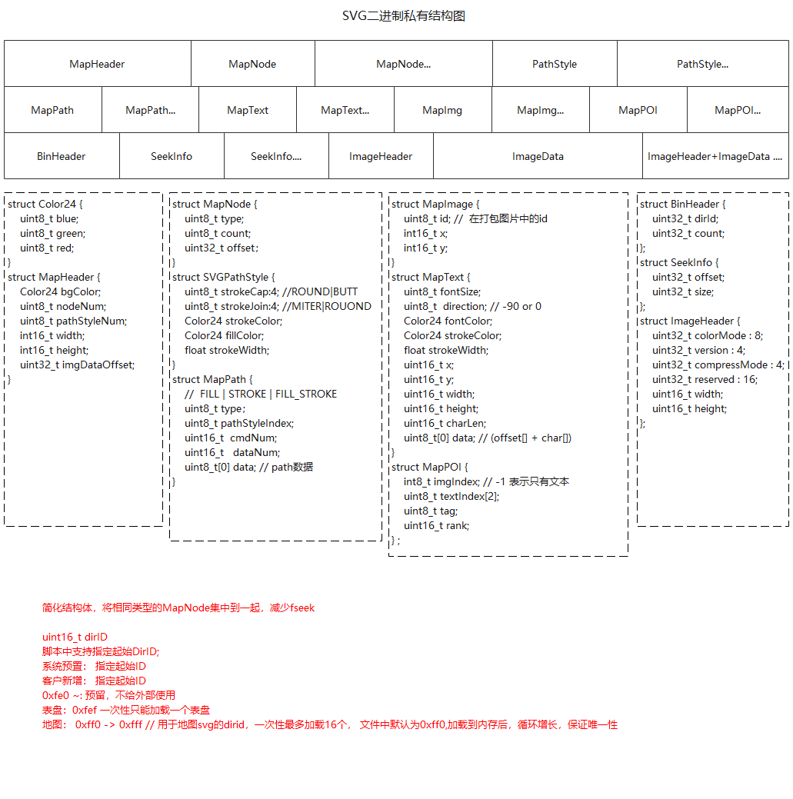

地图显示效果如[图2](#zh-cn_topic_0000002444645733_fig11382113845613)所示。

**图 2**  显示效果<a name="zh-cn_topic_0000002444645733_fig11382113845613"></a>  
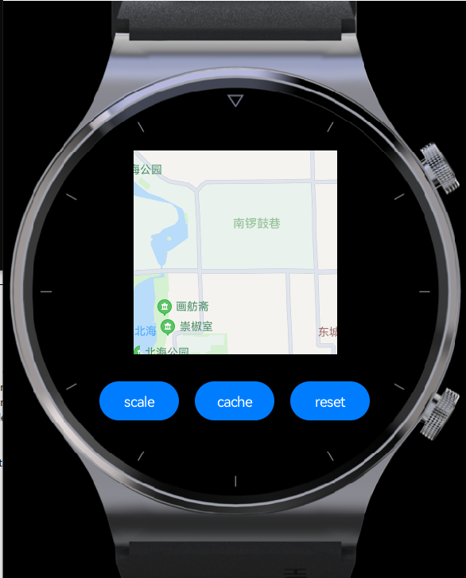

**表 1**  UIMapView核心函数

<a name="zh-cn_topic_0000002444645733_table1259814313283"></a>
<table><thead align="left"><tr id="zh-cn_topic_0000002444645733_row12599243122814"><th class="cellrowborder" valign="top" width="50%" id="mcps1.2.3.1.1"><p id="zh-cn_topic_0000002444645733_p2359mcpsimp"><a name="zh-cn_topic_0000002444645733_p2359mcpsimp"></a><a name="zh-cn_topic_0000002444645733_p2359mcpsimp"></a>函数</p>
</th>
<th class="cellrowborder" valign="top" width="50%" id="mcps1.2.3.1.2"><p id="zh-cn_topic_0000002444645733_p42118371217"><a name="zh-cn_topic_0000002444645733_p42118371217"></a><a name="zh-cn_topic_0000002444645733_p42118371217"></a>描述</p>
</th>
</tr>
</thead>
<tbody><tr id="zh-cn_topic_0000002444645733_row159914432281"><td class="cellrowborder" valign="top" width="50%" headers="mcps1.2.3.1.1 "><p id="zh-cn_topic_0000002444645733_p8599643172812"><a name="zh-cn_topic_0000002444645733_p8599643172812"></a><a name="zh-cn_topic_0000002444645733_p8599643172812"></a>bool SetSVG(const char* path);</p>
</td>
<td class="cellrowborder" valign="top" width="50%" headers="mcps1.2.3.1.2 "><p id="zh-cn_topic_0000002444645733_p959964310288"><a name="zh-cn_topic_0000002444645733_p959964310288"></a><a name="zh-cn_topic_0000002444645733_p959964310288"></a>使用文件路径设置SVG。</p>
</td>
</tr>
<tr id="zh-cn_topic_0000002444645733_row3599243192818"><td class="cellrowborder" valign="top" width="50%" headers="mcps1.2.3.1.1 "><p id="zh-cn_topic_0000002444645733_p105991743182813"><a name="zh-cn_topic_0000002444645733_p105991743182813"></a><a name="zh-cn_topic_0000002444645733_p105991743182813"></a>bool SetSVG(uint8_t* data, uint32_t length);</p>
</td>
<td class="cellrowborder" valign="top" width="50%" headers="mcps1.2.3.1.2 "><p id="zh-cn_topic_0000002444645733_p12599194313285"><a name="zh-cn_topic_0000002444645733_p12599194313285"></a><a name="zh-cn_topic_0000002444645733_p12599194313285"></a>使用文件缓冲区设置SVG。</p>
</td>
</tr>
<tr id="zh-cn_topic_0000002444645733_row14599124313289"><td class="cellrowborder" valign="top" width="50%" headers="mcps1.2.3.1.1 "><p id="zh-cn_topic_0000002444645733_p4599743162817"><a name="zh-cn_topic_0000002444645733_p4599743162817"></a><a name="zh-cn_topic_0000002444645733_p4599743162817"></a>void SetOnPOIClickListener(OnPOIClickListener* listener);</p>
</td>
<td class="cellrowborder" valign="top" width="50%" headers="mcps1.2.3.1.2 "><p id="zh-cn_topic_0000002444645733_p10599154316289"><a name="zh-cn_topic_0000002444645733_p10599154316289"></a><a name="zh-cn_topic_0000002444645733_p10599154316289"></a>设置POI的监听器。</p>
</td>
</tr>
<tr id="zh-cn_topic_0000002444645733_row155992433282"><td class="cellrowborder" valign="top" width="50%" headers="mcps1.2.3.1.1 "><p id="zh-cn_topic_0000002444645733_p115991043152811"><a name="zh-cn_topic_0000002444645733_p115991043152811"></a><a name="zh-cn_topic_0000002444645733_p115991043152811"></a>void EnableCache(bool enable);</p>
</td>
<td class="cellrowborder" valign="top" width="50%" headers="mcps1.2.3.1.2 "><p id="zh-cn_topic_0000002444645733_p205995431288"><a name="zh-cn_topic_0000002444645733_p205995431288"></a><a name="zh-cn_topic_0000002444645733_p205995431288"></a>启用缓存。当enable为true时，它将立即缓存这个图块，并立即释放缓存。我们需要在设置SVG的时候开启缓存，或者在缩放地图完成之后开启缓存，在缩放地图之前关闭缓存。</p>
</td>
</tr>
<tr id="zh-cn_topic_0000002444645733_row1459934382818"><td class="cellrowborder" valign="top" width="50%" headers="mcps1.2.3.1.1 "><p id="zh-cn_topic_0000002444645733_p1599743122811"><a name="zh-cn_topic_0000002444645733_p1599743122811"></a><a name="zh-cn_topic_0000002444645733_p1599743122811"></a>void ScaleMap(float scale, const Vector2&lt;float&gt;& pivot);</p>
</td>
<td class="cellrowborder" valign="top" width="50%" headers="mcps1.2.3.1.2 "><p id="zh-cn_topic_0000002444645733_p1959974314284"><a name="zh-cn_topic_0000002444645733_p1959974314284"></a><a name="zh-cn_topic_0000002444645733_p1959974314284"></a>用于以目标点为基准缩放地图。</p>
</td>
</tr>
<tr id="zh-cn_topic_0000002444645733_row1559915433281"><td class="cellrowborder" valign="top" width="50%" headers="mcps1.2.3.1.1 "><p id="zh-cn_topic_0000002444645733_p15599154315285"><a name="zh-cn_topic_0000002444645733_p15599154315285"></a><a name="zh-cn_topic_0000002444645733_p15599154315285"></a>void HidePOI(uint16_t tag, bool isHide = true);</p>
</td>
<td class="cellrowborder" valign="top" width="50%" headers="mcps1.2.3.1.2 "><p id="zh-cn_topic_0000002444645733_p5599164332812"><a name="zh-cn_topic_0000002444645733_p5599164332812"></a><a name="zh-cn_topic_0000002444645733_p5599164332812"></a>通过标签隐藏POI。</p>
</td>
</tr>
</tbody>
</table>

### UIPlanetList<a name="ZH-CN_TOPIC_0000002477443506"></a>

UIPlanetList是一个容器控件，其核心布局是一个3×3的网格结构，除此之外，还可以在上下左右四个方向各额外显示最多3个组件。这个控件常用于菜单界面中，用来展示应用程序的图标。该控件支持通过旋转表冠进行缩放操作，当放大至极限时，每个组件的标题将被显示。

**图 1**  UIPlanetList 效果示意图<a name="zh-cn_topic_0000002461759425_fig8940193816449"></a>  
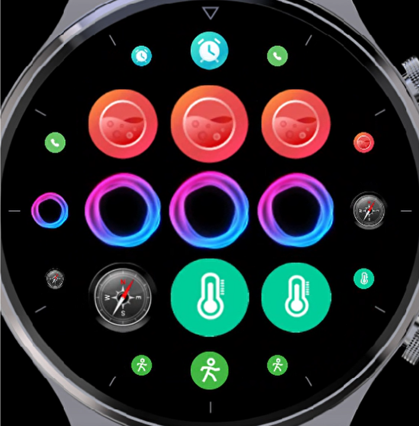

**表 1**  UIPlanetList核心函数

<a name="zh-cn_topic_0000002461759425_table1558818288518"></a>
<table><thead align="left"><tr id="zh-cn_topic_0000002461759425_row13588162865114"><th class="cellrowborder" valign="top" width="50%" id="mcps1.2.3.1.1"><p id="zh-cn_topic_0000002461759425_p5588328205112"><a name="zh-cn_topic_0000002461759425_p5588328205112"></a><a name="zh-cn_topic_0000002461759425_p5588328205112"></a>函数</p>
</th>
<th class="cellrowborder" valign="top" width="50%" id="mcps1.2.3.1.2"><p id="zh-cn_topic_0000002461759425_p14588192805111"><a name="zh-cn_topic_0000002461759425_p14588192805111"></a><a name="zh-cn_topic_0000002461759425_p14588192805111"></a>描述</p>
</th>
</tr>
</thead>
<tbody><tr id="zh-cn_topic_0000002461759425_row058915280518"><td class="cellrowborder" valign="top" width="50%" headers="mcps1.2.3.1.1 "><p id="zh-cn_topic_0000002461759425_p454911135523"><a name="zh-cn_topic_0000002461759425_p454911135523"></a><a name="zh-cn_topic_0000002461759425_p454911135523"></a>AddItemVIew(UIView* view)</p>
</td>
<td class="cellrowborder" valign="top" width="50%" headers="mcps1.2.3.1.2 "><p id="zh-cn_topic_0000002461759425_p20631151695215"><a name="zh-cn_topic_0000002461759425_p20631151695215"></a><a name="zh-cn_topic_0000002461759425_p20631151695215"></a>添加一个子控件。</p>
</td>
</tr>
<tr id="zh-cn_topic_0000002461759425_row658913286512"><td class="cellrowborder" valign="top" width="50%" headers="mcps1.2.3.1.1 "><p id="zh-cn_topic_0000002461759425_p1370123010528"><a name="zh-cn_topic_0000002461759425_p1370123010528"></a><a name="zh-cn_topic_0000002461759425_p1370123010528"></a>AddLabel(UIView* view)</p>
</td>
<td class="cellrowborder" valign="top" width="50%" headers="mcps1.2.3.1.2 "><p id="zh-cn_topic_0000002461759425_p18589128165120"><a name="zh-cn_topic_0000002461759425_p18589128165120"></a><a name="zh-cn_topic_0000002461759425_p18589128165120"></a>添加一个子控件对应的标题。</p>
</td>
</tr>
<tr id="zh-cn_topic_0000002461759425_row173491133595"><td class="cellrowborder" valign="top" width="50%" headers="mcps1.2.3.1.1 "><p id="zh-cn_topic_0000002461759425_p1340218435911"><a name="zh-cn_topic_0000002461759425_p1340218435911"></a><a name="zh-cn_topic_0000002461759425_p1340218435911"></a>MoveChildTo(int16_t posX, int16_t posY);</p>
</td>
<td class="cellrowborder" valign="top" width="50%" headers="mcps1.2.3.1.2 "><p id="zh-cn_topic_0000002461759425_p19441745105917"><a name="zh-cn_topic_0000002461759425_p19441745105917"></a><a name="zh-cn_topic_0000002461759425_p19441745105917"></a>移动所有子控件到指定的位置。</p>
</td>
</tr>
<tr id="zh-cn_topic_0000002461759425_row10589132811515"><td class="cellrowborder" valign="top" width="50%" headers="mcps1.2.3.1.1 "><p id="zh-cn_topic_0000002461759425_p949594155311"><a name="zh-cn_topic_0000002461759425_p949594155311"></a><a name="zh-cn_topic_0000002461759425_p949594155311"></a>MoveChildByOffset(int16_t offsetX, int16_t offsetY)</p>
</td>
<td class="cellrowborder" valign="top" width="50%" headers="mcps1.2.3.1.2 "><p id="zh-cn_topic_0000002461759425_p131247100539"><a name="zh-cn_topic_0000002461759425_p131247100539"></a><a name="zh-cn_topic_0000002461759425_p131247100539"></a>按照偏移量移动所有子控件。</p>
</td>
</tr>
<tr id="zh-cn_topic_0000002461759425_row7157195412015"><td class="cellrowborder" valign="top" width="50%" headers="mcps1.2.3.1.1 "><p id="zh-cn_topic_0000002461759425_p899910541102"><a name="zh-cn_topic_0000002461759425_p899910541102"></a><a name="zh-cn_topic_0000002461759425_p899910541102"></a>GetViewType()</p>
</td>
<td class="cellrowborder" valign="top" width="50%" headers="mcps1.2.3.1.2 "><p id="zh-cn_topic_0000002461759425_p0157105411012"><a name="zh-cn_topic_0000002461759425_p0157105411012"></a><a name="zh-cn_topic_0000002461759425_p0157105411012"></a>获取控件的类型。</p>
</td>
</tr>
<tr id="zh-cn_topic_0000002461759425_row71165271116"><td class="cellrowborder" valign="top" width="50%" headers="mcps1.2.3.1.1 "><p id="zh-cn_topic_0000002461759425_p6883433110"><a name="zh-cn_topic_0000002461759425_p6883433110"></a><a name="zh-cn_topic_0000002461759425_p6883433110"></a>SetImageDistance(uint16_t distance)</p>
</td>
<td class="cellrowborder" valign="top" width="50%" headers="mcps1.2.3.1.2 "><p id="zh-cn_topic_0000002461759425_p1211712272118"><a name="zh-cn_topic_0000002461759425_p1211712272118"></a><a name="zh-cn_topic_0000002461759425_p1211712272118"></a>设置子控件的间隔。</p>
</td>
</tr>
<tr id="zh-cn_topic_0000002461759425_row115486531911"><td class="cellrowborder" valign="top" width="50%" headers="mcps1.2.3.1.1 "><p id="zh-cn_topic_0000002461759425_p144999549115"><a name="zh-cn_topic_0000002461759425_p144999549115"></a><a name="zh-cn_topic_0000002461759425_p144999549115"></a>GetImageDistance()</p>
</td>
<td class="cellrowborder" valign="top" width="50%" headers="mcps1.2.3.1.2 "><p id="zh-cn_topic_0000002461759425_p2265173921"><a name="zh-cn_topic_0000002461759425_p2265173921"></a><a name="zh-cn_topic_0000002461759425_p2265173921"></a>获取子控件的间隔。</p>
</td>
</tr>
<tr id="zh-cn_topic_0000002461759425_row19658153215"><td class="cellrowborder" valign="top" width="50%" headers="mcps1.2.3.1.1 "><p id="zh-cn_topic_0000002461759425_p89988301923"><a name="zh-cn_topic_0000002461759425_p89988301923"></a><a name="zh-cn_topic_0000002461759425_p89988301923"></a>SetImageSize(uint16_t size)</p>
</td>
<td class="cellrowborder" valign="top" width="50%" headers="mcps1.2.3.1.2 "><p id="zh-cn_topic_0000002461759425_p1622493914215"><a name="zh-cn_topic_0000002461759425_p1622493914215"></a><a name="zh-cn_topic_0000002461759425_p1622493914215"></a>设置子控件的大小。</p>
</td>
</tr>
<tr id="zh-cn_topic_0000002461759425_row15836132013214"><td class="cellrowborder" valign="top" width="50%" headers="mcps1.2.3.1.1 "><p id="zh-cn_topic_0000002461759425_p101095610213"><a name="zh-cn_topic_0000002461759425_p101095610213"></a><a name="zh-cn_topic_0000002461759425_p101095610213"></a>GetImageSize()</p>
</td>
<td class="cellrowborder" valign="top" width="50%" headers="mcps1.2.3.1.2 "><p id="zh-cn_topic_0000002461759425_p1983662012212"><a name="zh-cn_topic_0000002461759425_p1983662012212"></a><a name="zh-cn_topic_0000002461759425_p1983662012212"></a>获取子控件的大小。</p>
</td>
</tr>
<tr id="zh-cn_topic_0000002461759425_row18149201014314"><td class="cellrowborder" valign="top" width="50%" headers="mcps1.2.3.1.1 "><p id="zh-cn_topic_0000002461759425_p6516162110312"><a name="zh-cn_topic_0000002461759425_p6516162110312"></a><a name="zh-cn_topic_0000002461759425_p6516162110312"></a>SetLastOffset(int16_t x, int16_t y)</p>
</td>
<td class="cellrowborder" valign="top" width="50%" headers="mcps1.2.3.1.2 "><p id="zh-cn_topic_0000002461759425_p17149010536"><a name="zh-cn_topic_0000002461759425_p17149010536"></a><a name="zh-cn_topic_0000002461759425_p17149010536"></a>设置子控件的初始偏移量。</p>
</td>
</tr>
<tr id="zh-cn_topic_0000002461759425_row57887169316"><td class="cellrowborder" valign="top" width="50%" headers="mcps1.2.3.1.1 "><p id="zh-cn_topic_0000002461759425_p209581436535"><a name="zh-cn_topic_0000002461759425_p209581436535"></a><a name="zh-cn_topic_0000002461759425_p209581436535"></a>GetLastOffset(int16_t& x, int16_t& y)</p>
</td>
<td class="cellrowborder" valign="top" width="50%" headers="mcps1.2.3.1.2 "><p id="zh-cn_topic_0000002461759425_p17888161135"><a name="zh-cn_topic_0000002461759425_p17888161135"></a><a name="zh-cn_topic_0000002461759425_p17888161135"></a>获取子控件的初始偏移量。</p>
</td>
</tr>
</tbody>
</table>

## 非容器类组件<a name="ZH-CN_TOPIC_0000002499501877"></a>

-   **[UIImageView](#ZH-CN_TOPIC_0000002466542688)**  

-   **[UIImageAnimator](#ZH-CN_TOPIC_0000002466542704)**  

-   **[UILabel](#ZH-CN_TOPIC_0000002466383052)**  

-   **[UILabelExt](#ZH-CN_TOPIC_0000002466383000)**  

-   **[UIButton](#ZH-CN_TOPIC_0000002499501989)**  

-   **[UILabelButtonExt](#ZH-CN_TOPIC_0000002466382992)**  

-   **[UILabelButton](#ZH-CN_TOPIC_0000002499502025)**  

-   **[UICheckBox](#ZH-CN_TOPIC_0000002466542584)**  

-   **[UIRadioButton](#ZH-CN_TOPIC_0000002466383024)**  

-   **[UIToggleButton](#ZH-CN_TOPIC_0000002466382972)**  

-   **[UIArcLabel](#ZH-CN_TOPIC_0000002499581977)**  

-   **[UIBoxProgress](#ZH-CN_TOPIC_0000002499581937)**  

-   **[UICircleProgress](#ZH-CN_TOPIC_0000002499581997)**  

-   **[UISlider](#ZH-CN_TOPIC_0000002466383160)**  

-   **[UITextureMapper](#ZH-CN_TOPIC_0000002466542616)**  

-   **[UIQrcode](#ZH-CN_TOPIC_0000002499501893)**  

-   **[UIBarcode](#ZH-CN_TOPIC_0000002466382952)**  

-   **[UICanvas](#ZH-CN_TOPIC_0000002466542660)**  

-   **[UICanvasExt](#ZH-CN_TOPIC_0000002466383100)**  

-   **[UILiteSurfaceView](#ZH-CN_TOPIC_0000002499582141)**  

-   **[UIEditText](#ZH-CN_TOPIC_0000002466542772)**  

-   **[UIKaleidoscopeView](#ZH-CN_TOPIC_0000002466542580)**  

-   **[UIFloatBoxView](#ZH-CN_TOPIC_0000002499581953)**  

-   **[UILottView](#ZH-CN_TOPIC_0000002499501981)**  

-   **[UI3DView](#ZH-CN_TOPIC_0000002499581925)**  

-   **[UI3DSphere](#ZH-CN_TOPIC_0000002466383068)**  

-   **[UI3DMesh](#ZH-CN_TOPIC_0000002499502057)**  

-   **[UI3DCylinder](#ZH-CN_TOPIC_0000002499581929)**  

-   **[UIPostEffectImageView](#ZH-CN_TOPIC_0000002499501973)**  

-   **[UIRainView](#ZH-CN_TOPIC_0000002499582029)**  

### UIImageView<a name="ZH-CN_TOPIC_0000002466542688"></a>

UIImageView用于展示图片。

> **须知：** 
>1.  使用时需注意AutoEnable和ResizeMode属性设置顺序，建议AutoEnable在ResizeMode之前进行设置。
>2.  UIImageView背景不透明度建议调整为0。

**表 1**  UIImageView核心函数

<a name="zh-cn_topic_0000002411046860_table1433mcpsimp"></a>
<table><thead align="left"><tr id="zh-cn_topic_0000002411046860_row1439mcpsimp"><th class="cellrowborder" valign="top" width="50%" id="mcps1.2.3.1.1"><p id="zh-cn_topic_0000002411046860_p1441mcpsimp"><a name="zh-cn_topic_0000002411046860_p1441mcpsimp"></a><a name="zh-cn_topic_0000002411046860_p1441mcpsimp"></a>函数</p>
</th>
<th class="cellrowborder" valign="top" width="50%" id="mcps1.2.3.1.2"><p id="zh-cn_topic_0000002411046860_p1443mcpsimp"><a name="zh-cn_topic_0000002411046860_p1443mcpsimp"></a><a name="zh-cn_topic_0000002411046860_p1443mcpsimp"></a>介绍</p>
</th>
</tr>
</thead>
<tbody><tr id="zh-cn_topic_0000002411046860_row1445mcpsimp"><td class="cellrowborder" valign="top" width="50%" headers="mcps1.2.3.1.1 "><p id="zh-cn_topic_0000002411046860_p1447mcpsimp"><a name="zh-cn_topic_0000002411046860_p1447mcpsimp"></a><a name="zh-cn_topic_0000002411046860_p1447mcpsimp"></a>void SetSrc(const char* src)</p>
</td>
<td class="cellrowborder" valign="top" width="50%" headers="mcps1.2.3.1.2 "><p id="zh-cn_topic_0000002411046860_p1449mcpsimp"><a name="zh-cn_topic_0000002411046860_p1449mcpsimp"></a><a name="zh-cn_topic_0000002411046860_p1449mcpsimp"></a>通过路径来设置图片。</p>
</td>
</tr>
<tr id="zh-cn_topic_0000002411046860_row1450mcpsimp"><td class="cellrowborder" valign="top" width="50%" headers="mcps1.2.3.1.1 "><p id="zh-cn_topic_0000002411046860_p1452mcpsimp"><a name="zh-cn_topic_0000002411046860_p1452mcpsimp"></a><a name="zh-cn_topic_0000002411046860_p1452mcpsimp"></a>void SetSrc(const ImageInfo* src)</p>
</td>
<td class="cellrowborder" valign="top" width="50%" headers="mcps1.2.3.1.2 "><p id="zh-cn_topic_0000002411046860_p1454mcpsimp"><a name="zh-cn_topic_0000002411046860_p1454mcpsimp"></a><a name="zh-cn_topic_0000002411046860_p1454mcpsimp"></a>设置组件图片信息。</p>
</td>
</tr>
<tr id="zh-cn_topic_0000002411046860_row1455mcpsimp"><td class="cellrowborder" valign="top" width="50%" headers="mcps1.2.3.1.1 "><p id="zh-cn_topic_0000002411046860_p1457mcpsimp"><a name="zh-cn_topic_0000002411046860_p1457mcpsimp"></a><a name="zh-cn_topic_0000002411046860_p1457mcpsimp"></a>void SetAutoEnable(bool enable)</p>
</td>
<td class="cellrowborder" valign="top" width="50%" headers="mcps1.2.3.1.2 "><p id="zh-cn_topic_0000002411046860_p1459mcpsimp"><a name="zh-cn_topic_0000002411046860_p1459mcpsimp"></a><a name="zh-cn_topic_0000002411046860_p1459mcpsimp"></a>设置组件自适应图片。</p>
</td>
</tr>
<tr id="zh-cn_topic_0000002411046860_row1460mcpsimp"><td class="cellrowborder" valign="top" width="50%" headers="mcps1.2.3.1.1 "><p id="zh-cn_topic_0000002411046860_p1462mcpsimp"><a name="zh-cn_topic_0000002411046860_p1462mcpsimp"></a><a name="zh-cn_topic_0000002411046860_p1462mcpsimp"></a>void SetBlurLevel(BlurLevel level)</p>
</td>
<td class="cellrowborder" valign="top" width="50%" headers="mcps1.2.3.1.2 "><p id="zh-cn_topic_0000002411046860_p1464mcpsimp"><a name="zh-cn_topic_0000002411046860_p1464mcpsimp"></a><a name="zh-cn_topic_0000002411046860_p1464mcpsimp"></a>设置旋转或缩放此图像时的模糊级别。</p>
</td>
</tr>
<tr id="zh-cn_topic_0000002411046860_row1465mcpsimp"><td class="cellrowborder" valign="top" width="50%" headers="mcps1.2.3.1.1 "><p id="zh-cn_topic_0000002411046860_p1467mcpsimp"><a name="zh-cn_topic_0000002411046860_p1467mcpsimp"></a><a name="zh-cn_topic_0000002411046860_p1467mcpsimp"></a>void SetResizeMode(ImageResizeMode mode)</p>
</td>
<td class="cellrowborder" valign="top" width="50%" headers="mcps1.2.3.1.2 "><p id="zh-cn_topic_0000002411046860_p1469mcpsimp"><a name="zh-cn_topic_0000002411046860_p1469mcpsimp"></a><a name="zh-cn_topic_0000002411046860_p1469mcpsimp"></a>设置图片缩放模式（平铺、填充、保持宽高比）。</p>
<a name="zh-cn_topic_0000002411046860_ul36991163617"></a><a name="zh-cn_topic_0000002411046860_ul36991163617"></a><ul id="zh-cn_topic_0000002411046860_ul36991163617"><li>在AutoEnable为true时，SetResizeMode()不生效。</li><li>在AutoEnable为false时，需要先设置宽高，再设置SetResizeMode()。</li></ul>
</td>
</tr>
<tr id="zh-cn_topic_0000002411046860_row1472mcpsimp"><td class="cellrowborder" valign="top" width="50%" headers="mcps1.2.3.1.1 "><p id="zh-cn_topic_0000002411046860_p1474mcpsimp"><a name="zh-cn_topic_0000002411046860_p1474mcpsimp"></a><a name="zh-cn_topic_0000002411046860_p1474mcpsimp"></a>void SetHeight(int16_t height) override</p>
</td>
<td class="cellrowborder" valign="top" width="50%" headers="mcps1.2.3.1.2 "><p id="zh-cn_topic_0000002411046860_p1476mcpsimp"><a name="zh-cn_topic_0000002411046860_p1476mcpsimp"></a><a name="zh-cn_topic_0000002411046860_p1476mcpsimp"></a>设置组件的高度。</p>
</td>
</tr>
<tr id="zh-cn_topic_0000002411046860_row1477mcpsimp"><td class="cellrowborder" valign="top" width="50%" headers="mcps1.2.3.1.1 "><p id="zh-cn_topic_0000002411046860_p1479mcpsimp"><a name="zh-cn_topic_0000002411046860_p1479mcpsimp"></a><a name="zh-cn_topic_0000002411046860_p1479mcpsimp"></a>void SetWidth(int16_t width) override</p>
</td>
<td class="cellrowborder" valign="top" width="50%" headers="mcps1.2.3.1.2 "><p id="zh-cn_topic_0000002411046860_p1481mcpsimp"><a name="zh-cn_topic_0000002411046860_p1481mcpsimp"></a><a name="zh-cn_topic_0000002411046860_p1481mcpsimp"></a>设置组件的宽度。</p>
</td>
</tr>
</tbody>
</table>

### UIImageAnimator<a name="ZH-CN_TOPIC_0000002466542704"></a>

UIImageAnimator组件继承自UIImageView，主要用于播放序列帧。

**表 1**  UIImageAnimator核心函数

<a name="zh-cn_topic_0000002411046916_table1433mcpsimp"></a>
<table><thead align="left"><tr id="zh-cn_topic_0000002411046916_row1439mcpsimp"><th class="cellrowborder" valign="top" width="49.47%" id="mcps1.2.3.1.1"><p id="zh-cn_topic_0000002411046916_p1441mcpsimp"><a name="zh-cn_topic_0000002411046916_p1441mcpsimp"></a><a name="zh-cn_topic_0000002411046916_p1441mcpsimp"></a>函数</p>
</th>
<th class="cellrowborder" valign="top" width="50.529999999999994%" id="mcps1.2.3.1.2"><p id="zh-cn_topic_0000002411046916_p1443mcpsimp"><a name="zh-cn_topic_0000002411046916_p1443mcpsimp"></a><a name="zh-cn_topic_0000002411046916_p1443mcpsimp"></a>介绍</p>
</th>
</tr>
</thead>
<tbody><tr id="zh-cn_topic_0000002411046916_row1445mcpsimp"><td class="cellrowborder" valign="top" width="49.47%" headers="mcps1.2.3.1.1 "><p id="zh-cn_topic_0000002411046916_p857091302519"><a name="zh-cn_topic_0000002411046916_p857091302519"></a><a name="zh-cn_topic_0000002411046916_p857091302519"></a>void SetImageAnimatorSrc(const ImageAnimatorInfo imageSrc[], uint8_t imageNum, uint16_t timeOfUpdate)</p>
</td>
<td class="cellrowborder" valign="top" width="50.529999999999994%" headers="mcps1.2.3.1.2 "><p id="zh-cn_topic_0000002411046916_p1855174814300"><a name="zh-cn_topic_0000002411046916_p1855174814300"></a><a name="zh-cn_topic_0000002411046916_p1855174814300"></a>设置序列帧图源信息以及更新时间，单位：ms。</p>
<p id="zh-cn_topic_0000002411046916_p10101152463119"><a name="zh-cn_topic_0000002411046916_p10101152463119"></a><a name="zh-cn_topic_0000002411046916_p10101152463119"></a>注意：调用该接口时，需要将对应参数内部数据填充完整，禁止先传递地址，再填充数据。</p>
</td>
</tr>
<tr id="zh-cn_topic_0000002411046916_row1450mcpsimp"><td class="cellrowborder" valign="top" width="49.47%" headers="mcps1.2.3.1.1 "><p id="zh-cn_topic_0000002411046916_p1452mcpsimp"><a name="zh-cn_topic_0000002411046916_p1452mcpsimp"></a><a name="zh-cn_topic_0000002411046916_p1452mcpsimp"></a>void SetImageAnimatorSrc(const ImageAnimatorInfo imageSrc[], uint8_t imageNum)</p>
</td>
<td class="cellrowborder" valign="top" width="50.529999999999994%" headers="mcps1.2.3.1.2 "><p id="zh-cn_topic_0000002411046916_p12262143016320"><a name="zh-cn_topic_0000002411046916_p12262143016320"></a><a name="zh-cn_topic_0000002411046916_p12262143016320"></a>设置序列帧图源信息。</p>
<p id="zh-cn_topic_0000002411046916_p16231143913210"><a name="zh-cn_topic_0000002411046916_p16231143913210"></a><a name="zh-cn_topic_0000002411046916_p16231143913210"></a><strong id="zh-cn_topic_0000002411046916_b44210215519"><a name="zh-cn_topic_0000002411046916_b44210215519"></a><a name="zh-cn_topic_0000002411046916_b44210215519"></a>注意：调用该接口时，需要将对应参数内部数据填充完整，禁止先传递地址，再填充数据。</strong></p>
</td>
</tr>
<tr id="zh-cn_topic_0000002411046916_row1455mcpsimp"><td class="cellrowborder" valign="top" width="49.47%" headers="mcps1.2.3.1.1 "><p id="zh-cn_topic_0000002411046916_p33195547285"><a name="zh-cn_topic_0000002411046916_p33195547285"></a><a name="zh-cn_topic_0000002411046916_p33195547285"></a>void SetTimeOfUpdate(uint16_t timeOfUpdate)</p>
</td>
<td class="cellrowborder" valign="top" width="50.529999999999994%" headers="mcps1.2.3.1.2 "><p id="zh-cn_topic_0000002411046916_p3658334182212"><a name="zh-cn_topic_0000002411046916_p3658334182212"></a><a name="zh-cn_topic_0000002411046916_p3658334182212"></a>设置更新时间，单位：ms。</p>
<p id="zh-cn_topic_0000002411046916_p1669344133214"><a name="zh-cn_topic_0000002411046916_p1669344133214"></a><a name="zh-cn_topic_0000002411046916_p1669344133214"></a>该值将会被除以DEFAULT_TASK_PERIOD，从而转换为更新周期。</p>
</td>
</tr>
<tr id="zh-cn_topic_0000002411046916_row1460mcpsimp"><td class="cellrowborder" valign="top" width="49.47%" headers="mcps1.2.3.1.1 "><p id="zh-cn_topic_0000002411046916_p6492958192819"><a name="zh-cn_topic_0000002411046916_p6492958192819"></a><a name="zh-cn_topic_0000002411046916_p6492958192819"></a>uint16_t GetTimeOfUpdate() const</p>
</td>
<td class="cellrowborder" valign="top" width="50.529999999999994%" headers="mcps1.2.3.1.2 "><p id="zh-cn_topic_0000002411046916_p1464mcpsimp"><a name="zh-cn_topic_0000002411046916_p1464mcpsimp"></a><a name="zh-cn_topic_0000002411046916_p1464mcpsimp"></a>获取更新时间。</p>
</td>
</tr>
<tr id="zh-cn_topic_0000002411046916_row1477mcpsimp"><td class="cellrowborder" valign="top" width="49.47%" headers="mcps1.2.3.1.1 "><p id="zh-cn_topic_0000002411046916_p83751714132912"><a name="zh-cn_topic_0000002411046916_p83751714132912"></a><a name="zh-cn_topic_0000002411046916_p83751714132912"></a>const ImageAnimatorInfo* GetImageAnimatorSrc() const</p>
</td>
<td class="cellrowborder" valign="top" width="50.529999999999994%" headers="mcps1.2.3.1.2 "><p id="zh-cn_topic_0000002411046916_p1613611539341"><a name="zh-cn_topic_0000002411046916_p1613611539341"></a><a name="zh-cn_topic_0000002411046916_p1613611539341"></a>获取序列帧图源信息。</p>
</td>
</tr>
<tr id="zh-cn_topic_0000002411046916_row4626922112912"><td class="cellrowborder" valign="top" width="49.47%" headers="mcps1.2.3.1.1 "><p id="zh-cn_topic_0000002411046916_p862602210294"><a name="zh-cn_topic_0000002411046916_p862602210294"></a><a name="zh-cn_topic_0000002411046916_p862602210294"></a>uint8_t GetImageAnimatorImageNum() const</p>
</td>
<td class="cellrowborder" valign="top" width="50.529999999999994%" headers="mcps1.2.3.1.2 "><p id="zh-cn_topic_0000002411046916_p46262224294"><a name="zh-cn_topic_0000002411046916_p46262224294"></a><a name="zh-cn_topic_0000002411046916_p46262224294"></a>获取序列帧图源数量。</p>
</td>
</tr>
<tr id="zh-cn_topic_0000002411046916_row19626102210295"><td class="cellrowborder" valign="top" width="49.47%" headers="mcps1.2.3.1.1 "><p id="zh-cn_topic_0000002411046916_p86266226299"><a name="zh-cn_topic_0000002411046916_p86266226299"></a><a name="zh-cn_topic_0000002411046916_p86266226299"></a>void SetSizeFixed(bool fixed)</p>
</td>
<td class="cellrowborder" valign="top" width="50.529999999999994%" headers="mcps1.2.3.1.2 "><p id="zh-cn_topic_0000002411046916_p19156173243518"><a name="zh-cn_topic_0000002411046916_p19156173243518"></a><a name="zh-cn_topic_0000002411046916_p19156173243518"></a>设置序列帧图片大小是否保持一致。如果不一致，则每张图片按照各自设置的宽高显示。</p>
</td>
</tr>
<tr id="zh-cn_topic_0000002411046916_row26261122112919"><td class="cellrowborder" valign="top" width="49.47%" headers="mcps1.2.3.1.1 "><p id="zh-cn_topic_0000002411046916_p8626132213291"><a name="zh-cn_topic_0000002411046916_p8626132213291"></a><a name="zh-cn_topic_0000002411046916_p8626132213291"></a>bool IsSizeFixed() const</p>
</td>
<td class="cellrowborder" valign="top" width="50.529999999999994%" headers="mcps1.2.3.1.2 "><p id="zh-cn_topic_0000002411046916_p2626202242916"><a name="zh-cn_topic_0000002411046916_p2626202242916"></a><a name="zh-cn_topic_0000002411046916_p2626202242916"></a>获取序列帧图片大小是否保持一致。</p>
</td>
</tr>
<tr id="zh-cn_topic_0000002411046916_row7626122210297"><td class="cellrowborder" valign="top" width="49.47%" headers="mcps1.2.3.1.1 "><p id="zh-cn_topic_0000002411046916_p18626152252919"><a name="zh-cn_topic_0000002411046916_p18626152252919"></a><a name="zh-cn_topic_0000002411046916_p18626152252919"></a>void SetRepeat(bool repeat)</p>
</td>
<td class="cellrowborder" valign="top" width="50.529999999999994%" headers="mcps1.2.3.1.2 "><p id="zh-cn_topic_0000002411046916_p76261822122912"><a name="zh-cn_topic_0000002411046916_p76261822122912"></a><a name="zh-cn_topic_0000002411046916_p76261822122912"></a>设置是否重复播放。</p>
</td>
</tr>
<tr id="zh-cn_topic_0000002411046916_row12626322122915"><td class="cellrowborder" valign="top" width="49.47%" headers="mcps1.2.3.1.1 "><p id="zh-cn_topic_0000002411046916_p1262614222291"><a name="zh-cn_topic_0000002411046916_p1262614222291"></a><a name="zh-cn_topic_0000002411046916_p1262614222291"></a>bool IsRepeat() const</p>
</td>
<td class="cellrowborder" valign="top" width="50.529999999999994%" headers="mcps1.2.3.1.2 "><p id="zh-cn_topic_0000002411046916_p5627112232916"><a name="zh-cn_topic_0000002411046916_p5627112232916"></a><a name="zh-cn_topic_0000002411046916_p5627112232916"></a>获取是否重复播放。</p>
</td>
</tr>
<tr id="zh-cn_topic_0000002411046916_row7627022152918"><td class="cellrowborder" valign="top" width="49.47%" headers="mcps1.2.3.1.1 "><p id="zh-cn_topic_0000002411046916_p96271522172912"><a name="zh-cn_topic_0000002411046916_p96271522172912"></a><a name="zh-cn_topic_0000002411046916_p96271522172912"></a>void SetRepeatTimes(uint32_t times)</p>
</td>
<td class="cellrowborder" valign="top" width="50.529999999999994%" headers="mcps1.2.3.1.2 "><p id="zh-cn_topic_0000002411046916_p18627142272911"><a name="zh-cn_topic_0000002411046916_p18627142272911"></a><a name="zh-cn_topic_0000002411046916_p18627142272911"></a>设置重复播放次数。</p>
</td>
</tr>
<tr id="zh-cn_topic_0000002411046916_row114139142915"><td class="cellrowborder" valign="top" width="49.47%" headers="mcps1.2.3.1.1 "><p id="zh-cn_topic_0000002411046916_p114153912917"><a name="zh-cn_topic_0000002411046916_p114153912917"></a><a name="zh-cn_topic_0000002411046916_p114153912917"></a>uint32_t GetRepeatTimes() const</p>
</td>
<td class="cellrowborder" valign="top" width="50.529999999999994%" headers="mcps1.2.3.1.2 "><p id="zh-cn_topic_0000002411046916_p514163911296"><a name="zh-cn_topic_0000002411046916_p514163911296"></a><a name="zh-cn_topic_0000002411046916_p514163911296"></a>获取重复播放次数。</p>
</td>
</tr>
<tr id="zh-cn_topic_0000002411046916_row1214439172913"><td class="cellrowborder" valign="top" width="49.47%" headers="mcps1.2.3.1.1 "><p id="zh-cn_topic_0000002411046916_p2141139152914"><a name="zh-cn_topic_0000002411046916_p2141139152914"></a><a name="zh-cn_topic_0000002411046916_p2141139152914"></a>uint8_t GetState() const</p>
</td>
<td class="cellrowborder" valign="top" width="50.529999999999994%" headers="mcps1.2.3.1.2 "><p id="zh-cn_topic_0000002411046916_p414639112917"><a name="zh-cn_topic_0000002411046916_p414639112917"></a><a name="zh-cn_topic_0000002411046916_p414639112917"></a>获取播放状态。</p>
</td>
</tr>
<tr id="zh-cn_topic_0000002411046916_row121413992912"><td class="cellrowborder" valign="top" width="49.47%" headers="mcps1.2.3.1.1 "><p id="zh-cn_topic_0000002411046916_p141463962917"><a name="zh-cn_topic_0000002411046916_p141463962917"></a><a name="zh-cn_topic_0000002411046916_p141463962917"></a>void SetReverse(bool reverse)</p>
</td>
<td class="cellrowborder" valign="top" width="50.529999999999994%" headers="mcps1.2.3.1.2 "><p id="zh-cn_topic_0000002411046916_p71403913297"><a name="zh-cn_topic_0000002411046916_p71403913297"></a><a name="zh-cn_topic_0000002411046916_p71403913297"></a>设置是否倒放。</p>
</td>
</tr>
<tr id="zh-cn_topic_0000002411046916_row107819585299"><td class="cellrowborder" valign="top" width="49.47%" headers="mcps1.2.3.1.1 "><p id="zh-cn_topic_0000002411046916_p147810588294"><a name="zh-cn_topic_0000002411046916_p147810588294"></a><a name="zh-cn_topic_0000002411046916_p147810588294"></a>bool IsReverse() const</p>
</td>
<td class="cellrowborder" valign="top" width="50.529999999999994%" headers="mcps1.2.3.1.2 "><p id="zh-cn_topic_0000002411046916_p17788586296"><a name="zh-cn_topic_0000002411046916_p17788586296"></a><a name="zh-cn_topic_0000002411046916_p17788586296"></a>获取是否倒放。</p>
</td>
</tr>
<tr id="zh-cn_topic_0000002411046916_row1478205852918"><td class="cellrowborder" valign="top" width="49.47%" headers="mcps1.2.3.1.1 "><p id="zh-cn_topic_0000002411046916_p77813589295"><a name="zh-cn_topic_0000002411046916_p77813589295"></a><a name="zh-cn_topic_0000002411046916_p77813589295"></a>void SetFillMode(bool fillMode)</p>
</td>
<td class="cellrowborder" valign="top" width="50.529999999999994%" headers="mcps1.2.3.1.2 "><p id="zh-cn_topic_0000002411046916_p137885882915"><a name="zh-cn_topic_0000002411046916_p137885882915"></a><a name="zh-cn_topic_0000002411046916_p137885882915"></a>设置图片填充模式。</p>
</td>
</tr>
<tr id="zh-cn_topic_0000002411046916_row6781658102918"><td class="cellrowborder" valign="top" width="49.47%" headers="mcps1.2.3.1.1 "><p id="zh-cn_topic_0000002411046916_p1478258192915"><a name="zh-cn_topic_0000002411046916_p1478258192915"></a><a name="zh-cn_topic_0000002411046916_p1478258192915"></a>bool GetFillMode() const</p>
</td>
<td class="cellrowborder" valign="top" width="50.529999999999994%" headers="mcps1.2.3.1.2 "><p id="zh-cn_topic_0000002411046916_p2078185817299"><a name="zh-cn_topic_0000002411046916_p2078185817299"></a><a name="zh-cn_topic_0000002411046916_p2078185817299"></a>获取图片填充模式。</p>
</td>
</tr>
<tr id="zh-cn_topic_0000002411046916_row197895802914"><td class="cellrowborder" valign="top" width="49.47%" headers="mcps1.2.3.1.1 "><p id="zh-cn_topic_0000002411046916_p878195882913"><a name="zh-cn_topic_0000002411046916_p878195882913"></a><a name="zh-cn_topic_0000002411046916_p878195882913"></a>void Start()</p>
</td>
<td class="cellrowborder" valign="top" width="50.529999999999994%" headers="mcps1.2.3.1.2 "><p id="zh-cn_topic_0000002411046916_p10793587295"><a name="zh-cn_topic_0000002411046916_p10793587295"></a><a name="zh-cn_topic_0000002411046916_p10793587295"></a>启动序列帧动画。</p>
</td>
</tr>
<tr id="zh-cn_topic_0000002411046916_row679175819296"><td class="cellrowborder" valign="top" width="49.47%" headers="mcps1.2.3.1.1 "><p id="zh-cn_topic_0000002411046916_p27965882910"><a name="zh-cn_topic_0000002411046916_p27965882910"></a><a name="zh-cn_topic_0000002411046916_p27965882910"></a>void Stop()</p>
</td>
<td class="cellrowborder" valign="top" width="50.529999999999994%" headers="mcps1.2.3.1.2 "><p id="zh-cn_topic_0000002411046916_p187925814296"><a name="zh-cn_topic_0000002411046916_p187925814296"></a><a name="zh-cn_topic_0000002411046916_p187925814296"></a>停止序列帧动画。</p>
</td>
</tr>
<tr id="zh-cn_topic_0000002411046916_row1879175814298"><td class="cellrowborder" valign="top" width="49.47%" headers="mcps1.2.3.1.1 "><p id="zh-cn_topic_0000002411046916_p17791058112913"><a name="zh-cn_topic_0000002411046916_p17791058112913"></a><a name="zh-cn_topic_0000002411046916_p17791058112913"></a>void Pause()</p>
</td>
<td class="cellrowborder" valign="top" width="50.529999999999994%" headers="mcps1.2.3.1.2 "><p id="zh-cn_topic_0000002411046916_p279155813291"><a name="zh-cn_topic_0000002411046916_p279155813291"></a><a name="zh-cn_topic_0000002411046916_p279155813291"></a>暂停序列帧动画。</p>
</td>
</tr>
<tr id="zh-cn_topic_0000002411046916_row14159132573018"><td class="cellrowborder" valign="top" width="49.47%" headers="mcps1.2.3.1.1 "><p id="zh-cn_topic_0000002411046916_p2015992513016"><a name="zh-cn_topic_0000002411046916_p2015992513016"></a><a name="zh-cn_topic_0000002411046916_p2015992513016"></a>void Resume()</p>
</td>
<td class="cellrowborder" valign="top" width="50.529999999999994%" headers="mcps1.2.3.1.2 "><p id="zh-cn_topic_0000002411046916_p9159925203019"><a name="zh-cn_topic_0000002411046916_p9159925203019"></a><a name="zh-cn_topic_0000002411046916_p9159925203019"></a>继续序列帧动画。</p>
</td>
</tr>
<tr id="zh-cn_topic_0000002411046916_row9160152513017"><td class="cellrowborder" valign="top" width="49.47%" headers="mcps1.2.3.1.1 "><p id="zh-cn_topic_0000002411046916_p41601325153016"><a name="zh-cn_topic_0000002411046916_p41601325153016"></a><a name="zh-cn_topic_0000002411046916_p41601325153016"></a>void SetAnimatorStopListener(AnimatorStopListener* listener)</p>
</td>
<td class="cellrowborder" valign="top" width="50.529999999999994%" headers="mcps1.2.3.1.2 "><p id="zh-cn_topic_0000002411046916_p11160162512308"><a name="zh-cn_topic_0000002411046916_p11160162512308"></a><a name="zh-cn_topic_0000002411046916_p11160162512308"></a>设置序列帧停止监听。</p>
</td>
</tr>
</tbody>
</table>

> **说明：** 
>父控件为可滑动控件时，必需调用SetSizeFixed（True）。

### UILabel<a name="ZH-CN_TOPIC_0000002466383052"></a>

UILabel组件主要用于展示文字。

> **须知：** 
>在设置为LINE\_BREAK\_MARQUEE模式下，最小的滚动像素为1。即在设置滚动速度为0时，不是停止状态。

**表 1**  UILabel核心函数

<a name="zh-cn_topic_0000002444645973_table1484mcpsimp"></a>
<table><thead align="left"><tr id="zh-cn_topic_0000002444645973_row1490mcpsimp"><th class="cellrowborder" valign="top" width="50%" id="mcps1.2.3.1.1"><p id="zh-cn_topic_0000002444645973_p1492mcpsimp"><a name="zh-cn_topic_0000002444645973_p1492mcpsimp"></a><a name="zh-cn_topic_0000002444645973_p1492mcpsimp"></a>函数</p>
</th>
<th class="cellrowborder" valign="top" width="50%" id="mcps1.2.3.1.2"><p id="zh-cn_topic_0000002444645973_p1494mcpsimp"><a name="zh-cn_topic_0000002444645973_p1494mcpsimp"></a><a name="zh-cn_topic_0000002444645973_p1494mcpsimp"></a>介绍</p>
</th>
</tr>
</thead>
<tbody><tr id="zh-cn_topic_0000002444645973_row1496mcpsimp"><td class="cellrowborder" valign="top" width="50%" headers="mcps1.2.3.1.1 "><p id="zh-cn_topic_0000002444645973_p1498mcpsimp"><a name="zh-cn_topic_0000002444645973_p1498mcpsimp"></a><a name="zh-cn_topic_0000002444645973_p1498mcpsimp"></a>void SetText(const char* text)</p>
</td>
<td class="cellrowborder" valign="top" width="50%" headers="mcps1.2.3.1.2 "><p id="zh-cn_topic_0000002444645973_p1500mcpsimp"><a name="zh-cn_topic_0000002444645973_p1500mcpsimp"></a><a name="zh-cn_topic_0000002444645973_p1500mcpsimp"></a>设置展示文本内容。</p>
<p id="zh-cn_topic_0000002444645973_p1533634718412"><a name="zh-cn_topic_0000002444645973_p1533634718412"></a><a name="zh-cn_topic_0000002444645973_p1533634718412"></a>参数：要展示的字符串</p>
</td>
</tr>
<tr id="zh-cn_topic_0000002444645973_row1503mcpsimp"><td class="cellrowborder" valign="top" width="50%" headers="mcps1.2.3.1.1 "><p id="zh-cn_topic_0000002444645973_p1505mcpsimp"><a name="zh-cn_topic_0000002444645973_p1505mcpsimp"></a><a name="zh-cn_topic_0000002444645973_p1505mcpsimp"></a>void SetLineBreakMode(const uint8_t lineBreakMode)</p>
</td>
<td class="cellrowborder" valign="top" width="50%" headers="mcps1.2.3.1.2 "><p id="zh-cn_topic_0000002444645973_p1507mcpsimp"><a name="zh-cn_topic_0000002444645973_p1507mcpsimp"></a><a name="zh-cn_topic_0000002444645973_p1507mcpsimp"></a>设置展示模式。例如是否包裹内容展示，是否换行等，具体请参考UILabel::LineBreakMode。</p>
</td>
</tr>
<tr id="zh-cn_topic_0000002444645973_row1508mcpsimp"><td class="cellrowborder" valign="top" width="50%" headers="mcps1.2.3.1.1 "><p id="zh-cn_topic_0000002444645973_p1510mcpsimp"><a name="zh-cn_topic_0000002444645973_p1510mcpsimp"></a><a name="zh-cn_topic_0000002444645973_p1510mcpsimp"></a>void SetTextColor(ColorType color)</p>
</td>
<td class="cellrowborder" valign="top" width="50%" headers="mcps1.2.3.1.2 "><p id="zh-cn_topic_0000002444645973_p1512mcpsimp"><a name="zh-cn_topic_0000002444645973_p1512mcpsimp"></a><a name="zh-cn_topic_0000002444645973_p1512mcpsimp"></a>设置文字颜色。</p>
</td>
</tr>
<tr id="zh-cn_topic_0000002444645973_row1513mcpsimp"><td class="cellrowborder" valign="top" width="50%" headers="mcps1.2.3.1.1 "><p id="zh-cn_topic_0000002444645973_p1515mcpsimp"><a name="zh-cn_topic_0000002444645973_p1515mcpsimp"></a><a name="zh-cn_topic_0000002444645973_p1515mcpsimp"></a>void SetAlign(UITextLanguageAlignment horizontalAlign,</p>
<p id="zh-cn_topic_0000002444645973_p1516mcpsimp"><a name="zh-cn_topic_0000002444645973_p1516mcpsimp"></a><a name="zh-cn_topic_0000002444645973_p1516mcpsimp"></a>UITextLanguageAlignment verticalAlign = TEXT_ALIGNMENT_TOP)</p>
</td>
<td class="cellrowborder" valign="top" width="50%" headers="mcps1.2.3.1.2 "><p id="zh-cn_topic_0000002444645973_p1518mcpsimp"><a name="zh-cn_topic_0000002444645973_p1518mcpsimp"></a><a name="zh-cn_topic_0000002444645973_p1518mcpsimp"></a>设置对齐方式。</p>
</td>
</tr>
<tr id="zh-cn_topic_0000002444645973_row1519mcpsimp"><td class="cellrowborder" valign="top" width="50%" headers="mcps1.2.3.1.1 "><p id="zh-cn_topic_0000002444645973_p1521mcpsimp"><a name="zh-cn_topic_0000002444645973_p1521mcpsimp"></a><a name="zh-cn_topic_0000002444645973_p1521mcpsimp"></a>void SetDirect(UITextLanguageDirect direct)</p>
</td>
<td class="cellrowborder" valign="top" width="50%" headers="mcps1.2.3.1.2 "><p id="zh-cn_topic_0000002444645973_p1523mcpsimp"><a name="zh-cn_topic_0000002444645973_p1523mcpsimp"></a><a name="zh-cn_topic_0000002444645973_p1523mcpsimp"></a>设置文本展示方向。</p>
</td>
</tr>
<tr id="zh-cn_topic_0000002444645973_row1524mcpsimp"><td class="cellrowborder" valign="top" width="50%" headers="mcps1.2.3.1.1 "><p id="zh-cn_topic_0000002444645973_p1526mcpsimp"><a name="zh-cn_topic_0000002444645973_p1526mcpsimp"></a><a name="zh-cn_topic_0000002444645973_p1526mcpsimp"></a>void SetFontId(uint8_t fontId)</p>
</td>
<td class="cellrowborder" valign="top" width="50%" headers="mcps1.2.3.1.2 "><p id="zh-cn_topic_0000002444645973_p1528mcpsimp"><a name="zh-cn_topic_0000002444645973_p1528mcpsimp"></a><a name="zh-cn_topic_0000002444645973_p1528mcpsimp"></a>设置点阵字库ID。</p>
</td>
</tr>
<tr id="zh-cn_topic_0000002444645973_row1529mcpsimp"><td class="cellrowborder" valign="top" width="50%" headers="mcps1.2.3.1.1 "><p id="zh-cn_topic_0000002444645973_p1531mcpsimp"><a name="zh-cn_topic_0000002444645973_p1531mcpsimp"></a><a name="zh-cn_topic_0000002444645973_p1531mcpsimp"></a>void SetFont(const char* name, uint8_t size)</p>
</td>
<td class="cellrowborder" valign="top" width="50%" headers="mcps1.2.3.1.2 "><p id="zh-cn_topic_0000002444645973_p1533mcpsimp"><a name="zh-cn_topic_0000002444645973_p1533mcpsimp"></a><a name="zh-cn_topic_0000002444645973_p1533mcpsimp"></a>设置矢量字体和大小。</p>
<p id="zh-cn_topic_0000002444645973_p1866010881113"><a name="zh-cn_topic_0000002444645973_p1866010881113"></a><a name="zh-cn_topic_0000002444645973_p1866010881113"></a>支持仅设置字体大小，字库name设置为空；常用于多语言场景，文本通过子类提供的接口SetTextId来配置。</p>
</td>
</tr>
<tr id="zh-cn_topic_0000002444645973_row1534mcpsimp"><td class="cellrowborder" valign="top" width="50%" headers="mcps1.2.3.1.1 "><p id="zh-cn_topic_0000002444645973_p1536mcpsimp"><a name="zh-cn_topic_0000002444645973_p1536mcpsimp"></a><a name="zh-cn_topic_0000002444645973_p1536mcpsimp"></a>void SetRollStartPos(int16_t pos)</p>
</td>
<td class="cellrowborder" valign="top" width="50%" headers="mcps1.2.3.1.2 "><p id="zh-cn_topic_0000002444645973_p1538mcpsimp"><a name="zh-cn_topic_0000002444645973_p1538mcpsimp"></a><a name="zh-cn_topic_0000002444645973_p1538mcpsimp"></a>设置字体滚动位置。</p>
</td>
</tr>
<tr id="zh-cn_topic_0000002444645973_row1539mcpsimp"><td class="cellrowborder" valign="top" width="50%" headers="mcps1.2.3.1.1 "><p id="zh-cn_topic_0000002444645973_p1541mcpsimp"><a name="zh-cn_topic_0000002444645973_p1541mcpsimp"></a><a name="zh-cn_topic_0000002444645973_p1541mcpsimp"></a>void SetWidth(int16_t width) override</p>
</td>
<td class="cellrowborder" valign="top" width="50%" headers="mcps1.2.3.1.2 "><p id="zh-cn_topic_0000002444645973_p1543mcpsimp"><a name="zh-cn_topic_0000002444645973_p1543mcpsimp"></a><a name="zh-cn_topic_0000002444645973_p1543mcpsimp"></a>设置当前组件的宽度。</p>
</td>
</tr>
<tr id="zh-cn_topic_0000002444645973_row1544mcpsimp"><td class="cellrowborder" valign="top" width="50%" headers="mcps1.2.3.1.1 "><p id="zh-cn_topic_0000002444645973_p1546mcpsimp"><a name="zh-cn_topic_0000002444645973_p1546mcpsimp"></a><a name="zh-cn_topic_0000002444645973_p1546mcpsimp"></a>void SetHeight(int16_t height) override</p>
</td>
<td class="cellrowborder" valign="top" width="50%" headers="mcps1.2.3.1.2 "><p id="zh-cn_topic_0000002444645973_p1548mcpsimp"><a name="zh-cn_topic_0000002444645973_p1548mcpsimp"></a><a name="zh-cn_topic_0000002444645973_p1548mcpsimp"></a>设置当前组件的高度。</p>
</td>
</tr>
<tr id="zh-cn_topic_0000002444645973_row7710131454818"><td class="cellrowborder" valign="top" width="50%" headers="mcps1.2.3.1.1 "><p id="zh-cn_topic_0000002444645973_p0710191454817"><a name="zh-cn_topic_0000002444645973_p0710191454817"></a><a name="zh-cn_topic_0000002444645973_p0710191454817"></a>void SetMarqueeBlankNum(uint16_t size)</p>
</td>
<td class="cellrowborder" valign="top" width="50%" headers="mcps1.2.3.1.2 "><p id="zh-cn_topic_0000002444645973_p20711111414814"><a name="zh-cn_topic_0000002444645973_p20711111414814"></a><a name="zh-cn_topic_0000002444645973_p20711111414814"></a>设置文本循环滚动间隔的空白字符数量（仅作用于LineBreakMode = MARQUEE时）。</p>
</td>
</tr>
</tbody>
</table>

### UILabelExt<a name="ZH-CN_TOPIC_0000002466383000"></a>

UILabelExt继承于UILabel，支持文本语言切换以及复杂语系的文本整形。

**表 1**  UILabelExt核心函数

<a name="zh-cn_topic_0000002411046680_table2710mcpsimp"></a>
<table><thead align="left"><tr id="zh-cn_topic_0000002411046680_row2716mcpsimp"><th class="cellrowborder" valign="top" width="32%" id="mcps1.2.3.1.1"><p id="zh-cn_topic_0000002411046680_p2718mcpsimp"><a name="zh-cn_topic_0000002411046680_p2718mcpsimp"></a><a name="zh-cn_topic_0000002411046680_p2718mcpsimp"></a>函数</p>
</th>
<th class="cellrowborder" valign="top" width="68%" id="mcps1.2.3.1.2"><p id="zh-cn_topic_0000002411046680_p2720mcpsimp"><a name="zh-cn_topic_0000002411046680_p2720mcpsimp"></a><a name="zh-cn_topic_0000002411046680_p2720mcpsimp"></a>描述</p>
</th>
</tr>
</thead>
<tbody><tr id="zh-cn_topic_0000002411046680_row2722mcpsimp"><td class="cellrowborder" valign="top" width="32%" headers="mcps1.2.3.1.1 "><p id="zh-cn_topic_0000002411046680_p2724mcpsimp"><a name="zh-cn_topic_0000002411046680_p2724mcpsimp"></a><a name="zh-cn_topic_0000002411046680_p2724mcpsimp"></a>SetTextId</p>
</td>
<td class="cellrowborder" valign="top" width="68%" headers="mcps1.2.3.1.2 "><p id="zh-cn_topic_0000002411046680_p2726mcpsimp"><a name="zh-cn_topic_0000002411046680_p2726mcpsimp"></a><a name="zh-cn_topic_0000002411046680_p2726mcpsimp"></a>设置TextId。</p>
<a name="zh-cn_topic_0000002411046680_ul1822545513411"></a><a name="zh-cn_topic_0000002411046680_ul1822545513411"></a><ul id="zh-cn_topic_0000002411046680_ul1822545513411"><li>参数：uint16_t textId</li><li>返回值：void</li></ul>
</td>
</tr>
<tr id="zh-cn_topic_0000002411046680_row2729mcpsimp"><td class="cellrowborder" valign="top" width="32%" headers="mcps1.2.3.1.1 "><p id="zh-cn_topic_0000002411046680_p2731mcpsimp"><a name="zh-cn_topic_0000002411046680_p2731mcpsimp"></a><a name="zh-cn_topic_0000002411046680_p2731mcpsimp"></a>ForceResetText</p>
</td>
<td class="cellrowborder" valign="top" width="68%" headers="mcps1.2.3.1.2 "><p id="zh-cn_topic_0000002411046680_p2733mcpsimp"><a name="zh-cn_topic_0000002411046680_p2733mcpsimp"></a><a name="zh-cn_topic_0000002411046680_p2733mcpsimp"></a>强制根据控件内部的TextId设置文本内容。</p>
<a name="zh-cn_topic_0000002411046680_ul154601516347"></a><a name="zh-cn_topic_0000002411046680_ul154601516347"></a><ul id="zh-cn_topic_0000002411046680_ul154601516347"><li>参数：N/A</li><li>返回值：void</li></ul>
</td>
</tr>
</tbody>
</table>

### UIButton<a name="ZH-CN_TOPIC_0000002499501989"></a>

UIButton是可点击的按钮，用户可以通过函数设置图片以此改变默认展示效果。

**表 1**  UIButton核心函数

<a name="zh-cn_topic_0000002444726029__table2839mcpsimp"></a>
<table><thead align="left"><tr id="zh-cn_topic_0000002444726029_row1556mcpsimp"><th class="cellrowborder" valign="top" width="50%" id="mcps1.2.3.1.1"><p id="zh-cn_topic_0000002444726029_p1558mcpsimp"><a name="zh-cn_topic_0000002444726029_p1558mcpsimp"></a><a name="zh-cn_topic_0000002444726029_p1558mcpsimp"></a>函数</p>
</th>
<th class="cellrowborder" valign="top" width="50%" id="mcps1.2.3.1.2"><p id="zh-cn_topic_0000002444726029_p1560mcpsimp"><a name="zh-cn_topic_0000002444726029_p1560mcpsimp"></a><a name="zh-cn_topic_0000002444726029_p1560mcpsimp"></a>介绍</p>
</th>
</tr>
</thead>
<tbody><tr id="zh-cn_topic_0000002444726029_row1562mcpsimp"><td class="cellrowborder" valign="top" width="50%" headers="mcps1.2.3.1.1 "><p id="zh-cn_topic_0000002444726029_p1564mcpsimp"><a name="zh-cn_topic_0000002444726029_p1564mcpsimp"></a><a name="zh-cn_topic_0000002444726029_p1564mcpsimp"></a>void SetImageSrc(const char* defaultImgSrc, const char* triggeredImgSrc)</p>
</td>
<td class="cellrowborder" valign="top" width="50%" headers="mcps1.2.3.1.2 "><p id="zh-cn_topic_0000002444726029_p1566mcpsimp"><a name="zh-cn_topic_0000002444726029_p1566mcpsimp"></a><a name="zh-cn_topic_0000002444726029_p1566mcpsimp"></a>设置UIButton默认展示的图片和点击后展示的图片。</p>
<p id="zh-cn_topic_0000002444726029_p1567mcpsimp"><a name="zh-cn_topic_0000002444726029_p1567mcpsimp"></a><a name="zh-cn_topic_0000002444726029_p1567mcpsimp"></a>参数：图片文件路径。</p>
</td>
</tr>
<tr id="zh-cn_topic_0000002444726029_row1568mcpsimp"><td class="cellrowborder" valign="top" width="50%" headers="mcps1.2.3.1.1 "><p id="zh-cn_topic_0000002444726029_p1570mcpsimp"><a name="zh-cn_topic_0000002444726029_p1570mcpsimp"></a><a name="zh-cn_topic_0000002444726029_p1570mcpsimp"></a>void SetImageSrc(const ImageInfo* defaultImgSrc, const ImageInfo* triggeredImgSrc)</p>
</td>
<td class="cellrowborder" valign="top" width="50%" headers="mcps1.2.3.1.2 "><p id="zh-cn_topic_0000002444726029_p1572mcpsimp"><a name="zh-cn_topic_0000002444726029_p1572mcpsimp"></a><a name="zh-cn_topic_0000002444726029_p1572mcpsimp"></a>设置UIButton默认展示的图片和点击后展示的图片，ImageInfo主要用于加载系统内置资源。</p>
<p id="zh-cn_topic_0000002444726029_p1573mcpsimp"><a name="zh-cn_topic_0000002444726029_p1573mcpsimp"></a><a name="zh-cn_topic_0000002444726029_p1573mcpsimp"></a>参数：传入的ImageInfo。</p>
</td>
</tr>
<tr id="zh-cn_topic_0000002444726029_row1574mcpsimp"><td class="cellrowborder" valign="top" width="50%" headers="mcps1.2.3.1.1 "><p id="zh-cn_topic_0000002444726029_p1576mcpsimp"><a name="zh-cn_topic_0000002444726029_p1576mcpsimp"></a><a name="zh-cn_topic_0000002444726029_p1576mcpsimp"></a>void SetImagePosition(const int16_t x, const int16_t y)</p>
</td>
<td class="cellrowborder" valign="top" width="50%" headers="mcps1.2.3.1.2 "><p id="zh-cn_topic_0000002444726029_p1578mcpsimp"><a name="zh-cn_topic_0000002444726029_p1578mcpsimp"></a><a name="zh-cn_topic_0000002444726029_p1578mcpsimp"></a>设置资源图片相对于控件的位置。</p>
</td>
</tr>
<tr id="zh-cn_topic_0000002444726029_row1579mcpsimp"><td class="cellrowborder" valign="top" width="50%" headers="mcps1.2.3.1.1 "><p id="zh-cn_topic_0000002444726029_p1581mcpsimp"><a name="zh-cn_topic_0000002444726029_p1581mcpsimp"></a><a name="zh-cn_topic_0000002444726029_p1581mcpsimp"></a>void Disable()</p>
</td>
<td class="cellrowborder" valign="top" width="50%" headers="mcps1.2.3.1.2 "><p id="zh-cn_topic_0000002444726029_p1583mcpsimp"><a name="zh-cn_topic_0000002444726029_p1583mcpsimp"></a><a name="zh-cn_topic_0000002444726029_p1583mcpsimp"></a>UIButton不可点击。</p>
</td>
</tr>
<tr id="zh-cn_topic_0000002444726029_row1584mcpsimp"><td class="cellrowborder" valign="top" width="50%" headers="mcps1.2.3.1.1 "><p id="zh-cn_topic_0000002444726029_p1586mcpsimp"><a name="zh-cn_topic_0000002444726029_p1586mcpsimp"></a><a name="zh-cn_topic_0000002444726029_p1586mcpsimp"></a>void Enable()</p>
</td>
<td class="cellrowborder" valign="top" width="50%" headers="mcps1.2.3.1.2 "><p id="zh-cn_topic_0000002444726029_p1588mcpsimp"><a name="zh-cn_topic_0000002444726029_p1588mcpsimp"></a><a name="zh-cn_topic_0000002444726029_p1588mcpsimp"></a>恢复UIButton可点击。</p>
</td>
</tr>
<tr id="zh-cn_topic_0000002444726029_row1589mcpsimp"><td class="cellrowborder" valign="top" width="50%" headers="mcps1.2.3.1.1 "><p id="zh-cn_topic_0000002444726029_p1591mcpsimp"><a name="zh-cn_topic_0000002444726029_p1591mcpsimp"></a><a name="zh-cn_topic_0000002444726029_p1591mcpsimp"></a>void SetStateForStyle(ButtonState state)</p>
</td>
<td class="cellrowborder" valign="top" width="50%" headers="mcps1.2.3.1.2 "><p id="zh-cn_topic_0000002444726029_p1593mcpsimp"><a name="zh-cn_topic_0000002444726029_p1593mcpsimp"></a><a name="zh-cn_topic_0000002444726029_p1593mcpsimp"></a>设置样式状态。非当前状态，而是即将要设置的样式对应的状态。</p>
</td>
</tr>
<tr id="zh-cn_topic_0000002444726029_row1594mcpsimp"><td class="cellrowborder" valign="top" width="50%" headers="mcps1.2.3.1.1 "><p id="zh-cn_topic_0000002444726029_p1596mcpsimp"><a name="zh-cn_topic_0000002444726029_p1596mcpsimp"></a><a name="zh-cn_topic_0000002444726029_p1596mcpsimp"></a>void SetStyle(uint8_t key, int64_t value) override</p>
</td>
<td class="cellrowborder" valign="top" width="50%" headers="mcps1.2.3.1.2 "><p id="zh-cn_topic_0000002444726029_p1598mcpsimp"><a name="zh-cn_topic_0000002444726029_p1598mcpsimp"></a><a name="zh-cn_topic_0000002444726029_p1598mcpsimp"></a>设置当前style对应属性的样式。</p>
</td>
</tr>
<tr id="zh-cn_topic_0000002444726029_row1599mcpsimp"><td class="cellrowborder" valign="top" width="50%" headers="mcps1.2.3.1.1 "><p id="zh-cn_topic_0000002444726029_p1601mcpsimp"><a name="zh-cn_topic_0000002444726029_p1601mcpsimp"></a><a name="zh-cn_topic_0000002444726029_p1601mcpsimp"></a>void SetStyleForState(uint8_t key, int64_t value, ButtonState state)</p>
</td>
<td class="cellrowborder" valign="top" width="50%" headers="mcps1.2.3.1.2 "><p id="zh-cn_topic_0000002444726029_p1603mcpsimp"><a name="zh-cn_topic_0000002444726029_p1603mcpsimp"></a><a name="zh-cn_topic_0000002444726029_p1603mcpsimp"></a>定制对应状态的样式。</p>
</td>
</tr>
<tr id="zh-cn_topic_0000002444726029_row1604mcpsimp"><td class="cellrowborder" valign="top" width="50%" headers="mcps1.2.3.1.1 "><p id="zh-cn_topic_0000002444726029_p1606mcpsimp"><a name="zh-cn_topic_0000002444726029_p1606mcpsimp"></a><a name="zh-cn_topic_0000002444726029_p1606mcpsimp"></a>void SetHeight(int16_t height)</p>
</td>
<td class="cellrowborder" valign="top" width="50%" headers="mcps1.2.3.1.2 "><p id="zh-cn_topic_0000002444726029_p1608mcpsimp"><a name="zh-cn_topic_0000002444726029_p1608mcpsimp"></a><a name="zh-cn_topic_0000002444726029_p1608mcpsimp"></a>设置组件高度。</p>
</td>
</tr>
<tr id="zh-cn_topic_0000002444726029_row1609mcpsimp"><td class="cellrowborder" valign="top" width="50%" headers="mcps1.2.3.1.1 "><p id="zh-cn_topic_0000002444726029_p1611mcpsimp"><a name="zh-cn_topic_0000002444726029_p1611mcpsimp"></a><a name="zh-cn_topic_0000002444726029_p1611mcpsimp"></a>void SetWidth(int16_t width)</p>
</td>
<td class="cellrowborder" valign="top" width="50%" headers="mcps1.2.3.1.2 "><p id="zh-cn_topic_0000002444726029_p1613mcpsimp"><a name="zh-cn_topic_0000002444726029_p1613mcpsimp"></a><a name="zh-cn_topic_0000002444726029_p1613mcpsimp"></a>设置组件宽度。</p>
</td>
</tr>
</tbody>
</table>

### UILabelButtonExt<a name="ZH-CN_TOPIC_0000002466382992"></a>

UILabelButtonExt继承于UILabelButton，支持文本语言切换以及整形。

**表 1**  UILabelButtonExt核心函数

<a name="zh-cn_topic_0000002444646001_table2710mcpsimp"></a>
<table><thead align="left"><tr id="zh-cn_topic_0000002444646001_row2716mcpsimp"><th class="cellrowborder" valign="top" width="32%" id="mcps1.2.3.1.1"><p id="zh-cn_topic_0000002444646001_p2718mcpsimp"><a name="zh-cn_topic_0000002444646001_p2718mcpsimp"></a><a name="zh-cn_topic_0000002444646001_p2718mcpsimp"></a>函数</p>
</th>
<th class="cellrowborder" valign="top" width="68%" id="mcps1.2.3.1.2"><p id="zh-cn_topic_0000002444646001_p2720mcpsimp"><a name="zh-cn_topic_0000002444646001_p2720mcpsimp"></a><a name="zh-cn_topic_0000002444646001_p2720mcpsimp"></a>描述</p>
</th>
</tr>
</thead>
<tbody><tr id="zh-cn_topic_0000002444646001_row2722mcpsimp"><td class="cellrowborder" valign="top" width="32%" headers="mcps1.2.3.1.1 "><p id="zh-cn_topic_0000002444646001_p2724mcpsimp"><a name="zh-cn_topic_0000002444646001_p2724mcpsimp"></a><a name="zh-cn_topic_0000002444646001_p2724mcpsimp"></a>SetTextId</p>
</td>
<td class="cellrowborder" valign="top" width="68%" headers="mcps1.2.3.1.2 "><p id="zh-cn_topic_0000002444646001_p2726mcpsimp"><a name="zh-cn_topic_0000002444646001_p2726mcpsimp"></a><a name="zh-cn_topic_0000002444646001_p2726mcpsimp"></a>设置TextId。</p>
<a name="zh-cn_topic_0000002444646001_ul1822545513411"></a><a name="zh-cn_topic_0000002444646001_ul1822545513411"></a><ul id="zh-cn_topic_0000002444646001_ul1822545513411"><li>参数：uint16_t textId</li><li>返回值：void</li></ul>
</td>
</tr>
<tr id="zh-cn_topic_0000002444646001_row2729mcpsimp"><td class="cellrowborder" valign="top" width="32%" headers="mcps1.2.3.1.1 "><p id="zh-cn_topic_0000002444646001_p2731mcpsimp"><a name="zh-cn_topic_0000002444646001_p2731mcpsimp"></a><a name="zh-cn_topic_0000002444646001_p2731mcpsimp"></a>ForceResetText</p>
</td>
<td class="cellrowborder" valign="top" width="68%" headers="mcps1.2.3.1.2 "><p id="zh-cn_topic_0000002444646001_p2733mcpsimp"><a name="zh-cn_topic_0000002444646001_p2733mcpsimp"></a><a name="zh-cn_topic_0000002444646001_p2733mcpsimp"></a>强制根据控件内部的TextId设置文本内容。</p>
<a name="zh-cn_topic_0000002444646001_ul154601516347"></a><a name="zh-cn_topic_0000002444646001_ul154601516347"></a><ul id="zh-cn_topic_0000002444646001_ul154601516347"><li>参数：N/A</li><li>返回值：void</li></ul>
</td>
</tr>
</tbody>
</table>

### UILabelButton<a name="ZH-CN_TOPIC_0000002499502025"></a>

UILabelButton是展示文字的按钮。该组件继承于UIButton，事件监听可以使用UIButton的函数设置监听器。

**表 1**  UILabelButton核心函数

<a name="zh-cn_topic_0000002444725989_table1616mcpsimp"></a>
<table><thead align="left"><tr id="zh-cn_topic_0000002444725989_row1622mcpsimp"><th class="cellrowborder" valign="top" width="50%" id="mcps1.2.3.1.1"><p id="zh-cn_topic_0000002444725989_p1624mcpsimp"><a name="zh-cn_topic_0000002444725989_p1624mcpsimp"></a><a name="zh-cn_topic_0000002444725989_p1624mcpsimp"></a>函数</p>
</th>
<th class="cellrowborder" valign="top" width="50%" id="mcps1.2.3.1.2"><p id="zh-cn_topic_0000002444725989_p1626mcpsimp"><a name="zh-cn_topic_0000002444725989_p1626mcpsimp"></a><a name="zh-cn_topic_0000002444725989_p1626mcpsimp"></a>介绍</p>
</th>
</tr>
</thead>
<tbody><tr id="zh-cn_topic_0000002444725989_row1628mcpsimp"><td class="cellrowborder" valign="top" width="50%" headers="mcps1.2.3.1.1 "><p id="zh-cn_topic_0000002444725989_p1630mcpsimp"><a name="zh-cn_topic_0000002444725989_p1630mcpsimp"></a><a name="zh-cn_topic_0000002444725989_p1630mcpsimp"></a>void SetText(const char* text)</p>
</td>
<td class="cellrowborder" valign="top" width="50%" headers="mcps1.2.3.1.2 "><p id="zh-cn_topic_0000002444725989_p1632mcpsimp"><a name="zh-cn_topic_0000002444725989_p1632mcpsimp"></a><a name="zh-cn_topic_0000002444725989_p1632mcpsimp"></a>为组件设置文字。</p>
</td>
</tr>
<tr id="zh-cn_topic_0000002444725989_row1633mcpsimp"><td class="cellrowborder" valign="top" width="50%" headers="mcps1.2.3.1.1 "><p id="zh-cn_topic_0000002444725989_p1635mcpsimp"><a name="zh-cn_topic_0000002444725989_p1635mcpsimp"></a><a name="zh-cn_topic_0000002444725989_p1635mcpsimp"></a>const char* GetText() const</p>
</td>
<td class="cellrowborder" valign="top" width="50%" headers="mcps1.2.3.1.2 "><p id="zh-cn_topic_0000002444725989_p1637mcpsimp"><a name="zh-cn_topic_0000002444725989_p1637mcpsimp"></a><a name="zh-cn_topic_0000002444725989_p1637mcpsimp"></a>获取组件当前设置的文字。</p>
</td>
</tr>
<tr id="zh-cn_topic_0000002444725989_row1638mcpsimp"><td class="cellrowborder" valign="top" width="50%" headers="mcps1.2.3.1.1 "><p id="zh-cn_topic_0000002444725989_p1640mcpsimp"><a name="zh-cn_topic_0000002444725989_p1640mcpsimp"></a><a name="zh-cn_topic_0000002444725989_p1640mcpsimp"></a>void SetLabelPosition(int16_t x, int16_t y)</p>
</td>
<td class="cellrowborder" valign="top" width="50%" headers="mcps1.2.3.1.2 "><p id="zh-cn_topic_0000002444725989_p1642mcpsimp"><a name="zh-cn_topic_0000002444725989_p1642mcpsimp"></a><a name="zh-cn_topic_0000002444725989_p1642mcpsimp"></a>设置文字在组件位置。</p>
</td>
</tr>
<tr id="zh-cn_topic_0000002444725989_row1643mcpsimp"><td class="cellrowborder" valign="top" width="50%" headers="mcps1.2.3.1.1 "><p id="zh-cn_topic_0000002444725989_p1645mcpsimp"><a name="zh-cn_topic_0000002444725989_p1645mcpsimp"></a><a name="zh-cn_topic_0000002444725989_p1645mcpsimp"></a>Point GetLabelPosition() const</p>
</td>
<td class="cellrowborder" valign="top" width="50%" headers="mcps1.2.3.1.2 "><p id="zh-cn_topic_0000002444725989_p1647mcpsimp"><a name="zh-cn_topic_0000002444725989_p1647mcpsimp"></a><a name="zh-cn_topic_0000002444725989_p1647mcpsimp"></a>获取文字在组件位置。</p>
</td>
</tr>
<tr id="zh-cn_topic_0000002444725989_row1648mcpsimp"><td class="cellrowborder" valign="top" width="50%" headers="mcps1.2.3.1.1 "><p id="zh-cn_topic_0000002444725989_p1650mcpsimp"><a name="zh-cn_topic_0000002444725989_p1650mcpsimp"></a><a name="zh-cn_topic_0000002444725989_p1650mcpsimp"></a>void SetAlign(UITextLanguageAlignment align)</p>
</td>
<td class="cellrowborder" valign="top" width="50%" headers="mcps1.2.3.1.2 "><p id="zh-cn_topic_0000002444725989_p1652mcpsimp"><a name="zh-cn_topic_0000002444725989_p1652mcpsimp"></a><a name="zh-cn_topic_0000002444725989_p1652mcpsimp"></a>设置文字在组件中的对齐方式。</p>
</td>
</tr>
<tr id="zh-cn_topic_0000002444725989_row1653mcpsimp"><td class="cellrowborder" valign="top" width="50%" headers="mcps1.2.3.1.1 "><p id="zh-cn_topic_0000002444725989_p1655mcpsimp"><a name="zh-cn_topic_0000002444725989_p1655mcpsimp"></a><a name="zh-cn_topic_0000002444725989_p1655mcpsimp"></a>void SetDirect(UITextLanguageDirect direct)</p>
</td>
<td class="cellrowborder" valign="top" width="50%" headers="mcps1.2.3.1.2 "><p id="zh-cn_topic_0000002444725989_p1657mcpsimp"><a name="zh-cn_topic_0000002444725989_p1657mcpsimp"></a><a name="zh-cn_topic_0000002444725989_p1657mcpsimp"></a>设置文字在组件中的方向。</p>
</td>
</tr>
<tr id="zh-cn_topic_0000002444725989_row1658mcpsimp"><td class="cellrowborder" valign="top" width="50%" headers="mcps1.2.3.1.1 "><p id="zh-cn_topic_0000002444725989_p1660mcpsimp"><a name="zh-cn_topic_0000002444725989_p1660mcpsimp"></a><a name="zh-cn_topic_0000002444725989_p1660mcpsimp"></a>void SetTextColor(ColorType color)</p>
</td>
<td class="cellrowborder" valign="top" width="50%" headers="mcps1.2.3.1.2 "><p id="zh-cn_topic_0000002444725989_p1662mcpsimp"><a name="zh-cn_topic_0000002444725989_p1662mcpsimp"></a><a name="zh-cn_topic_0000002444725989_p1662mcpsimp"></a>设置文字颜色。</p>
</td>
</tr>
<tr id="zh-cn_topic_0000002444725989_row1663mcpsimp"><td class="cellrowborder" valign="top" width="50%" headers="mcps1.2.3.1.1 "><p id="zh-cn_topic_0000002444725989_p1665mcpsimp"><a name="zh-cn_topic_0000002444725989_p1665mcpsimp"></a><a name="zh-cn_topic_0000002444725989_p1665mcpsimp"></a>void SetFont(const char* name, uint8_t size)</p>
</td>
<td class="cellrowborder" valign="top" width="50%" headers="mcps1.2.3.1.2 "><p id="zh-cn_topic_0000002444725989_p1667mcpsimp"><a name="zh-cn_topic_0000002444725989_p1667mcpsimp"></a><a name="zh-cn_topic_0000002444725989_p1667mcpsimp"></a>设置字体和字体大小。</p>
</td>
</tr>
<tr id="zh-cn_topic_0000002444725989_row1668mcpsimp"><td class="cellrowborder" valign="top" width="50%" headers="mcps1.2.3.1.1 "><p id="zh-cn_topic_0000002444725989_p1670mcpsimp"><a name="zh-cn_topic_0000002444725989_p1670mcpsimp"></a><a name="zh-cn_topic_0000002444725989_p1670mcpsimp"></a>void SetLabelStyleForState(uint8_t key, int64_t value, ButtonState state)</p>
</td>
<td class="cellrowborder" valign="top" width="50%" headers="mcps1.2.3.1.2 "><p id="zh-cn_topic_0000002444725989_p1672mcpsimp"><a name="zh-cn_topic_0000002444725989_p1672mcpsimp"></a><a name="zh-cn_topic_0000002444725989_p1672mcpsimp"></a>设置组件各个状态样式。</p>
</td>
</tr>
</tbody>
</table>

### UICheckBox<a name="ZH-CN_TOPIC_0000002466542584"></a>

UICheckBox常用来表示状态开关，包括选中和非选择状态。具体使用流程请参考示例“middleware/services/gui/uikit/sample/uitest/components/ui\_test\_button/ui\_test\_button.cpp”。

**表 1**  UICheckBox核心函数

<a name="zh-cn_topic_0000002411206552__table554mcpsimp"></a>
<table><thead align="left"><tr id="zh-cn_topic_0000002411206552_row1680mcpsimp"><th class="cellrowborder" valign="top" width="50%" id="mcps1.2.3.1.1"><p id="zh-cn_topic_0000002411206552_p1682mcpsimp"><a name="zh-cn_topic_0000002411206552_p1682mcpsimp"></a><a name="zh-cn_topic_0000002411206552_p1682mcpsimp"></a>函数</p>
</th>
<th class="cellrowborder" valign="top" width="50%" id="mcps1.2.3.1.2"><p id="zh-cn_topic_0000002411206552_p1684mcpsimp"><a name="zh-cn_topic_0000002411206552_p1684mcpsimp"></a><a name="zh-cn_topic_0000002411206552_p1684mcpsimp"></a>介绍</p>
</th>
</tr>
</thead>
<tbody><tr id="zh-cn_topic_0000002411206552_row1686mcpsimp"><td class="cellrowborder" valign="top" width="50%" headers="mcps1.2.3.1.1 "><p id="zh-cn_topic_0000002411206552_p1688mcpsimp"><a name="zh-cn_topic_0000002411206552_p1688mcpsimp"></a><a name="zh-cn_topic_0000002411206552_p1688mcpsimp"></a>Void SetOnChangeListener(OnChangeListener* onStateChangeListener)</p>
</td>
<td class="cellrowborder" valign="top" width="50%" headers="mcps1.2.3.1.2 "><p id="zh-cn_topic_0000002411206552_p1690mcpsimp"><a name="zh-cn_topic_0000002411206552_p1690mcpsimp"></a><a name="zh-cn_topic_0000002411206552_p1690mcpsimp"></a>为UICheckBox设置监听器，在状态改变时回调监听器的OnChange函数。</p>
</td>
</tr>
<tr id="zh-cn_topic_0000002411206552_row1691mcpsimp"><td class="cellrowborder" valign="top" width="50%" headers="mcps1.2.3.1.1 "><p id="zh-cn_topic_0000002411206552_p1693mcpsimp"><a name="zh-cn_topic_0000002411206552_p1693mcpsimp"></a><a name="zh-cn_topic_0000002411206552_p1693mcpsimp"></a>bool OnClickEvent(const ClickEvent& event) override</p>
</td>
<td class="cellrowborder" valign="top" width="50%" headers="mcps1.2.3.1.2 "><p id="zh-cn_topic_0000002411206552_p1695mcpsimp"><a name="zh-cn_topic_0000002411206552_p1695mcpsimp"></a><a name="zh-cn_topic_0000002411206552_p1695mcpsimp"></a>执行点击事件。</p>
</td>
</tr>
<tr id="zh-cn_topic_0000002411206552_row1696mcpsimp"><td class="cellrowborder" valign="top" width="50%" headers="mcps1.2.3.1.1 "><p id="zh-cn_topic_0000002411206552_p1698mcpsimp"><a name="zh-cn_topic_0000002411206552_p1698mcpsimp"></a><a name="zh-cn_topic_0000002411206552_p1698mcpsimp"></a>virtual void SetImages(const char* selectedImageSrc, const char* unselectedImageSrc)</p>
</td>
<td class="cellrowborder" valign="top" width="50%" headers="mcps1.2.3.1.2 "><p id="zh-cn_topic_0000002411206552_p1700mcpsimp"><a name="zh-cn_topic_0000002411206552_p1700mcpsimp"></a><a name="zh-cn_topic_0000002411206552_p1700mcpsimp"></a>通过图片路径设置选中和不选择状态的图片。</p>
</td>
</tr>
<tr id="zh-cn_topic_0000002411206552_row1701mcpsimp"><td class="cellrowborder" valign="top" width="50%" headers="mcps1.2.3.1.1 "><p id="zh-cn_topic_0000002411206552_p1703mcpsimp"><a name="zh-cn_topic_0000002411206552_p1703mcpsimp"></a><a name="zh-cn_topic_0000002411206552_p1703mcpsimp"></a>virtual void SetImages(const ImageInfo* selectedImageSrc, const ImageInfo* unselectedImageSrc)</p>
</td>
<td class="cellrowborder" valign="top" width="50%" headers="mcps1.2.3.1.2 "><p id="zh-cn_topic_0000002411206552_p1705mcpsimp"><a name="zh-cn_topic_0000002411206552_p1705mcpsimp"></a><a name="zh-cn_topic_0000002411206552_p1705mcpsimp"></a>通过ImageInfo设置选中和不选择状态的图片。</p>
</td>
</tr>
<tr id="zh-cn_topic_0000002411206552_row1706mcpsimp"><td class="cellrowborder" valign="top" width="50%" headers="mcps1.2.3.1.1 "><p id="zh-cn_topic_0000002411206552_p1708mcpsimp"><a name="zh-cn_topic_0000002411206552_p1708mcpsimp"></a><a name="zh-cn_topic_0000002411206552_p1708mcpsimp"></a>UICheckBoxState GetState() const</p>
</td>
<td class="cellrowborder" valign="top" width="50%" headers="mcps1.2.3.1.2 "><p id="zh-cn_topic_0000002411206552_p1710mcpsimp"><a name="zh-cn_topic_0000002411206552_p1710mcpsimp"></a><a name="zh-cn_topic_0000002411206552_p1710mcpsimp"></a>获取当前状态。</p>
</td>
</tr>
<tr id="zh-cn_topic_0000002411206552_row1711mcpsimp"><td class="cellrowborder" valign="top" width="50%" headers="mcps1.2.3.1.1 "><p id="zh-cn_topic_0000002411206552_p1713mcpsimp"><a name="zh-cn_topic_0000002411206552_p1713mcpsimp"></a><a name="zh-cn_topic_0000002411206552_p1713mcpsimp"></a>void SetState(UICheckBoxState state, bool needAnimater = false)</p>
</td>
<td class="cellrowborder" valign="top" width="50%" headers="mcps1.2.3.1.2 "><p id="zh-cn_topic_0000002411206552_p1715mcpsimp"><a name="zh-cn_topic_0000002411206552_p1715mcpsimp"></a><a name="zh-cn_topic_0000002411206552_p1715mcpsimp"></a>设置状态以及状态改变是否触发动效。</p>
</td>
</tr>
<tr id="zh-cn_topic_0000002411206552_row1716mcpsimp"><td class="cellrowborder" valign="top" width="50%" headers="mcps1.2.3.1.1 "><p id="zh-cn_topic_0000002411206552_p1718mcpsimp"><a name="zh-cn_topic_0000002411206552_p1718mcpsimp"></a><a name="zh-cn_topic_0000002411206552_p1718mcpsimp"></a>void SetSelectedStateColor(ColorType color)</p>
</td>
<td class="cellrowborder" valign="top" width="50%" headers="mcps1.2.3.1.2 "><p id="zh-cn_topic_0000002411206552_p1720mcpsimp"><a name="zh-cn_topic_0000002411206552_p1720mcpsimp"></a><a name="zh-cn_topic_0000002411206552_p1720mcpsimp"></a>设置选中状态颜色。</p>
</td>
</tr>
<tr id="zh-cn_topic_0000002411206552_row1721mcpsimp"><td class="cellrowborder" valign="top" width="50%" headers="mcps1.2.3.1.1 "><p id="zh-cn_topic_0000002411206552_p1723mcpsimp"><a name="zh-cn_topic_0000002411206552_p1723mcpsimp"></a><a name="zh-cn_topic_0000002411206552_p1723mcpsimp"></a>ColorType GetSelectedStateColor() const</p>
</td>
<td class="cellrowborder" valign="top" width="50%" headers="mcps1.2.3.1.2 "><p id="zh-cn_topic_0000002411206552_p1725mcpsimp"><a name="zh-cn_topic_0000002411206552_p1725mcpsimp"></a><a name="zh-cn_topic_0000002411206552_p1725mcpsimp"></a>获取选中状态颜色。</p>
</td>
</tr>
</tbody>
</table>

### UIRadioButton<a name="ZH-CN_TOPIC_0000002466383024"></a>

UIRadioButton又称为单选按钮，继承于UICheckBox，可以复用父类的函数。常将多个UIRadioButton添加到一个ViewGroup中作为一组。具体使用流程请参考示例“middleware/services/gui/uikit/sample/uitest/components/ui\_test\_button/ui\_test\_button.cpp”。

**表 1**  UIRadioButton核心函数

<a name="zh-cn_topic_0000002444725929_table1728mcpsimp"></a>
<table><thead align="left"><tr id="zh-cn_topic_0000002444725929_row1734mcpsimp"><th class="cellrowborder" valign="top" width="50%" id="mcps1.2.3.1.1"><p id="zh-cn_topic_0000002444725929_p1736mcpsimp"><a name="zh-cn_topic_0000002444725929_p1736mcpsimp"></a><a name="zh-cn_topic_0000002444725929_p1736mcpsimp"></a>函数</p>
</th>
<th class="cellrowborder" valign="top" width="50%" id="mcps1.2.3.1.2"><p id="zh-cn_topic_0000002444725929_p1738mcpsimp"><a name="zh-cn_topic_0000002444725929_p1738mcpsimp"></a><a name="zh-cn_topic_0000002444725929_p1738mcpsimp"></a>介绍</p>
</th>
</tr>
</thead>
<tbody><tr id="zh-cn_topic_0000002444725929_row1740mcpsimp"><td class="cellrowborder" valign="top" width="50%" headers="mcps1.2.3.1.1 "><p id="zh-cn_topic_0000002444725929_p1742mcpsimp"><a name="zh-cn_topic_0000002444725929_p1742mcpsimp"></a><a name="zh-cn_topic_0000002444725929_p1742mcpsimp"></a>void SetName(const char* name)</p>
</td>
<td class="cellrowborder" valign="top" width="50%" headers="mcps1.2.3.1.2 "><p id="zh-cn_topic_0000002444725929_p1744mcpsimp"><a name="zh-cn_topic_0000002444725929_p1744mcpsimp"></a><a name="zh-cn_topic_0000002444725929_p1744mcpsimp"></a>设置名称。</p>
</td>
</tr>
</tbody>
</table>

### UIToggleButton<a name="ZH-CN_TOPIC_0000002466382972"></a>

UIToggleButton继承于UICheckBox，其展示方式类似于拨码开关。没有自定义扩展的函数，使用方法参考UICheckBox。

### UIArcLabel<a name="ZH-CN_TOPIC_0000002499581977"></a>

UIArcLabel是以圆弧形态展示字体的组件，可以在圆形表盘的圆周按照指定的圆心、半径和角度展示文字，显示效果如[图1](#zh-cn_topic_0000002444645837_fig1750mcpsimp)所示，常用函数如[表1](#zh-cn_topic_0000002444645837__table2771mcpsimp)所示。

**图 1**  UIArcLabel效果<a name="zh-cn_topic_0000002444645837_fig1750mcpsimp"></a>  
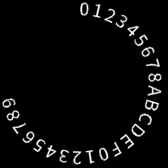

具体使用流程请参考示例“middleware/services/gui/uikit/sample/uitest/components/ui\_test\_label/ui\_test\_arc\_label.cpp”。

**表 1**  UIArcLabel核心函数

<a name="zh-cn_topic_0000002444645837__table2771mcpsimp"></a>
<table><thead align="left"><tr id="zh-cn_topic_0000002444645837_row1758mcpsimp"><th class="cellrowborder" valign="top" width="50%" id="mcps1.2.3.1.1"><p id="zh-cn_topic_0000002444645837_p1760mcpsimp"><a name="zh-cn_topic_0000002444645837_p1760mcpsimp"></a><a name="zh-cn_topic_0000002444645837_p1760mcpsimp"></a>函数</p>
</th>
<th class="cellrowborder" valign="top" width="50%" id="mcps1.2.3.1.2"><p id="zh-cn_topic_0000002444645837_p1762mcpsimp"><a name="zh-cn_topic_0000002444645837_p1762mcpsimp"></a><a name="zh-cn_topic_0000002444645837_p1762mcpsimp"></a>介绍</p>
</th>
</tr>
</thead>
<tbody><tr id="zh-cn_topic_0000002444645837_row1764mcpsimp"><td class="cellrowborder" valign="top" width="50%" headers="mcps1.2.3.1.1 "><p id="zh-cn_topic_0000002444645837_p1766mcpsimp"><a name="zh-cn_topic_0000002444645837_p1766mcpsimp"></a><a name="zh-cn_topic_0000002444645837_p1766mcpsimp"></a>void SetText(const char* text)</p>
</td>
<td class="cellrowborder" valign="top" width="50%" headers="mcps1.2.3.1.2 "><p id="zh-cn_topic_0000002444645837_p1768mcpsimp"><a name="zh-cn_topic_0000002444645837_p1768mcpsimp"></a><a name="zh-cn_topic_0000002444645837_p1768mcpsimp"></a>设置展示的文字。</p>
</td>
</tr>
<tr id="zh-cn_topic_0000002444645837_row1769mcpsimp"><td class="cellrowborder" valign="top" width="50%" headers="mcps1.2.3.1.1 "><p id="zh-cn_topic_0000002444645837_p1771mcpsimp"><a name="zh-cn_topic_0000002444645837_p1771mcpsimp"></a><a name="zh-cn_topic_0000002444645837_p1771mcpsimp"></a>void SetAlign(UITextLanguageAlignment horizontalAlign)</p>
</td>
<td class="cellrowborder" valign="top" width="50%" headers="mcps1.2.3.1.2 "><p id="zh-cn_topic_0000002444645837_p1773mcpsimp"><a name="zh-cn_topic_0000002444645837_p1773mcpsimp"></a><a name="zh-cn_topic_0000002444645837_p1773mcpsimp"></a>设置此文本的对齐模式。</p>
</td>
</tr>
<tr id="zh-cn_topic_0000002444645837_row1774mcpsimp"><td class="cellrowborder" valign="top" width="50%" headers="mcps1.2.3.1.1 "><p id="zh-cn_topic_0000002444645837_p1776mcpsimp"><a name="zh-cn_topic_0000002444645837_p1776mcpsimp"></a><a name="zh-cn_topic_0000002444645837_p1776mcpsimp"></a>UITextLanguageAlignment GetHorAlign()</p>
</td>
<td class="cellrowborder" valign="top" width="50%" headers="mcps1.2.3.1.2 "><p id="zh-cn_topic_0000002444645837_p1778mcpsimp"><a name="zh-cn_topic_0000002444645837_p1778mcpsimp"></a><a name="zh-cn_topic_0000002444645837_p1778mcpsimp"></a>获取水平对齐方式。</p>
</td>
</tr>
<tr id="zh-cn_topic_0000002444645837_row1779mcpsimp"><td class="cellrowborder" valign="top" width="50%" headers="mcps1.2.3.1.1 "><p id="zh-cn_topic_0000002444645837_p1781mcpsimp"><a name="zh-cn_topic_0000002444645837_p1781mcpsimp"></a><a name="zh-cn_topic_0000002444645837_p1781mcpsimp"></a>UITextLanguageDirect GetDirect()</p>
</td>
<td class="cellrowborder" valign="top" width="50%" headers="mcps1.2.3.1.2 "><p id="zh-cn_topic_0000002444645837_p1783mcpsimp"><a name="zh-cn_topic_0000002444645837_p1783mcpsimp"></a><a name="zh-cn_topic_0000002444645837_p1783mcpsimp"></a>获取此文本的方向。</p>
</td>
</tr>
<tr id="zh-cn_topic_0000002444645837_row1784mcpsimp"><td class="cellrowborder" valign="top" width="50%" headers="mcps1.2.3.1.1 "><p id="zh-cn_topic_0000002444645837_p1786mcpsimp"><a name="zh-cn_topic_0000002444645837_p1786mcpsimp"></a><a name="zh-cn_topic_0000002444645837_p1786mcpsimp"></a>void SetFont(const char* name, uint8_t size)</p>
</td>
<td class="cellrowborder" valign="top" width="50%" headers="mcps1.2.3.1.2 "><p id="zh-cn_topic_0000002444645837_p1788mcpsimp"><a name="zh-cn_topic_0000002444645837_p1788mcpsimp"></a><a name="zh-cn_topic_0000002444645837_p1788mcpsimp"></a>设置此圆弧标签的字体及字体大小。</p>
</td>
</tr>
<tr id="zh-cn_topic_0000002444645837_row1789mcpsimp"><td class="cellrowborder" valign="top" width="50%" headers="mcps1.2.3.1.1 "><p id="zh-cn_topic_0000002444645837_p1791mcpsimp"><a name="zh-cn_topic_0000002444645837_p1791mcpsimp"></a><a name="zh-cn_topic_0000002444645837_p1791mcpsimp"></a>void SetArcTextCenter(int16_t x, int16_t y)</p>
</td>
<td class="cellrowborder" valign="top" width="50%" headers="mcps1.2.3.1.2 "><p id="zh-cn_topic_0000002444645837_p1793mcpsimp"><a name="zh-cn_topic_0000002444645837_p1793mcpsimp"></a><a name="zh-cn_topic_0000002444645837_p1793mcpsimp"></a>设置此圆弧文本的中心位置。</p>
</td>
</tr>
<tr id="zh-cn_topic_0000002444645837_row1794mcpsimp"><td class="cellrowborder" valign="top" width="50%" headers="mcps1.2.3.1.1 "><p id="zh-cn_topic_0000002444645837_p1796mcpsimp"><a name="zh-cn_topic_0000002444645837_p1796mcpsimp"></a><a name="zh-cn_topic_0000002444645837_p1796mcpsimp"></a>void SetArcTextRadius(uint16_t radius)</p>
</td>
<td class="cellrowborder" valign="top" width="50%" headers="mcps1.2.3.1.2 "><p id="zh-cn_topic_0000002444645837_p1798mcpsimp"><a name="zh-cn_topic_0000002444645837_p1798mcpsimp"></a><a name="zh-cn_topic_0000002444645837_p1798mcpsimp"></a>设置此圆弧文本的半径。</p>
</td>
</tr>
<tr id="zh-cn_topic_0000002444645837_row1799mcpsimp"><td class="cellrowborder" valign="top" width="50%" headers="mcps1.2.3.1.1 "><p id="zh-cn_topic_0000002444645837_p1801mcpsimp"><a name="zh-cn_topic_0000002444645837_p1801mcpsimp"></a><a name="zh-cn_topic_0000002444645837_p1801mcpsimp"></a>uint16_t GetArcTextRadius() const</p>
</td>
<td class="cellrowborder" valign="top" width="50%" headers="mcps1.2.3.1.2 "><p id="zh-cn_topic_0000002444645837_p1803mcpsimp"><a name="zh-cn_topic_0000002444645837_p1803mcpsimp"></a><a name="zh-cn_topic_0000002444645837_p1803mcpsimp"></a>获取此圆弧文本的半径。</p>
</td>
</tr>
<tr id="zh-cn_topic_0000002444645837_row1804mcpsimp"><td class="cellrowborder" valign="top" width="50%" headers="mcps1.2.3.1.1 "><p id="zh-cn_topic_0000002444645837_p1806mcpsimp"><a name="zh-cn_topic_0000002444645837_p1806mcpsimp"></a><a name="zh-cn_topic_0000002444645837_p1806mcpsimp"></a>void SetArcTextAngle(int16_t startAngle, int16_t endAngle)</p>
</td>
<td class="cellrowborder" valign="top" width="50%" headers="mcps1.2.3.1.2 "><p id="zh-cn_topic_0000002444645837_p1808mcpsimp"><a name="zh-cn_topic_0000002444645837_p1808mcpsimp"></a><a name="zh-cn_topic_0000002444645837_p1808mcpsimp"></a>设置此圆弧文本的开始角度和结束角度。</p>
</td>
</tr>
<tr id="zh-cn_topic_0000002444645837_row1809mcpsimp"><td class="cellrowborder" valign="top" width="50%" headers="mcps1.2.3.1.1 "><p id="zh-cn_topic_0000002444645837_p1811mcpsimp"><a name="zh-cn_topic_0000002444645837_p1811mcpsimp"></a><a name="zh-cn_topic_0000002444645837_p1811mcpsimp"></a>int16_t GetArcTextStartAngle() const</p>
</td>
<td class="cellrowborder" valign="top" width="50%" headers="mcps1.2.3.1.2 "><p id="zh-cn_topic_0000002444645837_p1813mcpsimp"><a name="zh-cn_topic_0000002444645837_p1813mcpsimp"></a><a name="zh-cn_topic_0000002444645837_p1813mcpsimp"></a>获取此圆弧文本的起始角度。</p>
</td>
</tr>
<tr id="zh-cn_topic_0000002444645837_row1814mcpsimp"><td class="cellrowborder" valign="top" width="50%" headers="mcps1.2.3.1.1 "><p id="zh-cn_topic_0000002444645837_p1816mcpsimp"><a name="zh-cn_topic_0000002444645837_p1816mcpsimp"></a><a name="zh-cn_topic_0000002444645837_p1816mcpsimp"></a>int16_t GetArcTextEndAngle() const</p>
</td>
<td class="cellrowborder" valign="top" width="50%" headers="mcps1.2.3.1.2 "><p id="zh-cn_topic_0000002444645837_p1818mcpsimp"><a name="zh-cn_topic_0000002444645837_p1818mcpsimp"></a><a name="zh-cn_topic_0000002444645837_p1818mcpsimp"></a>获取此圆弧文本的结束角度。</p>
</td>
</tr>
<tr id="zh-cn_topic_0000002444645837_row1819mcpsimp"><td class="cellrowborder" valign="top" width="50%" headers="mcps1.2.3.1.1 "><p id="zh-cn_topic_0000002444645837_p1821mcpsimp"><a name="zh-cn_topic_0000002444645837_p1821mcpsimp"></a><a name="zh-cn_topic_0000002444645837_p1821mcpsimp"></a>void SetArcTextOrientation(TextOrientation orientation)</p>
</td>
<td class="cellrowborder" valign="top" width="50%" headers="mcps1.2.3.1.2 "><p id="zh-cn_topic_0000002444645837_p1823mcpsimp"><a name="zh-cn_topic_0000002444645837_p1823mcpsimp"></a><a name="zh-cn_topic_0000002444645837_p1823mcpsimp"></a>设置此圆弧文本的方向。</p>
<p id="zh-cn_topic_0000002444645837_p1333419587253"><a name="zh-cn_topic_0000002444645837_p1333419587253"></a><a name="zh-cn_topic_0000002444645837_p1333419587253"></a>参数orientation (INSIDE或OUTSIDE)</p>
</td>
</tr>
</tbody>
</table>

### UIBoxProgress<a name="ZH-CN_TOPIC_0000002499581937"></a>

UIBoxProgress是以条状形式表示进度的组件，例如播放视频时的进度条。继承关系为UIBoxProgress→UIAbstractProgress。父类UIAbstractProgress的常用函数如[表1](#zh-cn_topic_0000002444645921_table1828mcpsimp)所示。

**表 1**  UIAbstractProgress核心函数

<a name="zh-cn_topic_0000002444645921_table1828mcpsimp"></a>
<table><thead align="left"><tr id="zh-cn_topic_0000002444645921_row1834mcpsimp"><th class="cellrowborder" valign="top" width="50%" id="mcps1.2.3.1.1"><p id="zh-cn_topic_0000002444645921_p1836mcpsimp"><a name="zh-cn_topic_0000002444645921_p1836mcpsimp"></a><a name="zh-cn_topic_0000002444645921_p1836mcpsimp"></a>函数</p>
</th>
<th class="cellrowborder" valign="top" width="50%" id="mcps1.2.3.1.2"><p id="zh-cn_topic_0000002444645921_p1838mcpsimp"><a name="zh-cn_topic_0000002444645921_p1838mcpsimp"></a><a name="zh-cn_topic_0000002444645921_p1838mcpsimp"></a>介绍</p>
</th>
</tr>
</thead>
<tbody><tr id="zh-cn_topic_0000002444645921_row1840mcpsimp"><td class="cellrowborder" valign="top" width="50%" headers="mcps1.2.3.1.1 "><p id="zh-cn_topic_0000002444645921_p1842mcpsimp"><a name="zh-cn_topic_0000002444645921_p1842mcpsimp"></a><a name="zh-cn_topic_0000002444645921_p1842mcpsimp"></a>void EnableBackground(bool enable)</p>
</td>
<td class="cellrowborder" valign="top" width="50%" headers="mcps1.2.3.1.2 "><p id="zh-cn_topic_0000002444645921_p1844mcpsimp"><a name="zh-cn_topic_0000002444645921_p1844mcpsimp"></a><a name="zh-cn_topic_0000002444645921_p1844mcpsimp"></a>设置进度条背景是否可见。对UISlider无效。</p>
</td>
</tr>
<tr id="zh-cn_topic_0000002444645921_row1845mcpsimp"><td class="cellrowborder" valign="top" width="50%" headers="mcps1.2.3.1.1 "><p id="zh-cn_topic_0000002444645921_p1847mcpsimp"><a name="zh-cn_topic_0000002444645921_p1847mcpsimp"></a><a name="zh-cn_topic_0000002444645921_p1847mcpsimp"></a>void SetValue(int32_t value)</p>
</td>
<td class="cellrowborder" valign="top" width="50%" headers="mcps1.2.3.1.2 "><p id="zh-cn_topic_0000002444645921_p1849mcpsimp"><a name="zh-cn_topic_0000002444645921_p1849mcpsimp"></a><a name="zh-cn_topic_0000002444645921_p1849mcpsimp"></a>设置此进度条的当前值。</p>
</td>
</tr>
<tr id="zh-cn_topic_0000002444645921_row1850mcpsimp"><td class="cellrowborder" valign="top" width="50%" headers="mcps1.2.3.1.1 "><p id="zh-cn_topic_0000002444645921_p1852mcpsimp"><a name="zh-cn_topic_0000002444645921_p1852mcpsimp"></a><a name="zh-cn_topic_0000002444645921_p1852mcpsimp"></a>int32_t GetValue() const</p>
</td>
<td class="cellrowborder" valign="top" width="50%" headers="mcps1.2.3.1.2 "><p id="zh-cn_topic_0000002444645921_p1854mcpsimp"><a name="zh-cn_topic_0000002444645921_p1854mcpsimp"></a><a name="zh-cn_topic_0000002444645921_p1854mcpsimp"></a>获取此进度条的当前值。</p>
</td>
</tr>
<tr id="zh-cn_topic_0000002444645921_row1855mcpsimp"><td class="cellrowborder" valign="top" width="50%" headers="mcps1.2.3.1.1 "><p id="zh-cn_topic_0000002444645921_p1857mcpsimp"><a name="zh-cn_topic_0000002444645921_p1857mcpsimp"></a><a name="zh-cn_topic_0000002444645921_p1857mcpsimp"></a>void SetRange(int32_t rangeMax, int32_t rangeMin)</p>
</td>
<td class="cellrowborder" valign="top" width="50%" headers="mcps1.2.3.1.2 "><p id="zh-cn_topic_0000002444645921_p1859mcpsimp"><a name="zh-cn_topic_0000002444645921_p1859mcpsimp"></a><a name="zh-cn_topic_0000002444645921_p1859mcpsimp"></a>设置此进度条的范围。</p>
</td>
</tr>
<tr id="zh-cn_topic_0000002444645921_row1860mcpsimp"><td class="cellrowborder" valign="top" width="50%" headers="mcps1.2.3.1.1 "><p id="zh-cn_topic_0000002444645921_p1862mcpsimp"><a name="zh-cn_topic_0000002444645921_p1862mcpsimp"></a><a name="zh-cn_topic_0000002444645921_p1862mcpsimp"></a>int32_t GetRangeMin() const</p>
</td>
<td class="cellrowborder" valign="top" width="50%" headers="mcps1.2.3.1.2 "><p id="zh-cn_topic_0000002444645921_p1864mcpsimp"><a name="zh-cn_topic_0000002444645921_p1864mcpsimp"></a><a name="zh-cn_topic_0000002444645921_p1864mcpsimp"></a>获取进度条最小值。</p>
</td>
</tr>
<tr id="zh-cn_topic_0000002444645921_row1865mcpsimp"><td class="cellrowborder" valign="top" width="50%" headers="mcps1.2.3.1.1 "><p id="zh-cn_topic_0000002444645921_p1867mcpsimp"><a name="zh-cn_topic_0000002444645921_p1867mcpsimp"></a><a name="zh-cn_topic_0000002444645921_p1867mcpsimp"></a>int32_t GetRangeMax() const</p>
</td>
<td class="cellrowborder" valign="top" width="50%" headers="mcps1.2.3.1.2 "><p id="zh-cn_topic_0000002444645921_p1869mcpsimp"><a name="zh-cn_topic_0000002444645921_p1869mcpsimp"></a><a name="zh-cn_topic_0000002444645921_p1869mcpsimp"></a>获取进度条最大值。</p>
</td>
</tr>
<tr id="zh-cn_topic_0000002444645921_row1870mcpsimp"><td class="cellrowborder" valign="top" width="50%" headers="mcps1.2.3.1.1 "><p id="zh-cn_topic_0000002444645921_p1872mcpsimp"><a name="zh-cn_topic_0000002444645921_p1872mcpsimp"></a><a name="zh-cn_topic_0000002444645921_p1872mcpsimp"></a>void SetCapType(CapType cap)</p>
</td>
<td class="cellrowborder" valign="top" width="50%" headers="mcps1.2.3.1.2 "><p id="zh-cn_topic_0000002444645921_p1874mcpsimp"><a name="zh-cn_topic_0000002444645921_p1874mcpsimp"></a><a name="zh-cn_topic_0000002444645921_p1874mcpsimp"></a>设置端点风格。</p>
</td>
</tr>
<tr id="zh-cn_topic_0000002444645921_row1875mcpsimp"><td class="cellrowborder" valign="top" width="50%" headers="mcps1.2.3.1.1 "><p id="zh-cn_topic_0000002444645921_p1877mcpsimp"><a name="zh-cn_topic_0000002444645921_p1877mcpsimp"></a><a name="zh-cn_topic_0000002444645921_p1877mcpsimp"></a>void SetImage(const char* foregroundImage, const char* backgroundImage = nullptr)</p>
</td>
<td class="cellrowborder" valign="top" width="50%" headers="mcps1.2.3.1.2 "><p id="zh-cn_topic_0000002444645921_p1879mcpsimp"><a name="zh-cn_topic_0000002444645921_p1879mcpsimp"></a><a name="zh-cn_topic_0000002444645921_p1879mcpsimp"></a>设置此进度条的图像。</p>
</td>
</tr>
<tr id="zh-cn_topic_0000002444645921_row1880mcpsimp"><td class="cellrowborder" valign="top" width="50%" headers="mcps1.2.3.1.1 "><p id="zh-cn_topic_0000002444645921_p1882mcpsimp"><a name="zh-cn_topic_0000002444645921_p1882mcpsimp"></a><a name="zh-cn_topic_0000002444645921_p1882mcpsimp"></a>void SetImage(const ImageInfo* foregroundImage, const ImageInfo* backgroundImage = nullptr)</p>
</td>
<td class="cellrowborder" valign="top" width="50%" headers="mcps1.2.3.1.2 "><p id="zh-cn_topic_0000002444645921_p1884mcpsimp"><a name="zh-cn_topic_0000002444645921_p1884mcpsimp"></a><a name="zh-cn_topic_0000002444645921_p1884mcpsimp"></a>设置此进度条的图像。</p>
</td>
</tr>
<tr id="zh-cn_topic_0000002444645921_row1885mcpsimp"><td class="cellrowborder" valign="top" width="50%" headers="mcps1.2.3.1.1 "><p id="zh-cn_topic_0000002444645921_p1887mcpsimp"><a name="zh-cn_topic_0000002444645921_p1887mcpsimp"></a><a name="zh-cn_topic_0000002444645921_p1887mcpsimp"></a>void SetStep(uint32_t step)</p>
</td>
<td class="cellrowborder" valign="top" width="50%" headers="mcps1.2.3.1.2 "><p id="zh-cn_topic_0000002444645921_p1889mcpsimp"><a name="zh-cn_topic_0000002444645921_p1889mcpsimp"></a><a name="zh-cn_topic_0000002444645921_p1889mcpsimp"></a>设置此进度条的步长。</p>
</td>
</tr>
<tr id="zh-cn_topic_0000002444645921_row1890mcpsimp"><td class="cellrowborder" valign="top" width="50%" headers="mcps1.2.3.1.1 "><p id="zh-cn_topic_0000002444645921_p1892mcpsimp"><a name="zh-cn_topic_0000002444645921_p1892mcpsimp"></a><a name="zh-cn_topic_0000002444645921_p1892mcpsimp"></a>uint32_t GetStep() const</p>
</td>
<td class="cellrowborder" valign="top" width="50%" headers="mcps1.2.3.1.2 "><p id="zh-cn_topic_0000002444645921_p1894mcpsimp"><a name="zh-cn_topic_0000002444645921_p1894mcpsimp"></a><a name="zh-cn_topic_0000002444645921_p1894mcpsimp"></a>获取此进度条的步长。</p>
</td>
</tr>
</tbody>
</table>

UIBoxProgress常用函数如[表2](#zh-cn_topic_0000002444645921__table2929mcpsimp)所示，具体使用流程请参考示例“middleware/services/gui/uikit/sample/uitest/components/ui\_test\_progress\_bar/ui\_test\_box\_progress.cpp”。

**表 2**  UIBoxProgress核心函数

<a name="zh-cn_topic_0000002444645921__table2929mcpsimp"></a>
<table><thead align="left"><tr id="zh-cn_topic_0000002444645921_row1902mcpsimp"><th class="cellrowborder" valign="top" width="50%" id="mcps1.2.3.1.1"><p id="zh-cn_topic_0000002444645921_p1904mcpsimp"><a name="zh-cn_topic_0000002444645921_p1904mcpsimp"></a><a name="zh-cn_topic_0000002444645921_p1904mcpsimp"></a>函数</p>
</th>
<th class="cellrowborder" valign="top" width="50%" id="mcps1.2.3.1.2"><p id="zh-cn_topic_0000002444645921_p1906mcpsimp"><a name="zh-cn_topic_0000002444645921_p1906mcpsimp"></a><a name="zh-cn_topic_0000002444645921_p1906mcpsimp"></a>介绍</p>
</th>
</tr>
</thead>
<tbody><tr id="zh-cn_topic_0000002444645921_row1908mcpsimp"><td class="cellrowborder" valign="top" width="50%" headers="mcps1.2.3.1.1 "><p id="zh-cn_topic_0000002444645921_p1910mcpsimp"><a name="zh-cn_topic_0000002444645921_p1910mcpsimp"></a><a name="zh-cn_topic_0000002444645921_p1910mcpsimp"></a>void SetDirection(const Direction& direction)</p>
</td>
<td class="cellrowborder" valign="top" width="50%" headers="mcps1.2.3.1.2 "><p id="zh-cn_topic_0000002444645921_p1912mcpsimp"><a name="zh-cn_topic_0000002444645921_p1912mcpsimp"></a><a name="zh-cn_topic_0000002444645921_p1912mcpsimp"></a>设置此进度条的方向。</p>
</td>
</tr>
<tr id="zh-cn_topic_0000002444645921_row1913mcpsimp"><td class="cellrowborder" valign="top" width="50%" headers="mcps1.2.3.1.1 "><p id="zh-cn_topic_0000002444645921_p1915mcpsimp"><a name="zh-cn_topic_0000002444645921_p1915mcpsimp"></a><a name="zh-cn_topic_0000002444645921_p1915mcpsimp"></a>void SetValidWidth(int16_t width)</p>
</td>
<td class="cellrowborder" valign="top" width="50%" headers="mcps1.2.3.1.2 "><p id="zh-cn_topic_0000002444645921_p1917mcpsimp"><a name="zh-cn_topic_0000002444645921_p1917mcpsimp"></a><a name="zh-cn_topic_0000002444645921_p1917mcpsimp"></a>设置实际进度条宽度。</p>
</td>
</tr>
<tr id="zh-cn_topic_0000002444645921_row1918mcpsimp"><td class="cellrowborder" valign="top" width="50%" headers="mcps1.2.3.1.1 "><p id="zh-cn_topic_0000002444645921_p1920mcpsimp"><a name="zh-cn_topic_0000002444645921_p1920mcpsimp"></a><a name="zh-cn_topic_0000002444645921_p1920mcpsimp"></a>void SetValidHeight(int16_t height)</p>
</td>
<td class="cellrowborder" valign="top" width="50%" headers="mcps1.2.3.1.2 "><p id="zh-cn_topic_0000002444645921_p1922mcpsimp"><a name="zh-cn_topic_0000002444645921_p1922mcpsimp"></a><a name="zh-cn_topic_0000002444645921_p1922mcpsimp"></a>设置实际进度条高度。</p>
</td>
</tr>
<tr id="zh-cn_topic_0000002444645921_row1923mcpsimp"><td class="cellrowborder" valign="top" width="50%" headers="mcps1.2.3.1.1 "><p id="zh-cn_topic_0000002444645921_p1925mcpsimp"><a name="zh-cn_topic_0000002444645921_p1925mcpsimp"></a><a name="zh-cn_topic_0000002444645921_p1925mcpsimp"></a>int16_t GetValidWidth() const</p>
</td>
<td class="cellrowborder" valign="top" width="50%" headers="mcps1.2.3.1.2 "><p id="zh-cn_topic_0000002444645921_p1927mcpsimp"><a name="zh-cn_topic_0000002444645921_p1927mcpsimp"></a><a name="zh-cn_topic_0000002444645921_p1927mcpsimp"></a>获取实际进度条宽度。</p>
</td>
</tr>
<tr id="zh-cn_topic_0000002444645921_row1928mcpsimp"><td class="cellrowborder" valign="top" width="50%" headers="mcps1.2.3.1.1 "><p id="zh-cn_topic_0000002444645921_p1930mcpsimp"><a name="zh-cn_topic_0000002444645921_p1930mcpsimp"></a><a name="zh-cn_topic_0000002444645921_p1930mcpsimp"></a>int16_t GetValidHeight() const</p>
</td>
<td class="cellrowborder" valign="top" width="50%" headers="mcps1.2.3.1.2 "><p id="zh-cn_topic_0000002444645921_p1932mcpsimp"><a name="zh-cn_topic_0000002444645921_p1932mcpsimp"></a><a name="zh-cn_topic_0000002444645921_p1932mcpsimp"></a>获取实际进度条高度。</p>
</td>
</tr>
</tbody>
</table>

### UICircleProgress<a name="ZH-CN_TOPIC_0000002499581997"></a>

UICircleProgress组件是以圆形来展示进度的组件。该组件继承关系为UICircleProgress→UIAbstractProgress，常用函数如[表1](#zh-cn_topic_0000002444726057__table1112mcpsimp)所示。具体使用流程请参考示例“middleware/services/gui/uikit/sample/uitest/components/ui\_test\_progress\_bar/ui\_test\_circle\_progress.cpp”。

**表 1**  UICircleProgress核心函数

<a name="zh-cn_topic_0000002444726057__table1112mcpsimp"></a>
<table><thead align="left"><tr id="zh-cn_topic_0000002444726057_row1941mcpsimp"><th class="cellrowborder" valign="top" width="50%" id="mcps1.2.3.1.1"><p id="zh-cn_topic_0000002444726057_p1943mcpsimp"><a name="zh-cn_topic_0000002444726057_p1943mcpsimp"></a><a name="zh-cn_topic_0000002444726057_p1943mcpsimp"></a>函数</p>
</th>
<th class="cellrowborder" valign="top" width="50%" id="mcps1.2.3.1.2"><p id="zh-cn_topic_0000002444726057_p1945mcpsimp"><a name="zh-cn_topic_0000002444726057_p1945mcpsimp"></a><a name="zh-cn_topic_0000002444726057_p1945mcpsimp"></a>介绍</p>
</th>
</tr>
</thead>
<tbody><tr id="zh-cn_topic_0000002444726057_row1947mcpsimp"><td class="cellrowborder" valign="top" width="50%" headers="mcps1.2.3.1.1 "><p id="zh-cn_topic_0000002444726057_p1949mcpsimp"><a name="zh-cn_topic_0000002444726057_p1949mcpsimp"></a><a name="zh-cn_topic_0000002444726057_p1949mcpsimp"></a>void SetCenterPosition(int16_t x, int16_t y)</p>
</td>
<td class="cellrowborder" valign="top" width="50%" headers="mcps1.2.3.1.2 "><p id="zh-cn_topic_0000002444726057_p1951mcpsimp"><a name="zh-cn_topic_0000002444726057_p1951mcpsimp"></a><a name="zh-cn_topic_0000002444726057_p1951mcpsimp"></a>设置此圆形进度条的中心点坐标。</p>
</td>
</tr>
<tr id="zh-cn_topic_0000002444726057_row1952mcpsimp"><td class="cellrowborder" valign="top" width="50%" headers="mcps1.2.3.1.1 "><p id="zh-cn_topic_0000002444726057_p1954mcpsimp"><a name="zh-cn_topic_0000002444726057_p1954mcpsimp"></a><a name="zh-cn_topic_0000002444726057_p1954mcpsimp"></a>void SetRadius(uint16_t radius)</p>
</td>
<td class="cellrowborder" valign="top" width="50%" headers="mcps1.2.3.1.2 "><p id="zh-cn_topic_0000002444726057_p1956mcpsimp"><a name="zh-cn_topic_0000002444726057_p1956mcpsimp"></a><a name="zh-cn_topic_0000002444726057_p1956mcpsimp"></a>设置此圆形进度条的外半径。</p>
</td>
</tr>
<tr id="zh-cn_topic_0000002444726057_row1957mcpsimp"><td class="cellrowborder" valign="top" width="50%" headers="mcps1.2.3.1.1 "><p id="zh-cn_topic_0000002444726057_p1959mcpsimp"><a name="zh-cn_topic_0000002444726057_p1959mcpsimp"></a><a name="zh-cn_topic_0000002444726057_p1959mcpsimp"></a>void SetStartAngle(int16_t startAngle)</p>
</td>
<td class="cellrowborder" valign="top" width="50%" headers="mcps1.2.3.1.2 "><p id="zh-cn_topic_0000002444726057_p1961mcpsimp"><a name="zh-cn_topic_0000002444726057_p1961mcpsimp"></a><a name="zh-cn_topic_0000002444726057_p1961mcpsimp"></a>设置开始角度（进度条初始值）。</p>
</td>
</tr>
<tr id="zh-cn_topic_0000002444726057_row1962mcpsimp"><td class="cellrowborder" valign="top" width="50%" headers="mcps1.2.3.1.1 "><p id="zh-cn_topic_0000002444726057_p1964mcpsimp"><a name="zh-cn_topic_0000002444726057_p1964mcpsimp"></a><a name="zh-cn_topic_0000002444726057_p1964mcpsimp"></a>void SetEndAngle(int16_t endAngle)</p>
</td>
<td class="cellrowborder" valign="top" width="50%" headers="mcps1.2.3.1.2 "><p id="zh-cn_topic_0000002444726057_p1966mcpsimp"><a name="zh-cn_topic_0000002444726057_p1966mcpsimp"></a><a name="zh-cn_topic_0000002444726057_p1966mcpsimp"></a>设置结束角度（进度条100%时加载位置）。</p>
</td>
</tr>
<tr id="zh-cn_topic_0000002444726057_row1967mcpsimp"><td class="cellrowborder" valign="top" width="50%" headers="mcps1.2.3.1.1 "><p id="zh-cn_topic_0000002444726057_p1969mcpsimp"><a name="zh-cn_topic_0000002444726057_p1969mcpsimp"></a><a name="zh-cn_topic_0000002444726057_p1969mcpsimp"></a>void SetCenterPosition(int16_t x, int16_t y)</p>
</td>
<td class="cellrowborder" valign="top" width="50%" headers="mcps1.2.3.1.2 "><p id="zh-cn_topic_0000002444726057_p1971mcpsimp"><a name="zh-cn_topic_0000002444726057_p1971mcpsimp"></a><a name="zh-cn_topic_0000002444726057_p1971mcpsimp"></a>设置进度条相对于控件的中心点位置。</p>
</td>
</tr>
<tr id="zh-cn_topic_0000002444726057_row1972mcpsimp"><td class="cellrowborder" valign="top" width="50%" headers="mcps1.2.3.1.1 "><p id="zh-cn_topic_0000002444726057_p1974mcpsimp"><a name="zh-cn_topic_0000002444726057_p1974mcpsimp"></a><a name="zh-cn_topic_0000002444726057_p1974mcpsimp"></a>Point GetCenterPosition() const</p>
</td>
<td class="cellrowborder" valign="top" width="50%" headers="mcps1.2.3.1.2 "><p id="zh-cn_topic_0000002444726057_p1976mcpsimp"><a name="zh-cn_topic_0000002444726057_p1976mcpsimp"></a><a name="zh-cn_topic_0000002444726057_p1976mcpsimp"></a>获取进度条相对于控件的中心点位置。</p>
</td>
</tr>
<tr id="zh-cn_topic_0000002444726057_row1977mcpsimp"><td class="cellrowborder" valign="top" width="50%" headers="mcps1.2.3.1.1 "><p id="zh-cn_topic_0000002444726057_p1979mcpsimp"><a name="zh-cn_topic_0000002444726057_p1979mcpsimp"></a><a name="zh-cn_topic_0000002444726057_p1979mcpsimp"></a>void SetProgressImagePosition(int16_t x, int16_t y)</p>
</td>
<td class="cellrowborder" valign="top" width="50%" headers="mcps1.2.3.1.2 "><p id="zh-cn_topic_0000002444726057_p1981mcpsimp"><a name="zh-cn_topic_0000002444726057_p1981mcpsimp"></a><a name="zh-cn_topic_0000002444726057_p1981mcpsimp"></a>设置此进度条的前景图像相对于视图的坐标。</p>
</td>
</tr>
<tr id="zh-cn_topic_0000002444726057_row1982mcpsimp"><td class="cellrowborder" valign="top" width="50%" headers="mcps1.2.3.1.1 "><p id="zh-cn_topic_0000002444726057_p1984mcpsimp"><a name="zh-cn_topic_0000002444726057_p1984mcpsimp"></a><a name="zh-cn_topic_0000002444726057_p1984mcpsimp"></a>void SetBackgroundImagePosition(int16_t x, int16_t y)</p>
</td>
<td class="cellrowborder" valign="top" width="50%" headers="mcps1.2.3.1.2 "><p id="zh-cn_topic_0000002444726057_p1986mcpsimp"><a name="zh-cn_topic_0000002444726057_p1986mcpsimp"></a><a name="zh-cn_topic_0000002444726057_p1986mcpsimp"></a>设置此进度条的背景图像相对于视图的坐标。</p>
</td>
</tr>
<tr id="zh-cn_topic_0000002444726057_row1987mcpsimp"><td class="cellrowborder" valign="top" width="50%" headers="mcps1.2.3.1.1 "><p id="zh-cn_topic_0000002444726057_p1989mcpsimp"><a name="zh-cn_topic_0000002444726057_p1989mcpsimp"></a><a name="zh-cn_topic_0000002444726057_p1989mcpsimp"></a>void SetLineColor(ColorType color)</p>
</td>
<td class="cellrowborder" valign="top" width="50%" headers="mcps1.2.3.1.2 "><p id="zh-cn_topic_0000002444726057_p1991mcpsimp"><a name="zh-cn_topic_0000002444726057_p1991mcpsimp"></a><a name="zh-cn_topic_0000002444726057_p1991mcpsimp"></a>设置此进度条的前景色。</p>
</td>
</tr>
</tbody>
</table>

### UISlider<a name="ZH-CN_TOPIC_0000002466383160"></a>

UISlider继承于UIBoxProgress，也是以进度条的方式展示进度，常用于音量条。相较于UIBoxProgress，该组件额外支持拖动以及点击事件。具体使用流程请参考示例“middleware/services/gui/uikit/sample/uitest/components/ui\_test\_slider/ui\_test\_slider.cpp”。

**图 1**  UISlider效果<a name="zh-cn_topic_0000002411046892_fig1994mcpsimp"></a>  
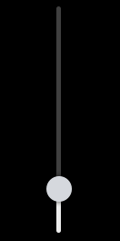

**表 1**  UISlider核心函数

<a name="zh-cn_topic_0000002411046892__table134mcpsimp"></a>
<table><thead align="left"><tr id="zh-cn_topic_0000002411046892_row2001mcpsimp"><th class="cellrowborder" valign="top" width="50%" id="mcps1.2.3.1.1"><p id="zh-cn_topic_0000002411046892_p2003mcpsimp"><a name="zh-cn_topic_0000002411046892_p2003mcpsimp"></a><a name="zh-cn_topic_0000002411046892_p2003mcpsimp"></a>函数</p>
</th>
<th class="cellrowborder" valign="top" width="50%" id="mcps1.2.3.1.2"><p id="zh-cn_topic_0000002411046892_p2005mcpsimp"><a name="zh-cn_topic_0000002411046892_p2005mcpsimp"></a><a name="zh-cn_topic_0000002411046892_p2005mcpsimp"></a>介绍</p>
</th>
</tr>
</thead>
<tbody><tr id="zh-cn_topic_0000002411046892_row2007mcpsimp"><td class="cellrowborder" valign="top" width="50%" headers="mcps1.2.3.1.1 "><p id="zh-cn_topic_0000002411046892_p2009mcpsimp"><a name="zh-cn_topic_0000002411046892_p2009mcpsimp"></a><a name="zh-cn_topic_0000002411046892_p2009mcpsimp"></a>void SetKnobWidth(int16_t width)</p>
</td>
<td class="cellrowborder" valign="top" width="50%" headers="mcps1.2.3.1.2 "><p id="zh-cn_topic_0000002411046892_p2011mcpsimp"><a name="zh-cn_topic_0000002411046892_p2011mcpsimp"></a><a name="zh-cn_topic_0000002411046892_p2011mcpsimp"></a>设置此旋钮的宽度。</p>
</td>
</tr>
<tr id="zh-cn_topic_0000002411046892_row2012mcpsimp"><td class="cellrowborder" valign="top" width="50%" headers="mcps1.2.3.1.1 "><p id="zh-cn_topic_0000002411046892_p2014mcpsimp"><a name="zh-cn_topic_0000002411046892_p2014mcpsimp"></a><a name="zh-cn_topic_0000002411046892_p2014mcpsimp"></a>int16_t GetKnobWidth()</p>
</td>
<td class="cellrowborder" valign="top" width="50%" headers="mcps1.2.3.1.2 "><p id="zh-cn_topic_0000002411046892_p2016mcpsimp"><a name="zh-cn_topic_0000002411046892_p2016mcpsimp"></a><a name="zh-cn_topic_0000002411046892_p2016mcpsimp"></a>获取此旋钮的宽度。</p>
</td>
</tr>
<tr id="zh-cn_topic_0000002411046892_row2017mcpsimp"><td class="cellrowborder" valign="top" width="50%" headers="mcps1.2.3.1.1 "><p id="zh-cn_topic_0000002411046892_p2019mcpsimp"><a name="zh-cn_topic_0000002411046892_p2019mcpsimp"></a><a name="zh-cn_topic_0000002411046892_p2019mcpsimp"></a>void SetImage(const ImageInfo* backgroundImage, const ImageInfo* foregroundImage)</p>
</td>
<td class="cellrowborder" valign="top" width="50%" headers="mcps1.2.3.1.2 "><p id="zh-cn_topic_0000002411046892_p2021mcpsimp"><a name="zh-cn_topic_0000002411046892_p2021mcpsimp"></a><a name="zh-cn_topic_0000002411046892_p2021mcpsimp"></a>将图像设置为此滑块的像素贴图，包括背景、前景。</p>
</td>
</tr>
<tr id="zh-cn_topic_0000002411046892_row2022mcpsimp"><td class="cellrowborder" valign="top" width="50%" headers="mcps1.2.3.1.1 "><p id="zh-cn_topic_0000002411046892_p2024mcpsimp"><a name="zh-cn_topic_0000002411046892_p2024mcpsimp"></a><a name="zh-cn_topic_0000002411046892_p2024mcpsimp"></a>void SetImage(const char* backgroundImage, const char* foregroundImage)</p>
</td>
<td class="cellrowborder" valign="top" width="50%" headers="mcps1.2.3.1.2 "><p id="zh-cn_topic_0000002411046892_p2026mcpsimp"><a name="zh-cn_topic_0000002411046892_p2026mcpsimp"></a><a name="zh-cn_topic_0000002411046892_p2026mcpsimp"></a>设置此滑块的图像，包括背景、前景。</p>
</td>
</tr>
<tr id="zh-cn_topic_0000002411046892_row2027mcpsimp"><td class="cellrowborder" valign="top" width="50%" headers="mcps1.2.3.1.1 "><p id="zh-cn_topic_0000002411046892_p2029mcpsimp"><a name="zh-cn_topic_0000002411046892_p2029mcpsimp"></a><a name="zh-cn_topic_0000002411046892_p2029mcpsimp"></a>void SetSliderColor(const ColorType backgroundColor, const ColorType foregroundColor)</p>
</td>
<td class="cellrowborder" valign="top" width="50%" headers="mcps1.2.3.1.2 "><p id="zh-cn_topic_0000002411046892_p2031mcpsimp"><a name="zh-cn_topic_0000002411046892_p2031mcpsimp"></a><a name="zh-cn_topic_0000002411046892_p2031mcpsimp"></a>设置此滑块的颜色，包括背景、前景。</p>
</td>
</tr>
<tr id="zh-cn_topic_0000002411046892_row2032mcpsimp"><td class="cellrowborder" valign="top" width="50%" headers="mcps1.2.3.1.1 "><p id="zh-cn_topic_0000002411046892_p2034mcpsimp"><a name="zh-cn_topic_0000002411046892_p2034mcpsimp"></a><a name="zh-cn_topic_0000002411046892_p2034mcpsimp"></a>void SetSliderRadius(int16_t backgroundRadius, int16_t foregroundRadius)</p>
</td>
<td class="cellrowborder" valign="top" width="50%" headers="mcps1.2.3.1.2 "><p id="zh-cn_topic_0000002411046892_p2036mcpsimp"><a name="zh-cn_topic_0000002411046892_p2036mcpsimp"></a><a name="zh-cn_topic_0000002411046892_p2036mcpsimp"></a>设置此滑块的半径，包括背景、前景。</p>
</td>
</tr>
<tr id="zh-cn_topic_0000002411046892_row2037mcpsimp"><td class="cellrowborder" valign="top" width="50%" headers="mcps1.2.3.1.1 "><p id="zh-cn_topic_0000002411046892_p2039mcpsimp"><a name="zh-cn_topic_0000002411046892_p2039mcpsimp"></a><a name="zh-cn_topic_0000002411046892_p2039mcpsimp"></a>void SetKnobImage(const ImageInfo* knobImage)</p>
</td>
<td class="cellrowborder" valign="top" width="50%" headers="mcps1.2.3.1.2 "><p id="zh-cn_topic_0000002411046892_p2041mcpsimp"><a name="zh-cn_topic_0000002411046892_p2041mcpsimp"></a><a name="zh-cn_topic_0000002411046892_p2041mcpsimp"></a>设置旋钮图片。</p>
</td>
</tr>
<tr id="zh-cn_topic_0000002411046892_row2042mcpsimp"><td class="cellrowborder" valign="top" width="50%" headers="mcps1.2.3.1.1 "><p id="zh-cn_topic_0000002411046892_p2044mcpsimp"><a name="zh-cn_topic_0000002411046892_p2044mcpsimp"></a><a name="zh-cn_topic_0000002411046892_p2044mcpsimp"></a>void SetKnobImage(const char* knobImage)</p>
</td>
<td class="cellrowborder" valign="top" width="50%" headers="mcps1.2.3.1.2 "><p id="zh-cn_topic_0000002411046892_p2046mcpsimp"><a name="zh-cn_topic_0000002411046892_p2046mcpsimp"></a><a name="zh-cn_topic_0000002411046892_p2046mcpsimp"></a>设置旋钮图片。</p>
</td>
</tr>
<tr id="zh-cn_topic_0000002411046892_row2047mcpsimp"><td class="cellrowborder" valign="top" width="50%" headers="mcps1.2.3.1.1 "><p id="zh-cn_topic_0000002411046892_p2049mcpsimp"><a name="zh-cn_topic_0000002411046892_p2049mcpsimp"></a><a name="zh-cn_topic_0000002411046892_p2049mcpsimp"></a>void SetKnobColor(const ColorType knobColor)</p>
</td>
<td class="cellrowborder" valign="top" width="50%" headers="mcps1.2.3.1.2 "><p id="zh-cn_topic_0000002411046892_p2051mcpsimp"><a name="zh-cn_topic_0000002411046892_p2051mcpsimp"></a><a name="zh-cn_topic_0000002411046892_p2051mcpsimp"></a>设置旋钮颜色。</p>
</td>
</tr>
<tr id="zh-cn_topic_0000002411046892_row2052mcpsimp"><td class="cellrowborder" valign="top" width="50%" headers="mcps1.2.3.1.1 "><p id="zh-cn_topic_0000002411046892_p2054mcpsimp"><a name="zh-cn_topic_0000002411046892_p2054mcpsimp"></a><a name="zh-cn_topic_0000002411046892_p2054mcpsimp"></a>void SetKnobRadius(int16_t knobRadius)</p>
</td>
<td class="cellrowborder" valign="top" width="50%" headers="mcps1.2.3.1.2 "><p id="zh-cn_topic_0000002411046892_p2056mcpsimp"><a name="zh-cn_topic_0000002411046892_p2056mcpsimp"></a><a name="zh-cn_topic_0000002411046892_p2056mcpsimp"></a>设置旋钮半径。</p>
</td>
</tr>
<tr id="zh-cn_topic_0000002411046892_row2057mcpsimp"><td class="cellrowborder" valign="top" width="50%" headers="mcps1.2.3.1.1 "><p id="zh-cn_topic_0000002411046892_p2059mcpsimp"><a name="zh-cn_topic_0000002411046892_p2059mcpsimp"></a><a name="zh-cn_topic_0000002411046892_p2059mcpsimp"></a>void SetKnobStyle(const Style& style)</p>
</td>
<td class="cellrowborder" valign="top" width="50%" headers="mcps1.2.3.1.2 "><p id="zh-cn_topic_0000002411046892_p2061mcpsimp"><a name="zh-cn_topic_0000002411046892_p2061mcpsimp"></a><a name="zh-cn_topic_0000002411046892_p2061mcpsimp"></a>设置旋钮样式。</p>
</td>
</tr>
<tr id="zh-cn_topic_0000002411046892_row2062mcpsimp"><td class="cellrowborder" valign="top" width="50%" headers="mcps1.2.3.1.1 "><p id="zh-cn_topic_0000002411046892_p2064mcpsimp"><a name="zh-cn_topic_0000002411046892_p2064mcpsimp"></a><a name="zh-cn_topic_0000002411046892_p2064mcpsimp"></a>void SetKnobStyle(uint8_t key, int64_t value)</p>
</td>
<td class="cellrowborder" valign="top" width="50%" headers="mcps1.2.3.1.2 "><p id="zh-cn_topic_0000002411046892_p2066mcpsimp"><a name="zh-cn_topic_0000002411046892_p2066mcpsimp"></a><a name="zh-cn_topic_0000002411046892_p2066mcpsimp"></a>设置旋钮样式。</p>
</td>
</tr>
<tr id="zh-cn_topic_0000002411046892_row2067mcpsimp"><td class="cellrowborder" valign="top" width="50%" headers="mcps1.2.3.1.1 "><p id="zh-cn_topic_0000002411046892_p2069mcpsimp"><a name="zh-cn_topic_0000002411046892_p2069mcpsimp"></a><a name="zh-cn_topic_0000002411046892_p2069mcpsimp"></a>int64_t GetKnobStyle(uint8_t key) const</p>
</td>
<td class="cellrowborder" valign="top" width="50%" headers="mcps1.2.3.1.2 "><p id="zh-cn_topic_0000002411046892_p2071mcpsimp"><a name="zh-cn_topic_0000002411046892_p2071mcpsimp"></a><a name="zh-cn_topic_0000002411046892_p2071mcpsimp"></a>获取旋钮样式。</p>
</td>
</tr>
<tr id="zh-cn_topic_0000002411046892_row2072mcpsimp"><td class="cellrowborder" valign="top" width="50%" headers="mcps1.2.3.1.1 "><p id="zh-cn_topic_0000002411046892_p2074mcpsimp"><a name="zh-cn_topic_0000002411046892_p2074mcpsimp"></a><a name="zh-cn_topic_0000002411046892_p2074mcpsimp"></a>void SetSliderEventListener(UISliderEventListener* listener)</p>
</td>
<td class="cellrowborder" valign="top" width="50%" headers="mcps1.2.3.1.2 "><p id="zh-cn_topic_0000002411046892_p2076mcpsimp"><a name="zh-cn_topic_0000002411046892_p2076mcpsimp"></a><a name="zh-cn_topic_0000002411046892_p2076mcpsimp"></a>为该组件设置监听器，使用参考sample。</p>
</td>
</tr>
</tbody>
</table>

### UITextureMapper<a name="ZH-CN_TOPIC_0000002466542616"></a>

UITextureMapper继承于UIImageView，主要用于做动画效果：缩放和旋转，常用函数如[表1](#zh-cn_topic_0000002444725997_table2079mcpsimp)所示。具体使用流程请参考示例“middleware/services/gui/uikit/sample/uitest/components/ui\_test\_texture\_mapper/ui\_test\_texture\_mapper.cpp”。

**表 1**  UITextureMappre核心函数

<a name="zh-cn_topic_0000002444725997_table2079mcpsimp"></a>
<table><thead align="left"><tr id="zh-cn_topic_0000002444725997_row2085mcpsimp"><th class="cellrowborder" valign="top" width="50%" id="mcps1.2.3.1.1"><p id="zh-cn_topic_0000002444725997_p2087mcpsimp"><a name="zh-cn_topic_0000002444725997_p2087mcpsimp"></a><a name="zh-cn_topic_0000002444725997_p2087mcpsimp"></a>函数</p>
</th>
<th class="cellrowborder" valign="top" width="50%" id="mcps1.2.3.1.2"><p id="zh-cn_topic_0000002444725997_p2089mcpsimp"><a name="zh-cn_topic_0000002444725997_p2089mcpsimp"></a><a name="zh-cn_topic_0000002444725997_p2089mcpsimp"></a>介绍</p>
</th>
</tr>
</thead>
<tbody><tr id="zh-cn_topic_0000002444725997_row2091mcpsimp"><td class="cellrowborder" valign="top" width="50%" headers="mcps1.2.3.1.1 "><p id="zh-cn_topic_0000002444725997_p2093mcpsimp"><a name="zh-cn_topic_0000002444725997_p2093mcpsimp"></a><a name="zh-cn_topic_0000002444725997_p2093mcpsimp"></a>void Start()</p>
</td>
<td class="cellrowborder" valign="top" width="50%" headers="mcps1.2.3.1.2 "><p id="zh-cn_topic_0000002444725997_p2095mcpsimp"><a name="zh-cn_topic_0000002444725997_p2095mcpsimp"></a><a name="zh-cn_topic_0000002444725997_p2095mcpsimp"></a>启动动画。</p>
</td>
</tr>
<tr id="zh-cn_topic_0000002444725997_row2096mcpsimp"><td class="cellrowborder" valign="top" width="50%" headers="mcps1.2.3.1.1 "><p id="zh-cn_topic_0000002444725997_p2098mcpsimp"><a name="zh-cn_topic_0000002444725997_p2098mcpsimp"></a><a name="zh-cn_topic_0000002444725997_p2098mcpsimp"></a>void SetRotateStart(int16_t start)</p>
</td>
<td class="cellrowborder" valign="top" width="50%" headers="mcps1.2.3.1.2 "><p id="zh-cn_topic_0000002444725997_p2100mcpsimp"><a name="zh-cn_topic_0000002444725997_p2100mcpsimp"></a><a name="zh-cn_topic_0000002444725997_p2100mcpsimp"></a>设置此图像的起始旋转角度。</p>
</td>
</tr>
<tr id="zh-cn_topic_0000002444725997_row2101mcpsimp"><td class="cellrowborder" valign="top" width="50%" headers="mcps1.2.3.1.1 "><p id="zh-cn_topic_0000002444725997_p2103mcpsimp"><a name="zh-cn_topic_0000002444725997_p2103mcpsimp"></a><a name="zh-cn_topic_0000002444725997_p2103mcpsimp"></a>void SetRotateEnd(int16_t end)</p>
</td>
<td class="cellrowborder" valign="top" width="50%" headers="mcps1.2.3.1.2 "><p id="zh-cn_topic_0000002444725997_p2105mcpsimp"><a name="zh-cn_topic_0000002444725997_p2105mcpsimp"></a><a name="zh-cn_topic_0000002444725997_p2105mcpsimp"></a>设置此图像的旋转结束角。</p>
</td>
</tr>
<tr id="zh-cn_topic_0000002444725997_row2106mcpsimp"><td class="cellrowborder" valign="top" width="50%" headers="mcps1.2.3.1.1 "><p id="zh-cn_topic_0000002444725997_p2108mcpsimp"><a name="zh-cn_topic_0000002444725997_p2108mcpsimp"></a><a name="zh-cn_topic_0000002444725997_p2108mcpsimp"></a>void SetScaleStart(float start)</p>
</td>
<td class="cellrowborder" valign="top" width="50%" headers="mcps1.2.3.1.2 "><p id="zh-cn_topic_0000002444725997_p2110mcpsimp"><a name="zh-cn_topic_0000002444725997_p2110mcpsimp"></a><a name="zh-cn_topic_0000002444725997_p2110mcpsimp"></a>设置缩放此图像的起始比率。</p>
</td>
</tr>
<tr id="zh-cn_topic_0000002444725997_row2111mcpsimp"><td class="cellrowborder" valign="top" width="50%" headers="mcps1.2.3.1.1 "><p id="zh-cn_topic_0000002444725997_p2113mcpsimp"><a name="zh-cn_topic_0000002444725997_p2113mcpsimp"></a><a name="zh-cn_topic_0000002444725997_p2113mcpsimp"></a>void SetScaleEnd(float end)</p>
</td>
<td class="cellrowborder" valign="top" width="50%" headers="mcps1.2.3.1.2 "><p id="zh-cn_topic_0000002444725997_p2115mcpsimp"><a name="zh-cn_topic_0000002444725997_p2115mcpsimp"></a><a name="zh-cn_topic_0000002444725997_p2115mcpsimp"></a>设置缩放此图像的结束比率。</p>
</td>
</tr>
<tr id="zh-cn_topic_0000002444725997_row2116mcpsimp"><td class="cellrowborder" valign="top" width="50%" headers="mcps1.2.3.1.1 "><p id="zh-cn_topic_0000002444725997_p2118mcpsimp"><a name="zh-cn_topic_0000002444725997_p2118mcpsimp"></a><a name="zh-cn_topic_0000002444725997_p2118mcpsimp"></a>void SetDurationTime(uint16_t durationTime)</p>
</td>
<td class="cellrowborder" valign="top" width="50%" headers="mcps1.2.3.1.2 "><p id="zh-cn_topic_0000002444725997_p2120mcpsimp"><a name="zh-cn_topic_0000002444725997_p2120mcpsimp"></a><a name="zh-cn_topic_0000002444725997_p2120mcpsimp"></a>设置此动画器的持续时间，以毫秒为单位。</p>
</td>
</tr>
<tr id="zh-cn_topic_0000002444725997_row2121mcpsimp"><td class="cellrowborder" valign="top" width="50%" headers="mcps1.2.3.1.1 "><p id="zh-cn_topic_0000002444725997_p2123mcpsimp"><a name="zh-cn_topic_0000002444725997_p2123mcpsimp"></a><a name="zh-cn_topic_0000002444725997_p2123mcpsimp"></a>void SetDelayTime(uint16_t delayTime)</p>
</td>
<td class="cellrowborder" valign="top" width="50%" headers="mcps1.2.3.1.2 "><p id="zh-cn_topic_0000002444725997_p2125mcpsimp"><a name="zh-cn_topic_0000002444725997_p2125mcpsimp"></a><a name="zh-cn_topic_0000002444725997_p2125mcpsimp"></a>设置此动画器的延迟时间，以毫秒为单位。</p>
</td>
</tr>
<tr id="zh-cn_topic_0000002444725997_row2126mcpsimp"><td class="cellrowborder" valign="top" width="50%" headers="mcps1.2.3.1.1 "><p id="zh-cn_topic_0000002444725997_p2128mcpsimp"><a name="zh-cn_topic_0000002444725997_p2128mcpsimp"></a><a name="zh-cn_topic_0000002444725997_p2128mcpsimp"></a>void SetEasingFunc(EasingFunc easingFunc)</p>
</td>
<td class="cellrowborder" valign="top" width="50%" headers="mcps1.2.3.1.2 "><p id="zh-cn_topic_0000002444725997_p2130mcpsimp"><a name="zh-cn_topic_0000002444725997_p2130mcpsimp"></a><a name="zh-cn_topic_0000002444725997_p2130mcpsimp"></a>设置此动画器的函数。</p>
</td>
</tr>
<tr id="zh-cn_topic_0000002444725997_row2131mcpsimp"><td class="cellrowborder" valign="top" width="50%" headers="mcps1.2.3.1.1 "><p id="zh-cn_topic_0000002444725997_p2133mcpsimp"><a name="zh-cn_topic_0000002444725997_p2133mcpsimp"></a><a name="zh-cn_topic_0000002444725997_p2133mcpsimp"></a>void Cancel()</p>
</td>
<td class="cellrowborder" valign="top" width="50%" headers="mcps1.2.3.1.2 "><p id="zh-cn_topic_0000002444725997_p2135mcpsimp"><a name="zh-cn_topic_0000002444725997_p2135mcpsimp"></a><a name="zh-cn_topic_0000002444725997_p2135mcpsimp"></a>取消此动画。</p>
</td>
</tr>
<tr id="zh-cn_topic_0000002444725997_row2136mcpsimp"><td class="cellrowborder" valign="top" width="50%" headers="mcps1.2.3.1.1 "><p id="zh-cn_topic_0000002444725997_p2138mcpsimp"><a name="zh-cn_topic_0000002444725997_p2138mcpsimp"></a><a name="zh-cn_topic_0000002444725997_p2138mcpsimp"></a>void Reset()</p>
</td>
<td class="cellrowborder" valign="top" width="50%" headers="mcps1.2.3.1.2 "><p id="zh-cn_topic_0000002444725997_p2140mcpsimp"><a name="zh-cn_topic_0000002444725997_p2140mcpsimp"></a><a name="zh-cn_topic_0000002444725997_p2140mcpsimp"></a>显示原始图像。</p>
</td>
</tr>
<tr id="zh-cn_topic_0000002444725997_row2141mcpsimp"><td class="cellrowborder" valign="top" width="50%" headers="mcps1.2.3.1.1 "><p id="zh-cn_topic_0000002444725997_p2143mcpsimp"><a name="zh-cn_topic_0000002444725997_p2143mcpsimp"></a><a name="zh-cn_topic_0000002444725997_p2143mcpsimp"></a>void SetPivot(float x, float y)</p>
</td>
<td class="cellrowborder" valign="top" width="50%" headers="mcps1.2.3.1.2 "><p id="zh-cn_topic_0000002444725997_p2145mcpsimp"><a name="zh-cn_topic_0000002444725997_p2145mcpsimp"></a><a name="zh-cn_topic_0000002444725997_p2145mcpsimp"></a>设置此图像的旋转和缩放轴的变换中心点。</p>
</td>
</tr>
<tr id="zh-cn_topic_0000002444725997_row2146mcpsimp"><td class="cellrowborder" valign="top" width="50%" headers="mcps1.2.3.1.1 "><p id="zh-cn_topic_0000002444725997_p2148mcpsimp"><a name="zh-cn_topic_0000002444725997_p2148mcpsimp"></a><a name="zh-cn_topic_0000002444725997_p2148mcpsimp"></a>void SetAnimatorStopListener(AnimatorStopListener* listener)</p>
</td>
<td class="cellrowborder" valign="top" width="50%" headers="mcps1.2.3.1.2 "><p id="zh-cn_topic_0000002444725997_p2150mcpsimp"><a name="zh-cn_topic_0000002444725997_p2150mcpsimp"></a><a name="zh-cn_topic_0000002444725997_p2150mcpsimp"></a>设置此动画器停止的监听器。</p>
</td>
</tr>
</tbody>
</table>

### UIQrcode<a name="ZH-CN_TOPIC_0000002499501893"></a>

UIQrcode继承于UIImageView，主要是用来生成二维码，二维码显示效果如[图1](#zh-cn_topic_0000002411206676_fig2153mcpsimp)所示，常用函数介绍如[表1](#zh-cn_topic_0000002411206676_table2156mcpsimp)所示。

**图 1**  UIQrcode效果<a name="zh-cn_topic_0000002411206676_fig2153mcpsimp"></a>  


具体使用流程请参考示例“middleware/services/gui/uikit/sample/uitest/components/ui\_test\_qrcode/ui\_test\_qrcode.cpp”。

**表 1**  UIQrcode核心函数

<a name="zh-cn_topic_0000002411206676_table2156mcpsimp"></a>
<table><thead align="left"><tr id="zh-cn_topic_0000002411206676_row2162mcpsimp"><th class="cellrowborder" valign="top" width="50%" id="mcps1.2.3.1.1"><p id="zh-cn_topic_0000002411206676_p2164mcpsimp"><a name="zh-cn_topic_0000002411206676_p2164mcpsimp"></a><a name="zh-cn_topic_0000002411206676_p2164mcpsimp"></a>函数</p>
</th>
<th class="cellrowborder" valign="top" width="50%" id="mcps1.2.3.1.2"><p id="zh-cn_topic_0000002411206676_p2166mcpsimp"><a name="zh-cn_topic_0000002411206676_p2166mcpsimp"></a><a name="zh-cn_topic_0000002411206676_p2166mcpsimp"></a>介绍</p>
</th>
</tr>
</thead>
<tbody><tr id="zh-cn_topic_0000002411206676_row2168mcpsimp"><td class="cellrowborder" valign="top" width="50%" headers="mcps1.2.3.1.1 "><p id="zh-cn_topic_0000002411206676_p2170mcpsimp"><a name="zh-cn_topic_0000002411206676_p2170mcpsimp"></a><a name="zh-cn_topic_0000002411206676_p2170mcpsimp"></a>void SetQrcodeInfo(const char* val, ColorType backgroundColor = Color::White(), ColorType qrColor = Color::Black())</p>
</td>
<td class="cellrowborder" valign="top" width="50%" headers="mcps1.2.3.1.2 "><p id="zh-cn_topic_0000002411206676_p2172mcpsimp"><a name="zh-cn_topic_0000002411206676_p2172mcpsimp"></a><a name="zh-cn_topic_0000002411206676_p2172mcpsimp"></a>设置二维码信息。</p>
<a name="zh-cn_topic_0000002411206676_ul2173mcpsimp"></a><a name="zh-cn_topic_0000002411206676_ul2173mcpsimp"></a><ul id="zh-cn_topic_0000002411206676_ul2173mcpsimp"><li>参数val：生成二维码内容的字符串。</li><li>参数backgroundColor：二维码的背景色，默认为白色。</li><li>参数qrColor：二维码颜色，默认为黑色。</li></ul>
</td>
</tr>
<tr id="zh-cn_topic_0000002411206676_row69622371394"><td class="cellrowborder" valign="top" width="50%" headers="mcps1.2.3.1.1 "><p id="zh-cn_topic_0000002411206676_p1996273753915"><a name="zh-cn_topic_0000002411206676_p1996273753915"></a><a name="zh-cn_topic_0000002411206676_p1996273753915"></a>void SetQrcodeInfo(const uint8_t* val, uint16_t len, ColorType backgroundColor = Color::White(), ColorType qrColor = Color::Black())</p>
</td>
<td class="cellrowborder" valign="top" width="50%" headers="mcps1.2.3.1.2 "><p id="zh-cn_topic_0000002411206676_p996215378399"><a name="zh-cn_topic_0000002411206676_p996215378399"></a><a name="zh-cn_topic_0000002411206676_p996215378399"></a>设置二维码信息。参数说明：</p>
<a name="zh-cn_topic_0000002411206676_ul13937739404"></a><a name="zh-cn_topic_0000002411206676_ul13937739404"></a><ul id="zh-cn_topic_0000002411206676_ul13937739404"><li>val：生成二维码内容的binary地址。</li><li>len：binary数据流长度。</li><li>backgroundColor：二维码的背景色，默认为白色。</li><li>qrColor：二维码颜色，默认为黑色。</li></ul>
</td>
</tr>
<tr id="zh-cn_topic_0000002411206676_row2177mcpsimp"><td class="cellrowborder" valign="top" width="50%" headers="mcps1.2.3.1.1 "><p id="zh-cn_topic_0000002411206676_p2179mcpsimp"><a name="zh-cn_topic_0000002411206676_p2179mcpsimp"></a><a name="zh-cn_topic_0000002411206676_p2179mcpsimp"></a>void SetWidth(int16_t width) override</p>
</td>
<td class="cellrowborder" valign="top" width="50%" headers="mcps1.2.3.1.2 "><p id="zh-cn_topic_0000002411206676_p2181mcpsimp"><a name="zh-cn_topic_0000002411206676_p2181mcpsimp"></a><a name="zh-cn_topic_0000002411206676_p2181mcpsimp"></a>设置生成二维码图片的宽度。</p>
</td>
</tr>
<tr id="zh-cn_topic_0000002411206676_row2182mcpsimp"><td class="cellrowborder" valign="top" width="50%" headers="mcps1.2.3.1.1 "><p id="zh-cn_topic_0000002411206676_p2184mcpsimp"><a name="zh-cn_topic_0000002411206676_p2184mcpsimp"></a><a name="zh-cn_topic_0000002411206676_p2184mcpsimp"></a>void SetHeight(int16_t height) override</p>
</td>
<td class="cellrowborder" valign="top" width="50%" headers="mcps1.2.3.1.2 "><p id="zh-cn_topic_0000002411206676_p2186mcpsimp"><a name="zh-cn_topic_0000002411206676_p2186mcpsimp"></a><a name="zh-cn_topic_0000002411206676_p2186mcpsimp"></a>设置生成二维码图片的高度。</p>
</td>
</tr>
<tr id="zh-cn_topic_0000002411206676_row13545828184113"><td class="cellrowborder" valign="top" width="50%" headers="mcps1.2.3.1.1 "><p id="zh-cn_topic_0000002411206676_p11545152812419"><a name="zh-cn_topic_0000002411206676_p11545152812419"></a><a name="zh-cn_topic_0000002411206676_p11545152812419"></a>void SetECCLevel(QrCode::Ecc level)</p>
</td>
<td class="cellrowborder" valign="top" width="50%" headers="mcps1.2.3.1.2 "><p id="zh-cn_topic_0000002411206676_p054582818411"><a name="zh-cn_topic_0000002411206676_p054582818411"></a><a name="zh-cn_topic_0000002411206676_p054582818411"></a>设置二维码纠错等级。</p>
</td>
</tr>
</tbody>
</table>

### UIBarcode<a name="ZH-CN_TOPIC_0000002466382952"></a>

UIBarcode继承于UIImageView，主要是用来生成条形码。

**图 1**  UIBarcode效果<a name="zh-cn_topic_0000002411206796_fig20683191433014"></a>  


UIBarcode的使用方式与UIQrcode类似，不再赘述。

**表 1**  UIBarcode核心函数函数介绍

<a name="zh-cn_topic_0000002411206796_table2156mcpsimp"></a>
<table><thead align="left"><tr id="zh-cn_topic_0000002411206796_row2162mcpsimp"><th class="cellrowborder" valign="top" width="50%" id="mcps1.2.3.1.1"><p id="zh-cn_topic_0000002411206796_p2164mcpsimp"><a name="zh-cn_topic_0000002411206796_p2164mcpsimp"></a><a name="zh-cn_topic_0000002411206796_p2164mcpsimp"></a>函数</p>
</th>
<th class="cellrowborder" valign="top" width="50%" id="mcps1.2.3.1.2"><p id="zh-cn_topic_0000002411206796_p2166mcpsimp"><a name="zh-cn_topic_0000002411206796_p2166mcpsimp"></a><a name="zh-cn_topic_0000002411206796_p2166mcpsimp"></a>介绍</p>
</th>
</tr>
</thead>
<tbody><tr id="zh-cn_topic_0000002411206796_row2168mcpsimp"><td class="cellrowborder" valign="top" width="50%" headers="mcps1.2.3.1.1 "><p id="zh-cn_topic_0000002411206796_p541319292090"><a name="zh-cn_topic_0000002411206796_p541319292090"></a><a name="zh-cn_topic_0000002411206796_p541319292090"></a>void SetBarcodeInfo(const char* srcVal)</p>
</td>
<td class="cellrowborder" valign="top" width="50%" headers="mcps1.2.3.1.2 "><p id="zh-cn_topic_0000002411206796_p2172mcpsimp"><a name="zh-cn_topic_0000002411206796_p2172mcpsimp"></a><a name="zh-cn_topic_0000002411206796_p2172mcpsimp"></a>设置条形码信息。</p>
<p id="zh-cn_topic_0000002411206796_p1216054512468"><a name="zh-cn_topic_0000002411206796_p1216054512468"></a><a name="zh-cn_topic_0000002411206796_p1216054512468"></a>参数srcVal：生成条形码内容的字符串。</p>
</td>
</tr>
<tr id="zh-cn_topic_0000002411206796_row2177mcpsimp"><td class="cellrowborder" valign="top" width="50%" headers="mcps1.2.3.1.1 "><p id="zh-cn_topic_0000002411206796_p2179mcpsimp"><a name="zh-cn_topic_0000002411206796_p2179mcpsimp"></a><a name="zh-cn_topic_0000002411206796_p2179mcpsimp"></a>void SetWidth(int16_t width) override</p>
</td>
<td class="cellrowborder" valign="top" width="50%" headers="mcps1.2.3.1.2 "><p id="zh-cn_topic_0000002411206796_p2181mcpsimp"><a name="zh-cn_topic_0000002411206796_p2181mcpsimp"></a><a name="zh-cn_topic_0000002411206796_p2181mcpsimp"></a>设置生成条形码图片的宽度。</p>
</td>
</tr>
<tr id="zh-cn_topic_0000002411206796_row2182mcpsimp"><td class="cellrowborder" valign="top" width="50%" headers="mcps1.2.3.1.1 "><p id="zh-cn_topic_0000002411206796_p2184mcpsimp"><a name="zh-cn_topic_0000002411206796_p2184mcpsimp"></a><a name="zh-cn_topic_0000002411206796_p2184mcpsimp"></a>void SetHeight(int16_t height) override</p>
</td>
<td class="cellrowborder" valign="top" width="50%" headers="mcps1.2.3.1.2 "><p id="zh-cn_topic_0000002411206796_p2186mcpsimp"><a name="zh-cn_topic_0000002411206796_p2186mcpsimp"></a><a name="zh-cn_topic_0000002411206796_p2186mcpsimp"></a>设置生成条形码码图片的高度。</p>
</td>
</tr>
</tbody>
</table>

### UICanvas<a name="ZH-CN_TOPIC_0000002466542660"></a>

UICanvas继承于UIView, 用于绘制各个形状的图案，如直线，圆，弧线等，常用函数介绍如[表1](#zh-cn_topic_0000002411046736_table2189mcpsimp)所示。具体使用流程请参考示例“middleware/services/gui/uikit/sample/uitest/components/ui\_test\_canvas/ui\_test\_canvas.cpp”。

**表 1**  UICanvas核心函数

<a name="zh-cn_topic_0000002411046736_table2189mcpsimp"></a>
<table><thead align="left"><tr id="zh-cn_topic_0000002411046736_row2195mcpsimp"><th class="cellrowborder" valign="top" width="53%" id="mcps1.2.3.1.1"><p id="zh-cn_topic_0000002411046736_p2197mcpsimp"><a name="zh-cn_topic_0000002411046736_p2197mcpsimp"></a><a name="zh-cn_topic_0000002411046736_p2197mcpsimp"></a>函数</p>
</th>
<th class="cellrowborder" valign="top" width="47%" id="mcps1.2.3.1.2"><p id="zh-cn_topic_0000002411046736_p2199mcpsimp"><a name="zh-cn_topic_0000002411046736_p2199mcpsimp"></a><a name="zh-cn_topic_0000002411046736_p2199mcpsimp"></a>介绍</p>
</th>
</tr>
</thead>
<tbody><tr id="zh-cn_topic_0000002411046736_row2201mcpsimp"><td class="cellrowborder" valign="top" width="53%" headers="mcps1.2.3.1.1 "><p id="zh-cn_topic_0000002411046736_p2203mcpsimp"><a name="zh-cn_topic_0000002411046736_p2203mcpsimp"></a><a name="zh-cn_topic_0000002411046736_p2203mcpsimp"></a>void SetStartPosition(const Point& startPoint)</p>
</td>
<td class="cellrowborder" valign="top" width="47%" headers="mcps1.2.3.1.2 "><p id="zh-cn_topic_0000002411046736_p2205mcpsimp"><a name="zh-cn_topic_0000002411046736_p2205mcpsimp"></a><a name="zh-cn_topic_0000002411046736_p2205mcpsimp"></a>设置绘制的起点坐标。</p>
</td>
</tr>
<tr id="zh-cn_topic_0000002411046736_row2206mcpsimp"><td class="cellrowborder" valign="top" width="53%" headers="mcps1.2.3.1.1 "><p id="zh-cn_topic_0000002411046736_p2208mcpsimp"><a name="zh-cn_topic_0000002411046736_p2208mcpsimp"></a><a name="zh-cn_topic_0000002411046736_p2208mcpsimp"></a>void DrawLine(const Point& endPoint, const Paint& paint)</p>
</td>
<td class="cellrowborder" valign="top" width="47%" headers="mcps1.2.3.1.2 "><p id="zh-cn_topic_0000002411046736_p2210mcpsimp"><a name="zh-cn_topic_0000002411046736_p2210mcpsimp"></a><a name="zh-cn_topic_0000002411046736_p2210mcpsimp"></a>绘制一条直线，如果没有通过SetStartPosition设置起点，默认走上一次结束位置开始绘制。</p>
</td>
</tr>
<tr id="zh-cn_topic_0000002411046736_row2211mcpsimp"><td class="cellrowborder" valign="top" width="53%" headers="mcps1.2.3.1.1 "><p id="zh-cn_topic_0000002411046736_p2213mcpsimp"><a name="zh-cn_topic_0000002411046736_p2213mcpsimp"></a><a name="zh-cn_topic_0000002411046736_p2213mcpsimp"></a>void DrawLine(const Point& startPoint, const Point& endPoint, const Paint& paint)</p>
</td>
<td class="cellrowborder" valign="top" width="47%" headers="mcps1.2.3.1.2 "><p id="zh-cn_topic_0000002411046736_p2215mcpsimp"><a name="zh-cn_topic_0000002411046736_p2215mcpsimp"></a><a name="zh-cn_topic_0000002411046736_p2215mcpsimp"></a>从起点的坐标绘制直线，到终点结束。</p>
</td>
</tr>
<tr id="zh-cn_topic_0000002411046736_row2216mcpsimp"><td class="cellrowborder" valign="top" width="53%" headers="mcps1.2.3.1.1 "><p id="zh-cn_topic_0000002411046736_p2218mcpsimp"><a name="zh-cn_topic_0000002411046736_p2218mcpsimp"></a><a name="zh-cn_topic_0000002411046736_p2218mcpsimp"></a>void DrawCurve(const Point& startPoint, const Point& control1, const Point& control2, const Point& endPoint, const Paint& paint)</p>
</td>
<td class="cellrowborder" valign="top" width="47%" headers="mcps1.2.3.1.2 "><p id="zh-cn_topic_0000002411046736_p2221mcpsimp"><a name="zh-cn_topic_0000002411046736_p2221mcpsimp"></a><a name="zh-cn_topic_0000002411046736_p2221mcpsimp"></a>从起点坐标绘制三次贝塞尔曲线。</p>
</td>
</tr>
<tr id="zh-cn_topic_0000002411046736_row2222mcpsimp"><td class="cellrowborder" valign="top" width="53%" headers="mcps1.2.3.1.1 "><p id="zh-cn_topic_0000002411046736_p2224mcpsimp"><a name="zh-cn_topic_0000002411046736_p2224mcpsimp"></a><a name="zh-cn_topic_0000002411046736_p2224mcpsimp"></a>void DrawCurve(const Point& control1, const Point& control2, const Point& endPoint, const Paint& paint)</p>
</td>
<td class="cellrowborder" valign="top" width="47%" headers="mcps1.2.3.1.2 "><p id="zh-cn_topic_0000002411046736_p2226mcpsimp"><a name="zh-cn_topic_0000002411046736_p2226mcpsimp"></a><a name="zh-cn_topic_0000002411046736_p2226mcpsimp"></a>绘制立方贝塞尔曲线。</p>
</td>
</tr>
<tr id="zh-cn_topic_0000002411046736_row2227mcpsimp"><td class="cellrowborder" valign="top" width="53%" headers="mcps1.2.3.1.1 "><p id="zh-cn_topic_0000002411046736_p2229mcpsimp"><a name="zh-cn_topic_0000002411046736_p2229mcpsimp"></a><a name="zh-cn_topic_0000002411046736_p2229mcpsimp"></a>void DrawRect(const Point& startPoint, int16_t height, int16_t width, const Paint& paint)</p>
</td>
<td class="cellrowborder" valign="top" width="47%" headers="mcps1.2.3.1.2 "><p id="zh-cn_topic_0000002411046736_p2231mcpsimp"><a name="zh-cn_topic_0000002411046736_p2231mcpsimp"></a><a name="zh-cn_topic_0000002411046736_p2231mcpsimp"></a>绘制矩形。</p>
</td>
</tr>
<tr id="zh-cn_topic_0000002411046736_row2232mcpsimp"><td class="cellrowborder" valign="top" width="53%" headers="mcps1.2.3.1.1 "><p id="zh-cn_topic_0000002411046736_p2234mcpsimp"><a name="zh-cn_topic_0000002411046736_p2234mcpsimp"></a><a name="zh-cn_topic_0000002411046736_p2234mcpsimp"></a>void DrawCircle(const Point& center, uint16_t radius, const Paint& paint)</p>
</td>
<td class="cellrowborder" valign="top" width="47%" headers="mcps1.2.3.1.2 "><p id="zh-cn_topic_0000002411046736_p2236mcpsimp"><a name="zh-cn_topic_0000002411046736_p2236mcpsimp"></a><a name="zh-cn_topic_0000002411046736_p2236mcpsimp"></a>绘制圆形。</p>
</td>
</tr>
<tr id="zh-cn_topic_0000002411046736_row2237mcpsimp"><td class="cellrowborder" valign="top" width="53%" headers="mcps1.2.3.1.1 "><p id="zh-cn_topic_0000002411046736_p2239mcpsimp"><a name="zh-cn_topic_0000002411046736_p2239mcpsimp"></a><a name="zh-cn_topic_0000002411046736_p2239mcpsimp"></a>void DrawSector(const Point& center, uint16_t radius, int16_t startAngle, int16_t endAngle, const Paint& paint)</p>
</td>
<td class="cellrowborder" valign="top" width="47%" headers="mcps1.2.3.1.2 "><p id="zh-cn_topic_0000002411046736_p2241mcpsimp"><a name="zh-cn_topic_0000002411046736_p2241mcpsimp"></a><a name="zh-cn_topic_0000002411046736_p2241mcpsimp"></a>绘制扇区。</p>
</td>
</tr>
<tr id="zh-cn_topic_0000002411046736_row2242mcpsimp"><td class="cellrowborder" valign="top" width="53%" headers="mcps1.2.3.1.1 "><p id="zh-cn_topic_0000002411046736_p2244mcpsimp"><a name="zh-cn_topic_0000002411046736_p2244mcpsimp"></a><a name="zh-cn_topic_0000002411046736_p2244mcpsimp"></a>void DrawArc(const Point& center, uint16_t radius, int16_t startAngle, int16_t endAngle, const Paint& paint)</p>
</td>
<td class="cellrowborder" valign="top" width="47%" headers="mcps1.2.3.1.2 "><p id="zh-cn_topic_0000002411046736_p2246mcpsimp"><a name="zh-cn_topic_0000002411046736_p2246mcpsimp"></a><a name="zh-cn_topic_0000002411046736_p2246mcpsimp"></a>绘制圆弧。</p>
</td>
</tr>
<tr id="zh-cn_topic_0000002411046736_row2247mcpsimp"><td class="cellrowborder" valign="top" width="53%" headers="mcps1.2.3.1.1 "><p id="zh-cn_topic_0000002411046736_p2249mcpsimp"><a name="zh-cn_topic_0000002411046736_p2249mcpsimp"></a><a name="zh-cn_topic_0000002411046736_p2249mcpsimp"></a>void DrawImage(const Point& startPoint, const char* image, const Paint& paint)</p>
</td>
<td class="cellrowborder" valign="top" width="47%" headers="mcps1.2.3.1.2 "><p id="zh-cn_topic_0000002411046736_p2251mcpsimp"><a name="zh-cn_topic_0000002411046736_p2251mcpsimp"></a><a name="zh-cn_topic_0000002411046736_p2251mcpsimp"></a>绘制图像。</p>
</td>
</tr>
<tr id="zh-cn_topic_0000002411046736_row2252mcpsimp"><td class="cellrowborder" valign="top" width="53%" headers="mcps1.2.3.1.1 "><p id="zh-cn_topic_0000002411046736_p2254mcpsimp"><a name="zh-cn_topic_0000002411046736_p2254mcpsimp"></a><a name="zh-cn_topic_0000002411046736_p2254mcpsimp"></a>void DrawLabel(const Point& startPoint, const char* text, uint16_t maxWidth, const FontStyle& fontStyle, const Paint& paint)</p>
</td>
<td class="cellrowborder" valign="top" width="47%" headers="mcps1.2.3.1.2 "><p id="zh-cn_topic_0000002411046736_p2256mcpsimp"><a name="zh-cn_topic_0000002411046736_p2256mcpsimp"></a><a name="zh-cn_topic_0000002411046736_p2256mcpsimp"></a>绘制文本。</p>
</td>
</tr>
<tr id="zh-cn_topic_0000002411046736_row2257mcpsimp"><td class="cellrowborder" valign="top" width="53%" headers="mcps1.2.3.1.1 "><p id="zh-cn_topic_0000002411046736_p2259mcpsimp"><a name="zh-cn_topic_0000002411046736_p2259mcpsimp"></a><a name="zh-cn_topic_0000002411046736_p2259mcpsimp"></a>void BeginPath()</p>
</td>
<td class="cellrowborder" valign="top" width="47%" headers="mcps1.2.3.1.2 "><p id="zh-cn_topic_0000002411046736_p2261mcpsimp"><a name="zh-cn_topic_0000002411046736_p2261mcpsimp"></a><a name="zh-cn_topic_0000002411046736_p2261mcpsimp"></a>创建路径。</p>
</td>
</tr>
<tr id="zh-cn_topic_0000002411046736_row2262mcpsimp"><td class="cellrowborder" valign="top" width="53%" headers="mcps1.2.3.1.1 "><p id="zh-cn_topic_0000002411046736_p2264mcpsimp"><a name="zh-cn_topic_0000002411046736_p2264mcpsimp"></a><a name="zh-cn_topic_0000002411046736_p2264mcpsimp"></a>void MoveTo(const Point& point)</p>
</td>
<td class="cellrowborder" valign="top" width="47%" headers="mcps1.2.3.1.2 "><p id="zh-cn_topic_0000002411046736_p2266mcpsimp"><a name="zh-cn_topic_0000002411046736_p2266mcpsimp"></a><a name="zh-cn_topic_0000002411046736_p2266mcpsimp"></a>将此路径的起点移动到指定的点。</p>
</td>
</tr>
<tr id="zh-cn_topic_0000002411046736_row2267mcpsimp"><td class="cellrowborder" valign="top" width="53%" headers="mcps1.2.3.1.1 "><p id="zh-cn_topic_0000002411046736_p2269mcpsimp"><a name="zh-cn_topic_0000002411046736_p2269mcpsimp"></a><a name="zh-cn_topic_0000002411046736_p2269mcpsimp"></a>void LineTo(const Point& point)</p>
</td>
<td class="cellrowborder" valign="top" width="47%" headers="mcps1.2.3.1.2 "><p id="zh-cn_topic_0000002411046736_p2271mcpsimp"><a name="zh-cn_topic_0000002411046736_p2271mcpsimp"></a><a name="zh-cn_topic_0000002411046736_p2271mcpsimp"></a>创建从此路径的端点到指定点的直线。</p>
</td>
</tr>
<tr id="zh-cn_topic_0000002411046736_row2272mcpsimp"><td class="cellrowborder" valign="top" width="53%" headers="mcps1.2.3.1.1 "><p id="zh-cn_topic_0000002411046736_p2274mcpsimp"><a name="zh-cn_topic_0000002411046736_p2274mcpsimp"></a><a name="zh-cn_topic_0000002411046736_p2274mcpsimp"></a>void ArcTo(const Point& center, uint16_t radius, int16_t startAngle, int16_t endAngle)</p>
</td>
<td class="cellrowborder" valign="top" width="47%" headers="mcps1.2.3.1.2 "><p id="zh-cn_topic_0000002411046736_p2276mcpsimp"><a name="zh-cn_topic_0000002411046736_p2276mcpsimp"></a><a name="zh-cn_topic_0000002411046736_p2276mcpsimp"></a>创建圆弧路径。</p>
</td>
</tr>
<tr id="zh-cn_topic_0000002411046736_row2277mcpsimp"><td class="cellrowborder" valign="top" width="53%" headers="mcps1.2.3.1.1 "><p id="zh-cn_topic_0000002411046736_p2279mcpsimp"><a name="zh-cn_topic_0000002411046736_p2279mcpsimp"></a><a name="zh-cn_topic_0000002411046736_p2279mcpsimp"></a>void AddRect(const Point& point, int16_t height, int16_t width)</p>
</td>
<td class="cellrowborder" valign="top" width="47%" headers="mcps1.2.3.1.2 "><p id="zh-cn_topic_0000002411046736_p2281mcpsimp"><a name="zh-cn_topic_0000002411046736_p2281mcpsimp"></a><a name="zh-cn_topic_0000002411046736_p2281mcpsimp"></a>创建矩形路径。</p>
</td>
</tr>
<tr id="zh-cn_topic_0000002411046736_row2282mcpsimp"><td class="cellrowborder" valign="top" width="53%" headers="mcps1.2.3.1.1 "><p id="zh-cn_topic_0000002411046736_p2284mcpsimp"><a name="zh-cn_topic_0000002411046736_p2284mcpsimp"></a><a name="zh-cn_topic_0000002411046736_p2284mcpsimp"></a>void ClosePath()</p>
</td>
<td class="cellrowborder" valign="top" width="47%" headers="mcps1.2.3.1.2 "><p id="zh-cn_topic_0000002411046736_p2286mcpsimp"><a name="zh-cn_topic_0000002411046736_p2286mcpsimp"></a><a name="zh-cn_topic_0000002411046736_p2286mcpsimp"></a>关闭此路径。</p>
</td>
</tr>
<tr id="zh-cn_topic_0000002411046736_row2287mcpsimp"><td class="cellrowborder" valign="top" width="53%" headers="mcps1.2.3.1.1 "><p id="zh-cn_topic_0000002411046736_p2289mcpsimp"><a name="zh-cn_topic_0000002411046736_p2289mcpsimp"></a><a name="zh-cn_topic_0000002411046736_p2289mcpsimp"></a>void DrawPath(const Paint& paint)</p>
</td>
<td class="cellrowborder" valign="top" width="47%" headers="mcps1.2.3.1.2 "><p id="zh-cn_topic_0000002411046736_p2291mcpsimp"><a name="zh-cn_topic_0000002411046736_p2291mcpsimp"></a><a name="zh-cn_topic_0000002411046736_p2291mcpsimp"></a>绘制此路径。</p>
</td>
</tr>
</tbody>
</table>

### UICanvasExt<a name="ZH-CN_TOPIC_0000002466383100"></a>

UICanvasExt继承于UIView，与UICanvas功能相似，是基于硬件绘制能力定制的一个画布控件，绘制属性通过继承于Paint的PaintExt设置。常用函数介绍如[表1](#zh-cn_topic_0000002411046928_table2294mcpsimp)、[表2](#zh-cn_topic_0000002411046928_table2351mcpsimp)所示。具体使用流程请参考示例“middleware/services/gui/uikit/sample/uitest/components/ui\_test\_draw/ui\_test\_canvas\_ext.cpp”。

**表 1**  PaintExt核心函数

<a name="zh-cn_topic_0000002411046928_table2294mcpsimp"></a>
<table><thead align="left"><tr id="zh-cn_topic_0000002411046928_row2300mcpsimp"><th class="cellrowborder" valign="top" width="53%" id="mcps1.2.3.1.1"><p id="zh-cn_topic_0000002411046928_p2302mcpsimp"><a name="zh-cn_topic_0000002411046928_p2302mcpsimp"></a><a name="zh-cn_topic_0000002411046928_p2302mcpsimp"></a>函数</p>
</th>
<th class="cellrowborder" valign="top" width="47%" id="mcps1.2.3.1.2"><p id="zh-cn_topic_0000002411046928_p2304mcpsimp"><a name="zh-cn_topic_0000002411046928_p2304mcpsimp"></a><a name="zh-cn_topic_0000002411046928_p2304mcpsimp"></a>介绍</p>
</th>
</tr>
</thead>
<tbody><tr id="zh-cn_topic_0000002411046928_row2306mcpsimp"><td class="cellrowborder" valign="top" width="53%" headers="mcps1.2.3.1.1 "><p id="zh-cn_topic_0000002411046928_p2308mcpsimp"><a name="zh-cn_topic_0000002411046928_p2308mcpsimp"></a><a name="zh-cn_topic_0000002411046928_p2308mcpsimp"></a>void SetLinearGradient(const LinearGradient& linear, const ColorStop* stops, uint16_t stopCount)</p>
</td>
<td class="cellrowborder" valign="top" width="47%" headers="mcps1.2.3.1.2 "><p id="zh-cn_topic_0000002411046928_p2310mcpsimp"><a name="zh-cn_topic_0000002411046928_p2310mcpsimp"></a><a name="zh-cn_topic_0000002411046928_p2310mcpsimp"></a>设置线性渐变。</p>
</td>
</tr>
<tr id="zh-cn_topic_0000002411046928_row2311mcpsimp"><td class="cellrowborder" valign="top" width="53%" headers="mcps1.2.3.1.1 "><p id="zh-cn_topic_0000002411046928_p2313mcpsimp"><a name="zh-cn_topic_0000002411046928_p2313mcpsimp"></a><a name="zh-cn_topic_0000002411046928_p2313mcpsimp"></a>void SetRadialGradient(const RadialGradient& radial, const ColorStop* stops, uint16_t stopCount)</p>
</td>
<td class="cellrowborder" valign="top" width="47%" headers="mcps1.2.3.1.2 "><p id="zh-cn_topic_0000002411046928_p2315mcpsimp"><a name="zh-cn_topic_0000002411046928_p2315mcpsimp"></a><a name="zh-cn_topic_0000002411046928_p2315mcpsimp"></a>设置放射渐变。当前芯片不支持渐变中心点为负坐标。</p>
</td>
</tr>
<tr id="zh-cn_topic_0000002411046928_row2316mcpsimp"><td class="cellrowborder" valign="top" width="53%" headers="mcps1.2.3.1.1 "><p id="zh-cn_topic_0000002411046928_p2318mcpsimp"><a name="zh-cn_topic_0000002411046928_p2318mcpsimp"></a><a name="zh-cn_topic_0000002411046928_p2318mcpsimp"></a>void SetSweepGradient(const SweepGradient& sweep, const ColorStop* stops, uint16_t stopCount)</p>
</td>
<td class="cellrowborder" valign="top" width="47%" headers="mcps1.2.3.1.2 "><p id="zh-cn_topic_0000002411046928_p174365162718"><a name="zh-cn_topic_0000002411046928_p174365162718"></a><a name="zh-cn_topic_0000002411046928_p174365162718"></a>设置扫描渐变，默认12点钟方向为0度位置，若传入值为负数，则按0处理。当前芯片不支持渐变中心点为负坐标。</p>
<p id="zh-cn_topic_0000002411046928_p2320mcpsimp"><a name="zh-cn_topic_0000002411046928_p2320mcpsimp"></a><a name="zh-cn_topic_0000002411046928_p2320mcpsimp"></a>注意旧版扫描渐变是以3点钟为起始方向，弧形绘制是以12点钟为起始方向；新版扫描渐变和弧形绘制都是以12点钟为方向。</p>
</td>
</tr>
<tr id="zh-cn_topic_0000002411046928_row2321mcpsimp"><td class="cellrowborder" valign="top" width="53%" headers="mcps1.2.3.1.1 "><p id="zh-cn_topic_0000002411046928_p2323mcpsimp"><a name="zh-cn_topic_0000002411046928_p2323mcpsimp"></a><a name="zh-cn_topic_0000002411046928_p2323mcpsimp"></a>void SetFillRule(const FillRule& fillRule)</p>
</td>
<td class="cellrowborder" valign="top" width="47%" headers="mcps1.2.3.1.2 "><p id="zh-cn_topic_0000002411046928_p2325mcpsimp"><a name="zh-cn_topic_0000002411046928_p2325mcpsimp"></a><a name="zh-cn_topic_0000002411046928_p2325mcpsimp"></a>设置填充规则。仅对Fill有效。</p>
</td>
</tr>
<tr id="zh-cn_topic_0000002411046928_row2326mcpsimp"><td class="cellrowborder" valign="top" width="53%" headers="mcps1.2.3.1.1 "><p id="zh-cn_topic_0000002411046928_p2328mcpsimp"><a name="zh-cn_topic_0000002411046928_p2328mcpsimp"></a><a name="zh-cn_topic_0000002411046928_p2328mcpsimp"></a>void SetGradientSpread (const GradientSpread& gradientSpread)</p>
</td>
<td class="cellrowborder" valign="top" width="47%" headers="mcps1.2.3.1.2 "><p id="zh-cn_topic_0000002411046928_p2330mcpsimp"><a name="zh-cn_topic_0000002411046928_p2330mcpsimp"></a><a name="zh-cn_topic_0000002411046928_p2330mcpsimp"></a>设置超出渐变区域的渲染模式。</p>
</td>
</tr>
<tr id="zh-cn_topic_0000002411046928_row2331mcpsimp"><td class="cellrowborder" valign="top" width="53%" headers="mcps1.2.3.1.1 "><p id="zh-cn_topic_0000002411046928_p2333mcpsimp"><a name="zh-cn_topic_0000002411046928_p2333mcpsimp"></a><a name="zh-cn_topic_0000002411046928_p2333mcpsimp"></a>void SetCapType(const CapType& capType)</p>
</td>
<td class="cellrowborder" valign="top" width="47%" headers="mcps1.2.3.1.2 "><p id="zh-cn_topic_0000002411046928_p42951057182715"><a name="zh-cn_topic_0000002411046928_p42951057182715"></a><a name="zh-cn_topic_0000002411046928_p42951057182715"></a>设置线帽样式。仅对Stroke类型有效。</p>
<p id="zh-cn_topic_0000002411046928_p2335mcpsimp"><a name="zh-cn_topic_0000002411046928_p2335mcpsimp"></a><a name="zh-cn_topic_0000002411046928_p2335mcpsimp"></a>注：如果设置线帽类型为round，会在原有路径两端加上以线宽为直径的半圆。</p>
</td>
</tr>
<tr id="zh-cn_topic_0000002411046928_row2336mcpsimp"><td class="cellrowborder" valign="top" width="53%" headers="mcps1.2.3.1.1 "><p id="zh-cn_topic_0000002411046928_p2338mcpsimp"><a name="zh-cn_topic_0000002411046928_p2338mcpsimp"></a><a name="zh-cn_topic_0000002411046928_p2338mcpsimp"></a>void SetJoinType (const JoinType& joinType)</p>
</td>
<td class="cellrowborder" valign="top" width="47%" headers="mcps1.2.3.1.2 "><p id="zh-cn_topic_0000002411046928_p2340mcpsimp"><a name="zh-cn_topic_0000002411046928_p2340mcpsimp"></a><a name="zh-cn_topic_0000002411046928_p2340mcpsimp"></a>设置线段连接样式。仅对Stroke类型有效。</p>
</td>
</tr>
<tr id="zh-cn_topic_0000002411046928_row2341mcpsimp"><td class="cellrowborder" valign="top" width="53%" headers="mcps1.2.3.1.1 "><p id="zh-cn_topic_0000002411046928_p2343mcpsimp"><a name="zh-cn_topic_0000002411046928_p2343mcpsimp"></a><a name="zh-cn_topic_0000002411046928_p2343mcpsimp"></a>void SetMiterLimit (float miterLimit)</p>
</td>
<td class="cellrowborder" valign="top" width="47%" headers="mcps1.2.3.1.2 "><p id="zh-cn_topic_0000002411046928_p2345mcpsimp"><a name="zh-cn_topic_0000002411046928_p2345mcpsimp"></a><a name="zh-cn_topic_0000002411046928_p2345mcpsimp"></a>设置线端连接时内接点和外接点的长度限制。仅对Stroke类型且线段连接样式为JOIN_MITER有效。</p>
</td>
</tr>
<tr id="zh-cn_topic_0000002411046928_row2346mcpsimp"><td class="cellrowborder" valign="top" width="53%" headers="mcps1.2.3.1.1 "><p id="zh-cn_topic_0000002411046928_p2348mcpsimp"><a name="zh-cn_topic_0000002411046928_p2348mcpsimp"></a><a name="zh-cn_topic_0000002411046928_p2348mcpsimp"></a>void SetAntialiased (bool antialiased)</p>
</td>
<td class="cellrowborder" valign="top" width="47%" headers="mcps1.2.3.1.2 "><p id="zh-cn_topic_0000002411046928_p2350mcpsimp"><a name="zh-cn_topic_0000002411046928_p2350mcpsimp"></a><a name="zh-cn_topic_0000002411046928_p2350mcpsimp"></a>设置是否抗锯齿。</p>
</td>
</tr>
<tr id="zh-cn_topic_0000002411046928_row941216444010"><td class="cellrowborder" valign="top" width="53%" headers="mcps1.2.3.1.1 "><p id="zh-cn_topic_0000002411046928_p1956101744118"><a name="zh-cn_topic_0000002411046928_p1956101744118"></a><a name="zh-cn_topic_0000002411046928_p1956101744118"></a>void SetClipRect(Rect clipRect)</p>
</td>
<td class="cellrowborder" valign="top" width="47%" headers="mcps1.2.3.1.2 "><p id="zh-cn_topic_0000002411046928_p195461710415"><a name="zh-cn_topic_0000002411046928_p195461710415"></a><a name="zh-cn_topic_0000002411046928_p195461710415"></a>设置剪切矩阵。</p>
</td>
</tr>
</tbody>
</table>

> **说明：** 
>渐变指的是多色的一个渐变效果，设置单色会提示错误。

**表 2**  UICanvasExt核心函数

<a name="zh-cn_topic_0000002411046928_table2351mcpsimp"></a>
<table><thead align="left"><tr id="zh-cn_topic_0000002411046928_row2357mcpsimp"><th class="cellrowborder" valign="top" width="53%" id="mcps1.2.3.1.1"><p id="zh-cn_topic_0000002411046928_p2359mcpsimp"><a name="zh-cn_topic_0000002411046928_p2359mcpsimp"></a><a name="zh-cn_topic_0000002411046928_p2359mcpsimp"></a>函数</p>
</th>
<th class="cellrowborder" valign="top" width="47%" id="mcps1.2.3.1.2"><p id="zh-cn_topic_0000002411046928_p2361mcpsimp"><a name="zh-cn_topic_0000002411046928_p2361mcpsimp"></a><a name="zh-cn_topic_0000002411046928_p2361mcpsimp"></a>介绍</p>
</th>
</tr>
</thead>
<tbody><tr id="zh-cn_topic_0000002411046928_row2363mcpsimp"><td class="cellrowborder" valign="top" width="53%" headers="mcps1.2.3.1.1 "><p id="zh-cn_topic_0000002411046928_p2365mcpsimp"><a name="zh-cn_topic_0000002411046928_p2365mcpsimp"></a><a name="zh-cn_topic_0000002411046928_p2365mcpsimp"></a>int16_t BeginPath(PaintExt paint)</p>
</td>
<td class="cellrowborder" valign="top" width="47%" headers="mcps1.2.3.1.2 "><p id="zh-cn_topic_0000002411046928_p2367mcpsimp"><a name="zh-cn_topic_0000002411046928_p2367mcpsimp"></a><a name="zh-cn_topic_0000002411046928_p2367mcpsimp"></a>开始一段路径。</p>
<p id="zh-cn_topic_0000002411046928_p2368mcpsimp"><a name="zh-cn_topic_0000002411046928_p2368mcpsimp"></a><a name="zh-cn_topic_0000002411046928_p2368mcpsimp"></a>若已经调用过且后续未调用SetPathData进行数据设置，或是数据设置后未调用DrawPath，再次调用则无效。</p>
<p id="zh-cn_topic_0000002411046928_p2369mcpsimp"><a name="zh-cn_topic_0000002411046928_p2369mcpsimp"></a><a name="zh-cn_topic_0000002411046928_p2369mcpsimp"></a>返回此path对象对应的index。</p>
</td>
</tr>
<tr id="zh-cn_topic_0000002411046928_row2370mcpsimp"><td class="cellrowborder" valign="top" width="53%" headers="mcps1.2.3.1.1 "><p id="zh-cn_topic_0000002411046928_p2372mcpsimp"><a name="zh-cn_topic_0000002411046928_p2372mcpsimp"></a><a name="zh-cn_topic_0000002411046928_p2372mcpsimp"></a>void SetPathData(uint32_t cmdNum, const uint8_t* cmd, uint32_t dataNum, const float* data)</p>
</td>
<td class="cellrowborder" valign="top" width="47%" headers="mcps1.2.3.1.2 "><p id="zh-cn_topic_0000002411046928_p2374mcpsimp"><a name="zh-cn_topic_0000002411046928_p2374mcpsimp"></a><a name="zh-cn_topic_0000002411046928_p2374mcpsimp"></a>设置Path数据。</p>
<p id="zh-cn_topic_0000002411046928_p2375mcpsimp"><a name="zh-cn_topic_0000002411046928_p2375mcpsimp"></a><a name="zh-cn_topic_0000002411046928_p2375mcpsimp"></a>仅在开始一段路径后调用。针对单个路径，仅能设置一次。</p>
</td>
</tr>
<tr id="zh-cn_topic_0000002411046928_row2376mcpsimp"><td class="cellrowborder" valign="top" width="53%" headers="mcps1.2.3.1.1 "><p id="zh-cn_topic_0000002411046928_p2378mcpsimp"><a name="zh-cn_topic_0000002411046928_p2378mcpsimp"></a><a name="zh-cn_topic_0000002411046928_p2378mcpsimp"></a>void SetMatrix(Matrix3&lt;float&gt; matrix, int16_t index = -1)</p>
</td>
<td class="cellrowborder" valign="top" width="47%" headers="mcps1.2.3.1.2 "><p id="zh-cn_topic_0000002411046928_p2380mcpsimp"><a name="zh-cn_topic_0000002411046928_p2380mcpsimp"></a><a name="zh-cn_topic_0000002411046928_p2380mcpsimp"></a>设置内部path对象对应的变换矩阵。如不设置，则使用单位矩阵。</p>
<p id="zh-cn_topic_0000002411046928_p2381mcpsimp"><a name="zh-cn_topic_0000002411046928_p2381mcpsimp"></a><a name="zh-cn_topic_0000002411046928_p2381mcpsimp"></a>index默认参数为-1，表示最后一个创建的path对象。用户可使用其他接口返回的path index指定具体的path对象。</p>
</td>
</tr>
<tr id="zh-cn_topic_0000002411046928_row2382mcpsimp"><td class="cellrowborder" valign="top" width="53%" headers="mcps1.2.3.1.1 "><p id="zh-cn_topic_0000002411046928_p2384mcpsimp"><a name="zh-cn_topic_0000002411046928_p2384mcpsimp"></a><a name="zh-cn_topic_0000002411046928_p2384mcpsimp"></a>void DrawPath()</p>
</td>
<td class="cellrowborder" valign="top" width="47%" headers="mcps1.2.3.1.2 "><p id="zh-cn_topic_0000002411046928_p2386mcpsimp"><a name="zh-cn_topic_0000002411046928_p2386mcpsimp"></a><a name="zh-cn_topic_0000002411046928_p2386mcpsimp"></a>设置路径绘制标志位为true。</p>
<p id="zh-cn_topic_0000002411046928_p2387mcpsimp"><a name="zh-cn_topic_0000002411046928_p2387mcpsimp"></a><a name="zh-cn_topic_0000002411046928_p2387mcpsimp"></a>若未调用此函数，创建的Path将无法显示在画布上。后续也无法创建新路径。</p>
</td>
</tr>
<tr id="zh-cn_topic_0000002411046928_row2388mcpsimp"><td class="cellrowborder" valign="top" width="53%" headers="mcps1.2.3.1.1 "><p id="zh-cn_topic_0000002411046928_p2390mcpsimp"><a name="zh-cn_topic_0000002411046928_p2390mcpsimp"></a><a name="zh-cn_topic_0000002411046928_p2390mcpsimp"></a>void Clear()</p>
</td>
<td class="cellrowborder" valign="top" width="47%" headers="mcps1.2.3.1.2 "><p id="zh-cn_topic_0000002411046928_p2392mcpsimp"><a name="zh-cn_topic_0000002411046928_p2392mcpsimp"></a><a name="zh-cn_topic_0000002411046928_p2392mcpsimp"></a>清除Canvas画布，清除所有内部Path对象以及其相关的数据。</p>
</td>
</tr>
<tr id="zh-cn_topic_0000002411046928_row2393mcpsimp"><td class="cellrowborder" valign="top" width="53%" headers="mcps1.2.3.1.1 "><p id="zh-cn_topic_0000002411046928_p2395mcpsimp"><a name="zh-cn_topic_0000002411046928_p2395mcpsimp"></a><a name="zh-cn_topic_0000002411046928_p2395mcpsimp"></a>int16_t DrawLine(const Point& startPoint, const Point& endPoint, const PaintExt& paint)</p>
</td>
<td class="cellrowborder" valign="top" width="47%" headers="mcps1.2.3.1.2 "><p id="zh-cn_topic_0000002411046928_p2397mcpsimp"><a name="zh-cn_topic_0000002411046928_p2397mcpsimp"></a><a name="zh-cn_topic_0000002411046928_p2397mcpsimp"></a>绘制直线。</p>
<p id="zh-cn_topic_0000002411046928_p2398mcpsimp"><a name="zh-cn_topic_0000002411046928_p2398mcpsimp"></a><a name="zh-cn_topic_0000002411046928_p2398mcpsimp"></a>返回此path对象对应的index。</p>
</td>
</tr>
<tr id="zh-cn_topic_0000002411046928_row2399mcpsimp"><td class="cellrowborder" valign="top" width="53%" headers="mcps1.2.3.1.1 "><p id="zh-cn_topic_0000002411046928_p2401mcpsimp"><a name="zh-cn_topic_0000002411046928_p2401mcpsimp"></a><a name="zh-cn_topic_0000002411046928_p2401mcpsimp"></a>int16_t DrawCurve(const Point& startPoint, const Point& control1, const Point& control2, const Point& endPoint, const PaintExt& paint)</p>
</td>
<td class="cellrowborder" valign="top" width="47%" headers="mcps1.2.3.1.2 "><p id="zh-cn_topic_0000002411046928_p2404mcpsimp"><a name="zh-cn_topic_0000002411046928_p2404mcpsimp"></a><a name="zh-cn_topic_0000002411046928_p2404mcpsimp"></a>绘制三阶贝塞尔曲线。</p>
<p id="zh-cn_topic_0000002411046928_p2405mcpsimp"><a name="zh-cn_topic_0000002411046928_p2405mcpsimp"></a><a name="zh-cn_topic_0000002411046928_p2405mcpsimp"></a>返回此path对象对应的index。</p>
</td>
</tr>
<tr id="zh-cn_topic_0000002411046928_row2406mcpsimp"><td class="cellrowborder" valign="top" width="53%" headers="mcps1.2.3.1.1 "><p id="zh-cn_topic_0000002411046928_p2408mcpsimp"><a name="zh-cn_topic_0000002411046928_p2408mcpsimp"></a><a name="zh-cn_topic_0000002411046928_p2408mcpsimp"></a>int16_t DrawRect(const Point& startPoint, int16_t height, int16_t width, const PaintExt& paint)</p>
</td>
<td class="cellrowborder" valign="top" width="47%" headers="mcps1.2.3.1.2 "><p id="zh-cn_topic_0000002411046928_p2410mcpsimp"><a name="zh-cn_topic_0000002411046928_p2410mcpsimp"></a><a name="zh-cn_topic_0000002411046928_p2410mcpsimp"></a>绘制矩形。</p>
<p id="zh-cn_topic_0000002411046928_p2411mcpsimp"><a name="zh-cn_topic_0000002411046928_p2411mcpsimp"></a><a name="zh-cn_topic_0000002411046928_p2411mcpsimp"></a>返回此path对象对应的index。</p>
</td>
</tr>
<tr id="zh-cn_topic_0000002411046928_row2418mcpsimp"><td class="cellrowborder" valign="top" width="53%" headers="mcps1.2.3.1.1 "><p id="zh-cn_topic_0000002411046928_p2420mcpsimp"><a name="zh-cn_topic_0000002411046928_p2420mcpsimp"></a><a name="zh-cn_topic_0000002411046928_p2420mcpsimp"></a>int16_t DrawArc(const Point& center, uint16_t radius, int16_t startAngle, int16_t endAngle, const PaintExt& paint)</p>
</td>
<td class="cellrowborder" valign="top" width="47%" headers="mcps1.2.3.1.2 "><p id="zh-cn_topic_0000002411046928_p2422mcpsimp"><a name="zh-cn_topic_0000002411046928_p2422mcpsimp"></a><a name="zh-cn_topic_0000002411046928_p2422mcpsimp"></a>绘制弧线。注：画跨0度区间且为上半部分的弧线，需要分2段拼接实现。</p>
<p id="zh-cn_topic_0000002411046928_p2423mcpsimp"><a name="zh-cn_topic_0000002411046928_p2423mcpsimp"></a><a name="zh-cn_topic_0000002411046928_p2423mcpsimp"></a>返回此path对象对应的index。</p>
</td>
</tr>
<tr id="zh-cn_topic_0000002411046928_row128104934014"><td class="cellrowborder" valign="top" width="53%" headers="mcps1.2.3.1.1 "><p id="zh-cn_topic_0000002411046928_p817119241375"><a name="zh-cn_topic_0000002411046928_p817119241375"></a><a name="zh-cn_topic_0000002411046928_p817119241375"></a>int16_t DrawSvg(const char* path)</p>
</td>
<td class="cellrowborder" valign="top" width="47%" headers="mcps1.2.3.1.2 "><p id="zh-cn_topic_0000002411046928_p8781618134115"><a name="zh-cn_topic_0000002411046928_p8781618134115"></a><a name="zh-cn_topic_0000002411046928_p8781618134115"></a>绘制svg文件通过工具转换出的bin。</p>
</td>
</tr>
<tr id="zh-cn_topic_0000002411046928_row14943851104017"><td class="cellrowborder" valign="top" width="53%" headers="mcps1.2.3.1.1 "><p id="zh-cn_topic_0000002411046928_p1586162820377"><a name="zh-cn_topic_0000002411046928_p1586162820377"></a><a name="zh-cn_topic_0000002411046928_p1586162820377"></a>void SetSvgMatrix(Matrix3&lt;float&gt; matrix, int16_t index)</p>
</td>
<td class="cellrowborder" valign="top" width="47%" headers="mcps1.2.3.1.2 "><p id="zh-cn_topic_0000002411046928_p14946152611413"><a name="zh-cn_topic_0000002411046928_p14946152611413"></a><a name="zh-cn_topic_0000002411046928_p14946152611413"></a>设置内部svg对象对应的变换矩阵。如不设置，则使用单位矩阵。</p>
</td>
</tr>
</tbody>
</table>

> **说明：** 
>DrawSvg API入参为svg\_to\_bin工具转换出的二进制文件路径。
>工具路径：tools/bin/graphic\_tools/svg\_to\_path/src
>-   Linux环境：
>    -   前置条件：需要安装python 3.8.10以上版本。
>    -   使用命令：python3 main.py -f \[FILE\] -output \[output\]
>        \* \[FILE\]：svg格式文件，文件名中不能包含空格。
>        \* \[output\]：输出路径，非必要。
>    -   使用示例：python3 main.py -f ./run.svg
>-   Windows环境：
>    -   前置条件：需要安装python 3.11.2以上版本，并将添加到计算机环境变量内。
>    -   使用命令：python main.py -f \[FILE\] -output \[output\]
>        \* \[FILE\]：svg格式文件，文件名中不能包含空格。
>        \* \[output\]：输出路径，非必要。
>    -   使用示例：python main.py -f ./run.svg

### UILiteSurfaceView<a name="ZH-CN_TOPIC_0000002499582141"></a>

UILiteSurfaceView是用于播放视频的组件，继承于UIView。具体使用流程请参考示例“middleware/services/gui/uikit/sample/uitest/components/ui\_test\_video\_play/ui\_test\_video\_play.cpp”。

**表 1**  UILiteSurfaceView核心函数

<a name="zh-cn_topic_0000002444645905_table2432mcpsimp"></a>
<table><thead align="left"><tr id="zh-cn_topic_0000002444645905_row2438mcpsimp"><th class="cellrowborder" valign="top" width="50%" id="mcps1.2.3.1.1"><p id="zh-cn_topic_0000002444645905_p2440mcpsimp"><a name="zh-cn_topic_0000002444645905_p2440mcpsimp"></a><a name="zh-cn_topic_0000002444645905_p2440mcpsimp"></a>函数</p>
</th>
<th class="cellrowborder" valign="top" width="50%" id="mcps1.2.3.1.2"><p id="zh-cn_topic_0000002444645905_p2442mcpsimp"><a name="zh-cn_topic_0000002444645905_p2442mcpsimp"></a><a name="zh-cn_topic_0000002444645905_p2442mcpsimp"></a>介绍</p>
</th>
</tr>
</thead>
<tbody><tr id="zh-cn_topic_0000002444645905_row2444mcpsimp"><td class="cellrowborder" valign="top" width="50%" headers="mcps1.2.3.1.1 "><p id="zh-cn_topic_0000002444645905_p2446mcpsimp"><a name="zh-cn_topic_0000002444645905_p2446mcpsimp"></a><a name="zh-cn_topic_0000002444645905_p2446mcpsimp"></a>Surface* GetSurface() const</p>
</td>
<td class="cellrowborder" valign="top" width="50%" headers="mcps1.2.3.1.2 "><p id="zh-cn_topic_0000002444645905_p2448mcpsimp"><a name="zh-cn_topic_0000002444645905_p2448mcpsimp"></a><a name="zh-cn_topic_0000002444645905_p2448mcpsimp"></a>获取Surface。</p>
</td>
</tr>
<tr id="zh-cn_topic_0000002444645905_row2454mcpsimp"><td class="cellrowborder" valign="top" width="50%" headers="mcps1.2.3.1.1 "><p id="zh-cn_topic_0000002444645905_p2456mcpsimp"><a name="zh-cn_topic_0000002444645905_p2456mcpsimp"></a><a name="zh-cn_topic_0000002444645905_p2456mcpsimp"></a>void SetPosition(int16_t x, int16_t y, int16_t width, int16_t height) override</p>
</td>
<td class="cellrowborder" valign="top" width="50%" headers="mcps1.2.3.1.2 "><p id="zh-cn_topic_0000002444645905_p2458mcpsimp"><a name="zh-cn_topic_0000002444645905_p2458mcpsimp"></a><a name="zh-cn_topic_0000002444645905_p2458mcpsimp"></a>设置当前视图的位置以及宽高。</p>
</td>
</tr>
<tr id="zh-cn_topic_0000002444645905_row2459mcpsimp"><td class="cellrowborder" valign="top" width="50%" headers="mcps1.2.3.1.1 "><p id="zh-cn_topic_0000002444645905_p2461mcpsimp"><a name="zh-cn_topic_0000002444645905_p2461mcpsimp"></a><a name="zh-cn_topic_0000002444645905_p2461mcpsimp"></a>void Resize(int16_t width, int16_t height) override</p>
</td>
<td class="cellrowborder" valign="top" width="50%" headers="mcps1.2.3.1.2 "><p id="zh-cn_topic_0000002444645905_p2463mcpsimp"><a name="zh-cn_topic_0000002444645905_p2463mcpsimp"></a><a name="zh-cn_topic_0000002444645905_p2463mcpsimp"></a>调整此视图的大小。</p>
</td>
</tr>
<tr id="zh-cn_topic_0000002444645905_row2464mcpsimp"><td class="cellrowborder" valign="top" width="50%" headers="mcps1.2.3.1.1 "><p id="zh-cn_topic_0000002444645905_p2466mcpsimp"><a name="zh-cn_topic_0000002444645905_p2466mcpsimp"></a><a name="zh-cn_topic_0000002444645905_p2466mcpsimp"></a>void SetX(int16_t x) override</p>
</td>
<td class="cellrowborder" valign="top" width="50%" headers="mcps1.2.3.1.2 "><p id="zh-cn_topic_0000002444645905_p2468mcpsimp"><a name="zh-cn_topic_0000002444645905_p2468mcpsimp"></a><a name="zh-cn_topic_0000002444645905_p2468mcpsimp"></a>设置此视图的X坐标位置。</p>
</td>
</tr>
<tr id="zh-cn_topic_0000002444645905_row2469mcpsimp"><td class="cellrowborder" valign="top" width="50%" headers="mcps1.2.3.1.1 "><p id="zh-cn_topic_0000002444645905_p2471mcpsimp"><a name="zh-cn_topic_0000002444645905_p2471mcpsimp"></a><a name="zh-cn_topic_0000002444645905_p2471mcpsimp"></a>void SetY(int16_t y) override</p>
</td>
<td class="cellrowborder" valign="top" width="50%" headers="mcps1.2.3.1.2 "><p id="zh-cn_topic_0000002444645905_p2473mcpsimp"><a name="zh-cn_topic_0000002444645905_p2473mcpsimp"></a><a name="zh-cn_topic_0000002444645905_p2473mcpsimp"></a>设置此视图的Y坐标位置。</p>
</td>
</tr>
<tr id="zh-cn_topic_0000002444645905_row2474mcpsimp"><td class="cellrowborder" valign="top" width="50%" headers="mcps1.2.3.1.1 "><p id="zh-cn_topic_0000002444645905_p2476mcpsimp"><a name="zh-cn_topic_0000002444645905_p2476mcpsimp"></a><a name="zh-cn_topic_0000002444645905_p2476mcpsimp"></a>void SetWidth(int16_t width) override</p>
</td>
<td class="cellrowborder" valign="top" width="50%" headers="mcps1.2.3.1.2 "><p id="zh-cn_topic_0000002444645905_p2478mcpsimp"><a name="zh-cn_topic_0000002444645905_p2478mcpsimp"></a><a name="zh-cn_topic_0000002444645905_p2478mcpsimp"></a>设置此视图的宽度。</p>
</td>
</tr>
<tr id="zh-cn_topic_0000002444645905_row2479mcpsimp"><td class="cellrowborder" valign="top" width="50%" headers="mcps1.2.3.1.1 "><p id="zh-cn_topic_0000002444645905_p2481mcpsimp"><a name="zh-cn_topic_0000002444645905_p2481mcpsimp"></a><a name="zh-cn_topic_0000002444645905_p2481mcpsimp"></a>void SetHeight(int16_t height) override</p>
</td>
<td class="cellrowborder" valign="top" width="50%" headers="mcps1.2.3.1.2 "><p id="zh-cn_topic_0000002444645905_p2483mcpsimp"><a name="zh-cn_topic_0000002444645905_p2483mcpsimp"></a><a name="zh-cn_topic_0000002444645905_p2483mcpsimp"></a>设置此视图的高度。</p>
</td>
</tr>
<tr id="zh-cn_topic_0000002444645905_row1429805318234"><td class="cellrowborder" valign="top" width="50%" headers="mcps1.2.3.1.1 "><p id="zh-cn_topic_0000002444645905_p12981453152313"><a name="zh-cn_topic_0000002444645905_p12981453152313"></a><a name="zh-cn_topic_0000002444645905_p12981453152313"></a>void SetVideoResizeMode(VideoResizeMode resizeMode)</p>
</td>
<td class="cellrowborder" valign="top" width="50%" headers="mcps1.2.3.1.2 "><p id="zh-cn_topic_0000002444645905_p102985535235"><a name="zh-cn_topic_0000002444645905_p102985535235"></a><a name="zh-cn_topic_0000002444645905_p102985535235"></a>设置视频自适应模式。自适应模式默认为Fill。</p>
<p id="zh-cn_topic_0000002444645905_p55648569265"><a name="zh-cn_topic_0000002444645905_p55648569265"></a><a name="zh-cn_topic_0000002444645905_p55648569265"></a>VideoResizeMode枚举包含以下值：</p>
<a name="zh-cn_topic_0000002444645905_ul17311121062716"></a><a name="zh-cn_topic_0000002444645905_ul17311121062716"></a><ul id="zh-cn_topic_0000002444645905_ul17311121062716"><li>Fill：视频的内容完全填充容器。内容将被拉伸以适应容器的尺寸，可能会导致内容变形。</li><li>Contain：视频的内容在保持其宽高比的情况下完全适应容器。内容将被缩放以适应容器的尺寸，但不会被裁剪。</li></ul>
</td>
</tr>
<tr id="zh-cn_topic_0000002444645905_row19298053142317"><td class="cellrowborder" valign="top" width="50%" headers="mcps1.2.3.1.1 "><p id="zh-cn_topic_0000002444645905_p329816531236"><a name="zh-cn_topic_0000002444645905_p329816531236"></a><a name="zh-cn_topic_0000002444645905_p329816531236"></a>VideoResizeMode GetVideoResizeMode()</p>
</td>
<td class="cellrowborder" valign="top" width="50%" headers="mcps1.2.3.1.2 "><p id="zh-cn_topic_0000002444645905_p629825362316"><a name="zh-cn_topic_0000002444645905_p629825362316"></a><a name="zh-cn_topic_0000002444645905_p629825362316"></a>获取视频自适应模式。</p>
</td>
</tr>
<tr id="zh-cn_topic_0000002444645905_row1764681542518"><td class="cellrowborder" valign="top" width="50%" headers="mcps1.2.3.1.1 "><p id="zh-cn_topic_0000002444645905_p1064661502516"><a name="zh-cn_topic_0000002444645905_p1064661502516"></a><a name="zh-cn_topic_0000002444645905_p1064661502516"></a>void SetRotation(VideoRotation rotation)</p>
</td>
<td class="cellrowborder" valign="top" width="50%" headers="mcps1.2.3.1.2 "><p id="zh-cn_topic_0000002444645905_p2646915202514"><a name="zh-cn_topic_0000002444645905_p2646915202514"></a><a name="zh-cn_topic_0000002444645905_p2646915202514"></a>设置视频旋转度数。默认不旋转。</p>
<p id="zh-cn_topic_0000002444645905_p137188113291"><a name="zh-cn_topic_0000002444645905_p137188113291"></a><a name="zh-cn_topic_0000002444645905_p137188113291"></a>VideoRotation枚举包含以下值：</p>
<a name="zh-cn_topic_0000002444645905_ul1191529192918"></a><a name="zh-cn_topic_0000002444645905_ul1191529192918"></a><ul id="zh-cn_topic_0000002444645905_ul1191529192918"><li>ROTATE_0：不旋转；</li><li>ROTATE_90：旋转90度；</li><li>ROTATE_180：旋转180度；</li><li>ROTATE_270：旋转270度。</li></ul>
</td>
</tr>
<tr id="zh-cn_topic_0000002444645905_row1883713722519"><td class="cellrowborder" valign="top" width="50%" headers="mcps1.2.3.1.1 "><p id="zh-cn_topic_0000002444645905_p7837537172511"><a name="zh-cn_topic_0000002444645905_p7837537172511"></a><a name="zh-cn_topic_0000002444645905_p7837537172511"></a>VideoRotation GetRotation()</p>
</td>
<td class="cellrowborder" valign="top" width="50%" headers="mcps1.2.3.1.2 "><p id="zh-cn_topic_0000002444645905_p783783711258"><a name="zh-cn_topic_0000002444645905_p783783711258"></a><a name="zh-cn_topic_0000002444645905_p783783711258"></a>获取视频旋转度数。</p>
</td>
</tr>
</tbody>
</table>

LiteSurface是由UILiteSurfaceView中通过GetSurface获取的Surface，用于管理媒体和图形的共享内存。

**表 2**  LiteSurface核心函数

<a name="zh-cn_topic_0000002444645905_table2485mcpsimp"></a>
<table><thead align="left"><tr id="zh-cn_topic_0000002444645905_row2491mcpsimp"><th class="cellrowborder" valign="top" width="50%" id="mcps1.2.3.1.1"><p id="zh-cn_topic_0000002444645905_p2493mcpsimp"><a name="zh-cn_topic_0000002444645905_p2493mcpsimp"></a><a name="zh-cn_topic_0000002444645905_p2493mcpsimp"></a>函数</p>
</th>
<th class="cellrowborder" valign="top" width="50%" id="mcps1.2.3.1.2"><p id="zh-cn_topic_0000002444645905_p2495mcpsimp"><a name="zh-cn_topic_0000002444645905_p2495mcpsimp"></a><a name="zh-cn_topic_0000002444645905_p2495mcpsimp"></a>介绍</p>
</th>
</tr>
</thead>
<tbody><tr id="zh-cn_topic_0000002444645905_row2497mcpsimp"><td class="cellrowborder" valign="top" width="50%" headers="mcps1.2.3.1.1 "><p id="zh-cn_topic_0000002444645905_p2499mcpsimp"><a name="zh-cn_topic_0000002444645905_p2499mcpsimp"></a><a name="zh-cn_topic_0000002444645905_p2499mcpsimp"></a>void SetQueueSize(uint8_t queueSize) override</p>
</td>
<td class="cellrowborder" valign="top" width="50%" headers="mcps1.2.3.1.2 "><p id="zh-cn_topic_0000002444645905_p2501mcpsimp"><a name="zh-cn_topic_0000002444645905_p2501mcpsimp"></a><a name="zh-cn_topic_0000002444645905_p2501mcpsimp"></a>设置buffer队列大小（最大值为3，建议设置为3）。</p>
</td>
</tr>
<tr id="zh-cn_topic_0000002444645905_row2502mcpsimp"><td class="cellrowborder" valign="top" width="50%" headers="mcps1.2.3.1.1 "><p id="zh-cn_topic_0000002444645905_p2504mcpsimp"><a name="zh-cn_topic_0000002444645905_p2504mcpsimp"></a><a name="zh-cn_topic_0000002444645905_p2504mcpsimp"></a>uint8_t GetQueueSize() override</p>
</td>
<td class="cellrowborder" valign="top" width="50%" headers="mcps1.2.3.1.2 "><p id="zh-cn_topic_0000002444645905_p2506mcpsimp"><a name="zh-cn_topic_0000002444645905_p2506mcpsimp"></a><a name="zh-cn_topic_0000002444645905_p2506mcpsimp"></a>获取buffer队列大小。</p>
</td>
</tr>
<tr id="zh-cn_topic_0000002444645905_row2507mcpsimp"><td class="cellrowborder" valign="top" width="50%" headers="mcps1.2.3.1.1 "><p id="zh-cn_topic_0000002444645905_p2509mcpsimp"><a name="zh-cn_topic_0000002444645905_p2509mcpsimp"></a><a name="zh-cn_topic_0000002444645905_p2509mcpsimp"></a>void SetWidthAndHeight(uint32_t width, uint32_t height) override</p>
</td>
<td class="cellrowborder" valign="top" width="50%" headers="mcps1.2.3.1.2 "><p id="zh-cn_topic_0000002444645905_p2511mcpsimp"><a name="zh-cn_topic_0000002444645905_p2511mcpsimp"></a><a name="zh-cn_topic_0000002444645905_p2511mcpsimp"></a>设置buffer宽高。</p>
</td>
</tr>
<tr id="zh-cn_topic_0000002444645905_row2512mcpsimp"><td class="cellrowborder" valign="top" width="50%" headers="mcps1.2.3.1.1 "><p id="zh-cn_topic_0000002444645905_p2514mcpsimp"><a name="zh-cn_topic_0000002444645905_p2514mcpsimp"></a><a name="zh-cn_topic_0000002444645905_p2514mcpsimp"></a>uint32_t GetWidth() override</p>
</td>
<td class="cellrowborder" valign="top" width="50%" headers="mcps1.2.3.1.2 "><p id="zh-cn_topic_0000002444645905_p2516mcpsimp"><a name="zh-cn_topic_0000002444645905_p2516mcpsimp"></a><a name="zh-cn_topic_0000002444645905_p2516mcpsimp"></a>获取buffer宽度。</p>
</td>
</tr>
<tr id="zh-cn_topic_0000002444645905_row2517mcpsimp"><td class="cellrowborder" valign="top" width="50%" headers="mcps1.2.3.1.1 "><p id="zh-cn_topic_0000002444645905_p2519mcpsimp"><a name="zh-cn_topic_0000002444645905_p2519mcpsimp"></a><a name="zh-cn_topic_0000002444645905_p2519mcpsimp"></a>uint32_t GetHeight() override</p>
</td>
<td class="cellrowborder" valign="top" width="50%" headers="mcps1.2.3.1.2 "><p id="zh-cn_topic_0000002444645905_p2521mcpsimp"><a name="zh-cn_topic_0000002444645905_p2521mcpsimp"></a><a name="zh-cn_topic_0000002444645905_p2521mcpsimp"></a>获取buffer高度。</p>
</td>
</tr>
<tr id="zh-cn_topic_0000002444645905_row2522mcpsimp"><td class="cellrowborder" valign="top" width="50%" headers="mcps1.2.3.1.1 "><p id="zh-cn_topic_0000002444645905_p2524mcpsimp"><a name="zh-cn_topic_0000002444645905_p2524mcpsimp"></a><a name="zh-cn_topic_0000002444645905_p2524mcpsimp"></a>void SetFormat(uint32_t format) override</p>
</td>
<td class="cellrowborder" valign="top" width="50%" headers="mcps1.2.3.1.2 "><p id="zh-cn_topic_0000002444645905_p2526mcpsimp"><a name="zh-cn_topic_0000002444645905_p2526mcpsimp"></a><a name="zh-cn_topic_0000002444645905_p2526mcpsimp"></a>设置buffer像素格式（目前仅支持PIXEL_FMT_YCBCR_420_SP）。</p>
</td>
</tr>
<tr id="zh-cn_topic_0000002444645905_row2527mcpsimp"><td class="cellrowborder" valign="top" width="50%" headers="mcps1.2.3.1.1 "><p id="zh-cn_topic_0000002444645905_p2529mcpsimp"><a name="zh-cn_topic_0000002444645905_p2529mcpsimp"></a><a name="zh-cn_topic_0000002444645905_p2529mcpsimp"></a>uint32_t GetFormat() override</p>
</td>
<td class="cellrowborder" valign="top" width="50%" headers="mcps1.2.3.1.2 "><p id="zh-cn_topic_0000002444645905_p2531mcpsimp"><a name="zh-cn_topic_0000002444645905_p2531mcpsimp"></a><a name="zh-cn_topic_0000002444645905_p2531mcpsimp"></a>获取buffer像素格式。</p>
</td>
</tr>
<tr id="zh-cn_topic_0000002444645905_row2532mcpsimp"><td class="cellrowborder" valign="top" width="50%" headers="mcps1.2.3.1.1 "><p id="zh-cn_topic_0000002444645905_p2534mcpsimp"><a name="zh-cn_topic_0000002444645905_p2534mcpsimp"></a><a name="zh-cn_topic_0000002444645905_p2534mcpsimp"></a>void RegisterConsumerListener(IBufferConsumerListener& listener) override</p>
</td>
<td class="cellrowborder" valign="top" width="50%" headers="mcps1.2.3.1.2 "><p id="zh-cn_topic_0000002444645905_p2536mcpsimp"><a name="zh-cn_topic_0000002444645905_p2536mcpsimp"></a><a name="zh-cn_topic_0000002444645905_p2536mcpsimp"></a>注册消费者回调。当生产者刷新一个buffer至脏队列即通知消费者。</p>
</td>
</tr>
<tr id="zh-cn_topic_0000002444645905_row2537mcpsimp"><td class="cellrowborder" valign="top" width="50%" headers="mcps1.2.3.1.1 "><p id="zh-cn_topic_0000002444645905_p2539mcpsimp"><a name="zh-cn_topic_0000002444645905_p2539mcpsimp"></a><a name="zh-cn_topic_0000002444645905_p2539mcpsimp"></a>void UnregisterConsumerListener() override</p>
</td>
<td class="cellrowborder" valign="top" width="50%" headers="mcps1.2.3.1.2 "><p id="zh-cn_topic_0000002444645905_p2541mcpsimp"><a name="zh-cn_topic_0000002444645905_p2541mcpsimp"></a><a name="zh-cn_topic_0000002444645905_p2541mcpsimp"></a>去注册消费者回调。</p>
</td>
</tr>
<tr id="zh-cn_topic_0000002444645905_row2542mcpsimp"><td class="cellrowborder" valign="top" width="50%" headers="mcps1.2.3.1.1 "><p id="zh-cn_topic_0000002444645905_p2544mcpsimp"><a name="zh-cn_topic_0000002444645905_p2544mcpsimp"></a><a name="zh-cn_topic_0000002444645905_p2544mcpsimp"></a>void SetStrideAlignment(uint32_t strideAlignment) override</p>
</td>
<td class="cellrowborder" valign="top" width="50%" headers="mcps1.2.3.1.2 "><p id="zh-cn_topic_0000002444645905_p2546mcpsimp"><a name="zh-cn_topic_0000002444645905_p2546mcpsimp"></a><a name="zh-cn_topic_0000002444645905_p2546mcpsimp"></a>设置stride对齐。</p>
</td>
</tr>
<tr id="zh-cn_topic_0000002444645905_row2547mcpsimp"><td class="cellrowborder" valign="top" width="50%" headers="mcps1.2.3.1.1 "><p id="zh-cn_topic_0000002444645905_p2549mcpsimp"><a name="zh-cn_topic_0000002444645905_p2549mcpsimp"></a><a name="zh-cn_topic_0000002444645905_p2549mcpsimp"></a>uint32_t GetStrideAlignment() override</p>
</td>
<td class="cellrowborder" valign="top" width="50%" headers="mcps1.2.3.1.2 "><p id="zh-cn_topic_0000002444645905_p2551mcpsimp"><a name="zh-cn_topic_0000002444645905_p2551mcpsimp"></a><a name="zh-cn_topic_0000002444645905_p2551mcpsimp"></a>获取stride对齐（目前必须传入64）。</p>
</td>
</tr>
<tr id="zh-cn_topic_0000002444645905_row2552mcpsimp"><td class="cellrowborder" valign="top" width="50%" headers="mcps1.2.3.1.1 "><p id="zh-cn_topic_0000002444645905_p2554mcpsimp"><a name="zh-cn_topic_0000002444645905_p2554mcpsimp"></a><a name="zh-cn_topic_0000002444645905_p2554mcpsimp"></a>uint32_t GetStride() override</p>
</td>
<td class="cellrowborder" valign="top" width="50%" headers="mcps1.2.3.1.2 "><p id="zh-cn_topic_0000002444645905_p2556mcpsimp"><a name="zh-cn_topic_0000002444645905_p2556mcpsimp"></a><a name="zh-cn_topic_0000002444645905_p2556mcpsimp"></a>获取stride。</p>
</td>
</tr>
<tr id="zh-cn_topic_0000002444645905_row2557mcpsimp"><td class="cellrowborder" valign="top" width="50%" headers="mcps1.2.3.1.1 "><p id="zh-cn_topic_0000002444645905_p2559mcpsimp"><a name="zh-cn_topic_0000002444645905_p2559mcpsimp"></a><a name="zh-cn_topic_0000002444645905_p2559mcpsimp"></a>void SetSize(uint32_t size) override</p>
</td>
<td class="cellrowborder" valign="top" width="50%" headers="mcps1.2.3.1.2 "><p id="zh-cn_topic_0000002444645905_p2561mcpsimp"><a name="zh-cn_topic_0000002444645905_p2561mcpsimp"></a><a name="zh-cn_topic_0000002444645905_p2561mcpsimp"></a>设置buffer大小。</p>
</td>
</tr>
<tr id="zh-cn_topic_0000002444645905_row2562mcpsimp"><td class="cellrowborder" valign="top" width="50%" headers="mcps1.2.3.1.1 "><p id="zh-cn_topic_0000002444645905_p2564mcpsimp"><a name="zh-cn_topic_0000002444645905_p2564mcpsimp"></a><a name="zh-cn_topic_0000002444645905_p2564mcpsimp"></a>uint32_t GetSize() override</p>
</td>
<td class="cellrowborder" valign="top" width="50%" headers="mcps1.2.3.1.2 "><p id="zh-cn_topic_0000002444645905_p2566mcpsimp"><a name="zh-cn_topic_0000002444645905_p2566mcpsimp"></a><a name="zh-cn_topic_0000002444645905_p2566mcpsimp"></a>获取buffer大小。</p>
</td>
</tr>
<tr id="zh-cn_topic_0000002444645905_row2567mcpsimp"><td class="cellrowborder" valign="top" width="50%" headers="mcps1.2.3.1.1 "><p id="zh-cn_topic_0000002444645905_p2569mcpsimp"><a name="zh-cn_topic_0000002444645905_p2569mcpsimp"></a><a name="zh-cn_topic_0000002444645905_p2569mcpsimp"></a>SurfaceBuffer* RequestBuffer(uint8_t wait = 0) override</p>
</td>
<td class="cellrowborder" valign="top" width="50%" headers="mcps1.2.3.1.2 "><p id="zh-cn_topic_0000002444645905_p2571mcpsimp"><a name="zh-cn_topic_0000002444645905_p2571mcpsimp"></a><a name="zh-cn_topic_0000002444645905_p2571mcpsimp"></a>生产者从空闲队列中获取buffer用于填写数据。</p>
</td>
</tr>
<tr id="zh-cn_topic_0000002444645905_row2572mcpsimp"><td class="cellrowborder" valign="top" width="50%" headers="mcps1.2.3.1.1 "><p id="zh-cn_topic_0000002444645905_p2574mcpsimp"><a name="zh-cn_topic_0000002444645905_p2574mcpsimp"></a><a name="zh-cn_topic_0000002444645905_p2574mcpsimp"></a>int32_t FlushBuffer(SurfaceBuffer* buffer) override</p>
</td>
<td class="cellrowborder" valign="top" width="50%" headers="mcps1.2.3.1.2 "><p id="zh-cn_topic_0000002444645905_p2576mcpsimp"><a name="zh-cn_topic_0000002444645905_p2576mcpsimp"></a><a name="zh-cn_topic_0000002444645905_p2576mcpsimp"></a>生产者在RequestBuffer后且完成填写数据动作后，刷新buffer至脏队列，等待消费者处理。</p>
</td>
</tr>
<tr id="zh-cn_topic_0000002444645905_row2577mcpsimp"><td class="cellrowborder" valign="top" width="50%" headers="mcps1.2.3.1.1 "><p id="zh-cn_topic_0000002444645905_p2579mcpsimp"><a name="zh-cn_topic_0000002444645905_p2579mcpsimp"></a><a name="zh-cn_topic_0000002444645905_p2579mcpsimp"></a>void CancelBuffer(SurfaceBuffer* buffer) override</p>
</td>
<td class="cellrowborder" valign="top" width="50%" headers="mcps1.2.3.1.2 "><p id="zh-cn_topic_0000002444645905_p2581mcpsimp"><a name="zh-cn_topic_0000002444645905_p2581mcpsimp"></a><a name="zh-cn_topic_0000002444645905_p2581mcpsimp"></a>生产者释放buffer至空闲队列。</p>
</td>
</tr>
<tr id="zh-cn_topic_0000002444645905_row2582mcpsimp"><td class="cellrowborder" valign="top" width="50%" headers="mcps1.2.3.1.1 "><p id="zh-cn_topic_0000002444645905_p2584mcpsimp"><a name="zh-cn_topic_0000002444645905_p2584mcpsimp"></a><a name="zh-cn_topic_0000002444645905_p2584mcpsimp"></a>SurfaceBuffer* AcquireBuffer() override</p>
</td>
<td class="cellrowborder" valign="top" width="50%" headers="mcps1.2.3.1.2 "><p id="zh-cn_topic_0000002444645905_p2586mcpsimp"><a name="zh-cn_topic_0000002444645905_p2586mcpsimp"></a><a name="zh-cn_topic_0000002444645905_p2586mcpsimp"></a>消费者从脏队列中获取被生产者刷新的buffer用于送显。</p>
</td>
</tr>
<tr id="zh-cn_topic_0000002444645905_row2587mcpsimp"><td class="cellrowborder" valign="top" width="50%" headers="mcps1.2.3.1.1 "><p id="zh-cn_topic_0000002444645905_p2589mcpsimp"><a name="zh-cn_topic_0000002444645905_p2589mcpsimp"></a><a name="zh-cn_topic_0000002444645905_p2589mcpsimp"></a>bool ReleaseBuffer(SurfaceBuffer* buffer) override</p>
</td>
<td class="cellrowborder" valign="top" width="50%" headers="mcps1.2.3.1.2 "><p id="zh-cn_topic_0000002444645905_p2591mcpsimp"><a name="zh-cn_topic_0000002444645905_p2591mcpsimp"></a><a name="zh-cn_topic_0000002444645905_p2591mcpsimp"></a>消费者在AcquireBuffer后且完成送显动作后，释放buffer至空闲队列。</p>
</td>
</tr>
</tbody>
</table>

### UIEditText<a name="ZH-CN_TOPIC_0000002466542772"></a>

UIEditText是支持输入法编辑的文本类组件，继承于UIView。

支持两种以下模式：

-   明码模式：显示文本具体内容。
-   密码模式：不显示具体输入的内容，以符合“·”替代。

**图 1**  UIEditText两种模式显示效果图<a name="zh-cn_topic_0000002444726017_fig197111253164219"></a>  
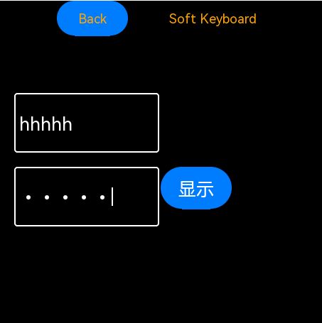

**图 2**  软键盘效果图<a name="zh-cn_topic_0000002444726017_fig12881520114310"></a>  
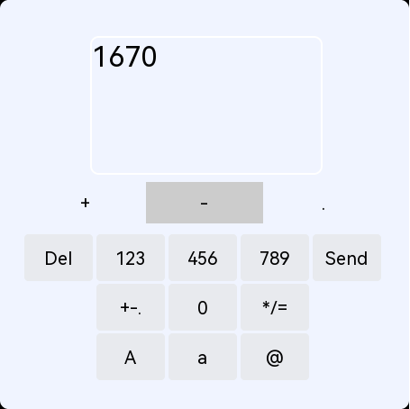

常用函数介绍如[表1](#zh-cn_topic_0000002444726017_table2597mcpsimp)所示。具体使用流程请参考示例“middleware/services/gui/uikit/sample/uitest/components/ui\_test\_keyboard/ui\_test\_keyboard.cpp”。

**表 1**  UIEditText核心函数

<a name="zh-cn_topic_0000002444726017_table2597mcpsimp"></a>
<table><thead align="left"><tr id="zh-cn_topic_0000002444726017_row2603mcpsimp"><th class="cellrowborder" valign="top" width="53%" id="mcps1.2.3.1.1"><p id="zh-cn_topic_0000002444726017_p2605mcpsimp"><a name="zh-cn_topic_0000002444726017_p2605mcpsimp"></a><a name="zh-cn_topic_0000002444726017_p2605mcpsimp"></a>函数</p>
</th>
<th class="cellrowborder" valign="top" width="47%" id="mcps1.2.3.1.2"><p id="zh-cn_topic_0000002444726017_p2607mcpsimp"><a name="zh-cn_topic_0000002444726017_p2607mcpsimp"></a><a name="zh-cn_topic_0000002444726017_p2607mcpsimp"></a>介绍</p>
</th>
</tr>
</thead>
<tbody><tr id="zh-cn_topic_0000002444726017_row2609mcpsimp"><td class="cellrowborder" valign="top" width="53%" headers="mcps1.2.3.1.1 "><p id="zh-cn_topic_0000002444726017_p2611mcpsimp"><a name="zh-cn_topic_0000002444726017_p2611mcpsimp"></a><a name="zh-cn_topic_0000002444726017_p2611mcpsimp"></a>void SetTextColor(ColorType color)</p>
</td>
<td class="cellrowborder" valign="top" width="47%" headers="mcps1.2.3.1.2 "><p id="zh-cn_topic_0000002444726017_p2613mcpsimp"><a name="zh-cn_topic_0000002444726017_p2613mcpsimp"></a><a name="zh-cn_topic_0000002444726017_p2613mcpsimp"></a>设置文本内容显示颜色。</p>
</td>
</tr>
<tr id="zh-cn_topic_0000002444726017_row2614mcpsimp"><td class="cellrowborder" valign="top" width="53%" headers="mcps1.2.3.1.1 "><p id="zh-cn_topic_0000002444726017_p2616mcpsimp"><a name="zh-cn_topic_0000002444726017_p2616mcpsimp"></a><a name="zh-cn_topic_0000002444726017_p2616mcpsimp"></a>ColorType GetTextColor()</p>
</td>
<td class="cellrowborder" valign="top" width="47%" headers="mcps1.2.3.1.2 "><p id="zh-cn_topic_0000002444726017_p2618mcpsimp"><a name="zh-cn_topic_0000002444726017_p2618mcpsimp"></a><a name="zh-cn_topic_0000002444726017_p2618mcpsimp"></a>获取文本内容显示颜色。</p>
</td>
</tr>
<tr id="zh-cn_topic_0000002444726017_row2619mcpsimp"><td class="cellrowborder" valign="top" width="53%" headers="mcps1.2.3.1.1 "><p id="zh-cn_topic_0000002444726017_p1128101818197"><a name="zh-cn_topic_0000002444726017_p1128101818197"></a><a name="zh-cn_topic_0000002444726017_p1128101818197"></a>void SetInputType(InputType type)</p>
</td>
<td class="cellrowborder" valign="top" width="47%" headers="mcps1.2.3.1.2 "><p id="zh-cn_topic_0000002444726017_p2623mcpsimp"><a name="zh-cn_topic_0000002444726017_p2623mcpsimp"></a><a name="zh-cn_topic_0000002444726017_p2623mcpsimp"></a>设置文本内容显示模式。</p>
</td>
</tr>
<tr id="zh-cn_topic_0000002444726017_row2624mcpsimp"><td class="cellrowborder" valign="top" width="53%" headers="mcps1.2.3.1.1 "><p id="zh-cn_topic_0000002444726017_p147356355208"><a name="zh-cn_topic_0000002444726017_p147356355208"></a><a name="zh-cn_topic_0000002444726017_p147356355208"></a>InputType GetInputType()</p>
</td>
<td class="cellrowborder" valign="top" width="47%" headers="mcps1.2.3.1.2 "><p id="zh-cn_topic_0000002444726017_p2628mcpsimp"><a name="zh-cn_topic_0000002444726017_p2628mcpsimp"></a><a name="zh-cn_topic_0000002444726017_p2628mcpsimp"></a>获取文本内容显示模式。</p>
</td>
</tr>
<tr id="zh-cn_topic_0000002444726017_row2629mcpsimp"><td class="cellrowborder" valign="top" width="53%" headers="mcps1.2.3.1.1 "><p id="zh-cn_topic_0000002444726017_p2631mcpsimp"><a name="zh-cn_topic_0000002444726017_p2631mcpsimp"></a><a name="zh-cn_topic_0000002444726017_p2631mcpsimp"></a>void SetText(const char* text)</p>
</td>
<td class="cellrowborder" valign="top" width="47%" headers="mcps1.2.3.1.2 "><p id="zh-cn_topic_0000002444726017_p2633mcpsimp"><a name="zh-cn_topic_0000002444726017_p2633mcpsimp"></a><a name="zh-cn_topic_0000002444726017_p2633mcpsimp"></a>设置当前文本内容。</p>
</td>
</tr>
<tr id="zh-cn_topic_0000002444726017_row19462738181515"><td class="cellrowborder" valign="top" width="53%" headers="mcps1.2.3.1.1 "><p id="zh-cn_topic_0000002444726017_p1246203810155"><a name="zh-cn_topic_0000002444726017_p1246203810155"></a><a name="zh-cn_topic_0000002444726017_p1246203810155"></a>const char* GetText()</p>
</td>
<td class="cellrowborder" valign="top" width="47%" headers="mcps1.2.3.1.2 "><p id="zh-cn_topic_0000002444726017_p34626383158"><a name="zh-cn_topic_0000002444726017_p34626383158"></a><a name="zh-cn_topic_0000002444726017_p34626383158"></a>获取当前文本内容。</p>
</td>
</tr>
<tr id="zh-cn_topic_0000002444726017_row15622135141612"><td class="cellrowborder" valign="top" width="53%" headers="mcps1.2.3.1.1 "><p id="zh-cn_topic_0000002444726017_p156222358168"><a name="zh-cn_topic_0000002444726017_p156222358168"></a><a name="zh-cn_topic_0000002444726017_p156222358168"></a>void SetPlaceholder(const char* placeholder)</p>
</td>
<td class="cellrowborder" valign="top" width="47%" headers="mcps1.2.3.1.2 "><p id="zh-cn_topic_0000002444726017_p116224357161"><a name="zh-cn_topic_0000002444726017_p116224357161"></a><a name="zh-cn_topic_0000002444726017_p116224357161"></a>设置提示文本内容。</p>
</td>
</tr>
<tr id="zh-cn_topic_0000002444726017_row3482172011175"><td class="cellrowborder" valign="top" width="53%" headers="mcps1.2.3.1.1 "><p id="zh-cn_topic_0000002444726017_p148232031713"><a name="zh-cn_topic_0000002444726017_p148232031713"></a><a name="zh-cn_topic_0000002444726017_p148232031713"></a>const char* GetPlaceholder()</p>
</td>
<td class="cellrowborder" valign="top" width="47%" headers="mcps1.2.3.1.2 "><p id="zh-cn_topic_0000002444726017_p648282013175"><a name="zh-cn_topic_0000002444726017_p648282013175"></a><a name="zh-cn_topic_0000002444726017_p648282013175"></a>获取提示文本内容。</p>
</td>
</tr>
<tr id="zh-cn_topic_0000002444726017_row559154715172"><td class="cellrowborder" valign="top" width="53%" headers="mcps1.2.3.1.1 "><p id="zh-cn_topic_0000002444726017_p1160154731719"><a name="zh-cn_topic_0000002444726017_p1160154731719"></a><a name="zh-cn_topic_0000002444726017_p1160154731719"></a>void SetMaxLength(uint16_t maxLength)</p>
</td>
<td class="cellrowborder" valign="top" width="47%" headers="mcps1.2.3.1.2 "><p id="zh-cn_topic_0000002444726017_p06011471179"><a name="zh-cn_topic_0000002444726017_p06011471179"></a><a name="zh-cn_topic_0000002444726017_p06011471179"></a>设置最大文本内容长度。</p>
</td>
</tr>
<tr id="zh-cn_topic_0000002444726017_row5429104215182"><td class="cellrowborder" valign="top" width="53%" headers="mcps1.2.3.1.1 "><p id="zh-cn_topic_0000002444726017_p642954221814"><a name="zh-cn_topic_0000002444726017_p642954221814"></a><a name="zh-cn_topic_0000002444726017_p642954221814"></a>uint16_t GetMaxLength()</p>
</td>
<td class="cellrowborder" valign="top" width="47%" headers="mcps1.2.3.1.2 "><p id="zh-cn_topic_0000002444726017_p9429642121815"><a name="zh-cn_topic_0000002444726017_p9429642121815"></a><a name="zh-cn_topic_0000002444726017_p9429642121815"></a>获取最大文本内容长度。</p>
</td>
</tr>
<tr id="zh-cn_topic_0000002444726017_row18623124413228"><td class="cellrowborder" valign="top" width="53%" headers="mcps1.2.3.1.1 "><p id="zh-cn_topic_0000002444726017_p1862394415225"><a name="zh-cn_topic_0000002444726017_p1862394415225"></a><a name="zh-cn_topic_0000002444726017_p1862394415225"></a>void SetPlaceholderColor(ColorType color)</p>
</td>
<td class="cellrowborder" valign="top" width="47%" headers="mcps1.2.3.1.2 "><p id="zh-cn_topic_0000002444726017_p362484415220"><a name="zh-cn_topic_0000002444726017_p362484415220"></a><a name="zh-cn_topic_0000002444726017_p362484415220"></a>设置提示文本内容显示颜色。</p>
</td>
</tr>
<tr id="zh-cn_topic_0000002444726017_row1127685902412"><td class="cellrowborder" valign="top" width="53%" headers="mcps1.2.3.1.1 "><p id="zh-cn_topic_0000002444726017_p13276155919243"><a name="zh-cn_topic_0000002444726017_p13276155919243"></a><a name="zh-cn_topic_0000002444726017_p13276155919243"></a>ColorType GetPlaceholderColor()</p>
</td>
<td class="cellrowborder" valign="top" width="47%" headers="mcps1.2.3.1.2 "><p id="zh-cn_topic_0000002444726017_p927695922412"><a name="zh-cn_topic_0000002444726017_p927695922412"></a><a name="zh-cn_topic_0000002444726017_p927695922412"></a>获取提示文本内容显示颜色。</p>
</td>
</tr>
<tr id="zh-cn_topic_0000002444726017_row1070166182612"><td class="cellrowborder" valign="top" width="53%" headers="mcps1.2.3.1.1 "><p id="zh-cn_topic_0000002444726017_p10708682613"><a name="zh-cn_topic_0000002444726017_p10708682613"></a><a name="zh-cn_topic_0000002444726017_p10708682613"></a>void SetCursorColor(ColorType color)</p>
</td>
<td class="cellrowborder" valign="top" width="47%" headers="mcps1.2.3.1.2 "><p id="zh-cn_topic_0000002444726017_p8701368262"><a name="zh-cn_topic_0000002444726017_p8701368262"></a><a name="zh-cn_topic_0000002444726017_p8701368262"></a>设置光标颜色。</p>
</td>
</tr>
<tr id="zh-cn_topic_0000002444726017_row1746313153276"><td class="cellrowborder" valign="top" width="53%" headers="mcps1.2.3.1.1 "><p id="zh-cn_topic_0000002444726017_p846320153273"><a name="zh-cn_topic_0000002444726017_p846320153273"></a><a name="zh-cn_topic_0000002444726017_p846320153273"></a>ColorType GetCursorColor()</p>
</td>
<td class="cellrowborder" valign="top" width="47%" headers="mcps1.2.3.1.2 "><p id="zh-cn_topic_0000002444726017_p14463141514276"><a name="zh-cn_topic_0000002444726017_p14463141514276"></a><a name="zh-cn_topic_0000002444726017_p14463141514276"></a>获取光标颜色。</p>
</td>
</tr>
<tr id="zh-cn_topic_0000002444726017_row207511044113114"><td class="cellrowborder" valign="top" width="53%" headers="mcps1.2.3.1.1 "><p id="zh-cn_topic_0000002444726017_p3751194418318"><a name="zh-cn_topic_0000002444726017_p3751194418318"></a><a name="zh-cn_topic_0000002444726017_p3751194418318"></a>void SetFontId(uint16_t fontId)</p>
</td>
<td class="cellrowborder" valign="top" width="47%" headers="mcps1.2.3.1.2 "><p id="zh-cn_topic_0000002444726017_p197511144103115"><a name="zh-cn_topic_0000002444726017_p197511144103115"></a><a name="zh-cn_topic_0000002444726017_p197511144103115"></a>设置字体。</p>
</td>
</tr>
<tr id="zh-cn_topic_0000002444726017_row13473163493211"><td class="cellrowborder" valign="top" width="53%" headers="mcps1.2.3.1.1 "><p id="zh-cn_topic_0000002444726017_p1147353414321"><a name="zh-cn_topic_0000002444726017_p1147353414321"></a><a name="zh-cn_topic_0000002444726017_p1147353414321"></a>uint8_t GetFontId()</p>
</td>
<td class="cellrowborder" valign="top" width="47%" headers="mcps1.2.3.1.2 "><p id="zh-cn_topic_0000002444726017_p1447323423217"><a name="zh-cn_topic_0000002444726017_p1447323423217"></a><a name="zh-cn_topic_0000002444726017_p1447323423217"></a>获取字体。</p>
</td>
</tr>
<tr id="zh-cn_topic_0000002444726017_row14122013368"><td class="cellrowborder" valign="top" width="53%" headers="mcps1.2.3.1.1 "><p id="zh-cn_topic_0000002444726017_p11127013362"><a name="zh-cn_topic_0000002444726017_p11127013362"></a><a name="zh-cn_topic_0000002444726017_p11127013362"></a>void SetFont(const char* name, uint8_t size)</p>
</td>
<td class="cellrowborder" valign="top" width="47%" headers="mcps1.2.3.1.2 "><p id="zh-cn_topic_0000002444726017_p161210093615"><a name="zh-cn_topic_0000002444726017_p161210093615"></a><a name="zh-cn_topic_0000002444726017_p161210093615"></a>设置字体。</p>
</td>
</tr>
<tr id="zh-cn_topic_0000002444726017_row9145224133610"><td class="cellrowborder" valign="top" width="53%" headers="mcps1.2.3.1.1 "><p id="zh-cn_topic_0000002444726017_p1145624103614"><a name="zh-cn_topic_0000002444726017_p1145624103614"></a><a name="zh-cn_topic_0000002444726017_p1145624103614"></a>uint16_t GetTextWidth()</p>
</td>
<td class="cellrowborder" valign="top" width="47%" headers="mcps1.2.3.1.2 "><p id="zh-cn_topic_0000002444726017_p14145102414367"><a name="zh-cn_topic_0000002444726017_p14145102414367"></a><a name="zh-cn_topic_0000002444726017_p14145102414367"></a>获取字体宽度。</p>
</td>
</tr>
<tr id="zh-cn_topic_0000002444726017_row7275174318364"><td class="cellrowborder" valign="top" width="53%" headers="mcps1.2.3.1.1 "><p id="zh-cn_topic_0000002444726017_p19275243183612"><a name="zh-cn_topic_0000002444726017_p19275243183612"></a><a name="zh-cn_topic_0000002444726017_p19275243183612"></a>uint16_t GetTextHeight()</p>
</td>
<td class="cellrowborder" valign="top" width="47%" headers="mcps1.2.3.1.2 "><p id="zh-cn_topic_0000002444726017_p19275154313610"><a name="zh-cn_topic_0000002444726017_p19275154313610"></a><a name="zh-cn_topic_0000002444726017_p19275154313610"></a>获取字体高度。</p>
</td>
</tr>
<tr id="zh-cn_topic_0000002444726017_row177784281375"><td class="cellrowborder" valign="top" width="53%" headers="mcps1.2.3.1.1 "><p id="zh-cn_topic_0000002444726017_p1077819283377"><a name="zh-cn_topic_0000002444726017_p1077819283377"></a><a name="zh-cn_topic_0000002444726017_p1077819283377"></a>void InsertText(std::string text)</p>
</td>
<td class="cellrowborder" valign="top" width="47%" headers="mcps1.2.3.1.2 "><p id="zh-cn_topic_0000002444726017_p1778192873710"><a name="zh-cn_topic_0000002444726017_p1778192873710"></a><a name="zh-cn_topic_0000002444726017_p1778192873710"></a>在末尾插入文本。</p>
</td>
</tr>
<tr id="zh-cn_topic_0000002444726017_row14244155414375"><td class="cellrowborder" valign="top" width="53%" headers="mcps1.2.3.1.1 "><p id="zh-cn_topic_0000002444726017_p52441754133712"><a name="zh-cn_topic_0000002444726017_p52441754133712"></a><a name="zh-cn_topic_0000002444726017_p52441754133712"></a>void DeleteBackward(uint32_t length)</p>
</td>
<td class="cellrowborder" valign="top" width="47%" headers="mcps1.2.3.1.2 "><p id="zh-cn_topic_0000002444726017_p8244165423716"><a name="zh-cn_topic_0000002444726017_p8244165423716"></a><a name="zh-cn_topic_0000002444726017_p8244165423716"></a>删除末尾文本。</p>
</td>
</tr>
</tbody>
</table>

> **说明：** 
>软键盘功能为客户参考代码，适配的屏幕为454×454屏，客户可按需进行布局调整，包括布局效果调整、适配不同屏幕尺寸等。重新适配需要修改文件“middleware\\services\\gui\\uikit\\proprietary\\src\\ui\\frameworks\\components\\ui\_soft\_keyboard.cpp”中的控件位置、大小等布局信息。

### UIKaleidoscopeView<a name="ZH-CN_TOPIC_0000002466542580"></a>

UIKaleidoscopeView是基于原始图片素材生成万花筒效果的控件。该控件将直接读写送显Buffer，因此需要设置控件起始位置为\[0, 0\]，并保持其尺寸与送显Buffer尺寸一致。具体使用流程请参考示例middleware/services/gui/uikit/sample/uitest/components/ui\_test\_kaleidoscope/ui\_test\_kaleidoscope.cpp。

**图 1**  万花筒效果示意图<a name="zh-cn_topic_0000002444645925_fig2065716568"></a>  
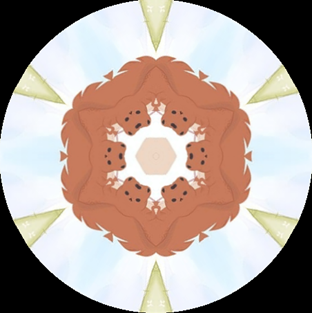

**表 1**  UIKaleidoscopeView核心函数

<a name="zh-cn_topic_0000002444645925_table2351mcpsimp"></a>
<table><thead align="left"><tr id="zh-cn_topic_0000002444645925_row2357mcpsimp"><th class="cellrowborder" valign="top" width="53%" id="mcps1.2.3.1.1"><p id="zh-cn_topic_0000002444645925_p2359mcpsimp"><a name="zh-cn_topic_0000002444645925_p2359mcpsimp"></a><a name="zh-cn_topic_0000002444645925_p2359mcpsimp"></a>函数</p>
</th>
<th class="cellrowborder" valign="top" width="47%" id="mcps1.2.3.1.2"><p id="zh-cn_topic_0000002444645925_p42118371217"><a name="zh-cn_topic_0000002444645925_p42118371217"></a><a name="zh-cn_topic_0000002444645925_p42118371217"></a>描述</p>
</th>
</tr>
</thead>
<tbody><tr id="zh-cn_topic_0000002444645925_row1229382217911"><td class="cellrowborder" valign="top" width="53%" headers="mcps1.2.3.1.1 "><p id="zh-cn_topic_0000002444645925_p14529755153117"><a name="zh-cn_topic_0000002444645925_p14529755153117"></a><a name="zh-cn_topic_0000002444645925_p14529755153117"></a>bool SetSrc(const ImageInfo* src)</p>
</td>
<td class="cellrowborder" valign="top" width="47%" headers="mcps1.2.3.1.2 "><p id="zh-cn_topic_0000002444645925_p1575142711319"><a name="zh-cn_topic_0000002444645925_p1575142711319"></a><a name="zh-cn_topic_0000002444645925_p1575142711319"></a>设置万花筒效果的源素材。</p>
</td>
</tr>
<tr id="zh-cn_topic_0000002444645925_row2363mcpsimp"><td class="cellrowborder" valign="top" width="53%" headers="mcps1.2.3.1.1 "><p id="zh-cn_topic_0000002444645925_p111222152323"><a name="zh-cn_topic_0000002444645925_p111222152323"></a><a name="zh-cn_topic_0000002444645925_p111222152323"></a>void Rotate(float rotate)</p>
</td>
<td class="cellrowborder" valign="top" width="47%" headers="mcps1.2.3.1.2 "><p id="zh-cn_topic_0000002444645925_p6805155310358"><a name="zh-cn_topic_0000002444645925_p6805155310358"></a><a name="zh-cn_topic_0000002444645925_p6805155310358"></a>根据设定的旋转刻度，生成新的万花筒效果图。</p>
</td>
</tr>
<tr id="zh-cn_topic_0000002444645925_row990218619474"><td class="cellrowborder" valign="top" width="53%" headers="mcps1.2.3.1.1 "><p id="zh-cn_topic_0000002444645925_p961921143214"><a name="zh-cn_topic_0000002444645925_p961921143214"></a><a name="zh-cn_topic_0000002444645925_p961921143214"></a>void SetRotateEventFactor(float factor)</p>
</td>
<td class="cellrowborder" valign="top" width="47%" headers="mcps1.2.3.1.2 "><p id="zh-cn_topic_0000002444645925_p179021969470"><a name="zh-cn_topic_0000002444645925_p179021969470"></a><a name="zh-cn_topic_0000002444645925_p179021969470"></a>设置万花筒响应表冠旋转事件的因子。</p>
</td>
</tr>
<tr id="zh-cn_topic_0000002444645925_row6615530143214"><td class="cellrowborder" valign="top" width="53%" headers="mcps1.2.3.1.1 "><p id="zh-cn_topic_0000002444645925_p789264914331"><a name="zh-cn_topic_0000002444645925_p789264914331"></a><a name="zh-cn_topic_0000002444645925_p789264914331"></a>void SetRotateAnimatorValue(float rotate)</p>
</td>
<td class="cellrowborder" valign="top" width="47%" headers="mcps1.2.3.1.2 "><p id="zh-cn_topic_0000002444645925_p261683014329"><a name="zh-cn_topic_0000002444645925_p261683014329"></a><a name="zh-cn_topic_0000002444645925_p261683014329"></a>设置万花筒动画使用的旋转刻度。</p>
</td>
</tr>
<tr id="zh-cn_topic_0000002444645925_row1461663020328"><td class="cellrowborder" valign="top" width="53%" headers="mcps1.2.3.1.1 "><p id="zh-cn_topic_0000002444645925_p8616193093218"><a name="zh-cn_topic_0000002444645925_p8616193093218"></a><a name="zh-cn_topic_0000002444645925_p8616193093218"></a>void StartRotateAnimator()</p>
</td>
<td class="cellrowborder" valign="top" width="47%" headers="mcps1.2.3.1.2 "><p id="zh-cn_topic_0000002444645925_p17616133033211"><a name="zh-cn_topic_0000002444645925_p17616133033211"></a><a name="zh-cn_topic_0000002444645925_p17616133033211"></a>启动万花筒动画。</p>
</td>
</tr>
<tr id="zh-cn_topic_0000002444645925_row295730143414"><td class="cellrowborder" valign="top" width="53%" headers="mcps1.2.3.1.1 "><p id="zh-cn_topic_0000002444645925_p39577023419"><a name="zh-cn_topic_0000002444645925_p39577023419"></a><a name="zh-cn_topic_0000002444645925_p39577023419"></a>void StopRotateAnimator()</p>
</td>
<td class="cellrowborder" valign="top" width="47%" headers="mcps1.2.3.1.2 "><p id="zh-cn_topic_0000002444645925_p139584013412"><a name="zh-cn_topic_0000002444645925_p139584013412"></a><a name="zh-cn_topic_0000002444645925_p139584013412"></a>停止万花筒动画。</p>
</td>
</tr>
</tbody>
</table>

### UIFloatBoxView<a name="ZH-CN_TOPIC_0000002499581953"></a>

UIFlloatBoxView是弧形悬浮框中显示圆形图标的控件，常用于界面之上的快捷应用浮窗。该控件以内部有效区域的中心点为圆心，并以偏小一侧的尺寸作为直径去构建弧形布局。建议使用宽高相等的控件，便于布局计算。具体使用流程请参考示例“middleware/services/gui/uikit/sample/uitest/components/ui\_test\_float\_box/ui\_test\_float\_box.cpp”。

**图 1**  UIFloatBoxView效果示意图<a name="zh-cn_topic_0000002455997413_fig597010258431"></a>  
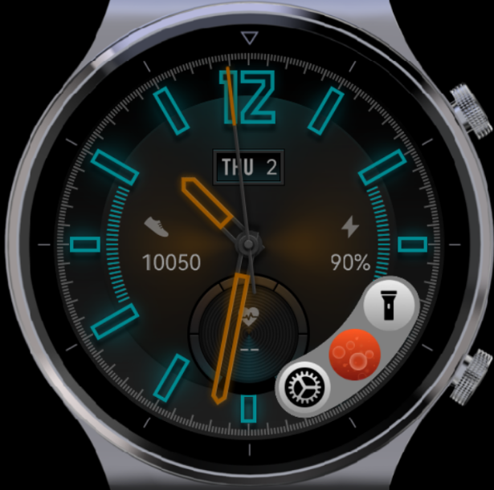

**表 1**  UIFloatBoxView核心函数

<a name="zh-cn_topic_0000002455997413_table1682820855916"></a>
<table><thead align="left"><tr id="zh-cn_topic_0000002455997413_row14829128185913"><th class="cellrowborder" valign="top" width="53%" id="mcps1.2.3.1.1"><p id="zh-cn_topic_0000002455997413_p1682914819598"><a name="zh-cn_topic_0000002455997413_p1682914819598"></a><a name="zh-cn_topic_0000002455997413_p1682914819598"></a>函数</p>
</th>
<th class="cellrowborder" valign="top" width="47%" id="mcps1.2.3.1.2"><p id="zh-cn_topic_0000002455997413_p158291584592"><a name="zh-cn_topic_0000002455997413_p158291584592"></a><a name="zh-cn_topic_0000002455997413_p158291584592"></a>描述</p>
</th>
</tr>
</thead>
<tbody><tr id="zh-cn_topic_0000002455997413_row482978115912"><td class="cellrowborder" valign="top" width="53%" headers="mcps1.2.3.1.1 "><p id="zh-cn_topic_0000002455997413_p17991127403"><a name="zh-cn_topic_0000002455997413_p17991127403"></a><a name="zh-cn_topic_0000002455997413_p17991127403"></a>bool AddItems(FloatItem* floatItems, uint8_t floatItemsCnt)</p>
</td>
<td class="cellrowborder" valign="top" width="47%" headers="mcps1.2.3.1.2 "><p id="zh-cn_topic_0000002455997413_p47994275019"><a name="zh-cn_topic_0000002455997413_p47994275019"></a><a name="zh-cn_topic_0000002455997413_p47994275019"></a>添加一组悬浮元素，元素数量有效范围为[2, 3]。</p>
<p id="zh-cn_topic_0000002455997413_p117991276015"><a name="zh-cn_topic_0000002455997413_p117991276015"></a><a name="zh-cn_topic_0000002455997413_p117991276015"></a>FloatItem由std::string name及ImageInfo* imgInfo组成。每个元素都应对应独一无二的名字，图片内容则应为圆形图标。</p>
</td>
</tr>
<tr id="zh-cn_topic_0000002455997413_row2082910855914"><td class="cellrowborder" valign="top" width="53%" headers="mcps1.2.3.1.1 "><p id="zh-cn_topic_0000002455997413_p779919271300"><a name="zh-cn_topic_0000002455997413_p779919271300"></a><a name="zh-cn_topic_0000002455997413_p779919271300"></a>void ClearItems()</p>
</td>
<td class="cellrowborder" valign="top" width="47%" headers="mcps1.2.3.1.2 "><p id="zh-cn_topic_0000002455997413_p187994277015"><a name="zh-cn_topic_0000002455997413_p187994277015"></a><a name="zh-cn_topic_0000002455997413_p187994277015"></a>清除已添加的悬浮元素。</p>
</td>
</tr>
<tr id="zh-cn_topic_0000002455997413_row1282916815594"><td class="cellrowborder" valign="top" width="53%" headers="mcps1.2.3.1.1 "><p id="zh-cn_topic_0000002455997413_p579962720017"><a name="zh-cn_topic_0000002455997413_p579962720017"></a><a name="zh-cn_topic_0000002455997413_p579962720017"></a>void SetOnItemClickListener(UIFloatBoxView::OnItemClickListener* listener)</p>
</td>
<td class="cellrowborder" valign="top" width="47%" headers="mcps1.2.3.1.2 "><p id="zh-cn_topic_0000002455997413_p137998271707"><a name="zh-cn_topic_0000002455997413_p137998271707"></a><a name="zh-cn_topic_0000002455997413_p137998271707"></a>设置点击元素回调监听器。当点击图标时，会回调该监听器中自实现的OnItemClick函数。</p>
</td>
</tr>
<tr id="zh-cn_topic_0000002455997413_row88291086591"><td class="cellrowborder" valign="top" width="53%" headers="mcps1.2.3.1.1 "><p id="zh-cn_topic_0000002455997413_p879982719015"><a name="zh-cn_topic_0000002455997413_p879982719015"></a><a name="zh-cn_topic_0000002455997413_p879982719015"></a>UIFloatBoxView::OnItemClickListener*& GetOnItemClickListener()</p>
</td>
<td class="cellrowborder" valign="top" width="47%" headers="mcps1.2.3.1.2 "><p id="zh-cn_topic_0000002455997413_p4799182717018"><a name="zh-cn_topic_0000002455997413_p4799182717018"></a><a name="zh-cn_topic_0000002455997413_p4799182717018"></a>获取点击元素回调监听器。</p>
</td>
</tr>
<tr id="zh-cn_topic_0000002455997413_row0829284599"><td class="cellrowborder" valign="top" width="53%" headers="mcps1.2.3.1.1 "><p id="zh-cn_topic_0000002455997413_p77991279019"><a name="zh-cn_topic_0000002455997413_p77991279019"></a><a name="zh-cn_topic_0000002455997413_p77991279019"></a>uint16_t GetItemCnt() const</p>
</td>
<td class="cellrowborder" valign="top" width="47%" headers="mcps1.2.3.1.2 "><p id="zh-cn_topic_0000002455997413_p77991271900"><a name="zh-cn_topic_0000002455997413_p77991271900"></a><a name="zh-cn_topic_0000002455997413_p77991271900"></a>获取元素数量。</p>
</td>
</tr>
<tr id="zh-cn_topic_0000002455997413_row1382918195911"><td class="cellrowborder" valign="top" width="53%" headers="mcps1.2.3.1.1 "><p id="zh-cn_topic_0000002455997413_p67993277010"><a name="zh-cn_topic_0000002455997413_p67993277010"></a><a name="zh-cn_topic_0000002455997413_p67993277010"></a>void SetItemSize(uint16_t size)</p>
</td>
<td class="cellrowborder" valign="top" width="47%" headers="mcps1.2.3.1.2 "><p id="zh-cn_topic_0000002455997413_p127991027506"><a name="zh-cn_topic_0000002455997413_p127991027506"></a><a name="zh-cn_topic_0000002455997413_p127991027506"></a>设置图片元素的显示大小。该值与ItemSpacing的总和等于弧形背景的宽度，但不能超过控件偏小一侧的尺寸的四分之一。</p>
</td>
</tr>
<tr id="zh-cn_topic_0000002455997413_row1560615254596"><td class="cellrowborder" valign="top" width="53%" headers="mcps1.2.3.1.1 "><p id="zh-cn_topic_0000002455997413_p879911272016"><a name="zh-cn_topic_0000002455997413_p879911272016"></a><a name="zh-cn_topic_0000002455997413_p879911272016"></a>void SetItemSpacing(uint16_t spacing)</p>
</td>
<td class="cellrowborder" valign="top" width="47%" headers="mcps1.2.3.1.2 "><p id="zh-cn_topic_0000002455997413_p079917272015"><a name="zh-cn_topic_0000002455997413_p079917272015"></a><a name="zh-cn_topic_0000002455997413_p079917272015"></a>设置图片元素之间的间隔距离。该值和ItemSize的总和等于弧形背景的宽度，但不能超过控件偏小一侧的尺寸的四分之一。</p>
</td>
</tr>
<tr id="zh-cn_topic_0000002455997413_row1460752513599"><td class="cellrowborder" valign="top" width="53%" headers="mcps1.2.3.1.1 "><p id="zh-cn_topic_0000002455997413_p12799102711019"><a name="zh-cn_topic_0000002455997413_p12799102711019"></a><a name="zh-cn_topic_0000002455997413_p12799102711019"></a>void SetDragFactor(float value)</p>
</td>
<td class="cellrowborder" valign="top" width="47%" headers="mcps1.2.3.1.2 "><p id="zh-cn_topic_0000002455997413_p1979932713017"><a name="zh-cn_topic_0000002455997413_p1979932713017"></a><a name="zh-cn_topic_0000002455997413_p1979932713017"></a>设置滑动加权值。</p>
<p id="zh-cn_topic_0000002455997413_p57991427205"><a name="zh-cn_topic_0000002455997413_p57991427205"></a><a name="zh-cn_topic_0000002455997413_p57991427205"></a>值越大，滑动时图标位置变化得越大。</p>
</td>
</tr>
<tr id="zh-cn_topic_0000002455997413_row9607132513597"><td class="cellrowborder" valign="top" width="53%" headers="mcps1.2.3.1.1 "><p id="zh-cn_topic_0000002455997413_p6799172716011"><a name="zh-cn_topic_0000002455997413_p6799172716011"></a><a name="zh-cn_topic_0000002455997413_p6799172716011"></a>float GetDragFactor() const</p>
</td>
<td class="cellrowborder" valign="top" width="47%" headers="mcps1.2.3.1.2 "><p id="zh-cn_topic_0000002455997413_p1579912276015"><a name="zh-cn_topic_0000002455997413_p1579912276015"></a><a name="zh-cn_topic_0000002455997413_p1579912276015"></a>获取滑动加权值。</p>
</td>
</tr>
<tr id="zh-cn_topic_0000002455997413_row1607182512592"><td class="cellrowborder" valign="top" width="53%" headers="mcps1.2.3.1.1 "><p id="zh-cn_topic_0000002455997413_p1880042719013"><a name="zh-cn_topic_0000002455997413_p1880042719013"></a><a name="zh-cn_topic_0000002455997413_p1880042719013"></a>void SetAccFactor(float factor)</p>
</td>
<td class="cellrowborder" valign="top" width="47%" headers="mcps1.2.3.1.2 "><p id="zh-cn_topic_0000002455997413_p380010271309"><a name="zh-cn_topic_0000002455997413_p380010271309"></a><a name="zh-cn_topic_0000002455997413_p380010271309"></a>设置滑动松手后的惯性加速加权值。</p>
<p id="zh-cn_topic_0000002455997413_p2800827402"><a name="zh-cn_topic_0000002455997413_p2800827402"></a><a name="zh-cn_topic_0000002455997413_p2800827402"></a>值越大，滑动松手后图标位置变化得越大。</p>
</td>
</tr>
<tr id="zh-cn_topic_0000002455997413_row1218619247019"><td class="cellrowborder" valign="top" width="53%" headers="mcps1.2.3.1.1 "><p id="zh-cn_topic_0000002455997413_p180011271805"><a name="zh-cn_topic_0000002455997413_p180011271805"></a><a name="zh-cn_topic_0000002455997413_p180011271805"></a>float GetAccFactor() const</p>
</td>
<td class="cellrowborder" valign="top" width="47%" headers="mcps1.2.3.1.2 "><p id="zh-cn_topic_0000002455997413_p1580019272004"><a name="zh-cn_topic_0000002455997413_p1580019272004"></a><a name="zh-cn_topic_0000002455997413_p1580019272004"></a>获取滑动松手后的惯性加速加权值。</p>
</td>
</tr>
<tr id="zh-cn_topic_0000002455997413_row14186524909"><td class="cellrowborder" valign="top" width="53%" headers="mcps1.2.3.1.1 "><p id="zh-cn_topic_0000002455997413_p380032719020"><a name="zh-cn_topic_0000002455997413_p380032719020"></a><a name="zh-cn_topic_0000002455997413_p380032719020"></a>void SetRotateFactor(float value)</p>
</td>
<td class="cellrowborder" valign="top" width="47%" headers="mcps1.2.3.1.2 "><p id="zh-cn_topic_0000002455997413_p1980062714016"><a name="zh-cn_topic_0000002455997413_p1980062714016"></a><a name="zh-cn_topic_0000002455997413_p1980062714016"></a>设置旋转表冠加权值。</p>
<p id="zh-cn_topic_0000002455997413_p680017278011"><a name="zh-cn_topic_0000002455997413_p680017278011"></a><a name="zh-cn_topic_0000002455997413_p680017278011"></a>值越大，旋转表冠时图标位置变化得越大。</p>
</td>
</tr>
<tr id="zh-cn_topic_0000002455997413_row2186162413014"><td class="cellrowborder" valign="top" width="53%" headers="mcps1.2.3.1.1 "><p id="zh-cn_topic_0000002455997413_p580016271019"><a name="zh-cn_topic_0000002455997413_p580016271019"></a><a name="zh-cn_topic_0000002455997413_p580016271019"></a>float GetRotateFactor() const</p>
</td>
<td class="cellrowborder" valign="top" width="47%" headers="mcps1.2.3.1.2 "><p id="zh-cn_topic_0000002455997413_p88008271602"><a name="zh-cn_topic_0000002455997413_p88008271602"></a><a name="zh-cn_topic_0000002455997413_p88008271602"></a>获取旋转表冠加权值。</p>
</td>
</tr>
<tr id="zh-cn_topic_0000002455997413_row6186824004"><td class="cellrowborder" valign="top" width="53%" headers="mcps1.2.3.1.1 "><p id="zh-cn_topic_0000002455997413_p88004271011"><a name="zh-cn_topic_0000002455997413_p88004271011"></a><a name="zh-cn_topic_0000002455997413_p88004271011"></a>void SetAlignAvgSpeed(float speed)</p>
</td>
<td class="cellrowborder" valign="top" width="47%" headers="mcps1.2.3.1.2 "><p id="zh-cn_topic_0000002455997413_p480092719014"><a name="zh-cn_topic_0000002455997413_p480092719014"></a><a name="zh-cn_topic_0000002455997413_p480092719014"></a>设置对齐动画的平均速度。</p>
<p id="zh-cn_topic_0000002455997413_p1080011273013"><a name="zh-cn_topic_0000002455997413_p1080011273013"></a><a name="zh-cn_topic_0000002455997413_p1080011273013"></a>值越大，松手后对齐元素动画越快。</p>
</td>
</tr>
<tr id="zh-cn_topic_0000002455997413_row160842515592"><td class="cellrowborder" valign="top" width="53%" headers="mcps1.2.3.1.1 "><p id="zh-cn_topic_0000002455997413_p148006271306"><a name="zh-cn_topic_0000002455997413_p148006271306"></a><a name="zh-cn_topic_0000002455997413_p148006271306"></a>float GetAlignAvgSpeed() const</p>
</td>
<td class="cellrowborder" valign="top" width="47%" headers="mcps1.2.3.1.2 "><p id="zh-cn_topic_0000002455997413_p3800102717017"><a name="zh-cn_topic_0000002455997413_p3800102717017"></a><a name="zh-cn_topic_0000002455997413_p3800102717017"></a>获取对齐动画的平均速度。</p>
</td>
</tr>
<tr id="zh-cn_topic_0000002455997413_row4812143015911"><td class="cellrowborder" valign="top" width="53%" headers="mcps1.2.3.1.1 "><p id="zh-cn_topic_0000002455997413_p38001327105"><a name="zh-cn_topic_0000002455997413_p38001327105"></a><a name="zh-cn_topic_0000002455997413_p38001327105"></a>void SetBgArcColor(uint32_t color)</p>
</td>
<td class="cellrowborder" valign="top" width="47%" headers="mcps1.2.3.1.2 "><p id="zh-cn_topic_0000002455997413_p98001427105"><a name="zh-cn_topic_0000002455997413_p98001427105"></a><a name="zh-cn_topic_0000002455997413_p98001427105"></a>设置弧形背景的颜色。</p>
</td>
</tr>
</tbody>
</table>

### UILottView<a name="ZH-CN_TOPIC_0000002499501981"></a>

UILottView是支持播放Lottie矢量动画的控件。Lottie矢量动画相较于序列帧方案占用资源更小。设计师通过After Effects软件设计矢量动画，通过Bodymovin插件导出Lottie Json文件，通过自研的Lottie转换工具将Json文件转为Bin文件，最终通过UILottView解析Bin文件播放矢量动画，如[图1](#zh-cn_topic_0000002465655773_fig1686415353212)所示。

**图 1**  Lottie开发流程图<a name="zh-cn_topic_0000002465655773_fig1686415353212"></a>  


**表 1**  UI3DView核心函数

<a name="zh-cn_topic_0000002465655773_table2351mcpsimp"></a>
<table><thead align="left"><tr id="zh-cn_topic_0000002465655773_row2357mcpsimp"><th class="cellrowborder" valign="top" width="53%" id="mcps1.2.3.1.1"><p id="zh-cn_topic_0000002465655773_p2359mcpsimp"><a name="zh-cn_topic_0000002465655773_p2359mcpsimp"></a><a name="zh-cn_topic_0000002465655773_p2359mcpsimp"></a>函数</p>
</th>
<th class="cellrowborder" valign="top" width="47%" id="mcps1.2.3.1.2"><p id="zh-cn_topic_0000002465655773_p42118371217"><a name="zh-cn_topic_0000002465655773_p42118371217"></a><a name="zh-cn_topic_0000002465655773_p42118371217"></a>描述</p>
</th>
</tr>
</thead>
<tbody><tr id="zh-cn_topic_0000002465655773_row1229382217911"><td class="cellrowborder" valign="top" width="53%" headers="mcps1.2.3.1.1 "><p id="zh-cn_topic_0000002465655773_p1712225419297"><a name="zh-cn_topic_0000002465655773_p1712225419297"></a><a name="zh-cn_topic_0000002465655773_p1712225419297"></a>bool SetSrc(std::string file)</p>
</td>
<td class="cellrowborder" valign="top" width="47%" headers="mcps1.2.3.1.2 "><p id="zh-cn_topic_0000002465655773_p1828112420411"><a name="zh-cn_topic_0000002465655773_p1828112420411"></a><a name="zh-cn_topic_0000002465655773_p1828112420411"></a>设置通过Lottie工具转换生成的Lottie Bin文件。</p>
</td>
</tr>
<tr id="zh-cn_topic_0000002465655773_row2363mcpsimp"><td class="cellrowborder" valign="top" width="53%" headers="mcps1.2.3.1.1 "><p id="zh-cn_topic_0000002465655773_p8351559142915"><a name="zh-cn_topic_0000002465655773_p8351559142915"></a><a name="zh-cn_topic_0000002465655773_p8351559142915"></a>void Start()</p>
</td>
<td class="cellrowborder" valign="top" width="47%" headers="mcps1.2.3.1.2 "><p id="zh-cn_topic_0000002465655773_p6805155310358"><a name="zh-cn_topic_0000002465655773_p6805155310358"></a><a name="zh-cn_topic_0000002465655773_p6805155310358"></a>播放Lottie矢量动画。</p>
</td>
</tr>
<tr id="zh-cn_topic_0000002465655773_row990218619474"><td class="cellrowborder" valign="top" width="53%" headers="mcps1.2.3.1.1 "><p id="zh-cn_topic_0000002465655773_p1064314102307"><a name="zh-cn_topic_0000002465655773_p1064314102307"></a><a name="zh-cn_topic_0000002465655773_p1064314102307"></a>void Pause()</p>
</td>
<td class="cellrowborder" valign="top" width="47%" headers="mcps1.2.3.1.2 "><p id="zh-cn_topic_0000002465655773_p162583711513"><a name="zh-cn_topic_0000002465655773_p162583711513"></a><a name="zh-cn_topic_0000002465655773_p162583711513"></a>暂停Lottie矢量动画</p>
</td>
</tr>
<tr id="zh-cn_topic_0000002465655773_row6615530143214"><td class="cellrowborder" valign="top" width="53%" headers="mcps1.2.3.1.1 "><p id="zh-cn_topic_0000002465655773_p155853145306"><a name="zh-cn_topic_0000002465655773_p155853145306"></a><a name="zh-cn_topic_0000002465655773_p155853145306"></a>void Resume()</p>
</td>
<td class="cellrowborder" valign="top" width="47%" headers="mcps1.2.3.1.2 "><p id="zh-cn_topic_0000002465655773_p261683014329"><a name="zh-cn_topic_0000002465655773_p261683014329"></a><a name="zh-cn_topic_0000002465655773_p261683014329"></a>继续Lottie矢量动画。</p>
</td>
</tr>
<tr id="zh-cn_topic_0000002465655773_row1461663020328"><td class="cellrowborder" valign="top" width="53%" headers="mcps1.2.3.1.1 "><p id="zh-cn_topic_0000002465655773_p6892121712305"><a name="zh-cn_topic_0000002465655773_p6892121712305"></a><a name="zh-cn_topic_0000002465655773_p6892121712305"></a>void Stop()</p>
</td>
<td class="cellrowborder" valign="top" width="47%" headers="mcps1.2.3.1.2 "><p id="zh-cn_topic_0000002465655773_p17616133033211"><a name="zh-cn_topic_0000002465655773_p17616133033211"></a><a name="zh-cn_topic_0000002465655773_p17616133033211"></a>停止Lottie矢量动画。</p>
</td>
</tr>
<tr id="zh-cn_topic_0000002465655773_row115016234305"><td class="cellrowborder" valign="top" width="53%" headers="mcps1.2.3.1.1 "><p id="zh-cn_topic_0000002465655773_p815132315307"><a name="zh-cn_topic_0000002465655773_p815132315307"></a><a name="zh-cn_topic_0000002465655773_p815132315307"></a>void SetRepeat(bool repeat)</p>
</td>
<td class="cellrowborder" valign="top" width="47%" headers="mcps1.2.3.1.2 "><p id="zh-cn_topic_0000002465655773_p3151023153019"><a name="zh-cn_topic_0000002465655773_p3151023153019"></a><a name="zh-cn_topic_0000002465655773_p3151023153019"></a>设置是否重复播放动画。</p>
</td>
</tr>
<tr id="zh-cn_topic_0000002465655773_row3151723103014"><td class="cellrowborder" valign="top" width="53%" headers="mcps1.2.3.1.1 "><p id="zh-cn_topic_0000002465655773_p4151132310306"><a name="zh-cn_topic_0000002465655773_p4151132310306"></a><a name="zh-cn_topic_0000002465655773_p4151132310306"></a>bool IsRepeat() const</p>
</td>
<td class="cellrowborder" valign="top" width="47%" headers="mcps1.2.3.1.2 "><p id="zh-cn_topic_0000002465655773_p6151142310301"><a name="zh-cn_topic_0000002465655773_p6151142310301"></a><a name="zh-cn_topic_0000002465655773_p6151142310301"></a>获取是否重复播放动画。</p>
</td>
</tr>
<tr id="zh-cn_topic_0000002465655773_row16151623113010"><td class="cellrowborder" valign="top" width="53%" headers="mcps1.2.3.1.1 "><p id="zh-cn_topic_0000002465655773_p5151152316302"><a name="zh-cn_topic_0000002465655773_p5151152316302"></a><a name="zh-cn_topic_0000002465655773_p5151152316302"></a>uint8_t GetState() const</p>
</td>
<td class="cellrowborder" valign="top" width="47%" headers="mcps1.2.3.1.2 "><p id="zh-cn_topic_0000002465655773_p1515172313010"><a name="zh-cn_topic_0000002465655773_p1515172313010"></a><a name="zh-cn_topic_0000002465655773_p1515172313010"></a>获取Lottie矢量动画状态。</p>
</td>
</tr>
</tbody>
</table>

> **须知：** 
>目前仅支持基础矢量图形和基础样式绘制，矢量变换，矢量路径裁剪功能。不支持全量Lottie功能。

### UI3DView<a name="ZH-CN_TOPIC_0000002499581925"></a>

UI3DView是支持3D能力的基类，为UI3DSphere、UI3DMesh、UI3DCylinder等派生类提供了通用的属性和函数。

**表 1**  UI3DView核心函数

<a name="zh-cn_topic_0000002454370713_table2351mcpsimp"></a>
<table><thead align="left"><tr id="zh-cn_topic_0000002454370713_row2357mcpsimp"><th class="cellrowborder" valign="top" width="53%" id="mcps1.2.3.1.1"><p id="zh-cn_topic_0000002454370713_p2359mcpsimp"><a name="zh-cn_topic_0000002454370713_p2359mcpsimp"></a><a name="zh-cn_topic_0000002454370713_p2359mcpsimp"></a>函数</p>
</th>
<th class="cellrowborder" valign="top" width="47%" id="mcps1.2.3.1.2"><p id="zh-cn_topic_0000002454370713_p42118371217"><a name="zh-cn_topic_0000002454370713_p42118371217"></a><a name="zh-cn_topic_0000002454370713_p42118371217"></a>描述</p>
</th>
</tr>
</thead>
<tbody><tr id="zh-cn_topic_0000002454370713_row1229382217911"><td class="cellrowborder" valign="top" width="53%" headers="mcps1.2.3.1.1 "><p id="zh-cn_topic_0000002454370713_p186982462215"><a name="zh-cn_topic_0000002454370713_p186982462215"></a><a name="zh-cn_topic_0000002454370713_p186982462215"></a>virtual bool SetModel(std::string file)</p>
</td>
<td class="cellrowborder" valign="top" width="47%" headers="mcps1.2.3.1.2 "><p id="zh-cn_topic_0000002454370713_p1828112420411"><a name="zh-cn_topic_0000002454370713_p1828112420411"></a><a name="zh-cn_topic_0000002454370713_p1828112420411"></a>设置通过3D工具生成的3D模型。</p>
<p id="zh-cn_topic_0000002454370713_p214916523410"><a name="zh-cn_topic_0000002454370713_p214916523410"></a><a name="zh-cn_topic_0000002454370713_p214916523410"></a>UI3DSphere和UI3DCylinder必须设置模型文件。</p>
<p id="zh-cn_topic_0000002454370713_p1575142711319"><a name="zh-cn_topic_0000002454370713_p1575142711319"></a><a name="zh-cn_topic_0000002454370713_p1575142711319"></a>UI3DMesh弱交互网格变形模式下，需要设置对应类型的模型文件；而强交互网格变形模式下，则无需设置模型文件。</p>
</td>
</tr>
<tr id="zh-cn_topic_0000002454370713_row2363mcpsimp"><td class="cellrowborder" valign="top" width="53%" headers="mcps1.2.3.1.1 "><p id="zh-cn_topic_0000002454370713_p464203420223"><a name="zh-cn_topic_0000002454370713_p464203420223"></a><a name="zh-cn_topic_0000002454370713_p464203420223"></a>void ClearModel()</p>
</td>
<td class="cellrowborder" valign="top" width="47%" headers="mcps1.2.3.1.2 "><p id="zh-cn_topic_0000002454370713_p6805155310358"><a name="zh-cn_topic_0000002454370713_p6805155310358"></a><a name="zh-cn_topic_0000002454370713_p6805155310358"></a>清除3D模型。</p>
</td>
</tr>
<tr id="zh-cn_topic_0000002454370713_row990218619474"><td class="cellrowborder" valign="top" width="53%" headers="mcps1.2.3.1.1 "><p id="zh-cn_topic_0000002454370713_p768417017235"><a name="zh-cn_topic_0000002454370713_p768417017235"></a><a name="zh-cn_topic_0000002454370713_p768417017235"></a>virtual bool SetTexture(const ImageInfo* info)</p>
</td>
<td class="cellrowborder" valign="top" width="47%" headers="mcps1.2.3.1.2 "><p id="zh-cn_topic_0000002454370713_p179021969470"><a name="zh-cn_topic_0000002454370713_p179021969470"></a><a name="zh-cn_topic_0000002454370713_p179021969470"></a>设置纹理。</p>
<p id="zh-cn_topic_0000002454370713_p1345152014513"><a name="zh-cn_topic_0000002454370713_p1345152014513"></a><a name="zh-cn_topic_0000002454370713_p1345152014513"></a>UI3DSphere和UI3DCylinder必须设置纹理素材。</p>
<p id="zh-cn_topic_0000002454370713_p162583711513"><a name="zh-cn_topic_0000002454370713_p162583711513"></a><a name="zh-cn_topic_0000002454370713_p162583711513"></a>UI3DMesh可选是否设置纹理素材。如果没有设置纹理素材，将在内部自动生成背景截图当作纹理使用。</p>
</td>
</tr>
<tr id="zh-cn_topic_0000002454370713_row6615530143214"><td class="cellrowborder" valign="top" width="53%" headers="mcps1.2.3.1.1 "><p id="zh-cn_topic_0000002454370713_p2028092915230"><a name="zh-cn_topic_0000002454370713_p2028092915230"></a><a name="zh-cn_topic_0000002454370713_p2028092915230"></a>void ClearTexture()</p>
</td>
<td class="cellrowborder" valign="top" width="47%" headers="mcps1.2.3.1.2 "><p id="zh-cn_topic_0000002454370713_p261683014329"><a name="zh-cn_topic_0000002454370713_p261683014329"></a><a name="zh-cn_topic_0000002454370713_p261683014329"></a>清除纹理。</p>
</td>
</tr>
<tr id="zh-cn_topic_0000002454370713_row1461663020328"><td class="cellrowborder" valign="top" width="53%" headers="mcps1.2.3.1.1 "><p id="zh-cn_topic_0000002454370713_p8616193093218"><a name="zh-cn_topic_0000002454370713_p8616193093218"></a><a name="zh-cn_topic_0000002454370713_p8616193093218"></a>const ImageInfo* GetTexture() const</p>
</td>
<td class="cellrowborder" valign="top" width="47%" headers="mcps1.2.3.1.2 "><p id="zh-cn_topic_0000002454370713_p17616133033211"><a name="zh-cn_topic_0000002454370713_p17616133033211"></a><a name="zh-cn_topic_0000002454370713_p17616133033211"></a>获取纹理。</p>
</td>
</tr>
</tbody>
</table>

### UI3DSphere<a name="ZH-CN_TOPIC_0000002466383068"></a>

UI3DSphere是支持3D球体模型纹理贴图的控件。具体使用流程请参考示例“middleware/services/gui/uikit/sample/uitest/components/ui\_test\_3d/ui\_test\_sphere.cpp”。

**图 1**  UI3DSphere效果示意图<a name="zh-cn_topic_0000002420691958_fig1622722114368"></a>  


**表 1**  UI3DSphere核心函数

<a name="zh-cn_topic_0000002420691958_table2351mcpsimp"></a>
<table><thead align="left"><tr id="zh-cn_topic_0000002420691958_row2357mcpsimp"><th class="cellrowborder" valign="top" width="53%" id="mcps1.2.3.1.1"><p id="zh-cn_topic_0000002420691958_p2359mcpsimp"><a name="zh-cn_topic_0000002420691958_p2359mcpsimp"></a><a name="zh-cn_topic_0000002420691958_p2359mcpsimp"></a>函数</p>
</th>
<th class="cellrowborder" valign="top" width="47%" id="mcps1.2.3.1.2"><p id="zh-cn_topic_0000002420691958_p42118371217"><a name="zh-cn_topic_0000002420691958_p42118371217"></a><a name="zh-cn_topic_0000002420691958_p42118371217"></a>描述</p>
</th>
</tr>
</thead>
<tbody><tr id="zh-cn_topic_0000002420691958_row1229382217911"><td class="cellrowborder" valign="top" width="53%" headers="mcps1.2.3.1.1 "><p id="zh-cn_topic_0000002420691958_p1298117131255"><a name="zh-cn_topic_0000002420691958_p1298117131255"></a><a name="zh-cn_topic_0000002420691958_p1298117131255"></a>void RotateAroundXAxis(float angle)</p>
</td>
<td class="cellrowborder" valign="top" width="47%" headers="mcps1.2.3.1.2 "><p id="zh-cn_topic_0000002420691958_p1575142711319"><a name="zh-cn_topic_0000002420691958_p1575142711319"></a><a name="zh-cn_topic_0000002420691958_p1575142711319"></a>绕X轴旋转特定角度。</p>
</td>
</tr>
<tr id="zh-cn_topic_0000002420691958_row2363mcpsimp"><td class="cellrowborder" valign="top" width="53%" headers="mcps1.2.3.1.1 "><p id="zh-cn_topic_0000002420691958_p20331102092514"><a name="zh-cn_topic_0000002420691958_p20331102092514"></a><a name="zh-cn_topic_0000002420691958_p20331102092514"></a>void RotateAroundYAxis(float angle)</p>
</td>
<td class="cellrowborder" valign="top" width="47%" headers="mcps1.2.3.1.2 "><p id="zh-cn_topic_0000002420691958_p6805155310358"><a name="zh-cn_topic_0000002420691958_p6805155310358"></a><a name="zh-cn_topic_0000002420691958_p6805155310358"></a>绕Y轴旋转特定角度。</p>
</td>
</tr>
<tr id="zh-cn_topic_0000002420691958_row990218619474"><td class="cellrowborder" valign="top" width="53%" headers="mcps1.2.3.1.1 "><p id="zh-cn_topic_0000002420691958_p1453262822512"><a name="zh-cn_topic_0000002420691958_p1453262822512"></a><a name="zh-cn_topic_0000002420691958_p1453262822512"></a>void RotateAroundZAxis(float angle)</p>
</td>
<td class="cellrowborder" valign="top" width="47%" headers="mcps1.2.3.1.2 "><p id="zh-cn_topic_0000002420691958_p59213163262"><a name="zh-cn_topic_0000002420691958_p59213163262"></a><a name="zh-cn_topic_0000002420691958_p59213163262"></a>绕Z轴旋转特定角度。</p>
</td>
</tr>
<tr id="zh-cn_topic_0000002420691958_row6615530143214"><td class="cellrowborder" valign="top" width="53%" headers="mcps1.2.3.1.1 "><p id="zh-cn_topic_0000002420691958_p668673510256"><a name="zh-cn_topic_0000002420691958_p668673510256"></a><a name="zh-cn_topic_0000002420691958_p668673510256"></a>float GetAngleAroundXAxis()</p>
</td>
<td class="cellrowborder" valign="top" width="47%" headers="mcps1.2.3.1.2 "><p id="zh-cn_topic_0000002420691958_p261683014329"><a name="zh-cn_topic_0000002420691958_p261683014329"></a><a name="zh-cn_topic_0000002420691958_p261683014329"></a>获取绕X轴旋转的角度。</p>
</td>
</tr>
<tr id="zh-cn_topic_0000002420691958_row1461663020328"><td class="cellrowborder" valign="top" width="53%" headers="mcps1.2.3.1.1 "><p id="zh-cn_topic_0000002420691958_p884864111253"><a name="zh-cn_topic_0000002420691958_p884864111253"></a><a name="zh-cn_topic_0000002420691958_p884864111253"></a>float GetAngleAroundYAxis()</p>
</td>
<td class="cellrowborder" valign="top" width="47%" headers="mcps1.2.3.1.2 "><p id="zh-cn_topic_0000002420691958_p136420392267"><a name="zh-cn_topic_0000002420691958_p136420392267"></a><a name="zh-cn_topic_0000002420691958_p136420392267"></a>获取绕Y轴旋转的角度。</p>
</td>
</tr>
<tr id="zh-cn_topic_0000002420691958_row518444662519"><td class="cellrowborder" valign="top" width="53%" headers="mcps1.2.3.1.1 "><p id="zh-cn_topic_0000002420691958_p01841246142512"><a name="zh-cn_topic_0000002420691958_p01841246142512"></a><a name="zh-cn_topic_0000002420691958_p01841246142512"></a>float GetAngleAroundZAxis()</p>
</td>
<td class="cellrowborder" valign="top" width="47%" headers="mcps1.2.3.1.2 "><p id="zh-cn_topic_0000002420691958_p11464434263"><a name="zh-cn_topic_0000002420691958_p11464434263"></a><a name="zh-cn_topic_0000002420691958_p11464434263"></a>获取绕Z轴旋转的角度。</p>
</td>
</tr>
</tbody>
</table>

### UI3DMesh<a name="ZH-CN_TOPIC_0000002499502057"></a>

UI3DMesh是支持纹理网格变形动画的控件。具体使用流程请参考示例“middleware/services/gui/uikit/sample/uitest/components/ui\_test\_3d/ui\_test\_mesh.cpp”。

**图 1**  原始图片效果示意图<a name="zh-cn_topic_0000002420851802_fig1819235213613"></a>  


**图 2**  UI3DMesh Array网格变形模式效果示意图<a name="zh-cn_topic_0000002420851802_fig12504195753610"></a>  


**表 1**  UI3DMesh核心函数

<a name="zh-cn_topic_0000002420851802_table2351mcpsimp"></a>
<table><thead align="left"><tr id="zh-cn_topic_0000002420851802_row2357mcpsimp"><th class="cellrowborder" valign="top" width="53%" id="mcps1.2.3.1.1"><p id="zh-cn_topic_0000002420851802_p2359mcpsimp"><a name="zh-cn_topic_0000002420851802_p2359mcpsimp"></a><a name="zh-cn_topic_0000002420851802_p2359mcpsimp"></a>函数</p>
</th>
<th class="cellrowborder" valign="top" width="47%" id="mcps1.2.3.1.2"><p id="zh-cn_topic_0000002420851802_p42118371217"><a name="zh-cn_topic_0000002420851802_p42118371217"></a><a name="zh-cn_topic_0000002420851802_p42118371217"></a>描述</p>
</th>
</tr>
</thead>
<tbody><tr id="zh-cn_topic_0000002420851802_row1229382217911"><td class="cellrowborder" valign="top" width="53%" headers="mcps1.2.3.1.1 "><p id="zh-cn_topic_0000002420851802_p1927215289388"><a name="zh-cn_topic_0000002420851802_p1927215289388"></a><a name="zh-cn_topic_0000002420851802_p1927215289388"></a>bool SetMeshType(VGUMeshType meshType)</p>
</td>
<td class="cellrowborder" valign="top" width="47%" headers="mcps1.2.3.1.2 "><p id="zh-cn_topic_0000002420851802_p174901016194011"><a name="zh-cn_topic_0000002420851802_p174901016194011"></a><a name="zh-cn_topic_0000002420851802_p174901016194011"></a>设置网格变形模式。</p>
</td>
</tr>
<tr id="zh-cn_topic_0000002420851802_row2363mcpsimp"><td class="cellrowborder" valign="top" width="53%" headers="mcps1.2.3.1.1 "><p id="zh-cn_topic_0000002420851802_p2472153573811"><a name="zh-cn_topic_0000002420851802_p2472153573811"></a><a name="zh-cn_topic_0000002420851802_p2472153573811"></a>VGUMeshType GetMeshType() const</p>
</td>
<td class="cellrowborder" valign="top" width="47%" headers="mcps1.2.3.1.2 "><p id="zh-cn_topic_0000002420851802_p6805155310358"><a name="zh-cn_topic_0000002420851802_p6805155310358"></a><a name="zh-cn_topic_0000002420851802_p6805155310358"></a>获取网格变形模式。</p>
</td>
</tr>
<tr id="zh-cn_topic_0000002420851802_row990218619474"><td class="cellrowborder" valign="top" width="53%" headers="mcps1.2.3.1.1 "><p id="zh-cn_topic_0000002420851802_p14598942153819"><a name="zh-cn_topic_0000002420851802_p14598942153819"></a><a name="zh-cn_topic_0000002420851802_p14598942153819"></a>void SetMeshPosition(int16_t x, int16_t y)</p>
</td>
<td class="cellrowborder" valign="top" width="47%" headers="mcps1.2.3.1.2 "><p id="zh-cn_topic_0000002420851802_p59213163262"><a name="zh-cn_topic_0000002420851802_p59213163262"></a><a name="zh-cn_topic_0000002420851802_p59213163262"></a>设置网格变形原点。</p>
</td>
</tr>
<tr id="zh-cn_topic_0000002420851802_row6615530143214"><td class="cellrowborder" valign="top" width="53%" headers="mcps1.2.3.1.1 "><p id="zh-cn_topic_0000002420851802_p6756185373816"><a name="zh-cn_topic_0000002420851802_p6756185373816"></a><a name="zh-cn_topic_0000002420851802_p6756185373816"></a>void SetTime(uint32_t time)</p>
</td>
<td class="cellrowborder" valign="top" width="47%" headers="mcps1.2.3.1.2 "><p id="zh-cn_topic_0000002420851802_p261683014329"><a name="zh-cn_topic_0000002420851802_p261683014329"></a><a name="zh-cn_topic_0000002420851802_p261683014329"></a>设置网格变形动画时长。</p>
</td>
</tr>
<tr id="zh-cn_topic_0000002420851802_row1461663020328"><td class="cellrowborder" valign="top" width="53%" headers="mcps1.2.3.1.1 "><p id="zh-cn_topic_0000002420851802_p17284150143913"><a name="zh-cn_topic_0000002420851802_p17284150143913"></a><a name="zh-cn_topic_0000002420851802_p17284150143913"></a>void Start()</p>
</td>
<td class="cellrowborder" valign="top" width="47%" headers="mcps1.2.3.1.2 "><p id="zh-cn_topic_0000002420851802_p96011394215"><a name="zh-cn_topic_0000002420851802_p96011394215"></a><a name="zh-cn_topic_0000002420851802_p96011394215"></a>启动网格变形动画。</p>
</td>
</tr>
<tr id="zh-cn_topic_0000002420851802_row518444662519"><td class="cellrowborder" valign="top" width="53%" headers="mcps1.2.3.1.1 "><p id="zh-cn_topic_0000002420851802_p01841246142512"><a name="zh-cn_topic_0000002420851802_p01841246142512"></a><a name="zh-cn_topic_0000002420851802_p01841246142512"></a>void Pause()</p>
</td>
<td class="cellrowborder" valign="top" width="47%" headers="mcps1.2.3.1.2 "><p id="zh-cn_topic_0000002420851802_p16690154944112"><a name="zh-cn_topic_0000002420851802_p16690154944112"></a><a name="zh-cn_topic_0000002420851802_p16690154944112"></a>暂停网格变形动画。</p>
</td>
</tr>
<tr id="zh-cn_topic_0000002420851802_row42691014133911"><td class="cellrowborder" valign="top" width="53%" headers="mcps1.2.3.1.1 "><p id="zh-cn_topic_0000002420851802_p1275672811399"><a name="zh-cn_topic_0000002420851802_p1275672811399"></a><a name="zh-cn_topic_0000002420851802_p1275672811399"></a>void Resume()</p>
</td>
<td class="cellrowborder" valign="top" width="47%" headers="mcps1.2.3.1.2 "><p id="zh-cn_topic_0000002420851802_p12701014203917"><a name="zh-cn_topic_0000002420851802_p12701014203917"></a><a name="zh-cn_topic_0000002420851802_p12701014203917"></a>恢复网格变形动画。</p>
</td>
</tr>
<tr id="zh-cn_topic_0000002420851802_row527012147393"><td class="cellrowborder" valign="top" width="53%" headers="mcps1.2.3.1.1 "><p id="zh-cn_topic_0000002420851802_p8270111417391"><a name="zh-cn_topic_0000002420851802_p8270111417391"></a><a name="zh-cn_topic_0000002420851802_p8270111417391"></a>void Stop()</p>
</td>
<td class="cellrowborder" valign="top" width="47%" headers="mcps1.2.3.1.2 "><p id="zh-cn_topic_0000002420851802_p18270151483917"><a name="zh-cn_topic_0000002420851802_p18270151483917"></a><a name="zh-cn_topic_0000002420851802_p18270151483917"></a>停止网格变形动画。</p>
</td>
</tr>
<tr id="zh-cn_topic_0000002420851802_row7270131417394"><td class="cellrowborder" valign="top" width="53%" headers="mcps1.2.3.1.1 "><p id="zh-cn_topic_0000002420851802_p62701014123917"><a name="zh-cn_topic_0000002420851802_p62701014123917"></a><a name="zh-cn_topic_0000002420851802_p62701014123917"></a>uint8_t GetState()</p>
</td>
<td class="cellrowborder" valign="top" width="47%" headers="mcps1.2.3.1.2 "><p id="zh-cn_topic_0000002420851802_p627019142395"><a name="zh-cn_topic_0000002420851802_p627019142395"></a><a name="zh-cn_topic_0000002420851802_p627019142395"></a>获取网格变形动画状态。</p>
</td>
</tr>
<tr id="zh-cn_topic_0000002420851802_row172701714193916"><td class="cellrowborder" valign="top" width="53%" headers="mcps1.2.3.1.1 "><p id="zh-cn_topic_0000002420851802_p20270181423917"><a name="zh-cn_topic_0000002420851802_p20270181423917"></a><a name="zh-cn_topic_0000002420851802_p20270181423917"></a>void SetReverse(bool reverse)</p>
</td>
<td class="cellrowborder" valign="top" width="47%" headers="mcps1.2.3.1.2 "><p id="zh-cn_topic_0000002420851802_p18270614163919"><a name="zh-cn_topic_0000002420851802_p18270614163919"></a><a name="zh-cn_topic_0000002420851802_p18270614163919"></a>设置网格变形动画是否逆序播放。</p>
</td>
</tr>
<tr id="zh-cn_topic_0000002420851802_row15173652193917"><td class="cellrowborder" valign="top" width="53%" headers="mcps1.2.3.1.1 "><p id="zh-cn_topic_0000002420851802_p1717316525392"><a name="zh-cn_topic_0000002420851802_p1717316525392"></a><a name="zh-cn_topic_0000002420851802_p1717316525392"></a>bool GetReverse() const</p>
</td>
<td class="cellrowborder" valign="top" width="47%" headers="mcps1.2.3.1.2 "><p id="zh-cn_topic_0000002420851802_p717312527395"><a name="zh-cn_topic_0000002420851802_p717312527395"></a><a name="zh-cn_topic_0000002420851802_p717312527395"></a>获取网格变形动画是否逆序播放。</p>
</td>
</tr>
<tr id="zh-cn_topic_0000002420851802_row7173852173912"><td class="cellrowborder" valign="top" width="53%" headers="mcps1.2.3.1.1 "><p id="zh-cn_topic_0000002420851802_p1217335214398"><a name="zh-cn_topic_0000002420851802_p1217335214398"></a><a name="zh-cn_topic_0000002420851802_p1217335214398"></a>void SetRealTimeScreencap(bool realTime)</p>
</td>
<td class="cellrowborder" valign="top" width="47%" headers="mcps1.2.3.1.2 "><p id="zh-cn_topic_0000002420851802_p11731552173919"><a name="zh-cn_topic_0000002420851802_p11731552173919"></a><a name="zh-cn_topic_0000002420851802_p11731552173919"></a>设置网格变形动画过程中是否每帧实时截图，该属性仅针对没有设置纹理的场景有效。</p>
</td>
</tr>
<tr id="zh-cn_topic_0000002420851802_row15173155219397"><td class="cellrowborder" valign="top" width="53%" headers="mcps1.2.3.1.1 "><p id="zh-cn_topic_0000002420851802_p1517305219392"><a name="zh-cn_topic_0000002420851802_p1517305219392"></a><a name="zh-cn_topic_0000002420851802_p1517305219392"></a>bool GetRealTimeScreencap()</p>
</td>
<td class="cellrowborder" valign="top" width="47%" headers="mcps1.2.3.1.2 "><p id="zh-cn_topic_0000002420851802_p32728181614"><a name="zh-cn_topic_0000002420851802_p32728181614"></a><a name="zh-cn_topic_0000002420851802_p32728181614"></a>获取网格变形动画过程中是否每帧实时截图。</p>
</td>
</tr>
</tbody>
</table>

**表 2**  VGUMeshType枚举

<a name="zh-cn_topic_0000002420851802_table12713113518313"></a>
<table><thead align="left"><tr id="zh-cn_topic_0000002420851802_row171343516310"><th class="cellrowborder" valign="top" width="32.41%" id="mcps1.2.3.1.1"><p id="zh-cn_topic_0000002420851802_p197131235831"><a name="zh-cn_topic_0000002420851802_p197131235831"></a><a name="zh-cn_topic_0000002420851802_p197131235831"></a>枚举值</p>
</th>
<th class="cellrowborder" valign="top" width="67.58999999999999%" id="mcps1.2.3.1.2"><p id="zh-cn_topic_0000002420851802_p117132351438"><a name="zh-cn_topic_0000002420851802_p117132351438"></a><a name="zh-cn_topic_0000002420851802_p117132351438"></a>描述</p>
</th>
</tr>
</thead>
<tbody><tr id="zh-cn_topic_0000002420851802_row871312357315"><td class="cellrowborder" valign="top" width="32.41%" headers="mcps1.2.3.1.1 "><p id="zh-cn_topic_0000002420851802_p381612511310"><a name="zh-cn_topic_0000002420851802_p381612511310"></a><a name="zh-cn_topic_0000002420851802_p381612511310"></a>VGU_MESH_ARRAY</p>
</td>
<td class="cellrowborder" valign="top" width="67.58999999999999%" headers="mcps1.2.3.1.2 "><p id="zh-cn_topic_0000002420851802_p17138351338"><a name="zh-cn_topic_0000002420851802_p17138351338"></a><a name="zh-cn_topic_0000002420851802_p17138351338"></a>强交互网格变形模式。无需设置对应的模型文件。通过SetMeshPosition函数配置网格变形原点。</p>
<p id="zh-cn_topic_0000002420851802_p1165019121916"><a name="zh-cn_topic_0000002420851802_p1165019121916"></a><a name="zh-cn_topic_0000002420851802_p1165019121916"></a><a name="zh-cn_topic_0000002420851802_image143116131092"></a><a name="zh-cn_topic_0000002420851802_image143116131092"></a><span></span></p>
</td>
</tr>
<tr id="zh-cn_topic_0000002420851802_row1771373517318"><td class="cellrowborder" valign="top" width="32.41%" headers="mcps1.2.3.1.1 "><p id="zh-cn_topic_0000002420851802_p1845314920415"><a name="zh-cn_topic_0000002420851802_p1845314920415"></a><a name="zh-cn_topic_0000002420851802_p1845314920415"></a>VGU_MESH_CONVEX</p>
</td>
<td class="cellrowborder" valign="top" width="67.58999999999999%" headers="mcps1.2.3.1.2 "><p id="zh-cn_topic_0000002420851802_p1671315350313"><a name="zh-cn_topic_0000002420851802_p1671315350313"></a><a name="zh-cn_topic_0000002420851802_p1671315350313"></a>弱交互网格变形模式。需要设置对应的模型文件。SetMeshPosition函数无法生效。</p>
<p id="zh-cn_topic_0000002420851802_p1663019271894"><a name="zh-cn_topic_0000002420851802_p1663019271894"></a><a name="zh-cn_topic_0000002420851802_p1663019271894"></a><a name="zh-cn_topic_0000002420851802_image184214278912"></a><a name="zh-cn_topic_0000002420851802_image184214278912"></a><span></span></p>
</td>
</tr>
<tr id="zh-cn_topic_0000002420851802_row10713735239"><td class="cellrowborder" valign="top" width="32.41%" headers="mcps1.2.3.1.1 "><p id="zh-cn_topic_0000002420851802_p9362151844"><a name="zh-cn_topic_0000002420851802_p9362151844"></a><a name="zh-cn_topic_0000002420851802_p9362151844"></a>VGU_MESH_CONCAVE</p>
</td>
<td class="cellrowborder" valign="top" width="67.58999999999999%" headers="mcps1.2.3.1.2 "><p id="zh-cn_topic_0000002420851802_p2690343497"><a name="zh-cn_topic_0000002420851802_p2690343497"></a><a name="zh-cn_topic_0000002420851802_p2690343497"></a>弱交互网格变形模式。需要设置对应的模型文件。SetMeshPosition函数无法生效。</p>
<p id="zh-cn_topic_0000002420851802_p118110188710"><a name="zh-cn_topic_0000002420851802_p118110188710"></a><a name="zh-cn_topic_0000002420851802_p118110188710"></a><a name="zh-cn_topic_0000002420851802_image1165514411694"></a><a name="zh-cn_topic_0000002420851802_image1165514411694"></a><span></span></p>
</td>
</tr>
<tr id="zh-cn_topic_0000002420851802_row6713435633"><td class="cellrowborder" valign="top" width="32.41%" headers="mcps1.2.3.1.1 "><p id="zh-cn_topic_0000002420851802_p1311018191849"><a name="zh-cn_topic_0000002420851802_p1311018191849"></a><a name="zh-cn_topic_0000002420851802_p1311018191849"></a>VGU_MESH_VORTEX</p>
</td>
<td class="cellrowborder" valign="top" width="67.58999999999999%" headers="mcps1.2.3.1.2 "><p id="zh-cn_topic_0000002420851802_p1775416131019"><a name="zh-cn_topic_0000002420851802_p1775416131019"></a><a name="zh-cn_topic_0000002420851802_p1775416131019"></a>弱交互网格变形模式。需要设置对应的模型文件。SetMeshPosition函数无法生效。</p>
<p id="zh-cn_topic_0000002420851802_p67071191671"><a name="zh-cn_topic_0000002420851802_p67071191671"></a><a name="zh-cn_topic_0000002420851802_p67071191671"></a><a name="zh-cn_topic_0000002420851802_image480514145101"></a><a name="zh-cn_topic_0000002420851802_image480514145101"></a><span></span></p>
</td>
</tr>
<tr id="zh-cn_topic_0000002420851802_row27136351135"><td class="cellrowborder" valign="top" width="32.41%" headers="mcps1.2.3.1.1 "><p id="zh-cn_topic_0000002420851802_p91311231345"><a name="zh-cn_topic_0000002420851802_p91311231345"></a><a name="zh-cn_topic_0000002420851802_p91311231345"></a>VGU_MESH_WAVE</p>
</td>
<td class="cellrowborder" valign="top" width="67.58999999999999%" headers="mcps1.2.3.1.2 "><p id="zh-cn_topic_0000002420851802_p141671121372"><a name="zh-cn_topic_0000002420851802_p141671121372"></a><a name="zh-cn_topic_0000002420851802_p141671121372"></a>弱交互网格变形模式。需要设置对应的模型文件。SetMeshPosition函数无法生效。</p>
<p id="zh-cn_topic_0000002420851802_p197596336100"><a name="zh-cn_topic_0000002420851802_p197596336100"></a><a name="zh-cn_topic_0000002420851802_p197596336100"></a><a name="zh-cn_topic_0000002420851802_image3571834141012"></a><a name="zh-cn_topic_0000002420851802_image3571834141012"></a><span></span></p>
</td>
</tr>
<tr id="zh-cn_topic_0000002420851802_row2713635935"><td class="cellrowborder" valign="top" width="32.41%" headers="mcps1.2.3.1.1 "><p id="zh-cn_topic_0000002420851802_p10108527147"><a name="zh-cn_topic_0000002420851802_p10108527147"></a><a name="zh-cn_topic_0000002420851802_p10108527147"></a>VGU_MESH_MORIE</p>
</td>
<td class="cellrowborder" valign="top" width="67.58999999999999%" headers="mcps1.2.3.1.2 "><p id="zh-cn_topic_0000002420851802_p74381922772"><a name="zh-cn_topic_0000002420851802_p74381922772"></a><a name="zh-cn_topic_0000002420851802_p74381922772"></a>弱交互网格变形模式。需要设置对应的模型文件。SetMeshPosition函数无法生效。</p>
<p id="zh-cn_topic_0000002420851802_p4732468100"><a name="zh-cn_topic_0000002420851802_p4732468100"></a><a name="zh-cn_topic_0000002420851802_p4732468100"></a><a name="zh-cn_topic_0000002420851802_image11148144815103"></a><a name="zh-cn_topic_0000002420851802_image11148144815103"></a><span></span></p>
</td>
</tr>
<tr id="zh-cn_topic_0000002420851802_row3714035739"><td class="cellrowborder" valign="top" width="32.41%" headers="mcps1.2.3.1.1 "><p id="zh-cn_topic_0000002420851802_p3668133114420"><a name="zh-cn_topic_0000002420851802_p3668133114420"></a><a name="zh-cn_topic_0000002420851802_p3668133114420"></a>VGU_MESH_RIPPLE</p>
</td>
<td class="cellrowborder" valign="top" width="67.58999999999999%" headers="mcps1.2.3.1.2 "><p id="zh-cn_topic_0000002420851802_p191091304710"><a name="zh-cn_topic_0000002420851802_p191091304710"></a><a name="zh-cn_topic_0000002420851802_p191091304710"></a>强交互网格变形模式。无需设置对应的模型文件。通过SetMeshPosition函数配置网格变形原点。</p>
<p id="zh-cn_topic_0000002420851802_p14902385132"><a name="zh-cn_topic_0000002420851802_p14902385132"></a><a name="zh-cn_topic_0000002420851802_p14902385132"></a><a name="zh-cn_topic_0000002420851802_image82328487139"></a><a name="zh-cn_topic_0000002420851802_image82328487139"></a><span>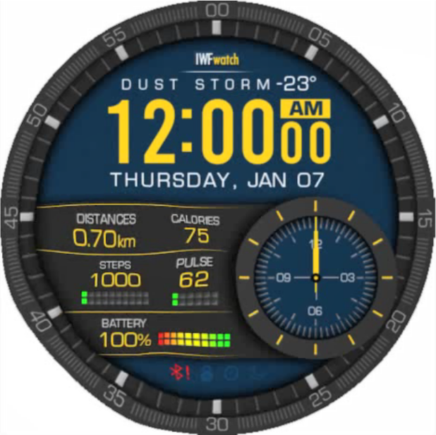</span></p>
</td>
</tr>
<tr id="zh-cn_topic_0000002420851802_row9714193515314"><td class="cellrowborder" valign="top" width="32.41%" headers="mcps1.2.3.1.1 "><p id="zh-cn_topic_0000002420851802_p10642113712417"><a name="zh-cn_topic_0000002420851802_p10642113712417"></a><a name="zh-cn_topic_0000002420851802_p10642113712417"></a>VGU_MESH_INVALID</p>
</td>
<td class="cellrowborder" valign="top" width="67.58999999999999%" headers="mcps1.2.3.1.2 "><p id="zh-cn_topic_0000002420851802_p15714193515310"><a name="zh-cn_topic_0000002420851802_p15714193515310"></a><a name="zh-cn_topic_0000002420851802_p15714193515310"></a>无效的网格变形模式。</p>
</td>
</tr>
</tbody>
</table>

### UI3DCylinder<a name="ZH-CN_TOPIC_0000002499581929"></a>

UI3DCylinder是支持3D柱状体模型纹理贴图的控件。具体使用流程请参考示例“middleware/services/gui/uikit/sample/uitest/components/ui\_test\_3d/ui\_test\_cylinder.cpp”。

**图 1**  UI3DCylinder效果示意图<a name="zh-cn_topic_0000002454250825_fig1381945814378"></a>  


**表 1**  UI3DCylinder核心函数

<a name="zh-cn_topic_0000002454250825_table2351mcpsimp"></a>
<table><thead align="left"><tr id="zh-cn_topic_0000002454250825_row2357mcpsimp"><th class="cellrowborder" valign="top" width="53%" id="mcps1.2.3.1.1"><p id="zh-cn_topic_0000002454250825_p2359mcpsimp"><a name="zh-cn_topic_0000002454250825_p2359mcpsimp"></a><a name="zh-cn_topic_0000002454250825_p2359mcpsimp"></a>函数</p>
</th>
<th class="cellrowborder" valign="top" width="47%" id="mcps1.2.3.1.2"><p id="zh-cn_topic_0000002454250825_p42118371217"><a name="zh-cn_topic_0000002454250825_p42118371217"></a><a name="zh-cn_topic_0000002454250825_p42118371217"></a>描述</p>
</th>
</tr>
</thead>
<tbody><tr id="zh-cn_topic_0000002454250825_row1229382217911"><td class="cellrowborder" valign="top" width="53%" headers="mcps1.2.3.1.1 "><p id="zh-cn_topic_0000002454250825_p1065431204611"><a name="zh-cn_topic_0000002454250825_p1065431204611"></a><a name="zh-cn_topic_0000002454250825_p1065431204611"></a>void SetStartY(int16_t y)</p>
</td>
<td class="cellrowborder" valign="top" width="47%" headers="mcps1.2.3.1.2 "><p id="zh-cn_topic_0000002454250825_p12340153018538"><a name="zh-cn_topic_0000002454250825_p12340153018538"></a><a name="zh-cn_topic_0000002454250825_p12340153018538"></a>设置局部显示部分相对于整张纹理素材的起始Y坐标。</p>
</td>
</tr>
<tr id="zh-cn_topic_0000002454250825_row9268595501"><td class="cellrowborder" valign="top" width="53%" headers="mcps1.2.3.1.1 "><p id="zh-cn_topic_0000002454250825_p7262593505"><a name="zh-cn_topic_0000002454250825_p7262593505"></a><a name="zh-cn_topic_0000002454250825_p7262593505"></a>int16_t GetStartY() const</p>
</td>
<td class="cellrowborder" valign="top" width="47%" headers="mcps1.2.3.1.2 "><p id="zh-cn_topic_0000002454250825_p11261759195015"><a name="zh-cn_topic_0000002454250825_p11261759195015"></a><a name="zh-cn_topic_0000002454250825_p11261759195015"></a>获取局部显示部分相对于整张纹理素材的起始Y坐标。</p>
</td>
</tr>
<tr id="zh-cn_topic_0000002454250825_row990218619474"><td class="cellrowborder" valign="top" width="53%" headers="mcps1.2.3.1.1 "><p id="zh-cn_topic_0000002454250825_p14598942153819"><a name="zh-cn_topic_0000002454250825_p14598942153819"></a><a name="zh-cn_topic_0000002454250825_p14598942153819"></a>void SetCameraAngle(float angle)</p>
</td>
<td class="cellrowborder" valign="top" width="47%" headers="mcps1.2.3.1.2 "><p id="zh-cn_topic_0000002454250825_p59213163262"><a name="zh-cn_topic_0000002454250825_p59213163262"></a><a name="zh-cn_topic_0000002454250825_p59213163262"></a>设置相机旋转角度。</p>
</td>
</tr>
<tr id="zh-cn_topic_0000002454250825_row6615530143214"><td class="cellrowborder" valign="top" width="53%" headers="mcps1.2.3.1.1 "><p id="zh-cn_topic_0000002454250825_p2246174644712"><a name="zh-cn_topic_0000002454250825_p2246174644712"></a><a name="zh-cn_topic_0000002454250825_p2246174644712"></a>void SetCameraVFov(float distance)</p>
</td>
<td class="cellrowborder" valign="top" width="47%" headers="mcps1.2.3.1.2 "><p id="zh-cn_topic_0000002454250825_p261683014329"><a name="zh-cn_topic_0000002454250825_p261683014329"></a><a name="zh-cn_topic_0000002454250825_p261683014329"></a>设置相机垂直视角。</p>
</td>
</tr>
<tr id="zh-cn_topic_0000002454250825_row1461663020328"><td class="cellrowborder" valign="top" width="53%" headers="mcps1.2.3.1.1 "><p id="zh-cn_topic_0000002454250825_p1364635614477"><a name="zh-cn_topic_0000002454250825_p1364635614477"></a><a name="zh-cn_topic_0000002454250825_p1364635614477"></a>void SetCameraAspectRatio(float ratio)</p>
</td>
<td class="cellrowborder" valign="top" width="47%" headers="mcps1.2.3.1.2 "><p id="zh-cn_topic_0000002454250825_p96011394215"><a name="zh-cn_topic_0000002454250825_p96011394215"></a><a name="zh-cn_topic_0000002454250825_p96011394215"></a>设置相机画面宽高比。</p>
</td>
</tr>
<tr id="zh-cn_topic_0000002454250825_row518444662519"><td class="cellrowborder" valign="top" width="53%" headers="mcps1.2.3.1.1 "><p id="zh-cn_topic_0000002454250825_p182017374483"><a name="zh-cn_topic_0000002454250825_p182017374483"></a><a name="zh-cn_topic_0000002454250825_p182017374483"></a>void SetCameraNearPlane(float value)</p>
</td>
<td class="cellrowborder" valign="top" width="47%" headers="mcps1.2.3.1.2 "><p id="zh-cn_topic_0000002454250825_p16690154944112"><a name="zh-cn_topic_0000002454250825_p16690154944112"></a><a name="zh-cn_topic_0000002454250825_p16690154944112"></a>设置相机近裁剪平面。</p>
</td>
</tr>
<tr id="zh-cn_topic_0000002454250825_row42691014133911"><td class="cellrowborder" valign="top" width="53%" headers="mcps1.2.3.1.1 "><p id="zh-cn_topic_0000002454250825_p209901813154919"><a name="zh-cn_topic_0000002454250825_p209901813154919"></a><a name="zh-cn_topic_0000002454250825_p209901813154919"></a>void SetCameraFarPlane(float value)</p>
</td>
<td class="cellrowborder" valign="top" width="47%" headers="mcps1.2.3.1.2 "><p id="zh-cn_topic_0000002454250825_p12701014203917"><a name="zh-cn_topic_0000002454250825_p12701014203917"></a><a name="zh-cn_topic_0000002454250825_p12701014203917"></a>设置相机远裁剪平面。</p>
</td>
</tr>
<tr id="zh-cn_topic_0000002454250825_row527012147393"><td class="cellrowborder" valign="top" width="53%" headers="mcps1.2.3.1.1 "><p id="zh-cn_topic_0000002454250825_p14872133810492"><a name="zh-cn_topic_0000002454250825_p14872133810492"></a><a name="zh-cn_topic_0000002454250825_p14872133810492"></a>void SetCameraAxis(Vector3&lt;float&gt; axis)</p>
</td>
<td class="cellrowborder" valign="top" width="47%" headers="mcps1.2.3.1.2 "><p id="zh-cn_topic_0000002454250825_p18270151483917"><a name="zh-cn_topic_0000002454250825_p18270151483917"></a><a name="zh-cn_topic_0000002454250825_p18270151483917"></a>设置相机中心轴。</p>
</td>
</tr>
<tr id="zh-cn_topic_0000002454250825_row10945111918525"><td class="cellrowborder" valign="top" width="53%" headers="mcps1.2.3.1.1 "><p id="zh-cn_topic_0000002454250825_p199451319145213"><a name="zh-cn_topic_0000002454250825_p199451319145213"></a><a name="zh-cn_topic_0000002454250825_p199451319145213"></a>void SetCameraScale(Vector3&lt;float&gt; scale)</p>
</td>
<td class="cellrowborder" valign="top" width="47%" headers="mcps1.2.3.1.2 "><p id="zh-cn_topic_0000002454250825_p19945171917521"><a name="zh-cn_topic_0000002454250825_p19945171917521"></a><a name="zh-cn_topic_0000002454250825_p19945171917521"></a>设置相机缩放比。</p>
</td>
</tr>
<tr id="zh-cn_topic_0000002454250825_row7270131417394"><td class="cellrowborder" valign="top" width="53%" headers="mcps1.2.3.1.1 "><p id="zh-cn_topic_0000002454250825_p129401453529"><a name="zh-cn_topic_0000002454250825_p129401453529"></a><a name="zh-cn_topic_0000002454250825_p129401453529"></a>void SetCameraTranslation(Vector3&lt;float&gt; translation);</p>
</td>
<td class="cellrowborder" valign="top" width="47%" headers="mcps1.2.3.1.2 "><p id="zh-cn_topic_0000002454250825_p627019142395"><a name="zh-cn_topic_0000002454250825_p627019142395"></a><a name="zh-cn_topic_0000002454250825_p627019142395"></a>设置相机平移。</p>
</td>
</tr>
<tr id="zh-cn_topic_0000002454250825_row172701714193916"><td class="cellrowborder" valign="top" width="53%" headers="mcps1.2.3.1.1 "><p id="zh-cn_topic_0000002454250825_p1873183011213"><a name="zh-cn_topic_0000002454250825_p1873183011213"></a><a name="zh-cn_topic_0000002454250825_p1873183011213"></a>void SetCameraPosition(Vector3&lt;float&gt; position)</p>
</td>
<td class="cellrowborder" valign="top" width="47%" headers="mcps1.2.3.1.2 "><p id="zh-cn_topic_0000002454250825_p18270614163919"><a name="zh-cn_topic_0000002454250825_p18270614163919"></a><a name="zh-cn_topic_0000002454250825_p18270614163919"></a>设置相机位置。</p>
</td>
</tr>
</tbody>
</table>

### UIPostEffectImageView<a name="ZH-CN_TOPIC_0000002499501973"></a>

UIPostEffectImageView是支持对图片进行HSV或者Colorize后处理的控件。HSV是指通过调整颜色模型的色相（Hue）、饱和度（Saturation）和明度（Value）来调整图像颜色。Colorize是指根据输入的颜色对图像进行染色。

HSV具体使用流程请参考示例“middleware/services/gui/uikit/sample/uitest/components/ui\_test\_hsv/ui\_test\_hsv.cpp”。

Colorize具体使用流程请参考示例“middleware/services/gui/uikit/sample/uitest/components/ui\_test\_colorize/ui\_test\_colorize.cpp”。

**表 1**  UIPostEffectImageView核心函数

<a name="zh-cn_topic_0000002420914042_table2351mcpsimp"></a>
<table><thead align="left"><tr id="zh-cn_topic_0000002420914042_row2357mcpsimp"><th class="cellrowborder" valign="top" width="53%" id="mcps1.2.3.1.1"><p id="zh-cn_topic_0000002420914042_p2359mcpsimp"><a name="zh-cn_topic_0000002420914042_p2359mcpsimp"></a><a name="zh-cn_topic_0000002420914042_p2359mcpsimp"></a>函数</p>
</th>
<th class="cellrowborder" valign="top" width="47%" id="mcps1.2.3.1.2"><p id="zh-cn_topic_0000002420914042_p42118371217"><a name="zh-cn_topic_0000002420914042_p42118371217"></a><a name="zh-cn_topic_0000002420914042_p42118371217"></a>描述</p>
</th>
</tr>
</thead>
<tbody><tr id="zh-cn_topic_0000002420914042_row1229382217911"><td class="cellrowborder" valign="top" width="53%" headers="mcps1.2.3.1.1 "><p id="zh-cn_topic_0000002420914042_p1065431204611"><a name="zh-cn_topic_0000002420914042_p1065431204611"></a><a name="zh-cn_topic_0000002420914042_p1065431204611"></a>void EnableColorize(bool enable)</p>
</td>
<td class="cellrowborder" valign="top" width="47%" headers="mcps1.2.3.1.2 "><p id="zh-cn_topic_0000002420914042_p12340153018538"><a name="zh-cn_topic_0000002420914042_p12340153018538"></a><a name="zh-cn_topic_0000002420914042_p12340153018538"></a>设置Colorize是否使能。</p>
</td>
</tr>
<tr id="zh-cn_topic_0000002420914042_row9268595501"><td class="cellrowborder" valign="top" width="53%" headers="mcps1.2.3.1.1 "><p id="zh-cn_topic_0000002420914042_p7262593505"><a name="zh-cn_topic_0000002420914042_p7262593505"></a><a name="zh-cn_topic_0000002420914042_p7262593505"></a>bool IsEnableColorize()</p>
</td>
<td class="cellrowborder" valign="top" width="47%" headers="mcps1.2.3.1.2 "><p id="zh-cn_topic_0000002420914042_p11261759195015"><a name="zh-cn_topic_0000002420914042_p11261759195015"></a><a name="zh-cn_topic_0000002420914042_p11261759195015"></a>获取Colorize是否使能。</p>
</td>
</tr>
<tr id="zh-cn_topic_0000002420914042_row990218619474"><td class="cellrowborder" valign="top" width="53%" headers="mcps1.2.3.1.1 "><p id="zh-cn_topic_0000002420914042_p14598942153819"><a name="zh-cn_topic_0000002420914042_p14598942153819"></a><a name="zh-cn_topic_0000002420914042_p14598942153819"></a>void SetColorize(ColorType color)</p>
</td>
<td class="cellrowborder" valign="top" width="47%" headers="mcps1.2.3.1.2 "><p id="zh-cn_topic_0000002420914042_p59213163262"><a name="zh-cn_topic_0000002420914042_p59213163262"></a><a name="zh-cn_topic_0000002420914042_p59213163262"></a>设置Colorize的颜色类型。</p>
</td>
</tr>
<tr id="zh-cn_topic_0000002420914042_row6615530143214"><td class="cellrowborder" valign="top" width="53%" headers="mcps1.2.3.1.1 "><p id="zh-cn_topic_0000002420914042_p2246174644712"><a name="zh-cn_topic_0000002420914042_p2246174644712"></a><a name="zh-cn_topic_0000002420914042_p2246174644712"></a>ColorType GetColorize()</p>
</td>
<td class="cellrowborder" valign="top" width="47%" headers="mcps1.2.3.1.2 "><p id="zh-cn_topic_0000002420914042_p261683014329"><a name="zh-cn_topic_0000002420914042_p261683014329"></a><a name="zh-cn_topic_0000002420914042_p261683014329"></a>获取Colorize的颜色类型。</p>
</td>
</tr>
<tr id="zh-cn_topic_0000002420914042_row1461663020328"><td class="cellrowborder" valign="top" width="53%" headers="mcps1.2.3.1.1 "><p id="zh-cn_topic_0000002420914042_p1364635614477"><a name="zh-cn_topic_0000002420914042_p1364635614477"></a><a name="zh-cn_topic_0000002420914042_p1364635614477"></a>void EnableHSVAdjust(bool enable)</p>
</td>
<td class="cellrowborder" valign="top" width="47%" headers="mcps1.2.3.1.2 "><p id="zh-cn_topic_0000002420914042_p96011394215"><a name="zh-cn_topic_0000002420914042_p96011394215"></a><a name="zh-cn_topic_0000002420914042_p96011394215"></a>设置HSV是否使能。</p>
</td>
</tr>
<tr id="zh-cn_topic_0000002420914042_row518444662519"><td class="cellrowborder" valign="top" width="53%" headers="mcps1.2.3.1.1 "><p id="zh-cn_topic_0000002420914042_p182017374483"><a name="zh-cn_topic_0000002420914042_p182017374483"></a><a name="zh-cn_topic_0000002420914042_p182017374483"></a>bool IsEnableHSVAdjust()</p>
</td>
<td class="cellrowborder" valign="top" width="47%" headers="mcps1.2.3.1.2 "><p id="zh-cn_topic_0000002420914042_p16690154944112"><a name="zh-cn_topic_0000002420914042_p16690154944112"></a><a name="zh-cn_topic_0000002420914042_p16690154944112"></a>获取HSV是否使能。</p>
</td>
</tr>
<tr id="zh-cn_topic_0000002420914042_row42691014133911"><td class="cellrowborder" valign="top" width="53%" headers="mcps1.2.3.1.1 "><p id="zh-cn_topic_0000002420914042_p209901813154919"><a name="zh-cn_topic_0000002420914042_p209901813154919"></a><a name="zh-cn_topic_0000002420914042_p209901813154919"></a>void SetHSVInfo(int16_t hAdjust, int8_t sAdjust, int8_t vAdjust, int16_t threshold)</p>
</td>
<td class="cellrowborder" valign="top" width="47%" headers="mcps1.2.3.1.2 "><p id="zh-cn_topic_0000002420914042_p12701014203917"><a name="zh-cn_topic_0000002420914042_p12701014203917"></a><a name="zh-cn_topic_0000002420914042_p12701014203917"></a>设置HSV参数。</p>
</td>
</tr>
<tr id="zh-cn_topic_0000002420914042_row527012147393"><td class="cellrowborder" valign="top" width="53%" headers="mcps1.2.3.1.1 "><p id="zh-cn_topic_0000002420914042_p14872133810492"><a name="zh-cn_topic_0000002420914042_p14872133810492"></a><a name="zh-cn_topic_0000002420914042_p14872133810492"></a>void SetHSVMask(const std::string& mask)</p>
</td>
<td class="cellrowborder" valign="top" width="47%" headers="mcps1.2.3.1.2 "><p id="zh-cn_topic_0000002420914042_p18270151483917"><a name="zh-cn_topic_0000002420914042_p18270151483917"></a><a name="zh-cn_topic_0000002420914042_p18270151483917"></a>设置HSV蒙版。</p>
</td>
</tr>
</tbody>
</table>

### UIRainView<a name="ZH-CN_TOPIC_0000002499582029"></a>

UIRainView是支持呈现雨滴效果以及擦拭交互的控件。具体使用流程请参考示例“middleware/services/gui/uikit/sample/uitest/components/ui\_test\_rain/ui\_test\_rain.cpp”。

**表 1**  UIRainView核心函数

<a name="zh-cn_topic_0000002454506105_table2351mcpsimp"></a>
<table><thead align="left"><tr id="zh-cn_topic_0000002454506105_row2357mcpsimp"><th class="cellrowborder" valign="top" width="53%" id="mcps1.2.3.1.1"><p id="zh-cn_topic_0000002454506105_p2359mcpsimp"><a name="zh-cn_topic_0000002454506105_p2359mcpsimp"></a><a name="zh-cn_topic_0000002454506105_p2359mcpsimp"></a>函数</p>
</th>
<th class="cellrowborder" valign="top" width="47%" id="mcps1.2.3.1.2"><p id="zh-cn_topic_0000002454506105_p42118371217"><a name="zh-cn_topic_0000002454506105_p42118371217"></a><a name="zh-cn_topic_0000002454506105_p42118371217"></a>描述</p>
</th>
</tr>
</thead>
<tbody><tr id="zh-cn_topic_0000002454506105_row1229382217911"><td class="cellrowborder" valign="top" width="53%" headers="mcps1.2.3.1.1 "><p id="zh-cn_topic_0000002454506105_p1065431204611"><a name="zh-cn_topic_0000002454506105_p1065431204611"></a><a name="zh-cn_topic_0000002454506105_p1065431204611"></a>void SetRain(const ImageInfo* rainInfo[], uint8_t rainNum)</p>
</td>
<td class="cellrowborder" valign="top" width="47%" headers="mcps1.2.3.1.2 "><p id="zh-cn_topic_0000002454506105_p12340153018538"><a name="zh-cn_topic_0000002454506105_p12340153018538"></a><a name="zh-cn_topic_0000002454506105_p12340153018538"></a>设置RainView所需要的图片以及图片数量。</p>
</td>
</tr>
<tr id="zh-cn_topic_0000002454506105_row9268595501"><td class="cellrowborder" valign="top" width="53%" headers="mcps1.2.3.1.1 "><p id="zh-cn_topic_0000002454506105_p7262593505"><a name="zh-cn_topic_0000002454506105_p7262593505"></a><a name="zh-cn_topic_0000002454506105_p7262593505"></a>void SetTimeOfUpdate(uint16_t timeOfUpdate)</p>
</td>
<td class="cellrowborder" valign="top" width="47%" headers="mcps1.2.3.1.2 "><p id="zh-cn_topic_0000002454506105_p11261759195015"><a name="zh-cn_topic_0000002454506105_p11261759195015"></a><a name="zh-cn_topic_0000002454506105_p11261759195015"></a>设置RainView的动画播放速度。</p>
</td>
</tr>
<tr id="zh-cn_topic_0000002454506105_row990218619474"><td class="cellrowborder" valign="top" width="53%" headers="mcps1.2.3.1.1 "><p id="zh-cn_topic_0000002454506105_p14598942153819"><a name="zh-cn_topic_0000002454506105_p14598942153819"></a><a name="zh-cn_topic_0000002454506105_p14598942153819"></a>uint16_t GetTimeOfUpdate()</p>
</td>
<td class="cellrowborder" valign="top" width="47%" headers="mcps1.2.3.1.2 "><p id="zh-cn_topic_0000002454506105_p59213163262"><a name="zh-cn_topic_0000002454506105_p59213163262"></a><a name="zh-cn_topic_0000002454506105_p59213163262"></a>获取RainView的动画播放速度。</p>
</td>
</tr>
<tr id="zh-cn_topic_0000002454506105_row6615530143214"><td class="cellrowborder" valign="top" width="53%" headers="mcps1.2.3.1.1 "><p id="zh-cn_topic_0000002454506105_p2246174644712"><a name="zh-cn_topic_0000002454506105_p2246174644712"></a><a name="zh-cn_topic_0000002454506105_p2246174644712"></a>void SetTimeOfPause(uint16_t timeOfPause)</p>
</td>
<td class="cellrowborder" valign="top" width="47%" headers="mcps1.2.3.1.2 "><p id="zh-cn_topic_0000002454506105_p12404786583"><a name="zh-cn_topic_0000002454506105_p12404786583"></a><a name="zh-cn_topic_0000002454506105_p12404786583"></a>设置无限重复动画的两次播放之间的间隔。</p>
</td>
</tr>
<tr id="zh-cn_topic_0000002454506105_row1461663020328"><td class="cellrowborder" valign="top" width="53%" headers="mcps1.2.3.1.1 "><p id="zh-cn_topic_0000002454506105_p1364635614477"><a name="zh-cn_topic_0000002454506105_p1364635614477"></a><a name="zh-cn_topic_0000002454506105_p1364635614477"></a>uint16_t GetTimeOfPause()</p>
</td>
<td class="cellrowborder" valign="top" width="47%" headers="mcps1.2.3.1.2 "><p id="zh-cn_topic_0000002454506105_p96011394215"><a name="zh-cn_topic_0000002454506105_p96011394215"></a><a name="zh-cn_topic_0000002454506105_p96011394215"></a>获取无限重复动画的两次播放之间的间隔。</p>
</td>
</tr>
<tr id="zh-cn_topic_0000002454506105_row518444662519"><td class="cellrowborder" valign="top" width="53%" headers="mcps1.2.3.1.1 "><p id="zh-cn_topic_0000002454506105_p182017374483"><a name="zh-cn_topic_0000002454506105_p182017374483"></a><a name="zh-cn_topic_0000002454506105_p182017374483"></a>void Start()</p>
</td>
<td class="cellrowborder" valign="top" width="47%" headers="mcps1.2.3.1.2 "><p id="zh-cn_topic_0000002454506105_p16690154944112"><a name="zh-cn_topic_0000002454506105_p16690154944112"></a><a name="zh-cn_topic_0000002454506105_p16690154944112"></a>播放动画。</p>
</td>
</tr>
<tr id="zh-cn_topic_0000002454506105_row42691014133911"><td class="cellrowborder" valign="top" width="53%" headers="mcps1.2.3.1.1 "><p id="zh-cn_topic_0000002454506105_p209901813154919"><a name="zh-cn_topic_0000002454506105_p209901813154919"></a><a name="zh-cn_topic_0000002454506105_p209901813154919"></a>void Pause()</p>
</td>
<td class="cellrowborder" valign="top" width="47%" headers="mcps1.2.3.1.2 "><p id="zh-cn_topic_0000002454506105_p12701014203917"><a name="zh-cn_topic_0000002454506105_p12701014203917"></a><a name="zh-cn_topic_0000002454506105_p12701014203917"></a>暂停动画。</p>
</td>
</tr>
<tr id="zh-cn_topic_0000002454506105_row527012147393"><td class="cellrowborder" valign="top" width="53%" headers="mcps1.2.3.1.1 "><p id="zh-cn_topic_0000002454506105_p14872133810492"><a name="zh-cn_topic_0000002454506105_p14872133810492"></a><a name="zh-cn_topic_0000002454506105_p14872133810492"></a>void Resume()</p>
</td>
<td class="cellrowborder" valign="top" width="47%" headers="mcps1.2.3.1.2 "><p id="zh-cn_topic_0000002454506105_p18270151483917"><a name="zh-cn_topic_0000002454506105_p18270151483917"></a><a name="zh-cn_topic_0000002454506105_p18270151483917"></a>恢复动画。</p>
</td>
</tr>
<tr id="zh-cn_topic_0000002454506105_row1019319329492"><td class="cellrowborder" valign="top" width="53%" headers="mcps1.2.3.1.1 "><p id="zh-cn_topic_0000002454506105_p919312320491"><a name="zh-cn_topic_0000002454506105_p919312320491"></a><a name="zh-cn_topic_0000002454506105_p919312320491"></a>void Stop()</p>
</td>
<td class="cellrowborder" valign="top" width="47%" headers="mcps1.2.3.1.2 "><p id="zh-cn_topic_0000002454506105_p619383219494"><a name="zh-cn_topic_0000002454506105_p619383219494"></a><a name="zh-cn_topic_0000002454506105_p619383219494"></a>停止动画。</p>
</td>
</tr>
<tr id="zh-cn_topic_0000002454506105_row231893417491"><td class="cellrowborder" valign="top" width="53%" headers="mcps1.2.3.1.1 "><p id="zh-cn_topic_0000002454506105_p1831893494913"><a name="zh-cn_topic_0000002454506105_p1831893494913"></a><a name="zh-cn_topic_0000002454506105_p1831893494913"></a>void GetState()</p>
</td>
<td class="cellrowborder" valign="top" width="47%" headers="mcps1.2.3.1.2 "><p id="zh-cn_topic_0000002454506105_p193181634184912"><a name="zh-cn_topic_0000002454506105_p193181634184912"></a><a name="zh-cn_topic_0000002454506105_p193181634184912"></a>获取动画状态。</p>
</td>
</tr>
<tr id="zh-cn_topic_0000002454506105_row954416354505"><td class="cellrowborder" valign="top" width="53%" headers="mcps1.2.3.1.1 "><p id="zh-cn_topic_0000002454506105_p254473535010"><a name="zh-cn_topic_0000002454506105_p254473535010"></a><a name="zh-cn_topic_0000002454506105_p254473535010"></a>void SetBlur(float radius)</p>
</td>
<td class="cellrowborder" valign="top" width="47%" headers="mcps1.2.3.1.2 "><p id="zh-cn_topic_0000002454506105_p2544635115016"><a name="zh-cn_topic_0000002454506105_p2544635115016"></a><a name="zh-cn_topic_0000002454506105_p2544635115016"></a>设置高斯模糊值。</p>
</td>
</tr>
<tr id="zh-cn_topic_0000002454506105_row726016383502"><td class="cellrowborder" valign="top" width="53%" headers="mcps1.2.3.1.1 "><p id="zh-cn_topic_0000002454506105_p18261538105016"><a name="zh-cn_topic_0000002454506105_p18261538105016"></a><a name="zh-cn_topic_0000002454506105_p18261538105016"></a>float GetBlur()</p>
</td>
<td class="cellrowborder" valign="top" width="47%" headers="mcps1.2.3.1.2 "><p id="zh-cn_topic_0000002454506105_p1626117384509"><a name="zh-cn_topic_0000002454506105_p1626117384509"></a><a name="zh-cn_topic_0000002454506105_p1626117384509"></a>获取高斯模糊值。</p>
</td>
</tr>
<tr id="zh-cn_topic_0000002454506105_row20115168132"><td class="cellrowborder" valign="top" width="53%" headers="mcps1.2.3.1.1 "><p id="zh-cn_topic_0000002454506105_p1711528637"><a name="zh-cn_topic_0000002454506105_p1711528637"></a><a name="zh-cn_topic_0000002454506105_p1711528637"></a>uint8_t ClearWipeArea()</p>
</td>
<td class="cellrowborder" valign="top" width="47%" headers="mcps1.2.3.1.2 "><p id="zh-cn_topic_0000002454506105_p1511568637"><a name="zh-cn_topic_0000002454506105_p1511568637"></a><a name="zh-cn_topic_0000002454506105_p1511568637"></a>启动手动擦拭擦拭区域。</p>
</td>
</tr>
<tr id="zh-cn_topic_0000002454506105_row017042911515"><td class="cellrowborder" valign="top" width="53%" headers="mcps1.2.3.1.1 "><p id="zh-cn_topic_0000002454506105_p5170112985120"><a name="zh-cn_topic_0000002454506105_p5170112985120"></a><a name="zh-cn_topic_0000002454506105_p5170112985120"></a>void SetWipeWidth(uint32_t width)</p>
</td>
<td class="cellrowborder" valign="top" width="47%" headers="mcps1.2.3.1.2 "><p id="zh-cn_topic_0000002454506105_p9170172995110"><a name="zh-cn_topic_0000002454506105_p9170172995110"></a><a name="zh-cn_topic_0000002454506105_p9170172995110"></a>设置手动擦拭屏幕的宽度。</p>
</td>
</tr>
<tr id="zh-cn_topic_0000002454506105_row192661313515"><td class="cellrowborder" valign="top" width="53%" headers="mcps1.2.3.1.1 "><p id="zh-cn_topic_0000002454506105_p32661631195118"><a name="zh-cn_topic_0000002454506105_p32661631195118"></a><a name="zh-cn_topic_0000002454506105_p32661631195118"></a>uint32_t GetWipeWidth()</p>
</td>
<td class="cellrowborder" valign="top" width="47%" headers="mcps1.2.3.1.2 "><p id="zh-cn_topic_0000002454506105_p15266103175117"><a name="zh-cn_topic_0000002454506105_p15266103175117"></a><a name="zh-cn_topic_0000002454506105_p15266103175117"></a>获取手动擦拭屏幕的宽度。</p>
</td>
</tr>
<tr id="zh-cn_topic_0000002454506105_row2749203915416"><td class="cellrowborder" valign="top" width="53%" headers="mcps1.2.3.1.1 "><p id="zh-cn_topic_0000002454506105_p15750193911417"><a name="zh-cn_topic_0000002454506105_p15750193911417"></a><a name="zh-cn_topic_0000002454506105_p15750193911417"></a>void Clear()</p>
</td>
<td class="cellrowborder" valign="top" width="47%" headers="mcps1.2.3.1.2 "><p id="zh-cn_topic_0000002454506105_p57502039144"><a name="zh-cn_topic_0000002454506105_p57502039144"></a><a name="zh-cn_topic_0000002454506105_p57502039144"></a>手动清除雨水图像缓存并擦拭区域，应在此动画器停止后调用。</p>
</td>
</tr>
</tbody>
</table>

# 支持振动<a name="ZH-CN_TOPIC_0000002466542788"></a>

-   **[功能介绍](#ZH-CN_TOPIC_0000002499501997)**  

-   **[振动类型](#ZH-CN_TOPIC_0000002499501889)**  

-   **[对外接口](#ZH-CN_TOPIC_0000002499582109)**  

## 功能介绍<a name="ZH-CN_TOPIC_0000002499501997"></a>

滑动或旋转表冠时，某些控件会振动（请参考[表2](#zh-cn_topic_0000002411206724_table458652210575)），具体振动行为由外部通过VibratorManager注册。

> **说明：** 
>如果要启动振动，需要提前打开宏定义ENABLE\_VIBRATOR并注册振动函数。

## 振动类型<a name="ZH-CN_TOPIC_0000002499501889"></a>

振动类型说明如下：

```
enum class VibratorType {
    VIBRATOR_TYPE_ONE, // 振动1次
    VIBRATOR_TYPE_TWO, // 振动2次
    VIBRATOR_TYPE_THREE // 振动3次
};
```

## 对外接口<a name="ZH-CN_TOPIC_0000002499582109"></a>

**表 1**  VibratorManager核心函数

<a name="zh-cn_topic_0000002411206724_table59573618533"></a>
<table><thead align="left"><tr id="zh-cn_topic_0000002411206724_row39516361536"><th class="cellrowborder" valign="top" width="50%" id="mcps1.2.3.1.1"><p id="zh-cn_topic_0000002411206724_p159573614532"><a name="zh-cn_topic_0000002411206724_p159573614532"></a><a name="zh-cn_topic_0000002411206724_p159573614532"></a>函数</p>
</th>
<th class="cellrowborder" valign="top" width="50%" id="mcps1.2.3.1.2"><p id="zh-cn_topic_0000002411206724_p1495123615539"><a name="zh-cn_topic_0000002411206724_p1495123615539"></a><a name="zh-cn_topic_0000002411206724_p1495123615539"></a>说明</p>
</th>
</tr>
</thead>
<tbody><tr id="zh-cn_topic_0000002411206724_row99516361534"><td class="cellrowborder" valign="top" width="50%" headers="mcps1.2.3.1.1 "><p id="zh-cn_topic_0000002411206724_p123554811534"><a name="zh-cn_topic_0000002411206724_p123554811534"></a><a name="zh-cn_topic_0000002411206724_p123554811534"></a>void RegisterVibratorFunc(VibratorFunc vibratorFunc)</p>
</td>
<td class="cellrowborder" valign="top" width="50%" headers="mcps1.2.3.1.2 "><p id="zh-cn_topic_0000002411206724_p10951836115318"><a name="zh-cn_topic_0000002411206724_p10951836115318"></a><a name="zh-cn_topic_0000002411206724_p10951836115318"></a>注册振动函数，类型VibratorFunc的定义为</p>
<p id="zh-cn_topic_0000002411206724_p3491625102614"><a name="zh-cn_topic_0000002411206724_p3491625102614"></a><a name="zh-cn_topic_0000002411206724_p3491625102614"></a>typedef void(*VibratorFunc)(VibratorType vibratorType);。</p>
</td>
</tr>
<tr id="zh-cn_topic_0000002411206724_row109518368537"><td class="cellrowborder" valign="top" width="50%" headers="mcps1.2.3.1.1 "><p id="zh-cn_topic_0000002411206724_p2033913552530"><a name="zh-cn_topic_0000002411206724_p2033913552530"></a><a name="zh-cn_topic_0000002411206724_p2033913552530"></a>VibratorFunc GetVibratorFunc()</p>
</td>
<td class="cellrowborder" valign="top" width="50%" headers="mcps1.2.3.1.2 "><p id="zh-cn_topic_0000002411206724_p39516361533"><a name="zh-cn_topic_0000002411206724_p39516361533"></a><a name="zh-cn_topic_0000002411206724_p39516361533"></a>获取当前振动函数。</p>
</td>
</tr>
</tbody>
</table>

**表 2**  支持振动的控件

<a name="zh-cn_topic_0000002411206724_table458652210575"></a>
<table><thead align="left"><tr id="zh-cn_topic_0000002411206724_row1758612229571"><th class="cellrowborder" valign="top" width="100%" id="mcps1.2.2.1.1"><p id="zh-cn_topic_0000002411206724_p7587152211579"><a name="zh-cn_topic_0000002411206724_p7587152211579"></a><a name="zh-cn_topic_0000002411206724_p7587152211579"></a>支持振动的控件</p>
</th>
</tr>
</thead>
<tbody><tr id="zh-cn_topic_0000002411206724_row7587192285718"><td class="cellrowborder" valign="top" width="100%" headers="mcps1.2.2.1.1 "><p id="zh-cn_topic_0000002411206724_p490017429573"><a name="zh-cn_topic_0000002411206724_p490017429573"></a><a name="zh-cn_topic_0000002411206724_p490017429573"></a>UIRollerView</p>
</td>
</tr>
</tbody>
</table>

# 多语言切换<a name="ZH-CN_TOPIC_0000002499582037"></a>

-   **[功能介绍](#ZH-CN_TOPIC_0000002499582125)**  

-   **[对外接口](#ZH-CN_TOPIC_0000002466542572)**  

-   **[XML APIs](#ZH-CN_TOPIC_0000002466542748)**  

## 功能介绍<a name="ZH-CN_TOPIC_0000002499582125"></a>

多语言切换主要提供的是字符串自动翻译功能，通过字符串ID自动查找对应语言的字符串，并提供了一个工具将xml转换为bin文件和对应的C++头文件。

语言代码参考网站：[http://www.lingoes.cn/zh/translator/langcode.htm](http://www.lingoes.cn/zh/translator/langcode.htm)

转换工具及使用请参考Debugkits指导文档《DebugKits工具 使用指南》的“多语言脚本调用”章节。

**图 1**  原理框图<a name="zh-cn_topic_0000002411046884_fig9910195203115"></a>  
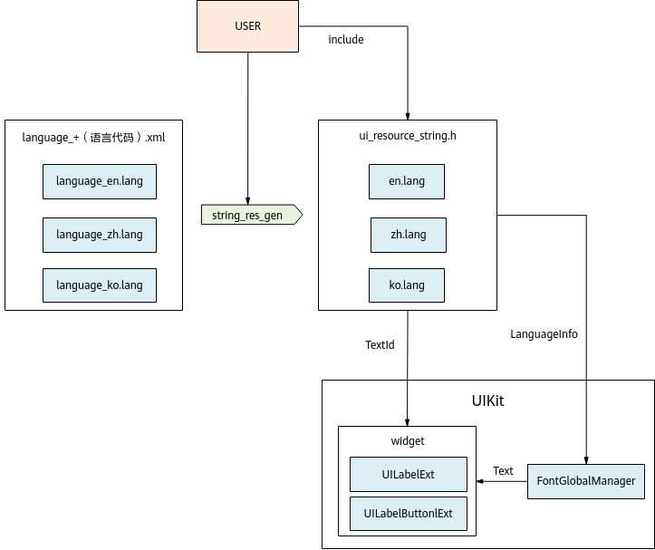

## 对外接口<a name="ZH-CN_TOPIC_0000002466542572"></a>

-   **[FontGlobalManager](#ZH-CN_TOPIC_0000002499501949)**  

-   **[UILabelExt和UILabelButtonExt](#ZH-CN_TOPIC_0000002499501965)**  

### FontGlobalManager<a name="ZH-CN_TOPIC_0000002499501949"></a>

FontGlobalManager为全球化文字管理模块，用户需要将多语言信息注册到该模块，通过SetCurrentLangId函数进行语言切换，其他接口为内部模块使用，外部模块可以忽略。

**表 1**  FontGlobalManager核心函数

<a name="zh-cn_topic_0000002411046844_table2651mcpsimp"></a>
<table><thead align="left"><tr id="zh-cn_topic_0000002411046844_row2657mcpsimp"><th class="cellrowborder" valign="top" width="32%" id="mcps1.2.3.1.1"><p id="zh-cn_topic_0000002411046844_p2659mcpsimp"><a name="zh-cn_topic_0000002411046844_p2659mcpsimp"></a><a name="zh-cn_topic_0000002411046844_p2659mcpsimp"></a>函数</p>
</th>
<th class="cellrowborder" valign="top" width="68%" id="mcps1.2.3.1.2"><p id="zh-cn_topic_0000002411046844_p2661mcpsimp"><a name="zh-cn_topic_0000002411046844_p2661mcpsimp"></a><a name="zh-cn_topic_0000002411046844_p2661mcpsimp"></a>说明</p>
</th>
</tr>
</thead>
<tbody><tr id="zh-cn_topic_0000002411046844_row2663mcpsimp"><td class="cellrowborder" valign="top" width="32%" headers="mcps1.2.3.1.1 "><p id="zh-cn_topic_0000002411046844_p413525711407"><a name="zh-cn_topic_0000002411046844_p413525711407"></a><a name="zh-cn_topic_0000002411046844_p413525711407"></a>static FontGlobalManager* GetInstance()</p>
</td>
<td class="cellrowborder" valign="top" width="68%" headers="mcps1.2.3.1.2 "><p id="zh-cn_topic_0000002411046844_p2667mcpsimp"><a name="zh-cn_topic_0000002411046844_p2667mcpsimp"></a><a name="zh-cn_topic_0000002411046844_p2667mcpsimp"></a>FontGlobalManager是单例，该接口用于获取文字全球化管理的实例。</p>
<a name="zh-cn_topic_0000002411046844_ul26283148314"></a><a name="zh-cn_topic_0000002411046844_ul26283148314"></a><ul id="zh-cn_topic_0000002411046844_ul26283148314"><li>参数：N/A</li><li>返回值类型：FontGlobalManager*</li></ul>
</td>
</tr>
<tr id="zh-cn_topic_0000002411046844_row2670mcpsimp"><td class="cellrowborder" valign="top" width="32%" headers="mcps1.2.3.1.1 "><p id="zh-cn_topic_0000002411046844_p06909103414"><a name="zh-cn_topic_0000002411046844_p06909103414"></a><a name="zh-cn_topic_0000002411046844_p06909103414"></a>bool RegisterLanguageInfo(const char** resFile, uint8_t totalLangId, uint8_t defaultLangId)</p>
</td>
<td class="cellrowborder" valign="top" width="68%" headers="mcps1.2.3.1.2 "><p id="zh-cn_topic_0000002411046844_p2674mcpsimp"><a name="zh-cn_topic_0000002411046844_p2674mcpsimp"></a><a name="zh-cn_topic_0000002411046844_p2674mcpsimp"></a>注册语言信息。</p>
<a name="zh-cn_topic_0000002411046844_ul2675mcpsimp"></a><a name="zh-cn_topic_0000002411046844_ul2675mcpsimp"></a><ul id="zh-cn_topic_0000002411046844_ul2675mcpsimp"><li>参数1：const char** resFile，字符串二进制文件数组首地址，每个二进制文件对应一种语言。</li><li>参数2：uint8_t totalLangId，文件最大个数（最大值参考 ui_resource_string.h，且不可超出实际注册语言个数）。</li><li>参数3：uint8  defaultLangId，默认的语言ID（ID值参考ui_resource_string.h）。</li></ul>
<p id="zh-cn_topic_0000002411046844_p13668202613316"><a name="zh-cn_topic_0000002411046844_p13668202613316"></a><a name="zh-cn_topic_0000002411046844_p13668202613316"></a>返回值类型：bool。</p>
<a name="zh-cn_topic_0000002411046844_ul194507417313"></a><a name="zh-cn_topic_0000002411046844_ul194507417313"></a><ul id="zh-cn_topic_0000002411046844_ul194507417313"><li>true 代表成功。</li><li>false代表失败。</li></ul>
</td>
</tr>
<tr id="zh-cn_topic_0000002411046844_row2680mcpsimp"><td class="cellrowborder" valign="top" width="32%" headers="mcps1.2.3.1.1 "><p id="zh-cn_topic_0000002411046844_p6936185614117"><a name="zh-cn_topic_0000002411046844_p6936185614117"></a><a name="zh-cn_topic_0000002411046844_p6936185614117"></a>void UnRegisterLanguageInfo()</p>
</td>
<td class="cellrowborder" valign="top" width="68%" headers="mcps1.2.3.1.2 "><p id="zh-cn_topic_0000002411046844_p2684mcpsimp"><a name="zh-cn_topic_0000002411046844_p2684mcpsimp"></a><a name="zh-cn_topic_0000002411046844_p2684mcpsimp"></a>卸载所有的多语言字串信息。</p>
<a name="zh-cn_topic_0000002411046844_ul1124405543216"></a><a name="zh-cn_topic_0000002411046844_ul1124405543216"></a><ul id="zh-cn_topic_0000002411046844_ul1124405543216"><li>传参：N/A</li><li>返回值类型：void</li></ul>
</td>
</tr>
<tr id="zh-cn_topic_0000002411046844_row2687mcpsimp"><td class="cellrowborder" valign="top" width="32%" headers="mcps1.2.3.1.1 "><p id="zh-cn_topic_0000002411046844_p2689mcpsimp"><a name="zh-cn_topic_0000002411046844_p2689mcpsimp"></a><a name="zh-cn_topic_0000002411046844_p2689mcpsimp"></a>void SetCurrentLangId(uint8_t langId)</p>
</td>
<td class="cellrowborder" valign="top" width="68%" headers="mcps1.2.3.1.2 "><p id="zh-cn_topic_0000002411046844_p2691mcpsimp"><a name="zh-cn_topic_0000002411046844_p2691mcpsimp"></a><a name="zh-cn_topic_0000002411046844_p2691mcpsimp"></a>设置当前的语言</p>
<a name="zh-cn_topic_0000002411046844_ul139814715336"></a><a name="zh-cn_topic_0000002411046844_ul139814715336"></a><ul id="zh-cn_topic_0000002411046844_ul139814715336"><li>传参：uint8_t langId （ID值参考ui_resource_string.h）</li><li>返回值类型：void</li></ul>
</td>
</tr>
<tr id="zh-cn_topic_0000002411046844_row2694mcpsimp"><td class="cellrowborder" valign="top" width="32%" headers="mcps1.2.3.1.1 "><p id="zh-cn_topic_0000002411046844_p2696mcpsimp"><a name="zh-cn_topic_0000002411046844_p2696mcpsimp"></a><a name="zh-cn_topic_0000002411046844_p2696mcpsimp"></a>FontParam GetFontParam(uint16_t textId)</p>
</td>
<td class="cellrowborder" valign="top" width="68%" headers="mcps1.2.3.1.2 "><p id="zh-cn_topic_0000002411046844_p2698mcpsimp"><a name="zh-cn_topic_0000002411046844_p2698mcpsimp"></a><a name="zh-cn_topic_0000002411046844_p2698mcpsimp"></a>获取当前的语言。</p>
<a name="zh-cn_topic_0000002411046844_ul81481311113312"></a><a name="zh-cn_topic_0000002411046844_ul81481311113312"></a><ul id="zh-cn_topic_0000002411046844_ul81481311113312"><li>传参：uint8_t  textId , 文本ID，（ID值参考ui_resource_string.h）</li><li>返回值类型：FontParam（fontSize, direct, fontName）</li></ul>
</td>
</tr>
<tr id="zh-cn_topic_0000002411046844_row2701mcpsimp"><td class="cellrowborder" valign="top" width="32%" headers="mcps1.2.3.1.1 "><p id="zh-cn_topic_0000002411046844_p2703mcpsimp"><a name="zh-cn_topic_0000002411046844_p2703mcpsimp"></a><a name="zh-cn_topic_0000002411046844_p2703mcpsimp"></a>uint8_t GetTotalLangId()</p>
</td>
<td class="cellrowborder" valign="top" width="68%" headers="mcps1.2.3.1.2 "><p id="zh-cn_topic_0000002411046844_p2705mcpsimp"><a name="zh-cn_topic_0000002411046844_p2705mcpsimp"></a><a name="zh-cn_topic_0000002411046844_p2705mcpsimp"></a>获取支持的多语言数量。</p>
<a name="zh-cn_topic_0000002411046844_ul181941915183312"></a><a name="zh-cn_topic_0000002411046844_ul181941915183312"></a><ul id="zh-cn_topic_0000002411046844_ul181941915183312"><li>参数：N/A</li><li>返回值类型：uint8_t 最大的语言ID。</li></ul>
</td>
</tr>
</tbody>
</table>

### UILabelExt和UILabelButtonExt<a name="ZH-CN_TOPIC_0000002499501965"></a>

多语言切换功能是以UIKit扩展方式实现的，为了尽量减少对原始UIKit的修改，扩展了两个组件，分别为UILabelExt和UILabelButtonExt。如果控件需要支持多语言切换，需要将UILabel和UILabelButton切换到UILabelExt和UILabelButtonExt，并通过SetTextId来设置静态文本。ForceResetText在切换语言时由FontGlobalManager调用，用户无需调用该接口。

**表 1**  UILabelButtonExt核心函数

<a name="zh-cn_topic_0000002444725889_table2710mcpsimp"></a>
<table><thead align="left"><tr id="zh-cn_topic_0000002444725889_row2716mcpsimp"><th class="cellrowborder" valign="top" width="32%" id="mcps1.2.3.1.1"><p id="zh-cn_topic_0000002444725889_p2718mcpsimp"><a name="zh-cn_topic_0000002444725889_p2718mcpsimp"></a><a name="zh-cn_topic_0000002444725889_p2718mcpsimp"></a>函数</p>
</th>
<th class="cellrowborder" valign="top" width="68%" id="mcps1.2.3.1.2"><p id="zh-cn_topic_0000002444725889_p2720mcpsimp"><a name="zh-cn_topic_0000002444725889_p2720mcpsimp"></a><a name="zh-cn_topic_0000002444725889_p2720mcpsimp"></a>描述</p>
</th>
</tr>
</thead>
<tbody><tr id="zh-cn_topic_0000002444725889_row2722mcpsimp"><td class="cellrowborder" valign="top" width="32%" headers="mcps1.2.3.1.1 "><p id="zh-cn_topic_0000002444725889_p2724mcpsimp"><a name="zh-cn_topic_0000002444725889_p2724mcpsimp"></a><a name="zh-cn_topic_0000002444725889_p2724mcpsimp"></a>SetTextId</p>
</td>
<td class="cellrowborder" valign="top" width="68%" headers="mcps1.2.3.1.2 "><p id="zh-cn_topic_0000002444725889_p2726mcpsimp"><a name="zh-cn_topic_0000002444725889_p2726mcpsimp"></a><a name="zh-cn_topic_0000002444725889_p2726mcpsimp"></a>设置TextId。</p>
<a name="zh-cn_topic_0000002444725889_ul1822545513411"></a><a name="zh-cn_topic_0000002444725889_ul1822545513411"></a><ul id="zh-cn_topic_0000002444725889_ul1822545513411"><li>参数：uint16_t textId</li><li>返回值：void</li></ul>
</td>
</tr>
<tr id="zh-cn_topic_0000002444725889_row2729mcpsimp"><td class="cellrowborder" valign="top" width="32%" headers="mcps1.2.3.1.1 "><p id="zh-cn_topic_0000002444725889_p2731mcpsimp"><a name="zh-cn_topic_0000002444725889_p2731mcpsimp"></a><a name="zh-cn_topic_0000002444725889_p2731mcpsimp"></a>ForceResetText</p>
</td>
<td class="cellrowborder" valign="top" width="68%" headers="mcps1.2.3.1.2 "><p id="zh-cn_topic_0000002444725889_p2733mcpsimp"><a name="zh-cn_topic_0000002444725889_p2733mcpsimp"></a><a name="zh-cn_topic_0000002444725889_p2733mcpsimp"></a>强制根据控件内部的TextId设置文本内容。</p>
<a name="zh-cn_topic_0000002444725889_ul154601516347"></a><a name="zh-cn_topic_0000002444725889_ul154601516347"></a><ul id="zh-cn_topic_0000002444725889_ul154601516347"><li>参数：N/A</li><li>返回值：void</li></ul>
</td>
</tr>
</tbody>
</table>

## XML APIs<a name="ZH-CN_TOPIC_0000002466542748"></a>

-   **[根元素](#ZH-CN_TOPIC_0000002499501905)**  

-   **[字符串元素](#ZH-CN_TOPIC_0000002466383120)**  

### 根元素<a name="ZH-CN_TOPIC_0000002499501905"></a>

XML必须以language为根元素并支持以下属性，language元素中的属性对所有的子元素都生效，并且作为子元素的默认值，如果子元素有定义相同的属性，以子元素设置的生效。

**表 1**  多语言xml配置

<a name="zh-cn_topic_0000002411206716_table2739mcpsimp"></a>
<table><thead align="left"><tr id="zh-cn_topic_0000002411206716_row2747mcpsimp"><th class="cellrowborder" valign="top" width="18%" id="mcps1.2.5.1.1"><p id="zh-cn_topic_0000002411206716_p2749mcpsimp"><a name="zh-cn_topic_0000002411206716_p2749mcpsimp"></a><a name="zh-cn_topic_0000002411206716_p2749mcpsimp"></a>属性名</p>
</th>
<th class="cellrowborder" valign="top" width="35%" id="mcps1.2.5.1.2"><p id="zh-cn_topic_0000002411206716_p2751mcpsimp"><a name="zh-cn_topic_0000002411206716_p2751mcpsimp"></a><a name="zh-cn_topic_0000002411206716_p2751mcpsimp"></a>描述</p>
</th>
<th class="cellrowborder" valign="top" width="34%" id="mcps1.2.5.1.3"><p id="zh-cn_topic_0000002411206716_p2753mcpsimp"><a name="zh-cn_topic_0000002411206716_p2753mcpsimp"></a><a name="zh-cn_topic_0000002411206716_p2753mcpsimp"></a>取值</p>
</th>
<th class="cellrowborder" valign="top" width="13%" id="mcps1.2.5.1.4"><p id="zh-cn_topic_0000002411206716_p2755mcpsimp"><a name="zh-cn_topic_0000002411206716_p2755mcpsimp"></a><a name="zh-cn_topic_0000002411206716_p2755mcpsimp"></a>必选</p>
</th>
</tr>
</thead>
<tbody><tr id="zh-cn_topic_0000002411206716_row2757mcpsimp"><td class="cellrowborder" valign="top" width="18%" headers="mcps1.2.5.1.1 "><p id="zh-cn_topic_0000002411206716_p2759mcpsimp"><a name="zh-cn_topic_0000002411206716_p2759mcpsimp"></a><a name="zh-cn_topic_0000002411206716_p2759mcpsimp"></a>languageinfo</p>
</td>
<td class="cellrowborder" valign="top" width="35%" headers="mcps1.2.5.1.2 "><p id="zh-cn_topic_0000002411206716_p2761mcpsimp"><a name="zh-cn_topic_0000002411206716_p2761mcpsimp"></a><a name="zh-cn_topic_0000002411206716_p2761mcpsimp"></a>语言信息，使用语言代码（ISO 639）标识语言。</p>
</td>
<td class="cellrowborder" valign="top" width="34%" headers="mcps1.2.5.1.3 "><p id="zh-cn_topic_0000002411206716_p2763mcpsimp"><a name="zh-cn_topic_0000002411206716_p2763mcpsimp"></a><a name="zh-cn_topic_0000002411206716_p2763mcpsimp"></a>ISO 639标准定义的语言代码</p>
</td>
<td class="cellrowborder" valign="top" width="13%" headers="mcps1.2.5.1.4 "><p id="zh-cn_topic_0000002411206716_p2765mcpsimp"><a name="zh-cn_topic_0000002411206716_p2765mcpsimp"></a><a name="zh-cn_topic_0000002411206716_p2765mcpsimp"></a>是</p>
</td>
</tr>
<tr id="zh-cn_topic_0000002411206716_row2766mcpsimp"><td class="cellrowborder" valign="top" width="18%" headers="mcps1.2.5.1.1 "><p id="zh-cn_topic_0000002411206716_p2768mcpsimp"><a name="zh-cn_topic_0000002411206716_p2768mcpsimp"></a><a name="zh-cn_topic_0000002411206716_p2768mcpsimp"></a>direct</p>
</td>
<td class="cellrowborder" valign="top" width="35%" headers="mcps1.2.5.1.2 "><p id="zh-cn_topic_0000002411206716_p2770mcpsimp"><a name="zh-cn_topic_0000002411206716_p2770mcpsimp"></a><a name="zh-cn_topic_0000002411206716_p2770mcpsimp"></a>文本方向布局。</p>
</td>
<td class="cellrowborder" valign="top" width="34%" headers="mcps1.2.5.1.3 "><p id="zh-cn_topic_0000002411206716_p2772mcpsimp"><a name="zh-cn_topic_0000002411206716_p2772mcpsimp"></a><a name="zh-cn_topic_0000002411206716_p2772mcpsimp"></a>ltr（left to right），rtl（right to left），mixed（多语言混排）</p>
</td>
<td class="cellrowborder" valign="top" width="13%" headers="mcps1.2.5.1.4 "><p id="zh-cn_topic_0000002411206716_p2774mcpsimp"><a name="zh-cn_topic_0000002411206716_p2774mcpsimp"></a><a name="zh-cn_topic_0000002411206716_p2774mcpsimp"></a>否</p>
</td>
</tr>
<tr id="zh-cn_topic_0000002411206716_row2775mcpsimp"><td class="cellrowborder" valign="top" width="18%" headers="mcps1.2.5.1.1 "><p id="zh-cn_topic_0000002411206716_p2777mcpsimp"><a name="zh-cn_topic_0000002411206716_p2777mcpsimp"></a><a name="zh-cn_topic_0000002411206716_p2777mcpsimp"></a>fontName</p>
</td>
<td class="cellrowborder" valign="top" width="35%" headers="mcps1.2.5.1.2 "><p id="zh-cn_topic_0000002411206716_p2779mcpsimp"><a name="zh-cn_topic_0000002411206716_p2779mcpsimp"></a><a name="zh-cn_topic_0000002411206716_p2779mcpsimp"></a>设置矢量字库名，路径需要在graphic_config.h中配置宏VECTOR_FONT_DIR。</p>
</td>
<td class="cellrowborder" valign="top" width="34%" headers="mcps1.2.5.1.3 "><p id="zh-cn_topic_0000002411206716_p2781mcpsimp"><a name="zh-cn_topic_0000002411206716_p2781mcpsimp"></a><a name="zh-cn_topic_0000002411206716_p2781mcpsimp"></a>ttf文件名</p>
</td>
<td class="cellrowborder" valign="top" width="13%" headers="mcps1.2.5.1.4 "><p id="zh-cn_topic_0000002411206716_p2783mcpsimp"><a name="zh-cn_topic_0000002411206716_p2783mcpsimp"></a><a name="zh-cn_topic_0000002411206716_p2783mcpsimp"></a>否</p>
</td>
</tr>
</tbody>
</table>

### 字符串元素<a name="ZH-CN_TOPIC_0000002466383120"></a>

字符串元素以lanstr为命名，定义字符串的相关信息，包括字符串取值、文本大小、字库名等信息。如果根元素也定义的相同的属性，会以字符串元素中定义的值为准，如果都没有定义，取UIKit中设置的默认值。

**表 1**  字符串元素配置

<a name="zh-cn_topic_0000002411046880__table936mcpsimp"></a>
<table><thead align="left"><tr id="zh-cn_topic_0000002411046880_row2793mcpsimp"><th class="cellrowborder" valign="top" width="17.82178217821782%" id="mcps1.2.5.1.1"><p id="zh-cn_topic_0000002411046880_p2795mcpsimp"><a name="zh-cn_topic_0000002411046880_p2795mcpsimp"></a><a name="zh-cn_topic_0000002411046880_p2795mcpsimp"></a>属性名</p>
</th>
<th class="cellrowborder" valign="top" width="44.554455445544555%" id="mcps1.2.5.1.2"><p id="zh-cn_topic_0000002411046880_p2797mcpsimp"><a name="zh-cn_topic_0000002411046880_p2797mcpsimp"></a><a name="zh-cn_topic_0000002411046880_p2797mcpsimp"></a>描述</p>
</th>
<th class="cellrowborder" valign="top" width="24.752475247524753%" id="mcps1.2.5.1.3"><p id="zh-cn_topic_0000002411046880_p2799mcpsimp"><a name="zh-cn_topic_0000002411046880_p2799mcpsimp"></a><a name="zh-cn_topic_0000002411046880_p2799mcpsimp"></a>取值</p>
</th>
<th class="cellrowborder" valign="top" width="12.871287128712872%" id="mcps1.2.5.1.4"><p id="zh-cn_topic_0000002411046880_p2801mcpsimp"><a name="zh-cn_topic_0000002411046880_p2801mcpsimp"></a><a name="zh-cn_topic_0000002411046880_p2801mcpsimp"></a>必选</p>
</th>
</tr>
</thead>
<tbody><tr id="zh-cn_topic_0000002411046880_row2803mcpsimp"><td class="cellrowborder" valign="top" width="17.82178217821782%" headers="mcps1.2.5.1.1 "><p id="zh-cn_topic_0000002411046880_p2805mcpsimp"><a name="zh-cn_topic_0000002411046880_p2805mcpsimp"></a><a name="zh-cn_topic_0000002411046880_p2805mcpsimp"></a>id</p>
</td>
<td class="cellrowborder" valign="top" width="44.554455445544555%" headers="mcps1.2.5.1.2 "><p id="zh-cn_topic_0000002411046880_p2807mcpsimp"><a name="zh-cn_topic_0000002411046880_p2807mcpsimp"></a><a name="zh-cn_topic_0000002411046880_p2807mcpsimp"></a>字符串唯一标识，需要保证唯一性。</p>
</td>
<td class="cellrowborder" valign="top" width="24.752475247524753%" headers="mcps1.2.5.1.3 "><p id="zh-cn_topic_0000002411046880_p2809mcpsimp"><a name="zh-cn_topic_0000002411046880_p2809mcpsimp"></a><a name="zh-cn_topic_0000002411046880_p2809mcpsimp"></a>统一以STR_ 为前缀</p>
</td>
<td class="cellrowborder" valign="top" width="12.871287128712872%" headers="mcps1.2.5.1.4 "><p id="zh-cn_topic_0000002411046880_p2811mcpsimp"><a name="zh-cn_topic_0000002411046880_p2811mcpsimp"></a><a name="zh-cn_topic_0000002411046880_p2811mcpsimp"></a>是</p>
</td>
</tr>
<tr id="zh-cn_topic_0000002411046880_row2812mcpsimp"><td class="cellrowborder" valign="top" width="17.82178217821782%" headers="mcps1.2.5.1.1 "><p id="zh-cn_topic_0000002411046880_p2814mcpsimp"><a name="zh-cn_topic_0000002411046880_p2814mcpsimp"></a><a name="zh-cn_topic_0000002411046880_p2814mcpsimp"></a>value</p>
</td>
<td class="cellrowborder" valign="top" width="44.554455445544555%" headers="mcps1.2.5.1.2 "><p id="zh-cn_topic_0000002411046880_p2816mcpsimp"><a name="zh-cn_topic_0000002411046880_p2816mcpsimp"></a><a name="zh-cn_topic_0000002411046880_p2816mcpsimp"></a>字符串内容。</p>
</td>
<td class="cellrowborder" valign="top" width="24.752475247524753%" headers="mcps1.2.5.1.3 "><p id="zh-cn_topic_0000002411046880_p2818mcpsimp"><a name="zh-cn_topic_0000002411046880_p2818mcpsimp"></a><a name="zh-cn_topic_0000002411046880_p2818mcpsimp"></a>任意字符串</p>
</td>
<td class="cellrowborder" valign="top" width="12.871287128712872%" headers="mcps1.2.5.1.4 "><p id="zh-cn_topic_0000002411046880_p2820mcpsimp"><a name="zh-cn_topic_0000002411046880_p2820mcpsimp"></a><a name="zh-cn_topic_0000002411046880_p2820mcpsimp"></a>是</p>
</td>
</tr>
<tr id="zh-cn_topic_0000002411046880_row2821mcpsimp"><td class="cellrowborder" valign="top" width="17.82178217821782%" headers="mcps1.2.5.1.1 "><p id="zh-cn_topic_0000002411046880_p2823mcpsimp"><a name="zh-cn_topic_0000002411046880_p2823mcpsimp"></a><a name="zh-cn_topic_0000002411046880_p2823mcpsimp"></a>direct</p>
</td>
<td class="cellrowborder" valign="top" width="44.554455445544555%" headers="mcps1.2.5.1.2 "><p id="zh-cn_topic_0000002411046880_p2825mcpsimp"><a name="zh-cn_topic_0000002411046880_p2825mcpsimp"></a><a name="zh-cn_topic_0000002411046880_p2825mcpsimp"></a>文本方向布局。</p>
</td>
<td class="cellrowborder" valign="top" width="24.752475247524753%" headers="mcps1.2.5.1.3 "><p id="zh-cn_topic_0000002411046880_p2827mcpsimp"><a name="zh-cn_topic_0000002411046880_p2827mcpsimp"></a><a name="zh-cn_topic_0000002411046880_p2827mcpsimp"></a>ltr（left to right），rtl（right to left），mixed（多语言混排）</p>
</td>
<td class="cellrowborder" valign="top" width="12.871287128712872%" headers="mcps1.2.5.1.4 "><p id="zh-cn_topic_0000002411046880_p2829mcpsimp"><a name="zh-cn_topic_0000002411046880_p2829mcpsimp"></a><a name="zh-cn_topic_0000002411046880_p2829mcpsimp"></a>否</p>
</td>
</tr>
<tr id="zh-cn_topic_0000002411046880_row2830mcpsimp"><td class="cellrowborder" valign="top" width="17.82178217821782%" headers="mcps1.2.5.1.1 "><p id="zh-cn_topic_0000002411046880_p2832mcpsimp"><a name="zh-cn_topic_0000002411046880_p2832mcpsimp"></a><a name="zh-cn_topic_0000002411046880_p2832mcpsimp"></a>size</p>
</td>
<td class="cellrowborder" valign="top" width="44.554455445544555%" headers="mcps1.2.5.1.2 "><p id="zh-cn_topic_0000002411046880_p2834mcpsimp"><a name="zh-cn_topic_0000002411046880_p2834mcpsimp"></a><a name="zh-cn_topic_0000002411046880_p2834mcpsimp"></a>文本大小，如果同时有在代码中通过接口SetFont进行设置，会按照和SetText以及ForceResetText先后顺序为准。</p>
</td>
<td class="cellrowborder" valign="top" width="24.752475247524753%" headers="mcps1.2.5.1.3 "><p id="zh-cn_topic_0000002411046880_p2836mcpsimp"><a name="zh-cn_topic_0000002411046880_p2836mcpsimp"></a><a name="zh-cn_topic_0000002411046880_p2836mcpsimp"></a>0～255</p>
</td>
<td class="cellrowborder" valign="top" width="12.871287128712872%" headers="mcps1.2.5.1.4 "><p id="zh-cn_topic_0000002411046880_p2838mcpsimp"><a name="zh-cn_topic_0000002411046880_p2838mcpsimp"></a><a name="zh-cn_topic_0000002411046880_p2838mcpsimp"></a>否</p>
</td>
</tr>
<tr id="zh-cn_topic_0000002411046880_row2839mcpsimp"><td class="cellrowborder" valign="top" width="17.82178217821782%" headers="mcps1.2.5.1.1 "><p id="zh-cn_topic_0000002411046880_p2841mcpsimp"><a name="zh-cn_topic_0000002411046880_p2841mcpsimp"></a><a name="zh-cn_topic_0000002411046880_p2841mcpsimp"></a>fontName</p>
</td>
<td class="cellrowborder" valign="top" width="44.554455445544555%" headers="mcps1.2.5.1.2 "><p id="zh-cn_topic_0000002411046880_p104112610174"><a name="zh-cn_topic_0000002411046880_p104112610174"></a><a name="zh-cn_topic_0000002411046880_p104112610174"></a>设置矢量字库名，路径需要在graphic_config.h中配置宏VECTOR_FONT_DIR。</p>
<p id="zh-cn_topic_0000002411046880_p2843mcpsimp"><a name="zh-cn_topic_0000002411046880_p2843mcpsimp"></a><a name="zh-cn_topic_0000002411046880_p2843mcpsimp"></a><strong id="zh-cn_topic_0000002411046880_b165351713294"><a name="zh-cn_topic_0000002411046880_b165351713294"></a><a name="zh-cn_topic_0000002411046880_b165351713294"></a>注意：UILabelExt和UILabelButtonExt不建议显式调用SetFont配置字库，而应该通过fontName字段配置；如果要配置font的大小，可以将void SetFont(const char* name, uint8_t size);第一个参数配置为空。</strong></p>
</td>
<td class="cellrowborder" valign="top" width="24.752475247524753%" headers="mcps1.2.5.1.3 "><p id="zh-cn_topic_0000002411046880_p2845mcpsimp"><a name="zh-cn_topic_0000002411046880_p2845mcpsimp"></a><a name="zh-cn_topic_0000002411046880_p2845mcpsimp"></a>ttf文件名</p>
</td>
<td class="cellrowborder" valign="top" width="12.871287128712872%" headers="mcps1.2.5.1.4 "><p id="zh-cn_topic_0000002411046880_p2847mcpsimp"><a name="zh-cn_topic_0000002411046880_p2847mcpsimp"></a><a name="zh-cn_topic_0000002411046880_p2847mcpsimp"></a>是</p>
</td>
</tr>
</tbody>
</table>

# 多语言文本显示<a name="ZH-CN_TOPIC_0000002499502109"></a>

-   **[功能介绍](#ZH-CN_TOPIC_0000002499582105)**  

-   **[关键对外接口](#ZH-CN_TOPIC_0000002499582073)**  

-   **[开发建议](#ZH-CN_TOPIC_0000002499581969)**  

## 功能介绍<a name="ZH-CN_TOPIC_0000002499582105"></a>

为了支持多语言文本的显示，UIKit提供了如下文本显示功能：

-   支持注册多字库以及设置备选字库。
-   支持复杂语系文本的整形。
-   支持多语言文本（无论是否是复杂语系）的混排。
-   支持文本的RTL、LTR以及MIXED（多语言文本混排场景）显示。
-   支持ICU换行规则。

以上功能限定于定制控件UILabelExt和UILabelButtonExt，并且需确保graphic\_config.h中下述宏的值均为1（默认均为1）。

-   ENABLE\_SHAPING ：支持整形，依赖于ENABLE\_ICU。
-   ENABLE\_ICU：支持ICU（ICU换行要依赖规则文件“line\_cj.brk”，确保文件“line\_cj.brk”在目录“/user/res/”下）。
-   ENABLE\_MULTI\_FONT：支持多字库。

**图 1**  多字言文本混排效果<a name="zh-cn_topic_0000002444725837_fig173251814195610"></a>  
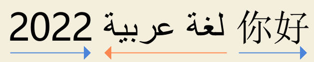

## 关键对外接口<a name="ZH-CN_TOPIC_0000002499582073"></a>

UIFont提供接口支持注册多字库，UIMultiFontManager提供接口支持配置字库的搜索顺序，两者配合即可实现基于多字库显示多语言文本的功能。ICU换行、整形以及混排功等功能需要使用UILabelExt和UILabelButtonExt两个控件，由系统内部处理，开发者并不可见。

**表 1**  关键对外接口

<a name="zh-cn_topic_0000002444725905_table2896mcpsimp"></a>
<table><thead align="left"><tr id="zh-cn_topic_0000002444725905_row2902mcpsimp"><th class="cellrowborder" valign="top" width="14.19%" id="mcps1.2.4.1.1"><p id="zh-cn_topic_0000002444725905_p176501048175318"><a name="zh-cn_topic_0000002444725905_p176501048175318"></a><a name="zh-cn_topic_0000002444725905_p176501048175318"></a>类</p>
</th>
<th class="cellrowborder" valign="top" width="44.48%" id="mcps1.2.4.1.2"><p id="zh-cn_topic_0000002444725905_p2904mcpsimp"><a name="zh-cn_topic_0000002444725905_p2904mcpsimp"></a><a name="zh-cn_topic_0000002444725905_p2904mcpsimp"></a>接口</p>
</th>
<th class="cellrowborder" valign="top" width="41.33%" id="mcps1.2.4.1.3"><p id="zh-cn_topic_0000002444725905_p2906mcpsimp"><a name="zh-cn_topic_0000002444725905_p2906mcpsimp"></a><a name="zh-cn_topic_0000002444725905_p2906mcpsimp"></a>说明</p>
</th>
</tr>
</thead>
<tbody><tr id="zh-cn_topic_0000002444725905_row2908mcpsimp"><td class="cellrowborder" rowspan="2" valign="top" width="14.19%" headers="mcps1.2.4.1.1 "><p id="zh-cn_topic_0000002444725905_p165024845315"><a name="zh-cn_topic_0000002444725905_p165024845315"></a><a name="zh-cn_topic_0000002444725905_p165024845315"></a>UIFont</p>
</td>
<td class="cellrowborder" valign="top" width="44.48%" headers="mcps1.2.4.1.2 "><p id="zh-cn_topic_0000002444725905_p2910mcpsimp"><a name="zh-cn_topic_0000002444725905_p2910mcpsimp"></a><a name="zh-cn_topic_0000002444725905_p2910mcpsimp"></a>uint8_t RegisterFontInfo(const char* ttfName, uint8_t shaping = 0)</p>
</td>
<td class="cellrowborder" valign="top" width="41.33%" headers="mcps1.2.4.1.3 "><p id="zh-cn_topic_0000002444725905_p2912mcpsimp"><a name="zh-cn_topic_0000002444725905_p2912mcpsimp"></a><a name="zh-cn_topic_0000002444725905_p2912mcpsimp"></a>注册系统字库。</p>
<a name="zh-cn_topic_0000002444725905_ul2913mcpsimp"></a><a name="zh-cn_topic_0000002444725905_ul2913mcpsimp"></a><ul id="zh-cn_topic_0000002444725905_ul2913mcpsimp"><li>参数ttfName：字库名。</li><li>参数shaping：当前字库是否包含整形的字形数据。</li></ul>
<p id="zh-cn_topic_0000002444725905_p2916mcpsimp"><a name="zh-cn_topic_0000002444725905_p2916mcpsimp"></a><a name="zh-cn_topic_0000002444725905_p2916mcpsimp"></a>返回注册字库的ID。</p>
<p id="zh-cn_topic_0000002444725905_p2917mcpsimp"><a name="zh-cn_topic_0000002444725905_p2917mcpsimp"></a><a name="zh-cn_topic_0000002444725905_p2917mcpsimp"></a><strong id="zh-cn_topic_0000002444725905_b131956114019"><a name="zh-cn_topic_0000002444725905_b131956114019"></a><a name="zh-cn_topic_0000002444725905_b131956114019"></a>注意：向系统依次注册要使用的字库文件，但第一个需为不包含整形字形数据的字库。需将返回的fontId保存，为后续设置字库搜查表所用。</strong></p>
</td>
</tr>
<tr id="zh-cn_topic_0000002444725905_row31007398399"><td class="cellrowborder" valign="top" headers="mcps1.2.4.1.1 "><p id="zh-cn_topic_0000002444725905_p1210143923910"><a name="zh-cn_topic_0000002444725905_p1210143923910"></a><a name="zh-cn_topic_0000002444725905_p1210143923910"></a>uint8_t RegisterFontInfo(const UITextLanguageFontParam* fontsTable, uint8_t num)</p>
</td>
<td class="cellrowborder" valign="top" headers="mcps1.2.4.1.2 "><p id="zh-cn_topic_0000002444725905_p310173915395"><a name="zh-cn_topic_0000002444725905_p310173915395"></a><a name="zh-cn_topic_0000002444725905_p310173915395"></a>一次性注册多个系统字库。</p>
<a name="zh-cn_topic_0000002444725905_ul4224526114114"></a><a name="zh-cn_topic_0000002444725905_ul4224526114114"></a><ul id="zh-cn_topic_0000002444725905_ul4224526114114"><li>参数fontsTable：指向多个字库结构体数组的指针，字库ID保存在字库结构体中。</li><li>参数num：字库结构体数组的个数。</li></ul>
</td>
</tr>
<tr id="zh-cn_topic_0000002444725905_row14587121911545"><td class="cellrowborder" rowspan="3" valign="top" width="14.19%" headers="mcps1.2.4.1.1 "><p id="zh-cn_topic_0000002444725905_p4470133285413"><a name="zh-cn_topic_0000002444725905_p4470133285413"></a><a name="zh-cn_topic_0000002444725905_p4470133285413"></a>UILabel/UILabelButton</p>
</td>
<td class="cellrowborder" valign="top" width="44.48%" headers="mcps1.2.4.1.2 "><p id="zh-cn_topic_0000002444725905_p1958761910545"><a name="zh-cn_topic_0000002444725905_p1958761910545"></a><a name="zh-cn_topic_0000002444725905_p1958761910545"></a>void SetDirect(UITextLanguageDirect direct)</p>
</td>
<td class="cellrowborder" valign="top" width="41.33%" headers="mcps1.2.4.1.3 "><p id="zh-cn_topic_0000002444725905_p165871819135411"><a name="zh-cn_topic_0000002444725905_p165871819135411"></a><a name="zh-cn_topic_0000002444725905_p165871819135411"></a>设置文本的方向。</p>
<a name="zh-cn_topic_0000002444725905_ul13433241151911"></a><a name="zh-cn_topic_0000002444725905_ul13433241151911"></a><ul id="zh-cn_topic_0000002444725905_ul13433241151911"><li>参数direct： 文本方向，TEXT_DIRECT_LTR / RTL / MIXED。</li></ul>
<p id="zh-cn_topic_0000002444725905_p1058013247213"><a name="zh-cn_topic_0000002444725905_p1058013247213"></a><a name="zh-cn_topic_0000002444725905_p1058013247213"></a><strong id="zh-cn_topic_0000002444725905_b149084217412"><a name="zh-cn_topic_0000002444725905_b149084217412"></a><a name="zh-cn_topic_0000002444725905_b149084217412"></a>注意：对于混排并且方向不一致的多语言文本，开发者需要将文本方向设置为TEXT_DIRECT_MIXED</strong></p>
</td>
</tr>
<tr id="zh-cn_topic_0000002444725905_row156374359566"><td class="cellrowborder" valign="top" headers="mcps1.2.4.1.1 "><p id="zh-cn_topic_0000002444725905_p17638163595620"><a name="zh-cn_topic_0000002444725905_p17638163595620"></a><a name="zh-cn_topic_0000002444725905_p17638163595620"></a>void SetFont(const char* name, uint8_t size)</p>
</td>
<td class="cellrowborder" valign="top" headers="mcps1.2.4.1.2 "><p id="zh-cn_topic_0000002444725905_p56384357562"><a name="zh-cn_topic_0000002444725905_p56384357562"></a><a name="zh-cn_topic_0000002444725905_p56384357562"></a>设置当前Label使用的字库。</p>
<a name="zh-cn_topic_0000002444725905_ul29902385418"></a><a name="zh-cn_topic_0000002444725905_ul29902385418"></a><ul id="zh-cn_topic_0000002444725905_ul29902385418"><li>参数name： 字库名，如果为nullptr，则只刷新字体大小。</li><li>参数direct： 字体大小。</li></ul>
</td>
</tr>
<tr id="zh-cn_topic_0000002444725905_row52171614125912"><td class="cellrowborder" valign="top" headers="mcps1.2.4.1.1 "><p id="zh-cn_topic_0000002444725905_p17217131415911"><a name="zh-cn_topic_0000002444725905_p17217131415911"></a><a name="zh-cn_topic_0000002444725905_p17217131415911"></a>void SetFontId(uint8_t fontId)</p>
</td>
<td class="cellrowborder" valign="top" headers="mcps1.2.4.1.2 "><p id="zh-cn_topic_0000002444725905_p1921731419595"><a name="zh-cn_topic_0000002444725905_p1921731419595"></a><a name="zh-cn_topic_0000002444725905_p1921731419595"></a>设置当前字库。</p>
<a name="zh-cn_topic_0000002444725905_ul5782193519511"></a><a name="zh-cn_topic_0000002444725905_ul5782193519511"></a><ul id="zh-cn_topic_0000002444725905_ul5782193519511"><li>参数fontId： 注册字库时返回的字库ID。</li></ul>
</td>
</tr>
<tr id="zh-cn_topic_0000002444725905_row7326151555417"><td class="cellrowborder" valign="top" width="14.19%" headers="mcps1.2.4.1.1 "><p id="zh-cn_topic_0000002444725905_p1432610157542"><a name="zh-cn_topic_0000002444725905_p1432610157542"></a><a name="zh-cn_topic_0000002444725905_p1432610157542"></a>UIMultiFontManager</p>
</td>
<td class="cellrowborder" valign="top" width="44.48%" headers="mcps1.2.4.1.2 "><p id="zh-cn_topic_0000002444725905_p10327315205412"><a name="zh-cn_topic_0000002444725905_p10327315205412"></a><a name="zh-cn_topic_0000002444725905_p10327315205412"></a>int8_t SetSearchFontList(uint8_t fontListId, uint8_t *fontIds, uint8_t size)</p>
</td>
<td class="cellrowborder" valign="top" width="41.33%" headers="mcps1.2.4.1.3 "><p id="zh-cn_topic_0000002444725905_p3327131519545"><a name="zh-cn_topic_0000002444725905_p3327131519545"></a><a name="zh-cn_topic_0000002444725905_p3327131519545"></a>配置备选字库。如果当前字库id为fontListId，当出现不识别的字符时，则依次在fontIds所对应的备选字库中查找字符。</p>
<a name="zh-cn_topic_0000002444725905_ul1093145111617"></a><a name="zh-cn_topic_0000002444725905_ul1093145111617"></a><ul id="zh-cn_topic_0000002444725905_ul1093145111617"><li>参数fontListId：字库ID值，保存为搜查表的key值。</li><li>参数fontIds：待搜索的字库ID值数组，保存在搜查表的Value值中。</li><li>参数size：待搜索的字库ID值数组的长度。</li></ul>
</td>
</tr>
</tbody>
</table>

## 开发建议<a name="ZH-CN_TOPIC_0000002499581969"></a>

**字库的注册<a name="zh-cn_topic_0000002444726049_section1353418851720"></a>**

-   字库注册可以依次一个一个地注册多个字库，也可以一次性注册多个字库。
-   无论是哪种注册方式，支持整形的字库均不能第一个注册。
-   注册支持整形的字库，字库名必须包含并且仅包含一个匹配字段：Arabic、Thai、Myanmar、Devanagari、Hebrew、Bengali，用于快速基于unicode找到所在的整形字库。

**文本控件的使用<a name="zh-cn_topic_0000002444726049_section34571317131714"></a>**

-   文本控件建议优先使用扩展控件UILabelExt、UILabelButtonExt，以便支持多语言切换、整型、ICU换行等功能。
-   文本控件如果使用多语言切换功能（SetTextId），系统会自动配置匹配的字库，字体大小通过接口SetFont\(nullptr, size\)指定。
-   文本控件如果不使用多语言切换功能，必须显式指定匹配的字库；否则会导致文本显示不出来，或者由于备选字库搜索时间过长导致显示卡顿。
-   文本控件如果包含有方向不一致的多语言文本，那么必须将文本方向设置为TEXT\_DIRECT\_MIXED。

**备选字库的使用<a name="zh-cn_topic_0000002444726049_section16441926191710"></a>**

-   UIMultiFontManager::SetSearchFontList可以动态指定特定字库的备选字库：若当前字库不包含待处理的字符，则依次在其备选字库中查找。
-   备选字库根据混排文本的内容来确定，如果备选字库配置的不合理，则会导致混排文本中的非主文本显示不出来，或者因为备选字库搜索时间过长导致文本显示卡顿。

# 图片资源管理<a name="ZH-CN_TOPIC_0000002466542744"></a>

-   **[方案目的](#ZH-CN_TOPIC_0000002466542564)**  

-   **[整体功能介绍](#ZH-CN_TOPIC_0000002499582117)**  

-   **[服务器要求](#ZH-CN_TOPIC_0000002466542684)**  

-   **[图片资源打包](#ZH-CN_TOPIC_0000002499502009)**  

-   **[资源使用](#ZH-CN_TOPIC_0000002466542728)**  

## 方案目的<a name="ZH-CN_TOPIC_0000002466542564"></a>

在IOT的产品中，从eMMC（一种嵌入式、非易失存储系统）中直接读取图片资源的速度比较慢。如果在图片绘制的过程中，每次都从eMMC中读取图片资源，那么UI的显示就会比较卡顿。因此，为了提升图片读取效率，则需要将图片资源提前缓存到PSRAM（伪静态随机存取器）指定区域中，后续的读取可直接从PSRAM中读取，从而提升图片加载效率。

另外，PSRAM由于成本问题，其内存的大小是严格受限的（目前可实现存储容量有：32M、64M、256M）。因此，需要将图片资源进行离线压缩，在PSRAM内存大小不变的情形下，可以缓存更多的图片资源。与此同时，还需要支持硬件对图片进行解压，以便减小图片压缩对显示性能的影响。

总之，该方案是为了在PSRAM受限的情形下，以更高的效率缓存和显示图片资源。

## 整体功能介绍<a name="ZH-CN_TOPIC_0000002499582117"></a>

图片资源管理的总体方案主要分为两部分：

-   PC端对图片资源的压缩打包。（请参考《DebugKits工具 使用指南》）
-   板端解析图片资源，并将其缓存到内存池中。

PC端对图片资源的压缩打包，是指使用项目（工具组）提供的资源打包工具依据xml文件配置的压缩算法以及像素格式信息，将指定目录下的每一个子目录都打包成一个资源文件，并生成资源索引文件ui\_resource\_image.h；或者将指定目录下的每一个图片文件都打包成一个资源文件。

ui\_resource\_image.h存储了每一个被处理过的图片的index值，以便板端可以快速从打包的文件中定位到图片内容，具体可以参考后续的设计描述。

在板端，如果是单个目录打包成一个资源文件，ImageCacheManager需要基于ui\_resource\_image.h中保存的图片索引信息从资源文件中解析出图片内容，否则ImageCacheManager可以直接从资源文件中解析出图片内容。然后，ImageCacheManager利用系统提供的内存池机制对图片内容进行缓存。为了屏蔽芯片和系统的差异，我们使用MemPoolManager＋Gralloc＋LOS\_MEM的结构对内存池进行管理。另外，ImageCacheManager也同时提供移除图片资源的接口，以便PSRAM内存资源得到充分利用。

注意，图片的压缩算法以及解压方案不是本方案的重点（UIKit属于使用方），本文不再赘述。

**图 1**  方案总体实现原理图<a name="zh-cn_topic_0000002411206692_fig1670502423117"></a>  
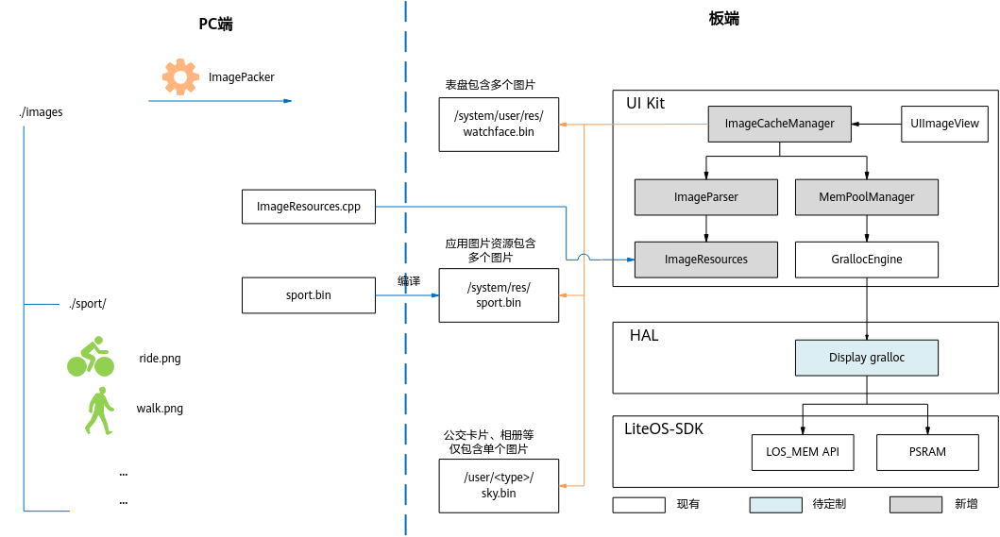

## 服务器要求<a name="ZH-CN_TOPIC_0000002466542684"></a>

由于图片资源转换成bin格式文件、图片压缩、解压等操作是通过Python工具完成的。想要使用此功能，需要对服务器安装这两个工具。

```
pip install opencv-python
pip install Pillow
```

## 图片资源打包<a name="ZH-CN_TOPIC_0000002499502009"></a>

图片资源打包工具的功能如下：依据xml文件配置的压缩算法以及像素格式信息，将指定目录下的每一个子目录都打包成一个资源文件，并生成资源索引文件ui\_resource\_image.h；或者将指定目录下的每一个图片文件都打包成一个资源文件。

-   **[配置文件说明](#ZH-CN_TOPIC_0000002466542712)**  

-   **[工具输入要求](#ZH-CN_TOPIC_0000002499502077)**  

-   **[打包使用](#ZH-CN_TOPIC_0000002499502005)**  

### 配置文件说明<a name="ZH-CN_TOPIC_0000002466542712"></a>

```
<!-- 注意，compress和format必须同时配置；align可选，默认为1 -->
<!-- 注意，如果定制了文件的配置，其父目录也必须配置 -->
<!-- 指定默认的压缩算法、像素格式以及非压缩的宽度对齐值 -->
<!-- 以CS方式压缩：tile压缩单元宽度、alpha压缩模式、rgb压缩模式、ver压缩方式输入为1-->
<!-- CS、ES打包都应保证输入文件夹有图片可以压缩-->
<!-- 三种压缩模式的选择可以通过xml文件进行配置，但RGB565除外需要手动配置format="RGB565"-->
<imageRes compress="HFBC" tile="6" alpha="1" rgb="1" autocmpmode="0" highqualitymode="0" highcmpratiomode="0" ver="1">
</imageRes>
<!-- 以ES方式压缩：ver压缩方式输入为0-->
<imageRes compress="HFBC" autocmpmode="0" highqualitymode="0" highcmpratiomode="0" ver="0">
</imageRes-->
```

**表 1**  图片资源打包工具配置

<a name="zh-cn_topic_0000002444645685_table2986mcpsimp"></a>
<table><thead align="left"><tr id="zh-cn_topic_0000002444645685_row2993mcpsimp"><th class="cellrowborder" valign="top" width="15.58%" id="mcps1.2.4.1.1"><p id="zh-cn_topic_0000002444645685_p2995mcpsimp"><a name="zh-cn_topic_0000002444645685_p2995mcpsimp"></a><a name="zh-cn_topic_0000002444645685_p2995mcpsimp"></a>标签</p>
</th>
<th class="cellrowborder" valign="top" width="20.810000000000002%" id="mcps1.2.4.1.2"><p id="zh-cn_topic_0000002444645685_p2997mcpsimp"><a name="zh-cn_topic_0000002444645685_p2997mcpsimp"></a><a name="zh-cn_topic_0000002444645685_p2997mcpsimp"></a>属性</p>
</th>
<th class="cellrowborder" valign="top" width="63.61%" id="mcps1.2.4.1.3"><p id="zh-cn_topic_0000002444645685_p2999mcpsimp"><a name="zh-cn_topic_0000002444645685_p2999mcpsimp"></a><a name="zh-cn_topic_0000002444645685_p2999mcpsimp"></a>说明</p>
</th>
</tr>
</thead>
<tbody><tr id="zh-cn_topic_0000002444645685_row3001mcpsimp"><td class="cellrowborder" rowspan="3" valign="top" width="15.58%" headers="mcps1.2.4.1.1 "><p id="zh-cn_topic_0000002444645685_p3003mcpsimp"><a name="zh-cn_topic_0000002444645685_p3003mcpsimp"></a><a name="zh-cn_topic_0000002444645685_p3003mcpsimp"></a>imageRes</p>
</td>
<td class="cellrowborder" valign="top" width="20.810000000000002%" headers="mcps1.2.4.1.2 "><p id="zh-cn_topic_0000002444645685_p3005mcpsimp"><a name="zh-cn_topic_0000002444645685_p3005mcpsimp"></a><a name="zh-cn_topic_0000002444645685_p3005mcpsimp"></a>-</p>
</td>
<td class="cellrowborder" valign="top" width="63.61%" headers="mcps1.2.4.1.3 "><p id="zh-cn_topic_0000002444645685_p3007mcpsimp"><a name="zh-cn_topic_0000002444645685_p3007mcpsimp"></a><a name="zh-cn_topic_0000002444645685_p3007mcpsimp"></a>根标签。</p>
</td>
</tr>
<tr id="zh-cn_topic_0000002444645685_row3008mcpsimp"><td class="cellrowborder" valign="top" headers="mcps1.2.4.1.1 "><p id="zh-cn_topic_0000002444645685_p3010mcpsimp"><a name="zh-cn_topic_0000002444645685_p3010mcpsimp"></a><a name="zh-cn_topic_0000002444645685_p3010mcpsimp"></a>compress</p>
</td>
<td class="cellrowborder" valign="top" headers="mcps1.2.4.1.2 "><p id="zh-cn_topic_0000002444645685_p3012mcpsimp"><a name="zh-cn_topic_0000002444645685_p3012mcpsimp"></a><a name="zh-cn_topic_0000002444645685_p3012mcpsimp"></a>指定默认压缩算法，取值可为：HFBC|HFBC_ABYPASS。</p>
</td>
</tr>
<tr id="zh-cn_topic_0000002444645685_row3013mcpsimp"><td class="cellrowborder" valign="top" headers="mcps1.2.4.1.1 "><p id="zh-cn_topic_0000002444645685_p3015mcpsimp"><a name="zh-cn_topic_0000002444645685_p3015mcpsimp"></a><a name="zh-cn_topic_0000002444645685_p3015mcpsimp"></a>format</p>
</td>
<td class="cellrowborder" valign="top" headers="mcps1.2.4.1.2 "><p id="zh-cn_topic_0000002444645685_p3017mcpsimp"><a name="zh-cn_topic_0000002444645685_p3017mcpsimp"></a><a name="zh-cn_topic_0000002444645685_p3017mcpsimp"></a>指定默认像素格式，取值可为：RGB565|RGB888|ARGB8888。</p>
</td>
</tr>
<tr id="zh-cn_topic_0000002444645685_row3023mcpsimp"><td class="cellrowborder" rowspan="4" valign="top" width="15.58%" headers="mcps1.2.4.1.1 "><p id="zh-cn_topic_0000002444645685_p3025mcpsimp"><a name="zh-cn_topic_0000002444645685_p3025mcpsimp"></a><a name="zh-cn_topic_0000002444645685_p3025mcpsimp"></a>imageDir</p>
</td>
<td class="cellrowborder" valign="top" width="20.810000000000002%" headers="mcps1.2.4.1.2 "><p id="zh-cn_topic_0000002444645685_p3027mcpsimp"><a name="zh-cn_topic_0000002444645685_p3027mcpsimp"></a><a name="zh-cn_topic_0000002444645685_p3027mcpsimp"></a>-</p>
</td>
<td class="cellrowborder" valign="top" width="63.61%" headers="mcps1.2.4.1.3 "><p id="zh-cn_topic_0000002444645685_p3029mcpsimp"><a name="zh-cn_topic_0000002444645685_p3029mcpsimp"></a><a name="zh-cn_topic_0000002444645685_p3029mcpsimp"></a>imageRes的子标签，用于标识存放图片的文件夹。</p>
</td>
</tr>
<tr id="zh-cn_topic_0000002444645685_row3030mcpsimp"><td class="cellrowborder" valign="top" headers="mcps1.2.4.1.1 "><p id="zh-cn_topic_0000002444645685_p3032mcpsimp"><a name="zh-cn_topic_0000002444645685_p3032mcpsimp"></a><a name="zh-cn_topic_0000002444645685_p3032mcpsimp"></a>name</p>
</td>
<td class="cellrowborder" valign="top" headers="mcps1.2.4.1.2 "><p id="zh-cn_topic_0000002444645685_p3034mcpsimp"><a name="zh-cn_topic_0000002444645685_p3034mcpsimp"></a><a name="zh-cn_topic_0000002444645685_p3034mcpsimp"></a>文件夹名，可以指定为APP的名字，或者场景名，不与APP强绑定。</p>
</td>
</tr>
<tr id="zh-cn_topic_0000002444645685_row3035mcpsimp"><td class="cellrowborder" valign="top" headers="mcps1.2.4.1.1 "><p id="zh-cn_topic_0000002444645685_p3037mcpsimp"><a name="zh-cn_topic_0000002444645685_p3037mcpsimp"></a><a name="zh-cn_topic_0000002444645685_p3037mcpsimp"></a>compress</p>
</td>
<td class="cellrowborder" valign="top" headers="mcps1.2.4.1.2 "><p id="zh-cn_topic_0000002444645685_p3039mcpsimp"><a name="zh-cn_topic_0000002444645685_p3039mcpsimp"></a><a name="zh-cn_topic_0000002444645685_p3039mcpsimp"></a>指定该文件夹下的图片文件的默认压缩算法，优先级高于imageRes指定的compress属性值。</p>
</td>
</tr>
<tr id="zh-cn_topic_0000002444645685_row3040mcpsimp"><td class="cellrowborder" valign="top" headers="mcps1.2.4.1.1 "><p id="zh-cn_topic_0000002444645685_p3042mcpsimp"><a name="zh-cn_topic_0000002444645685_p3042mcpsimp"></a><a name="zh-cn_topic_0000002444645685_p3042mcpsimp"></a>format</p>
</td>
<td class="cellrowborder" valign="top" headers="mcps1.2.4.1.2 "><p id="zh-cn_topic_0000002444645685_p3044mcpsimp"><a name="zh-cn_topic_0000002444645685_p3044mcpsimp"></a><a name="zh-cn_topic_0000002444645685_p3044mcpsimp"></a>指定该文件夹下的图片文件的默认像素格式，优先级高于imageRes指定的format属性值。</p>
</td>
</tr>
<tr id="zh-cn_topic_0000002444645685_row3050mcpsimp"><td class="cellrowborder" rowspan="4" valign="top" width="15.58%" headers="mcps1.2.4.1.1 "><p id="zh-cn_topic_0000002444645685_p3052mcpsimp"><a name="zh-cn_topic_0000002444645685_p3052mcpsimp"></a><a name="zh-cn_topic_0000002444645685_p3052mcpsimp"></a>imageFile</p>
</td>
<td class="cellrowborder" valign="top" width="20.810000000000002%" headers="mcps1.2.4.1.2 "><p id="zh-cn_topic_0000002444645685_p3054mcpsimp"><a name="zh-cn_topic_0000002444645685_p3054mcpsimp"></a><a name="zh-cn_topic_0000002444645685_p3054mcpsimp"></a>-</p>
</td>
<td class="cellrowborder" valign="top" width="63.61%" headers="mcps1.2.4.1.3 "><p id="zh-cn_topic_0000002444645685_p3056mcpsimp"><a name="zh-cn_topic_0000002444645685_p3056mcpsimp"></a><a name="zh-cn_topic_0000002444645685_p3056mcpsimp"></a>imageDir的子标签，用于标识具体某一个文件。</p>
</td>
</tr>
<tr id="zh-cn_topic_0000002444645685_row3057mcpsimp"><td class="cellrowborder" valign="top" headers="mcps1.2.4.1.1 "><p id="zh-cn_topic_0000002444645685_p3059mcpsimp"><a name="zh-cn_topic_0000002444645685_p3059mcpsimp"></a><a name="zh-cn_topic_0000002444645685_p3059mcpsimp"></a>name</p>
</td>
<td class="cellrowborder" valign="top" headers="mcps1.2.4.1.2 "><p id="zh-cn_topic_0000002444645685_p3061mcpsimp"><a name="zh-cn_topic_0000002444645685_p3061mcpsimp"></a><a name="zh-cn_topic_0000002444645685_p3061mcpsimp"></a>文件名。</p>
</td>
</tr>
<tr id="zh-cn_topic_0000002444645685_row3062mcpsimp"><td class="cellrowborder" valign="top" headers="mcps1.2.4.1.1 "><p id="zh-cn_topic_0000002444645685_p3064mcpsimp"><a name="zh-cn_topic_0000002444645685_p3064mcpsimp"></a><a name="zh-cn_topic_0000002444645685_p3064mcpsimp"></a>compress</p>
</td>
<td class="cellrowborder" valign="top" headers="mcps1.2.4.1.2 "><p id="zh-cn_topic_0000002444645685_p3066mcpsimp"><a name="zh-cn_topic_0000002444645685_p3066mcpsimp"></a><a name="zh-cn_topic_0000002444645685_p3066mcpsimp"></a>指定特定图片文件的压缩算法，优先级高于imageDir指定的compress属性值。</p>
</td>
</tr>
<tr id="zh-cn_topic_0000002444645685_row3067mcpsimp"><td class="cellrowborder" valign="top" headers="mcps1.2.4.1.1 "><p id="zh-cn_topic_0000002444645685_p3069mcpsimp"><a name="zh-cn_topic_0000002444645685_p3069mcpsimp"></a><a name="zh-cn_topic_0000002444645685_p3069mcpsimp"></a>format</p>
</td>
<td class="cellrowborder" valign="top" headers="mcps1.2.4.1.2 "><p id="zh-cn_topic_0000002444645685_p3071mcpsimp"><a name="zh-cn_topic_0000002444645685_p3071mcpsimp"></a><a name="zh-cn_topic_0000002444645685_p3071mcpsimp"></a>指定特定图片文件的像素格式，优先级高于imageDir指定的format属性值。</p>
</td>
</tr>
</tbody>
</table>

### 工具输入要求<a name="ZH-CN_TOPIC_0000002499502077"></a>

-   工具建议命名为：images\_tool.py
-   命令格式：

    ```
    python images_tool.py –p [dir|file] –c config.xml -i <Input Dir> -o <Output Dir> -t <Dir>
    ```

    说明：

    -   -p：指定打包方式。
    -   file：以每个图片为单位进行打包。
    -   dir：将图片进行打包后，再以子文件夹为单位将其包含的已打包的图片再一起打包。
    -   -c：配置文件，指定打包的压缩算法、像素格式以及宽度对齐值。
        -   压缩算法可选：HFBC|HFBC\_ABYPASS
        -   像素格式可选：RGB565|RGB888|ARGB8888

    -   -i：指定待处理图片的根目录，图片目录下的图片可以为.jpg、.png、.bmp格式。
    -   -o：指定输出的文件夹。
    -   -t：指定头文件ui\_resource\_image.h生成的目录，仅在dir打包方式下生效。
    -   -e：指定需要解压的文件路径，文件类型为.bin。
    -   -f：指定解压后图片输出的路径。

    输入限制：子文件夹名以及文件名必须为数字以及字母的组合。

### 打包使用<a name="ZH-CN_TOPIC_0000002499502005"></a>

-   多图片按照目录打包命令如下：

    ```
    python images_tool.py –p dir –c config.xml -i <Input Dir> -o <Output Dir>
    ```

-   单图片打包命令如下：

    ```
    python images_tool.py –p file –c config.xml -i <Input Dir> -o <Output Dir>
    ```

## 资源使用<a name="ZH-CN_TOPIC_0000002466542728"></a>

ImageCacheManager是对外的唯一接口类。按照资源文件类型，可分为多资源文件以及单资源文件，通过对外接口可加载和卸载文件中的资源数据。

> **须知：** 
>如果用户需要自行填充ImageInfo，请先使用void\* ImageCacheMalloc\(ImageInfo& info\)接口申请ImageInfo所需的内存，然后再进行数据填充，不建议使用其他系统接口申请内存。

**表 1**  ImageCacheManager核心函数

<a name="zh-cn_topic_0000002444726005_table3119mcpsimp"></a>
<table><thead align="left"><tr id="zh-cn_topic_0000002444726005_row3125mcpsimp"><th class="cellrowborder" valign="top" width="50%" id="mcps1.2.3.1.1"><p id="zh-cn_topic_0000002444726005_p3127mcpsimp"><a name="zh-cn_topic_0000002444726005_p3127mcpsimp"></a><a name="zh-cn_topic_0000002444726005_p3127mcpsimp"></a>函数</p>
</th>
<th class="cellrowborder" valign="top" width="50%" id="mcps1.2.3.1.2"><p id="zh-cn_topic_0000002444726005_p3129mcpsimp"><a name="zh-cn_topic_0000002444726005_p3129mcpsimp"></a><a name="zh-cn_topic_0000002444726005_p3129mcpsimp"></a>介绍</p>
</th>
</tr>
</thead>
<tbody><tr id="zh-cn_topic_0000002444726005_row3131mcpsimp"><td class="cellrowborder" valign="top" width="50%" headers="mcps1.2.3.1.1 "><p id="zh-cn_topic_0000002444726005_p3133mcpsimp"><a name="zh-cn_topic_0000002444726005_p3133mcpsimp"></a><a name="zh-cn_topic_0000002444726005_p3133mcpsimp"></a>bool LoadAllInMultiRes(const std::string& file, FILE* userFP = nullptr, bool isLongTerm = false, int offset = 0)</p>
</td>
<td class="cellrowborder" valign="top" width="50%" headers="mcps1.2.3.1.2 "><p id="zh-cn_topic_0000002444726005_p3135mcpsimp"><a name="zh-cn_topic_0000002444726005_p3135mcpsimp"></a><a name="zh-cn_topic_0000002444726005_p3135mcpsimp"></a>一次性加载多资源文件中的所有资源，并为这些资源分配整块内存。</p>
<a name="zh-cn_topic_0000002444726005_ul296602744711"></a><a name="zh-cn_topic_0000002444726005_ul296602744711"></a><ul id="zh-cn_topic_0000002444726005_ul296602744711"><li>file：图片bin文件的路径。</li><li>userFP：文件指针（在外部打开），如果userFP不为nullptr，将首先使用它。</li><li>isLongTerm：图片是否应该长期保存。</li><li>offset：多图起始点的偏移量，主要与userFP（非nullptr）配合使用。</li></ul>
</td>
</tr>
<tr id="zh-cn_topic_0000002444726005_row1548311171344"><td class="cellrowborder" valign="top" width="50%" headers="mcps1.2.3.1.1 "><p id="zh-cn_topic_0000002444726005_p124831217183420"><a name="zh-cn_topic_0000002444726005_p124831217183420"></a><a name="zh-cn_topic_0000002444726005_p124831217183420"></a>bool LoadAllInMultiRes(uint8_t* buf)</p>
</td>
<td class="cellrowborder" valign="top" width="50%" headers="mcps1.2.3.1.2 "><p id="zh-cn_topic_0000002444726005_p7483171716340"><a name="zh-cn_topic_0000002444726005_p7483171716340"></a><a name="zh-cn_topic_0000002444726005_p7483171716340"></a>一次从输入缓冲区加载全部图片资源。之后使用LoadOneInMultiRes来获取实际的图像。</p>
<p id="zh-cn_topic_0000002444726005_p041855373518"><a name="zh-cn_topic_0000002444726005_p041855373518"></a><a name="zh-cn_topic_0000002444726005_p041855373518"></a>buf：图片bin文件在内存中的地址。</p>
</td>
</tr>
<tr id="zh-cn_topic_0000002444726005_row3136mcpsimp"><td class="cellrowborder" valign="top" width="50%" headers="mcps1.2.3.1.1 "><p id="zh-cn_topic_0000002444726005_p3138mcpsimp"><a name="zh-cn_topic_0000002444726005_p3138mcpsimp"></a><a name="zh-cn_topic_0000002444726005_p3138mcpsimp"></a>ImageInfo* LoadOneInMultiRes</p>
<p id="zh-cn_topic_0000002444726005_p114046486365"><a name="zh-cn_topic_0000002444726005_p114046486365"></a><a name="zh-cn_topic_0000002444726005_p114046486365"></a>(uint32_t resId, const std::string& file, FILE* userFP = nullptr, bool isLongTerm = false, int offset = 0)</p>
</td>
<td class="cellrowborder" valign="top" width="50%" headers="mcps1.2.3.1.2 "><p id="zh-cn_topic_0000002444726005_p3140mcpsimp"><a name="zh-cn_topic_0000002444726005_p3140mcpsimp"></a><a name="zh-cn_topic_0000002444726005_p3140mcpsimp"></a>加载多资源文件中的单个指定资源，并为其分配内存。如果之前已经加载过镜像，那么它将直接返回缓冲区。</p>
<a name="zh-cn_topic_0000002444726005_ul1112710552479"></a><a name="zh-cn_topic_0000002444726005_ul1112710552479"></a><ul id="zh-cn_topic_0000002444726005_ul1112710552479"><li>resId：要加载的图片的资源ID。</li><li>其他：意义与LoadAllInMultiRes相同。</li></ul>
</td>
</tr>
<tr id="zh-cn_topic_0000002444726005_row8515443103919"><td class="cellrowborder" valign="top" width="50%" headers="mcps1.2.3.1.1 "><p id="zh-cn_topic_0000002444726005_p10815154415392"><a name="zh-cn_topic_0000002444726005_p10815154415392"></a><a name="zh-cn_topic_0000002444726005_p10815154415392"></a>ImageInfo* LoadOneInMultiRes(uint8_t* buf, uint32_t resId);</p>
</td>
<td class="cellrowborder" valign="top" width="50%" headers="mcps1.2.3.1.2 "><p id="zh-cn_topic_0000002444726005_p1060418409408"><a name="zh-cn_topic_0000002444726005_p1060418409408"></a><a name="zh-cn_topic_0000002444726005_p1060418409408"></a>加载多资源文件中的单个指定资源，并为其分配内存。如果之前已经加载过镜像，那么它将直接返回缓冲区。</p>
<a name="zh-cn_topic_0000002444726005_ul135919187486"></a><a name="zh-cn_topic_0000002444726005_ul135919187486"></a><ul id="zh-cn_topic_0000002444726005_ul135919187486"><li>buf：图片bin文件在内存中的地址。</li><li>resId：要加载的图片的资源ID。</li></ul>
</td>
</tr>
<tr id="zh-cn_topic_0000002444726005_row3141mcpsimp"><td class="cellrowborder" valign="top" width="50%" headers="mcps1.2.3.1.1 "><p id="zh-cn_topic_0000002444726005_p3143mcpsimp"><a name="zh-cn_topic_0000002444726005_p3143mcpsimp"></a><a name="zh-cn_topic_0000002444726005_p3143mcpsimp"></a>bool UnloadOneInMultiRes(uint32_t resId, const std::string& file)</p>
</td>
<td class="cellrowborder" valign="top" width="50%" headers="mcps1.2.3.1.2 "><p id="zh-cn_topic_0000002444726005_p3145mcpsimp"><a name="zh-cn_topic_0000002444726005_p3145mcpsimp"></a><a name="zh-cn_topic_0000002444726005_p3145mcpsimp"></a>卸载通过LoadOneInMultiRes的方式加载的单个资源。</p>
<a name="zh-cn_topic_0000002444726005_ul924174434813"></a><a name="zh-cn_topic_0000002444726005_ul924174434813"></a><ul id="zh-cn_topic_0000002444726005_ul924174434813"><li>resId：要卸载的图片的资源ID。</li><li>file：图片bin文件的路径。</li></ul>
</td>
</tr>
<tr id="zh-cn_topic_0000002444726005_row9615451174918"><td class="cellrowborder" valign="top" width="50%" headers="mcps1.2.3.1.1 "><p id="zh-cn_topic_0000002444726005_p156168511497"><a name="zh-cn_topic_0000002444726005_p156168511497"></a><a name="zh-cn_topic_0000002444726005_p156168511497"></a>bool UnloadOneInMultiRes(uint8_t* buf, uint32_t resId)</p>
</td>
<td class="cellrowborder" valign="top" width="50%" headers="mcps1.2.3.1.2 "><p id="zh-cn_topic_0000002444726005_p14826114112515"><a name="zh-cn_topic_0000002444726005_p14826114112515"></a><a name="zh-cn_topic_0000002444726005_p14826114112515"></a>卸载通过LoadOneInMultiRes的方式加载的单个资源。</p>
<a name="zh-cn_topic_0000002444726005_ul19609297490"></a><a name="zh-cn_topic_0000002444726005_ul19609297490"></a><ul id="zh-cn_topic_0000002444726005_ul19609297490"><li>buf：图片bin文件在内存中的地址。</li><li>resId：要卸载的图片的资源ID。</li></ul>
</td>
</tr>
<tr id="zh-cn_topic_0000002444726005_row3146mcpsimp"><td class="cellrowborder" valign="top" width="50%" headers="mcps1.2.3.1.1 "><p id="zh-cn_topic_0000002444726005_p3148mcpsimp"><a name="zh-cn_topic_0000002444726005_p3148mcpsimp"></a><a name="zh-cn_topic_0000002444726005_p3148mcpsimp"></a>bool UnloadAllInMultiRes(const std::string& file)</p>
</td>
<td class="cellrowborder" valign="top" width="50%" headers="mcps1.2.3.1.2 "><p id="zh-cn_topic_0000002444726005_p3150mcpsimp"><a name="zh-cn_topic_0000002444726005_p3150mcpsimp"></a><a name="zh-cn_topic_0000002444726005_p3150mcpsimp"></a>卸载多资源文件中已加载的资源。</p>
<p id="zh-cn_topic_0000002444726005_p97242021155216"><a name="zh-cn_topic_0000002444726005_p97242021155216"></a><a name="zh-cn_topic_0000002444726005_p97242021155216"></a>file：图片bin文件的路径。</p>
</td>
</tr>
<tr id="zh-cn_topic_0000002444726005_row1646201515219"><td class="cellrowborder" valign="top" width="50%" headers="mcps1.2.3.1.1 "><p id="zh-cn_topic_0000002444726005_p12646101585216"><a name="zh-cn_topic_0000002444726005_p12646101585216"></a><a name="zh-cn_topic_0000002444726005_p12646101585216"></a>bool UnloadAllInMultiRes(uint8_t* buf)</p>
</td>
<td class="cellrowborder" valign="top" width="50%" headers="mcps1.2.3.1.2 "><p id="zh-cn_topic_0000002444726005_p166464153522"><a name="zh-cn_topic_0000002444726005_p166464153522"></a><a name="zh-cn_topic_0000002444726005_p166464153522"></a>卸载多资源文件中已加载的资源。</p>
<p id="zh-cn_topic_0000002444726005_p37614765215"><a name="zh-cn_topic_0000002444726005_p37614765215"></a><a name="zh-cn_topic_0000002444726005_p37614765215"></a>buf：图片bin文件在内存中的地址。</p>
</td>
</tr>
<tr id="zh-cn_topic_0000002444726005_row3151mcpsimp"><td class="cellrowborder" valign="top" width="50%" headers="mcps1.2.3.1.1 "><p id="zh-cn_topic_0000002444726005_p3153mcpsimp"><a name="zh-cn_topic_0000002444726005_p3153mcpsimp"></a><a name="zh-cn_topic_0000002444726005_p3153mcpsimp"></a>ImageInfo* LoadSingleRes(const std::string& file, bool isLongTerm = false)</p>
</td>
<td class="cellrowborder" valign="top" width="50%" headers="mcps1.2.3.1.2 "><p id="zh-cn_topic_0000002444726005_p3155mcpsimp"><a name="zh-cn_topic_0000002444726005_p3155mcpsimp"></a><a name="zh-cn_topic_0000002444726005_p3155mcpsimp"></a>加载单资源文件中的资源。</p>
<a name="zh-cn_topic_0000002444726005_ul62147599491"></a><a name="zh-cn_topic_0000002444726005_ul62147599491"></a><ul id="zh-cn_topic_0000002444726005_ul62147599491"><li>file：图片bin文件的路径。</li><li>isLongTerm：图片是否应该长期保存。</li></ul>
</td>
</tr>
<tr id="zh-cn_topic_0000002444726005_row3156mcpsimp"><td class="cellrowborder" valign="top" width="50%" headers="mcps1.2.3.1.1 "><p id="zh-cn_topic_0000002444726005_p3158mcpsimp"><a name="zh-cn_topic_0000002444726005_p3158mcpsimp"></a><a name="zh-cn_topic_0000002444726005_p3158mcpsimp"></a>bool UnloadSingleRes(const std::string& file)</p>
</td>
<td class="cellrowborder" valign="top" width="50%" headers="mcps1.2.3.1.2 "><p id="zh-cn_topic_0000002444726005_p3160mcpsimp"><a name="zh-cn_topic_0000002444726005_p3160mcpsimp"></a><a name="zh-cn_topic_0000002444726005_p3160mcpsimp"></a>卸载单资源文件中的资源。</p>
<p id="zh-cn_topic_0000002444726005_p1585791105415"><a name="zh-cn_topic_0000002444726005_p1585791105415"></a><a name="zh-cn_topic_0000002444726005_p1585791105415"></a>file：图片bin文件的路径。</p>
</td>
</tr>
</tbody>
</table>

# 离线表盘<a name="ZH-CN_TOPIC_0000002499582097"></a>

-   **[方案介绍](#ZH-CN_TOPIC_0000002466382940)**  

-   **[AOD离线表盘](#ZH-CN_TOPIC_0000002499502017)**  

-   **[表盘制作](#ZH-CN_TOPIC_0000002466542792)**  

-   **[数据类型model](#ZH-CN_TOPIC_0000002466383060)**  

-   **[相关类介绍](#ZH-CN_TOPIC_0000002466383144)**  

-   **[协议说明](#ZH-CN_TOPIC_0000002466383128)**  

## 方案介绍<a name="ZH-CN_TOPIC_0000002466382940"></a>

离线表盘总体方案：

1.  将不同显示元素，拆分成不同的基础控件单元。
2.  定义不同的数据类型，用于数据绑定及数据更新。
3.  编写一个xml文件，里面写明控件类型（控件单元）、输入参数、周期配置、以及数据类型绑定。
4.  提供一套python打包脚本，将xml中的信息、以及对应的资源打包成bin。
5.  native提供DialBinParser解析控件，用于解析bin。
6.  提供DialViewGroup，用于管理控件的添加、周期管理、数据刷新，并继承cardpage，完成页面相关的管理机制。此控件即为最终的表盘页面。
7.  提供一套model管理机制，用于更新数据。可参考“[数据类型model](#ZH-CN_TOPIC_0000002466383060)”小节。

**图 1**  离线表盘整体方案<a name="zh-cn_topic_0000002411206792_fig1872835911569"></a>  
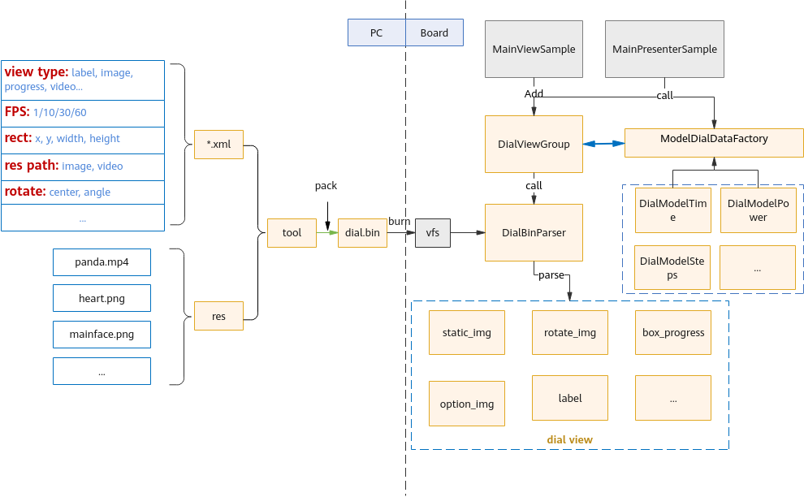

## AOD离线表盘<a name="ZH-CN_TOPIC_0000002499502017"></a>

-   **[状态机](#ZH-CN_TOPIC_0000002499582057)**  

-   **[AodView](#ZH-CN_TOPIC_0000002466383116)**  

-   **[AOD离线表盘](#ZH-CN_TOPIC_0000002499501885)**  

### 状态机<a name="ZH-CN_TOPIC_0000002499582057"></a>

在文件“display\_state\_machine.c”中定义了状态机的状态转移表g\_state\_change\_matrix。g\_state\_change\_matrix每个item分为：当前状态、输入掩码、输出状态、输出掩码。

**图 1**  display\_state\_machine.c<a name="zh-cn_topic_0000002444725981_fig20908331113816"></a>  


如[图1](#zh-cn_topic_0000002444725981_fig20908331113816)所示，状态机的工作流程如下：

1.  “power\_display\_service.c”负责将各种表盘事件转换成输入掩码。
2.  “display\_action.c”根据输入掩码和当前状态转换成输出状态和输出掩码，并将输出掩码转换成自定义函数。

可修改点：

-   用户可以参考现存的状态转移表g\_state\_change\_matrix自行修改进入和退出AOD表盘的输入掩码和输出掩码。
-   可以修改“\*\_event\_filter.c”，将不同的触发AOD（Always On Display，常亮显示）事件转换成输入掩码，例如将盖屏事件转换成“ENTER\_AMBIENT”或“TURN\_ON\_SCREEN”。
-   可修改“display\_action.c”，将不同的输出掩码与进入AOD表盘函数对应起来，例如将“SET\_DISPLAY\_TO\_IDLE\_MODE”对应到切换AOD表盘，将“SET\_DISPLAY\_TO\_NORMAL\_MODE”对应到切换到主表盘。

注意，如需关闭AOD模式，请按照以下步骤修改文件内容：

1.  display\_state\_machine.c中屏蔽ambient相关代码。

    ```
    // 当前状态为Ambient
    // {
    //     SCREEN_AMBIENT,
    //     GET_ACTION_MASK(TURN_ON_SCREEN),
    //     SCREEN_ON,
    //     GET_ACTION_MASK(SET_DISPLAY_ON) |
    //     GET_ACTION_MASK(SET_TE_ON) |
    //     GET_ACTION_MASK(SET_DISPLAY_TO_NORMAL_MODE) |
    //     GET_ACTION_MASK(SET_TP_TO_NORMAL_WORK_MODE) |
    //     GET_ACTION_MASK(START_TIMER),
    // },
    // {
    //     SCREEN_AMBIENT,
    //     GET_ACTION_MASK(KEEP_CURRENT_STATE) |
    //     GET_ACTION_MASK(ENTER_AMBIENT) |
    //     GET_ACTION_MASK(RESET_TIMER),
    //     SCREEN_AMBIENT,
    //     GET_ACTION_MASK(SET_DISPLAY_ON) |
    //     GET_ACTION_MASK(SET_DISPLAY_TO_IDLE_MODE)
    // },
    // {
    //     SCREEN_AMBIENT,
    //     GET_ACTION_MASK(TURN_OFF_SCREEN),
    //     SCREEN_OFF,
    //     GET_ACTION_MASK(SET_DISPLAY_OFF) |
    //     GET_ACTION_MASK(SET_TE_OFF) |
    //     GET_ACTION_MASK(SET_TP_TO_SLEEP_MODE) |
    //     GET_ACTION_MASK(STOP_TIMER),
    // },
    ```

2.  display\_action.c中屏蔽输出掩码操作。

    ```
    if ((action_bitmap & GET_ACTION_MASK(SET_DISPLAY_TO_IDLE_MODE)) != 0) {
        // notify_screen_aod_on_event();
    }
    if ((action_bitmap & GET_ACTION_MASK(SET_DISPLAY_TO_NORMAL_MODE)) != 0) {
        // notify_screen_aod_off_event();
    }
    ```

### AodView<a name="ZH-CN_TOPIC_0000002466383116"></a>

**表 1**  AodView成员函数

<a name="zh-cn_topic_0000002444645993_table536912187563"></a>
<table><thead align="left"><tr id="zh-cn_topic_0000002444645993_row1939961845614"><th class="cellrowborder" valign="top" width="49.97%" id="mcps1.2.3.1.1"><p id="zh-cn_topic_0000002444645993_p9399318135619"><a name="zh-cn_topic_0000002444645993_p9399318135619"></a><a name="zh-cn_topic_0000002444645993_p9399318135619"></a>方法</p>
</th>
<th class="cellrowborder" valign="top" width="50.029999999999994%" id="mcps1.2.3.1.2"><p id="zh-cn_topic_0000002444645993_p1839901819569"><a name="zh-cn_topic_0000002444645993_p1839901819569"></a><a name="zh-cn_topic_0000002444645993_p1839901819569"></a>描述</p>
</th>
</tr>
</thead>
<tbody><tr id="zh-cn_topic_0000002444645993_row5399101845617"><td class="cellrowborder" valign="top" width="49.97%" headers="mcps1.2.3.1.1 "><p id="zh-cn_topic_0000002444645993_p15399818105618"><a name="zh-cn_topic_0000002444645993_p15399818105618"></a><a name="zh-cn_topic_0000002444645993_p15399818105618"></a>void AodView::OnStart()</p>
</td>
<td class="cellrowborder" valign="top" width="50.029999999999994%" headers="mcps1.2.3.1.2 "><p id="zh-cn_topic_0000002444645993_p8399101825610"><a name="zh-cn_topic_0000002444645993_p8399101825610"></a><a name="zh-cn_topic_0000002444645993_p8399101825610"></a>初始化离线表盘和在线表盘。</p>
</td>
</tr>
<tr id="zh-cn_topic_0000002444645993_row20399191865619"><td class="cellrowborder" valign="top" width="49.97%" headers="mcps1.2.3.1.1 "><p id="zh-cn_topic_0000002444645993_p839981815613"><a name="zh-cn_topic_0000002444645993_p839981815613"></a><a name="zh-cn_topic_0000002444645993_p839981815613"></a>void AodView::OnStop()</p>
</td>
<td class="cellrowborder" valign="top" width="50.029999999999994%" headers="mcps1.2.3.1.2 "><p id="zh-cn_topic_0000002444645993_p1399718135615"><a name="zh-cn_topic_0000002444645993_p1399718135615"></a><a name="zh-cn_topic_0000002444645993_p1399718135615"></a>释放表盘资源操作，客户可以在此处释放在线表盘相关的资源。</p>
</td>
</tr>
<tr id="zh-cn_topic_0000002444645993_row1399161810561"><td class="cellrowborder" valign="top" width="49.97%" headers="mcps1.2.3.1.1 "><p id="zh-cn_topic_0000002444645993_p5399618105618"><a name="zh-cn_topic_0000002444645993_p5399618105618"></a><a name="zh-cn_topic_0000002444645993_p5399618105618"></a>UIViewGroup *AodView::InitAodDial(DialSetting &setting)</p>
</td>
<td class="cellrowborder" valign="top" width="50.029999999999994%" headers="mcps1.2.3.1.2 "><p id="zh-cn_topic_0000002444645993_p193991918195618"><a name="zh-cn_topic_0000002444645993_p193991918195618"></a><a name="zh-cn_topic_0000002444645993_p193991918195618"></a>初始化在线表盘，客户可以在此函数进行扩展，返回自定义的在线表盘。</p>
</td>
</tr>
<tr id="zh-cn_topic_0000002444645993_row53990182565"><td class="cellrowborder" valign="top" width="49.97%" headers="mcps1.2.3.1.1 "><p id="zh-cn_topic_0000002444645993_p103991818125614"><a name="zh-cn_topic_0000002444645993_p103991818125614"></a><a name="zh-cn_topic_0000002444645993_p103991818125614"></a>UIViewGroup *AodView::InitAodOffDial(DialSetting &setting)</p>
</td>
<td class="cellrowborder" valign="top" width="50.029999999999994%" headers="mcps1.2.3.1.2 "><p id="zh-cn_topic_0000002444645993_p6399818205617"><a name="zh-cn_topic_0000002444645993_p6399818205617"></a><a name="zh-cn_topic_0000002444645993_p6399818205617"></a>初始化离线表盘。</p>
</td>
</tr>
<tr id="zh-cn_topic_0000002444645993_row193997186563"><td class="cellrowborder" valign="top" width="49.97%" headers="mcps1.2.3.1.1 "><p id="zh-cn_topic_0000002444645993_p113991918195611"><a name="zh-cn_topic_0000002444645993_p113991918195611"></a><a name="zh-cn_topic_0000002444645993_p113991918195611"></a>UIViewGroup *AodView::InitDefaultAod()</p>
</td>
<td class="cellrowborder" valign="top" width="50.029999999999994%" headers="mcps1.2.3.1.2 "><p id="zh-cn_topic_0000002444645993_p93997186564"><a name="zh-cn_topic_0000002444645993_p93997186564"></a><a name="zh-cn_topic_0000002444645993_p93997186564"></a>初始化默认表盘，客户可以在此函数进行扩展，返回自定义的默认离线表盘。</p>
</td>
</tr>
</tbody>
</table>

当状态机进入Ambient状态，根据输出掩码，slice切换到AodView。AodView使用[表1](#zh-cn_topic_0000002444645993_table536912187563)的成员函数初始化表盘，具体策略如下：

1.  如果当前主表盘是离线表盘，进入AOD尝试初始化离线表盘，如果失败就初始化默认表盘。
2.  如果当前主表盘是在线表盘，进入AOD尝试初始化在线表盘，如果失败就初始化默认表盘。

### AOD离线表盘<a name="ZH-CN_TOPIC_0000002499501885"></a>

AOD离线表盘方案特性：

1.  AOD离线表盘方案完全兼容离线表盘。
2.  与普通离线表盘相比，除<dial\>标签外，其余标签均新增“display\_mode”属性，取值范围为"normal"、"ambient"、"always"，分别表示该标签支持在正常模式下显示、AOD模式下显示、两种模式都显示。如果不显示指定该属性，则默认值是"normal"。

    > **须知：** 
    ><dial\>使用新的python工具时，“version”属性的值必须是3.0，否则会出现不可预知错误！

## 表盘制作<a name="ZH-CN_TOPIC_0000002466542792"></a>

离线表盘制作相关的工具跟随版本发布包（3322\_tools）发布。工具的目录地址：3322\_tools/dial\_converter\_tool\_OH。

工具执行脚本为：main.py。

脚本的执行方法可以参考示例文件：README.txt。

xml编写参考示例：instance/\*\*/\*.xml。

xml支持的标签和属性参考[表1](#zh-cn_topic_0000002444726025_table1640663919357)的说明。

> **须知：** 
>表盘的工具version的值必须是“3.0”（脚本converter.py包含关键字“3.0”）!

**表 1**  xml 标签和属性说明

<a name="zh-cn_topic_0000002444726025_table1640663919357"></a>
<table><thead align="left"><tr id="zh-cn_topic_0000002444726025_row88102392356"><th class="cellrowborder" valign="top" width="6.806690003889537%" id="mcps1.2.10.1.1"><p id="zh-cn_topic_0000002444726025_p198724512473"><a name="zh-cn_topic_0000002444726025_p198724512473"></a><a name="zh-cn_topic_0000002444726025_p198724512473"></a>标签分类</p>
</th>
<th class="cellrowborder" valign="top" width="6.942823803967328%" id="mcps1.2.10.1.2"><p id="zh-cn_topic_0000002444726025_p1287319534715"><a name="zh-cn_topic_0000002444726025_p1287319534715"></a><a name="zh-cn_topic_0000002444726025_p1287319534715"></a>标签</p>
</th>
<th class="cellrowborder" valign="top" width="12.806301050175032%" id="mcps1.2.10.1.3"><p id="zh-cn_topic_0000002444726025_p2873753470"><a name="zh-cn_topic_0000002444726025_p2873753470"></a><a name="zh-cn_topic_0000002444726025_p2873753470"></a>标签解释</p>
</th>
<th class="cellrowborder" valign="top" width="13.875923765071956%" id="mcps1.2.10.1.4"><p id="zh-cn_topic_0000002444726025_p108735511472"><a name="zh-cn_topic_0000002444726025_p108735511472"></a><a name="zh-cn_topic_0000002444726025_p108735511472"></a>属性：值类型</p>
</th>
<th class="cellrowborder" valign="top" width="25.058343057176195%" id="mcps1.2.10.1.5"><p id="zh-cn_topic_0000002444726025_p887316534714"><a name="zh-cn_topic_0000002444726025_p887316534714"></a><a name="zh-cn_topic_0000002444726025_p887316534714"></a>属性解释</p>
</th>
<th class="cellrowborder" valign="top" width="11.396343835083625%" id="mcps1.2.10.1.6"><p id="zh-cn_topic_0000002444726025_p148739554713"><a name="zh-cn_topic_0000002444726025_p148739554713"></a><a name="zh-cn_topic_0000002444726025_p148739554713"></a>取值范围</p>
</th>
<th class="cellrowborder" valign="top" width="9.004278490859589%" id="mcps1.2.10.1.7"><p id="zh-cn_topic_0000002444726025_p2087314584715"><a name="zh-cn_topic_0000002444726025_p2087314584715"></a><a name="zh-cn_topic_0000002444726025_p2087314584715"></a>默认值</p>
</th>
<th class="cellrowborder" valign="top" width="7.672112018669779%" id="mcps1.2.10.1.8"><p id="zh-cn_topic_0000002444726025_p1873165154713"><a name="zh-cn_topic_0000002444726025_p1873165154713"></a><a name="zh-cn_topic_0000002444726025_p1873165154713"></a>是否必须</p>
</th>
<th class="cellrowborder" valign="top" width="6.437183975106962%" id="mcps1.2.10.1.9"><p id="zh-cn_topic_0000002444726025_p1287317514712"><a name="zh-cn_topic_0000002444726025_p1287317514712"></a><a name="zh-cn_topic_0000002444726025_p1287317514712"></a>备注</p>
</th>
</tr>
</thead>
<tbody><tr id="zh-cn_topic_0000002444726025_row14811123914355"><td class="cellrowborder" rowspan="12" valign="top" width="6.806690003889537%" headers="mcps1.2.10.1.1 "><p id="zh-cn_topic_0000002444726025_p1187365154712"><a name="zh-cn_topic_0000002444726025_p1187365154712"></a><a name="zh-cn_topic_0000002444726025_p1187365154712"></a>根节点</p>
</td>
<td class="cellrowborder" rowspan="12" valign="top" width="6.942823803967328%" headers="mcps1.2.10.1.2 "><p id="zh-cn_topic_0000002444726025_p108732564718"><a name="zh-cn_topic_0000002444726025_p108732564718"></a><a name="zh-cn_topic_0000002444726025_p108732564718"></a>dial</p>
</td>
<td class="cellrowborder" rowspan="12" valign="top" width="12.806301050175032%" headers="mcps1.2.10.1.3 "><p id="zh-cn_topic_0000002444726025_p1487310510478"><a name="zh-cn_topic_0000002444726025_p1487310510478"></a><a name="zh-cn_topic_0000002444726025_p1487310510478"></a>根节点</p>
<p id="zh-cn_topic_0000002444726025_p6873125194711"><a name="zh-cn_topic_0000002444726025_p6873125194711"></a><a name="zh-cn_topic_0000002444726025_p6873125194711"></a>指定表盘的基础信息</p>
</td>
<td class="cellrowborder" valign="top" width="13.875923765071956%" headers="mcps1.2.10.1.4 "><p id="zh-cn_topic_0000002444726025_p1187315154713"><a name="zh-cn_topic_0000002444726025_p1187315154713"></a><a name="zh-cn_topic_0000002444726025_p1187315154713"></a>title：string</p>
</td>
<td class="cellrowborder" valign="top" width="25.058343057176195%" headers="mcps1.2.10.1.5 "><p id="zh-cn_topic_0000002444726025_p5873145174715"><a name="zh-cn_topic_0000002444726025_p5873145174715"></a><a name="zh-cn_topic_0000002444726025_p5873145174715"></a>英文表盘名。</p>
</td>
<td class="cellrowborder" valign="top" width="11.396343835083625%" headers="mcps1.2.10.1.6 "><p id="zh-cn_topic_0000002444726025_p287319544719"><a name="zh-cn_topic_0000002444726025_p287319544719"></a><a name="zh-cn_topic_0000002444726025_p287319544719"></a>字符串</p>
</td>
<td class="cellrowborder" valign="top" width="9.004278490859589%" headers="mcps1.2.10.1.7 "><p id="zh-cn_topic_0000002444726025_p158731158479"><a name="zh-cn_topic_0000002444726025_p158731158479"></a><a name="zh-cn_topic_0000002444726025_p158731158479"></a>NA</p>
</td>
<td class="cellrowborder" valign="top" width="7.672112018669779%" headers="mcps1.2.10.1.8 "><p id="zh-cn_topic_0000002444726025_p187310515475"><a name="zh-cn_topic_0000002444726025_p187310515475"></a><a name="zh-cn_topic_0000002444726025_p187310515475"></a>must</p>
</td>
<td class="cellrowborder" valign="top" width="6.437183975106962%" headers="mcps1.2.10.1.9 "><p id="zh-cn_topic_0000002444726025_p17873205154712"><a name="zh-cn_topic_0000002444726025_p17873205154712"></a><a name="zh-cn_topic_0000002444726025_p17873205154712"></a>-</p>
</td>
</tr>
<tr id="zh-cn_topic_0000002444726025_row28111239153512"><td class="cellrowborder" valign="top" headers="mcps1.2.10.1.1 "><p id="zh-cn_topic_0000002444726025_p887314512478"><a name="zh-cn_topic_0000002444726025_p887314512478"></a><a name="zh-cn_topic_0000002444726025_p887314512478"></a>zh_title：string</p>
</td>
<td class="cellrowborder" valign="top" headers="mcps1.2.10.1.2 "><p id="zh-cn_topic_0000002444726025_p11873152479"><a name="zh-cn_topic_0000002444726025_p11873152479"></a><a name="zh-cn_topic_0000002444726025_p11873152479"></a>中文表盘名。</p>
</td>
<td class="cellrowborder" valign="top" headers="mcps1.2.10.1.3 "><p id="zh-cn_topic_0000002444726025_p58739534714"><a name="zh-cn_topic_0000002444726025_p58739534714"></a><a name="zh-cn_topic_0000002444726025_p58739534714"></a>字符串</p>
</td>
<td class="cellrowborder" valign="top" headers="mcps1.2.10.1.4 "><p id="zh-cn_topic_0000002444726025_p487312564720"><a name="zh-cn_topic_0000002444726025_p487312564720"></a><a name="zh-cn_topic_0000002444726025_p487312564720"></a>NA</p>
</td>
<td class="cellrowborder" valign="top" headers="mcps1.2.10.1.5 "><p id="zh-cn_topic_0000002444726025_p2873854476"><a name="zh-cn_topic_0000002444726025_p2873854476"></a><a name="zh-cn_topic_0000002444726025_p2873854476"></a>option</p>
</td>
<td class="cellrowborder" valign="top" headers="mcps1.2.10.1.6 "><p id="zh-cn_topic_0000002444726025_p0873125114719"><a name="zh-cn_topic_0000002444726025_p0873125114719"></a><a name="zh-cn_topic_0000002444726025_p0873125114719"></a>-</p>
</td>
</tr>
<tr id="zh-cn_topic_0000002444726025_row1981143973520"><td class="cellrowborder" valign="top" headers="mcps1.2.10.1.1 "><p id="zh-cn_topic_0000002444726025_p88731534717"><a name="zh-cn_topic_0000002444726025_p88731534717"></a><a name="zh-cn_topic_0000002444726025_p88731534717"></a>description: string</p>
</td>
<td class="cellrowborder" valign="top" headers="mcps1.2.10.1.2 "><p id="zh-cn_topic_0000002444726025_p887315511478"><a name="zh-cn_topic_0000002444726025_p887315511478"></a><a name="zh-cn_topic_0000002444726025_p887315511478"></a>表盘描述。</p>
</td>
<td class="cellrowborder" valign="top" headers="mcps1.2.10.1.3 "><p id="zh-cn_topic_0000002444726025_p12873656478"><a name="zh-cn_topic_0000002444726025_p12873656478"></a><a name="zh-cn_topic_0000002444726025_p12873656478"></a>字符串</p>
</td>
<td class="cellrowborder" valign="top" headers="mcps1.2.10.1.4 "><p id="zh-cn_topic_0000002444726025_p587310514719"><a name="zh-cn_topic_0000002444726025_p587310514719"></a><a name="zh-cn_topic_0000002444726025_p587310514719"></a>NA</p>
</td>
<td class="cellrowborder" valign="top" headers="mcps1.2.10.1.5 "><p id="zh-cn_topic_0000002444726025_p7873658471"><a name="zh-cn_topic_0000002444726025_p7873658471"></a><a name="zh-cn_topic_0000002444726025_p7873658471"></a>must</p>
</td>
<td class="cellrowborder" valign="top" headers="mcps1.2.10.1.6 "><p id="zh-cn_topic_0000002444726025_p188731250471"><a name="zh-cn_topic_0000002444726025_p188731250471"></a><a name="zh-cn_topic_0000002444726025_p188731250471"></a>-</p>
</td>
</tr>
<tr id="zh-cn_topic_0000002444726025_row5811173983510"><td class="cellrowborder" valign="top" headers="mcps1.2.10.1.1 "><p id="zh-cn_topic_0000002444726025_p887318518477"><a name="zh-cn_topic_0000002444726025_p887318518477"></a><a name="zh-cn_topic_0000002444726025_p887318518477"></a>size: int16_t int16_t</p>
</td>
<td class="cellrowborder" valign="top" headers="mcps1.2.10.1.2 "><p id="zh-cn_topic_0000002444726025_p17874656479"><a name="zh-cn_topic_0000002444726025_p17874656479"></a><a name="zh-cn_topic_0000002444726025_p17874656479"></a>表盘大小。</p>
</td>
<td class="cellrowborder" valign="top" headers="mcps1.2.10.1.3 "><p id="zh-cn_topic_0000002444726025_p38749513477"><a name="zh-cn_topic_0000002444726025_p38749513477"></a><a name="zh-cn_topic_0000002444726025_p38749513477"></a>(0,960]</p>
</td>
<td class="cellrowborder" valign="top" headers="mcps1.2.10.1.4 "><p id="zh-cn_topic_0000002444726025_p28743554712"><a name="zh-cn_topic_0000002444726025_p28743554712"></a><a name="zh-cn_topic_0000002444726025_p28743554712"></a>NA</p>
</td>
<td class="cellrowborder" valign="top" headers="mcps1.2.10.1.5 "><p id="zh-cn_topic_0000002444726025_p1987413512473"><a name="zh-cn_topic_0000002444726025_p1987413512473"></a><a name="zh-cn_topic_0000002444726025_p1987413512473"></a>must</p>
</td>
<td class="cellrowborder" valign="top" headers="mcps1.2.10.1.6 "><p id="zh-cn_topic_0000002444726025_p19874105124720"><a name="zh-cn_topic_0000002444726025_p19874105124720"></a><a name="zh-cn_topic_0000002444726025_p19874105124720"></a>-</p>
</td>
</tr>
<tr id="zh-cn_topic_0000002444726025_row19812113973516"><td class="cellrowborder" valign="top" headers="mcps1.2.10.1.1 "><p id="zh-cn_topic_0000002444726025_p208744584713"><a name="zh-cn_topic_0000002444726025_p208744584713"></a><a name="zh-cn_topic_0000002444726025_p208744584713"></a>version: string</p>
</td>
<td class="cellrowborder" valign="top" headers="mcps1.2.10.1.2 "><p id="zh-cn_topic_0000002444726025_p787414564716"><a name="zh-cn_topic_0000002444726025_p787414564716"></a><a name="zh-cn_topic_0000002444726025_p787414564716"></a>表盘协议号，格式："x.x"。表盘工具制作的表盘支持的版本从"3.0"开始。</p>
</td>
<td class="cellrowborder" valign="top" headers="mcps1.2.10.1.3 "><p id="zh-cn_topic_0000002444726025_p787414516478"><a name="zh-cn_topic_0000002444726025_p787414516478"></a><a name="zh-cn_topic_0000002444726025_p787414516478"></a>字符串</p>
</td>
<td class="cellrowborder" valign="top" headers="mcps1.2.10.1.4 "><p id="zh-cn_topic_0000002444726025_p18874135104719"><a name="zh-cn_topic_0000002444726025_p18874135104719"></a><a name="zh-cn_topic_0000002444726025_p18874135104719"></a>3.0</p>
</td>
<td class="cellrowborder" valign="top" headers="mcps1.2.10.1.5 "><p id="zh-cn_topic_0000002444726025_p108748519476"><a name="zh-cn_topic_0000002444726025_p108748519476"></a><a name="zh-cn_topic_0000002444726025_p108748519476"></a>must</p>
</td>
<td class="cellrowborder" valign="top" headers="mcps1.2.10.1.6 "><p id="zh-cn_topic_0000002444726025_p12874256475"><a name="zh-cn_topic_0000002444726025_p12874256475"></a><a name="zh-cn_topic_0000002444726025_p12874256475"></a>-</p>
</td>
</tr>
<tr id="zh-cn_topic_0000002444726025_row381263910356"><td class="cellrowborder" valign="top" headers="mcps1.2.10.1.1 "><p id="zh-cn_topic_0000002444726025_p1087410515477"><a name="zh-cn_topic_0000002444726025_p1087410515477"></a><a name="zh-cn_topic_0000002444726025_p1087410515477"></a>watch_version: string</p>
</td>
<td class="cellrowborder" valign="top" headers="mcps1.2.10.1.2 "><p id="zh-cn_topic_0000002444726025_p78741153474"><a name="zh-cn_topic_0000002444726025_p78741153474"></a><a name="zh-cn_topic_0000002444726025_p78741153474"></a>表盘版本号，格式："x.x.x"，市场上表盘升级时使用。</p>
</td>
<td class="cellrowborder" valign="top" headers="mcps1.2.10.1.3 "><p id="zh-cn_topic_0000002444726025_p2087412524718"><a name="zh-cn_topic_0000002444726025_p2087412524718"></a><a name="zh-cn_topic_0000002444726025_p2087412524718"></a>字符串</p>
</td>
<td class="cellrowborder" valign="top" headers="mcps1.2.10.1.4 "><p id="zh-cn_topic_0000002444726025_p587416534713"><a name="zh-cn_topic_0000002444726025_p587416534713"></a><a name="zh-cn_topic_0000002444726025_p587416534713"></a>1.0.0</p>
</td>
<td class="cellrowborder" valign="top" headers="mcps1.2.10.1.5 "><p id="zh-cn_topic_0000002444726025_p1187414511476"><a name="zh-cn_topic_0000002444726025_p1187414511476"></a><a name="zh-cn_topic_0000002444726025_p1187414511476"></a>must</p>
</td>
<td class="cellrowborder" valign="top" headers="mcps1.2.10.1.6 "><p id="zh-cn_topic_0000002444726025_p108740554710"><a name="zh-cn_topic_0000002444726025_p108740554710"></a><a name="zh-cn_topic_0000002444726025_p108740554710"></a>-</p>
</td>
</tr>
<tr id="zh-cn_topic_0000002444726025_row15812103917359"><td class="cellrowborder" valign="top" headers="mcps1.2.10.1.1 "><p id="zh-cn_topic_0000002444726025_p158743594710"><a name="zh-cn_topic_0000002444726025_p158743594710"></a><a name="zh-cn_topic_0000002444726025_p158743594710"></a>preview_img: path</p>
</td>
<td class="cellrowborder" valign="top" headers="mcps1.2.10.1.2 "><p id="zh-cn_topic_0000002444726025_p198741584711"><a name="zh-cn_topic_0000002444726025_p198741584711"></a><a name="zh-cn_topic_0000002444726025_p198741584711"></a>表盘预览图。</p>
</td>
<td class="cellrowborder" valign="top" headers="mcps1.2.10.1.3 "><p id="zh-cn_topic_0000002444726025_p118742054473"><a name="zh-cn_topic_0000002444726025_p118742054473"></a><a name="zh-cn_topic_0000002444726025_p118742054473"></a>字符串</p>
</td>
<td class="cellrowborder" valign="top" headers="mcps1.2.10.1.4 "><p id="zh-cn_topic_0000002444726025_p787411534710"><a name="zh-cn_topic_0000002444726025_p787411534710"></a><a name="zh-cn_topic_0000002444726025_p787411534710"></a>NA</p>
</td>
<td class="cellrowborder" valign="top" headers="mcps1.2.10.1.5 "><p id="zh-cn_topic_0000002444726025_p1287435134713"><a name="zh-cn_topic_0000002444726025_p1287435134713"></a><a name="zh-cn_topic_0000002444726025_p1287435134713"></a>must</p>
</td>
<td class="cellrowborder" valign="top" headers="mcps1.2.10.1.6 "><p id="zh-cn_topic_0000002444726025_p178741514718"><a name="zh-cn_topic_0000002444726025_p178741514718"></a><a name="zh-cn_topic_0000002444726025_p178741514718"></a>-</p>
</td>
</tr>
<tr id="zh-cn_topic_0000002444726025_row14812139183518"><td class="cellrowborder" valign="top" headers="mcps1.2.10.1.1 "><p id="zh-cn_topic_0000002444726025_p1287419517476"><a name="zh-cn_topic_0000002444726025_p1287419517476"></a><a name="zh-cn_topic_0000002444726025_p1287419517476"></a>tile_width: uint8_t</p>
</td>
<td class="cellrowborder" valign="top" headers="mcps1.2.10.1.2 "><p id="zh-cn_topic_0000002444726025_p587475144718"><a name="zh-cn_topic_0000002444726025_p587475144718"></a><a name="zh-cn_topic_0000002444726025_p587475144718"></a>压缩宽度。</p>
</td>
<td class="cellrowborder" valign="top" headers="mcps1.2.10.1.3 "><p id="zh-cn_topic_0000002444726025_p6874855472"><a name="zh-cn_topic_0000002444726025_p6874855472"></a><a name="zh-cn_topic_0000002444726025_p6874855472"></a>4、6、8、16</p>
</td>
<td class="cellrowborder" valign="top" headers="mcps1.2.10.1.4 "><p id="zh-cn_topic_0000002444726025_p3874185154714"><a name="zh-cn_topic_0000002444726025_p3874185154714"></a><a name="zh-cn_topic_0000002444726025_p3874185154714"></a>6</p>
</td>
<td class="cellrowborder" valign="top" headers="mcps1.2.10.1.5 "><p id="zh-cn_topic_0000002444726025_p8874115134714"><a name="zh-cn_topic_0000002444726025_p8874115134714"></a><a name="zh-cn_topic_0000002444726025_p8874115134714"></a>option</p>
</td>
<td class="cellrowborder" valign="top" headers="mcps1.2.10.1.6 "><p id="zh-cn_topic_0000002444726025_p1987415184719"><a name="zh-cn_topic_0000002444726025_p1987415184719"></a><a name="zh-cn_topic_0000002444726025_p1987415184719"></a>-</p>
</td>
</tr>
<tr id="zh-cn_topic_0000002444726025_row1481223919355"><td class="cellrowborder" valign="top" headers="mcps1.2.10.1.1 "><p id="zh-cn_topic_0000002444726025_p2087525104717"><a name="zh-cn_topic_0000002444726025_p2087525104717"></a><a name="zh-cn_topic_0000002444726025_p2087525104717"></a>ambient_period：uint16_t</p>
</td>
<td class="cellrowborder" valign="top" headers="mcps1.2.10.1.2 "><p id="zh-cn_topic_0000002444726025_p158754594712"><a name="zh-cn_topic_0000002444726025_p158754594712"></a><a name="zh-cn_topic_0000002444726025_p158754594712"></a>AOD模式下刷新周期，单位：ms。如果不设置，将会是60000，表示1分钟更新。</p>
</td>
<td class="cellrowborder" valign="top" headers="mcps1.2.10.1.3 "><p id="zh-cn_topic_0000002444726025_p687516564712"><a name="zh-cn_topic_0000002444726025_p687516564712"></a><a name="zh-cn_topic_0000002444726025_p687516564712"></a>[16,60000]</p>
</td>
<td class="cellrowborder" valign="top" headers="mcps1.2.10.1.4 "><p id="zh-cn_topic_0000002444726025_p118751515474"><a name="zh-cn_topic_0000002444726025_p118751515474"></a><a name="zh-cn_topic_0000002444726025_p118751515474"></a>60000</p>
</td>
<td class="cellrowborder" valign="top" headers="mcps1.2.10.1.5 "><p id="zh-cn_topic_0000002444726025_p28750524717"><a name="zh-cn_topic_0000002444726025_p28750524717"></a><a name="zh-cn_topic_0000002444726025_p28750524717"></a>option</p>
</td>
<td class="cellrowborder" valign="top" headers="mcps1.2.10.1.6 "><p id="zh-cn_topic_0000002444726025_p987575134716"><a name="zh-cn_topic_0000002444726025_p987575134716"></a><a name="zh-cn_topic_0000002444726025_p987575134716"></a>-</p>
</td>
</tr>
<tr id="zh-cn_topic_0000002444726025_row2812639103520"><td class="cellrowborder" valign="top" headers="mcps1.2.10.1.1 "><p id="zh-cn_topic_0000002444726025_p1187520520479"><a name="zh-cn_topic_0000002444726025_p1187520520479"></a><a name="zh-cn_topic_0000002444726025_p1187520520479"></a>normal_peroid：uint16_t</p>
</td>
<td class="cellrowborder" valign="top" headers="mcps1.2.10.1.2 "><p id="zh-cn_topic_0000002444726025_p98751554475"><a name="zh-cn_topic_0000002444726025_p98751554475"></a><a name="zh-cn_topic_0000002444726025_p98751554475"></a>正常模式下刷新周期，单位：ms。如果不设置，将会是60000，表示1分钟更新。</p>
</td>
<td class="cellrowborder" valign="top" headers="mcps1.2.10.1.3 "><p id="zh-cn_topic_0000002444726025_p58751758476"><a name="zh-cn_topic_0000002444726025_p58751758476"></a><a name="zh-cn_topic_0000002444726025_p58751758476"></a>[16,60000]</p>
</td>
<td class="cellrowborder" valign="top" headers="mcps1.2.10.1.4 "><p id="zh-cn_topic_0000002444726025_p8875955471"><a name="zh-cn_topic_0000002444726025_p8875955471"></a><a name="zh-cn_topic_0000002444726025_p8875955471"></a>60000</p>
</td>
<td class="cellrowborder" valign="top" headers="mcps1.2.10.1.5 "><p id="zh-cn_topic_0000002444726025_p5875105194715"><a name="zh-cn_topic_0000002444726025_p5875105194715"></a><a name="zh-cn_topic_0000002444726025_p5875105194715"></a>option</p>
</td>
<td class="cellrowborder" valign="top" headers="mcps1.2.10.1.6 "><p id="zh-cn_topic_0000002444726025_p1887511524716"><a name="zh-cn_topic_0000002444726025_p1887511524716"></a><a name="zh-cn_topic_0000002444726025_p1887511524716"></a>-</p>
</td>
</tr>
<tr id="zh-cn_topic_0000002444726025_row8813203915354"><td class="cellrowborder" valign="top" headers="mcps1.2.10.1.1 "><p id="zh-cn_topic_0000002444726025_p78756514473"><a name="zh-cn_topic_0000002444726025_p78756514473"></a><a name="zh-cn_topic_0000002444726025_p78756514473"></a>uuid: uint32_t</p>
</td>
<td class="cellrowborder" valign="top" headers="mcps1.2.10.1.2 "><p id="zh-cn_topic_0000002444726025_p187517512479"><a name="zh-cn_topic_0000002444726025_p187517512479"></a><a name="zh-cn_topic_0000002444726025_p187517512479"></a>表盘唯一性标识。</p>
</td>
<td class="cellrowborder" valign="top" headers="mcps1.2.10.1.3 "><p id="zh-cn_topic_0000002444726025_p1087555164712"><a name="zh-cn_topic_0000002444726025_p1087555164712"></a><a name="zh-cn_topic_0000002444726025_p1087555164712"></a>32位十六进制正整数</p>
</td>
<td class="cellrowborder" valign="top" headers="mcps1.2.10.1.4 "><p id="zh-cn_topic_0000002444726025_p1487575164717"><a name="zh-cn_topic_0000002444726025_p1487575164717"></a><a name="zh-cn_topic_0000002444726025_p1487575164717"></a>NA</p>
</td>
<td class="cellrowborder" valign="top" headers="mcps1.2.10.1.5 "><p id="zh-cn_topic_0000002444726025_p1875175134719"><a name="zh-cn_topic_0000002444726025_p1875175134719"></a><a name="zh-cn_topic_0000002444726025_p1875175134719"></a>must</p>
</td>
<td class="cellrowborder" valign="top" headers="mcps1.2.10.1.6 "><p id="zh-cn_topic_0000002444726025_p78758519471"><a name="zh-cn_topic_0000002444726025_p78758519471"></a><a name="zh-cn_topic_0000002444726025_p78758519471"></a>-</p>
</td>
</tr>
<tr id="zh-cn_topic_0000002444726025_row8813839103510"><td class="cellrowborder" valign="top" headers="mcps1.2.10.1.1 "><p id="zh-cn_topic_0000002444726025_p138751459479"><a name="zh-cn_topic_0000002444726025_p138751459479"></a><a name="zh-cn_topic_0000002444726025_p138751459479"></a>watch_type: uint8_t</p>
</td>
<td class="cellrowborder" valign="top" headers="mcps1.2.10.1.2 "><p id="zh-cn_topic_0000002444726025_p1587517554713"><a name="zh-cn_topic_0000002444726025_p1587517554713"></a><a name="zh-cn_topic_0000002444726025_p1587517554713"></a>表盘类型：智能手表(1)、运动手表(2)、运动手环(3)、儿童手表(4)。</p>
</td>
<td class="cellrowborder" valign="top" headers="mcps1.2.10.1.3 "><p id="zh-cn_topic_0000002444726025_p198756512472"><a name="zh-cn_topic_0000002444726025_p198756512472"></a><a name="zh-cn_topic_0000002444726025_p198756512472"></a>[0, 255]</p>
</td>
<td class="cellrowborder" valign="top" headers="mcps1.2.10.1.4 "><p id="zh-cn_topic_0000002444726025_p1287512513477"><a name="zh-cn_topic_0000002444726025_p1287512513477"></a><a name="zh-cn_topic_0000002444726025_p1287512513477"></a>2</p>
</td>
<td class="cellrowborder" valign="top" headers="mcps1.2.10.1.5 "><p id="zh-cn_topic_0000002444726025_p178755524711"><a name="zh-cn_topic_0000002444726025_p178755524711"></a><a name="zh-cn_topic_0000002444726025_p178755524711"></a>must</p>
</td>
<td class="cellrowborder" valign="top" headers="mcps1.2.10.1.6 "><p id="zh-cn_topic_0000002444726025_p087545194719"><a name="zh-cn_topic_0000002444726025_p087545194719"></a><a name="zh-cn_topic_0000002444726025_p087545194719"></a>-</p>
</td>
</tr>
<tr id="zh-cn_topic_0000002444726025_row5813183911358"><td class="cellrowborder" rowspan="3" valign="top" width="6.806690003889537%" headers="mcps1.2.10.1.1 "><p id="zh-cn_topic_0000002444726025_p087575154717"><a name="zh-cn_topic_0000002444726025_p087575154717"></a><a name="zh-cn_topic_0000002444726025_p087575154717"></a>容器单元</p>
</td>
<td class="cellrowborder" valign="top" width="6.942823803967328%" headers="mcps1.2.10.1.2 "><p id="zh-cn_topic_0000002444726025_p68756564718"><a name="zh-cn_topic_0000002444726025_p68756564718"></a><a name="zh-cn_topic_0000002444726025_p68756564718"></a>options</p>
</td>
<td class="cellrowborder" valign="top" width="12.806301050175032%" headers="mcps1.2.10.1.3 "><p id="zh-cn_topic_0000002444726025_p5875155184714"><a name="zh-cn_topic_0000002444726025_p5875155184714"></a><a name="zh-cn_topic_0000002444726025_p5875155184714"></a>容器控件，包含基本绘制单元：第一个数据为高级数据，第二个数据是备份数据，在高级数据不支持的情况下显示第二个备份数据</p>
</td>
<td class="cellrowborder" valign="top" width="13.875923765071956%" headers="mcps1.2.10.1.4 "><p id="zh-cn_topic_0000002444726025_p2087518534716"><a name="zh-cn_topic_0000002444726025_p2087518534716"></a><a name="zh-cn_topic_0000002444726025_p2087518534716"></a>display_mode: normal|ambient|always</p>
</td>
<td class="cellrowborder" valign="top" width="25.058343057176195%" headers="mcps1.2.10.1.5 "><p id="zh-cn_topic_0000002444726025_p7875115184715"><a name="zh-cn_topic_0000002444726025_p7875115184715"></a><a name="zh-cn_topic_0000002444726025_p7875115184715"></a>"normal"：只在正常亮屏模式下导入该控件。如果该属性没有，默认是normal下显示。</p>
<p id="zh-cn_topic_0000002444726025_p10876856470"><a name="zh-cn_topic_0000002444726025_p10876856470"></a><a name="zh-cn_topic_0000002444726025_p10876856470"></a>"ambient"：该控件只在AOD模式下显示。</p>
<p id="zh-cn_topic_0000002444726025_p08764511475"><a name="zh-cn_topic_0000002444726025_p08764511475"></a><a name="zh-cn_topic_0000002444726025_p08764511475"></a>"always"：两种模式下都显示。</p>
</td>
<td class="cellrowborder" valign="top" width="11.396343835083625%" headers="mcps1.2.10.1.6 "><p id="zh-cn_topic_0000002444726025_p88761353476"><a name="zh-cn_topic_0000002444726025_p88761353476"></a><a name="zh-cn_topic_0000002444726025_p88761353476"></a>normal|ambient|always</p>
</td>
<td class="cellrowborder" valign="top" width="9.004278490859589%" headers="mcps1.2.10.1.7 "><p id="zh-cn_topic_0000002444726025_p1787619511476"><a name="zh-cn_topic_0000002444726025_p1787619511476"></a><a name="zh-cn_topic_0000002444726025_p1787619511476"></a>normal</p>
</td>
<td class="cellrowborder" valign="top" width="7.672112018669779%" headers="mcps1.2.10.1.8 "><p id="zh-cn_topic_0000002444726025_p387625114719"><a name="zh-cn_topic_0000002444726025_p387625114719"></a><a name="zh-cn_topic_0000002444726025_p387625114719"></a>option</p>
</td>
<td class="cellrowborder" valign="top" width="6.437183975106962%" headers="mcps1.2.10.1.9 "><p id="zh-cn_topic_0000002444726025_p1825615813012"><a name="zh-cn_topic_0000002444726025_p1825615813012"></a><a name="zh-cn_topic_0000002444726025_p1825615813012"></a>-</p>
</td>
</tr>
<tr id="zh-cn_topic_0000002444726025_row381313391358"><td class="cellrowborder" rowspan="2" valign="top" headers="mcps1.2.10.1.1 "><p id="zh-cn_topic_0000002444726025_p3876152471"><a name="zh-cn_topic_0000002444726025_p3876152471"></a><a name="zh-cn_topic_0000002444726025_p3876152471"></a>container</p>
</td>
<td class="cellrowborder" rowspan="2" valign="top" headers="mcps1.2.10.1.2 "><p id="zh-cn_topic_0000002444726025_p208761655475"><a name="zh-cn_topic_0000002444726025_p208761655475"></a><a name="zh-cn_topic_0000002444726025_p208761655475"></a>容器控件，包含基本绘制单元，至少包含一个控件，子控件位置为绝对位置</p>
</td>
<td class="cellrowborder" valign="top" headers="mcps1.2.10.1.3 "><p id="zh-cn_topic_0000002444726025_p15876358472"><a name="zh-cn_topic_0000002444726025_p15876358472"></a><a name="zh-cn_topic_0000002444726025_p15876358472"></a>rect:int16_t int16_t int16_t int16_t</p>
</td>
<td class="cellrowborder" valign="top" headers="mcps1.2.10.1.4 "><p id="zh-cn_topic_0000002444726025_p168767574712"><a name="zh-cn_topic_0000002444726025_p168767574712"></a><a name="zh-cn_topic_0000002444726025_p168767574712"></a>通过rect定义container的位置，格式："left,top,width,height"。</p>
</td>
<td class="cellrowborder" valign="top" headers="mcps1.2.10.1.5 "><p id="zh-cn_topic_0000002444726025_p187635154716"><a name="zh-cn_topic_0000002444726025_p187635154716"></a><a name="zh-cn_topic_0000002444726025_p187635154716"></a>(-32768,32767)</p>
</td>
<td class="cellrowborder" valign="top" headers="mcps1.2.10.1.6 "><p id="zh-cn_topic_0000002444726025_p11876195114712"><a name="zh-cn_topic_0000002444726025_p11876195114712"></a><a name="zh-cn_topic_0000002444726025_p11876195114712"></a>NA</p>
</td>
<td class="cellrowborder" valign="top" headers="mcps1.2.10.1.7 "><p id="zh-cn_topic_0000002444726025_p7876554477"><a name="zh-cn_topic_0000002444726025_p7876554477"></a><a name="zh-cn_topic_0000002444726025_p7876554477"></a>must</p>
</td>
<td class="cellrowborder" valign="top" headers="mcps1.2.10.1.8 "><p id="zh-cn_topic_0000002444726025_p4256128193019"><a name="zh-cn_topic_0000002444726025_p4256128193019"></a><a name="zh-cn_topic_0000002444726025_p4256128193019"></a>-</p>
</td>
</tr>
<tr id="zh-cn_topic_0000002444726025_row08131139193510"><td class="cellrowborder" valign="top" headers="mcps1.2.10.1.1 "><p id="zh-cn_topic_0000002444726025_p14876105184715"><a name="zh-cn_topic_0000002444726025_p14876105184715"></a><a name="zh-cn_topic_0000002444726025_p14876105184715"></a>display_mode: normal|ambient|always</p>
</td>
<td class="cellrowborder" valign="top" headers="mcps1.2.10.1.2 "><p id="zh-cn_topic_0000002444726025_p88765574715"><a name="zh-cn_topic_0000002444726025_p88765574715"></a><a name="zh-cn_topic_0000002444726025_p88765574715"></a>"normal"：只在正常亮屏模式下导入该控件。如果该属性没有，默认是normal下显示。</p>
<p id="zh-cn_topic_0000002444726025_p287610519475"><a name="zh-cn_topic_0000002444726025_p287610519475"></a><a name="zh-cn_topic_0000002444726025_p287610519475"></a>"ambient"：该控件只在AOD模式下显示。</p>
<p id="zh-cn_topic_0000002444726025_p387617519472"><a name="zh-cn_topic_0000002444726025_p387617519472"></a><a name="zh-cn_topic_0000002444726025_p387617519472"></a>"always"：两种模式下都显示。</p>
</td>
<td class="cellrowborder" valign="top" headers="mcps1.2.10.1.3 "><p id="zh-cn_topic_0000002444726025_p287616513473"><a name="zh-cn_topic_0000002444726025_p287616513473"></a><a name="zh-cn_topic_0000002444726025_p287616513473"></a>normal|ambient|always</p>
</td>
<td class="cellrowborder" valign="top" headers="mcps1.2.10.1.4 "><p id="zh-cn_topic_0000002444726025_p387614584717"><a name="zh-cn_topic_0000002444726025_p387614584717"></a><a name="zh-cn_topic_0000002444726025_p387614584717"></a>normal</p>
</td>
<td class="cellrowborder" valign="top" headers="mcps1.2.10.1.5 "><p id="zh-cn_topic_0000002444726025_p187612511471"><a name="zh-cn_topic_0000002444726025_p187612511471"></a><a name="zh-cn_topic_0000002444726025_p187612511471"></a>option</p>
</td>
<td class="cellrowborder" valign="top" headers="mcps1.2.10.1.6 "><p id="zh-cn_topic_0000002444726025_p182561384303"><a name="zh-cn_topic_0000002444726025_p182561384303"></a><a name="zh-cn_topic_0000002444726025_p182561384303"></a>-</p>
</td>
</tr>
<tr id="zh-cn_topic_0000002444726025_row16814193903512"><td class="cellrowborder" rowspan="102" valign="top" width="6.806690003889537%" headers="mcps1.2.10.1.1 "><p id="zh-cn_topic_0000002444726025_p128766514720"><a name="zh-cn_topic_0000002444726025_p128766514720"></a><a name="zh-cn_topic_0000002444726025_p128766514720"></a>基本绘制单元</p>
</td>
<td class="cellrowborder" rowspan="11" valign="top" width="6.942823803967328%" headers="mcps1.2.10.1.2 "><p id="zh-cn_topic_0000002444726025_p16876165104714"><a name="zh-cn_topic_0000002444726025_p16876165104714"></a><a name="zh-cn_topic_0000002444726025_p16876165104714"></a>label</p>
</td>
<td class="cellrowborder" rowspan="11" valign="top" width="12.806301050175032%" headers="mcps1.2.10.1.3 "><p id="zh-cn_topic_0000002444726025_p208761856472"><a name="zh-cn_topic_0000002444726025_p208761856472"></a><a name="zh-cn_topic_0000002444726025_p208761856472"></a>文本</p>
<p id="zh-cn_topic_0000002444726025_p08761750479"><a name="zh-cn_topic_0000002444726025_p08761750479"></a><a name="zh-cn_topic_0000002444726025_p08761750479"></a><strong id="zh-cn_topic_0000002444726025_b16415299463"><a name="zh-cn_topic_0000002444726025_b16415299463"></a><a name="zh-cn_topic_0000002444726025_b16415299463"></a>约束：只支持一行，不支持从右到左的文本</strong></p>
</td>
<td class="cellrowborder" valign="top" width="13.875923765071956%" headers="mcps1.2.10.1.4 "><p id="zh-cn_topic_0000002444726025_p138761552472"><a name="zh-cn_topic_0000002444726025_p138761552472"></a><a name="zh-cn_topic_0000002444726025_p138761552472"></a>color: uint32_t (ARGB8888)</p>
</td>
<td class="cellrowborder" valign="top" width="25.058343057176195%" headers="mcps1.2.10.1.5 "><p id="zh-cn_topic_0000002444726025_p18769544713"><a name="zh-cn_topic_0000002444726025_p18769544713"></a><a name="zh-cn_topic_0000002444726025_p18769544713"></a>字体颜色。</p>
</td>
<td class="cellrowborder" valign="top" width="11.396343835083625%" headers="mcps1.2.10.1.6 "><p id="zh-cn_topic_0000002444726025_p158761554478"><a name="zh-cn_topic_0000002444726025_p158761554478"></a><a name="zh-cn_topic_0000002444726025_p158761554478"></a>32位十六进制正整数</p>
</td>
<td class="cellrowborder" valign="top" width="9.004278490859589%" headers="mcps1.2.10.1.7 "><p id="zh-cn_topic_0000002444726025_p10877135134713"><a name="zh-cn_topic_0000002444726025_p10877135134713"></a><a name="zh-cn_topic_0000002444726025_p10877135134713"></a>0x00000000</p>
</td>
<td class="cellrowborder" valign="top" width="7.672112018669779%" headers="mcps1.2.10.1.8 "><p id="zh-cn_topic_0000002444726025_p28770512475"><a name="zh-cn_topic_0000002444726025_p28770512475"></a><a name="zh-cn_topic_0000002444726025_p28770512475"></a>must</p>
</td>
<td class="cellrowborder" valign="top" width="6.437183975106962%" headers="mcps1.2.10.1.9 "><p id="zh-cn_topic_0000002444726025_p1425618153019"><a name="zh-cn_topic_0000002444726025_p1425618153019"></a><a name="zh-cn_topic_0000002444726025_p1425618153019"></a>-</p>
</td>
</tr>
<tr id="zh-cn_topic_0000002444726025_row1814193918351"><td class="cellrowborder" valign="top" headers="mcps1.2.10.1.1 "><p id="zh-cn_topic_0000002444726025_p287775174714"><a name="zh-cn_topic_0000002444726025_p287775174714"></a><a name="zh-cn_topic_0000002444726025_p287775174714"></a>font: string</p>
</td>
<td class="cellrowborder" valign="top" headers="mcps1.2.10.1.2 "><p id="zh-cn_topic_0000002444726025_p38778518474"><a name="zh-cn_topic_0000002444726025_p38778518474"></a><a name="zh-cn_topic_0000002444726025_p38778518474"></a>系统的字库名；仅能指定一个，最大长度限制为64Byte。</p>
</td>
<td class="cellrowborder" valign="top" headers="mcps1.2.10.1.3 "><p id="zh-cn_topic_0000002444726025_p78772056478"><a name="zh-cn_topic_0000002444726025_p78772056478"></a><a name="zh-cn_topic_0000002444726025_p78772056478"></a>字符串</p>
</td>
<td class="cellrowborder" valign="top" headers="mcps1.2.10.1.4 "><p id="zh-cn_topic_0000002444726025_p7877159474"><a name="zh-cn_topic_0000002444726025_p7877159474"></a><a name="zh-cn_topic_0000002444726025_p7877159474"></a>NA</p>
</td>
<td class="cellrowborder" valign="top" headers="mcps1.2.10.1.5 "><p id="zh-cn_topic_0000002444726025_p187765144710"><a name="zh-cn_topic_0000002444726025_p187765144710"></a><a name="zh-cn_topic_0000002444726025_p187765144710"></a>must</p>
</td>
<td class="cellrowborder" valign="top" headers="mcps1.2.10.1.6 "><p id="zh-cn_topic_0000002444726025_p182561287305"><a name="zh-cn_topic_0000002444726025_p182561287305"></a><a name="zh-cn_topic_0000002444726025_p182561287305"></a>-</p>
</td>
</tr>
<tr id="zh-cn_topic_0000002444726025_row581412396357"><td class="cellrowborder" valign="top" headers="mcps1.2.10.1.1 "><p id="zh-cn_topic_0000002444726025_p18877355478"><a name="zh-cn_topic_0000002444726025_p18877355478"></a><a name="zh-cn_topic_0000002444726025_p18877355478"></a>break_mode: adapt|stretch|wrap|ellipsis|marquee|clip</p>
</td>
<td class="cellrowborder" valign="top" headers="mcps1.2.10.1.2 "><p id="zh-cn_topic_0000002444726025_p1587719564710"><a name="zh-cn_topic_0000002444726025_p1587719564710"></a><a name="zh-cn_topic_0000002444726025_p1587719564710"></a>换行方式（只考虑单行的）。</p>
<p id="zh-cn_topic_0000002444726025_p28775515473"><a name="zh-cn_topic_0000002444726025_p28775515473"></a><a name="zh-cn_topic_0000002444726025_p28775515473"></a>adapt不支持文本对齐。</p>
</td>
<td class="cellrowborder" valign="top" headers="mcps1.2.10.1.3 "><p id="zh-cn_topic_0000002444726025_p387718554715"><a name="zh-cn_topic_0000002444726025_p387718554715"></a><a name="zh-cn_topic_0000002444726025_p387718554715"></a>adapt|stretch|wrap|ellipsis|marquee|clip</p>
</td>
<td class="cellrowborder" valign="top" headers="mcps1.2.10.1.4 "><p id="zh-cn_topic_0000002444726025_p118770574715"><a name="zh-cn_topic_0000002444726025_p118770574715"></a><a name="zh-cn_topic_0000002444726025_p118770574715"></a>ellipsis</p>
</td>
<td class="cellrowborder" valign="top" headers="mcps1.2.10.1.5 "><p id="zh-cn_topic_0000002444726025_p1787716512470"><a name="zh-cn_topic_0000002444726025_p1787716512470"></a><a name="zh-cn_topic_0000002444726025_p1787716512470"></a>must</p>
</td>
<td class="cellrowborder" valign="top" headers="mcps1.2.10.1.6 "><p id="zh-cn_topic_0000002444726025_p19256188103010"><a name="zh-cn_topic_0000002444726025_p19256188103010"></a><a name="zh-cn_topic_0000002444726025_p19256188103010"></a>-</p>
</td>
</tr>
<tr id="zh-cn_topic_0000002444726025_row18814133919357"><td class="cellrowborder" valign="top" headers="mcps1.2.10.1.1 "><p id="zh-cn_topic_0000002444726025_p887715594719"><a name="zh-cn_topic_0000002444726025_p887715594719"></a><a name="zh-cn_topic_0000002444726025_p887715594719"></a>rect: int16_t int16_t int16_t int16_t</p>
</td>
<td class="cellrowborder" valign="top" headers="mcps1.2.10.1.2 "><p id="zh-cn_topic_0000002444726025_p88777554717"><a name="zh-cn_topic_0000002444726025_p88777554717"></a><a name="zh-cn_topic_0000002444726025_p88777554717"></a>文本显示区域。入参方式为：区域位置和区域宽高(x y w h)。</p>
</td>
<td class="cellrowborder" valign="top" headers="mcps1.2.10.1.3 "><p id="zh-cn_topic_0000002444726025_p787717513471"><a name="zh-cn_topic_0000002444726025_p787717513471"></a><a name="zh-cn_topic_0000002444726025_p787717513471"></a>(-32768,32767)</p>
</td>
<td class="cellrowborder" valign="top" headers="mcps1.2.10.1.4 "><p id="zh-cn_topic_0000002444726025_p178771158474"><a name="zh-cn_topic_0000002444726025_p178771158474"></a><a name="zh-cn_topic_0000002444726025_p178771158474"></a>(0 0 0 0)</p>
</td>
<td class="cellrowborder" valign="top" headers="mcps1.2.10.1.5 "><p id="zh-cn_topic_0000002444726025_p108774510475"><a name="zh-cn_topic_0000002444726025_p108774510475"></a><a name="zh-cn_topic_0000002444726025_p108774510475"></a>must</p>
</td>
<td class="cellrowborder" valign="top" headers="mcps1.2.10.1.6 "><p id="zh-cn_topic_0000002444726025_p92579812302"><a name="zh-cn_topic_0000002444726025_p92579812302"></a><a name="zh-cn_topic_0000002444726025_p92579812302"></a>-</p>
</td>
</tr>
<tr id="zh-cn_topic_0000002444726025_row1981483963519"><td class="cellrowborder" valign="top" headers="mcps1.2.10.1.1 "><p id="zh-cn_topic_0000002444726025_p687719518472"><a name="zh-cn_topic_0000002444726025_p687719518472"></a><a name="zh-cn_topic_0000002444726025_p687719518472"></a>text: string</p>
</td>
<td class="cellrowborder" valign="top" headers="mcps1.2.10.1.2 "><p id="zh-cn_topic_0000002444726025_p08772516473"><a name="zh-cn_topic_0000002444726025_p08772516473"></a><a name="zh-cn_topic_0000002444726025_p08772516473"></a>文本，可以含有通配符，与绑定的数据相匹配。</p>
</td>
<td class="cellrowborder" valign="top" headers="mcps1.2.10.1.3 "><p id="zh-cn_topic_0000002444726025_p487775154710"><a name="zh-cn_topic_0000002444726025_p487775154710"></a><a name="zh-cn_topic_0000002444726025_p487775154710"></a>字符串</p>
</td>
<td class="cellrowborder" valign="top" headers="mcps1.2.10.1.4 "><p id="zh-cn_topic_0000002444726025_p178773519474"><a name="zh-cn_topic_0000002444726025_p178773519474"></a><a name="zh-cn_topic_0000002444726025_p178773519474"></a>NA</p>
</td>
<td class="cellrowborder" valign="top" headers="mcps1.2.10.1.5 "><p id="zh-cn_topic_0000002444726025_p108787518471"><a name="zh-cn_topic_0000002444726025_p108787518471"></a><a name="zh-cn_topic_0000002444726025_p108787518471"></a>must</p>
</td>
<td class="cellrowborder" valign="top" headers="mcps1.2.10.1.6 "><p id="zh-cn_topic_0000002444726025_p112572818309"><a name="zh-cn_topic_0000002444726025_p112572818309"></a><a name="zh-cn_topic_0000002444726025_p112572818309"></a>-</p>
</td>
</tr>
<tr id="zh-cn_topic_0000002444726025_row181553943519"><td class="cellrowborder" valign="top" headers="mcps1.2.10.1.1 "><p id="zh-cn_topic_0000002444726025_p1187816554712"><a name="zh-cn_topic_0000002444726025_p1187816554712"></a><a name="zh-cn_topic_0000002444726025_p1187816554712"></a>font_size: uint8_t</p>
</td>
<td class="cellrowborder" valign="top" headers="mcps1.2.10.1.2 "><p id="zh-cn_topic_0000002444726025_p287819554717"><a name="zh-cn_topic_0000002444726025_p287819554717"></a><a name="zh-cn_topic_0000002444726025_p287819554717"></a>文本大小。</p>
</td>
<td class="cellrowborder" valign="top" headers="mcps1.2.10.1.3 "><p id="zh-cn_topic_0000002444726025_p178784520475"><a name="zh-cn_topic_0000002444726025_p178784520475"></a><a name="zh-cn_topic_0000002444726025_p178784520475"></a>[0,255]</p>
</td>
<td class="cellrowborder" valign="top" headers="mcps1.2.10.1.4 "><p id="zh-cn_topic_0000002444726025_p108781351478"><a name="zh-cn_topic_0000002444726025_p108781351478"></a><a name="zh-cn_topic_0000002444726025_p108781351478"></a>0</p>
</td>
<td class="cellrowborder" valign="top" headers="mcps1.2.10.1.5 "><p id="zh-cn_topic_0000002444726025_p1387895194718"><a name="zh-cn_topic_0000002444726025_p1387895194718"></a><a name="zh-cn_topic_0000002444726025_p1387895194718"></a>must</p>
</td>
<td class="cellrowborder" valign="top" headers="mcps1.2.10.1.6 "><p id="zh-cn_topic_0000002444726025_p13257148103013"><a name="zh-cn_topic_0000002444726025_p13257148103013"></a><a name="zh-cn_topic_0000002444726025_p13257148103013"></a>-</p>
</td>
</tr>
<tr id="zh-cn_topic_0000002444726025_row11815173918353"><td class="cellrowborder" valign="top" headers="mcps1.2.10.1.1 "><p id="zh-cn_topic_0000002444726025_p1687895164719"><a name="zh-cn_topic_0000002444726025_p1687895164719"></a><a name="zh-cn_topic_0000002444726025_p1687895164719"></a>align: left|center|right</p>
</td>
<td class="cellrowborder" valign="top" headers="mcps1.2.10.1.2 "><p id="zh-cn_topic_0000002444726025_p1687817574717"><a name="zh-cn_topic_0000002444726025_p1687817574717"></a><a name="zh-cn_topic_0000002444726025_p1687817574717"></a>文本对齐方式。</p>
</td>
<td class="cellrowborder" valign="top" headers="mcps1.2.10.1.3 "><p id="zh-cn_topic_0000002444726025_p687825194719"><a name="zh-cn_topic_0000002444726025_p687825194719"></a><a name="zh-cn_topic_0000002444726025_p687825194719"></a>left|center|right</p>
</td>
<td class="cellrowborder" valign="top" headers="mcps1.2.10.1.4 "><p id="zh-cn_topic_0000002444726025_p3878205184712"><a name="zh-cn_topic_0000002444726025_p3878205184712"></a><a name="zh-cn_topic_0000002444726025_p3878205184712"></a>left</p>
</td>
<td class="cellrowborder" valign="top" headers="mcps1.2.10.1.5 "><p id="zh-cn_topic_0000002444726025_p1287815518475"><a name="zh-cn_topic_0000002444726025_p1287815518475"></a><a name="zh-cn_topic_0000002444726025_p1287815518475"></a>must</p>
</td>
<td class="cellrowborder" valign="top" headers="mcps1.2.10.1.6 "><p id="zh-cn_topic_0000002444726025_p1219219102302"><a name="zh-cn_topic_0000002444726025_p1219219102302"></a><a name="zh-cn_topic_0000002444726025_p1219219102302"></a>-</p>
</td>
</tr>
<tr id="zh-cn_topic_0000002444726025_row481523953513"><td class="cellrowborder" valign="top" headers="mcps1.2.10.1.1 "><p id="zh-cn_topic_0000002444726025_p17878125114713"><a name="zh-cn_topic_0000002444726025_p17878125114713"></a><a name="zh-cn_topic_0000002444726025_p17878125114713"></a>display_mode: normal|ambient|always</p>
</td>
<td class="cellrowborder" valign="top" headers="mcps1.2.10.1.2 "><p id="zh-cn_topic_0000002444726025_p14878145134712"><a name="zh-cn_topic_0000002444726025_p14878145134712"></a><a name="zh-cn_topic_0000002444726025_p14878145134712"></a>"normal"：只在正常亮屏模式下导入该控件。如果该属性没有，默认是normal下显示。</p>
<p id="zh-cn_topic_0000002444726025_p108783554712"><a name="zh-cn_topic_0000002444726025_p108783554712"></a><a name="zh-cn_topic_0000002444726025_p108783554712"></a>"ambient"：该控件只在AOD模式下显示。</p>
<p id="zh-cn_topic_0000002444726025_p168781752477"><a name="zh-cn_topic_0000002444726025_p168781752477"></a><a name="zh-cn_topic_0000002444726025_p168781752477"></a>"always"：两种模式下都显示。</p>
</td>
<td class="cellrowborder" valign="top" headers="mcps1.2.10.1.3 "><p id="zh-cn_topic_0000002444726025_p1187817524710"><a name="zh-cn_topic_0000002444726025_p1187817524710"></a><a name="zh-cn_topic_0000002444726025_p1187817524710"></a>normal|ambient|always</p>
</td>
<td class="cellrowborder" valign="top" headers="mcps1.2.10.1.4 "><p id="zh-cn_topic_0000002444726025_p1887816520478"><a name="zh-cn_topic_0000002444726025_p1887816520478"></a><a name="zh-cn_topic_0000002444726025_p1887816520478"></a>normal</p>
</td>
<td class="cellrowborder" valign="top" headers="mcps1.2.10.1.5 "><p id="zh-cn_topic_0000002444726025_p1887814584716"><a name="zh-cn_topic_0000002444726025_p1887814584716"></a><a name="zh-cn_topic_0000002444726025_p1887814584716"></a>option</p>
</td>
<td class="cellrowborder" valign="top" headers="mcps1.2.10.1.6 "><p id="zh-cn_topic_0000002444726025_p11925107306"><a name="zh-cn_topic_0000002444726025_p11925107306"></a><a name="zh-cn_topic_0000002444726025_p11925107306"></a>-</p>
</td>
</tr>
<tr id="zh-cn_topic_0000002444726025_row781510393356"><td class="cellrowborder" valign="top" headers="mcps1.2.10.1.1 "><p id="zh-cn_topic_0000002444726025_p1187845204716"><a name="zh-cn_topic_0000002444726025_p1187845204716"></a><a name="zh-cn_topic_0000002444726025_p1187845204716"></a>bind_data: int16_t</p>
</td>
<td class="cellrowborder" valign="top" headers="mcps1.2.10.1.2 "><p id="zh-cn_topic_0000002444726025_p48781513474"><a name="zh-cn_topic_0000002444726025_p48781513474"></a><a name="zh-cn_topic_0000002444726025_p48781513474"></a>绑定的数据类型，与通配符（%d、%s、%f）配合使用。</p>
</td>
<td class="cellrowborder" valign="top" headers="mcps1.2.10.1.3 "><p id="zh-cn_topic_0000002444726025_p5878205194713"><a name="zh-cn_topic_0000002444726025_p5878205194713"></a><a name="zh-cn_topic_0000002444726025_p5878205194713"></a>[0,32767)</p>
</td>
<td class="cellrowborder" valign="top" headers="mcps1.2.10.1.4 "><p id="zh-cn_topic_0000002444726025_p18879757473"><a name="zh-cn_topic_0000002444726025_p18879757473"></a><a name="zh-cn_topic_0000002444726025_p18879757473"></a>0</p>
</td>
<td class="cellrowborder" valign="top" headers="mcps1.2.10.1.5 "><p id="zh-cn_topic_0000002444726025_p98791857476"><a name="zh-cn_topic_0000002444726025_p98791857476"></a><a name="zh-cn_topic_0000002444726025_p98791857476"></a>option</p>
</td>
<td class="cellrowborder" valign="top" headers="mcps1.2.10.1.6 "><p id="zh-cn_topic_0000002444726025_p1419210109307"><a name="zh-cn_topic_0000002444726025_p1419210109307"></a><a name="zh-cn_topic_0000002444726025_p1419210109307"></a>-</p>
</td>
</tr>
<tr id="zh-cn_topic_0000002444726025_row13815113916352"><td class="cellrowborder" valign="top" headers="mcps1.2.10.1.1 "><p id="zh-cn_topic_0000002444726025_p58791653479"><a name="zh-cn_topic_0000002444726025_p58791653479"></a><a name="zh-cn_topic_0000002444726025_p58791653479"></a>is_periodic: true | false</p>
</td>
<td class="cellrowborder" valign="top" headers="mcps1.2.10.1.2 "><p id="zh-cn_topic_0000002444726025_p14879852474"><a name="zh-cn_topic_0000002444726025_p14879852474"></a><a name="zh-cn_topic_0000002444726025_p14879852474"></a>是否需要周期刷新，AOD和正常模式下共用。</p>
</td>
<td class="cellrowborder" valign="top" headers="mcps1.2.10.1.3 "><p id="zh-cn_topic_0000002444726025_p387925144710"><a name="zh-cn_topic_0000002444726025_p387925144710"></a><a name="zh-cn_topic_0000002444726025_p387925144710"></a>true|false</p>
</td>
<td class="cellrowborder" valign="top" headers="mcps1.2.10.1.4 "><p id="zh-cn_topic_0000002444726025_p1087918519479"><a name="zh-cn_topic_0000002444726025_p1087918519479"></a><a name="zh-cn_topic_0000002444726025_p1087918519479"></a>false</p>
</td>
<td class="cellrowborder" valign="top" headers="mcps1.2.10.1.5 "><p id="zh-cn_topic_0000002444726025_p687915517470"><a name="zh-cn_topic_0000002444726025_p687915517470"></a><a name="zh-cn_topic_0000002444726025_p687915517470"></a>option</p>
</td>
<td class="cellrowborder" valign="top" headers="mcps1.2.10.1.6 "><p id="zh-cn_topic_0000002444726025_p519313108309"><a name="zh-cn_topic_0000002444726025_p519313108309"></a><a name="zh-cn_topic_0000002444726025_p519313108309"></a>-</p>
</td>
</tr>
<tr id="zh-cn_topic_0000002444726025_row1681683963519"><td class="cellrowborder" valign="top" headers="mcps1.2.10.1.1 "><p id="zh-cn_topic_0000002444726025_p3879105114712"><a name="zh-cn_topic_0000002444726025_p3879105114712"></a><a name="zh-cn_topic_0000002444726025_p3879105114712"></a>language: uint8_t</p>
</td>
<td class="cellrowborder" valign="top" headers="mcps1.2.10.1.2 "><p id="zh-cn_topic_0000002444726025_p1787945154717"><a name="zh-cn_topic_0000002444726025_p1787945154717"></a><a name="zh-cn_topic_0000002444726025_p1787945154717"></a>如果支持当前语言就显示该控件，默认255表示任何语言下都显示。支持的语言参考<a href="#zh-cn_topic_0000002444726025_table20621427172914">表3</a>。</p>
</td>
<td class="cellrowborder" valign="top" headers="mcps1.2.10.1.3 "><p id="zh-cn_topic_0000002444726025_p138791758475"><a name="zh-cn_topic_0000002444726025_p138791758475"></a><a name="zh-cn_topic_0000002444726025_p138791758475"></a>[0, 255]</p>
</td>
<td class="cellrowborder" valign="top" headers="mcps1.2.10.1.4 "><p id="zh-cn_topic_0000002444726025_p387945114710"><a name="zh-cn_topic_0000002444726025_p387945114710"></a><a name="zh-cn_topic_0000002444726025_p387945114710"></a>255</p>
</td>
<td class="cellrowborder" valign="top" headers="mcps1.2.10.1.5 "><p id="zh-cn_topic_0000002444726025_p178799534719"><a name="zh-cn_topic_0000002444726025_p178799534719"></a><a name="zh-cn_topic_0000002444726025_p178799534719"></a>option</p>
</td>
<td class="cellrowborder" valign="top" headers="mcps1.2.10.1.6 "><p id="zh-cn_topic_0000002444726025_p6193131063013"><a name="zh-cn_topic_0000002444726025_p6193131063013"></a><a name="zh-cn_topic_0000002444726025_p6193131063013"></a>-</p>
</td>
</tr>
<tr id="zh-cn_topic_0000002444726025_row4816193912353"><td class="cellrowborder" rowspan="14" valign="top" headers="mcps1.2.10.1.1 "><p id="zh-cn_topic_0000002444726025_p48790518475"><a name="zh-cn_topic_0000002444726025_p48790518475"></a><a name="zh-cn_topic_0000002444726025_p48790518475"></a>arc_label</p>
</td>
<td class="cellrowborder" rowspan="14" valign="top" headers="mcps1.2.10.1.2 "><p id="zh-cn_topic_0000002444726025_p887916594713"><a name="zh-cn_topic_0000002444726025_p887916594713"></a><a name="zh-cn_topic_0000002444726025_p887916594713"></a>弧形文本</p>
</td>
<td class="cellrowborder" valign="top" headers="mcps1.2.10.1.3 "><p id="zh-cn_topic_0000002444726025_p787955144712"><a name="zh-cn_topic_0000002444726025_p787955144712"></a><a name="zh-cn_topic_0000002444726025_p787955144712"></a>center: int16_t int16_t</p>
</td>
<td class="cellrowborder" valign="top" headers="mcps1.2.10.1.4 "><p id="zh-cn_topic_0000002444726025_p18790510477"><a name="zh-cn_topic_0000002444726025_p18790510477"></a><a name="zh-cn_topic_0000002444726025_p18790510477"></a>中心点。</p>
</td>
<td class="cellrowborder" valign="top" headers="mcps1.2.10.1.5 "><p id="zh-cn_topic_0000002444726025_p1887918512473"><a name="zh-cn_topic_0000002444726025_p1887918512473"></a><a name="zh-cn_topic_0000002444726025_p1887918512473"></a>(-32768, 32767)</p>
</td>
<td class="cellrowborder" valign="top" headers="mcps1.2.10.1.6 "><p id="zh-cn_topic_0000002444726025_p887912519473"><a name="zh-cn_topic_0000002444726025_p887912519473"></a><a name="zh-cn_topic_0000002444726025_p887912519473"></a>(0,0)</p>
</td>
<td class="cellrowborder" valign="top" headers="mcps1.2.10.1.7 "><p id="zh-cn_topic_0000002444726025_p17879058475"><a name="zh-cn_topic_0000002444726025_p17879058475"></a><a name="zh-cn_topic_0000002444726025_p17879058475"></a>must</p>
</td>
<td class="cellrowborder" valign="top" headers="mcps1.2.10.1.8 "><p id="zh-cn_topic_0000002444726025_p819321043018"><a name="zh-cn_topic_0000002444726025_p819321043018"></a><a name="zh-cn_topic_0000002444726025_p819321043018"></a>-</p>
</td>
</tr>
<tr id="zh-cn_topic_0000002444726025_row081653963519"><td class="cellrowborder" valign="top" headers="mcps1.2.10.1.1 "><p id="zh-cn_topic_0000002444726025_p18879115104710"><a name="zh-cn_topic_0000002444726025_p18879115104710"></a><a name="zh-cn_topic_0000002444726025_p18879115104710"></a>radius: uint16_t</p>
</td>
<td class="cellrowborder" valign="top" headers="mcps1.2.10.1.2 "><p id="zh-cn_topic_0000002444726025_p9880195114710"><a name="zh-cn_topic_0000002444726025_p9880195114710"></a><a name="zh-cn_topic_0000002444726025_p9880195114710"></a>内半径。</p>
</td>
<td class="cellrowborder" valign="top" headers="mcps1.2.10.1.3 "><p id="zh-cn_topic_0000002444726025_p178809514711"><a name="zh-cn_topic_0000002444726025_p178809514711"></a><a name="zh-cn_topic_0000002444726025_p178809514711"></a>[0, 32767)</p>
</td>
<td class="cellrowborder" valign="top" headers="mcps1.2.10.1.4 "><p id="zh-cn_topic_0000002444726025_p16880165114714"><a name="zh-cn_topic_0000002444726025_p16880165114714"></a><a name="zh-cn_topic_0000002444726025_p16880165114714"></a>0</p>
</td>
<td class="cellrowborder" valign="top" headers="mcps1.2.10.1.5 "><p id="zh-cn_topic_0000002444726025_p118807510476"><a name="zh-cn_topic_0000002444726025_p118807510476"></a><a name="zh-cn_topic_0000002444726025_p118807510476"></a>must</p>
</td>
<td class="cellrowborder" valign="top" headers="mcps1.2.10.1.6 "><p id="zh-cn_topic_0000002444726025_p141931210173012"><a name="zh-cn_topic_0000002444726025_p141931210173012"></a><a name="zh-cn_topic_0000002444726025_p141931210173012"></a>-</p>
</td>
</tr>
<tr id="zh-cn_topic_0000002444726025_row148161839103512"><td class="cellrowborder" valign="top" headers="mcps1.2.10.1.1 "><p id="zh-cn_topic_0000002444726025_p10880959476"><a name="zh-cn_topic_0000002444726025_p10880959476"></a><a name="zh-cn_topic_0000002444726025_p10880959476"></a>start_angle: int16_t</p>
</td>
<td class="cellrowborder" valign="top" headers="mcps1.2.10.1.2 "><p id="zh-cn_topic_0000002444726025_p128809512474"><a name="zh-cn_topic_0000002444726025_p128809512474"></a><a name="zh-cn_topic_0000002444726025_p128809512474"></a>起始角度。</p>
</td>
<td class="cellrowborder" valign="top" headers="mcps1.2.10.1.3 "><p id="zh-cn_topic_0000002444726025_p68801350474"><a name="zh-cn_topic_0000002444726025_p68801350474"></a><a name="zh-cn_topic_0000002444726025_p68801350474"></a>[-360, 360)</p>
</td>
<td class="cellrowborder" valign="top" headers="mcps1.2.10.1.4 "><p id="zh-cn_topic_0000002444726025_p1988045124710"><a name="zh-cn_topic_0000002444726025_p1988045124710"></a><a name="zh-cn_topic_0000002444726025_p1988045124710"></a>0</p>
</td>
<td class="cellrowborder" valign="top" headers="mcps1.2.10.1.5 "><p id="zh-cn_topic_0000002444726025_p18880553477"><a name="zh-cn_topic_0000002444726025_p18880553477"></a><a name="zh-cn_topic_0000002444726025_p18880553477"></a>must</p>
</td>
<td class="cellrowborder" valign="top" headers="mcps1.2.10.1.6 "><p id="zh-cn_topic_0000002444726025_p131931210123016"><a name="zh-cn_topic_0000002444726025_p131931210123016"></a><a name="zh-cn_topic_0000002444726025_p131931210123016"></a>-</p>
</td>
</tr>
<tr id="zh-cn_topic_0000002444726025_row1381613953511"><td class="cellrowborder" valign="top" headers="mcps1.2.10.1.1 "><p id="zh-cn_topic_0000002444726025_p14880195134720"><a name="zh-cn_topic_0000002444726025_p14880195134720"></a><a name="zh-cn_topic_0000002444726025_p14880195134720"></a>end_angle: int16_t</p>
</td>
<td class="cellrowborder" valign="top" headers="mcps1.2.10.1.2 "><p id="zh-cn_topic_0000002444726025_p2088017518473"><a name="zh-cn_topic_0000002444726025_p2088017518473"></a><a name="zh-cn_topic_0000002444726025_p2088017518473"></a>结束角度。</p>
</td>
<td class="cellrowborder" valign="top" headers="mcps1.2.10.1.3 "><p id="zh-cn_topic_0000002444726025_p78801851476"><a name="zh-cn_topic_0000002444726025_p78801851476"></a><a name="zh-cn_topic_0000002444726025_p78801851476"></a>(-360,360]</p>
</td>
<td class="cellrowborder" valign="top" headers="mcps1.2.10.1.4 "><p id="zh-cn_topic_0000002444726025_p188016516476"><a name="zh-cn_topic_0000002444726025_p188016516476"></a><a name="zh-cn_topic_0000002444726025_p188016516476"></a>0</p>
</td>
<td class="cellrowborder" valign="top" headers="mcps1.2.10.1.5 "><p id="zh-cn_topic_0000002444726025_p488085164719"><a name="zh-cn_topic_0000002444726025_p488085164719"></a><a name="zh-cn_topic_0000002444726025_p488085164719"></a>must</p>
</td>
<td class="cellrowborder" valign="top" headers="mcps1.2.10.1.6 "><p id="zh-cn_topic_0000002444726025_p1919331093013"><a name="zh-cn_topic_0000002444726025_p1919331093013"></a><a name="zh-cn_topic_0000002444726025_p1919331093013"></a>-</p>
</td>
</tr>
<tr id="zh-cn_topic_0000002444726025_row1081711393351"><td class="cellrowborder" valign="top" headers="mcps1.2.10.1.1 "><p id="zh-cn_topic_0000002444726025_p1788020510478"><a name="zh-cn_topic_0000002444726025_p1788020510478"></a><a name="zh-cn_topic_0000002444726025_p1788020510478"></a>color: uint32_t (ARGB8888)</p>
</td>
<td class="cellrowborder" valign="top" headers="mcps1.2.10.1.2 "><p id="zh-cn_topic_0000002444726025_p488085194714"><a name="zh-cn_topic_0000002444726025_p488085194714"></a><a name="zh-cn_topic_0000002444726025_p488085194714"></a>字体颜色。</p>
</td>
<td class="cellrowborder" valign="top" headers="mcps1.2.10.1.3 "><p id="zh-cn_topic_0000002444726025_p78801155476"><a name="zh-cn_topic_0000002444726025_p78801155476"></a><a name="zh-cn_topic_0000002444726025_p78801155476"></a>32位十六进制正整数</p>
</td>
<td class="cellrowborder" valign="top" headers="mcps1.2.10.1.4 "><p id="zh-cn_topic_0000002444726025_p988075164712"><a name="zh-cn_topic_0000002444726025_p988075164712"></a><a name="zh-cn_topic_0000002444726025_p988075164712"></a>0x00000000</p>
</td>
<td class="cellrowborder" valign="top" headers="mcps1.2.10.1.5 "><p id="zh-cn_topic_0000002444726025_p10880952472"><a name="zh-cn_topic_0000002444726025_p10880952472"></a><a name="zh-cn_topic_0000002444726025_p10880952472"></a>must</p>
</td>
<td class="cellrowborder" valign="top" headers="mcps1.2.10.1.6 "><p id="zh-cn_topic_0000002444726025_p716016122308"><a name="zh-cn_topic_0000002444726025_p716016122308"></a><a name="zh-cn_topic_0000002444726025_p716016122308"></a>-</p>
</td>
</tr>
<tr id="zh-cn_topic_0000002444726025_row118173391357"><td class="cellrowborder" valign="top" headers="mcps1.2.10.1.1 "><p id="zh-cn_topic_0000002444726025_p1880145174712"><a name="zh-cn_topic_0000002444726025_p1880145174712"></a><a name="zh-cn_topic_0000002444726025_p1880145174712"></a>font: string</p>
</td>
<td class="cellrowborder" valign="top" headers="mcps1.2.10.1.2 "><p id="zh-cn_topic_0000002444726025_p388055194719"><a name="zh-cn_topic_0000002444726025_p388055194719"></a><a name="zh-cn_topic_0000002444726025_p388055194719"></a>系统的字库名；仅能指定一个，最大长度限制为64Byte。</p>
</td>
<td class="cellrowborder" valign="top" headers="mcps1.2.10.1.3 "><p id="zh-cn_topic_0000002444726025_p6881145124720"><a name="zh-cn_topic_0000002444726025_p6881145124720"></a><a name="zh-cn_topic_0000002444726025_p6881145124720"></a>字符串</p>
</td>
<td class="cellrowborder" valign="top" headers="mcps1.2.10.1.4 "><p id="zh-cn_topic_0000002444726025_p1888117544717"><a name="zh-cn_topic_0000002444726025_p1888117544717"></a><a name="zh-cn_topic_0000002444726025_p1888117544717"></a>NA</p>
</td>
<td class="cellrowborder" valign="top" headers="mcps1.2.10.1.5 "><p id="zh-cn_topic_0000002444726025_p188117512473"><a name="zh-cn_topic_0000002444726025_p188117512473"></a><a name="zh-cn_topic_0000002444726025_p188117512473"></a>must</p>
</td>
<td class="cellrowborder" valign="top" headers="mcps1.2.10.1.6 "><p id="zh-cn_topic_0000002444726025_p916181211305"><a name="zh-cn_topic_0000002444726025_p916181211305"></a><a name="zh-cn_topic_0000002444726025_p916181211305"></a>-</p>
</td>
</tr>
<tr id="zh-cn_topic_0000002444726025_row68171639113512"><td class="cellrowborder" valign="top" headers="mcps1.2.10.1.1 "><p id="zh-cn_topic_0000002444726025_p15881354477"><a name="zh-cn_topic_0000002444726025_p15881354477"></a><a name="zh-cn_topic_0000002444726025_p15881354477"></a>text: string</p>
</td>
<td class="cellrowborder" valign="top" headers="mcps1.2.10.1.2 "><p id="zh-cn_topic_0000002444726025_p1688135104717"><a name="zh-cn_topic_0000002444726025_p1688135104717"></a><a name="zh-cn_topic_0000002444726025_p1688135104717"></a>文本，可以含有通配符，与绑定的数据相匹配。</p>
</td>
<td class="cellrowborder" valign="top" headers="mcps1.2.10.1.3 "><p id="zh-cn_topic_0000002444726025_p1288117516472"><a name="zh-cn_topic_0000002444726025_p1288117516472"></a><a name="zh-cn_topic_0000002444726025_p1288117516472"></a>字符串</p>
</td>
<td class="cellrowborder" valign="top" headers="mcps1.2.10.1.4 "><p id="zh-cn_topic_0000002444726025_p1488120518472"><a name="zh-cn_topic_0000002444726025_p1488120518472"></a><a name="zh-cn_topic_0000002444726025_p1488120518472"></a>NA</p>
</td>
<td class="cellrowborder" valign="top" headers="mcps1.2.10.1.5 "><p id="zh-cn_topic_0000002444726025_p2088135104717"><a name="zh-cn_topic_0000002444726025_p2088135104717"></a><a name="zh-cn_topic_0000002444726025_p2088135104717"></a>must</p>
</td>
<td class="cellrowborder" valign="top" headers="mcps1.2.10.1.6 "><p id="zh-cn_topic_0000002444726025_p2161191253017"><a name="zh-cn_topic_0000002444726025_p2161191253017"></a><a name="zh-cn_topic_0000002444726025_p2161191253017"></a>-</p>
</td>
</tr>
<tr id="zh-cn_topic_0000002444726025_row158172394352"><td class="cellrowborder" valign="top" headers="mcps1.2.10.1.1 "><p id="zh-cn_topic_0000002444726025_p7881125114711"><a name="zh-cn_topic_0000002444726025_p7881125114711"></a><a name="zh-cn_topic_0000002444726025_p7881125114711"></a>font_size: uint8_t</p>
</td>
<td class="cellrowborder" valign="top" headers="mcps1.2.10.1.2 "><p id="zh-cn_topic_0000002444726025_p208819519472"><a name="zh-cn_topic_0000002444726025_p208819519472"></a><a name="zh-cn_topic_0000002444726025_p208819519472"></a>文本大小。</p>
</td>
<td class="cellrowborder" valign="top" headers="mcps1.2.10.1.3 "><p id="zh-cn_topic_0000002444726025_p7881205134718"><a name="zh-cn_topic_0000002444726025_p7881205134718"></a><a name="zh-cn_topic_0000002444726025_p7881205134718"></a>[0,255]</p>
</td>
<td class="cellrowborder" valign="top" headers="mcps1.2.10.1.4 "><p id="zh-cn_topic_0000002444726025_p28814519476"><a name="zh-cn_topic_0000002444726025_p28814519476"></a><a name="zh-cn_topic_0000002444726025_p28814519476"></a>0</p>
</td>
<td class="cellrowborder" valign="top" headers="mcps1.2.10.1.5 "><p id="zh-cn_topic_0000002444726025_p138811352473"><a name="zh-cn_topic_0000002444726025_p138811352473"></a><a name="zh-cn_topic_0000002444726025_p138811352473"></a>must</p>
</td>
<td class="cellrowborder" valign="top" headers="mcps1.2.10.1.6 "><p id="zh-cn_topic_0000002444726025_p116114123304"><a name="zh-cn_topic_0000002444726025_p116114123304"></a><a name="zh-cn_topic_0000002444726025_p116114123304"></a>-</p>
</td>
</tr>
<tr id="zh-cn_topic_0000002444726025_row14817183973516"><td class="cellrowborder" valign="top" headers="mcps1.2.10.1.1 "><p id="zh-cn_topic_0000002444726025_p28815514717"><a name="zh-cn_topic_0000002444726025_p28815514717"></a><a name="zh-cn_topic_0000002444726025_p28815514717"></a>align: left|center|right</p>
</td>
<td class="cellrowborder" valign="top" headers="mcps1.2.10.1.2 "><p id="zh-cn_topic_0000002444726025_p13881455478"><a name="zh-cn_topic_0000002444726025_p13881455478"></a><a name="zh-cn_topic_0000002444726025_p13881455478"></a>文本对齐方式。</p>
</td>
<td class="cellrowborder" valign="top" headers="mcps1.2.10.1.3 "><p id="zh-cn_topic_0000002444726025_p58811658474"><a name="zh-cn_topic_0000002444726025_p58811658474"></a><a name="zh-cn_topic_0000002444726025_p58811658474"></a>left|center|right</p>
</td>
<td class="cellrowborder" valign="top" headers="mcps1.2.10.1.4 "><p id="zh-cn_topic_0000002444726025_p138812516471"><a name="zh-cn_topic_0000002444726025_p138812516471"></a><a name="zh-cn_topic_0000002444726025_p138812516471"></a>left</p>
</td>
<td class="cellrowborder" valign="top" headers="mcps1.2.10.1.5 "><p id="zh-cn_topic_0000002444726025_p988155194715"><a name="zh-cn_topic_0000002444726025_p988155194715"></a><a name="zh-cn_topic_0000002444726025_p988155194715"></a>must</p>
</td>
<td class="cellrowborder" valign="top" headers="mcps1.2.10.1.6 "><p id="zh-cn_topic_0000002444726025_p116191243011"><a name="zh-cn_topic_0000002444726025_p116191243011"></a><a name="zh-cn_topic_0000002444726025_p116191243011"></a>-</p>
</td>
</tr>
<tr id="zh-cn_topic_0000002444726025_row4817143915356"><td class="cellrowborder" valign="top" headers="mcps1.2.10.1.1 "><p id="zh-cn_topic_0000002444726025_p2881957476"><a name="zh-cn_topic_0000002444726025_p2881957476"></a><a name="zh-cn_topic_0000002444726025_p2881957476"></a>letter_space: uint8_t</p>
</td>
<td class="cellrowborder" valign="top" headers="mcps1.2.10.1.2 "><p id="zh-cn_topic_0000002444726025_p18881175124710"><a name="zh-cn_topic_0000002444726025_p18881175124710"></a><a name="zh-cn_topic_0000002444726025_p18881175124710"></a>文本字间距。</p>
</td>
<td class="cellrowborder" valign="top" headers="mcps1.2.10.1.3 "><p id="zh-cn_topic_0000002444726025_p288217544710"><a name="zh-cn_topic_0000002444726025_p288217544710"></a><a name="zh-cn_topic_0000002444726025_p288217544710"></a>[0, 255)</p>
</td>
<td class="cellrowborder" valign="top" headers="mcps1.2.10.1.4 "><p id="zh-cn_topic_0000002444726025_p128828510474"><a name="zh-cn_topic_0000002444726025_p128828510474"></a><a name="zh-cn_topic_0000002444726025_p128828510474"></a>0</p>
</td>
<td class="cellrowborder" valign="top" headers="mcps1.2.10.1.5 "><p id="zh-cn_topic_0000002444726025_p188821950473"><a name="zh-cn_topic_0000002444726025_p188821950473"></a><a name="zh-cn_topic_0000002444726025_p188821950473"></a>option</p>
</td>
<td class="cellrowborder" valign="top" headers="mcps1.2.10.1.6 "><p id="zh-cn_topic_0000002444726025_p116191283015"><a name="zh-cn_topic_0000002444726025_p116191283015"></a><a name="zh-cn_topic_0000002444726025_p116191283015"></a>-</p>
</td>
</tr>
<tr id="zh-cn_topic_0000002444726025_row13818113903520"><td class="cellrowborder" valign="top" headers="mcps1.2.10.1.1 "><p id="zh-cn_topic_0000002444726025_p6882135184717"><a name="zh-cn_topic_0000002444726025_p6882135184717"></a><a name="zh-cn_topic_0000002444726025_p6882135184717"></a>display_mode: normal|ambient|always</p>
</td>
<td class="cellrowborder" valign="top" headers="mcps1.2.10.1.2 "><p id="zh-cn_topic_0000002444726025_p588215517477"><a name="zh-cn_topic_0000002444726025_p588215517477"></a><a name="zh-cn_topic_0000002444726025_p588215517477"></a>"normal"：只在正常亮屏模式下导入该控件。如果该属性没有，默认是normal下显示。</p>
<p id="zh-cn_topic_0000002444726025_p108821354478"><a name="zh-cn_topic_0000002444726025_p108821354478"></a><a name="zh-cn_topic_0000002444726025_p108821354478"></a>"ambient"：该控件只在AOD模式下显示。</p>
<p id="zh-cn_topic_0000002444726025_p488220554716"><a name="zh-cn_topic_0000002444726025_p488220554716"></a><a name="zh-cn_topic_0000002444726025_p488220554716"></a>"always"：两种模式下都显示。</p>
</td>
<td class="cellrowborder" valign="top" headers="mcps1.2.10.1.3 "><p id="zh-cn_topic_0000002444726025_p388218544715"><a name="zh-cn_topic_0000002444726025_p388218544715"></a><a name="zh-cn_topic_0000002444726025_p388218544715"></a>normal|ambient|always</p>
</td>
<td class="cellrowborder" valign="top" headers="mcps1.2.10.1.4 "><p id="zh-cn_topic_0000002444726025_p14882959473"><a name="zh-cn_topic_0000002444726025_p14882959473"></a><a name="zh-cn_topic_0000002444726025_p14882959473"></a>normal</p>
</td>
<td class="cellrowborder" valign="top" headers="mcps1.2.10.1.5 "><p id="zh-cn_topic_0000002444726025_p1788213554711"><a name="zh-cn_topic_0000002444726025_p1788213554711"></a><a name="zh-cn_topic_0000002444726025_p1788213554711"></a>option</p>
</td>
<td class="cellrowborder" valign="top" headers="mcps1.2.10.1.6 "><p id="zh-cn_topic_0000002444726025_p21611112113012"><a name="zh-cn_topic_0000002444726025_p21611112113012"></a><a name="zh-cn_topic_0000002444726025_p21611112113012"></a>-</p>
</td>
</tr>
<tr id="zh-cn_topic_0000002444726025_row081813916359"><td class="cellrowborder" valign="top" headers="mcps1.2.10.1.1 "><p id="zh-cn_topic_0000002444726025_p1088213512476"><a name="zh-cn_topic_0000002444726025_p1088213512476"></a><a name="zh-cn_topic_0000002444726025_p1088213512476"></a>bind_data: int16_t</p>
</td>
<td class="cellrowborder" valign="top" headers="mcps1.2.10.1.2 "><p id="zh-cn_topic_0000002444726025_p128825511471"><a name="zh-cn_topic_0000002444726025_p128825511471"></a><a name="zh-cn_topic_0000002444726025_p128825511471"></a>绑定的数据类型，与通配符（%d、%s、%f）配合使用。</p>
</td>
<td class="cellrowborder" valign="top" headers="mcps1.2.10.1.3 "><p id="zh-cn_topic_0000002444726025_p18882115204710"><a name="zh-cn_topic_0000002444726025_p18882115204710"></a><a name="zh-cn_topic_0000002444726025_p18882115204710"></a>[0,32767)</p>
</td>
<td class="cellrowborder" valign="top" headers="mcps1.2.10.1.4 "><p id="zh-cn_topic_0000002444726025_p788265134720"><a name="zh-cn_topic_0000002444726025_p788265134720"></a><a name="zh-cn_topic_0000002444726025_p788265134720"></a>0</p>
</td>
<td class="cellrowborder" valign="top" headers="mcps1.2.10.1.5 "><p id="zh-cn_topic_0000002444726025_p1688218504712"><a name="zh-cn_topic_0000002444726025_p1688218504712"></a><a name="zh-cn_topic_0000002444726025_p1688218504712"></a>option</p>
</td>
<td class="cellrowborder" valign="top" headers="mcps1.2.10.1.6 "><p id="zh-cn_topic_0000002444726025_p31611712123012"><a name="zh-cn_topic_0000002444726025_p31611712123012"></a><a name="zh-cn_topic_0000002444726025_p31611712123012"></a>-</p>
</td>
</tr>
<tr id="zh-cn_topic_0000002444726025_row1081823943519"><td class="cellrowborder" valign="top" headers="mcps1.2.10.1.1 "><p id="zh-cn_topic_0000002444726025_p8882125194710"><a name="zh-cn_topic_0000002444726025_p8882125194710"></a><a name="zh-cn_topic_0000002444726025_p8882125194710"></a>is_periodic: true|false</p>
</td>
<td class="cellrowborder" valign="top" headers="mcps1.2.10.1.2 "><p id="zh-cn_topic_0000002444726025_p48824594718"><a name="zh-cn_topic_0000002444726025_p48824594718"></a><a name="zh-cn_topic_0000002444726025_p48824594718"></a>是否需要周期刷新，AOD和正常模式下共用。</p>
</td>
<td class="cellrowborder" valign="top" headers="mcps1.2.10.1.3 "><p id="zh-cn_topic_0000002444726025_p118837594718"><a name="zh-cn_topic_0000002444726025_p118837594718"></a><a name="zh-cn_topic_0000002444726025_p118837594718"></a>true|false</p>
</td>
<td class="cellrowborder" valign="top" headers="mcps1.2.10.1.4 "><p id="zh-cn_topic_0000002444726025_p88833515475"><a name="zh-cn_topic_0000002444726025_p88833515475"></a><a name="zh-cn_topic_0000002444726025_p88833515475"></a>false</p>
</td>
<td class="cellrowborder" valign="top" headers="mcps1.2.10.1.5 "><p id="zh-cn_topic_0000002444726025_p9883151479"><a name="zh-cn_topic_0000002444726025_p9883151479"></a><a name="zh-cn_topic_0000002444726025_p9883151479"></a>option</p>
</td>
<td class="cellrowborder" valign="top" headers="mcps1.2.10.1.6 "><p id="zh-cn_topic_0000002444726025_p12161112193012"><a name="zh-cn_topic_0000002444726025_p12161112193012"></a><a name="zh-cn_topic_0000002444726025_p12161112193012"></a>-</p>
</td>
</tr>
<tr id="zh-cn_topic_0000002444726025_row18186390353"><td class="cellrowborder" valign="top" headers="mcps1.2.10.1.1 "><p id="zh-cn_topic_0000002444726025_p78834514476"><a name="zh-cn_topic_0000002444726025_p78834514476"></a><a name="zh-cn_topic_0000002444726025_p78834514476"></a>language: uint8_t</p>
</td>
<td class="cellrowborder" valign="top" headers="mcps1.2.10.1.2 "><p id="zh-cn_topic_0000002444726025_p188355194715"><a name="zh-cn_topic_0000002444726025_p188355194715"></a><a name="zh-cn_topic_0000002444726025_p188355194715"></a>如果支持当前语言就显示该控件，默认255表示任何语言下都显示。支持的语言参考<a href="#zh-cn_topic_0000002444726025_table20621427172914">表3</a>。</p>
</td>
<td class="cellrowborder" valign="top" headers="mcps1.2.10.1.3 "><p id="zh-cn_topic_0000002444726025_p13883857474"><a name="zh-cn_topic_0000002444726025_p13883857474"></a><a name="zh-cn_topic_0000002444726025_p13883857474"></a>[0, 255]</p>
</td>
<td class="cellrowborder" valign="top" headers="mcps1.2.10.1.4 "><p id="zh-cn_topic_0000002444726025_p688395194713"><a name="zh-cn_topic_0000002444726025_p688395194713"></a><a name="zh-cn_topic_0000002444726025_p688395194713"></a>255</p>
</td>
<td class="cellrowborder" valign="top" headers="mcps1.2.10.1.5 "><p id="zh-cn_topic_0000002444726025_p98831352474"><a name="zh-cn_topic_0000002444726025_p98831352474"></a><a name="zh-cn_topic_0000002444726025_p98831352474"></a>option</p>
</td>
<td class="cellrowborder" valign="top" headers="mcps1.2.10.1.6 "><p id="zh-cn_topic_0000002444726025_p1499141343012"><a name="zh-cn_topic_0000002444726025_p1499141343012"></a><a name="zh-cn_topic_0000002444726025_p1499141343012"></a>-</p>
</td>
</tr>
<tr id="zh-cn_topic_0000002444726025_row178181239173515"><td class="cellrowborder" rowspan="11" valign="top" headers="mcps1.2.10.1.1 "><p id="zh-cn_topic_0000002444726025_p20883195184720"><a name="zh-cn_topic_0000002444726025_p20883195184720"></a><a name="zh-cn_topic_0000002444726025_p20883195184720"></a>box_progress</p>
</td>
<td class="cellrowborder" rowspan="11" valign="top" headers="mcps1.2.10.1.2 "><p id="zh-cn_topic_0000002444726025_p38831559479"><a name="zh-cn_topic_0000002444726025_p38831559479"></a><a name="zh-cn_topic_0000002444726025_p38831559479"></a>条形进度条</p>
</td>
<td class="cellrowborder" valign="top" headers="mcps1.2.10.1.3 "><p id="zh-cn_topic_0000002444726025_p58839513475"><a name="zh-cn_topic_0000002444726025_p58839513475"></a><a name="zh-cn_topic_0000002444726025_p58839513475"></a>rect: int16_t int16_t int16_t int16_t</p>
</td>
<td class="cellrowborder" valign="top" headers="mcps1.2.10.1.4 "><p id="zh-cn_topic_0000002444726025_p588312515474"><a name="zh-cn_topic_0000002444726025_p588312515474"></a><a name="zh-cn_topic_0000002444726025_p588312515474"></a>进度条的显示范围。</p>
</td>
<td class="cellrowborder" valign="top" headers="mcps1.2.10.1.5 "><p id="zh-cn_topic_0000002444726025_p1188325144711"><a name="zh-cn_topic_0000002444726025_p1188325144711"></a><a name="zh-cn_topic_0000002444726025_p1188325144711"></a>(-32768,32767)</p>
</td>
<td class="cellrowborder" valign="top" headers="mcps1.2.10.1.6 "><p id="zh-cn_topic_0000002444726025_p088310524710"><a name="zh-cn_topic_0000002444726025_p088310524710"></a><a name="zh-cn_topic_0000002444726025_p088310524710"></a>(0,0,0,0)</p>
</td>
<td class="cellrowborder" valign="top" headers="mcps1.2.10.1.7 "><p id="zh-cn_topic_0000002444726025_p158832510472"><a name="zh-cn_topic_0000002444726025_p158832510472"></a><a name="zh-cn_topic_0000002444726025_p158832510472"></a>must</p>
</td>
<td class="cellrowborder" valign="top" headers="mcps1.2.10.1.8 "><p id="zh-cn_topic_0000002444726025_p1949921318306"><a name="zh-cn_topic_0000002444726025_p1949921318306"></a><a name="zh-cn_topic_0000002444726025_p1949921318306"></a>-</p>
</td>
</tr>
<tr id="zh-cn_topic_0000002444726025_row18193391354"><td class="cellrowborder" valign="top" headers="mcps1.2.10.1.1 "><p id="zh-cn_topic_0000002444726025_p188411574710"><a name="zh-cn_topic_0000002444726025_p188411574710"></a><a name="zh-cn_topic_0000002444726025_p188411574710"></a>img_name: path</p>
</td>
<td class="cellrowborder" valign="top" headers="mcps1.2.10.1.2 "><p id="zh-cn_topic_0000002444726025_p1688485154716"><a name="zh-cn_topic_0000002444726025_p1688485154716"></a><a name="zh-cn_topic_0000002444726025_p1688485154716"></a>进度条的前景图片（img_name|color|(gradient_colors & gradient_stops)三选一）。</p>
</td>
<td class="cellrowborder" valign="top" headers="mcps1.2.10.1.3 "><p id="zh-cn_topic_0000002444726025_p388455134718"><a name="zh-cn_topic_0000002444726025_p388455134718"></a><a name="zh-cn_topic_0000002444726025_p388455134718"></a>字符串</p>
</td>
<td class="cellrowborder" valign="top" headers="mcps1.2.10.1.4 "><p id="zh-cn_topic_0000002444726025_p48841853474"><a name="zh-cn_topic_0000002444726025_p48841853474"></a><a name="zh-cn_topic_0000002444726025_p48841853474"></a>NA</p>
</td>
<td class="cellrowborder" valign="top" headers="mcps1.2.10.1.5 "><p id="zh-cn_topic_0000002444726025_p1588425114713"><a name="zh-cn_topic_0000002444726025_p1588425114713"></a><a name="zh-cn_topic_0000002444726025_p1588425114713"></a>option</p>
</td>
<td class="cellrowborder" valign="top" headers="mcps1.2.10.1.6 "><p id="zh-cn_topic_0000002444726025_p19499113173014"><a name="zh-cn_topic_0000002444726025_p19499113173014"></a><a name="zh-cn_topic_0000002444726025_p19499113173014"></a>-</p>
</td>
</tr>
<tr id="zh-cn_topic_0000002444726025_row208195394356"><td class="cellrowborder" valign="top" headers="mcps1.2.10.1.1 "><p id="zh-cn_topic_0000002444726025_p1288413544716"><a name="zh-cn_topic_0000002444726025_p1288413544716"></a><a name="zh-cn_topic_0000002444726025_p1288413544716"></a>color: uint32_t (ARGB8888)</p>
</td>
<td class="cellrowborder" valign="top" headers="mcps1.2.10.1.2 "><p id="zh-cn_topic_0000002444726025_p16884050474"><a name="zh-cn_topic_0000002444726025_p16884050474"></a><a name="zh-cn_topic_0000002444726025_p16884050474"></a>进度条的颜色（img_name|color|(gradient_colors & gradient_stops)三选一）。</p>
</td>
<td class="cellrowborder" valign="top" headers="mcps1.2.10.1.3 "><p id="zh-cn_topic_0000002444726025_p1788485114716"><a name="zh-cn_topic_0000002444726025_p1788485114716"></a><a name="zh-cn_topic_0000002444726025_p1788485114716"></a>32位十六进制正整数</p>
</td>
<td class="cellrowborder" valign="top" headers="mcps1.2.10.1.4 "><p id="zh-cn_topic_0000002444726025_p688412517474"><a name="zh-cn_topic_0000002444726025_p688412517474"></a><a name="zh-cn_topic_0000002444726025_p688412517474"></a>NA</p>
</td>
<td class="cellrowborder" valign="top" headers="mcps1.2.10.1.5 "><p id="zh-cn_topic_0000002444726025_p178844504714"><a name="zh-cn_topic_0000002444726025_p178844504714"></a><a name="zh-cn_topic_0000002444726025_p178844504714"></a>option</p>
</td>
<td class="cellrowborder" valign="top" headers="mcps1.2.10.1.6 "><p id="zh-cn_topic_0000002444726025_p549917133301"><a name="zh-cn_topic_0000002444726025_p549917133301"></a><a name="zh-cn_topic_0000002444726025_p549917133301"></a>-</p>
</td>
</tr>
<tr id="zh-cn_topic_0000002444726025_row1981933912359"><td class="cellrowborder" valign="top" headers="mcps1.2.10.1.1 "><p id="zh-cn_topic_0000002444726025_p10884145124710"><a name="zh-cn_topic_0000002444726025_p10884145124710"></a><a name="zh-cn_topic_0000002444726025_p10884145124710"></a>gradient_colors: uint32_t uint32_t ...</p>
</td>
<td class="cellrowborder" valign="top" headers="mcps1.2.10.1.2 "><p id="zh-cn_topic_0000002444726025_p1088420513475"><a name="zh-cn_topic_0000002444726025_p1088420513475"></a><a name="zh-cn_topic_0000002444726025_p1088420513475"></a>线性渐变的过渡颜色，与gradient_stops匹配使用（img_name|color|(gradient_colors & gradient_stops)三选一）。</p>
</td>
<td class="cellrowborder" valign="top" headers="mcps1.2.10.1.3 "><p id="zh-cn_topic_0000002444726025_p1188495104719"><a name="zh-cn_topic_0000002444726025_p1188495104719"></a><a name="zh-cn_topic_0000002444726025_p1188495104719"></a>32位十六进制正整数</p>
</td>
<td class="cellrowborder" valign="top" headers="mcps1.2.10.1.4 "><p id="zh-cn_topic_0000002444726025_p78841959478"><a name="zh-cn_topic_0000002444726025_p78841959478"></a><a name="zh-cn_topic_0000002444726025_p78841959478"></a>NA</p>
</td>
<td class="cellrowborder" valign="top" headers="mcps1.2.10.1.5 "><p id="zh-cn_topic_0000002444726025_p88843574710"><a name="zh-cn_topic_0000002444726025_p88843574710"></a><a name="zh-cn_topic_0000002444726025_p88843574710"></a>option</p>
</td>
<td class="cellrowborder" valign="top" headers="mcps1.2.10.1.6 "><p id="zh-cn_topic_0000002444726025_p249901333010"><a name="zh-cn_topic_0000002444726025_p249901333010"></a><a name="zh-cn_topic_0000002444726025_p249901333010"></a>-</p>
</td>
</tr>
<tr id="zh-cn_topic_0000002444726025_row19819339133510"><td class="cellrowborder" valign="top" headers="mcps1.2.10.1.1 "><p id="zh-cn_topic_0000002444726025_p3884458479"><a name="zh-cn_topic_0000002444726025_p3884458479"></a><a name="zh-cn_topic_0000002444726025_p3884458479"></a>gradient_stops: float float ...</p>
</td>
<td class="cellrowborder" valign="top" headers="mcps1.2.10.1.2 "><p id="zh-cn_topic_0000002444726025_p58841653479"><a name="zh-cn_topic_0000002444726025_p58841653479"></a><a name="zh-cn_topic_0000002444726025_p58841653479"></a>线性渐变的过渡点，与gradient_colors匹配使用。</p>
</td>
<td class="cellrowborder" valign="top" headers="mcps1.2.10.1.3 "><p id="zh-cn_topic_0000002444726025_p988519518475"><a name="zh-cn_topic_0000002444726025_p988519518475"></a><a name="zh-cn_topic_0000002444726025_p988519518475"></a>0~1</p>
</td>
<td class="cellrowborder" valign="top" headers="mcps1.2.10.1.4 "><p id="zh-cn_topic_0000002444726025_p1688514515473"><a name="zh-cn_topic_0000002444726025_p1688514515473"></a><a name="zh-cn_topic_0000002444726025_p1688514515473"></a>NA</p>
</td>
<td class="cellrowborder" valign="top" headers="mcps1.2.10.1.5 "><p id="zh-cn_topic_0000002444726025_p1888516584713"><a name="zh-cn_topic_0000002444726025_p1888516584713"></a><a name="zh-cn_topic_0000002444726025_p1888516584713"></a>option</p>
</td>
<td class="cellrowborder" valign="top" headers="mcps1.2.10.1.6 "><p id="zh-cn_topic_0000002444726025_p2499113143012"><a name="zh-cn_topic_0000002444726025_p2499113143012"></a><a name="zh-cn_topic_0000002444726025_p2499113143012"></a>-</p>
</td>
</tr>
<tr id="zh-cn_topic_0000002444726025_row19819183918358"><td class="cellrowborder" valign="top" headers="mcps1.2.10.1.1 "><p id="zh-cn_topic_0000002444726025_p8885752479"><a name="zh-cn_topic_0000002444726025_p8885752479"></a><a name="zh-cn_topic_0000002444726025_p8885752479"></a>cap_type: none | round</p>
</td>
<td class="cellrowborder" valign="top" headers="mcps1.2.10.1.2 "><p id="zh-cn_topic_0000002444726025_p8885165174710"><a name="zh-cn_topic_0000002444726025_p8885165174710"></a><a name="zh-cn_topic_0000002444726025_p8885165174710"></a>cap样式。</p>
</td>
<td class="cellrowborder" valign="top" headers="mcps1.2.10.1.3 "><p id="zh-cn_topic_0000002444726025_p78850513479"><a name="zh-cn_topic_0000002444726025_p78850513479"></a><a name="zh-cn_topic_0000002444726025_p78850513479"></a>none | round</p>
</td>
<td class="cellrowborder" valign="top" headers="mcps1.2.10.1.4 "><p id="zh-cn_topic_0000002444726025_p68851654478"><a name="zh-cn_topic_0000002444726025_p68851654478"></a><a name="zh-cn_topic_0000002444726025_p68851654478"></a>none</p>
</td>
<td class="cellrowborder" valign="top" headers="mcps1.2.10.1.5 "><p id="zh-cn_topic_0000002444726025_p1088512554714"><a name="zh-cn_topic_0000002444726025_p1088512554714"></a><a name="zh-cn_topic_0000002444726025_p1088512554714"></a>must</p>
</td>
<td class="cellrowborder" valign="top" headers="mcps1.2.10.1.6 "><p id="zh-cn_topic_0000002444726025_p13499713123013"><a name="zh-cn_topic_0000002444726025_p13499713123013"></a><a name="zh-cn_topic_0000002444726025_p13499713123013"></a>-</p>
</td>
</tr>
<tr id="zh-cn_topic_0000002444726025_row581953983519"><td class="cellrowborder" valign="top" headers="mcps1.2.10.1.1 "><p id="zh-cn_topic_0000002444726025_p10885554471"><a name="zh-cn_topic_0000002444726025_p10885554471"></a><a name="zh-cn_topic_0000002444726025_p10885554471"></a>direction: left_to_right | right_to_left | top_to_bottom | bottom_to_top</p>
</td>
<td class="cellrowborder" valign="top" headers="mcps1.2.10.1.2 "><p id="zh-cn_topic_0000002444726025_p4885115144718"><a name="zh-cn_topic_0000002444726025_p4885115144718"></a><a name="zh-cn_topic_0000002444726025_p4885115144718"></a>方向。</p>
</td>
<td class="cellrowborder" valign="top" headers="mcps1.2.10.1.3 "><p id="zh-cn_topic_0000002444726025_p1388515134713"><a name="zh-cn_topic_0000002444726025_p1388515134713"></a><a name="zh-cn_topic_0000002444726025_p1388515134713"></a>left_to_right | right_to_left | top_to_bottom | bottom_to_top</p>
</td>
<td class="cellrowborder" valign="top" headers="mcps1.2.10.1.4 "><p id="zh-cn_topic_0000002444726025_p38852504717"><a name="zh-cn_topic_0000002444726025_p38852504717"></a><a name="zh-cn_topic_0000002444726025_p38852504717"></a>left_to_right</p>
</td>
<td class="cellrowborder" valign="top" headers="mcps1.2.10.1.5 "><p id="zh-cn_topic_0000002444726025_p08852514477"><a name="zh-cn_topic_0000002444726025_p08852514477"></a><a name="zh-cn_topic_0000002444726025_p08852514477"></a>must</p>
</td>
<td class="cellrowborder" valign="top" headers="mcps1.2.10.1.6 "><p id="zh-cn_topic_0000002444726025_p8499913103019"><a name="zh-cn_topic_0000002444726025_p8499913103019"></a><a name="zh-cn_topic_0000002444726025_p8499913103019"></a>-</p>
</td>
</tr>
<tr id="zh-cn_topic_0000002444726025_row482083943520"><td class="cellrowborder" valign="top" headers="mcps1.2.10.1.1 "><p id="zh-cn_topic_0000002444726025_p48854516471"><a name="zh-cn_topic_0000002444726025_p48854516471"></a><a name="zh-cn_topic_0000002444726025_p48854516471"></a>background_color: uint32_t</p>
</td>
<td class="cellrowborder" valign="top" headers="mcps1.2.10.1.2 "><p id="zh-cn_topic_0000002444726025_p1888610514476"><a name="zh-cn_topic_0000002444726025_p1888610514476"></a><a name="zh-cn_topic_0000002444726025_p1888610514476"></a>背景色。</p>
</td>
<td class="cellrowborder" valign="top" headers="mcps1.2.10.1.3 "><p id="zh-cn_topic_0000002444726025_p1088685124714"><a name="zh-cn_topic_0000002444726025_p1088685124714"></a><a name="zh-cn_topic_0000002444726025_p1088685124714"></a>32位十六进制正整数</p>
</td>
<td class="cellrowborder" valign="top" headers="mcps1.2.10.1.4 "><p id="zh-cn_topic_0000002444726025_p78861452479"><a name="zh-cn_topic_0000002444726025_p78861452479"></a><a name="zh-cn_topic_0000002444726025_p78861452479"></a>0x00000000</p>
</td>
<td class="cellrowborder" valign="top" headers="mcps1.2.10.1.5 "><p id="zh-cn_topic_0000002444726025_p1488675194716"><a name="zh-cn_topic_0000002444726025_p1488675194716"></a><a name="zh-cn_topic_0000002444726025_p1488675194716"></a>option</p>
</td>
<td class="cellrowborder" valign="top" headers="mcps1.2.10.1.6 "><p id="zh-cn_topic_0000002444726025_p1549915137307"><a name="zh-cn_topic_0000002444726025_p1549915137307"></a><a name="zh-cn_topic_0000002444726025_p1549915137307"></a>-</p>
</td>
</tr>
<tr id="zh-cn_topic_0000002444726025_row198201539193512"><td class="cellrowborder" valign="top" headers="mcps1.2.10.1.1 "><p id="zh-cn_topic_0000002444726025_p1988614554719"><a name="zh-cn_topic_0000002444726025_p1988614554719"></a><a name="zh-cn_topic_0000002444726025_p1988614554719"></a>display_mode: normal|ambient|always</p>
</td>
<td class="cellrowborder" valign="top" headers="mcps1.2.10.1.2 "><p id="zh-cn_topic_0000002444726025_p148865534713"><a name="zh-cn_topic_0000002444726025_p148865534713"></a><a name="zh-cn_topic_0000002444726025_p148865534713"></a>"normal"：只在正常亮屏模式下导入该控件。如果该属性没有，默认是normal下显示。</p>
<p id="zh-cn_topic_0000002444726025_p9886115174715"><a name="zh-cn_topic_0000002444726025_p9886115174715"></a><a name="zh-cn_topic_0000002444726025_p9886115174715"></a>"ambient"：该控件只在AOD模式下显示。</p>
<p id="zh-cn_topic_0000002444726025_p78862519477"><a name="zh-cn_topic_0000002444726025_p78862519477"></a><a name="zh-cn_topic_0000002444726025_p78862519477"></a>"always"：两种模式下都显示。</p>
</td>
<td class="cellrowborder" valign="top" headers="mcps1.2.10.1.3 "><p id="zh-cn_topic_0000002444726025_p14886455478"><a name="zh-cn_topic_0000002444726025_p14886455478"></a><a name="zh-cn_topic_0000002444726025_p14886455478"></a>normal|ambient|always</p>
</td>
<td class="cellrowborder" valign="top" headers="mcps1.2.10.1.4 "><p id="zh-cn_topic_0000002444726025_p98861954473"><a name="zh-cn_topic_0000002444726025_p98861954473"></a><a name="zh-cn_topic_0000002444726025_p98861954473"></a>normal</p>
</td>
<td class="cellrowborder" valign="top" headers="mcps1.2.10.1.5 "><p id="zh-cn_topic_0000002444726025_p38861551474"><a name="zh-cn_topic_0000002444726025_p38861551474"></a><a name="zh-cn_topic_0000002444726025_p38861551474"></a>option</p>
</td>
<td class="cellrowborder" valign="top" headers="mcps1.2.10.1.6 "><p id="zh-cn_topic_0000002444726025_p14888914183017"><a name="zh-cn_topic_0000002444726025_p14888914183017"></a><a name="zh-cn_topic_0000002444726025_p14888914183017"></a>-</p>
</td>
</tr>
<tr id="zh-cn_topic_0000002444726025_row4820103963510"><td class="cellrowborder" valign="top" headers="mcps1.2.10.1.1 "><p id="zh-cn_topic_0000002444726025_p6886195114716"><a name="zh-cn_topic_0000002444726025_p6886195114716"></a><a name="zh-cn_topic_0000002444726025_p6886195114716"></a>bind_data: int16_t</p>
</td>
<td class="cellrowborder" valign="top" headers="mcps1.2.10.1.2 "><p id="zh-cn_topic_0000002444726025_p178861155475"><a name="zh-cn_topic_0000002444726025_p178861155475"></a><a name="zh-cn_topic_0000002444726025_p178861155475"></a>绑定的数据类型。</p>
</td>
<td class="cellrowborder" valign="top" headers="mcps1.2.10.1.3 "><p id="zh-cn_topic_0000002444726025_p18886553473"><a name="zh-cn_topic_0000002444726025_p18886553473"></a><a name="zh-cn_topic_0000002444726025_p18886553473"></a>[0,32767)</p>
</td>
<td class="cellrowborder" valign="top" headers="mcps1.2.10.1.4 "><p id="zh-cn_topic_0000002444726025_p168862514476"><a name="zh-cn_topic_0000002444726025_p168862514476"></a><a name="zh-cn_topic_0000002444726025_p168862514476"></a>0</p>
</td>
<td class="cellrowborder" valign="top" headers="mcps1.2.10.1.5 "><p id="zh-cn_topic_0000002444726025_p68868520472"><a name="zh-cn_topic_0000002444726025_p68868520472"></a><a name="zh-cn_topic_0000002444726025_p68868520472"></a>must</p>
</td>
<td class="cellrowborder" valign="top" headers="mcps1.2.10.1.6 "><p id="zh-cn_topic_0000002444726025_p588813149306"><a name="zh-cn_topic_0000002444726025_p588813149306"></a><a name="zh-cn_topic_0000002444726025_p588813149306"></a>-</p>
</td>
</tr>
<tr id="zh-cn_topic_0000002444726025_row17820173923517"><td class="cellrowborder" valign="top" headers="mcps1.2.10.1.1 "><p id="zh-cn_topic_0000002444726025_p198875544712"><a name="zh-cn_topic_0000002444726025_p198875544712"></a><a name="zh-cn_topic_0000002444726025_p198875544712"></a>is_periodic: true|false</p>
</td>
<td class="cellrowborder" valign="top" headers="mcps1.2.10.1.2 "><p id="zh-cn_topic_0000002444726025_p788775204718"><a name="zh-cn_topic_0000002444726025_p788775204718"></a><a name="zh-cn_topic_0000002444726025_p788775204718"></a>是否需要周期刷新，AOD和正常模式下共用。</p>
</td>
<td class="cellrowborder" valign="top" headers="mcps1.2.10.1.3 "><p id="zh-cn_topic_0000002444726025_p688775174718"><a name="zh-cn_topic_0000002444726025_p688775174718"></a><a name="zh-cn_topic_0000002444726025_p688775174718"></a>true|false</p>
</td>
<td class="cellrowborder" valign="top" headers="mcps1.2.10.1.4 "><p id="zh-cn_topic_0000002444726025_p1988716564714"><a name="zh-cn_topic_0000002444726025_p1988716564714"></a><a name="zh-cn_topic_0000002444726025_p1988716564714"></a>false</p>
</td>
<td class="cellrowborder" valign="top" headers="mcps1.2.10.1.5 "><p id="zh-cn_topic_0000002444726025_p16887553471"><a name="zh-cn_topic_0000002444726025_p16887553471"></a><a name="zh-cn_topic_0000002444726025_p16887553471"></a>option</p>
</td>
<td class="cellrowborder" valign="top" headers="mcps1.2.10.1.6 "><p id="zh-cn_topic_0000002444726025_p8889111463020"><a name="zh-cn_topic_0000002444726025_p8889111463020"></a><a name="zh-cn_topic_0000002444726025_p8889111463020"></a>-</p>
</td>
</tr>
<tr id="zh-cn_topic_0000002444726025_row482083918355"><td class="cellrowborder" rowspan="14" valign="top" headers="mcps1.2.10.1.1 "><p id="zh-cn_topic_0000002444726025_p1088785184712"><a name="zh-cn_topic_0000002444726025_p1088785184712"></a><a name="zh-cn_topic_0000002444726025_p1088785184712"></a>arc_progress</p>
</td>
<td class="cellrowborder" rowspan="14" valign="top" headers="mcps1.2.10.1.2 "><p id="zh-cn_topic_0000002444726025_p78871452472"><a name="zh-cn_topic_0000002444726025_p78871452472"></a><a name="zh-cn_topic_0000002444726025_p78871452472"></a>弧形进度条</p>
</td>
<td class="cellrowborder" valign="top" headers="mcps1.2.10.1.3 "><p id="zh-cn_topic_0000002444726025_p488714519478"><a name="zh-cn_topic_0000002444726025_p488714519478"></a><a name="zh-cn_topic_0000002444726025_p488714519478"></a>rect: int16_t int16_t int16_t int16_t</p>
</td>
<td class="cellrowborder" valign="top" headers="mcps1.2.10.1.4 "><p id="zh-cn_topic_0000002444726025_p2088719512479"><a name="zh-cn_topic_0000002444726025_p2088719512479"></a><a name="zh-cn_topic_0000002444726025_p2088719512479"></a>进度条的显示范围。</p>
</td>
<td class="cellrowborder" valign="top" headers="mcps1.2.10.1.5 "><p id="zh-cn_topic_0000002444726025_p15887165114716"><a name="zh-cn_topic_0000002444726025_p15887165114716"></a><a name="zh-cn_topic_0000002444726025_p15887165114716"></a>(-32768,32767)</p>
</td>
<td class="cellrowborder" valign="top" headers="mcps1.2.10.1.6 "><p id="zh-cn_topic_0000002444726025_p208871053477"><a name="zh-cn_topic_0000002444726025_p208871053477"></a><a name="zh-cn_topic_0000002444726025_p208871053477"></a>(0,0,0,0)</p>
</td>
<td class="cellrowborder" valign="top" headers="mcps1.2.10.1.7 "><p id="zh-cn_topic_0000002444726025_p1988711519478"><a name="zh-cn_topic_0000002444726025_p1988711519478"></a><a name="zh-cn_topic_0000002444726025_p1988711519478"></a>must</p>
</td>
<td class="cellrowborder" valign="top" headers="mcps1.2.10.1.8 "><p id="zh-cn_topic_0000002444726025_p168892149309"><a name="zh-cn_topic_0000002444726025_p168892149309"></a><a name="zh-cn_topic_0000002444726025_p168892149309"></a>-</p>
</td>
</tr>
<tr id="zh-cn_topic_0000002444726025_row4821113923511"><td class="cellrowborder" valign="top" headers="mcps1.2.10.1.1 "><p id="zh-cn_topic_0000002444726025_p2088705134719"><a name="zh-cn_topic_0000002444726025_p2088705134719"></a><a name="zh-cn_topic_0000002444726025_p2088705134719"></a>img_name: path</p>
</td>
<td class="cellrowborder" valign="top" headers="mcps1.2.10.1.2 "><p id="zh-cn_topic_0000002444726025_p11887254473"><a name="zh-cn_topic_0000002444726025_p11887254473"></a><a name="zh-cn_topic_0000002444726025_p11887254473"></a>进度条的前景图片（img_name|color|(gradient_colors & gradient_stops)三选一）。</p>
</td>
<td class="cellrowborder" valign="top" headers="mcps1.2.10.1.3 "><p id="zh-cn_topic_0000002444726025_p38871951473"><a name="zh-cn_topic_0000002444726025_p38871951473"></a><a name="zh-cn_topic_0000002444726025_p38871951473"></a>字符串</p>
</td>
<td class="cellrowborder" valign="top" headers="mcps1.2.10.1.4 "><p id="zh-cn_topic_0000002444726025_p188715134719"><a name="zh-cn_topic_0000002444726025_p188715134719"></a><a name="zh-cn_topic_0000002444726025_p188715134719"></a>NA</p>
</td>
<td class="cellrowborder" valign="top" headers="mcps1.2.10.1.5 "><p id="zh-cn_topic_0000002444726025_p188813574719"><a name="zh-cn_topic_0000002444726025_p188813574719"></a><a name="zh-cn_topic_0000002444726025_p188813574719"></a>option</p>
</td>
<td class="cellrowborder" valign="top" headers="mcps1.2.10.1.6 "><p id="zh-cn_topic_0000002444726025_p488961415309"><a name="zh-cn_topic_0000002444726025_p488961415309"></a><a name="zh-cn_topic_0000002444726025_p488961415309"></a>-</p>
</td>
</tr>
<tr id="zh-cn_topic_0000002444726025_row782112394355"><td class="cellrowborder" valign="top" headers="mcps1.2.10.1.1 "><p id="zh-cn_topic_0000002444726025_p88881058477"><a name="zh-cn_topic_0000002444726025_p88881058477"></a><a name="zh-cn_topic_0000002444726025_p88881058477"></a>color: uint32_t (ARGB8888)</p>
</td>
<td class="cellrowborder" valign="top" headers="mcps1.2.10.1.2 "><p id="zh-cn_topic_0000002444726025_p78881456479"><a name="zh-cn_topic_0000002444726025_p78881456479"></a><a name="zh-cn_topic_0000002444726025_p78881456479"></a>进度条的颜色（img_name|color|(gradient_colors & gradient_stops)三选一）。</p>
</td>
<td class="cellrowborder" valign="top" headers="mcps1.2.10.1.3 "><p id="zh-cn_topic_0000002444726025_p168881519475"><a name="zh-cn_topic_0000002444726025_p168881519475"></a><a name="zh-cn_topic_0000002444726025_p168881519475"></a>32位十六进制正整数</p>
</td>
<td class="cellrowborder" valign="top" headers="mcps1.2.10.1.4 "><p id="zh-cn_topic_0000002444726025_p488814534711"><a name="zh-cn_topic_0000002444726025_p488814534711"></a><a name="zh-cn_topic_0000002444726025_p488814534711"></a>NA</p>
</td>
<td class="cellrowborder" valign="top" headers="mcps1.2.10.1.5 "><p id="zh-cn_topic_0000002444726025_p7888757471"><a name="zh-cn_topic_0000002444726025_p7888757471"></a><a name="zh-cn_topic_0000002444726025_p7888757471"></a>option</p>
</td>
<td class="cellrowborder" valign="top" headers="mcps1.2.10.1.6 "><p id="zh-cn_topic_0000002444726025_p198891314183017"><a name="zh-cn_topic_0000002444726025_p198891314183017"></a><a name="zh-cn_topic_0000002444726025_p198891314183017"></a>-</p>
</td>
</tr>
<tr id="zh-cn_topic_0000002444726025_row08211439113519"><td class="cellrowborder" valign="top" headers="mcps1.2.10.1.1 "><p id="zh-cn_topic_0000002444726025_p788875194719"><a name="zh-cn_topic_0000002444726025_p788875194719"></a><a name="zh-cn_topic_0000002444726025_p788875194719"></a>gradient_colors: uint32_t uint32_t ...</p>
</td>
<td class="cellrowborder" valign="top" headers="mcps1.2.10.1.2 "><p id="zh-cn_topic_0000002444726025_p1688815544710"><a name="zh-cn_topic_0000002444726025_p1688815544710"></a><a name="zh-cn_topic_0000002444726025_p1688815544710"></a>线性渐变的过渡颜色，与gradient_stops匹配使用（img_name|color|(gradient_colors & gradient_stops)三选一）。</p>
</td>
<td class="cellrowborder" valign="top" headers="mcps1.2.10.1.3 "><p id="zh-cn_topic_0000002444726025_p16888105124717"><a name="zh-cn_topic_0000002444726025_p16888105124717"></a><a name="zh-cn_topic_0000002444726025_p16888105124717"></a>32位十六进制正整数</p>
</td>
<td class="cellrowborder" valign="top" headers="mcps1.2.10.1.4 "><p id="zh-cn_topic_0000002444726025_p68883514710"><a name="zh-cn_topic_0000002444726025_p68883514710"></a><a name="zh-cn_topic_0000002444726025_p68883514710"></a>NA</p>
</td>
<td class="cellrowborder" valign="top" headers="mcps1.2.10.1.5 "><p id="zh-cn_topic_0000002444726025_p78881658475"><a name="zh-cn_topic_0000002444726025_p78881658475"></a><a name="zh-cn_topic_0000002444726025_p78881658475"></a>option</p>
</td>
<td class="cellrowborder" valign="top" headers="mcps1.2.10.1.6 "><p id="zh-cn_topic_0000002444726025_p1889171443014"><a name="zh-cn_topic_0000002444726025_p1889171443014"></a><a name="zh-cn_topic_0000002444726025_p1889171443014"></a>-</p>
</td>
</tr>
<tr id="zh-cn_topic_0000002444726025_row19821193943512"><td class="cellrowborder" valign="top" headers="mcps1.2.10.1.1 "><p id="zh-cn_topic_0000002444726025_p788835124713"><a name="zh-cn_topic_0000002444726025_p788835124713"></a><a name="zh-cn_topic_0000002444726025_p788835124713"></a>gradient_stops: float float ...</p>
</td>
<td class="cellrowborder" valign="top" headers="mcps1.2.10.1.2 "><p id="zh-cn_topic_0000002444726025_p388819511479"><a name="zh-cn_topic_0000002444726025_p388819511479"></a><a name="zh-cn_topic_0000002444726025_p388819511479"></a>线性渐变的过渡点，与gradient_colors匹配使用。</p>
</td>
<td class="cellrowborder" valign="top" headers="mcps1.2.10.1.3 "><p id="zh-cn_topic_0000002444726025_p28881554473"><a name="zh-cn_topic_0000002444726025_p28881554473"></a><a name="zh-cn_topic_0000002444726025_p28881554473"></a>0~1</p>
</td>
<td class="cellrowborder" valign="top" headers="mcps1.2.10.1.4 "><p id="zh-cn_topic_0000002444726025_p18889594710"><a name="zh-cn_topic_0000002444726025_p18889594710"></a><a name="zh-cn_topic_0000002444726025_p18889594710"></a>NA</p>
</td>
<td class="cellrowborder" valign="top" headers="mcps1.2.10.1.5 "><p id="zh-cn_topic_0000002444726025_p1188915574712"><a name="zh-cn_topic_0000002444726025_p1188915574712"></a><a name="zh-cn_topic_0000002444726025_p1188915574712"></a>option</p>
</td>
<td class="cellrowborder" valign="top" headers="mcps1.2.10.1.6 "><p id="zh-cn_topic_0000002444726025_p98890145307"><a name="zh-cn_topic_0000002444726025_p98890145307"></a><a name="zh-cn_topic_0000002444726025_p98890145307"></a>-</p>
</td>
</tr>
<tr id="zh-cn_topic_0000002444726025_row7821739143513"><td class="cellrowborder" valign="top" headers="mcps1.2.10.1.1 "><p id="zh-cn_topic_0000002444726025_p888995154714"><a name="zh-cn_topic_0000002444726025_p888995154714"></a><a name="zh-cn_topic_0000002444726025_p888995154714"></a>cap_type: none | round</p>
</td>
<td class="cellrowborder" valign="top" headers="mcps1.2.10.1.2 "><p id="zh-cn_topic_0000002444726025_p588910517471"><a name="zh-cn_topic_0000002444726025_p588910517471"></a><a name="zh-cn_topic_0000002444726025_p588910517471"></a>cap样式。</p>
</td>
<td class="cellrowborder" valign="top" headers="mcps1.2.10.1.3 "><p id="zh-cn_topic_0000002444726025_p108899564710"><a name="zh-cn_topic_0000002444726025_p108899564710"></a><a name="zh-cn_topic_0000002444726025_p108899564710"></a>none | round</p>
</td>
<td class="cellrowborder" valign="top" headers="mcps1.2.10.1.4 "><p id="zh-cn_topic_0000002444726025_p58891355474"><a name="zh-cn_topic_0000002444726025_p58891355474"></a><a name="zh-cn_topic_0000002444726025_p58891355474"></a>none</p>
</td>
<td class="cellrowborder" valign="top" headers="mcps1.2.10.1.5 "><p id="zh-cn_topic_0000002444726025_p48892513474"><a name="zh-cn_topic_0000002444726025_p48892513474"></a><a name="zh-cn_topic_0000002444726025_p48892513474"></a>must</p>
</td>
<td class="cellrowborder" valign="top" headers="mcps1.2.10.1.6 "><p id="zh-cn_topic_0000002444726025_p138891114103014"><a name="zh-cn_topic_0000002444726025_p138891114103014"></a><a name="zh-cn_topic_0000002444726025_p138891114103014"></a>-</p>
</td>
</tr>
<tr id="zh-cn_topic_0000002444726025_row17822173917358"><td class="cellrowborder" valign="top" headers="mcps1.2.10.1.1 "><p id="zh-cn_topic_0000002444726025_p2889856473"><a name="zh-cn_topic_0000002444726025_p2889856473"></a><a name="zh-cn_topic_0000002444726025_p2889856473"></a>radius: uint16_t</p>
</td>
<td class="cellrowborder" valign="top" headers="mcps1.2.10.1.2 "><p id="zh-cn_topic_0000002444726025_p088920594711"><a name="zh-cn_topic_0000002444726025_p088920594711"></a><a name="zh-cn_topic_0000002444726025_p088920594711"></a>内半径。</p>
</td>
<td class="cellrowborder" valign="top" headers="mcps1.2.10.1.3 "><p id="zh-cn_topic_0000002444726025_p4889105174712"><a name="zh-cn_topic_0000002444726025_p4889105174712"></a><a name="zh-cn_topic_0000002444726025_p4889105174712"></a>[0, 32767)</p>
</td>
<td class="cellrowborder" valign="top" headers="mcps1.2.10.1.4 "><p id="zh-cn_topic_0000002444726025_p88895524716"><a name="zh-cn_topic_0000002444726025_p88895524716"></a><a name="zh-cn_topic_0000002444726025_p88895524716"></a>0</p>
</td>
<td class="cellrowborder" valign="top" headers="mcps1.2.10.1.5 "><p id="zh-cn_topic_0000002444726025_p9889457473"><a name="zh-cn_topic_0000002444726025_p9889457473"></a><a name="zh-cn_topic_0000002444726025_p9889457473"></a>must</p>
</td>
<td class="cellrowborder" valign="top" headers="mcps1.2.10.1.6 "><p id="zh-cn_topic_0000002444726025_p10393116143017"><a name="zh-cn_topic_0000002444726025_p10393116143017"></a><a name="zh-cn_topic_0000002444726025_p10393116143017"></a>-</p>
</td>
</tr>
<tr id="zh-cn_topic_0000002444726025_row11822143993513"><td class="cellrowborder" valign="top" headers="mcps1.2.10.1.1 "><p id="zh-cn_topic_0000002444726025_p188935134719"><a name="zh-cn_topic_0000002444726025_p188935134719"></a><a name="zh-cn_topic_0000002444726025_p188935134719"></a>start_angle: int16_t</p>
</td>
<td class="cellrowborder" valign="top" headers="mcps1.2.10.1.2 "><p id="zh-cn_topic_0000002444726025_p128892534718"><a name="zh-cn_topic_0000002444726025_p128892534718"></a><a name="zh-cn_topic_0000002444726025_p128892534718"></a>起始角度。</p>
</td>
<td class="cellrowborder" valign="top" headers="mcps1.2.10.1.3 "><p id="zh-cn_topic_0000002444726025_p78891453475"><a name="zh-cn_topic_0000002444726025_p78891453475"></a><a name="zh-cn_topic_0000002444726025_p78891453475"></a>[-360, 360)</p>
</td>
<td class="cellrowborder" valign="top" headers="mcps1.2.10.1.4 "><p id="zh-cn_topic_0000002444726025_p8890152475"><a name="zh-cn_topic_0000002444726025_p8890152475"></a><a name="zh-cn_topic_0000002444726025_p8890152475"></a>0</p>
</td>
<td class="cellrowborder" valign="top" headers="mcps1.2.10.1.5 "><p id="zh-cn_topic_0000002444726025_p138905544717"><a name="zh-cn_topic_0000002444726025_p138905544717"></a><a name="zh-cn_topic_0000002444726025_p138905544717"></a>must</p>
</td>
<td class="cellrowborder" valign="top" headers="mcps1.2.10.1.6 "><p id="zh-cn_topic_0000002444726025_p1239441619306"><a name="zh-cn_topic_0000002444726025_p1239441619306"></a><a name="zh-cn_topic_0000002444726025_p1239441619306"></a>-</p>
</td>
</tr>
<tr id="zh-cn_topic_0000002444726025_row15822039133513"><td class="cellrowborder" valign="top" headers="mcps1.2.10.1.1 "><p id="zh-cn_topic_0000002444726025_p128902564719"><a name="zh-cn_topic_0000002444726025_p128902564719"></a><a name="zh-cn_topic_0000002444726025_p128902564719"></a>end_angle: int16_t</p>
</td>
<td class="cellrowborder" valign="top" headers="mcps1.2.10.1.2 "><p id="zh-cn_topic_0000002444726025_p1289014524710"><a name="zh-cn_topic_0000002444726025_p1289014524710"></a><a name="zh-cn_topic_0000002444726025_p1289014524710"></a>结束角度。</p>
</td>
<td class="cellrowborder" valign="top" headers="mcps1.2.10.1.3 "><p id="zh-cn_topic_0000002444726025_p18901852472"><a name="zh-cn_topic_0000002444726025_p18901852472"></a><a name="zh-cn_topic_0000002444726025_p18901852472"></a>(-360, 360]</p>
</td>
<td class="cellrowborder" valign="top" headers="mcps1.2.10.1.4 "><p id="zh-cn_topic_0000002444726025_p6890115184710"><a name="zh-cn_topic_0000002444726025_p6890115184710"></a><a name="zh-cn_topic_0000002444726025_p6890115184710"></a>0</p>
</td>
<td class="cellrowborder" valign="top" headers="mcps1.2.10.1.5 "><p id="zh-cn_topic_0000002444726025_p14890950475"><a name="zh-cn_topic_0000002444726025_p14890950475"></a><a name="zh-cn_topic_0000002444726025_p14890950475"></a>must</p>
</td>
<td class="cellrowborder" valign="top" headers="mcps1.2.10.1.6 "><p id="zh-cn_topic_0000002444726025_p1239461613308"><a name="zh-cn_topic_0000002444726025_p1239461613308"></a><a name="zh-cn_topic_0000002444726025_p1239461613308"></a>-</p>
</td>
</tr>
<tr id="zh-cn_topic_0000002444726025_row158221539123517"><td class="cellrowborder" valign="top" headers="mcps1.2.10.1.1 "><p id="zh-cn_topic_0000002444726025_p198908514472"><a name="zh-cn_topic_0000002444726025_p198908514472"></a><a name="zh-cn_topic_0000002444726025_p198908514472"></a>background_color: uint32_t</p>
</td>
<td class="cellrowborder" valign="top" headers="mcps1.2.10.1.2 "><p id="zh-cn_topic_0000002444726025_p19890185124710"><a name="zh-cn_topic_0000002444726025_p19890185124710"></a><a name="zh-cn_topic_0000002444726025_p19890185124710"></a>背景色。</p>
</td>
<td class="cellrowborder" valign="top" headers="mcps1.2.10.1.3 "><p id="zh-cn_topic_0000002444726025_p1089045134712"><a name="zh-cn_topic_0000002444726025_p1089045134712"></a><a name="zh-cn_topic_0000002444726025_p1089045134712"></a>32位十六进制正整数</p>
</td>
<td class="cellrowborder" valign="top" headers="mcps1.2.10.1.4 "><p id="zh-cn_topic_0000002444726025_p8890157474"><a name="zh-cn_topic_0000002444726025_p8890157474"></a><a name="zh-cn_topic_0000002444726025_p8890157474"></a>0x00000000</p>
</td>
<td class="cellrowborder" valign="top" headers="mcps1.2.10.1.5 "><p id="zh-cn_topic_0000002444726025_p1589017554715"><a name="zh-cn_topic_0000002444726025_p1589017554715"></a><a name="zh-cn_topic_0000002444726025_p1589017554715"></a>option</p>
</td>
<td class="cellrowborder" valign="top" headers="mcps1.2.10.1.6 "><p id="zh-cn_topic_0000002444726025_p4394171643019"><a name="zh-cn_topic_0000002444726025_p4394171643019"></a><a name="zh-cn_topic_0000002444726025_p4394171643019"></a>-</p>
</td>
</tr>
<tr id="zh-cn_topic_0000002444726025_row18822739193516"><td class="cellrowborder" valign="top" headers="mcps1.2.10.1.1 "><p id="zh-cn_topic_0000002444726025_p188901857478"><a name="zh-cn_topic_0000002444726025_p188901857478"></a><a name="zh-cn_topic_0000002444726025_p188901857478"></a>line_width: int16_t</p>
</td>
<td class="cellrowborder" valign="top" headers="mcps1.2.10.1.2 "><p id="zh-cn_topic_0000002444726025_p88911054473"><a name="zh-cn_topic_0000002444726025_p88911054473"></a><a name="zh-cn_topic_0000002444726025_p88911054473"></a>线宽。</p>
</td>
<td class="cellrowborder" valign="top" headers="mcps1.2.10.1.3 "><p id="zh-cn_topic_0000002444726025_p9891145114714"><a name="zh-cn_topic_0000002444726025_p9891145114714"></a><a name="zh-cn_topic_0000002444726025_p9891145114714"></a>[0, 32767)</p>
</td>
<td class="cellrowborder" valign="top" headers="mcps1.2.10.1.4 "><p id="zh-cn_topic_0000002444726025_p1889115574712"><a name="zh-cn_topic_0000002444726025_p1889115574712"></a><a name="zh-cn_topic_0000002444726025_p1889115574712"></a>0</p>
</td>
<td class="cellrowborder" valign="top" headers="mcps1.2.10.1.5 "><p id="zh-cn_topic_0000002444726025_p1589117515477"><a name="zh-cn_topic_0000002444726025_p1589117515477"></a><a name="zh-cn_topic_0000002444726025_p1589117515477"></a>must</p>
</td>
<td class="cellrowborder" valign="top" headers="mcps1.2.10.1.6 "><p id="zh-cn_topic_0000002444726025_p23944167304"><a name="zh-cn_topic_0000002444726025_p23944167304"></a><a name="zh-cn_topic_0000002444726025_p23944167304"></a>-</p>
</td>
</tr>
<tr id="zh-cn_topic_0000002444726025_row10823203919357"><td class="cellrowborder" valign="top" headers="mcps1.2.10.1.1 "><p id="zh-cn_topic_0000002444726025_p1089117574717"><a name="zh-cn_topic_0000002444726025_p1089117574717"></a><a name="zh-cn_topic_0000002444726025_p1089117574717"></a>display_mode: normal|ambient|always</p>
</td>
<td class="cellrowborder" valign="top" headers="mcps1.2.10.1.2 "><p id="zh-cn_topic_0000002444726025_p1189116510474"><a name="zh-cn_topic_0000002444726025_p1189116510474"></a><a name="zh-cn_topic_0000002444726025_p1189116510474"></a>"normal"：只在正常亮屏模式下导入该控件。如果该属性没有，默认是normal下显示。</p>
<p id="zh-cn_topic_0000002444726025_p38916594713"><a name="zh-cn_topic_0000002444726025_p38916594713"></a><a name="zh-cn_topic_0000002444726025_p38916594713"></a>"ambient"：该控件只在AOD模式下显示。</p>
<p id="zh-cn_topic_0000002444726025_p78915512470"><a name="zh-cn_topic_0000002444726025_p78915512470"></a><a name="zh-cn_topic_0000002444726025_p78915512470"></a>"always"：两种模式下都显示。</p>
</td>
<td class="cellrowborder" valign="top" headers="mcps1.2.10.1.3 "><p id="zh-cn_topic_0000002444726025_p1289120516475"><a name="zh-cn_topic_0000002444726025_p1289120516475"></a><a name="zh-cn_topic_0000002444726025_p1289120516475"></a>normal|ambient|always</p>
</td>
<td class="cellrowborder" valign="top" headers="mcps1.2.10.1.4 "><p id="zh-cn_topic_0000002444726025_p28911655476"><a name="zh-cn_topic_0000002444726025_p28911655476"></a><a name="zh-cn_topic_0000002444726025_p28911655476"></a>normal</p>
</td>
<td class="cellrowborder" valign="top" headers="mcps1.2.10.1.5 "><p id="zh-cn_topic_0000002444726025_p28916554715"><a name="zh-cn_topic_0000002444726025_p28916554715"></a><a name="zh-cn_topic_0000002444726025_p28916554715"></a>option</p>
</td>
<td class="cellrowborder" valign="top" headers="mcps1.2.10.1.6 "><p id="zh-cn_topic_0000002444726025_p12394141653014"><a name="zh-cn_topic_0000002444726025_p12394141653014"></a><a name="zh-cn_topic_0000002444726025_p12394141653014"></a>-</p>
</td>
</tr>
<tr id="zh-cn_topic_0000002444726025_row18823103917353"><td class="cellrowborder" valign="top" headers="mcps1.2.10.1.1 "><p id="zh-cn_topic_0000002444726025_p1689115519473"><a name="zh-cn_topic_0000002444726025_p1689115519473"></a><a name="zh-cn_topic_0000002444726025_p1689115519473"></a>bind_data: int16_t</p>
</td>
<td class="cellrowborder" valign="top" headers="mcps1.2.10.1.2 "><p id="zh-cn_topic_0000002444726025_p18911519477"><a name="zh-cn_topic_0000002444726025_p18911519477"></a><a name="zh-cn_topic_0000002444726025_p18911519477"></a>绑定的数据类型。</p>
</td>
<td class="cellrowborder" valign="top" headers="mcps1.2.10.1.3 "><p id="zh-cn_topic_0000002444726025_p28911957477"><a name="zh-cn_topic_0000002444726025_p28911957477"></a><a name="zh-cn_topic_0000002444726025_p28911957477"></a>[0,32767)</p>
</td>
<td class="cellrowborder" valign="top" headers="mcps1.2.10.1.4 "><p id="zh-cn_topic_0000002444726025_p88911956477"><a name="zh-cn_topic_0000002444726025_p88911956477"></a><a name="zh-cn_topic_0000002444726025_p88911956477"></a>0</p>
</td>
<td class="cellrowborder" valign="top" headers="mcps1.2.10.1.5 "><p id="zh-cn_topic_0000002444726025_p28917520475"><a name="zh-cn_topic_0000002444726025_p28917520475"></a><a name="zh-cn_topic_0000002444726025_p28917520475"></a>must</p>
</td>
<td class="cellrowborder" valign="top" headers="mcps1.2.10.1.6 "><p id="zh-cn_topic_0000002444726025_p2394191611308"><a name="zh-cn_topic_0000002444726025_p2394191611308"></a><a name="zh-cn_topic_0000002444726025_p2394191611308"></a>-</p>
</td>
</tr>
<tr id="zh-cn_topic_0000002444726025_row1982312391353"><td class="cellrowborder" valign="top" headers="mcps1.2.10.1.1 "><p id="zh-cn_topic_0000002444726025_p889215519473"><a name="zh-cn_topic_0000002444726025_p889215519473"></a><a name="zh-cn_topic_0000002444726025_p889215519473"></a>is_periodic: true|false</p>
</td>
<td class="cellrowborder" valign="top" headers="mcps1.2.10.1.2 "><p id="zh-cn_topic_0000002444726025_p1389218511476"><a name="zh-cn_topic_0000002444726025_p1389218511476"></a><a name="zh-cn_topic_0000002444726025_p1389218511476"></a>是否需要周期刷新，AOD和正常模式下共用。</p>
</td>
<td class="cellrowborder" valign="top" headers="mcps1.2.10.1.3 "><p id="zh-cn_topic_0000002444726025_p208921516473"><a name="zh-cn_topic_0000002444726025_p208921516473"></a><a name="zh-cn_topic_0000002444726025_p208921516473"></a>true|false</p>
</td>
<td class="cellrowborder" valign="top" headers="mcps1.2.10.1.4 "><p id="zh-cn_topic_0000002444726025_p289213544718"><a name="zh-cn_topic_0000002444726025_p289213544718"></a><a name="zh-cn_topic_0000002444726025_p289213544718"></a>false</p>
</td>
<td class="cellrowborder" valign="top" headers="mcps1.2.10.1.5 "><p id="zh-cn_topic_0000002444726025_p10892058475"><a name="zh-cn_topic_0000002444726025_p10892058475"></a><a name="zh-cn_topic_0000002444726025_p10892058475"></a>option</p>
</td>
<td class="cellrowborder" valign="top" headers="mcps1.2.10.1.6 "><p id="zh-cn_topic_0000002444726025_p93948162301"><a name="zh-cn_topic_0000002444726025_p93948162301"></a><a name="zh-cn_topic_0000002444726025_p93948162301"></a>-</p>
</td>
</tr>
<tr id="zh-cn_topic_0000002444726025_row2823339163515"><td class="cellrowborder" rowspan="7" valign="top" headers="mcps1.2.10.1.1 "><p id="zh-cn_topic_0000002444726025_p28928514714"><a name="zh-cn_topic_0000002444726025_p28928514714"></a><a name="zh-cn_topic_0000002444726025_p28928514714"></a>static_img</p>
</td>
<td class="cellrowborder" rowspan="7" valign="top" headers="mcps1.2.10.1.2 "><p id="zh-cn_topic_0000002444726025_p1789205144711"><a name="zh-cn_topic_0000002444726025_p1789205144711"></a><a name="zh-cn_topic_0000002444726025_p1789205144711"></a>静态图片，不与数据绑定。可以用作背景。使用AutoEnable模式，支持点击交互和时间触发交互</p>
</td>
<td class="cellrowborder" valign="top" headers="mcps1.2.10.1.3 "><p id="zh-cn_topic_0000002444726025_p289275164717"><a name="zh-cn_topic_0000002444726025_p289275164717"></a><a name="zh-cn_topic_0000002444726025_p289275164717"></a>position: int16_t int16_t</p>
</td>
<td class="cellrowborder" valign="top" headers="mcps1.2.10.1.4 "><p id="zh-cn_topic_0000002444726025_p118927515475"><a name="zh-cn_topic_0000002444726025_p118927515475"></a><a name="zh-cn_topic_0000002444726025_p118927515475"></a>控件绝对位置，控件的宽高(x,y)与图片一致。</p>
</td>
<td class="cellrowborder" valign="top" headers="mcps1.2.10.1.5 "><p id="zh-cn_topic_0000002444726025_p689220519473"><a name="zh-cn_topic_0000002444726025_p689220519473"></a><a name="zh-cn_topic_0000002444726025_p689220519473"></a>(-32768,32767)</p>
</td>
<td class="cellrowborder" valign="top" headers="mcps1.2.10.1.6 "><p id="zh-cn_topic_0000002444726025_p148921154472"><a name="zh-cn_topic_0000002444726025_p148921154472"></a><a name="zh-cn_topic_0000002444726025_p148921154472"></a>(0,0)</p>
</td>
<td class="cellrowborder" valign="top" headers="mcps1.2.10.1.7 "><p id="zh-cn_topic_0000002444726025_p118921659472"><a name="zh-cn_topic_0000002444726025_p118921659472"></a><a name="zh-cn_topic_0000002444726025_p118921659472"></a>must</p>
</td>
<td class="cellrowborder" valign="top" headers="mcps1.2.10.1.8 "><p id="zh-cn_topic_0000002444726025_p03949168306"><a name="zh-cn_topic_0000002444726025_p03949168306"></a><a name="zh-cn_topic_0000002444726025_p03949168306"></a>-</p>
</td>
</tr>
<tr id="zh-cn_topic_0000002444726025_row6823539103514"><td class="cellrowborder" valign="top" headers="mcps1.2.10.1.1 "><p id="zh-cn_topic_0000002444726025_p48931351475"><a name="zh-cn_topic_0000002444726025_p48931351475"></a><a name="zh-cn_topic_0000002444726025_p48931351475"></a>center: int16_t int16_t</p>
</td>
<td class="cellrowborder" valign="top" headers="mcps1.2.10.1.2 "><p id="zh-cn_topic_0000002444726025_p88933510479"><a name="zh-cn_topic_0000002444726025_p88933510479"></a><a name="zh-cn_topic_0000002444726025_p88933510479"></a>旋转中心点。</p>
</td>
<td class="cellrowborder" valign="top" headers="mcps1.2.10.1.3 "><p id="zh-cn_topic_0000002444726025_p68931514720"><a name="zh-cn_topic_0000002444726025_p68931514720"></a><a name="zh-cn_topic_0000002444726025_p68931514720"></a>(-32768,32767)</p>
</td>
<td class="cellrowborder" valign="top" headers="mcps1.2.10.1.4 "><p id="zh-cn_topic_0000002444726025_p88930519470"><a name="zh-cn_topic_0000002444726025_p88930519470"></a><a name="zh-cn_topic_0000002444726025_p88930519470"></a>(0,0)</p>
</td>
<td class="cellrowborder" valign="top" headers="mcps1.2.10.1.5 "><p id="zh-cn_topic_0000002444726025_p1989310564710"><a name="zh-cn_topic_0000002444726025_p1989310564710"></a><a name="zh-cn_topic_0000002444726025_p1989310564710"></a>option</p>
</td>
<td class="cellrowborder" valign="top" headers="mcps1.2.10.1.6 "><p id="zh-cn_topic_0000002444726025_p18285161803012"><a name="zh-cn_topic_0000002444726025_p18285161803012"></a><a name="zh-cn_topic_0000002444726025_p18285161803012"></a>-</p>
</td>
</tr>
<tr id="zh-cn_topic_0000002444726025_row1082393916359"><td class="cellrowborder" valign="top" headers="mcps1.2.10.1.1 "><p id="zh-cn_topic_0000002444726025_p6893165184714"><a name="zh-cn_topic_0000002444726025_p6893165184714"></a><a name="zh-cn_topic_0000002444726025_p6893165184714"></a>rotate: float</p>
</td>
<td class="cellrowborder" valign="top" headers="mcps1.2.10.1.2 "><p id="zh-cn_topic_0000002444726025_p1389311554716"><a name="zh-cn_topic_0000002444726025_p1389311554716"></a><a name="zh-cn_topic_0000002444726025_p1389311554716"></a>图片旋转角度。</p>
</td>
<td class="cellrowborder" valign="top" headers="mcps1.2.10.1.3 "><p id="zh-cn_topic_0000002444726025_p289312524711"><a name="zh-cn_topic_0000002444726025_p289312524711"></a><a name="zh-cn_topic_0000002444726025_p289312524711"></a>[0, 360]</p>
</td>
<td class="cellrowborder" valign="top" headers="mcps1.2.10.1.4 "><p id="zh-cn_topic_0000002444726025_p4893855474"><a name="zh-cn_topic_0000002444726025_p4893855474"></a><a name="zh-cn_topic_0000002444726025_p4893855474"></a>0</p>
</td>
<td class="cellrowborder" valign="top" headers="mcps1.2.10.1.5 "><p id="zh-cn_topic_0000002444726025_p48939515477"><a name="zh-cn_topic_0000002444726025_p48939515477"></a><a name="zh-cn_topic_0000002444726025_p48939515477"></a>option</p>
</td>
<td class="cellrowborder" valign="top" headers="mcps1.2.10.1.6 "><p id="zh-cn_topic_0000002444726025_p17285151818307"><a name="zh-cn_topic_0000002444726025_p17285151818307"></a><a name="zh-cn_topic_0000002444726025_p17285151818307"></a>-</p>
</td>
</tr>
<tr id="zh-cn_topic_0000002444726025_row9824153933510"><td class="cellrowborder" valign="top" headers="mcps1.2.10.1.1 "><p id="zh-cn_topic_0000002444726025_p189310511479"><a name="zh-cn_topic_0000002444726025_p189310511479"></a><a name="zh-cn_topic_0000002444726025_p189310511479"></a>display_mode: normal|ambient|always</p>
</td>
<td class="cellrowborder" valign="top" headers="mcps1.2.10.1.2 "><p id="zh-cn_topic_0000002444726025_p15893653477"><a name="zh-cn_topic_0000002444726025_p15893653477"></a><a name="zh-cn_topic_0000002444726025_p15893653477"></a>"normal"：只在正常亮屏模式下导入该控件。如果该属性没有，默认是normal下显示。</p>
<p id="zh-cn_topic_0000002444726025_p589313511470"><a name="zh-cn_topic_0000002444726025_p589313511470"></a><a name="zh-cn_topic_0000002444726025_p589313511470"></a>"ambient"：该控件只在AOD模式下显示。</p>
<p id="zh-cn_topic_0000002444726025_p1689335184718"><a name="zh-cn_topic_0000002444726025_p1689335184718"></a><a name="zh-cn_topic_0000002444726025_p1689335184718"></a>"always"：两种模式下都显示。</p>
</td>
<td class="cellrowborder" valign="top" headers="mcps1.2.10.1.3 "><p id="zh-cn_topic_0000002444726025_p089317519479"><a name="zh-cn_topic_0000002444726025_p089317519479"></a><a name="zh-cn_topic_0000002444726025_p089317519479"></a>normal|ambient|always</p>
</td>
<td class="cellrowborder" valign="top" headers="mcps1.2.10.1.4 "><p id="zh-cn_topic_0000002444726025_p18941855479"><a name="zh-cn_topic_0000002444726025_p18941855479"></a><a name="zh-cn_topic_0000002444726025_p18941855479"></a>normal</p>
</td>
<td class="cellrowborder" valign="top" headers="mcps1.2.10.1.5 "><p id="zh-cn_topic_0000002444726025_p138947514719"><a name="zh-cn_topic_0000002444726025_p138947514719"></a><a name="zh-cn_topic_0000002444726025_p138947514719"></a>option</p>
</td>
<td class="cellrowborder" valign="top" headers="mcps1.2.10.1.6 "><p id="zh-cn_topic_0000002444726025_p172852187309"><a name="zh-cn_topic_0000002444726025_p172852187309"></a><a name="zh-cn_topic_0000002444726025_p172852187309"></a>-</p>
</td>
</tr>
<tr id="zh-cn_topic_0000002444726025_row13824839123514"><td class="cellrowborder" valign="top" headers="mcps1.2.10.1.1 "><p id="zh-cn_topic_0000002444726025_p188946512478"><a name="zh-cn_topic_0000002444726025_p188946512478"></a><a name="zh-cn_topic_0000002444726025_p188946512478"></a>img_names: path,path...</p>
</td>
<td class="cellrowborder" valign="top" headers="mcps1.2.10.1.2 "><p id="zh-cn_topic_0000002444726025_p189415504710"><a name="zh-cn_topic_0000002444726025_p189415504710"></a><a name="zh-cn_topic_0000002444726025_p189415504710"></a>图片路径。说明：</p>
<a name="zh-cn_topic_0000002444726025_ol8891205318374"></a><a name="zh-cn_topic_0000002444726025_ol8891205318374"></a><ol id="zh-cn_topic_0000002444726025_ol8891205318374"><li>多张图可以支持点击交互，点击控件会自动切换到下一张图片。</li><li>单张图无交互。</li><li>最多支持3张图片切换。</li></ol>
</td>
<td class="cellrowborder" valign="top" headers="mcps1.2.10.1.3 "><p id="zh-cn_topic_0000002444726025_p28941653478"><a name="zh-cn_topic_0000002444726025_p28941653478"></a><a name="zh-cn_topic_0000002444726025_p28941653478"></a>字符串</p>
</td>
<td class="cellrowborder" valign="top" headers="mcps1.2.10.1.4 "><p id="zh-cn_topic_0000002444726025_p689411511479"><a name="zh-cn_topic_0000002444726025_p689411511479"></a><a name="zh-cn_topic_0000002444726025_p689411511479"></a>NA</p>
</td>
<td class="cellrowborder" valign="top" headers="mcps1.2.10.1.5 "><p id="zh-cn_topic_0000002444726025_p15894151479"><a name="zh-cn_topic_0000002444726025_p15894151479"></a><a name="zh-cn_topic_0000002444726025_p15894151479"></a>must</p>
</td>
<td class="cellrowborder" valign="top" headers="mcps1.2.10.1.6 "><p id="zh-cn_topic_0000002444726025_p1228516187303"><a name="zh-cn_topic_0000002444726025_p1228516187303"></a><a name="zh-cn_topic_0000002444726025_p1228516187303"></a>-</p>
</td>
</tr>
<tr id="zh-cn_topic_0000002444726025_row10824103917357"><td class="cellrowborder" valign="top" headers="mcps1.2.10.1.1 "><p id="zh-cn_topic_0000002444726025_p1889414511475"><a name="zh-cn_topic_0000002444726025_p1889414511475"></a><a name="zh-cn_topic_0000002444726025_p1889414511475"></a>language: uint8_t</p>
</td>
<td class="cellrowborder" valign="top" headers="mcps1.2.10.1.2 "><p id="zh-cn_topic_0000002444726025_p389419510471"><a name="zh-cn_topic_0000002444726025_p389419510471"></a><a name="zh-cn_topic_0000002444726025_p389419510471"></a>如果支持当前语言就显示该控件，默认255表示任何语言下都显示。支持的语言参考<a href="#zh-cn_topic_0000002444726025_table20621427172914">表3</a>。</p>
</td>
<td class="cellrowborder" valign="top" headers="mcps1.2.10.1.3 "><p id="zh-cn_topic_0000002444726025_p1389515513476"><a name="zh-cn_topic_0000002444726025_p1389515513476"></a><a name="zh-cn_topic_0000002444726025_p1389515513476"></a>[0, 255]</p>
</td>
<td class="cellrowborder" valign="top" headers="mcps1.2.10.1.4 "><p id="zh-cn_topic_0000002444726025_p1189518519474"><a name="zh-cn_topic_0000002444726025_p1189518519474"></a><a name="zh-cn_topic_0000002444726025_p1189518519474"></a>255</p>
</td>
<td class="cellrowborder" valign="top" headers="mcps1.2.10.1.5 "><p id="zh-cn_topic_0000002444726025_p989515512470"><a name="zh-cn_topic_0000002444726025_p989515512470"></a><a name="zh-cn_topic_0000002444726025_p989515512470"></a>option</p>
</td>
<td class="cellrowborder" valign="top" headers="mcps1.2.10.1.6 "><p id="zh-cn_topic_0000002444726025_p92851118153017"><a name="zh-cn_topic_0000002444726025_p92851118153017"></a><a name="zh-cn_topic_0000002444726025_p92851118153017"></a>-</p>
</td>
</tr>
<tr id="zh-cn_topic_0000002444726025_row1782473917352"><td class="cellrowborder" valign="top" headers="mcps1.2.10.1.1 "><p id="zh-cn_topic_0000002444726025_p9895185164715"><a name="zh-cn_topic_0000002444726025_p9895185164715"></a><a name="zh-cn_topic_0000002444726025_p9895185164715"></a>time_intervals: string</p>
</td>
<td class="cellrowborder" valign="top" headers="mcps1.2.10.1.2 "><p id="zh-cn_topic_0000002444726025_p289519564710"><a name="zh-cn_topic_0000002444726025_p289519564710"></a><a name="zh-cn_topic_0000002444726025_p289519564710"></a>时间段的设置，格式：a-b c-d。</p>
<p id="zh-cn_topic_0000002444726025_p158953594710"><a name="zh-cn_topic_0000002444726025_p158953594710"></a><a name="zh-cn_topic_0000002444726025_p158953594710"></a>说明：用于在设置的时间段内显示，支持多区间设置，多区间之间不重叠。时间设置单位小时，24小时制，左闭右开。</p>
<p id="zh-cn_topic_0000002444726025_p1895552471"><a name="zh-cn_topic_0000002444726025_p1895552471"></a><a name="zh-cn_topic_0000002444726025_p1895552471"></a>例如：设置“9-12 14-18”，表示9：00到11：59：59和14：00到17：59：59这段时间显示该控件，非这段时间不显示该控件。</p>
</td>
<td class="cellrowborder" valign="top" headers="mcps1.2.10.1.3 "><p id="zh-cn_topic_0000002444726025_p88951352479"><a name="zh-cn_topic_0000002444726025_p88951352479"></a><a name="zh-cn_topic_0000002444726025_p88951352479"></a>字符串</p>
</td>
<td class="cellrowborder" valign="top" headers="mcps1.2.10.1.4 "><p id="zh-cn_topic_0000002444726025_p78958511475"><a name="zh-cn_topic_0000002444726025_p78958511475"></a><a name="zh-cn_topic_0000002444726025_p78958511475"></a>0-24</p>
</td>
<td class="cellrowborder" valign="top" headers="mcps1.2.10.1.5 "><p id="zh-cn_topic_0000002444726025_p1989518534712"><a name="zh-cn_topic_0000002444726025_p1989518534712"></a><a name="zh-cn_topic_0000002444726025_p1989518534712"></a>option</p>
</td>
<td class="cellrowborder" valign="top" headers="mcps1.2.10.1.6 "><p id="zh-cn_topic_0000002444726025_p22851918123014"><a name="zh-cn_topic_0000002444726025_p22851918123014"></a><a name="zh-cn_topic_0000002444726025_p22851918123014"></a>-</p>
</td>
</tr>
<tr id="zh-cn_topic_0000002444726025_row582414395353"><td class="cellrowborder" rowspan="3" valign="top" headers="mcps1.2.10.1.1 "><p id="zh-cn_topic_0000002444726025_p889555144717"><a name="zh-cn_topic_0000002444726025_p889555144717"></a><a name="zh-cn_topic_0000002444726025_p889555144717"></a>sequence_img</p>
</td>
<td class="cellrowborder" rowspan="3" valign="top" headers="mcps1.2.10.1.2 "><p id="zh-cn_topic_0000002444726025_p178956514471"><a name="zh-cn_topic_0000002444726025_p178956514471"></a><a name="zh-cn_topic_0000002444726025_p178956514471"></a>序列帧，不与数据绑定。支持交互，拥有子节点imgs(最多支持3个，最少1个)，并且只有第一个子节点可以设置成循环播放,其他字节只能设置非循环播放</p>
</td>
<td class="cellrowborder" valign="top" headers="mcps1.2.10.1.3 "><p id="zh-cn_topic_0000002444726025_p389619519478"><a name="zh-cn_topic_0000002444726025_p389619519478"></a><a name="zh-cn_topic_0000002444726025_p389619519478"></a>position: int16_t int16_t</p>
</td>
<td class="cellrowborder" valign="top" headers="mcps1.2.10.1.4 "><p id="zh-cn_topic_0000002444726025_p1489613574712"><a name="zh-cn_topic_0000002444726025_p1489613574712"></a><a name="zh-cn_topic_0000002444726025_p1489613574712"></a>控件绝对位置，控件的宽高(x,y)与图片一致。</p>
</td>
<td class="cellrowborder" valign="top" headers="mcps1.2.10.1.5 "><p id="zh-cn_topic_0000002444726025_p10896145154717"><a name="zh-cn_topic_0000002444726025_p10896145154717"></a><a name="zh-cn_topic_0000002444726025_p10896145154717"></a>(-32768,32767)</p>
</td>
<td class="cellrowborder" valign="top" headers="mcps1.2.10.1.6 "><p id="zh-cn_topic_0000002444726025_p188960594710"><a name="zh-cn_topic_0000002444726025_p188960594710"></a><a name="zh-cn_topic_0000002444726025_p188960594710"></a>(0,0)</p>
</td>
<td class="cellrowborder" valign="top" headers="mcps1.2.10.1.7 "><p id="zh-cn_topic_0000002444726025_p3896352471"><a name="zh-cn_topic_0000002444726025_p3896352471"></a><a name="zh-cn_topic_0000002444726025_p3896352471"></a>must</p>
</td>
<td class="cellrowborder" rowspan="3" valign="top" headers="mcps1.2.10.1.8 "><p id="zh-cn_topic_0000002444726025_p13285151853020"><a name="zh-cn_topic_0000002444726025_p13285151853020"></a><a name="zh-cn_topic_0000002444726025_p13285151853020"></a>-</p>
</td>
</tr>
<tr id="zh-cn_topic_0000002444726025_row208252039153512"><td class="cellrowborder" valign="top" headers="mcps1.2.10.1.1 "><p id="zh-cn_topic_0000002444726025_p689611511475"><a name="zh-cn_topic_0000002444726025_p689611511475"></a><a name="zh-cn_topic_0000002444726025_p689611511475"></a>display_mode: normal|ambient|always</p>
</td>
<td class="cellrowborder" valign="top" headers="mcps1.2.10.1.2 "><p id="zh-cn_topic_0000002444726025_p1289614510479"><a name="zh-cn_topic_0000002444726025_p1289614510479"></a><a name="zh-cn_topic_0000002444726025_p1289614510479"></a>"normal"：只在正常亮屏模式下导入该控件。如果该属性没有，默认是normal下显示。</p>
<p id="zh-cn_topic_0000002444726025_p48963554715"><a name="zh-cn_topic_0000002444726025_p48963554715"></a><a name="zh-cn_topic_0000002444726025_p48963554715"></a>"ambient"：该控件只在AOD模式下显示。</p>
<p id="zh-cn_topic_0000002444726025_p1789625194710"><a name="zh-cn_topic_0000002444726025_p1789625194710"></a><a name="zh-cn_topic_0000002444726025_p1789625194710"></a>"always"：两种模式下都显示。</p>
</td>
<td class="cellrowborder" valign="top" headers="mcps1.2.10.1.3 "><p id="zh-cn_topic_0000002444726025_p1489645194715"><a name="zh-cn_topic_0000002444726025_p1489645194715"></a><a name="zh-cn_topic_0000002444726025_p1489645194715"></a>normal|ambient|always</p>
</td>
<td class="cellrowborder" valign="top" headers="mcps1.2.10.1.4 "><p id="zh-cn_topic_0000002444726025_p9896958479"><a name="zh-cn_topic_0000002444726025_p9896958479"></a><a name="zh-cn_topic_0000002444726025_p9896958479"></a>normal</p>
</td>
<td class="cellrowborder" valign="top" headers="mcps1.2.10.1.5 "><p id="zh-cn_topic_0000002444726025_p148961458471"><a name="zh-cn_topic_0000002444726025_p148961458471"></a><a name="zh-cn_topic_0000002444726025_p148961458471"></a>option</p>
</td>
</tr>
<tr id="zh-cn_topic_0000002444726025_row382512391355"><td class="cellrowborder" valign="top" headers="mcps1.2.10.1.1 "><p id="zh-cn_topic_0000002444726025_p1489617514711"><a name="zh-cn_topic_0000002444726025_p1489617514711"></a><a name="zh-cn_topic_0000002444726025_p1489617514711"></a>interval: uint16_t</p>
</td>
<td class="cellrowborder" valign="top" headers="mcps1.2.10.1.2 "><p id="zh-cn_topic_0000002444726025_p48966594710"><a name="zh-cn_topic_0000002444726025_p48966594710"></a><a name="zh-cn_topic_0000002444726025_p48966594710"></a>序列帧切换间隔。单位：ms。</p>
</td>
<td class="cellrowborder" valign="top" headers="mcps1.2.10.1.3 "><p id="zh-cn_topic_0000002444726025_p17896105134718"><a name="zh-cn_topic_0000002444726025_p17896105134718"></a><a name="zh-cn_topic_0000002444726025_p17896105134718"></a>(0, 32767)</p>
</td>
<td class="cellrowborder" valign="top" headers="mcps1.2.10.1.4 "><p id="zh-cn_topic_0000002444726025_p1389720524717"><a name="zh-cn_topic_0000002444726025_p1389720524717"></a><a name="zh-cn_topic_0000002444726025_p1389720524717"></a>0</p>
</td>
<td class="cellrowborder" valign="top" headers="mcps1.2.10.1.5 "><p id="zh-cn_topic_0000002444726025_p58976514711"><a name="zh-cn_topic_0000002444726025_p58976514711"></a><a name="zh-cn_topic_0000002444726025_p58976514711"></a>must</p>
</td>
</tr>
<tr id="zh-cn_topic_0000002444726025_row6825103983518"><td class="cellrowborder" rowspan="2" valign="top" headers="mcps1.2.10.1.1 "><p id="zh-cn_topic_0000002444726025_p168976534711"><a name="zh-cn_topic_0000002444726025_p168976534711"></a><a name="zh-cn_topic_0000002444726025_p168976534711"></a>imgs</p>
</td>
<td class="cellrowborder" rowspan="2" valign="top" headers="mcps1.2.10.1.2 "><p id="zh-cn_topic_0000002444726025_p1289716511473"><a name="zh-cn_topic_0000002444726025_p1289716511473"></a><a name="zh-cn_topic_0000002444726025_p1289716511473"></a>一套序列帧图片资源</p>
</td>
<td class="cellrowborder" valign="top" headers="mcps1.2.10.1.3 "><p id="zh-cn_topic_0000002444726025_p198971754475"><a name="zh-cn_topic_0000002444726025_p198971754475"></a><a name="zh-cn_topic_0000002444726025_p198971754475"></a>names: path,path...</p>
</td>
<td class="cellrowborder" valign="top" headers="mcps1.2.10.1.4 "><p id="zh-cn_topic_0000002444726025_p18971353474"><a name="zh-cn_topic_0000002444726025_p18971353474"></a><a name="zh-cn_topic_0000002444726025_p18971353474"></a>指定序列帧的所有图片名，中间通过逗号隔开。</p>
</td>
<td class="cellrowborder" valign="top" headers="mcps1.2.10.1.5 "><p id="zh-cn_topic_0000002444726025_p17897155154710"><a name="zh-cn_topic_0000002444726025_p17897155154710"></a><a name="zh-cn_topic_0000002444726025_p17897155154710"></a>字符串</p>
</td>
<td class="cellrowborder" valign="top" headers="mcps1.2.10.1.6 "><p id="zh-cn_topic_0000002444726025_p589717514720"><a name="zh-cn_topic_0000002444726025_p589717514720"></a><a name="zh-cn_topic_0000002444726025_p589717514720"></a>NA</p>
</td>
<td class="cellrowborder" valign="top" headers="mcps1.2.10.1.7 "><p id="zh-cn_topic_0000002444726025_p168979574714"><a name="zh-cn_topic_0000002444726025_p168979574714"></a><a name="zh-cn_topic_0000002444726025_p168979574714"></a>must</p>
</td>
<td class="cellrowborder" valign="top" headers="mcps1.2.10.1.8 "><p id="zh-cn_topic_0000002444726025_p1680352363015"><a name="zh-cn_topic_0000002444726025_p1680352363015"></a><a name="zh-cn_topic_0000002444726025_p1680352363015"></a>-</p>
</td>
</tr>
<tr id="zh-cn_topic_0000002444726025_row19825203973515"><td class="cellrowborder" valign="top" headers="mcps1.2.10.1.1 "><p id="zh-cn_topic_0000002444726025_p1897959471"><a name="zh-cn_topic_0000002444726025_p1897959471"></a><a name="zh-cn_topic_0000002444726025_p1897959471"></a>repeat: true | false</p>
</td>
<td class="cellrowborder" valign="top" headers="mcps1.2.10.1.2 "><p id="zh-cn_topic_0000002444726025_p1089795114719"><a name="zh-cn_topic_0000002444726025_p1089795114719"></a><a name="zh-cn_topic_0000002444726025_p1089795114719"></a>是否循环播放。</p>
</td>
<td class="cellrowborder" valign="top" headers="mcps1.2.10.1.3 "><p id="zh-cn_topic_0000002444726025_p28979516476"><a name="zh-cn_topic_0000002444726025_p28979516476"></a><a name="zh-cn_topic_0000002444726025_p28979516476"></a>true|false</p>
</td>
<td class="cellrowborder" valign="top" headers="mcps1.2.10.1.4 "><p id="zh-cn_topic_0000002444726025_p158971353473"><a name="zh-cn_topic_0000002444726025_p158971353473"></a><a name="zh-cn_topic_0000002444726025_p158971353473"></a>false</p>
</td>
<td class="cellrowborder" valign="top" headers="mcps1.2.10.1.5 "><p id="zh-cn_topic_0000002444726025_p188971851474"><a name="zh-cn_topic_0000002444726025_p188971851474"></a><a name="zh-cn_topic_0000002444726025_p188971851474"></a>must</p>
</td>
<td class="cellrowborder" valign="top" headers="mcps1.2.10.1.6 "><p id="zh-cn_topic_0000002444726025_p11803122343015"><a name="zh-cn_topic_0000002444726025_p11803122343015"></a><a name="zh-cn_topic_0000002444726025_p11803122343015"></a>-</p>
</td>
</tr>
<tr id="zh-cn_topic_0000002444726025_row6825143923512"><td class="cellrowborder" rowspan="8" valign="top" headers="mcps1.2.10.1.1 "><p id="zh-cn_topic_0000002444726025_p14898125164715"><a name="zh-cn_topic_0000002444726025_p14898125164715"></a><a name="zh-cn_topic_0000002444726025_p14898125164715"></a>rotate_img</p>
</td>
<td class="cellrowborder" rowspan="8" valign="top" headers="mcps1.2.10.1.2 "><p id="zh-cn_topic_0000002444726025_p18981559474"><a name="zh-cn_topic_0000002444726025_p18981559474"></a><a name="zh-cn_topic_0000002444726025_p18981559474"></a>可动态旋转的图片，与数据绑定。通过绑定不同的数据，可以实现时间指针自动旋转、图片自动旋转。使用AutoEnable模式</p>
</td>
<td class="cellrowborder" valign="top" headers="mcps1.2.10.1.3 "><p id="zh-cn_topic_0000002444726025_p11898452477"><a name="zh-cn_topic_0000002444726025_p11898452477"></a><a name="zh-cn_topic_0000002444726025_p11898452477"></a>img_name: path</p>
</td>
<td class="cellrowborder" valign="top" headers="mcps1.2.10.1.4 "><p id="zh-cn_topic_0000002444726025_p118984519479"><a name="zh-cn_topic_0000002444726025_p118984519479"></a><a name="zh-cn_topic_0000002444726025_p118984519479"></a>指定可旋转图片的文件名。</p>
</td>
<td class="cellrowborder" valign="top" headers="mcps1.2.10.1.5 "><p id="zh-cn_topic_0000002444726025_p1289819517479"><a name="zh-cn_topic_0000002444726025_p1289819517479"></a><a name="zh-cn_topic_0000002444726025_p1289819517479"></a>字符串</p>
</td>
<td class="cellrowborder" valign="top" headers="mcps1.2.10.1.6 "><p id="zh-cn_topic_0000002444726025_p1389895114711"><a name="zh-cn_topic_0000002444726025_p1389895114711"></a><a name="zh-cn_topic_0000002444726025_p1389895114711"></a>NA</p>
</td>
<td class="cellrowborder" valign="top" headers="mcps1.2.10.1.7 "><p id="zh-cn_topic_0000002444726025_p489865124719"><a name="zh-cn_topic_0000002444726025_p489865124719"></a><a name="zh-cn_topic_0000002444726025_p489865124719"></a>must</p>
</td>
<td class="cellrowborder" valign="top" headers="mcps1.2.10.1.8 "><p id="zh-cn_topic_0000002444726025_p980342323016"><a name="zh-cn_topic_0000002444726025_p980342323016"></a><a name="zh-cn_topic_0000002444726025_p980342323016"></a>-</p>
</td>
</tr>
<tr id="zh-cn_topic_0000002444726025_row11826339163514"><td class="cellrowborder" valign="top" headers="mcps1.2.10.1.1 "><p id="zh-cn_topic_0000002444726025_p198981518478"><a name="zh-cn_topic_0000002444726025_p198981518478"></a><a name="zh-cn_topic_0000002444726025_p198981518478"></a>position: int16_t int16_t</p>
</td>
<td class="cellrowborder" valign="top" headers="mcps1.2.10.1.2 "><p id="zh-cn_topic_0000002444726025_p6898850475"><a name="zh-cn_topic_0000002444726025_p6898850475"></a><a name="zh-cn_topic_0000002444726025_p6898850475"></a>控件绝对位置，控件的宽高(x,y)与图片一致</p>
</td>
<td class="cellrowborder" valign="top" headers="mcps1.2.10.1.3 "><p id="zh-cn_topic_0000002444726025_p48983516478"><a name="zh-cn_topic_0000002444726025_p48983516478"></a><a name="zh-cn_topic_0000002444726025_p48983516478"></a>(-32768,32767)</p>
</td>
<td class="cellrowborder" valign="top" headers="mcps1.2.10.1.4 "><p id="zh-cn_topic_0000002444726025_p189820516471"><a name="zh-cn_topic_0000002444726025_p189820516471"></a><a name="zh-cn_topic_0000002444726025_p189820516471"></a>(0,0)</p>
</td>
<td class="cellrowborder" valign="top" headers="mcps1.2.10.1.5 "><p id="zh-cn_topic_0000002444726025_p18981519476"><a name="zh-cn_topic_0000002444726025_p18981519476"></a><a name="zh-cn_topic_0000002444726025_p18981519476"></a>must</p>
</td>
<td class="cellrowborder" valign="top" headers="mcps1.2.10.1.6 "><p id="zh-cn_topic_0000002444726025_p11803142310302"><a name="zh-cn_topic_0000002444726025_p11803142310302"></a><a name="zh-cn_topic_0000002444726025_p11803142310302"></a>-</p>
</td>
</tr>
<tr id="zh-cn_topic_0000002444726025_row19826133983516"><td class="cellrowborder" valign="top" headers="mcps1.2.10.1.1 "><p id="zh-cn_topic_0000002444726025_p17899125164714"><a name="zh-cn_topic_0000002444726025_p17899125164714"></a><a name="zh-cn_topic_0000002444726025_p17899125164714"></a>rotate_center: float float</p>
</td>
<td class="cellrowborder" valign="top" headers="mcps1.2.10.1.2 "><p id="zh-cn_topic_0000002444726025_p1589965204711"><a name="zh-cn_topic_0000002444726025_p1589965204711"></a><a name="zh-cn_topic_0000002444726025_p1589965204711"></a>旋转中心点。</p>
</td>
<td class="cellrowborder" valign="top" headers="mcps1.2.10.1.3 "><p id="zh-cn_topic_0000002444726025_p168995517475"><a name="zh-cn_topic_0000002444726025_p168995517475"></a><a name="zh-cn_topic_0000002444726025_p168995517475"></a>浮点数</p>
</td>
<td class="cellrowborder" valign="top" headers="mcps1.2.10.1.4 "><p id="zh-cn_topic_0000002444726025_p8899135154714"><a name="zh-cn_topic_0000002444726025_p8899135154714"></a><a name="zh-cn_topic_0000002444726025_p8899135154714"></a>0.0</p>
</td>
<td class="cellrowborder" valign="top" headers="mcps1.2.10.1.5 "><p id="zh-cn_topic_0000002444726025_p5899115154717"><a name="zh-cn_topic_0000002444726025_p5899115154717"></a><a name="zh-cn_topic_0000002444726025_p5899115154717"></a>must</p>
</td>
<td class="cellrowborder" valign="top" headers="mcps1.2.10.1.6 "><p id="zh-cn_topic_0000002444726025_p3803122353012"><a name="zh-cn_topic_0000002444726025_p3803122353012"></a><a name="zh-cn_topic_0000002444726025_p3803122353012"></a>-</p>
</td>
</tr>
<tr id="zh-cn_topic_0000002444726025_row15826203920352"><td class="cellrowborder" valign="top" headers="mcps1.2.10.1.1 "><p id="zh-cn_topic_0000002444726025_p208991550479"><a name="zh-cn_topic_0000002444726025_p208991550479"></a><a name="zh-cn_topic_0000002444726025_p208991550479"></a>rotate_start: int16_t</p>
</td>
<td class="cellrowborder" valign="top" headers="mcps1.2.10.1.2 "><p id="zh-cn_topic_0000002444726025_p689913512479"><a name="zh-cn_topic_0000002444726025_p689913512479"></a><a name="zh-cn_topic_0000002444726025_p689913512479"></a>旋转起始角度。</p>
</td>
<td class="cellrowborder" valign="top" headers="mcps1.2.10.1.3 "><p id="zh-cn_topic_0000002444726025_p148991953472"><a name="zh-cn_topic_0000002444726025_p148991953472"></a><a name="zh-cn_topic_0000002444726025_p148991953472"></a>[-360, 360)</p>
</td>
<td class="cellrowborder" valign="top" headers="mcps1.2.10.1.4 "><p id="zh-cn_topic_0000002444726025_p208993514716"><a name="zh-cn_topic_0000002444726025_p208993514716"></a><a name="zh-cn_topic_0000002444726025_p208993514716"></a>0</p>
</td>
<td class="cellrowborder" valign="top" headers="mcps1.2.10.1.5 "><p id="zh-cn_topic_0000002444726025_p1589912504718"><a name="zh-cn_topic_0000002444726025_p1589912504718"></a><a name="zh-cn_topic_0000002444726025_p1589912504718"></a>must</p>
</td>
<td class="cellrowborder" valign="top" headers="mcps1.2.10.1.6 "><p id="zh-cn_topic_0000002444726025_p11803162343013"><a name="zh-cn_topic_0000002444726025_p11803162343013"></a><a name="zh-cn_topic_0000002444726025_p11803162343013"></a>-</p>
</td>
</tr>
<tr id="zh-cn_topic_0000002444726025_row9827039103513"><td class="cellrowborder" valign="top" headers="mcps1.2.10.1.1 "><p id="zh-cn_topic_0000002444726025_p7899553477"><a name="zh-cn_topic_0000002444726025_p7899553477"></a><a name="zh-cn_topic_0000002444726025_p7899553477"></a>rotate_end: int16_t</p>
</td>
<td class="cellrowborder" valign="top" headers="mcps1.2.10.1.2 "><p id="zh-cn_topic_0000002444726025_p38992056475"><a name="zh-cn_topic_0000002444726025_p38992056475"></a><a name="zh-cn_topic_0000002444726025_p38992056475"></a>旋转结束角度。</p>
</td>
<td class="cellrowborder" valign="top" headers="mcps1.2.10.1.3 "><p id="zh-cn_topic_0000002444726025_p08992524716"><a name="zh-cn_topic_0000002444726025_p08992524716"></a><a name="zh-cn_topic_0000002444726025_p08992524716"></a>(-360, 360]</p>
</td>
<td class="cellrowborder" valign="top" headers="mcps1.2.10.1.4 "><p id="zh-cn_topic_0000002444726025_p129006513476"><a name="zh-cn_topic_0000002444726025_p129006513476"></a><a name="zh-cn_topic_0000002444726025_p129006513476"></a>0</p>
</td>
<td class="cellrowborder" valign="top" headers="mcps1.2.10.1.5 "><p id="zh-cn_topic_0000002444726025_p890015104714"><a name="zh-cn_topic_0000002444726025_p890015104714"></a><a name="zh-cn_topic_0000002444726025_p890015104714"></a>must</p>
</td>
<td class="cellrowborder" valign="top" headers="mcps1.2.10.1.6 "><p id="zh-cn_topic_0000002444726025_p118038231307"><a name="zh-cn_topic_0000002444726025_p118038231307"></a><a name="zh-cn_topic_0000002444726025_p118038231307"></a>-</p>
</td>
</tr>
<tr id="zh-cn_topic_0000002444726025_row17827183919359"><td class="cellrowborder" valign="top" headers="mcps1.2.10.1.1 "><p id="zh-cn_topic_0000002444726025_p89001653478"><a name="zh-cn_topic_0000002444726025_p89001653478"></a><a name="zh-cn_topic_0000002444726025_p89001653478"></a>display_mode: normal|ambient|always</p>
</td>
<td class="cellrowborder" valign="top" headers="mcps1.2.10.1.2 "><p id="zh-cn_topic_0000002444726025_p5900175124712"><a name="zh-cn_topic_0000002444726025_p5900175124712"></a><a name="zh-cn_topic_0000002444726025_p5900175124712"></a>"normal"：只在正常亮屏模式下导入该控件。如果该属性没有，默认是normal下显示。</p>
<p id="zh-cn_topic_0000002444726025_p129001651477"><a name="zh-cn_topic_0000002444726025_p129001651477"></a><a name="zh-cn_topic_0000002444726025_p129001651477"></a>"ambient"：该控件只在AOD模式下显示。</p>
<p id="zh-cn_topic_0000002444726025_p190018510478"><a name="zh-cn_topic_0000002444726025_p190018510478"></a><a name="zh-cn_topic_0000002444726025_p190018510478"></a>"always"：两种模式下都显示。</p>
</td>
<td class="cellrowborder" valign="top" headers="mcps1.2.10.1.3 "><p id="zh-cn_topic_0000002444726025_p690017514472"><a name="zh-cn_topic_0000002444726025_p690017514472"></a><a name="zh-cn_topic_0000002444726025_p690017514472"></a>normal|ambient|always</p>
</td>
<td class="cellrowborder" valign="top" headers="mcps1.2.10.1.4 "><p id="zh-cn_topic_0000002444726025_p20900145184718"><a name="zh-cn_topic_0000002444726025_p20900145184718"></a><a name="zh-cn_topic_0000002444726025_p20900145184718"></a>normal</p>
</td>
<td class="cellrowborder" valign="top" headers="mcps1.2.10.1.5 "><p id="zh-cn_topic_0000002444726025_p29006544715"><a name="zh-cn_topic_0000002444726025_p29006544715"></a><a name="zh-cn_topic_0000002444726025_p29006544715"></a>option</p>
</td>
<td class="cellrowborder" valign="top" headers="mcps1.2.10.1.6 "><p id="zh-cn_topic_0000002444726025_p68031723113018"><a name="zh-cn_topic_0000002444726025_p68031723113018"></a><a name="zh-cn_topic_0000002444726025_p68031723113018"></a>-</p>
</td>
</tr>
<tr id="zh-cn_topic_0000002444726025_row1682753953512"><td class="cellrowborder" valign="top" headers="mcps1.2.10.1.1 "><p id="zh-cn_topic_0000002444726025_p1390015564717"><a name="zh-cn_topic_0000002444726025_p1390015564717"></a><a name="zh-cn_topic_0000002444726025_p1390015564717"></a>bind_data: int16_t</p>
</td>
<td class="cellrowborder" valign="top" headers="mcps1.2.10.1.2 "><p id="zh-cn_topic_0000002444726025_p159007554712"><a name="zh-cn_topic_0000002444726025_p159007554712"></a><a name="zh-cn_topic_0000002444726025_p159007554712"></a>绑定旋转的数据，数据值为比例值。</p>
</td>
<td class="cellrowborder" valign="top" headers="mcps1.2.10.1.3 "><p id="zh-cn_topic_0000002444726025_p1790019517475"><a name="zh-cn_topic_0000002444726025_p1790019517475"></a><a name="zh-cn_topic_0000002444726025_p1790019517475"></a>[0,32767)</p>
</td>
<td class="cellrowborder" valign="top" headers="mcps1.2.10.1.4 "><p id="zh-cn_topic_0000002444726025_p1190035174715"><a name="zh-cn_topic_0000002444726025_p1190035174715"></a><a name="zh-cn_topic_0000002444726025_p1190035174715"></a>0</p>
</td>
<td class="cellrowborder" valign="top" headers="mcps1.2.10.1.5 "><p id="zh-cn_topic_0000002444726025_p99013514473"><a name="zh-cn_topic_0000002444726025_p99013514473"></a><a name="zh-cn_topic_0000002444726025_p99013514473"></a>must</p>
</td>
<td class="cellrowborder" valign="top" headers="mcps1.2.10.1.6 "><p id="zh-cn_topic_0000002444726025_p880315239301"><a name="zh-cn_topic_0000002444726025_p880315239301"></a><a name="zh-cn_topic_0000002444726025_p880315239301"></a>-</p>
</td>
</tr>
<tr id="zh-cn_topic_0000002444726025_row68281339193513"><td class="cellrowborder" valign="top" headers="mcps1.2.10.1.1 "><p id="zh-cn_topic_0000002444726025_p139011757475"><a name="zh-cn_topic_0000002444726025_p139011757475"></a><a name="zh-cn_topic_0000002444726025_p139011757475"></a>is_periodic: true|false</p>
</td>
<td class="cellrowborder" valign="top" headers="mcps1.2.10.1.2 "><p id="zh-cn_topic_0000002444726025_p18901453478"><a name="zh-cn_topic_0000002444726025_p18901453478"></a><a name="zh-cn_topic_0000002444726025_p18901453478"></a>是否需要周期刷新，AOD和正常模式下共用。</p>
</td>
<td class="cellrowborder" valign="top" headers="mcps1.2.10.1.3 "><p id="zh-cn_topic_0000002444726025_p89013504719"><a name="zh-cn_topic_0000002444726025_p89013504719"></a><a name="zh-cn_topic_0000002444726025_p89013504719"></a>true|false</p>
</td>
<td class="cellrowborder" valign="top" headers="mcps1.2.10.1.4 "><p id="zh-cn_topic_0000002444726025_p15901155154712"><a name="zh-cn_topic_0000002444726025_p15901155154712"></a><a name="zh-cn_topic_0000002444726025_p15901155154712"></a>false</p>
</td>
<td class="cellrowborder" valign="top" headers="mcps1.2.10.1.5 "><p id="zh-cn_topic_0000002444726025_p1390155184717"><a name="zh-cn_topic_0000002444726025_p1390155184717"></a><a name="zh-cn_topic_0000002444726025_p1390155184717"></a>option</p>
</td>
<td class="cellrowborder" valign="top" headers="mcps1.2.10.1.6 "><p id="zh-cn_topic_0000002444726025_p59011515473"><a name="zh-cn_topic_0000002444726025_p59011515473"></a><a name="zh-cn_topic_0000002444726025_p59011515473"></a>-</p>
</td>
</tr>
<tr id="zh-cn_topic_0000002444726025_row1882883917352"><td class="cellrowborder" rowspan="7" valign="top" headers="mcps1.2.10.1.1 "><p id="zh-cn_topic_0000002444726025_p129013516478"><a name="zh-cn_topic_0000002444726025_p129013516478"></a><a name="zh-cn_topic_0000002444726025_p129013516478"></a>option_img</p>
</td>
<td class="cellrowborder" rowspan="7" valign="top" headers="mcps1.2.10.1.2 "><p id="zh-cn_topic_0000002444726025_p4901552474"><a name="zh-cn_topic_0000002444726025_p4901552474"></a><a name="zh-cn_topic_0000002444726025_p4901552474"></a>可动态变化的图片，与数据绑定。使用AutoEnable模式，支持时间触发交互</p>
</td>
<td class="cellrowborder" valign="top" headers="mcps1.2.10.1.3 "><p id="zh-cn_topic_0000002444726025_p99018584716"><a name="zh-cn_topic_0000002444726025_p99018584716"></a><a name="zh-cn_topic_0000002444726025_p99018584716"></a>img_names: path,path...</p>
</td>
<td class="cellrowborder" valign="top" headers="mcps1.2.10.1.4 "><p id="zh-cn_topic_0000002444726025_p490117584720"><a name="zh-cn_topic_0000002444726025_p490117584720"></a><a name="zh-cn_topic_0000002444726025_p490117584720"></a>动态选择的所有图片名，中间通过逗号隔开。</p>
</td>
<td class="cellrowborder" valign="top" headers="mcps1.2.10.1.5 "><p id="zh-cn_topic_0000002444726025_p9901953479"><a name="zh-cn_topic_0000002444726025_p9901953479"></a><a name="zh-cn_topic_0000002444726025_p9901953479"></a>字符串</p>
</td>
<td class="cellrowborder" valign="top" headers="mcps1.2.10.1.6 "><p id="zh-cn_topic_0000002444726025_p3901457476"><a name="zh-cn_topic_0000002444726025_p3901457476"></a><a name="zh-cn_topic_0000002444726025_p3901457476"></a>NA</p>
</td>
<td class="cellrowborder" valign="top" headers="mcps1.2.10.1.7 "><p id="zh-cn_topic_0000002444726025_p139011855477"><a name="zh-cn_topic_0000002444726025_p139011855477"></a><a name="zh-cn_topic_0000002444726025_p139011855477"></a>must</p>
</td>
<td class="cellrowborder" valign="top" headers="mcps1.2.10.1.8 "><p id="zh-cn_topic_0000002444726025_p8902105144713"><a name="zh-cn_topic_0000002444726025_p8902105144713"></a><a name="zh-cn_topic_0000002444726025_p8902105144713"></a>-</p>
</td>
</tr>
<tr id="zh-cn_topic_0000002444726025_row18281639103519"><td class="cellrowborder" valign="top" headers="mcps1.2.10.1.1 "><p id="zh-cn_topic_0000002444726025_p16902125134710"><a name="zh-cn_topic_0000002444726025_p16902125134710"></a><a name="zh-cn_topic_0000002444726025_p16902125134710"></a>position: int16_t int16_t</p>
</td>
<td class="cellrowborder" valign="top" headers="mcps1.2.10.1.2 "><p id="zh-cn_topic_0000002444726025_p13902175124719"><a name="zh-cn_topic_0000002444726025_p13902175124719"></a><a name="zh-cn_topic_0000002444726025_p13902175124719"></a>控件绝对位置，控件的宽高(x,y)与图片一致。</p>
</td>
<td class="cellrowborder" valign="top" headers="mcps1.2.10.1.3 "><p id="zh-cn_topic_0000002444726025_p59023554713"><a name="zh-cn_topic_0000002444726025_p59023554713"></a><a name="zh-cn_topic_0000002444726025_p59023554713"></a>(-32768,32767)</p>
</td>
<td class="cellrowborder" valign="top" headers="mcps1.2.10.1.4 "><p id="zh-cn_topic_0000002444726025_p690211514718"><a name="zh-cn_topic_0000002444726025_p690211514718"></a><a name="zh-cn_topic_0000002444726025_p690211514718"></a>(0,0)</p>
</td>
<td class="cellrowborder" valign="top" headers="mcps1.2.10.1.5 "><p id="zh-cn_topic_0000002444726025_p13902165114720"><a name="zh-cn_topic_0000002444726025_p13902165114720"></a><a name="zh-cn_topic_0000002444726025_p13902165114720"></a>must</p>
</td>
<td class="cellrowborder" valign="top" headers="mcps1.2.10.1.6 "><p id="zh-cn_topic_0000002444726025_p1790235184715"><a name="zh-cn_topic_0000002444726025_p1790235184715"></a><a name="zh-cn_topic_0000002444726025_p1790235184715"></a>-</p>
</td>
</tr>
<tr id="zh-cn_topic_0000002444726025_row682833953519"><td class="cellrowborder" valign="top" headers="mcps1.2.10.1.1 "><p id="zh-cn_topic_0000002444726025_p1090218515475"><a name="zh-cn_topic_0000002444726025_p1090218515475"></a><a name="zh-cn_topic_0000002444726025_p1090218515475"></a>display_mode: normal|ambient|always</p>
</td>
<td class="cellrowborder" valign="top" headers="mcps1.2.10.1.2 "><p id="zh-cn_topic_0000002444726025_p99021956473"><a name="zh-cn_topic_0000002444726025_p99021956473"></a><a name="zh-cn_topic_0000002444726025_p99021956473"></a>"normal"：只在正常亮屏模式下导入该控件。如果该属性没有，默认是normal下显示。</p>
<p id="zh-cn_topic_0000002444726025_p17902651475"><a name="zh-cn_topic_0000002444726025_p17902651475"></a><a name="zh-cn_topic_0000002444726025_p17902651475"></a>"ambient"：该控件只在AOD模式下显示。</p>
<p id="zh-cn_topic_0000002444726025_p15902252477"><a name="zh-cn_topic_0000002444726025_p15902252477"></a><a name="zh-cn_topic_0000002444726025_p15902252477"></a>"always"：两种模式下都显示</p>
</td>
<td class="cellrowborder" valign="top" headers="mcps1.2.10.1.3 "><p id="zh-cn_topic_0000002444726025_p990210564713"><a name="zh-cn_topic_0000002444726025_p990210564713"></a><a name="zh-cn_topic_0000002444726025_p990210564713"></a>normal|ambient|always</p>
</td>
<td class="cellrowborder" valign="top" headers="mcps1.2.10.1.4 "><p id="zh-cn_topic_0000002444726025_p6902856479"><a name="zh-cn_topic_0000002444726025_p6902856479"></a><a name="zh-cn_topic_0000002444726025_p6902856479"></a>normal</p>
</td>
<td class="cellrowborder" valign="top" headers="mcps1.2.10.1.5 "><p id="zh-cn_topic_0000002444726025_p1490210513470"><a name="zh-cn_topic_0000002444726025_p1490210513470"></a><a name="zh-cn_topic_0000002444726025_p1490210513470"></a>option</p>
</td>
<td class="cellrowborder" valign="top" headers="mcps1.2.10.1.6 "><p id="zh-cn_topic_0000002444726025_p2902258472"><a name="zh-cn_topic_0000002444726025_p2902258472"></a><a name="zh-cn_topic_0000002444726025_p2902258472"></a>-</p>
</td>
</tr>
<tr id="zh-cn_topic_0000002444726025_row168286393353"><td class="cellrowborder" valign="top" headers="mcps1.2.10.1.1 "><p id="zh-cn_topic_0000002444726025_p1490316512474"><a name="zh-cn_topic_0000002444726025_p1490316512474"></a><a name="zh-cn_topic_0000002444726025_p1490316512474"></a>bind_data: int16_t</p>
</td>
<td class="cellrowborder" valign="top" headers="mcps1.2.10.1.2 "><p id="zh-cn_topic_0000002444726025_p890311514717"><a name="zh-cn_topic_0000002444726025_p890311514717"></a><a name="zh-cn_topic_0000002444726025_p890311514717"></a>绑定的数据类型，数据类型为整数。</p>
</td>
<td class="cellrowborder" valign="top" headers="mcps1.2.10.1.3 "><p id="zh-cn_topic_0000002444726025_p159034544713"><a name="zh-cn_topic_0000002444726025_p159034544713"></a><a name="zh-cn_topic_0000002444726025_p159034544713"></a>[0,32767)</p>
</td>
<td class="cellrowborder" valign="top" headers="mcps1.2.10.1.4 "><p id="zh-cn_topic_0000002444726025_p169031354476"><a name="zh-cn_topic_0000002444726025_p169031354476"></a><a name="zh-cn_topic_0000002444726025_p169031354476"></a>0</p>
</td>
<td class="cellrowborder" valign="top" headers="mcps1.2.10.1.5 "><p id="zh-cn_topic_0000002444726025_p11903457472"><a name="zh-cn_topic_0000002444726025_p11903457472"></a><a name="zh-cn_topic_0000002444726025_p11903457472"></a>must</p>
</td>
<td class="cellrowborder" valign="top" headers="mcps1.2.10.1.6 "><p id="zh-cn_topic_0000002444726025_p5903453477"><a name="zh-cn_topic_0000002444726025_p5903453477"></a><a name="zh-cn_topic_0000002444726025_p5903453477"></a>-</p>
</td>
</tr>
<tr id="zh-cn_topic_0000002444726025_row16829143913511"><td class="cellrowborder" valign="top" headers="mcps1.2.10.1.1 "><p id="zh-cn_topic_0000002444726025_p190318516471"><a name="zh-cn_topic_0000002444726025_p190318516471"></a><a name="zh-cn_topic_0000002444726025_p190318516471"></a>is_periodic: true|false</p>
</td>
<td class="cellrowborder" valign="top" headers="mcps1.2.10.1.2 "><p id="zh-cn_topic_0000002444726025_p890310511470"><a name="zh-cn_topic_0000002444726025_p890310511470"></a><a name="zh-cn_topic_0000002444726025_p890310511470"></a>是否需要周期刷新，AOD和正常模式下共用。</p>
</td>
<td class="cellrowborder" valign="top" headers="mcps1.2.10.1.3 "><p id="zh-cn_topic_0000002444726025_p49032058477"><a name="zh-cn_topic_0000002444726025_p49032058477"></a><a name="zh-cn_topic_0000002444726025_p49032058477"></a>true|false</p>
</td>
<td class="cellrowborder" valign="top" headers="mcps1.2.10.1.4 "><p id="zh-cn_topic_0000002444726025_p1090310554712"><a name="zh-cn_topic_0000002444726025_p1090310554712"></a><a name="zh-cn_topic_0000002444726025_p1090310554712"></a>false</p>
</td>
<td class="cellrowborder" valign="top" headers="mcps1.2.10.1.5 "><p id="zh-cn_topic_0000002444726025_p79032050473"><a name="zh-cn_topic_0000002444726025_p79032050473"></a><a name="zh-cn_topic_0000002444726025_p79032050473"></a>option</p>
</td>
<td class="cellrowborder" valign="top" headers="mcps1.2.10.1.6 "><p id="zh-cn_topic_0000002444726025_p15903185144714"><a name="zh-cn_topic_0000002444726025_p15903185144714"></a><a name="zh-cn_topic_0000002444726025_p15903185144714"></a>-</p>
</td>
</tr>
<tr id="zh-cn_topic_0000002444726025_row17829163953514"><td class="cellrowborder" valign="top" headers="mcps1.2.10.1.1 "><p id="zh-cn_topic_0000002444726025_p8903195104716"><a name="zh-cn_topic_0000002444726025_p8903195104716"></a><a name="zh-cn_topic_0000002444726025_p8903195104716"></a>language: uint8_t</p>
</td>
<td class="cellrowborder" valign="top" headers="mcps1.2.10.1.2 "><p id="zh-cn_topic_0000002444726025_p19031574716"><a name="zh-cn_topic_0000002444726025_p19031574716"></a><a name="zh-cn_topic_0000002444726025_p19031574716"></a>如果支持当前语言就显示该控件，默认255表示任何语言下都显示。支持的语言，参考<a href="#zh-cn_topic_0000002444726025_table20621427172914">表3</a>。</p>
</td>
<td class="cellrowborder" valign="top" headers="mcps1.2.10.1.3 "><p id="zh-cn_topic_0000002444726025_p17904251476"><a name="zh-cn_topic_0000002444726025_p17904251476"></a><a name="zh-cn_topic_0000002444726025_p17904251476"></a>[0, 255]</p>
</td>
<td class="cellrowborder" valign="top" headers="mcps1.2.10.1.4 "><p id="zh-cn_topic_0000002444726025_p490413554716"><a name="zh-cn_topic_0000002444726025_p490413554716"></a><a name="zh-cn_topic_0000002444726025_p490413554716"></a>255</p>
</td>
<td class="cellrowborder" valign="top" headers="mcps1.2.10.1.5 "><p id="zh-cn_topic_0000002444726025_p89042051472"><a name="zh-cn_topic_0000002444726025_p89042051472"></a><a name="zh-cn_topic_0000002444726025_p89042051472"></a>option</p>
</td>
<td class="cellrowborder" valign="top" headers="mcps1.2.10.1.6 "><p id="zh-cn_topic_0000002444726025_p19044554717"><a name="zh-cn_topic_0000002444726025_p19044554717"></a><a name="zh-cn_topic_0000002444726025_p19044554717"></a>-</p>
</td>
</tr>
<tr id="zh-cn_topic_0000002444726025_row8829123973520"><td class="cellrowborder" valign="top" headers="mcps1.2.10.1.1 "><p id="zh-cn_topic_0000002444726025_p12904105114710"><a name="zh-cn_topic_0000002444726025_p12904105114710"></a><a name="zh-cn_topic_0000002444726025_p12904105114710"></a>time_intervals: string</p>
</td>
<td class="cellrowborder" valign="top" headers="mcps1.2.10.1.2 "><p id="zh-cn_topic_0000002444726025_p9904165174713"><a name="zh-cn_topic_0000002444726025_p9904165174713"></a><a name="zh-cn_topic_0000002444726025_p9904165174713"></a>时间段的设置，格式：a-b c-d</p>
<p id="zh-cn_topic_0000002444726025_p1290420512471"><a name="zh-cn_topic_0000002444726025_p1290420512471"></a><a name="zh-cn_topic_0000002444726025_p1290420512471"></a>说明：用于在设置的时间段内显示，支持多区间设置，多区间之间不重叠。时间设置单位小时，24小时制，左闭右开。</p>
<p id="zh-cn_topic_0000002444726025_p129040564717"><a name="zh-cn_topic_0000002444726025_p129040564717"></a><a name="zh-cn_topic_0000002444726025_p129040564717"></a>例如：设置“9-12 14-18”，表示9：00到11：59：59和14：00到17：59：59这段时间显示该控件，非这段时间不显示该控件。</p>
</td>
<td class="cellrowborder" valign="top" headers="mcps1.2.10.1.3 "><p id="zh-cn_topic_0000002444726025_p1590425104720"><a name="zh-cn_topic_0000002444726025_p1590425104720"></a><a name="zh-cn_topic_0000002444726025_p1590425104720"></a>字符串</p>
</td>
<td class="cellrowborder" valign="top" headers="mcps1.2.10.1.4 "><p id="zh-cn_topic_0000002444726025_p6904554470"><a name="zh-cn_topic_0000002444726025_p6904554470"></a><a name="zh-cn_topic_0000002444726025_p6904554470"></a>0-24</p>
</td>
<td class="cellrowborder" valign="top" headers="mcps1.2.10.1.5 "><p id="zh-cn_topic_0000002444726025_p179048510474"><a name="zh-cn_topic_0000002444726025_p179048510474"></a><a name="zh-cn_topic_0000002444726025_p179048510474"></a>option</p>
</td>
<td class="cellrowborder" valign="top" headers="mcps1.2.10.1.6 "><p id="zh-cn_topic_0000002444726025_p109041256471"><a name="zh-cn_topic_0000002444726025_p109041256471"></a><a name="zh-cn_topic_0000002444726025_p109041256471"></a>-</p>
</td>
</tr>
<tr id="zh-cn_topic_0000002444726025_row168296396355"><td class="cellrowborder" rowspan="12" valign="top" headers="mcps1.2.10.1.1 "><p id="zh-cn_topic_0000002444726025_p13904105104711"><a name="zh-cn_topic_0000002444726025_p13904105104711"></a><a name="zh-cn_topic_0000002444726025_p13904105104711"></a>digital_img</p>
</td>
<td class="cellrowborder" rowspan="12" valign="top" headers="mcps1.2.10.1.2 "><p id="zh-cn_topic_0000002444726025_p49041754478"><a name="zh-cn_topic_0000002444726025_p49041754478"></a><a name="zh-cn_topic_0000002444726025_p49041754478"></a>可表达数字的图片组合，与数据（数字）绑定。使用AutoEnable模式，支持时间触发交互</p>
</td>
<td class="cellrowborder" valign="top" headers="mcps1.2.10.1.3 "><p id="zh-cn_topic_0000002444726025_p69052514471"><a name="zh-cn_topic_0000002444726025_p69052514471"></a><a name="zh-cn_topic_0000002444726025_p69052514471"></a>img_names: path,path...</p>
</td>
<td class="cellrowborder" valign="top" headers="mcps1.2.10.1.4 "><p id="zh-cn_topic_0000002444726025_p1890519515473"><a name="zh-cn_topic_0000002444726025_p1890519515473"></a><a name="zh-cn_topic_0000002444726025_p1890519515473"></a>数字图片， 0～9。</p>
</td>
<td class="cellrowborder" valign="top" headers="mcps1.2.10.1.5 "><p id="zh-cn_topic_0000002444726025_p2090514504715"><a name="zh-cn_topic_0000002444726025_p2090514504715"></a><a name="zh-cn_topic_0000002444726025_p2090514504715"></a>字符串</p>
</td>
<td class="cellrowborder" valign="top" headers="mcps1.2.10.1.6 "><p id="zh-cn_topic_0000002444726025_p59051455473"><a name="zh-cn_topic_0000002444726025_p59051455473"></a><a name="zh-cn_topic_0000002444726025_p59051455473"></a>NA</p>
</td>
<td class="cellrowborder" valign="top" headers="mcps1.2.10.1.7 "><p id="zh-cn_topic_0000002444726025_p99051154471"><a name="zh-cn_topic_0000002444726025_p99051154471"></a><a name="zh-cn_topic_0000002444726025_p99051154471"></a>must</p>
</td>
<td class="cellrowborder" valign="top" headers="mcps1.2.10.1.8 "><p id="zh-cn_topic_0000002444726025_p14905750476"><a name="zh-cn_topic_0000002444726025_p14905750476"></a><a name="zh-cn_topic_0000002444726025_p14905750476"></a>-</p>
</td>
</tr>
<tr id="zh-cn_topic_0000002444726025_row14829639113515"><td class="cellrowborder" valign="top" headers="mcps1.2.10.1.1 "><p id="zh-cn_topic_0000002444726025_p790511519470"><a name="zh-cn_topic_0000002444726025_p790511519470"></a><a name="zh-cn_topic_0000002444726025_p790511519470"></a>sign_img_name: path</p>
</td>
<td class="cellrowborder" valign="top" headers="mcps1.2.10.1.2 "><p id="zh-cn_topic_0000002444726025_p39052519475"><a name="zh-cn_topic_0000002444726025_p39052519475"></a><a name="zh-cn_topic_0000002444726025_p39052519475"></a>符号位。</p>
</td>
<td class="cellrowborder" valign="top" headers="mcps1.2.10.1.3 "><p id="zh-cn_topic_0000002444726025_p1990510520477"><a name="zh-cn_topic_0000002444726025_p1990510520477"></a><a name="zh-cn_topic_0000002444726025_p1990510520477"></a>字符串</p>
</td>
<td class="cellrowborder" valign="top" headers="mcps1.2.10.1.4 "><p id="zh-cn_topic_0000002444726025_p18905356470"><a name="zh-cn_topic_0000002444726025_p18905356470"></a><a name="zh-cn_topic_0000002444726025_p18905356470"></a>NA</p>
</td>
<td class="cellrowborder" valign="top" headers="mcps1.2.10.1.5 "><p id="zh-cn_topic_0000002444726025_p11905135134720"><a name="zh-cn_topic_0000002444726025_p11905135134720"></a><a name="zh-cn_topic_0000002444726025_p11905135134720"></a>option</p>
</td>
<td class="cellrowborder" valign="top" headers="mcps1.2.10.1.6 "><p id="zh-cn_topic_0000002444726025_p14905145134717"><a name="zh-cn_topic_0000002444726025_p14905145134717"></a><a name="zh-cn_topic_0000002444726025_p14905145134717"></a>-</p>
</td>
</tr>
<tr id="zh-cn_topic_0000002444726025_row582943919359"><td class="cellrowborder" valign="top" headers="mcps1.2.10.1.1 "><p id="zh-cn_topic_0000002444726025_p39051855479"><a name="zh-cn_topic_0000002444726025_p39051855479"></a><a name="zh-cn_topic_0000002444726025_p39051855479"></a>space: uint16_t</p>
</td>
<td class="cellrowborder" valign="top" headers="mcps1.2.10.1.2 "><p id="zh-cn_topic_0000002444726025_p5905758474"><a name="zh-cn_topic_0000002444726025_p5905758474"></a><a name="zh-cn_topic_0000002444726025_p5905758474"></a>图片间隔。</p>
</td>
<td class="cellrowborder" valign="top" headers="mcps1.2.10.1.3 "><p id="zh-cn_topic_0000002444726025_p11906205134714"><a name="zh-cn_topic_0000002444726025_p11906205134714"></a><a name="zh-cn_topic_0000002444726025_p11906205134714"></a>[0, 32767)</p>
</td>
<td class="cellrowborder" valign="top" headers="mcps1.2.10.1.4 "><p id="zh-cn_topic_0000002444726025_p39061584715"><a name="zh-cn_topic_0000002444726025_p39061584715"></a><a name="zh-cn_topic_0000002444726025_p39061584715"></a>0</p>
</td>
<td class="cellrowborder" valign="top" headers="mcps1.2.10.1.5 "><p id="zh-cn_topic_0000002444726025_p290645204720"><a name="zh-cn_topic_0000002444726025_p290645204720"></a><a name="zh-cn_topic_0000002444726025_p290645204720"></a>must</p>
</td>
<td class="cellrowborder" valign="top" headers="mcps1.2.10.1.6 "><p id="zh-cn_topic_0000002444726025_p189065518473"><a name="zh-cn_topic_0000002444726025_p189065518473"></a><a name="zh-cn_topic_0000002444726025_p189065518473"></a>-</p>
</td>
</tr>
<tr id="zh-cn_topic_0000002444726025_row1183013913513"><td class="cellrowborder" valign="top" headers="mcps1.2.10.1.1 "><p id="zh-cn_topic_0000002444726025_p18906105114714"><a name="zh-cn_topic_0000002444726025_p18906105114714"></a><a name="zh-cn_topic_0000002444726025_p18906105114714"></a>align: left|center|right</p>
</td>
<td class="cellrowborder" valign="top" headers="mcps1.2.10.1.2 "><p id="zh-cn_topic_0000002444726025_p11906175194713"><a name="zh-cn_topic_0000002444726025_p11906175194713"></a><a name="zh-cn_topic_0000002444726025_p11906175194713"></a>图片对齐方式。</p>
</td>
<td class="cellrowborder" valign="top" headers="mcps1.2.10.1.3 "><p id="zh-cn_topic_0000002444726025_p139066534716"><a name="zh-cn_topic_0000002444726025_p139066534716"></a><a name="zh-cn_topic_0000002444726025_p139066534716"></a>left|center|right</p>
</td>
<td class="cellrowborder" valign="top" headers="mcps1.2.10.1.4 "><p id="zh-cn_topic_0000002444726025_p17906115194711"><a name="zh-cn_topic_0000002444726025_p17906115194711"></a><a name="zh-cn_topic_0000002444726025_p17906115194711"></a>left</p>
</td>
<td class="cellrowborder" valign="top" headers="mcps1.2.10.1.5 "><p id="zh-cn_topic_0000002444726025_p19061559476"><a name="zh-cn_topic_0000002444726025_p19061559476"></a><a name="zh-cn_topic_0000002444726025_p19061559476"></a>must</p>
</td>
<td class="cellrowborder" valign="top" headers="mcps1.2.10.1.6 "><p id="zh-cn_topic_0000002444726025_p11906175124717"><a name="zh-cn_topic_0000002444726025_p11906175124717"></a><a name="zh-cn_topic_0000002444726025_p11906175124717"></a>-</p>
</td>
</tr>
<tr id="zh-cn_topic_0000002444726025_row5830153919353"><td class="cellrowborder" valign="top" headers="mcps1.2.10.1.1 "><p id="zh-cn_topic_0000002444726025_p2906756477"><a name="zh-cn_topic_0000002444726025_p2906756477"></a><a name="zh-cn_topic_0000002444726025_p2906756477"></a>align_pos: uint16_t uint16_t</p>
</td>
<td class="cellrowborder" valign="top" headers="mcps1.2.10.1.2 "><p id="zh-cn_topic_0000002444726025_p5906205184712"><a name="zh-cn_topic_0000002444726025_p5906205184712"></a><a name="zh-cn_topic_0000002444726025_p5906205184712"></a>图片对齐坐标点。</p>
</td>
<td class="cellrowborder" valign="top" headers="mcps1.2.10.1.3 "><p id="zh-cn_topic_0000002444726025_p1890645144711"><a name="zh-cn_topic_0000002444726025_p1890645144711"></a><a name="zh-cn_topic_0000002444726025_p1890645144711"></a>[0, 32767)</p>
</td>
<td class="cellrowborder" valign="top" headers="mcps1.2.10.1.4 "><p id="zh-cn_topic_0000002444726025_p690665124714"><a name="zh-cn_topic_0000002444726025_p690665124714"></a><a name="zh-cn_topic_0000002444726025_p690665124714"></a>(0,0)</p>
</td>
<td class="cellrowborder" valign="top" headers="mcps1.2.10.1.5 "><p id="zh-cn_topic_0000002444726025_p490785134715"><a name="zh-cn_topic_0000002444726025_p490785134715"></a><a name="zh-cn_topic_0000002444726025_p490785134715"></a>must</p>
</td>
<td class="cellrowborder" valign="top" headers="mcps1.2.10.1.6 "><p id="zh-cn_topic_0000002444726025_p1790712518476"><a name="zh-cn_topic_0000002444726025_p1790712518476"></a><a name="zh-cn_topic_0000002444726025_p1790712518476"></a>-</p>
</td>
</tr>
<tr id="zh-cn_topic_0000002444726025_row168301539143512"><td class="cellrowborder" valign="top" headers="mcps1.2.10.1.1 "><p id="zh-cn_topic_0000002444726025_p1090725154716"><a name="zh-cn_topic_0000002444726025_p1090725154716"></a><a name="zh-cn_topic_0000002444726025_p1090725154716"></a>integer_length: uint8_t</p>
</td>
<td class="cellrowborder" valign="top" headers="mcps1.2.10.1.2 "><p id="zh-cn_topic_0000002444726025_p990714594716"><a name="zh-cn_topic_0000002444726025_p990714594716"></a><a name="zh-cn_topic_0000002444726025_p990714594716"></a>指定整数长度。</p>
</td>
<td class="cellrowborder" valign="top" headers="mcps1.2.10.1.3 "><p id="zh-cn_topic_0000002444726025_p490712544713"><a name="zh-cn_topic_0000002444726025_p490712544713"></a><a name="zh-cn_topic_0000002444726025_p490712544713"></a>0,使用实际长度。</p>
<p id="zh-cn_topic_0000002444726025_p1690719512479"><a name="zh-cn_topic_0000002444726025_p1690719512479"></a><a name="zh-cn_topic_0000002444726025_p1690719512479"></a>&gt;0,限定长度，实际长度不足，则前方补零，超过则报错。</p>
</td>
<td class="cellrowborder" valign="top" headers="mcps1.2.10.1.4 "><p id="zh-cn_topic_0000002444726025_p190719564717"><a name="zh-cn_topic_0000002444726025_p190719564717"></a><a name="zh-cn_topic_0000002444726025_p190719564717"></a>0</p>
</td>
<td class="cellrowborder" valign="top" headers="mcps1.2.10.1.5 "><p id="zh-cn_topic_0000002444726025_p18907155184716"><a name="zh-cn_topic_0000002444726025_p18907155184716"></a><a name="zh-cn_topic_0000002444726025_p18907155184716"></a>option</p>
</td>
<td class="cellrowborder" valign="top" headers="mcps1.2.10.1.6 "><p id="zh-cn_topic_0000002444726025_p1490715184717"><a name="zh-cn_topic_0000002444726025_p1490715184717"></a><a name="zh-cn_topic_0000002444726025_p1490715184717"></a>-</p>
</td>
</tr>
<tr id="zh-cn_topic_0000002444726025_row783113394357"><td class="cellrowborder" valign="top" headers="mcps1.2.10.1.1 "><p id="zh-cn_topic_0000002444726025_p20907175144711"><a name="zh-cn_topic_0000002444726025_p20907175144711"></a><a name="zh-cn_topic_0000002444726025_p20907175144711"></a>img_decimal_point: path</p>
</td>
<td class="cellrowborder" valign="top" headers="mcps1.2.10.1.2 "><p id="zh-cn_topic_0000002444726025_p179071857478"><a name="zh-cn_topic_0000002444726025_p179071857478"></a><a name="zh-cn_topic_0000002444726025_p179071857478"></a>如果配置该变量，意味着显示的为浮点数。</p>
</td>
<td class="cellrowborder" valign="top" headers="mcps1.2.10.1.3 "><p id="zh-cn_topic_0000002444726025_p12907105154715"><a name="zh-cn_topic_0000002444726025_p12907105154715"></a><a name="zh-cn_topic_0000002444726025_p12907105154715"></a>字符串</p>
</td>
<td class="cellrowborder" valign="top" headers="mcps1.2.10.1.4 "><p id="zh-cn_topic_0000002444726025_p89071953475"><a name="zh-cn_topic_0000002444726025_p89071953475"></a><a name="zh-cn_topic_0000002444726025_p89071953475"></a>NA</p>
</td>
<td class="cellrowborder" valign="top" headers="mcps1.2.10.1.5 "><p id="zh-cn_topic_0000002444726025_p11907558479"><a name="zh-cn_topic_0000002444726025_p11907558479"></a><a name="zh-cn_topic_0000002444726025_p11907558479"></a>option</p>
</td>
<td class="cellrowborder" valign="top" headers="mcps1.2.10.1.6 "><p id="zh-cn_topic_0000002444726025_p9908185184716"><a name="zh-cn_topic_0000002444726025_p9908185184716"></a><a name="zh-cn_topic_0000002444726025_p9908185184716"></a>-</p>
</td>
</tr>
<tr id="zh-cn_topic_0000002444726025_row17831163983513"><td class="cellrowborder" valign="top" headers="mcps1.2.10.1.1 "><p id="zh-cn_topic_0000002444726025_p149081153473"><a name="zh-cn_topic_0000002444726025_p149081153473"></a><a name="zh-cn_topic_0000002444726025_p149081153473"></a>decimal_precision: uint8_t</p>
</td>
<td class="cellrowborder" valign="top" headers="mcps1.2.10.1.2 "><p id="zh-cn_topic_0000002444726025_p390816564711"><a name="zh-cn_topic_0000002444726025_p390816564711"></a><a name="zh-cn_topic_0000002444726025_p390816564711"></a>小数精度，必须配置img_decimal_point才生效。</p>
</td>
<td class="cellrowborder" valign="top" headers="mcps1.2.10.1.3 "><p id="zh-cn_topic_0000002444726025_p17908352475"><a name="zh-cn_topic_0000002444726025_p17908352475"></a><a name="zh-cn_topic_0000002444726025_p17908352475"></a>[0, 255]</p>
</td>
<td class="cellrowborder" valign="top" headers="mcps1.2.10.1.4 "><p id="zh-cn_topic_0000002444726025_p690812564716"><a name="zh-cn_topic_0000002444726025_p690812564716"></a><a name="zh-cn_topic_0000002444726025_p690812564716"></a>0</p>
</td>
<td class="cellrowborder" valign="top" headers="mcps1.2.10.1.5 "><p id="zh-cn_topic_0000002444726025_p139088514471"><a name="zh-cn_topic_0000002444726025_p139088514471"></a><a name="zh-cn_topic_0000002444726025_p139088514471"></a>option</p>
</td>
<td class="cellrowborder" valign="top" headers="mcps1.2.10.1.6 "><p id="zh-cn_topic_0000002444726025_p14908135184717"><a name="zh-cn_topic_0000002444726025_p14908135184717"></a><a name="zh-cn_topic_0000002444726025_p14908135184717"></a>-</p>
</td>
</tr>
<tr id="zh-cn_topic_0000002444726025_row17831139193519"><td class="cellrowborder" valign="top" headers="mcps1.2.10.1.1 "><p id="zh-cn_topic_0000002444726025_p49082514471"><a name="zh-cn_topic_0000002444726025_p49082514471"></a><a name="zh-cn_topic_0000002444726025_p49082514471"></a>display_mode: normal|ambient|always</p>
</td>
<td class="cellrowborder" valign="top" headers="mcps1.2.10.1.2 "><p id="zh-cn_topic_0000002444726025_p199086514717"><a name="zh-cn_topic_0000002444726025_p199086514717"></a><a name="zh-cn_topic_0000002444726025_p199086514717"></a>"normal"：只在正常亮屏模式下导入该控件。如果该属性没有，默认是normal下显示。</p>
<p id="zh-cn_topic_0000002444726025_p49088534717"><a name="zh-cn_topic_0000002444726025_p49088534717"></a><a name="zh-cn_topic_0000002444726025_p49088534717"></a>"ambient"：该控件只在AOD模式下显示。</p>
<p id="zh-cn_topic_0000002444726025_p79081459474"><a name="zh-cn_topic_0000002444726025_p79081459474"></a><a name="zh-cn_topic_0000002444726025_p79081459474"></a>"always"：两种模式下都显示。</p>
</td>
<td class="cellrowborder" valign="top" headers="mcps1.2.10.1.3 "><p id="zh-cn_topic_0000002444726025_p1690820584710"><a name="zh-cn_topic_0000002444726025_p1690820584710"></a><a name="zh-cn_topic_0000002444726025_p1690820584710"></a>normal|ambient|always</p>
</td>
<td class="cellrowborder" valign="top" headers="mcps1.2.10.1.4 "><p id="zh-cn_topic_0000002444726025_p149086512478"><a name="zh-cn_topic_0000002444726025_p149086512478"></a><a name="zh-cn_topic_0000002444726025_p149086512478"></a>normal</p>
</td>
<td class="cellrowborder" valign="top" headers="mcps1.2.10.1.5 "><p id="zh-cn_topic_0000002444726025_p1908185194717"><a name="zh-cn_topic_0000002444726025_p1908185194717"></a><a name="zh-cn_topic_0000002444726025_p1908185194717"></a>option</p>
</td>
<td class="cellrowborder" valign="top" headers="mcps1.2.10.1.6 "><p id="zh-cn_topic_0000002444726025_p109096564719"><a name="zh-cn_topic_0000002444726025_p109096564719"></a><a name="zh-cn_topic_0000002444726025_p109096564719"></a>-</p>
</td>
</tr>
<tr id="zh-cn_topic_0000002444726025_row78311639163512"><td class="cellrowborder" valign="top" headers="mcps1.2.10.1.1 "><p id="zh-cn_topic_0000002444726025_p1890917504715"><a name="zh-cn_topic_0000002444726025_p1890917504715"></a><a name="zh-cn_topic_0000002444726025_p1890917504715"></a>bind_data: int16_t</p>
</td>
<td class="cellrowborder" valign="top" headers="mcps1.2.10.1.2 "><p id="zh-cn_topic_0000002444726025_p1790918504713"><a name="zh-cn_topic_0000002444726025_p1790918504713"></a><a name="zh-cn_topic_0000002444726025_p1790918504713"></a>绑定的数据类型。</p>
</td>
<td class="cellrowborder" valign="top" headers="mcps1.2.10.1.3 "><p id="zh-cn_topic_0000002444726025_p179092512478"><a name="zh-cn_topic_0000002444726025_p179092512478"></a><a name="zh-cn_topic_0000002444726025_p179092512478"></a>[0,32767)</p>
</td>
<td class="cellrowborder" valign="top" headers="mcps1.2.10.1.4 "><p id="zh-cn_topic_0000002444726025_p09095574713"><a name="zh-cn_topic_0000002444726025_p09095574713"></a><a name="zh-cn_topic_0000002444726025_p09095574713"></a>0</p>
</td>
<td class="cellrowborder" valign="top" headers="mcps1.2.10.1.5 "><p id="zh-cn_topic_0000002444726025_p1790965184715"><a name="zh-cn_topic_0000002444726025_p1790965184715"></a><a name="zh-cn_topic_0000002444726025_p1790965184715"></a>must</p>
</td>
<td class="cellrowborder" valign="top" headers="mcps1.2.10.1.6 "><p id="zh-cn_topic_0000002444726025_p179091555473"><a name="zh-cn_topic_0000002444726025_p179091555473"></a><a name="zh-cn_topic_0000002444726025_p179091555473"></a>-</p>
</td>
</tr>
<tr id="zh-cn_topic_0000002444726025_row108311939183516"><td class="cellrowborder" valign="top" headers="mcps1.2.10.1.1 "><p id="zh-cn_topic_0000002444726025_p139096574716"><a name="zh-cn_topic_0000002444726025_p139096574716"></a><a name="zh-cn_topic_0000002444726025_p139096574716"></a>is_periodic: true|false</p>
</td>
<td class="cellrowborder" valign="top" headers="mcps1.2.10.1.2 "><p id="zh-cn_topic_0000002444726025_p290965154720"><a name="zh-cn_topic_0000002444726025_p290965154720"></a><a name="zh-cn_topic_0000002444726025_p290965154720"></a>是否需要周期刷新，AOD和正常模式下共用。</p>
</td>
<td class="cellrowborder" valign="top" headers="mcps1.2.10.1.3 "><p id="zh-cn_topic_0000002444726025_p169091851472"><a name="zh-cn_topic_0000002444726025_p169091851472"></a><a name="zh-cn_topic_0000002444726025_p169091851472"></a>true|false</p>
</td>
<td class="cellrowborder" valign="top" headers="mcps1.2.10.1.4 "><p id="zh-cn_topic_0000002444726025_p1290912513472"><a name="zh-cn_topic_0000002444726025_p1290912513472"></a><a name="zh-cn_topic_0000002444726025_p1290912513472"></a>false</p>
</td>
<td class="cellrowborder" valign="top" headers="mcps1.2.10.1.5 "><p id="zh-cn_topic_0000002444726025_p1090915594710"><a name="zh-cn_topic_0000002444726025_p1090915594710"></a><a name="zh-cn_topic_0000002444726025_p1090915594710"></a>option</p>
</td>
<td class="cellrowborder" valign="top" headers="mcps1.2.10.1.6 "><p id="zh-cn_topic_0000002444726025_p149091152479"><a name="zh-cn_topic_0000002444726025_p149091152479"></a><a name="zh-cn_topic_0000002444726025_p149091152479"></a>-</p>
</td>
</tr>
<tr id="zh-cn_topic_0000002444726025_row18311439123516"><td class="cellrowborder" valign="top" headers="mcps1.2.10.1.1 "><p id="zh-cn_topic_0000002444726025_p1191015104714"><a name="zh-cn_topic_0000002444726025_p1191015104714"></a><a name="zh-cn_topic_0000002444726025_p1191015104714"></a>time_intervals: string</p>
</td>
<td class="cellrowborder" valign="top" headers="mcps1.2.10.1.2 "><p id="zh-cn_topic_0000002444726025_p39104513476"><a name="zh-cn_topic_0000002444726025_p39104513476"></a><a name="zh-cn_topic_0000002444726025_p39104513476"></a>时间段的设置，格式：a-b c-d</p>
<p id="zh-cn_topic_0000002444726025_p3910195124717"><a name="zh-cn_topic_0000002444726025_p3910195124717"></a><a name="zh-cn_topic_0000002444726025_p3910195124717"></a>说明：用于在设置的时间段内显示，支持多区间设置，多区间之间不重叠。时间设置单位小时，24小时制，左闭右开。</p>
<p id="zh-cn_topic_0000002444726025_p13910175184716"><a name="zh-cn_topic_0000002444726025_p13910175184716"></a><a name="zh-cn_topic_0000002444726025_p13910175184716"></a>例如：设置“9-12 14-18”，表示9：00到11：59：59和14：00到17：59：59这段时间显示该控件，非这段时间不显示该控件。</p>
</td>
<td class="cellrowborder" valign="top" headers="mcps1.2.10.1.3 "><p id="zh-cn_topic_0000002444726025_p16910115164716"><a name="zh-cn_topic_0000002444726025_p16910115164716"></a><a name="zh-cn_topic_0000002444726025_p16910115164716"></a>字符串</p>
</td>
<td class="cellrowborder" valign="top" headers="mcps1.2.10.1.4 "><p id="zh-cn_topic_0000002444726025_p39109534710"><a name="zh-cn_topic_0000002444726025_p39109534710"></a><a name="zh-cn_topic_0000002444726025_p39109534710"></a>0-24</p>
</td>
<td class="cellrowborder" valign="top" headers="mcps1.2.10.1.5 "><p id="zh-cn_topic_0000002444726025_p091055114715"><a name="zh-cn_topic_0000002444726025_p091055114715"></a><a name="zh-cn_topic_0000002444726025_p091055114715"></a>option</p>
</td>
<td class="cellrowborder" valign="top" headers="mcps1.2.10.1.6 "><p id="zh-cn_topic_0000002444726025_p209102057471"><a name="zh-cn_topic_0000002444726025_p209102057471"></a><a name="zh-cn_topic_0000002444726025_p209102057471"></a>-</p>
</td>
</tr>
<tr id="zh-cn_topic_0000002444726025_row983211399356"><td class="cellrowborder" rowspan="5" valign="top" headers="mcps1.2.10.1.1 "><p id="zh-cn_topic_0000002444726025_p15910555477"><a name="zh-cn_topic_0000002444726025_p15910555477"></a><a name="zh-cn_topic_0000002444726025_p15910555477"></a>video</p>
</td>
<td class="cellrowborder" rowspan="5" valign="top" headers="mcps1.2.10.1.2 "><p id="zh-cn_topic_0000002444726025_p59101756473"><a name="zh-cn_topic_0000002444726025_p59101756473"></a><a name="zh-cn_topic_0000002444726025_p59101756473"></a>视频</p>
</td>
<td class="cellrowborder" valign="top" headers="mcps1.2.10.1.3 "><p id="zh-cn_topic_0000002444726025_p99102544715"><a name="zh-cn_topic_0000002444726025_p99102544715"></a><a name="zh-cn_topic_0000002444726025_p99102544715"></a>rect: int16_t int16_t int16_t int16_t</p>
</td>
<td class="cellrowborder" valign="top" headers="mcps1.2.10.1.4 "><p id="zh-cn_topic_0000002444726025_p1091018511477"><a name="zh-cn_topic_0000002444726025_p1091018511477"></a><a name="zh-cn_topic_0000002444726025_p1091018511477"></a>视频控件的显示范围。</p>
<p id="zh-cn_topic_0000002444726025_p891018504712"><a name="zh-cn_topic_0000002444726025_p891018504712"></a><a name="zh-cn_topic_0000002444726025_p891018504712"></a>与视频帧宽高保持一致。</p>
</td>
<td class="cellrowborder" valign="top" headers="mcps1.2.10.1.5 "><p id="zh-cn_topic_0000002444726025_p12910350470"><a name="zh-cn_topic_0000002444726025_p12910350470"></a><a name="zh-cn_topic_0000002444726025_p12910350470"></a>(-32768,32767)</p>
</td>
<td class="cellrowborder" valign="top" headers="mcps1.2.10.1.6 "><p id="zh-cn_topic_0000002444726025_p7911125104719"><a name="zh-cn_topic_0000002444726025_p7911125104719"></a><a name="zh-cn_topic_0000002444726025_p7911125104719"></a>(0,0,0,0)</p>
</td>
<td class="cellrowborder" valign="top" headers="mcps1.2.10.1.7 "><p id="zh-cn_topic_0000002444726025_p591125194710"><a name="zh-cn_topic_0000002444726025_p591125194710"></a><a name="zh-cn_topic_0000002444726025_p591125194710"></a>must</p>
</td>
<td class="cellrowborder" valign="top" headers="mcps1.2.10.1.8 "><p id="zh-cn_topic_0000002444726025_p8911165164719"><a name="zh-cn_topic_0000002444726025_p8911165164719"></a><a name="zh-cn_topic_0000002444726025_p8911165164719"></a>-</p>
</td>
</tr>
<tr id="zh-cn_topic_0000002444726025_row483213943518"><td class="cellrowborder" valign="top" headers="mcps1.2.10.1.1 "><p id="zh-cn_topic_0000002444726025_p79111584711"><a name="zh-cn_topic_0000002444726025_p79111584711"></a><a name="zh-cn_topic_0000002444726025_p79111584711"></a>source: string</p>
</td>
<td class="cellrowborder" valign="top" headers="mcps1.2.10.1.2 "><p id="zh-cn_topic_0000002444726025_p79111514716"><a name="zh-cn_topic_0000002444726025_p79111514716"></a><a name="zh-cn_topic_0000002444726025_p79111514716"></a>指定视频的路径。</p>
</td>
<td class="cellrowborder" valign="top" headers="mcps1.2.10.1.3 "><p id="zh-cn_topic_0000002444726025_p17911115144714"><a name="zh-cn_topic_0000002444726025_p17911115144714"></a><a name="zh-cn_topic_0000002444726025_p17911115144714"></a>字符串</p>
</td>
<td class="cellrowborder" valign="top" headers="mcps1.2.10.1.4 "><p id="zh-cn_topic_0000002444726025_p3911105114717"><a name="zh-cn_topic_0000002444726025_p3911105114717"></a><a name="zh-cn_topic_0000002444726025_p3911105114717"></a>NA</p>
</td>
<td class="cellrowborder" valign="top" headers="mcps1.2.10.1.5 "><p id="zh-cn_topic_0000002444726025_p691111554717"><a name="zh-cn_topic_0000002444726025_p691111554717"></a><a name="zh-cn_topic_0000002444726025_p691111554717"></a>must</p>
</td>
<td class="cellrowborder" valign="top" headers="mcps1.2.10.1.6 "><p id="zh-cn_topic_0000002444726025_p1791117554716"><a name="zh-cn_topic_0000002444726025_p1791117554716"></a><a name="zh-cn_topic_0000002444726025_p1791117554716"></a>-</p>
</td>
</tr>
<tr id="zh-cn_topic_0000002444726025_row58321039143519"><td class="cellrowborder" valign="top" headers="mcps1.2.10.1.1 "><p id="zh-cn_topic_0000002444726025_p149113554712"><a name="zh-cn_topic_0000002444726025_p149113554712"></a><a name="zh-cn_topic_0000002444726025_p149113554712"></a>color_key: uint32_t</p>
</td>
<td class="cellrowborder" valign="top" headers="mcps1.2.10.1.2 "><p id="zh-cn_topic_0000002444726025_p7911155154713"><a name="zh-cn_topic_0000002444726025_p7911155154713"></a><a name="zh-cn_topic_0000002444726025_p7911155154713"></a>ARGB8888，指定ColorKey的颜色。</p>
</td>
<td class="cellrowborder" valign="top" headers="mcps1.2.10.1.3 "><p id="zh-cn_topic_0000002444726025_p16911458471"><a name="zh-cn_topic_0000002444726025_p16911458471"></a><a name="zh-cn_topic_0000002444726025_p16911458471"></a>32位十六进制正整数</p>
</td>
<td class="cellrowborder" valign="top" headers="mcps1.2.10.1.4 "><p id="zh-cn_topic_0000002444726025_p209122056471"><a name="zh-cn_topic_0000002444726025_p209122056471"></a><a name="zh-cn_topic_0000002444726025_p209122056471"></a>0xfffbfbfb</p>
</td>
<td class="cellrowborder" valign="top" headers="mcps1.2.10.1.5 "><p id="zh-cn_topic_0000002444726025_p391217504713"><a name="zh-cn_topic_0000002444726025_p391217504713"></a><a name="zh-cn_topic_0000002444726025_p391217504713"></a>must</p>
</td>
<td class="cellrowborder" valign="top" headers="mcps1.2.10.1.6 "><p id="zh-cn_topic_0000002444726025_p391214516474"><a name="zh-cn_topic_0000002444726025_p391214516474"></a><a name="zh-cn_topic_0000002444726025_p391214516474"></a>-</p>
</td>
</tr>
<tr id="zh-cn_topic_0000002444726025_row4832339153512"><td class="cellrowborder" valign="top" headers="mcps1.2.10.1.1 "><p id="zh-cn_topic_0000002444726025_p11912195124718"><a name="zh-cn_topic_0000002444726025_p11912195124718"></a><a name="zh-cn_topic_0000002444726025_p11912195124718"></a>display_mode: normal|ambient|always</p>
</td>
<td class="cellrowborder" valign="top" headers="mcps1.2.10.1.2 "><p id="zh-cn_topic_0000002444726025_p1691215510474"><a name="zh-cn_topic_0000002444726025_p1691215510474"></a><a name="zh-cn_topic_0000002444726025_p1691215510474"></a>"normal"：只在正常亮屏模式下导入该控件。如果该属性没有，默认是normal下显示。</p>
<p id="zh-cn_topic_0000002444726025_p69124519479"><a name="zh-cn_topic_0000002444726025_p69124519479"></a><a name="zh-cn_topic_0000002444726025_p69124519479"></a>"ambient"：该控件只在AOD模式下显示。</p>
<p id="zh-cn_topic_0000002444726025_p1391217511474"><a name="zh-cn_topic_0000002444726025_p1391217511474"></a><a name="zh-cn_topic_0000002444726025_p1391217511474"></a>"always"：两种模式下都显示。</p>
</td>
<td class="cellrowborder" valign="top" headers="mcps1.2.10.1.3 "><p id="zh-cn_topic_0000002444726025_p169129564715"><a name="zh-cn_topic_0000002444726025_p169129564715"></a><a name="zh-cn_topic_0000002444726025_p169129564715"></a>normal|ambient|always</p>
</td>
<td class="cellrowborder" valign="top" headers="mcps1.2.10.1.4 "><p id="zh-cn_topic_0000002444726025_p18912105124716"><a name="zh-cn_topic_0000002444726025_p18912105124716"></a><a name="zh-cn_topic_0000002444726025_p18912105124716"></a>normal</p>
</td>
<td class="cellrowborder" valign="top" headers="mcps1.2.10.1.5 "><p id="zh-cn_topic_0000002444726025_p1991210515474"><a name="zh-cn_topic_0000002444726025_p1991210515474"></a><a name="zh-cn_topic_0000002444726025_p1991210515474"></a>option</p>
</td>
<td class="cellrowborder" valign="top" headers="mcps1.2.10.1.6 "><p id="zh-cn_topic_0000002444726025_p189121552471"><a name="zh-cn_topic_0000002444726025_p189121552471"></a><a name="zh-cn_topic_0000002444726025_p189121552471"></a>-</p>
</td>
</tr>
<tr id="zh-cn_topic_0000002444726025_row5832163917352"><td class="cellrowborder" valign="top" headers="mcps1.2.10.1.1 "><p id="zh-cn_topic_0000002444726025_p14912195134719"><a name="zh-cn_topic_0000002444726025_p14912195134719"></a><a name="zh-cn_topic_0000002444726025_p14912195134719"></a>preview_frame: string</p>
</td>
<td class="cellrowborder" valign="top" headers="mcps1.2.10.1.2 "><p id="zh-cn_topic_0000002444726025_p191265144720"><a name="zh-cn_topic_0000002444726025_p191265144720"></a><a name="zh-cn_topic_0000002444726025_p191265144720"></a>指定视频预览帧的路径。</p>
</td>
<td class="cellrowborder" valign="top" headers="mcps1.2.10.1.3 "><p id="zh-cn_topic_0000002444726025_p189125514473"><a name="zh-cn_topic_0000002444726025_p189125514473"></a><a name="zh-cn_topic_0000002444726025_p189125514473"></a>字符串</p>
</td>
<td class="cellrowborder" valign="top" headers="mcps1.2.10.1.4 "><p id="zh-cn_topic_0000002444726025_p29125514477"><a name="zh-cn_topic_0000002444726025_p29125514477"></a><a name="zh-cn_topic_0000002444726025_p29125514477"></a>NA</p>
</td>
<td class="cellrowborder" valign="top" headers="mcps1.2.10.1.5 "><p id="zh-cn_topic_0000002444726025_p1691316544718"><a name="zh-cn_topic_0000002444726025_p1691316544718"></a><a name="zh-cn_topic_0000002444726025_p1691316544718"></a>must</p>
</td>
<td class="cellrowborder" valign="top" headers="mcps1.2.10.1.6 "><p id="zh-cn_topic_0000002444726025_p1791314574715"><a name="zh-cn_topic_0000002444726025_p1791314574715"></a><a name="zh-cn_topic_0000002444726025_p1791314574715"></a>-</p>
</td>
</tr>
<tr id="zh-cn_topic_0000002444726025_row11833123918358"><td class="cellrowborder" rowspan="4" valign="top" headers="mcps1.2.10.1.1 "><p id="zh-cn_topic_0000002444726025_p1291312512478"><a name="zh-cn_topic_0000002444726025_p1291312512478"></a><a name="zh-cn_topic_0000002444726025_p1291312512478"></a>click</p>
</td>
<td class="cellrowborder" rowspan="4" valign="top" headers="mcps1.2.10.1.2 "><p id="zh-cn_topic_0000002444726025_p1913135194714"><a name="zh-cn_topic_0000002444726025_p1913135194714"></a><a name="zh-cn_topic_0000002444726025_p1913135194714"></a>点击跳转配置</p>
</td>
<td class="cellrowborder" valign="top" headers="mcps1.2.10.1.3 "><p id="zh-cn_topic_0000002444726025_p09134524719"><a name="zh-cn_topic_0000002444726025_p09134524719"></a><a name="zh-cn_topic_0000002444726025_p09134524719"></a>rect: int16_t int16_t int16_t int16_t</p>
</td>
<td class="cellrowborder" valign="top" headers="mcps1.2.10.1.4 "><p id="zh-cn_topic_0000002444726025_p19131156474"><a name="zh-cn_topic_0000002444726025_p19131156474"></a><a name="zh-cn_topic_0000002444726025_p19131156474"></a>可点击区域。</p>
</td>
<td class="cellrowborder" valign="top" headers="mcps1.2.10.1.5 "><p id="zh-cn_topic_0000002444726025_p14913452476"><a name="zh-cn_topic_0000002444726025_p14913452476"></a><a name="zh-cn_topic_0000002444726025_p14913452476"></a>(-32768,32767)</p>
</td>
<td class="cellrowborder" valign="top" headers="mcps1.2.10.1.6 "><p id="zh-cn_topic_0000002444726025_p491319594717"><a name="zh-cn_topic_0000002444726025_p491319594717"></a><a name="zh-cn_topic_0000002444726025_p491319594717"></a>(0,0,0,0)</p>
</td>
<td class="cellrowborder" valign="top" headers="mcps1.2.10.1.7 "><p id="zh-cn_topic_0000002444726025_p291313544717"><a name="zh-cn_topic_0000002444726025_p291313544717"></a><a name="zh-cn_topic_0000002444726025_p291313544717"></a>must</p>
</td>
<td class="cellrowborder" valign="top" headers="mcps1.2.10.1.8 "><p id="zh-cn_topic_0000002444726025_p391310514719"><a name="zh-cn_topic_0000002444726025_p391310514719"></a><a name="zh-cn_topic_0000002444726025_p391310514719"></a>-</p>
</td>
</tr>
<tr id="zh-cn_topic_0000002444726025_row5833183963510"><td class="cellrowborder" valign="top" headers="mcps1.2.10.1.1 "><p id="zh-cn_topic_0000002444726025_p391325104711"><a name="zh-cn_topic_0000002444726025_p391325104711"></a><a name="zh-cn_topic_0000002444726025_p391325104711"></a>action_slice: uint32_t</p>
</td>
<td class="cellrowborder" valign="top" headers="mcps1.2.10.1.2 "><p id="zh-cn_topic_0000002444726025_p129139511472"><a name="zh-cn_topic_0000002444726025_p129139511472"></a><a name="zh-cn_topic_0000002444726025_p129139511472"></a>跳转到slice，与action_bundle二选一（在“application\wearable\nativeapp\nativelauncher\include\AppViewIDs.h”中查看AppViewId）。</p>
</td>
<td class="cellrowborder" valign="top" headers="mcps1.2.10.1.3 "><p id="zh-cn_topic_0000002444726025_p149145512477"><a name="zh-cn_topic_0000002444726025_p149145512477"></a><a name="zh-cn_topic_0000002444726025_p149145512477"></a>参考&lt;<a href="https://gitee.com/cooperation-team-L0UI/watch_face/blob/master/face_tool/表盘工具标准/README.md#6-跳转应用定义" target="_blank" rel="noopener noreferrer">跳转应用定义</a>&gt;</p>
</td>
<td class="cellrowborder" valign="top" headers="mcps1.2.10.1.4 "><p id="zh-cn_topic_0000002444726025_p10914145104710"><a name="zh-cn_topic_0000002444726025_p10914145104710"></a><a name="zh-cn_topic_0000002444726025_p10914145104710"></a>NA</p>
</td>
<td class="cellrowborder" valign="top" headers="mcps1.2.10.1.5 "><p id="zh-cn_topic_0000002444726025_p391414534712"><a name="zh-cn_topic_0000002444726025_p391414534712"></a><a name="zh-cn_topic_0000002444726025_p391414534712"></a>option</p>
</td>
<td class="cellrowborder" valign="top" headers="mcps1.2.10.1.6 "><p id="zh-cn_topic_0000002444726025_p591413534720"><a name="zh-cn_topic_0000002444726025_p591413534720"></a><a name="zh-cn_topic_0000002444726025_p591413534720"></a>-</p>
</td>
</tr>
<tr id="zh-cn_topic_0000002444726025_row19833173923512"><td class="cellrowborder" valign="top" headers="mcps1.2.10.1.1 "><p id="zh-cn_topic_0000002444726025_p8914756475"><a name="zh-cn_topic_0000002444726025_p8914756475"></a><a name="zh-cn_topic_0000002444726025_p8914756475"></a>action_bundle: bundle_name</p>
</td>
<td class="cellrowborder" valign="top" headers="mcps1.2.10.1.2 "><p id="zh-cn_topic_0000002444726025_p2914155194710"><a name="zh-cn_topic_0000002444726025_p2914155194710"></a><a name="zh-cn_topic_0000002444726025_p2914155194710"></a>跳转到JS页，与action_slice二选一。</p>
</td>
<td class="cellrowborder" valign="top" headers="mcps1.2.10.1.3 "><p id="zh-cn_topic_0000002444726025_p091445154713"><a name="zh-cn_topic_0000002444726025_p091445154713"></a><a name="zh-cn_topic_0000002444726025_p091445154713"></a>字符串（bundle_name是JS的bundleName）</p>
</td>
<td class="cellrowborder" valign="top" headers="mcps1.2.10.1.4 "><p id="zh-cn_topic_0000002444726025_p991414510473"><a name="zh-cn_topic_0000002444726025_p991414510473"></a><a name="zh-cn_topic_0000002444726025_p991414510473"></a>NA</p>
</td>
<td class="cellrowborder" valign="top" headers="mcps1.2.10.1.5 "><p id="zh-cn_topic_0000002444726025_p1391418518477"><a name="zh-cn_topic_0000002444726025_p1391418518477"></a><a name="zh-cn_topic_0000002444726025_p1391418518477"></a>option</p>
</td>
<td class="cellrowborder" valign="top" headers="mcps1.2.10.1.6 "><p id="zh-cn_topic_0000002444726025_p19141759471"><a name="zh-cn_topic_0000002444726025_p19141759471"></a><a name="zh-cn_topic_0000002444726025_p19141759471"></a>-</p>
</td>
</tr>
<tr id="zh-cn_topic_0000002444726025_row3833133933514"><td class="cellrowborder" valign="top" headers="mcps1.2.10.1.1 "><p id="zh-cn_topic_0000002444726025_p1691415184715"><a name="zh-cn_topic_0000002444726025_p1691415184715"></a><a name="zh-cn_topic_0000002444726025_p1691415184715"></a>display_mode: normal|ambient|always</p>
</td>
<td class="cellrowborder" valign="top" headers="mcps1.2.10.1.2 "><p id="zh-cn_topic_0000002444726025_p791410574717"><a name="zh-cn_topic_0000002444726025_p791410574717"></a><a name="zh-cn_topic_0000002444726025_p791410574717"></a>"normal"：只在正常亮屏模式下导入该控件。如果该属性没有，默认是normal下显示。</p>
<p id="zh-cn_topic_0000002444726025_p1391417504718"><a name="zh-cn_topic_0000002444726025_p1391417504718"></a><a name="zh-cn_topic_0000002444726025_p1391417504718"></a>"ambient"：该控件只在AOD模式下显示。。</p>
<p id="zh-cn_topic_0000002444726025_p991435164715"><a name="zh-cn_topic_0000002444726025_p991435164715"></a><a name="zh-cn_topic_0000002444726025_p991435164715"></a>"always"：两种模式下都显示。</p>
</td>
<td class="cellrowborder" valign="top" headers="mcps1.2.10.1.3 "><p id="zh-cn_topic_0000002444726025_p291516514713"><a name="zh-cn_topic_0000002444726025_p291516514713"></a><a name="zh-cn_topic_0000002444726025_p291516514713"></a>normal|ambient|always</p>
</td>
<td class="cellrowborder" valign="top" headers="mcps1.2.10.1.4 "><p id="zh-cn_topic_0000002444726025_p19151856479"><a name="zh-cn_topic_0000002444726025_p19151856479"></a><a name="zh-cn_topic_0000002444726025_p19151856479"></a>normal</p>
</td>
<td class="cellrowborder" valign="top" headers="mcps1.2.10.1.5 "><p id="zh-cn_topic_0000002444726025_p69152052472"><a name="zh-cn_topic_0000002444726025_p69152052472"></a><a name="zh-cn_topic_0000002444726025_p69152052472"></a>option</p>
</td>
<td class="cellrowborder" valign="top" headers="mcps1.2.10.1.6 "><p id="zh-cn_topic_0000002444726025_p1491575104719"><a name="zh-cn_topic_0000002444726025_p1491575104719"></a><a name="zh-cn_topic_0000002444726025_p1491575104719"></a>-</p>
</td>
</tr>
<tr id="zh-cn_topic_0000002444726025_row383333917351"><td class="cellrowborder" rowspan="4" valign="top" headers="mcps1.2.10.1.1 "><p id="zh-cn_topic_0000002444726025_p2915251477"><a name="zh-cn_topic_0000002444726025_p2915251477"></a><a name="zh-cn_topic_0000002444726025_p2915251477"></a>kaleidoscope</p>
</td>
<td class="cellrowborder" rowspan="4" valign="top" headers="mcps1.2.10.1.2 "><p id="zh-cn_topic_0000002444726025_p4915145164715"><a name="zh-cn_topic_0000002444726025_p4915145164715"></a><a name="zh-cn_topic_0000002444726025_p4915145164715"></a>万花筒</p>
</td>
<td class="cellrowborder" valign="top" headers="mcps1.2.10.1.3 "><p id="zh-cn_topic_0000002444726025_p12915105114715"><a name="zh-cn_topic_0000002444726025_p12915105114715"></a><a name="zh-cn_topic_0000002444726025_p12915105114715"></a>img_name: path</p>
</td>
<td class="cellrowborder" valign="top" headers="mcps1.2.10.1.4 "><p id="zh-cn_topic_0000002444726025_p19151553472"><a name="zh-cn_topic_0000002444726025_p19151553472"></a><a name="zh-cn_topic_0000002444726025_p19151553472"></a>万花筒图片。</p>
</td>
<td class="cellrowborder" valign="top" headers="mcps1.2.10.1.5 "><p id="zh-cn_topic_0000002444726025_p5915125174714"><a name="zh-cn_topic_0000002444726025_p5915125174714"></a><a name="zh-cn_topic_0000002444726025_p5915125174714"></a>字符串</p>
</td>
<td class="cellrowborder" valign="top" headers="mcps1.2.10.1.6 "><p id="zh-cn_topic_0000002444726025_p189150584711"><a name="zh-cn_topic_0000002444726025_p189150584711"></a><a name="zh-cn_topic_0000002444726025_p189150584711"></a>NA</p>
</td>
<td class="cellrowborder" valign="top" headers="mcps1.2.10.1.7 "><p id="zh-cn_topic_0000002444726025_p1291595174716"><a name="zh-cn_topic_0000002444726025_p1291595174716"></a><a name="zh-cn_topic_0000002444726025_p1291595174716"></a>must</p>
</td>
<td class="cellrowborder" valign="top" headers="mcps1.2.10.1.8 "><p id="zh-cn_topic_0000002444726025_p291516564713"><a name="zh-cn_topic_0000002444726025_p291516564713"></a><a name="zh-cn_topic_0000002444726025_p291516564713"></a>-</p>
</td>
</tr>
<tr id="zh-cn_topic_0000002444726025_row6834113912359"><td class="cellrowborder" valign="top" headers="mcps1.2.10.1.1 "><p id="zh-cn_topic_0000002444726025_p119163584712"><a name="zh-cn_topic_0000002444726025_p119163584712"></a><a name="zh-cn_topic_0000002444726025_p119163584712"></a>crown_rotate_step: float</p>
</td>
<td class="cellrowborder" valign="top" headers="mcps1.2.10.1.2 "><p id="zh-cn_topic_0000002444726025_p5916858478"><a name="zh-cn_topic_0000002444726025_p5916858478"></a><a name="zh-cn_topic_0000002444726025_p5916858478"></a>表冠旋转步进值。</p>
</td>
<td class="cellrowborder" valign="top" headers="mcps1.2.10.1.3 "><p id="zh-cn_topic_0000002444726025_p179169554711"><a name="zh-cn_topic_0000002444726025_p179169554711"></a><a name="zh-cn_topic_0000002444726025_p179169554711"></a>浮点型</p>
</td>
<td class="cellrowborder" valign="top" headers="mcps1.2.10.1.4 "><p id="zh-cn_topic_0000002444726025_p1591616544711"><a name="zh-cn_topic_0000002444726025_p1591616544711"></a><a name="zh-cn_topic_0000002444726025_p1591616544711"></a>1.0</p>
</td>
<td class="cellrowborder" valign="top" headers="mcps1.2.10.1.5 "><p id="zh-cn_topic_0000002444726025_p139167510475"><a name="zh-cn_topic_0000002444726025_p139167510475"></a><a name="zh-cn_topic_0000002444726025_p139167510475"></a>option</p>
</td>
<td class="cellrowborder" valign="top" headers="mcps1.2.10.1.6 "><p id="zh-cn_topic_0000002444726025_p591612544714"><a name="zh-cn_topic_0000002444726025_p591612544714"></a><a name="zh-cn_topic_0000002444726025_p591612544714"></a>-</p>
</td>
</tr>
<tr id="zh-cn_topic_0000002444726025_row08341639203520"><td class="cellrowborder" valign="top" headers="mcps1.2.10.1.1 "><p id="zh-cn_topic_0000002444726025_p1291615194717"><a name="zh-cn_topic_0000002444726025_p1291615194717"></a><a name="zh-cn_topic_0000002444726025_p1291615194717"></a>animator_rotate_step: float</p>
</td>
<td class="cellrowborder" valign="top" headers="mcps1.2.10.1.2 "><p id="zh-cn_topic_0000002444726025_p159162514470"><a name="zh-cn_topic_0000002444726025_p159162514470"></a><a name="zh-cn_topic_0000002444726025_p159162514470"></a>动画播放旋转步进值。</p>
</td>
<td class="cellrowborder" valign="top" headers="mcps1.2.10.1.3 "><p id="zh-cn_topic_0000002444726025_p7916125184718"><a name="zh-cn_topic_0000002444726025_p7916125184718"></a><a name="zh-cn_topic_0000002444726025_p7916125184718"></a>浮点型</p>
</td>
<td class="cellrowborder" valign="top" headers="mcps1.2.10.1.4 "><p id="zh-cn_topic_0000002444726025_p4916115194711"><a name="zh-cn_topic_0000002444726025_p4916115194711"></a><a name="zh-cn_topic_0000002444726025_p4916115194711"></a>0.0</p>
</td>
<td class="cellrowborder" valign="top" headers="mcps1.2.10.1.5 "><p id="zh-cn_topic_0000002444726025_p7916755470"><a name="zh-cn_topic_0000002444726025_p7916755470"></a><a name="zh-cn_topic_0000002444726025_p7916755470"></a>option</p>
</td>
<td class="cellrowborder" valign="top" headers="mcps1.2.10.1.6 "><p id="zh-cn_topic_0000002444726025_p39163594711"><a name="zh-cn_topic_0000002444726025_p39163594711"></a><a name="zh-cn_topic_0000002444726025_p39163594711"></a>-</p>
</td>
</tr>
<tr id="zh-cn_topic_0000002444726025_row1283419394354"><td class="cellrowborder" valign="top" headers="mcps1.2.10.1.1 "><p id="zh-cn_topic_0000002444726025_p291716512478"><a name="zh-cn_topic_0000002444726025_p291716512478"></a><a name="zh-cn_topic_0000002444726025_p291716512478"></a>display_mode: normal|ambient|always</p>
</td>
<td class="cellrowborder" valign="top" headers="mcps1.2.10.1.2 "><p id="zh-cn_topic_0000002444726025_p149179514475"><a name="zh-cn_topic_0000002444726025_p149179514475"></a><a name="zh-cn_topic_0000002444726025_p149179514475"></a>"normal"：只在正常亮屏模式下导入该控件。如果该属性没有，默认是normal下显示。</p>
<p id="zh-cn_topic_0000002444726025_p6917452474"><a name="zh-cn_topic_0000002444726025_p6917452474"></a><a name="zh-cn_topic_0000002444726025_p6917452474"></a>"ambient"：该控件只在AOD模式下显示。</p>
<p id="zh-cn_topic_0000002444726025_p99179511471"><a name="zh-cn_topic_0000002444726025_p99179511471"></a><a name="zh-cn_topic_0000002444726025_p99179511471"></a>"always"：两种模式下都显示。</p>
</td>
<td class="cellrowborder" valign="top" headers="mcps1.2.10.1.3 "><p id="zh-cn_topic_0000002444726025_p291710519479"><a name="zh-cn_topic_0000002444726025_p291710519479"></a><a name="zh-cn_topic_0000002444726025_p291710519479"></a>normal|ambient|always</p>
</td>
<td class="cellrowborder" valign="top" headers="mcps1.2.10.1.4 "><p id="zh-cn_topic_0000002444726025_p16917058471"><a name="zh-cn_topic_0000002444726025_p16917058471"></a><a name="zh-cn_topic_0000002444726025_p16917058471"></a>normal</p>
</td>
<td class="cellrowborder" valign="top" headers="mcps1.2.10.1.5 "><p id="zh-cn_topic_0000002444726025_p69170519477"><a name="zh-cn_topic_0000002444726025_p69170519477"></a><a name="zh-cn_topic_0000002444726025_p69170519477"></a>option</p>
</td>
<td class="cellrowborder" valign="top" headers="mcps1.2.10.1.6 "><p id="zh-cn_topic_0000002444726025_p59171564712"><a name="zh-cn_topic_0000002444726025_p59171564712"></a><a name="zh-cn_topic_0000002444726025_p59171564712"></a>-</p>
</td>
</tr>
</tbody>
</table>

> **说明：** 
>-   默认值生效场景：must属性传输错误时；option属性未设置时。
>-   各标签的bind\_data属性赋值，参照“application/wearable/nativeapp/nativeui/include/main/dial/DialDataType.h”文件中的枚举值。值的范围匹配不同的数据类型，具体参照[表2](#zh-cn_topic_0000002444726025_table1778214915015)。
>-   当前所有设置图片资源的属性，请使用标准png或者jpg格式图片。支持图片格式：RGB565、RGB888、ARGB8888。
>-   若标签为周期性的，需要绑定data type；非周期性标签可以不绑定。

**表 2**  bind\_data范围定义

<a name="zh-cn_topic_0000002444726025_table1778214915015"></a>
<table><thead align="left"><tr id="zh-cn_topic_0000002444726025_row1078212915504"><th class="cellrowborder" valign="top" width="18.04%" id="mcps1.2.5.1.1"><p id="zh-cn_topic_0000002444726025_p77827910509"><a name="zh-cn_topic_0000002444726025_p77827910509"></a><a name="zh-cn_topic_0000002444726025_p77827910509"></a>取值范围</p>
</th>
<th class="cellrowborder" valign="top" width="17.95%" id="mcps1.2.5.1.2"><p id="zh-cn_topic_0000002444726025_p1541153224913"><a name="zh-cn_topic_0000002444726025_p1541153224913"></a><a name="zh-cn_topic_0000002444726025_p1541153224913"></a>是否自定义</p>
</th>
<th class="cellrowborder" valign="top" width="18.82%" id="mcps1.2.5.1.3"><p id="zh-cn_topic_0000002444726025_p9782159115013"><a name="zh-cn_topic_0000002444726025_p9782159115013"></a><a name="zh-cn_topic_0000002444726025_p9782159115013"></a>匹配数据类型</p>
</th>
<th class="cellrowborder" valign="top" width="45.190000000000005%" id="mcps1.2.5.1.4"><p id="zh-cn_topic_0000002444726025_p188161922205113"><a name="zh-cn_topic_0000002444726025_p188161922205113"></a><a name="zh-cn_topic_0000002444726025_p188161922205113"></a>对应接口</p>
</th>
</tr>
</thead>
<tbody><tr id="zh-cn_topic_0000002444726025_row1578217985013"><td class="cellrowborder" valign="top" width="18.04%" headers="mcps1.2.5.1.1 "><p id="zh-cn_topic_0000002444726025_p167825915509"><a name="zh-cn_topic_0000002444726025_p167825915509"></a><a name="zh-cn_topic_0000002444726025_p167825915509"></a>[0,4095]</p>
</td>
<td class="cellrowborder" valign="top" width="17.95%" headers="mcps1.2.5.1.2 "><p id="zh-cn_topic_0000002444726025_p15411632124915"><a name="zh-cn_topic_0000002444726025_p15411632124915"></a><a name="zh-cn_topic_0000002444726025_p15411632124915"></a>否</p>
</td>
<td class="cellrowborder" rowspan="2" valign="top" width="18.82%" headers="mcps1.2.5.1.3 "><p id="zh-cn_topic_0000002444726025_p478210914504"><a name="zh-cn_topic_0000002444726025_p478210914504"></a><a name="zh-cn_topic_0000002444726025_p478210914504"></a>单浮点类型</p>
<p id="zh-cn_topic_0000002444726025_p179184407472"><a name="zh-cn_topic_0000002444726025_p179184407472"></a><a name="zh-cn_topic_0000002444726025_p179184407472"></a></p>
</td>
<td class="cellrowborder" rowspan="2" valign="top" width="45.190000000000005%" headers="mcps1.2.5.1.4 "><p id="zh-cn_topic_0000002444726025_p154315515019"><a name="zh-cn_topic_0000002444726025_p154315515019"></a><a name="zh-cn_topic_0000002444726025_p154315515019"></a>void HandleFloatData(float data)</p>
<p id="zh-cn_topic_0000002444726025_p3918154011471"><a name="zh-cn_topic_0000002444726025_p3918154011471"></a><a name="zh-cn_topic_0000002444726025_p3918154011471"></a></p>
</td>
</tr>
<tr id="zh-cn_topic_0000002444726025_row1591818405475"><td class="cellrowborder" valign="top" headers="mcps1.2.5.1.1 "><p id="zh-cn_topic_0000002444726025_p17918840194716"><a name="zh-cn_topic_0000002444726025_p17918840194716"></a><a name="zh-cn_topic_0000002444726025_p17918840194716"></a>[4096,8191]</p>
</td>
<td class="cellrowborder" valign="top" headers="mcps1.2.5.1.2 "><p id="zh-cn_topic_0000002444726025_p16411632144920"><a name="zh-cn_topic_0000002444726025_p16411632144920"></a><a name="zh-cn_topic_0000002444726025_p16411632144920"></a>是</p>
</td>
</tr>
<tr id="zh-cn_topic_0000002444726025_row4782179115017"><td class="cellrowborder" valign="top" width="18.04%" headers="mcps1.2.5.1.1 "><p id="zh-cn_topic_0000002444726025_p18370749155912"><a name="zh-cn_topic_0000002444726025_p18370749155912"></a><a name="zh-cn_topic_0000002444726025_p18370749155912"></a>[8192,12287]</p>
</td>
<td class="cellrowborder" valign="top" width="17.95%" headers="mcps1.2.5.1.2 "><p id="zh-cn_topic_0000002444726025_p14411103214914"><a name="zh-cn_topic_0000002444726025_p14411103214914"></a><a name="zh-cn_topic_0000002444726025_p14411103214914"></a>否</p>
</td>
<td class="cellrowborder" rowspan="2" valign="top" width="18.82%" headers="mcps1.2.5.1.3 "><p id="zh-cn_topic_0000002444726025_p187827912507"><a name="zh-cn_topic_0000002444726025_p187827912507"></a><a name="zh-cn_topic_0000002444726025_p187827912507"></a>文本类型</p>
<p id="zh-cn_topic_0000002444726025_p29611246194715"><a name="zh-cn_topic_0000002444726025_p29611246194715"></a><a name="zh-cn_topic_0000002444726025_p29611246194715"></a></p>
</td>
<td class="cellrowborder" rowspan="2" valign="top" width="45.190000000000005%" headers="mcps1.2.5.1.4 "><p id="zh-cn_topic_0000002444726025_p711193011211"><a name="zh-cn_topic_0000002444726025_p711193011211"></a><a name="zh-cn_topic_0000002444726025_p711193011211"></a>void HandleTextData(const std::string* data, uint16_t num)</p>
<p id="zh-cn_topic_0000002444726025_p196134644716"><a name="zh-cn_topic_0000002444726025_p196134644716"></a><a name="zh-cn_topic_0000002444726025_p196134644716"></a></p>
</td>
</tr>
<tr id="zh-cn_topic_0000002444726025_row1796116466479"><td class="cellrowborder" valign="top" headers="mcps1.2.5.1.1 "><p id="zh-cn_topic_0000002444726025_p29611346184712"><a name="zh-cn_topic_0000002444726025_p29611346184712"></a><a name="zh-cn_topic_0000002444726025_p29611346184712"></a>[12288,16383]</p>
</td>
<td class="cellrowborder" valign="top" headers="mcps1.2.5.1.2 "><p id="zh-cn_topic_0000002444726025_p1641110327496"><a name="zh-cn_topic_0000002444726025_p1641110327496"></a><a name="zh-cn_topic_0000002444726025_p1641110327496"></a>是</p>
</td>
</tr>
<tr id="zh-cn_topic_0000002444726025_row157824995016"><td class="cellrowborder" valign="top" width="18.04%" headers="mcps1.2.5.1.1 "><p id="zh-cn_topic_0000002444726025_p14962118101"><a name="zh-cn_topic_0000002444726025_p14962118101"></a><a name="zh-cn_topic_0000002444726025_p14962118101"></a>[16384,20479]</p>
</td>
<td class="cellrowborder" valign="top" width="17.95%" headers="mcps1.2.5.1.2 "><p id="zh-cn_topic_0000002444726025_p17411183214494"><a name="zh-cn_topic_0000002444726025_p17411183214494"></a><a name="zh-cn_topic_0000002444726025_p17411183214494"></a>否</p>
</td>
<td class="cellrowborder" rowspan="2" valign="top" width="18.82%" headers="mcps1.2.5.1.3 "><p id="zh-cn_topic_0000002444726025_p14371442414"><a name="zh-cn_topic_0000002444726025_p14371442414"></a><a name="zh-cn_topic_0000002444726025_p14371442414"></a>多浮点类型</p>
<p id="zh-cn_topic_0000002444726025_p12001252194714"><a name="zh-cn_topic_0000002444726025_p12001252194714"></a><a name="zh-cn_topic_0000002444726025_p12001252194714"></a></p>
</td>
<td class="cellrowborder" rowspan="2" valign="top" width="45.190000000000005%" headers="mcps1.2.5.1.4 "><p id="zh-cn_topic_0000002444726025_p187732026734"><a name="zh-cn_topic_0000002444726025_p187732026734"></a><a name="zh-cn_topic_0000002444726025_p187732026734"></a>void HandleFloatData(const float* data, uint16_t</p>
<p id="zh-cn_topic_0000002444726025_p163926419416"><a name="zh-cn_topic_0000002444726025_p163926419416"></a><a name="zh-cn_topic_0000002444726025_p163926419416"></a>num)</p>
<p id="zh-cn_topic_0000002444726025_p9200145213479"><a name="zh-cn_topic_0000002444726025_p9200145213479"></a><a name="zh-cn_topic_0000002444726025_p9200145213479"></a></p>
</td>
</tr>
<tr id="zh-cn_topic_0000002444726025_row4200205234716"><td class="cellrowborder" valign="top" headers="mcps1.2.5.1.1 "><p id="zh-cn_topic_0000002444726025_p20200105284710"><a name="zh-cn_topic_0000002444726025_p20200105284710"></a><a name="zh-cn_topic_0000002444726025_p20200105284710"></a>[20480,24575]</p>
</td>
<td class="cellrowborder" valign="top" headers="mcps1.2.5.1.2 "><p id="zh-cn_topic_0000002444726025_p1641183212494"><a name="zh-cn_topic_0000002444726025_p1641183212494"></a><a name="zh-cn_topic_0000002444726025_p1641183212494"></a>是</p>
</td>
</tr>
</tbody>
</table>

**表 3**  语言

<a name="zh-cn_topic_0000002444726025_table20621427172914"></a>
<table><thead align="left"><tr id="zh-cn_topic_0000002444726025_row3621227162915"><th class="cellrowborder" valign="top" width="50%" id="mcps1.2.3.1.1"><p id="zh-cn_topic_0000002444726025_p76215270297"><a name="zh-cn_topic_0000002444726025_p76215270297"></a><a name="zh-cn_topic_0000002444726025_p76215270297"></a>语言代码</p>
</th>
<th class="cellrowborder" valign="top" width="50%" id="mcps1.2.3.1.2"><p id="zh-cn_topic_0000002444726025_p1362327152916"><a name="zh-cn_topic_0000002444726025_p1362327152916"></a><a name="zh-cn_topic_0000002444726025_p1362327152916"></a>id</p>
</th>
</tr>
</thead>
<tbody><tr id="zh-cn_topic_0000002444726025_row1262127122914"><td class="cellrowborder" valign="top" width="50%" headers="mcps1.2.3.1.1 "><p id="zh-cn_topic_0000002444726025_p1062122772910"><a name="zh-cn_topic_0000002444726025_p1062122772910"></a><a name="zh-cn_topic_0000002444726025_p1062122772910"></a>zh</p>
</td>
<td class="cellrowborder" valign="top" width="50%" headers="mcps1.2.3.1.2 "><p id="zh-cn_topic_0000002444726025_p862192720291"><a name="zh-cn_topic_0000002444726025_p862192720291"></a><a name="zh-cn_topic_0000002444726025_p862192720291"></a>0</p>
</td>
</tr>
<tr id="zh-cn_topic_0000002444726025_row186352722920"><td class="cellrowborder" valign="top" width="50%" headers="mcps1.2.3.1.1 "><p id="zh-cn_topic_0000002444726025_p146311272295"><a name="zh-cn_topic_0000002444726025_p146311272295"></a><a name="zh-cn_topic_0000002444726025_p146311272295"></a>en</p>
</td>
<td class="cellrowborder" valign="top" width="50%" headers="mcps1.2.3.1.2 "><p id="zh-cn_topic_0000002444726025_p2063182713291"><a name="zh-cn_topic_0000002444726025_p2063182713291"></a><a name="zh-cn_topic_0000002444726025_p2063182713291"></a>1</p>
</td>
</tr>
<tr id="zh-cn_topic_0000002444726025_row54566233010"><td class="cellrowborder" valign="top" width="50%" headers="mcps1.2.3.1.1 "><p id="zh-cn_topic_0000002444726025_p10456828302"><a name="zh-cn_topic_0000002444726025_p10456828302"></a><a name="zh-cn_topic_0000002444726025_p10456828302"></a>all（所有语言）</p>
</td>
<td class="cellrowborder" valign="top" width="50%" headers="mcps1.2.3.1.2 "><p id="zh-cn_topic_0000002444726025_p1045620213016"><a name="zh-cn_topic_0000002444726025_p1045620213016"></a><a name="zh-cn_topic_0000002444726025_p1045620213016"></a>255</p>
</td>
</tr>
</tbody>
</table>

> **须知：** 
>binddata跟随oh官网定义：
>[https://gitee.com/cooperation-team-L0UI/watch_face/blob/master/face_tool/%E8%A1%A8%E7%9B%98%E5%B7%A5%E5%85%B7%E6%A0%87%E5%87%86/xml%E6%95%B0%E6%8D%AE%E7%B1%BB%E5%9E%8B.xlsx](https://gitee.com/cooperation-team-L0UI/watch_face/blob/master/face_tool/%E8%A1%A8%E7%9B%98%E5%B7%A5%E5%85%B7%E6%A0%87%E5%87%86/xml%E6%95%B0%E6%8D%AE%E7%B1%BB%E5%9E%8B.xlsx)

## 数据类型model<a name="ZH-CN_TOPIC_0000002466383060"></a>

离线表盘数据由model提供，分为主动获取与被动通知两种方式。当标签设置为周期类，绑定一个data后，周期主动获取数据；非周期类，绑定了data的，则注册回调，被动更新数据。

model采用factory模式管理，方便扩展以及对上层解耦。当前支持了一部分数据类型，客户可以根据自身情况进行类型扩展。

model设计如[图1](#zh-cn_topic_0000002411046868_fig178802592052)所示。

**图 1**  model设计<a name="zh-cn_topic_0000002411046868_fig178802592052"></a>  
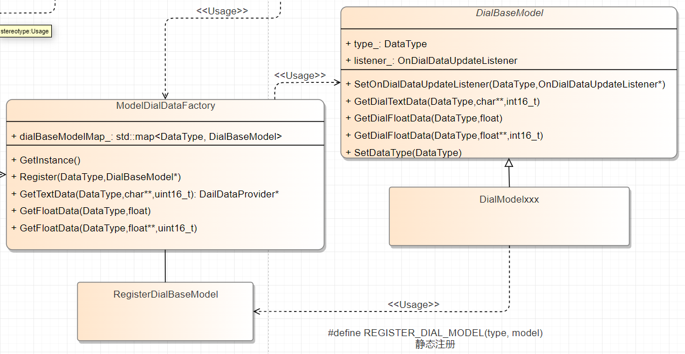

ModelDialDataFactory向上提供查询及注册接口；DialBaseModel为基类；DialModelxxx继承DialBaseModel，并通过REGIST\_DIAL\_MODULE静态往factory中注册，factory中管理model链表。详细信息，可参考“application\\wearable\\nativeapp\\nativeui\\main\\src\\ModelListenerSample.cpp”代码实现。

当前数据类型分float、text、multi float三类，分别对应三个分段DATA\_TYPE\_FLOAT\_BASE、DATA\_TYPE\_TEXT\_BASE、DATA\_TYPE\_MULTI\_FLOAT\_BASE。如需扩展，请按数据类型新增对应的枚举值。每个枚举值只能对应一个model，而一个model可能对应多个枚举类型，比如DialModelTime。

扩展新的model类型，需新增datatype，继承DialBaseModel并重写需要的数据接口，然后通过REGIST\_DIAL\_MODULE进行注册即可。详细可参考现有的dial model。

## 相关类介绍<a name="ZH-CN_TOPIC_0000002466383144"></a>

-   **[DialViewGroup](#ZH-CN_TOPIC_0000002499582005)**  

-   **[DialBaseModel](#ZH-CN_TOPIC_0000002466542756)**  

-   **[ModelDialDataFactory](#ZH-CN_TOPIC_0000002499582013)**  

### DialViewGroup<a name="ZH-CN_TOPIC_0000002499582005"></a>

DialViewGroup继承于CardPage，可直接作为crossview的一个页面使用；同时，它也继承于OnDialDataUpdateListener，用于model数据更新时用于通知上层的回调。主要函数如[表1](#zh-cn_topic_0000002444645825_table567162152719)所示。

**表 1**  DialViewGroup主要函数

<a name="zh-cn_topic_0000002444645825_table567162152719"></a>
<table><thead align="left"><tr id="zh-cn_topic_0000002444645825_row46711429277"><th class="cellrowborder" valign="top" width="50%" id="mcps1.2.3.1.1"><p id="zh-cn_topic_0000002444645825_p16716222712"><a name="zh-cn_topic_0000002444645825_p16716222712"></a><a name="zh-cn_topic_0000002444645825_p16716222712"></a>函数</p>
</th>
<th class="cellrowborder" valign="top" width="50%" id="mcps1.2.3.1.2"><p id="zh-cn_topic_0000002444645825_p12671132162716"><a name="zh-cn_topic_0000002444645825_p12671132162716"></a><a name="zh-cn_topic_0000002444645825_p12671132162716"></a>介绍</p>
</th>
</tr>
</thead>
<tbody><tr id="zh-cn_topic_0000002444645825_row96715292714"><td class="cellrowborder" valign="top" width="50%" headers="mcps1.2.3.1.1 "><p id="zh-cn_topic_0000002444645825_p126711327278"><a name="zh-cn_topic_0000002444645825_p126711327278"></a><a name="zh-cn_topic_0000002444645825_p126711327278"></a>void SetDial(std::string filePath)</p>
</td>
<td class="cellrowborder" valign="top" width="50%" headers="mcps1.2.3.1.2 "><p id="zh-cn_topic_0000002444645825_p12875125942712"><a name="zh-cn_topic_0000002444645825_p12875125942712"></a><a name="zh-cn_topic_0000002444645825_p12875125942712"></a>设置表盘资源路径。</p>
</td>
</tr>
<tr id="zh-cn_topic_0000002444645825_row14741172715"><td class="cellrowborder" valign="top" width="50%" headers="mcps1.2.3.1.1 "><p id="zh-cn_topic_0000002444645825_p08511112715"><a name="zh-cn_topic_0000002444645825_p08511112715"></a><a name="zh-cn_topic_0000002444645825_p08511112715"></a>uint8_t GetPeriod(void)</p>
</td>
<td class="cellrowborder" valign="top" width="50%" headers="mcps1.2.3.1.2 "><p id="zh-cn_topic_0000002444645825_p58611122716"><a name="zh-cn_topic_0000002444645825_p58611122716"></a><a name="zh-cn_topic_0000002444645825_p58611122716"></a>获取表盘刷新周期。</p>
</td>
</tr>
<tr id="zh-cn_topic_0000002444645825_row2067152132719"><td class="cellrowborder" valign="top" width="50%" headers="mcps1.2.3.1.1 "><p id="zh-cn_topic_0000002444645825_p667162102715"><a name="zh-cn_topic_0000002444645825_p667162102715"></a><a name="zh-cn_topic_0000002444645825_p667162102715"></a>void UpdateViewsByPeriodicUpdateData()</p>
</td>
<td class="cellrowborder" valign="top" width="50%" headers="mcps1.2.3.1.2 "><p id="zh-cn_topic_0000002444645825_p267114211272"><a name="zh-cn_topic_0000002444645825_p267114211272"></a><a name="zh-cn_topic_0000002444645825_p267114211272"></a>通知表盘更新数据（周期性主动获取数据）。</p>
</td>
</tr>
</tbody>
</table>

### DialBaseModel<a name="ZH-CN_TOPIC_0000002466542756"></a>

DialBaseModel为model基类，所有的model均继承于此类，主要函数如[表1](#zh-cn_topic_0000002411206572_table1291142221510)所示。

**表 1**  DialBaseModel主要函数

<a name="zh-cn_topic_0000002411206572_table1291142221510"></a>
<table><thead align="left"><tr id="zh-cn_topic_0000002411206572_row429132213155"><th class="cellrowborder" valign="top" width="50%" id="mcps1.2.3.1.1"><p id="zh-cn_topic_0000002411206572_p152911322111515"><a name="zh-cn_topic_0000002411206572_p152911322111515"></a><a name="zh-cn_topic_0000002411206572_p152911322111515"></a>函数</p>
</th>
<th class="cellrowborder" valign="top" width="50%" id="mcps1.2.3.1.2"><p id="zh-cn_topic_0000002411206572_p22911422101514"><a name="zh-cn_topic_0000002411206572_p22911422101514"></a><a name="zh-cn_topic_0000002411206572_p22911422101514"></a>介绍</p>
</th>
</tr>
</thead>
<tbody><tr id="zh-cn_topic_0000002411206572_row429162212155"><td class="cellrowborder" valign="top" width="50%" headers="mcps1.2.3.1.1 "><p id="zh-cn_topic_0000002411206572_p1291122121514"><a name="zh-cn_topic_0000002411206572_p1291122121514"></a><a name="zh-cn_topic_0000002411206572_p1291122121514"></a>void RegisterDialDataListener(OnDialDataUpdateListener* listener)</p>
</td>
<td class="cellrowborder" valign="top" width="50%" headers="mcps1.2.3.1.2 "><p id="zh-cn_topic_0000002411206572_p142911322181517"><a name="zh-cn_topic_0000002411206572_p142911322181517"></a><a name="zh-cn_topic_0000002411206572_p142911322181517"></a>注册回调函数，用于被动数据上报方式。当model数据变化时，会调用注册进来的listener。</p>
</td>
</tr>
<tr id="zh-cn_topic_0000002411206572_row529110229154"><td class="cellrowborder" valign="top" width="50%" headers="mcps1.2.3.1.1 "><p id="zh-cn_topic_0000002411206572_p102912022171517"><a name="zh-cn_topic_0000002411206572_p102912022171517"></a><a name="zh-cn_topic_0000002411206572_p102912022171517"></a>bool UnRegisterDialDataListener()</p>
</td>
<td class="cellrowborder" valign="top" width="50%" headers="mcps1.2.3.1.2 "><p id="zh-cn_topic_0000002411206572_p13291522141518"><a name="zh-cn_topic_0000002411206572_p13291522141518"></a><a name="zh-cn_topic_0000002411206572_p13291522141518"></a>注销回调函数。</p>
</td>
</tr>
<tr id="zh-cn_topic_0000002411206572_row229114225151"><td class="cellrowborder" valign="top" width="50%" headers="mcps1.2.3.1.1 "><p id="zh-cn_topic_0000002411206572_p82915228151"><a name="zh-cn_topic_0000002411206572_p82915228151"></a><a name="zh-cn_topic_0000002411206572_p82915228151"></a>bool GetDialTextData(DialDataType& type, string*& out, int16_t& strNum)</p>
</td>
<td class="cellrowborder" valign="top" width="50%" headers="mcps1.2.3.1.2 "><p id="zh-cn_topic_0000002411206572_p15291112211152"><a name="zh-cn_topic_0000002411206572_p15291112211152"></a><a name="zh-cn_topic_0000002411206572_p15291112211152"></a>获取字符串数据。</p>
<a name="zh-cn_topic_0000002411206572_ul2399953675"></a><a name="zh-cn_topic_0000002411206572_ul2399953675"></a><ul id="zh-cn_topic_0000002411206572_ul2399953675"><li>type：数据类型。</li><li>out：数据指针，用于带回字符串内容。</li><li>strNum：带回的字符串个数。</li></ul>
</td>
</tr>
<tr id="zh-cn_topic_0000002411206572_row134013201174"><td class="cellrowborder" valign="top" width="50%" headers="mcps1.2.3.1.1 "><p id="zh-cn_topic_0000002411206572_p334016208178"><a name="zh-cn_topic_0000002411206572_p334016208178"></a><a name="zh-cn_topic_0000002411206572_p334016208178"></a>bool GetDialFloatData(DialDataType& type, float& out)</p>
</td>
<td class="cellrowborder" valign="top" width="50%" headers="mcps1.2.3.1.2 "><p id="zh-cn_topic_0000002411206572_p179151747112113"><a name="zh-cn_topic_0000002411206572_p179151747112113"></a><a name="zh-cn_topic_0000002411206572_p179151747112113"></a>获取单个float数据。</p>
<a name="zh-cn_topic_0000002411206572_ul11137111080"></a><a name="zh-cn_topic_0000002411206572_ul11137111080"></a><ul id="zh-cn_topic_0000002411206572_ul11137111080"><li>type：数据类型。</li><li>out：带回float数据的变量。</li></ul>
</td>
</tr>
<tr id="zh-cn_topic_0000002411206572_row10291522191516"><td class="cellrowborder" valign="top" width="50%" headers="mcps1.2.3.1.1 "><p id="zh-cn_topic_0000002411206572_p229142219156"><a name="zh-cn_topic_0000002411206572_p229142219156"></a><a name="zh-cn_topic_0000002411206572_p229142219156"></a>bool GetDialFloatData(DialDataType& type, float*& out, int16_t len)</p>
</td>
<td class="cellrowborder" valign="top" width="50%" headers="mcps1.2.3.1.2 "><p id="zh-cn_topic_0000002411206572_p1461353020227"><a name="zh-cn_topic_0000002411206572_p1461353020227"></a><a name="zh-cn_topic_0000002411206572_p1461353020227"></a>获取多个float数据。</p>
<a name="zh-cn_topic_0000002411206572_ul193229231815"></a><a name="zh-cn_topic_0000002411206572_ul193229231815"></a><ul id="zh-cn_topic_0000002411206572_ul193229231815"><li>type：数据类型。</li><li>out：数据指针，用于带回float数据buffer。</li><li>len：带回的float数据个数。</li></ul>
</td>
</tr>
</tbody>
</table>

### ModelDialDataFactory<a name="ZH-CN_TOPIC_0000002499582013"></a>

ModelDialDataFactory用于管理model链表，并对上提供数据查询及回调注册接口，主要函数如[表1](#zh-cn_topic_0000002444725801_table1493316576233)所示。

**表 1**  ModelDialDataFactory主要函数

<a name="zh-cn_topic_0000002444725801_table1493316576233"></a>
<table><thead align="left"><tr id="zh-cn_topic_0000002444725801_row493312578231"><th class="cellrowborder" valign="top" width="50%" id="mcps1.2.3.1.1"><p id="zh-cn_topic_0000002444725801_p1493475712239"><a name="zh-cn_topic_0000002444725801_p1493475712239"></a><a name="zh-cn_topic_0000002444725801_p1493475712239"></a>函数</p>
</th>
<th class="cellrowborder" valign="top" width="50%" id="mcps1.2.3.1.2"><p id="zh-cn_topic_0000002444725801_p393415578233"><a name="zh-cn_topic_0000002444725801_p393415578233"></a><a name="zh-cn_topic_0000002444725801_p393415578233"></a>介绍</p>
</th>
</tr>
</thead>
<tbody><tr id="zh-cn_topic_0000002444725801_row179341257112310"><td class="cellrowborder" valign="top" width="50%" headers="mcps1.2.3.1.1 "><p id="zh-cn_topic_0000002444725801_p16934165717236"><a name="zh-cn_topic_0000002444725801_p16934165717236"></a><a name="zh-cn_topic_0000002444725801_p16934165717236"></a>bool RegisterDialDataListener(DialDataType type, OnDialDataUpdateListener* listener)</p>
</td>
<td class="cellrowborder" valign="top" width="50%" headers="mcps1.2.3.1.2 "><p id="zh-cn_topic_0000002444725801_p3934165732319"><a name="zh-cn_topic_0000002444725801_p3934165732319"></a><a name="zh-cn_topic_0000002444725801_p3934165732319"></a>注册回调函数：通过type查询到具体的model，并调用model相应的接口。</p>
</td>
</tr>
<tr id="zh-cn_topic_0000002444725801_row189341357112317"><td class="cellrowborder" valign="top" width="50%" headers="mcps1.2.3.1.1 "><p id="zh-cn_topic_0000002444725801_p119347578232"><a name="zh-cn_topic_0000002444725801_p119347578232"></a><a name="zh-cn_topic_0000002444725801_p119347578232"></a>bool UnRegisterDialDataListener(DialDataType type)</p>
</td>
<td class="cellrowborder" valign="top" width="50%" headers="mcps1.2.3.1.2 "><p id="zh-cn_topic_0000002444725801_p13291522141518"><a name="zh-cn_topic_0000002444725801_p13291522141518"></a><a name="zh-cn_topic_0000002444725801_p13291522141518"></a>注销回调函数：通过type查询到具体的model，并调用model相应的接口。</p>
</td>
</tr>
<tr id="zh-cn_topic_0000002444725801_row893416574235"><td class="cellrowborder" valign="top" width="50%" headers="mcps1.2.3.1.1 "><p id="zh-cn_topic_0000002444725801_p69341572232"><a name="zh-cn_topic_0000002444725801_p69341572232"></a><a name="zh-cn_topic_0000002444725801_p69341572232"></a>bool GetDialTextData(DialDataType& type, string*& out, int16_t& strNum)</p>
</td>
<td class="cellrowborder" valign="top" width="50%" headers="mcps1.2.3.1.2 "><p id="zh-cn_topic_0000002444725801_p15291112211152"><a name="zh-cn_topic_0000002444725801_p15291112211152"></a><a name="zh-cn_topic_0000002444725801_p15291112211152"></a>获取字符串数据：通过type查询到具体的model，并调用model相应的接口。</p>
</td>
</tr>
<tr id="zh-cn_topic_0000002444725801_row89345572238"><td class="cellrowborder" valign="top" width="50%" headers="mcps1.2.3.1.1 "><p id="zh-cn_topic_0000002444725801_p12934857192310"><a name="zh-cn_topic_0000002444725801_p12934857192310"></a><a name="zh-cn_topic_0000002444725801_p12934857192310"></a>bool GetDialFloatData(DialDataType& type, float& out)</p>
</td>
<td class="cellrowborder" valign="top" width="50%" headers="mcps1.2.3.1.2 "><p id="zh-cn_topic_0000002444725801_p179151747112113"><a name="zh-cn_topic_0000002444725801_p179151747112113"></a><a name="zh-cn_topic_0000002444725801_p179151747112113"></a>获取单个float数据：通过type查询到具体的model，并调用model相应的接口。</p>
</td>
</tr>
<tr id="zh-cn_topic_0000002444725801_row8175112702510"><td class="cellrowborder" valign="top" width="50%" headers="mcps1.2.3.1.1 "><p id="zh-cn_topic_0000002444725801_p19176227172512"><a name="zh-cn_topic_0000002444725801_p19176227172512"></a><a name="zh-cn_topic_0000002444725801_p19176227172512"></a>bool GetDialFloatData(DialDataType& type, float*& out, int16_t& len)</p>
</td>
<td class="cellrowborder" valign="top" width="50%" headers="mcps1.2.3.1.2 "><p id="zh-cn_topic_0000002444725801_p11725411266"><a name="zh-cn_topic_0000002444725801_p11725411266"></a><a name="zh-cn_topic_0000002444725801_p11725411266"></a>获取多个float数据：通过type查询到具体的model，并调用model相应的接口。</p>
</td>
</tr>
</tbody>
</table>

## 协议说明<a name="ZH-CN_TOPIC_0000002466383128"></a>

**图 1**  Bin文件的数据说明<a name="zh-cn_topic_0000002411046920_fig121726586309"></a>  
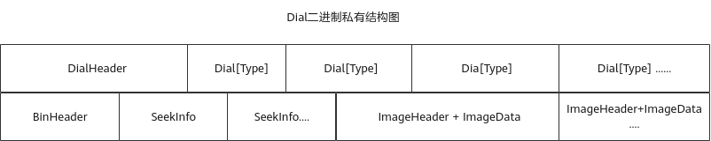

> **说明：** 
>-   Dial\[Type\] 支持类：DialStaticImg、DialSequenceImg、DialRotateImg、DialOptionImg、DialDigitalImg、DialLabel、DialArcLabel、DialProgressType、DialBoxProgress、DialArcProgress、DialVideo、DialClick、DialKaleidoscope。
>-   具体DialHeader和DialVIew结构体成员顺序请参考“application\\wearable\\nativeapp\\nativeui\\include\\main\\DialBinTypes.h”文件。
>-   DialHeader和DialVIew结构体成员说明请参考“[表盘制作](#ZH-CN_TOPIC_0000002466542792)”章节的标签控件。

# 在线表盘<a name="ZH-CN_TOPIC_0000002499502033"></a>

-   **[简介](#ZH-CN_TOPIC_0000002499581933)**  

-   **[参考实现](#ZH-CN_TOPIC_0000002466542720)**  

-   **[注册方案](#ZH-CN_TOPIC_0000002499502041)**  

## 简介<a name="ZH-CN_TOPIC_0000002499581933"></a>

表盘是手表最为基础的界面，其基本功能是为用户提供时间信息，但随着智能手表的发展，表盘上嵌入了越来越多的元素，比如电量信息、步数、心跳等，方便用户快速获取更多关键信息，如[图1](#zh-cn_topic_0000002411046700_fig2974103681419)所示。为了适应不同客户的定制需求，我们支持在线表盘和离线表盘两种类型：

-   离线表盘：通过加载和解析本地文件存储的表盘描述信息来生成表盘，用户只需要根据约定好的规则去制作表盘描述文件即可，不需要太关心代码实现，开发门槛低，但这也一定程度降低了灵活性。
-   在线表盘：通过直接编程来生成表盘，所有表盘的元素都直接通过代码描述，用户需要深度理解代码，掌握图形界面开发技能，开发门槛较高，但同时开发者可以更灵活的实现想要的效果。

本章主要介绍在线表盘的开发指导。

**图 1**  在线表盘样例<a name="zh-cn_topic_0000002411046700_fig2974103681419"></a>  
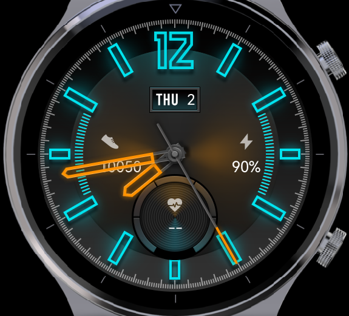

## 参考实现<a name="ZH-CN_TOPIC_0000002466542720"></a>

新增一个在线表盘，用户至少需要实现两个文件：

1.  表盘头文件，参考：application/wearable/nativeapp/nativeui/include/clock/MainClockView.h
2.  表盘源文件，参考：application/wearable/nativeapp/nativeui/clock/src/MainClockView.cpp

表盘实现关键要点如下：

-   新增的表盘类应继承UICardPage，UICardPage是UIViewGroup的子类，提供容器功能，同时UICardPage被设计用于和UICrossView配合，比如在表盘支持上下滑动、左右滑动进入其它页面。
-   新增表盘需要实现构造函数，并在其中设置界面的位置起点、宽高。
-   新增表盘需要重载PreLoad接口，并在其中完成各种表盘元素的创建和初始化，并调用SetCoverable\(true\)，以支持其它应用界面遮盖表盘界面。
-   在PreLoad接口中，如果是定制模拟表盘场景，可创建UISweepClock实例，其提供了扫描时钟相关的基本能力，同时它最终继承自UIViewGroup，提供了容器功能，表盘上的所有UI元素都应该被添加到这个容器中，然后UISweepClock实例应该被添加到新增的表盘类。
-   注意：因为主表盘是常用界面，为了提升回到主表盘流畅度，请不要在UnLoad接口中销毁释放表盘资源，相关操作应该放在表盘的析构函数中。
-   除此之外，用户还需要修改“application/wearable/nativeapp/nativelauncher/include/UiConfig.h”，在DialId中增加新增表盘的枚举。

## 注册方案<a name="ZH-CN_TOPIC_0000002499502041"></a>

为了将用户定制表盘的实例化与框架解耦，支持在线表盘静态注册方案，用户注册后，框架会根据运行模式和表盘类型，自适应创建对应表盘的实例。用户需要在新增的表盘源文件中，使用注册宏完成注册，调用形式为：REGIST\_WATCH\_DIAL\(mode, id, U\)，其中参数解释如下：

-   mode：显示模式，定义在“UiConfig.h”中的DialDisplayMode中，公板支持主表盘（DIAL\_DISPLAY\_MODE\_MAIN）和AOD表盘（DIAL\_DISPLAY\_MODE\_AOD），用户根据实际情况选择入参。
-   id：表盘ID，定义在“UiConfig.h”的DialId中，需要将用户自定义的表盘id作为入参。
-   U：表盘类模板，需要将自定义的表盘类作为入参。

注册一个main模式下的表盘，参考样例如下：REGIST\_WATCH\_DIAL\(DIAL\_DISPLAY\_MODE\_MAIN, DIAL\_CLOCK, MainClockView\);

# 桌面样式<a name="ZH-CN_TOPIC_0000002466383040"></a>

-   **[简介](#ZH-CN_TOPIC_0000002466542644)**  

-   **[参考实现](#ZH-CN_TOPIC_0000002466383152)**  

-   **[注册方案](#ZH-CN_TOPIC_0000002466383164)**  

## 简介<a name="ZH-CN_TOPIC_0000002466542644"></a>

桌面样式指的是应用图标在桌面上的组织和呈现方式，最典型的桌面样式为列表风格（如[图1](#zh-cn_topic_0000002444645705_fig20862571408)），通过上下滑动翻页，寻找想要的应用，再点击启动应用。除了最基本的列表模式外，我们还提供了多种个性化的桌面样式，包括足球风格、蜂窝风格和瀑布风格，随着版本迭代，后续可能会增加更丰富的桌面样式。

**图 1**  列表风格桌面<a name="zh-cn_topic_0000002444645705_fig20862571408"></a>  
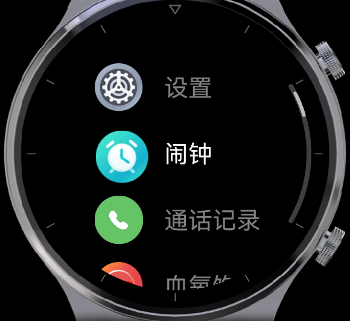

## 参考实现<a name="ZH-CN_TOPIC_0000002466383152"></a>

新增一个桌面样式，用户至少需要实现两个文件：

-   桌面样式头文件，参考：application/wearable/nativeapp/nativeui/include/applist/xxxDesktopFragment.h
-   桌面样式源文件，参考：application/wearable/nativeapp/nativeui/applist/src/xxxDesktopFragment.cpp

桌面样式实现关键要点：

1.  新增的桌面样式类应继承并实现UIDesktopFragment接口（其定义如[图1](#zh-cn_topic_0000002444645981_fig810956125213)），UIDesktopFragment通过继承多个父类，拥有自己的生命周期，支持处理点击、滚动和旋转事件，内部持有UIViewGroup实例，可提供容器功能；以上关键类的关系如[图2](#zh-cn_topic_0000002444645981_fig2072153119391)所示。

    **图 1**  UIDesktopFragment定义<a name="zh-cn_topic_0000002444645981_fig810956125213"></a>  
    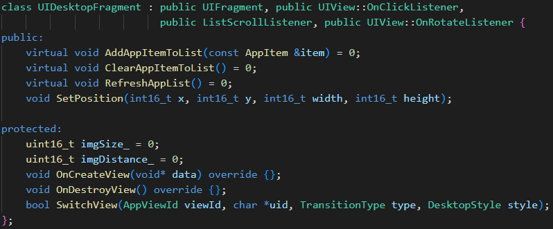

    **图 2**  UIDesktopFragment类图<a name="zh-cn_topic_0000002444645981_fig2072153119391"></a>  
    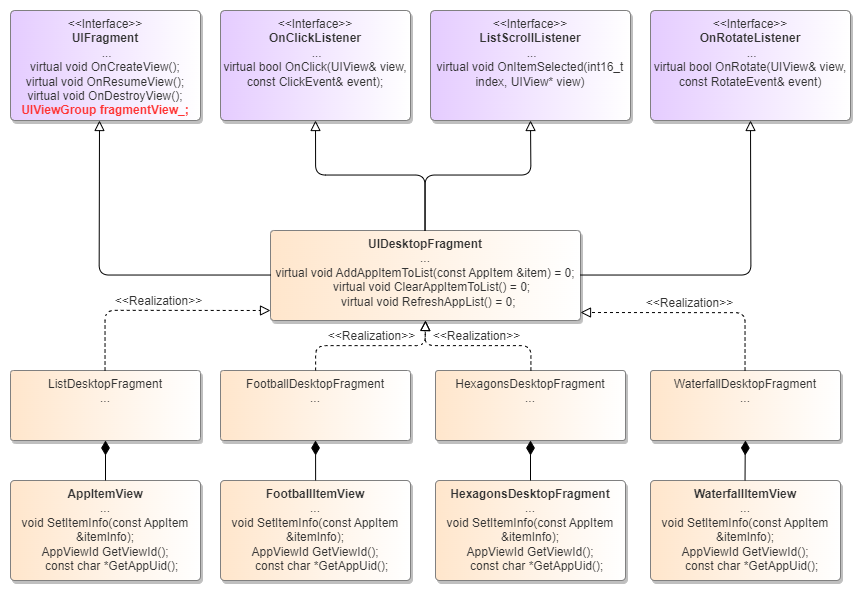

    UIDesktopFragment关键接口说明如[表1](#zh-cn_topic_0000002444645981_table12123193414611)所示。

    **表 1**  UIDesktopFragment关键接口说明

    <a name="zh-cn_topic_0000002444645981_table12123193414611"></a>
    <table><thead align="left"><tr id="zh-cn_topic_0000002444645981_row7124143419465"><th class="cellrowborder" valign="top" width="32.34%" id="mcps1.2.3.1.1"><p id="zh-cn_topic_0000002444645981_p61247344461"><a name="zh-cn_topic_0000002444645981_p61247344461"></a><a name="zh-cn_topic_0000002444645981_p61247344461"></a>接口</p>
    </th>
    <th class="cellrowborder" valign="top" width="67.66%" id="mcps1.2.3.1.2"><p id="zh-cn_topic_0000002444645981_p17124133416462"><a name="zh-cn_topic_0000002444645981_p17124133416462"></a><a name="zh-cn_topic_0000002444645981_p17124133416462"></a>接口描述</p>
    </th>
    </tr>
    </thead>
    <tbody><tr id="zh-cn_topic_0000002444645981_row11124123420464"><td class="cellrowborder" valign="top" width="32.34%" headers="mcps1.2.3.1.1 "><p id="zh-cn_topic_0000002444645981_p1112403474619"><a name="zh-cn_topic_0000002444645981_p1112403474619"></a><a name="zh-cn_topic_0000002444645981_p1112403474619"></a>AddAppItemToList</p>
    </td>
    <td class="cellrowborder" valign="top" width="67.66%" headers="mcps1.2.3.1.2 "><p id="zh-cn_topic_0000002444645981_p191245347464"><a name="zh-cn_topic_0000002444645981_p191245347464"></a><a name="zh-cn_topic_0000002444645981_p191245347464"></a>将应用添加到桌面，并生成对应风格的图标，是一个纯虚函数，客户定制桌面必须实现此接口。</p>
    </td>
    </tr>
    <tr id="zh-cn_topic_0000002444645981_row19124153474614"><td class="cellrowborder" valign="top" width="32.34%" headers="mcps1.2.3.1.1 "><p id="zh-cn_topic_0000002444645981_p4124183413467"><a name="zh-cn_topic_0000002444645981_p4124183413467"></a><a name="zh-cn_topic_0000002444645981_p4124183413467"></a>ClearAppItemToList</p>
    </td>
    <td class="cellrowborder" valign="top" width="67.66%" headers="mcps1.2.3.1.2 "><p id="zh-cn_topic_0000002444645981_p1212433418469"><a name="zh-cn_topic_0000002444645981_p1212433418469"></a><a name="zh-cn_topic_0000002444645981_p1212433418469"></a>清空桌面，并销毁桌面图标相关的资源，是一个纯虚函数，客户定制桌面必须实现此接口。</p>
    </td>
    </tr>
    <tr id="zh-cn_topic_0000002444645981_row1912473444610"><td class="cellrowborder" valign="top" width="32.34%" headers="mcps1.2.3.1.1 "><p id="zh-cn_topic_0000002444645981_p7124103424617"><a name="zh-cn_topic_0000002444645981_p7124103424617"></a><a name="zh-cn_topic_0000002444645981_p7124103424617"></a>RefreshAppList</p>
    </td>
    <td class="cellrowborder" valign="top" width="67.66%" headers="mcps1.2.3.1.2 "><p id="zh-cn_topic_0000002444645981_p812483444615"><a name="zh-cn_topic_0000002444645981_p812483444615"></a><a name="zh-cn_topic_0000002444645981_p812483444615"></a>刷新桌面图标布局，在更新桌面应用后被调用，是一个纯虚函数，客户定制桌面必须实现此接口。</p>
    </td>
    </tr>
    <tr id="zh-cn_topic_0000002444645981_row15124834184619"><td class="cellrowborder" valign="top" width="32.34%" headers="mcps1.2.3.1.1 "><p id="zh-cn_topic_0000002444645981_p412473412468"><a name="zh-cn_topic_0000002444645981_p412473412468"></a><a name="zh-cn_topic_0000002444645981_p412473412468"></a>OnCreateView</p>
    </td>
    <td class="cellrowborder" valign="top" width="67.66%" headers="mcps1.2.3.1.2 "><p id="zh-cn_topic_0000002444645981_p512413419469"><a name="zh-cn_topic_0000002444645981_p512413419469"></a><a name="zh-cn_topic_0000002444645981_p512413419469"></a>在创建桌面时被调用，开发者应该在此接口中创建、初始化对应风格的容器，并调用fragmentView_.Add(xxx)将容器添加到UIFragment持有的容器中（UIFragment持有的容器已被添加到RootContainer）；客户定制桌面必须重载此接口。</p>
    </td>
    </tr>
    <tr id="zh-cn_topic_0000002444645981_row112410341469"><td class="cellrowborder" valign="top" width="32.34%" headers="mcps1.2.3.1.1 "><p id="zh-cn_topic_0000002444645981_p312403415467"><a name="zh-cn_topic_0000002444645981_p312403415467"></a><a name="zh-cn_topic_0000002444645981_p312403415467"></a>OnDestroyView</p>
    </td>
    <td class="cellrowborder" valign="top" width="67.66%" headers="mcps1.2.3.1.2 "><p id="zh-cn_topic_0000002444645981_p812417349460"><a name="zh-cn_topic_0000002444645981_p812417349460"></a><a name="zh-cn_topic_0000002444645981_p812417349460"></a>在销毁桌面时被调用，开发者应该在这个接口中销毁所有资源，客户定制桌面必须重载此接口。</p>
    </td>
    </tr>
    <tr id="zh-cn_topic_0000002444645981_row16124163484616"><td class="cellrowborder" valign="top" width="32.34%" headers="mcps1.2.3.1.1 "><p id="zh-cn_topic_0000002444645981_p012433419463"><a name="zh-cn_topic_0000002444645981_p012433419463"></a><a name="zh-cn_topic_0000002444645981_p012433419463"></a>OnResumeView</p>
    </td>
    <td class="cellrowborder" valign="top" width="67.66%" headers="mcps1.2.3.1.2 "><p id="zh-cn_topic_0000002444645981_p20385131214918"><a name="zh-cn_topic_0000002444645981_p20385131214918"></a><a name="zh-cn_topic_0000002444645981_p20385131214918"></a>这个接口没有在UIDesktopFragment中显示声明，它是继承自UIFragment的接口，用于处理桌面显示前的定制动作，客户可按需实现。</p>
    </td>
    </tr>
    <tr id="zh-cn_topic_0000002444645981_row1456920596497"><td class="cellrowborder" valign="top" width="32.34%" headers="mcps1.2.3.1.1 "><p id="zh-cn_topic_0000002444645981_p6569105915492"><a name="zh-cn_topic_0000002444645981_p6569105915492"></a><a name="zh-cn_topic_0000002444645981_p6569105915492"></a>SwitchView</p>
    </td>
    <td class="cellrowborder" valign="top" width="67.66%" headers="mcps1.2.3.1.2 "><p id="zh-cn_topic_0000002444645981_p105691359144920"><a name="zh-cn_topic_0000002444645981_p105691359144920"></a><a name="zh-cn_topic_0000002444645981_p105691359144920"></a>用户点击桌面图标时，切换到对应的应用界面，客户定制桌面的OnClick回调中，建议统一调用此接口。</p>
    </td>
    </tr>
    <tr id="zh-cn_topic_0000002444645981_row169369411408"><td class="cellrowborder" valign="top" width="32.34%" headers="mcps1.2.3.1.1 "><p id="zh-cn_topic_0000002444645981_p89365484011"><a name="zh-cn_topic_0000002444645981_p89365484011"></a><a name="zh-cn_topic_0000002444645981_p89365484011"></a>OnClick</p>
    </td>
    <td class="cellrowborder" valign="top" width="67.66%" headers="mcps1.2.3.1.2 "><p id="zh-cn_topic_0000002444645981_p8936349409"><a name="zh-cn_topic_0000002444645981_p8936349409"></a><a name="zh-cn_topic_0000002444645981_p8936349409"></a>响应用户点击事件，进入到对应的应用界面，内部调用SwitchView接口完成切换即可，客户定制桌面必须重载此接口；参考<a href="#zh-cn_topic_0000002444645889_table107mcpsimp">表1</a>。</p>
    </td>
    </tr>
    <tr id="zh-cn_topic_0000002444645981_row19340141044010"><td class="cellrowborder" valign="top" width="32.34%" headers="mcps1.2.3.1.1 "><p id="zh-cn_topic_0000002444645981_p334091019405"><a name="zh-cn_topic_0000002444645981_p334091019405"></a><a name="zh-cn_topic_0000002444645981_p334091019405"></a>OnRotate</p>
    </td>
    <td class="cellrowborder" valign="top" width="67.66%" headers="mcps1.2.3.1.2 "><p id="zh-cn_topic_0000002444645981_p1734010103408"><a name="zh-cn_topic_0000002444645981_p1734010103408"></a><a name="zh-cn_topic_0000002444645981_p1734010103408"></a>响应用户旋转桌面的事件，重新绘制桌面，客户可按需实现；参考<a href="#zh-cn_topic_0000002444645889_table213mcpsimp">表5</a>。</p>
    </td>
    </tr>
    </tbody>
    </table>

2.  新增桌面样式应继承UIImageView并实现对应风格的xxxItemView类，用于管理桌面团标，可以将相关代码和主类放在一个文件中；这部分实现较为简单，不做赘述，客户可参考上述xxxDesktopFragment.cpp\(.h\)中的FootballItemView、HexagonsItemView、WaterfallItemView等实现。

新增实现以上类之外，用户还需要以下操作：

1.  修改“application/wearable/nativeapp/nativeui/include/settings/model/SettingDesktopModel.h”，在DesktopStyle中增加新增桌面的枚举类型。
2.  在setting模块中，增加对应桌面选择样式的入口。

## 注册方案<a name="ZH-CN_TOPIC_0000002466383164"></a>

为了将客户定制桌面样式的实例化与框架解耦，支持桌面样式静态注册方案，用户注册后，框架会根据设置的风格自适应创建对应桌面的实例。用户需要在新增的桌面样式源文件中，使用注册宏完成注册，调用形式为：REGIST\_DESKTOP\_STYLE\(style, D\)，其中参数解释如下：

-   style：桌面样式风格，定义在“SettingDesktopModel.h”的DesktopStyle中，需要将用户自定义的桌面style作为入参。
-   D：桌面风格类模板，需要将自定义的桌面类作为入参。

注册一个新的桌面样式，参考样例如下：REGIST\_DESKTOP\_STYLE\(APPLIST\_STYLE, ListDesktopFragment\);

# 屏幕旋转<a name="ZH-CN_TOPIC_0000002577756884"></a>

-   **[中间buffer方案](#ZH-CN_TOPIC_0000002608116847)**  

-   **[预旋转方案](#ZH-CN_TOPIC_0000002577916882)**  

-   **[DPU旋转方案](#ZH-CN_TOPIC_0000002608276751)**  

## 中间buffer方案<a name="ZH-CN_TOPIC_0000002608116847"></a>

原理为将内容绘制中间buffer上，再将中间buffer旋转到fb并送显fb。修改方式如下：

1.  打开文件“middleware/services/gui/hal/common/include/graphic\_hardware\_config\_wearable.h”将宏ROTATE\_METHOD的值修改为0。

    > **须知：** 
    >在宏ROTATE\_METHOD的值为0时，宏HW\_ROTATE\_ANGLE的值不能修改为0，否则将无内容显示。

2.  将宏HW\_ROTATE\_ANGLE修改为需要旋转的角度（1：顺时针90度，2：顺时针180度，3：顺时针270度）。

## 预旋转方案<a name="ZH-CN_TOPIC_0000002577916882"></a>

原理为将绘制的内容加上旋转变换绘制到fb上，送显fb。修改方式如下：

1.  打开文件“middleware/services/gui/hal/common/include/graphic\_hardware\_config\_wearable.h”将宏ROTATE\_METHOD的值修改为1。
2.  将宏HW\_ROTATE\_ANGLE修改为需要旋转的角度（0不旋转，1表示顺时针90度，2顺时针180度，3顺时针270度）。

## DPU旋转方案<a name="ZH-CN_TOPIC_0000002608276751"></a>

原理为直接绘制到DPU上，再由DPU旋转送显fb。修改方式如下：

1.  打开文件“middleware/services/gui/hal/common/include/graphic\_hardware\_config\_wearable.h”将宏ROTATE\_METHOD的值修改为2。
2.  将宏HW\_ROTATE\_ANGLE修改为需要旋转的角度（0：不旋转，1：顺时针90度，2：顺时针180度，3：顺时针270度）。

# Graphic service<a name="ZH-CN_TOPIC_0000002466383032"></a>

-   **[整体方案](#ZH-CN_TOPIC_0000002466542628)**  

-   **[对外接口](#ZH-CN_TOPIC_0000002466382936)**  

## 整体方案<a name="ZH-CN_TOPIC_0000002466542628"></a>

**图 1**  Graphic service总体方案<a name="zh-cn_topic_0000002411206804_fig128991414154415"></a>  
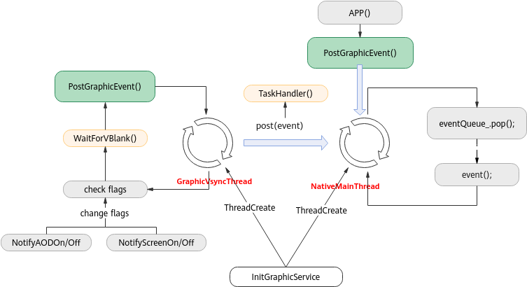

Graphic service总体上分为两部分：

-   初始化graphic。
-   创建两个任务线程，分别完成主任务执行，及vblank（显示器扫描线完成最后一行后，需要重返左上角的过程，也叫VBI（Vertical Blank Interval）、AOD（Always On Display，常亮显示）、Screen等硬件信息监测。

通过InitGraphicService\(\)调用，完成对gralloc、display HAL、input、TaskManager等的初始化，准备graphic执行环境。同时会启动两个线程。

-   main task：只做一件事，执行event queue中的任务，若队列空则睡眠等待信号量。
-   vsync thread：监测screen、AOD信息，若是灭屏或低功耗模式，图形将睡眠等待信号量；否则获取vblank信号，并以此为周期将TaskHandler推送到main task执行。

所有外部模块对图形的调用，均需通过PostGraphicEvent\(\)接口推送到event queue，等待vblank周期执行。

## 对外接口<a name="ZH-CN_TOPIC_0000002466382936"></a>

**表 1**  graphic service对外API

<a name="zh-cn_topic_0000002411206704_table187412123718"></a>
<table><thead align="left"><tr id="zh-cn_topic_0000002411206704_row148715128378"><th class="cellrowborder" valign="top" width="26.640000000000004%" id="mcps1.2.3.1.1"><p id="zh-cn_topic_0000002411206704_p16873125374"><a name="zh-cn_topic_0000002411206704_p16873125374"></a><a name="zh-cn_topic_0000002411206704_p16873125374"></a>函数</p>
</th>
<th class="cellrowborder" valign="top" width="73.36%" id="mcps1.2.3.1.2"><p id="zh-cn_topic_0000002411206704_p1887191223718"><a name="zh-cn_topic_0000002411206704_p1887191223718"></a><a name="zh-cn_topic_0000002411206704_p1887191223718"></a>说明</p>
</th>
</tr>
</thead>
<tbody><tr id="zh-cn_topic_0000002411206704_row118741223712"><td class="cellrowborder" valign="top" width="26.640000000000004%" headers="mcps1.2.3.1.1 "><p id="zh-cn_topic_0000002411206704_p188771213372"><a name="zh-cn_topic_0000002411206704_p188771213372"></a><a name="zh-cn_topic_0000002411206704_p188771213372"></a>void PostGraphicEvent(const OHOS::GraphicEvent& event)</p>
</td>
<td class="cellrowborder" valign="top" width="73.36%" headers="mcps1.2.3.1.2 "><p id="zh-cn_topic_0000002411206704_p38751215373"><a name="zh-cn_topic_0000002411206704_p38751215373"></a><a name="zh-cn_topic_0000002411206704_p38751215373"></a>向图形service任务队列推送任务，任务将在后续的Vsync周期被执行。</p>
<p id="zh-cn_topic_0000002411206704_p3831181613324"><a name="zh-cn_topic_0000002411206704_p3831181613324"></a><a name="zh-cn_topic_0000002411206704_p3831181613324"></a>注意：仅推送涉及UI属性变更或刷新的任务，切勿推送无关且耗时的处理，这会阻塞UI，导致显示卡顿。</p>
</td>
</tr>
<tr id="zh-cn_topic_0000002411206704_row48771220370"><td class="cellrowborder" valign="top" width="26.640000000000004%" headers="mcps1.2.3.1.1 "><p id="zh-cn_topic_0000002411206704_p88721211372"><a name="zh-cn_topic_0000002411206704_p88721211372"></a><a name="zh-cn_topic_0000002411206704_p88721211372"></a>void NotifyScreenOn()</p>
</td>
<td class="cellrowborder" valign="top" width="73.36%" headers="mcps1.2.3.1.2 "><p id="zh-cn_topic_0000002411206704_p191711283441"><a name="zh-cn_topic_0000002411206704_p191711283441"></a><a name="zh-cn_topic_0000002411206704_p191711283441"></a>设置screen flag为1（on）。</p>
</td>
</tr>
<tr id="zh-cn_topic_0000002411206704_row487512143711"><td class="cellrowborder" valign="top" width="26.640000000000004%" headers="mcps1.2.3.1.1 "><p id="zh-cn_topic_0000002411206704_p291617515715"><a name="zh-cn_topic_0000002411206704_p291617515715"></a><a name="zh-cn_topic_0000002411206704_p291617515715"></a>void NotifyScreenOff()</p>
</td>
<td class="cellrowborder" valign="top" width="73.36%" headers="mcps1.2.3.1.2 "><p id="zh-cn_topic_0000002411206704_p17349238174410"><a name="zh-cn_topic_0000002411206704_p17349238174410"></a><a name="zh-cn_topic_0000002411206704_p17349238174410"></a>设置screen flag为0（off）。</p>
</td>
</tr>
</tbody>
</table>

> **说明：** 
>若是C语言代码，通过graphic\_service\_wrapper中对应的接口调用。

# 表情包支持<a name="ZH-CN_TOPIC_0000002466382964"></a>

-   **[方案介绍](#ZH-CN_TOPIC_0000002466383136)**  

-   **[制作表情包数据库和表情包映射表](#ZH-CN_TOPIC_0000002499501929)**  

-   **[绘制原理](#ZH-CN_TOPIC_0000002499501921)**  

## 方案介绍<a name="ZH-CN_TOPIC_0000002466383136"></a>

不同于文字使用矢量字库绘制，表情包使用图片进行绘制，支持自定义表情包，表情包自定义流程如下：

1.  制作表情包压缩数据（请参考“[图片资源打包](#ZH-CN_TOPIC_0000002499502009)”）。
2.  在头文件ui\_emoji\_table.cpp中定义unicode码点和表情包图片的映射关系。
3.  导入表情包压缩数据并使用。

## 制作表情包数据库和表情包映射表<a name="ZH-CN_TOPIC_0000002499501929"></a>

制作表情包数据库和表情包映射表流程如下：

1.  将使用的表情包用Debugkits以package的方式进行压缩，并将名字保存为emoji.bin。

    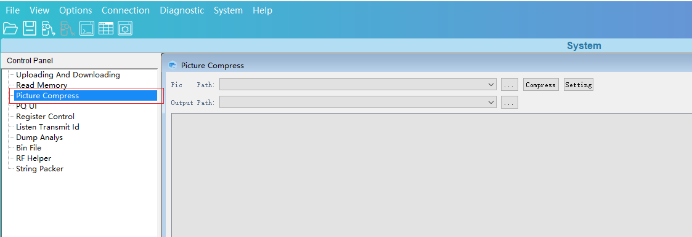

2.  将表情包与码点的映射关系放到头文件“middleware/services/gui/uikit/proprietary/src/ui/frameworks/common/ui\_emoji\_table.cpp”中去，同时通过变量“EMOJI\_PATH”配置emoji.bin文件的位置。

    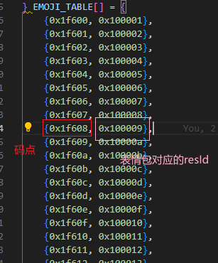

3.  将emoji.bin放入配置的路径中去。

## 绘制原理<a name="ZH-CN_TOPIC_0000002499501921"></a>

普通的码点（unicode）首先通过查找字库，获取矢量数据进行绘制。对于找不到的码点会先在自定义的表情包数据库中寻找，如果找到，会提取表情包的图片数据，并进行绘制；如果在表情包映射表中也找不到，将会在配置的多语言字库中查找码点数据。

# DFX<a name="ZH-CN_TOPIC_0000002466383092"></a>

-   **[内存占用](#ZH-CN_TOPIC_0000002466542608)**  

-   **[帧率](#ZH-CN_TOPIC_0000002466382984)**  

-   **[截图](#ZH-CN_TOPIC_0000002499502085)**  

-   **[模拟事件](#ZH-CN_TOPIC_0000002499502101)**  

-   **[时延统计](#ZH-CN_TOPIC_0000002499582045)**  

-   **[控件树打印](#ZH-CN_TOPIC_0000002499501913)**  

-   **[内存泄漏定位](#ZH-CN_TOPIC_0000002499581981)**  

-   **[Native状态打印](#ZH-CN_TOPIC_0000002499501941)**  

## 内存占用<a name="ZH-CN_TOPIC_0000002466542608"></a>

-   dumpmem

    打印UIKit占用内存，包含以下内存：

    -   current malloc/new memory：

        通过UIKit UIMalloc或new分配的内存块数量。

    -   current gralloc allocate memory：

        通过UIKit GrallocEngine分配的内存，包含图片、矢量、视频Buffer等内存。

    注意，如果当前dumpmem数值在慢慢变大，一般说明出现内存泄漏，请参考“[内存泄漏定位](#ZH-CN_TOPIC_0000002499581981)”；如果当前dumpmem数值在慢慢减小，说明出现内存重复释放，需要自行定位。

-   dumpimg

    打印UIKit中图片资源缓存信息，以及相关控件所持有的图片资源信息。

> **说明：** 
>在串口工具中发送指令，指令格式为：‘AT+GUI=UIKIT\_DFX,’+具体命令，后续不再赘述。

## 帧率<a name="ZH-CN_TOPIC_0000002466382984"></a>

-   printfps

    -   -h：打印帧率说明。
    -   duration n：n秒，持续打印帧率n秒\[n次\]。

    仅输入printfps，则只打印一次帧率。

-   showfps

    -   -h：显示帧率说明。
    -   -p：指定显示起始位置。参数格式：x，y。

    仅输入showfps，则默认显示在屏幕中间。

    其坐标位置仅在第一次输入showfps时有效，后续再调用均无效。

-   hidefps

    隐藏帧率显示。

帧率DFX示例如下：

```
/* 打印帧率 */
AT+GUI=UIKIT_DFX,printfps,10
/* 显示帧率 */
AT+GUI=UIKIT_DFX,showfps,-p,100,100
/* 隐藏帧率 */
AT+GUI=UIKIT_DFX,hidefps
```

## 截图<a name="ZH-CN_TOPIC_0000002499502085"></a>

-   dump\_view\_id

    串口输入此命令，将当前RootView下所有设置过viewId的子节点的viewId和坐标信息输出在串口中：\[viewId\]: x, y, w, h。

-   screencap

    -   -h：截图指南，无参。
    -   -v：控件截图，截取指定控件的数据。参数格式：viewId。
    -   -c：区域截图，截取指定区域的数据。参数格式：x，y，w，h。参数非负，且不能超过屏幕大小。
    -   -f：输出文件，截取数据保存至该输出文件。

    > **说明：** 
    >-   -f需配置为最后一个选项。如果-f前无其他选项，则判定为全屏截图，是从FB捞取的图片数据。
    >-   -v是重新绘制后截取的图片数据。-c是从FB中捞取的图片数据。
    >-   FB捞取的图片数据的压缩模式是COMPRESS\_MODE\_HFBC\_2X，重绘截取的图片数据的压缩模式是COMPRESS\_MODE\_HFBC\_3X。
    >-   截取的压缩图片需要解压才能查看，解压缩流程请参考《DebugKits工具 使用指南》。
    >-   视频截图仅能通过-v，需要先打印控件树获取视频控件ID，再配置ID通过-v截取视频图片数据。
    >-   文件保存的数据格式为RGB888。
    >-   文件像素宽度为16倍数对齐，即真实宽度为：
    >    

    -   串口回显：

        screencap result: 1.（表示执行成功）。

        screencap result: 0.（表示执行失败）。

截图DFX示例如下：

```
/* 区域截图 */
AT+GUI=UIKIT_DFX,screencap,-c,0 0 100 100,-f,/bin/vs/sd0p0/rect.bin
/* 组件截图 */
dump_view_id
AT+GUI=UIKIT_DFX,screencap,-v,mainclickactivity,-f,/bin/vs/sd0p0/view.bin
/* 全屏截图 */
AT+GUI=UIKIT_DFX,screencap,-f,/bin/vs/sd0p0/screen.bin
```

## 模拟事件<a name="ZH-CN_TOPIC_0000002499502101"></a>

**模拟旋转表冠事件<a name="zh-cn_topic_0000002411206616_section15407102617242"></a>**

-   inject\_rotate n
    -   参数n：旋转刻度（有符号整形类型）。
    -   示例：

        AT+GUI=UIKIT\_DFX,inject\_rotate,10

**模拟按键事件<a name="zh-cn_topic_0000002411206616_section11830346152417"></a>**

-   inject\_key keyId state
    -   参数keyId：键值（字符串类型），合法值\[power，func\]。
    -   参数state：按键状态（无符号整形类型），合法值\[0, 1, 2\]。0代表松开，1代表按下，2代表长按。
    -   示例：

        AT+GUI=UIKIT\_DFX,inject\_key,power,1

**模拟点击事件<a name="zh-cn_topic_0000002411206616_section205969219144"></a>**

-   inject\_click x y
    -   参数x：X坐标（无符号整形类型）。
    -   参数y：Y坐标（无符号整形类型）。
    -   示例：

        AT+GUI=UIKIT\_DFX,inject\_click,100,200

**模拟拖动事件<a name="zh-cn_topic_0000002411206616_section1850718289255"></a>**

-   inject\_drag startX startY endX endY duration
    -   参数startX：起始X坐标（无符号整形类型）。
    -   参数startY：起始Y坐标（无符号整形类型）。
    -   参数endX：结束X坐标（无符号整形类型）。
    -   参数endY：结束Y坐标（无符号整形类型）。
    -   参数duration：拖动时长ms（无符号整形类型）。
    -   示例：

        AT+GUI=UIKIT\_DFX,inject\_drag,200,400,200,100,30

**模拟长按事件<a name="zh-cn_topic_0000002411206616_section15439148102516"></a>**

-   inject\_lp x y
    -   参数x：X坐标（无符号整形类型）。
    -   参数y：Y坐标（无符号整形类型）。
    -   示例：

        AT+GUI=UIKIT\_DFX,inject\_lp,100,30

## 时延统计<a name="ZH-CN_TOPIC_0000002499582045"></a>

-   showtime param

    参数param：要统计时延的类型，可取值point、tp、render、close。

    -   point：打印UI一秒内尝试查询tp点的次数及相关信息。
    -   tp：实时打印tp报点。
    -   render：打印绘制耗时。
    -   close：关闭时延统计。
    -   示例：

        AT+GUI=UIKIT\_DFX,showtime,render

-   showtime point
-   showtime tp
-   showtime render count flush

    -   含义：渲染过程中每一帧软硬件耗时、task耗时和event耗时。
    -   示例
        -   示例1：

            AT+GUI=UIKIT\_DFX,showtime,render,30,0

            30：打印接下来30帧软硬件绘制指令。

            0：第一帧不强制刷新。

        -   示例2：

            AT+GUI=UIKIT\_DFX,showtime,render,30,1

            30：打印接下来30帧软硬件绘制指令。

            1：第一帧强制刷新。

    打印结果（截取部分）：

    ```
    Total: E 11, T 50, F 10
    
    E 0: 0, 81
    
    E 1: 13, 16330
    T 0: 17, 422
    T 1: 7, 36
    T 2: 6, 103
    T 3: 5, 17
    T 4: 5, 15699
    isNativeRunning 1, freq 60
    Cmd count: 9 time: 15037, {0 0 465 465}
    0. hw_rect: 575, 187, {0, 0, 465, 465}
    1. hw_blit: 766, 252, 1
    2. hw_path: 1187, 857, 11
    3. hw_blit: 1171, 239, 1
    4. hw_blit: 716, 422, 2
    5. hw_blit: 1063, 771, 6
    6. hw_wait: 29, 95
    7. hw_flush: 48, 7122, {0, 0, 465, 465}, s
    8. hw_submit: 47, 65, 0
    ```

    **表 1**  showtime render打印结果说明

    <a name="zh-cn_topic_0000002444725857_table13117143611146"></a>
    <table><thead align="left"><tr id="zh-cn_topic_0000002444725857_row817503641411"><th class="cellrowborder" valign="top" width="25.96969696969697%" id="mcps1.2.4.1.1"><p id="zh-cn_topic_0000002444725857_p1817510362147"><a name="zh-cn_topic_0000002444725857_p1817510362147"></a><a name="zh-cn_topic_0000002444725857_p1817510362147"></a>格式</p>
    </th>
    <th class="cellrowborder" valign="top" width="40.696969696969695%" id="mcps1.2.4.1.2"><p id="zh-cn_topic_0000002444725857_p017511369145"><a name="zh-cn_topic_0000002444725857_p017511369145"></a><a name="zh-cn_topic_0000002444725857_p017511369145"></a>含义</p>
    </th>
    <th class="cellrowborder" valign="top" width="33.333333333333336%" id="mcps1.2.4.1.3"><p id="zh-cn_topic_0000002444725857_p20175436191410"><a name="zh-cn_topic_0000002444725857_p20175436191410"></a><a name="zh-cn_topic_0000002444725857_p20175436191410"></a>备注</p>
    </th>
    </tr>
    </thead>
    <tbody><tr id="zh-cn_topic_0000002444725857_row51751136171410"><td class="cellrowborder" valign="top" width="25.96969696969697%" headers="mcps1.2.4.1.1 "><p id="zh-cn_topic_0000002444725857_p31753362149"><a name="zh-cn_topic_0000002444725857_p31753362149"></a><a name="zh-cn_topic_0000002444725857_p31753362149"></a>Total: E 11, T 50, F 10</p>
    </td>
    <td class="cellrowborder" valign="top" width="40.696969696969695%" headers="mcps1.2.4.1.2 "><a name="zh-cn_topic_0000002444725857_ul1183503835615"></a><a name="zh-cn_topic_0000002444725857_ul1183503835615"></a><ul id="zh-cn_topic_0000002444725857_ul1183503835615"><li>E 11：本次图形线程记录共11个event；</li><li>T 50：本次图形线程记录共50个task；</li><li>F 10：本次图形线程成功送显10帧。</li></ul>
    </td>
    <td class="cellrowborder" valign="top" width="33.333333333333336%" headers="mcps1.2.4.1.3 "><p id="zh-cn_topic_0000002444725857_p217519360145"><a name="zh-cn_topic_0000002444725857_p217519360145"></a><a name="zh-cn_topic_0000002444725857_p217519360145"></a>图形线程执行流程：while循环处理event队列，event分为内部/外部两种类型，内部event进一步拆分为多个task（<strong id="zh-cn_topic_0000002444725857_b91751360145"><a name="zh-cn_topic_0000002444725857_b91751360145"></a><a name="zh-cn_topic_0000002444725857_b91751360145"></a>最后三个task固定为输入/动效/渲染送显</strong>）。</p>
    </td>
    </tr>
    <tr id="zh-cn_topic_0000002444725857_row19175143681414"><td class="cellrowborder" valign="top" width="25.96969696969697%" headers="mcps1.2.4.1.1 "><p id="zh-cn_topic_0000002444725857_p1517543613148"><a name="zh-cn_topic_0000002444725857_p1517543613148"></a><a name="zh-cn_topic_0000002444725857_p1517543613148"></a>E 0: 0, 81</p>
    </td>
    <td class="cellrowborder" valign="top" width="40.696969696969695%" headers="mcps1.2.4.1.2 "><a name="zh-cn_topic_0000002444725857_ul18354144175616"></a><a name="zh-cn_topic_0000002444725857_ul18354144175616"></a><ul id="zh-cn_topic_0000002444725857_ul18354144175616"><li>E 0：第0号event；</li><li>0：距离上个event结束的间隔时间（首个event为0μs）；</li><li>81：本event耗时81μs。</li></ul>
    </td>
    <td class="cellrowborder" valign="top" width="33.333333333333336%" headers="mcps1.2.4.1.3 "><p id="zh-cn_topic_0000002444725857_p20175113614142"><a name="zh-cn_topic_0000002444725857_p20175113614142"></a><a name="zh-cn_topic_0000002444725857_p20175113614142"></a>该event无task，属于外部event。</p>
    </td>
    </tr>
    <tr id="zh-cn_topic_0000002444725857_row11175173691413"><td class="cellrowborder" valign="top" width="25.96969696969697%" headers="mcps1.2.4.1.1 "><p id="zh-cn_topic_0000002444725857_p16175436101414"><a name="zh-cn_topic_0000002444725857_p16175436101414"></a><a name="zh-cn_topic_0000002444725857_p16175436101414"></a>E 1: 13, 16330</p>
    <p id="zh-cn_topic_0000002444725857_p15175536151412"><a name="zh-cn_topic_0000002444725857_p15175536151412"></a><a name="zh-cn_topic_0000002444725857_p15175536151412"></a>T 0: 17, 422</p>
    <p id="zh-cn_topic_0000002444725857_p1917563615141"><a name="zh-cn_topic_0000002444725857_p1917563615141"></a><a name="zh-cn_topic_0000002444725857_p1917563615141"></a>T 1: 7, 36</p>
    <p id="zh-cn_topic_0000002444725857_p19175436191410"><a name="zh-cn_topic_0000002444725857_p19175436191410"></a><a name="zh-cn_topic_0000002444725857_p19175436191410"></a>T 2: 6, 103</p>
    <p id="zh-cn_topic_0000002444725857_p317503618148"><a name="zh-cn_topic_0000002444725857_p317503618148"></a><a name="zh-cn_topic_0000002444725857_p317503618148"></a>T 3: 5, 17</p>
    <p id="zh-cn_topic_0000002444725857_p16175123681416"><a name="zh-cn_topic_0000002444725857_p16175123681416"></a><a name="zh-cn_topic_0000002444725857_p16175123681416"></a>T 4: 5, 15699</p>
    <p id="zh-cn_topic_0000002444725857_p217533641418"><a name="zh-cn_topic_0000002444725857_p217533641418"></a><a name="zh-cn_topic_0000002444725857_p217533641418"></a>isNativeRunning 1, freq 60</p>
    <p id="zh-cn_topic_0000002444725857_p101751036111415"><a name="zh-cn_topic_0000002444725857_p101751036111415"></a><a name="zh-cn_topic_0000002444725857_p101751036111415"></a>Cmd count: 9 time: 15037, {0 0 465 465}</p>
    <p id="zh-cn_topic_0000002444725857_p617563651416"><a name="zh-cn_topic_0000002444725857_p617563651416"></a><a name="zh-cn_topic_0000002444725857_p617563651416"></a>0. hw_rect: 575, 187, {0, 0, 465, 465}</p>
    <p id="zh-cn_topic_0000002444725857_p9175736181415"><a name="zh-cn_topic_0000002444725857_p9175736181415"></a><a name="zh-cn_topic_0000002444725857_p9175736181415"></a>...</p>
    </td>
    <td class="cellrowborder" valign="top" width="40.696969696969695%" headers="mcps1.2.4.1.2 "><a name="zh-cn_topic_0000002444725857_ul6505737112111"></a><a name="zh-cn_topic_0000002444725857_ul6505737112111"></a><ul id="zh-cn_topic_0000002444725857_ul6505737112111"><li>E 1: 13, 16330<p id="zh-cn_topic_0000002444725857_p6175153661411"><a name="zh-cn_topic_0000002444725857_p6175153661411"></a><a name="zh-cn_topic_0000002444725857_p6175153661411"></a>13：距离上个event结束13μs后开始；</p>
    <p id="zh-cn_topic_0000002444725857_p111755362140"><a name="zh-cn_topic_0000002444725857_p111755362140"></a><a name="zh-cn_topic_0000002444725857_p111755362140"></a>16330：本event总耗时16330μs。</p>
    </li><li>T 0: 17, 422<p id="zh-cn_topic_0000002444725857_p317513641412"><a name="zh-cn_topic_0000002444725857_p317513641412"></a><a name="zh-cn_topic_0000002444725857_p317513641412"></a>T 0：属于event 1的第0号task；</p>
    <p id="zh-cn_topic_0000002444725857_p14175736121410"><a name="zh-cn_topic_0000002444725857_p14175736121410"></a><a name="zh-cn_topic_0000002444725857_p14175736121410"></a>17：距离上个task开始间隔17μs（首个task表示event开始到task开始的间隔）；</p>
    <p id="zh-cn_topic_0000002444725857_p1517553616149"><a name="zh-cn_topic_0000002444725857_p1517553616149"></a><a name="zh-cn_topic_0000002444725857_p1517553616149"></a>422：本task耗时422μs。</p>
    </li><li>T 4: 5, 15699<p id="zh-cn_topic_0000002444725857_p71759367141"><a name="zh-cn_topic_0000002444725857_p71759367141"></a><a name="zh-cn_topic_0000002444725857_p71759367141"></a>5：距离上个task间隔5μs；</p>
    <p id="zh-cn_topic_0000002444725857_p817512362147"><a name="zh-cn_topic_0000002444725857_p817512362147"></a><a name="zh-cn_topic_0000002444725857_p817512362147"></a>15699：送显task总耗时15699μs。送显task可进一步拆解为指令级耗时（见下面内容）。</p>
    </li></ul>
    </td>
    <td class="cellrowborder" valign="top" width="33.333333333333336%" headers="mcps1.2.4.1.3 "><p id="zh-cn_topic_0000002444725857_p16175103613147"><a name="zh-cn_topic_0000002444725857_p16175103613147"></a><a name="zh-cn_topic_0000002444725857_p16175103613147"></a>-</p>
    </td>
    </tr>
    <tr id="zh-cn_topic_0000002444725857_row7175236191410"><td class="cellrowborder" valign="top" width="25.96969696969697%" headers="mcps1.2.4.1.1 "><p id="zh-cn_topic_0000002444725857_p18176736151420"><a name="zh-cn_topic_0000002444725857_p18176736151420"></a><a name="zh-cn_topic_0000002444725857_p18176736151420"></a>T 4: 5, 15699</p>
    <p id="zh-cn_topic_0000002444725857_p817693601418"><a name="zh-cn_topic_0000002444725857_p817693601418"></a><a name="zh-cn_topic_0000002444725857_p817693601418"></a>isNativeRunning 1, freq 60</p>
    <p id="zh-cn_topic_0000002444725857_p9176153631419"><a name="zh-cn_topic_0000002444725857_p9176153631419"></a><a name="zh-cn_topic_0000002444725857_p9176153631419"></a>Cmd count: 9 time: 15037, {0 0 465 465}</p>
    <p id="zh-cn_topic_0000002444725857_p417673615144"><a name="zh-cn_topic_0000002444725857_p417673615144"></a><a name="zh-cn_topic_0000002444725857_p417673615144"></a>0. hw_rect: 575, 187, {0, 0, 465, 465}</p>
    <p id="zh-cn_topic_0000002444725857_p3176336151419"><a name="zh-cn_topic_0000002444725857_p3176336151419"></a><a name="zh-cn_topic_0000002444725857_p3176336151419"></a>1. hw_blit: 766, 252, 1</p>
    <p id="zh-cn_topic_0000002444725857_p1117616367146"><a name="zh-cn_topic_0000002444725857_p1117616367146"></a><a name="zh-cn_topic_0000002444725857_p1117616367146"></a>2. hw_path: 1187, 857, 11</p>
    <p id="zh-cn_topic_0000002444725857_p1717653617140"><a name="zh-cn_topic_0000002444725857_p1717653617140"></a><a name="zh-cn_topic_0000002444725857_p1717653617140"></a>3. hw_blit: 1171, 239, 1</p>
    <p id="zh-cn_topic_0000002444725857_p18176133612147"><a name="zh-cn_topic_0000002444725857_p18176133612147"></a><a name="zh-cn_topic_0000002444725857_p18176133612147"></a>4. hw_blit: 716, 422, 2</p>
    <p id="zh-cn_topic_0000002444725857_p91761636151413"><a name="zh-cn_topic_0000002444725857_p91761636151413"></a><a name="zh-cn_topic_0000002444725857_p91761636151413"></a>5. hw_blit: 1063, 771, 6</p>
    <p id="zh-cn_topic_0000002444725857_p11176236141416"><a name="zh-cn_topic_0000002444725857_p11176236141416"></a><a name="zh-cn_topic_0000002444725857_p11176236141416"></a>6. hw_wait: 29, 95</p>
    <p id="zh-cn_topic_0000002444725857_p10176163611145"><a name="zh-cn_topic_0000002444725857_p10176163611145"></a><a name="zh-cn_topic_0000002444725857_p10176163611145"></a>7. hw_flush: 48, 7122, {0, 0, 465, 465}, s</p>
    <p id="zh-cn_topic_0000002444725857_p2176173617146"><a name="zh-cn_topic_0000002444725857_p2176173617146"></a><a name="zh-cn_topic_0000002444725857_p2176173617146"></a>8. hw_submit: 47, 65, 0</p>
    </td>
    <td class="cellrowborder" valign="top" width="40.696969696969695%" headers="mcps1.2.4.1.2 "><a name="zh-cn_topic_0000002444725857_ul93059132518"></a><a name="zh-cn_topic_0000002444725857_ul93059132518"></a><ul id="zh-cn_topic_0000002444725857_ul93059132518"><li>isNativeRunning 1, freq 60”：<p id="zh-cn_topic_0000002444725857_p18176183611415"><a name="zh-cn_topic_0000002444725857_p18176183611415"></a><a name="zh-cn_topic_0000002444725857_p18176183611415"></a>isNativeRunning 1：表示本次送显是在图形线程送显，如果为0表示在非图形线程送显（例如JS线程）；</p>
    <p id="zh-cn_topic_0000002444725857_p19176123611411"><a name="zh-cn_topic_0000002444725857_p19176123611411"></a><a name="zh-cn_topic_0000002444725857_p19176123611411"></a>freq 60：当前送显最高帧率为60（实际帧率小于等于60）。</p>
    </li><li>Cmd count: 9 time: 15037, {0 0 465 465}：<p id="zh-cn_topic_0000002444725857_p0176163681410"><a name="zh-cn_topic_0000002444725857_p0176163681410"></a><a name="zh-cn_topic_0000002444725857_p0176163681410"></a>Cmd count: 9：本次送显包含9条指令；</p>
    <p id="zh-cn_topic_0000002444725857_p317693601412"><a name="zh-cn_topic_0000002444725857_p317693601412"></a><a name="zh-cn_topic_0000002444725857_p317693601412"></a>time: 15037：送显统计开始到结束总共耗时15037μs；</p>
    <p id="zh-cn_topic_0000002444725857_p8176136141415"><a name="zh-cn_topic_0000002444725857_p8176136141415"></a><a name="zh-cn_topic_0000002444725857_p8176136141415"></a>{0 0 465 465}：送显区域，格式{left, top, right, down}。</p>
    </li><li>0. hw_rect: 575, 187, {0, 0, 465, 465}：<p id="zh-cn_topic_0000002444725857_p17176163612144"><a name="zh-cn_topic_0000002444725857_p17176163612144"></a><a name="zh-cn_topic_0000002444725857_p17176163612144"></a>0. hw_rect：绘制指令hw_rect的序号为0，其中hw_rect表示绘制一个矩形，详细解释见下面内容。</p>
    <p id="zh-cn_topic_0000002444725857_p617663641415"><a name="zh-cn_topic_0000002444725857_p617663641415"></a><a name="zh-cn_topic_0000002444725857_p617663641415"></a>575：上一次指令结束到本次指令开始之间的间隔为575μs，此处为第一次绘制，表示绘制统计开始到第一次指令之间的时间间隔；</p>
    <p id="zh-cn_topic_0000002444725857_p71761936131410"><a name="zh-cn_topic_0000002444725857_p71761936131410"></a><a name="zh-cn_topic_0000002444725857_p71761936131410"></a>187：本次指令提交耗时为187μs；</p>
    <p id="zh-cn_topic_0000002444725857_p71765365149"><a name="zh-cn_topic_0000002444725857_p71765365149"></a><a name="zh-cn_topic_0000002444725857_p71765365149"></a>{0, 0, 465, 465}：矩形绘制区域，格式{left, top, right, down}。</p>
    </li></ul>
    </td>
    <td class="cellrowborder" valign="top" width="33.333333333333336%" headers="mcps1.2.4.1.3 "><p id="zh-cn_topic_0000002444725857_p12176153641417"><a name="zh-cn_topic_0000002444725857_p12176153641417"></a><a name="zh-cn_topic_0000002444725857_p12176153641417"></a>指令格式规范：</p>
    <p id="zh-cn_topic_0000002444725857_p14176536141414"><a name="zh-cn_topic_0000002444725857_p14176536141414"></a><a name="zh-cn_topic_0000002444725857_p14176536141414"></a>&lt;序号&gt;. &lt;sw/hw&gt;_&lt;指令类型&gt;:&lt;间隔时间&gt;,&lt;执行耗时&gt;,&lt;附加信息&gt;[, &lt;属性标记&gt;]</p>
    <p id="zh-cn_topic_0000002444725857_p14176103641420"><a name="zh-cn_topic_0000002444725857_p14176103641420"></a><a name="zh-cn_topic_0000002444725857_p14176103641420"></a>字段说明：</p>
    <a name="zh-cn_topic_0000002444725857_ul1321994172816"></a><a name="zh-cn_topic_0000002444725857_ul1321994172816"></a><ul id="zh-cn_topic_0000002444725857_ul1321994172816"><li>sw/hw前缀<a name="zh-cn_topic_0000002444725857_ul2514341411"></a><a name="zh-cn_topic_0000002444725857_ul2514341411"></a><ul id="zh-cn_topic_0000002444725857_ul2514341411"><li>sw：软件实现的指令（如 sw_rect表示软件绘制矩形）；</li><li>hw：硬件加速的指令（如hw_rect表示硬件绘制矩形）。</li></ul>
    </li><li>附加信息（根据指令类型变化）：<a name="zh-cn_topic_0000002444725857_ul12420139517"></a><a name="zh-cn_topic_0000002444725857_ul12420139517"></a><ul id="zh-cn_topic_0000002444725857_ul12420139517"><li>默认携带绘制区域（格式：{left, top, right, bottom}）；</li><li>特殊指令携带：<p id="zh-cn_topic_0000002444725857_p171761736121417"><a name="zh-cn_topic_0000002444725857_p171761736121417"></a><a name="zh-cn_topic_0000002444725857_p171761736121417"></a>* hw_blit：图片搬移次数（整数）；</p>
    <p id="zh-cn_topic_0000002444725857_p1717613615146"><a name="zh-cn_topic_0000002444725857_p1717613615146"></a><a name="zh-cn_topic_0000002444725857_p1717613615146"></a>* hw_path：矢量路径数量（整数）；</p>
    <p id="zh-cn_topic_0000002444725857_p8176736181410"><a name="zh-cn_topic_0000002444725857_p8176736181410"></a><a name="zh-cn_topic_0000002444725857_p8176736181410"></a>* hw_flush：送显缓冲区类型（s=SRAM/p=PSRAM）；</p>
    <p id="zh-cn_topic_0000002444725857_p41761836131414"><a name="zh-cn_topic_0000002444725857_p41761836131414"></a><a name="zh-cn_topic_0000002444725857_p41761836131414"></a>* hw_submit：提交方式（0：异步；1：同步）。</p>
    </li></ul>
    </li><li>属性标记（可选）：<a name="zh-cn_topic_0000002444725857_ul163544151611"></a><a name="zh-cn_topic_0000002444725857_ul163544151611"></a><ul id="zh-cn_topic_0000002444725857_ul163544151611"><li>fill：填充区域；</li><li>stroke：描边区域；</li><li>both：同时包含填充和描边；</li><li>s/p：标识使用的显存类型。</li></ul>
    </li></ul>
    <p id="zh-cn_topic_0000002444725857_p16176123618148"><a name="zh-cn_topic_0000002444725857_p16176123618148"></a><a name="zh-cn_topic_0000002444725857_p16176123618148"></a>示例说明："3. hw_rect: 100,200,{0,0,480,800},fill"</p>
    <p id="zh-cn_topic_0000002444725857_p117613641413"><a name="zh-cn_topic_0000002444725857_p117613641413"></a><a name="zh-cn_topic_0000002444725857_p117613641413"></a>表示：第3条指令，硬件绘制矩形，距上一条指令间隔100μs，执行耗时200μs，绘制区域为(0,0)-(480,800)，包含填充属性。</p>
    </td>
    </tr>
    <tr id="zh-cn_topic_0000002444725857_row0176183613141"><td class="cellrowborder" valign="top" width="25.96969696969697%" headers="mcps1.2.4.1.1 "><p id="zh-cn_topic_0000002444725857_p2176736151412"><a name="zh-cn_topic_0000002444725857_p2176736151412"></a><a name="zh-cn_topic_0000002444725857_p2176736151412"></a>sw_tran</p>
    </td>
    <td class="cellrowborder" valign="top" width="40.696969696969695%" headers="mcps1.2.4.1.2 "><p id="zh-cn_topic_0000002444725857_p15176536101419"><a name="zh-cn_topic_0000002444725857_p15176536101419"></a><a name="zh-cn_topic_0000002444725857_p15176536101419"></a>软件绘制图片变换，携带信息为区域。</p>
    </td>
    <td class="cellrowborder" valign="top" width="33.333333333333336%" headers="mcps1.2.4.1.3 "><p id="zh-cn_topic_0000002444725857_p1017610368144"><a name="zh-cn_topic_0000002444725857_p1017610368144"></a><a name="zh-cn_topic_0000002444725857_p1017610368144"></a>-</p>
    </td>
    </tr>
    <tr id="zh-cn_topic_0000002444725857_row4177173618142"><td class="cellrowborder" valign="top" width="25.96969696969697%" headers="mcps1.2.4.1.1 "><p id="zh-cn_topic_0000002444725857_p4177123601418"><a name="zh-cn_topic_0000002444725857_p4177123601418"></a><a name="zh-cn_topic_0000002444725857_p4177123601418"></a>sw_blit</p>
    </td>
    <td class="cellrowborder" valign="top" width="40.696969696969695%" headers="mcps1.2.4.1.2 "><p id="zh-cn_topic_0000002444725857_p12177193621415"><a name="zh-cn_topic_0000002444725857_p12177193621415"></a><a name="zh-cn_topic_0000002444725857_p12177193621415"></a>软件图片搬移，携带信息为区域。</p>
    </td>
    <td class="cellrowborder" valign="top" width="33.333333333333336%" headers="mcps1.2.4.1.3 "><p id="zh-cn_topic_0000002444725857_p1217713362141"><a name="zh-cn_topic_0000002444725857_p1217713362141"></a><a name="zh-cn_topic_0000002444725857_p1217713362141"></a>-</p>
    </td>
    </tr>
    <tr id="zh-cn_topic_0000002444725857_row61771436141420"><td class="cellrowborder" valign="top" width="25.96969696969697%" headers="mcps1.2.4.1.1 "><p id="zh-cn_topic_0000002444725857_p11779367145"><a name="zh-cn_topic_0000002444725857_p11779367145"></a><a name="zh-cn_topic_0000002444725857_p11779367145"></a>hw_blit</p>
    </td>
    <td class="cellrowborder" valign="top" width="40.696969696969695%" headers="mcps1.2.4.1.2 "><p id="zh-cn_topic_0000002444725857_p18177936151416"><a name="zh-cn_topic_0000002444725857_p18177936151416"></a><a name="zh-cn_topic_0000002444725857_p18177936151416"></a>硬件图片搬移，携带信息为搬移图片数量。</p>
    </td>
    <td class="cellrowborder" valign="top" width="33.333333333333336%" headers="mcps1.2.4.1.3 "><p id="zh-cn_topic_0000002444725857_p1317783610144"><a name="zh-cn_topic_0000002444725857_p1317783610144"></a><a name="zh-cn_topic_0000002444725857_p1317783610144"></a>-</p>
    </td>
    </tr>
    <tr id="zh-cn_topic_0000002444725857_row81772361146"><td class="cellrowborder" valign="top" width="25.96969696969697%" headers="mcps1.2.4.1.1 "><p id="zh-cn_topic_0000002444725857_p1617753616146"><a name="zh-cn_topic_0000002444725857_p1617753616146"></a><a name="zh-cn_topic_0000002444725857_p1617753616146"></a>hw_path</p>
    </td>
    <td class="cellrowborder" valign="top" width="40.696969696969695%" headers="mcps1.2.4.1.2 "><p id="zh-cn_topic_0000002444725857_p1017793601419"><a name="zh-cn_topic_0000002444725857_p1017793601419"></a><a name="zh-cn_topic_0000002444725857_p1017793601419"></a>硬件矢量绘制，携带信息为矢量路径数量。</p>
    </td>
    <td class="cellrowborder" valign="top" width="33.333333333333336%" headers="mcps1.2.4.1.3 "><p id="zh-cn_topic_0000002444725857_p81779364143"><a name="zh-cn_topic_0000002444725857_p81779364143"></a><a name="zh-cn_topic_0000002444725857_p81779364143"></a>由于一次绘制中，矢量绘制的次数会很多，因此将矢量绘制的信息压缩。例如，“hw_path: 1187, 857, 11”，表示总间隔时间为1187μs，硬件总提交指令耗时为857μs，总共11条指令。</p>
    <p id="zh-cn_topic_0000002444725857_p12177183618146"><a name="zh-cn_topic_0000002444725857_p12177183618146"></a><a name="zh-cn_topic_0000002444725857_p12177183618146"></a>普遍场景下，文字、地图上的路径都是由矢量绘制的。</p>
    </td>
    </tr>
    <tr id="zh-cn_topic_0000002444725857_row15177836161417"><td class="cellrowborder" valign="top" width="25.96969696969697%" headers="mcps1.2.4.1.1 "><p id="zh-cn_topic_0000002444725857_p71776367148"><a name="zh-cn_topic_0000002444725857_p71776367148"></a><a name="zh-cn_topic_0000002444725857_p71776367148"></a>hw_clip</p>
    </td>
    <td class="cellrowborder" valign="top" width="40.696969696969695%" headers="mcps1.2.4.1.2 "><p id="zh-cn_topic_0000002444725857_p1017713616143"><a name="zh-cn_topic_0000002444725857_p1017713616143"></a><a name="zh-cn_topic_0000002444725857_p1017713616143"></a>硬件矢量路径截图，携带信息为区域。</p>
    </td>
    <td class="cellrowborder" valign="top" width="33.333333333333336%" headers="mcps1.2.4.1.3 "><p id="zh-cn_topic_0000002444725857_p32112719199"><a name="zh-cn_topic_0000002444725857_p32112719199"></a><a name="zh-cn_topic_0000002444725857_p32112719199"></a>-</p>
    </td>
    </tr>
    <tr id="zh-cn_topic_0000002444725857_row717713618146"><td class="cellrowborder" valign="top" width="25.96969696969697%" headers="mcps1.2.4.1.1 "><p id="zh-cn_topic_0000002444725857_p12177133610141"><a name="zh-cn_topic_0000002444725857_p12177133610141"></a><a name="zh-cn_topic_0000002444725857_p12177133610141"></a>sw_bezier</p>
    </td>
    <td class="cellrowborder" valign="top" width="40.696969696969695%" headers="mcps1.2.4.1.2 "><p id="zh-cn_topic_0000002444725857_p51771736131412"><a name="zh-cn_topic_0000002444725857_p51771736131412"></a><a name="zh-cn_topic_0000002444725857_p51771736131412"></a>软件贝塞尔曲线，不携带信息。</p>
    </td>
    <td class="cellrowborder" valign="top" width="33.333333333333336%" headers="mcps1.2.4.1.3 "><p id="zh-cn_topic_0000002444725857_p1628271191"><a name="zh-cn_topic_0000002444725857_p1628271191"></a><a name="zh-cn_topic_0000002444725857_p1628271191"></a>-</p>
    </td>
    </tr>
    <tr id="zh-cn_topic_0000002444725857_row61771363142"><td class="cellrowborder" valign="top" width="25.96969696969697%" headers="mcps1.2.4.1.1 "><p id="zh-cn_topic_0000002444725857_p417783616141"><a name="zh-cn_topic_0000002444725857_p417783616141"></a><a name="zh-cn_topic_0000002444725857_p417783616141"></a>sw_rect</p>
    </td>
    <td class="cellrowborder" valign="top" width="40.696969696969695%" headers="mcps1.2.4.1.2 "><p id="zh-cn_topic_0000002444725857_p4177436121419"><a name="zh-cn_topic_0000002444725857_p4177436121419"></a><a name="zh-cn_topic_0000002444725857_p4177436121419"></a>软件矩形绘制，携带信息为区域。</p>
    </td>
    <td class="cellrowborder" valign="top" width="33.333333333333336%" headers="mcps1.2.4.1.3 "><p id="zh-cn_topic_0000002444725857_p10292771917"><a name="zh-cn_topic_0000002444725857_p10292771917"></a><a name="zh-cn_topic_0000002444725857_p10292771917"></a>-</p>
    </td>
    </tr>
    <tr id="zh-cn_topic_0000002444725857_row4177143611141"><td class="cellrowborder" valign="top" width="25.96969696969697%" headers="mcps1.2.4.1.1 "><p id="zh-cn_topic_0000002444725857_p51771736131411"><a name="zh-cn_topic_0000002444725857_p51771736131411"></a><a name="zh-cn_topic_0000002444725857_p51771736131411"></a>hw_rect</p>
    </td>
    <td class="cellrowborder" valign="top" width="40.696969696969695%" headers="mcps1.2.4.1.2 "><p id="zh-cn_topic_0000002444725857_p817713361143"><a name="zh-cn_topic_0000002444725857_p817713361143"></a><a name="zh-cn_topic_0000002444725857_p817713361143"></a>硬件矩形绘制，携带信息为区域，此外有可能额外包含路径的属性：fill、stroke、both。</p>
    </td>
    <td class="cellrowborder" valign="top" width="33.333333333333336%" headers="mcps1.2.4.1.3 "><p id="zh-cn_topic_0000002444725857_p955519288190"><a name="zh-cn_topic_0000002444725857_p955519288190"></a><a name="zh-cn_topic_0000002444725857_p955519288190"></a>-</p>
    </td>
    </tr>
    <tr id="zh-cn_topic_0000002444725857_row1417843617143"><td class="cellrowborder" valign="top" width="25.96969696969697%" headers="mcps1.2.4.1.1 "><p id="zh-cn_topic_0000002444725857_p017843616148"><a name="zh-cn_topic_0000002444725857_p017843616148"></a><a name="zh-cn_topic_0000002444725857_p017843616148"></a>hw_blur</p>
    </td>
    <td class="cellrowborder" valign="top" width="40.696969696969695%" headers="mcps1.2.4.1.2 "><p id="zh-cn_topic_0000002444725857_p191781361146"><a name="zh-cn_topic_0000002444725857_p191781361146"></a><a name="zh-cn_topic_0000002444725857_p191781361146"></a>硬件高斯模糊绘制，携带信息为区域。</p>
    </td>
    <td class="cellrowborder" valign="top" width="33.333333333333336%" headers="mcps1.2.4.1.3 "><p id="zh-cn_topic_0000002444725857_p1755592881917"><a name="zh-cn_topic_0000002444725857_p1755592881917"></a><a name="zh-cn_topic_0000002444725857_p1755592881917"></a>-</p>
    </td>
    </tr>
    <tr id="zh-cn_topic_0000002444725857_row1917883661410"><td class="cellrowborder" valign="top" width="25.96969696969697%" headers="mcps1.2.4.1.1 "><p id="zh-cn_topic_0000002444725857_p11178143671416"><a name="zh-cn_topic_0000002444725857_p11178143671416"></a><a name="zh-cn_topic_0000002444725857_p11178143671416"></a>sw_letter</p>
    </td>
    <td class="cellrowborder" valign="top" width="40.696969696969695%" headers="mcps1.2.4.1.2 "><p id="zh-cn_topic_0000002444725857_p10178153620146"><a name="zh-cn_topic_0000002444725857_p10178153620146"></a><a name="zh-cn_topic_0000002444725857_p10178153620146"></a>软件绘制文字，携带信息为文字区域。</p>
    </td>
    <td class="cellrowborder" valign="top" width="33.333333333333336%" headers="mcps1.2.4.1.3 "><p id="zh-cn_topic_0000002444725857_p16556182891912"><a name="zh-cn_topic_0000002444725857_p16556182891912"></a><a name="zh-cn_topic_0000002444725857_p16556182891912"></a>-</p>
    </td>
    </tr>
    <tr id="zh-cn_topic_0000002444725857_row81782364143"><td class="cellrowborder" valign="top" width="25.96969696969697%" headers="mcps1.2.4.1.1 "><p id="zh-cn_topic_0000002444725857_p1917810361149"><a name="zh-cn_topic_0000002444725857_p1917810361149"></a><a name="zh-cn_topic_0000002444725857_p1917810361149"></a>sw_arc</p>
    </td>
    <td class="cellrowborder" valign="top" width="40.696969696969695%" headers="mcps1.2.4.1.2 "><p id="zh-cn_topic_0000002444725857_p4178153631415"><a name="zh-cn_topic_0000002444725857_p4178153631415"></a><a name="zh-cn_topic_0000002444725857_p4178153631415"></a>软件绘制圆弧，携带信息为区域。</p>
    </td>
    <td class="cellrowborder" valign="top" width="33.333333333333336%" headers="mcps1.2.4.1.3 "><p id="zh-cn_topic_0000002444725857_p75021229181914"><a name="zh-cn_topic_0000002444725857_p75021229181914"></a><a name="zh-cn_topic_0000002444725857_p75021229181914"></a>-</p>
    </td>
    </tr>
    <tr id="zh-cn_topic_0000002444725857_row10178143691418"><td class="cellrowborder" valign="top" width="25.96969696969697%" headers="mcps1.2.4.1.1 "><p id="zh-cn_topic_0000002444725857_p111781136171411"><a name="zh-cn_topic_0000002444725857_p111781136171411"></a><a name="zh-cn_topic_0000002444725857_p111781136171411"></a>sw_line</p>
    </td>
    <td class="cellrowborder" valign="top" width="40.696969696969695%" headers="mcps1.2.4.1.2 "><p id="zh-cn_topic_0000002444725857_p171781336111412"><a name="zh-cn_topic_0000002444725857_p171781336111412"></a><a name="zh-cn_topic_0000002444725857_p171781336111412"></a>软件绘制直线，携带信息为区域。</p>
    </td>
    <td class="cellrowborder" valign="top" width="33.333333333333336%" headers="mcps1.2.4.1.3 "><p id="zh-cn_topic_0000002444725857_p125022293198"><a name="zh-cn_topic_0000002444725857_p125022293198"></a><a name="zh-cn_topic_0000002444725857_p125022293198"></a>-</p>
    </td>
    </tr>
    <tr id="zh-cn_topic_0000002444725857_row19178136171413"><td class="cellrowborder" valign="top" width="25.96969696969697%" headers="mcps1.2.4.1.1 "><p id="zh-cn_topic_0000002444725857_p5178103616141"><a name="zh-cn_topic_0000002444725857_p5178103616141"></a><a name="zh-cn_topic_0000002444725857_p5178103616141"></a>hw_submit</p>
    </td>
    <td class="cellrowborder" valign="top" width="40.696969696969695%" headers="mcps1.2.4.1.2 "><p id="zh-cn_topic_0000002444725857_p71787365148"><a name="zh-cn_topic_0000002444725857_p71787365148"></a><a name="zh-cn_topic_0000002444725857_p71787365148"></a>硬件指令提交，携带信息为异步和同步，0：异步提交；1：同步提交。</p>
    </td>
    <td class="cellrowborder" valign="top" width="33.333333333333336%" headers="mcps1.2.4.1.3 "><p id="zh-cn_topic_0000002444725857_p7502229131917"><a name="zh-cn_topic_0000002444725857_p7502229131917"></a><a name="zh-cn_topic_0000002444725857_p7502229131917"></a>-</p>
    </td>
    </tr>
    <tr id="zh-cn_topic_0000002444725857_row14178113613147"><td class="cellrowborder" valign="top" width="25.96969696969697%" headers="mcps1.2.4.1.1 "><p id="zh-cn_topic_0000002444725857_p121781436191410"><a name="zh-cn_topic_0000002444725857_p121781436191410"></a><a name="zh-cn_topic_0000002444725857_p121781436191410"></a>hw_flush</p>
    </td>
    <td class="cellrowborder" valign="top" width="40.696969696969695%" headers="mcps1.2.4.1.2 "><p id="zh-cn_topic_0000002444725857_p1317883631410"><a name="zh-cn_topic_0000002444725857_p1317883631410"></a><a name="zh-cn_topic_0000002444725857_p1317883631410"></a>硬件送显，携带信息为送显区域，显存类型包括sram和psram，s：sram；p：psram。</p>
    </td>
    <td class="cellrowborder" valign="top" width="33.333333333333336%" headers="mcps1.2.4.1.3 "><p id="zh-cn_topic_0000002444725857_p14916930121918"><a name="zh-cn_topic_0000002444725857_p14916930121918"></a><a name="zh-cn_topic_0000002444725857_p14916930121918"></a>-</p>
    </td>
    </tr>
    <tr id="zh-cn_topic_0000002444725857_row817812361141"><td class="cellrowborder" valign="top" width="25.96969696969697%" headers="mcps1.2.4.1.1 "><p id="zh-cn_topic_0000002444725857_p917813618140"><a name="zh-cn_topic_0000002444725857_p917813618140"></a><a name="zh-cn_topic_0000002444725857_p917813618140"></a>hw_wait</p>
    </td>
    <td class="cellrowborder" valign="top" width="40.696969696969695%" headers="mcps1.2.4.1.2 "><p id="zh-cn_topic_0000002444725857_p151781436161410"><a name="zh-cn_topic_0000002444725857_p151781436161410"></a><a name="zh-cn_topic_0000002444725857_p151781436161410"></a>硬件等待上一次提交指令绘制完成，无携带信息。</p>
    </td>
    <td class="cellrowborder" valign="top" width="33.333333333333336%" headers="mcps1.2.4.1.3 "><p id="zh-cn_topic_0000002444725857_p3916130171911"><a name="zh-cn_topic_0000002444725857_p3916130171911"></a><a name="zh-cn_topic_0000002444725857_p3916130171911"></a>-</p>
    </td>
    </tr>
    <tr id="zh-cn_topic_0000002444725857_row1217823651414"><td class="cellrowborder" valign="top" width="25.96969696969697%" headers="mcps1.2.4.1.1 "><p id="zh-cn_topic_0000002444725857_p151781836101412"><a name="zh-cn_topic_0000002444725857_p151781836101412"></a><a name="zh-cn_topic_0000002444725857_p151781836101412"></a>hw_arc_rect</p>
    </td>
    <td class="cellrowborder" valign="top" width="40.696969696969695%" headers="mcps1.2.4.1.2 "><p id="zh-cn_topic_0000002444725857_p717893620142"><a name="zh-cn_topic_0000002444725857_p717893620142"></a><a name="zh-cn_topic_0000002444725857_p717893620142"></a>硬件圆角矩形绘制，携带信息为区域，此外有可能额外包含路径的属性：fill、stroke、both。</p>
    </td>
    <td class="cellrowborder" valign="top" width="33.333333333333336%" headers="mcps1.2.4.1.3 "><p id="zh-cn_topic_0000002444725857_p14916130171912"><a name="zh-cn_topic_0000002444725857_p14916130171912"></a><a name="zh-cn_topic_0000002444725857_p14916130171912"></a>-</p>
    </td>
    </tr>
    <tr id="zh-cn_topic_0000002444725857_row0179136131418"><td class="cellrowborder" valign="top" width="25.96969696969697%" headers="mcps1.2.4.1.1 "><p id="zh-cn_topic_0000002444725857_p111791736161411"><a name="zh-cn_topic_0000002444725857_p111791736161411"></a><a name="zh-cn_topic_0000002444725857_p111791736161411"></a>hw_line</p>
    </td>
    <td class="cellrowborder" valign="top" width="40.696969696969695%" headers="mcps1.2.4.1.2 "><p id="zh-cn_topic_0000002444725857_p1817963621410"><a name="zh-cn_topic_0000002444725857_p1817963621410"></a><a name="zh-cn_topic_0000002444725857_p1817963621410"></a>硬件绘制直线，携带信息为区域，此外有可能额外包含路径的属性：fill、stroke、both。</p>
    </td>
    <td class="cellrowborder" valign="top" width="33.333333333333336%" headers="mcps1.2.4.1.3 "><p id="zh-cn_topic_0000002444725857_p2865133113199"><a name="zh-cn_topic_0000002444725857_p2865133113199"></a><a name="zh-cn_topic_0000002444725857_p2865133113199"></a>-</p>
    </td>
    </tr>
    <tr id="zh-cn_topic_0000002444725857_row417923615144"><td class="cellrowborder" valign="top" width="25.96969696969697%" headers="mcps1.2.4.1.1 "><p id="zh-cn_topic_0000002444725857_p817923641410"><a name="zh-cn_topic_0000002444725857_p817923641410"></a><a name="zh-cn_topic_0000002444725857_p817923641410"></a>hw_arc</p>
    </td>
    <td class="cellrowborder" valign="top" width="40.696969696969695%" headers="mcps1.2.4.1.2 "><p id="zh-cn_topic_0000002444725857_p617920363143"><a name="zh-cn_topic_0000002444725857_p617920363143"></a><a name="zh-cn_topic_0000002444725857_p617920363143"></a>硬件绘制圆弧，携带信息为区域，此外有可能额外包含路径的属性：fill、stroke、both。</p>
    </td>
    <td class="cellrowborder" valign="top" width="33.333333333333336%" headers="mcps1.2.4.1.3 "><p id="zh-cn_topic_0000002444725857_p986543181911"><a name="zh-cn_topic_0000002444725857_p986543181911"></a><a name="zh-cn_topic_0000002444725857_p986543181911"></a>-</p>
    </td>
    </tr>
    <tr id="zh-cn_topic_0000002444725857_row1517983631418"><td class="cellrowborder" valign="top" width="25.96969696969697%" headers="mcps1.2.4.1.1 "><p id="zh-cn_topic_0000002444725857_p19179133613145"><a name="zh-cn_topic_0000002444725857_p19179133613145"></a><a name="zh-cn_topic_0000002444725857_p19179133613145"></a>hw_bezier</p>
    </td>
    <td class="cellrowborder" valign="top" width="40.696969696969695%" headers="mcps1.2.4.1.2 "><p id="zh-cn_topic_0000002444725857_p16179143614148"><a name="zh-cn_topic_0000002444725857_p16179143614148"></a><a name="zh-cn_topic_0000002444725857_p16179143614148"></a>硬件贝塞尔曲线，携带信息为区域，此外有可能额外包含路径的属性：fill、stroke、both。</p>
    </td>
    <td class="cellrowborder" valign="top" width="33.333333333333336%" headers="mcps1.2.4.1.3 "><p id="zh-cn_topic_0000002444725857_p12865203116196"><a name="zh-cn_topic_0000002444725857_p12865203116196"></a><a name="zh-cn_topic_0000002444725857_p12865203116196"></a>-</p>
    </td>
    </tr>
    <tr id="zh-cn_topic_0000002444725857_row18179436151414"><td class="cellrowborder" valign="top" width="25.96969696969697%" headers="mcps1.2.4.1.1 "><p id="zh-cn_topic_0000002444725857_p617993611140"><a name="zh-cn_topic_0000002444725857_p617993611140"></a><a name="zh-cn_topic_0000002444725857_p617993611140"></a>hw_ellipse</p>
    </td>
    <td class="cellrowborder" valign="top" width="40.696969696969695%" headers="mcps1.2.4.1.2 "><p id="zh-cn_topic_0000002444725857_p20179103671411"><a name="zh-cn_topic_0000002444725857_p20179103671411"></a><a name="zh-cn_topic_0000002444725857_p20179103671411"></a>硬件绘制椭圆，携带信息为区域，此外有可能额外包含路径的属性：fill、stroke、both。</p>
    </td>
    <td class="cellrowborder" valign="top" width="33.333333333333336%" headers="mcps1.2.4.1.3 "><p id="zh-cn_topic_0000002444725857_p14524183301916"><a name="zh-cn_topic_0000002444725857_p14524183301916"></a><a name="zh-cn_topic_0000002444725857_p14524183301916"></a>-</p>
    </td>
    </tr>
    <tr id="zh-cn_topic_0000002444725857_row15179153661419"><td class="cellrowborder" valign="top" width="25.96969696969697%" headers="mcps1.2.4.1.1 "><p id="zh-cn_topic_0000002444725857_p201795368143"><a name="zh-cn_topic_0000002444725857_p201795368143"></a><a name="zh-cn_topic_0000002444725857_p201795368143"></a>hw_light</p>
    </td>
    <td class="cellrowborder" valign="top" width="40.696969696969695%" headers="mcps1.2.4.1.2 "><p id="zh-cn_topic_0000002444725857_p20179183619147"><a name="zh-cn_topic_0000002444725857_p20179183619147"></a><a name="zh-cn_topic_0000002444725857_p20179183619147"></a>硬件绘制光照动效，携带信息为区域。</p>
    </td>
    <td class="cellrowborder" valign="top" width="33.333333333333336%" headers="mcps1.2.4.1.3 "><p id="zh-cn_topic_0000002444725857_p17524123312195"><a name="zh-cn_topic_0000002444725857_p17524123312195"></a><a name="zh-cn_topic_0000002444725857_p17524123312195"></a>-</p>
    </td>
    </tr>
    <tr id="zh-cn_topic_0000002444725857_row15179123619142"><td class="cellrowborder" valign="top" width="25.96969696969697%" headers="mcps1.2.4.1.1 "><p id="zh-cn_topic_0000002444725857_p15179103617141"><a name="zh-cn_topic_0000002444725857_p15179103617141"></a><a name="zh-cn_topic_0000002444725857_p15179103617141"></a>hw_3d_cylinder</p>
    </td>
    <td class="cellrowborder" valign="top" width="40.696969696969695%" headers="mcps1.2.4.1.2 "><p id="zh-cn_topic_0000002444725857_p9179113691417"><a name="zh-cn_topic_0000002444725857_p9179113691417"></a><a name="zh-cn_topic_0000002444725857_p9179113691417"></a>硬件绘制圆柱动效，携带信息为区域。</p>
    </td>
    <td class="cellrowborder" valign="top" width="33.333333333333336%" headers="mcps1.2.4.1.3 "><p id="zh-cn_topic_0000002444725857_p7524123315196"><a name="zh-cn_topic_0000002444725857_p7524123315196"></a><a name="zh-cn_topic_0000002444725857_p7524123315196"></a>-</p>
    </td>
    </tr>
    <tr id="zh-cn_topic_0000002444725857_row12179173651419"><td class="cellrowborder" valign="top" width="25.96969696969697%" headers="mcps1.2.4.1.1 "><p id="zh-cn_topic_0000002444725857_p151792036101411"><a name="zh-cn_topic_0000002444725857_p151792036101411"></a><a name="zh-cn_topic_0000002444725857_p151792036101411"></a>hw_3d_mesh</p>
    </td>
    <td class="cellrowborder" valign="top" width="40.696969696969695%" headers="mcps1.2.4.1.2 "><p id="zh-cn_topic_0000002444725857_p2017953611413"><a name="zh-cn_topic_0000002444725857_p2017953611413"></a><a name="zh-cn_topic_0000002444725857_p2017953611413"></a>硬件绘制方格动效，携带信息为区域。</p>
    </td>
    <td class="cellrowborder" valign="top" width="33.333333333333336%" headers="mcps1.2.4.1.3 "><p id="zh-cn_topic_0000002444725857_p117811834181913"><a name="zh-cn_topic_0000002444725857_p117811834181913"></a><a name="zh-cn_topic_0000002444725857_p117811834181913"></a>-</p>
    </td>
    </tr>
    <tr id="zh-cn_topic_0000002444725857_row17179236201410"><td class="cellrowborder" valign="top" width="25.96969696969697%" headers="mcps1.2.4.1.1 "><p id="zh-cn_topic_0000002444725857_p171791236141417"><a name="zh-cn_topic_0000002444725857_p171791236141417"></a><a name="zh-cn_topic_0000002444725857_p171791236141417"></a>hw_3d_sphere</p>
    </td>
    <td class="cellrowborder" valign="top" width="40.696969696969695%" headers="mcps1.2.4.1.2 "><p id="zh-cn_topic_0000002444725857_p11179173611148"><a name="zh-cn_topic_0000002444725857_p11179173611148"></a><a name="zh-cn_topic_0000002444725857_p11179173611148"></a>硬件绘制球体效果，携带信息为区域。</p>
    </td>
    <td class="cellrowborder" valign="top" width="33.333333333333336%" headers="mcps1.2.4.1.3 "><p id="zh-cn_topic_0000002444725857_p77815346195"><a name="zh-cn_topic_0000002444725857_p77815346195"></a><a name="zh-cn_topic_0000002444725857_p77815346195"></a>-</p>
    </td>
    </tr>
    <tr id="zh-cn_topic_0000002444725857_row617920363147"><td class="cellrowborder" valign="top" width="25.96969696969697%" headers="mcps1.2.4.1.1 "><p id="zh-cn_topic_0000002444725857_p617913617146"><a name="zh-cn_topic_0000002444725857_p617913617146"></a><a name="zh-cn_topic_0000002444725857_p617913617146"></a>hw_rain</p>
    </td>
    <td class="cellrowborder" valign="top" width="40.696969696969695%" headers="mcps1.2.4.1.2 "><p id="zh-cn_topic_0000002444725857_p117933616147"><a name="zh-cn_topic_0000002444725857_p117933616147"></a><a name="zh-cn_topic_0000002444725857_p117933616147"></a>硬件绘制雨滴效果，携带信息为区域。</p>
    </td>
    <td class="cellrowborder" valign="top" width="33.333333333333336%" headers="mcps1.2.4.1.3 "><p id="zh-cn_topic_0000002444725857_p1578183410195"><a name="zh-cn_topic_0000002444725857_p1578183410195"></a><a name="zh-cn_topic_0000002444725857_p1578183410195"></a>-</p>
    </td>
    </tr>
    </tbody>
    </table>

## 控件树打印<a name="ZH-CN_TOPIC_0000002499501913"></a>

-   dump\_root\_view

    以json格式打印当前整个控件树，打印信息会输出到屏幕上，同时会将信息保存到“/user/res/view\_tree.json”。

    -   示例：

        AT+GUI=UIKIT\_DFX,dump\_root\_view

## 内存泄漏定位<a name="ZH-CN_TOPIC_0000002499581981"></a>

-   leak\_panic cnt size

    该条指令需要结合代码分析，在存在内存泄漏的代码区间（例如某个类的构造和析构之间）两端分别调用如下代码：

    ```
    MemCheck::GetInstance()->EnableLeakCheck(true);  // 检测开始
    // some code
    MemCheck::GetInstance()->EnableLeakCheck(false); // 检测结束
    ```

    结果会输出这个区间内没有释放的内存，包含信息为“申请次序+大小”，多次运行这段代码，内存泄漏会在某次固定存在，在下一次运行这段代码前发出指令“AT+GUI=UIKIT\_DFX,leak\_panic,cnt,size”。其中cnt表示第几次，size表示大小，该指令会在第cnt次申请内存时主动崩溃，并输出调用栈信息，通过调用栈可以定位内存泄漏位置。

    -   示例：

        AT+GUI=UIKIT\_DFX,leak\_panic,16,24

## Native状态打印<a name="ZH-CN_TOPIC_0000002499501941"></a>

-   dumpstate

    打印Native UI的运行状态。打印的信息包含：

    -   NativeRunning：应用运行状态，用于区分Native和JS的状态。1代表Native正在运行中，0代表JS正在运行中。
    -   IsScreenOn：屏幕量灭屏状态。1代表处于亮屏状态，0代表处于灭屏状态。
    -   GraphicTaskTriggeredCount：已触发的Native任务个数。
    -   LowPower：UI低功耗相关信息。
    -   示例：

        AT+GUI=UIKIT\_DFX,dumpstate

# 缩略语<a name="ZH-CN_TOPIC_0000002466542780"></a>

<a name="zh-cn_topic_0000002484290549_table7319121493515"></a>
<table><tbody><tr id="zh-cn_topic_0000002484290549_row93197144353"><td class="nocellnorowborder" style="border:none" valign="top" width="20.682068206820684%"><p id="zh-cn_topic_0000002484290549_p1131941443517"><a name="zh-cn_topic_0000002484290549_p1131941443517"></a><a name="zh-cn_topic_0000002484290549_p1131941443517"></a><strong id="zh-cn_topic_0000002484290549_b1894773852314"><a name="zh-cn_topic_0000002484290549_b1894773852314"></a><a name="zh-cn_topic_0000002484290549_b1894773852314"></a>A</strong></p>
</td>
<td class="nocellnorowborder" style="border:none" valign="top" width="45.984598459845984%">&nbsp;&nbsp;</td>
<td class="cell-norowborder" style="border:none" valign="top" width="33.33333333333333%">&nbsp;&nbsp;</td>
</tr>
<tr id="zh-cn_topic_0000002484290549_row1431941410352"><td class="nocellnorowborder" style="border:none" valign="top" width="20.682068206820684%"><p id="zh-cn_topic_0000002484290549_p1631971453519"><a name="zh-cn_topic_0000002484290549_p1631971453519"></a><a name="zh-cn_topic_0000002484290549_p1631971453519"></a><strong id="zh-cn_topic_0000002484290549_b2948143811237"><a name="zh-cn_topic_0000002484290549_b2948143811237"></a><a name="zh-cn_topic_0000002484290549_b2948143811237"></a>AOD</strong></p>
</td>
<td class="nocellnorowborder" style="border:none" valign="top" width="45.984598459845984%"><p id="zh-cn_topic_0000002484290549_p232041414353"><a name="zh-cn_topic_0000002484290549_p232041414353"></a><a name="zh-cn_topic_0000002484290549_p232041414353"></a>Always On Display</p>
</td>
<td class="cell-norowborder" style="border:none" valign="top" width="33.33333333333333%"><p id="zh-cn_topic_0000002484290549_p11320191418356"><a name="zh-cn_topic_0000002484290549_p11320191418356"></a><a name="zh-cn_topic_0000002484290549_p11320191418356"></a>常亮显示</p>
</td>
</tr>
<tr id="zh-cn_topic_0000002484290549_row5320314143515"><td class="nocellnorowborder" style="border:none" valign="top" width="20.682068206820684%">&nbsp;&nbsp;</td>
<td class="nocellnorowborder" style="border:none" valign="top" width="45.984598459845984%">&nbsp;&nbsp;</td>
<td class="cell-norowborder" style="border:none" valign="top" width="33.33333333333333%">&nbsp;&nbsp;</td>
</tr>
<tr id="zh-cn_topic_0000002484290549_row23208149359"><td class="nocellnorowborder" style="border:none" valign="top" width="20.682068206820684%"><p id="zh-cn_topic_0000002484290549_p5320614203516"><a name="zh-cn_topic_0000002484290549_p5320614203516"></a><a name="zh-cn_topic_0000002484290549_p5320614203516"></a><strong id="zh-cn_topic_0000002484290549_b209501038122314"><a name="zh-cn_topic_0000002484290549_b209501038122314"></a><a name="zh-cn_topic_0000002484290549_b209501038122314"></a>D</strong></p>
</td>
<td class="nocellnorowborder" style="border:none" valign="top" width="45.984598459845984%">&nbsp;&nbsp;</td>
<td class="cell-norowborder" style="border:none" valign="top" width="33.33333333333333%">&nbsp;&nbsp;</td>
</tr>
<tr id="zh-cn_topic_0000002484290549_row11340185912017"><td class="nocellnorowborder" style="border:none" valign="top" width="20.682068206820684%"><p id="zh-cn_topic_0000002484290549_p15340165918206"><a name="zh-cn_topic_0000002484290549_p15340165918206"></a><a name="zh-cn_topic_0000002484290549_p15340165918206"></a><strong id="zh-cn_topic_0000002484290549_b1795473892318"><a name="zh-cn_topic_0000002484290549_b1795473892318"></a><a name="zh-cn_topic_0000002484290549_b1795473892318"></a>DFX</strong></p>
</td>
<td class="nocellnorowborder" style="border:none" valign="top" width="45.984598459845984%"><p id="zh-cn_topic_0000002484290549_p1234025916205"><a name="zh-cn_topic_0000002484290549_p1234025916205"></a><a name="zh-cn_topic_0000002484290549_p1234025916205"></a>Design for eXcellence</p>
</td>
<td class="cell-norowborder" style="border:none" valign="top" width="33.33333333333333%"><p id="zh-cn_topic_0000002484290549_p4340165916200"><a name="zh-cn_topic_0000002484290549_p4340165916200"></a><a name="zh-cn_topic_0000002484290549_p4340165916200"></a>产品非功能性属性设计</p>
</td>
</tr>
<tr id="zh-cn_topic_0000002484290549_row532014142356"><td class="nocellnorowborder" style="border:none" valign="top" width="20.682068206820684%">&nbsp;&nbsp;</td>
<td class="nocellnorowborder" style="border:none" valign="top" width="45.984598459845984%">&nbsp;&nbsp;</td>
<td class="cell-norowborder" style="border:none" valign="top" width="33.33333333333333%">&nbsp;&nbsp;</td>
</tr>
<tr id="zh-cn_topic_0000002484290549_row163201147354"><td class="nocellnorowborder" style="border:none" valign="top" width="20.682068206820684%"><p id="zh-cn_topic_0000002484290549_p1732051413512"><a name="zh-cn_topic_0000002484290549_p1732051413512"></a><a name="zh-cn_topic_0000002484290549_p1732051413512"></a><strong id="zh-cn_topic_0000002484290549_b1195573812239"><a name="zh-cn_topic_0000002484290549_b1195573812239"></a><a name="zh-cn_topic_0000002484290549_b1195573812239"></a>E</strong></p>
</td>
<td class="nocellnorowborder" style="border:none" valign="top" width="45.984598459845984%">&nbsp;&nbsp;</td>
<td class="cell-norowborder" style="border:none" valign="top" width="33.33333333333333%">&nbsp;&nbsp;</td>
</tr>
<tr id="zh-cn_topic_0000002484290549_row23201314153517"><td class="nocellnorowborder" style="border:none" valign="top" width="20.682068206820684%"><p id="zh-cn_topic_0000002484290549_p1270446101318"><a name="zh-cn_topic_0000002484290549_p1270446101318"></a><a name="zh-cn_topic_0000002484290549_p1270446101318"></a><strong id="zh-cn_topic_0000002484290549_b1370418661319"><a name="zh-cn_topic_0000002484290549_b1370418661319"></a><a name="zh-cn_topic_0000002484290549_b1370418661319"></a>eMMC</strong></p>
</td>
<td class="nocellnorowborder" style="border:none" valign="top" width="45.984598459845984%"><p id="zh-cn_topic_0000002484290549_p167048641316"><a name="zh-cn_topic_0000002484290549_p167048641316"></a><a name="zh-cn_topic_0000002484290549_p167048641316"></a>Embedded Multimedia Controller</p>
</td>
<td class="cell-norowborder" style="border:none" valign="top" width="33.33333333333333%"><p id="zh-cn_topic_0000002484290549_p570414631320"><a name="zh-cn_topic_0000002484290549_p570414631320"></a><a name="zh-cn_topic_0000002484290549_p570414631320"></a>嵌入式多媒体控制器</p>
</td>
</tr>
<tr id="zh-cn_topic_0000002484290549_row4320314133517"><td class="nocellnorowborder" style="border:none" valign="top" width="20.682068206820684%">&nbsp;&nbsp;</td>
<td class="nocellnorowborder" style="border:none" valign="top" width="45.984598459845984%">&nbsp;&nbsp;</td>
<td class="cell-norowborder" style="border:none" valign="top" width="33.33333333333333%">&nbsp;&nbsp;</td>
</tr>
<tr id="zh-cn_topic_0000002484290549_row20321151414352"><td class="nocellnorowborder" style="border:none" valign="top" width="20.682068206820684%"><p id="zh-cn_topic_0000002484290549_p1879115075317"><a name="zh-cn_topic_0000002484290549_p1879115075317"></a><a name="zh-cn_topic_0000002484290549_p1879115075317"></a><strong id="zh-cn_topic_0000002484290549_b68795506536"><a name="zh-cn_topic_0000002484290549_b68795506536"></a><a name="zh-cn_topic_0000002484290549_b68795506536"></a>G</strong></p>
</td>
<td class="nocellnorowborder" style="border:none" valign="top" width="45.984598459845984%">&nbsp;&nbsp;</td>
<td class="cell-norowborder" style="border:none" valign="top" width="33.33333333333333%">&nbsp;&nbsp;</td>
</tr>
<tr id="zh-cn_topic_0000002484290549_row13321151473516"><td class="nocellnorowborder" style="border:none" valign="top" width="20.682068206820684%"><p id="zh-cn_topic_0000002484290549_p1787945065319"><a name="zh-cn_topic_0000002484290549_p1787945065319"></a><a name="zh-cn_topic_0000002484290549_p1787945065319"></a><strong id="zh-cn_topic_0000002484290549_b687918507539"><a name="zh-cn_topic_0000002484290549_b687918507539"></a><a name="zh-cn_topic_0000002484290549_b687918507539"></a>GUI</strong></p>
</td>
<td class="nocellnorowborder" style="border:none" valign="top" width="45.984598459845984%"><p id="zh-cn_topic_0000002484290549_p4879650145318"><a name="zh-cn_topic_0000002484290549_p4879650145318"></a><a name="zh-cn_topic_0000002484290549_p4879650145318"></a>Graphical User Interface</p>
</td>
<td class="cell-norowborder" style="border:none" valign="top" width="33.33333333333333%"><p id="zh-cn_topic_0000002484290549_p587945005310"><a name="zh-cn_topic_0000002484290549_p587945005310"></a><a name="zh-cn_topic_0000002484290549_p587945005310"></a>图形用户界面</p>
</td>
</tr>
<tr id="zh-cn_topic_0000002484290549_row232113149355"><td class="nocellnorowborder" style="border:none" valign="top" width="20.682068206820684%">&nbsp;&nbsp;</td>
<td class="nocellnorowborder" style="border:none" valign="top" width="45.984598459845984%">&nbsp;&nbsp;</td>
<td class="cell-norowborder" style="border:none" valign="top" width="33.33333333333333%">&nbsp;&nbsp;</td>
</tr>
<tr id="zh-cn_topic_0000002484290549_row1321121423512"><td class="nocellnorowborder" style="border:none" valign="top" width="20.682068206820684%"><p id="zh-cn_topic_0000002484290549_p1388055016537"><a name="zh-cn_topic_0000002484290549_p1388055016537"></a><a name="zh-cn_topic_0000002484290549_p1388055016537"></a><strong id="zh-cn_topic_0000002484290549_b128800508539"><a name="zh-cn_topic_0000002484290549_b128800508539"></a><a name="zh-cn_topic_0000002484290549_b128800508539"></a>H</strong></p>
</td>
<td class="nocellnorowborder" style="border:none" valign="top" width="45.984598459845984%">&nbsp;&nbsp;</td>
<td class="cell-norowborder" style="border:none" valign="top" width="33.33333333333333%">&nbsp;&nbsp;</td>
</tr>
<tr id="zh-cn_topic_0000002484290549_row6321101403519"><td class="nocellnorowborder" style="border:none" valign="top" width="20.682068206820684%"><p id="zh-cn_topic_0000002484290549_p8880150155318"><a name="zh-cn_topic_0000002484290549_p8880150155318"></a><a name="zh-cn_topic_0000002484290549_p8880150155318"></a><strong id="zh-cn_topic_0000002484290549_b108801750205317"><a name="zh-cn_topic_0000002484290549_b108801750205317"></a><a name="zh-cn_topic_0000002484290549_b108801750205317"></a>HAL</strong></p>
</td>
<td class="nocellnorowborder" style="border:none" valign="top" width="45.984598459845984%"><p id="zh-cn_topic_0000002484290549_p488014503537"><a name="zh-cn_topic_0000002484290549_p488014503537"></a><a name="zh-cn_topic_0000002484290549_p488014503537"></a>Hardware Abstraction Layer</p>
</td>
<td class="cell-norowborder" style="border:none" valign="top" width="33.33333333333333%"><p id="zh-cn_topic_0000002484290549_p108803508531"><a name="zh-cn_topic_0000002484290549_p108803508531"></a><a name="zh-cn_topic_0000002484290549_p108803508531"></a>硬件抽象层</p>
</td>
</tr>
<tr id="zh-cn_topic_0000002484290549_row141071622874"><td class="nocellnorowborder" style="border:none" valign="top" width="20.682068206820684%"><p id="zh-cn_topic_0000002484290549_p110802212712"><a name="zh-cn_topic_0000002484290549_p110802212712"></a><a name="zh-cn_topic_0000002484290549_p110802212712"></a><strong id="zh-cn_topic_0000002484290549_b6958163872316"><a name="zh-cn_topic_0000002484290549_b6958163872316"></a><a name="zh-cn_topic_0000002484290549_b6958163872316"></a>HSV</strong></p>
</td>
<td class="nocellnorowborder" style="border:none" valign="top" width="45.984598459845984%"><p id="zh-cn_topic_0000002484290549_p31081122475"><a name="zh-cn_topic_0000002484290549_p31081122475"></a><a name="zh-cn_topic_0000002484290549_p31081122475"></a>Hue, Saturation, Value</p>
</td>
<td class="cell-norowborder" style="border:none" valign="top" width="33.33333333333333%"><p id="zh-cn_topic_0000002484290549_p410802219713"><a name="zh-cn_topic_0000002484290549_p410802219713"></a><a name="zh-cn_topic_0000002484290549_p410802219713"></a>色度、彩度、亮度</p>
</td>
</tr>
<tr id="zh-cn_topic_0000002484290549_row58673130129"><td class="nocellnorowborder" style="border:none" valign="top" width="20.682068206820684%">&nbsp;&nbsp;</td>
<td class="nocellnorowborder" style="border:none" valign="top" width="45.984598459845984%">&nbsp;&nbsp;</td>
<td class="cell-norowborder" style="border:none" valign="top" width="33.33333333333333%">&nbsp;&nbsp;</td>
</tr>
<tr id="zh-cn_topic_0000002484290549_row17867191316124"><td class="nocellnorowborder" style="border:none" valign="top" width="20.682068206820684%"><p id="zh-cn_topic_0000002484290549_p19867121371219"><a name="zh-cn_topic_0000002484290549_p19867121371219"></a><a name="zh-cn_topic_0000002484290549_p19867121371219"></a><strong id="zh-cn_topic_0000002484290549_b795943816238"><a name="zh-cn_topic_0000002484290549_b795943816238"></a><a name="zh-cn_topic_0000002484290549_b795943816238"></a>I</strong></p>
</td>
<td class="nocellnorowborder" style="border:none" valign="top" width="45.984598459845984%">&nbsp;&nbsp;</td>
<td class="cell-norowborder" style="border:none" valign="top" width="33.33333333333333%">&nbsp;&nbsp;</td>
</tr>
<tr id="zh-cn_topic_0000002484290549_row38671013191213"><td class="nocellnorowborder" style="border:none" valign="top" width="20.682068206820684%"><p id="zh-cn_topic_0000002484290549_p9867201321217"><a name="zh-cn_topic_0000002484290549_p9867201321217"></a><a name="zh-cn_topic_0000002484290549_p9867201321217"></a><strong id="zh-cn_topic_0000002484290549_b209606384235"><a name="zh-cn_topic_0000002484290549_b209606384235"></a><a name="zh-cn_topic_0000002484290549_b209606384235"></a>ICU</strong></p>
</td>
<td class="nocellnorowborder" style="border:none" valign="top" width="45.984598459845984%">&nbsp;&nbsp;</td>
<td class="cell-norowborder" style="border:none" valign="top" width="33.33333333333333%">&nbsp;&nbsp;</td>
</tr>
<tr id="zh-cn_topic_0000002484290549_row17286315181415"><td class="nocellnorowborder" style="border:none" valign="top" width="20.682068206820684%"><p id="zh-cn_topic_0000002484290549_p2286915181415"><a name="zh-cn_topic_0000002484290549_p2286915181415"></a><a name="zh-cn_topic_0000002484290549_p2286915181415"></a><strong id="zh-cn_topic_0000002484290549_b109614383232"><a name="zh-cn_topic_0000002484290549_b109614383232"></a><a name="zh-cn_topic_0000002484290549_b109614383232"></a>IoT</strong></p>
</td>
<td class="nocellnorowborder" style="border:none" valign="top" width="45.984598459845984%"><p id="zh-cn_topic_0000002484290549_p162861815141415"><a name="zh-cn_topic_0000002484290549_p162861815141415"></a><a name="zh-cn_topic_0000002484290549_p162861815141415"></a>Internet of Things</p>
</td>
<td class="cell-norowborder" style="border:none" valign="top" width="33.33333333333333%"><p id="zh-cn_topic_0000002484290549_p16286201541410"><a name="zh-cn_topic_0000002484290549_p16286201541410"></a><a name="zh-cn_topic_0000002484290549_p16286201541410"></a>物联网</p>
</td>
</tr>
<tr id="zh-cn_topic_0000002484290549_row484644911110"><td class="nocellnorowborder" style="border:none" valign="top" width="20.682068206820684%">&nbsp;&nbsp;</td>
<td class="nocellnorowborder" style="border:none" valign="top" width="45.984598459845984%">&nbsp;&nbsp;</td>
<td class="cell-norowborder" style="border:none" valign="top" width="33.33333333333333%">&nbsp;&nbsp;</td>
</tr>
<tr id="zh-cn_topic_0000002484290549_row9846134911112"><td class="nocellnorowborder" style="border:none" valign="top" width="20.682068206820684%"><p id="zh-cn_topic_0000002484290549_p11846149191119"><a name="zh-cn_topic_0000002484290549_p11846149191119"></a><a name="zh-cn_topic_0000002484290549_p11846149191119"></a><strong id="zh-cn_topic_0000002484290549_b109624389233"><a name="zh-cn_topic_0000002484290549_b109624389233"></a><a name="zh-cn_topic_0000002484290549_b109624389233"></a>L</strong></p>
</td>
<td class="nocellnorowborder" style="border:none" valign="top" width="45.984598459845984%">&nbsp;&nbsp;</td>
<td class="cell-norowborder" style="border:none" valign="top" width="33.33333333333333%">&nbsp;&nbsp;</td>
</tr>
<tr id="zh-cn_topic_0000002484290549_row16846349111112"><td class="nocellnorowborder" style="border:none" valign="top" width="20.682068206820684%"><p id="zh-cn_topic_0000002484290549_p0847154917114"><a name="zh-cn_topic_0000002484290549_p0847154917114"></a><a name="zh-cn_topic_0000002484290549_p0847154917114"></a><strong id="zh-cn_topic_0000002484290549_b14963038172313"><a name="zh-cn_topic_0000002484290549_b14963038172313"></a><a name="zh-cn_topic_0000002484290549_b14963038172313"></a>LTR</strong></p>
</td>
<td class="nocellnorowborder" style="border:none" valign="top" width="45.984598459845984%"><p id="zh-cn_topic_0000002484290549_p58471249201110"><a name="zh-cn_topic_0000002484290549_p58471249201110"></a><a name="zh-cn_topic_0000002484290549_p58471249201110"></a>Left To Right</p>
</td>
<td class="cell-norowborder" style="border:none" valign="top" width="33.33333333333333%"><p id="zh-cn_topic_0000002484290549_p148472493116"><a name="zh-cn_topic_0000002484290549_p148472493116"></a><a name="zh-cn_topic_0000002484290549_p148472493116"></a>从左向右</p>
</td>
</tr>
<tr id="zh-cn_topic_0000002484290549_row1832171403516"><td class="nocellnorowborder" style="border:none" valign="top" width="20.682068206820684%">&nbsp;&nbsp;</td>
<td class="nocellnorowborder" style="border:none" valign="top" width="45.984598459845984%">&nbsp;&nbsp;</td>
<td class="cell-norowborder" style="border:none" valign="top" width="33.33333333333333%">&nbsp;&nbsp;</td>
</tr>
<tr id="zh-cn_topic_0000002484290549_row1532112142350"><td class="nocellnorowborder" style="border:none" valign="top" width="20.682068206820684%"><p id="zh-cn_topic_0000002484290549_p432131443511"><a name="zh-cn_topic_0000002484290549_p432131443511"></a><a name="zh-cn_topic_0000002484290549_p432131443511"></a><strong id="zh-cn_topic_0000002484290549_b296503852319"><a name="zh-cn_topic_0000002484290549_b296503852319"></a><a name="zh-cn_topic_0000002484290549_b296503852319"></a>O</strong></p>
</td>
<td class="nocellnorowborder" style="border:none" valign="top" width="45.984598459845984%">&nbsp;&nbsp;</td>
<td class="cell-norowborder" style="border:none" valign="top" width="33.33333333333333%">&nbsp;&nbsp;</td>
</tr>
<tr id="zh-cn_topic_0000002484290549_row93211314133510"><td class="nocellnorowborder" style="border:none" valign="top" width="20.682068206820684%"><p id="zh-cn_topic_0000002484290549_p163210148354"><a name="zh-cn_topic_0000002484290549_p163210148354"></a><a name="zh-cn_topic_0000002484290549_p163210148354"></a><strong id="zh-cn_topic_0000002484290549_b19967113842318"><a name="zh-cn_topic_0000002484290549_b19967113842318"></a><a name="zh-cn_topic_0000002484290549_b19967113842318"></a>OS</strong></p>
</td>
<td class="nocellnorowborder" style="border:none" valign="top" width="45.984598459845984%"><p id="zh-cn_topic_0000002484290549_p5321181410356"><a name="zh-cn_topic_0000002484290549_p5321181410356"></a><a name="zh-cn_topic_0000002484290549_p5321181410356"></a>Operating System</p>
</td>
<td class="cell-norowborder" style="border:none" valign="top" width="33.33333333333333%"><p id="zh-cn_topic_0000002484290549_p1632141415352"><a name="zh-cn_topic_0000002484290549_p1632141415352"></a><a name="zh-cn_topic_0000002484290549_p1632141415352"></a>操作系统</p>
</td>
</tr>
<tr id="zh-cn_topic_0000002484290549_row173211214123515"><td class="nocellnorowborder" style="border:none" valign="top" width="20.682068206820684%">&nbsp;&nbsp;</td>
<td class="nocellnorowborder" style="border:none" valign="top" width="45.984598459845984%">&nbsp;&nbsp;</td>
<td class="cell-norowborder" style="border:none" valign="top" width="33.33333333333333%">&nbsp;&nbsp;</td>
</tr>
<tr id="zh-cn_topic_0000002484290549_row83221814123517"><td class="nocellnorowborder" style="border:none" valign="top" width="20.682068206820684%"><p id="zh-cn_topic_0000002484290549_p63221214183511"><a name="zh-cn_topic_0000002484290549_p63221214183511"></a><a name="zh-cn_topic_0000002484290549_p63221214183511"></a><strong id="zh-cn_topic_0000002484290549_b8968133819232"><a name="zh-cn_topic_0000002484290549_b8968133819232"></a><a name="zh-cn_topic_0000002484290549_b8968133819232"></a>P</strong></p>
</td>
<td class="nocellnorowborder" style="border:none" valign="top" width="45.984598459845984%">&nbsp;&nbsp;</td>
<td class="cell-norowborder" style="border:none" valign="top" width="33.33333333333333%">&nbsp;&nbsp;</td>
</tr>
<tr id="zh-cn_topic_0000002484290549_row432218146356"><td class="nocellnorowborder" style="border:none" valign="top" width="20.682068206820684%"><p id="zh-cn_topic_0000002484290549_p6322414163513"><a name="zh-cn_topic_0000002484290549_p6322414163513"></a><a name="zh-cn_topic_0000002484290549_p6322414163513"></a><strong id="zh-cn_topic_0000002484290549_b1496963812317"><a name="zh-cn_topic_0000002484290549_b1496963812317"></a><a name="zh-cn_topic_0000002484290549_b1496963812317"></a>POI</strong></p>
</td>
<td class="nocellnorowborder" style="border:none" valign="top" width="45.984598459845984%">&nbsp;&nbsp;</td>
<td class="cell-norowborder" style="border:none" valign="top" width="33.33333333333333%">&nbsp;&nbsp;</td>
</tr>
<tr id="zh-cn_topic_0000002484290549_row75381626161318"><td class="nocellnorowborder" style="border:none" valign="top" width="20.682068206820684%"><p id="zh-cn_topic_0000002484290549_p96061327181312"><a name="zh-cn_topic_0000002484290549_p96061327181312"></a><a name="zh-cn_topic_0000002484290549_p96061327181312"></a><strong id="zh-cn_topic_0000002484290549_b4606827101310"><a name="zh-cn_topic_0000002484290549_b4606827101310"></a><a name="zh-cn_topic_0000002484290549_b4606827101310"></a>PSRAM</strong></p>
</td>
<td class="nocellnorowborder" style="border:none" valign="top" width="45.984598459845984%"><p id="zh-cn_topic_0000002484290549_p13606122721319"><a name="zh-cn_topic_0000002484290549_p13606122721319"></a><a name="zh-cn_topic_0000002484290549_p13606122721319"></a>Pseudostatic Random Access Memory</p>
</td>
<td class="cell-norowborder" style="border:none" valign="top" width="33.33333333333333%"><p id="zh-cn_topic_0000002484290549_p14606192713139"><a name="zh-cn_topic_0000002484290549_p14606192713139"></a><a name="zh-cn_topic_0000002484290549_p14606192713139"></a>假静态随机存储器</p>
</td>
</tr>
<tr id="zh-cn_topic_0000002484290549_row532201411356"><td class="nocellnorowborder" style="border:none" valign="top" width="20.682068206820684%">&nbsp;&nbsp;</td>
<td class="nocellnorowborder" style="border:none" valign="top" width="45.984598459845984%">&nbsp;&nbsp;</td>
<td class="cell-norowborder" style="border:none" valign="top" width="33.33333333333333%">&nbsp;&nbsp;</td>
</tr>
<tr id="zh-cn_topic_0000002484290549_row1432212148354"><td class="nocellnorowborder" style="border:none" valign="top" width="20.682068206820684%"><p id="zh-cn_topic_0000002484290549_p1132216148354"><a name="zh-cn_topic_0000002484290549_p1132216148354"></a><a name="zh-cn_topic_0000002484290549_p1132216148354"></a><strong id="zh-cn_topic_0000002484290549_b3971143862311"><a name="zh-cn_topic_0000002484290549_b3971143862311"></a><a name="zh-cn_topic_0000002484290549_b3971143862311"></a>R</strong></p>
</td>
<td class="nocellnorowborder" style="border:none" valign="top" width="45.984598459845984%">&nbsp;&nbsp;</td>
<td class="cell-norowborder" style="border:none" valign="top" width="33.33333333333333%">&nbsp;&nbsp;</td>
</tr>
<tr id="zh-cn_topic_0000002484290549_row12322111414357"><td class="nocellnorowborder" style="border:none" valign="top" width="20.682068206820684%"><p id="zh-cn_topic_0000002484290549_p032219149358"><a name="zh-cn_topic_0000002484290549_p032219149358"></a><a name="zh-cn_topic_0000002484290549_p032219149358"></a><strong id="zh-cn_topic_0000002484290549_b1797253882311"><a name="zh-cn_topic_0000002484290549_b1797253882311"></a><a name="zh-cn_topic_0000002484290549_b1797253882311"></a>RTL</strong></p>
</td>
<td class="nocellnorowborder" style="border:none" valign="top" width="45.984598459845984%"><p id="zh-cn_topic_0000002484290549_p173226141358"><a name="zh-cn_topic_0000002484290549_p173226141358"></a><a name="zh-cn_topic_0000002484290549_p173226141358"></a>Right To Left</p>
</td>
<td class="cell-norowborder" style="border:none" valign="top" width="33.33333333333333%"><p id="zh-cn_topic_0000002484290549_p63221814153515"><a name="zh-cn_topic_0000002484290549_p63221814153515"></a><a name="zh-cn_topic_0000002484290549_p63221814153515"></a>从右向左</p>
</td>
</tr>
<tr id="zh-cn_topic_0000002484290549_row632218149353"><td class="nocellnorowborder" style="border:none" valign="top" width="20.682068206820684%">&nbsp;&nbsp;</td>
<td class="nocellnorowborder" style="border:none" valign="top" width="45.984598459845984%">&nbsp;&nbsp;</td>
<td class="cell-norowborder" style="border:none" valign="top" width="33.33333333333333%">&nbsp;&nbsp;</td>
</tr>
<tr id="zh-cn_topic_0000002484290549_row20322014173515"><td class="nocellnorowborder" style="border:none" valign="top" width="20.682068206820684%"><p id="zh-cn_topic_0000002484290549_p1132214148358"><a name="zh-cn_topic_0000002484290549_p1132214148358"></a><a name="zh-cn_topic_0000002484290549_p1132214148358"></a><strong id="zh-cn_topic_0000002484290549_b10973138122316"><a name="zh-cn_topic_0000002484290549_b10973138122316"></a><a name="zh-cn_topic_0000002484290549_b10973138122316"></a>S</strong></p>
</td>
<td class="nocellnorowborder" style="border:none" valign="top" width="45.984598459845984%">&nbsp;&nbsp;</td>
<td class="cell-norowborder" style="border:none" valign="top" width="33.33333333333333%">&nbsp;&nbsp;</td>
</tr>
<tr id="zh-cn_topic_0000002484290549_row103221014193514"><td class="nocellnorowborder" style="border:none" valign="top" width="20.682068206820684%"><p id="zh-cn_topic_0000002484290549_p2322121433510"><a name="zh-cn_topic_0000002484290549_p2322121433510"></a><a name="zh-cn_topic_0000002484290549_p2322121433510"></a><strong id="zh-cn_topic_0000002484290549_b597453832311"><a name="zh-cn_topic_0000002484290549_b597453832311"></a><a name="zh-cn_topic_0000002484290549_b597453832311"></a>SVG</strong></p>
</td>
<td class="nocellnorowborder" style="border:none" valign="top" width="45.984598459845984%"><p id="zh-cn_topic_0000002484290549_p2322161413510"><a name="zh-cn_topic_0000002484290549_p2322161413510"></a><a name="zh-cn_topic_0000002484290549_p2322161413510"></a>Scalable Vector Graphics</p>
</td>
<td class="cell-norowborder" style="border:none" valign="top" width="33.33333333333333%"><p id="zh-cn_topic_0000002484290549_p232511144357"><a name="zh-cn_topic_0000002484290549_p232511144357"></a><a name="zh-cn_topic_0000002484290549_p232511144357"></a>可缩放矢量图形</p>
</td>
</tr>
<tr id="zh-cn_topic_0000002484290549_row4325131418356"><td class="nocellnorowborder" style="border:none" valign="top" width="20.682068206820684%">&nbsp;&nbsp;</td>
<td class="nocellnorowborder" style="border:none" valign="top" width="45.984598459845984%">&nbsp;&nbsp;</td>
<td class="cell-norowborder" style="border:none" valign="top" width="33.33333333333333%">&nbsp;&nbsp;</td>
</tr>
<tr id="zh-cn_topic_0000002484290549_row132541419356"><td class="nocellnorowborder" style="border:none" valign="top" width="20.682068206820684%"><p id="zh-cn_topic_0000002484290549_p19453182418579"><a name="zh-cn_topic_0000002484290549_p19453182418579"></a><a name="zh-cn_topic_0000002484290549_p19453182418579"></a><strong id="zh-cn_topic_0000002484290549_b1445320246578"><a name="zh-cn_topic_0000002484290549_b1445320246578"></a><a name="zh-cn_topic_0000002484290549_b1445320246578"></a>U</strong></p>
</td>
<td class="nocellnorowborder" style="border:none" valign="top" width="45.984598459845984%">&nbsp;&nbsp;</td>
<td class="cell-norowborder" style="border:none" valign="top" width="33.33333333333333%">&nbsp;&nbsp;</td>
</tr>
<tr id="zh-cn_topic_0000002484290549_row732521463514"><td class="nocellnorowborder" style="border:none" valign="top" width="20.682068206820684%"><p id="zh-cn_topic_0000002484290549_p8453224125710"><a name="zh-cn_topic_0000002484290549_p8453224125710"></a><a name="zh-cn_topic_0000002484290549_p8453224125710"></a><strong id="zh-cn_topic_0000002484290549_b1453424105712"><a name="zh-cn_topic_0000002484290549_b1453424105712"></a><a name="zh-cn_topic_0000002484290549_b1453424105712"></a>UI</strong></p>
</td>
<td class="nocellnorowborder" style="border:none" valign="top" width="45.984598459845984%"><p id="zh-cn_topic_0000002484290549_p164531324185712"><a name="zh-cn_topic_0000002484290549_p164531324185712"></a><a name="zh-cn_topic_0000002484290549_p164531324185712"></a>User Interface</p>
</td>
<td class="cell-norowborder" style="border:none" valign="top" width="33.33333333333333%"><p id="zh-cn_topic_0000002484290549_p64531224205717"><a name="zh-cn_topic_0000002484290549_p64531224205717"></a><a name="zh-cn_topic_0000002484290549_p64531224205717"></a>用户界面</p>
</td>
</tr>
<tr id="zh-cn_topic_0000002484290549_row1288151510181"><td class="nocellnorowborder" style="border:none" valign="top" width="20.682068206820684%">&nbsp;&nbsp;</td>
<td class="nocellnorowborder" style="border:none" valign="top" width="45.984598459845984%">&nbsp;&nbsp;</td>
<td class="cell-norowborder" style="border:none" valign="top" width="33.33333333333333%">&nbsp;&nbsp;</td>
</tr>
<tr id="zh-cn_topic_0000002484290549_row4289015201813"><td class="nocellnorowborder" style="border:none" valign="top" width="20.682068206820684%"><p id="zh-cn_topic_0000002484290549_p20289315191818"><a name="zh-cn_topic_0000002484290549_p20289315191818"></a><a name="zh-cn_topic_0000002484290549_p20289315191818"></a><strong id="zh-cn_topic_0000002484290549_b14976938182316"><a name="zh-cn_topic_0000002484290549_b14976938182316"></a><a name="zh-cn_topic_0000002484290549_b14976938182316"></a>V</strong></p>
</td>
<td class="nocellnorowborder" style="border:none" valign="top" width="45.984598459845984%">&nbsp;&nbsp;</td>
<td class="cell-norowborder" style="border:none" valign="top" width="33.33333333333333%">&nbsp;&nbsp;</td>
</tr>
<tr id="zh-cn_topic_0000002484290549_row112891515131817"><td class="nocellnorowborder" style="border:none" valign="top" width="20.682068206820684%"><p id="zh-cn_topic_0000002484290549_p112896157189"><a name="zh-cn_topic_0000002484290549_p112896157189"></a><a name="zh-cn_topic_0000002484290549_p112896157189"></a><strong id="zh-cn_topic_0000002484290549_b8977173862312"><a name="zh-cn_topic_0000002484290549_b8977173862312"></a><a name="zh-cn_topic_0000002484290549_b8977173862312"></a>VBI</strong></p>
</td>
<td class="nocellnorowborder" style="border:none" valign="top" width="45.984598459845984%"><p id="zh-cn_topic_0000002484290549_p112893154183"><a name="zh-cn_topic_0000002484290549_p112893154183"></a><a name="zh-cn_topic_0000002484290549_p112893154183"></a>Vertical Blanking Interval</p>
</td>
<td class="cell-norowborder" style="border:none" valign="top" width="33.33333333333333%"><p id="zh-cn_topic_0000002484290549_p7289121519181"><a name="zh-cn_topic_0000002484290549_p7289121519181"></a><a name="zh-cn_topic_0000002484290549_p7289121519181"></a>垂直消隐区</p>
</td>
</tr>
<tr id="zh-cn_topic_0000002484290549_row126410457816"><td class="nocellnorowborder" style="border:none" valign="top" width="20.682068206820684%">&nbsp;&nbsp;</td>
<td class="nocellnorowborder" style="border:none" valign="top" width="45.984598459845984%">&nbsp;&nbsp;</td>
<td class="cell-norowborder" style="border:none" valign="top" width="33.33333333333333%">&nbsp;&nbsp;</td>
</tr>
<tr id="zh-cn_topic_0000002484290549_row1664217451811"><td class="nocellnorowborder" style="border:none" valign="top" width="20.682068206820684%"><p id="zh-cn_topic_0000002484290549_p166422453811"><a name="zh-cn_topic_0000002484290549_p166422453811"></a><a name="zh-cn_topic_0000002484290549_p166422453811"></a><strong id="zh-cn_topic_0000002484290549_b597813810238"><a name="zh-cn_topic_0000002484290549_b597813810238"></a><a name="zh-cn_topic_0000002484290549_b597813810238"></a>X</strong></p>
</td>
<td class="nocellnorowborder" style="border:none" valign="top" width="45.984598459845984%">&nbsp;&nbsp;</td>
<td class="cell-norowborder" style="border:none" valign="top" width="33.33333333333333%">&nbsp;&nbsp;</td>
</tr>
<tr id="zh-cn_topic_0000002484290549_row1964214456812"><td class="row-nocellborder" style="border:none" valign="top" width="20.682068206820684%"><p id="zh-cn_topic_0000002484290549_p964212452819"><a name="zh-cn_topic_0000002484290549_p964212452819"></a><a name="zh-cn_topic_0000002484290549_p964212452819"></a><strong id="zh-cn_topic_0000002484290549_b2980163816234"><a name="zh-cn_topic_0000002484290549_b2980163816234"></a><a name="zh-cn_topic_0000002484290549_b2980163816234"></a>XML</strong></p>
</td>
<td class="row-nocellborder" style="border:none" valign="top" width="45.984598459845984%"><p id="zh-cn_topic_0000002484290549_p76421445889"><a name="zh-cn_topic_0000002484290549_p76421445889"></a><a name="zh-cn_topic_0000002484290549_p76421445889"></a>Extensible Markup Language</p>
</td>
<td class="cellrowborder" style="border:none" valign="top" width="33.33333333333333%"><p id="zh-cn_topic_0000002484290549_p10642104510816"><a name="zh-cn_topic_0000002484290549_p10642104510816"></a><a name="zh-cn_topic_0000002484290549_p10642104510816"></a>可扩展标记语言</p>
</td>
</tr>
</tbody>
</table>

