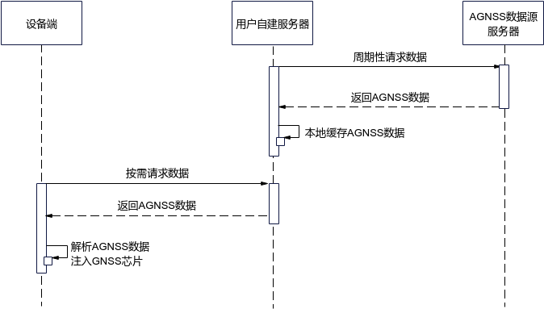
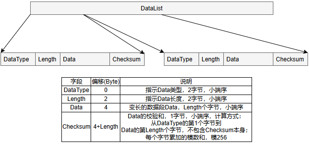
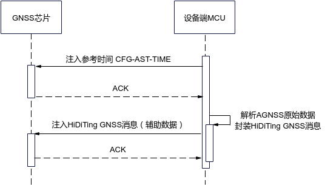
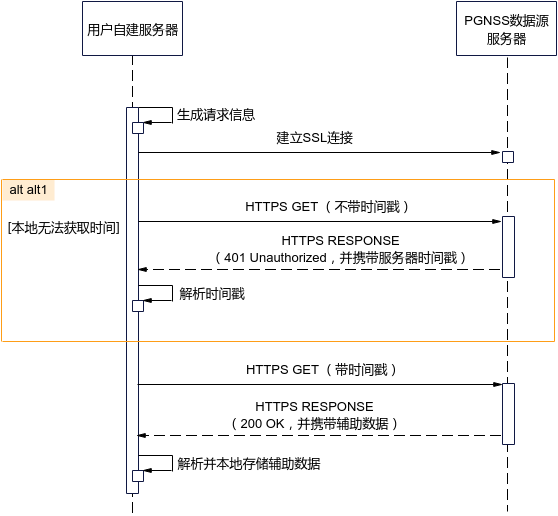
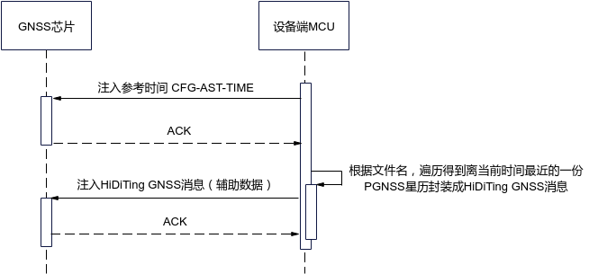

# 前言<a name="ZH-CN_TOPIC_0000002258399341"></a>

**概述<a name="zh-cn_topic_0000001706391144_section4537382116410"></a>**

本文档详细描述了HiDiTing XGNSS辅助数据功能适配使用指南，包括在线辅助数据AGNSS和离线辅助数据PGNSS，涉及消息通信时序、消息接口协议，用于指导用户下载并使用辅助数据，缩短首次定位时间。

**读者对象<a name="zh-cn_topic_0000001706391144_section4378592816410"></a>**

本档主要适用于以下工程师：

-   系统设计工程师
-   产品软件开发工程师
-   技术支持工程师

**符号约定<a name="zh-cn_topic_0000001706391144_section133020216410"></a>**

在本文中可能出现下列标志，它们所代表的含义如下。

<a name="zh-cn_topic_0000001706391144_table2622507016410"></a>
<table><thead align="left"><tr id="zh-cn_topic_0000001706391144_row1530720816410"><th class="cellrowborder" valign="top" width="20.580000000000002%" id="mcps1.1.3.1.1"><p id="zh-cn_topic_0000001706391144_p6450074116410"><a name="zh-cn_topic_0000001706391144_p6450074116410"></a><a name="zh-cn_topic_0000001706391144_p6450074116410"></a><strong id="zh-cn_topic_0000001706391144_b2136615816410"><a name="zh-cn_topic_0000001706391144_b2136615816410"></a><a name="zh-cn_topic_0000001706391144_b2136615816410"></a>符号</strong></p>
</th>
<th class="cellrowborder" valign="top" width="79.42%" id="mcps1.1.3.1.2"><p id="zh-cn_topic_0000001706391144_p5435366816410"><a name="zh-cn_topic_0000001706391144_p5435366816410"></a><a name="zh-cn_topic_0000001706391144_p5435366816410"></a><strong id="zh-cn_topic_0000001706391144_b5941558116410"><a name="zh-cn_topic_0000001706391144_b5941558116410"></a><a name="zh-cn_topic_0000001706391144_b5941558116410"></a>说明</strong></p>
</th>
</tr>
</thead>
<tbody><tr id="zh-cn_topic_0000001706391144_row1372280416410"><td class="cellrowborder" valign="top" width="20.580000000000002%" headers="mcps1.1.3.1.1 "><p id="zh-cn_topic_0000001706391144_p3734547016410"><a name="zh-cn_topic_0000001706391144_p3734547016410"></a><a name="zh-cn_topic_0000001706391144_p3734547016410"></a><a name="zh-cn_topic_0000001706391144_image2670064316410"></a><a name="zh-cn_topic_0000001706391144_image2670064316410"></a><span></span></p>
</td>
<td class="cellrowborder" valign="top" width="79.42%" headers="mcps1.1.3.1.2 "><p id="zh-cn_topic_0000001706391144_p1757432116410"><a name="zh-cn_topic_0000001706391144_p1757432116410"></a><a name="zh-cn_topic_0000001706391144_p1757432116410"></a>表示如不避免则将会导致死亡或严重伤害的具有高等级风险的危害。</p>
</td>
</tr>
<tr id="zh-cn_topic_0000001706391144_row466863216410"><td class="cellrowborder" valign="top" width="20.580000000000002%" headers="mcps1.1.3.1.1 "><p id="zh-cn_topic_0000001706391144_p1432579516410"><a name="zh-cn_topic_0000001706391144_p1432579516410"></a><a name="zh-cn_topic_0000001706391144_p1432579516410"></a><a name="zh-cn_topic_0000001706391144_image4895582316410"></a><a name="zh-cn_topic_0000001706391144_image4895582316410"></a><span></span></p>
</td>
<td class="cellrowborder" valign="top" width="79.42%" headers="mcps1.1.3.1.2 "><p id="zh-cn_topic_0000001706391144_p959197916410"><a name="zh-cn_topic_0000001706391144_p959197916410"></a><a name="zh-cn_topic_0000001706391144_p959197916410"></a>表示如不避免则可能导致死亡或严重伤害的具有中等级风险的危害。</p>
</td>
</tr>
<tr id="zh-cn_topic_0000001706391144_row123863216410"><td class="cellrowborder" valign="top" width="20.580000000000002%" headers="mcps1.1.3.1.1 "><p id="zh-cn_topic_0000001706391144_p1232579516410"><a name="zh-cn_topic_0000001706391144_p1232579516410"></a><a name="zh-cn_topic_0000001706391144_p1232579516410"></a><a name="zh-cn_topic_0000001706391144_image1235582316410"></a><a name="zh-cn_topic_0000001706391144_image1235582316410"></a><span></span></p>
</td>
<td class="cellrowborder" valign="top" width="79.42%" headers="mcps1.1.3.1.2 "><p id="zh-cn_topic_0000001706391144_p123197916410"><a name="zh-cn_topic_0000001706391144_p123197916410"></a><a name="zh-cn_topic_0000001706391144_p123197916410"></a>表示如不避免则可能导致轻微或中度伤害的具有低等级风险的危害。</p>
</td>
</tr>
<tr id="zh-cn_topic_0000001706391144_row5786682116410"><td class="cellrowborder" valign="top" width="20.580000000000002%" headers="mcps1.1.3.1.1 "><p id="zh-cn_topic_0000001706391144_p2204984716410"><a name="zh-cn_topic_0000001706391144_p2204984716410"></a><a name="zh-cn_topic_0000001706391144_p2204984716410"></a><a name="zh-cn_topic_0000001706391144_image4504446716410"></a><a name="zh-cn_topic_0000001706391144_image4504446716410"></a><span></span></p>
</td>
<td class="cellrowborder" valign="top" width="79.42%" headers="mcps1.1.3.1.2 "><p id="zh-cn_topic_0000001706391144_p4388861916410"><a name="zh-cn_topic_0000001706391144_p4388861916410"></a><a name="zh-cn_topic_0000001706391144_p4388861916410"></a>用于传递设备或环境安全警示信息。如不避免则可能会导致设备损坏、数据丢失、设备性能降低或其它不可预知的结果。</p>
<p id="zh-cn_topic_0000001706391144_p1238861916410"><a name="zh-cn_topic_0000001706391144_p1238861916410"></a><a name="zh-cn_topic_0000001706391144_p1238861916410"></a>“须知”不涉及人身伤害。</p>
</td>
</tr>
<tr id="zh-cn_topic_0000001706391144_row2856923116410"><td class="cellrowborder" valign="top" width="20.580000000000002%" headers="mcps1.1.3.1.1 "><p id="zh-cn_topic_0000001706391144_p5555360116410"><a name="zh-cn_topic_0000001706391144_p5555360116410"></a><a name="zh-cn_topic_0000001706391144_p5555360116410"></a><a name="zh-cn_topic_0000001706391144_image799324016410"></a><a name="zh-cn_topic_0000001706391144_image799324016410"></a><span></span></p>
</td>
<td class="cellrowborder" valign="top" width="79.42%" headers="mcps1.1.3.1.2 "><p id="zh-cn_topic_0000001706391144_p4612588116410"><a name="zh-cn_topic_0000001706391144_p4612588116410"></a><a name="zh-cn_topic_0000001706391144_p4612588116410"></a>对正文中重点信息的补充说明。</p>
<p id="zh-cn_topic_0000001706391144_p1232588116410"><a name="zh-cn_topic_0000001706391144_p1232588116410"></a><a name="zh-cn_topic_0000001706391144_p1232588116410"></a>“说明”不是安全警示信息，不涉及人身、设备及环境伤害信息。</p>
</td>
</tr>
</tbody>
</table>

# AGNSS使用指南<a name="ZH-CN_TOPIC_0000002258621829"></a>

-   **[功能概述](#ZH-CN_TOPIC_0000002258461929)**  

-   **[服务架构](#ZH-CN_TOPIC_0000002223662156)**  

-   **[集成步骤](#ZH-CN_TOPIC_0000002334975001)**  

-   **[集成示例](#ZH-CN_TOPIC_0000002301095572)**  

## 功能概述<a name="ZH-CN_TOPIC_0000002258461929"></a>

接收机在无任何辅助信息的情况下冷启动定位，受限于自主解调广播星历耗时，一般需要约30s。

AGNSS服务提供在线实时请求广播星历等辅助数据功能，可免除自主解星历时间，缩短首次定位时间；实时广播星历有效期较短，一般可以使用约2h。

## 服务架构<a name="ZH-CN_TOPIC_0000002223662156"></a>

用户需自行搭建服务器，采用云云对接方式，由用户服务器对接AGNSS数据服务，从AGNSS服务器获取数据后，向用户的终端设备进行分发。

**图 1**  AGNSS服务架构<a name="fig105578211581"></a>  


> **须知：** 
>对接数据源服务所需的账号、密钥信息，请联系销售代码处获取。

## 集成步骤<a name="ZH-CN_TOPIC_0000002334975001"></a>

-   **[整体流程](#ZH-CN_TOPIC_0000002301095568)**  

-   **[服务端数据下载](#ZH-CN_TOPIC_0000002300935872)**  

-   **[服务端数据分发](#ZH-CN_TOPIC_0000002334895241)**  

-   **[设备端数据注入](#ZH-CN_TOPIC_0000002334975005)**  

### 整体流程<a name="ZH-CN_TOPIC_0000002301095568"></a>

AGNSS整体流程如[图1](#fig15979113513313)所示。

> **须知：** 
>AGNSS星历有效期仅有2小时，建议用户自建服务器每1小时或更短时间请求1次数据，以保持自建服务器上的星历处在有效期内。

**图 1**  AGNSS整体流程<a name="fig15979113513313"></a>  


### 服务端数据下载<a name="ZH-CN_TOPIC_0000002300935872"></a>

用户自建服务器，采用HTTPS协议，向AGNSS数据源服务器请求AGNSS数据。请求流程如[图1](#fig1580062005813)所示。

**图 1**  AGNSS服务请求过程<a name="fig1580062005813"></a>  


-   **[构造请求消息](#ZH-CN_TOPIC_0000002334897645)**  

-   **[处理响应消息](#ZH-CN_TOPIC_0000002301098008)**  

#### 构造请求消息<a name="ZH-CN_TOPIC_0000002334897645"></a>

使用HTTPS协议，请求方法为GET，构造的HTTP报文格式示例如下：

```
GET /higeo/v1/xgnss/agnss?constellation=5&datatype=1 HTTP/1.1
HOST: geo-drcn.platform.dbankcloud.cn
Authorization: HMAC-SHA256 appid=abc123, timestamp=1672545600000, signature=oZg+Uo+TEnQ75NHweWAKfy/+xOn5jAFa7r93gj/muGk=
X-Request-ID: ABCDEFG
```

**URL<a name="section287819543324"></a>**

中国：[https://geo-drcn.platform.dbankcloud.cn/higeo/v1/xgnss/agnss](#ZH-CN_TOPIC_0000002334897645)

数据源服务不支持海外直接访问。

**请求消息头<a name="section86600269334"></a>**

**表 1**  AGNSS请求消息头

<a name="zh-cn_topic_0000001754150769_table8611144310423"></a>
<table><thead align="left"><tr id="zh-cn_topic_0000001754150769_row12611943114211"><th class="cellrowborder" valign="top" width="15.079999999999998%" id="mcps1.2.6.1.1"><p id="zh-cn_topic_0000001754150769_p4611114316428"><a name="zh-cn_topic_0000001754150769_p4611114316428"></a><a name="zh-cn_topic_0000001754150769_p4611114316428"></a>参数</p>
</th>
<th class="cellrowborder" valign="top" width="10.68%" id="mcps1.2.6.1.2"><p id="zh-cn_topic_0000001754150769_p7611114334212"><a name="zh-cn_topic_0000001754150769_p7611114334212"></a><a name="zh-cn_topic_0000001754150769_p7611114334212"></a>类型</p>
</th>
<th class="cellrowborder" valign="top" width="10.38%" id="mcps1.2.6.1.3"><p id="zh-cn_topic_0000001754150769_p126081824134318"><a name="zh-cn_topic_0000001754150769_p126081824134318"></a><a name="zh-cn_topic_0000001754150769_p126081824134318"></a>可选</p>
</th>
<th class="cellrowborder" valign="top" width="13.239999999999998%" id="mcps1.2.6.1.4"><p id="zh-cn_topic_0000001754150769_p9611114316424"><a name="zh-cn_topic_0000001754150769_p9611114316424"></a><a name="zh-cn_topic_0000001754150769_p9611114316424"></a>参数范围</p>
</th>
<th class="cellrowborder" valign="top" width="50.62%" id="mcps1.2.6.1.5"><p id="zh-cn_topic_0000001754150769_p16611143144216"><a name="zh-cn_topic_0000001754150769_p16611143144216"></a><a name="zh-cn_topic_0000001754150769_p16611143144216"></a>参数说明</p>
</th>
</tr>
</thead>
<tbody><tr id="zh-cn_topic_0000001754150769_row8611114313422"><td class="cellrowborder" valign="top" width="15.079999999999998%" headers="mcps1.2.6.1.1 "><p id="zh-cn_topic_0000001754150769_p661184364218"><a name="zh-cn_topic_0000001754150769_p661184364218"></a><a name="zh-cn_topic_0000001754150769_p661184364218"></a>Authorization</p>
</td>
<td class="cellrowborder" valign="top" width="10.68%" headers="mcps1.2.6.1.2 "><p id="zh-cn_topic_0000001754150769_p17611164320425"><a name="zh-cn_topic_0000001754150769_p17611164320425"></a><a name="zh-cn_topic_0000001754150769_p17611164320425"></a>String</p>
</td>
<td class="cellrowborder" valign="top" width="10.38%" headers="mcps1.2.6.1.3 "><p id="zh-cn_topic_0000001754150769_p760922417434"><a name="zh-cn_topic_0000001754150769_p760922417434"></a><a name="zh-cn_topic_0000001754150769_p760922417434"></a>必选</p>
</td>
<td class="cellrowborder" valign="top" width="13.239999999999998%" headers="mcps1.2.6.1.4 "><p id="zh-cn_topic_0000001754150769_p36111043114219"><a name="zh-cn_topic_0000001754150769_p36111043114219"></a><a name="zh-cn_topic_0000001754150769_p36111043114219"></a>-</p>
</td>
<td class="cellrowborder" valign="top" width="50.62%" headers="mcps1.2.6.1.5 "><p id="zh-cn_topic_0000001754150769_p10611143124215"><a name="zh-cn_topic_0000001754150769_p10611143124215"></a><a name="zh-cn_topic_0000001754150769_p10611143124215"></a>参考“<a href="#zh-cn_topic_0000001706391128_section154314911420">签名认证-组装请求消息头</a>”章节。</p>
</td>
</tr>
<tr id="zh-cn_topic_0000001754150769_row46111543154210"><td class="cellrowborder" valign="top" width="15.079999999999998%" headers="mcps1.2.6.1.1 "><p id="zh-cn_topic_0000001754150769_p161134310423"><a name="zh-cn_topic_0000001754150769_p161134310423"></a><a name="zh-cn_topic_0000001754150769_p161134310423"></a>X-Request-ID</p>
</td>
<td class="cellrowborder" valign="top" width="10.68%" headers="mcps1.2.6.1.2 "><p id="zh-cn_topic_0000001754150769_p1761134334210"><a name="zh-cn_topic_0000001754150769_p1761134334210"></a><a name="zh-cn_topic_0000001754150769_p1761134334210"></a>String</p>
</td>
<td class="cellrowborder" valign="top" width="10.38%" headers="mcps1.2.6.1.3 "><p id="zh-cn_topic_0000001754150769_p16609112414315"><a name="zh-cn_topic_0000001754150769_p16609112414315"></a><a name="zh-cn_topic_0000001754150769_p16609112414315"></a>可选</p>
</td>
<td class="cellrowborder" valign="top" width="13.239999999999998%" headers="mcps1.2.6.1.4 "><p id="zh-cn_topic_0000001754150769_p16611194315427"><a name="zh-cn_topic_0000001754150769_p16611194315427"></a><a name="zh-cn_topic_0000001754150769_p16611194315427"></a>-</p>
</td>
<td class="cellrowborder" valign="top" width="50.62%" headers="mcps1.2.6.1.5 "><p id="zh-cn_topic_0000001754150769_p961113439428"><a name="zh-cn_topic_0000001754150769_p961113439428"></a><a name="zh-cn_topic_0000001754150769_p961113439428"></a>设备UUID，一般设备出厂时会分配一个唯一的UUID。</p>
</td>
</tr>
</tbody>
</table>

> **说明：** 
>举例：
>假设设备出厂UUID是ABCDEFG，签名参考“[签名认证](#section019295015342)”章节的例子，构造消息头如下：
>Authorization: HMAC-SHA256 appid=abc123, timestamp=1672545600000, signature=oZg+Uo+TEnQ75NHweWAKfy/+xOn5jAFa7r93gj/muGk=
>X-Request-ID: ABCDEFG

**请求参数<a name="section190402019346"></a>**

如果不带任何请求参数，全部使用默认参数，将注入GPS、GLO、BDS、GAL四模卫星的参考时间、星历、UTC模型、电离层参数、实时完好性信息、频点对应关系的数据。

请求参数跟在域名网址后，用“?”分隔，可以带多个参数，参数之间用“&”隔开，参数名和值之间用“=”隔开。

举例：如url?constellation=7&datatype=1，将注入gps、glo、bds三模卫星的参考时间和星历的RawData格式数据。

具体参数说明如[表2](#table31587138817)所示。

**表 2**  AGNSS请求参数

<a name="table31587138817"></a>
<table><thead align="left"><tr id="row615818131186"><th class="cellrowborder" valign="top" width="11.26%" id="mcps1.2.6.1.1"><p id="p03231241385"><a name="p03231241385"></a><a name="p03231241385"></a>参数</p>
</th>
<th class="cellrowborder" valign="top" width="10.42%" id="mcps1.2.6.1.2"><p id="p1132320242086"><a name="p1132320242086"></a><a name="p1132320242086"></a>类型</p>
</th>
<th class="cellrowborder" valign="top" width="10.48%" id="mcps1.2.6.1.3"><p id="p532362419813"><a name="p532362419813"></a><a name="p532362419813"></a>可选</p>
</th>
<th class="cellrowborder" valign="top" width="19.56%" id="mcps1.2.6.1.4"><p id="p153238241388"><a name="p153238241388"></a><a name="p153238241388"></a>参数范围</p>
</th>
<th class="cellrowborder" valign="top" width="48.28%" id="mcps1.2.6.1.5"><p id="p113239241685"><a name="p113239241685"></a><a name="p113239241685"></a>参数说明</p>
</th>
</tr>
</thead>
<tbody><tr id="row4159201311813"><td class="cellrowborder" valign="top" width="11.26%" headers="mcps1.2.6.1.1 "><p id="p113231241085"><a name="p113231241085"></a><a name="p113231241085"></a>constellation</p>
</td>
<td class="cellrowborder" valign="top" width="10.42%" headers="mcps1.2.6.1.2 "><p id="p153231224283"><a name="p153231224283"></a><a name="p153231224283"></a>Int</p>
</td>
<td class="cellrowborder" valign="top" width="10.48%" headers="mcps1.2.6.1.3 "><p id="p93239246810"><a name="p93239246810"></a><a name="p93239246810"></a>可选，默认15</p>
</td>
<td class="cellrowborder" valign="top" width="19.56%" headers="mcps1.2.6.1.4 "><p id="p93237241587"><a name="p93237241587"></a><a name="p93237241587"></a>掩码如<a href="#table16242350082">表3</a>所示。</p>
</td>
<td class="cellrowborder" valign="top" width="48.28%" headers="mcps1.2.6.1.5 "><a name="ul116345121920"></a><a name="ul116345121920"></a><ul id="ul116345121920"><li>掩码表示卫星模式，传输时传10进制数。</li><li>可组合使用，如constellation=15，对应掩码为0xF：GPS+GLO+BDS+GAL。</li></ul>
</td>
</tr>
<tr id="row41595131483"><td class="cellrowborder" valign="top" width="11.26%" headers="mcps1.2.6.1.1 "><p id="p63234241087"><a name="p63234241087"></a><a name="p63234241087"></a>datatype</p>
</td>
<td class="cellrowborder" valign="top" width="10.42%" headers="mcps1.2.6.1.2 "><p id="p1532311241886"><a name="p1532311241886"></a><a name="p1532311241886"></a>Int</p>
</td>
<td class="cellrowborder" valign="top" width="10.48%" headers="mcps1.2.6.1.3 "><p id="p832319248816"><a name="p832319248816"></a><a name="p832319248816"></a>可选，默认31</p>
</td>
<td class="cellrowborder" valign="top" width="19.56%" headers="mcps1.2.6.1.4 "><p id="p232319241585"><a name="p232319241585"></a><a name="p232319241585"></a>掩码如<a href="#table125921839141113">表4</a>所示。</p>
</td>
<td class="cellrowborder" valign="top" width="48.28%" headers="mcps1.2.6.1.5 "><a name="ul177838251916"></a><a name="ul177838251916"></a><ul id="ul177838251916"><li>掩码表示请求的数据类型，传输时传10进制数。</li><li>请求任意类型默认下发参考时间。</li><li>可选数据类型有：星历、UTC模型、电离层参数、实时完好性信息、频点对应关系，各卫星模式支持数据类型情况见<a href="#table125921839141113">表4</a>。</li><li>按需配置，可组合使用，如datatype=31，对应掩码为0x1F：rtc(默认下发)+eph+utc+ion+rti+aux。</li></ul>
</td>
</tr>
</tbody>
</table>

**表 3**  AGNSSID掩码

<a name="table16242350082"></a>
<table><thead align="left"><tr id="row1124215506817"><th class="cellrowborder" valign="top" width="50%" id="mcps1.2.3.1.1"><p id="p1558414516915"><a name="p1558414516915"></a><a name="p1558414516915"></a>constel</p>
</th>
<th class="cellrowborder" valign="top" width="50%" id="mcps1.2.3.1.2"><p id="p458418517917"><a name="p458418517917"></a><a name="p458418517917"></a>GNSSID掩码</p>
</th>
</tr>
</thead>
<tbody><tr id="row1324219503817"><td class="cellrowborder" valign="top" width="50%" headers="mcps1.2.3.1.1 "><p id="p1158425997"><a name="p1158425997"></a><a name="p1158425997"></a>GPS</p>
</td>
<td class="cellrowborder" valign="top" width="50%" headers="mcps1.2.3.1.2 "><p id="p4584650919"><a name="p4584650919"></a><a name="p4584650919"></a>0x01</p>
</td>
</tr>
<tr id="row1242125012813"><td class="cellrowborder" valign="top" width="50%" headers="mcps1.2.3.1.1 "><p id="p10584125798"><a name="p10584125798"></a><a name="p10584125798"></a>GLO</p>
</td>
<td class="cellrowborder" valign="top" width="50%" headers="mcps1.2.3.1.2 "><p id="p185841751299"><a name="p185841751299"></a><a name="p185841751299"></a>0x02</p>
</td>
</tr>
<tr id="row1124345012818"><td class="cellrowborder" valign="top" width="50%" headers="mcps1.2.3.1.1 "><p id="p75841451793"><a name="p75841451793"></a><a name="p75841451793"></a>BDS</p>
</td>
<td class="cellrowborder" valign="top" width="50%" headers="mcps1.2.3.1.2 "><p id="p165841351497"><a name="p165841351497"></a><a name="p165841351497"></a>0x04</p>
</td>
</tr>
<tr id="row132431550982"><td class="cellrowborder" valign="top" width="50%" headers="mcps1.2.3.1.1 "><p id="p11584351392"><a name="p11584351392"></a><a name="p11584351392"></a>GAL</p>
</td>
<td class="cellrowborder" valign="top" width="50%" headers="mcps1.2.3.1.2 "><p id="p55843511915"><a name="p55843511915"></a><a name="p55843511915"></a>0x08</p>
</td>
</tr>
</tbody>
</table>

**表 4**  AGNSS辅助数据掩码及各模支持辅助数据情况

<a name="table125921839141113"></a>
<table><thead align="left"><tr id="row7592113912117"><th class="cellrowborder" valign="top" width="15.653130626125225%" id="mcps1.2.8.1.1"><p id="p1419815506119"><a name="p1419815506119"></a><a name="p1419815506119"></a>数据类型</p>
</th>
<th class="cellrowborder" valign="top" width="22.024404880976196%" id="mcps1.2.8.1.2"><p id="p595403571215"><a name="p595403571215"></a><a name="p595403571215"></a>描述</p>
</th>
<th class="cellrowborder" valign="top" width="19.093818763752747%" id="mcps1.2.8.1.3"><p id="p1319895031112"><a name="p1319895031112"></a><a name="p1319895031112"></a>datatype值</p>
</th>
<th class="cellrowborder" valign="top" width="11.382276455291057%" id="mcps1.2.8.1.4"><p id="p619819505110"><a name="p619819505110"></a><a name="p619819505110"></a>gps</p>
</th>
<th class="cellrowborder" valign="top" width="11.352270454090817%" id="mcps1.2.8.1.5"><p id="p1519965081110"><a name="p1519965081110"></a><a name="p1519965081110"></a>glo</p>
</th>
<th class="cellrowborder" valign="top" width="11.212242448489699%" id="mcps1.2.8.1.6"><p id="p181991150101117"><a name="p181991150101117"></a><a name="p181991150101117"></a>bds</p>
</th>
<th class="cellrowborder" valign="top" width="9.281856371274253%" id="mcps1.2.8.1.7"><p id="p151996501115"><a name="p151996501115"></a><a name="p151996501115"></a>gal</p>
</th>
</tr>
</thead>
<tbody><tr id="row10592123961116"><td class="cellrowborder" valign="top" width="15.653130626125225%" headers="mcps1.2.8.1.1 "><p id="p1619945010117"><a name="p1619945010117"></a><a name="p1619945010117"></a>rtc</p>
</td>
<td class="cellrowborder" valign="top" width="22.024404880976196%" headers="mcps1.2.8.1.2 "><p id="p8954035181218"><a name="p8954035181218"></a><a name="p8954035181218"></a>参考时间</p>
</td>
<td class="cellrowborder" valign="top" width="19.093818763752747%" headers="mcps1.2.8.1.3 "><p id="p121996502116"><a name="p121996502116"></a><a name="p121996502116"></a>默认下发</p>
</td>
<td class="cellrowborder" valign="top" width="11.382276455291057%" headers="mcps1.2.8.1.4 "><p id="p419995011118"><a name="p419995011118"></a><a name="p419995011118"></a>O</p>
</td>
<td class="cellrowborder" valign="top" width="11.352270454090817%" headers="mcps1.2.8.1.5 "><p id="p15199125021116"><a name="p15199125021116"></a><a name="p15199125021116"></a>X</p>
</td>
<td class="cellrowborder" valign="top" width="11.212242448489699%" headers="mcps1.2.8.1.6 "><p id="p71991450161111"><a name="p71991450161111"></a><a name="p71991450161111"></a>X</p>
</td>
<td class="cellrowborder" valign="top" width="9.281856371274253%" headers="mcps1.2.8.1.7 "><p id="p11199150111114"><a name="p11199150111114"></a><a name="p11199150111114"></a>X</p>
</td>
</tr>
<tr id="row1593183910119"><td class="cellrowborder" valign="top" width="15.653130626125225%" headers="mcps1.2.8.1.1 "><p id="p6199155019116"><a name="p6199155019116"></a><a name="p6199155019116"></a>eph</p>
</td>
<td class="cellrowborder" valign="top" width="22.024404880976196%" headers="mcps1.2.8.1.2 "><p id="p1954153561210"><a name="p1954153561210"></a><a name="p1954153561210"></a>星历</p>
</td>
<td class="cellrowborder" valign="top" width="19.093818763752747%" headers="mcps1.2.8.1.3 "><p id="p419985015119"><a name="p419985015119"></a><a name="p419985015119"></a>0x01</p>
</td>
<td class="cellrowborder" valign="top" width="11.382276455291057%" headers="mcps1.2.8.1.4 "><p id="p181996501118"><a name="p181996501118"></a><a name="p181996501118"></a>O</p>
</td>
<td class="cellrowborder" valign="top" width="11.352270454090817%" headers="mcps1.2.8.1.5 "><p id="p1199105051117"><a name="p1199105051117"></a><a name="p1199105051117"></a>O</p>
</td>
<td class="cellrowborder" valign="top" width="11.212242448489699%" headers="mcps1.2.8.1.6 "><p id="p15199115081111"><a name="p15199115081111"></a><a name="p15199115081111"></a>O</p>
</td>
<td class="cellrowborder" valign="top" width="9.281856371274253%" headers="mcps1.2.8.1.7 "><p id="p17199750191110"><a name="p17199750191110"></a><a name="p17199750191110"></a>O</p>
</td>
</tr>
<tr id="row16593139121113"><td class="cellrowborder" valign="top" width="15.653130626125225%" headers="mcps1.2.8.1.1 "><p id="p151991550101112"><a name="p151991550101112"></a><a name="p151991550101112"></a>utc</p>
</td>
<td class="cellrowborder" valign="top" width="22.024404880976196%" headers="mcps1.2.8.1.2 "><p id="p195483510124"><a name="p195483510124"></a><a name="p195483510124"></a>UTC模型</p>
</td>
<td class="cellrowborder" valign="top" width="19.093818763752747%" headers="mcps1.2.8.1.3 "><p id="p319917507118"><a name="p319917507118"></a><a name="p319917507118"></a>0x02</p>
</td>
<td class="cellrowborder" valign="top" width="11.382276455291057%" headers="mcps1.2.8.1.4 "><p id="p5199135001117"><a name="p5199135001117"></a><a name="p5199135001117"></a>O</p>
</td>
<td class="cellrowborder" valign="top" width="11.352270454090817%" headers="mcps1.2.8.1.5 "><p id="p61992508116"><a name="p61992508116"></a><a name="p61992508116"></a>X</p>
</td>
<td class="cellrowborder" valign="top" width="11.212242448489699%" headers="mcps1.2.8.1.6 "><p id="p1199145071111"><a name="p1199145071111"></a><a name="p1199145071111"></a>X</p>
</td>
<td class="cellrowborder" valign="top" width="9.281856371274253%" headers="mcps1.2.8.1.7 "><p id="p8199135013111"><a name="p8199135013111"></a><a name="p8199135013111"></a>X</p>
</td>
</tr>
<tr id="row14593123951113"><td class="cellrowborder" valign="top" width="15.653130626125225%" headers="mcps1.2.8.1.1 "><p id="p12199125010119"><a name="p12199125010119"></a><a name="p12199125010119"></a>ion</p>
</td>
<td class="cellrowborder" valign="top" width="22.024404880976196%" headers="mcps1.2.8.1.2 "><p id="p6954133531211"><a name="p6954133531211"></a><a name="p6954133531211"></a>电离层参数</p>
</td>
<td class="cellrowborder" valign="top" width="19.093818763752747%" headers="mcps1.2.8.1.3 "><p id="p16199950191115"><a name="p16199950191115"></a><a name="p16199950191115"></a>0x04</p>
</td>
<td class="cellrowborder" valign="top" width="11.382276455291057%" headers="mcps1.2.8.1.4 "><p id="p4199165041120"><a name="p4199165041120"></a><a name="p4199165041120"></a>O</p>
</td>
<td class="cellrowborder" valign="top" width="11.352270454090817%" headers="mcps1.2.8.1.5 "><p id="p71991250101116"><a name="p71991250101116"></a><a name="p71991250101116"></a>X</p>
</td>
<td class="cellrowborder" valign="top" width="11.212242448489699%" headers="mcps1.2.8.1.6 "><p id="p101997503116"><a name="p101997503116"></a><a name="p101997503116"></a>O</p>
</td>
<td class="cellrowborder" valign="top" width="9.281856371274253%" headers="mcps1.2.8.1.7 "><p id="p15199145010114"><a name="p15199145010114"></a><a name="p15199145010114"></a>X</p>
</td>
</tr>
<tr id="row14593123918119"><td class="cellrowborder" valign="top" width="15.653130626125225%" headers="mcps1.2.8.1.1 "><p id="p1120095001110"><a name="p1120095001110"></a><a name="p1120095001110"></a>rti</p>
</td>
<td class="cellrowborder" valign="top" width="22.024404880976196%" headers="mcps1.2.8.1.2 "><p id="p149541135141212"><a name="p149541135141212"></a><a name="p149541135141212"></a>实时完好性信息</p>
</td>
<td class="cellrowborder" valign="top" width="19.093818763752747%" headers="mcps1.2.8.1.3 "><p id="p1320025061120"><a name="p1320025061120"></a><a name="p1320025061120"></a>0x08</p>
</td>
<td class="cellrowborder" valign="top" width="11.382276455291057%" headers="mcps1.2.8.1.4 "><p id="p13200205012119"><a name="p13200205012119"></a><a name="p13200205012119"></a>O</p>
</td>
<td class="cellrowborder" valign="top" width="11.352270454090817%" headers="mcps1.2.8.1.5 "><p id="p7200105011119"><a name="p7200105011119"></a><a name="p7200105011119"></a>O</p>
</td>
<td class="cellrowborder" valign="top" width="11.212242448489699%" headers="mcps1.2.8.1.6 "><p id="p42001750181110"><a name="p42001750181110"></a><a name="p42001750181110"></a>O</p>
</td>
<td class="cellrowborder" valign="top" width="9.281856371274253%" headers="mcps1.2.8.1.7 "><p id="p620065071120"><a name="p620065071120"></a><a name="p620065071120"></a>O</p>
</td>
</tr>
<tr id="row65931639201117"><td class="cellrowborder" valign="top" width="15.653130626125225%" headers="mcps1.2.8.1.1 "><p id="p82006501115"><a name="p82006501115"></a><a name="p82006501115"></a>aux</p>
</td>
<td class="cellrowborder" valign="top" width="22.024404880976196%" headers="mcps1.2.8.1.2 "><p id="p1995415358129"><a name="p1995415358129"></a><a name="p1995415358129"></a>频点对应关系</p>
</td>
<td class="cellrowborder" valign="top" width="19.093818763752747%" headers="mcps1.2.8.1.3 "><p id="p20200650201120"><a name="p20200650201120"></a><a name="p20200650201120"></a>0x10</p>
</td>
<td class="cellrowborder" valign="top" width="11.382276455291057%" headers="mcps1.2.8.1.4 "><p id="p152006504111"><a name="p152006504111"></a><a name="p152006504111"></a>X</p>
</td>
<td class="cellrowborder" valign="top" width="11.352270454090817%" headers="mcps1.2.8.1.5 "><p id="p162008504119"><a name="p162008504119"></a><a name="p162008504119"></a>O</p>
</td>
<td class="cellrowborder" valign="top" width="11.212242448489699%" headers="mcps1.2.8.1.6 "><p id="p2200250171118"><a name="p2200250171118"></a><a name="p2200250171118"></a>X</p>
</td>
<td class="cellrowborder" valign="top" width="9.281856371274253%" headers="mcps1.2.8.1.7 "><p id="p19200250151112"><a name="p19200250151112"></a><a name="p19200250151112"></a>X</p>
</td>
</tr>
</tbody>
</table>

**签名认证<a name="section019295015342"></a>**

生成请求签名的流程如[图1](#zh-cn_topic_0000001706391128_fig2791311103)所示。

**图 1**  请求签名生成流程图<a name="zh-cn_topic_0000001706391128_fig2791311103"></a>  


**签名认证-构造规范化请求字符串<a name="zh-cn_topic_0000001706391128_section9981813135"></a>**

-   按照参数名称的字典顺序对请求中所有的请求参数进行排序。
-   对每个请求参数的名称和值进行编码，名称和值要使用UTF-8字符集进行URL编码（例如：java.net.URLEncoder）。
-   对排序后的参数名称和值使用英文等号（=）进行连接。
-   英文等号连接得到的字符串按参数名称的字典顺序依次使用（&）符号连接，即得到规范化请求字符串。

    > **说明：** 
    >举例：
    >假设请求卫星模式是5，辅助数据类型是1，构造请求字符串如下：
    >constellation=5&datatype=1
    >注意因为需按字典顺序排序，所以constellation在前。

**签名认证-构造待签名字符串<a name="zh-cn_topic_0000001706391128_section58041322317"></a>**

请求字符串构造方法如下所示：

StringToSign = $\{http\_method\} +"&"+ $\{http\_url\_path\} +"&"+ $\{canonical\_query\_string\} +"&"+ $\{http\_payload\}+"&appid="+ $\{appid\} +"&timestamp=" + $\{current\_timestamp\}

参数列表说明如下：

-   http\_method：固定设置为GET。
-   http\_url\_path：请求URL路径，不包含host和请求参数部分，如AGNSS固定为“/higeo/x1/xgnss/agnss”。
-   canonical\_query\_string：为“[签名认证-构造规范化请求字符串](#zh-cn_topic_0000001706391128_section9981813135)”生成的规范化请求字符串。
-   http\_payload：http请求消息体。
-   appid：设备商ID，通过注册得到。
-   current\_timestamp：当前时间（单位为：ms），取值1970-01-01 00:00:00.000到当前的毫秒数，比如使用JAVA System.currentTimeMillis\(\)获取。

    > **说明：** 
    >举例：
    >例如北京时间2023-01-01 12:00:00，转换unix时间戳为1672545600000；
    >例如appid=abc123，再使用上一章例子中请求参数，构造待签名字串如下：
    >GET&/higeo/v1/xgnss/agnss&constellation=5&datatype=1&&appid=abc123&timestamp=1672545600000

**签名认证-计算签名HMAC值<a name="zh-cn_topic_0000001706391128_section20285165419310"></a>**

使用“[签名认证-构造待签名字符串](#zh-cn_topic_0000001706391128_section58041322317)”生成的待签名请求字符串使用HMAC-SHA256算法计算签名HMAC值（使用SecretKey作为HMAC-SHA256算法的Key），按照Base64编码规则对HMAC值编码成字符串，即得到签名值。

> **说明：** 
>举例：
>使用“[签名认证-构造待签名字符串](#zh-cn_topic_0000001706391128_section58041322317)”中待签名字串，计算出签名HMAC值如下：
>oZg+Uo+TEnQ75NHweWAKfy/+xOn5jAFa7r93gj/muGk=
>SecretKey（密钥）请联系销售代码获取。

**签名认证-组装请求消息头<a name="zh-cn_topic_0000001706391128_section154314911420"></a>**

-   将得到的签名值作为Signature参数添加到请求Authorization头，参考如下：

    Authorization: HMAC-SHA256 appid=$\{appid\}, timestamp=$\{current\_timestamp\}, signature=$\{signature\_value\}

    参数列表说明如下：

    appid为“[签名认证-构造待签名字符串](#zh-cn_topic_0000001706391128_section58041322317)”中使用的APPID参数。

    current\_timestamp为“[签名认证-构造待签名字符串](#zh-cn_topic_0000001706391128_section58041322317)”使用的current\_timestamp参数。

    signature\_value为“[签名认证-计算签名HMAC值](#zh-cn_topic_0000001706391128_section20285165419310)”获得的签名HMAC值。

-   将Authorization头附加到请求消息头中，作为请求认证信息。

    > **说明：** 
    >举例：
    >使用“[签名认证-构造待签名字符串](#zh-cn_topic_0000001706391128_section58041322317)”中时间戳和签名值，组装消息头如下：
    >Authorization: HMAC-SHA256 appid=abc123, timestamp=1672545600000, signature=oZg+Uo+TEnQ75NHweWAKfy/+xOn5jAFa7r93gj/muGk=

#### 处理响应消息<a name="ZH-CN_TOPIC_0000002301098008"></a>

**HTTP返回状态码<a name="section15748151014404"></a>**

**表 1**  HTTP状态码

<a name="zh-cn_topic_0000001754150785_table19732135052314"></a>
<table><thead align="left"><tr id="zh-cn_topic_0000001754150785_row20732450122317"><th class="cellrowborder" valign="top" width="50%" id="mcps1.2.3.1.1"><p id="zh-cn_topic_0000001754150785_p611255718233"><a name="zh-cn_topic_0000001754150785_p611255718233"></a><a name="zh-cn_topic_0000001754150785_p611255718233"></a>状态码</p>
</th>
<th class="cellrowborder" valign="top" width="50%" id="mcps1.2.3.1.2"><p id="zh-cn_topic_0000001754150785_p5112135710236"><a name="zh-cn_topic_0000001754150785_p5112135710236"></a><a name="zh-cn_topic_0000001754150785_p5112135710236"></a>说明</p>
</th>
</tr>
</thead>
<tbody><tr id="zh-cn_topic_0000001754150785_row373275013235"><td class="cellrowborder" valign="top" width="50%" headers="mcps1.2.3.1.1 "><p id="zh-cn_topic_0000001754150785_p171121757102318"><a name="zh-cn_topic_0000001754150785_p171121757102318"></a><a name="zh-cn_topic_0000001754150785_p171121757102318"></a>200</p>
</td>
<td class="cellrowborder" valign="top" width="50%" headers="mcps1.2.3.1.2 "><p id="zh-cn_topic_0000001754150785_p11121957132316"><a name="zh-cn_topic_0000001754150785_p11121957132316"></a><a name="zh-cn_topic_0000001754150785_p11121957132316"></a>辅助数据请求成功，可以开始解析数据。</p>
</td>
</tr>
<tr id="zh-cn_topic_0000001754150785_row07321650112313"><td class="cellrowborder" valign="top" width="50%" headers="mcps1.2.3.1.1 "><p id="zh-cn_topic_0000001754150785_p9112757152312"><a name="zh-cn_topic_0000001754150785_p9112757152312"></a><a name="zh-cn_topic_0000001754150785_p9112757152312"></a>400</p>
</td>
<td class="cellrowborder" valign="top" width="50%" headers="mcps1.2.3.1.2 "><p id="zh-cn_topic_0000001754150785_p131121257102316"><a name="zh-cn_topic_0000001754150785_p131121257102316"></a><a name="zh-cn_topic_0000001754150785_p131121257102316"></a>请求参数错误。</p>
</td>
</tr>
<tr id="zh-cn_topic_0000001754150785_row107331450122315"><td class="cellrowborder" valign="top" width="50%" headers="mcps1.2.3.1.1 "><p id="zh-cn_topic_0000001754150785_p1711219578239"><a name="zh-cn_topic_0000001754150785_p1711219578239"></a><a name="zh-cn_topic_0000001754150785_p1711219578239"></a>401</p>
</td>
<td class="cellrowborder" valign="top" width="50%" headers="mcps1.2.3.1.2 "><p id="zh-cn_topic_0000001754150785_p6113145714235"><a name="zh-cn_topic_0000001754150785_p6113145714235"></a><a name="zh-cn_topic_0000001754150785_p6113145714235"></a>用户认证失败。</p>
</td>
</tr>
<tr id="zh-cn_topic_0000001754150785_row273325082320"><td class="cellrowborder" valign="top" width="50%" headers="mcps1.2.3.1.1 "><p id="zh-cn_topic_0000001754150785_p611395712235"><a name="zh-cn_topic_0000001754150785_p611395712235"></a><a name="zh-cn_topic_0000001754150785_p611395712235"></a>503</p>
</td>
<td class="cellrowborder" valign="top" width="50%" headers="mcps1.2.3.1.2 "><p id="zh-cn_topic_0000001754150785_p4113145717236"><a name="zh-cn_topic_0000001754150785_p4113145717236"></a><a name="zh-cn_topic_0000001754150785_p4113145717236"></a>超过访问次数限制，服务不可用。</p>
</td>
</tr>
</tbody>
</table>

**响应消息头<a name="section2392164419406"></a>**

**表 2**  AGNSS响应消息头

<a name="zh-cn_topic_0000001706231672_table8611144310423"></a>
<table><thead align="left"><tr id="zh-cn_topic_0000001706231672_row12611943114211"><th class="cellrowborder" valign="top" width="20.4%" id="mcps1.2.5.1.1"><p id="zh-cn_topic_0000001706231672_p4611114316428"><a name="zh-cn_topic_0000001706231672_p4611114316428"></a><a name="zh-cn_topic_0000001706231672_p4611114316428"></a>参数</p>
</th>
<th class="cellrowborder" valign="top" width="14.16%" id="mcps1.2.5.1.2"><p id="zh-cn_topic_0000001706231672_p7611114334212"><a name="zh-cn_topic_0000001706231672_p7611114334212"></a><a name="zh-cn_topic_0000001706231672_p7611114334212"></a>类型</p>
</th>
<th class="cellrowborder" valign="top" width="33.72%" id="mcps1.2.5.1.3"><p id="zh-cn_topic_0000001706231672_p9611114316424"><a name="zh-cn_topic_0000001706231672_p9611114316424"></a><a name="zh-cn_topic_0000001706231672_p9611114316424"></a>参数范围</p>
</th>
<th class="cellrowborder" valign="top" width="31.72%" id="mcps1.2.5.1.4"><p id="zh-cn_topic_0000001706231672_p16611143144216"><a name="zh-cn_topic_0000001706231672_p16611143144216"></a><a name="zh-cn_topic_0000001706231672_p16611143144216"></a>参数说明</p>
</th>
</tr>
</thead>
<tbody><tr id="zh-cn_topic_0000001706231672_row8611114313422"><td class="cellrowborder" valign="top" width="20.4%" headers="mcps1.2.5.1.1 "><p id="zh-cn_topic_0000001706231672_p661184364218"><a name="zh-cn_topic_0000001706231672_p661184364218"></a><a name="zh-cn_topic_0000001706231672_p661184364218"></a>Content-Type</p>
</td>
<td class="cellrowborder" valign="top" width="14.16%" headers="mcps1.2.5.1.2 "><p id="zh-cn_topic_0000001706231672_p17611164320425"><a name="zh-cn_topic_0000001706231672_p17611164320425"></a><a name="zh-cn_topic_0000001706231672_p17611164320425"></a>String</p>
</td>
<td class="cellrowborder" valign="top" width="33.72%" headers="mcps1.2.5.1.3 "><p id="zh-cn_topic_0000001706231672_p36111043114219"><a name="zh-cn_topic_0000001706231672_p36111043114219"></a><a name="zh-cn_topic_0000001706231672_p36111043114219"></a>固定值： "application/octet-stream"</p>
</td>
<td class="cellrowborder" valign="top" width="31.72%" headers="mcps1.2.5.1.4 "><p id="zh-cn_topic_0000001706231672_p3356158011"><a name="zh-cn_topic_0000001706231672_p3356158011"></a><a name="zh-cn_topic_0000001706231672_p3356158011"></a>响应数据类型是二进制码流。</p>
</td>
</tr>
<tr id="zh-cn_topic_0000001706231672_row46111543154210"><td class="cellrowborder" valign="top" width="20.4%" headers="mcps1.2.5.1.1 "><p id="zh-cn_topic_0000001706231672_p161134310423"><a name="zh-cn_topic_0000001706231672_p161134310423"></a><a name="zh-cn_topic_0000001706231672_p161134310423"></a>X-Auth-Timestamp</p>
</td>
<td class="cellrowborder" valign="top" width="14.16%" headers="mcps1.2.5.1.2 "><p id="zh-cn_topic_0000001706231672_p1761134334210"><a name="zh-cn_topic_0000001706231672_p1761134334210"></a><a name="zh-cn_topic_0000001706231672_p1761134334210"></a>Int</p>
</td>
<td class="cellrowborder" valign="top" width="33.72%" headers="mcps1.2.5.1.3 "><p id="zh-cn_topic_0000001706231672_p16611194315427"><a name="zh-cn_topic_0000001706231672_p16611194315427"></a><a name="zh-cn_topic_0000001706231672_p16611194315427"></a>-</p>
</td>
<td class="cellrowborder" valign="top" width="31.72%" headers="mcps1.2.5.1.4 "><p id="zh-cn_topic_0000001706231672_p961113439428"><a name="zh-cn_topic_0000001706231672_p961113439428"></a><a name="zh-cn_topic_0000001706231672_p961113439428"></a>服务器unix时间戳。</p>
</td>
</tr>
</tbody>
</table>

**响应消息体<a name="section11622413419"></a>**

AGNSS服务用户单次下载全量数据常规约在15KB～20KB，理论最大值不超过30KB，消息体数据结构如[图1](#fig5818105114612)。

**图 1**  AGNSS辅助数据结构<a name="fig5818105114612"></a>  



消息体中的Data字段，对应《HiDiTingV100 GNSS接口协议 开发指南》中CTR-AX-XXX消息类型的载荷内容。

### 服务端数据分发<a name="ZH-CN_TOPIC_0000002334895241"></a>

用户自建服务器在收到来自设备的请求后，将最新保存的AGNSS数据，返回给设备。此部分具体过程需用户自行设计。

### 设备端数据注入<a name="ZH-CN_TOPIC_0000002334975005"></a>

设备端数据注入过程如[图1](#fig115841457229)所示。

> **须知：** 
>-   在注入AGNSS辅助数据前，必须先注入参考时间。客户端可以自行寻找可靠的时间源，时间精度在10秒内即可，请参照《HiDiTingV100 GNSS接口协议 开发指南》中定义的CTR-AST-TIME进行组装后注入。
>-   依次注入每条AGNSS辅助数据，每条辅助数据注入完，需要参考接口协议，验证ACK后，再发下一条。或者连续两条辅助数据之间，设置时延，避免数据流覆盖，建议按data\_size \* 10 / current\_bps来评估时延。

**图 1**  AGNSS设备端数据注入流程<a name="fig115841457229"></a>  


设备端收到AGNSS原始数据后，需根据AGNSS的消息协议，参考[表1](#zh-cn_topic_0000001754030945_table6313756122413)，将AGNSS原始消息类型，转换为HiDiTing GNSS消息类型，然后按照《HiDiTingV100 GNSS接口协议 开发指南》的“内层协议框架”章节，封装成GNSS芯片所需的消息，注入到GNSS芯片中。

**表 1**  AGNSS响应辅助数据类型

<a name="zh-cn_topic_0000001754030945_table6313756122413"></a>
<table><thead align="left"><tr id="zh-cn_topic_0000001754030945_row193131856162413"><th class="cellrowborder" valign="top" width="16.07%" id="mcps1.2.6.1.1"><p id="zh-cn_topic_0000001754030945_p197251522182516"><a name="zh-cn_topic_0000001754030945_p197251522182516"></a><a name="zh-cn_topic_0000001754030945_p197251522182516"></a>星座</p>
</th>
<th class="cellrowborder" valign="top" width="16.36%" id="mcps1.2.6.1.2"><p id="zh-cn_topic_0000001754030945_p16725182272512"><a name="zh-cn_topic_0000001754030945_p16725182272512"></a><a name="zh-cn_topic_0000001754030945_p16725182272512"></a>Data Type</p>
</th>
<th class="cellrowborder" valign="top" width="22.21%" id="mcps1.2.6.1.3"><p id="zh-cn_topic_0000001754030945_p1272516228252"><a name="zh-cn_topic_0000001754030945_p1272516228252"></a><a name="zh-cn_topic_0000001754030945_p1272516228252"></a>数据类型</p>
</th>
<th class="cellrowborder" valign="top" width="19.38%" id="mcps1.2.6.1.4"><p id="zh-cn_topic_0000001754030945_p072552212514"><a name="zh-cn_topic_0000001754030945_p072552212514"></a><a name="zh-cn_topic_0000001754030945_p072552212514"></a>数据量（单位：Byte）</p>
</th>
<th class="cellrowborder" valign="top" width="25.979999999999997%" id="mcps1.2.6.1.5"><p id="zh-cn_topic_0000001754030945_p153423914422"><a name="zh-cn_topic_0000001754030945_p153423914422"></a><a name="zh-cn_topic_0000001754030945_p153423914422"></a>对应HiDiTing GNSS接口类型</p>
</th>
</tr>
</thead>
<tbody><tr id="zh-cn_topic_0000001754030945_row14313165619247"><td class="cellrowborder" rowspan="5" valign="top" width="16.07%" headers="mcps1.2.6.1.1 "><p id="zh-cn_topic_0000001754030945_p20534181313281"><a name="zh-cn_topic_0000001754030945_p20534181313281"></a><a name="zh-cn_topic_0000001754030945_p20534181313281"></a>GPS</p>
</td>
<td class="cellrowborder" valign="top" width="16.36%" headers="mcps1.2.6.1.2 "><p id="zh-cn_topic_0000001754030945_p163137568244"><a name="zh-cn_topic_0000001754030945_p163137568244"></a><a name="zh-cn_topic_0000001754030945_p163137568244"></a>0x0001</p>
</td>
<td class="cellrowborder" valign="top" width="22.21%" headers="mcps1.2.6.1.3 "><p id="zh-cn_topic_0000001754030945_p58118314286"><a name="zh-cn_topic_0000001754030945_p58118314286"></a><a name="zh-cn_topic_0000001754030945_p58118314286"></a>参考时间</p>
</td>
<td class="cellrowborder" valign="top" width="19.38%" headers="mcps1.2.6.1.4 "><p id="zh-cn_topic_0000001754030945_p1781113162818"><a name="zh-cn_topic_0000001754030945_p1781113162818"></a><a name="zh-cn_topic_0000001754030945_p1781113162818"></a>最大211</p>
</td>
<td class="cellrowborder" valign="top" width="25.979999999999997%" headers="mcps1.2.6.1.5 "><p id="zh-cn_topic_0000001754030945_p43421095424"><a name="zh-cn_topic_0000001754030945_p43421095424"></a><a name="zh-cn_topic_0000001754030945_p43421095424"></a>CTR-AX-TIME(0x0301)</p>
</td>
</tr>
<tr id="zh-cn_topic_0000001754030945_row1098761819266"><td class="cellrowborder" valign="top" headers="mcps1.2.6.1.1 "><p id="zh-cn_topic_0000001754030945_p747782611271"><a name="zh-cn_topic_0000001754030945_p747782611271"></a><a name="zh-cn_topic_0000001754030945_p747782611271"></a>0x0002</p>
</td>
<td class="cellrowborder" valign="top" headers="mcps1.2.6.1.2 "><p id="zh-cn_topic_0000001754030945_p181113102815"><a name="zh-cn_topic_0000001754030945_p181113102815"></a><a name="zh-cn_topic_0000001754030945_p181113102815"></a>星历</p>
</td>
<td class="cellrowborder" valign="top" headers="mcps1.2.6.1.3 "><p id="zh-cn_topic_0000001754030945_p12815319282"><a name="zh-cn_topic_0000001754030945_p12815319282"></a><a name="zh-cn_topic_0000001754030945_p12815319282"></a>最大2244</p>
</td>
<td class="cellrowborder" valign="top" headers="mcps1.2.6.1.4 "><p id="zh-cn_topic_0000001754030945_p5362010104312"><a name="zh-cn_topic_0000001754030945_p5362010104312"></a><a name="zh-cn_topic_0000001754030945_p5362010104312"></a>CTR-AX-EPHG(0x0303)</p>
</td>
</tr>
<tr id="zh-cn_topic_0000001754030945_row17839152010269"><td class="cellrowborder" valign="top" headers="mcps1.2.6.1.1 "><p id="zh-cn_topic_0000001754030945_p7840820132610"><a name="zh-cn_topic_0000001754030945_p7840820132610"></a><a name="zh-cn_topic_0000001754030945_p7840820132610"></a>0x0003</p>
</td>
<td class="cellrowborder" valign="top" headers="mcps1.2.6.1.2 "><p id="zh-cn_topic_0000001754030945_p4815392817"><a name="zh-cn_topic_0000001754030945_p4815392817"></a><a name="zh-cn_topic_0000001754030945_p4815392817"></a>UTC模型</p>
</td>
<td class="cellrowborder" valign="top" headers="mcps1.2.6.1.3 "><p id="zh-cn_topic_0000001754030945_p16821833283"><a name="zh-cn_topic_0000001754030945_p16821833283"></a><a name="zh-cn_topic_0000001754030945_p16821833283"></a>20</p>
</td>
<td class="cellrowborder" valign="top" headers="mcps1.2.6.1.4 "><p id="zh-cn_topic_0000001754030945_p241171024311"><a name="zh-cn_topic_0000001754030945_p241171024311"></a><a name="zh-cn_topic_0000001754030945_p241171024311"></a>CTR-AX-UTCG(0x0305)</p>
</td>
</tr>
<tr id="zh-cn_topic_0000001754030945_row29594817259"><td class="cellrowborder" valign="top" headers="mcps1.2.6.1.1 "><p id="zh-cn_topic_0000001754030945_p284618182613"><a name="zh-cn_topic_0000001754030945_p284618182613"></a><a name="zh-cn_topic_0000001754030945_p284618182613"></a>0x0004</p>
</td>
<td class="cellrowborder" valign="top" headers="mcps1.2.6.1.2 "><p id="zh-cn_topic_0000001754030945_p188215332813"><a name="zh-cn_topic_0000001754030945_p188215332813"></a><a name="zh-cn_topic_0000001754030945_p188215332813"></a>电离层参数</p>
</td>
<td class="cellrowborder" valign="top" headers="mcps1.2.6.1.3 "><p id="zh-cn_topic_0000001754030945_p28214332813"><a name="zh-cn_topic_0000001754030945_p28214332813"></a><a name="zh-cn_topic_0000001754030945_p28214332813"></a>8</p>
</td>
<td class="cellrowborder" valign="top" headers="mcps1.2.6.1.4 "><p id="zh-cn_topic_0000001754030945_p17421010174312"><a name="zh-cn_topic_0000001754030945_p17421010174312"></a><a name="zh-cn_topic_0000001754030945_p17421010174312"></a>CTR-AX-IONG(0x0304)</p>
</td>
</tr>
<tr id="zh-cn_topic_0000001754030945_row3153171713263"><td class="cellrowborder" valign="top" headers="mcps1.2.6.1.1 "><p id="zh-cn_topic_0000001754030945_p415312173262"><a name="zh-cn_topic_0000001754030945_p415312173262"></a><a name="zh-cn_topic_0000001754030945_p415312173262"></a>0x0005</p>
</td>
<td class="cellrowborder" valign="top" headers="mcps1.2.6.1.2 "><p id="zh-cn_topic_0000001754030945_p13826316287"><a name="zh-cn_topic_0000001754030945_p13826316287"></a><a name="zh-cn_topic_0000001754030945_p13826316287"></a>实时完好性信息</p>
</td>
<td class="cellrowborder" valign="top" headers="mcps1.2.6.1.3 "><p id="zh-cn_topic_0000001754030945_p18210312817"><a name="zh-cn_topic_0000001754030945_p18210312817"></a><a name="zh-cn_topic_0000001754030945_p18210312817"></a>最大20</p>
</td>
<td class="cellrowborder" valign="top" headers="mcps1.2.6.1.4 "><p id="zh-cn_topic_0000001754030945_p343201014432"><a name="zh-cn_topic_0000001754030945_p343201014432"></a><a name="zh-cn_topic_0000001754030945_p343201014432"></a>CTR-AX-RTIG(0x0306)</p>
</td>
</tr>
<tr id="zh-cn_topic_0000001754030945_row167286281282"><td class="cellrowborder" rowspan="3" valign="top" width="16.07%" headers="mcps1.2.6.1.1 "><p id="zh-cn_topic_0000001754030945_p84084162812"><a name="zh-cn_topic_0000001754030945_p84084162812"></a><a name="zh-cn_topic_0000001754030945_p84084162812"></a>GLONASS</p>
</td>
<td class="cellrowborder" valign="top" width="16.36%" headers="mcps1.2.6.1.2 "><p id="zh-cn_topic_0000001754030945_p736841152816"><a name="zh-cn_topic_0000001754030945_p736841152816"></a><a name="zh-cn_topic_0000001754030945_p736841152816"></a>0x0022</p>
</td>
<td class="cellrowborder" valign="top" width="22.21%" headers="mcps1.2.6.1.3 "><p id="zh-cn_topic_0000001754030945_p1338611592910"><a name="zh-cn_topic_0000001754030945_p1338611592910"></a><a name="zh-cn_topic_0000001754030945_p1338611592910"></a>星历</p>
</td>
<td class="cellrowborder" valign="top" width="19.38%" headers="mcps1.2.6.1.4 "><p id="zh-cn_topic_0000001754030945_p4386105172917"><a name="zh-cn_topic_0000001754030945_p4386105172917"></a><a name="zh-cn_topic_0000001754030945_p4386105172917"></a>最大3343</p>
</td>
<td class="cellrowborder" valign="top" width="25.979999999999997%" headers="mcps1.2.6.1.5 "><p id="zh-cn_topic_0000001754030945_p545121004316"><a name="zh-cn_topic_0000001754030945_p545121004316"></a><a name="zh-cn_topic_0000001754030945_p545121004316"></a>CTR-AX-EPHA(0x0309)</p>
</td>
</tr>
<tr id="zh-cn_topic_0000001754030945_row635918335268"><td class="cellrowborder" valign="top" headers="mcps1.2.6.1.1 "><p id="zh-cn_topic_0000001754030945_p73624118289"><a name="zh-cn_topic_0000001754030945_p73624118289"></a><a name="zh-cn_topic_0000001754030945_p73624118289"></a>0x0025</p>
</td>
<td class="cellrowborder" valign="top" headers="mcps1.2.6.1.2 "><p id="zh-cn_topic_0000001754030945_p6387125122913"><a name="zh-cn_topic_0000001754030945_p6387125122913"></a><a name="zh-cn_topic_0000001754030945_p6387125122913"></a>实时完好性信息</p>
</td>
<td class="cellrowborder" valign="top" headers="mcps1.2.6.1.3 "><p id="zh-cn_topic_0000001754030945_p538755132916"><a name="zh-cn_topic_0000001754030945_p538755132916"></a><a name="zh-cn_topic_0000001754030945_p538755132916"></a>最大197</p>
</td>
<td class="cellrowborder" valign="top" headers="mcps1.2.6.1.4 "><p id="zh-cn_topic_0000001754030945_p124691034315"><a name="zh-cn_topic_0000001754030945_p124691034315"></a><a name="zh-cn_topic_0000001754030945_p124691034315"></a>CTR-AX-RTIA(0x030A)</p>
</td>
</tr>
<tr id="zh-cn_topic_0000001754030945_row181911029132614"><td class="cellrowborder" valign="top" headers="mcps1.2.6.1.1 "><p id="zh-cn_topic_0000001754030945_p33616415289"><a name="zh-cn_topic_0000001754030945_p33616415289"></a><a name="zh-cn_topic_0000001754030945_p33616415289"></a>0x0026</p>
</td>
<td class="cellrowborder" valign="top" headers="mcps1.2.6.1.2 "><p id="zh-cn_topic_0000001754030945_p53874512296"><a name="zh-cn_topic_0000001754030945_p53874512296"></a><a name="zh-cn_topic_0000001754030945_p53874512296"></a>频点对应关系</p>
</td>
<td class="cellrowborder" valign="top" headers="mcps1.2.6.1.3 "><p id="zh-cn_topic_0000001754030945_p43875518297"><a name="zh-cn_topic_0000001754030945_p43875518297"></a><a name="zh-cn_topic_0000001754030945_p43875518297"></a>最大265</p>
</td>
<td class="cellrowborder" valign="top" headers="mcps1.2.6.1.4 "><p id="zh-cn_topic_0000001754030945_p1047181013437"><a name="zh-cn_topic_0000001754030945_p1047181013437"></a><a name="zh-cn_topic_0000001754030945_p1047181013437"></a>CTR-AX-AUXA(0x030C)</p>
</td>
</tr>
<tr id="zh-cn_topic_0000001754030945_row1677532412620"><td class="cellrowborder" rowspan="3" valign="top" width="16.07%" headers="mcps1.2.6.1.1 "><p id="zh-cn_topic_0000001754030945_p11775924172613"><a name="zh-cn_topic_0000001754030945_p11775924172613"></a><a name="zh-cn_topic_0000001754030945_p11775924172613"></a>Beidou</p>
</td>
<td class="cellrowborder" valign="top" width="16.36%" headers="mcps1.2.6.1.2 "><p id="zh-cn_topic_0000001754030945_p1753825314318"><a name="zh-cn_topic_0000001754030945_p1753825314318"></a><a name="zh-cn_topic_0000001754030945_p1753825314318"></a>0x0042</p>
</td>
<td class="cellrowborder" valign="top" width="22.21%" headers="mcps1.2.6.1.3 "><p id="zh-cn_topic_0000001754030945_p12538135310438"><a name="zh-cn_topic_0000001754030945_p12538135310438"></a><a name="zh-cn_topic_0000001754030945_p12538135310438"></a>星历</p>
</td>
<td class="cellrowborder" valign="top" width="19.38%" headers="mcps1.2.6.1.4 "><p id="zh-cn_topic_0000001754030945_p353813530438"><a name="zh-cn_topic_0000001754030945_p353813530438"></a><a name="zh-cn_topic_0000001754030945_p353813530438"></a>最大8903</p>
</td>
<td class="cellrowborder" valign="top" width="25.979999999999997%" headers="mcps1.2.6.1.5 "><p id="zh-cn_topic_0000001754030945_p9496106438"><a name="zh-cn_topic_0000001754030945_p9496106438"></a><a name="zh-cn_topic_0000001754030945_p9496106438"></a>CTR-AX-EPHA(0x0309)</p>
</td>
</tr>
<tr id="zh-cn_topic_0000001754030945_row14193954313"><td class="cellrowborder" valign="top" headers="mcps1.2.6.1.1 "><p id="zh-cn_topic_0000001754030945_p153817537431"><a name="zh-cn_topic_0000001754030945_p153817537431"></a><a name="zh-cn_topic_0000001754030945_p153817537431"></a>0x0044</p>
</td>
<td class="cellrowborder" valign="top" headers="mcps1.2.6.1.2 "><p id="zh-cn_topic_0000001754030945_p12114112904414"><a name="zh-cn_topic_0000001754030945_p12114112904414"></a><a name="zh-cn_topic_0000001754030945_p12114112904414"></a>电离层参数</p>
</td>
<td class="cellrowborder" valign="top" headers="mcps1.2.6.1.3 "><p id="zh-cn_topic_0000001754030945_p18114192918449"><a name="zh-cn_topic_0000001754030945_p18114192918449"></a><a name="zh-cn_topic_0000001754030945_p18114192918449"></a>9</p>
</td>
<td class="cellrowborder" valign="top" headers="mcps1.2.6.1.4 "><p id="zh-cn_topic_0000001754030945_p135015104439"><a name="zh-cn_topic_0000001754030945_p135015104439"></a><a name="zh-cn_topic_0000001754030945_p135015104439"></a>CTR-AX-IONA(0x0308)</p>
</td>
</tr>
<tr id="zh-cn_topic_0000001754030945_row8171337134314"><td class="cellrowborder" valign="top" headers="mcps1.2.6.1.1 "><p id="zh-cn_topic_0000001754030945_p9337181916447"><a name="zh-cn_topic_0000001754030945_p9337181916447"></a><a name="zh-cn_topic_0000001754030945_p9337181916447"></a>0x0045</p>
</td>
<td class="cellrowborder" valign="top" headers="mcps1.2.6.1.2 "><p id="zh-cn_topic_0000001754030945_p333716196448"><a name="zh-cn_topic_0000001754030945_p333716196448"></a><a name="zh-cn_topic_0000001754030945_p333716196448"></a>实时完好性信息</p>
</td>
<td class="cellrowborder" valign="top" headers="mcps1.2.6.1.3 "><p id="zh-cn_topic_0000001754030945_p133761934418"><a name="zh-cn_topic_0000001754030945_p133761934418"></a><a name="zh-cn_topic_0000001754030945_p133761934418"></a>最大197</p>
</td>
<td class="cellrowborder" valign="top" headers="mcps1.2.6.1.4 "><p id="zh-cn_topic_0000001754030945_p16514142613452"><a name="zh-cn_topic_0000001754030945_p16514142613452"></a><a name="zh-cn_topic_0000001754030945_p16514142613452"></a>CTR-AX-RTIA(0x030A)</p>
</td>
</tr>
<tr id="zh-cn_topic_0000001754030945_row12420353431"><td class="cellrowborder" rowspan="2" valign="top" width="16.07%" headers="mcps1.2.6.1.1 "><p id="zh-cn_topic_0000001754030945_p724133594311"><a name="zh-cn_topic_0000001754030945_p724133594311"></a><a name="zh-cn_topic_0000001754030945_p724133594311"></a>Galileo</p>
</td>
<td class="cellrowborder" valign="top" width="16.36%" headers="mcps1.2.6.1.2 "><p id="zh-cn_topic_0000001754030945_p582115613448"><a name="zh-cn_topic_0000001754030945_p582115613448"></a><a name="zh-cn_topic_0000001754030945_p582115613448"></a>0x0062</p>
</td>
<td class="cellrowborder" valign="top" width="22.21%" headers="mcps1.2.6.1.3 "><p id="zh-cn_topic_0000001754030945_p138215684414"><a name="zh-cn_topic_0000001754030945_p138215684414"></a><a name="zh-cn_topic_0000001754030945_p138215684414"></a>星历</p>
</td>
<td class="cellrowborder" valign="top" width="19.38%" headers="mcps1.2.6.1.4 "><p id="zh-cn_topic_0000001754030945_p13820567446"><a name="zh-cn_topic_0000001754030945_p13820567446"></a><a name="zh-cn_topic_0000001754030945_p13820567446"></a>最大5011</p>
</td>
<td class="cellrowborder" valign="top" width="25.979999999999997%" headers="mcps1.2.6.1.5 "><p id="zh-cn_topic_0000001754030945_p1483371974515"><a name="zh-cn_topic_0000001754030945_p1483371974515"></a><a name="zh-cn_topic_0000001754030945_p1483371974515"></a>CTR-AX-EPHA(0x0309)</p>
</td>
</tr>
<tr id="zh-cn_topic_0000001754030945_row16935181092610"><td class="cellrowborder" valign="top" headers="mcps1.2.6.1.1 "><p id="zh-cn_topic_0000001754030945_p19201621144519"><a name="zh-cn_topic_0000001754030945_p19201621144519"></a><a name="zh-cn_topic_0000001754030945_p19201621144519"></a>0x0065</p>
</td>
<td class="cellrowborder" valign="top" headers="mcps1.2.6.1.2 "><p id="zh-cn_topic_0000001754030945_p122092117455"><a name="zh-cn_topic_0000001754030945_p122092117455"></a><a name="zh-cn_topic_0000001754030945_p122092117455"></a>实时完好性信息</p>
</td>
<td class="cellrowborder" valign="top" headers="mcps1.2.6.1.3 "><p id="zh-cn_topic_0000001754030945_p2020172134518"><a name="zh-cn_topic_0000001754030945_p2020172134518"></a><a name="zh-cn_topic_0000001754030945_p2020172134518"></a>最大197</p>
</td>
<td class="cellrowborder" valign="top" headers="mcps1.2.6.1.4 "><p id="zh-cn_topic_0000001754030945_p1753116289453"><a name="zh-cn_topic_0000001754030945_p1753116289453"></a><a name="zh-cn_topic_0000001754030945_p1753116289453"></a>CTR-AX-RTIA(0x030A)</p>
</td>
</tr>
</tbody>
</table>

## 集成示例<a name="ZH-CN_TOPIC_0000002301095572"></a>

-   **[服务端数据下载示例](#ZH-CN_TOPIC_0000002300935876)**  

-   **[设备端数据注入示例](#ZH-CN_TOPIC_0000002334895245)**  

### 服务端数据下载示例<a name="ZH-CN_TOPIC_0000002300935876"></a>

HiDiTing SDK中提供了数据下载示例：server\_agnss\_download\_demo。

用户在联网环境下，填充APP\_ID和APP\_SECRET后，执行脚本，即可获取到AGNSS辅助数据。

示例位置：tools/pkg/bin/brandy/gnss/server/agnss\_download\_demo。

### 设备端数据注入示例<a name="ZH-CN_TOPIC_0000002334895245"></a>

可参考《HiDiTingV100 GNSS集成 开发指南》中的“AGNSS辅助定位”章节。

# PGNSS使用指南<a name="ZH-CN_TOPIC_0000002258621853"></a>

-   **[功能概述](#ZH-CN_TOPIC_0000002258461953)**  

-   **[服务架构](#ZH-CN_TOPIC_0000002334902361)**  

-   **[集成步骤](#ZH-CN_TOPIC_0000002334982165)**  

-   **[集成示例](#ZH-CN_TOPIC_0000002301102740)**  

## 功能概述<a name="ZH-CN_TOPIC_0000002258461953"></a>

接收机在无任何辅助信息的情况下，冷启动定位受限于自主解调广播星历耗时，一般需要30秒。

PGNSS服务提供联网一次下载PGNSS数据，后续可以离线预测未来的星历数据功能，可免除自主解星历时间，缩短首次定位时间；预测时间较长，可提供1\~28天预测数据，但预测天数越长数据下载量越大，且离线预测的精度会随时间增长变差。

## 服务架构<a name="ZH-CN_TOPIC_0000002334902361"></a>

用户需自行搭建服务器，采用云云对接方式，由用户服务器对接PGNSS数据服务，从PGNSS服务器获取数据后，向用户的终端设备进行分发。

**图 1**  PGNSS服务架构<a name="fig18622058191011"></a>  


> **须知：** 
>对接数据源服务所需的账号、密钥信息，请联系FAE获取。

## 集成步骤<a name="ZH-CN_TOPIC_0000002334982165"></a>

-   **[整体流程](#ZH-CN_TOPIC_0000002300943044)**  

-   **[服务端数据下载](#ZH-CN_TOPIC_0000002301103956)**  

-   **[服务端数据扩展](#ZH-CN_TOPIC_0000002334902365)**  

-   **[服务端数据分发](#ZH-CN_TOPIC_0000002334982169)**  

-   **[设备端数据注入](#ZH-CN_TOPIC_0000002300943048)**  

### 整体流程<a name="ZH-CN_TOPIC_0000002300943044"></a>

PGNSS整体流程如[图1](#fig15128133015512)所示。

> **须知：** 
>-   PGNSS星历存在有效期，比如1天、3天、7天、14天、28天，需要用户周期性访问数据源服务器获取最新的星历数据。
>-   用户可通过“[PGNSS扩展库接口](#ZH-CN_TOPIC_0000002334989865)”查询当前星历有效期，确保星历在到期前完成更新。
>-   数据源服务器通常每3小时更新一套PGNSS星历，建议用户每3小时左右请求一次数据。

**图 1**  PGNSS整体流程<a name="fig15128133015512"></a>  


### 服务端数据下载<a name="ZH-CN_TOPIC_0000002301103956"></a>

用户自建服务器，采用HTTPS协议，向PGNSS数据源服务器请求PGNSS数据。请求流程如[图1](#fig91635313813)所示。

**图 1**  PGNSS服务请求过程<a name="fig91635313813"></a>  


-   **[构造请求消息](#ZH-CN_TOPIC_0000002334983413)**  

-   **[处理响应消息](#ZH-CN_TOPIC_0000002334903605)**  

#### 构造请求消息<a name="ZH-CN_TOPIC_0000002334983413"></a>

使用HTTPS协议，请求方法为GET，构造的HTTP报文格式示例如下：

```
GET /higeo/v1/xgnss/pgnss?period=28 HTTP/1.1
HOST: geo-drcn.platform.dbankcloud.cn
Authorization: HMAC-SHA256 appid=abc123, timestamp=1672545600000, signature=CwshITD1LgX2tIQ1/W7xF5vq21hyjGMiV6UsN+7+ABE=
X-Request-ID: ABCDEFG
```

**URL<a name="section287819543324"></a>**

中国：[https://geo-drcn.platform.dbankcloud.cn/higeo/v1/xgnss/pgnss](#ZH-CN_TOPIC_0000002334983413)

数据源服务不支持海外直接访问。

**请求消息头<a name="section86600269334"></a>**

**表 1**  PGNSS请求消息头

<a name="zh-cn_topic_0000001754150769_table8611144310423"></a>
<table><thead align="left"><tr id="zh-cn_topic_0000001754150769_row12611943114211"><th class="cellrowborder" valign="top" width="17.76%" id="mcps1.2.6.1.1"><p id="zh-cn_topic_0000001754150769_p4611114316428"><a name="zh-cn_topic_0000001754150769_p4611114316428"></a><a name="zh-cn_topic_0000001754150769_p4611114316428"></a>参数</p>
</th>
<th class="cellrowborder" valign="top" width="10.99%" id="mcps1.2.6.1.2"><p id="zh-cn_topic_0000001754150769_p7611114334212"><a name="zh-cn_topic_0000001754150769_p7611114334212"></a><a name="zh-cn_topic_0000001754150769_p7611114334212"></a>类型</p>
</th>
<th class="cellrowborder" valign="top" width="10.07%" id="mcps1.2.6.1.3"><p id="zh-cn_topic_0000001754150769_p126081824134318"><a name="zh-cn_topic_0000001754150769_p126081824134318"></a><a name="zh-cn_topic_0000001754150769_p126081824134318"></a>可选</p>
</th>
<th class="cellrowborder" valign="top" width="15.49%" id="mcps1.2.6.1.4"><p id="zh-cn_topic_0000001754150769_p9611114316424"><a name="zh-cn_topic_0000001754150769_p9611114316424"></a><a name="zh-cn_topic_0000001754150769_p9611114316424"></a>参数范围</p>
</th>
<th class="cellrowborder" valign="top" width="45.69%" id="mcps1.2.6.1.5"><p id="zh-cn_topic_0000001754150769_p16611143144216"><a name="zh-cn_topic_0000001754150769_p16611143144216"></a><a name="zh-cn_topic_0000001754150769_p16611143144216"></a>参数说明</p>
</th>
</tr>
</thead>
<tbody><tr id="zh-cn_topic_0000001754150769_row8611114313422"><td class="cellrowborder" valign="top" width="17.76%" headers="mcps1.2.6.1.1 "><p id="zh-cn_topic_0000001754150769_p661184364218"><a name="zh-cn_topic_0000001754150769_p661184364218"></a><a name="zh-cn_topic_0000001754150769_p661184364218"></a>Authorization</p>
</td>
<td class="cellrowborder" valign="top" width="10.99%" headers="mcps1.2.6.1.2 "><p id="zh-cn_topic_0000001754150769_p17611164320425"><a name="zh-cn_topic_0000001754150769_p17611164320425"></a><a name="zh-cn_topic_0000001754150769_p17611164320425"></a>String</p>
</td>
<td class="cellrowborder" valign="top" width="10.07%" headers="mcps1.2.6.1.3 "><p id="zh-cn_topic_0000001754150769_p760922417434"><a name="zh-cn_topic_0000001754150769_p760922417434"></a><a name="zh-cn_topic_0000001754150769_p760922417434"></a>必选</p>
</td>
<td class="cellrowborder" valign="top" width="15.49%" headers="mcps1.2.6.1.4 "><p id="zh-cn_topic_0000001754150769_p36111043114219"><a name="zh-cn_topic_0000001754150769_p36111043114219"></a><a name="zh-cn_topic_0000001754150769_p36111043114219"></a>-</p>
</td>
<td class="cellrowborder" valign="top" width="45.69%" headers="mcps1.2.6.1.5 "><p id="zh-cn_topic_0000001754150769_p10611143124215"><a name="zh-cn_topic_0000001754150769_p10611143124215"></a><a name="zh-cn_topic_0000001754150769_p10611143124215"></a>参考“<a href="#section019295015342">签名认证</a>”章节。</p>
</td>
</tr>
<tr id="zh-cn_topic_0000001754150769_row46111543154210"><td class="cellrowborder" valign="top" width="17.76%" headers="mcps1.2.6.1.1 "><p id="zh-cn_topic_0000001754150769_p161134310423"><a name="zh-cn_topic_0000001754150769_p161134310423"></a><a name="zh-cn_topic_0000001754150769_p161134310423"></a>X-Request-ID</p>
</td>
<td class="cellrowborder" valign="top" width="10.99%" headers="mcps1.2.6.1.2 "><p id="zh-cn_topic_0000001754150769_p1761134334210"><a name="zh-cn_topic_0000001754150769_p1761134334210"></a><a name="zh-cn_topic_0000001754150769_p1761134334210"></a>String</p>
</td>
<td class="cellrowborder" valign="top" width="10.07%" headers="mcps1.2.6.1.3 "><p id="zh-cn_topic_0000001754150769_p16609112414315"><a name="zh-cn_topic_0000001754150769_p16609112414315"></a><a name="zh-cn_topic_0000001754150769_p16609112414315"></a>可选</p>
</td>
<td class="cellrowborder" valign="top" width="15.49%" headers="mcps1.2.6.1.4 "><p id="zh-cn_topic_0000001754150769_p16611194315427"><a name="zh-cn_topic_0000001754150769_p16611194315427"></a><a name="zh-cn_topic_0000001754150769_p16611194315427"></a>-</p>
</td>
<td class="cellrowborder" valign="top" width="45.69%" headers="mcps1.2.6.1.5 "><p id="zh-cn_topic_0000001754150769_p961113439428"><a name="zh-cn_topic_0000001754150769_p961113439428"></a><a name="zh-cn_topic_0000001754150769_p961113439428"></a>设备UUID，一般设备出厂时会分配一个唯一的UUID。</p>
</td>
</tr>
</tbody>
</table>

> **说明：** 
>举例：
>假设设备出厂UUID是ABCDEFG，请求参数period=28，参考“[签名认证](#section019295015342)”进行签名后，构造消息头如下：
>Authorization: HMAC-SHA256 appid=abc123, timestamp=1672545600000, signature=CwshITD1LgX2tIQ1/W7xF5vq21hyjGMiV6UsN+7+ABE=
>X-Request-ID: ABCDEFG

**请求参数<a name="section190402019346"></a>**

如果不带任何请求参数，使用默认参数，将发送7天的PGNSS数据。

请求参数跟在域名网址后，用“?”分隔，可以带多个参数，参数之间用“&”隔开，参数名和值之间用“=”隔开。

举例：如url?period=28，将发送28天的PGNSS数据。

具体参数说明如[表2](#zh-cn_topic_0000001706391124_table31587138817)所示。

**表 2**  PGNSS请求参数

<a name="zh-cn_topic_0000001706391124_table31587138817"></a>
<table><thead align="left"><tr id="zh-cn_topic_0000001706391124_row615818131186"><th class="cellrowborder" valign="top" width="14.330000000000002%" id="mcps1.2.6.1.1"><p id="zh-cn_topic_0000001706391124_p03231241385"><a name="zh-cn_topic_0000001706391124_p03231241385"></a><a name="zh-cn_topic_0000001706391124_p03231241385"></a>参数</p>
</th>
<th class="cellrowborder" valign="top" width="7.35%" id="mcps1.2.6.1.2"><p id="zh-cn_topic_0000001706391124_p1132320242086"><a name="zh-cn_topic_0000001706391124_p1132320242086"></a><a name="zh-cn_topic_0000001706391124_p1132320242086"></a>类型</p>
</th>
<th class="cellrowborder" valign="top" width="9.81%" id="mcps1.2.6.1.3"><p id="zh-cn_topic_0000001706391124_p532362419813"><a name="zh-cn_topic_0000001706391124_p532362419813"></a><a name="zh-cn_topic_0000001706391124_p532362419813"></a>可选</p>
</th>
<th class="cellrowborder" valign="top" width="20.62%" id="mcps1.2.6.1.4"><p id="zh-cn_topic_0000001706391124_p153238241388"><a name="zh-cn_topic_0000001706391124_p153238241388"></a><a name="zh-cn_topic_0000001706391124_p153238241388"></a>参数范围</p>
</th>
<th class="cellrowborder" valign="top" width="47.89%" id="mcps1.2.6.1.5"><p id="zh-cn_topic_0000001706391124_p113239241685"><a name="zh-cn_topic_0000001706391124_p113239241685"></a><a name="zh-cn_topic_0000001706391124_p113239241685"></a>参数说明</p>
</th>
</tr>
</thead>
<tbody><tr id="zh-cn_topic_0000001706391124_row4159201311813"><td class="cellrowborder" valign="top" width="14.330000000000002%" headers="mcps1.2.6.1.1 "><p id="zh-cn_topic_0000001706391124_p113231241085"><a name="zh-cn_topic_0000001706391124_p113231241085"></a><a name="zh-cn_topic_0000001706391124_p113231241085"></a>period</p>
</td>
<td class="cellrowborder" valign="top" width="7.35%" headers="mcps1.2.6.1.2 "><p id="zh-cn_topic_0000001706391124_p153231224283"><a name="zh-cn_topic_0000001706391124_p153231224283"></a><a name="zh-cn_topic_0000001706391124_p153231224283"></a>Int</p>
</td>
<td class="cellrowborder" valign="top" width="9.81%" headers="mcps1.2.6.1.3 "><p id="zh-cn_topic_0000001706391124_p19591125991016"><a name="zh-cn_topic_0000001706391124_p19591125991016"></a><a name="zh-cn_topic_0000001706391124_p19591125991016"></a>可选，默认7</p>
</td>
<td class="cellrowborder" valign="top" width="20.62%" headers="mcps1.2.6.1.4 "><p id="zh-cn_topic_0000001706391124_p1459175914106"><a name="zh-cn_topic_0000001706391124_p1459175914106"></a><a name="zh-cn_topic_0000001706391124_p1459175914106"></a>仅可选择以下数值：1、3、7、14、28。</p>
</td>
<td class="cellrowborder" valign="top" width="47.89%" headers="mcps1.2.6.1.5 "><p id="zh-cn_topic_0000001706391124_p14591175961013"><a name="zh-cn_topic_0000001706391124_p14591175961013"></a><a name="zh-cn_topic_0000001706391124_p14591175961013"></a>用户可以根据自身设备需求一次性请求X天的数据，单位：天。</p>
</td>
</tr>
</tbody>
</table>

**签名认证<a name="section019295015342"></a>**

PGNSS签名认证流程同AGNSS，请参考“[签名认证](#section019295015342)”。

#### 处理响应消息<a name="ZH-CN_TOPIC_0000002334903605"></a>

**HTTP返回状态码<a name="section15748151014404"></a>**

**表 1**  HTTP状态码

<a name="zh-cn_topic_0000001754150785_table19732135052314"></a>
<table><thead align="left"><tr id="zh-cn_topic_0000001754150785_row20732450122317"><th class="cellrowborder" valign="top" width="50%" id="mcps1.2.3.1.1"><p id="zh-cn_topic_0000001754150785_p611255718233"><a name="zh-cn_topic_0000001754150785_p611255718233"></a><a name="zh-cn_topic_0000001754150785_p611255718233"></a>状态码</p>
</th>
<th class="cellrowborder" valign="top" width="50%" id="mcps1.2.3.1.2"><p id="zh-cn_topic_0000001754150785_p5112135710236"><a name="zh-cn_topic_0000001754150785_p5112135710236"></a><a name="zh-cn_topic_0000001754150785_p5112135710236"></a>说明</p>
</th>
</tr>
</thead>
<tbody><tr id="zh-cn_topic_0000001754150785_row373275013235"><td class="cellrowborder" valign="top" width="50%" headers="mcps1.2.3.1.1 "><p id="zh-cn_topic_0000001754150785_p171121757102318"><a name="zh-cn_topic_0000001754150785_p171121757102318"></a><a name="zh-cn_topic_0000001754150785_p171121757102318"></a>200</p>
</td>
<td class="cellrowborder" valign="top" width="50%" headers="mcps1.2.3.1.2 "><p id="zh-cn_topic_0000001754150785_p11121957132316"><a name="zh-cn_topic_0000001754150785_p11121957132316"></a><a name="zh-cn_topic_0000001754150785_p11121957132316"></a>辅助数据请求成功，可以开始解析数据。</p>
</td>
</tr>
<tr id="zh-cn_topic_0000001754150785_row07321650112313"><td class="cellrowborder" valign="top" width="50%" headers="mcps1.2.3.1.1 "><p id="zh-cn_topic_0000001754150785_p9112757152312"><a name="zh-cn_topic_0000001754150785_p9112757152312"></a><a name="zh-cn_topic_0000001754150785_p9112757152312"></a>400</p>
</td>
<td class="cellrowborder" valign="top" width="50%" headers="mcps1.2.3.1.2 "><p id="zh-cn_topic_0000001754150785_p131121257102316"><a name="zh-cn_topic_0000001754150785_p131121257102316"></a><a name="zh-cn_topic_0000001754150785_p131121257102316"></a>请求参数错误。</p>
</td>
</tr>
<tr id="zh-cn_topic_0000001754150785_row107331450122315"><td class="cellrowborder" valign="top" width="50%" headers="mcps1.2.3.1.1 "><p id="zh-cn_topic_0000001754150785_p1711219578239"><a name="zh-cn_topic_0000001754150785_p1711219578239"></a><a name="zh-cn_topic_0000001754150785_p1711219578239"></a>401</p>
</td>
<td class="cellrowborder" valign="top" width="50%" headers="mcps1.2.3.1.2 "><p id="zh-cn_topic_0000001754150785_p6113145714235"><a name="zh-cn_topic_0000001754150785_p6113145714235"></a><a name="zh-cn_topic_0000001754150785_p6113145714235"></a>用户认证失败。</p>
</td>
</tr>
<tr id="zh-cn_topic_0000001754150785_row273325082320"><td class="cellrowborder" valign="top" width="50%" headers="mcps1.2.3.1.1 "><p id="zh-cn_topic_0000001754150785_p611395712235"><a name="zh-cn_topic_0000001754150785_p611395712235"></a><a name="zh-cn_topic_0000001754150785_p611395712235"></a>503</p>
</td>
<td class="cellrowborder" valign="top" width="50%" headers="mcps1.2.3.1.2 "><p id="zh-cn_topic_0000001754150785_p4113145717236"><a name="zh-cn_topic_0000001754150785_p4113145717236"></a><a name="zh-cn_topic_0000001754150785_p4113145717236"></a>超过访问次数限制，服务不可用。</p>
</td>
</tr>
</tbody>
</table>

**响应消息头<a name="section2392164419406"></a>**

**表 2**  PGNSS响应消息头

<a name="zh-cn_topic_0000001706231672_table8611144310423"></a>
<table><thead align="left"><tr id="zh-cn_topic_0000001706231672_row12611943114211"><th class="cellrowborder" valign="top" width="16.37%" id="mcps1.2.5.1.1"><p id="zh-cn_topic_0000001706231672_p4611114316428"><a name="zh-cn_topic_0000001706231672_p4611114316428"></a><a name="zh-cn_topic_0000001706231672_p4611114316428"></a>参数</p>
</th>
<th class="cellrowborder" valign="top" width="13.03%" id="mcps1.2.5.1.2"><p id="zh-cn_topic_0000001706231672_p7611114334212"><a name="zh-cn_topic_0000001706231672_p7611114334212"></a><a name="zh-cn_topic_0000001706231672_p7611114334212"></a>类型</p>
</th>
<th class="cellrowborder" valign="top" width="20.32%" id="mcps1.2.5.1.3"><p id="zh-cn_topic_0000001706231672_p9611114316424"><a name="zh-cn_topic_0000001706231672_p9611114316424"></a><a name="zh-cn_topic_0000001706231672_p9611114316424"></a>参数范围</p>
</th>
<th class="cellrowborder" valign="top" width="50.28%" id="mcps1.2.5.1.4"><p id="zh-cn_topic_0000001706231672_p16611143144216"><a name="zh-cn_topic_0000001706231672_p16611143144216"></a><a name="zh-cn_topic_0000001706231672_p16611143144216"></a>参数说明</p>
</th>
</tr>
</thead>
<tbody><tr id="zh-cn_topic_0000001706231672_row8611114313422"><td class="cellrowborder" valign="top" width="16.37%" headers="mcps1.2.5.1.1 "><p id="zh-cn_topic_0000001706231672_p661184364218"><a name="zh-cn_topic_0000001706231672_p661184364218"></a><a name="zh-cn_topic_0000001706231672_p661184364218"></a>Content-Type</p>
</td>
<td class="cellrowborder" valign="top" width="13.03%" headers="mcps1.2.5.1.2 "><p id="zh-cn_topic_0000001706231672_p17611164320425"><a name="zh-cn_topic_0000001706231672_p17611164320425"></a><a name="zh-cn_topic_0000001706231672_p17611164320425"></a>String</p>
</td>
<td class="cellrowborder" valign="top" width="20.32%" headers="mcps1.2.5.1.3 "><p id="zh-cn_topic_0000001706231672_p36111043114219"><a name="zh-cn_topic_0000001706231672_p36111043114219"></a><a name="zh-cn_topic_0000001706231672_p36111043114219"></a>固定值: "application/octet-stream"</p>
</td>
<td class="cellrowborder" valign="top" width="50.28%" headers="mcps1.2.5.1.4 "><p id="zh-cn_topic_0000001706231672_p3356158011"><a name="zh-cn_topic_0000001706231672_p3356158011"></a><a name="zh-cn_topic_0000001706231672_p3356158011"></a>响应数据类型是二进制码流。</p>
</td>
</tr>
<tr id="zh-cn_topic_0000001706231672_row46111543154210"><td class="cellrowborder" valign="top" width="16.37%" headers="mcps1.2.5.1.1 "><p id="zh-cn_topic_0000001706231672_p161134310423"><a name="zh-cn_topic_0000001706231672_p161134310423"></a><a name="zh-cn_topic_0000001706231672_p161134310423"></a>X-Auth-Timestamp</p>
</td>
<td class="cellrowborder" valign="top" width="13.03%" headers="mcps1.2.5.1.2 "><p id="zh-cn_topic_0000001706231672_p1761134334210"><a name="zh-cn_topic_0000001706231672_p1761134334210"></a><a name="zh-cn_topic_0000001706231672_p1761134334210"></a>Int</p>
</td>
<td class="cellrowborder" valign="top" width="20.32%" headers="mcps1.2.5.1.3 "><p id="zh-cn_topic_0000001706231672_p16611194315427"><a name="zh-cn_topic_0000001706231672_p16611194315427"></a><a name="zh-cn_topic_0000001706231672_p16611194315427"></a>-</p>
</td>
<td class="cellrowborder" valign="top" width="50.28%" headers="mcps1.2.5.1.4 "><p id="zh-cn_topic_0000001706231672_p961113439428"><a name="zh-cn_topic_0000001706231672_p961113439428"></a><a name="zh-cn_topic_0000001706231672_p961113439428"></a>服务器unix时间戳。</p>
</td>
</tr>
</tbody>
</table>

**响应消息体<a name="section11622413419"></a>**

用户单次下载全量PGNSS数据，常规7天数据量约500KB，最大值28天约为2MB。

响应数据类型是二进制码流，实际下载的是PGNSS种子数据，需使用SDK中发布的PGNSS数据扩展库扩展成星历文件后，再分发给设备端使用。

### 服务端数据扩展<a name="ZH-CN_TOPIC_0000002334902365"></a>

用户服务器下载到原始PGNSS种子文件后，需使用SDK中发布的PGNSS星历扩展库进行扩展，得到可以分发给设备的星历文件。扩展库名称为“libpgnss\_decode.so”，位于SDK中的“pgnss\_decode”目录，需部署在Linux环境中。

-   **[PGNSS扩展库接口](#ZH-CN_TOPIC_0000002334989865)**  

-   **[PGNSS扩展库输出](#ZH-CN_TOPIC_0000002300950736)**  

-   **[PGNSS扩展库部署](#ZH-CN_TOPIC_0000002334910057)**  

#### PGNSS扩展库接口<a name="ZH-CN_TOPIC_0000002334989865"></a>

**表 1**  查询PGNSS下载数据文件时效

<a name="zh-cn_topic_0000001706231648_table125474185511"></a>
<table><thead align="left"><tr id="zh-cn_topic_0000001706231648_row45471318653"><th class="cellrowborder" colspan="2" valign="top" id="mcps1.2.3.1.1"><p id="zh-cn_topic_0000001706231648_p144425971313"><a name="zh-cn_topic_0000001706231648_p144425971313"></a><a name="zh-cn_topic_0000001706231648_p144425971313"></a>查询PGNSS下载数据文件时效</p>
</th>
</tr>
</thead>
<tbody><tr id="zh-cn_topic_0000001706231648_row9547161810518"><td class="cellrowborder" valign="top" width="17.45%" headers="mcps1.2.3.1.1 "><p id="zh-cn_topic_0000001706231648_p05471189510"><a name="zh-cn_topic_0000001706231648_p05471189510"></a><a name="zh-cn_topic_0000001706231648_p05471189510"></a>函数原型</p>
</td>
<td class="cellrowborder" valign="top" width="82.55%" headers="mcps1.2.3.1.1 "><p id="zh-cn_topic_0000001706231648_p737714509146"><a name="zh-cn_topic_0000001706231648_p737714509146"></a><a name="zh-cn_topic_0000001706231648_p737714509146"></a>int32_t GetPgnssDataValidTime(const char *filePath, uint32_t *startTimestamp, uint32_t *endTimestamp)</p>
</td>
</tr>
<tr id="zh-cn_topic_0000001706231648_row19547518759"><td class="cellrowborder" valign="top" width="17.45%" headers="mcps1.2.3.1.1 "><p id="zh-cn_topic_0000001706231648_p17547141813510"><a name="zh-cn_topic_0000001706231648_p17547141813510"></a><a name="zh-cn_topic_0000001706231648_p17547141813510"></a>函数功能</p>
</td>
<td class="cellrowborder" valign="top" width="82.55%" headers="mcps1.2.3.1.1 "><p id="zh-cn_topic_0000001706231648_p145475185510"><a name="zh-cn_topic_0000001706231648_p145475185510"></a><a name="zh-cn_topic_0000001706231648_p145475185510"></a>查询PGNSS下载的数据文件中，数据的有效起始时间。</p>
</td>
</tr>
<tr id="zh-cn_topic_0000001706231648_row45471180515"><td class="cellrowborder" valign="top" width="17.45%" headers="mcps1.2.3.1.1 "><p id="zh-cn_topic_0000001706231648_p7547161810517"><a name="zh-cn_topic_0000001706231648_p7547161810517"></a><a name="zh-cn_topic_0000001706231648_p7547161810517"></a>返回值</p>
</td>
<td class="cellrowborder" valign="top" width="82.55%" headers="mcps1.2.3.1.1 "><a name="zh-cn_topic_0000001706231648_ul53441512175618"></a><a name="zh-cn_topic_0000001706231648_ul53441512175618"></a><ul id="zh-cn_topic_0000001706231648_ul53441512175618"><li>0：成功。</li><li>其他：错误码。</li></ul>
</td>
</tr>
<tr id="zh-cn_topic_0000001706231648_row1254717181753"><td class="cellrowborder" valign="top" width="17.45%" headers="mcps1.2.3.1.1 "><p id="zh-cn_topic_0000001706231648_p454710181153"><a name="zh-cn_topic_0000001706231648_p454710181153"></a><a name="zh-cn_topic_0000001706231648_p454710181153"></a>入参</p>
</td>
<td class="cellrowborder" valign="top" width="82.55%" headers="mcps1.2.3.1.1 "><p id="zh-cn_topic_0000001706231648_p964765011718"><a name="zh-cn_topic_0000001706231648_p964765011718"></a><a name="zh-cn_topic_0000001706231648_p964765011718"></a>filePath：PGNSS下载数据的文件路径。</p>
</td>
</tr>
<tr id="zh-cn_topic_0000001706231648_row2054714186520"><td class="cellrowborder" valign="top" width="17.45%" headers="mcps1.2.3.1.1 "><p id="zh-cn_topic_0000001706231648_p1454711817511"><a name="zh-cn_topic_0000001706231648_p1454711817511"></a><a name="zh-cn_topic_0000001706231648_p1454711817511"></a>出参</p>
</td>
<td class="cellrowborder" valign="top" width="82.55%" headers="mcps1.2.3.1.1 "><p id="zh-cn_topic_0000001706231648_p497605116153"><a name="zh-cn_topic_0000001706231648_p497605116153"></a><a name="zh-cn_topic_0000001706231648_p497605116153"></a>startTimestamp：种子有效开始时间对应的unix时间戳（unix时间戳是从1970年1月1日（UTC/GMT的午夜）开始所经过的秒数，不考虑闰秒）。</p>
<p id="zh-cn_topic_0000001706231648_p11976105111514"><a name="zh-cn_topic_0000001706231648_p11976105111514"></a><a name="zh-cn_topic_0000001706231648_p11976105111514"></a>endTimestamp：种子有效结束时间对应的unix时间戳。</p>
</td>
</tr>
</tbody>
</table>

**表 2**  查询跳秒时间

<a name="zh-cn_topic_0000001706231648_table153162315170"></a>
<table><thead align="left"><tr id="zh-cn_topic_0000001706231648_row145320239171"><th class="cellrowborder" colspan="2" valign="top" id="mcps1.2.3.1.1"><p id="zh-cn_topic_0000001706231648_p6541023131720"><a name="zh-cn_topic_0000001706231648_p6541023131720"></a><a name="zh-cn_topic_0000001706231648_p6541023131720"></a>查询跳秒时间</p>
</th>
</tr>
</thead>
<tbody><tr id="zh-cn_topic_0000001706231648_row1354823181715"><td class="cellrowborder" valign="top" width="17.44%" headers="mcps1.2.3.1.1 "><p id="zh-cn_topic_0000001706231648_p1554523181715"><a name="zh-cn_topic_0000001706231648_p1554523181715"></a><a name="zh-cn_topic_0000001706231648_p1554523181715"></a>函数原型</p>
</td>
<td class="cellrowborder" valign="top" width="82.56%" headers="mcps1.2.3.1.1 "><p id="zh-cn_topic_0000001706231648_p271392813202"><a name="zh-cn_topic_0000001706231648_p271392813202"></a><a name="zh-cn_topic_0000001706231648_p271392813202"></a>int32_t GetLeapSecond(const char *filePath)</p>
</td>
</tr>
<tr id="zh-cn_topic_0000001706231648_row1854162313171"><td class="cellrowborder" valign="top" width="17.44%" headers="mcps1.2.3.1.1 "><p id="zh-cn_topic_0000001706231648_p254102311171"><a name="zh-cn_topic_0000001706231648_p254102311171"></a><a name="zh-cn_topic_0000001706231648_p254102311171"></a>函数功能</p>
</td>
<td class="cellrowborder" valign="top" width="82.56%" headers="mcps1.2.3.1.1 "><p id="zh-cn_topic_0000001706231648_p454172391712"><a name="zh-cn_topic_0000001706231648_p454172391712"></a><a name="zh-cn_topic_0000001706231648_p454172391712"></a>查询跳秒时间。</p>
</td>
</tr>
<tr id="zh-cn_topic_0000001706231648_row205452316173"><td class="cellrowborder" valign="top" width="17.44%" headers="mcps1.2.3.1.1 "><p id="zh-cn_topic_0000001706231648_p3544232179"><a name="zh-cn_topic_0000001706231648_p3544232179"></a><a name="zh-cn_topic_0000001706231648_p3544232179"></a>返回值</p>
</td>
<td class="cellrowborder" valign="top" width="82.56%" headers="mcps1.2.3.1.1 "><p id="p2739185072618"><a name="p2739185072618"></a><a name="p2739185072618"></a>LeapSecond跳秒。</p>
</td>
</tr>
<tr id="zh-cn_topic_0000001706231648_row16548232176"><td class="cellrowborder" valign="top" width="17.44%" headers="mcps1.2.3.1.1 "><p id="zh-cn_topic_0000001706231648_p554202391714"><a name="zh-cn_topic_0000001706231648_p554202391714"></a><a name="zh-cn_topic_0000001706231648_p554202391714"></a>入参</p>
</td>
<td class="cellrowborder" valign="top" width="82.56%" headers="mcps1.2.3.1.1 "><p id="zh-cn_topic_0000001706231648_p10541023141718"><a name="zh-cn_topic_0000001706231648_p10541023141718"></a><a name="zh-cn_topic_0000001706231648_p10541023141718"></a>filePath：PGNSS下载数据的文件路径。</p>
</td>
</tr>
<tr id="zh-cn_topic_0000001706231648_row4549234173"><td class="cellrowborder" valign="top" width="17.44%" headers="mcps1.2.3.1.1 "><p id="zh-cn_topic_0000001706231648_p95402361718"><a name="zh-cn_topic_0000001706231648_p95402361718"></a><a name="zh-cn_topic_0000001706231648_p95402361718"></a>出参</p>
</td>
<td class="cellrowborder" valign="top" width="82.56%" headers="mcps1.2.3.1.1 "><p id="zh-cn_topic_0000001706231648_p135410236174"><a name="zh-cn_topic_0000001706231648_p135410236174"></a><a name="zh-cn_topic_0000001706231648_p135410236174"></a>无。</p>
</td>
</tr>
</tbody>
</table>

**表 3**  PGNSS数据解析1（多文件输出）

<a name="zh-cn_topic_0000001706231648_table1153817585209"></a>
<table><thead align="left"><tr id="zh-cn_topic_0000001706231648_row1653811583207"><th class="cellrowborder" colspan="2" valign="top" id="mcps1.2.3.1.1"><p id="zh-cn_topic_0000001706231648_p553914582203"><a name="zh-cn_topic_0000001706231648_p553914582203"></a><a name="zh-cn_topic_0000001706231648_p553914582203"></a>PGNSS数据解析</p>
</th>
</tr>
</thead>
<tbody><tr id="zh-cn_topic_0000001706231648_row1753915814207"><td class="cellrowborder" valign="top" width="17.41%" headers="mcps1.2.3.1.1 "><p id="zh-cn_topic_0000001706231648_p12539195842013"><a name="zh-cn_topic_0000001706231648_p12539195842013"></a><a name="zh-cn_topic_0000001706231648_p12539195842013"></a>函数原型</p>
</td>
<td class="cellrowborder" valign="top" width="82.59%" headers="mcps1.2.3.1.1 "><p id="zh-cn_topic_0000001706231648_p8193134582116"><a name="zh-cn_topic_0000001706231648_p8193134582116"></a><a name="zh-cn_topic_0000001706231648_p8193134582116"></a>int32_t ParsePgnssData(const char *filePath, const char *outputDir, uint32_t timestamp, uint32_t hours)</p>
</td>
</tr>
<tr id="zh-cn_topic_0000001706231648_row553919581208"><td class="cellrowborder" valign="top" width="17.41%" headers="mcps1.2.3.1.1 "><p id="zh-cn_topic_0000001706231648_p18539135818209"><a name="zh-cn_topic_0000001706231648_p18539135818209"></a><a name="zh-cn_topic_0000001706231648_p18539135818209"></a>函数功能</p>
</td>
<td class="cellrowborder" valign="top" width="82.59%" headers="mcps1.2.3.1.1 "><p id="zh-cn_topic_0000001706231648_p10539165892013"><a name="zh-cn_topic_0000001706231648_p10539165892013"></a><a name="zh-cn_topic_0000001706231648_p10539165892013"></a>读取PGNSS种子文件，解析PGNSS辅助数据，扩展星历，保存星历文件。</p>
<p id="zh-cn_topic_0000001706231648_p8722112213213"><a name="zh-cn_topic_0000001706231648_p8722112213213"></a><a name="zh-cn_topic_0000001706231648_p8722112213213"></a>每一份星历文件可使用前后两小时，两份星历文件间隔两小时，支持一次扩展多份星历文件。</p>
</td>
</tr>
<tr id="zh-cn_topic_0000001706231648_row1053995817209"><td class="cellrowborder" valign="top" width="17.41%" headers="mcps1.2.3.1.1 "><p id="zh-cn_topic_0000001706231648_p8539165811208"><a name="zh-cn_topic_0000001706231648_p8539165811208"></a><a name="zh-cn_topic_0000001706231648_p8539165811208"></a>返回值</p>
</td>
<td class="cellrowborder" valign="top" width="82.59%" headers="mcps1.2.3.1.1 "><a name="zh-cn_topic_0000001706231648_ul324365655515"></a><a name="zh-cn_topic_0000001706231648_ul324365655515"></a><ul id="zh-cn_topic_0000001706231648_ul324365655515"><li>0：成功。</li><li>其他：错误码。</li></ul>
</td>
</tr>
<tr id="zh-cn_topic_0000001706231648_row653995818206"><td class="cellrowborder" valign="top" width="17.41%" headers="mcps1.2.3.1.1 "><p id="zh-cn_topic_0000001706231648_p45393584205"><a name="zh-cn_topic_0000001706231648_p45393584205"></a><a name="zh-cn_topic_0000001706231648_p45393584205"></a>入参</p>
</td>
<td class="cellrowborder" valign="top" width="82.59%" headers="mcps1.2.3.1.1 "><a name="zh-cn_topic_0000001706231648_ul1057835025520"></a><a name="zh-cn_topic_0000001706231648_ul1057835025520"></a><ul id="zh-cn_topic_0000001706231648_ul1057835025520"><li>filePath：PGNSS下载数据的文件路径。</li><li>outputDir：扩展的辅助数据存放路径。</li><li>timestamp：开始预测时间对应的unix时间戳，可取用当前时间，也可自行设置时间，单位：s。</li><li>hours：解析X小时星历，调用者需保证种子文件中从timestamp开始有X小时的有效星历，可先调用查询时效接口来保障。</li></ul>
</td>
</tr>
<tr id="zh-cn_topic_0000001706231648_row115391958162017"><td class="cellrowborder" valign="top" width="17.41%" headers="mcps1.2.3.1.1 "><p id="zh-cn_topic_0000001706231648_p65397582205"><a name="zh-cn_topic_0000001706231648_p65397582205"></a><a name="zh-cn_topic_0000001706231648_p65397582205"></a>出参</p>
</td>
<td class="cellrowborder" valign="top" width="82.59%" headers="mcps1.2.3.1.1 "><p id="zh-cn_topic_0000001706231648_p195391258142014"><a name="zh-cn_topic_0000001706231648_p195391258142014"></a><a name="zh-cn_topic_0000001706231648_p195391258142014"></a>无。</p>
</td>
</tr>
</tbody>
</table>

**表 4**  PGNSS数据解析2（合并文件输出）

<a name="zh-cn_topic_0000001706231648_table1380009087"></a>
<table><thead align="left"><tr id="zh-cn_topic_0000001706231648_row18001995817"><th class="cellrowborder" colspan="2" valign="top" id="mcps1.2.3.1.1"><p id="zh-cn_topic_0000001706231648_p118000919816"><a name="zh-cn_topic_0000001706231648_p118000919816"></a><a name="zh-cn_topic_0000001706231648_p118000919816"></a>PGNSS数据解析</p>
</th>
</tr>
</thead>
<tbody><tr id="zh-cn_topic_0000001706231648_row28001492815"><td class="cellrowborder" valign="top" width="17.41%" headers="mcps1.2.3.1.1 "><p id="zh-cn_topic_0000001706231648_p108001914812"><a name="zh-cn_topic_0000001706231648_p108001914812"></a><a name="zh-cn_topic_0000001706231648_p108001914812"></a>函数原型</p>
</td>
<td class="cellrowborder" valign="top" width="82.59%" headers="mcps1.2.3.1.1 "><p id="zh-cn_topic_0000001706231648_p1800894817"><a name="zh-cn_topic_0000001706231648_p1800894817"></a><a name="zh-cn_topic_0000001706231648_p1800894817"></a>int32_t ParsePgnssDataByLessFiles(const char *filePath, const char *outputDir, uint32_t timestamp, uint32_t hours)</p>
</td>
</tr>
<tr id="zh-cn_topic_0000001706231648_row16800791813"><td class="cellrowborder" valign="top" width="17.41%" headers="mcps1.2.3.1.1 "><p id="zh-cn_topic_0000001706231648_p208003917816"><a name="zh-cn_topic_0000001706231648_p208003917816"></a><a name="zh-cn_topic_0000001706231648_p208003917816"></a>函数功能</p>
</td>
<td class="cellrowborder" valign="top" width="82.59%" headers="mcps1.2.3.1.1 "><p id="zh-cn_topic_0000001706231648_p9800297820"><a name="zh-cn_topic_0000001706231648_p9800297820"></a><a name="zh-cn_topic_0000001706231648_p9800297820"></a>读取PGNSS种子文件，解析PGNSS辅助数据，扩展星历，保存星历文件。</p>
<p id="zh-cn_topic_0000001706231648_p16755522193610"><a name="zh-cn_topic_0000001706231648_p16755522193610"></a><a name="zh-cn_topic_0000001706231648_p16755522193610"></a>与PGNSS数据解析1不同的是，每次解析仅生成三种文件，分别为GLONASS星历、除GLONASS外其余星历以及其余辅助信息。</p>
<p id="zh-cn_topic_0000001706231648_p48001899812"><a name="zh-cn_topic_0000001706231648_p48001899812"></a><a name="zh-cn_topic_0000001706231648_p48001899812"></a>每一份星历文件可使用前后两小时，两份星历文件间隔两小时，支持一次扩展多份星历文件。</p>
<p id="zh-cn_topic_0000001706231648_p113322563711"><a name="zh-cn_topic_0000001706231648_p113322563711"></a><a name="zh-cn_topic_0000001706231648_p113322563711"></a>其余辅助信息每次仅生成一份文件，与时间无关。</p>
</td>
</tr>
<tr id="zh-cn_topic_0000001706231648_row12800109385"><td class="cellrowborder" valign="top" width="17.41%" headers="mcps1.2.3.1.1 "><p id="zh-cn_topic_0000001706231648_p78001191582"><a name="zh-cn_topic_0000001706231648_p78001191582"></a><a name="zh-cn_topic_0000001706231648_p78001191582"></a>返回值</p>
</td>
<td class="cellrowborder" valign="top" width="82.59%" headers="mcps1.2.3.1.1 "><a name="zh-cn_topic_0000001706231648_ul1680039080"></a><a name="zh-cn_topic_0000001706231648_ul1680039080"></a><ul id="zh-cn_topic_0000001706231648_ul1680039080"><li>0：成功。</li><li>其他：错误码。</li></ul>
</td>
</tr>
<tr id="zh-cn_topic_0000001706231648_row78001198818"><td class="cellrowborder" valign="top" width="17.41%" headers="mcps1.2.3.1.1 "><p id="zh-cn_topic_0000001706231648_p1480016917819"><a name="zh-cn_topic_0000001706231648_p1480016917819"></a><a name="zh-cn_topic_0000001706231648_p1480016917819"></a>入参</p>
</td>
<td class="cellrowborder" valign="top" width="82.59%" headers="mcps1.2.3.1.1 "><p id="zh-cn_topic_0000001706231648_p384718334359"><a name="zh-cn_topic_0000001706231648_p384718334359"></a><a name="zh-cn_topic_0000001706231648_p384718334359"></a>与PGNSS数据解析1一致。</p>
<a name="zh-cn_topic_0000001706231648_ul2800797813"></a><a name="zh-cn_topic_0000001706231648_ul2800797813"></a><ul id="zh-cn_topic_0000001706231648_ul2800797813"><li>filePath：PGNSS下载数据的文件路径。</li><li>outputDir：扩展的辅助数据存放路径。</li><li>timestamp：开始预测时间对应的unix时间戳，可取用当前时间，也可自行设置时间，单位：s。</li><li>hours：解析X小时星历，调用者需保证种子文件中从timestamp开始有X小时的有效星历，可先调用查询时效接口来保障。</li></ul>
</td>
</tr>
<tr id="zh-cn_topic_0000001706231648_row108015913813"><td class="cellrowborder" valign="top" width="17.41%" headers="mcps1.2.3.1.1 "><p id="zh-cn_topic_0000001706231648_p12801197816"><a name="zh-cn_topic_0000001706231648_p12801197816"></a><a name="zh-cn_topic_0000001706231648_p12801197816"></a>出参</p>
</td>
<td class="cellrowborder" valign="top" width="82.59%" headers="mcps1.2.3.1.1 "><p id="zh-cn_topic_0000001706231648_p180115910813"><a name="zh-cn_topic_0000001706231648_p180115910813"></a><a name="zh-cn_topic_0000001706231648_p180115910813"></a>无。</p>
</td>
</tr>
</tbody>
</table>

#### PGNSS扩展库输出<a name="ZH-CN_TOPIC_0000002300950736"></a>

调用[表3](#zh-cn_topic_0000001706231648_table1153817585209)接口后，将在用户入参给出的路径底下生成解析出的辅助数据二进制文件，该文件内容对应《HiDiTingV100 GNSS接口协议 开发指南》中CTR-PX-XXX消息类型内容，设备端需参考《HiDiTingV100 GNSS接口协议 开发指南》的“内层协议框架”章节，进行内层协议框架组装后，注入GNSS芯片（可参考《HiDiTingV100 GNSS集成 开发指南》中的“PGNSS辅助定位”章节）。

扩展星历命名规范如[表1](#zh-cn_topic_0000001706391120_table5701154219386)所示。

**表 1**  扩展库输出数据文件1（多文件输出）

<a name="zh-cn_topic_0000001706391120_table5701154219386"></a>
<table><thead align="left"><tr id="zh-cn_topic_0000001706391120_row470214219384"><th class="cellrowborder" valign="top" width="16.330000000000002%" id="mcps1.2.5.1.1"><p id="zh-cn_topic_0000001706391120_p151333144011"><a name="zh-cn_topic_0000001706391120_p151333144011"></a><a name="zh-cn_topic_0000001706391120_p151333144011"></a>辅助数据类型</p>
</th>
<th class="cellrowborder" valign="top" width="39.36000000000001%" id="mcps1.2.5.1.2"><p id="zh-cn_topic_0000001706391120_p1670244293816"><a name="zh-cn_topic_0000001706391120_p1670244293816"></a><a name="zh-cn_topic_0000001706391120_p1670244293816"></a>命名规范</p>
</th>
<th class="cellrowborder" valign="top" width="24.92%" id="mcps1.2.5.1.3"><p id="zh-cn_topic_0000001706391120_p87021842143816"><a name="zh-cn_topic_0000001706391120_p87021842143816"></a><a name="zh-cn_topic_0000001706391120_p87021842143816"></a>举例</p>
</th>
<th class="cellrowborder" valign="top" width="19.39%" id="mcps1.2.5.1.4"><p id="zh-cn_topic_0000001706391120_p4526144754720"><a name="zh-cn_topic_0000001706391120_p4526144754720"></a><a name="zh-cn_topic_0000001706391120_p4526144754720"></a>对应HiDiTing GNSS消息类型</p>
</th>
</tr>
</thead>
<tbody><tr id="zh-cn_topic_0000001706391120_row5702184216388"><td class="cellrowborder" valign="top" width="16.330000000000002%" headers="mcps1.2.5.1.1 "><p id="zh-cn_topic_0000001706391120_p15131315404"><a name="zh-cn_topic_0000001706391120_p15131315404"></a><a name="zh-cn_topic_0000001706391120_p15131315404"></a>GPS星历</p>
</td>
<td class="cellrowborder" valign="top" width="39.36000000000001%" headers="mcps1.2.5.1.2 "><p id="zh-cn_topic_0000001706391120_p8702642193812"><a name="zh-cn_topic_0000001706391120_p8702642193812"></a><a name="zh-cn_topic_0000001706391120_p8702642193812"></a>以“GPS_”开头，紧接着是unix时间戳，再以“.eph”结尾。</p>
<p id="zh-cn_topic_0000001706391120_p15318459164516"><a name="zh-cn_topic_0000001706391120_p15318459164516"></a><a name="zh-cn_topic_0000001706391120_p15318459164516"></a>预测星历在unix时间戳前后2小时有效。</p>
</td>
<td class="cellrowborder" valign="top" width="24.92%" headers="mcps1.2.5.1.3 "><p id="zh-cn_topic_0000001706391120_p670217429388"><a name="zh-cn_topic_0000001706391120_p670217429388"></a><a name="zh-cn_topic_0000001706391120_p670217429388"></a>GPS_1689839982.eph</p>
<p id="zh-cn_topic_0000001706391120_p198561051174514"><a name="zh-cn_topic_0000001706391120_p198561051174514"></a><a name="zh-cn_topic_0000001706391120_p198561051174514"></a>星历有效期：2023/7/20 15:59:42&plusmn;2小时</p>
</td>
<td class="cellrowborder" valign="top" width="19.39%" headers="mcps1.2.5.1.4 "><p id="zh-cn_topic_0000001706391120_p5526184711476"><a name="zh-cn_topic_0000001706391120_p5526184711476"></a><a name="zh-cn_topic_0000001706391120_p5526184711476"></a>CTR-PX-EPHG(0x203)</p>
</td>
</tr>
<tr id="zh-cn_topic_0000001706391120_row17021042183810"><td class="cellrowborder" valign="top" width="16.330000000000002%" headers="mcps1.2.5.1.1 "><p id="zh-cn_topic_0000001706391120_p19732131954719"><a name="zh-cn_topic_0000001706391120_p19732131954719"></a><a name="zh-cn_topic_0000001706391120_p19732131954719"></a>GLONASS星历</p>
</td>
<td class="cellrowborder" valign="top" width="39.36000000000001%" headers="mcps1.2.5.1.2 "><p id="zh-cn_topic_0000001706391120_p973291916476"><a name="zh-cn_topic_0000001706391120_p973291916476"></a><a name="zh-cn_topic_0000001706391120_p973291916476"></a>以“GLO_”开头，紧接着是unix时间戳，再以“.eph”结尾。</p>
<p id="zh-cn_topic_0000001706391120_p9732819164711"><a name="zh-cn_topic_0000001706391120_p9732819164711"></a><a name="zh-cn_topic_0000001706391120_p9732819164711"></a>预测星历在unix时间戳前后15分钟有效。</p>
</td>
<td class="cellrowborder" valign="top" width="24.92%" headers="mcps1.2.5.1.3 "><p id="zh-cn_topic_0000001706391120_p27321419134710"><a name="zh-cn_topic_0000001706391120_p27321419134710"></a><a name="zh-cn_topic_0000001706391120_p27321419134710"></a>GLO_1689839982.eph</p>
<p id="zh-cn_topic_0000001706391120_p973291924711"><a name="zh-cn_topic_0000001706391120_p973291924711"></a><a name="zh-cn_topic_0000001706391120_p973291924711"></a>星历有效期：2023/7/20 15:59:42&plusmn;15分钟</p>
</td>
<td class="cellrowborder" valign="top" width="19.39%" headers="mcps1.2.5.1.4 "><p id="zh-cn_topic_0000001706391120_p576122444818"><a name="zh-cn_topic_0000001706391120_p576122444818"></a><a name="zh-cn_topic_0000001706391120_p576122444818"></a>CTR-PX-EPHA(0x204)</p>
</td>
</tr>
<tr id="zh-cn_topic_0000001706391120_row6702042113814"><td class="cellrowborder" valign="top" width="16.330000000000002%" headers="mcps1.2.5.1.1 "><p id="zh-cn_topic_0000001706391120_p11503162074719"><a name="zh-cn_topic_0000001706391120_p11503162074719"></a><a name="zh-cn_topic_0000001706391120_p11503162074719"></a>Beidou星历</p>
</td>
<td class="cellrowborder" valign="top" width="39.36000000000001%" headers="mcps1.2.5.1.2 "><p id="zh-cn_topic_0000001706391120_p165031720154715"><a name="zh-cn_topic_0000001706391120_p165031720154715"></a><a name="zh-cn_topic_0000001706391120_p165031720154715"></a>以“BDS_”开头，紧接着是unix时间戳，再以“.eph”结尾。</p>
<p id="zh-cn_topic_0000001706391120_p45031520164719"><a name="zh-cn_topic_0000001706391120_p45031520164719"></a><a name="zh-cn_topic_0000001706391120_p45031520164719"></a>预测星历在unix时间戳前后2小时有效。</p>
</td>
<td class="cellrowborder" valign="top" width="24.92%" headers="mcps1.2.5.1.3 "><p id="zh-cn_topic_0000001706391120_p19503152014712"><a name="zh-cn_topic_0000001706391120_p19503152014712"></a><a name="zh-cn_topic_0000001706391120_p19503152014712"></a>BDS_1689839982.eph</p>
<p id="zh-cn_topic_0000001706391120_p6503172034715"><a name="zh-cn_topic_0000001706391120_p6503172034715"></a><a name="zh-cn_topic_0000001706391120_p6503172034715"></a>星历有效期：2023/7/20 15:59:42&plusmn;2小时</p>
</td>
<td class="cellrowborder" valign="top" width="19.39%" headers="mcps1.2.5.1.4 "><p id="zh-cn_topic_0000001706391120_p777552419483"><a name="zh-cn_topic_0000001706391120_p777552419483"></a><a name="zh-cn_topic_0000001706391120_p777552419483"></a>CTR-PX-EPHA(0x204)</p>
</td>
</tr>
<tr id="zh-cn_topic_0000001706391120_row1570224213383"><td class="cellrowborder" valign="top" width="16.330000000000002%" headers="mcps1.2.5.1.1 "><p id="zh-cn_topic_0000001706391120_p151841121104710"><a name="zh-cn_topic_0000001706391120_p151841121104710"></a><a name="zh-cn_topic_0000001706391120_p151841121104710"></a>Galileo星历</p>
</td>
<td class="cellrowborder" valign="top" width="39.36000000000001%" headers="mcps1.2.5.1.2 "><p id="zh-cn_topic_0000001706391120_p181849213475"><a name="zh-cn_topic_0000001706391120_p181849213475"></a><a name="zh-cn_topic_0000001706391120_p181849213475"></a>以“GAL_”开头，紧接着是unix时间戳，再以“.eph”结尾。</p>
<p id="zh-cn_topic_0000001706391120_p918482104715"><a name="zh-cn_topic_0000001706391120_p918482104715"></a><a name="zh-cn_topic_0000001706391120_p918482104715"></a>预测星历在unix时间戳前后2小时有效。</p>
</td>
<td class="cellrowborder" valign="top" width="24.92%" headers="mcps1.2.5.1.3 "><p id="zh-cn_topic_0000001706391120_p141841421124718"><a name="zh-cn_topic_0000001706391120_p141841421124718"></a><a name="zh-cn_topic_0000001706391120_p141841421124718"></a>GAL_1689839982.eph</p>
<p id="zh-cn_topic_0000001706391120_p518462154713"><a name="zh-cn_topic_0000001706391120_p518462154713"></a><a name="zh-cn_topic_0000001706391120_p518462154713"></a>星历有效期：2023/7/20 15:59:42&plusmn;2小时</p>
</td>
<td class="cellrowborder" valign="top" width="19.39%" headers="mcps1.2.5.1.4 "><p id="zh-cn_topic_0000001706391120_p878712242484"><a name="zh-cn_topic_0000001706391120_p878712242484"></a><a name="zh-cn_topic_0000001706391120_p878712242484"></a>CTR-PX-EPHA(0x204)</p>
</td>
</tr>
<tr id="zh-cn_topic_0000001706391120_row6702842143810"><td class="cellrowborder" valign="top" width="16.330000000000002%" headers="mcps1.2.5.1.1 "><p id="zh-cn_topic_0000001706391120_p16807172118476"><a name="zh-cn_topic_0000001706391120_p16807172118476"></a><a name="zh-cn_topic_0000001706391120_p16807172118476"></a>QZSS星历</p>
</td>
<td class="cellrowborder" valign="top" width="39.36000000000001%" headers="mcps1.2.5.1.2 "><p id="zh-cn_topic_0000001706391120_p4807122184713"><a name="zh-cn_topic_0000001706391120_p4807122184713"></a><a name="zh-cn_topic_0000001706391120_p4807122184713"></a>以“QZS_”开头，紧接着是unix时间戳，再以“.eph”结尾。</p>
<p id="zh-cn_topic_0000001706391120_p108071921174719"><a name="zh-cn_topic_0000001706391120_p108071921174719"></a><a name="zh-cn_topic_0000001706391120_p108071921174719"></a>预测星历在unix时间戳前后2小时有效。</p>
</td>
<td class="cellrowborder" valign="top" width="24.92%" headers="mcps1.2.5.1.3 "><p id="zh-cn_topic_0000001706391120_p180732117473"><a name="zh-cn_topic_0000001706391120_p180732117473"></a><a name="zh-cn_topic_0000001706391120_p180732117473"></a>QZS_1689839982.eph</p>
<p id="zh-cn_topic_0000001706391120_p1180722114473"><a name="zh-cn_topic_0000001706391120_p1180722114473"></a><a name="zh-cn_topic_0000001706391120_p1180722114473"></a>星历有效期：2023/7/20 15:59:42&plusmn;2小时</p>
</td>
<td class="cellrowborder" valign="top" width="19.39%" headers="mcps1.2.5.1.4 "><p id="zh-cn_topic_0000001706391120_p1078842418484"><a name="zh-cn_topic_0000001706391120_p1078842418484"></a><a name="zh-cn_topic_0000001706391120_p1078842418484"></a>CTR-PX-EPHA(0x204)</p>
</td>
</tr>
<tr id="zh-cn_topic_0000001706391120_row17029428389"><td class="cellrowborder" valign="top" width="16.330000000000002%" headers="mcps1.2.5.1.1 "><p id="zh-cn_topic_0000001706391120_p913331154011"><a name="zh-cn_topic_0000001706391120_p913331154011"></a><a name="zh-cn_topic_0000001706391120_p913331154011"></a>GPS UTC模型</p>
</td>
<td class="cellrowborder" valign="top" width="39.36000000000001%" headers="mcps1.2.5.1.2 "><p id="zh-cn_topic_0000001706391120_p9702174212389"><a name="zh-cn_topic_0000001706391120_p9702174212389"></a><a name="zh-cn_topic_0000001706391120_p9702174212389"></a>固定名“GPS_UTC.dat”</p>
</td>
<td class="cellrowborder" valign="top" width="24.92%" headers="mcps1.2.5.1.3 "><p id="zh-cn_topic_0000001706391120_p1970274210389"><a name="zh-cn_topic_0000001706391120_p1970274210389"></a><a name="zh-cn_topic_0000001706391120_p1970274210389"></a>-</p>
</td>
<td class="cellrowborder" valign="top" width="19.39%" headers="mcps1.2.5.1.4 "><p id="zh-cn_topic_0000001706391120_p6789202404813"><a name="zh-cn_topic_0000001706391120_p6789202404813"></a><a name="zh-cn_topic_0000001706391120_p6789202404813"></a>CTR-PX-UTCG(0x205)</p>
</td>
</tr>
<tr id="zh-cn_topic_0000001706391120_row191174298477"><td class="cellrowborder" valign="top" width="16.330000000000002%" headers="mcps1.2.5.1.1 "><p id="zh-cn_topic_0000001706391120_p15661740144915"><a name="zh-cn_topic_0000001706391120_p15661740144915"></a><a name="zh-cn_topic_0000001706391120_p15661740144915"></a>GPS电离层参数</p>
</td>
<td class="cellrowborder" valign="top" width="39.36000000000001%" headers="mcps1.2.5.1.2 "><p id="zh-cn_topic_0000001706391120_p12566940134911"><a name="zh-cn_topic_0000001706391120_p12566940134911"></a><a name="zh-cn_topic_0000001706391120_p12566940134911"></a>固定名“GPS_ION.dat”</p>
</td>
<td class="cellrowborder" valign="top" width="24.92%" headers="mcps1.2.5.1.3 "><p id="zh-cn_topic_0000001706391120_p9102191622"><a name="zh-cn_topic_0000001706391120_p9102191622"></a><a name="zh-cn_topic_0000001706391120_p9102191622"></a>-</p>
</td>
<td class="cellrowborder" valign="top" width="19.39%" headers="mcps1.2.5.1.4 "><p id="zh-cn_topic_0000001706391120_p17790112494813"><a name="zh-cn_topic_0000001706391120_p17790112494813"></a><a name="zh-cn_topic_0000001706391120_p17790112494813"></a>CTR-PX-IONG(0x208)</p>
</td>
</tr>
<tr id="zh-cn_topic_0000001706391120_row11961102615479"><td class="cellrowborder" valign="top" width="16.330000000000002%" headers="mcps1.2.5.1.1 "><p id="zh-cn_topic_0000001706391120_p62411341104920"><a name="zh-cn_topic_0000001706391120_p62411341104920"></a><a name="zh-cn_topic_0000001706391120_p62411341104920"></a>GPS完好性信息</p>
</td>
<td class="cellrowborder" valign="top" width="39.36000000000001%" headers="mcps1.2.5.1.2 "><p id="zh-cn_topic_0000001706391120_p82414417492"><a name="zh-cn_topic_0000001706391120_p82414417492"></a><a name="zh-cn_topic_0000001706391120_p82414417492"></a>固定名“GPS_RTI.dat”</p>
</td>
<td class="cellrowborder" valign="top" width="24.92%" headers="mcps1.2.5.1.3 "><p id="zh-cn_topic_0000001706391120_p71219191424"><a name="zh-cn_topic_0000001706391120_p71219191424"></a><a name="zh-cn_topic_0000001706391120_p71219191424"></a>-</p>
</td>
<td class="cellrowborder" valign="top" width="19.39%" headers="mcps1.2.5.1.4 "><p id="zh-cn_topic_0000001706391120_p37912024124810"><a name="zh-cn_topic_0000001706391120_p37912024124810"></a><a name="zh-cn_topic_0000001706391120_p37912024124810"></a>CTR-PX-RTIG(0x206)</p>
</td>
</tr>
<tr id="zh-cn_topic_0000001706391120_row9775162415472"><td class="cellrowborder" valign="top" width="16.330000000000002%" headers="mcps1.2.5.1.1 "><p id="zh-cn_topic_0000001706391120_p1796112414496"><a name="zh-cn_topic_0000001706391120_p1796112414496"></a><a name="zh-cn_topic_0000001706391120_p1796112414496"></a>GLONASS完好性信息</p>
</td>
<td class="cellrowborder" valign="top" width="39.36000000000001%" headers="mcps1.2.5.1.2 "><p id="zh-cn_topic_0000001706391120_p13961184184910"><a name="zh-cn_topic_0000001706391120_p13961184184910"></a><a name="zh-cn_topic_0000001706391120_p13961184184910"></a>固定名“GLO_RTI.dat”</p>
</td>
<td class="cellrowborder" valign="top" width="24.92%" headers="mcps1.2.5.1.3 "><p id="zh-cn_topic_0000001706391120_p17131191622"><a name="zh-cn_topic_0000001706391120_p17131191622"></a><a name="zh-cn_topic_0000001706391120_p17131191622"></a>-</p>
</td>
<td class="cellrowborder" valign="top" width="19.39%" headers="mcps1.2.5.1.4 "><p id="zh-cn_topic_0000001706391120_p179282414482"><a name="zh-cn_topic_0000001706391120_p179282414482"></a><a name="zh-cn_topic_0000001706391120_p179282414482"></a>CTR-PX-RTIA(0x207)</p>
</td>
</tr>
<tr id="zh-cn_topic_0000001706391120_row4702114283812"><td class="cellrowborder" valign="top" width="16.330000000000002%" headers="mcps1.2.5.1.1 "><p id="zh-cn_topic_0000001706391120_p176591342194917"><a name="zh-cn_topic_0000001706391120_p176591342194917"></a><a name="zh-cn_topic_0000001706391120_p176591342194917"></a>GLONASS频点转换关系</p>
</td>
<td class="cellrowborder" valign="top" width="39.36000000000001%" headers="mcps1.2.5.1.2 "><p id="zh-cn_topic_0000001706391120_p965954220492"><a name="zh-cn_topic_0000001706391120_p965954220492"></a><a name="zh-cn_topic_0000001706391120_p965954220492"></a>固定名“GLO_AUX.dat”</p>
</td>
<td class="cellrowborder" valign="top" width="24.92%" headers="mcps1.2.5.1.3 "><p id="zh-cn_topic_0000001706391120_p12141419024"><a name="zh-cn_topic_0000001706391120_p12141419024"></a><a name="zh-cn_topic_0000001706391120_p12141419024"></a>-</p>
</td>
<td class="cellrowborder" valign="top" width="19.39%" headers="mcps1.2.5.1.4 "><p id="zh-cn_topic_0000001706391120_p9793132419482"><a name="zh-cn_topic_0000001706391120_p9793132419482"></a><a name="zh-cn_topic_0000001706391120_p9793132419482"></a>CTR-PX-AUXA(0x209)</p>
</td>
</tr>
<tr id="zh-cn_topic_0000001706391120_row1446625555112"><td class="cellrowborder" valign="top" width="16.330000000000002%" headers="mcps1.2.5.1.1 "><p id="zh-cn_topic_0000001706391120_p147911549145212"><a name="zh-cn_topic_0000001706391120_p147911549145212"></a><a name="zh-cn_topic_0000001706391120_p147911549145212"></a>Beidou完好性信息</p>
</td>
<td class="cellrowborder" valign="top" width="39.36000000000001%" headers="mcps1.2.5.1.2 "><p id="zh-cn_topic_0000001706391120_p979134916520"><a name="zh-cn_topic_0000001706391120_p979134916520"></a><a name="zh-cn_topic_0000001706391120_p979134916520"></a>固定名“BDS_RTI.dat”</p>
</td>
<td class="cellrowborder" valign="top" width="24.92%" headers="mcps1.2.5.1.3 "><p id="zh-cn_topic_0000001706391120_p21518195213"><a name="zh-cn_topic_0000001706391120_p21518195213"></a><a name="zh-cn_topic_0000001706391120_p21518195213"></a>-</p>
</td>
<td class="cellrowborder" valign="top" width="19.39%" headers="mcps1.2.5.1.4 "><p id="zh-cn_topic_0000001706391120_p2044010547496"><a name="zh-cn_topic_0000001706391120_p2044010547496"></a><a name="zh-cn_topic_0000001706391120_p2044010547496"></a>CTR-PX-RTIA(0x207)</p>
</td>
</tr>
<tr id="zh-cn_topic_0000001706391120_row2870104815115"><td class="cellrowborder" valign="top" width="16.330000000000002%" headers="mcps1.2.5.1.1 "><p id="zh-cn_topic_0000001706391120_p75081952135210"><a name="zh-cn_topic_0000001706391120_p75081952135210"></a><a name="zh-cn_topic_0000001706391120_p75081952135210"></a>Galileo完好性信息</p>
</td>
<td class="cellrowborder" valign="top" width="39.36000000000001%" headers="mcps1.2.5.1.2 "><p id="zh-cn_topic_0000001706391120_p1508205220525"><a name="zh-cn_topic_0000001706391120_p1508205220525"></a><a name="zh-cn_topic_0000001706391120_p1508205220525"></a>固定名“GAL_RTI.dat”</p>
</td>
<td class="cellrowborder" valign="top" width="24.92%" headers="mcps1.2.5.1.3 "><p id="zh-cn_topic_0000001706391120_p9168191228"><a name="zh-cn_topic_0000001706391120_p9168191228"></a><a name="zh-cn_topic_0000001706391120_p9168191228"></a>-</p>
</td>
<td class="cellrowborder" valign="top" width="19.39%" headers="mcps1.2.5.1.4 "><p id="zh-cn_topic_0000001706391120_p2044215417494"><a name="zh-cn_topic_0000001706391120_p2044215417494"></a><a name="zh-cn_topic_0000001706391120_p2044215417494"></a>CTR-PX-RTIA(0x207)</p>
</td>
</tr>
</tbody>
</table>

调用[表4](#zh-cn_topic_0000001706231648_table1380009087)接口后，将在用户入参给出的路径底下生成解析出的辅助数据二进制文件，与PGNSS数据解析1不同的是，PGNSS数据解析2每次解析仅生成三种文件，分别为GLONASS星历、除GLONASS外其余星历以及其余辅助信息。两份星历文件间隔两小时，支持一次扩展多份星历文件。其余辅助信息每次仅生成一份文件，与时间无关。输出数据文件具体如[表2](#zh-cn_topic_0000001706391120_table175774471899)所示。

**表 2**  扩展库输出数据文件（合并文件输出）

<a name="zh-cn_topic_0000001706391120_table175774471899"></a>
<table><thead align="left"><tr id="zh-cn_topic_0000001706391120_row1357716475913"><th class="cellrowborder" valign="top" width="12.870000000000001%" id="mcps1.2.6.1.1"><p id="zh-cn_topic_0000001706391120_p18577144712910"><a name="zh-cn_topic_0000001706391120_p18577144712910"></a><a name="zh-cn_topic_0000001706391120_p18577144712910"></a>辅助数据类型</p>
</th>
<th class="cellrowborder" valign="top" width="21.33%" id="mcps1.2.6.1.2"><p id="zh-cn_topic_0000001706391120_p105775476917"><a name="zh-cn_topic_0000001706391120_p105775476917"></a><a name="zh-cn_topic_0000001706391120_p105775476917"></a>命名规范</p>
</th>
<th class="cellrowborder" valign="top" width="28.54%" id="mcps1.2.6.1.3"><p id="zh-cn_topic_0000001706391120_p1657719473914"><a name="zh-cn_topic_0000001706391120_p1657719473914"></a><a name="zh-cn_topic_0000001706391120_p1657719473914"></a>举例</p>
</th>
<th class="cellrowborder" valign="top" width="14.12%" id="mcps1.2.6.1.4"><p id="zh-cn_topic_0000001706391120_p137561641154114"><a name="zh-cn_topic_0000001706391120_p137561641154114"></a><a name="zh-cn_topic_0000001706391120_p137561641154114"></a>数据组成</p>
</th>
<th class="cellrowborder" valign="top" width="23.14%" id="mcps1.2.6.1.5"><p id="zh-cn_topic_0000001706391120_p19577154714910"><a name="zh-cn_topic_0000001706391120_p19577154714910"></a><a name="zh-cn_topic_0000001706391120_p19577154714910"></a>对应HiDiTing GNSS消息类型</p>
</th>
</tr>
</thead>
<tbody><tr id="zh-cn_topic_0000001706391120_row057710478912"><td class="cellrowborder" valign="top" width="12.870000000000001%" headers="mcps1.2.6.1.1 "><p id="zh-cn_topic_0000001706391120_p1857824717916"><a name="zh-cn_topic_0000001706391120_p1857824717916"></a><a name="zh-cn_topic_0000001706391120_p1857824717916"></a>除GLONASS外全模星历</p>
</td>
<td class="cellrowborder" valign="top" width="21.33%" headers="mcps1.2.6.1.2 "><p id="zh-cn_topic_0000001706391120_p175783474915"><a name="zh-cn_topic_0000001706391120_p175783474915"></a><a name="zh-cn_topic_0000001706391120_p175783474915"></a>以“NonGlo_”开头，紧接着是unix时间戳，再以“.eph”结尾。</p>
<p id="zh-cn_topic_0000001706391120_p18578547695"><a name="zh-cn_topic_0000001706391120_p18578547695"></a><a name="zh-cn_topic_0000001706391120_p18578547695"></a>预测星历在unix时间戳前后2小时有效。</p>
</td>
<td class="cellrowborder" valign="top" width="28.54%" headers="mcps1.2.6.1.3 "><p id="zh-cn_topic_0000001706391120_p14578124711916"><a name="zh-cn_topic_0000001706391120_p14578124711916"></a><a name="zh-cn_topic_0000001706391120_p14578124711916"></a>NonGlo_1689839982.eph，时间戳1689839982对应时间2023/7/20 15:59:42，星历有效期：(2023/7/20 13:59:42，2023/7/20 17:59:42）。</p>
</td>
<td class="cellrowborder" valign="top" width="14.12%" headers="mcps1.2.6.1.4 "><p id="zh-cn_topic_0000001706391120_p14756241114113"><a name="zh-cn_topic_0000001706391120_p14756241114113"></a><a name="zh-cn_topic_0000001706391120_p14756241114113"></a>如<a href="#zh-cn_topic_0000001706391120_table1279753020911">表3</a>所示</p>
</td>
<td class="cellrowborder" valign="top" width="23.14%" headers="mcps1.2.6.1.5 "><a name="zh-cn_topic_0000001706391120_ul15552255734"></a><a name="zh-cn_topic_0000001706391120_ul15552255734"></a><ul id="zh-cn_topic_0000001706391120_ul15552255734"><li>GPS星历：CTR-PX-EPHG(0x203)</li><li>其余星历：CTR-PX-EPHA(0x204)</li></ul>
</td>
</tr>
<tr id="zh-cn_topic_0000001706391120_row45787472920"><td class="cellrowborder" valign="top" width="12.870000000000001%" headers="mcps1.2.6.1.1 "><p id="zh-cn_topic_0000001706391120_p05781479913"><a name="zh-cn_topic_0000001706391120_p05781479913"></a><a name="zh-cn_topic_0000001706391120_p05781479913"></a>GLONASS星历</p>
</td>
<td class="cellrowborder" valign="top" width="21.33%" headers="mcps1.2.6.1.2 "><p id="zh-cn_topic_0000001706391120_p185781947097"><a name="zh-cn_topic_0000001706391120_p185781947097"></a><a name="zh-cn_topic_0000001706391120_p185781947097"></a>以“GLO_”开头，紧接着是unix时间戳，再以“.eph”结尾。</p>
<p id="zh-cn_topic_0000001706391120_p5578184718918"><a name="zh-cn_topic_0000001706391120_p5578184718918"></a><a name="zh-cn_topic_0000001706391120_p5578184718918"></a>预测星历在unix时间戳前15分钟，后2小时有效。</p>
</td>
<td class="cellrowborder" valign="top" width="28.54%" headers="mcps1.2.6.1.3 "><p id="zh-cn_topic_0000001706391120_p257854713917"><a name="zh-cn_topic_0000001706391120_p257854713917"></a><a name="zh-cn_topic_0000001706391120_p257854713917"></a>GLO_1689839982.eph，时间戳1689839982对应时间2023/7/20 15:59:42，对应第一份15分钟有效期GLONASS星历的时间戳，整体星历有效期：(2023/7/20 15:44:42，2023/7/20 17:59:42）。</p>
</td>
<td class="cellrowborder" valign="top" width="14.12%" headers="mcps1.2.6.1.4 "><p id="zh-cn_topic_0000001706391120_p4642440124619"><a name="zh-cn_topic_0000001706391120_p4642440124619"></a><a name="zh-cn_topic_0000001706391120_p4642440124619"></a>如<a href="#zh-cn_topic_0000001706391120_table0786122311419">表4</a>所示</p>
</td>
<td class="cellrowborder" valign="top" width="23.14%" headers="mcps1.2.6.1.5 "><a name="zh-cn_topic_0000001706391120_ul6470143513420"></a><a name="zh-cn_topic_0000001706391120_ul6470143513420"></a><ul id="zh-cn_topic_0000001706391120_ul6470143513420"><li>CTR-PX-EPHA(0x204)</li></ul>
</td>
</tr>
<tr id="zh-cn_topic_0000001706391120_row357919476913"><td class="cellrowborder" valign="top" width="12.870000000000001%" headers="mcps1.2.6.1.1 "><p id="zh-cn_topic_0000001706391120_p165791478912"><a name="zh-cn_topic_0000001706391120_p165791478912"></a><a name="zh-cn_topic_0000001706391120_p165791478912"></a>其余辅助信息</p>
</td>
<td class="cellrowborder" valign="top" width="21.33%" headers="mcps1.2.6.1.2 "><p id="zh-cn_topic_0000001706391120_p957915471499"><a name="zh-cn_topic_0000001706391120_p957915471499"></a><a name="zh-cn_topic_0000001706391120_p957915471499"></a>固定名“AssistInfo.dat”</p>
</td>
<td class="cellrowborder" valign="top" width="28.54%" headers="mcps1.2.6.1.3 "><p id="zh-cn_topic_0000001706391120_p1257915471195"><a name="zh-cn_topic_0000001706391120_p1257915471195"></a><a name="zh-cn_topic_0000001706391120_p1257915471195"></a>-</p>
</td>
<td class="cellrowborder" valign="top" width="14.12%" headers="mcps1.2.6.1.4 "><p id="zh-cn_topic_0000001706391120_p775654110417"><a name="zh-cn_topic_0000001706391120_p775654110417"></a><a name="zh-cn_topic_0000001706391120_p775654110417"></a>如<a href="#zh-cn_topic_0000001706391120_table152411251148">表5</a>所示</p>
</td>
<td class="cellrowborder" valign="top" width="23.14%" headers="mcps1.2.6.1.5 "><a name="zh-cn_topic_0000001706391120_ul4690125315517"></a><a name="zh-cn_topic_0000001706391120_ul4690125315517"></a><ul id="zh-cn_topic_0000001706391120_ul4690125315517"><li>GPS 完好性信息：CTR-PX-RTIG(0x206)</li><li>其余完好性信息：CTR-PX-RTIA(0x207)</li><li>GPS UTC模型：CTR-PX-UTCG(0x205)</li><li>GPS电离层参数：CTR-PX-IONG(0x208)</li><li>GLONASS 频点转换关系：CTR-PX-AUXA(0x209)</li></ul>
</td>
</tr>
</tbody>
</table>

**表 3**  除GLONASS外全模星历内容组成

<a name="zh-cn_topic_0000001706391120_table1279753020911"></a>
<table><thead align="left"><tr id="zh-cn_topic_0000001706391120_row14797930593"><th class="cellrowborder" valign="top" width="23.630000000000003%" id="mcps1.2.5.1.1"><p id="zh-cn_topic_0000001706391120_p19771935109"><a name="zh-cn_topic_0000001706391120_p19771935109"></a><a name="zh-cn_topic_0000001706391120_p19771935109"></a>字节偏移</p>
</th>
<th class="cellrowborder" valign="top" width="17.599999999999998%" id="mcps1.2.5.1.2"><p id="zh-cn_topic_0000001706391120_p1497733181012"><a name="zh-cn_topic_0000001706391120_p1497733181012"></a><a name="zh-cn_topic_0000001706391120_p1497733181012"></a>数据类型</p>
</th>
<th class="cellrowborder" valign="top" width="19.400000000000002%" id="mcps1.2.5.1.3"><p id="zh-cn_topic_0000001706391120_p49778312109"><a name="zh-cn_topic_0000001706391120_p49778312109"></a><a name="zh-cn_topic_0000001706391120_p49778312109"></a>字段名</p>
</th>
<th class="cellrowborder" valign="top" width="39.37%" id="mcps1.2.5.1.4"><p id="zh-cn_topic_0000001706391120_p159771537106"><a name="zh-cn_topic_0000001706391120_p159771537106"></a><a name="zh-cn_topic_0000001706391120_p159771537106"></a>说明</p>
</th>
</tr>
</thead>
<tbody><tr id="zh-cn_topic_0000001706391120_row1079783014913"><td class="cellrowborder" valign="top" width="23.630000000000003%" headers="mcps1.2.5.1.1 "><p id="zh-cn_topic_0000001706391120_p199771032108"><a name="zh-cn_topic_0000001706391120_p199771032108"></a><a name="zh-cn_topic_0000001706391120_p199771032108"></a>0</p>
</td>
<td class="cellrowborder" valign="top" width="17.599999999999998%" headers="mcps1.2.5.1.2 "><p id="zh-cn_topic_0000001706391120_p597713312105"><a name="zh-cn_topic_0000001706391120_p597713312105"></a><a name="zh-cn_topic_0000001706391120_p597713312105"></a>U4</p>
</td>
<td class="cellrowborder" valign="top" width="19.400000000000002%" headers="mcps1.2.5.1.3 "><p id="zh-cn_topic_0000001706391120_p897773131017"><a name="zh-cn_topic_0000001706391120_p897773131017"></a><a name="zh-cn_topic_0000001706391120_p897773131017"></a>time1</p>
</td>
<td class="cellrowborder" valign="top" width="39.37%" headers="mcps1.2.5.1.4 "><p id="zh-cn_topic_0000001706391120_p481416102571"><a name="zh-cn_topic_0000001706391120_p481416102571"></a><a name="zh-cn_topic_0000001706391120_p481416102571"></a>GPS星历对应unix时间戳</p>
</td>
</tr>
<tr id="zh-cn_topic_0000001706391120_row57984300914"><td class="cellrowborder" valign="top" width="23.630000000000003%" headers="mcps1.2.5.1.1 "><p id="zh-cn_topic_0000001706391120_p11977163131011"><a name="zh-cn_topic_0000001706391120_p11977163131011"></a><a name="zh-cn_topic_0000001706391120_p11977163131011"></a>4</p>
</td>
<td class="cellrowborder" valign="top" width="17.599999999999998%" headers="mcps1.2.5.1.2 "><p id="zh-cn_topic_0000001706391120_p11977133181017"><a name="zh-cn_topic_0000001706391120_p11977133181017"></a><a name="zh-cn_topic_0000001706391120_p11977133181017"></a>U2</p>
</td>
<td class="cellrowborder" valign="top" width="19.400000000000002%" headers="mcps1.2.5.1.3 "><p id="zh-cn_topic_0000001706391120_p11977183101010"><a name="zh-cn_topic_0000001706391120_p11977183101010"></a><a name="zh-cn_topic_0000001706391120_p11977183101010"></a>cmd1</p>
</td>
<td class="cellrowborder" valign="top" width="39.37%" headers="mcps1.2.5.1.4 "><p id="zh-cn_topic_0000001706391120_p1881416102578"><a name="zh-cn_topic_0000001706391120_p1881416102578"></a><a name="zh-cn_topic_0000001706391120_p1881416102578"></a>GPS星历对应的HiDiTing GNSS消息类型CTR-PX-EPHG(0x203)</p>
</td>
</tr>
<tr id="zh-cn_topic_0000001706391120_row1479883011912"><td class="cellrowborder" valign="top" width="23.630000000000003%" headers="mcps1.2.5.1.1 "><p id="zh-cn_topic_0000001706391120_p15961150171019"><a name="zh-cn_topic_0000001706391120_p15961150171019"></a><a name="zh-cn_topic_0000001706391120_p15961150171019"></a>6</p>
</td>
<td class="cellrowborder" valign="top" width="17.599999999999998%" headers="mcps1.2.5.1.2 "><p id="zh-cn_topic_0000001706391120_p1296165015107"><a name="zh-cn_topic_0000001706391120_p1296165015107"></a><a name="zh-cn_topic_0000001706391120_p1296165015107"></a>U4</p>
</td>
<td class="cellrowborder" valign="top" width="19.400000000000002%" headers="mcps1.2.5.1.3 "><p id="zh-cn_topic_0000001706391120_p149635021013"><a name="zh-cn_topic_0000001706391120_p149635021013"></a><a name="zh-cn_topic_0000001706391120_p149635021013"></a>len1</p>
</td>
<td class="cellrowborder" valign="top" width="39.37%" headers="mcps1.2.5.1.4 "><p id="zh-cn_topic_0000001706391120_p1281316106574"><a name="zh-cn_topic_0000001706391120_p1281316106574"></a><a name="zh-cn_topic_0000001706391120_p1281316106574"></a>GPS星历对应的消息长度</p>
</td>
</tr>
<tr id="zh-cn_topic_0000001706391120_row1779816301694"><td class="cellrowborder" valign="top" width="23.630000000000003%" headers="mcps1.2.5.1.1 "><p id="zh-cn_topic_0000001706391120_p1896135017105"><a name="zh-cn_topic_0000001706391120_p1896135017105"></a><a name="zh-cn_topic_0000001706391120_p1896135017105"></a>10</p>
</td>
<td class="cellrowborder" valign="top" width="17.599999999999998%" headers="mcps1.2.5.1.2 "><p id="zh-cn_topic_0000001706391120_p1596150181014"><a name="zh-cn_topic_0000001706391120_p1596150181014"></a><a name="zh-cn_topic_0000001706391120_p1596150181014"></a>U1</p>
</td>
<td class="cellrowborder" valign="top" width="19.400000000000002%" headers="mcps1.2.5.1.3 "><p id="zh-cn_topic_0000001706391120_p2096850161011"><a name="zh-cn_topic_0000001706391120_p2096850161011"></a><a name="zh-cn_topic_0000001706391120_p2096850161011"></a>content1</p>
</td>
<td class="cellrowborder" valign="top" width="39.37%" headers="mcps1.2.5.1.4 "><p id="zh-cn_topic_0000001706391120_p14813810145713"><a name="zh-cn_topic_0000001706391120_p14813810145713"></a><a name="zh-cn_topic_0000001706391120_p14813810145713"></a>GPS星历对应的消息内容</p>
</td>
</tr>
<tr id="zh-cn_topic_0000001706391120_row1779819301917"><td class="cellrowborder" valign="top" width="23.630000000000003%" headers="mcps1.2.5.1.1 "><p id="zh-cn_topic_0000001706391120_p435mcpsimp"><a name="zh-cn_topic_0000001706391120_p435mcpsimp"></a><a name="zh-cn_topic_0000001706391120_p435mcpsimp"></a>10+len1</p>
</td>
<td class="cellrowborder" valign="top" width="17.599999999999998%" headers="mcps1.2.5.1.2 "><p id="zh-cn_topic_0000001706391120_p437mcpsimp"><a name="zh-cn_topic_0000001706391120_p437mcpsimp"></a><a name="zh-cn_topic_0000001706391120_p437mcpsimp"></a>U4</p>
</td>
<td class="cellrowborder" valign="top" width="19.400000000000002%" headers="mcps1.2.5.1.3 "><p id="zh-cn_topic_0000001706391120_p838161559"><a name="zh-cn_topic_0000001706391120_p838161559"></a><a name="zh-cn_topic_0000001706391120_p838161559"></a>time2</p>
</td>
<td class="cellrowborder" valign="top" width="39.37%" headers="mcps1.2.5.1.4 "><p id="zh-cn_topic_0000001706391120_p142351727808"><a name="zh-cn_topic_0000001706391120_p142351727808"></a><a name="zh-cn_topic_0000001706391120_p142351727808"></a>BDS星历对应unix时间戳</p>
</td>
</tr>
<tr id="zh-cn_topic_0000001706391120_row187981301191"><td class="cellrowborder" valign="top" width="23.630000000000003%" headers="mcps1.2.5.1.1 "><p id="zh-cn_topic_0000001706391120_p446mcpsimp"><a name="zh-cn_topic_0000001706391120_p446mcpsimp"></a><a name="zh-cn_topic_0000001706391120_p446mcpsimp"></a>14+len1</p>
</td>
<td class="cellrowborder" valign="top" width="17.599999999999998%" headers="mcps1.2.5.1.2 "><p id="zh-cn_topic_0000001706391120_p448mcpsimp"><a name="zh-cn_topic_0000001706391120_p448mcpsimp"></a><a name="zh-cn_topic_0000001706391120_p448mcpsimp"></a>U2</p>
</td>
<td class="cellrowborder" valign="top" width="19.400000000000002%" headers="mcps1.2.5.1.3 "><p id="zh-cn_topic_0000001706391120_p173101685519"><a name="zh-cn_topic_0000001706391120_p173101685519"></a><a name="zh-cn_topic_0000001706391120_p173101685519"></a>cmd2</p>
</td>
<td class="cellrowborder" valign="top" width="39.37%" headers="mcps1.2.5.1.4 "><p id="zh-cn_topic_0000001706391120_p323516271020"><a name="zh-cn_topic_0000001706391120_p323516271020"></a><a name="zh-cn_topic_0000001706391120_p323516271020"></a>BDS星历对应的HiDiTing GNSS消息类型CTR-PX-EPHA(0x204)</p>
</td>
</tr>
<tr id="zh-cn_topic_0000001706391120_row13960102951120"><td class="cellrowborder" valign="top" width="23.630000000000003%" headers="mcps1.2.5.1.1 "><p id="zh-cn_topic_0000001706391120_p13170895513"><a name="zh-cn_topic_0000001706391120_p13170895513"></a><a name="zh-cn_topic_0000001706391120_p13170895513"></a>16+len1</p>
</td>
<td class="cellrowborder" valign="top" width="17.599999999999998%" headers="mcps1.2.5.1.2 "><p id="zh-cn_topic_0000001706391120_p461mcpsimp"><a name="zh-cn_topic_0000001706391120_p461mcpsimp"></a><a name="zh-cn_topic_0000001706391120_p461mcpsimp"></a>U4</p>
</td>
<td class="cellrowborder" valign="top" width="19.400000000000002%" headers="mcps1.2.5.1.3 "><p id="zh-cn_topic_0000001706391120_p831916155517"><a name="zh-cn_topic_0000001706391120_p831916155517"></a><a name="zh-cn_topic_0000001706391120_p831916155517"></a>len2</p>
</td>
<td class="cellrowborder" valign="top" width="39.37%" headers="mcps1.2.5.1.4 "><p id="zh-cn_topic_0000001706391120_p923612713012"><a name="zh-cn_topic_0000001706391120_p923612713012"></a><a name="zh-cn_topic_0000001706391120_p923612713012"></a>BDS星历对应的消息长度</p>
</td>
</tr>
<tr id="zh-cn_topic_0000001706391120_row129601429151118"><td class="cellrowborder" valign="top" width="23.630000000000003%" headers="mcps1.2.5.1.1 "><p id="zh-cn_topic_0000001706391120_p472mcpsimp"><a name="zh-cn_topic_0000001706391120_p472mcpsimp"></a><a name="zh-cn_topic_0000001706391120_p472mcpsimp"></a>20+len1</p>
</td>
<td class="cellrowborder" valign="top" width="17.599999999999998%" headers="mcps1.2.5.1.2 "><p id="zh-cn_topic_0000001706391120_p1837481315620"><a name="zh-cn_topic_0000001706391120_p1837481315620"></a><a name="zh-cn_topic_0000001706391120_p1837481315620"></a>U1</p>
</td>
<td class="cellrowborder" valign="top" width="19.400000000000002%" headers="mcps1.2.5.1.3 "><p id="zh-cn_topic_0000001706391120_p123758132566"><a name="zh-cn_topic_0000001706391120_p123758132566"></a><a name="zh-cn_topic_0000001706391120_p123758132566"></a>content2</p>
</td>
<td class="cellrowborder" valign="top" width="39.37%" headers="mcps1.2.5.1.4 "><p id="zh-cn_topic_0000001706391120_p823614274011"><a name="zh-cn_topic_0000001706391120_p823614274011"></a><a name="zh-cn_topic_0000001706391120_p823614274011"></a>BDS星历对应的消息内容</p>
</td>
</tr>
<tr id="zh-cn_topic_0000001706391120_row1136113114117"><td class="cellrowborder" valign="top" width="23.630000000000003%" headers="mcps1.2.5.1.1 "><p id="zh-cn_topic_0000001706391120_p483mcpsimp"><a name="zh-cn_topic_0000001706391120_p483mcpsimp"></a><a name="zh-cn_topic_0000001706391120_p483mcpsimp"></a>20+len1+len2</p>
</td>
<td class="cellrowborder" valign="top" width="17.599999999999998%" headers="mcps1.2.5.1.2 "><p id="zh-cn_topic_0000001706391120_p55011275566"><a name="zh-cn_topic_0000001706391120_p55011275566"></a><a name="zh-cn_topic_0000001706391120_p55011275566"></a>U4</p>
</td>
<td class="cellrowborder" valign="top" width="19.400000000000002%" headers="mcps1.2.5.1.3 "><p id="zh-cn_topic_0000001706391120_p150027125610"><a name="zh-cn_topic_0000001706391120_p150027125610"></a><a name="zh-cn_topic_0000001706391120_p150027125610"></a>time2</p>
</td>
<td class="cellrowborder" valign="top" width="39.37%" headers="mcps1.2.5.1.4 "><p id="zh-cn_topic_0000001706391120_p996219281100"><a name="zh-cn_topic_0000001706391120_p996219281100"></a><a name="zh-cn_topic_0000001706391120_p996219281100"></a>GALILEO星历对应unix时间戳</p>
</td>
</tr>
<tr id="zh-cn_topic_0000001706391120_row336831131112"><td class="cellrowborder" valign="top" width="23.630000000000003%" headers="mcps1.2.5.1.1 "><p id="zh-cn_topic_0000001706391120_p494mcpsimp"><a name="zh-cn_topic_0000001706391120_p494mcpsimp"></a><a name="zh-cn_topic_0000001706391120_p494mcpsimp"></a>24+len1+len2</p>
</td>
<td class="cellrowborder" valign="top" width="17.599999999999998%" headers="mcps1.2.5.1.2 "><p id="zh-cn_topic_0000001706391120_p135012714566"><a name="zh-cn_topic_0000001706391120_p135012714566"></a><a name="zh-cn_topic_0000001706391120_p135012714566"></a>U2</p>
</td>
<td class="cellrowborder" valign="top" width="19.400000000000002%" headers="mcps1.2.5.1.3 "><p id="zh-cn_topic_0000001706391120_p14501727145617"><a name="zh-cn_topic_0000001706391120_p14501727145617"></a><a name="zh-cn_topic_0000001706391120_p14501727145617"></a>cmd2</p>
</td>
<td class="cellrowborder" valign="top" width="39.37%" headers="mcps1.2.5.1.4 "><p id="zh-cn_topic_0000001706391120_p796218281103"><a name="zh-cn_topic_0000001706391120_p796218281103"></a><a name="zh-cn_topic_0000001706391120_p796218281103"></a>GALILEO星历对应的HiDiTing GNSS消息类型CTR-PX-EPHA(0x204)</p>
</td>
</tr>
<tr id="zh-cn_topic_0000001706391120_row6290173217115"><td class="cellrowborder" valign="top" width="23.630000000000003%" headers="mcps1.2.5.1.1 "><p id="zh-cn_topic_0000001706391120_p505mcpsimp"><a name="zh-cn_topic_0000001706391120_p505mcpsimp"></a><a name="zh-cn_topic_0000001706391120_p505mcpsimp"></a>26+len1+len2</p>
</td>
<td class="cellrowborder" valign="top" width="17.599999999999998%" headers="mcps1.2.5.1.2 "><p id="zh-cn_topic_0000001706391120_p125016276568"><a name="zh-cn_topic_0000001706391120_p125016276568"></a><a name="zh-cn_topic_0000001706391120_p125016276568"></a>U4</p>
</td>
<td class="cellrowborder" valign="top" width="19.400000000000002%" headers="mcps1.2.5.1.3 "><p id="zh-cn_topic_0000001706391120_p55072716567"><a name="zh-cn_topic_0000001706391120_p55072716567"></a><a name="zh-cn_topic_0000001706391120_p55072716567"></a>len2</p>
</td>
<td class="cellrowborder" valign="top" width="39.37%" headers="mcps1.2.5.1.4 "><p id="zh-cn_topic_0000001706391120_p2962182810015"><a name="zh-cn_topic_0000001706391120_p2962182810015"></a><a name="zh-cn_topic_0000001706391120_p2962182810015"></a>GALILEO星历对应的消息长度</p>
</td>
</tr>
<tr id="zh-cn_topic_0000001706391120_row1829011325115"><td class="cellrowborder" valign="top" width="23.630000000000003%" headers="mcps1.2.5.1.1 "><p id="zh-cn_topic_0000001706391120_p517mcpsimp"><a name="zh-cn_topic_0000001706391120_p517mcpsimp"></a><a name="zh-cn_topic_0000001706391120_p517mcpsimp"></a>30+len1+len2</p>
</td>
<td class="cellrowborder" valign="top" width="17.599999999999998%" headers="mcps1.2.5.1.2 "><p id="zh-cn_topic_0000001706391120_p105017274563"><a name="zh-cn_topic_0000001706391120_p105017274563"></a><a name="zh-cn_topic_0000001706391120_p105017274563"></a>U1</p>
</td>
<td class="cellrowborder" valign="top" width="19.400000000000002%" headers="mcps1.2.5.1.3 "><p id="zh-cn_topic_0000001706391120_p16501527195620"><a name="zh-cn_topic_0000001706391120_p16501527195620"></a><a name="zh-cn_topic_0000001706391120_p16501527195620"></a>content3</p>
</td>
<td class="cellrowborder" valign="top" width="39.37%" headers="mcps1.2.5.1.4 "><p id="zh-cn_topic_0000001706391120_p796220285013"><a name="zh-cn_topic_0000001706391120_p796220285013"></a><a name="zh-cn_topic_0000001706391120_p796220285013"></a>GALILEO星历对应的消息内容</p>
</td>
</tr>
<tr id="zh-cn_topic_0000001706391120_row11871833181118"><td class="cellrowborder" valign="top" width="23.630000000000003%" headers="mcps1.2.5.1.1 "><p id="zh-cn_topic_0000001706391120_p529mcpsimp"><a name="zh-cn_topic_0000001706391120_p529mcpsimp"></a><a name="zh-cn_topic_0000001706391120_p529mcpsimp"></a>30+len1+len2+len3</p>
</td>
<td class="cellrowborder" valign="top" width="17.599999999999998%" headers="mcps1.2.5.1.2 "><p id="zh-cn_topic_0000001706391120_p16799231105616"><a name="zh-cn_topic_0000001706391120_p16799231105616"></a><a name="zh-cn_topic_0000001706391120_p16799231105616"></a>U4</p>
</td>
<td class="cellrowborder" valign="top" width="19.400000000000002%" headers="mcps1.2.5.1.3 "><p id="zh-cn_topic_0000001706391120_p57991731105618"><a name="zh-cn_topic_0000001706391120_p57991731105618"></a><a name="zh-cn_topic_0000001706391120_p57991731105618"></a>time2</p>
</td>
<td class="cellrowborder" valign="top" width="39.37%" headers="mcps1.2.5.1.4 "><p id="zh-cn_topic_0000001706391120_p93435302014"><a name="zh-cn_topic_0000001706391120_p93435302014"></a><a name="zh-cn_topic_0000001706391120_p93435302014"></a>QZSS星历对应unix时间戳</p>
</td>
</tr>
<tr id="zh-cn_topic_0000001706391120_row1087183320119"><td class="cellrowborder" valign="top" width="23.630000000000003%" headers="mcps1.2.5.1.1 "><p id="zh-cn_topic_0000001706391120_p540mcpsimp"><a name="zh-cn_topic_0000001706391120_p540mcpsimp"></a><a name="zh-cn_topic_0000001706391120_p540mcpsimp"></a>34+len1+len2+len3</p>
</td>
<td class="cellrowborder" valign="top" width="17.599999999999998%" headers="mcps1.2.5.1.2 "><p id="zh-cn_topic_0000001706391120_p7799173185620"><a name="zh-cn_topic_0000001706391120_p7799173185620"></a><a name="zh-cn_topic_0000001706391120_p7799173185620"></a>U2</p>
</td>
<td class="cellrowborder" valign="top" width="19.400000000000002%" headers="mcps1.2.5.1.3 "><p id="zh-cn_topic_0000001706391120_p1679903116566"><a name="zh-cn_topic_0000001706391120_p1679903116566"></a><a name="zh-cn_topic_0000001706391120_p1679903116566"></a>cmd2</p>
</td>
<td class="cellrowborder" valign="top" width="39.37%" headers="mcps1.2.5.1.4 "><p id="zh-cn_topic_0000001706391120_p143437308010"><a name="zh-cn_topic_0000001706391120_p143437308010"></a><a name="zh-cn_topic_0000001706391120_p143437308010"></a>QZSS星历对应的HiDiTing GNSS消息类型CTR-PX-EPHA(0x204)</p>
</td>
</tr>
<tr id="zh-cn_topic_0000001706391120_row17632131171210"><td class="cellrowborder" valign="top" width="23.630000000000003%" headers="mcps1.2.5.1.1 "><p id="zh-cn_topic_0000001706391120_p551mcpsimp"><a name="zh-cn_topic_0000001706391120_p551mcpsimp"></a><a name="zh-cn_topic_0000001706391120_p551mcpsimp"></a>36+len1+len2+len3</p>
</td>
<td class="cellrowborder" valign="top" width="17.599999999999998%" headers="mcps1.2.5.1.2 "><p id="zh-cn_topic_0000001706391120_p8799631165619"><a name="zh-cn_topic_0000001706391120_p8799631165619"></a><a name="zh-cn_topic_0000001706391120_p8799631165619"></a>U4</p>
</td>
<td class="cellrowborder" valign="top" width="19.400000000000002%" headers="mcps1.2.5.1.3 "><p id="zh-cn_topic_0000001706391120_p5799133119567"><a name="zh-cn_topic_0000001706391120_p5799133119567"></a><a name="zh-cn_topic_0000001706391120_p5799133119567"></a>len2</p>
</td>
<td class="cellrowborder" valign="top" width="39.37%" headers="mcps1.2.5.1.4 "><p id="zh-cn_topic_0000001706391120_p1934319301504"><a name="zh-cn_topic_0000001706391120_p1934319301504"></a><a name="zh-cn_topic_0000001706391120_p1934319301504"></a>QZSS星历对应的消息长度</p>
</td>
</tr>
<tr id="zh-cn_topic_0000001706391120_row16632831111218"><td class="cellrowborder" valign="top" width="23.630000000000003%" headers="mcps1.2.5.1.1 "><p id="zh-cn_topic_0000001706391120_p19147050191217"><a name="zh-cn_topic_0000001706391120_p19147050191217"></a><a name="zh-cn_topic_0000001706391120_p19147050191217"></a>40+len1+len2+len3</p>
</td>
<td class="cellrowborder" valign="top" width="17.599999999999998%" headers="mcps1.2.5.1.2 "><p id="zh-cn_topic_0000001706391120_p16799831155614"><a name="zh-cn_topic_0000001706391120_p16799831155614"></a><a name="zh-cn_topic_0000001706391120_p16799831155614"></a>U1</p>
</td>
<td class="cellrowborder" valign="top" width="19.400000000000002%" headers="mcps1.2.5.1.3 "><p id="zh-cn_topic_0000001706391120_p1179933195617"><a name="zh-cn_topic_0000001706391120_p1179933195617"></a><a name="zh-cn_topic_0000001706391120_p1179933195617"></a>content4</p>
</td>
<td class="cellrowborder" valign="top" width="39.37%" headers="mcps1.2.5.1.4 "><p id="zh-cn_topic_0000001706391120_p1234333015018"><a name="zh-cn_topic_0000001706391120_p1234333015018"></a><a name="zh-cn_topic_0000001706391120_p1234333015018"></a>QZSS星历对应的消息内容</p>
</td>
</tr>
</tbody>
</table>

**表 4**  GLONASS星历内容组成

<a name="zh-cn_topic_0000001706391120_table0786122311419"></a>
<table><thead align="left"><tr id="zh-cn_topic_0000001706391120_row10786162317410"><th class="cellrowborder" valign="top" width="23.630000000000003%" id="mcps1.2.5.1.1"><p id="zh-cn_topic_0000001706391120_p197871423641"><a name="zh-cn_topic_0000001706391120_p197871423641"></a><a name="zh-cn_topic_0000001706391120_p197871423641"></a>字节偏移</p>
</th>
<th class="cellrowborder" valign="top" width="17.599999999999998%" id="mcps1.2.5.1.2"><p id="zh-cn_topic_0000001706391120_p107873233410"><a name="zh-cn_topic_0000001706391120_p107873233410"></a><a name="zh-cn_topic_0000001706391120_p107873233410"></a>数据类型</p>
</th>
<th class="cellrowborder" valign="top" width="19.400000000000002%" id="mcps1.2.5.1.3"><p id="zh-cn_topic_0000001706391120_p167871123446"><a name="zh-cn_topic_0000001706391120_p167871123446"></a><a name="zh-cn_topic_0000001706391120_p167871123446"></a>字段名</p>
</th>
<th class="cellrowborder" valign="top" width="39.37%" id="mcps1.2.5.1.4"><p id="zh-cn_topic_0000001706391120_p1778712237414"><a name="zh-cn_topic_0000001706391120_p1778712237414"></a><a name="zh-cn_topic_0000001706391120_p1778712237414"></a>说明</p>
</th>
</tr>
</thead>
<tbody><tr id="zh-cn_topic_0000001706391120_row14787723844"><td class="cellrowborder" valign="top" width="23.630000000000003%" headers="mcps1.2.5.1.1 "><p id="zh-cn_topic_0000001706391120_p678762310415"><a name="zh-cn_topic_0000001706391120_p678762310415"></a><a name="zh-cn_topic_0000001706391120_p678762310415"></a>0</p>
</td>
<td class="cellrowborder" valign="top" width="17.599999999999998%" headers="mcps1.2.5.1.2 "><p id="zh-cn_topic_0000001706391120_p27871823846"><a name="zh-cn_topic_0000001706391120_p27871823846"></a><a name="zh-cn_topic_0000001706391120_p27871823846"></a>U4</p>
</td>
<td class="cellrowborder" valign="top" width="19.400000000000002%" headers="mcps1.2.5.1.3 "><p id="zh-cn_topic_0000001706391120_p778716231045"><a name="zh-cn_topic_0000001706391120_p778716231045"></a><a name="zh-cn_topic_0000001706391120_p778716231045"></a>time1</p>
</td>
<td class="cellrowborder" valign="top" width="39.37%" headers="mcps1.2.5.1.4 "><p id="zh-cn_topic_0000001706391120_p8373155218615"><a name="zh-cn_topic_0000001706391120_p8373155218615"></a><a name="zh-cn_topic_0000001706391120_p8373155218615"></a>第1份15分钟有效期GLONASS星历对应unix时间戳</p>
</td>
</tr>
<tr id="zh-cn_topic_0000001706391120_row278711231845"><td class="cellrowborder" valign="top" width="23.630000000000003%" headers="mcps1.2.5.1.1 "><p id="zh-cn_topic_0000001706391120_p1978714231942"><a name="zh-cn_topic_0000001706391120_p1978714231942"></a><a name="zh-cn_topic_0000001706391120_p1978714231942"></a>4</p>
</td>
<td class="cellrowborder" valign="top" width="17.599999999999998%" headers="mcps1.2.5.1.2 "><p id="zh-cn_topic_0000001706391120_p1978716231413"><a name="zh-cn_topic_0000001706391120_p1978716231413"></a><a name="zh-cn_topic_0000001706391120_p1978716231413"></a>U2</p>
</td>
<td class="cellrowborder" valign="top" width="19.400000000000002%" headers="mcps1.2.5.1.3 "><p id="zh-cn_topic_0000001706391120_p0787132317420"><a name="zh-cn_topic_0000001706391120_p0787132317420"></a><a name="zh-cn_topic_0000001706391120_p0787132317420"></a>cmd1</p>
</td>
<td class="cellrowborder" valign="top" width="39.37%" headers="mcps1.2.5.1.4 "><p id="zh-cn_topic_0000001706391120_p937318521969"><a name="zh-cn_topic_0000001706391120_p937318521969"></a><a name="zh-cn_topic_0000001706391120_p937318521969"></a>第1份15分钟有效期GLONASS星历对应的HiDiTing GNSS消息类型CTR-PX-EPHA(0x204)</p>
</td>
</tr>
<tr id="zh-cn_topic_0000001706391120_row107872239412"><td class="cellrowborder" valign="top" width="23.630000000000003%" headers="mcps1.2.5.1.1 "><p id="zh-cn_topic_0000001706391120_p1878716236410"><a name="zh-cn_topic_0000001706391120_p1878716236410"></a><a name="zh-cn_topic_0000001706391120_p1878716236410"></a>6</p>
</td>
<td class="cellrowborder" valign="top" width="17.599999999999998%" headers="mcps1.2.5.1.2 "><p id="zh-cn_topic_0000001706391120_p187871823842"><a name="zh-cn_topic_0000001706391120_p187871823842"></a><a name="zh-cn_topic_0000001706391120_p187871823842"></a>U4</p>
</td>
<td class="cellrowborder" valign="top" width="19.400000000000002%" headers="mcps1.2.5.1.3 "><p id="zh-cn_topic_0000001706391120_p10787192313416"><a name="zh-cn_topic_0000001706391120_p10787192313416"></a><a name="zh-cn_topic_0000001706391120_p10787192313416"></a>len1</p>
</td>
<td class="cellrowborder" valign="top" width="39.37%" headers="mcps1.2.5.1.4 "><p id="zh-cn_topic_0000001706391120_p2037365210610"><a name="zh-cn_topic_0000001706391120_p2037365210610"></a><a name="zh-cn_topic_0000001706391120_p2037365210610"></a>第1份15分钟有效期GLONASS星历对应的消息长度</p>
</td>
</tr>
<tr id="zh-cn_topic_0000001706391120_row378742319415"><td class="cellrowborder" valign="top" width="23.630000000000003%" headers="mcps1.2.5.1.1 "><p id="zh-cn_topic_0000001706391120_p107881235411"><a name="zh-cn_topic_0000001706391120_p107881235411"></a><a name="zh-cn_topic_0000001706391120_p107881235411"></a>10</p>
</td>
<td class="cellrowborder" valign="top" width="17.599999999999998%" headers="mcps1.2.5.1.2 "><p id="zh-cn_topic_0000001706391120_p2078882318414"><a name="zh-cn_topic_0000001706391120_p2078882318414"></a><a name="zh-cn_topic_0000001706391120_p2078882318414"></a>U1</p>
</td>
<td class="cellrowborder" valign="top" width="19.400000000000002%" headers="mcps1.2.5.1.3 "><p id="zh-cn_topic_0000001706391120_p078815231143"><a name="zh-cn_topic_0000001706391120_p078815231143"></a><a name="zh-cn_topic_0000001706391120_p078815231143"></a>content1</p>
</td>
<td class="cellrowborder" valign="top" width="39.37%" headers="mcps1.2.5.1.4 "><p id="zh-cn_topic_0000001706391120_p237395220616"><a name="zh-cn_topic_0000001706391120_p237395220616"></a><a name="zh-cn_topic_0000001706391120_p237395220616"></a>第1份15分钟有效期GLONASS星历对应的消息内容</p>
</td>
</tr>
<tr id="zh-cn_topic_0000001706391120_row37881923945"><td class="cellrowborder" valign="top" width="23.630000000000003%" headers="mcps1.2.5.1.1 "><p id="zh-cn_topic_0000001706391120_p8788423942"><a name="zh-cn_topic_0000001706391120_p8788423942"></a><a name="zh-cn_topic_0000001706391120_p8788423942"></a>10+len1</p>
</td>
<td class="cellrowborder" valign="top" width="17.599999999999998%" headers="mcps1.2.5.1.2 "><p id="zh-cn_topic_0000001706391120_p207889237417"><a name="zh-cn_topic_0000001706391120_p207889237417"></a><a name="zh-cn_topic_0000001706391120_p207889237417"></a>U4</p>
</td>
<td class="cellrowborder" valign="top" width="19.400000000000002%" headers="mcps1.2.5.1.3 "><p id="zh-cn_topic_0000001706391120_p7788823342"><a name="zh-cn_topic_0000001706391120_p7788823342"></a><a name="zh-cn_topic_0000001706391120_p7788823342"></a>time2</p>
</td>
<td class="cellrowborder" valign="top" width="39.37%" headers="mcps1.2.5.1.4 "><p id="zh-cn_topic_0000001706391120_p13956943276"><a name="zh-cn_topic_0000001706391120_p13956943276"></a><a name="zh-cn_topic_0000001706391120_p13956943276"></a>第2份15分钟有效期GLONASS星历对应unix时间戳</p>
</td>
</tr>
<tr id="zh-cn_topic_0000001706391120_row278812231844"><td class="cellrowborder" valign="top" width="23.630000000000003%" headers="mcps1.2.5.1.1 "><p id="zh-cn_topic_0000001706391120_p778815231646"><a name="zh-cn_topic_0000001706391120_p778815231646"></a><a name="zh-cn_topic_0000001706391120_p778815231646"></a>14+len1</p>
</td>
<td class="cellrowborder" valign="top" width="17.599999999999998%" headers="mcps1.2.5.1.2 "><p id="zh-cn_topic_0000001706391120_p878818231741"><a name="zh-cn_topic_0000001706391120_p878818231741"></a><a name="zh-cn_topic_0000001706391120_p878818231741"></a>U2</p>
</td>
<td class="cellrowborder" valign="top" width="19.400000000000002%" headers="mcps1.2.5.1.3 "><p id="zh-cn_topic_0000001706391120_p16788122312418"><a name="zh-cn_topic_0000001706391120_p16788122312418"></a><a name="zh-cn_topic_0000001706391120_p16788122312418"></a>cmd2</p>
</td>
<td class="cellrowborder" valign="top" width="39.37%" headers="mcps1.2.5.1.4 "><p id="zh-cn_topic_0000001706391120_p6956643476"><a name="zh-cn_topic_0000001706391120_p6956643476"></a><a name="zh-cn_topic_0000001706391120_p6956643476"></a>第2份15分钟有效期GLONASS星历对应的HiDiTing GNSS消息类型CTR-PX-EPHA(0x204)</p>
</td>
</tr>
<tr id="zh-cn_topic_0000001706391120_row67881323247"><td class="cellrowborder" valign="top" width="23.630000000000003%" headers="mcps1.2.5.1.1 "><p id="zh-cn_topic_0000001706391120_p17885231448"><a name="zh-cn_topic_0000001706391120_p17885231448"></a><a name="zh-cn_topic_0000001706391120_p17885231448"></a>16+len1</p>
</td>
<td class="cellrowborder" valign="top" width="17.599999999999998%" headers="mcps1.2.5.1.2 "><p id="zh-cn_topic_0000001706391120_p478812231419"><a name="zh-cn_topic_0000001706391120_p478812231419"></a><a name="zh-cn_topic_0000001706391120_p478812231419"></a>U4</p>
</td>
<td class="cellrowborder" valign="top" width="19.400000000000002%" headers="mcps1.2.5.1.3 "><p id="zh-cn_topic_0000001706391120_p4789162312412"><a name="zh-cn_topic_0000001706391120_p4789162312412"></a><a name="zh-cn_topic_0000001706391120_p4789162312412"></a>len2</p>
</td>
<td class="cellrowborder" valign="top" width="39.37%" headers="mcps1.2.5.1.4 "><p id="zh-cn_topic_0000001706391120_p39561143379"><a name="zh-cn_topic_0000001706391120_p39561143379"></a><a name="zh-cn_topic_0000001706391120_p39561143379"></a>第2份15分钟有效期GLONASS星历对应的消息长度</p>
</td>
</tr>
<tr id="zh-cn_topic_0000001706391120_row578914237410"><td class="cellrowborder" valign="top" width="23.630000000000003%" headers="mcps1.2.5.1.1 "><p id="zh-cn_topic_0000001706391120_p1578912231046"><a name="zh-cn_topic_0000001706391120_p1578912231046"></a><a name="zh-cn_topic_0000001706391120_p1578912231046"></a>20+len1</p>
</td>
<td class="cellrowborder" valign="top" width="17.599999999999998%" headers="mcps1.2.5.1.2 "><p id="zh-cn_topic_0000001706391120_p578942319412"><a name="zh-cn_topic_0000001706391120_p578942319412"></a><a name="zh-cn_topic_0000001706391120_p578942319412"></a>U1</p>
</td>
<td class="cellrowborder" valign="top" width="19.400000000000002%" headers="mcps1.2.5.1.3 "><p id="zh-cn_topic_0000001706391120_p8789172310416"><a name="zh-cn_topic_0000001706391120_p8789172310416"></a><a name="zh-cn_topic_0000001706391120_p8789172310416"></a>content2</p>
</td>
<td class="cellrowborder" valign="top" width="39.37%" headers="mcps1.2.5.1.4 "><p id="zh-cn_topic_0000001706391120_p159562431370"><a name="zh-cn_topic_0000001706391120_p159562431370"></a><a name="zh-cn_topic_0000001706391120_p159562431370"></a>第2份15分钟有效期GLONASS星历对应的消息内容</p>
</td>
</tr>
<tr id="zh-cn_topic_0000001706391120_row97891231540"><td class="cellrowborder" valign="top" width="23.630000000000003%" headers="mcps1.2.5.1.1 "><p id="zh-cn_topic_0000001706391120_p978914231349"><a name="zh-cn_topic_0000001706391120_p978914231349"></a><a name="zh-cn_topic_0000001706391120_p978914231349"></a>20+len1+len2</p>
</td>
<td class="cellrowborder" valign="top" width="17.599999999999998%" headers="mcps1.2.5.1.2 "><p id="zh-cn_topic_0000001706391120_p107892237417"><a name="zh-cn_topic_0000001706391120_p107892237417"></a><a name="zh-cn_topic_0000001706391120_p107892237417"></a>U4</p>
</td>
<td class="cellrowborder" valign="top" width="19.400000000000002%" headers="mcps1.2.5.1.3 "><p id="zh-cn_topic_0000001706391120_p678913230419"><a name="zh-cn_topic_0000001706391120_p678913230419"></a><a name="zh-cn_topic_0000001706391120_p678913230419"></a>time2</p>
</td>
<td class="cellrowborder" valign="top" width="39.37%" headers="mcps1.2.5.1.4 "><p id="zh-cn_topic_0000001706391120_p1575991610813"><a name="zh-cn_topic_0000001706391120_p1575991610813"></a><a name="zh-cn_topic_0000001706391120_p1575991610813"></a>第3份15分钟有效期GLONASS星历对应unix时间戳</p>
</td>
</tr>
<tr id="zh-cn_topic_0000001706391120_row137891423342"><td class="cellrowborder" valign="top" width="23.630000000000003%" headers="mcps1.2.5.1.1 "><p id="zh-cn_topic_0000001706391120_p478952310415"><a name="zh-cn_topic_0000001706391120_p478952310415"></a><a name="zh-cn_topic_0000001706391120_p478952310415"></a>24+len1+len2</p>
</td>
<td class="cellrowborder" valign="top" width="17.599999999999998%" headers="mcps1.2.5.1.2 "><p id="zh-cn_topic_0000001706391120_p1378918231648"><a name="zh-cn_topic_0000001706391120_p1378918231648"></a><a name="zh-cn_topic_0000001706391120_p1378918231648"></a>U2</p>
</td>
<td class="cellrowborder" valign="top" width="19.400000000000002%" headers="mcps1.2.5.1.3 "><p id="zh-cn_topic_0000001706391120_p15789162318419"><a name="zh-cn_topic_0000001706391120_p15789162318419"></a><a name="zh-cn_topic_0000001706391120_p15789162318419"></a>cmd2</p>
</td>
<td class="cellrowborder" valign="top" width="39.37%" headers="mcps1.2.5.1.4 "><p id="zh-cn_topic_0000001706391120_p17591416189"><a name="zh-cn_topic_0000001706391120_p17591416189"></a><a name="zh-cn_topic_0000001706391120_p17591416189"></a>第3份15分钟有效期GLONASS星历对应的HiDiTing GNSS消息类型CTR-PX-EPHA(0x204)</p>
</td>
</tr>
<tr id="zh-cn_topic_0000001706391120_row378962315415"><td class="cellrowborder" valign="top" width="23.630000000000003%" headers="mcps1.2.5.1.1 "><p id="zh-cn_topic_0000001706391120_p57891023247"><a name="zh-cn_topic_0000001706391120_p57891023247"></a><a name="zh-cn_topic_0000001706391120_p57891023247"></a>26+len1+len2</p>
</td>
<td class="cellrowborder" valign="top" width="17.599999999999998%" headers="mcps1.2.5.1.2 "><p id="zh-cn_topic_0000001706391120_p17892023442"><a name="zh-cn_topic_0000001706391120_p17892023442"></a><a name="zh-cn_topic_0000001706391120_p17892023442"></a>U4</p>
</td>
<td class="cellrowborder" valign="top" width="19.400000000000002%" headers="mcps1.2.5.1.3 "><p id="zh-cn_topic_0000001706391120_p14789123641"><a name="zh-cn_topic_0000001706391120_p14789123641"></a><a name="zh-cn_topic_0000001706391120_p14789123641"></a>len2</p>
</td>
<td class="cellrowborder" valign="top" width="39.37%" headers="mcps1.2.5.1.4 "><p id="zh-cn_topic_0000001706391120_p875913161817"><a name="zh-cn_topic_0000001706391120_p875913161817"></a><a name="zh-cn_topic_0000001706391120_p875913161817"></a>第3份15分钟有效期GLONASS星历对应的消息长度</p>
</td>
</tr>
<tr id="zh-cn_topic_0000001706391120_row97897233415"><td class="cellrowborder" valign="top" width="23.630000000000003%" headers="mcps1.2.5.1.1 "><p id="zh-cn_topic_0000001706391120_p14789182319410"><a name="zh-cn_topic_0000001706391120_p14789182319410"></a><a name="zh-cn_topic_0000001706391120_p14789182319410"></a>30+len1+len2</p>
</td>
<td class="cellrowborder" valign="top" width="17.599999999999998%" headers="mcps1.2.5.1.2 "><p id="zh-cn_topic_0000001706391120_p1378912235413"><a name="zh-cn_topic_0000001706391120_p1378912235413"></a><a name="zh-cn_topic_0000001706391120_p1378912235413"></a>U1</p>
</td>
<td class="cellrowborder" valign="top" width="19.400000000000002%" headers="mcps1.2.5.1.3 "><p id="zh-cn_topic_0000001706391120_p1078920231348"><a name="zh-cn_topic_0000001706391120_p1078920231348"></a><a name="zh-cn_topic_0000001706391120_p1078920231348"></a>content3</p>
</td>
<td class="cellrowborder" valign="top" width="39.37%" headers="mcps1.2.5.1.4 "><p id="zh-cn_topic_0000001706391120_p197595161889"><a name="zh-cn_topic_0000001706391120_p197595161889"></a><a name="zh-cn_topic_0000001706391120_p197595161889"></a>第3份15分钟有效期GLONASS星历对应的消息内容</p>
</td>
</tr>
<tr id="zh-cn_topic_0000001706391120_row8789723143"><td class="cellrowborder" valign="top" width="23.630000000000003%" headers="mcps1.2.5.1.1 "><p id="zh-cn_topic_0000001706391120_p17892231942"><a name="zh-cn_topic_0000001706391120_p17892231942"></a><a name="zh-cn_topic_0000001706391120_p17892231942"></a>30+len1+len2+len3</p>
</td>
<td class="cellrowborder" valign="top" width="17.599999999999998%" headers="mcps1.2.5.1.2 "><p id="zh-cn_topic_0000001706391120_p1679002312417"><a name="zh-cn_topic_0000001706391120_p1679002312417"></a><a name="zh-cn_topic_0000001706391120_p1679002312417"></a>U4</p>
</td>
<td class="cellrowborder" valign="top" width="19.400000000000002%" headers="mcps1.2.5.1.3 "><p id="zh-cn_topic_0000001706391120_p7790142318415"><a name="zh-cn_topic_0000001706391120_p7790142318415"></a><a name="zh-cn_topic_0000001706391120_p7790142318415"></a>time2</p>
</td>
<td class="cellrowborder" valign="top" width="39.37%" headers="mcps1.2.5.1.4 "><p id="zh-cn_topic_0000001706391120_p1934512201187"><a name="zh-cn_topic_0000001706391120_p1934512201187"></a><a name="zh-cn_topic_0000001706391120_p1934512201187"></a>第4份15分钟有效期GLONASS星历对应unix时间戳</p>
</td>
</tr>
<tr id="zh-cn_topic_0000001706391120_row4790623948"><td class="cellrowborder" valign="top" width="23.630000000000003%" headers="mcps1.2.5.1.1 "><p id="zh-cn_topic_0000001706391120_p1879042320415"><a name="zh-cn_topic_0000001706391120_p1879042320415"></a><a name="zh-cn_topic_0000001706391120_p1879042320415"></a>34+len1+len2+len3</p>
</td>
<td class="cellrowborder" valign="top" width="17.599999999999998%" headers="mcps1.2.5.1.2 "><p id="zh-cn_topic_0000001706391120_p879010239419"><a name="zh-cn_topic_0000001706391120_p879010239419"></a><a name="zh-cn_topic_0000001706391120_p879010239419"></a>U2</p>
</td>
<td class="cellrowborder" valign="top" width="19.400000000000002%" headers="mcps1.2.5.1.3 "><p id="zh-cn_topic_0000001706391120_p97909231346"><a name="zh-cn_topic_0000001706391120_p97909231346"></a><a name="zh-cn_topic_0000001706391120_p97909231346"></a>cmd2</p>
</td>
<td class="cellrowborder" valign="top" width="39.37%" headers="mcps1.2.5.1.4 "><p id="zh-cn_topic_0000001706391120_p03451200815"><a name="zh-cn_topic_0000001706391120_p03451200815"></a><a name="zh-cn_topic_0000001706391120_p03451200815"></a>第4份15分钟有效期GLONASS星历对应的HiDiTing GNSS消息类型CTR-PX-EPHA(0x204)</p>
</td>
</tr>
<tr id="zh-cn_topic_0000001706391120_row127907231941"><td class="cellrowborder" valign="top" width="23.630000000000003%" headers="mcps1.2.5.1.1 "><p id="zh-cn_topic_0000001706391120_p1779018231944"><a name="zh-cn_topic_0000001706391120_p1779018231944"></a><a name="zh-cn_topic_0000001706391120_p1779018231944"></a>36+len1+len2+len3</p>
</td>
<td class="cellrowborder" valign="top" width="17.599999999999998%" headers="mcps1.2.5.1.2 "><p id="zh-cn_topic_0000001706391120_p207901623246"><a name="zh-cn_topic_0000001706391120_p207901623246"></a><a name="zh-cn_topic_0000001706391120_p207901623246"></a>U4</p>
</td>
<td class="cellrowborder" valign="top" width="19.400000000000002%" headers="mcps1.2.5.1.3 "><p id="zh-cn_topic_0000001706391120_p679012314412"><a name="zh-cn_topic_0000001706391120_p679012314412"></a><a name="zh-cn_topic_0000001706391120_p679012314412"></a>len2</p>
</td>
<td class="cellrowborder" valign="top" width="39.37%" headers="mcps1.2.5.1.4 "><p id="zh-cn_topic_0000001706391120_p2345132020817"><a name="zh-cn_topic_0000001706391120_p2345132020817"></a><a name="zh-cn_topic_0000001706391120_p2345132020817"></a>第4份15分钟有效期GLONASS星历对应的消息长度</p>
</td>
</tr>
<tr id="zh-cn_topic_0000001706391120_row187901323348"><td class="cellrowborder" valign="top" width="23.630000000000003%" headers="mcps1.2.5.1.1 "><p id="zh-cn_topic_0000001706391120_p1479015231346"><a name="zh-cn_topic_0000001706391120_p1479015231346"></a><a name="zh-cn_topic_0000001706391120_p1479015231346"></a>40+len1+len2+len3</p>
</td>
<td class="cellrowborder" valign="top" width="17.599999999999998%" headers="mcps1.2.5.1.2 "><p id="zh-cn_topic_0000001706391120_p57905232417"><a name="zh-cn_topic_0000001706391120_p57905232417"></a><a name="zh-cn_topic_0000001706391120_p57905232417"></a>U1</p>
</td>
<td class="cellrowborder" valign="top" width="19.400000000000002%" headers="mcps1.2.5.1.3 "><p id="zh-cn_topic_0000001706391120_p1879018238415"><a name="zh-cn_topic_0000001706391120_p1879018238415"></a><a name="zh-cn_topic_0000001706391120_p1879018238415"></a>content4</p>
</td>
<td class="cellrowborder" valign="top" width="39.37%" headers="mcps1.2.5.1.4 "><p id="zh-cn_topic_0000001706391120_p534519205819"><a name="zh-cn_topic_0000001706391120_p534519205819"></a><a name="zh-cn_topic_0000001706391120_p534519205819"></a>第4份15分钟有效期GLONASS星历对应的消息内容</p>
</td>
</tr>
<tr id="zh-cn_topic_0000001706391120_row15342191514"><td class="cellrowborder" valign="top" width="23.630000000000003%" headers="mcps1.2.5.1.1 "><p id="zh-cn_topic_0000001706391120_p751041918519"><a name="zh-cn_topic_0000001706391120_p751041918519"></a><a name="zh-cn_topic_0000001706391120_p751041918519"></a>40+len1+len2+len3+len4</p>
</td>
<td class="cellrowborder" valign="top" width="17.599999999999998%" headers="mcps1.2.5.1.2 "><p id="zh-cn_topic_0000001706391120_p1751113191855"><a name="zh-cn_topic_0000001706391120_p1751113191855"></a><a name="zh-cn_topic_0000001706391120_p1751113191855"></a>U4</p>
</td>
<td class="cellrowborder" valign="top" width="19.400000000000002%" headers="mcps1.2.5.1.3 "><p id="zh-cn_topic_0000001706391120_p155119191959"><a name="zh-cn_topic_0000001706391120_p155119191959"></a><a name="zh-cn_topic_0000001706391120_p155119191959"></a>time5</p>
</td>
<td class="cellrowborder" valign="top" width="39.37%" headers="mcps1.2.5.1.4 "><p id="zh-cn_topic_0000001706391120_p162899271986"><a name="zh-cn_topic_0000001706391120_p162899271986"></a><a name="zh-cn_topic_0000001706391120_p162899271986"></a>第5份15分钟有效期GLONASS星历对应unix时间戳</p>
</td>
</tr>
<tr id="zh-cn_topic_0000001706391120_row1253416191855"><td class="cellrowborder" valign="top" width="23.630000000000003%" headers="mcps1.2.5.1.1 "><p id="zh-cn_topic_0000001706391120_p1151113192052"><a name="zh-cn_topic_0000001706391120_p1151113192052"></a><a name="zh-cn_topic_0000001706391120_p1151113192052"></a>44+len1+len2+len3+len4</p>
</td>
<td class="cellrowborder" valign="top" width="17.599999999999998%" headers="mcps1.2.5.1.2 "><p id="zh-cn_topic_0000001706391120_p551191915518"><a name="zh-cn_topic_0000001706391120_p551191915518"></a><a name="zh-cn_topic_0000001706391120_p551191915518"></a>U2</p>
</td>
<td class="cellrowborder" valign="top" width="19.400000000000002%" headers="mcps1.2.5.1.3 "><p id="zh-cn_topic_0000001706391120_p14511171915516"><a name="zh-cn_topic_0000001706391120_p14511171915516"></a><a name="zh-cn_topic_0000001706391120_p14511171915516"></a>cmd5</p>
</td>
<td class="cellrowborder" valign="top" width="39.37%" headers="mcps1.2.5.1.4 "><p id="zh-cn_topic_0000001706391120_p13289112716810"><a name="zh-cn_topic_0000001706391120_p13289112716810"></a><a name="zh-cn_topic_0000001706391120_p13289112716810"></a>第5份15分钟有效期GLONASS星历对应的HiDiTing GNSS消息类型CTR-PX-EPHA(0x204)</p>
</td>
</tr>
<tr id="zh-cn_topic_0000001706391120_row153412194520"><td class="cellrowborder" valign="top" width="23.630000000000003%" headers="mcps1.2.5.1.1 "><p id="zh-cn_topic_0000001706391120_p35116191519"><a name="zh-cn_topic_0000001706391120_p35116191519"></a><a name="zh-cn_topic_0000001706391120_p35116191519"></a>46+len1+len2+len3+len4</p>
</td>
<td class="cellrowborder" valign="top" width="17.599999999999998%" headers="mcps1.2.5.1.2 "><p id="zh-cn_topic_0000001706391120_p9511141913510"><a name="zh-cn_topic_0000001706391120_p9511141913510"></a><a name="zh-cn_topic_0000001706391120_p9511141913510"></a>U4</p>
</td>
<td class="cellrowborder" valign="top" width="19.400000000000002%" headers="mcps1.2.5.1.3 "><p id="zh-cn_topic_0000001706391120_p451171917517"><a name="zh-cn_topic_0000001706391120_p451171917517"></a><a name="zh-cn_topic_0000001706391120_p451171917517"></a>len5</p>
</td>
<td class="cellrowborder" valign="top" width="39.37%" headers="mcps1.2.5.1.4 "><p id="zh-cn_topic_0000001706391120_p4289132719811"><a name="zh-cn_topic_0000001706391120_p4289132719811"></a><a name="zh-cn_topic_0000001706391120_p4289132719811"></a>第5份15分钟有效期GLONASS星历对应的消息长度</p>
</td>
</tr>
<tr id="zh-cn_topic_0000001706391120_row55334196519"><td class="cellrowborder" valign="top" width="23.630000000000003%" headers="mcps1.2.5.1.1 "><p id="zh-cn_topic_0000001706391120_p1251112191559"><a name="zh-cn_topic_0000001706391120_p1251112191559"></a><a name="zh-cn_topic_0000001706391120_p1251112191559"></a>50+len1+len2+len3+len4</p>
</td>
<td class="cellrowborder" valign="top" width="17.599999999999998%" headers="mcps1.2.5.1.2 "><p id="zh-cn_topic_0000001706391120_p155110191950"><a name="zh-cn_topic_0000001706391120_p155110191950"></a><a name="zh-cn_topic_0000001706391120_p155110191950"></a>U1</p>
</td>
<td class="cellrowborder" valign="top" width="19.400000000000002%" headers="mcps1.2.5.1.3 "><p id="zh-cn_topic_0000001706391120_p1251110191752"><a name="zh-cn_topic_0000001706391120_p1251110191752"></a><a name="zh-cn_topic_0000001706391120_p1251110191752"></a>content5</p>
</td>
<td class="cellrowborder" valign="top" width="39.37%" headers="mcps1.2.5.1.4 "><p id="zh-cn_topic_0000001706391120_p228922710820"><a name="zh-cn_topic_0000001706391120_p228922710820"></a><a name="zh-cn_topic_0000001706391120_p228922710820"></a>第5份15分钟有效期GLONASS星历对应的消息内容</p>
</td>
</tr>
<tr id="zh-cn_topic_0000001706391120_row16533141918516"><td class="cellrowborder" valign="top" width="23.630000000000003%" headers="mcps1.2.5.1.1 "><p id="zh-cn_topic_0000001706391120_p1951119191252"><a name="zh-cn_topic_0000001706391120_p1951119191252"></a><a name="zh-cn_topic_0000001706391120_p1951119191252"></a>50+len1+len2+len3+len4+len5</p>
</td>
<td class="cellrowborder" valign="top" width="17.599999999999998%" headers="mcps1.2.5.1.2 "><p id="zh-cn_topic_0000001706391120_p75111191251"><a name="zh-cn_topic_0000001706391120_p75111191251"></a><a name="zh-cn_topic_0000001706391120_p75111191251"></a>U4</p>
</td>
<td class="cellrowborder" valign="top" width="19.400000000000002%" headers="mcps1.2.5.1.3 "><p id="zh-cn_topic_0000001706391120_p65115193518"><a name="zh-cn_topic_0000001706391120_p65115193518"></a><a name="zh-cn_topic_0000001706391120_p65115193518"></a>time6</p>
</td>
<td class="cellrowborder" valign="top" width="39.37%" headers="mcps1.2.5.1.4 "><p id="zh-cn_topic_0000001706391120_p12589930988"><a name="zh-cn_topic_0000001706391120_p12589930988"></a><a name="zh-cn_topic_0000001706391120_p12589930988"></a>第6份15分钟有效期GLONASS星历对应unix时间戳</p>
</td>
</tr>
<tr id="zh-cn_topic_0000001706391120_row1453311916510"><td class="cellrowborder" valign="top" width="23.630000000000003%" headers="mcps1.2.5.1.1 "><p id="zh-cn_topic_0000001706391120_p15511519353"><a name="zh-cn_topic_0000001706391120_p15511519353"></a><a name="zh-cn_topic_0000001706391120_p15511519353"></a>54+len1+len2+len3+len4+len5</p>
</td>
<td class="cellrowborder" valign="top" width="17.599999999999998%" headers="mcps1.2.5.1.2 "><p id="zh-cn_topic_0000001706391120_p13511219357"><a name="zh-cn_topic_0000001706391120_p13511219357"></a><a name="zh-cn_topic_0000001706391120_p13511219357"></a>U2</p>
</td>
<td class="cellrowborder" valign="top" width="19.400000000000002%" headers="mcps1.2.5.1.3 "><p id="zh-cn_topic_0000001706391120_p20511131913519"><a name="zh-cn_topic_0000001706391120_p20511131913519"></a><a name="zh-cn_topic_0000001706391120_p20511131913519"></a>cmd6</p>
</td>
<td class="cellrowborder" valign="top" width="39.37%" headers="mcps1.2.5.1.4 "><p id="zh-cn_topic_0000001706391120_p1558911301583"><a name="zh-cn_topic_0000001706391120_p1558911301583"></a><a name="zh-cn_topic_0000001706391120_p1558911301583"></a>第6份15分钟有效期GLONASS星历对应的HiDiTing GNSS消息类型CTR-PX-EPHA(0x204)</p>
</td>
</tr>
<tr id="zh-cn_topic_0000001706391120_row553317191351"><td class="cellrowborder" valign="top" width="23.630000000000003%" headers="mcps1.2.5.1.1 "><p id="zh-cn_topic_0000001706391120_p1851214191157"><a name="zh-cn_topic_0000001706391120_p1851214191157"></a><a name="zh-cn_topic_0000001706391120_p1851214191157"></a>56+len1+len2+len3+len4+len5</p>
</td>
<td class="cellrowborder" valign="top" width="17.599999999999998%" headers="mcps1.2.5.1.2 "><p id="zh-cn_topic_0000001706391120_p1051211912519"><a name="zh-cn_topic_0000001706391120_p1051211912519"></a><a name="zh-cn_topic_0000001706391120_p1051211912519"></a>U4</p>
</td>
<td class="cellrowborder" valign="top" width="19.400000000000002%" headers="mcps1.2.5.1.3 "><p id="zh-cn_topic_0000001706391120_p1251261919515"><a name="zh-cn_topic_0000001706391120_p1251261919515"></a><a name="zh-cn_topic_0000001706391120_p1251261919515"></a>len6</p>
</td>
<td class="cellrowborder" valign="top" width="39.37%" headers="mcps1.2.5.1.4 "><p id="zh-cn_topic_0000001706391120_p16589930081"><a name="zh-cn_topic_0000001706391120_p16589930081"></a><a name="zh-cn_topic_0000001706391120_p16589930081"></a>第6份15分钟有效期GLONASS星历对应的消息长度</p>
</td>
</tr>
<tr id="zh-cn_topic_0000001706391120_row653314191259"><td class="cellrowborder" valign="top" width="23.630000000000003%" headers="mcps1.2.5.1.1 "><p id="zh-cn_topic_0000001706391120_p135122019159"><a name="zh-cn_topic_0000001706391120_p135122019159"></a><a name="zh-cn_topic_0000001706391120_p135122019159"></a>60+len1+len2+len3+len4+len5</p>
</td>
<td class="cellrowborder" valign="top" width="17.599999999999998%" headers="mcps1.2.5.1.2 "><p id="zh-cn_topic_0000001706391120_p1651214199511"><a name="zh-cn_topic_0000001706391120_p1651214199511"></a><a name="zh-cn_topic_0000001706391120_p1651214199511"></a>U1</p>
</td>
<td class="cellrowborder" valign="top" width="19.400000000000002%" headers="mcps1.2.5.1.3 "><p id="zh-cn_topic_0000001706391120_p10512171918519"><a name="zh-cn_topic_0000001706391120_p10512171918519"></a><a name="zh-cn_topic_0000001706391120_p10512171918519"></a>content6</p>
</td>
<td class="cellrowborder" valign="top" width="39.37%" headers="mcps1.2.5.1.4 "><p id="zh-cn_topic_0000001706391120_p7589173018814"><a name="zh-cn_topic_0000001706391120_p7589173018814"></a><a name="zh-cn_topic_0000001706391120_p7589173018814"></a>第6份15分钟有效期GLONASS星历对应的消息内容</p>
</td>
</tr>
<tr id="zh-cn_topic_0000001706391120_row1653319191054"><td class="cellrowborder" valign="top" width="23.630000000000003%" headers="mcps1.2.5.1.1 "><p id="zh-cn_topic_0000001706391120_p289714548129"><a name="zh-cn_topic_0000001706391120_p289714548129"></a><a name="zh-cn_topic_0000001706391120_p289714548129"></a>60+len1+len2+len3+len4+len5+len6</p>
</td>
<td class="cellrowborder" valign="top" width="17.599999999999998%" headers="mcps1.2.5.1.2 "><p id="zh-cn_topic_0000001706391120_p15512171912510"><a name="zh-cn_topic_0000001706391120_p15512171912510"></a><a name="zh-cn_topic_0000001706391120_p15512171912510"></a>U4</p>
</td>
<td class="cellrowborder" valign="top" width="19.400000000000002%" headers="mcps1.2.5.1.3 "><p id="zh-cn_topic_0000001706391120_p125129191256"><a name="zh-cn_topic_0000001706391120_p125129191256"></a><a name="zh-cn_topic_0000001706391120_p125129191256"></a>time7</p>
</td>
<td class="cellrowborder" valign="top" width="39.37%" headers="mcps1.2.5.1.4 "><p id="zh-cn_topic_0000001706391120_p29622336816"><a name="zh-cn_topic_0000001706391120_p29622336816"></a><a name="zh-cn_topic_0000001706391120_p29622336816"></a>第7份15分钟有效期GLONASS星历对应unix时间戳</p>
</td>
</tr>
<tr id="zh-cn_topic_0000001706391120_row853315191752"><td class="cellrowborder" valign="top" width="23.630000000000003%" headers="mcps1.2.5.1.1 "><p id="zh-cn_topic_0000001706391120_p310236171319"><a name="zh-cn_topic_0000001706391120_p310236171319"></a><a name="zh-cn_topic_0000001706391120_p310236171319"></a>64+len1+len2+len3+len4+len5+len6</p>
</td>
<td class="cellrowborder" valign="top" width="17.599999999999998%" headers="mcps1.2.5.1.2 "><p id="zh-cn_topic_0000001706391120_p17512161918510"><a name="zh-cn_topic_0000001706391120_p17512161918510"></a><a name="zh-cn_topic_0000001706391120_p17512161918510"></a>U2</p>
</td>
<td class="cellrowborder" valign="top" width="19.400000000000002%" headers="mcps1.2.5.1.3 "><p id="zh-cn_topic_0000001706391120_p1751316192510"><a name="zh-cn_topic_0000001706391120_p1751316192510"></a><a name="zh-cn_topic_0000001706391120_p1751316192510"></a>cmd7</p>
</td>
<td class="cellrowborder" valign="top" width="39.37%" headers="mcps1.2.5.1.4 "><p id="zh-cn_topic_0000001706391120_p39623331789"><a name="zh-cn_topic_0000001706391120_p39623331789"></a><a name="zh-cn_topic_0000001706391120_p39623331789"></a>第7份15分钟有效期GLONASS星历对应的HiDiTing GNSS消息类型CTR-PX-EPHA(0x204)</p>
</td>
</tr>
<tr id="zh-cn_topic_0000001706391120_row1853317193518"><td class="cellrowborder" valign="top" width="23.630000000000003%" headers="mcps1.2.5.1.1 "><p id="zh-cn_topic_0000001706391120_p051361918510"><a name="zh-cn_topic_0000001706391120_p051361918510"></a><a name="zh-cn_topic_0000001706391120_p051361918510"></a>66+len1+len2+len3+len4+len5+len6</p>
</td>
<td class="cellrowborder" valign="top" width="17.599999999999998%" headers="mcps1.2.5.1.2 "><p id="zh-cn_topic_0000001706391120_p551317198512"><a name="zh-cn_topic_0000001706391120_p551317198512"></a><a name="zh-cn_topic_0000001706391120_p551317198512"></a>U4</p>
</td>
<td class="cellrowborder" valign="top" width="19.400000000000002%" headers="mcps1.2.5.1.3 "><p id="zh-cn_topic_0000001706391120_p85130191152"><a name="zh-cn_topic_0000001706391120_p85130191152"></a><a name="zh-cn_topic_0000001706391120_p85130191152"></a>len7</p>
</td>
<td class="cellrowborder" valign="top" width="39.37%" headers="mcps1.2.5.1.4 "><p id="zh-cn_topic_0000001706391120_p996212331086"><a name="zh-cn_topic_0000001706391120_p996212331086"></a><a name="zh-cn_topic_0000001706391120_p996212331086"></a>第7份15分钟有效期GLONASS星历对应的消息长度</p>
</td>
</tr>
<tr id="zh-cn_topic_0000001706391120_row185337199518"><td class="cellrowborder" valign="top" width="23.630000000000003%" headers="mcps1.2.5.1.1 "><p id="zh-cn_topic_0000001706391120_p35134191557"><a name="zh-cn_topic_0000001706391120_p35134191557"></a><a name="zh-cn_topic_0000001706391120_p35134191557"></a>70+len1+len2+len3+len4+len5+len6</p>
</td>
<td class="cellrowborder" valign="top" width="17.599999999999998%" headers="mcps1.2.5.1.2 "><p id="zh-cn_topic_0000001706391120_p165132199517"><a name="zh-cn_topic_0000001706391120_p165132199517"></a><a name="zh-cn_topic_0000001706391120_p165132199517"></a>U1</p>
</td>
<td class="cellrowborder" valign="top" width="19.400000000000002%" headers="mcps1.2.5.1.3 "><p id="zh-cn_topic_0000001706391120_p115131619954"><a name="zh-cn_topic_0000001706391120_p115131619954"></a><a name="zh-cn_topic_0000001706391120_p115131619954"></a>content7</p>
</td>
<td class="cellrowborder" valign="top" width="39.37%" headers="mcps1.2.5.1.4 "><p id="zh-cn_topic_0000001706391120_p59620331286"><a name="zh-cn_topic_0000001706391120_p59620331286"></a><a name="zh-cn_topic_0000001706391120_p59620331286"></a>第7份15分钟有效期GLONASS星历对应的消息内容</p>
</td>
</tr>
<tr id="zh-cn_topic_0000001706391120_row253312195518"><td class="cellrowborder" valign="top" width="23.630000000000003%" headers="mcps1.2.5.1.1 "><p id="zh-cn_topic_0000001706391120_p20513161911519"><a name="zh-cn_topic_0000001706391120_p20513161911519"></a><a name="zh-cn_topic_0000001706391120_p20513161911519"></a>70+len1+len2+len3+len4+len5+len6+len7</p>
</td>
<td class="cellrowborder" valign="top" width="17.599999999999998%" headers="mcps1.2.5.1.2 "><p id="zh-cn_topic_0000001706391120_p1951311917514"><a name="zh-cn_topic_0000001706391120_p1951311917514"></a><a name="zh-cn_topic_0000001706391120_p1951311917514"></a>U4</p>
</td>
<td class="cellrowborder" valign="top" width="19.400000000000002%" headers="mcps1.2.5.1.3 "><p id="zh-cn_topic_0000001706391120_p251351918515"><a name="zh-cn_topic_0000001706391120_p251351918515"></a><a name="zh-cn_topic_0000001706391120_p251351918515"></a>time8</p>
</td>
<td class="cellrowborder" valign="top" width="39.37%" headers="mcps1.2.5.1.4 "><p id="zh-cn_topic_0000001706391120_p1112361589"><a name="zh-cn_topic_0000001706391120_p1112361589"></a><a name="zh-cn_topic_0000001706391120_p1112361589"></a>第8份15分钟有效期GLONASS星历对应unix时间戳</p>
</td>
</tr>
<tr id="zh-cn_topic_0000001706391120_row1053321919512"><td class="cellrowborder" valign="top" width="23.630000000000003%" headers="mcps1.2.5.1.1 "><p id="zh-cn_topic_0000001706391120_p75131719954"><a name="zh-cn_topic_0000001706391120_p75131719954"></a><a name="zh-cn_topic_0000001706391120_p75131719954"></a>74+len1+len2+len3+len4+len5+len6+len7</p>
</td>
<td class="cellrowborder" valign="top" width="17.599999999999998%" headers="mcps1.2.5.1.2 "><p id="zh-cn_topic_0000001706391120_p145131619459"><a name="zh-cn_topic_0000001706391120_p145131619459"></a><a name="zh-cn_topic_0000001706391120_p145131619459"></a>U2</p>
</td>
<td class="cellrowborder" valign="top" width="19.400000000000002%" headers="mcps1.2.5.1.3 "><p id="zh-cn_topic_0000001706391120_p135139193516"><a name="zh-cn_topic_0000001706391120_p135139193516"></a><a name="zh-cn_topic_0000001706391120_p135139193516"></a>cmd8</p>
</td>
<td class="cellrowborder" valign="top" width="39.37%" headers="mcps1.2.5.1.4 "><p id="zh-cn_topic_0000001706391120_p131120367816"><a name="zh-cn_topic_0000001706391120_p131120367816"></a><a name="zh-cn_topic_0000001706391120_p131120367816"></a>第8份15分钟有效期GLONASS星历对应的HiDiTing GNSS消息类型CTR-PX-EPHA(0x204)</p>
</td>
</tr>
<tr id="zh-cn_topic_0000001706391120_row1953316191559"><td class="cellrowborder" valign="top" width="23.630000000000003%" headers="mcps1.2.5.1.1 "><p id="zh-cn_topic_0000001706391120_p1051315191559"><a name="zh-cn_topic_0000001706391120_p1051315191559"></a><a name="zh-cn_topic_0000001706391120_p1051315191559"></a>76+len1+len2+len3+len4+len5+len6+len7</p>
</td>
<td class="cellrowborder" valign="top" width="17.599999999999998%" headers="mcps1.2.5.1.2 "><p id="zh-cn_topic_0000001706391120_p155134192513"><a name="zh-cn_topic_0000001706391120_p155134192513"></a><a name="zh-cn_topic_0000001706391120_p155134192513"></a>U4</p>
</td>
<td class="cellrowborder" valign="top" width="19.400000000000002%" headers="mcps1.2.5.1.3 "><p id="zh-cn_topic_0000001706391120_p105131919458"><a name="zh-cn_topic_0000001706391120_p105131919458"></a><a name="zh-cn_topic_0000001706391120_p105131919458"></a>len8</p>
</td>
<td class="cellrowborder" valign="top" width="39.37%" headers="mcps1.2.5.1.4 "><p id="zh-cn_topic_0000001706391120_p711103616812"><a name="zh-cn_topic_0000001706391120_p711103616812"></a><a name="zh-cn_topic_0000001706391120_p711103616812"></a>第8份15分钟有效期GLONASS星历对应的消息长度</p>
</td>
</tr>
<tr id="zh-cn_topic_0000001706391120_row753010196519"><td class="cellrowborder" valign="top" width="23.630000000000003%" headers="mcps1.2.5.1.1 "><p id="zh-cn_topic_0000001706391120_p95146191519"><a name="zh-cn_topic_0000001706391120_p95146191519"></a><a name="zh-cn_topic_0000001706391120_p95146191519"></a>80+len1+len2+len3+len4+len5+len6+len7</p>
</td>
<td class="cellrowborder" valign="top" width="17.599999999999998%" headers="mcps1.2.5.1.2 "><p id="zh-cn_topic_0000001706391120_p1651414191459"><a name="zh-cn_topic_0000001706391120_p1651414191459"></a><a name="zh-cn_topic_0000001706391120_p1651414191459"></a>U1</p>
</td>
<td class="cellrowborder" valign="top" width="19.400000000000002%" headers="mcps1.2.5.1.3 "><p id="zh-cn_topic_0000001706391120_p175148199510"><a name="zh-cn_topic_0000001706391120_p175148199510"></a><a name="zh-cn_topic_0000001706391120_p175148199510"></a>content8</p>
</td>
<td class="cellrowborder" valign="top" width="39.37%" headers="mcps1.2.5.1.4 "><p id="zh-cn_topic_0000001706391120_p411173618813"><a name="zh-cn_topic_0000001706391120_p411173618813"></a><a name="zh-cn_topic_0000001706391120_p411173618813"></a>第8份15分钟有效期GLONASS星历对应的消息内容</p>
</td>
</tr>
</tbody>
</table>

**表 5**  其余辅助信息内容组成

<a name="zh-cn_topic_0000001706391120_table152411251148"></a>
<table><thead align="left"><tr id="zh-cn_topic_0000001706391120_row452518258145"><th class="cellrowborder" valign="top" width="23.630000000000003%" id="mcps1.2.5.1.1"><p id="zh-cn_topic_0000001706391120_p4525122512140"><a name="zh-cn_topic_0000001706391120_p4525122512140"></a><a name="zh-cn_topic_0000001706391120_p4525122512140"></a>字节偏移</p>
</th>
<th class="cellrowborder" valign="top" width="17.599999999999998%" id="mcps1.2.5.1.2"><p id="zh-cn_topic_0000001706391120_p175258251144"><a name="zh-cn_topic_0000001706391120_p175258251144"></a><a name="zh-cn_topic_0000001706391120_p175258251144"></a>数据类型</p>
</th>
<th class="cellrowborder" valign="top" width="19.400000000000002%" id="mcps1.2.5.1.3"><p id="zh-cn_topic_0000001706391120_p7525325151418"><a name="zh-cn_topic_0000001706391120_p7525325151418"></a><a name="zh-cn_topic_0000001706391120_p7525325151418"></a>字段名</p>
</th>
<th class="cellrowborder" valign="top" width="39.37%" id="mcps1.2.5.1.4"><p id="zh-cn_topic_0000001706391120_p12525125151416"><a name="zh-cn_topic_0000001706391120_p12525125151416"></a><a name="zh-cn_topic_0000001706391120_p12525125151416"></a>说明</p>
</th>
</tr>
</thead>
<tbody><tr id="zh-cn_topic_0000001706391120_row18525112501413"><td class="cellrowborder" valign="top" width="23.630000000000003%" headers="mcps1.2.5.1.1 "><p id="zh-cn_topic_0000001706391120_p1652562571418"><a name="zh-cn_topic_0000001706391120_p1652562571418"></a><a name="zh-cn_topic_0000001706391120_p1652562571418"></a>0</p>
</td>
<td class="cellrowborder" valign="top" width="17.599999999999998%" headers="mcps1.2.5.1.2 "><p id="zh-cn_topic_0000001706391120_p1652612561416"><a name="zh-cn_topic_0000001706391120_p1652612561416"></a><a name="zh-cn_topic_0000001706391120_p1652612561416"></a>U2</p>
</td>
<td class="cellrowborder" valign="top" width="19.400000000000002%" headers="mcps1.2.5.1.3 "><p id="zh-cn_topic_0000001706391120_p85268258149"><a name="zh-cn_topic_0000001706391120_p85268258149"></a><a name="zh-cn_topic_0000001706391120_p85268258149"></a>cmd1</p>
</td>
<td class="cellrowborder" valign="top" width="39.37%" headers="mcps1.2.5.1.4 "><p id="zh-cn_topic_0000001706391120_p105269258149"><a name="zh-cn_topic_0000001706391120_p105269258149"></a><a name="zh-cn_topic_0000001706391120_p105269258149"></a>GPS完好性信息对应的HiDiTing GNSS消息类型CTR-PX-RTIG(0x206)</p>
</td>
</tr>
<tr id="zh-cn_topic_0000001706391120_row19526225181410"><td class="cellrowborder" valign="top" width="23.630000000000003%" headers="mcps1.2.5.1.1 "><p id="zh-cn_topic_0000001706391120_p452619251141"><a name="zh-cn_topic_0000001706391120_p452619251141"></a><a name="zh-cn_topic_0000001706391120_p452619251141"></a>2</p>
</td>
<td class="cellrowborder" valign="top" width="17.599999999999998%" headers="mcps1.2.5.1.2 "><p id="zh-cn_topic_0000001706391120_p12526125161416"><a name="zh-cn_topic_0000001706391120_p12526125161416"></a><a name="zh-cn_topic_0000001706391120_p12526125161416"></a>U4</p>
</td>
<td class="cellrowborder" valign="top" width="19.400000000000002%" headers="mcps1.2.5.1.3 "><p id="zh-cn_topic_0000001706391120_p11526525191415"><a name="zh-cn_topic_0000001706391120_p11526525191415"></a><a name="zh-cn_topic_0000001706391120_p11526525191415"></a>len1</p>
</td>
<td class="cellrowborder" valign="top" width="39.37%" headers="mcps1.2.5.1.4 "><p id="zh-cn_topic_0000001706391120_p12526182519142"><a name="zh-cn_topic_0000001706391120_p12526182519142"></a><a name="zh-cn_topic_0000001706391120_p12526182519142"></a>GPS完好性信息对应的消息长度</p>
</td>
</tr>
<tr id="zh-cn_topic_0000001706391120_row135262257147"><td class="cellrowborder" valign="top" width="23.630000000000003%" headers="mcps1.2.5.1.1 "><p id="zh-cn_topic_0000001706391120_p1852613259149"><a name="zh-cn_topic_0000001706391120_p1852613259149"></a><a name="zh-cn_topic_0000001706391120_p1852613259149"></a>6</p>
</td>
<td class="cellrowborder" valign="top" width="17.599999999999998%" headers="mcps1.2.5.1.2 "><p id="zh-cn_topic_0000001706391120_p115261525101418"><a name="zh-cn_topic_0000001706391120_p115261525101418"></a><a name="zh-cn_topic_0000001706391120_p115261525101418"></a>U1</p>
</td>
<td class="cellrowborder" valign="top" width="19.400000000000002%" headers="mcps1.2.5.1.3 "><p id="zh-cn_topic_0000001706391120_p1152617250141"><a name="zh-cn_topic_0000001706391120_p1152617250141"></a><a name="zh-cn_topic_0000001706391120_p1152617250141"></a>content1</p>
</td>
<td class="cellrowborder" valign="top" width="39.37%" headers="mcps1.2.5.1.4 "><p id="zh-cn_topic_0000001706391120_p16526192516147"><a name="zh-cn_topic_0000001706391120_p16526192516147"></a><a name="zh-cn_topic_0000001706391120_p16526192516147"></a>GPS完好性信息对应的消息内容</p>
</td>
</tr>
<tr id="zh-cn_topic_0000001706391120_row6527725151419"><td class="cellrowborder" valign="top" width="23.630000000000003%" headers="mcps1.2.5.1.1 "><p id="zh-cn_topic_0000001706391120_p1452772518140"><a name="zh-cn_topic_0000001706391120_p1452772518140"></a><a name="zh-cn_topic_0000001706391120_p1452772518140"></a>6+len1</p>
</td>
<td class="cellrowborder" valign="top" width="17.599999999999998%" headers="mcps1.2.5.1.2 "><p id="zh-cn_topic_0000001706391120_p25271625201412"><a name="zh-cn_topic_0000001706391120_p25271625201412"></a><a name="zh-cn_topic_0000001706391120_p25271625201412"></a>U2</p>
</td>
<td class="cellrowborder" valign="top" width="19.400000000000002%" headers="mcps1.2.5.1.3 "><p id="zh-cn_topic_0000001706391120_p1152782517146"><a name="zh-cn_topic_0000001706391120_p1152782517146"></a><a name="zh-cn_topic_0000001706391120_p1152782517146"></a>cmd2</p>
</td>
<td class="cellrowborder" valign="top" width="39.37%" headers="mcps1.2.5.1.4 "><p id="zh-cn_topic_0000001706391120_p1643191119235"><a name="zh-cn_topic_0000001706391120_p1643191119235"></a><a name="zh-cn_topic_0000001706391120_p1643191119235"></a>GLONASS完好性信息对应的HiDiTing GNSS消息类型CTR-PX-RTIA(0x207)</p>
</td>
</tr>
<tr id="zh-cn_topic_0000001706391120_row1852742512141"><td class="cellrowborder" valign="top" width="23.630000000000003%" headers="mcps1.2.5.1.1 "><p id="zh-cn_topic_0000001706391120_p052792514145"><a name="zh-cn_topic_0000001706391120_p052792514145"></a><a name="zh-cn_topic_0000001706391120_p052792514145"></a>8+len1</p>
</td>
<td class="cellrowborder" valign="top" width="17.599999999999998%" headers="mcps1.2.5.1.2 "><p id="zh-cn_topic_0000001706391120_p1527625191419"><a name="zh-cn_topic_0000001706391120_p1527625191419"></a><a name="zh-cn_topic_0000001706391120_p1527625191419"></a>U4</p>
</td>
<td class="cellrowborder" valign="top" width="19.400000000000002%" headers="mcps1.2.5.1.3 "><p id="zh-cn_topic_0000001706391120_p205272025121418"><a name="zh-cn_topic_0000001706391120_p205272025121418"></a><a name="zh-cn_topic_0000001706391120_p205272025121418"></a>len2</p>
</td>
<td class="cellrowborder" valign="top" width="39.37%" headers="mcps1.2.5.1.4 "><p id="zh-cn_topic_0000001706391120_p20439117238"><a name="zh-cn_topic_0000001706391120_p20439117238"></a><a name="zh-cn_topic_0000001706391120_p20439117238"></a>GLONASS完好性信息对应的消息长度</p>
</td>
</tr>
<tr id="zh-cn_topic_0000001706391120_row752715258142"><td class="cellrowborder" valign="top" width="23.630000000000003%" headers="mcps1.2.5.1.1 "><p id="zh-cn_topic_0000001706391120_p18527025131411"><a name="zh-cn_topic_0000001706391120_p18527025131411"></a><a name="zh-cn_topic_0000001706391120_p18527025131411"></a>12+len1</p>
</td>
<td class="cellrowborder" valign="top" width="17.599999999999998%" headers="mcps1.2.5.1.2 "><p id="zh-cn_topic_0000001706391120_p165276259149"><a name="zh-cn_topic_0000001706391120_p165276259149"></a><a name="zh-cn_topic_0000001706391120_p165276259149"></a>U1</p>
</td>
<td class="cellrowborder" valign="top" width="19.400000000000002%" headers="mcps1.2.5.1.3 "><p id="zh-cn_topic_0000001706391120_p10527425121411"><a name="zh-cn_topic_0000001706391120_p10527425121411"></a><a name="zh-cn_topic_0000001706391120_p10527425121411"></a>content2</p>
</td>
<td class="cellrowborder" valign="top" width="39.37%" headers="mcps1.2.5.1.4 "><p id="zh-cn_topic_0000001706391120_p1843131115235"><a name="zh-cn_topic_0000001706391120_p1843131115235"></a><a name="zh-cn_topic_0000001706391120_p1843131115235"></a>GLONASS完好性信息对应的消息内容</p>
</td>
</tr>
<tr id="zh-cn_topic_0000001706391120_row6528192511143"><td class="cellrowborder" valign="top" width="23.630000000000003%" headers="mcps1.2.5.1.1 "><p id="zh-cn_topic_0000001706391120_p3528172571416"><a name="zh-cn_topic_0000001706391120_p3528172571416"></a><a name="zh-cn_topic_0000001706391120_p3528172571416"></a>12+len1+len2</p>
</td>
<td class="cellrowborder" valign="top" width="17.599999999999998%" headers="mcps1.2.5.1.2 "><p id="zh-cn_topic_0000001706391120_p115281525191414"><a name="zh-cn_topic_0000001706391120_p115281525191414"></a><a name="zh-cn_topic_0000001706391120_p115281525191414"></a>U2</p>
</td>
<td class="cellrowborder" valign="top" width="19.400000000000002%" headers="mcps1.2.5.1.3 "><p id="zh-cn_topic_0000001706391120_p14528125131416"><a name="zh-cn_topic_0000001706391120_p14528125131416"></a><a name="zh-cn_topic_0000001706391120_p14528125131416"></a>cmd2</p>
</td>
<td class="cellrowborder" valign="top" width="39.37%" headers="mcps1.2.5.1.4 "><p id="zh-cn_topic_0000001706391120_p6377397232"><a name="zh-cn_topic_0000001706391120_p6377397232"></a><a name="zh-cn_topic_0000001706391120_p6377397232"></a>BDS完好性信息对应的HiDiTing GNSS消息类型CTR-PX-RTIA(0x207)</p>
</td>
</tr>
<tr id="zh-cn_topic_0000001706391120_row9528132517148"><td class="cellrowborder" valign="top" width="23.630000000000003%" headers="mcps1.2.5.1.1 "><p id="zh-cn_topic_0000001706391120_p8528122591418"><a name="zh-cn_topic_0000001706391120_p8528122591418"></a><a name="zh-cn_topic_0000001706391120_p8528122591418"></a>14+len1+len2</p>
</td>
<td class="cellrowborder" valign="top" width="17.599999999999998%" headers="mcps1.2.5.1.2 "><p id="zh-cn_topic_0000001706391120_p17528725161412"><a name="zh-cn_topic_0000001706391120_p17528725161412"></a><a name="zh-cn_topic_0000001706391120_p17528725161412"></a>U4</p>
</td>
<td class="cellrowborder" valign="top" width="19.400000000000002%" headers="mcps1.2.5.1.3 "><p id="zh-cn_topic_0000001706391120_p16528142561419"><a name="zh-cn_topic_0000001706391120_p16528142561419"></a><a name="zh-cn_topic_0000001706391120_p16528142561419"></a>len2</p>
</td>
<td class="cellrowborder" valign="top" width="39.37%" headers="mcps1.2.5.1.4 "><p id="zh-cn_topic_0000001706391120_p163763992313"><a name="zh-cn_topic_0000001706391120_p163763992313"></a><a name="zh-cn_topic_0000001706391120_p163763992313"></a>BDS完好性信息对应的消息长度</p>
</td>
</tr>
<tr id="zh-cn_topic_0000001706391120_row3528625161419"><td class="cellrowborder" valign="top" width="23.630000000000003%" headers="mcps1.2.5.1.1 "><p id="zh-cn_topic_0000001706391120_p14528122591419"><a name="zh-cn_topic_0000001706391120_p14528122591419"></a><a name="zh-cn_topic_0000001706391120_p14528122591419"></a>18+len1+len2</p>
</td>
<td class="cellrowborder" valign="top" width="17.599999999999998%" headers="mcps1.2.5.1.2 "><p id="zh-cn_topic_0000001706391120_p1452802591413"><a name="zh-cn_topic_0000001706391120_p1452802591413"></a><a name="zh-cn_topic_0000001706391120_p1452802591413"></a>U1</p>
</td>
<td class="cellrowborder" valign="top" width="19.400000000000002%" headers="mcps1.2.5.1.3 "><p id="zh-cn_topic_0000001706391120_p6528125141418"><a name="zh-cn_topic_0000001706391120_p6528125141418"></a><a name="zh-cn_topic_0000001706391120_p6528125141418"></a>content3</p>
</td>
<td class="cellrowborder" valign="top" width="39.37%" headers="mcps1.2.5.1.4 "><p id="zh-cn_topic_0000001706391120_p73816391231"><a name="zh-cn_topic_0000001706391120_p73816391231"></a><a name="zh-cn_topic_0000001706391120_p73816391231"></a>BDS完好性信息对应的消息内容</p>
</td>
</tr>
<tr id="zh-cn_topic_0000001706391120_row752914259149"><td class="cellrowborder" valign="top" width="23.630000000000003%" headers="mcps1.2.5.1.1 "><p id="zh-cn_topic_0000001706391120_p165291325191410"><a name="zh-cn_topic_0000001706391120_p165291325191410"></a><a name="zh-cn_topic_0000001706391120_p165291325191410"></a>18+len1+len2+len3</p>
</td>
<td class="cellrowborder" valign="top" width="17.599999999999998%" headers="mcps1.2.5.1.2 "><p id="zh-cn_topic_0000001706391120_p1552962513147"><a name="zh-cn_topic_0000001706391120_p1552962513147"></a><a name="zh-cn_topic_0000001706391120_p1552962513147"></a>U2</p>
</td>
<td class="cellrowborder" valign="top" width="19.400000000000002%" headers="mcps1.2.5.1.3 "><p id="zh-cn_topic_0000001706391120_p7529825151414"><a name="zh-cn_topic_0000001706391120_p7529825151414"></a><a name="zh-cn_topic_0000001706391120_p7529825151414"></a>cmd2</p>
</td>
<td class="cellrowborder" valign="top" width="39.37%" headers="mcps1.2.5.1.4 "><p id="zh-cn_topic_0000001706391120_p3385618122413"><a name="zh-cn_topic_0000001706391120_p3385618122413"></a><a name="zh-cn_topic_0000001706391120_p3385618122413"></a>GALILEO完好性信息对应的HiDiTing GNSS消息类型CTR-PX-RTIA(0x207)</p>
</td>
</tr>
<tr id="zh-cn_topic_0000001706391120_row152922541411"><td class="cellrowborder" valign="top" width="23.630000000000003%" headers="mcps1.2.5.1.1 "><p id="zh-cn_topic_0000001706391120_p195291225161414"><a name="zh-cn_topic_0000001706391120_p195291225161414"></a><a name="zh-cn_topic_0000001706391120_p195291225161414"></a>20+len1+len2+len3</p>
</td>
<td class="cellrowborder" valign="top" width="17.599999999999998%" headers="mcps1.2.5.1.2 "><p id="zh-cn_topic_0000001706391120_p14529172531419"><a name="zh-cn_topic_0000001706391120_p14529172531419"></a><a name="zh-cn_topic_0000001706391120_p14529172531419"></a>U4</p>
</td>
<td class="cellrowborder" valign="top" width="19.400000000000002%" headers="mcps1.2.5.1.3 "><p id="zh-cn_topic_0000001706391120_p1752982511416"><a name="zh-cn_topic_0000001706391120_p1752982511416"></a><a name="zh-cn_topic_0000001706391120_p1752982511416"></a>len2</p>
</td>
<td class="cellrowborder" valign="top" width="39.37%" headers="mcps1.2.5.1.4 "><p id="zh-cn_topic_0000001706391120_p3385191810246"><a name="zh-cn_topic_0000001706391120_p3385191810246"></a><a name="zh-cn_topic_0000001706391120_p3385191810246"></a>GALILEO完好性信息对应的消息长度</p>
</td>
</tr>
<tr id="zh-cn_topic_0000001706391120_row65291252148"><td class="cellrowborder" valign="top" width="23.630000000000003%" headers="mcps1.2.5.1.1 "><p id="zh-cn_topic_0000001706391120_p052914257143"><a name="zh-cn_topic_0000001706391120_p052914257143"></a><a name="zh-cn_topic_0000001706391120_p052914257143"></a>24+len1+len2+len3</p>
</td>
<td class="cellrowborder" valign="top" width="17.599999999999998%" headers="mcps1.2.5.1.2 "><p id="zh-cn_topic_0000001706391120_p14530102510142"><a name="zh-cn_topic_0000001706391120_p14530102510142"></a><a name="zh-cn_topic_0000001706391120_p14530102510142"></a>U1</p>
</td>
<td class="cellrowborder" valign="top" width="19.400000000000002%" headers="mcps1.2.5.1.3 "><p id="zh-cn_topic_0000001706391120_p135309256141"><a name="zh-cn_topic_0000001706391120_p135309256141"></a><a name="zh-cn_topic_0000001706391120_p135309256141"></a>content4</p>
</td>
<td class="cellrowborder" valign="top" width="39.37%" headers="mcps1.2.5.1.4 "><p id="zh-cn_topic_0000001706391120_p17385161815242"><a name="zh-cn_topic_0000001706391120_p17385161815242"></a><a name="zh-cn_topic_0000001706391120_p17385161815242"></a>GALILEO完好性信息对应的消息内容</p>
</td>
</tr>
<tr id="zh-cn_topic_0000001706391120_row85301525131417"><td class="cellrowborder" valign="top" width="23.630000000000003%" headers="mcps1.2.5.1.1 "><p id="zh-cn_topic_0000001706391120_p853052581417"><a name="zh-cn_topic_0000001706391120_p853052581417"></a><a name="zh-cn_topic_0000001706391120_p853052581417"></a>24+len1+len2+len3+len4</p>
</td>
<td class="cellrowborder" valign="top" width="17.599999999999998%" headers="mcps1.2.5.1.2 "><p id="zh-cn_topic_0000001706391120_p13530182571420"><a name="zh-cn_topic_0000001706391120_p13530182571420"></a><a name="zh-cn_topic_0000001706391120_p13530182571420"></a>U2</p>
</td>
<td class="cellrowborder" valign="top" width="19.400000000000002%" headers="mcps1.2.5.1.3 "><p id="zh-cn_topic_0000001706391120_p1753092513141"><a name="zh-cn_topic_0000001706391120_p1753092513141"></a><a name="zh-cn_topic_0000001706391120_p1753092513141"></a>cmd5</p>
</td>
<td class="cellrowborder" valign="top" width="39.37%" headers="mcps1.2.5.1.4 "><p id="zh-cn_topic_0000001706391120_p1253032541412"><a name="zh-cn_topic_0000001706391120_p1253032541412"></a><a name="zh-cn_topic_0000001706391120_p1253032541412"></a>GPS UTC模型对应的HiDiTing GNSS消息类型CTR-PX-UTCG(0x205)</p>
</td>
</tr>
<tr id="zh-cn_topic_0000001706391120_row1253072541411"><td class="cellrowborder" valign="top" width="23.630000000000003%" headers="mcps1.2.5.1.1 "><p id="zh-cn_topic_0000001706391120_p1053092519147"><a name="zh-cn_topic_0000001706391120_p1053092519147"></a><a name="zh-cn_topic_0000001706391120_p1053092519147"></a>26+len1+len2+len3+len4</p>
</td>
<td class="cellrowborder" valign="top" width="17.599999999999998%" headers="mcps1.2.5.1.2 "><p id="zh-cn_topic_0000001706391120_p95301625201417"><a name="zh-cn_topic_0000001706391120_p95301625201417"></a><a name="zh-cn_topic_0000001706391120_p95301625201417"></a>U4</p>
</td>
<td class="cellrowborder" valign="top" width="19.400000000000002%" headers="mcps1.2.5.1.3 "><p id="zh-cn_topic_0000001706391120_p953002511140"><a name="zh-cn_topic_0000001706391120_p953002511140"></a><a name="zh-cn_topic_0000001706391120_p953002511140"></a>len5</p>
</td>
<td class="cellrowborder" valign="top" width="39.37%" headers="mcps1.2.5.1.4 "><p id="zh-cn_topic_0000001706391120_p175311025121411"><a name="zh-cn_topic_0000001706391120_p175311025121411"></a><a name="zh-cn_topic_0000001706391120_p175311025121411"></a>GPS UTC模型对应的消息长度</p>
</td>
</tr>
<tr id="zh-cn_topic_0000001706391120_row6531172501410"><td class="cellrowborder" valign="top" width="23.630000000000003%" headers="mcps1.2.5.1.1 "><p id="zh-cn_topic_0000001706391120_p1253115258144"><a name="zh-cn_topic_0000001706391120_p1253115258144"></a><a name="zh-cn_topic_0000001706391120_p1253115258144"></a>30+len1+len2+len3+len4</p>
</td>
<td class="cellrowborder" valign="top" width="17.599999999999998%" headers="mcps1.2.5.1.2 "><p id="zh-cn_topic_0000001706391120_p75311225151417"><a name="zh-cn_topic_0000001706391120_p75311225151417"></a><a name="zh-cn_topic_0000001706391120_p75311225151417"></a>U1</p>
</td>
<td class="cellrowborder" valign="top" width="19.400000000000002%" headers="mcps1.2.5.1.3 "><p id="zh-cn_topic_0000001706391120_p95311225201412"><a name="zh-cn_topic_0000001706391120_p95311225201412"></a><a name="zh-cn_topic_0000001706391120_p95311225201412"></a>content5</p>
</td>
<td class="cellrowborder" valign="top" width="39.37%" headers="mcps1.2.5.1.4 "><p id="zh-cn_topic_0000001706391120_p165319259144"><a name="zh-cn_topic_0000001706391120_p165319259144"></a><a name="zh-cn_topic_0000001706391120_p165319259144"></a>GPS UTC模型对应的消息内容</p>
</td>
</tr>
<tr id="zh-cn_topic_0000001706391120_row145312253141"><td class="cellrowborder" valign="top" width="23.630000000000003%" headers="mcps1.2.5.1.1 "><p id="zh-cn_topic_0000001706391120_p17531132520144"><a name="zh-cn_topic_0000001706391120_p17531132520144"></a><a name="zh-cn_topic_0000001706391120_p17531132520144"></a>30+len1+len2+len3+len4+len5</p>
</td>
<td class="cellrowborder" valign="top" width="17.599999999999998%" headers="mcps1.2.5.1.2 "><p id="zh-cn_topic_0000001706391120_p11531425131415"><a name="zh-cn_topic_0000001706391120_p11531425131415"></a><a name="zh-cn_topic_0000001706391120_p11531425131415"></a>U2</p>
</td>
<td class="cellrowborder" valign="top" width="19.400000000000002%" headers="mcps1.2.5.1.3 "><p id="zh-cn_topic_0000001706391120_p8531112561418"><a name="zh-cn_topic_0000001706391120_p8531112561418"></a><a name="zh-cn_topic_0000001706391120_p8531112561418"></a>cmd6</p>
</td>
<td class="cellrowborder" valign="top" width="39.37%" headers="mcps1.2.5.1.4 "><p id="zh-cn_topic_0000001706391120_p13658124132514"><a name="zh-cn_topic_0000001706391120_p13658124132514"></a><a name="zh-cn_topic_0000001706391120_p13658124132514"></a>GPS电离层参数对应的HiDiTing GNSS消息类型CTR-PX-IONG(0x208)</p>
</td>
</tr>
<tr id="zh-cn_topic_0000001706391120_row16531102571416"><td class="cellrowborder" valign="top" width="23.630000000000003%" headers="mcps1.2.5.1.1 "><p id="zh-cn_topic_0000001706391120_p13532325121416"><a name="zh-cn_topic_0000001706391120_p13532325121416"></a><a name="zh-cn_topic_0000001706391120_p13532325121416"></a>32+len1+len2+len3+len4+len5</p>
</td>
<td class="cellrowborder" valign="top" width="17.599999999999998%" headers="mcps1.2.5.1.2 "><p id="zh-cn_topic_0000001706391120_p17532525171417"><a name="zh-cn_topic_0000001706391120_p17532525171417"></a><a name="zh-cn_topic_0000001706391120_p17532525171417"></a>U4</p>
</td>
<td class="cellrowborder" valign="top" width="19.400000000000002%" headers="mcps1.2.5.1.3 "><p id="zh-cn_topic_0000001706391120_p35323252144"><a name="zh-cn_topic_0000001706391120_p35323252144"></a><a name="zh-cn_topic_0000001706391120_p35323252144"></a>len6</p>
</td>
<td class="cellrowborder" valign="top" width="39.37%" headers="mcps1.2.5.1.4 "><p id="zh-cn_topic_0000001706391120_p66581624112518"><a name="zh-cn_topic_0000001706391120_p66581624112518"></a><a name="zh-cn_topic_0000001706391120_p66581624112518"></a>GPS 电离层参数对应的消息长度</p>
</td>
</tr>
<tr id="zh-cn_topic_0000001706391120_row135328257145"><td class="cellrowborder" valign="top" width="23.630000000000003%" headers="mcps1.2.5.1.1 "><p id="zh-cn_topic_0000001706391120_p2053213252142"><a name="zh-cn_topic_0000001706391120_p2053213252142"></a><a name="zh-cn_topic_0000001706391120_p2053213252142"></a>36+len1+len2+len3+len4+len5</p>
</td>
<td class="cellrowborder" valign="top" width="17.599999999999998%" headers="mcps1.2.5.1.2 "><p id="zh-cn_topic_0000001706391120_p8532925161413"><a name="zh-cn_topic_0000001706391120_p8532925161413"></a><a name="zh-cn_topic_0000001706391120_p8532925161413"></a>U1</p>
</td>
<td class="cellrowborder" valign="top" width="19.400000000000002%" headers="mcps1.2.5.1.3 "><p id="zh-cn_topic_0000001706391120_p18532152541415"><a name="zh-cn_topic_0000001706391120_p18532152541415"></a><a name="zh-cn_topic_0000001706391120_p18532152541415"></a>content6</p>
</td>
<td class="cellrowborder" valign="top" width="39.37%" headers="mcps1.2.5.1.4 "><p id="zh-cn_topic_0000001706391120_p10658824182519"><a name="zh-cn_topic_0000001706391120_p10658824182519"></a><a name="zh-cn_topic_0000001706391120_p10658824182519"></a>GPS 电离层参数对应的消息内容</p>
</td>
</tr>
<tr id="zh-cn_topic_0000001706391120_row153252591420"><td class="cellrowborder" valign="top" width="23.630000000000003%" headers="mcps1.2.5.1.1 "><p id="zh-cn_topic_0000001706391120_p2532225191416"><a name="zh-cn_topic_0000001706391120_p2532225191416"></a><a name="zh-cn_topic_0000001706391120_p2532225191416"></a>36+len1+len2+len3+len4+len5+len6</p>
</td>
<td class="cellrowborder" valign="top" width="17.599999999999998%" headers="mcps1.2.5.1.2 "><p id="zh-cn_topic_0000001706391120_p55327253142"><a name="zh-cn_topic_0000001706391120_p55327253142"></a><a name="zh-cn_topic_0000001706391120_p55327253142"></a>U2</p>
</td>
<td class="cellrowborder" valign="top" width="19.400000000000002%" headers="mcps1.2.5.1.3 "><p id="zh-cn_topic_0000001706391120_p125331825121416"><a name="zh-cn_topic_0000001706391120_p125331825121416"></a><a name="zh-cn_topic_0000001706391120_p125331825121416"></a>cmd7</p>
</td>
<td class="cellrowborder" valign="top" width="39.37%" headers="mcps1.2.5.1.4 "><p id="zh-cn_topic_0000001706391120_p1742625618254"><a name="zh-cn_topic_0000001706391120_p1742625618254"></a><a name="zh-cn_topic_0000001706391120_p1742625618254"></a>GLONASS 频点转换关系对应的HiDiTing GNSS消息类型CTR-PX-AUXA(0x209)</p>
</td>
</tr>
<tr id="zh-cn_topic_0000001706391120_row15533125101420"><td class="cellrowborder" valign="top" width="23.630000000000003%" headers="mcps1.2.5.1.1 "><p id="zh-cn_topic_0000001706391120_p3533152531415"><a name="zh-cn_topic_0000001706391120_p3533152531415"></a><a name="zh-cn_topic_0000001706391120_p3533152531415"></a>38+len1+len2+len3+len4+len5+len6</p>
</td>
<td class="cellrowborder" valign="top" width="17.599999999999998%" headers="mcps1.2.5.1.2 "><p id="zh-cn_topic_0000001706391120_p1853352516149"><a name="zh-cn_topic_0000001706391120_p1853352516149"></a><a name="zh-cn_topic_0000001706391120_p1853352516149"></a>U4</p>
</td>
<td class="cellrowborder" valign="top" width="19.400000000000002%" headers="mcps1.2.5.1.3 "><p id="zh-cn_topic_0000001706391120_p75337257145"><a name="zh-cn_topic_0000001706391120_p75337257145"></a><a name="zh-cn_topic_0000001706391120_p75337257145"></a>len7</p>
</td>
<td class="cellrowborder" valign="top" width="39.37%" headers="mcps1.2.5.1.4 "><p id="zh-cn_topic_0000001706391120_p64264565253"><a name="zh-cn_topic_0000001706391120_p64264565253"></a><a name="zh-cn_topic_0000001706391120_p64264565253"></a>GLONASS 频点转换关系对应的消息长度</p>
</td>
</tr>
<tr id="zh-cn_topic_0000001706391120_row9533142517148"><td class="cellrowborder" valign="top" width="23.630000000000003%" headers="mcps1.2.5.1.1 "><p id="zh-cn_topic_0000001706391120_p853362531410"><a name="zh-cn_topic_0000001706391120_p853362531410"></a><a name="zh-cn_topic_0000001706391120_p853362531410"></a>42+len1+len2+len3+len4+len5+len6</p>
</td>
<td class="cellrowborder" valign="top" width="17.599999999999998%" headers="mcps1.2.5.1.2 "><p id="zh-cn_topic_0000001706391120_p115334258146"><a name="zh-cn_topic_0000001706391120_p115334258146"></a><a name="zh-cn_topic_0000001706391120_p115334258146"></a>U1</p>
</td>
<td class="cellrowborder" valign="top" width="19.400000000000002%" headers="mcps1.2.5.1.3 "><p id="zh-cn_topic_0000001706391120_p353319251148"><a name="zh-cn_topic_0000001706391120_p353319251148"></a><a name="zh-cn_topic_0000001706391120_p353319251148"></a>content7</p>
</td>
<td class="cellrowborder" valign="top" width="39.37%" headers="mcps1.2.5.1.4 "><p id="zh-cn_topic_0000001706391120_p6426156202514"><a name="zh-cn_topic_0000001706391120_p6426156202514"></a><a name="zh-cn_topic_0000001706391120_p6426156202514"></a>GLONASS 频点转换关系对应的消息内容</p>
</td>
</tr>
</tbody>
</table>

#### PGNSS扩展库部署<a name="ZH-CN_TOPIC_0000002334910057"></a>

**内存使用<a name="section82761250124516"></a>**

**表 1**  PGNSS扩展库常规内存使用

<a name="zh-cn_topic_0000001861586345_table5701154219386"></a>
<table><thead align="left"><tr id="zh-cn_topic_0000001861586345_row470214219384"><th class="cellrowborder" valign="top" width="34.28%" id="mcps1.2.4.1.1"><p id="zh-cn_topic_0000001861586345_p151333144011"><a name="zh-cn_topic_0000001861586345_p151333144011"></a><a name="zh-cn_topic_0000001861586345_p151333144011"></a>ITCM</p>
</th>
<th class="cellrowborder" valign="top" width="31.34%" id="mcps1.2.4.1.2"><p id="zh-cn_topic_0000001861586345_p1670244293816"><a name="zh-cn_topic_0000001861586345_p1670244293816"></a><a name="zh-cn_topic_0000001861586345_p1670244293816"></a>DTCM（静态）</p>
</th>
<th class="cellrowborder" valign="top" width="34.38%" id="mcps1.2.4.1.3"><p id="zh-cn_topic_0000001861586345_p87021842143816"><a name="zh-cn_topic_0000001861586345_p87021842143816"></a><a name="zh-cn_topic_0000001861586345_p87021842143816"></a>STACK峰值</p>
</th>
</tr>
</thead>
<tbody><tr id="zh-cn_topic_0000001861586345_row5702184216388"><td class="cellrowborder" valign="top" width="34.28%" headers="mcps1.2.4.1.1 "><p id="zh-cn_topic_0000001861586345_p1099817281577"><a name="zh-cn_topic_0000001861586345_p1099817281577"></a><a name="zh-cn_topic_0000001861586345_p1099817281577"></a>5K</p>
</td>
<td class="cellrowborder" valign="top" width="31.34%" headers="mcps1.2.4.1.2 "><p id="zh-cn_topic_0000001861586345_p15318459164516"><a name="zh-cn_topic_0000001861586345_p15318459164516"></a><a name="zh-cn_topic_0000001861586345_p15318459164516"></a>40K</p>
</td>
<td class="cellrowborder" valign="top" width="34.38%" headers="mcps1.2.4.1.3 "><p id="zh-cn_topic_0000001861586345_p6682120155718"><a name="zh-cn_topic_0000001861586345_p6682120155718"></a><a name="zh-cn_topic_0000001861586345_p6682120155718"></a>12K</p>
</td>
</tr>
</tbody>
</table>

HEAP峰值与PGNSS数据有效期相关，对应关系如[表2](#zh-cn_topic_0000001861586345_table8350144523916)所示。

**表 2**  PGNSS动态内存使用

<a name="zh-cn_topic_0000001861586345_table8350144523916"></a>
<table><thead align="left"><tr id="zh-cn_topic_0000001861586345_row63501745133919"><th class="cellrowborder" valign="top" width="48.870000000000005%" id="mcps1.2.3.1.1"><p id="zh-cn_topic_0000001861586345_p20350154523915"><a name="zh-cn_topic_0000001861586345_p20350154523915"></a><a name="zh-cn_topic_0000001861586345_p20350154523915"></a>PGNSS数据有效期</p>
</th>
<th class="cellrowborder" valign="top" width="51.129999999999995%" id="mcps1.2.3.1.2"><p id="zh-cn_topic_0000001861586345_p3350184515393"><a name="zh-cn_topic_0000001861586345_p3350184515393"></a><a name="zh-cn_topic_0000001861586345_p3350184515393"></a>HEAP峰值</p>
</th>
</tr>
</thead>
<tbody><tr id="zh-cn_topic_0000001861586345_row10350184512394"><td class="cellrowborder" valign="top" width="48.870000000000005%" headers="mcps1.2.3.1.1 "><p id="zh-cn_topic_0000001861586345_p183502045153911"><a name="zh-cn_topic_0000001861586345_p183502045153911"></a><a name="zh-cn_topic_0000001861586345_p183502045153911"></a>1天</p>
</td>
<td class="cellrowborder" valign="top" width="51.129999999999995%" headers="mcps1.2.3.1.2 "><p id="zh-cn_topic_0000001861586345_p183505451397"><a name="zh-cn_topic_0000001861586345_p183505451397"></a><a name="zh-cn_topic_0000001861586345_p183505451397"></a>500K</p>
</td>
</tr>
<tr id="zh-cn_topic_0000001861586345_row1435004573914"><td class="cellrowborder" valign="top" width="48.870000000000005%" headers="mcps1.2.3.1.1 "><p id="zh-cn_topic_0000001861586345_p13350134513914"><a name="zh-cn_topic_0000001861586345_p13350134513914"></a><a name="zh-cn_topic_0000001861586345_p13350134513914"></a>3天</p>
</td>
<td class="cellrowborder" valign="top" width="51.129999999999995%" headers="mcps1.2.3.1.2 "><p id="zh-cn_topic_0000001861586345_p4350164513920"><a name="zh-cn_topic_0000001861586345_p4350164513920"></a><a name="zh-cn_topic_0000001861586345_p4350164513920"></a>700K</p>
</td>
</tr>
<tr id="zh-cn_topic_0000001861586345_row1635104523916"><td class="cellrowborder" valign="top" width="48.870000000000005%" headers="mcps1.2.3.1.1 "><p id="zh-cn_topic_0000001861586345_p9351345193910"><a name="zh-cn_topic_0000001861586345_p9351345193910"></a><a name="zh-cn_topic_0000001861586345_p9351345193910"></a>7天</p>
</td>
<td class="cellrowborder" valign="top" width="51.129999999999995%" headers="mcps1.2.3.1.2 "><p id="zh-cn_topic_0000001861586345_p133511745103917"><a name="zh-cn_topic_0000001861586345_p133511745103917"></a><a name="zh-cn_topic_0000001861586345_p133511745103917"></a>1000K</p>
</td>
</tr>
<tr id="zh-cn_topic_0000001861586345_row2351134593920"><td class="cellrowborder" valign="top" width="48.870000000000005%" headers="mcps1.2.3.1.1 "><p id="zh-cn_topic_0000001861586345_p19351134512396"><a name="zh-cn_topic_0000001861586345_p19351134512396"></a><a name="zh-cn_topic_0000001861586345_p19351134512396"></a>14天</p>
</td>
<td class="cellrowborder" valign="top" width="51.129999999999995%" headers="mcps1.2.3.1.2 "><p id="zh-cn_topic_0000001861586345_p03511455397"><a name="zh-cn_topic_0000001861586345_p03511455397"></a><a name="zh-cn_topic_0000001861586345_p03511455397"></a>1800K</p>
</td>
</tr>
<tr id="zh-cn_topic_0000001861586345_row11351124523916"><td class="cellrowborder" valign="top" width="48.870000000000005%" headers="mcps1.2.3.1.1 "><p id="zh-cn_topic_0000001861586345_p14351134533918"><a name="zh-cn_topic_0000001861586345_p14351134533918"></a><a name="zh-cn_topic_0000001861586345_p14351134533918"></a>28天</p>
</td>
<td class="cellrowborder" valign="top" width="51.129999999999995%" headers="mcps1.2.3.1.2 "><p id="zh-cn_topic_0000001861586345_p23517458397"><a name="zh-cn_topic_0000001861586345_p23517458397"></a><a name="zh-cn_topic_0000001861586345_p23517458397"></a>3200K</p>
</td>
</tr>
</tbody>
</table>

**运行耗时<a name="section68071818164619"></a>**

运行耗时主要与解析星历文件个数以及其中包含的卫星个数相关，每份星历文件每颗卫星耗时约3s，解析1份全模完整星历（GPS、BDS、GALILEO、QZSS、GLONASS各一个星历文件）典型耗时约为250s。

### 服务端数据分发<a name="ZH-CN_TOPIC_0000002334982169"></a>

当用户自建服务器收到设备端的请求后，需将最新的一整套扩展后的PGNSS星历数据发送给设备端，比如将扩展出的7天的星历文件，全部发送给设备端，以实现设备端离线后仍能在有效期内长期使用离线星历完成快速定位。

此处详细设计需用户自行实现。

### 设备端数据注入<a name="ZH-CN_TOPIC_0000002300943048"></a>

设备端数据注入过程如[图1](#fig1421717350320)所示。

> **须知：** 
>-   在注入PGNSS辅助数据前，必须先注入参考时间。客户端可以自行寻找可靠的时间源，时间精度在10秒内即可，参照《HiDiTingV100 GNSS接口协议 开发指南》中定义的CTR-AST-TIME进行组装后注入。
>-   依次注入每条PGNSS辅助数据，每条辅助数据注入完，需要参考接口协议，验证ACK后，再发下一条。或者连续两条辅助数据之间，设置时延，避免数据流覆盖，建议按data\_size \* 10 / current\_bps来评估时延。

**图 1**  PGNSS设备端数据注入流程<a name="fig1421717350320"></a>  


设备端遍历到最接近当前时间的一份有效星历后，需根据PGNSS的消息协议，按照《HiDiTingV100 GNSS接口协议 开发指南》的“内层协议框架”章节，封装成GNSS芯片所需的消息，注入到GNSS芯片中。

## 集成示例<a name="ZH-CN_TOPIC_0000002301102740"></a>

-   **[服务端数据下载示例](#ZH-CN_TOPIC_0000002334902369)**  

-   **[服务端数据扩展示例](#ZH-CN_TOPIC_0000002334982173)**  

-   **[设备端数据注入示例](#ZH-CN_TOPIC_0000002300943052)**  

### 服务端数据下载示例<a name="ZH-CN_TOPIC_0000002334902369"></a>

HiDiTing SDK中提供了数据下载示例：server\_pgnss\_download\_demo。

用户在联网环境下，填充APP\_ID和APP\_SECRET后，执行脚本，即可获取到PGNSS辅助数据。

示例位置：tools/pkg/bin/brandy/gnss/server/pgnss\_download\_demo。

### 服务端数据扩展示例<a name="ZH-CN_TOPIC_0000002334982173"></a>

HiDiTing SDK中提供了PGNSS星历扩展示例：server\_pgnss\_decode\_demo。

用户可参考demo，利用下载到的PGNSS辅助数据扩展出PGNSS星历文件。

示例位置：tools/pkg/bin/brandy/gnss/server/pgnss\_decode\_demo。

### 设备端数据注入示例<a name="ZH-CN_TOPIC_0000002300943052"></a>

可参考《HiDiTingV100 GNSS集成 开发指南》的“PGNSS辅助定位”章节。

# 常见问题FAQ<a name="ZH-CN_TOPIC_0000002258621889"></a>

-   **[时间校验失败](#ZH-CN_TOPIC_0000002258461989)**  

-   **[签名校验失败](#ZH-CN_TOPIC_0000002223662220)**  

-   **[超过访问次数](#ZH-CN_TOPIC_0000002223502388)**  

## 时间校验失败<a name="ZH-CN_TOPIC_0000002258461989"></a>

**表 1**  时间校验失败

<a name="zh-cn_topic_0000001754150781_table75311551482"></a>
<table><tbody><tr id="zh-cn_topic_0000001754150781_row145313513813"><th class="firstcol" valign="top" width="16.14%" id="mcps1.2.3.1.1"><p id="zh-cn_topic_0000001754150781_p65317514819"><a name="zh-cn_topic_0000001754150781_p65317514819"></a><a name="zh-cn_topic_0000001754150781_p65317514819"></a>现象</p>
</th>
<td class="cellrowborder" valign="top" width="83.86%" headers="mcps1.2.3.1.1 "><p id="zh-cn_topic_0000001754150781_p6531951083"><a name="zh-cn_topic_0000001754150781_p6531951083"></a><a name="zh-cn_topic_0000001754150781_p6531951083"></a>HTTP状态码401，状态消息“TimestampMoreEarlierOrLater”。</p>
</td>
</tr>
<tr id="zh-cn_topic_0000001754150781_row1353218519820"><th class="firstcol" valign="top" width="16.14%" id="mcps1.2.3.2.1"><p id="zh-cn_topic_0000001754150781_p1753217511685"><a name="zh-cn_topic_0000001754150781_p1753217511685"></a><a name="zh-cn_topic_0000001754150781_p1753217511685"></a>排查方法</p>
</th>
<td class="cellrowborder" valign="top" width="83.86%" headers="mcps1.2.3.2.1 "><a name="zh-cn_topic_0000001754150781_ul3965111965710"></a><a name="zh-cn_topic_0000001754150781_ul3965111965710"></a><ul id="zh-cn_topic_0000001754150781_ul3965111965710"><li>检查服务器下发的响应消息头中“X-Auth-Timestamp”与请求消息头的“Authorization”中的“timestamp”是否相差很大。</li><li>检查此处要填充的是从1970年1月1日（UTC/GMT的午夜）开始所经过的毫秒数，不考虑闰秒的unix时间戳，是否取错时间。</li><li>时间戳单位是毫秒，是否单位出错。</li><li>是否客户端本身不支持获取unix时间戳，未填充正确的timestamp。</li></ul>
</td>
</tr>
<tr id="zh-cn_topic_0000001754150781_row55322510813"><th class="firstcol" valign="top" width="16.14%" id="mcps1.2.3.3.1"><p id="zh-cn_topic_0000001754150781_p165321951081"><a name="zh-cn_topic_0000001754150781_p165321951081"></a><a name="zh-cn_topic_0000001754150781_p165321951081"></a>解决方法</p>
</th>
<td class="cellrowborder" valign="top" width="83.86%" headers="mcps1.2.3.3.1 "><a name="zh-cn_topic_0000001754150781_ol115541187580"></a><a name="zh-cn_topic_0000001754150781_ol115541187580"></a><ol id="zh-cn_topic_0000001754150781_ol115541187580"><li>如果自建服务器本身支持获取unix时间戳，请填充正确的数值。</li><li>如果自建服务器本身不支持获取unix时间戳，可不带时间戳先执行一次请求，再按带时间戳执行请求。</li></ol>
</td>
</tr>
</tbody>
</table>

## 签名校验失败<a name="ZH-CN_TOPIC_0000002223662220"></a>

**表 1**  未填写鉴权校验字段

<a name="zh-cn_topic_0000001754030965_table75311551482"></a>
<table><tbody><tr id="zh-cn_topic_0000001754030965_row145313513813"><th class="firstcol" valign="top" width="15.85%" id="mcps1.2.3.1.1"><p id="zh-cn_topic_0000001754030965_p65317514819"><a name="zh-cn_topic_0000001754030965_p65317514819"></a><a name="zh-cn_topic_0000001754030965_p65317514819"></a>现象</p>
</th>
<td class="cellrowborder" valign="top" width="84.15%" headers="mcps1.2.3.1.1 "><p id="zh-cn_topic_0000001754030965_p6531951083"><a name="zh-cn_topic_0000001754030965_p6531951083"></a><a name="zh-cn_topic_0000001754030965_p6531951083"></a>HTTP状态码401，状态消息“authorization is missed”。</p>
</td>
</tr>
<tr id="zh-cn_topic_0000001754030965_row1353218519820"><th class="firstcol" valign="top" width="15.85%" id="mcps1.2.3.2.1"><p id="zh-cn_topic_0000001754030965_p1753217511685"><a name="zh-cn_topic_0000001754030965_p1753217511685"></a><a name="zh-cn_topic_0000001754030965_p1753217511685"></a>排查方法</p>
</th>
<td class="cellrowborder" valign="top" width="84.15%" headers="mcps1.2.3.2.1 "><p id="zh-cn_topic_0000001754030965_p134881552222"><a name="zh-cn_topic_0000001754030965_p134881552222"></a><a name="zh-cn_topic_0000001754030965_p134881552222"></a>确定请求消息头已填写“Authorization”字段。</p>
</td>
</tr>
<tr id="zh-cn_topic_0000001754030965_row55322510813"><th class="firstcol" valign="top" width="15.85%" id="mcps1.2.3.3.1"><p id="zh-cn_topic_0000001754030965_p165321951081"><a name="zh-cn_topic_0000001754030965_p165321951081"></a><a name="zh-cn_topic_0000001754030965_p165321951081"></a>解决方法</p>
</th>
<td class="cellrowborder" valign="top" width="84.15%" headers="mcps1.2.3.3.1 "><p id="zh-cn_topic_0000001754030965_p2532105118814"><a name="zh-cn_topic_0000001754030965_p2532105118814"></a><a name="zh-cn_topic_0000001754030965_p2532105118814"></a>参考签名认证章节进行填写。</p>
</td>
</tr>
</tbody>
</table>

**表 2**  未填写APPID字段

<a name="zh-cn_topic_0000001754030965_table13493193617288"></a>
<table><tbody><tr id="zh-cn_topic_0000001754030965_row1493143672818"><th class="firstcol" valign="top" width="16.150000000000002%" id="mcps1.2.3.1.1"><p id="zh-cn_topic_0000001754030965_p24931336162816"><a name="zh-cn_topic_0000001754030965_p24931336162816"></a><a name="zh-cn_topic_0000001754030965_p24931336162816"></a>现象</p>
</th>
<td class="cellrowborder" valign="top" width="83.85000000000001%" headers="mcps1.2.3.1.1 "><p id="zh-cn_topic_0000001754030965_p1449313361284"><a name="zh-cn_topic_0000001754030965_p1449313361284"></a><a name="zh-cn_topic_0000001754030965_p1449313361284"></a>HTTP状态码401，状态消息“appid is missed”。</p>
</td>
</tr>
<tr id="zh-cn_topic_0000001754030965_row8493133672816"><th class="firstcol" valign="top" width="16.150000000000002%" id="mcps1.2.3.2.1"><p id="zh-cn_topic_0000001754030965_p749410363288"><a name="zh-cn_topic_0000001754030965_p749410363288"></a><a name="zh-cn_topic_0000001754030965_p749410363288"></a>排查方法</p>
</th>
<td class="cellrowborder" valign="top" width="83.85000000000001%" headers="mcps1.2.3.2.1 "><p id="zh-cn_topic_0000001754030965_p134948367289"><a name="zh-cn_topic_0000001754030965_p134948367289"></a><a name="zh-cn_topic_0000001754030965_p134948367289"></a>确定请求消息头的“Authorization”中已填写“appid”字段。</p>
</td>
</tr>
<tr id="zh-cn_topic_0000001754030965_row94940360284"><th class="firstcol" valign="top" width="16.150000000000002%" id="mcps1.2.3.3.1"><p id="zh-cn_topic_0000001754030965_p19494636152818"><a name="zh-cn_topic_0000001754030965_p19494636152818"></a><a name="zh-cn_topic_0000001754030965_p19494636152818"></a>解决方法</p>
</th>
<td class="cellrowborder" valign="top" width="83.85000000000001%" headers="mcps1.2.3.3.1 "><p id="zh-cn_topic_0000001754030965_p549403614284"><a name="zh-cn_topic_0000001754030965_p549403614284"></a><a name="zh-cn_topic_0000001754030965_p549403614284"></a>参考签名认证章节进行填写。</p>
</td>
</tr>
</tbody>
</table>

**表 3**  未填写timestamp字段

<a name="zh-cn_topic_0000001754030965_table188338401285"></a>
<table><tbody><tr id="zh-cn_topic_0000001754030965_row6833134042814"><th class="firstcol" valign="top" width="15.72%" id="mcps1.2.3.1.1"><p id="zh-cn_topic_0000001754030965_p383304017286"><a name="zh-cn_topic_0000001754030965_p383304017286"></a><a name="zh-cn_topic_0000001754030965_p383304017286"></a>现象</p>
</th>
<td class="cellrowborder" valign="top" width="84.28%" headers="mcps1.2.3.1.1 "><p id="zh-cn_topic_0000001754030965_p1783312405286"><a name="zh-cn_topic_0000001754030965_p1783312405286"></a><a name="zh-cn_topic_0000001754030965_p1783312405286"></a>HTTP状态码401，状态消息“timestamp is invalid”。</p>
</td>
</tr>
<tr id="zh-cn_topic_0000001754030965_row118331540132811"><th class="firstcol" valign="top" width="15.72%" id="mcps1.2.3.2.1"><p id="zh-cn_topic_0000001754030965_p8833174042815"><a name="zh-cn_topic_0000001754030965_p8833174042815"></a><a name="zh-cn_topic_0000001754030965_p8833174042815"></a>排查方法</p>
</th>
<td class="cellrowborder" valign="top" width="84.28%" headers="mcps1.2.3.2.1 "><p id="zh-cn_topic_0000001754030965_p61131442103516"><a name="zh-cn_topic_0000001754030965_p61131442103516"></a><a name="zh-cn_topic_0000001754030965_p61131442103516"></a>确定请求消息头的“Authorization”中已填写“timestamp”字段。</p>
</td>
</tr>
<tr id="zh-cn_topic_0000001754030965_row11833640182814"><th class="firstcol" valign="top" width="15.72%" id="mcps1.2.3.3.1"><p id="zh-cn_topic_0000001754030965_p083314011289"><a name="zh-cn_topic_0000001754030965_p083314011289"></a><a name="zh-cn_topic_0000001754030965_p083314011289"></a>解决方法</p>
</th>
<td class="cellrowborder" valign="top" width="84.28%" headers="mcps1.2.3.3.1 "><p id="zh-cn_topic_0000001754030965_p38331240182812"><a name="zh-cn_topic_0000001754030965_p38331240182812"></a><a name="zh-cn_topic_0000001754030965_p38331240182812"></a>参考签名认证章节进行填写。</p>
</td>
</tr>
</tbody>
</table>

**表 4**  未填写signature字段

<a name="zh-cn_topic_0000001754030965_table10155422287"></a>
<table><tbody><tr id="zh-cn_topic_0000001754030965_row91674219289"><th class="firstcol" valign="top" width="15.42%" id="mcps1.2.3.1.1"><p id="zh-cn_topic_0000001754030965_p101624214282"><a name="zh-cn_topic_0000001754030965_p101624214282"></a><a name="zh-cn_topic_0000001754030965_p101624214282"></a>现象</p>
</th>
<td class="cellrowborder" valign="top" width="84.58%" headers="mcps1.2.3.1.1 "><p id="zh-cn_topic_0000001754030965_p1216194202810"><a name="zh-cn_topic_0000001754030965_p1216194202810"></a><a name="zh-cn_topic_0000001754030965_p1216194202810"></a>HTTP状态码401，状态消息“signature is invalid”。</p>
</td>
</tr>
<tr id="zh-cn_topic_0000001754030965_row18161642172812"><th class="firstcol" valign="top" width="15.42%" id="mcps1.2.3.2.1"><p id="zh-cn_topic_0000001754030965_p16168420284"><a name="zh-cn_topic_0000001754030965_p16168420284"></a><a name="zh-cn_topic_0000001754030965_p16168420284"></a>排查方法</p>
</th>
<td class="cellrowborder" valign="top" width="84.58%" headers="mcps1.2.3.2.1 "><p id="zh-cn_topic_0000001754030965_p892512398351"><a name="zh-cn_topic_0000001754030965_p892512398351"></a><a name="zh-cn_topic_0000001754030965_p892512398351"></a>确定请求消息头的“Authorization”中已填写“signature”字段。</p>
</td>
</tr>
<tr id="zh-cn_topic_0000001754030965_row916104202817"><th class="firstcol" valign="top" width="15.42%" id="mcps1.2.3.3.1"><p id="zh-cn_topic_0000001754030965_p416842122820"><a name="zh-cn_topic_0000001754030965_p416842122820"></a><a name="zh-cn_topic_0000001754030965_p416842122820"></a>解决方法</p>
</th>
<td class="cellrowborder" valign="top" width="84.58%" headers="mcps1.2.3.3.1 "><p id="zh-cn_topic_0000001754030965_p0169425286"><a name="zh-cn_topic_0000001754030965_p0169425286"></a><a name="zh-cn_topic_0000001754030965_p0169425286"></a>参考签名认证章节进行填写。</p>
</td>
</tr>
</tbody>
</table>

**表 5**  非法的APPID

<a name="zh-cn_topic_0000001754030965_table19925194215281"></a>
<table><tbody><tr id="zh-cn_topic_0000001754030965_row192524282816"><th class="firstcol" valign="top" width="15.260000000000002%" id="mcps1.2.3.1.1"><p id="zh-cn_topic_0000001754030965_p18925174272818"><a name="zh-cn_topic_0000001754030965_p18925174272818"></a><a name="zh-cn_topic_0000001754030965_p18925174272818"></a>现象</p>
</th>
<td class="cellrowborder" valign="top" width="84.74000000000001%" headers="mcps1.2.3.1.1 "><p id="zh-cn_topic_0000001754030965_p16925842162812"><a name="zh-cn_topic_0000001754030965_p16925842162812"></a><a name="zh-cn_topic_0000001754030965_p16925842162812"></a>HTTP状态码401，状态消息“Can't get the keys of appid”。</p>
</td>
</tr>
<tr id="zh-cn_topic_0000001754030965_row3925174220288"><th class="firstcol" valign="top" width="15.260000000000002%" id="mcps1.2.3.2.1"><p id="zh-cn_topic_0000001754030965_p1925642192812"><a name="zh-cn_topic_0000001754030965_p1925642192812"></a><a name="zh-cn_topic_0000001754030965_p1925642192812"></a>排查方法</p>
</th>
<td class="cellrowborder" valign="top" width="84.74000000000001%" headers="mcps1.2.3.2.1 "><p id="zh-cn_topic_0000001754030965_p149258421283"><a name="zh-cn_topic_0000001754030965_p149258421283"></a><a name="zh-cn_topic_0000001754030965_p149258421283"></a>确定请求消息头的“Authorization”中的“appid”已正确填写。</p>
<p id="zh-cn_topic_0000001754030965_p2925124213280"><a name="zh-cn_topic_0000001754030965_p2925124213280"></a><a name="zh-cn_topic_0000001754030965_p2925124213280"></a>确定APPID的合法性，联系销售代表获取合法的APPID。</p>
</td>
</tr>
<tr id="zh-cn_topic_0000001754030965_row392524219280"><th class="firstcol" valign="top" width="15.260000000000002%" id="mcps1.2.3.3.1"><p id="zh-cn_topic_0000001754030965_p1092519422281"><a name="zh-cn_topic_0000001754030965_p1092519422281"></a><a name="zh-cn_topic_0000001754030965_p1092519422281"></a>解决方法</p>
</th>
<td class="cellrowborder" valign="top" width="84.74000000000001%" headers="mcps1.2.3.3.1 "><p id="zh-cn_topic_0000001754030965_p19925204232811"><a name="zh-cn_topic_0000001754030965_p19925204232811"></a><a name="zh-cn_topic_0000001754030965_p19925204232811"></a>联系销售代表获取合法的APPID。</p>
</td>
</tr>
</tbody>
</table>

**表 6**  鉴权校验失败

<a name="zh-cn_topic_0000001754030965_table1625394712317"></a>
<table><tbody><tr id="zh-cn_topic_0000001754030965_row1725415472234"><th class="firstcol" valign="top" width="14.93%" id="mcps1.2.3.1.1"><p id="zh-cn_topic_0000001754030965_p1254104732312"><a name="zh-cn_topic_0000001754030965_p1254104732312"></a><a name="zh-cn_topic_0000001754030965_p1254104732312"></a>现象</p>
</th>
<td class="cellrowborder" valign="top" width="85.07000000000001%" headers="mcps1.2.3.1.1 "><p id="zh-cn_topic_0000001754030965_p18254194713234"><a name="zh-cn_topic_0000001754030965_p18254194713234"></a><a name="zh-cn_topic_0000001754030965_p18254194713234"></a>HTTP状态码401，状态消息“SignatureInvalid”。</p>
</td>
</tr>
<tr id="zh-cn_topic_0000001754030965_row52541747142316"><th class="firstcol" valign="top" width="14.93%" id="mcps1.2.3.2.1"><p id="zh-cn_topic_0000001754030965_p725424719234"><a name="zh-cn_topic_0000001754030965_p725424719234"></a><a name="zh-cn_topic_0000001754030965_p725424719234"></a>排查方法</p>
</th>
<td class="cellrowborder" valign="top" width="85.07000000000001%" headers="mcps1.2.3.2.1 "><a name="zh-cn_topic_0000001754030965_ul711714451578"></a><a name="zh-cn_topic_0000001754030965_ul711714451578"></a><ul id="zh-cn_topic_0000001754030965_ul711714451578"><li>确定请求消息头的“Authorization”中的“signature”已正确填写。</li><li>确定加密算法中使用的预共享密钥是与APPID匹配的。</li><li>确定数据组装及加密算法使用是否正确。</li></ul>
</td>
</tr>
<tr id="zh-cn_topic_0000001754030965_row9254547122315"><th class="firstcol" valign="top" width="14.93%" id="mcps1.2.3.3.1"><p id="zh-cn_topic_0000001754030965_p925404714231"><a name="zh-cn_topic_0000001754030965_p925404714231"></a><a name="zh-cn_topic_0000001754030965_p925404714231"></a>解决方法</p>
</th>
<td class="cellrowborder" valign="top" width="85.07000000000001%" headers="mcps1.2.3.3.1 "><a name="zh-cn_topic_0000001754030965_ol18865121115813"></a><a name="zh-cn_topic_0000001754030965_ol18865121115813"></a><ol id="zh-cn_topic_0000001754030965_ol18865121115813"><li>联系销售代表获取合法的APPID及对应的密钥。</li><li>检查数据组装及加密算法使用是否正确，参考签名认证章节。</li></ol>
</td>
</tr>
</tbody>
</table>

## 超过访问次数<a name="ZH-CN_TOPIC_0000002223502388"></a>

**表 1**  超过访问次数

<a name="zh-cn_topic_0000001754150741_table75311551482"></a>
<table><tbody><tr id="zh-cn_topic_0000001754150741_row145313513813"><th class="firstcol" valign="top" width="14.96%" id="mcps1.2.3.1.1"><p id="zh-cn_topic_0000001754150741_p65317514819"><a name="zh-cn_topic_0000001754150741_p65317514819"></a><a name="zh-cn_topic_0000001754150741_p65317514819"></a>现象</p>
</th>
<td class="cellrowborder" valign="top" width="85.04%" headers="mcps1.2.3.1.1 "><p id="zh-cn_topic_0000001754150741_p6531951083"><a name="zh-cn_topic_0000001754150741_p6531951083"></a><a name="zh-cn_topic_0000001754150741_p6531951083"></a>HTTP状态码503。</p>
</td>
</tr>
<tr id="zh-cn_topic_0000001754150741_row1353218519820"><th class="firstcol" valign="top" width="14.96%" id="mcps1.2.3.2.1"><p id="zh-cn_topic_0000001754150741_p1753217511685"><a name="zh-cn_topic_0000001754150741_p1753217511685"></a><a name="zh-cn_topic_0000001754150741_p1753217511685"></a>排查方法</p>
</th>
<td class="cellrowborder" valign="top" width="85.04%" headers="mcps1.2.3.2.1 "><p id="zh-cn_topic_0000001754150741_p15532051688"><a name="zh-cn_topic_0000001754150741_p15532051688"></a><a name="zh-cn_topic_0000001754150741_p15532051688"></a>确认请求是否过于频繁，是否已经超出使用限制。</p>
</td>
</tr>
<tr id="zh-cn_topic_0000001754150741_row55322510813"><th class="firstcol" valign="top" width="14.96%" id="mcps1.2.3.3.1"><p id="zh-cn_topic_0000001754150741_p165321951081"><a name="zh-cn_topic_0000001754150741_p165321951081"></a><a name="zh-cn_topic_0000001754150741_p165321951081"></a>解决方法</p>
</th>
<td class="cellrowborder" valign="top" width="85.04%" headers="mcps1.2.3.3.1 "><p id="p74851035101719"><a name="p74851035101719"></a><a name="p74851035101719"></a>避免设备直连数据源服务，使用自建服务器访问数据源服务。</p>
</td>
</tr>
</tbody>
</table>

