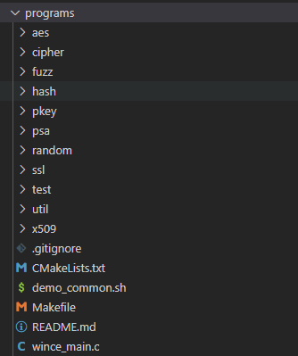

# 前言<a name="ZH-CN_TOPIC_0000002516021497"></a>

**概述<a name="zh-cn_topic_0000002503577223_section4537382116410"></a>**

本文档详细描述了HiDiTingV100项目中开源软件mbed TLS的使用指导，包括接口使用、移植与裁剪和硬件加速等内容。

**读者对象<a name="zh-cn_topic_0000002503577223_section4378592816410"></a>**

本文档主要适用于以下人员：

-   技术支持工程师
-   软件开发工程师

**符号约定<a name="zh-cn_topic_0000002503577223_section133020216410"></a>**

在本文中可能出现下列标志，它们所代表的含义如下。

<a name="zh-cn_topic_0000002503577223_table2622507016410"></a>
<table><thead align="left"><tr id="zh-cn_topic_0000002503577223_row1530720816410"><th class="cellrowborder" valign="top" width="20.580000000000002%" id="mcps1.1.3.1.1"><p id="zh-cn_topic_0000002503577223_p6450074116410"><a name="zh-cn_topic_0000002503577223_p6450074116410"></a><a name="zh-cn_topic_0000002503577223_p6450074116410"></a><strong id="zh-cn_topic_0000002503577223_b2136615816410"><a name="zh-cn_topic_0000002503577223_b2136615816410"></a><a name="zh-cn_topic_0000002503577223_b2136615816410"></a>符号</strong></p>
</th>
<th class="cellrowborder" valign="top" width="79.42%" id="mcps1.1.3.1.2"><p id="zh-cn_topic_0000002503577223_p5435366816410"><a name="zh-cn_topic_0000002503577223_p5435366816410"></a><a name="zh-cn_topic_0000002503577223_p5435366816410"></a><strong id="zh-cn_topic_0000002503577223_b5941558116410"><a name="zh-cn_topic_0000002503577223_b5941558116410"></a><a name="zh-cn_topic_0000002503577223_b5941558116410"></a>说明</strong></p>
</th>
</tr>
</thead>
<tbody><tr id="zh-cn_topic_0000002503577223_row1372280416410"><td class="cellrowborder" valign="top" width="20.580000000000002%" headers="mcps1.1.3.1.1 "><p id="zh-cn_topic_0000002503577223_p3734547016410"><a name="zh-cn_topic_0000002503577223_p3734547016410"></a><a name="zh-cn_topic_0000002503577223_p3734547016410"></a><a name="zh-cn_topic_0000002503577223_image2670064316410"></a><a name="zh-cn_topic_0000002503577223_image2670064316410"></a><span></span></p>
</td>
<td class="cellrowborder" valign="top" width="79.42%" headers="mcps1.1.3.1.2 "><p id="zh-cn_topic_0000002503577223_p1757432116410"><a name="zh-cn_topic_0000002503577223_p1757432116410"></a><a name="zh-cn_topic_0000002503577223_p1757432116410"></a>表示如不避免则将会导致死亡或严重伤害的具有高等级风险的危害。</p>
</td>
</tr>
<tr id="zh-cn_topic_0000002503577223_row466863216410"><td class="cellrowborder" valign="top" width="20.580000000000002%" headers="mcps1.1.3.1.1 "><p id="zh-cn_topic_0000002503577223_p1432579516410"><a name="zh-cn_topic_0000002503577223_p1432579516410"></a><a name="zh-cn_topic_0000002503577223_p1432579516410"></a><a name="zh-cn_topic_0000002503577223_image4895582316410"></a><a name="zh-cn_topic_0000002503577223_image4895582316410"></a><span></span></p>
</td>
<td class="cellrowborder" valign="top" width="79.42%" headers="mcps1.1.3.1.2 "><p id="zh-cn_topic_0000002503577223_p959197916410"><a name="zh-cn_topic_0000002503577223_p959197916410"></a><a name="zh-cn_topic_0000002503577223_p959197916410"></a>表示如不避免则可能导致死亡或严重伤害的具有中等级风险的危害。</p>
</td>
</tr>
<tr id="zh-cn_topic_0000002503577223_row123863216410"><td class="cellrowborder" valign="top" width="20.580000000000002%" headers="mcps1.1.3.1.1 "><p id="zh-cn_topic_0000002503577223_p1232579516410"><a name="zh-cn_topic_0000002503577223_p1232579516410"></a><a name="zh-cn_topic_0000002503577223_p1232579516410"></a><a name="zh-cn_topic_0000002503577223_image1235582316410"></a><a name="zh-cn_topic_0000002503577223_image1235582316410"></a><span></span></p>
</td>
<td class="cellrowborder" valign="top" width="79.42%" headers="mcps1.1.3.1.2 "><p id="zh-cn_topic_0000002503577223_p123197916410"><a name="zh-cn_topic_0000002503577223_p123197916410"></a><a name="zh-cn_topic_0000002503577223_p123197916410"></a>表示如不避免则可能导致轻微或中度伤害的具有低等级风险的危害。</p>
</td>
</tr>
<tr id="zh-cn_topic_0000002503577223_row5786682116410"><td class="cellrowborder" valign="top" width="20.580000000000002%" headers="mcps1.1.3.1.1 "><p id="zh-cn_topic_0000002503577223_p2204984716410"><a name="zh-cn_topic_0000002503577223_p2204984716410"></a><a name="zh-cn_topic_0000002503577223_p2204984716410"></a><a name="zh-cn_topic_0000002503577223_image4504446716410"></a><a name="zh-cn_topic_0000002503577223_image4504446716410"></a><span></span></p>
</td>
<td class="cellrowborder" valign="top" width="79.42%" headers="mcps1.1.3.1.2 "><p id="zh-cn_topic_0000002503577223_p4388861916410"><a name="zh-cn_topic_0000002503577223_p4388861916410"></a><a name="zh-cn_topic_0000002503577223_p4388861916410"></a>用于传递设备或环境安全警示信息。如不避免则可能会导致设备损坏、数据丢失、设备性能降低或其它不可预知的结果。</p>
<p id="zh-cn_topic_0000002503577223_p1238861916410"><a name="zh-cn_topic_0000002503577223_p1238861916410"></a><a name="zh-cn_topic_0000002503577223_p1238861916410"></a>“须知”不涉及人身伤害。</p>
</td>
</tr>
<tr id="zh-cn_topic_0000002503577223_row2856923116410"><td class="cellrowborder" valign="top" width="20.580000000000002%" headers="mcps1.1.3.1.1 "><p id="zh-cn_topic_0000002503577223_p5555360116410"><a name="zh-cn_topic_0000002503577223_p5555360116410"></a><a name="zh-cn_topic_0000002503577223_p5555360116410"></a><a name="zh-cn_topic_0000002503577223_image799324016410"></a><a name="zh-cn_topic_0000002503577223_image799324016410"></a><span></span></p>
</td>
<td class="cellrowborder" valign="top" width="79.42%" headers="mcps1.1.3.1.2 "><p id="zh-cn_topic_0000002503577223_p4612588116410"><a name="zh-cn_topic_0000002503577223_p4612588116410"></a><a name="zh-cn_topic_0000002503577223_p4612588116410"></a>对正文中重点信息的补充说明。</p>
<p id="zh-cn_topic_0000002503577223_p1232588116410"><a name="zh-cn_topic_0000002503577223_p1232588116410"></a><a name="zh-cn_topic_0000002503577223_p1232588116410"></a>“说明”不是安全警示信息，不涉及人身、设备及环境伤害信息。</p>
</td>
</tr>
</tbody>
</table>

# 概述<a name="ZH-CN_TOPIC_0000002483901528"></a>

本文档基于mbed TLS v3.6.5进行介绍。

> **说明：** 
>若客户选择其他版本，移植适配的方法类似。（不同版本可能存在宏或文件名有差异）

-   **[功能描述](#ZH-CN_TOPIC_0000002516141479)**  

## 功能描述<a name="ZH-CN_TOPIC_0000002516141479"></a>

mbed TLS是一款专门用于嵌入式系统的开源软件，主要为系统提供加密和通信安全服务。其主要功能包括：

-   加密算法
    -   对称算法
    -   非对称算法
    -   哈希算法

-   安全协议
    -   TLS
    -   DTLS

-   证书管理
    -   X.509证书管理

-   随机数生成

# 接口使用指导<a name="ZH-CN_TOPIC_0000002483901486"></a>

mbed TLS在其代码目录中提供了详细的示例代码，介绍其对外接口的使用方法。这些示例代码位于programs目录下，如下图所示：

**图 1**  mbed TLS示例代码<a name="zh-cn_topic_0000002503417319_zh-cn_topic_0000002469875476_fig121918386524"></a>  


> **须知：** 
>在mbed TLS中许多结构体成员被标记为MBEDTLS\_PRIVATE，这些成员不允许外部调用者直接访问。

# 移植与裁剪指导<a name="ZH-CN_TOPIC_0000002483741552"></a>

mbed TLS具有高度模块化的特性，开发者可以修改或替换配置文件“mbedtls\_config.h”，将mbed TLS移植到各种资源受限的嵌入式系统中。

由于mbed TLS提供的默认配置文件“mbedtls\_config.h”内容较多，建议的做法是开发者新建一个配置文件，例如“mbedtls\_v3.6.5\_config\_xxx.h”，在编译脚本中增加如下编译宏：

```
-DMBEDTLS_CONFIG_FILE="mbedtls_v3.6.5_config_xxx.h"
```

这样，就可以使用新创建的配置文件替换默认的配置文件，达到精细化裁剪mbed TLS的目的。

下面章节分别介绍在嵌入式系统中对mbed TLS移植与裁剪需要注意的问题。

> **须知：** 
>MBEDTLS\_CONFIG\_FILE在mbed TLS的所有文件中都可见，因此需要将该编译宏定义成全局可见（包括mbed TLS和外部模块），以保证其他模块能正确地调用mbed TLS功能。

-   **[移植](#ZH-CN_TOPIC_0000002483741544)**  

-   **[裁剪](#ZH-CN_TOPIC_0000002483901500)**  

## 移植<a name="ZH-CN_TOPIC_0000002483741544"></a>

-   **[随机数](#ZH-CN_TOPIC_0000002516021465)**  

-   **[时间](#ZH-CN_TOPIC_0000002516141465)**  

### 随机数<a name="ZH-CN_TOPIC_0000002516021465"></a>

在大部分安全业务中，随机数是必不可少的，且必须是符合密码学要求的真随机数。

可以按照如下步骤完成随机数的适配：

1.  配置关键宏：

    在配置文件中，需要定义以下两个宏：

    -   MBEDTLS\_NO\_PLATFORM\_ENTROPY：此宏用于禁用平台默认的熵源（Linux或Windows系统有默认熵源，嵌入式系统通常没有默认熵源）。
    -   MBEDTLS\_ENTROPY\_HARDWARE\_ALT：这个宏告诉mbed TLS，使用自定义的硬件随机数接口作为熵源。

2.  实现硬件随机数接口：

    开发者需要实现mbedtls\_hardware\_poll接口，该接口定义在“library/entropy\_poll.h”，函数原型如下：

    ```
    int mbedtls_hardware_poll( void *data, unsigned char *output, size_t len, size_t *olen );
    ```

3.  编译集成：

    将实现了mbedtls\_hardware\_poll接口的文件（例如entropy\_pool\_alt.c）加入项目编译中。

### 时间<a name="ZH-CN_TOPIC_0000002516141465"></a>

若需要提供X.509证书有效期验证功能，则还需要适配获取当前时间的接口（通常使用硬件RTC实现）。

mbed TLS中提供了多种方法进行获取时间接口的适配，以下章节介绍了最推荐的三种。

-   **[方法一：直接实现time函数](#ZH-CN_TOPIC_0000002516021487)**  

-   **[方法二：注册自定义的时间函数](#ZH-CN_TOPIC_0000002483901520)**  

-   **[方法三：替换默认的时间函数宏（推荐）](#ZH-CN_TOPIC_0000002483741532)**  

#### 方法一：直接实现time函数<a name="ZH-CN_TOPIC_0000002516021487"></a>

开启MBEDTLS\_HAVE\_TIME宏后，mbed TLS默认会使用标准C库函数time获取时间戳。因此，可以直接使用硬件RTC实现time函数。

> **说明：** 
>优点：只需定义MBEDTLS\_HAVE\_TIME宏。
>缺点：涉及标准C库的修改，在已经提供了标准C库的平台下不推荐该方法。

#### 方法二：注册自定义的时间函数<a name="ZH-CN_TOPIC_0000002483901520"></a>

在开启MBEDTLS\_HAVE\_TIME宏和MBEDTLS\_PLATFORM\_TIME\_ALT宏后，mbed TLS新增了一个接口mbedtls\_platform\_set\_time用于注册自定义的时间函数，该接口需要在调用mbed TLS其他接口前先调用一次。

> **说明：** 
>优点：无需修改标准C库。
>缺点：对接口调用有影响，需要额外先调用一次注册接口。

#### 方法三：替换默认的时间函数宏（推荐）<a name="ZH-CN_TOPIC_0000002483741532"></a>

开启MBEDTLS\_HAVE\_TIME宏和MBEDTLS\_PLATFORM\_TIME\_MACRO宏后，开发者可以在配置文件中定义宏MBEDTLS\_PLATFORM\_TIME\_MACRO，该宏指向自定义实现的获取时间函数，如下：

```
#define MBEDTLS_PLATFORM_TIME_MACRO    my_custom_time
```

> **说明：** 
>优点：无需修改标准C库，且对调用流程无影响。

## 裁剪<a name="ZH-CN_TOPIC_0000002483901500"></a>

mbed TLS提供了大量的编译宏，在提供必要能力的同时，可以有效地减少在嵌入式平台上的资源占用。

以下章节给出不同模块的裁剪优化建议。

-   **[协议与算法](#ZH-CN_TOPIC_0000002483901510)**  

-   **[模块与功能](#ZH-CN_TOPIC_0000002516141487)**  

### 协议与算法<a name="ZH-CN_TOPIC_0000002483901510"></a>

这块属于裁剪的主要部分，对于资源占用优化效果显著。

可以从以下几个方向进行优化：

-   指定密码套件：在配置文件中，定义MBEDTLS\_SSL\_CIPHERSUITES只支持一个或少数几个密码套件，可以有效减少整体资源占用，并间接减少所依赖的算法组件的数量。
-   减少椭圆曲线：在配置文件中，有一系列椭圆曲线相关宏MBEDTLS\_ECP\_DP\_XXX\_ENABLE。可以只支持一条或少数几条椭圆曲线，从而有效减少只读区域的资源占用。
-   密码算法：在配置文件中，提供了一系列算法宏MBEDTLS\_XXX\_C用于控制不同算法支持。建议保留必要的安全算法（如AES、SHA256、ECDHE等现代算法），并禁用未使用或不安全算法（如3DES、RC4等）。

### 模块与功能<a name="ZH-CN_TOPIC_0000002516141487"></a>

通常情况下，以下模块可根据实际情况禁用：

-   网络模块：若系统支持lwip或提供了自定义I/O函数，可以禁用此模块（MBEDTLS\_NET\_C）。
-   文件系统：通常嵌入式平台不提供文件系统，可禁用此模块（MBEDTLS\_FS\_IO）。
-   调试功能：在发布版本可禁用（MBEDTLS\_DEBUG\_C）。

# 硬件加速指导<a name="ZH-CN_TOPIC_0000002516021477"></a>

mbed TLS提供了一系列MBEDTLS\_XXX\_ALT宏，这些宏在支持安全算法硬件的平台，可用于将底层算法实现替换硬件实现，从而提升算法性能并优化资源占用。

> **须知：** 
>mbed TLS硬件加速依赖SDK提供的安全驱动，因此需要在使用前完成安全驱动模块的初始化，可调用位于“include/driver/security\_unified/security\_init.h”文件中的uapi\_drv\_cipher\_env\_init接口完成。

-   **[硬件加速适配](#ZH-CN_TOPIC_0000002483741522)**  

-   **[硬件算法配置介绍](#ZH-CN_TOPIC_0000002516141497)**  

-   **[第三方适配](#ZH-CN_TOPIC_0000002577923250)**  

## 硬件加速适配<a name="ZH-CN_TOPIC_0000002483741522"></a>

在提供的SDK包中，提供了常见安全算法的硬件加速实现。

在编译配置文件“config.py”中，只需要在编译目标的ram\_component\_set中增加mbedtls\_harden组件即可。

> **说明：** 
>若仅需要软件实现的原生mbed TLS，编译时只需增加mbedtls\_v3.6.5\_soft组件。（该组件只包含平台移植适配，不包含硬件加速适配）

## 硬件算法配置介绍<a name="ZH-CN_TOPIC_0000002516141497"></a>

在开启了硬件加速后，仍可通过配置文件单独控制特定算法是否使用硬件加速优化。

配置文件位于“drivers/chips/3322/porting/mbedtls/mbedtls\_v3.6.5\_user\_config\_3322.h”（以3322为例）。

下面对配置文件中的编译宏进行介绍：

**表 1**  硬件算法加速编译宏

<a name="zh-cn_topic_0000002503577233_zh-cn_topic_0000002502955385_table149mcpsimp"></a>
<table><thead align="left"><tr id="zh-cn_topic_0000002503577233_zh-cn_topic_0000002502955385_row154mcpsimp"><th class="cellrowborder" valign="top" width="41.07%" id="mcps1.2.3.1.1"><p id="zh-cn_topic_0000002503577233_zh-cn_topic_0000002502955385_p156mcpsimp"><a name="zh-cn_topic_0000002503577233_zh-cn_topic_0000002502955385_p156mcpsimp"></a><a name="zh-cn_topic_0000002503577233_zh-cn_topic_0000002502955385_p156mcpsimp"></a>编译宏</p>
</th>
<th class="cellrowborder" valign="top" width="58.93000000000001%" id="mcps1.2.3.1.2"><p id="zh-cn_topic_0000002503577233_zh-cn_topic_0000002502955385_p159mcpsimp"><a name="zh-cn_topic_0000002503577233_zh-cn_topic_0000002502955385_p159mcpsimp"></a><a name="zh-cn_topic_0000002503577233_zh-cn_topic_0000002502955385_p159mcpsimp"></a>说明</p>
</th>
</tr>
</thead>
<tbody><tr id="zh-cn_topic_0000002503577233_zh-cn_topic_0000002502955385_row161mcpsimp"><td class="cellrowborder" valign="top" width="41.07%" headers="mcps1.2.3.1.1 "><p id="zh-cn_topic_0000002503577233_zh-cn_topic_0000002502955385_p163mcpsimp"><a name="zh-cn_topic_0000002503577233_zh-cn_topic_0000002502955385_p163mcpsimp"></a><a name="zh-cn_topic_0000002503577233_zh-cn_topic_0000002502955385_p163mcpsimp"></a>MBEDTLS_AES_ALT</p>
</td>
<td class="cellrowborder" valign="top" width="58.93000000000001%" headers="mcps1.2.3.1.2 "><p id="zh-cn_topic_0000002503577233_zh-cn_topic_0000002502955385_p165mcpsimp"><a name="zh-cn_topic_0000002503577233_zh-cn_topic_0000002502955385_p165mcpsimp"></a><a name="zh-cn_topic_0000002503577233_zh-cn_topic_0000002502955385_p165mcpsimp"></a>定义该宏，aes.h中的接口改为硬件加速实现。</p>
</td>
</tr>
<tr id="zh-cn_topic_0000002503577233_zh-cn_topic_0000002502955385_row166mcpsimp"><td class="cellrowborder" valign="top" width="41.07%" headers="mcps1.2.3.1.1 "><p id="zh-cn_topic_0000002503577233_zh-cn_topic_0000002502955385_p168mcpsimp"><a name="zh-cn_topic_0000002503577233_zh-cn_topic_0000002502955385_p168mcpsimp"></a><a name="zh-cn_topic_0000002503577233_zh-cn_topic_0000002502955385_p168mcpsimp"></a>MBEDTLS_CCM_ALT</p>
</td>
<td class="cellrowborder" valign="top" width="58.93000000000001%" headers="mcps1.2.3.1.2 "><p id="zh-cn_topic_0000002503577233_zh-cn_topic_0000002502955385_p170mcpsimp"><a name="zh-cn_topic_0000002503577233_zh-cn_topic_0000002502955385_p170mcpsimp"></a><a name="zh-cn_topic_0000002503577233_zh-cn_topic_0000002502955385_p170mcpsimp"></a>定义该宏，ccm.h中的接口改为硬件加速实现。</p>
</td>
</tr>
<tr id="zh-cn_topic_0000002503577233_zh-cn_topic_0000002502955385_row171mcpsimp"><td class="cellrowborder" valign="top" width="41.07%" headers="mcps1.2.3.1.1 "><p id="zh-cn_topic_0000002503577233_zh-cn_topic_0000002502955385_p173mcpsimp"><a name="zh-cn_topic_0000002503577233_zh-cn_topic_0000002502955385_p173mcpsimp"></a><a name="zh-cn_topic_0000002503577233_zh-cn_topic_0000002502955385_p173mcpsimp"></a>MBEDTLS_GCM_ALT</p>
</td>
<td class="cellrowborder" valign="top" width="58.93000000000001%" headers="mcps1.2.3.1.2 "><p id="zh-cn_topic_0000002503577233_zh-cn_topic_0000002502955385_p175mcpsimp"><a name="zh-cn_topic_0000002503577233_zh-cn_topic_0000002502955385_p175mcpsimp"></a><a name="zh-cn_topic_0000002503577233_zh-cn_topic_0000002502955385_p175mcpsimp"></a>定义该宏，gcm.h中的接口改为使用硬件加速实现。</p>
</td>
</tr>
<tr id="zh-cn_topic_0000002503577233_zh-cn_topic_0000002502955385_row3389422113917"><td class="cellrowborder" valign="top" width="41.07%" headers="mcps1.2.3.1.1 "><p id="zh-cn_topic_0000002503577233_zh-cn_topic_0000002502955385_p10390202233917"><a name="zh-cn_topic_0000002503577233_zh-cn_topic_0000002502955385_p10390202233917"></a><a name="zh-cn_topic_0000002503577233_zh-cn_topic_0000002502955385_p10390202233917"></a>MBEDTLS_CMAC_ALT</p>
</td>
<td class="cellrowborder" valign="top" width="58.93000000000001%" headers="mcps1.2.3.1.2 "><p id="zh-cn_topic_0000002503577233_zh-cn_topic_0000002502955385_p183904222397"><a name="zh-cn_topic_0000002503577233_zh-cn_topic_0000002502955385_p183904222397"></a><a name="zh-cn_topic_0000002503577233_zh-cn_topic_0000002502955385_p183904222397"></a>定义该宏，cmac.h中的接口改为使用硬件加速实现。</p>
</td>
</tr>
<tr id="zh-cn_topic_0000002503577233_zh-cn_topic_0000002502955385_row53901322193912"><td class="cellrowborder" valign="top" width="41.07%" headers="mcps1.2.3.1.1 "><p id="zh-cn_topic_0000002503577233_zh-cn_topic_0000002502955385_p15390152219391"><a name="zh-cn_topic_0000002503577233_zh-cn_topic_0000002502955385_p15390152219391"></a><a name="zh-cn_topic_0000002503577233_zh-cn_topic_0000002502955385_p15390152219391"></a>MBEDTLS_PBKDF2_HMAC_ALT</p>
</td>
<td class="cellrowborder" valign="top" width="58.93000000000001%" headers="mcps1.2.3.1.2 "><p id="zh-cn_topic_0000002503577233_zh-cn_topic_0000002502955385_p5390182243915"><a name="zh-cn_topic_0000002503577233_zh-cn_topic_0000002502955385_p5390182243915"></a><a name="zh-cn_topic_0000002503577233_zh-cn_topic_0000002502955385_p5390182243915"></a>定义该宏，mbedtls_pkcs5_pbkdf2_hmac_ext、mbedtls_pkcs5_pbkdf2_hmac接口改为使用硬件加速实现。</p>
</td>
</tr>
<tr id="zh-cn_topic_0000002503577233_zh-cn_topic_0000002502955385_row952114438460"><td class="cellrowborder" valign="top" width="41.07%" headers="mcps1.2.3.1.1 "><p id="zh-cn_topic_0000002503577233_zh-cn_topic_0000002502955385_p145222434464"><a name="zh-cn_topic_0000002503577233_zh-cn_topic_0000002502955385_p145222434464"></a><a name="zh-cn_topic_0000002503577233_zh-cn_topic_0000002502955385_p145222434464"></a>MBEDTLS_HKDF_ALT</p>
</td>
<td class="cellrowborder" valign="top" width="58.93000000000001%" headers="mcps1.2.3.1.2 "><p id="zh-cn_topic_0000002503577233_zh-cn_topic_0000002502955385_p1252284344616"><a name="zh-cn_topic_0000002503577233_zh-cn_topic_0000002502955385_p1252284344616"></a><a name="zh-cn_topic_0000002503577233_zh-cn_topic_0000002502955385_p1252284344616"></a>定义该宏，mbedtls_hkdf，mbedtls_hkdf_extract、mbedtls_hkdf_expand接口改为使用硬件加速实现。</p>
</td>
</tr>
<tr id="zh-cn_topic_0000002503577233_zh-cn_topic_0000002502955385_row176mcpsimp"><td class="cellrowborder" valign="top" width="41.07%" headers="mcps1.2.3.1.1 "><p id="zh-cn_topic_0000002503577233_zh-cn_topic_0000002502955385_p178mcpsimp"><a name="zh-cn_topic_0000002503577233_zh-cn_topic_0000002502955385_p178mcpsimp"></a><a name="zh-cn_topic_0000002503577233_zh-cn_topic_0000002502955385_p178mcpsimp"></a>MBEDTLS_SHA256_ALT</p>
</td>
<td class="cellrowborder" valign="top" width="58.93000000000001%" headers="mcps1.2.3.1.2 "><p id="zh-cn_topic_0000002503577233_zh-cn_topic_0000002502955385_p180mcpsimp"><a name="zh-cn_topic_0000002503577233_zh-cn_topic_0000002502955385_p180mcpsimp"></a><a name="zh-cn_topic_0000002503577233_zh-cn_topic_0000002502955385_p180mcpsimp"></a>定义该宏，sha256.h中的接口改为使用硬件加速实现。</p>
</td>
</tr>
<tr id="zh-cn_topic_0000002503577233_zh-cn_topic_0000002502955385_row181mcpsimp"><td class="cellrowborder" valign="top" width="41.07%" headers="mcps1.2.3.1.1 "><p id="zh-cn_topic_0000002503577233_zh-cn_topic_0000002502955385_p183mcpsimp"><a name="zh-cn_topic_0000002503577233_zh-cn_topic_0000002502955385_p183mcpsimp"></a><a name="zh-cn_topic_0000002503577233_zh-cn_topic_0000002502955385_p183mcpsimp"></a>MBEDTLS_SHA512_ALT</p>
</td>
<td class="cellrowborder" valign="top" width="58.93000000000001%" headers="mcps1.2.3.1.2 "><p id="zh-cn_topic_0000002503577233_zh-cn_topic_0000002502955385_p185mcpsimp"><a name="zh-cn_topic_0000002503577233_zh-cn_topic_0000002502955385_p185mcpsimp"></a><a name="zh-cn_topic_0000002503577233_zh-cn_topic_0000002502955385_p185mcpsimp"></a>定义该宏，sha512.h中的接口改为使用硬件加速实现。</p>
</td>
</tr>
<tr id="zh-cn_topic_0000002503577233_zh-cn_topic_0000002502955385_row186mcpsimp"><td class="cellrowborder" valign="top" width="41.07%" headers="mcps1.2.3.1.1 "><p id="zh-cn_topic_0000002503577233_zh-cn_topic_0000002502955385_p188mcpsimp"><a name="zh-cn_topic_0000002503577233_zh-cn_topic_0000002502955385_p188mcpsimp"></a><a name="zh-cn_topic_0000002503577233_zh-cn_topic_0000002502955385_p188mcpsimp"></a>MBEDTLS_BIGNUM_ALT</p>
</td>
<td class="cellrowborder" valign="top" width="58.93000000000001%" headers="mcps1.2.3.1.2 "><p id="zh-cn_topic_0000002503577233_zh-cn_topic_0000002502955385_p190mcpsimp"><a name="zh-cn_topic_0000002503577233_zh-cn_topic_0000002502955385_p190mcpsimp"></a><a name="zh-cn_topic_0000002503577233_zh-cn_topic_0000002502955385_p190mcpsimp"></a>定义该宏，大数模幂接口改为使用硬件加速实现（优化RSA相关算法）。</p>
</td>
</tr>
<tr id="zh-cn_topic_0000002503577233_zh-cn_topic_0000002502955385_row191mcpsimp"><td class="cellrowborder" valign="top" width="41.07%" headers="mcps1.2.3.1.1 "><p id="zh-cn_topic_0000002503577233_zh-cn_topic_0000002502955385_p193mcpsimp"><a name="zh-cn_topic_0000002503577233_zh-cn_topic_0000002502955385_p193mcpsimp"></a><a name="zh-cn_topic_0000002503577233_zh-cn_topic_0000002502955385_p193mcpsimp"></a>MBEDTLS_ECDH_COMPUTE_SHARED_ALT</p>
</td>
<td class="cellrowborder" valign="top" width="58.93000000000001%" headers="mcps1.2.3.1.2 "><p id="zh-cn_topic_0000002503577233_zh-cn_topic_0000002502955385_p195mcpsimp"><a name="zh-cn_topic_0000002503577233_zh-cn_topic_0000002502955385_p195mcpsimp"></a><a name="zh-cn_topic_0000002503577233_zh-cn_topic_0000002502955385_p195mcpsimp"></a>定义该宏，mbedtls_ecdh_compute_shared接口改为使用硬件加速实现。</p>
</td>
</tr>
<tr id="zh-cn_topic_0000002503577233_zh-cn_topic_0000002502955385_row196mcpsimp"><td class="cellrowborder" valign="top" width="41.07%" headers="mcps1.2.3.1.1 "><p id="zh-cn_topic_0000002503577233_zh-cn_topic_0000002502955385_p198mcpsimp"><a name="zh-cn_topic_0000002503577233_zh-cn_topic_0000002502955385_p198mcpsimp"></a><a name="zh-cn_topic_0000002503577233_zh-cn_topic_0000002502955385_p198mcpsimp"></a>MBEDTLS_ECDSA_SIGN_ALT</p>
</td>
<td class="cellrowborder" valign="top" width="58.93000000000001%" headers="mcps1.2.3.1.2 "><p id="zh-cn_topic_0000002503577233_zh-cn_topic_0000002502955385_p200mcpsimp"><a name="zh-cn_topic_0000002503577233_zh-cn_topic_0000002502955385_p200mcpsimp"></a><a name="zh-cn_topic_0000002503577233_zh-cn_topic_0000002502955385_p200mcpsimp"></a>定义该宏，mbedtls_ecdsa_sign接口改为使用硬件加速实现。</p>
</td>
</tr>
<tr id="zh-cn_topic_0000002503577233_zh-cn_topic_0000002502955385_row201mcpsimp"><td class="cellrowborder" valign="top" width="41.07%" headers="mcps1.2.3.1.1 "><p id="zh-cn_topic_0000002503577233_zh-cn_topic_0000002502955385_p203mcpsimp"><a name="zh-cn_topic_0000002503577233_zh-cn_topic_0000002502955385_p203mcpsimp"></a><a name="zh-cn_topic_0000002503577233_zh-cn_topic_0000002502955385_p203mcpsimp"></a>MBEDTLS_ECDSA_VERIFY_ALT</p>
</td>
<td class="cellrowborder" valign="top" width="58.93000000000001%" headers="mcps1.2.3.1.2 "><p id="zh-cn_topic_0000002503577233_zh-cn_topic_0000002502955385_p205mcpsimp"><a name="zh-cn_topic_0000002503577233_zh-cn_topic_0000002502955385_p205mcpsimp"></a><a name="zh-cn_topic_0000002503577233_zh-cn_topic_0000002502955385_p205mcpsimp"></a>定义该宏，mbedtls_ecdsa_verify接口改为使用硬件加速实现。</p>
</td>
</tr>
<tr id="zh-cn_topic_0000002503577233_zh-cn_topic_0000002502955385_row206mcpsimp"><td class="cellrowborder" valign="top" width="41.07%" headers="mcps1.2.3.1.1 "><p id="zh-cn_topic_0000002503577233_zh-cn_topic_0000002502955385_p208mcpsimp"><a name="zh-cn_topic_0000002503577233_zh-cn_topic_0000002502955385_p208mcpsimp"></a><a name="zh-cn_topic_0000002503577233_zh-cn_topic_0000002502955385_p208mcpsimp"></a>MBEDTLS_ECDSA_GENKEY_ALT</p>
</td>
<td class="cellrowborder" valign="top" width="58.93000000000001%" headers="mcps1.2.3.1.2 "><p id="zh-cn_topic_0000002503577233_zh-cn_topic_0000002502955385_p210mcpsimp"><a name="zh-cn_topic_0000002503577233_zh-cn_topic_0000002502955385_p210mcpsimp"></a><a name="zh-cn_topic_0000002503577233_zh-cn_topic_0000002502955385_p210mcpsimp"></a>定义该宏，mbedtls_ecdsa_genkey接口改为使用硬件加速实现。</p>
</td>
</tr>
<tr id="zh-cn_topic_0000002503577233_zh-cn_topic_0000002502955385_row102111134387"><td class="cellrowborder" valign="top" width="41.07%" headers="mcps1.2.3.1.1 "><p id="zh-cn_topic_0000002503577233_zh-cn_topic_0000002502955385_p6225134382"><a name="zh-cn_topic_0000002503577233_zh-cn_topic_0000002502955385_p6225134382"></a><a name="zh-cn_topic_0000002503577233_zh-cn_topic_0000002502955385_p6225134382"></a>MBEDTLS_ECP_ALT</p>
</td>
<td class="cellrowborder" valign="top" width="58.93000000000001%" headers="mcps1.2.3.1.2 "><p id="zh-cn_topic_0000002503577233_zh-cn_topic_0000002502955385_p022161343814"><a name="zh-cn_topic_0000002503577233_zh-cn_topic_0000002502955385_p022161343814"></a><a name="zh-cn_topic_0000002503577233_zh-cn_topic_0000002502955385_p022161343814"></a>定义该宏，ecp.h中的计算接口改为使用硬件加速实现。</p>
</td>
</tr>
</tbody>
</table>

> **须知：** 
>如果定义了MBEDTLS\_ECP\_RESTARTABLE，则ECC算法相关的硬件加速宏无法定义，包括：
>MBEDTLS\_ECDH\_COMPUTE\_SHARED\_ALT、MBEDTLS\_ECDSA\_SIGN\_ALT、MBEDTLS\_ECDSA\_VERIFY\_ALT、MBEDTLS\_ECDSA\_GENKEY\_ALT、MBEDTLS\_ECP\_ALT。
>支持硬件加速的ECC曲线类型包括：MBEDTLS\_ECP\_DP\_SECP192R1、MBEDTLS\_ECP\_DP\_SECP224R1、MBEDTLS\_ECP\_DP\_SECP256R1、MBEDTLS\_ECP\_DP\_SECP384R1、MBEDTLS\_ECP\_DP\_SECP521R1、MBEDTLS\_ECP\_DP\_BP256R1、MBEDTLS\_ECP\_DP\_BP384R1、MBEDTLS\_ECP\_DP\_BP512R1、MBEDTLS\_ECP\_DP\_CURVE25519、MBEDTLS\_ECP\_DP\_CURVE448。
>如果定义了MBEDTLS\_CMAC\_ALT，则不支持3DES算法。

## 第三方适配<a name="ZH-CN_TOPIC_0000002577923250"></a>

若用户使用的是其他版本的mbed TLS或者希望自己集成mbed TLS，则可按照本节内容完成对mbed TLS的硬化适配。

1.  集成mbedtls\_harden。将SDK中的“middleware/utils/mbedtls\_harden”集成到项目中，编译可参考“CMakeLists.txt”文件。
2.  集成mbedtls\_porting。参考SDK中的“drivers/chips/$\{CHIP\}/porting/mbedtls”目录，将其集成到项目中。
3.  集成第三方mbed TLS。将第三方的mbed TLS集成到项目中。

