# 前言<a name="ZH-CN_TOPIC_0000002483741608"></a>

**概述<a name="zh-cn_topic_0000002444647017_section4537382116410"></a>**

本文档介绍了第三方应用的适配和开发流程，用于指导用户快速进行三方应用的开发。

**读者对象<a name="zh-cn_topic_0000002444647017_section215115568337"></a>**

本文档主要适用于以下工程师：

-   技术支持工程师
-   软件开发工程师

**符号约定<a name="zh-cn_topic_0000002444647017_section133020216410"></a>**

在本文中可能出现下列标志，它们所代表的含义如下。

<a name="zh-cn_topic_0000002444647017_table2622507016410"></a>
<table><thead align="left"><tr id="zh-cn_topic_0000002444647017_row1530720816410"><th class="cellrowborder" valign="top" width="20.580000000000002%" id="mcps1.1.3.1.1"><p id="zh-cn_topic_0000002444647017_p6450074116410"><a name="zh-cn_topic_0000002444647017_p6450074116410"></a><a name="zh-cn_topic_0000002444647017_p6450074116410"></a><strong id="zh-cn_topic_0000002444647017_b2136615816410"><a name="zh-cn_topic_0000002444647017_b2136615816410"></a><a name="zh-cn_topic_0000002444647017_b2136615816410"></a>符号</strong></p>
</th>
<th class="cellrowborder" valign="top" width="79.42%" id="mcps1.1.3.1.2"><p id="zh-cn_topic_0000002444647017_p5435366816410"><a name="zh-cn_topic_0000002444647017_p5435366816410"></a><a name="zh-cn_topic_0000002444647017_p5435366816410"></a><strong id="zh-cn_topic_0000002444647017_b5941558116410"><a name="zh-cn_topic_0000002444647017_b5941558116410"></a><a name="zh-cn_topic_0000002444647017_b5941558116410"></a>说明</strong></p>
</th>
</tr>
</thead>
<tbody><tr id="zh-cn_topic_0000002444647017_row1372280416410"><td class="cellrowborder" valign="top" width="20.580000000000002%" headers="mcps1.1.3.1.1 "><p id="zh-cn_topic_0000002444647017_p3734547016410"><a name="zh-cn_topic_0000002444647017_p3734547016410"></a><a name="zh-cn_topic_0000002444647017_p3734547016410"></a><a name="zh-cn_topic_0000002444647017_image2670064316410"></a><a name="zh-cn_topic_0000002444647017_image2670064316410"></a><span></span></p>
</td>
<td class="cellrowborder" valign="top" width="79.42%" headers="mcps1.1.3.1.2 "><p id="zh-cn_topic_0000002444647017_p1757432116410"><a name="zh-cn_topic_0000002444647017_p1757432116410"></a><a name="zh-cn_topic_0000002444647017_p1757432116410"></a>表示如不避免则将会导致死亡或严重伤害的具有高等级风险的危害。</p>
</td>
</tr>
<tr id="zh-cn_topic_0000002444647017_row466863216410"><td class="cellrowborder" valign="top" width="20.580000000000002%" headers="mcps1.1.3.1.1 "><p id="zh-cn_topic_0000002444647017_p1432579516410"><a name="zh-cn_topic_0000002444647017_p1432579516410"></a><a name="zh-cn_topic_0000002444647017_p1432579516410"></a><a name="zh-cn_topic_0000002444647017_image4895582316410"></a><a name="zh-cn_topic_0000002444647017_image4895582316410"></a><span></span></p>
</td>
<td class="cellrowborder" valign="top" width="79.42%" headers="mcps1.1.3.1.2 "><p id="zh-cn_topic_0000002444647017_p959197916410"><a name="zh-cn_topic_0000002444647017_p959197916410"></a><a name="zh-cn_topic_0000002444647017_p959197916410"></a>表示如不避免则可能导致死亡或严重伤害的具有中等级风险的危害。</p>
</td>
</tr>
<tr id="zh-cn_topic_0000002444647017_row123863216410"><td class="cellrowborder" valign="top" width="20.580000000000002%" headers="mcps1.1.3.1.1 "><p id="zh-cn_topic_0000002444647017_p1232579516410"><a name="zh-cn_topic_0000002444647017_p1232579516410"></a><a name="zh-cn_topic_0000002444647017_p1232579516410"></a><a name="zh-cn_topic_0000002444647017_image1235582316410"></a><a name="zh-cn_topic_0000002444647017_image1235582316410"></a><span></span></p>
</td>
<td class="cellrowborder" valign="top" width="79.42%" headers="mcps1.1.3.1.2 "><p id="zh-cn_topic_0000002444647017_p123197916410"><a name="zh-cn_topic_0000002444647017_p123197916410"></a><a name="zh-cn_topic_0000002444647017_p123197916410"></a>表示如不避免则可能导致轻微或中度伤害的具有低等级风险的危害。</p>
</td>
</tr>
<tr id="zh-cn_topic_0000002444647017_row5786682116410"><td class="cellrowborder" valign="top" width="20.580000000000002%" headers="mcps1.1.3.1.1 "><p id="zh-cn_topic_0000002444647017_p2204984716410"><a name="zh-cn_topic_0000002444647017_p2204984716410"></a><a name="zh-cn_topic_0000002444647017_p2204984716410"></a><a name="zh-cn_topic_0000002444647017_image4504446716410"></a><a name="zh-cn_topic_0000002444647017_image4504446716410"></a><span></span></p>
</td>
<td class="cellrowborder" valign="top" width="79.42%" headers="mcps1.1.3.1.2 "><p id="zh-cn_topic_0000002444647017_p4388861916410"><a name="zh-cn_topic_0000002444647017_p4388861916410"></a><a name="zh-cn_topic_0000002444647017_p4388861916410"></a>用于传递设备或环境安全警示信息。如不避免则可能会导致设备损坏、数据丢失、设备性能降低或其它不可预知的结果。</p>
<p id="zh-cn_topic_0000002444647017_p1238861916410"><a name="zh-cn_topic_0000002444647017_p1238861916410"></a><a name="zh-cn_topic_0000002444647017_p1238861916410"></a>“须知”不涉及人身伤害。</p>
</td>
</tr>
<tr id="zh-cn_topic_0000002444647017_row2856923116410"><td class="cellrowborder" valign="top" width="20.580000000000002%" headers="mcps1.1.3.1.1 "><p id="zh-cn_topic_0000002444647017_p5555360116410"><a name="zh-cn_topic_0000002444647017_p5555360116410"></a><a name="zh-cn_topic_0000002444647017_p5555360116410"></a><a name="zh-cn_topic_0000002444647017_image799324016410"></a><a name="zh-cn_topic_0000002444647017_image799324016410"></a><span></span></p>
</td>
<td class="cellrowborder" valign="top" width="79.42%" headers="mcps1.1.3.1.2 "><p id="zh-cn_topic_0000002444647017_p4612588116410"><a name="zh-cn_topic_0000002444647017_p4612588116410"></a><a name="zh-cn_topic_0000002444647017_p4612588116410"></a>对正文中重点信息的补充说明。</p>
<p id="zh-cn_topic_0000002444647017_p1232588116410"><a name="zh-cn_topic_0000002444647017_p1232588116410"></a><a name="zh-cn_topic_0000002444647017_p1232588116410"></a>“说明”不是安全警示信息，不涉及人身、设备及环境伤害信息。</p>
</td>
</tr>
</tbody>
</table>

# 支付宝<a name="ZH-CN_TOPIC_0000002483901596"></a>

-   **[概述](#ZH-CN_TOPIC_0000002516021565)**  

-   **[支付码（暂不支持）](#ZH-CN_TOPIC_0000002483901564)**  

-   **[乘车码（暂不支持）](#ZH-CN_TOPIC_0000002483901502)**  

-   **[手机端数传适配指导](#ZH-CN_TOPIC_0000002483741612)**  

## 概述<a name="ZH-CN_TOPIC_0000002516021565"></a>

本章主要介绍基于支付宝eSE安全加密芯片方案、适配支付宝侧SDK、支付码和乘车码的应用开发流程以及硬件要求限制，指导用户进行支付宝应用开发，总体方案如[图1](#zh-cn_topic_0000002444646993_fig187245513259)所示。

**图 1**  总体方案框图<a name="zh-cn_topic_0000002444646993_fig187245513259"></a>  
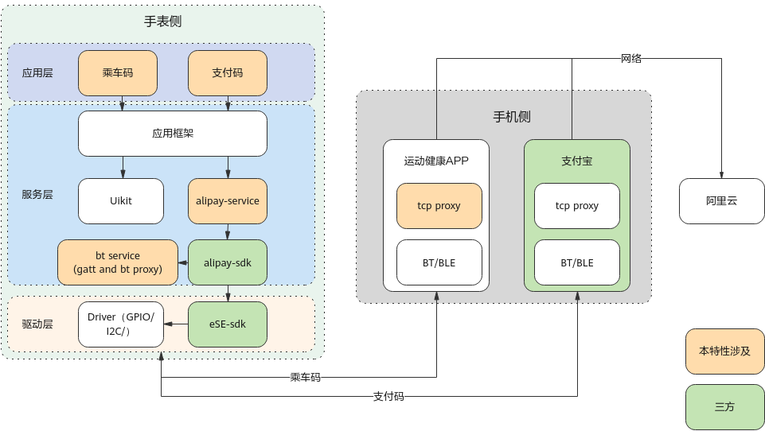

从整体处理流程上看，支付码、乘车码特性主要涉及以下几个部分：UI应用界面、Alipay SDK集成、eSE SDK集成、Alipay服务、BT Proxy服务。

> **说明：** 
>支付码、乘车码属于三方应用对接，本章只基于UIKit实现Sample，正式商用前客户需要准备样机联系支付宝，提前配置相关账户信息，调试完成后需要提供支付宝进行送测。

## 支付码（暂不支持）<a name="ZH-CN_TOPIC_0000002483901564"></a>

-   **[方案概述](#ZH-CN_TOPIC_0000002516021551)**  

-   **[Alipay-SDK和eSE SDK接口集成](#ZH-CN_TOPIC_0000002516021531)**  

-   **[UI应用开发](#ZH-CN_TOPIC_0000002516021543)**  

### 方案概述<a name="ZH-CN_TOPIC_0000002516021551"></a>

本章简单介绍阿里支付宝团队的加密芯片方案，通过加密芯片，实现支付资产安全隔离和安全存储保护要求，同时利用安全芯片的唯一HUK进行授权码验证，确保支付资产和安全芯片一一绑定，保证支付安全，支付整体方案框图如[图1](#zh-cn_topic_0000002444646965_fig143731256172710)所示。

**图 1**  支付方案框图<a name="zh-cn_topic_0000002444646965_fig143731256172710"></a>  
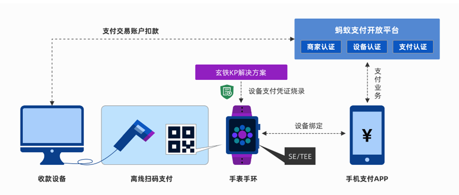

> **须知：** 
>**支付特性穿戴设备端硬件准入限制：**
>-   显示屏：支持屏幕背光，圆形屏幕分辨率不低于320×320，矩形屏幕分辨率不低于280×280。
>-   设备需保证时钟的准确性，确保一年内时间偏移不超过60s，并且拥有对时功能。
>-   ROM：代码段200KB。
>-   RAM :  7KB栈空间，8KB堆空间，共15KB，部署在PSRAM上。

### Alipay-SDK和eSE SDK接口集成<a name="ZH-CN_TOPIC_0000002516021531"></a>

通过从平头哥芯片社区下载相关代码  [可穿戴支付安全解决方案-平头哥芯片开放社区-平头哥 \(t-head.cn\)](https://xuantie.t-head.cn/vendor/cpu/index?id=4117672381135261696&key=video&spm=a2cl5.26076654.0.0.2a1475327NFW1e#sticky)，当前发布SDK下载使用是Alipay SDK v3.0.1，用户使用根目录“vendor/alipay\_sdk”即可，无需额外下载。

**图 1**  Alipay-SDK下载<a name="zh-cn_topic_0000002444727133_fig10917172213410"></a>  
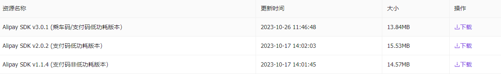

-   **[eSE集成](#ZH-CN_TOPIC_0000002483741510)**  

-   **[Alipay-SDK集成](#ZH-CN_TOPIC_0000002516021499)**  

#### eSE集成<a name="ZH-CN_TOPIC_0000002483741510"></a>

适配工作主要分为三个步骤：

1.  集成“vendor\\alipay\_sdk\\alipay\_sec\_sdk\_v3.0.0\\soc”⽬录下的样例代码，并适配修改csi\*接口的实现。

    可参考sdk目录下“application\\wearable\\alipay\\driver\_adapt\\vendor\_product.c”的实现，如[表1](#zh-cn_topic_0000002444646989_table2034315019143)所示对接口简单说明。

    **表 1**  cis\*接口说明

    <a name="zh-cn_topic_0000002444646989_table2034315019143"></a>
    <table><thead align="left"><tr id="zh-cn_topic_0000002444646989_row734330101412"><th class="cellrowborder" valign="top" width="35.35%" id="mcps1.2.3.1.1"><p id="zh-cn_topic_0000002444646989_p434300181413"><a name="zh-cn_topic_0000002444646989_p434300181413"></a><a name="zh-cn_topic_0000002444646989_p434300181413"></a>函数名称</p>
    </th>
    <th class="cellrowborder" valign="top" width="64.64999999999999%" id="mcps1.2.3.1.2"><p id="zh-cn_topic_0000002444646989_p1134300161410"><a name="zh-cn_topic_0000002444646989_p1134300161410"></a><a name="zh-cn_topic_0000002444646989_p1134300161410"></a>功能说明</p>
    </th>
    </tr>
    </thead>
    <tbody><tr id="zh-cn_topic_0000002444646989_row9343707145"><td class="cellrowborder" valign="top" width="35.35%" headers="mcps1.2.3.1.1 "><p id="zh-cn_topic_0000002444646989_p4343709143"><a name="zh-cn_topic_0000002444646989_p4343709143"></a><a name="zh-cn_topic_0000002444646989_p4343709143"></a>csi_get_deviceid</p>
    </td>
    <td class="cellrowborder" valign="top" width="64.64999999999999%" headers="mcps1.2.3.1.2 "><p id="zh-cn_topic_0000002444646989_p133430091411"><a name="zh-cn_topic_0000002444646989_p133430091411"></a><a name="zh-cn_topic_0000002444646989_p133430091411"></a>获取设备蓝牙地址和长度，格式为“AA:BB:CC:00:11:22”。</p>
    </td>
    </tr>
    <tr id="zh-cn_topic_0000002444646989_row16343130161410"><td class="cellrowborder" valign="top" width="35.35%" headers="mcps1.2.3.1.1 "><p id="zh-cn_topic_0000002444646989_p8343805146"><a name="zh-cn_topic_0000002444646989_p8343805146"></a><a name="zh-cn_topic_0000002444646989_p8343805146"></a>csi_get_timestamp</p>
    </td>
    <td class="cellrowborder" valign="top" width="64.64999999999999%" headers="mcps1.2.3.1.2 "><p id="zh-cn_topic_0000002444646989_p834360181412"><a name="zh-cn_topic_0000002444646989_p834360181412"></a><a name="zh-cn_topic_0000002444646989_p834360181412"></a>获取当前系统时间戳（Unix时间戳格式）。</p>
    </td>
    </tr>
    <tr id="zh-cn_topic_0000002444646989_row4343180111417"><td class="cellrowborder" valign="top" width="35.35%" headers="mcps1.2.3.1.1 "><p id="zh-cn_topic_0000002444646989_p9343140141410"><a name="zh-cn_topic_0000002444646989_p9343140141410"></a><a name="zh-cn_topic_0000002444646989_p9343140141410"></a>csi_get_sn</p>
    </td>
    <td class="cellrowborder" valign="top" width="64.64999999999999%" headers="mcps1.2.3.1.2 "><p id="zh-cn_topic_0000002444646989_p63431104145"><a name="zh-cn_topic_0000002444646989_p63431104145"></a><a name="zh-cn_topic_0000002444646989_p63431104145"></a>获取设备SN，参考csi_get_deviceid获取蓝牙地址实现即可。</p>
    </td>
    </tr>
    <tr id="zh-cn_topic_0000002444646989_row7343150161420"><td class="cellrowborder" valign="top" width="35.35%" headers="mcps1.2.3.1.1 "><p id="zh-cn_topic_0000002444646989_p33435071418"><a name="zh-cn_topic_0000002444646989_p33435071418"></a><a name="zh-cn_topic_0000002444646989_p33435071418"></a>csi_get_companyname</p>
    </td>
    <td class="cellrowborder" valign="top" width="64.64999999999999%" headers="mcps1.2.3.1.2 "><p id="zh-cn_topic_0000002444646989_p173441104144"><a name="zh-cn_topic_0000002444646989_p173441104144"></a><a name="zh-cn_topic_0000002444646989_p173441104144"></a>获取设备公司名称，公司名称需要提供给支付宝进行配置。</p>
    </td>
    </tr>
    <tr id="zh-cn_topic_0000002444646989_row934419016149"><td class="cellrowborder" valign="top" width="35.35%" headers="mcps1.2.3.1.1 "><p id="zh-cn_topic_0000002444646989_p534490131418"><a name="zh-cn_topic_0000002444646989_p534490131418"></a><a name="zh-cn_topic_0000002444646989_p534490131418"></a>csi_get_productmodel</p>
    </td>
    <td class="cellrowborder" valign="top" width="64.64999999999999%" headers="mcps1.2.3.1.2 "><p id="zh-cn_topic_0000002444646989_p1034412013141"><a name="zh-cn_topic_0000002444646989_p1034412013141"></a><a name="zh-cn_topic_0000002444646989_p1034412013141"></a>获取设备产品名称，产品名称需要提供给支付宝进行配置。</p>
    </td>
    </tr>
    <tr id="zh-cn_topic_0000002444646989_row4344130131417"><td class="cellrowborder" valign="top" width="35.35%" headers="mcps1.2.3.1.1 "><p id="zh-cn_topic_0000002444646989_p0344906147"><a name="zh-cn_topic_0000002444646989_p0344906147"></a><a name="zh-cn_topic_0000002444646989_p0344906147"></a>csi_ble_write</p>
    </td>
    <td class="cellrowborder" valign="top" width="64.64999999999999%" headers="mcps1.2.3.1.2 "><p id="zh-cn_topic_0000002444646989_p16344004144"><a name="zh-cn_topic_0000002444646989_p16344004144"></a><a name="zh-cn_topic_0000002444646989_p16344004144"></a>发送蓝牙数据接口。</p>
    </td>
    </tr>
    <tr id="zh-cn_topic_0000002444646989_row134460161419"><td class="cellrowborder" valign="top" width="35.35%" headers="mcps1.2.3.1.1 "><p id="zh-cn_topic_0000002444646989_p103444011147"><a name="zh-cn_topic_0000002444646989_p103444011147"></a><a name="zh-cn_topic_0000002444646989_p103444011147"></a>csi_log</p>
    </td>
    <td class="cellrowborder" valign="top" width="64.64999999999999%" headers="mcps1.2.3.1.2 "><p id="zh-cn_topic_0000002444646989_p143445061413"><a name="zh-cn_topic_0000002444646989_p143445061413"></a><a name="zh-cn_topic_0000002444646989_p143445061413"></a>日志打印接口，可通过日志等级控制。</p>
    </td>
    </tr>
    <tr id="zh-cn_topic_0000002444646989_row734416011416"><td class="cellrowborder" valign="top" width="35.35%" headers="mcps1.2.3.1.1 "><p id="zh-cn_topic_0000002444646989_p1734416010146"><a name="zh-cn_topic_0000002444646989_p1734416010146"></a><a name="zh-cn_topic_0000002444646989_p1734416010146"></a>csi_log_ext</p>
    </td>
    <td class="cellrowborder" valign="top" width="64.64999999999999%" headers="mcps1.2.3.1.2 "><p id="zh-cn_topic_0000002444646989_p193441061410"><a name="zh-cn_topic_0000002444646989_p193441061410"></a><a name="zh-cn_topic_0000002444646989_p193441061410"></a>日志打印接口。</p>
    </td>
    </tr>
    <tr id="zh-cn_topic_0000002444646989_row193441021419"><td class="cellrowborder" valign="top" width="35.35%" headers="mcps1.2.3.1.1 "><p id="zh-cn_topic_0000002444646989_p7344110111410"><a name="zh-cn_topic_0000002444646989_p7344110111410"></a><a name="zh-cn_topic_0000002444646989_p7344110111410"></a>csi_malloc</p>
    </td>
    <td class="cellrowborder" valign="top" width="64.64999999999999%" headers="mcps1.2.3.1.2 "><p id="zh-cn_topic_0000002444646989_p73441407142"><a name="zh-cn_topic_0000002444646989_p73441407142"></a><a name="zh-cn_topic_0000002444646989_p73441407142"></a>内存申请接口。</p>
    </td>
    </tr>
    <tr id="zh-cn_topic_0000002444646989_row83444010149"><td class="cellrowborder" valign="top" width="35.35%" headers="mcps1.2.3.1.1 "><p id="zh-cn_topic_0000002444646989_p18344170201417"><a name="zh-cn_topic_0000002444646989_p18344170201417"></a><a name="zh-cn_topic_0000002444646989_p18344170201417"></a>csi_calloc</p>
    </td>
    <td class="cellrowborder" valign="top" width="64.64999999999999%" headers="mcps1.2.3.1.2 "><p id="zh-cn_topic_0000002444646989_p133446012142"><a name="zh-cn_topic_0000002444646989_p133446012142"></a><a name="zh-cn_topic_0000002444646989_p133446012142"></a>内存申请接口，并初始化。</p>
    </td>
    </tr>
    <tr id="zh-cn_topic_0000002444646989_row834415021418"><td class="cellrowborder" valign="top" width="35.35%" headers="mcps1.2.3.1.1 "><p id="zh-cn_topic_0000002444646989_p334490131410"><a name="zh-cn_topic_0000002444646989_p334490131410"></a><a name="zh-cn_topic_0000002444646989_p334490131410"></a>csi_free</p>
    </td>
    <td class="cellrowborder" valign="top" width="64.64999999999999%" headers="mcps1.2.3.1.2 "><p id="zh-cn_topic_0000002444646989_p434420111415"><a name="zh-cn_topic_0000002444646989_p434420111415"></a><a name="zh-cn_topic_0000002444646989_p434420111415"></a>内存释放接口。</p>
    </td>
    </tr>
    <tr id="zh-cn_topic_0000002444646989_row19344120131415"><td class="cellrowborder" valign="top" width="35.35%" headers="mcps1.2.3.1.1 "><p id="zh-cn_topic_0000002444646989_p534418051411"><a name="zh-cn_topic_0000002444646989_p534418051411"></a><a name="zh-cn_topic_0000002444646989_p534418051411"></a>csi_realloc</p>
    </td>
    <td class="cellrowborder" valign="top" width="64.64999999999999%" headers="mcps1.2.3.1.2 "><p id="zh-cn_topic_0000002444646989_p43446017140"><a name="zh-cn_topic_0000002444646989_p43446017140"></a><a name="zh-cn_topic_0000002444646989_p43446017140"></a>调整内存空间接口。</p>
    </td>
    </tr>
    </tbody>
    </table>

2.  驱动接口适配。

    可参考sdk目录下“application\\wearable\\alipay\\driver\_adapt\\soc\_adapt.c”的实现，如[表2](#zh-cn_topic_0000002444646989_table10505161815215)所示对接口简单说明。

    **表 2**  驱动接口说明

    <a name="zh-cn_topic_0000002444646989_table10505161815215"></a>
    <table><thead align="left"><tr id="zh-cn_topic_0000002444646989_row1350510183214"><th class="cellrowborder" valign="top" width="50%" id="mcps1.2.3.1.1"><p id="zh-cn_topic_0000002444646989_p18505121862115"><a name="zh-cn_topic_0000002444646989_p18505121862115"></a><a name="zh-cn_topic_0000002444646989_p18505121862115"></a>函数名称</p>
    </th>
    <th class="cellrowborder" valign="top" width="50%" id="mcps1.2.3.1.2"><p id="zh-cn_topic_0000002444646989_p20505101811218"><a name="zh-cn_topic_0000002444646989_p20505101811218"></a><a name="zh-cn_topic_0000002444646989_p20505101811218"></a>功能说明</p>
    </th>
    </tr>
    </thead>
    <tbody><tr id="zh-cn_topic_0000002444646989_row05051318132117"><td class="cellrowborder" valign="top" width="50%" headers="mcps1.2.3.1.1 "><p id="zh-cn_topic_0000002444646989_p10505518172119"><a name="zh-cn_topic_0000002444646989_p10505518172119"></a><a name="zh-cn_topic_0000002444646989_p10505518172119"></a>IIC_Master_Init</p>
    </td>
    <td class="cellrowborder" valign="top" width="50%" headers="mcps1.2.3.1.2 "><p id="zh-cn_topic_0000002444646989_p350511186216"><a name="zh-cn_topic_0000002444646989_p350511186216"></a><a name="zh-cn_topic_0000002444646989_p350511186216"></a>IIC master初始化接口。</p>
    </td>
    </tr>
    <tr id="zh-cn_topic_0000002444646989_row15051918192117"><td class="cellrowborder" valign="top" width="50%" headers="mcps1.2.3.1.1 "><p id="zh-cn_topic_0000002444646989_p19506171814212"><a name="zh-cn_topic_0000002444646989_p19506171814212"></a><a name="zh-cn_topic_0000002444646989_p19506171814212"></a>IIC_Master_Send</p>
    </td>
    <td class="cellrowborder" valign="top" width="50%" headers="mcps1.2.3.1.2 "><p id="zh-cn_topic_0000002444646989_p14506518192118"><a name="zh-cn_topic_0000002444646989_p14506518192118"></a><a name="zh-cn_topic_0000002444646989_p14506518192118"></a>IIC master发送接口。</p>
    </td>
    </tr>
    <tr id="zh-cn_topic_0000002444646989_row9506101802114"><td class="cellrowborder" valign="top" width="50%" headers="mcps1.2.3.1.1 "><p id="zh-cn_topic_0000002444646989_p1650613182217"><a name="zh-cn_topic_0000002444646989_p1650613182217"></a><a name="zh-cn_topic_0000002444646989_p1650613182217"></a>IIC_Master_Receive</p>
    </td>
    <td class="cellrowborder" valign="top" width="50%" headers="mcps1.2.3.1.2 "><p id="zh-cn_topic_0000002444646989_p18506918152116"><a name="zh-cn_topic_0000002444646989_p18506918152116"></a><a name="zh-cn_topic_0000002444646989_p18506918152116"></a>IIC master接收接口。</p>
    </td>
    </tr>
    <tr id="zh-cn_topic_0000002444646989_row1506101814216"><td class="cellrowborder" valign="top" width="50%" headers="mcps1.2.3.1.1 "><p id="zh-cn_topic_0000002444646989_p950631820211"><a name="zh-cn_topic_0000002444646989_p950631820211"></a><a name="zh-cn_topic_0000002444646989_p950631820211"></a>Delay_Ms</p>
    </td>
    <td class="cellrowborder" valign="top" width="50%" headers="mcps1.2.3.1.2 "><p id="zh-cn_topic_0000002444646989_p10506161819211"><a name="zh-cn_topic_0000002444646989_p10506161819211"></a><a name="zh-cn_topic_0000002444646989_p10506161819211"></a>延迟一段时间接口，单位：ms。</p>
    </td>
    </tr>
    <tr id="zh-cn_topic_0000002444646989_row15506181816212"><td class="cellrowborder" valign="top" width="50%" headers="mcps1.2.3.1.1 "><p id="zh-cn_topic_0000002444646989_p3506111812215"><a name="zh-cn_topic_0000002444646989_p3506111812215"></a><a name="zh-cn_topic_0000002444646989_p3506111812215"></a>Set_GPIO_State</p>
    </td>
    <td class="cellrowborder" valign="top" width="50%" headers="mcps1.2.3.1.2 "><p id="zh-cn_topic_0000002444646989_p11506101862114"><a name="zh-cn_topic_0000002444646989_p11506101862114"></a><a name="zh-cn_topic_0000002444646989_p11506101862114"></a>设置GPIO管脚输出高低状态接口。</p>
    </td>
    </tr>
    </tbody>
    </table>

    > **说明：** 
    >其中用户需要在“drivers\\boards\\3322\_evb\\product\\product.h”文件中配置IIC选择和低功耗管脚，可参考：
    >```
    >#define ALIPAY_SEC_I2C_INDEX                I2C_BUS_3
    >#define ALIPAY_SEC_GPIO                     S_AGPIO_L29
    >```

3.  完成test目录下的测试案例。

    > **须知：** 
    >在产品制造过程中，默认情况下安全凭证固化在加密芯片里边。但是由于某些原因，出厂的加密芯片烧写凭证不完整或损坏时，如果发现不及时，整个产品生产都要返工重新制造。为防止该类问题，需要在产线检测eSE芯片安全凭证的正确性和完整性。
    >-   使用hal\_get\_credential可用于验证安全凭证是否完整。
    >-   使用hal\_compat\_check可用于验证安全凭证是否和硬件绑定。
    >可参考“vendor\\alipay\_sdk\\alipay\_sec\_sdk\_v3.0.0\\soc\\test\\test\_api.c”，目前SDK也提供了“AT^ALIPAYVERIFY”可参考作为产线测试项。

    eSE芯片提供了yunit测试框架，注册了23个测试用例，目前sdk提供了AT命令接管测试入口：AT^ALIPAYSECTEST

    执行完成后，显示如下，则为成功：

    ```
    APP|[SEC PAY E/] yunit_test_print_result:
    --------------------------------
    APP|[SEC PAY E/] yunit_test_print_result: 23 test cases, 23 success, 0 failed
    
    ```

    23个用例可在“vendor\\alipay\_sdk\\alipay\_sec\_sdk\_v3.0.0\\soc\\test\\test\_api.c”文件中查看“api\_record\_test\_entry”函数：

    yunit\_add\_test\_case\(suite, "test\_get\_compile\_timestamp", case\_test\_get\_compile\_timestamp\);

    yunit\_add\_test\_case\(suite, "test\_get\_productmodel", case\_test\_get\_productmodel\);

    yunit\_add\_test\_case\(suite, "test\_memory\_align", case\_test\_memory\_align\);

    yunit\_add\_test\_case\(suite, "test\_libc\_function", case\_test\_libc\_function\);

    yunit\_add\_test\_case\(suite, "test\_int\_endian", case\_test\_int\_endian\);

    yunit\_add\_test\_case\(suite, "hal\_get\_credential", case\_test\_get\_credential\);

    yunit\_add\_test\_case\(suite, "hal\_compat\_check", case\_test\_compat\_check\);

    yunit\_add\_test\_case\(suite, "hal\_suid\_update", case\_test\_hal\_suid\_update\);

    yunit\_add\_test\_case\(suite, "hal\_suid\_remove", case\_test\_hal\_suid\_remove\);

    yunit\_add\_test\_case\(suite, "hal\_mem", case\_test\_hal\_mem\);

    yunit\_add\_test\_case\(suite, "hal\_sha", case\_test\_hal\_sha\);

    yunit\_add\_test\_case\(suite, "hal\_aes", case\_test\_hal\_aes\);

    yunit\_add\_test\_case\(suite, "hal\_asset", case\_test\_hal\_asset\);

    yunit\_add\_test\_case\(suite, "hal\_random\_pressure", case\_test\_hal\_random\_pressure\);

    yunit\_add\_test\_case\(suite, "hal\_mcu\_pressure", case\_test\_hal\_mcu\_pressure\);

    yunit\_add\_test\_case\(suite, "hal\_random", case\_test\_hal\_random\);

    yunit\_add\_test\_case\(suite, "hal\_uuid", case\_test\_hal\_uuid\);

    yunit\_add\_test\_case\(suite, "hal\_sn", case\_test\_hal\_sn\);

    yunit\_add\_test\_case\(suite, "hal\_deviceid", case\_test\_hal\_deviceid\);

    yunit\_add\_test\_case\(suite, "get\_fw\_version", case\_test\_get\_fw\_version\);

    yunit\_add\_test\_case\(suite, "hal\_companyname", case\_test\_hal\_companyname\);

    yunit\_add\_test\_case\(suite, "hal\_timestamp", case\_test\_hal\_timestamp\);

    yunit\_add\_test\_case\(suite, "hal\_prototype", case\_test\_hal\_protoctype\);

#### Alipay-SDK集成<a name="ZH-CN_TOPIC_0000002516021499"></a>

适配工作主要分为三部分：

1.  **提供编译工具链给支付宝侧，集成返回的支付SDK库。**

    **图 1**  支付SDK目录结构<a name="zh-cn_topic_0000002411047952_fig14955194413388"></a>  
    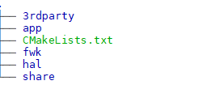

    支付对外提供的接口都是在app里面；3rdparty为三方库；fwk为提供的组件模块，可查看depends.txt按需集成。

    主要关注app目录，其中：

    -   aid\_code：帮助码模块。
    -   bind\_ble：蓝牙绑定模块。
    -   pay\_code：支付模块。
    -   setting：账户设置模块。
    -   trans\_code：乘车码模块。
    -   pay\_result：暂不支持，无需关注。
    -   provision：暂不支持，无需关注。

    app目录结构如[图2](#zh-cn_topic_0000002411047952_fig3727120184714)所示。

    **图 2**  app目录结构<a name="zh-cn_topic_0000002411047952_fig3727120184714"></a>  
    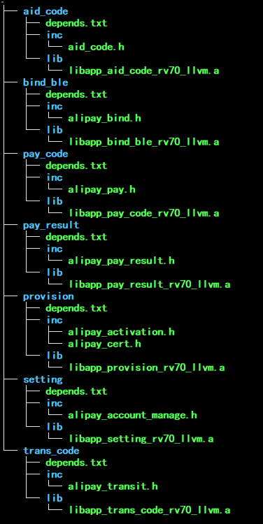

    每一个app目录下面都会有对外头文件、库文件以及depends.txt，depends.txt描述了依赖的组件\(fwk, hal, 3rdparty\)。

2.  **alipay service开发**

    alipay service主要实现了对Alipay-SDK的接口封装、service初始化、消息线程创建等功能，可参考“application\\wearable\\alipay\\service\\alipay\_feature.h”头文件查看函数说明。

    通过alipay\_svr\_get\_api可以获取支付宝提供的app功能接口，也可直接调用Alipay-SDK的接口，其封装后函数结构体如[表1](#zh-cn_topic_0000002411047952_table1813015385517)所示。

    **表 1**  封装alipay-SDK的接口说明

    <a name="zh-cn_topic_0000002411047952_table1813015385517"></a>
    <table><thead align="left"><tr id="zh-cn_topic_0000002411047952_row913163818510"><th class="cellrowborder" valign="top" width="37.46%" id="mcps1.2.3.1.1"><p id="zh-cn_topic_0000002411047952_p161311638455"><a name="zh-cn_topic_0000002411047952_p161311638455"></a><a name="zh-cn_topic_0000002411047952_p161311638455"></a>结构体成员函数</p>
    </th>
    <th class="cellrowborder" valign="top" width="62.53999999999999%" id="mcps1.2.3.1.2"><p id="zh-cn_topic_0000002411047952_p2131133811516"><a name="zh-cn_topic_0000002411047952_p2131133811516"></a><a name="zh-cn_topic_0000002411047952_p2131133811516"></a>功能说明</p>
    </th>
    </tr>
    </thead>
    <tbody><tr id="zh-cn_topic_0000002411047952_row131311638858"><td class="cellrowborder" valign="top" width="37.46%" headers="mcps1.2.3.1.1 "><p id="zh-cn_topic_0000002411047952_p01319381754"><a name="zh-cn_topic_0000002411047952_p01319381754"></a><a name="zh-cn_topic_0000002411047952_p01319381754"></a>set_bt_broadcast</p>
    </td>
    <td class="cellrowborder" valign="top" width="62.53999999999999%" headers="mcps1.2.3.1.2 "><p id="zh-cn_topic_0000002411047952_p413118381358"><a name="zh-cn_topic_0000002411047952_p413118381358"></a><a name="zh-cn_topic_0000002411047952_p413118381358"></a>发起广播或停止广播。</p>
    </td>
    </tr>
    <tr id="zh-cn_topic_0000002411047952_row8131038755"><td class="cellrowborder" valign="top" width="37.46%" headers="mcps1.2.3.1.1 "><p id="zh-cn_topic_0000002411047952_p0131438551"><a name="zh-cn_topic_0000002411047952_p0131438551"></a><a name="zh-cn_topic_0000002411047952_p0131438551"></a>get_logon_id</p>
    </td>
    <td class="cellrowborder" valign="top" width="62.53999999999999%" headers="mcps1.2.3.1.2 "><p id="zh-cn_topic_0000002411047952_p20131113819513"><a name="zh-cn_topic_0000002411047952_p20131113819513"></a><a name="zh-cn_topic_0000002411047952_p20131113819513"></a>获取登录账号ID。</p>
    </td>
    </tr>
    <tr id="zh-cn_topic_0000002411047952_row613110386520"><td class="cellrowborder" valign="top" width="37.46%" headers="mcps1.2.3.1.1 "><p id="zh-cn_topic_0000002411047952_p713163819514"><a name="zh-cn_topic_0000002411047952_p713163819514"></a><a name="zh-cn_topic_0000002411047952_p713163819514"></a>get_nickname</p>
    </td>
    <td class="cellrowborder" valign="top" width="62.53999999999999%" headers="mcps1.2.3.1.2 "><p id="zh-cn_topic_0000002411047952_p1113103814518"><a name="zh-cn_topic_0000002411047952_p1113103814518"></a><a name="zh-cn_topic_0000002411047952_p1113103814518"></a>获取登录账号昵称。</p>
    </td>
    </tr>
    <tr id="zh-cn_topic_0000002411047952_row7131438659"><td class="cellrowborder" valign="top" width="37.46%" headers="mcps1.2.3.1.1 "><p id="zh-cn_topic_0000002411047952_p201314384512"><a name="zh-cn_topic_0000002411047952_p201314384512"></a><a name="zh-cn_topic_0000002411047952_p201314384512"></a>get_bind_state</p>
    </td>
    <td class="cellrowborder" valign="top" width="62.53999999999999%" headers="mcps1.2.3.1.2 "><p id="zh-cn_topic_0000002411047952_p1913173814513"><a name="zh-cn_topic_0000002411047952_p1913173814513"></a><a name="zh-cn_topic_0000002411047952_p1913173814513"></a>获取是否已经绑定，进入应用通过此接口判断是否已经绑定过。</p>
    </td>
    </tr>
    <tr id="zh-cn_topic_0000002411047952_row213114380511"><td class="cellrowborder" valign="top" width="37.46%" headers="mcps1.2.3.1.1 "><p id="zh-cn_topic_0000002411047952_p141311438650"><a name="zh-cn_topic_0000002411047952_p141311438650"></a><a name="zh-cn_topic_0000002411047952_p141311438650"></a>get_bind_status</p>
    </td>
    <td class="cellrowborder" valign="top" width="62.53999999999999%" headers="mcps1.2.3.1.2 "><p id="zh-cn_topic_0000002411047952_p1113116383512"><a name="zh-cn_topic_0000002411047952_p1113116383512"></a><a name="zh-cn_topic_0000002411047952_p1113116383512"></a>获取当前绑定状态，扫码绑定时用于判断当次绑定过程的状态。</p>
    </td>
    </tr>
    <tr id="zh-cn_topic_0000002411047952_row113110381657"><td class="cellrowborder" valign="top" width="37.46%" headers="mcps1.2.3.1.1 "><p id="zh-cn_topic_0000002411047952_p12131113811518"><a name="zh-cn_topic_0000002411047952_p12131113811518"></a><a name="zh-cn_topic_0000002411047952_p12131113811518"></a>bind_start</p>
    </td>
    <td class="cellrowborder" valign="top" width="62.53999999999999%" headers="mcps1.2.3.1.2 "><p id="zh-cn_topic_0000002411047952_p91315381458"><a name="zh-cn_topic_0000002411047952_p91315381458"></a><a name="zh-cn_topic_0000002411047952_p91315381458"></a>初始化Alipay SDK，并通知BT开始发起广播。</p>
    </td>
    </tr>
    <tr id="zh-cn_topic_0000002411047952_row14131143818518"><td class="cellrowborder" valign="top" width="37.46%" headers="mcps1.2.3.1.1 "><p id="zh-cn_topic_0000002411047952_p141311338959"><a name="zh-cn_topic_0000002411047952_p141311338959"></a><a name="zh-cn_topic_0000002411047952_p141311338959"></a>bind_finish</p>
    </td>
    <td class="cellrowborder" valign="top" width="62.53999999999999%" headers="mcps1.2.3.1.2 "><p id="zh-cn_topic_0000002411047952_p181315381553"><a name="zh-cn_topic_0000002411047952_p181315381553"></a><a name="zh-cn_topic_0000002411047952_p181315381553"></a>绑定完成。</p>
    </td>
    </tr>
    <tr id="zh-cn_topic_0000002411047952_row1413113811517"><td class="cellrowborder" valign="top" width="37.46%" headers="mcps1.2.3.1.1 "><p id="zh-cn_topic_0000002411047952_p151314382520"><a name="zh-cn_topic_0000002411047952_p151314382520"></a><a name="zh-cn_topic_0000002411047952_p151314382520"></a>get_bind_str</p>
    </td>
    <td class="cellrowborder" valign="top" width="62.53999999999999%" headers="mcps1.2.3.1.2 "><p id="zh-cn_topic_0000002411047952_p1513110389516"><a name="zh-cn_topic_0000002411047952_p1513110389516"></a><a name="zh-cn_topic_0000002411047952_p1513110389516"></a>获取绑定码，用于生成绑定二维码。</p>
    </td>
    </tr>
    <tr id="zh-cn_topic_0000002411047952_row6131143818513"><td class="cellrowborder" valign="top" width="37.46%" headers="mcps1.2.3.1.1 "><p id="zh-cn_topic_0000002411047952_p5131203816517"><a name="zh-cn_topic_0000002411047952_p5131203816517"></a><a name="zh-cn_topic_0000002411047952_p5131203816517"></a>get_pay_str</p>
    </td>
    <td class="cellrowborder" valign="top" width="62.53999999999999%" headers="mcps1.2.3.1.2 "><p id="zh-cn_topic_0000002411047952_p21317384520"><a name="zh-cn_topic_0000002411047952_p21317384520"></a><a name="zh-cn_topic_0000002411047952_p21317384520"></a>获取付款码，用于生成付款二维码和条形码。</p>
    </td>
    </tr>
    <tr id="zh-cn_topic_0000002411047952_row171311538456"><td class="cellrowborder" valign="top" width="37.46%" headers="mcps1.2.3.1.1 "><p id="zh-cn_topic_0000002411047952_p3131203816513"><a name="zh-cn_topic_0000002411047952_p3131203816513"></a><a name="zh-cn_topic_0000002411047952_p3131203816513"></a>get_aid_str</p>
    </td>
    <td class="cellrowborder" valign="top" width="62.53999999999999%" headers="mcps1.2.3.1.2 "><p id="zh-cn_topic_0000002411047952_p101311138454"><a name="zh-cn_topic_0000002411047952_p101311138454"></a><a name="zh-cn_topic_0000002411047952_p101311138454"></a>获取帮助码，用于生成帮助二维码。</p>
    </td>
    </tr>
    <tr id="zh-cn_topic_0000002411047952_row513173819516"><td class="cellrowborder" valign="top" width="37.46%" headers="mcps1.2.3.1.1 "><p id="zh-cn_topic_0000002411047952_p8131113818510"><a name="zh-cn_topic_0000002411047952_p8131113818510"></a><a name="zh-cn_topic_0000002411047952_p8131113818510"></a>remove_bind</p>
    </td>
    <td class="cellrowborder" valign="top" width="62.53999999999999%" headers="mcps1.2.3.1.2 "><p id="zh-cn_topic_0000002411047952_p191311538858"><a name="zh-cn_topic_0000002411047952_p191311538858"></a><a name="zh-cn_topic_0000002411047952_p191311538858"></a>解绑接口。</p>
    </td>
    </tr>
    <tr id="zh-cn_topic_0000002411047952_row1813111381054"><td class="cellrowborder" valign="top" width="37.46%" headers="mcps1.2.3.1.1 "><p id="zh-cn_topic_0000002411047952_p913183814511"><a name="zh-cn_topic_0000002411047952_p913183814511"></a><a name="zh-cn_topic_0000002411047952_p913183814511"></a>proc_packet</p>
    </td>
    <td class="cellrowborder" valign="top" width="62.53999999999999%" headers="mcps1.2.3.1.2 "><p id="zh-cn_topic_0000002411047952_p1913220382510"><a name="zh-cn_topic_0000002411047952_p1913220382510"></a><a name="zh-cn_topic_0000002411047952_p1913220382510"></a>接收手机端蓝牙消息函数，传递至Alipay-SDK。</p>
    </td>
    </tr>
    <tr id="zh-cn_topic_0000002411047952_row11328386512"><td class="cellrowborder" valign="top" width="37.46%" headers="mcps1.2.3.1.1 "><p id="zh-cn_topic_0000002411047952_p313263819519"><a name="zh-cn_topic_0000002411047952_p313263819519"></a><a name="zh-cn_topic_0000002411047952_p313263819519"></a>exit_lpm</p>
    </td>
    <td class="cellrowborder" valign="top" width="62.53999999999999%" headers="mcps1.2.3.1.2 "><p id="zh-cn_topic_0000002411047952_p41321438158"><a name="zh-cn_topic_0000002411047952_p41321438158"></a><a name="zh-cn_topic_0000002411047952_p41321438158"></a>eSE退出低功耗接口。</p>
    </td>
    </tr>
    <tr id="zh-cn_topic_0000002411047952_row41322382511"><td class="cellrowborder" valign="top" width="37.46%" headers="mcps1.2.3.1.1 "><p id="zh-cn_topic_0000002411047952_p313214381056"><a name="zh-cn_topic_0000002411047952_p313214381056"></a><a name="zh-cn_topic_0000002411047952_p313214381056"></a>enter_lpm</p>
    </td>
    <td class="cellrowborder" valign="top" width="62.53999999999999%" headers="mcps1.2.3.1.2 "><p id="zh-cn_topic_0000002411047952_p1713215381520"><a name="zh-cn_topic_0000002411047952_p1713215381520"></a><a name="zh-cn_topic_0000002411047952_p1713215381520"></a>eSE进入低功耗接口。</p>
    </td>
    </tr>
    <tr id="zh-cn_topic_0000002411047952_row113214381518"><td class="cellrowborder" valign="top" width="37.46%" headers="mcps1.2.3.1.1 "><p id="zh-cn_topic_0000002411047952_p13132938357"><a name="zh-cn_topic_0000002411047952_p13132938357"></a><a name="zh-cn_topic_0000002411047952_p13132938357"></a>get_last_transcode</p>
    </td>
    <td class="cellrowborder" valign="top" width="62.53999999999999%" headers="mcps1.2.3.1.2 "><p id="zh-cn_topic_0000002411047952_p1413213381054"><a name="zh-cn_topic_0000002411047952_p1413213381054"></a><a name="zh-cn_topic_0000002411047952_p1413213381054"></a>获取最近一次使用的乘车码信息，断电后会丢失，注意不是字符串。</p>
    </td>
    </tr>
    <tr id="zh-cn_topic_0000002411047952_row1132183812518"><td class="cellrowborder" valign="top" width="37.46%" headers="mcps1.2.3.1.1 "><p id="zh-cn_topic_0000002411047952_p10132203814510"><a name="zh-cn_topic_0000002411047952_p10132203814510"></a><a name="zh-cn_topic_0000002411047952_p10132203814510"></a>get_local_translist</p>
    </td>
    <td class="cellrowborder" valign="top" width="62.53999999999999%" headers="mcps1.2.3.1.2 "><p id="zh-cn_topic_0000002411047952_p513210385515"><a name="zh-cn_topic_0000002411047952_p513210385515"></a><a name="zh-cn_topic_0000002411047952_p513210385515"></a>获取本地缓存的开通乘车的城市列表。</p>
    </td>
    </tr>
    <tr id="zh-cn_topic_0000002411047952_row171323381457"><td class="cellrowborder" valign="top" width="37.46%" headers="mcps1.2.3.1.1 "><p id="zh-cn_topic_0000002411047952_p71322382517"><a name="zh-cn_topic_0000002411047952_p71322382517"></a><a name="zh-cn_topic_0000002411047952_p71322382517"></a>get_online_translist</p>
    </td>
    <td class="cellrowborder" valign="top" width="62.53999999999999%" headers="mcps1.2.3.1.2 "><p id="zh-cn_topic_0000002411047952_p1713223820514"><a name="zh-cn_topic_0000002411047952_p1713223820514"></a><a name="zh-cn_topic_0000002411047952_p1713223820514"></a>获取服务端的城市列表。</p>
    </td>
    </tr>
    <tr id="zh-cn_topic_0000002411047952_row61322382511"><td class="cellrowborder" valign="top" width="37.46%" headers="mcps1.2.3.1.1 "><p id="zh-cn_topic_0000002411047952_p8132238455"><a name="zh-cn_topic_0000002411047952_p8132238455"></a><a name="zh-cn_topic_0000002411047952_p8132238455"></a>check_trans_cartstatus</p>
    </td>
    <td class="cellrowborder" valign="top" width="62.53999999999999%" headers="mcps1.2.3.1.2 "><p id="zh-cn_topic_0000002411047952_p151327382050"><a name="zh-cn_topic_0000002411047952_p151327382050"></a><a name="zh-cn_topic_0000002411047952_p151327382050"></a>用于检查指定乘车卡的有效性。</p>
    </td>
    </tr>
    <tr id="zh-cn_topic_0000002411047952_row141321381151"><td class="cellrowborder" valign="top" width="37.46%" headers="mcps1.2.3.1.1 "><p id="zh-cn_topic_0000002411047952_p713293817517"><a name="zh-cn_topic_0000002411047952_p713293817517"></a><a name="zh-cn_topic_0000002411047952_p713293817517"></a>update_trans_cardinfo</p>
    </td>
    <td class="cellrowborder" valign="top" width="62.53999999999999%" headers="mcps1.2.3.1.2 "><p id="zh-cn_topic_0000002411047952_p15132738659"><a name="zh-cn_topic_0000002411047952_p15132738659"></a><a name="zh-cn_topic_0000002411047952_p15132738659"></a>更新指定乘车卡的数据。</p>
    </td>
    </tr>
    <tr id="zh-cn_topic_0000002411047952_row156379161486"><td class="cellrowborder" valign="top" width="37.46%" headers="mcps1.2.3.1.1 "><p id="zh-cn_topic_0000002411047952_p1863712162087"><a name="zh-cn_topic_0000002411047952_p1863712162087"></a><a name="zh-cn_topic_0000002411047952_p1863712162087"></a>get_transcode</p>
    </td>
    <td class="cellrowborder" valign="top" width="62.53999999999999%" headers="mcps1.2.3.1.2 "><p id="zh-cn_topic_0000002411047952_p1363731611816"><a name="zh-cn_topic_0000002411047952_p1363731611816"></a><a name="zh-cn_topic_0000002411047952_p1363731611816"></a>获取指定卡的乘车码码流，注意不是字符串。</p>
    </td>
    </tr>
    </tbody>
    </table>

    以上为封装Alipay-SDK的接口部分，除此service还需要提供初始化函数接口uapi\_alipay\_svr\_init。该接口需完成对eSE的HS\_IIC\_Init接口初始化、低功耗RST管脚初始化、以及线程创建等功能。

    > **说明：** 
    >由于支付宝特性依赖于eSE芯片对接，所以当前uapi\_alipay\_svr\_init未加入到系统初始化流程中，故初始化需要执行AT命令：AT^ALIPAYDEBUG，用户可根据需求进行初始化。

3.  **alipay bluetooh模块开发**

    支付宝蓝牙配置要求如下，可参考“vendor\\alipay\_sdk\\alipay\_sec\_sdk\_v3.0.0\\doc”目录下的“支付宝智能穿戴带乘车码SDK对接流程.pdf”。

    -   约定设备端⽀付宝的蓝⽛Service UUID： "00003802-0000-1000-8000-00805f9b34fb"
    -   对应的CHARACTERISTIC UUID： "00004a02-0000-1000-8000-00805f9b34fb"
    -   CHARACTERISTIC权限： PROPERTY\_WRITE + PROPERTY\_READ + PROPERTY\_NOTIFY

    由于IOS获取设备端BLE MAC地址的需求，需要在⼴播包的上述Service UUID的Service data中填⼊MAC地址的Byte数组，让⼿机端可以找到对应设备，两次⼴播最⼤间隔时间不超过2秒。如[图3](#zh-cn_topic_0000002411047952_fig917618504380)所示。

    **图 3**  蓝牙配置信息<a name="zh-cn_topic_0000002411047952_fig917618504380"></a>  
    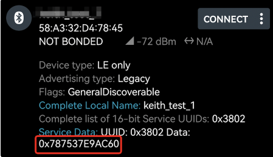

    广播数据如[图4](#zh-cn_topic_0000002411047952_fig72061329153514)所示。

    **图 4**  蓝牙传输数据信息<a name="zh-cn_topic_0000002411047952_fig72061329153514"></a>  
    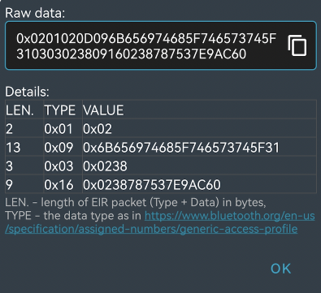

    并在该CHARACTERISTIC下添加descriptors，对应的UUID：00004b02-0000-1000-8000-00805f9b34fb。

    读取对应的Value：MAC地址的Byte数组。如[图5](#zh-cn_topic_0000002411047952_fig20739114714358)所示。

    **图 5**  蓝牙MAC地址信息示例<a name="zh-cn_topic_0000002411047952_fig20739114714358"></a>  
    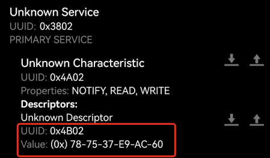

    具体实现可参考“application\\wearable\\alipay\\service\\alipay\_bluetooth.c”文件实现。

### UI应用开发<a name="ZH-CN_TOPIC_0000002516021543"></a>

支付应用主要涉及四个部分，即绑定、支付、设置、帮助界面，当前SDK仅支持离线支付，即穿戴设备端不会获取支付状态，由商家或者手机端感知支付结果。

UI界面需要严格按照支付宝设计稿实现，后续调试完成需要向阿里侧演示验收，设计流程和UI资源可参考“vendor\\alipay\_sdk\\alipay\_sec\_sdk\_v3.0.0\\参考视觉稿\\成人-手表手环-视觉稿-带流程.sketch”。

SDK提供基于UIKit的native应用sample，LVGL需要用户自行开发，可参考“application\\wearable\\nativeapp\\nativeui\\alipay”。

-   **[绑定流程](#ZH-CN_TOPIC_0000002516021491)**  

-   **[支付流程](#ZH-CN_TOPIC_0000002516141485)**  

-   **[设置界面](#ZH-CN_TOPIC_0000002516141569)**  

-   **[帮助界面](#ZH-CN_TOPIC_0000002516141567)**  

-   **[功能列表](#ZH-CN_TOPIC_0000002483741600)**  

#### 绑定流程<a name="ZH-CN_TOPIC_0000002516021491"></a>

绑定流程主要界面为如下5个：

-   绑定界面：

    

-   绑定状态界面（动态）：

    

-   正在绑定滑动跳转界面：

    

-   绑定成功视图：

    

-   绑定失败视图：

    

绑定流程如[图1](#zh-cn_topic_0000002411047956_fig15412291041)所示。

**图 1**  绑定流程示意<a name="zh-cn_topic_0000002411047956_fig15412291041"></a>  
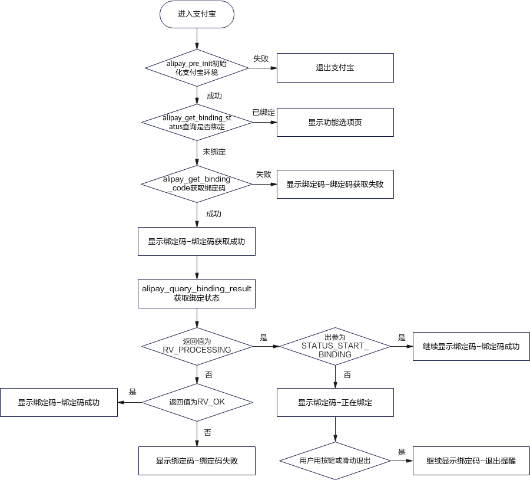

#### 支付流程<a name="ZH-CN_TOPIC_0000002516141485"></a>

支付流程主要页面说明：

-   支付-二维码：

    

-   支付-条形码：

    

支付流程较简单，通过alipay\_get\_paycode获取支付码串，绘制二维码、条形码界面，支持滑动切换和按键切换。

支持点击二维码界面和条形码界面和定时刷新，sample没有做亮屏刷新界面，如需用户可自行实现此功能。

#### 设置界面<a name="ZH-CN_TOPIC_0000002516141569"></a>

设置界面如下：主要是用于用户解绑。

-   设置-信息页面：

    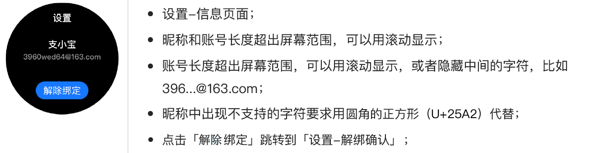

-   设置-解绑确认页面：

    

-   设置-解绑后提醒页面：

    

解绑流程如[图1](#zh-cn_topic_0000002411047940_fig1383718185107)所示。

**图 1**  解绑流程示意<a name="zh-cn_topic_0000002411047940_fig1383718185107"></a>  
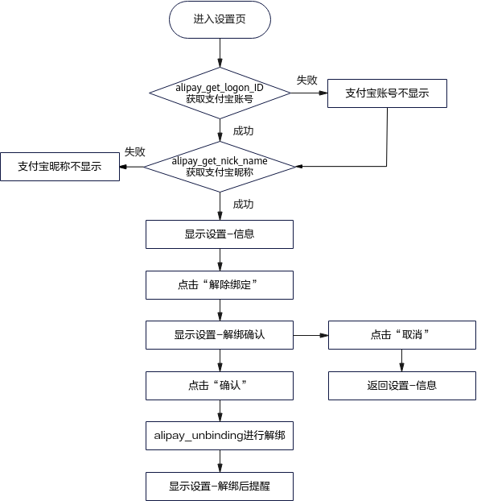

#### 帮助界面<a name="ZH-CN_TOPIC_0000002516141567"></a>

提供帮助码供手机支付宝扫码跳转至手机端帮助界面，视图要求如下：


帮助流程较简单，通过alipay\_get\_aid\_code获取帮助码串生成二维码，供手机端支付宝扫码。

#### 功能列表<a name="ZH-CN_TOPIC_0000002483741600"></a>

手机端支付宝扫绑定码绑定成功后，绑定成功界面三秒后会自动跳转至功能列表界面，如下所示：

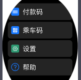

功能列表为LIST界面，点击后跳转至对应应用界面。

## 乘车码（暂不支持）<a name="ZH-CN_TOPIC_0000002483901502"></a>

-   **[方案概述](#ZH-CN_TOPIC_0000002516141463)**  

-   **[穿戴设备端适配指导](#ZH-CN_TOPIC_0000002516141543)**  

-   **[穿戴设备端UI应用开发](#ZH-CN_TOPIC_0000002516141529)**  

-   **[手机端APP开发指导](#ZH-CN_TOPIC_0000002483901592)**  

### 方案概述<a name="ZH-CN_TOPIC_0000002516141463"></a>

乘车码整体方案如[图1](#zh-cn_topic_0000002411207836_fig1780715816276)所示。

**图 1**  乘车码整体方案框图<a name="zh-cn_topic_0000002411207836_fig1780715816276"></a>  
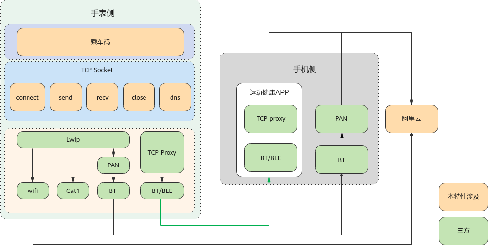

HiDiTingV100使用TCP Proxy&BT/BLE方案采用蓝牙做上网代理，使得手表可以通过蓝牙与手机连接时可以借助手机的联网能力，访问网络服务。

该方案需要手机侧APP实现TCP代理功能，通过手机网络完成与支付宝服务器通讯，获取乘车码相关资源。

HiDiTingV100  SDK版本没有集成lwip能力，最终用户可以根据实际情况适配。

> **须知：** 
>**乘车码特性穿戴设备端硬件准入条件**：
>-   显示屏：屏幕分辨率（DPI）不低于320×320（圆形）或280×280（⽅形）。
>-   ROM：需要放置至少800KB放置乘车码代码（包含quickjs），部署在NorFlash上；1MB的空间放置数据，部署在NandFlash上。
>-   RAM：需要准备25KB栈空间，20KB的堆空间，共45KB的RAM。

### 穿戴设备端适配指导<a name="ZH-CN_TOPIC_0000002516141543"></a>

-   **[vendor\_file适配](#ZH-CN_TOPIC_0000002483741628)**  

-   **[alipay\_net\_kal适配](#ZH-CN_TOPIC_0000002483901600)**  

#### vendor\_file适配<a name="ZH-CN_TOPIC_0000002483741628"></a>

vendor\_file主要用于保存乘车码离线资源以及js脚本。

**表 1**  vendor\_file api

<a name="zh-cn_topic_0000002444646997_table1659818719467"></a>
<table><thead align="left"><tr id="zh-cn_topic_0000002444646997_row95986774611"><th class="cellrowborder" valign="top" width="50%" id="mcps1.2.3.1.1"><p id="zh-cn_topic_0000002444646997_p759817774611"><a name="zh-cn_topic_0000002444646997_p759817774611"></a><a name="zh-cn_topic_0000002444646997_p759817774611"></a>函数名</p>
</th>
<th class="cellrowborder" valign="top" width="50%" id="mcps1.2.3.1.2"><p id="zh-cn_topic_0000002444646997_p105980764612"><a name="zh-cn_topic_0000002444646997_p105980764612"></a><a name="zh-cn_topic_0000002444646997_p105980764612"></a>功能说明</p>
</th>
</tr>
</thead>
<tbody><tr id="zh-cn_topic_0000002444646997_row259814713461"><td class="cellrowborder" valign="top" width="50%" headers="mcps1.2.3.1.1 "><p id="zh-cn_topic_0000002444646997_p35981272465"><a name="zh-cn_topic_0000002444646997_p35981272465"></a><a name="zh-cn_topic_0000002444646997_p35981272465"></a>alipay_open_rsvd_part</p>
</td>
<td class="cellrowborder" valign="top" width="50%" headers="mcps1.2.3.1.2 "><p id="zh-cn_topic_0000002444646997_p0599974465"><a name="zh-cn_topic_0000002444646997_p0599974465"></a><a name="zh-cn_topic_0000002444646997_p0599974465"></a>打开文件名为filename的文件，要求权限为可读写。</p>
</td>
</tr>
<tr id="zh-cn_topic_0000002444646997_row1459915744610"><td class="cellrowborder" valign="top" width="50%" headers="mcps1.2.3.1.1 "><p id="zh-cn_topic_0000002444646997_p1959911717468"><a name="zh-cn_topic_0000002444646997_p1959911717468"></a><a name="zh-cn_topic_0000002444646997_p1959911717468"></a>alipay_write_rsvd_part</p>
</td>
<td class="cellrowborder" valign="top" width="50%" headers="mcps1.2.3.1.2 "><p id="zh-cn_topic_0000002444646997_p6599771468"><a name="zh-cn_topic_0000002444646997_p6599771468"></a><a name="zh-cn_topic_0000002444646997_p6599771468"></a>往文件中写数据。</p>
</td>
</tr>
<tr id="zh-cn_topic_0000002444646997_row105991876461"><td class="cellrowborder" valign="top" width="50%" headers="mcps1.2.3.1.1 "><p id="zh-cn_topic_0000002444646997_p17599878462"><a name="zh-cn_topic_0000002444646997_p17599878462"></a><a name="zh-cn_topic_0000002444646997_p17599878462"></a>alipay_read_rsvd_part</p>
</td>
<td class="cellrowborder" valign="top" width="50%" headers="mcps1.2.3.1.2 "><p id="zh-cn_topic_0000002444646997_p7599157134618"><a name="zh-cn_topic_0000002444646997_p7599157134618"></a><a name="zh-cn_topic_0000002444646997_p7599157134618"></a>从提供给alipay kv存储的文件中读取数据。</p>
</td>
</tr>
<tr id="zh-cn_topic_0000002444646997_row359914744612"><td class="cellrowborder" valign="top" width="50%" headers="mcps1.2.3.1.1 "><p id="zh-cn_topic_0000002444646997_p1259910710461"><a name="zh-cn_topic_0000002444646997_p1259910710461"></a><a name="zh-cn_topic_0000002444646997_p1259910710461"></a>alipay_close_rsvd_part</p>
</td>
<td class="cellrowborder" valign="top" width="50%" headers="mcps1.2.3.1.2 "><p id="zh-cn_topic_0000002444646997_p195999784613"><a name="zh-cn_topic_0000002444646997_p195999784613"></a><a name="zh-cn_topic_0000002444646997_p195999784613"></a>关闭打开的文件。</p>
</td>
</tr>
<tr id="zh-cn_topic_0000002444646997_row105677459463"><td class="cellrowborder" valign="top" width="50%" headers="mcps1.2.3.1.1 "><p id="zh-cn_topic_0000002444646997_p15681745134610"><a name="zh-cn_topic_0000002444646997_p15681745134610"></a><a name="zh-cn_topic_0000002444646997_p15681745134610"></a>alipay_access_rsvd_part</p>
</td>
<td class="cellrowborder" valign="top" width="50%" headers="mcps1.2.3.1.2 "><p id="zh-cn_topic_0000002444646997_p95681457461"><a name="zh-cn_topic_0000002444646997_p95681457461"></a><a name="zh-cn_topic_0000002444646997_p95681457461"></a>查看文件是否存在。</p>
</td>
</tr>
<tr id="zh-cn_topic_0000002444646997_row19854553460"><td class="cellrowborder" valign="top" width="50%" headers="mcps1.2.3.1.1 "><p id="zh-cn_topic_0000002444646997_p8985205584617"><a name="zh-cn_topic_0000002444646997_p8985205584617"></a><a name="zh-cn_topic_0000002444646997_p8985205584617"></a>alipay_remove_rsvd_part</p>
</td>
<td class="cellrowborder" valign="top" width="50%" headers="mcps1.2.3.1.2 "><p id="zh-cn_topic_0000002444646997_p10985955144614"><a name="zh-cn_topic_0000002444646997_p10985955144614"></a><a name="zh-cn_topic_0000002444646997_p10985955144614"></a>删除文件。</p>
</td>
</tr>
<tr id="zh-cn_topic_0000002444646997_row18491220478"><td class="cellrowborder" valign="top" width="50%" headers="mcps1.2.3.1.1 "><p id="zh-cn_topic_0000002444646997_p18501426473"><a name="zh-cn_topic_0000002444646997_p18501426473"></a><a name="zh-cn_topic_0000002444646997_p18501426473"></a>alipay_clear_rsvd_part</p>
</td>
<td class="cellrowborder" valign="top" width="50%" headers="mcps1.2.3.1.2 "><p id="zh-cn_topic_0000002444646997_p1785013254713"><a name="zh-cn_topic_0000002444646997_p1785013254713"></a><a name="zh-cn_topic_0000002444646997_p1785013254713"></a>清除所有通过alipay_write_rsvd_part存储的alipay文件。</p>
</td>
</tr>
</tbody>
</table>

适配代码路径：application\\wearable\\alipay\\driver\_adapt\\vendor\_file.c

sdk自带测试代码路径：vendor\\alipay\_sdk\\alipay\_sec\_sdk\_v3.0.0\\lib\\rv70\_llvm\\hal\\file\\sample\\test\_file.c

#### alipay\_net\_kal适配<a name="ZH-CN_TOPIC_0000002483901600"></a>

alipay\_net\_kal主要适配TCP相关接口（UDP不支持）。板端使用diag协议完成与手机APK交互，实现TCP对应接口，具体帧格式请参见《穿戴类产品对外交互协议》的“阿里乘车码”章节。

**表 1**  alipay\_net\_kal api

<a name="zh-cn_topic_0000002411207792_table83435725218"></a>
<table><thead align="left"><tr id="zh-cn_topic_0000002411207792_row934357145213"><th class="cellrowborder" valign="top" width="50%" id="mcps1.2.3.1.1"><p id="zh-cn_topic_0000002411207792_p4341957145215"><a name="zh-cn_topic_0000002411207792_p4341957145215"></a><a name="zh-cn_topic_0000002411207792_p4341957145215"></a>函数名</p>
</th>
<th class="cellrowborder" valign="top" width="50%" id="mcps1.2.3.1.2"><p id="zh-cn_topic_0000002411207792_p1134957115210"><a name="zh-cn_topic_0000002411207792_p1134957115210"></a><a name="zh-cn_topic_0000002411207792_p1134957115210"></a>功能说明</p>
</th>
</tr>
</thead>
<tbody><tr id="zh-cn_topic_0000002411207792_row53445713526"><td class="cellrowborder" valign="top" width="50%" headers="mcps1.2.3.1.1 "><p id="zh-cn_topic_0000002411207792_p197462613316"><a name="zh-cn_topic_0000002411207792_p197462613316"></a><a name="zh-cn_topic_0000002411207792_p197462613316"></a>alipay_iot_gettimeofday</p>
</td>
<td class="cellrowborder" valign="top" width="50%" headers="mcps1.2.3.1.2 "><p id="zh-cn_topic_0000002411207792_p17765634184118"><a name="zh-cn_topic_0000002411207792_p17765634184118"></a><a name="zh-cn_topic_0000002411207792_p17765634184118"></a>获取UTC时间。</p>
</td>
</tr>
<tr id="zh-cn_topic_0000002411207792_row163405745213"><td class="cellrowborder" valign="top" width="50%" headers="mcps1.2.3.1.1 "><p id="zh-cn_topic_0000002411207792_p1630755783313"><a name="zh-cn_topic_0000002411207792_p1630755783313"></a><a name="zh-cn_topic_0000002411207792_p1630755783313"></a>alipay_iot_get_local_time</p>
</td>
<td class="cellrowborder" valign="top" width="50%" headers="mcps1.2.3.1.2 "><p id="zh-cn_topic_0000002411207792_p776940114111"><a name="zh-cn_topic_0000002411207792_p776940114111"></a><a name="zh-cn_topic_0000002411207792_p776940114111"></a>获取系统当前时间。</p>
</td>
</tr>
<tr id="zh-cn_topic_0000002411207792_row193455795213"><td class="cellrowborder" valign="top" width="50%" headers="mcps1.2.3.1.1 "><p id="zh-cn_topic_0000002411207792_p1668416514341"><a name="zh-cn_topic_0000002411207792_p1668416514341"></a><a name="zh-cn_topic_0000002411207792_p1668416514341"></a>alipay_task_sleep</p>
</td>
<td class="cellrowborder" valign="top" width="50%" headers="mcps1.2.3.1.2 "><p id="zh-cn_topic_0000002411207792_p146671850154119"><a name="zh-cn_topic_0000002411207792_p146671850154119"></a><a name="zh-cn_topic_0000002411207792_p146671850154119"></a>使任务休眠时间，单位：ms。</p>
</td>
</tr>
<tr id="zh-cn_topic_0000002411207792_row63412573523"><td class="cellrowborder" valign="top" width="50%" headers="mcps1.2.3.1.1 "><p id="zh-cn_topic_0000002411207792_p1142319433818"><a name="zh-cn_topic_0000002411207792_p1142319433818"></a><a name="zh-cn_topic_0000002411207792_p1142319433818"></a>alipay_iot_dns</p>
</td>
<td class="cellrowborder" valign="top" width="50%" headers="mcps1.2.3.1.2 "><p id="zh-cn_topic_0000002411207792_p1534195755210"><a name="zh-cn_topic_0000002411207792_p1534195755210"></a><a name="zh-cn_topic_0000002411207792_p1534195755210"></a>域名解析，返回IPv4地址。</p>
</td>
</tr>
<tr id="zh-cn_topic_0000002411207792_row634145715210"><td class="cellrowborder" valign="top" width="50%" headers="mcps1.2.3.1.1 "><p id="zh-cn_topic_0000002411207792_p1113516916382"><a name="zh-cn_topic_0000002411207792_p1113516916382"></a><a name="zh-cn_topic_0000002411207792_p1113516916382"></a>alipay_iot_socket_create</p>
</td>
<td class="cellrowborder" valign="top" width="50%" headers="mcps1.2.3.1.2 "><p id="zh-cn_topic_0000002411207792_p7374425443"><a name="zh-cn_topic_0000002411207792_p7374425443"></a><a name="zh-cn_topic_0000002411207792_p7374425443"></a>创建套接口。</p>
</td>
</tr>
<tr id="zh-cn_topic_0000002411207792_row33417578523"><td class="cellrowborder" valign="top" width="50%" headers="mcps1.2.3.1.1 "><p id="zh-cn_topic_0000002411207792_p4677111514381"><a name="zh-cn_topic_0000002411207792_p4677111514381"></a><a name="zh-cn_topic_0000002411207792_p4677111514381"></a>alipay_iot_socket_connect</p>
</td>
<td class="cellrowborder" valign="top" width="50%" headers="mcps1.2.3.1.2 "><p id="zh-cn_topic_0000002411207792_p1860144915453"><a name="zh-cn_topic_0000002411207792_p1860144915453"></a><a name="zh-cn_topic_0000002411207792_p1860144915453"></a>向指定地址发起连接。</p>
</td>
</tr>
<tr id="zh-cn_topic_0000002411207792_row62746262384"><td class="cellrowborder" valign="top" width="50%" headers="mcps1.2.3.1.1 "><p id="zh-cn_topic_0000002411207792_p519883573818"><a name="zh-cn_topic_0000002411207792_p519883573818"></a><a name="zh-cn_topic_0000002411207792_p519883573818"></a>alipay_iot_socket_write</p>
</td>
<td class="cellrowborder" valign="top" width="50%" headers="mcps1.2.3.1.2 "><p id="zh-cn_topic_0000002411207792_p1874314954614"><a name="zh-cn_topic_0000002411207792_p1874314954614"></a><a name="zh-cn_topic_0000002411207792_p1874314954614"></a>发送数据。</p>
</td>
</tr>
<tr id="zh-cn_topic_0000002411207792_row39161629173817"><td class="cellrowborder" valign="top" width="50%" headers="mcps1.2.3.1.1 "><p id="zh-cn_topic_0000002411207792_p102331342173816"><a name="zh-cn_topic_0000002411207792_p102331342173816"></a><a name="zh-cn_topic_0000002411207792_p102331342173816"></a>alipay_iot_fd_isset</p>
</td>
<td class="cellrowborder" valign="top" width="50%" headers="mcps1.2.3.1.2 "><p id="zh-cn_topic_0000002411207792_p124911621174219"><a name="zh-cn_topic_0000002411207792_p124911621174219"></a><a name="zh-cn_topic_0000002411207792_p124911621174219"></a>检查fdset中对应的fd是否有被selected。</p>
</td>
</tr>
<tr id="zh-cn_topic_0000002411207792_row1180933303814"><td class="cellrowborder" valign="top" width="50%" headers="mcps1.2.3.1.1 "><p id="zh-cn_topic_0000002411207792_p138536476386"><a name="zh-cn_topic_0000002411207792_p138536476386"></a><a name="zh-cn_topic_0000002411207792_p138536476386"></a>alipay_iot_fd_setbit</p>
</td>
<td class="cellrowborder" valign="top" width="50%" headers="mcps1.2.3.1.2 "><p id="zh-cn_topic_0000002411207792_p98092335389"><a name="zh-cn_topic_0000002411207792_p98092335389"></a><a name="zh-cn_topic_0000002411207792_p98092335389"></a>fdset置位。</p>
</td>
</tr>
<tr id="zh-cn_topic_0000002411207792_row474175693820"><td class="cellrowborder" valign="top" width="50%" headers="mcps1.2.3.1.1 "><p id="zh-cn_topic_0000002411207792_p11691958113817"><a name="zh-cn_topic_0000002411207792_p11691958113817"></a><a name="zh-cn_topic_0000002411207792_p11691958113817"></a>alipay_iot_fd_zero</p>
</td>
<td class="cellrowborder" valign="top" width="50%" headers="mcps1.2.3.1.2 "><p id="zh-cn_topic_0000002411207792_p1874213567385"><a name="zh-cn_topic_0000002411207792_p1874213567385"></a><a name="zh-cn_topic_0000002411207792_p1874213567385"></a>fdset清零。</p>
</td>
</tr>
<tr id="zh-cn_topic_0000002411207792_row12286663912"><td class="cellrowborder" valign="top" width="50%" headers="mcps1.2.3.1.1 "><p id="zh-cn_topic_0000002411207792_p16613167133916"><a name="zh-cn_topic_0000002411207792_p16613167133916"></a><a name="zh-cn_topic_0000002411207792_p16613167133916"></a>alipay_iot_select</p>
</td>
<td class="cellrowborder" valign="top" width="50%" headers="mcps1.2.3.1.2 "><p id="zh-cn_topic_0000002411207792_p1922846113917"><a name="zh-cn_topic_0000002411207792_p1922846113917"></a><a name="zh-cn_topic_0000002411207792_p1922846113917"></a>检查socket事件。</p>
</td>
</tr>
<tr id="zh-cn_topic_0000002411207792_row16251130134111"><td class="cellrowborder" valign="top" width="50%" headers="mcps1.2.3.1.1 "><p id="zh-cn_topic_0000002411207792_p26351717416"><a name="zh-cn_topic_0000002411207792_p26351717416"></a><a name="zh-cn_topic_0000002411207792_p26351717416"></a>alipay_iot_socket_read</p>
</td>
<td class="cellrowborder" valign="top" width="50%" headers="mcps1.2.3.1.2 "><p id="zh-cn_topic_0000002411207792_p1076632114467"><a name="zh-cn_topic_0000002411207792_p1076632114467"></a><a name="zh-cn_topic_0000002411207792_p1076632114467"></a>接收数据。</p>
</td>
</tr>
<tr id="zh-cn_topic_0000002411207792_row3551161274113"><td class="cellrowborder" valign="top" width="50%" headers="mcps1.2.3.1.1 "><p id="zh-cn_topic_0000002411207792_p1383891315414"><a name="zh-cn_topic_0000002411207792_p1383891315414"></a><a name="zh-cn_topic_0000002411207792_p1383891315414"></a>alipay_iot_socket_close</p>
</td>
<td class="cellrowborder" valign="top" width="50%" headers="mcps1.2.3.1.2 "><p id="zh-cn_topic_0000002411207792_p14940151484414"><a name="zh-cn_topic_0000002411207792_p14940151484414"></a><a name="zh-cn_topic_0000002411207792_p14940151484414"></a>关闭套接口。</p>
</td>
</tr>
</tbody>
</table>

适配代码路径：application\\wearable\\alipay\\driver\_adapt\\vendor\_net.c

sdk自带测试代码路径：vendor\\alipay\_sdk\\alipay\_sec\_sdk\_v3.0.0\\lib\\rv70\_llvm\\hal\\network\\sample\\test\_network.c

### 穿戴设备端UI应用开发<a name="ZH-CN_TOPIC_0000002516141529"></a>

乘车码视图是从功能列表界面跳转，主要包含卡列表页、乘车码页面、未开通引导页、提示页。

UI界面需要严格按照支付宝设计稿实现，后续调试完成需要向阿里侧演示验收，设计流程和UI资源可参考“vendor\\alipay\_sdk\\alipay\_sec\_sdk\_v3.0.0\\参考视觉稿\\成人-手表手环-视觉稿-带流程.sketch”。

SDK提供基于UIKit的native应用sample，LVGL需要用户自行开发，可参考“application\\wearable\\nativeapp\\nativeui\\alipay”。

主要界面如下：

-   卡列表页

    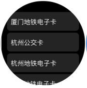

    乘车码列表不为空时显示，点击乘车卡跳转对应城市乘车码界面，alipay-SDK最大支持20个数据。

-   乘车码页面

    

    二维码纠错等级L，不同城市的二维码须保持大小一致；点击“切换交通卡”返回乘车码列表页面。

-   乘车码开通引导页

    

    二维码纠错等级L，手机端支付宝未开通乘车码，乘车码列表为空跳转界面。滑动可返回功能选择页。

    未开通引导⻚码值为固定url scheme: alipays://platformapi/startapp?appId=20002047&scene=bus。

-   首次使用引导页

    

    首次使用，点击“退出”返回功能选择页；点击“已完成”从服务端获取乘车码列表。

-   错误提示页

    

    错误提示页，根据不同调用接口的返回错误码，跳转至不同的错误提示页，具体参考“成人-手表手环-视觉稿-带流程.sketch”。

乘车码流程如[图1](#zh-cn_topic_0000002444727057_fig166281492292)所示。

**图 1**  乘车码流程图<a name="zh-cn_topic_0000002444727057_fig166281492292"></a>  
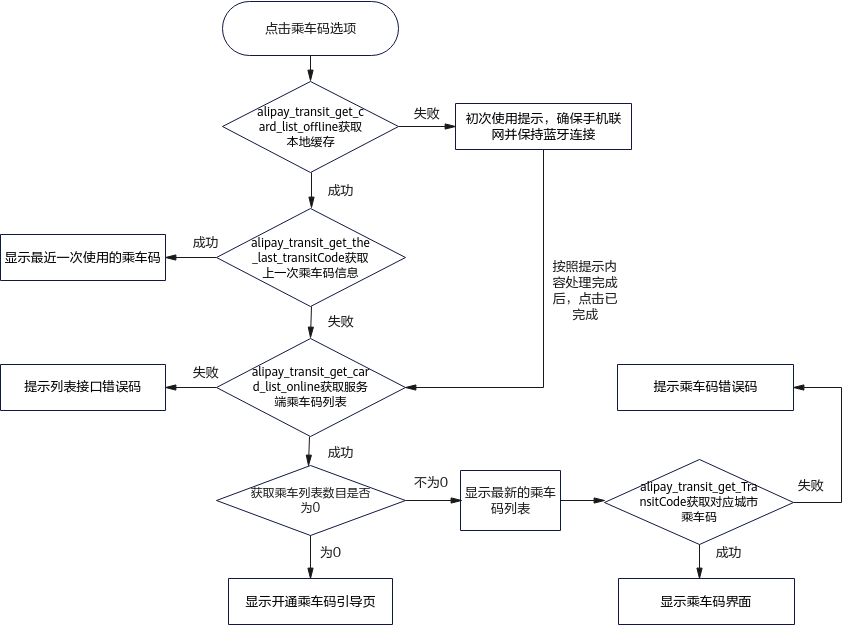

> **须知：** 
>异步更新可以减少蓝⽛上⽹通道状态的不确定性，尽量在适当时机去触发卡列表和卡信息的提前更新，防⽌在⽤户实际使⽤时⽹络没连或连接不稳定导致的体验和可⽤性问题。
>当前sample没有提供异步流程。建议用户根据自身需求，定制异步更新策略。

异步更新流程如[图2](#zh-cn_topic_0000002444727057_fig684204033711)所示。

**图 2**  异步更新流程图<a name="zh-cn_topic_0000002444727057_fig684204033711"></a>  
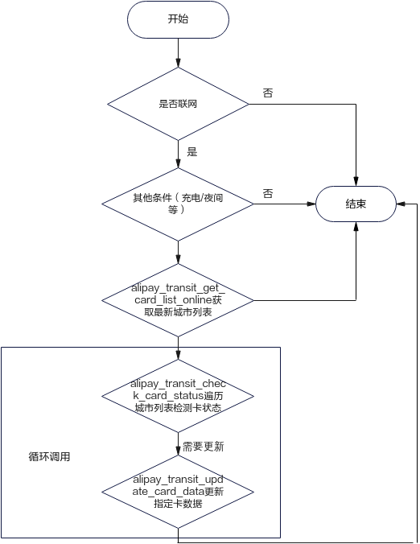

> **说明：** 
>更新条件：
>1.  本地⽆缓存；
>2.  过期时间在未来12⼩时内；
>3.  剩余使⽤次数低于4次。
>以上条件满⾜任何⼀条，建议触发更新。

### 手机端APP开发指导<a name="ZH-CN_TOPIC_0000002483901592"></a>

-   **[概述](#ZH-CN_TOPIC_0000002483901490)**  

-   **[功能描述](#ZH-CN_TOPIC_0000002483901512)**  

-   **[手机侧socket示例代码讲解](#ZH-CN_TOPIC_0000002483901594)**  

-   **[蓝牙指令&socket交互示例代码讲解](#ZH-CN_TOPIC_0000002483901552)**  

#### 概述<a name="ZH-CN_TOPIC_0000002483901490"></a>

本章节主要介绍手机侧APK适配socket代理对接阿里服务器的示例代码指导，**仅用于给客户参考，不可直接用于商用**。

#### 功能描述<a name="ZH-CN_TOPIC_0000002483901512"></a>

-   实现手机侧socket的连接、发送指令、接收指令、关闭、DNS解析功能。
-   实现手机给手表发送网络状态指令请求帧、应答帧。
-   实现接收解析手表给手机发送域名解析请求指令请求帧、发送应答帧。
-   实现接收解析手表给手机发送connect指令请求帧、发送应答帧。
-   实现接收解析手表给手机发送tcp上网请求的请求帧、发送应答帧。
-   实现手机给手表回复服务器tcp响应数据请求帧、应答帧。
-   实现接收解析手表给手机发送tcp close指令的请求帧、发送应答帧。

#### 手机侧socket示例代码讲解<a name="ZH-CN_TOPIC_0000002483901594"></a>

示例代码路径：WearTest\\app\\src\\main\\java\\com\\wrtm\\weartest\\serverclient\\ClientSocket.java

-   **[socket类成员](#ZH-CN_TOPIC_0000002483901570)**  

-   **[构造函数](#ZH-CN_TOPIC_0000002516021521)**  

-   **[类属性设置函数](#ZH-CN_TOPIC_0000002483901590)**  

-   **[socket连接调用接口](#ZH-CN_TOPIC_0000002483741620)**  

-   **[socket发送数据调用接口](#ZH-CN_TOPIC_0000002516141549)**  

-   **[socket数据接收接口](#ZH-CN_TOPIC_0000002516141495)**  

-   **[关闭客户端socket接口](#ZH-CN_TOPIC_0000002516021537)**  

-   **[DNS域名解析功能](#ZH-CN_TOPIC_0000002516141475)**  

##### socket类成员<a name="ZH-CN_TOPIC_0000002483901570"></a>

socket类成员变量含义如[表1](#zh-cn_topic_0000002411207776_table48441014133215)所示。

**表 1**  socket类成员变量含义

<a name="zh-cn_topic_0000002411207776_table48441014133215"></a>
<table><thead align="left"><tr id="zh-cn_topic_0000002411207776_row1084431493217"><th class="cellrowborder" valign="top" width="56.08%" id="mcps1.2.3.1.1"><p id="zh-cn_topic_0000002411207776_p5844214113211"><a name="zh-cn_topic_0000002411207776_p5844214113211"></a><a name="zh-cn_topic_0000002411207776_p5844214113211"></a>socket类成员变量</p>
</th>
<th class="cellrowborder" valign="top" width="43.919999999999995%" id="mcps1.2.3.1.2"><p id="zh-cn_topic_0000002411207776_p984413141320"><a name="zh-cn_topic_0000002411207776_p984413141320"></a><a name="zh-cn_topic_0000002411207776_p984413141320"></a>说明</p>
</th>
</tr>
</thead>
<tbody><tr id="zh-cn_topic_0000002411207776_row198441914103218"><td class="cellrowborder" valign="top" width="56.08%" headers="mcps1.2.3.1.1 "><p id="zh-cn_topic_0000002411207776_p20844191443218"><a name="zh-cn_topic_0000002411207776_p20844191443218"></a><a name="zh-cn_topic_0000002411207776_p20844191443218"></a><strong id="zh-cn_topic_0000002411207776_b76028374322"><a name="zh-cn_topic_0000002411207776_b76028374322"></a><a name="zh-cn_topic_0000002411207776_b76028374322"></a>private </strong>Socket <strong id="zh-cn_topic_0000002411207776_b136021737183217"><a name="zh-cn_topic_0000002411207776_b136021737183217"></a><a name="zh-cn_topic_0000002411207776_b136021737183217"></a>clientSocket </strong>= <strong id="zh-cn_topic_0000002411207776_b1060212375329"><a name="zh-cn_topic_0000002411207776_b1060212375329"></a><a name="zh-cn_topic_0000002411207776_b1060212375329"></a>null</strong>;</p>
</td>
<td class="cellrowborder" valign="top" width="43.919999999999995%" headers="mcps1.2.3.1.2 "><p id="zh-cn_topic_0000002411207776_p168441014123218"><a name="zh-cn_topic_0000002411207776_p168441014123218"></a><a name="zh-cn_topic_0000002411207776_p168441014123218"></a>socket对象。</p>
</td>
</tr>
<tr id="zh-cn_topic_0000002411207776_row108442145328"><td class="cellrowborder" valign="top" width="56.08%" headers="mcps1.2.3.1.1 "><p id="zh-cn_topic_0000002411207776_p5844131483212"><a name="zh-cn_topic_0000002411207776_p5844131483212"></a><a name="zh-cn_topic_0000002411207776_p5844131483212"></a><strong id="zh-cn_topic_0000002411207776_b1325318113339"><a name="zh-cn_topic_0000002411207776_b1325318113339"></a><a name="zh-cn_topic_0000002411207776_b1325318113339"></a>private </strong>String <strong id="zh-cn_topic_0000002411207776_b13253161117336"><a name="zh-cn_topic_0000002411207776_b13253161117336"></a><a name="zh-cn_topic_0000002411207776_b13253161117336"></a>serverAddress</strong>;</p>
</td>
<td class="cellrowborder" valign="top" width="43.919999999999995%" headers="mcps1.2.3.1.2 "><p id="zh-cn_topic_0000002411207776_p108441141323"><a name="zh-cn_topic_0000002411207776_p108441141323"></a><a name="zh-cn_topic_0000002411207776_p108441141323"></a>服务器IP地址。</p>
</td>
</tr>
<tr id="zh-cn_topic_0000002411207776_row684401473219"><td class="cellrowborder" valign="top" width="56.08%" headers="mcps1.2.3.1.1 "><p id="zh-cn_topic_0000002411207776_p1084461473218"><a name="zh-cn_topic_0000002411207776_p1084461473218"></a><a name="zh-cn_topic_0000002411207776_p1084461473218"></a><strong id="zh-cn_topic_0000002411207776_b164013153339"><a name="zh-cn_topic_0000002411207776_b164013153339"></a><a name="zh-cn_topic_0000002411207776_b164013153339"></a>private int serverPort</strong>;</p>
</td>
<td class="cellrowborder" valign="top" width="43.919999999999995%" headers="mcps1.2.3.1.2 "><p id="zh-cn_topic_0000002411207776_p284441416322"><a name="zh-cn_topic_0000002411207776_p284441416322"></a><a name="zh-cn_topic_0000002411207776_p284441416322"></a>服务器端口号。</p>
</td>
</tr>
<tr id="zh-cn_topic_0000002411207776_row58441914153212"><td class="cellrowborder" valign="top" width="56.08%" headers="mcps1.2.3.1.1 "><p id="zh-cn_topic_0000002411207776_p18441214123214"><a name="zh-cn_topic_0000002411207776_p18441214123214"></a><a name="zh-cn_topic_0000002411207776_p18441214123214"></a><strong id="zh-cn_topic_0000002411207776_b146431320153314"><a name="zh-cn_topic_0000002411207776_b146431320153314"></a><a name="zh-cn_topic_0000002411207776_b146431320153314"></a>private boolean isLoopReveiveData </strong>= <strong id="zh-cn_topic_0000002411207776_b2643192017337"><a name="zh-cn_topic_0000002411207776_b2643192017337"></a><a name="zh-cn_topic_0000002411207776_b2643192017337"></a>true</strong>;</p>
</td>
<td class="cellrowborder" valign="top" width="43.919999999999995%" headers="mcps1.2.3.1.2 "><p id="zh-cn_topic_0000002411207776_p1844314153215"><a name="zh-cn_topic_0000002411207776_p1844314153215"></a><a name="zh-cn_topic_0000002411207776_p1844314153215"></a>是否循环读取数据。</p>
</td>
</tr>
<tr id="zh-cn_topic_0000002411207776_row1397415565324"><td class="cellrowborder" valign="top" width="56.08%" headers="mcps1.2.3.1.1 "><p id="zh-cn_topic_0000002411207776_p1397513567329"><a name="zh-cn_topic_0000002411207776_p1397513567329"></a><a name="zh-cn_topic_0000002411207776_p1397513567329"></a><strong id="zh-cn_topic_0000002411207776_b12152723319"><a name="zh-cn_topic_0000002411207776_b12152723319"></a><a name="zh-cn_topic_0000002411207776_b12152723319"></a>private </strong>AliSocketStatusListener <strong id="zh-cn_topic_0000002411207776_b2211227133312"><a name="zh-cn_topic_0000002411207776_b2211227133312"></a><a name="zh-cn_topic_0000002411207776_b2211227133312"></a>onSocketStatusListener</strong>;</p>
</td>
<td class="cellrowborder" valign="top" width="43.919999999999995%" headers="mcps1.2.3.1.2 "><p id="zh-cn_topic_0000002411207776_p29759560324"><a name="zh-cn_topic_0000002411207776_p29759560324"></a><a name="zh-cn_topic_0000002411207776_p29759560324"></a>socket处理回调函数。</p>
</td>
</tr>
</tbody>
</table>

接口定义在socket处理回调函数的“WearTest\\app\\src\\main\\java\\com\\wrtm\\weartest\\componentinterface\\AliSocketStatusListener.java”里，接口功能如下：

```
public interface AliSocketStatusListener {
    /**
     * socket连接成功
     */
    void socketClientConnectSuccess();

    /**
     * socket连接失败
     */
    void socketClientConnectFailed();

    /**
     * socket连接异常
     */
    void socketClientConnectException();

    /**
     * socket通道发送数据成功
     *
     * @param msg byte[]
     */
    void socketClientSend(byte[] msg);

    /**
     * socket通道发送数据失败
     *
     * @param msg byte[]
     */
    void socketClientSendFailed(byte[] msg);

    /**
     * socket通道接收数据成功
     *
     * @param buf 响应内容
     */
    void socketClientRecieveSuccess(byte[] buf);

    /**
     * socket通道接收数据失败
     *
     * @param msg 失败原因
     */
    void socketClientRecieveFailed(String msg);

    /**
     * socket通道接收数据异常
     */
    void socketClientRecieveException();

    /**
     * socket关闭成功
     */
    void socketCloseSucess();

    /**
     * socket关闭失败
     */
    void socketCloseFailed();
 }
```

##### 构造函数<a name="ZH-CN_TOPIC_0000002516021521"></a>

外部类实例化时会生成socket对象：

```
public ClientSocket() {
    clientSocket = new Socket();
}
```

##### 类属性设置函数<a name="ZH-CN_TOPIC_0000002483901590"></a>

-   外部调用：用于设置socket receive是否循环接收数据，参数为true则socket会一直接收数据、参数为false则socket不会再接收数据。

    ```
    public void setLoopReveiveData(boolean isLoopReveiveData) {
        this.isLoopReveiveData = isLoopReveiveData;
     }
    ```

-   外部调用：用于设置socket各个状态的回调函数。

    ```
    public void setOnSocketStatusListener(AliSocketStatusListener setOnSocketStatusListener) {
        this.onSocketStatusListener = setOnSocketStatusListener;
     }
    ```

-   外部调用：用于设置socket连接服务器的地址。

    ```
    public void setServerAddress(String serverAddress) {
        this.serverAddress = serverAddress;
     }
    ```

-   外部调用：用于设置socket连接服务器的端口号。

    ```
    public void setServerPort(int serverPort) {
        this.serverPort = serverPort;
     }
    ```

##### socket连接调用接口<a name="ZH-CN_TOPIC_0000002483741620"></a>

```
/**
 * socket连接
 */
public void connectSocket() {
    new ConnectSocketThread().start();
}
```

##### socket发送数据调用接口<a name="ZH-CN_TOPIC_0000002516141549"></a>

```
/**
 * 发送数据给服务
 *
 * @param data byte数组
 */
public void senddataToserver(byte[] data) {
    new SendDataToServerThread(data).start();
 }
```

##### socket数据接收接口<a name="ZH-CN_TOPIC_0000002516141495"></a>

```
/**
 * 从服务循环接收数据
 */
public void receiveLoopDataFromServer() {
    new ReceiveLoopDataFromServerThread().start();
 }
```

##### 关闭客户端socket接口<a name="ZH-CN_TOPIC_0000002516021537"></a>

```
/**
 * 关闭客户端socket
 */
public void closeClientSocket() {
    new CloseClientSocketThread().start();
 }
```

##### DNS域名解析功能<a name="ZH-CN_TOPIC_0000002516141475"></a>

示例代码路径：WearTest\\app\\src\\main\\java\\com\\wrtm\\weartest\\componentsactivity\\TransportationCodeActivity.java

DNS域名解析功能接口：

```
private void getIPInetAddress(String domain) {
    new GetIpThread(domain).start();
 }
```

入参为域名，解析出域名的IPv4地址。

#### 蓝牙指令&socket交互示例代码讲解<a name="ZH-CN_TOPIC_0000002483901552"></a>

**图 1**  蓝牙diag指令和手机侧socket交互指令流程<a name="zh-cn_topic_0000002411207804_fig092713495202"></a>  
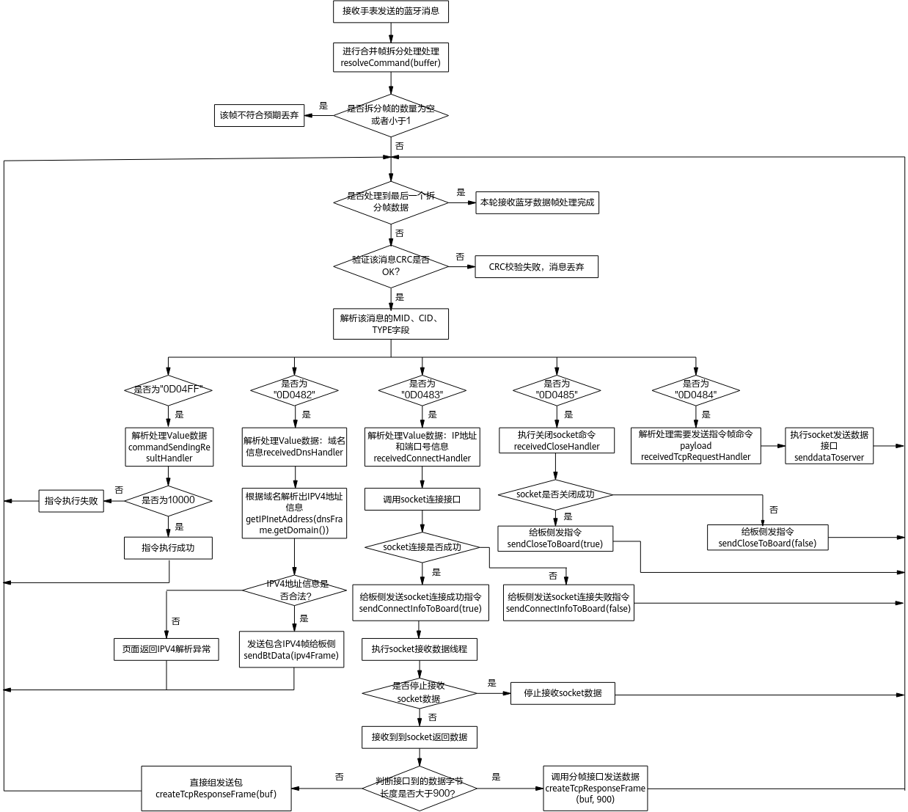

该接口处理每次收到手表侧发来的蓝牙消息处理流程如下所示，参数buffer为蓝牙SPP通道接收到的数据帧，详细说明如下。

```
private void originResponseHandler(byte[] buffer) {
    try {
        //用于存储CRC校验通过符合规则的数据帧
        List<byte[]> availableCommandList;
        /*
         蓝牙传输可能存在多个帧合并的情况，调用接口进行拆分帧，例如：
         收到的帧为AF030800400D0481810179B5AF030B00400D048584000000008CF4 
         则需要拆分为AF030800400D0481810179B5和AF030B00400D048584000000008CF4 
         返回的列表则为2条数据帧: AF030800400D0481810179B5和AF030B00400D048584000000008CF4 
        */
        availableCommandList = CommandParse.resolveCommand(buffer);
        if (availableCommandList == null || availableCommandList.size() < 1) {
            return;
        }
        //遍历收到的数据帧，进行解析处理
        for (int i = 0; i < availableCommandList.size(); i++) {
            /*实例化CommandParse对象： CommandParse类主要用于解析数据帧结构，解析出数据帧的crc字段、payload字段、mid字段、cid字段、type字段等。*/
            CommandParse recvValueCommandParse = new CommandParse(availableCommandList.get(i));
            //如果该数据帧CRC校验不通过，则不满足要求废弃
            if (!recvValueCommandParse.checkReceivedCrc16()) {
                return;
            }
            /*判断是否包含分帧字段，分帧参考1.3.4.4.5章节分帧讲解内容（APK收到板侧发送的起始帧、过程帧以及完整帧，需要解析出完整帧的value值）*/
            if (recvValueCommandParse.isHasFrameStatus()){
                if (recvValueCommandParse.getCurrentFrameStatus() != FrameStatus.FRAME_END) {
                    return;
                }
                //收到终止帧，获取整个帧的value值
                Object obj = CommandParse.FramePayloadHashMap.get("VALUE_LIST");
                List<byte[]> valueList = Utils.convertList(obj);
                if (!valueList.isEmpty())
                {
                    String MCAndType = (String) CommandParse.FramePayloadHashMap.get("MCT_ID");
                    if (MCAndType.toUpperCase(Locale.ROOT).equals("0D0484") )
                    {
                        byte[] requestvalue = valueList.get(0);
                        //获取到传输帧的value值后，给阿里服务器发送指令
                        receivedTcpRequestHandler(requestvalue);
                    }
                }
                //将存储分帧的map清空
                CommandParse.clearFrameContainer();
                return;
            }
            //解析出蓝牙数据帧的Mid、Cid、Type字段
            switch (recvValueCommandParse.getMCAndTypeString().toUpperCase(Locale.ROOT)) {
                case "0D0482":
                //收到蓝牙域名解析相关帧，该接口主要用于解析域名，再把域名映射成IPV4地址、封装成蓝牙数据帧发送给手表
                    receivedDnsHandler(recvValueCommandParse.getPayload());
                    break;
                case "0D0483":
                //收到蓝牙socket连接相关帧，解析出服务器IP地址和端口号，调用socket连接接口
                    receivedConnectHandler(recvValueCommandParse.getPayload());
                    break;
                case "0D0485":
                //收到蓝牙关闭socket数据帧，调用closesocket接口关闭socket
                    receivedCloseHandler(recvValueCommandParse.getPayload());
                    break;
                case "0D0484":
                //收到手表给手机发送tcp上网请求的蓝牙数据指令，解析出来payload数据信息，组帧后调用发送socket指令接口
                    receivedTcpRequestHandler(recvValueCommandParse.getPayload());
                    break;
                case "0D04FF":
                //板侧返回命令执行成功失败指令
                    commandSendingResultHandler(recvValueCommandParse.getPayload());
                    break;
                default:
                    break;
            }
        }
    } catch (IllegalArgumentException err) {
        CommonLog.debug(TAG, "An error occurred when parsing the return value." + err.getMessage());
    }
}
```

-   **[网络状态更新交互指令（手机-\>单板）](#ZH-CN_TOPIC_0000002483901578)**  

-   **[DNS域名解析帧交互指令（单板-\>手机）](#ZH-CN_TOPIC_0000002516021457)**  

-   **[建立TCP连接指令（单板-\>手机）](#ZH-CN_TOPIC_0000002516141553)**  

-   **[socket数据读取](#ZH-CN_TOPIC_0000002516141453)**  

-   **[TCP响应数据指令（手机-\>单板）](#ZH-CN_TOPIC_0000002483901574)**  

-   **[TCP上网请求的数据指令（单板-\>手机）](#ZH-CN_TOPIC_0000002516021527)**  

-   **[关闭socket蓝牙指令处理流程（单板-\>手机）](#ZH-CN_TOPIC_0000002483741594)**  

-   **[收到指令成功应答帧处理逻辑](#ZH-CN_TOPIC_0000002516021507)**  

##### 网络状态更新交互指令（手机-\>单板）<a name="ZH-CN_TOPIC_0000002483901578"></a>

**表 1**  手机给手表发送网络状态指令字段描述

<a name="zh-cn_topic_0000002444647021_table385mcpsimp"></a>
<table><thead align="left"><tr id="zh-cn_topic_0000002444647021_row395mcpsimp"><th class="cellrowborder" valign="top" width="13.320000000000002%" id="mcps1.2.8.1.1"><p id="zh-cn_topic_0000002444647021_p397mcpsimp"><a name="zh-cn_topic_0000002444647021_p397mcpsimp"></a><a name="zh-cn_topic_0000002444647021_p397mcpsimp"></a>字段名称</p>
</th>
<th class="cellrowborder" valign="top" width="10.43%" id="mcps1.2.8.1.2"><p id="zh-cn_topic_0000002444647021_p914163411160"><a name="zh-cn_topic_0000002444647021_p914163411160"></a><a name="zh-cn_topic_0000002444647021_p914163411160"></a>Type(bit0～bit6)</p>
</th>
<th class="cellrowborder" valign="top" width="14.32%" id="mcps1.2.8.1.3"><p id="zh-cn_topic_0000002444647021_p402mcpsimp"><a name="zh-cn_topic_0000002444647021_p402mcpsimp"></a><a name="zh-cn_topic_0000002444647021_p402mcpsimp"></a>Length Size(Oct)</p>
</th>
<th class="cellrowborder" valign="top" width="12.479999999999999%" id="mcps1.2.8.1.4"><p id="zh-cn_topic_0000002444647021_p405mcpsimp"><a name="zh-cn_topic_0000002444647021_p405mcpsimp"></a><a name="zh-cn_topic_0000002444647021_p405mcpsimp"></a>Value数据类型</p>
</th>
<th class="cellrowborder" valign="top" width="22.79%" id="mcps1.2.8.1.5"><p id="zh-cn_topic_0000002444647021_p408mcpsimp"><a name="zh-cn_topic_0000002444647021_p408mcpsimp"></a><a name="zh-cn_topic_0000002444647021_p408mcpsimp"></a>说明</p>
</th>
<th class="cellrowborder" valign="top" width="14.610000000000001%" id="mcps1.2.8.1.6"><p id="zh-cn_topic_0000002444647021_p410mcpsimp"><a name="zh-cn_topic_0000002444647021_p410mcpsimp"></a><a name="zh-cn_topic_0000002444647021_p410mcpsimp"></a>必选/可选（M/O）</p>
</th>
<th class="cellrowborder" valign="top" width="12.049999999999999%" id="mcps1.2.8.1.7"><p id="zh-cn_topic_0000002444647021_p412mcpsimp"><a name="zh-cn_topic_0000002444647021_p412mcpsimp"></a><a name="zh-cn_topic_0000002444647021_p412mcpsimp"></a>版本</p>
</th>
</tr>
</thead>
<tbody><tr id="zh-cn_topic_0000002444647021_row413mcpsimp"><td class="cellrowborder" valign="top" width="13.320000000000002%" headers="mcps1.2.8.1.1 "><p id="zh-cn_topic_0000002444647021_p415mcpsimp"><a name="zh-cn_topic_0000002444647021_p415mcpsimp"></a><a name="zh-cn_topic_0000002444647021_p415mcpsimp"></a>Network_status</p>
</td>
<td class="cellrowborder" valign="top" width="10.43%" headers="mcps1.2.8.1.2 "><p id="zh-cn_topic_0000002444647021_p418mcpsimp"><a name="zh-cn_topic_0000002444647021_p418mcpsimp"></a><a name="zh-cn_topic_0000002444647021_p418mcpsimp"></a>0x01</p>
</td>
<td class="cellrowborder" valign="top" width="14.32%" headers="mcps1.2.8.1.3 "><p id="zh-cn_topic_0000002444647021_p420mcpsimp"><a name="zh-cn_topic_0000002444647021_p420mcpsimp"></a><a name="zh-cn_topic_0000002444647021_p420mcpsimp"></a>1</p>
</td>
<td class="cellrowborder" valign="top" width="12.479999999999999%" headers="mcps1.2.8.1.4 "><p id="zh-cn_topic_0000002444647021_p422mcpsimp"><a name="zh-cn_topic_0000002444647021_p422mcpsimp"></a><a name="zh-cn_topic_0000002444647021_p422mcpsimp"></a>uint8</p>
</td>
<td class="cellrowborder" valign="top" width="22.79%" headers="mcps1.2.8.1.5 "><p id="zh-cn_topic_0000002444647021_p11255175619525"><a name="zh-cn_topic_0000002444647021_p11255175619525"></a><a name="zh-cn_topic_0000002444647021_p11255175619525"></a>表示当前网络是否可用。</p>
<a name="zh-cn_topic_0000002444647021_ul1352831911538"></a><a name="zh-cn_topic_0000002444647021_ul1352831911538"></a><ul id="zh-cn_topic_0000002444647021_ul1352831911538"><li>value值0：网络不可用。</li><li>value值1：网络可用。</li></ul>
</td>
<td class="cellrowborder" valign="top" width="14.610000000000001%" headers="mcps1.2.8.1.6 "><p id="zh-cn_topic_0000002444647021_p426mcpsimp"><a name="zh-cn_topic_0000002444647021_p426mcpsimp"></a><a name="zh-cn_topic_0000002444647021_p426mcpsimp"></a>M</p>
</td>
<td class="cellrowborder" valign="top" width="12.049999999999999%" headers="mcps1.2.8.1.7 "><p id="zh-cn_topic_0000002444647021_p428mcpsimp"><a name="zh-cn_topic_0000002444647021_p428mcpsimp"></a><a name="zh-cn_topic_0000002444647021_p428mcpsimp"></a>1.0/1.0</p>
</td>
</tr>
</tbody>
</table>

-   请求帧结构：

    

-   应答帧结构：
    -   返回成功：

        

    -   返回失败：

        

蓝牙SPP发送网络请求报文示例（网络状态可用）：

**AF 03 08 00 24 0D 04 81 81 01 C0 EC**

**表 2**  蓝牙SPP发送网络请求报文示例

<a name="zh-cn_topic_0000002444647021_table500mcpsimp"></a>
<table><thead align="left"><tr id="zh-cn_topic_0000002444647021_row513mcpsimp"><th class="cellrowborder" valign="top" width="11.224489795918368%" id="mcps1.2.11.1.1"><p id="zh-cn_topic_0000002444647021_p515mcpsimp"><a name="zh-cn_topic_0000002444647021_p515mcpsimp"></a><a name="zh-cn_topic_0000002444647021_p515mcpsimp"></a>SOF（1Byte）</p>
</th>
<th class="cellrowborder" valign="top" width="10.204081632653061%" id="mcps1.2.11.1.2"><p id="zh-cn_topic_0000002444647021_p518mcpsimp"><a name="zh-cn_topic_0000002444647021_p518mcpsimp"></a><a name="zh-cn_topic_0000002444647021_p518mcpsimp"></a>CTRL（1Byte）</p>
</th>
<th class="cellrowborder" valign="top" width="12.244897959183673%" id="mcps1.2.11.1.3"><p id="zh-cn_topic_0000002444647021_p521mcpsimp"><a name="zh-cn_topic_0000002444647021_p521mcpsimp"></a><a name="zh-cn_topic_0000002444647021_p521mcpsimp"></a>LEN（2Byte）</p>
</th>
<th class="cellrowborder" valign="top" width="11.26450580232093%" id="mcps1.2.11.1.4"><p id="zh-cn_topic_0000002444647021_p524mcpsimp"><a name="zh-cn_topic_0000002444647021_p524mcpsimp"></a><a name="zh-cn_topic_0000002444647021_p524mcpsimp"></a>FID（1Byte）</p>
</th>
<th class="cellrowborder" valign="top" width="11.28451380552221%" id="mcps1.2.11.1.5"><p id="zh-cn_topic_0000002444647021_p527mcpsimp"><a name="zh-cn_topic_0000002444647021_p527mcpsimp"></a><a name="zh-cn_topic_0000002444647021_p527mcpsimp"></a>Model ID</p>
</th>
<th class="cellrowborder" valign="top" width="9.623849539815927%" id="mcps1.2.11.1.6"><p id="zh-cn_topic_0000002444647021_p529mcpsimp"><a name="zh-cn_topic_0000002444647021_p529mcpsimp"></a><a name="zh-cn_topic_0000002444647021_p529mcpsimp"></a>Command ID</p>
</th>
<th class="cellrowborder" valign="top" width="8.853541416566626%" id="mcps1.2.11.1.7"><p id="zh-cn_topic_0000002444647021_p531mcpsimp"><a name="zh-cn_topic_0000002444647021_p531mcpsimp"></a><a name="zh-cn_topic_0000002444647021_p531mcpsimp"></a>Type</p>
</th>
<th class="cellrowborder" valign="top" width="6.982793117246899%" id="mcps1.2.11.1.8"><p id="zh-cn_topic_0000002444647021_p533mcpsimp"><a name="zh-cn_topic_0000002444647021_p533mcpsimp"></a><a name="zh-cn_topic_0000002444647021_p533mcpsimp"></a>len</p>
</th>
<th class="cellrowborder" valign="top" width="8.293317326930772%" id="mcps1.2.11.1.9"><p id="zh-cn_topic_0000002444647021_p535mcpsimp"><a name="zh-cn_topic_0000002444647021_p535mcpsimp"></a><a name="zh-cn_topic_0000002444647021_p535mcpsimp"></a>value</p>
</th>
<th class="cellrowborder" valign="top" width="10.024009603841536%" id="mcps1.2.11.1.10"><p id="zh-cn_topic_0000002444647021_p537mcpsimp"><a name="zh-cn_topic_0000002444647021_p537mcpsimp"></a><a name="zh-cn_topic_0000002444647021_p537mcpsimp"></a>CRC</p>
</th>
</tr>
</thead>
<tbody><tr id="zh-cn_topic_0000002444647021_row538mcpsimp"><td class="cellrowborder" valign="top" width="11.224489795918368%" headers="mcps1.2.11.1.1 "><p id="zh-cn_topic_0000002444647021_p540mcpsimp"><a name="zh-cn_topic_0000002444647021_p540mcpsimp"></a><a name="zh-cn_topic_0000002444647021_p540mcpsimp"></a>0xAF</p>
</td>
<td class="cellrowborder" valign="top" width="10.204081632653061%" headers="mcps1.2.11.1.2 "><p id="zh-cn_topic_0000002444647021_p542mcpsimp"><a name="zh-cn_topic_0000002444647021_p542mcpsimp"></a><a name="zh-cn_topic_0000002444647021_p542mcpsimp"></a>0x03</p>
</td>
<td class="cellrowborder" valign="top" width="12.244897959183673%" headers="mcps1.2.11.1.3 "><p id="zh-cn_topic_0000002444647021_p544mcpsimp"><a name="zh-cn_topic_0000002444647021_p544mcpsimp"></a><a name="zh-cn_topic_0000002444647021_p544mcpsimp"></a>0x0800</p>
</td>
<td class="cellrowborder" valign="top" width="11.26450580232093%" headers="mcps1.2.11.1.4 "><p id="zh-cn_topic_0000002444647021_p546mcpsimp"><a name="zh-cn_topic_0000002444647021_p546mcpsimp"></a><a name="zh-cn_topic_0000002444647021_p546mcpsimp"></a>0x24</p>
</td>
<td class="cellrowborder" valign="top" width="11.28451380552221%" headers="mcps1.2.11.1.5 "><p id="zh-cn_topic_0000002444647021_p548mcpsimp"><a name="zh-cn_topic_0000002444647021_p548mcpsimp"></a><a name="zh-cn_topic_0000002444647021_p548mcpsimp"></a>0x0D</p>
</td>
<td class="cellrowborder" valign="top" width="9.623849539815927%" headers="mcps1.2.11.1.6 "><p id="zh-cn_topic_0000002444647021_p550mcpsimp"><a name="zh-cn_topic_0000002444647021_p550mcpsimp"></a><a name="zh-cn_topic_0000002444647021_p550mcpsimp"></a>0x04</p>
</td>
<td class="cellrowborder" valign="top" width="8.853541416566626%" headers="mcps1.2.11.1.7 "><p id="zh-cn_topic_0000002444647021_p552mcpsimp"><a name="zh-cn_topic_0000002444647021_p552mcpsimp"></a><a name="zh-cn_topic_0000002444647021_p552mcpsimp"></a>0x81</p>
</td>
<td class="cellrowborder" valign="top" width="6.982793117246899%" headers="mcps1.2.11.1.8 "><p id="zh-cn_topic_0000002444647021_p554mcpsimp"><a name="zh-cn_topic_0000002444647021_p554mcpsimp"></a><a name="zh-cn_topic_0000002444647021_p554mcpsimp"></a>0x81</p>
</td>
<td class="cellrowborder" valign="top" width="8.293317326930772%" headers="mcps1.2.11.1.9 "><p id="zh-cn_topic_0000002444647021_p556mcpsimp"><a name="zh-cn_topic_0000002444647021_p556mcpsimp"></a><a name="zh-cn_topic_0000002444647021_p556mcpsimp"></a>0x01</p>
</td>
<td class="cellrowborder" valign="top" width="10.024009603841536%" headers="mcps1.2.11.1.10 "><p id="zh-cn_topic_0000002444647021_p558mcpsimp"><a name="zh-cn_topic_0000002444647021_p558mcpsimp"></a><a name="zh-cn_topic_0000002444647021_p558mcpsimp"></a>0xC0EC</p>
</td>
</tr>
</tbody>
</table>

1.  注册网络状态广播接收器。

    手机侧注册网络状态广播接收器示例代码：

    ```
    private void registerNetworkBroadcast() {
        Log.e(TAG, "网络状态广播接收器");
        netWorkReceiver = new NetworkReceiver();
        IntentFilter filter = new IntentFilter();
        filter.addAction(WifiManager.WIFI_STATE_CHANGED_ACTION);
        filter.addAction(WifiManager.NETWORK_STATE_CHANGED_ACTION);
        filter.addAction(ConnectivityManager.CONNECTIVITY_ACTION);
        registerReceiver(netWorkReceiver, filter);
    }
    class NetworkReceiver extends BroadcastReceiver {
        @Override
        public void onReceive(Context context, Intent intent) {
            if (ConnectivityManager.CONNECTIVITY_ACTION.equals(intent.getAction())) {
                NetworkInfo info = intent.getParcelableExtra(ConnectivityManager.EXTRA_NETWORK_INFO);
                if (info == null) {
                    return;
                }
                if (info.getState() == NetworkInfo.State.CONNECTED && info.isAvailable()) {
                    if (info.getType() == ConnectivityManager.TYPE_WIFI
                             || info.getType() == ConnectivityManager.TYPE_MOBILE) {
                        Utils.sendMessage(EXECUTE_LOG, "网络已连接", handler, BLACK, 0);
                        sendNetworkStatusFrame(true);
                        return;
                    }
                }
                Utils.sendMessage(EXECUTE_LOG, "网络已断开", handler, RED, 0);
                sendNetworkStatusFrame(false);
            }
        }
    }
    ```

2.  蓝牙SPP通道发送网络状态消息给手表侧。

    蓝牙SPP通道发送网络请求报文组帧示例代码：

    ```
    private void sendNetworkStatusFrame(boolean isCanUse) {
        byte[] networkUseFrame = CommandParse.createPhoneNetworkStatusFrame(isCanUse);
        //发送网络状态可用帧示例：AF 03 08 00 24 0D 04 81 81 01 C0 EC
        sendBtData(networkUseFrame);
    }
    /**
     * 手机给手表发送网络状态帧
     *
     * @param isCanUse true 网络可用false 网络不可用
     * @return byte[]  需要给手表发送的网络状态帧
     */
    public static byte[] createPhoneNetworkStatusFrame(boolean isCanUse) {
        //获取网络请求帧value值
        byte[] networkStatusFrame = getPhoneNetworkStatusFrame(isCanUse);
        //获取MID、CID、TLV格式帧
        byte[] networkStatusFrameTlv = getMCAndTLV(
                CommonConstants.BT_RIDE_CODE_MID,
                CommonConstants.BT_RIDE_CODE_CID,
                CommonConstants.BT_NETWORK_STATUS_TYPE,
                networkStatusFrame
        );
        //添加CRC校验位
        byte[] tlvCrc = Utils.crc16(networkStatusFrameTlv);
        //返回完整的蓝牙SPP通道发送的数据帧
        return getUploadFrameCommand(
                CommonConstants.TRANS_FER_SOF,
                CommonConstants.TRANS_FER_CTRL,
                tlvCrc,
                networkStatusFrameTlv
       );
    }
    ```

##### DNS域名解析帧交互指令（单板-\>手机）<a name="ZH-CN_TOPIC_0000002516021457"></a>

**表 1**  域名解析字段描述

<a name="zh-cn_topic_0000002444646981_table720mcpsimp"></a>
<table><thead align="left"><tr id="zh-cn_topic_0000002444646981_row730mcpsimp"><th class="cellrowborder" valign="top" width="13.33%" id="mcps1.2.8.1.1"><p id="zh-cn_topic_0000002444646981_p397mcpsimp"><a name="zh-cn_topic_0000002444646981_p397mcpsimp"></a><a name="zh-cn_topic_0000002444646981_p397mcpsimp"></a>字段名称</p>
</th>
<th class="cellrowborder" valign="top" width="10.42%" id="mcps1.2.8.1.2"><p id="zh-cn_topic_0000002444646981_p914163411160"><a name="zh-cn_topic_0000002444646981_p914163411160"></a><a name="zh-cn_topic_0000002444646981_p914163411160"></a>Type(bit0～bit6)</p>
</th>
<th class="cellrowborder" valign="top" width="14.32%" id="mcps1.2.8.1.3"><p id="zh-cn_topic_0000002444646981_p402mcpsimp"><a name="zh-cn_topic_0000002444646981_p402mcpsimp"></a><a name="zh-cn_topic_0000002444646981_p402mcpsimp"></a>Length Size(Oct)</p>
</th>
<th class="cellrowborder" valign="top" width="12.479999999999999%" id="mcps1.2.8.1.4"><p id="zh-cn_topic_0000002444646981_p405mcpsimp"><a name="zh-cn_topic_0000002444646981_p405mcpsimp"></a><a name="zh-cn_topic_0000002444646981_p405mcpsimp"></a>Value数据类型</p>
</th>
<th class="cellrowborder" valign="top" width="22.79%" id="mcps1.2.8.1.5"><p id="zh-cn_topic_0000002444646981_p408mcpsimp"><a name="zh-cn_topic_0000002444646981_p408mcpsimp"></a><a name="zh-cn_topic_0000002444646981_p408mcpsimp"></a>说明</p>
</th>
<th class="cellrowborder" valign="top" width="14.610000000000001%" id="mcps1.2.8.1.6"><p id="zh-cn_topic_0000002444646981_p410mcpsimp"><a name="zh-cn_topic_0000002444646981_p410mcpsimp"></a><a name="zh-cn_topic_0000002444646981_p410mcpsimp"></a>必选/可选（M/O）</p>
</th>
<th class="cellrowborder" valign="top" width="12.049999999999999%" id="mcps1.2.8.1.7"><p id="zh-cn_topic_0000002444646981_p412mcpsimp"><a name="zh-cn_topic_0000002444646981_p412mcpsimp"></a><a name="zh-cn_topic_0000002444646981_p412mcpsimp"></a>版本</p>
</th>
</tr>
</thead>
<tbody><tr id="zh-cn_topic_0000002444646981_row748mcpsimp"><td class="cellrowborder" valign="top" width="13.33%" headers="mcps1.2.8.1.1 "><p id="zh-cn_topic_0000002444646981_p750mcpsimp"><a name="zh-cn_topic_0000002444646981_p750mcpsimp"></a><a name="zh-cn_topic_0000002444646981_p750mcpsimp"></a>request_data</p>
</td>
<td class="cellrowborder" valign="top" width="10.42%" headers="mcps1.2.8.1.2 "><p id="zh-cn_topic_0000002444646981_p752mcpsimp"><a name="zh-cn_topic_0000002444646981_p752mcpsimp"></a><a name="zh-cn_topic_0000002444646981_p752mcpsimp"></a>0x02</p>
</td>
<td class="cellrowborder" valign="top" width="14.32%" headers="mcps1.2.8.1.3 "><p id="zh-cn_topic_0000002444646981_p754mcpsimp"><a name="zh-cn_topic_0000002444646981_p754mcpsimp"></a><a name="zh-cn_topic_0000002444646981_p754mcpsimp"></a>var</p>
</td>
<td class="cellrowborder" valign="top" width="12.479999999999999%" headers="mcps1.2.8.1.4 "><p id="zh-cn_topic_0000002444646981_p756mcpsimp"><a name="zh-cn_topic_0000002444646981_p756mcpsimp"></a><a name="zh-cn_topic_0000002444646981_p756mcpsimp"></a>uint8[N]</p>
</td>
<td class="cellrowborder" valign="top" width="22.79%" headers="mcps1.2.8.1.5 "><p id="zh-cn_topic_0000002444646981_p758mcpsimp"><a name="zh-cn_topic_0000002444646981_p758mcpsimp"></a><a name="zh-cn_topic_0000002444646981_p758mcpsimp"></a>域名信息</p>
</td>
<td class="cellrowborder" valign="top" width="14.610000000000001%" headers="mcps1.2.8.1.6 "><p id="zh-cn_topic_0000002444646981_p760mcpsimp"><a name="zh-cn_topic_0000002444646981_p760mcpsimp"></a><a name="zh-cn_topic_0000002444646981_p760mcpsimp"></a>M</p>
</td>
<td class="cellrowborder" valign="top" width="12.049999999999999%" headers="mcps1.2.8.1.7 "><p id="zh-cn_topic_0000002444646981_p762mcpsimp"><a name="zh-cn_topic_0000002444646981_p762mcpsimp"></a><a name="zh-cn_topic_0000002444646981_p762mcpsimp"></a>1.0/1.0</p>
</td>
</tr>
<tr id="zh-cn_topic_0000002444646981_row763mcpsimp"><td class="cellrowborder" valign="top" width="13.33%" headers="mcps1.2.8.1.1 "><p id="zh-cn_topic_0000002444646981_p765mcpsimp"><a name="zh-cn_topic_0000002444646981_p765mcpsimp"></a><a name="zh-cn_topic_0000002444646981_p765mcpsimp"></a>reponse_data</p>
</td>
<td class="cellrowborder" valign="top" width="10.42%" headers="mcps1.2.8.1.2 "><p id="zh-cn_topic_0000002444646981_p767mcpsimp"><a name="zh-cn_topic_0000002444646981_p767mcpsimp"></a><a name="zh-cn_topic_0000002444646981_p767mcpsimp"></a>0x02</p>
</td>
<td class="cellrowborder" valign="top" width="14.32%" headers="mcps1.2.8.1.3 "><p id="zh-cn_topic_0000002444646981_p769mcpsimp"><a name="zh-cn_topic_0000002444646981_p769mcpsimp"></a><a name="zh-cn_topic_0000002444646981_p769mcpsimp"></a>var</p>
</td>
<td class="cellrowborder" valign="top" width="12.479999999999999%" headers="mcps1.2.8.1.4 "><p id="zh-cn_topic_0000002444646981_p771mcpsimp"><a name="zh-cn_topic_0000002444646981_p771mcpsimp"></a><a name="zh-cn_topic_0000002444646981_p771mcpsimp"></a>uint8[4]</p>
</td>
<td class="cellrowborder" valign="top" width="22.79%" headers="mcps1.2.8.1.5 "><p id="zh-cn_topic_0000002444646981_p773mcpsimp"><a name="zh-cn_topic_0000002444646981_p773mcpsimp"></a><a name="zh-cn_topic_0000002444646981_p773mcpsimp"></a>IPv4信息</p>
</td>
<td class="cellrowborder" valign="top" width="14.610000000000001%" headers="mcps1.2.8.1.6 "><p id="zh-cn_topic_0000002444646981_p775mcpsimp"><a name="zh-cn_topic_0000002444646981_p775mcpsimp"></a><a name="zh-cn_topic_0000002444646981_p775mcpsimp"></a>M</p>
</td>
<td class="cellrowborder" valign="top" width="12.049999999999999%" headers="mcps1.2.8.1.7 "><p id="zh-cn_topic_0000002444646981_p777mcpsimp"><a name="zh-cn_topic_0000002444646981_p777mcpsimp"></a><a name="zh-cn_topic_0000002444646981_p777mcpsimp"></a>1.0/1.0</p>
</td>
</tr>
</tbody>
</table>

-   请求帧结构：

    

-   应答帧结构：

    

蓝牙SPP域名解析请求帧结构示例（手机APP→板侧的数据帧）：

**AF 03 18 00 40 0D 04 82 91 69 6F 74 61 70 69 2E 61 6C 69 70 61 79 2E 63 6F 6D B8 3E**

**表 2**  蓝牙SPP域名解析请求帧结构示例

<a name="zh-cn_topic_0000002444646981_table817mcpsimp"></a>
<table><thead align="left"><tr id="zh-cn_topic_0000002444646981_row830mcpsimp"><th class="cellrowborder" valign="top" width="11.224489795918368%" id="mcps1.2.11.1.1"><p id="zh-cn_topic_0000002444646981_p832mcpsimp"><a name="zh-cn_topic_0000002444646981_p832mcpsimp"></a><a name="zh-cn_topic_0000002444646981_p832mcpsimp"></a>SOF（1Byte）</p>
</th>
<th class="cellrowborder" valign="top" width="10.204081632653061%" id="mcps1.2.11.1.2"><p id="zh-cn_topic_0000002444646981_p835mcpsimp"><a name="zh-cn_topic_0000002444646981_p835mcpsimp"></a><a name="zh-cn_topic_0000002444646981_p835mcpsimp"></a>CTRL（1Byte）</p>
</th>
<th class="cellrowborder" valign="top" width="12.244897959183673%" id="mcps1.2.11.1.3"><p id="zh-cn_topic_0000002444646981_p838mcpsimp"><a name="zh-cn_topic_0000002444646981_p838mcpsimp"></a><a name="zh-cn_topic_0000002444646981_p838mcpsimp"></a>LEN（2Byte）</p>
</th>
<th class="cellrowborder" valign="top" width="9.173669467787116%" id="mcps1.2.11.1.4"><p id="zh-cn_topic_0000002444646981_p841mcpsimp"><a name="zh-cn_topic_0000002444646981_p841mcpsimp"></a><a name="zh-cn_topic_0000002444646981_p841mcpsimp"></a>FID（1Byte）</p>
</th>
<th class="cellrowborder" valign="top" width="9.193677470988396%" id="mcps1.2.11.1.5"><p id="zh-cn_topic_0000002444646981_p844mcpsimp"><a name="zh-cn_topic_0000002444646981_p844mcpsimp"></a><a name="zh-cn_topic_0000002444646981_p844mcpsimp"></a>Model ID（1Byte）</p>
</th>
<th class="cellrowborder" valign="top" width="10.494197679071629%" id="mcps1.2.11.1.6"><p id="zh-cn_topic_0000002444646981_p847mcpsimp"><a name="zh-cn_topic_0000002444646981_p847mcpsimp"></a><a name="zh-cn_topic_0000002444646981_p847mcpsimp"></a>Command ID（1Byte）</p>
</th>
<th class="cellrowborder" valign="top" width="7.873149259703882%" id="mcps1.2.11.1.7"><p id="zh-cn_topic_0000002444646981_p850mcpsimp"><a name="zh-cn_topic_0000002444646981_p850mcpsimp"></a><a name="zh-cn_topic_0000002444646981_p850mcpsimp"></a>Type（1Byte）</p>
</th>
<th class="cellrowborder" valign="top" width="9.183673469387758%" id="mcps1.2.11.1.8"><p id="zh-cn_topic_0000002444646981_p852mcpsimp"><a name="zh-cn_topic_0000002444646981_p852mcpsimp"></a><a name="zh-cn_topic_0000002444646981_p852mcpsimp"></a>len（1Byte）</p>
</th>
<th class="cellrowborder" valign="top" width="9.183673469387758%" id="mcps1.2.11.1.9"><p id="zh-cn_topic_0000002444646981_p854mcpsimp"><a name="zh-cn_topic_0000002444646981_p854mcpsimp"></a><a name="zh-cn_topic_0000002444646981_p854mcpsimp"></a>Value（NByte）</p>
</th>
<th class="cellrowborder" valign="top" width="11.224489795918368%" id="mcps1.2.11.1.10"><p id="zh-cn_topic_0000002444646981_p857mcpsimp"><a name="zh-cn_topic_0000002444646981_p857mcpsimp"></a><a name="zh-cn_topic_0000002444646981_p857mcpsimp"></a>CRC（2Byte）</p>
</th>
</tr>
</thead>
<tbody><tr id="zh-cn_topic_0000002444646981_row859mcpsimp"><td class="cellrowborder" valign="top" width="11.224489795918368%" headers="mcps1.2.11.1.1 "><p id="zh-cn_topic_0000002444646981_p861mcpsimp"><a name="zh-cn_topic_0000002444646981_p861mcpsimp"></a><a name="zh-cn_topic_0000002444646981_p861mcpsimp"></a>0xAF</p>
</td>
<td class="cellrowborder" valign="top" width="10.204081632653061%" headers="mcps1.2.11.1.2 "><p id="zh-cn_topic_0000002444646981_p863mcpsimp"><a name="zh-cn_topic_0000002444646981_p863mcpsimp"></a><a name="zh-cn_topic_0000002444646981_p863mcpsimp"></a>0x03</p>
</td>
<td class="cellrowborder" valign="top" width="12.244897959183673%" headers="mcps1.2.11.1.3 "><p id="zh-cn_topic_0000002444646981_p865mcpsimp"><a name="zh-cn_topic_0000002444646981_p865mcpsimp"></a><a name="zh-cn_topic_0000002444646981_p865mcpsimp"></a>0x1800</p>
</td>
<td class="cellrowborder" valign="top" width="9.173669467787116%" headers="mcps1.2.11.1.4 "><p id="zh-cn_topic_0000002444646981_p867mcpsimp"><a name="zh-cn_topic_0000002444646981_p867mcpsimp"></a><a name="zh-cn_topic_0000002444646981_p867mcpsimp"></a>0x40</p>
</td>
<td class="cellrowborder" valign="top" width="9.193677470988396%" headers="mcps1.2.11.1.5 "><p id="zh-cn_topic_0000002444646981_p869mcpsimp"><a name="zh-cn_topic_0000002444646981_p869mcpsimp"></a><a name="zh-cn_topic_0000002444646981_p869mcpsimp"></a>0x0D</p>
</td>
<td class="cellrowborder" valign="top" width="10.494197679071629%" headers="mcps1.2.11.1.6 "><p id="zh-cn_topic_0000002444646981_p871mcpsimp"><a name="zh-cn_topic_0000002444646981_p871mcpsimp"></a><a name="zh-cn_topic_0000002444646981_p871mcpsimp"></a>0x04</p>
</td>
<td class="cellrowborder" valign="top" width="7.873149259703882%" headers="mcps1.2.11.1.7 "><p id="zh-cn_topic_0000002444646981_p873mcpsimp"><a name="zh-cn_topic_0000002444646981_p873mcpsimp"></a><a name="zh-cn_topic_0000002444646981_p873mcpsimp"></a>0x82</p>
</td>
<td class="cellrowborder" valign="top" width="9.183673469387758%" headers="mcps1.2.11.1.8 "><p id="zh-cn_topic_0000002444646981_p875mcpsimp"><a name="zh-cn_topic_0000002444646981_p875mcpsimp"></a><a name="zh-cn_topic_0000002444646981_p875mcpsimp"></a>0x91</p>
</td>
<td class="cellrowborder" valign="top" width="9.183673469387758%" headers="mcps1.2.11.1.9 "><p id="zh-cn_topic_0000002444646981_p877mcpsimp"><a name="zh-cn_topic_0000002444646981_p877mcpsimp"></a><a name="zh-cn_topic_0000002444646981_p877mcpsimp"></a>0x69 6F 74 61 70 69 2E 61 6C 69 70 61 79 2E 63 6F 6D</p>
</td>
<td class="cellrowborder" valign="top" width="11.224489795918368%" headers="mcps1.2.11.1.10 "><p id="zh-cn_topic_0000002444646981_p879mcpsimp"><a name="zh-cn_topic_0000002444646981_p879mcpsimp"></a><a name="zh-cn_topic_0000002444646981_p879mcpsimp"></a>0xB83E</p>
</td>
</tr>
</tbody>
</table>

域名解析应答帧示例：

**AF 03 0B 00 24 0D 04 82 84 CB D1 FA 12 61 69**

**表 3**  域名解析应答帧示例

<a name="zh-cn_topic_0000002444646981_table883mcpsimp"></a>
<table><thead align="left"><tr id="zh-cn_topic_0000002444646981_row896mcpsimp"><th class="cellrowborder" valign="top" width="10.014005602240896%" id="mcps1.2.11.1.1"><p id="zh-cn_topic_0000002444646981_p898mcpsimp"><a name="zh-cn_topic_0000002444646981_p898mcpsimp"></a><a name="zh-cn_topic_0000002444646981_p898mcpsimp"></a>SOF（1Byte）</p>
</th>
<th class="cellrowborder" valign="top" width="11.69467787114846%" id="mcps1.2.11.1.2"><p id="zh-cn_topic_0000002444646981_p901mcpsimp"><a name="zh-cn_topic_0000002444646981_p901mcpsimp"></a><a name="zh-cn_topic_0000002444646981_p901mcpsimp"></a>CTRL（1Byte）</p>
</th>
<th class="cellrowborder" valign="top" width="9.683873549419769%" id="mcps1.2.11.1.3"><p id="zh-cn_topic_0000002444646981_p904mcpsimp"><a name="zh-cn_topic_0000002444646981_p904mcpsimp"></a><a name="zh-cn_topic_0000002444646981_p904mcpsimp"></a>LEN（2Byte）</p>
</th>
<th class="cellrowborder" valign="top" width="9.043617446978791%" id="mcps1.2.11.1.4"><p id="zh-cn_topic_0000002444646981_p907mcpsimp"><a name="zh-cn_topic_0000002444646981_p907mcpsimp"></a><a name="zh-cn_topic_0000002444646981_p907mcpsimp"></a>FID（1Byte）</p>
</th>
<th class="cellrowborder" valign="top" width="9.053621448579433%" id="mcps1.2.11.1.5"><p id="zh-cn_topic_0000002444646981_p910mcpsimp"><a name="zh-cn_topic_0000002444646981_p910mcpsimp"></a><a name="zh-cn_topic_0000002444646981_p910mcpsimp"></a>Model ID（1Byte）</p>
</th>
<th class="cellrowborder" valign="top" width="10.54421768707483%" id="mcps1.2.11.1.6"><p id="zh-cn_topic_0000002444646981_p913mcpsimp"><a name="zh-cn_topic_0000002444646981_p913mcpsimp"></a><a name="zh-cn_topic_0000002444646981_p913mcpsimp"></a>Command ID（1Byte）</p>
</th>
<th class="cellrowborder" valign="top" width="9.253701480592238%" id="mcps1.2.11.1.7"><p id="zh-cn_topic_0000002444646981_p916mcpsimp"><a name="zh-cn_topic_0000002444646981_p916mcpsimp"></a><a name="zh-cn_topic_0000002444646981_p916mcpsimp"></a>Type（1Byte）</p>
</th>
<th class="cellrowborder" valign="top" width="9.143657462985194%" id="mcps1.2.11.1.8"><p id="zh-cn_topic_0000002444646981_p918mcpsimp"><a name="zh-cn_topic_0000002444646981_p918mcpsimp"></a><a name="zh-cn_topic_0000002444646981_p918mcpsimp"></a>len（1Byte）</p>
</th>
<th class="cellrowborder" valign="top" width="10.784313725490199%" id="mcps1.2.11.1.9"><p id="zh-cn_topic_0000002444646981_p920mcpsimp"><a name="zh-cn_topic_0000002444646981_p920mcpsimp"></a><a name="zh-cn_topic_0000002444646981_p920mcpsimp"></a>Value</p>
<p id="zh-cn_topic_0000002444646981_p921mcpsimp"><a name="zh-cn_topic_0000002444646981_p921mcpsimp"></a><a name="zh-cn_topic_0000002444646981_p921mcpsimp"></a>（NByte）IP地址信息</p>
</th>
<th class="cellrowborder" valign="top" width="10.784313725490199%" id="mcps1.2.11.1.10"><p id="zh-cn_topic_0000002444646981_p923mcpsimp"><a name="zh-cn_topic_0000002444646981_p923mcpsimp"></a><a name="zh-cn_topic_0000002444646981_p923mcpsimp"></a>CRC（2Byte）</p>
</th>
</tr>
</thead>
<tbody><tr id="zh-cn_topic_0000002444646981_row925mcpsimp"><td class="cellrowborder" valign="top" width="10.014005602240896%" headers="mcps1.2.11.1.1 "><p id="zh-cn_topic_0000002444646981_p927mcpsimp"><a name="zh-cn_topic_0000002444646981_p927mcpsimp"></a><a name="zh-cn_topic_0000002444646981_p927mcpsimp"></a>0xAF</p>
</td>
<td class="cellrowborder" valign="top" width="11.69467787114846%" headers="mcps1.2.11.1.2 "><p id="zh-cn_topic_0000002444646981_p929mcpsimp"><a name="zh-cn_topic_0000002444646981_p929mcpsimp"></a><a name="zh-cn_topic_0000002444646981_p929mcpsimp"></a>0x03</p>
</td>
<td class="cellrowborder" valign="top" width="9.683873549419769%" headers="mcps1.2.11.1.3 "><p id="zh-cn_topic_0000002444646981_p931mcpsimp"><a name="zh-cn_topic_0000002444646981_p931mcpsimp"></a><a name="zh-cn_topic_0000002444646981_p931mcpsimp"></a>0x0B00</p>
</td>
<td class="cellrowborder" valign="top" width="9.043617446978791%" headers="mcps1.2.11.1.4 "><p id="zh-cn_topic_0000002444646981_p933mcpsimp"><a name="zh-cn_topic_0000002444646981_p933mcpsimp"></a><a name="zh-cn_topic_0000002444646981_p933mcpsimp"></a>0x24</p>
</td>
<td class="cellrowborder" valign="top" width="9.053621448579433%" headers="mcps1.2.11.1.5 "><p id="zh-cn_topic_0000002444646981_p935mcpsimp"><a name="zh-cn_topic_0000002444646981_p935mcpsimp"></a><a name="zh-cn_topic_0000002444646981_p935mcpsimp"></a>0x0D</p>
</td>
<td class="cellrowborder" valign="top" width="10.54421768707483%" headers="mcps1.2.11.1.6 "><p id="zh-cn_topic_0000002444646981_p937mcpsimp"><a name="zh-cn_topic_0000002444646981_p937mcpsimp"></a><a name="zh-cn_topic_0000002444646981_p937mcpsimp"></a>0x04</p>
</td>
<td class="cellrowborder" valign="top" width="9.253701480592238%" headers="mcps1.2.11.1.7 "><p id="zh-cn_topic_0000002444646981_p939mcpsimp"><a name="zh-cn_topic_0000002444646981_p939mcpsimp"></a><a name="zh-cn_topic_0000002444646981_p939mcpsimp"></a>0x82</p>
</td>
<td class="cellrowborder" valign="top" width="9.143657462985194%" headers="mcps1.2.11.1.8 "><p id="zh-cn_topic_0000002444646981_p941mcpsimp"><a name="zh-cn_topic_0000002444646981_p941mcpsimp"></a><a name="zh-cn_topic_0000002444646981_p941mcpsimp"></a>0x84</p>
</td>
<td class="cellrowborder" valign="top" width="10.784313725490199%" headers="mcps1.2.11.1.9 "><p id="zh-cn_topic_0000002444646981_p943mcpsimp"><a name="zh-cn_topic_0000002444646981_p943mcpsimp"></a><a name="zh-cn_topic_0000002444646981_p943mcpsimp"></a>0xCBD1FA 12</p>
</td>
<td class="cellrowborder" valign="top" width="10.784313725490199%" headers="mcps1.2.11.1.10 "><p id="zh-cn_topic_0000002444646981_p945mcpsimp"><a name="zh-cn_topic_0000002444646981_p945mcpsimp"></a><a name="zh-cn_topic_0000002444646981_p945mcpsimp"></a>0x6169</p>
</td>
</tr>
</tbody>
</table>

示例代码逻辑如下，解析出域名信息然后转换成IPv4地址，组装成应答帧发送到手表端：

```
private void receivedDnsHandler(byte[] payload) {
    //根据指令帧格式解析出DNS域名信息，例如上面域名解析请求帧结构示例中value字段：69 6F 74 61 70 69 2E 61 6C 69 70 61 79 2E 63 6F 6D
    CommandParse.ParseDnsRequestFrame dnsFrame = new CommandParse
            .ParseDnsRequestFrame(payload);
    //解析出域名：696F746170692E616C697061792E636F6D-> iotapi.alipay.com
    if (!dnsFrame.getDomain().isEmpty()) {
        //通过域名获取IPV4地址信息
        getIPInetAddress(dnsFrame.getDomain());
    }
}
```

相关使用接口如下：

```
/**
 * 通过域名解析出IPV4地址消息，封装成蓝牙数据帧发送给手表
 *
 * @param payload tlv数据
 * @return true / false
 */
 
private void getIPInetAddress(String domain)
{
    String ipv4Address = "";
    try {
        InetAddress[] inetAddresses = InetAddress.getAllByName(domain);
        for (InetAddress inetAddress : inetAddresses) {
            if (inetAddress instanceof Inet4Address) {
                ipv4Address = inetAddress.getHostAddress();
                break;
            }
        }
    } catch (UnknownHostException e) {
        e.printStackTrace();
    }
    if (ipv4Address == null || ipv4Address.isEmpty()) {
        Utils.sendMessage(EXECUTE_LOG, String.format(Locale.ROOT,
               "解析%s的ipv4地址错误, 停止向手表发送ipv4信息", domain), handler, GREEN, 0);
        return;
    }
    Utils.sendMessage(EXECUTE_LOG, String.format(Locale.ROOT,
            "解析%s后的ipv4地址为：%s。即将向手表发送ip信息", domain, ipv4Address), handler, BLACK, 0);
    //组合成手表IPV4帧
    byte[] ipv4Frame = CommandParse.createDnsResponseFrame(ipv4Address);
    /*手机侧将IPV4帧发送给手表，发送帧示例：AF 03 0B 00 24 0D 04 82 84 CB D1 FA 12 61 69*/
    sendBtData(ipv4Frame);
}
/**
 * 手机dns解析后的ipv4信息帧
 * @param ipv4Info ipv4地址信息
 * @return byte[]
 */
public static byte[] createDnsResponseFrame(String ipv4Info) {
    byte[] dnsResponseFrame = getDnsResponseFrame(ipv4Info);
    byte[] dnsResponseFrameTlv = getMCAndTLV(
            CommonConstants.BT_RIDE_CODE_MID,
            CommonConstants.BT_RIDE_CODE_CID,
            CommonConstants.BT_DNS_RESPONSE_TYPE,
            dnsResponseFrame
    );
    byte[] tlvCrc = Utils.crc16(dnsResponseFrameTlv);
    return getUploadFrameCommand(
            CommonConstants.TRANS_FER_SOF,
            CommonConstants.TRANS_FER_CTRL,
            tlvCrc,
            dnsResponseFrameTlv
    );
}
/**
 * 手机响应dns解析帧value结构
 *
 * @param ipv4Info ipv4信息
 * @return byte[]
 */
private static byte[] getDnsResponseFrame(String ipv4Info) {
    byte[] ipByteList = new byte[4];
    String[] ipSplitList = ipv4Info.split("\\.");
    for (int i = 0; i < ipSplitList.length; i++) {
        ipByteList[i] = (byte) Integer.parseInt(ipSplitList[i], 10);
    }
    return ipByteList;
}
```

##### 建立TCP连接指令（单板-\>手机）<a name="ZH-CN_TOPIC_0000002516141553"></a>

**表 1**  建立连接字段描述

<a name="zh-cn_topic_0000002444727101_table1105mcpsimp"></a>
<table><thead align="left"><tr id="zh-cn_topic_0000002444727101_row1115mcpsimp"><th class="cellrowborder" valign="top" width="13.33%" id="mcps1.2.8.1.1"><p id="zh-cn_topic_0000002444727101_p397mcpsimp"><a name="zh-cn_topic_0000002444727101_p397mcpsimp"></a><a name="zh-cn_topic_0000002444727101_p397mcpsimp"></a>字段名称</p>
</th>
<th class="cellrowborder" valign="top" width="10.42%" id="mcps1.2.8.1.2"><p id="zh-cn_topic_0000002444727101_p914163411160"><a name="zh-cn_topic_0000002444727101_p914163411160"></a><a name="zh-cn_topic_0000002444727101_p914163411160"></a>Type(bit0～bit6)</p>
</th>
<th class="cellrowborder" valign="top" width="14.32%" id="mcps1.2.8.1.3"><p id="zh-cn_topic_0000002444727101_p402mcpsimp"><a name="zh-cn_topic_0000002444727101_p402mcpsimp"></a><a name="zh-cn_topic_0000002444727101_p402mcpsimp"></a>Length Size(Oct)</p>
</th>
<th class="cellrowborder" valign="top" width="12.479999999999999%" id="mcps1.2.8.1.4"><p id="zh-cn_topic_0000002444727101_p405mcpsimp"><a name="zh-cn_topic_0000002444727101_p405mcpsimp"></a><a name="zh-cn_topic_0000002444727101_p405mcpsimp"></a>Value数据类型</p>
</th>
<th class="cellrowborder" valign="top" width="22.79%" id="mcps1.2.8.1.5"><p id="zh-cn_topic_0000002444727101_p408mcpsimp"><a name="zh-cn_topic_0000002444727101_p408mcpsimp"></a><a name="zh-cn_topic_0000002444727101_p408mcpsimp"></a>说明</p>
</th>
<th class="cellrowborder" valign="top" width="14.610000000000001%" id="mcps1.2.8.1.6"><p id="zh-cn_topic_0000002444727101_p410mcpsimp"><a name="zh-cn_topic_0000002444727101_p410mcpsimp"></a><a name="zh-cn_topic_0000002444727101_p410mcpsimp"></a>必选/可选（M/O）</p>
</th>
<th class="cellrowborder" valign="top" width="12.049999999999999%" id="mcps1.2.8.1.7"><p id="zh-cn_topic_0000002444727101_p412mcpsimp"><a name="zh-cn_topic_0000002444727101_p412mcpsimp"></a><a name="zh-cn_topic_0000002444727101_p412mcpsimp"></a>版本</p>
</th>
</tr>
</thead>
<tbody><tr id="zh-cn_topic_0000002444727101_row1133mcpsimp"><td class="cellrowborder" valign="top" width="13.33%" headers="mcps1.2.8.1.1 "><p id="zh-cn_topic_0000002444727101_p1135mcpsimp"><a name="zh-cn_topic_0000002444727101_p1135mcpsimp"></a><a name="zh-cn_topic_0000002444727101_p1135mcpsimp"></a>request_data</p>
</td>
<td class="cellrowborder" valign="top" width="10.42%" headers="mcps1.2.8.1.2 "><p id="zh-cn_topic_0000002444727101_p1137mcpsimp"><a name="zh-cn_topic_0000002444727101_p1137mcpsimp"></a><a name="zh-cn_topic_0000002444727101_p1137mcpsimp"></a>0x03</p>
</td>
<td class="cellrowborder" valign="top" width="14.32%" headers="mcps1.2.8.1.3 "><p id="zh-cn_topic_0000002444727101_p1139mcpsimp"><a name="zh-cn_topic_0000002444727101_p1139mcpsimp"></a><a name="zh-cn_topic_0000002444727101_p1139mcpsimp"></a>6</p>
</td>
<td class="cellrowborder" valign="top" width="12.479999999999999%" headers="mcps1.2.8.1.4 "><p id="zh-cn_topic_0000002444727101_p1141mcpsimp"><a name="zh-cn_topic_0000002444727101_p1141mcpsimp"></a><a name="zh-cn_topic_0000002444727101_p1141mcpsimp"></a>ip_info</p>
</td>
<td class="cellrowborder" valign="top" width="22.79%" headers="mcps1.2.8.1.5 "><pre class="codeblock" id="zh-cn_topic_0000002444727101_codeblock13715510103510"><a name="zh-cn_topic_0000002444727101_codeblock13715510103510"></a><a name="zh-cn_topic_0000002444727101_codeblock13715510103510"></a>Struct ip_info{
    uint8 dst_ip[4]
    uint16 dsp_port
}</pre>
<p id="zh-cn_topic_0000002444727101_p1147mcpsimp"><a name="zh-cn_topic_0000002444727101_p1147mcpsimp"></a><a name="zh-cn_topic_0000002444727101_p1147mcpsimp"></a>dst_ip：目的地址</p>
<p id="zh-cn_topic_0000002444727101_p1149mcpsimp"><a name="zh-cn_topic_0000002444727101_p1149mcpsimp"></a><a name="zh-cn_topic_0000002444727101_p1149mcpsimp"></a>dsp_port：目的端口</p>
</td>
<td class="cellrowborder" valign="top" width="14.610000000000001%" headers="mcps1.2.8.1.6 "><p id="zh-cn_topic_0000002444727101_p1152mcpsimp"><a name="zh-cn_topic_0000002444727101_p1152mcpsimp"></a><a name="zh-cn_topic_0000002444727101_p1152mcpsimp"></a>M</p>
</td>
<td class="cellrowborder" valign="top" width="12.049999999999999%" headers="mcps1.2.8.1.7 "><p id="zh-cn_topic_0000002444727101_p1154mcpsimp"><a name="zh-cn_topic_0000002444727101_p1154mcpsimp"></a><a name="zh-cn_topic_0000002444727101_p1154mcpsimp"></a>1.0/1.0</p>
</td>
</tr>
<tr id="zh-cn_topic_0000002444727101_row1155mcpsimp"><td class="cellrowborder" valign="top" width="13.33%" headers="mcps1.2.8.1.1 "><p id="zh-cn_topic_0000002444727101_p1157mcpsimp"><a name="zh-cn_topic_0000002444727101_p1157mcpsimp"></a><a name="zh-cn_topic_0000002444727101_p1157mcpsimp"></a>reponse_data</p>
</td>
<td class="cellrowborder" valign="top" width="10.42%" headers="mcps1.2.8.1.2 "><p id="zh-cn_topic_0000002444727101_p1159mcpsimp"><a name="zh-cn_topic_0000002444727101_p1159mcpsimp"></a><a name="zh-cn_topic_0000002444727101_p1159mcpsimp"></a>0x03</p>
</td>
<td class="cellrowborder" valign="top" width="14.32%" headers="mcps1.2.8.1.3 "><p id="zh-cn_topic_0000002444727101_p1161mcpsimp"><a name="zh-cn_topic_0000002444727101_p1161mcpsimp"></a><a name="zh-cn_topic_0000002444727101_p1161mcpsimp"></a>4</p>
</td>
<td class="cellrowborder" valign="top" width="12.479999999999999%" headers="mcps1.2.8.1.4 "><p id="zh-cn_topic_0000002444727101_p1163mcpsimp"><a name="zh-cn_topic_0000002444727101_p1163mcpsimp"></a><a name="zh-cn_topic_0000002444727101_p1163mcpsimp"></a>connect_result</p>
</td>
<td class="cellrowborder" valign="top" width="22.79%" headers="mcps1.2.8.1.5 "><pre class="codeblock" id="zh-cn_topic_0000002444727101_codeblock10175132020352"><a name="zh-cn_topic_0000002444727101_codeblock10175132020352"></a><a name="zh-cn_topic_0000002444727101_codeblock10175132020352"></a>Struct connect_result{
    int32 ret
    int32 fd
}</pre>
<p id="zh-cn_topic_0000002444727101_p1169mcpsimp"><a name="zh-cn_topic_0000002444727101_p1169mcpsimp"></a><a name="zh-cn_topic_0000002444727101_p1169mcpsimp"></a>ret：0连接成功，其他为错误码。</p>
<p id="zh-cn_topic_0000002444727101_p1170mcpsimp"><a name="zh-cn_topic_0000002444727101_p1170mcpsimp"></a><a name="zh-cn_topic_0000002444727101_p1170mcpsimp"></a>ret为0时，fd为TCP连接句柄。</p>
</td>
<td class="cellrowborder" valign="top" width="14.610000000000001%" headers="mcps1.2.8.1.6 "><p id="zh-cn_topic_0000002444727101_p1172mcpsimp"><a name="zh-cn_topic_0000002444727101_p1172mcpsimp"></a><a name="zh-cn_topic_0000002444727101_p1172mcpsimp"></a>M</p>
</td>
<td class="cellrowborder" valign="top" width="12.049999999999999%" headers="mcps1.2.8.1.7 "><p id="zh-cn_topic_0000002444727101_p1174mcpsimp"><a name="zh-cn_topic_0000002444727101_p1174mcpsimp"></a><a name="zh-cn_topic_0000002444727101_p1174mcpsimp"></a>1.0/1.0</p>
</td>
</tr>
</tbody>
</table>

-   请求帧结构：

    

-   应答帧结构：

    

蓝牙SPP建立连接请求帧结构示例（板侧→手机APP的数据帧）：

**AF 03 0D 00 40 0D 04 83 86 CB D1 FA 12 BB 01 3B 87**

**表 2**  蓝牙SPP建立连接请求帧结构示例

<a name="zh-cn_topic_0000002444727101_table1212mcpsimp"></a>
<table><thead align="left"><tr id="zh-cn_topic_0000002444727101_row1225mcpsimp"><th class="cellrowborder" valign="top" width="11.224489795918368%" id="mcps1.2.11.1.1"><p id="zh-cn_topic_0000002444727101_p1227mcpsimp"><a name="zh-cn_topic_0000002444727101_p1227mcpsimp"></a><a name="zh-cn_topic_0000002444727101_p1227mcpsimp"></a>SOF（1Byte）</p>
</th>
<th class="cellrowborder" valign="top" width="10.204081632653061%" id="mcps1.2.11.1.2"><p id="zh-cn_topic_0000002444727101_p1230mcpsimp"><a name="zh-cn_topic_0000002444727101_p1230mcpsimp"></a><a name="zh-cn_topic_0000002444727101_p1230mcpsimp"></a>CTRL（1Byte）</p>
</th>
<th class="cellrowborder" valign="top" width="12.244897959183673%" id="mcps1.2.11.1.3"><p id="zh-cn_topic_0000002444727101_p1233mcpsimp"><a name="zh-cn_topic_0000002444727101_p1233mcpsimp"></a><a name="zh-cn_topic_0000002444727101_p1233mcpsimp"></a>LEN（2Byte）</p>
</th>
<th class="cellrowborder" valign="top" width="9.183673469387758%" id="mcps1.2.11.1.4"><p id="zh-cn_topic_0000002444727101_p1236mcpsimp"><a name="zh-cn_topic_0000002444727101_p1236mcpsimp"></a><a name="zh-cn_topic_0000002444727101_p1236mcpsimp"></a>FID（1Byte）</p>
</th>
<th class="cellrowborder" valign="top" width="9.173669467787116%" id="mcps1.2.11.1.5"><p id="zh-cn_topic_0000002444727101_p1239mcpsimp"><a name="zh-cn_topic_0000002444727101_p1239mcpsimp"></a><a name="zh-cn_topic_0000002444727101_p1239mcpsimp"></a>Model ID（1Byte）</p>
</th>
<th class="cellrowborder" valign="top" width="9.193677470988396%" id="mcps1.2.11.1.6"><p id="zh-cn_topic_0000002444727101_p1242mcpsimp"><a name="zh-cn_topic_0000002444727101_p1242mcpsimp"></a><a name="zh-cn_topic_0000002444727101_p1242mcpsimp"></a>Command ID（1Byte）</p>
</th>
<th class="cellrowborder" valign="top" width="9.183673469387758%" id="mcps1.2.11.1.7"><p id="zh-cn_topic_0000002444727101_p1245mcpsimp"><a name="zh-cn_topic_0000002444727101_p1245mcpsimp"></a><a name="zh-cn_topic_0000002444727101_p1245mcpsimp"></a>Type（1Byte）</p>
</th>
<th class="cellrowborder" valign="top" width="9.183673469387758%" id="mcps1.2.11.1.8"><p id="zh-cn_topic_0000002444727101_p1247mcpsimp"><a name="zh-cn_topic_0000002444727101_p1247mcpsimp"></a><a name="zh-cn_topic_0000002444727101_p1247mcpsimp"></a>len（1Byte）</p>
</th>
<th class="cellrowborder" valign="top" width="9.183673469387758%" id="mcps1.2.11.1.9"><p id="zh-cn_topic_0000002444727101_p1249mcpsimp"><a name="zh-cn_topic_0000002444727101_p1249mcpsimp"></a><a name="zh-cn_topic_0000002444727101_p1249mcpsimp"></a>Value（NByte）</p>
</th>
<th class="cellrowborder" valign="top" width="11.224489795918368%" id="mcps1.2.11.1.10"><p id="zh-cn_topic_0000002444727101_p1252mcpsimp"><a name="zh-cn_topic_0000002444727101_p1252mcpsimp"></a><a name="zh-cn_topic_0000002444727101_p1252mcpsimp"></a>CRC（2Byte）</p>
</th>
</tr>
</thead>
<tbody><tr id="zh-cn_topic_0000002444727101_row1254mcpsimp"><td class="cellrowborder" valign="top" width="11.224489795918368%" headers="mcps1.2.11.1.1 "><p id="zh-cn_topic_0000002444727101_p1256mcpsimp"><a name="zh-cn_topic_0000002444727101_p1256mcpsimp"></a><a name="zh-cn_topic_0000002444727101_p1256mcpsimp"></a>0xAF</p>
</td>
<td class="cellrowborder" valign="top" width="10.204081632653061%" headers="mcps1.2.11.1.2 "><p id="zh-cn_topic_0000002444727101_p1258mcpsimp"><a name="zh-cn_topic_0000002444727101_p1258mcpsimp"></a><a name="zh-cn_topic_0000002444727101_p1258mcpsimp"></a>0x03</p>
</td>
<td class="cellrowborder" valign="top" width="12.244897959183673%" headers="mcps1.2.11.1.3 "><p id="zh-cn_topic_0000002444727101_p1260mcpsimp"><a name="zh-cn_topic_0000002444727101_p1260mcpsimp"></a><a name="zh-cn_topic_0000002444727101_p1260mcpsimp"></a>0x0D00</p>
</td>
<td class="cellrowborder" valign="top" width="9.183673469387758%" headers="mcps1.2.11.1.4 "><p id="zh-cn_topic_0000002444727101_p1262mcpsimp"><a name="zh-cn_topic_0000002444727101_p1262mcpsimp"></a><a name="zh-cn_topic_0000002444727101_p1262mcpsimp"></a>0x40</p>
</td>
<td class="cellrowborder" valign="top" width="9.173669467787116%" headers="mcps1.2.11.1.5 "><p id="zh-cn_topic_0000002444727101_p1264mcpsimp"><a name="zh-cn_topic_0000002444727101_p1264mcpsimp"></a><a name="zh-cn_topic_0000002444727101_p1264mcpsimp"></a>0x0D</p>
</td>
<td class="cellrowborder" valign="top" width="9.193677470988396%" headers="mcps1.2.11.1.6 "><p id="zh-cn_topic_0000002444727101_p1266mcpsimp"><a name="zh-cn_topic_0000002444727101_p1266mcpsimp"></a><a name="zh-cn_topic_0000002444727101_p1266mcpsimp"></a>0x04</p>
</td>
<td class="cellrowborder" valign="top" width="9.183673469387758%" headers="mcps1.2.11.1.7 "><p id="zh-cn_topic_0000002444727101_p1268mcpsimp"><a name="zh-cn_topic_0000002444727101_p1268mcpsimp"></a><a name="zh-cn_topic_0000002444727101_p1268mcpsimp"></a>0x83</p>
</td>
<td class="cellrowborder" valign="top" width="9.183673469387758%" headers="mcps1.2.11.1.8 "><p id="zh-cn_topic_0000002444727101_p1270mcpsimp"><a name="zh-cn_topic_0000002444727101_p1270mcpsimp"></a><a name="zh-cn_topic_0000002444727101_p1270mcpsimp"></a>0x86</p>
</td>
<td class="cellrowborder" valign="top" width="9.183673469387758%" headers="mcps1.2.11.1.9 "><p id="zh-cn_topic_0000002444727101_p1272mcpsimp"><a name="zh-cn_topic_0000002444727101_p1272mcpsimp"></a><a name="zh-cn_topic_0000002444727101_p1272mcpsimp"></a>0x CB D1 FA 12 BB 01</p>
</td>
<td class="cellrowborder" valign="top" width="11.224489795918368%" headers="mcps1.2.11.1.10 "><p id="zh-cn_topic_0000002444727101_p1274mcpsimp"><a name="zh-cn_topic_0000002444727101_p1274mcpsimp"></a><a name="zh-cn_topic_0000002444727101_p1274mcpsimp"></a>0x3B 87</p>
</td>
</tr>
</tbody>
</table>

建立连接响应帧结构示例（手机APP→板侧数据帧）：

**AF 03 0F 00 24 0D 04 83 88 00 00 00 00 01 00 00 00 89 D9**

**表 3**  建立连接响应帧结构示例

<a name="zh-cn_topic_0000002444727101_table1278mcpsimp"></a>
<table><thead align="left"><tr id="zh-cn_topic_0000002444727101_row1291mcpsimp"><th class="cellrowborder" valign="top" width="10.304121648659464%" id="mcps1.2.11.1.1"><p id="zh-cn_topic_0000002444727101_p275731212423"><a name="zh-cn_topic_0000002444727101_p275731212423"></a><a name="zh-cn_topic_0000002444727101_p275731212423"></a>SOF（1Byte）</p>
</th>
<th class="cellrowborder" valign="top" width="11.124449779911965%" id="mcps1.2.11.1.2"><p id="zh-cn_topic_0000002444727101_p207571112184219"><a name="zh-cn_topic_0000002444727101_p207571112184219"></a><a name="zh-cn_topic_0000002444727101_p207571112184219"></a>CTRL（1Byte）</p>
</th>
<th class="cellrowborder" valign="top" width="12.244897959183673%" id="mcps1.2.11.1.3"><p id="zh-cn_topic_0000002444727101_p4757191244214"><a name="zh-cn_topic_0000002444727101_p4757191244214"></a><a name="zh-cn_topic_0000002444727101_p4757191244214"></a>LEN（2Byte）</p>
</th>
<th class="cellrowborder" valign="top" width="9.173669467787116%" id="mcps1.2.11.1.4"><p id="zh-cn_topic_0000002444727101_p1757212144211"><a name="zh-cn_topic_0000002444727101_p1757212144211"></a><a name="zh-cn_topic_0000002444727101_p1757212144211"></a>FID（1Byte）</p>
</th>
<th class="cellrowborder" valign="top" width="9.193677470988396%" id="mcps1.2.11.1.5"><p id="zh-cn_topic_0000002444727101_p975711220429"><a name="zh-cn_topic_0000002444727101_p975711220429"></a><a name="zh-cn_topic_0000002444727101_p975711220429"></a>Model ID（1Byte）</p>
</th>
<th class="cellrowborder" valign="top" width="9.183673469387758%" id="mcps1.2.11.1.6"><p id="zh-cn_topic_0000002444727101_p2757191224214"><a name="zh-cn_topic_0000002444727101_p2757191224214"></a><a name="zh-cn_topic_0000002444727101_p2757191224214"></a>Command ID（1Byte）</p>
</th>
<th class="cellrowborder" valign="top" width="9.183673469387758%" id="mcps1.2.11.1.7"><p id="zh-cn_topic_0000002444727101_p2075781244212"><a name="zh-cn_topic_0000002444727101_p2075781244212"></a><a name="zh-cn_topic_0000002444727101_p2075781244212"></a>Type（1Byte）</p>
</th>
<th class="cellrowborder" valign="top" width="9.183673469387758%" id="mcps1.2.11.1.8"><p id="zh-cn_topic_0000002444727101_p19757161213428"><a name="zh-cn_topic_0000002444727101_p19757161213428"></a><a name="zh-cn_topic_0000002444727101_p19757161213428"></a>len（1Byte）</p>
</th>
<th class="cellrowborder" valign="top" width="9.183673469387758%" id="mcps1.2.11.1.9"><p id="zh-cn_topic_0000002444727101_p147571412134213"><a name="zh-cn_topic_0000002444727101_p147571412134213"></a><a name="zh-cn_topic_0000002444727101_p147571412134213"></a>Value（NByte）</p>
</th>
<th class="cellrowborder" valign="top" width="11.224489795918368%" id="mcps1.2.11.1.10"><p id="zh-cn_topic_0000002444727101_p187571212154218"><a name="zh-cn_topic_0000002444727101_p187571212154218"></a><a name="zh-cn_topic_0000002444727101_p187571212154218"></a>CRC（2Byte）</p>
</th>
</tr>
</thead>
<tbody><tr id="zh-cn_topic_0000002444727101_row1320mcpsimp"><td class="cellrowborder" valign="top" width="10.304121648659464%" headers="mcps1.2.11.1.1 "><p id="zh-cn_topic_0000002444727101_p1322mcpsimp"><a name="zh-cn_topic_0000002444727101_p1322mcpsimp"></a><a name="zh-cn_topic_0000002444727101_p1322mcpsimp"></a>0xAF</p>
</td>
<td class="cellrowborder" valign="top" width="11.124449779911965%" headers="mcps1.2.11.1.2 "><p id="zh-cn_topic_0000002444727101_p1324mcpsimp"><a name="zh-cn_topic_0000002444727101_p1324mcpsimp"></a><a name="zh-cn_topic_0000002444727101_p1324mcpsimp"></a>0x03</p>
</td>
<td class="cellrowborder" valign="top" width="12.244897959183673%" headers="mcps1.2.11.1.3 "><p id="zh-cn_topic_0000002444727101_p1326mcpsimp"><a name="zh-cn_topic_0000002444727101_p1326mcpsimp"></a><a name="zh-cn_topic_0000002444727101_p1326mcpsimp"></a>0x0F00</p>
</td>
<td class="cellrowborder" valign="top" width="9.173669467787116%" headers="mcps1.2.11.1.4 "><p id="zh-cn_topic_0000002444727101_p1328mcpsimp"><a name="zh-cn_topic_0000002444727101_p1328mcpsimp"></a><a name="zh-cn_topic_0000002444727101_p1328mcpsimp"></a>0x24</p>
</td>
<td class="cellrowborder" valign="top" width="9.193677470988396%" headers="mcps1.2.11.1.5 "><p id="zh-cn_topic_0000002444727101_p1330mcpsimp"><a name="zh-cn_topic_0000002444727101_p1330mcpsimp"></a><a name="zh-cn_topic_0000002444727101_p1330mcpsimp"></a>0x0D</p>
</td>
<td class="cellrowborder" valign="top" width="9.183673469387758%" headers="mcps1.2.11.1.6 "><p id="zh-cn_topic_0000002444727101_p1332mcpsimp"><a name="zh-cn_topic_0000002444727101_p1332mcpsimp"></a><a name="zh-cn_topic_0000002444727101_p1332mcpsimp"></a>0x04</p>
</td>
<td class="cellrowborder" valign="top" width="9.183673469387758%" headers="mcps1.2.11.1.7 "><p id="zh-cn_topic_0000002444727101_p1334mcpsimp"><a name="zh-cn_topic_0000002444727101_p1334mcpsimp"></a><a name="zh-cn_topic_0000002444727101_p1334mcpsimp"></a>0x83</p>
</td>
<td class="cellrowborder" valign="top" width="9.183673469387758%" headers="mcps1.2.11.1.8 "><p id="zh-cn_topic_0000002444727101_p1336mcpsimp"><a name="zh-cn_topic_0000002444727101_p1336mcpsimp"></a><a name="zh-cn_topic_0000002444727101_p1336mcpsimp"></a>0x88</p>
</td>
<td class="cellrowborder" valign="top" width="9.183673469387758%" headers="mcps1.2.11.1.9 "><p id="zh-cn_topic_0000002444727101_p1338mcpsimp"><a name="zh-cn_topic_0000002444727101_p1338mcpsimp"></a><a name="zh-cn_topic_0000002444727101_p1338mcpsimp"></a>0x 00 0000 00 01 0000 00</p>
</td>
<td class="cellrowborder" valign="top" width="11.224489795918368%" headers="mcps1.2.11.1.10 "><p id="zh-cn_topic_0000002444727101_p1340mcpsimp"><a name="zh-cn_topic_0000002444727101_p1340mcpsimp"></a><a name="zh-cn_topic_0000002444727101_p1340mcpsimp"></a>0x89D9</p>
</td>
</tr>
</tbody>
</table>

示例代码逻辑如下：

1.  根据指令帧格式解析出服务器ip地址和端口信息，进行socket连接。

    ```
    private void receivedConnectHandler(byte[] payload) {
        //根据指令帧格式解析出服务器ip地址和端口信息CB D1 FA 12 BB 01
        CommandParse.ParseConnectRequestFrame connectFrame = new CommandParse
                .ParseConnectRequestFrame(payload);
        /*给socket对象设置IP和端口号、进行socket连接，解析出IP和PORT：CB D1 FA 12 –>203.209.250.18（4个字节分别转成十进制IP地址数字，再用"."拼接成IP地址）
    BB 01 -> :443（2个字节解析出端口号为443）*/
        createSocketClient(connectFrame.getDstIp(), connectFrame.getDstPort());
        //调用socket连接接口执行连接阿里服务器功能
        socketClient.connectSocket();
    }
    ```

2.  <a name="zh-cn_topic_0000002444727101_li108681001361"></a>socket连接后手机侧需要给板子发送连接状态指令，成功参数传为true、失败为false。

    ```
    private void sendConnectInfoToBoard(boolean isConnected) {
        byte[] connectFrame = CommandParse.createSocketConnectFrame(isConnected ? 0 : -1,
                isConnected ? 1 : 0);
        /*完成socket连接响应帧组帧，组帧示例：AF 03 0F 00 24 0D 04 83 88 00 00 00 00 01 00 00 00 89 D9*/
        sendBtData(connectFrame);
    }
    ```

[2](#zh-cn_topic_0000002444727101_li108681001361)中使用到的相关接口如下：

```
/**
 * 创建socket连接帧状态帧
 *
 * @param ret 连接结果
 * @param fd  socket句柄
 * @return byte[]
 */
public static byte[] createSocketConnectFrame(int ret, int fd) {
    byte[] connectResultFrame = getConnectResultFrame(ret, fd);
    byte[] connectResultFrameTlv = getMCAndTLV(
            CommonConstants.BT_RIDE_CODE_MID,
            CommonConstants.BT_RIDE_CODE_CID,
            CommonConstants.BT_SOCKET_CONNECT_RESPONSE_TYPE,
            connectResultFrame
    );
    byte[] tlvCrc = Utils.crc16(connectResultFrameTlv);
    return getUploadFrameCommand(
            CommonConstants.TRANS_FER_SOF,
            CommonConstants.TRANS_FER_CTRL,
            tlvCrc,
            connectResultFrameTlv
    );
}
```

##### socket数据读取<a name="ZH-CN_TOPIC_0000002516141453"></a>

“[建立TCP连接指令（单板-\>手机）](#ZH-CN_TOPIC_0000002516141553)”章节socket连接成功后即可调用socket接收数据线程接口，调用socket接收数据线程示例代码如下所示：

```
private class ReceiveLoopDataFromServerThread extends Thread {
    /**
     * 构造方法
     */
    public ReceiveLoopDataFromServerThread() {
        super.setName("ReceiveDataFromServerThread");
    }
    @Override
    public void run() {
        try {
            doReceiveTask();
        } catch (IOException e) {
            e.printStackTrace();
        }
    }
    private void doReceiveTask() throws IOException {
        ByteArrayOutputStream byteArrayOutputStream = new ByteArrayOutputStream();
        while (isLoopReveiveData) {
            if (clientSocket == null) {
                onSocketStatusListener.socketClientRecieveFailed("socket为null，接受异常");
                return;
            }
            if (!clientSocket.isConnected()) {
                onSocketStatusListener.socketClientRecieveFailed("socket没有连接，接受异常");
                return;
            }
            InputStream inFromServer = clientSocket.getInputStream();
            DataInputStream in = new DataInputStream(inFromServer);
            byte[] buffer = new byte[1024];
            int len;
            byteArrayOutputStream.reset();
            while ((len = in.read(buffer)) != -1) {
                byteArrayOutputStream.write(buffer, 0, len);
                boolean hasDataFlag = false;
                long startTime = System.currentTimeMillis();
                //由于网络传输可能存在时延，本demo APK按照在30ms之内收到的数据合并为一包处理
                while (System.currentTimeMillis() - startTime < 30) {
                    if (in.available() != 0) {
                        CommonLog.debug("doReceiveTask", "in.available() != 0");
                        hasDataFlag = true;
                        break;
                    }
                    SystemClock.sleep(1);
                }
                if (hasDataFlag) {
                    continue;
                }
                byte[] completeResponse = byteArrayOutputStream.toByteArray();
                /*socket读取数据完成后，将读到的数据传入回调函数，此回调函数的处理逻辑会在“1.3.4.4.5 TCP响应数据指令”章节讲解*/
                onSocketStatusListener.socketClientRecieveSuccess(completeResponse);
                byteArrayOutputStream.reset();
                break;
            }
        }
    }
}
```

##### TCP响应数据指令（手机-\>单板）<a name="ZH-CN_TOPIC_0000002483901574"></a>

**socket数据读取完成后手机侧需要把数据封装为TCP响应数据帧发给手表<a name="zh-cn_topic_0000002444646961_section161231612193914"></a>**

**表 1**  服务器TCP响应数据字段描述

<a name="zh-cn_topic_0000002444646961_table1495mcpsimp"></a>
<table><thead align="left"><tr id="zh-cn_topic_0000002444646961_row1505mcpsimp"><th class="cellrowborder" valign="top" width="13.33%" id="mcps1.2.8.1.1"><p id="zh-cn_topic_0000002444646961_p397mcpsimp"><a name="zh-cn_topic_0000002444646961_p397mcpsimp"></a><a name="zh-cn_topic_0000002444646961_p397mcpsimp"></a>字段名称</p>
</th>
<th class="cellrowborder" valign="top" width="10.42%" id="mcps1.2.8.1.2"><p id="zh-cn_topic_0000002444646961_p914163411160"><a name="zh-cn_topic_0000002444646961_p914163411160"></a><a name="zh-cn_topic_0000002444646961_p914163411160"></a>Type(bit0～bit6)</p>
</th>
<th class="cellrowborder" valign="top" width="14.32%" id="mcps1.2.8.1.3"><p id="zh-cn_topic_0000002444646961_p402mcpsimp"><a name="zh-cn_topic_0000002444646961_p402mcpsimp"></a><a name="zh-cn_topic_0000002444646961_p402mcpsimp"></a>Length Size(Oct)</p>
</th>
<th class="cellrowborder" valign="top" width="12.479999999999999%" id="mcps1.2.8.1.4"><p id="zh-cn_topic_0000002444646961_p405mcpsimp"><a name="zh-cn_topic_0000002444646961_p405mcpsimp"></a><a name="zh-cn_topic_0000002444646961_p405mcpsimp"></a>Value数据类型</p>
</th>
<th class="cellrowborder" valign="top" width="22.79%" id="mcps1.2.8.1.5"><p id="zh-cn_topic_0000002444646961_p408mcpsimp"><a name="zh-cn_topic_0000002444646961_p408mcpsimp"></a><a name="zh-cn_topic_0000002444646961_p408mcpsimp"></a>说明</p>
</th>
<th class="cellrowborder" valign="top" width="14.610000000000001%" id="mcps1.2.8.1.6"><p id="zh-cn_topic_0000002444646961_p410mcpsimp"><a name="zh-cn_topic_0000002444646961_p410mcpsimp"></a><a name="zh-cn_topic_0000002444646961_p410mcpsimp"></a>必选/可选（M/O）</p>
</th>
<th class="cellrowborder" valign="top" width="12.049999999999999%" id="mcps1.2.8.1.7"><p id="zh-cn_topic_0000002444646961_p412mcpsimp"><a name="zh-cn_topic_0000002444646961_p412mcpsimp"></a><a name="zh-cn_topic_0000002444646961_p412mcpsimp"></a>版本</p>
</th>
</tr>
</thead>
<tbody><tr id="zh-cn_topic_0000002444646961_row1523mcpsimp"><td class="cellrowborder" valign="top" width="13.33%" headers="mcps1.2.8.1.1 "><p id="zh-cn_topic_0000002444646961_p1525mcpsimp"><a name="zh-cn_topic_0000002444646961_p1525mcpsimp"></a><a name="zh-cn_topic_0000002444646961_p1525mcpsimp"></a>reponse_data</p>
</td>
<td class="cellrowborder" valign="top" width="10.42%" headers="mcps1.2.8.1.2 "><p id="zh-cn_topic_0000002444646961_p1527mcpsimp"><a name="zh-cn_topic_0000002444646961_p1527mcpsimp"></a><a name="zh-cn_topic_0000002444646961_p1527mcpsimp"></a>0x04</p>
</td>
<td class="cellrowborder" valign="top" width="14.32%" headers="mcps1.2.8.1.3 "><p id="zh-cn_topic_0000002444646961_p1529mcpsimp"><a name="zh-cn_topic_0000002444646961_p1529mcpsimp"></a><a name="zh-cn_topic_0000002444646961_p1529mcpsimp"></a>var</p>
</td>
<td class="cellrowborder" valign="top" width="12.479999999999999%" headers="mcps1.2.8.1.4 "><p id="zh-cn_topic_0000002444646961_p1531mcpsimp"><a name="zh-cn_topic_0000002444646961_p1531mcpsimp"></a><a name="zh-cn_topic_0000002444646961_p1531mcpsimp"></a>uint8[N]</p>
</td>
<td class="cellrowborder" valign="top" width="22.79%" headers="mcps1.2.8.1.5 "><p id="zh-cn_topic_0000002444646961_p1533mcpsimp"><a name="zh-cn_topic_0000002444646961_p1533mcpsimp"></a><a name="zh-cn_topic_0000002444646961_p1533mcpsimp"></a>此处为TCP的响应报文数据</p>
</td>
<td class="cellrowborder" valign="top" width="14.610000000000001%" headers="mcps1.2.8.1.6 "><p id="zh-cn_topic_0000002444646961_p1535mcpsimp"><a name="zh-cn_topic_0000002444646961_p1535mcpsimp"></a><a name="zh-cn_topic_0000002444646961_p1535mcpsimp"></a>M</p>
</td>
<td class="cellrowborder" valign="top" width="12.049999999999999%" headers="mcps1.2.8.1.7 "><p id="zh-cn_topic_0000002444646961_p1537mcpsimp"><a name="zh-cn_topic_0000002444646961_p1537mcpsimp"></a><a name="zh-cn_topic_0000002444646961_p1537mcpsimp"></a>1.0/1.0</p>
</td>
</tr>
</tbody>
</table>

-   请求帧结构：

    

-   应答帧结构：
    -   返回成功：

        

    -   返回失败：

        

socket读取数据完成后，回调函数处理逻辑如下：

> **须知：** 
>**按照多少字节分帧需根据蓝牙通道传输能力设定，例如可以设置按照1024分帧或者2048分帧，本文中demo用例按照900Byte进行分帧。**

```
@Override
public void socketClientRecieveSuccess(byte[] buf) {
    /*buf为socket服务器端接收到的字节数据，本接口功能为把数据封装为TCP响应帧发送给手表*/
    if (buf.length <= 900) {
    //如果socket接收字节长度小于等于900，则执行不分帧组包流程
        byte[] tcpResponseFrame = CommandParse.createTcpResponseFrame(buf);
        sendBtData(tcpResponseFrame);
    } else {
        /*如果socket接受字节长度大于900，等进行分帧*/
        List<byte[]> responseFrameList = CommandParse.createTcpResponseFrame(buf, 900);
        for (byte[] item : responseFrameList) {
            sendBtData(item);
        }
    }
    Utils.sendMessage(EXECUTE_LOG, String.format(Locale.ROOT,
            "转发tcp响应到手表侧成功：已转发%d bytes", buf.length), handler, GREEN, 0);
}
```

分帧的数据帧格式说明请参见《穿戴类产品对外交互协议》的“链路层通用帧格式定义-控制域CTRL”章节说明。

**蓝牙SPP回复服务器TCP响应不需要分帧处理的数据逻辑<a name="zh-cn_topic_0000002444646961_section1267984933911"></a>**

蓝牙SPP回复服务器TCP响应不需要分帧报文示例（手机APP→板侧的数据帧）：

AF 03 02 02 24 0D 04 84 02 F9 01 17 03 03 01 F4 FB 2E 10 06 89 2F 00 76 80 6A 68 5A 75 D2 A8 AD 88 58 43 A0 06 AA E6 A5 F1 D9 C9 54 80 70 00 BF A3 C1 98 C4 7B B9 EC 16 94 3F D8 89 6C 96 57 F6 8D AE C8 97 D2 43 0B 9A 7E 58 05 E1 EC 58 BE 4F C2 7F AD 90 20 9E 08 22 DF A4 C6 BB 25 F2 EE 32 0D BB 52 3D A2 8B 95 8D B8 1B 42 42 4A 4A B2 59 61 12 C3 D0 0B F2 E3 BC 2B 0E 6E D5 7E 14 55 B4 DC 77 7E D8 36 8A 62 2A F3 8D 74 FF 06 EF 45 7B 10 00 0C F0 FC 0D 52 66 19 F6 3E 71 BF 57 FD 3B 56 90 1B C6 93 5D 31 28 1E 93 BB 32 0E 12 B9 47 4B B0 1E FF 22 A7 67 DC 60 88 38 8B 06 F9 2B B3 F8 13 08 98 DE 82 ED DA 6D FA A3 45 92 96 3E 5B 7B 2D 63 E2 C5 86 28 34 3F B8 60 E7 B1 A1 F6 F8 D4 05 AF B4 9D 56 C1 13 81 64 BB 2C 85 57 13 7F 15 BC 5B 04 EB DE 73 B8 31 E8 22 DE 81 EF 8E 09 02 A2 E0 D2 72 43 11 B0 77 2B 65 D0 91 3D 67 BD D1 E9 17 8A B7 A0 A8 A9 FB F4 4F CC 8E A3 EB BC BA 58 4D EC B5 C1 4C 00 94 29 5C 4A 44 26 3A D9 69 16 EE 08 D8 E9 77 C1 54 93 6D F7 3C 20 2E 36 02 12 E9 5D 52 0D 69 0A 8A 3E 5C 33 B6 8E 53 DD 2F 4A DD 94 43 07 D3 01 68 2C E5 65 A8 4C EF D3 44 2B E3 48 44 6A 8C 3E 3F FF 29 4B D0 41 80 B7 0B 73 8D 3A C3 D6 E0 0A 6F 3F F6 05 D8 67 B1 07 EC 2B 46 34 B7 9D 6C 82 2E 20 EC C9 4F 3B EA F0 87 9F 6D D8 29 8A 49 1E DF 39 73 69 53 C1 F0 D8 B9 38 03 03 18 51 53 09 C0 8A 61 5B A2 9C 9D 2B E1 84 2D B4 B0 01 F4 3A 49 4D 30 A2 8D 30 69 B5 5B 75 2C 61 A8 F1 C9 B7 FA BA FE CB 1F 16 CD 59 20 69 16 05 87 77 78 3D C1 F2 12 55 6A 3A 63 FE 57 D7 DA FF 08 D4 34 76 FD ED EA FC EA 77 F1 AF EF 21 08 1F 5E 6E 95 00 F6 C2 66 40 54 C5 12 86 43 E8 91 D0 4F EB

**表 2**  蓝牙SPP回复服务器TCP响应不需要分帧报文示例

<a name="zh-cn_topic_0000002444646961_table1649mcpsimp"></a>
<table><thead align="left"><tr id="zh-cn_topic_0000002444646961_row1662mcpsimp"><th class="cellrowborder" valign="top" width="6.72494956287828%" id="mcps1.2.11.1.1"><p id="zh-cn_topic_0000002444646961_p1664mcpsimp"><a name="zh-cn_topic_0000002444646961_p1664mcpsimp"></a><a name="zh-cn_topic_0000002444646961_p1664mcpsimp"></a>SOF（1Byte）</p>
</th>
<th class="cellrowborder" valign="top" width="5.706600057642426%" id="mcps1.2.11.1.2"><p id="zh-cn_topic_0000002444646961_p1667mcpsimp"><a name="zh-cn_topic_0000002444646961_p1667mcpsimp"></a><a name="zh-cn_topic_0000002444646961_p1667mcpsimp"></a>CTRL（1Byte）</p>
</th>
<th class="cellrowborder" valign="top" width="6.72494956287828%" id="mcps1.2.11.1.3"><p id="zh-cn_topic_0000002444646961_p1670mcpsimp"><a name="zh-cn_topic_0000002444646961_p1670mcpsimp"></a><a name="zh-cn_topic_0000002444646961_p1670mcpsimp"></a>LEN（3Byte）</p>
</th>
<th class="cellrowborder" valign="top" width="7.608800076856567%" id="mcps1.2.11.1.4"><p id="zh-cn_topic_0000002444646961_p1673mcpsimp"><a name="zh-cn_topic_0000002444646961_p1673mcpsimp"></a><a name="zh-cn_topic_0000002444646961_p1673mcpsimp"></a>FID（1Byte）</p>
</th>
<th class="cellrowborder" valign="top" width="5.706600057642426%" id="mcps1.2.11.1.5"><p id="zh-cn_topic_0000002444646961_p1676mcpsimp"><a name="zh-cn_topic_0000002444646961_p1676mcpsimp"></a><a name="zh-cn_topic_0000002444646961_p1676mcpsimp"></a>Model ID（1Byte）</p>
</th>
<th class="cellrowborder" valign="top" width="5.706600057642426%" id="mcps1.2.11.1.6"><p id="zh-cn_topic_0000002444646961_p1679mcpsimp"><a name="zh-cn_topic_0000002444646961_p1679mcpsimp"></a><a name="zh-cn_topic_0000002444646961_p1679mcpsimp"></a>Command ID（1Byte）</p>
</th>
<th class="cellrowborder" valign="top" width="7.608800076856567%" id="mcps1.2.11.1.7"><p id="zh-cn_topic_0000002444646961_p1682mcpsimp"><a name="zh-cn_topic_0000002444646961_p1682mcpsimp"></a><a name="zh-cn_topic_0000002444646961_p1682mcpsimp"></a>Type（1Byte）</p>
</th>
<th class="cellrowborder" valign="top" width="14.266500144106061%" id="mcps1.2.11.1.8"><p id="zh-cn_topic_0000002444646961_p1684mcpsimp"><a name="zh-cn_topic_0000002444646961_p1684mcpsimp"></a><a name="zh-cn_topic_0000002444646961_p1684mcpsimp"></a>len（3Byte）</p>
</th>
<th class="cellrowborder" valign="top" width="29.4841002978192%" id="mcps1.2.11.1.9"><p id="zh-cn_topic_0000002444646961_p1686mcpsimp"><a name="zh-cn_topic_0000002444646961_p1686mcpsimp"></a><a name="zh-cn_topic_0000002444646961_p1686mcpsimp"></a>Value（NByte）IP地址信息</p>
</th>
<th class="cellrowborder" valign="top" width="10.462100105677779%" id="mcps1.2.11.1.10"><p id="zh-cn_topic_0000002444646961_p1689mcpsimp"><a name="zh-cn_topic_0000002444646961_p1689mcpsimp"></a><a name="zh-cn_topic_0000002444646961_p1689mcpsimp"></a>CRC（2Byte）</p>
</th>
</tr>
</thead>
<tbody><tr id="zh-cn_topic_0000002444646961_row1691mcpsimp"><td class="cellrowborder" valign="top" width="6.72494956287828%" headers="mcps1.2.11.1.1 "><p id="zh-cn_topic_0000002444646961_p1693mcpsimp"><a name="zh-cn_topic_0000002444646961_p1693mcpsimp"></a><a name="zh-cn_topic_0000002444646961_p1693mcpsimp"></a>0xAF</p>
</td>
<td class="cellrowborder" valign="top" width="5.706600057642426%" headers="mcps1.2.11.1.2 "><p id="zh-cn_topic_0000002444646961_p1695mcpsimp"><a name="zh-cn_topic_0000002444646961_p1695mcpsimp"></a><a name="zh-cn_topic_0000002444646961_p1695mcpsimp"></a>0x03</p>
</td>
<td class="cellrowborder" valign="top" width="6.72494956287828%" headers="mcps1.2.11.1.3 "><p id="zh-cn_topic_0000002444646961_p1697mcpsimp"><a name="zh-cn_topic_0000002444646961_p1697mcpsimp"></a><a name="zh-cn_topic_0000002444646961_p1697mcpsimp"></a>0x020224</p>
</td>
<td class="cellrowborder" valign="top" width="7.608800076856567%" headers="mcps1.2.11.1.4 "><p id="zh-cn_topic_0000002444646961_p1699mcpsimp"><a name="zh-cn_topic_0000002444646961_p1699mcpsimp"></a><a name="zh-cn_topic_0000002444646961_p1699mcpsimp"></a>0x24</p>
</td>
<td class="cellrowborder" valign="top" width="5.706600057642426%" headers="mcps1.2.11.1.5 "><p id="zh-cn_topic_0000002444646961_p1701mcpsimp"><a name="zh-cn_topic_0000002444646961_p1701mcpsimp"></a><a name="zh-cn_topic_0000002444646961_p1701mcpsimp"></a>0x0D</p>
</td>
<td class="cellrowborder" valign="top" width="5.706600057642426%" headers="mcps1.2.11.1.6 "><p id="zh-cn_topic_0000002444646961_p1703mcpsimp"><a name="zh-cn_topic_0000002444646961_p1703mcpsimp"></a><a name="zh-cn_topic_0000002444646961_p1703mcpsimp"></a>0x04</p>
</td>
<td class="cellrowborder" valign="top" width="7.608800076856567%" headers="mcps1.2.11.1.7 "><p id="zh-cn_topic_0000002444646961_p1705mcpsimp"><a name="zh-cn_topic_0000002444646961_p1705mcpsimp"></a><a name="zh-cn_topic_0000002444646961_p1705mcpsimp"></a>0x84</p>
</td>
<td class="cellrowborder" valign="top" width="14.266500144106061%" headers="mcps1.2.11.1.8 "><p id="zh-cn_topic_0000002444646961_p1707mcpsimp"><a name="zh-cn_topic_0000002444646961_p1707mcpsimp"></a><a name="zh-cn_topic_0000002444646961_p1707mcpsimp"></a>0x02 F901</p>
</td>
<td class="cellrowborder" valign="top" width="29.4841002978192%" headers="mcps1.2.11.1.9 "><p id="zh-cn_topic_0000002444646961_p1709mcpsimp"><a name="zh-cn_topic_0000002444646961_p1709mcpsimp"></a><a name="zh-cn_topic_0000002444646961_p1709mcpsimp"></a>0x17030301F4FB2E1006892F0076806A685A75D2A8AD885843A006AAE6A5F1D9C954807000BFA3C198C47BB9EC16943FD8896C9657F68DAEC897D2430B9A7E5805E1EC58BE4FC27FAD90209E0822DFA4C6BB25F2EE320DBB523DA28B958DB81B42424A4AB2596112C3D00BF2E3BC2B0E6ED57E1455B4DC777ED8368A622AF38D74FF06EF457B10000CF0FC0D526619F63E71BF57FD3B56901BC6935D31281E93BB320E12B9474BB01EFF22A767DC6088388B06F92BB3F8130898DE82EDDA6DFAA34592963E5B7B2D63E2C58628343FB860E7B1A1F6F8D405AFB49D56C1138164BB2C8557137F15BC5B04EBDE73B831E822DE81EF8E0902A2E0D2724311B0772B65D0913D67BDD1E9178AB7A0A8A9FBF44FCC8EA3EBBCBA584DECB5C14C0094295C4A44263AD96916EE08D8E977C154936DF73C202E360212E95D520D690A8A3E5C33B68E53DD2F4ADD944307D301682CE565A84CEFD3442BE348446A8C3E3FFF294BD04180B70B738D3AC3D6E00A6F3FF605D867B107EC2B4634B79D6C822E20ECC94F3BEAF0879F6DD8298A491EDF39736953C1F0D8B938030318515309C08A615BA29C9D2BE1842DB4B001F43A494D30A28D3069B55B752C61A8F1C9B7FABAFECB1F16CD59206916058777783DC1F212556A3A63FE57D7DAFF08D43476FDEDEAFCEA77F1AFEF21081F5E6E9500F6C2664054C5128643E891D0</p>
</td>
<td class="cellrowborder" valign="top" width="10.462100105677779%" headers="mcps1.2.11.1.10 "><p id="zh-cn_topic_0000002444646961_p1711mcpsimp"><a name="zh-cn_topic_0000002444646961_p1711mcpsimp"></a><a name="zh-cn_topic_0000002444646961_p1711mcpsimp"></a>0x4FEB</p>
</td>
</tr>
</tbody>
</table>

不分帧示例代码逻辑如下：

```
/**
 * 阿里socket服务端返回不需要分帧处理的数据
 *
 * @param responseData 原始数据
 * @return 字节数组
 */
public static byte[] createTcpResponseFrame(byte[] responseData) {
    //responseData为socket收到的服务器端的数据，getMCAndTLV接口用于组成数据帧的MID、CID、TLV 字节数据
    byte[] tcpResponseFrameTlv = getMCAndTLV(
            CommonConstants.BT_RIDE_CODE_MID,
            CommonConstants.BT_RIDE_CODE_CID,
            CommonConstants.BT_SOCKET_TCP_RESPONSE_TYPE,
            responseData
    );
    //获取CRC数据
    byte[] tlvCrc = Utils.crc16(tcpResponseFrameTlv);
    //最终添加SOF、CTRL字段组成完整的数据帧格式，参考上述表2数据
    return getUploadFrameCommand(
            CommonConstants.TRANS_FER_SOF,
            CommonConstants.TRANS_FER_CTRL,
            tlvCrc,
            tcpResponseFrameTlv
    );
}
```

**蓝牙SPP回复服务器TCP响应需要分帧的处理逻辑<a name="zh-cn_topic_0000002444646961_section76682010406"></a>**

阿里服务器返回的数据存在超过4KB的场景，针对这种场景需要进行分帧处理，分帧相关的帧格式请参考《穿戴类产品对外交互协议》的“链路层通用帧格式定义-控制域CTRL”章节说明。

分帧原理如下**（本小结按照500字节分帧举例，实际可以根据蓝牙传输能力大小按照字节分帧）**：

> **说明：** 
>黄色标识分为起始帧、绿色和蓝色分别为过程帧、紫色为结束帧。

1.  收到阿里服务器返回的数据报文：

    170303066E268355074CCC17E21CA33FDDC85D7F02897E33F803758F2F07384DABA3B128526343868712BB58ECDC9369AC621510CC33756094CDDDB44FF81E28BB1F12AC974A5E7553CBCADFDB69504004FCB0F6CBB713D3BC43AFB961E753420E0A34FFF3FF4198CB5DB8A714AC10FC93278AFDA74D86C6B7687F0880856903152A206D743D2E8C8B89CDE2EE9157A351040E3042920EF86CC5CD978410587CF3932A323BB99F1C4BE6F7116003889EAACE54E43ADC1A417B94E230F494E1BE71042F398853248FC2C0578BDFA94C2BBF09265F8120BCE70EE3B4ABDD9B08C23415013EBBD244991862E761BC6F936AC17B99377A3564ACBCD791B276F074875B94FDC4DF3F5C73F40C124DC0C68E034260B71D445CE80CAC4EB67C5EB6A2DCA92538722C45AF652D5A676C8A7867DDC8C7614A3D516C0D49359948B8915FB6588B5B221702ECAB4C65B083DC399E7BBDA8F77F68165B9D4E922495C7B1F6FFA67ED0CE192F893ADE5F8C08FC6D7E62199102D8674C97003A2DCACD29674F2782082D7B9FF4152BDAFBFDBC9B52D42A05286C930FF4AAED9E037FAFE82D13439EA2DD1D8855038D7373B0E517EB71BC0B34A3FB449EFAA7C21E8AB2F2420C8BDC398157B670B3EC8167C3FFA07ADB5FA31034AD2C5E1DD93E8E6825BC3DA3276A92E59C6901AA9197C0C851737752404654BF7A940E0706B7F6CF752CA11DFAB3A9FCD949A095F0EC872D37157CE2D04C3A659C21306EAA4810925B2D0E9455BC160735876B3ABB356B5B236D77F4896E947BD067CEFFFCF4DE7DCABA5152B8C0870F5284C590241B6B1062D44147CF1C77081A4C233F529DDEAA51C07700817145058928C77938BD3D4ECE07467BB961BFEF465967FE45ACDF11C14BCCD491ECE3421DB8CBBE9EA4A4AE1329FC33FA227BB37A927BFDE6BEE93501C046D7F0489A79173C3C995A35C85AC81D9A27357D8DD193A7556DC89E42BEF51A3DD6561A30DCDE2CFAB982A8F24B0E5677A7B64EE0DAA4A60F83E1FB8521902F8D8F4DC963508011D73B2B7647A97E0056C8670539E3FA788D6594C07838D0F34F15A18AEABF5EECA0C956BEC5811D25F1B82E7DA9DFA00B52FBBF0BEF829844144A7DB0B5FFDD31725121B76CA5171BAD6A41A158EB50B93A48F47DBED738C3DEDC229612B57E7506DD7F0B8029E0D0C2B2DBBA2DB4FB0560231BC72542702A27395F97FF3E8FAE54BFB2488A2863783FA0A4D0FEDE5F349673BADAE7FB2DE222F0D58634E173D5FC9DFFF7CEEC179DD941A74BDD09A9209C7AF38F8565778261ACEEDCCE1BFEE4BCCA03D2BFD04EFDB5D082C70E06875C673C62DAB179FB96F83AB7001A94DDB932DF6DA6D43755882278CBCDB5E09BF7FD550AA217579EFB1FED11B0FA5256E9442F9E7A542357EE31C3F7F295AB2540BFCF6C2D636CAB932D1333EE915702CF39C6449E861A848ACD340CCFEAB54C97FD63F350CB32852E771A3A2F5234895A6B95C7E8F1E4095288595A802255FE27B27B68312733DFACDDBBAF8D46C879449DF5D28EDC5E857878280CB25B2E890E151CE83B0A7EB21B60DA7EA870E7499B396C931F6EB413352CA5D65D2B5574A67A01A391C113928FF3E9F685D6BA1FC58D8860724D208BA03A68E8FA067D434FF740AD8564D9F9924B316D6456FBB892A2200A63B67B7D2CD87665559E1B5AA562CD6FA91D7FA3F75CBBAF84475CF059327DBFF55BEE674FA55ECE5C3920F9400F61DE7967632181D8C3DCDB519745D9847318466015B71D74ACA77FE0FA5A5A6777623ECF6CFE4EDEF4F5F297F6A38180DA87E08200981091370E39C5477653C4635183FBE0E02DA3F158E85FD984B6A6BC6E6B7A9156BF62A9A12477A6BC9403412E6FF3EA310F163E3E46898D0F22BF4B26E32391FAE1B79B8912794ECB8C28510EBB7BFB06470860D9E20288150F50C0C8E20184CA26026BE1583802111266F1AD3484B33CD8445A395E13D850ADF71FB5F850512EF4872D8D4F0BD3BF768B968412F41609F4D89B3B6338C891AA3B698B235EC0E6FACAE7EDD595376D9BEDBDD13751B816C1E6D7E25A83B0519214053FBE3A82B33AE4C4EC1C34F4C263A9D98ED69E73EA7E2906F56776E910964A4A463E640D803E0B9DCE0CCB88C41079A662198EB905FD8745263C7B2A322996AEA7975D453D1A273E5476AD829D411D025684C1B2C28B5022766C9091CDCE438A99ABF1D9D4C6E3761B11EC3E11ABD396C1887689A0B070D5EB078D1A643959727647AA7F58A75A449389AAC1DCFCB642629004E0DC645C048EFD65E7CE32FC1591CE67AB2F8496411A8B2FE1

2.  按照以下格式组成完整帧。

    

    **表 3**  TCP响应数据帧字段描述

    <a name="zh-cn_topic_0000002444646961_table1778mcpsimp"></a>
    <table><thead align="left"><tr id="zh-cn_topic_0000002444646961_row1788mcpsimp"><th class="cellrowborder" valign="top" width="13.33%" id="mcps1.2.8.1.1"><p id="zh-cn_topic_0000002444646961_p13238123614010"><a name="zh-cn_topic_0000002444646961_p13238123614010"></a><a name="zh-cn_topic_0000002444646961_p13238123614010"></a>字段名称</p>
    </th>
    <th class="cellrowborder" valign="top" width="10.42%" id="mcps1.2.8.1.2"><p id="zh-cn_topic_0000002444646961_p7238183612407"><a name="zh-cn_topic_0000002444646961_p7238183612407"></a><a name="zh-cn_topic_0000002444646961_p7238183612407"></a>Type(bit0～bit6)</p>
    </th>
    <th class="cellrowborder" valign="top" width="14.32%" id="mcps1.2.8.1.3"><p id="zh-cn_topic_0000002444646961_p1923853634020"><a name="zh-cn_topic_0000002444646961_p1923853634020"></a><a name="zh-cn_topic_0000002444646961_p1923853634020"></a>Length Size(Oct)</p>
    </th>
    <th class="cellrowborder" valign="top" width="12.479999999999999%" id="mcps1.2.8.1.4"><p id="zh-cn_topic_0000002444646961_p0238193614019"><a name="zh-cn_topic_0000002444646961_p0238193614019"></a><a name="zh-cn_topic_0000002444646961_p0238193614019"></a>Value数据类型</p>
    </th>
    <th class="cellrowborder" valign="top" width="22.79%" id="mcps1.2.8.1.5"><p id="zh-cn_topic_0000002444646961_p9238636154012"><a name="zh-cn_topic_0000002444646961_p9238636154012"></a><a name="zh-cn_topic_0000002444646961_p9238636154012"></a>说明</p>
    </th>
    <th class="cellrowborder" valign="top" width="14.610000000000001%" id="mcps1.2.8.1.6"><p id="zh-cn_topic_0000002444646961_p15238163619406"><a name="zh-cn_topic_0000002444646961_p15238163619406"></a><a name="zh-cn_topic_0000002444646961_p15238163619406"></a>必选/可选（M/O）</p>
    </th>
    <th class="cellrowborder" valign="top" width="12.049999999999999%" id="mcps1.2.8.1.7"><p id="zh-cn_topic_0000002444646961_p5238133616406"><a name="zh-cn_topic_0000002444646961_p5238133616406"></a><a name="zh-cn_topic_0000002444646961_p5238133616406"></a>版本</p>
    </th>
    </tr>
    </thead>
    <tbody><tr id="zh-cn_topic_0000002444646961_row1806mcpsimp"><td class="cellrowborder" valign="top" width="13.33%" headers="mcps1.2.8.1.1 "><p id="zh-cn_topic_0000002444646961_p1808mcpsimp"><a name="zh-cn_topic_0000002444646961_p1808mcpsimp"></a><a name="zh-cn_topic_0000002444646961_p1808mcpsimp"></a>reponse_data</p>
    </td>
    <td class="cellrowborder" valign="top" width="10.42%" headers="mcps1.2.8.1.2 "><p id="zh-cn_topic_0000002444646961_p1810mcpsimp"><a name="zh-cn_topic_0000002444646961_p1810mcpsimp"></a><a name="zh-cn_topic_0000002444646961_p1810mcpsimp"></a>0x04</p>
    </td>
    <td class="cellrowborder" valign="top" width="14.32%" headers="mcps1.2.8.1.3 "><p id="zh-cn_topic_0000002444646961_p1812mcpsimp"><a name="zh-cn_topic_0000002444646961_p1812mcpsimp"></a><a name="zh-cn_topic_0000002444646961_p1812mcpsimp"></a>var</p>
    </td>
    <td class="cellrowborder" valign="top" width="12.479999999999999%" headers="mcps1.2.8.1.4 "><p id="zh-cn_topic_0000002444646961_p1814mcpsimp"><a name="zh-cn_topic_0000002444646961_p1814mcpsimp"></a><a name="zh-cn_topic_0000002444646961_p1814mcpsimp"></a>uint8[N]</p>
    </td>
    <td class="cellrowborder" valign="top" width="22.79%" headers="mcps1.2.8.1.5 "><p id="zh-cn_topic_0000002444646961_p1816mcpsimp"><a name="zh-cn_topic_0000002444646961_p1816mcpsimp"></a><a name="zh-cn_topic_0000002444646961_p1816mcpsimp"></a>此处为TCP的响应报文数据</p>
    </td>
    <td class="cellrowborder" valign="top" width="14.610000000000001%" headers="mcps1.2.8.1.6 "><p id="zh-cn_topic_0000002444646961_p1818mcpsimp"><a name="zh-cn_topic_0000002444646961_p1818mcpsimp"></a><a name="zh-cn_topic_0000002444646961_p1818mcpsimp"></a>M</p>
    </td>
    <td class="cellrowborder" valign="top" width="12.049999999999999%" headers="mcps1.2.8.1.7 "><p id="zh-cn_topic_0000002444646961_p1820mcpsimp"><a name="zh-cn_topic_0000002444646961_p1820mcpsimp"></a><a name="zh-cn_topic_0000002444646961_p1820mcpsimp"></a>1.0/1.0</p>
    </td>
    </tr>
    </tbody>
    </table>

    0D为ModelID、04为Command ID、84是Type、027306为TLV里的Length，其余从1703字节开始为实际的value值：

    0D0484027306170303066E268355074CCC17E21CA33FDDC85D7F02897E33F803758F2F07384DABA3B128526343868712BB58ECDC9369AC621510CC33756094CDDDB44FF81E28BB1F12AC974A5E7553CBCADFDB69504004FCB0F6CBB713D3BC43AFB961E753420E0A34FFF3FF4198CB5DB8A714AC10FC93278AFDA74D86C6B7687F0880856903152A206D743D2E8C8B89CDE2EE9157A351040E3042920EF86CC5CD978410587CF3932A323BB99F1C4BE6F7116003889EAACE54E43ADC1A417B94E230F494E1BE71042F398853248FC2C0578BDFA94C2BBF09265F8120BCE70EE3B4ABDD9B08C23415013EBBD244991862E761BC6F936AC17B99377A3564ACBCD791B276F074875B94FDC4DF3F5C73F40C124DC0C68E034260B71D445CE80CAC4EB67C5EB6A2DCA92538722C45AF652D5A676C8A7867DDC8C7614A3D516C0D49359948B8915FB6588B5B221702ECAB4C65B083DC399E7BBDA8F77F68165B9D4E922495C7B1F6FFA67ED0CE192F893ADE5F8C08FC6D7E62199102D8674C97003A2DCACD29674F2782082D7B9FF4152BDAFBFDBC9B52D42A05286C930FF4AAED9E037FAFE82D13439EA2DD1D8855038D7373B0E517EB71BC0B34A3FB449EFAA7C21E8AB2F2420C8BDC398157B670B3EC8167C3FFA07ADB5FA31034AD2C5E1DD93E8E6825BC3DA3276A92E59C6901AA9197C0C851737752404654BF7A940E0706B7F6CF752CA11DFAB3A9FCD949A095F0EC872D37157CE2D04C3A659C21306EAA4810925B2D0E9455BC160735876B3ABB356B5B236D77F4896E947BD067CEFFFCF4DE7DCABA5152B8C0870F5284C590241B6B1062D44147CF1C77081A4C233F529DDEAA51C07700817145058928C77938BD3D4ECE07467BB961BFEF465967FE45ACDF11C14BCCD491ECE3421DB8CBBE9EA4A4AE1329FC33FA227BB37A927BFDE6BEE93501C046D7F0489A79173C3C995A35C85AC81D9A27357D8DD193A7556DC89E42BEF51A3DD6561A30DCDE2CFAB982A8F24B0E5677A7B64EE0DAA4A60F83E1FB8521902F8D8F4DC963508011D73B2B7647A97E0056C8670539E3FA788D6594C07838D0F34F15A18AEABF5EECA0C956BEC5811D25F1B82E7DA9DFA00B52FBBF0BEF829844144A7DB0B5FFDD31725121B76CA5171BAD6A41A158EB50B93A48F47DBED738C3DEDC229612B57E7506DD7F0B8029E0D0C2B2DBBA2DB4FB0560231BC72542702A27395F97FF3E8FAE54BFB2488A2863783FA0A4D0FEDE5F349673BADAE7FB2DE222F0D58634E173D5FC9DFFF7CEEC179DD941A74BDD09A9209C7AF38F8565778261ACEEDCCE1BFEE4BCCA03D2BFD04EFDB5D082C70E06875C673C62DAB179FB96F83AB7001A94DDB932DF6DA6D43755882278CBCDB5E09BF7FD550AA217579EFB1FED11B0FA5256E9442F9E7A542357EE31C3F7F295AB2540BFCF6C2D636CAB932D1333EE915702CF39C6449E861A848ACD340CCFEAB54C97FD63F350CB32852E771A3A2F5234895A6B95C7E8F1E4095288595A802255FE27B27B68312733DFACDDBBAF8D46C879449DF5D28EDC5E857878280CB25B2E890E151CE83B0A7EB21B60DA7EA870E7499B396C931F6EB413352CA5D65D2B5574A67A01A391C113928FF3E9F685D6BA1FC58D8860724D208BA03A68E8FA067D434FF740AD8564D9F9924B316D6456FBB892A2200A63B67B7D2CD87665559E1B5AA562CD6FA91D7FA3F75CBBAF84475CF059327DBFF55BEE674FA55ECE5C3920F9400F61DE7967632181D8C3DCDB519745D9847318466015B71D74ACA77FE0FA5A5A6777623ECF6CFE4EDEF4F5F297F6A38180DA87E08200981091370E39C5477653C4635183FBE0E02DA3F158E85FD984B6A6BC6E6B7A9156BF62A9A12477A6BC9403412E6FF3EA310F163E3E46898D0F22BF4B26E32391FAE1B79B8912794ECB8C28510EBB7BFB06470860D9E20288150F50C0C8E20184CA26026BE1583802111266F1AD3484B33CD8445A395E13D850ADF71FB5F850512EF4872D8D4F0BD3BF768B968412F41609F4D89B3B6338C891AA3B698B235EC0E6FACAE7EDD595376D9BEDBDD13751B816C1E6D7E25A83B0519214053FBE3A82B33AE4C4EC1C34F4C263A9D98ED69E73EA7E2906F56776E910964A4A463E640D803E0B9DCE0CCB88C41079A662198EB905FD8745263C7B2A322996AEA7975D453D1A273E5476AD829D411D025684C1B2C28B5022766C9091CDCE438A99ABF1D9D4C6E3761B11EC3E11ABD396C1887689A0B070D5EB078D1A643959727647AA7F58A75A449389AAC1DCFCB642629004E0DC645C048EFD65E7CE32FC1591CE67AB2F8496411A8B2FE1

1.  以上数据按照《穿戴类产品对外交互协议》可分为起始帧、过程帧、结束帧：
    1.  起始帧，红色表示标识为第0个帧（手机APP→板侧的数据帧）：

        AF07F80124000D0484027306170303066E268355074CCC17E21CA33FDDC85D7F02897E33F803758F2F07384DABA3B128526343868712BB58ECDC9369AC621510CC33756094CDDDB44FF81E28BB1F12AC974A5E7553CBCADFDB69504004FCB0F6CBB713D3BC43AFB961E753420E0A34FFF3FF4198CB5DB8A714AC10FC93278AFDA74D86C6B7687F0880856903152A206D743D2E8C8B89CDE2EE9157A351040E3042920EF86CC5CD978410587CF3932A323BB99F1C4BE6F7116003889EAACE54E43ADC1A417B94E230F494E1BE71042F398853248FC2C0578BDFA94C2BBF09265F8120BCE70EE3B4ABDD9B08C23415013EBBD244991862E761BC6F936AC17B99377A3564ACBCD791B276F074875B94FDC4DF3F5C73F40C124DC0C68E034260B71D445CE80CAC4EB67C5EB6A2DCA92538722C45AF652D5A676C8A7867DDC8C7614A3D516C0D49359948B8915FB6588B5B221702ECAB4C65B083DC399E7BBDA8F77F68165B9D4E922495C7B1F6FFA67ED0CE192F893ADE5F8C08FC6D7E62199102D8674C97003A2DCACD29674F2782082D7B9FF4152BDAFBFDBC9B52D42A05286C930FF4AAED9E037FAFE82D13439EA2DD1D8855038D7373B0E517EB71BC0B34A3FB449EFAA7C21E8AB2F2420C8BDC398157B670B3EC8167C3FFA07ADB5FA31034AD2C5E1DD93E8E6825BC3DA3276A92E59C6901AA9197C0C85173778DEA

    2.  过程帧1，红色表示标识为第1个帧（手机APP→板侧的数据帧）：

        AF0BF801240152404654BF7A940E0706B7F6CF752CA11DFAB3A9FCD949A095F0EC872D37157CE2D04C3A659C21306EAA4810925B2D0E9455BC160735876B3ABB356B5B236D77F4896E947BD067CEFFFCF4DE7DCABA5152B8C0870F5284C590241B6B1062D44147CF1C77081A4C233F529DDEAA51C07700817145058928C77938BD3D4ECE07467BB961BFEF465967FE45ACDF11C14BCCD491ECE3421DB8CBBE9EA4A4AE1329FC33FA227BB37A927BFDE6BEE93501C046D7F0489A79173C3C995A35C85AC81D9A27357D8DD193A7556DC89E42BEF51A3DD6561A30DCDE2CFAB982A8F24B0E5677A7B64EE0DAA4A60F83E1FB8521902F8D8F4DC963508011D73B2B7647A97E0056C8670539E3FA788D6594C07838D0F34F15A18AEABF5EECA0C956BEC5811D25F1B82E7DA9DFA00B52FBBF0BEF829844144A7DB0B5FFDD31725121B76CA5171BAD6A41A158EB50B93A48F47DBED738C3DEDC229612B57E7506DD7F0B8029E0D0C2B2DBBA2DB4FB0560231BC72542702A27395F97FF3E8FAE54BFB2488A2863783FA0A4D0FEDE5F349673BADAE7FB2DE222F0D58634E173D5FC9DFFF7CEEC179DD941A74BDD09A9209C7AF38F8565778261ACEEDCCE1BFEE4BCCA03D2BFD04EFDB5D082C70E06875C673C62DAB179FB96F83AB7001A94DDB932DF6DA6D43755882278CBCDB5E09BF7FD550AA217579EFB1FED11B0FA9AEA

    3.  过程帧2，红色表示标识为第2个帧（手机APP→板侧的数据帧）：

        AF0BF80124025256E9442F9E7A542357EE31C3F7F295AB2540BFCF6C2D636CAB932D1333EE915702CF39C6449E861A848ACD340CCFEAB54C97FD63F350CB32852E771A3A2F5234895A6B95C7E8F1E4095288595A802255FE27B27B68312733DFACDDBBAF8D46C879449DF5D28EDC5E857878280CB25B2E890E151CE83B0A7EB21B60DA7EA870E7499B396C931F6EB413352CA5D65D2B5574A67A01A391C113928FF3E9F685D6BA1FC58D8860724D208BA03A68E8FA067D434FF740AD8564D9F9924B316D6456FBB892A2200A63B67B7D2CD87665559E1B5AA562CD6FA91D7FA3F75CBBAF84475CF059327DBFF55BEE674FA55ECE5C3920F9400F61DE7967632181D8C3DCDB519745D9847318466015B71D74ACA77FE0FA5A5A6777623ECF6CFE4EDEF4F5F297F6A38180DA87E08200981091370E39C5477653C4635183FBE0E02DA3F158E85FD984B6A6BC6E6B7A9156BF62A9A12477A6BC9403412E6FF3EA310F163E3E46898D0F22BF4B26E32391FAE1B79B8912794ECB8C28510EBB7BFB06470860D9E20288150F50C0C8E20184CA26026BE1583802111266F1AD3484B33CD8445A395E13D850ADF71FB5F850512EF4872D8D4F0BD3BF768B968412F41609F4D89B3B6338C891AA3B698B235EC0E6FACAE7EDD595376D9BEDBDD13751B816C1E6D7E25A83B0519214053FBE3A82B33AE4C4EC1C34F4C263A9087C

    4.  结束帧，红色表示标识为第3个帧（手机APP→板侧的数据帧）：

        AF0FA1002403D98ED69E73EA7E2906F56776E910964A4A463E640D803E0B9DCE0CCB88C41079A662198EB905FD8745263C7B2A322996AEA7975D453D1A273E5476AD829D411D025684C1B2C28B5022766C9091CDCE438A99ABF1D9D4C6E3761B11EC3E11ABD396C1887689A0B070D5EB078D1A643959727647AA7F58A75A449389AAC1DCFCB642629004E0DC645C048EFD65E7CE32FC1591CE67AB2F8496411A8B2FE10BCB

**【蓝牙SPP起始报文帧】**

蓝牙SPP起始报文示例（手机APP→板侧的数据帧）：

AF07F80124000D0484027306170303066E268355074CCC17E21CA33FDDC85D7F02897E33F803758F2F07384DABA3B128526343868712BB58ECDC9369AC621510CC33756094CDDDB44FF81E28BB1F12AC974A5E7553CBCADFDB69504004FCB0F6CBB713D3BC43AFB961E753420E0A34FFF3FF4198CB5DB8A714AC10FC93278AFDA74D86C6B7687F0880856903152A206D743D2E8C8B89CDE2EE9157A351040E3042920EF86CC5CD978410587CF3932A323BB99F1C4BE6F7116003889EAACE54E43ADC1A417B94E230F494E1BE71042F398853248FC2C0578BDFA94C2BBF09265F8120BCE70EE3B4ABDD9B08C23415013EBBD244991862E761BC6F936AC17B99377A3564ACBCD791B276F074875B94FDC4DF3F5C73F40C124DC0C68E034260B71D445CE80CAC4EB67C5EB6A2DCA92538722C45AF652D5A676C8A7867DDC8C7614A3D516C0D49359948B8915FB6588B5B221702ECAB4C65B083DC399E7BBDA8F77F68165B9D4E922495C7B1F6FFA67ED0CE192F893ADE5F8C08FC6D7E62199102D8674C97003A2DCACD29674F2782082D7B9FF4152BDAFBFDBC9B52D42A05286C930FF4AAED9E037FAFE82D13439EA2DD1D8855038D7373B0E517EB71BC0B34A3FB449EFAA7C21E8AB2F2420C8BDC398157B670B3EC8167C3FFA07ADB5FA31034AD2C5E1DD93E8E6825BC3DA3276A92E59C6901AA9197C0C85173778DEA

**表 4**  蓝牙SPP起始报文示例

<a name="zh-cn_topic_0000002444646961_table1835mcpsimp"></a>
<table><thead align="left"><tr id="zh-cn_topic_0000002444646961_row1845mcpsimp"><th class="cellrowborder" valign="top" width="10.101010101010102%" id="mcps1.2.8.1.1"><p id="zh-cn_topic_0000002444646961_p1847mcpsimp"><a name="zh-cn_topic_0000002444646961_p1847mcpsimp"></a><a name="zh-cn_topic_0000002444646961_p1847mcpsimp"></a>SOF（1Byte）</p>
</th>
<th class="cellrowborder" valign="top" width="8.08080808080808%" id="mcps1.2.8.1.2"><p id="zh-cn_topic_0000002444646961_p1850mcpsimp"><a name="zh-cn_topic_0000002444646961_p1850mcpsimp"></a><a name="zh-cn_topic_0000002444646961_p1850mcpsimp"></a>CTRL（1Byte）</p>
</th>
<th class="cellrowborder" valign="top" width="12.121212121212121%" id="mcps1.2.8.1.3"><p id="zh-cn_topic_0000002444646961_p1853mcpsimp"><a name="zh-cn_topic_0000002444646961_p1853mcpsimp"></a><a name="zh-cn_topic_0000002444646961_p1853mcpsimp"></a>LEN（2Byte）</p>
</th>
<th class="cellrowborder" valign="top" width="8.08080808080808%" id="mcps1.2.8.1.4"><p id="zh-cn_topic_0000002444646961_p1856mcpsimp"><a name="zh-cn_topic_0000002444646961_p1856mcpsimp"></a><a name="zh-cn_topic_0000002444646961_p1856mcpsimp"></a>FID（1Byte）</p>
</th>
<th class="cellrowborder" valign="top" width="8.07080708070807%" id="mcps1.2.8.1.5"><p id="zh-cn_topic_0000002444646961_p1859mcpsimp"><a name="zh-cn_topic_0000002444646961_p1859mcpsimp"></a><a name="zh-cn_topic_0000002444646961_p1859mcpsimp"></a>SN（1Byte）</p>
</th>
<th class="cellrowborder" valign="top" width="41.42414241424143%" id="mcps1.2.8.1.6"><p id="zh-cn_topic_0000002444646961_p1861mcpsimp"><a name="zh-cn_topic_0000002444646961_p1861mcpsimp"></a><a name="zh-cn_topic_0000002444646961_p1861mcpsimp"></a>Value（NByte）</p>
</th>
<th class="cellrowborder" valign="top" width="12.121212121212121%" id="mcps1.2.8.1.7"><p id="zh-cn_topic_0000002444646961_p1864mcpsimp"><a name="zh-cn_topic_0000002444646961_p1864mcpsimp"></a><a name="zh-cn_topic_0000002444646961_p1864mcpsimp"></a>CRC（2Byte）</p>
</th>
</tr>
</thead>
<tbody><tr id="zh-cn_topic_0000002444646961_row1866mcpsimp"><td class="cellrowborder" valign="top" width="10.101010101010102%" headers="mcps1.2.8.1.1 "><p id="zh-cn_topic_0000002444646961_p1868mcpsimp"><a name="zh-cn_topic_0000002444646961_p1868mcpsimp"></a><a name="zh-cn_topic_0000002444646961_p1868mcpsimp"></a>0xAF</p>
</td>
<td class="cellrowborder" valign="top" width="8.08080808080808%" headers="mcps1.2.8.1.2 "><p id="zh-cn_topic_0000002444646961_p1870mcpsimp"><a name="zh-cn_topic_0000002444646961_p1870mcpsimp"></a><a name="zh-cn_topic_0000002444646961_p1870mcpsimp"></a>0x07</p>
</td>
<td class="cellrowborder" valign="top" width="12.121212121212121%" headers="mcps1.2.8.1.3 "><p id="zh-cn_topic_0000002444646961_p1872mcpsimp"><a name="zh-cn_topic_0000002444646961_p1872mcpsimp"></a><a name="zh-cn_topic_0000002444646961_p1872mcpsimp"></a>0xF801</p>
</td>
<td class="cellrowborder" valign="top" width="8.08080808080808%" headers="mcps1.2.8.1.4 "><p id="zh-cn_topic_0000002444646961_p1874mcpsimp"><a name="zh-cn_topic_0000002444646961_p1874mcpsimp"></a><a name="zh-cn_topic_0000002444646961_p1874mcpsimp"></a>0x24</p>
</td>
<td class="cellrowborder" valign="top" width="8.07080708070807%" headers="mcps1.2.8.1.5 "><p id="zh-cn_topic_0000002444646961_p1876mcpsimp"><a name="zh-cn_topic_0000002444646961_p1876mcpsimp"></a><a name="zh-cn_topic_0000002444646961_p1876mcpsimp"></a>0x00</p>
</td>
<td class="cellrowborder" valign="top" width="41.42414241424143%" headers="mcps1.2.8.1.6 "><p id="zh-cn_topic_0000002444646961_p1878mcpsimp"><a name="zh-cn_topic_0000002444646961_p1878mcpsimp"></a><a name="zh-cn_topic_0000002444646961_p1878mcpsimp"></a>0D0484027306170303066E268355074CCC17E21CA33FDDC85D7F02897E33F803758F2F07384DABA3B128526343868712BB58ECDC9369AC621510CC33756094CDDDB44FF81E28BB1F12AC974A5E7553CBCADFDB69504004FCB0F6CBB713D3BC43AFB961E753420E0A34FFF3FF4198CB5DB8A714AC10FC93278AFDA74D86C6B7687F0880856903152A206D743D2E8C8B89CDE2EE9157A351040E3042920EF86CC5CD978410587CF3932A323BB99F1C4BE6F7116003889EAACE54E43ADC1A417B94E230F494E1BE71042F398853248FC2C0578BDFA94C2BBF09265F8120BCE70EE3B4ABDD9B08C23415013EBBD244991862E761BC6F936AC17B99377A3564ACBCD791B276F074875B94FDC4DF3F5C73F40C124DC0C68E034260B71D445CE80CAC4EB67C5EB6A2DCA92538722C45AF652D5A676C8A7867DDC8C7614A3D516C0D49359948B8915FB6588B5B221702ECAB4C65B083DC399E7BBDA8F77F68165B9D4E922495C7B1F6FFA67ED0CE192F893ADE5F8C08FC6D7E62199102D8674C97003A2DCACD29674F2782082D7B9FF4152BDAFBFDBC9B52D42A05286C930FF4AAED9E037FAFE82D13439EA2DD1D8855038D7373B0E517EB71BC0B34A3FB449EFAA7C21E8AB2F2420C8BDC398157B670B3EC8167C3FFA07ADB5FA31034AD2C5E1DD93E8E6825BC3DA3276A92E59C6901AA9197C0C8517377</p>
</td>
<td class="cellrowborder" valign="top" width="12.121212121212121%" headers="mcps1.2.8.1.7 "><p id="zh-cn_topic_0000002444646961_p1880mcpsimp"><a name="zh-cn_topic_0000002444646961_p1880mcpsimp"></a><a name="zh-cn_topic_0000002444646961_p1880mcpsimp"></a>0x8DEA</p>
</td>
</tr>
</tbody>
</table>

**【蓝牙SPP过程报文帧1示例】**

蓝牙SPP过程报文示例1（手机APP→板侧的数据帧）：

AF0BF801240152404654BF7A940E0706B7F6CF752CA11DFAB3A9FCD949A095F0EC872D37157CE2D04C3A659C21306EAA4810925B2D0E9455BC160735876B3ABB356B5B236D77F4896E947BD067CEFFFCF4DE7DCABA5152B8C0870F5284C590241B6B1062D44147CF1C77081A4C233F529DDEAA51C07700817145058928C77938BD3D4ECE07467BB961BFEF465967FE45ACDF11C14BCCD491ECE3421DB8CBBE9EA4A4AE1329FC33FA227BB37A927BFDE6BEE93501C046D7F0489A79173C3C995A35C85AC81D9A27357D8DD193A7556DC89E42BEF51A3DD6561A30DCDE2CFAB982A8F24B0E5677A7B64EE0DAA4A60F83E1FB8521902F8D8F4DC963508011D73B2B7647A97E0056C8670539E3FA788D6594C07838D0F34F15A18AEABF5EECA0C956BEC5811D25F1B82E7DA9DFA00B52FBBF0BEF829844144A7DB0B5FFDD31725121B76CA5171BAD6A41A158EB50B93A48F47DBED738C3DEDC229612B57E7506DD7F0B8029E0D0C2B2DBBA2DB4FB0560231BC72542702A27395F97FF3E8FAE54BFB2488A2863783FA0A4D0FEDE5F349673BADAE7FB2DE222F0D58634E173D5FC9DFFF7CEEC179DD941A74BDD09A9209C7AF38F8565778261ACEEDCCE1BFEE4BCCA03D2BFD04EFDB5D082C70E06875C673C62DAB179FB96F83AB7001A94DDB932DF6DA6D43755882278CBCDB5E09BF7FD550AA217579EFB1FED11B0FA9AEA

**表 5**  蓝牙SPP过程报文示例1

<a name="zh-cn_topic_0000002444646961_table1883mcpsimp"></a>
<table><thead align="left"><tr id="zh-cn_topic_0000002444646961_row1893mcpsimp"><th class="cellrowborder" valign="top" width="6.2857142857142865%" id="mcps1.2.8.1.1"><p id="zh-cn_topic_0000002444646961_p191851178430"><a name="zh-cn_topic_0000002444646961_p191851178430"></a><a name="zh-cn_topic_0000002444646961_p191851178430"></a>SOF（1Byte）</p>
</th>
<th class="cellrowborder" valign="top" width="6.349206349206351%" id="mcps1.2.8.1.2"><p id="zh-cn_topic_0000002444646961_p18185197164319"><a name="zh-cn_topic_0000002444646961_p18185197164319"></a><a name="zh-cn_topic_0000002444646961_p18185197164319"></a>CTRL（1Byte）</p>
</th>
<th class="cellrowborder" valign="top" width="6.349206349206351%" id="mcps1.2.8.1.3"><p id="zh-cn_topic_0000002444646961_p6185207184311"><a name="zh-cn_topic_0000002444646961_p6185207184311"></a><a name="zh-cn_topic_0000002444646961_p6185207184311"></a>LEN（2Byte）</p>
</th>
<th class="cellrowborder" valign="top" width="6.349206349206351%" id="mcps1.2.8.1.4"><p id="zh-cn_topic_0000002444646961_p81853715439"><a name="zh-cn_topic_0000002444646961_p81853715439"></a><a name="zh-cn_topic_0000002444646961_p81853715439"></a>FID（1Byte）</p>
</th>
<th class="cellrowborder" valign="top" width="6.349206349206351%" id="mcps1.2.8.1.5"><p id="zh-cn_topic_0000002444646961_p101851779439"><a name="zh-cn_topic_0000002444646961_p101851779439"></a><a name="zh-cn_topic_0000002444646961_p101851779439"></a>SN（1Byte）</p>
</th>
<th class="cellrowborder" valign="top" width="61.968253968253975%" id="mcps1.2.8.1.6"><p id="zh-cn_topic_0000002444646961_p1018597184314"><a name="zh-cn_topic_0000002444646961_p1018597184314"></a><a name="zh-cn_topic_0000002444646961_p1018597184314"></a>Value（NByte）</p>
</th>
<th class="cellrowborder" valign="top" width="6.349206349206351%" id="mcps1.2.8.1.7"><p id="zh-cn_topic_0000002444646961_p318512716434"><a name="zh-cn_topic_0000002444646961_p318512716434"></a><a name="zh-cn_topic_0000002444646961_p318512716434"></a>CRC（2Byte）</p>
</th>
</tr>
</thead>
<tbody><tr id="zh-cn_topic_0000002444646961_row1914mcpsimp"><td class="cellrowborder" valign="top" width="6.2857142857142865%" headers="mcps1.2.8.1.1 "><p id="zh-cn_topic_0000002444646961_p1916mcpsimp"><a name="zh-cn_topic_0000002444646961_p1916mcpsimp"></a><a name="zh-cn_topic_0000002444646961_p1916mcpsimp"></a>0xAF</p>
</td>
<td class="cellrowborder" valign="top" width="6.349206349206351%" headers="mcps1.2.8.1.2 "><p id="zh-cn_topic_0000002444646961_p1918mcpsimp"><a name="zh-cn_topic_0000002444646961_p1918mcpsimp"></a><a name="zh-cn_topic_0000002444646961_p1918mcpsimp"></a>0x0B</p>
</td>
<td class="cellrowborder" valign="top" width="6.349206349206351%" headers="mcps1.2.8.1.3 "><p id="zh-cn_topic_0000002444646961_p1920mcpsimp"><a name="zh-cn_topic_0000002444646961_p1920mcpsimp"></a><a name="zh-cn_topic_0000002444646961_p1920mcpsimp"></a>0XF801</p>
</td>
<td class="cellrowborder" valign="top" width="6.349206349206351%" headers="mcps1.2.8.1.4 "><p id="zh-cn_topic_0000002444646961_p1922mcpsimp"><a name="zh-cn_topic_0000002444646961_p1922mcpsimp"></a><a name="zh-cn_topic_0000002444646961_p1922mcpsimp"></a>0x24</p>
</td>
<td class="cellrowborder" valign="top" width="6.349206349206351%" headers="mcps1.2.8.1.5 "><p id="zh-cn_topic_0000002444646961_p1924mcpsimp"><a name="zh-cn_topic_0000002444646961_p1924mcpsimp"></a><a name="zh-cn_topic_0000002444646961_p1924mcpsimp"></a>0x01</p>
</td>
<td class="cellrowborder" valign="top" width="61.968253968253975%" headers="mcps1.2.8.1.6 "><p id="zh-cn_topic_0000002444646961_p1926mcpsimp"><a name="zh-cn_topic_0000002444646961_p1926mcpsimp"></a><a name="zh-cn_topic_0000002444646961_p1926mcpsimp"></a><span>52404654BF7A940E0706B7F6CF752CA11DFAB3A9FCD949A095F0EC872D37157CE2D04C3A659C21306EAA4810925B2D0E9455BC160735876B3ABB356B5B236D77F4896E947BD067CEFFFCF4DE7DCABA5152B8C0870F5284C590241B6B1062D44147CF1C77081A4C233F529DDEAA51C07700817145058928C77938BD3D4ECE07467BB961BFEF465967FE45ACDF11C14BCCD491ECE3421DB8CBBE9EA4A4AE1329FC33FA227BB37A927BFDE6BEE93501C046D7F0489A79173C3C995A35C85AC81D9A27357D8DD193A7556DC89E42BEF51A3DD6561A30DCDE2CFAB982A8F24B0E5677A7B64EE0DAA4A60F83E1FB8521902F8D8F4DC963508011D73B2B7647A97E0056C8670539E3FA788D6594C07838D0F34F15A18AEABF5EECA0C956BEC5811D25F1B82E7DA9DFA00B52FBBF0BEF829844144A7DB0B5FFDD31725121B76CA5171BAD6A41A158EB50B93A48F47DBED738C3DEDC229612B57E7506DD7F0B8029E0D0C2B2DBBA2DB4FB0560231BC72542702A27395F97FF3E8FAE54BFB2488A2863783FA0A4D0FEDE5F349673BADAE7FB2DE222F0D58634E173D5FC9DFFF7CEEC179DD941A74BDD09A9209C7AF38F8565778261ACEEDCCE1BFEE4BCCA03D2BFD04EFDB5D082C70E06875C673C62DAB179FB96F83AB7001A94DDB932DF6DA6D43755882278CBCDB5E09BF7FD550AA217579EFB1FED11B0FA</span></p>
</td>
<td class="cellrowborder" valign="top" width="6.349206349206351%" headers="mcps1.2.8.1.7 "><p id="zh-cn_topic_0000002444646961_p1928mcpsimp"><a name="zh-cn_topic_0000002444646961_p1928mcpsimp"></a><a name="zh-cn_topic_0000002444646961_p1928mcpsimp"></a>0x9AEA</p>
</td>
</tr>
</tbody>
</table>

**【蓝牙SPP过程报文帧2示例】**

蓝牙SPP过程报文示例2（手机APP→板侧的数据帧）：

AF0BF80124025256E9442F9E7A542357EE31C3F7F295AB2540BFCF6C2D636CAB932D1333EE915702CF39C6449E861A848ACD340CCFEAB54C97FD63F350CB32852E771A3A2F5234895A6B95C7E8F1E4095288595A802255FE27B27B68312733DFACDDBBAF8D46C879449DF5D28EDC5E857878280CB25B2E890E151CE83B0A7EB21B60DA7EA870E7499B396C931F6EB413352CA5D65D2B5574A67A01A391C113928FF3E9F685D6BA1FC58D8860724D208BA03A68E8FA067D434FF740AD8564D9F9924B316D6456FBB892A2200A63B67B7D2CD87665559E1B5AA562CD6FA91D7FA3F75CBBAF84475CF059327DBFF55BEE674FA55ECE5C3920F9400F61DE7967632181D8C3DCDB519745D9847318466015B71D74ACA77FE0FA5A5A6777623ECF6CFE4EDEF4F5F297F6A38180DA87E08200981091370E39C5477653C4635183FBE0E02DA3F158E85FD984B6A6BC6E6B7A9156BF62A9A12477A6BC9403412E6FF3EA310F163E3E46898D0F22BF4B26E32391FAE1B79B8912794ECB8C28510EBB7BFB06470860D9E20288150F50C0C8E20184CA26026BE1583802111266F1AD3484B33CD8445A395E13D850ADF71FB5F850512EF4872D8D4F0BD3BF768B968412F41609F4D89B3B6338C891AA3B698B235EC0E6FACAE7EDD595376D9BEDBDD13751B816C1E6D7E25A83B0519214053FBE3A82B33AE4C4EC1C34F4C263A9087C

**表 6**  蓝牙SPP过程报文示例2

<a name="zh-cn_topic_0000002444646961_table1931mcpsimp"></a>
<table><thead align="left"><tr id="zh-cn_topic_0000002444646961_row1941mcpsimp"><th class="cellrowborder" valign="top" width="6%" id="mcps1.2.8.1.1"><p id="zh-cn_topic_0000002444646961_p14176031174314"><a name="zh-cn_topic_0000002444646961_p14176031174314"></a><a name="zh-cn_topic_0000002444646961_p14176031174314"></a>SOF（1Byte）</p>
</th>
<th class="cellrowborder" valign="top" width="5%" id="mcps1.2.8.1.2"><p id="zh-cn_topic_0000002444646961_p9176103116431"><a name="zh-cn_topic_0000002444646961_p9176103116431"></a><a name="zh-cn_topic_0000002444646961_p9176103116431"></a>CTRL（1Byte）</p>
</th>
<th class="cellrowborder" valign="top" width="6%" id="mcps1.2.8.1.3"><p id="zh-cn_topic_0000002444646961_p19176143116430"><a name="zh-cn_topic_0000002444646961_p19176143116430"></a><a name="zh-cn_topic_0000002444646961_p19176143116430"></a>LEN（2Byte）</p>
</th>
<th class="cellrowborder" valign="top" width="6%" id="mcps1.2.8.1.4"><p id="zh-cn_topic_0000002444646961_p1717610315433"><a name="zh-cn_topic_0000002444646961_p1717610315433"></a><a name="zh-cn_topic_0000002444646961_p1717610315433"></a>FID（1Byte）</p>
</th>
<th class="cellrowborder" valign="top" width="6%" id="mcps1.2.8.1.5"><p id="zh-cn_topic_0000002444646961_p111761431134314"><a name="zh-cn_topic_0000002444646961_p111761431134314"></a><a name="zh-cn_topic_0000002444646961_p111761431134314"></a>SN（1Byte）</p>
</th>
<th class="cellrowborder" valign="top" width="65%" id="mcps1.2.8.1.6"><p id="zh-cn_topic_0000002444646961_p16177183174313"><a name="zh-cn_topic_0000002444646961_p16177183174313"></a><a name="zh-cn_topic_0000002444646961_p16177183174313"></a>Value（NByte）</p>
</th>
<th class="cellrowborder" valign="top" width="6%" id="mcps1.2.8.1.7"><p id="zh-cn_topic_0000002444646961_p121771931174316"><a name="zh-cn_topic_0000002444646961_p121771931174316"></a><a name="zh-cn_topic_0000002444646961_p121771931174316"></a>CRC（2Byte）</p>
</th>
</tr>
</thead>
<tbody><tr id="zh-cn_topic_0000002444646961_row1963mcpsimp"><td class="cellrowborder" valign="top" width="6%" headers="mcps1.2.8.1.1 "><p id="zh-cn_topic_0000002444646961_p1965mcpsimp"><a name="zh-cn_topic_0000002444646961_p1965mcpsimp"></a><a name="zh-cn_topic_0000002444646961_p1965mcpsimp"></a>0xAF</p>
</td>
<td class="cellrowborder" valign="top" width="5%" headers="mcps1.2.8.1.2 "><p id="zh-cn_topic_0000002444646961_p1967mcpsimp"><a name="zh-cn_topic_0000002444646961_p1967mcpsimp"></a><a name="zh-cn_topic_0000002444646961_p1967mcpsimp"></a>0x0B</p>
</td>
<td class="cellrowborder" valign="top" width="6%" headers="mcps1.2.8.1.3 "><p id="zh-cn_topic_0000002444646961_p1969mcpsimp"><a name="zh-cn_topic_0000002444646961_p1969mcpsimp"></a><a name="zh-cn_topic_0000002444646961_p1969mcpsimp"></a>0x F801</p>
</td>
<td class="cellrowborder" valign="top" width="6%" headers="mcps1.2.8.1.4 "><p id="zh-cn_topic_0000002444646961_p1971mcpsimp"><a name="zh-cn_topic_0000002444646961_p1971mcpsimp"></a><a name="zh-cn_topic_0000002444646961_p1971mcpsimp"></a>0x24</p>
</td>
<td class="cellrowborder" valign="top" width="6%" headers="mcps1.2.8.1.5 "><p id="zh-cn_topic_0000002444646961_p1973mcpsimp"><a name="zh-cn_topic_0000002444646961_p1973mcpsimp"></a><a name="zh-cn_topic_0000002444646961_p1973mcpsimp"></a>0x02</p>
</td>
<td class="cellrowborder" valign="top" width="65%" headers="mcps1.2.8.1.6 "><p id="zh-cn_topic_0000002444646961_p1975mcpsimp"><a name="zh-cn_topic_0000002444646961_p1975mcpsimp"></a><a name="zh-cn_topic_0000002444646961_p1975mcpsimp"></a><span>5256E9442F9E7A542357EE31C3F7F295AB2540BFCF6C2D636CAB932D1333EE915702CF39C6449E861A848ACD340CCFEAB54C97FD63F350CB32852E771A3A2F5234895A6B95C7E8F1E4095288595A802255FE27B27B68312733DFACDDBBAF8D46C879449DF5D28EDC5E857878280CB25B2E890E151CE83B0A7EB21B60DA7EA870E7499B396C931F6EB413352CA5D65D2B5574A67A01A391C113928FF3E9F685D6BA1FC58D8860724D208BA03A68E8FA067D434FF740AD8564D9F9924B316D6456FBB892A2200A63B67B7D2CD87665559E1B5AA562CD6FA91D7FA3F75CBBAF84475CF059327DBFF55BEE674FA55ECE5C3920F9400F61DE7967632181D8C3DCDB519745D9847318466015B71D74ACA77FE0FA5A5A6777623ECF6CFE4EDEF4F5F297F6A38180DA87E08200981091370E39C5477653C4635183FBE0E02DA3F158E85FD984B6A6BC6E6B7A9156BF62A9A12477A6BC9403412E6FF3EA310F163E3E46898D0F22BF4B26E32391FAE1B79B8912794ECB8C28510EBB7BFB06470860D9E20288150F50C0C8E20184CA26026BE1583802111266F1AD3484B33CD8445A395E13D850ADF71FB5F850512EF4872D8D4F0BD3BF768B968412F41609F4D89B3B6338C891AA3B698B235EC0E6FACAE7EDD595376D9BEDBDD13751B816C1E6D7E25A83B0519214053FBE3A82B33AE4C4EC1C34F4C263A9</span></p>
</td>
<td class="cellrowborder" valign="top" width="6%" headers="mcps1.2.8.1.7 "><p id="zh-cn_topic_0000002444646961_p1977mcpsimp"><a name="zh-cn_topic_0000002444646961_p1977mcpsimp"></a><a name="zh-cn_topic_0000002444646961_p1977mcpsimp"></a>0x087C</p>
</td>
</tr>
</tbody>
</table>

**【蓝牙SPP结束报文帧示例】**

蓝牙SPP结束报文示例（手机APP→板侧的数据帧）：

AF0FA1002403D98ED69E73EA7E2906F56776E910964A4A463E640D803E0B9DCE0CCB88C41079A662198EB905FD8745263C7B2A322996AEA7975D453D1A273E5476AD829D411D025684C1B2C28B5022766C9091CDCE438A99ABF1D9D4C6E3761B11EC3E11ABD396C1887689A0B070D5EB078D1A643959727647AA7F58A75A449389AAC1DCFCB642629004E0DC645C048EFD65E7CE32FC1591CE67AB2F8496411A8B2FE10BCB

**表 7**  蓝牙SPP结束报文示例

<a name="zh-cn_topic_0000002444646961_table1980mcpsimp"></a>
<table><thead align="left"><tr id="zh-cn_topic_0000002444646961_row1990mcpsimp"><th class="cellrowborder" valign="top" width="15.000000000000002%" id="mcps1.2.8.1.1"><p id="zh-cn_topic_0000002444646961_p39984474415"><a name="zh-cn_topic_0000002444646961_p39984474415"></a><a name="zh-cn_topic_0000002444646961_p39984474415"></a>SOF（1Byte）</p>
</th>
<th class="cellrowborder" valign="top" width="10.000000000000002%" id="mcps1.2.8.1.2"><p id="zh-cn_topic_0000002444646961_p9998114134412"><a name="zh-cn_topic_0000002444646961_p9998114134412"></a><a name="zh-cn_topic_0000002444646961_p9998114134412"></a>CTRL（1Byte）</p>
</th>
<th class="cellrowborder" valign="top" width="9.000000000000002%" id="mcps1.2.8.1.3"><p id="zh-cn_topic_0000002444646961_p13998134134413"><a name="zh-cn_topic_0000002444646961_p13998134134413"></a><a name="zh-cn_topic_0000002444646961_p13998134134413"></a>LEN（2Byte）</p>
</th>
<th class="cellrowborder" valign="top" width="12.000000000000002%" id="mcps1.2.8.1.4"><p id="zh-cn_topic_0000002444646961_p399812424411"><a name="zh-cn_topic_0000002444646961_p399812424411"></a><a name="zh-cn_topic_0000002444646961_p399812424411"></a>FID（1Byte）</p>
</th>
<th class="cellrowborder" valign="top" width="9.000000000000002%" id="mcps1.2.8.1.5"><p id="zh-cn_topic_0000002444646961_p1299810474419"><a name="zh-cn_topic_0000002444646961_p1299810474419"></a><a name="zh-cn_topic_0000002444646961_p1299810474419"></a>SN号</p>
</th>
<th class="cellrowborder" valign="top" width="32.00000000000001%" id="mcps1.2.8.1.6"><p id="zh-cn_topic_0000002444646961_p139981418448"><a name="zh-cn_topic_0000002444646961_p139981418448"></a><a name="zh-cn_topic_0000002444646961_p139981418448"></a>Value（NByte）</p>
</th>
<th class="cellrowborder" valign="top" width="13.000000000000004%" id="mcps1.2.8.1.7"><p id="zh-cn_topic_0000002444646961_p89981749443"><a name="zh-cn_topic_0000002444646961_p89981749443"></a><a name="zh-cn_topic_0000002444646961_p89981749443"></a>CRC（2Byte）</p>
</th>
</tr>
</thead>
<tbody><tr id="zh-cn_topic_0000002444646961_row2011mcpsimp"><td class="cellrowborder" valign="top" width="15.000000000000002%" headers="mcps1.2.8.1.1 "><p id="zh-cn_topic_0000002444646961_p2013mcpsimp"><a name="zh-cn_topic_0000002444646961_p2013mcpsimp"></a><a name="zh-cn_topic_0000002444646961_p2013mcpsimp"></a>0xAF</p>
</td>
<td class="cellrowborder" valign="top" width="10.000000000000002%" headers="mcps1.2.8.1.2 "><p id="zh-cn_topic_0000002444646961_p2015mcpsimp"><a name="zh-cn_topic_0000002444646961_p2015mcpsimp"></a><a name="zh-cn_topic_0000002444646961_p2015mcpsimp"></a>0x0F</p>
</td>
<td class="cellrowborder" valign="top" width="9.000000000000002%" headers="mcps1.2.8.1.3 "><p id="zh-cn_topic_0000002444646961_p2017mcpsimp"><a name="zh-cn_topic_0000002444646961_p2017mcpsimp"></a><a name="zh-cn_topic_0000002444646961_p2017mcpsimp"></a>0x A100</p>
</td>
<td class="cellrowborder" valign="top" width="12.000000000000002%" headers="mcps1.2.8.1.4 "><p id="zh-cn_topic_0000002444646961_p2019mcpsimp"><a name="zh-cn_topic_0000002444646961_p2019mcpsimp"></a><a name="zh-cn_topic_0000002444646961_p2019mcpsimp"></a>0x24</p>
</td>
<td class="cellrowborder" valign="top" width="9.000000000000002%" headers="mcps1.2.8.1.5 "><p id="zh-cn_topic_0000002444646961_p2021mcpsimp"><a name="zh-cn_topic_0000002444646961_p2021mcpsimp"></a><a name="zh-cn_topic_0000002444646961_p2021mcpsimp"></a>0X03</p>
</td>
<td class="cellrowborder" valign="top" width="32.00000000000001%" headers="mcps1.2.8.1.6 "><p id="zh-cn_topic_0000002444646961_p2023mcpsimp"><a name="zh-cn_topic_0000002444646961_p2023mcpsimp"></a><a name="zh-cn_topic_0000002444646961_p2023mcpsimp"></a><span>D98ED69E73EA7E2906F56776E910964A4A463E640D803E0B9DCE0CCB88C41079A662198EB905FD8745263C7B2A322996AEA7975D453D1A273E5476AD829D411D025684C1B2C28B5022766C9091CDCE438A99ABF1D9D4C6E3761B11EC3E11ABD396C1887689A0B070D5EB078D1A643959727647AA7F58A75A449389AAC1DCFCB642629004E0DC645C048EFD65E7CE32FC1591CE67AB2F8496411A8B2FE1</span></p>
</td>
<td class="cellrowborder" valign="top" width="13.000000000000004%" headers="mcps1.2.8.1.7 "><p id="zh-cn_topic_0000002444646961_p2025mcpsimp"><a name="zh-cn_topic_0000002444646961_p2025mcpsimp"></a><a name="zh-cn_topic_0000002444646961_p2025mcpsimp"></a>0x0BCB</p>
</td>
</tr>
</tbody>
</table>

分帧示例代码逻辑如下：

```
/**
 * 阿里socket服务端返回数据需要分帧处理
 *
 * @param responseData 收到阿里服务器返回的数据
 * @param splitLength  分帧字节长度
 * @return 字节数组列表
 */
public static List<byte[]> createTcpResponseFrame(byte[] responseData, int splitLength) {
    byte[] payload = getTcpResponseFrame(responseData);
    //首先根据阿里服务器返回的数据组成完成的数据帧
    byte[] payloadTlv = getMCAndTLV(
            CommonConstants.BT_RIDE_CODE_MID,
            CommonConstants.BT_RIDE_CODE_CID,
            CommonConstants.BT_SOCKET_TCP_RESPONSE_TYPE,
            payload
    );
    byte[] newPayload = new byte[payloadTlv.length - 1];
    System.arraycopy(payloadTlv, 1, newPayload, 0, newPayload.length);
    /*调用getNeedSendCmdList接口执行分帧操作，该接口的返回值为上述示例中的起始帧、过程帧、结束帧*/
    return getNeedSendCmdList(newPayload, splitLength);
}
附：分帧所调用到相关的接口如下所示：
/**
 * 帧格式指令的状态
 *
 * @since 2023-12-05
 */
public enum FrameStatus {
    NO_FRAME,
    FRAME_START,
    FRAME_EXECUTE,
    FRAME_END
}

/**
 * 外部调用的获取完整携带sn的命令列表
 *
 * @param payloadValue 携带fid,mid,cid,以及多个tlv的字节数组
 * @param splitLength  分割长度
 * @return List<byte [ ]>
 */
public static List<byte[]> getNeedSendCmdList(byte[] payloadValue, int splitLength) {
    List<byte[]> completeCmdByteList = new ArrayList<>();
    List<byte[]> payloadValueList = fixedLengthSplitByteArray(payloadValue, splitLength);
    FrameStatus frameStatus;
    for (int i = 0; i < payloadValueList.size(); i++) {
        byte[] containsSrcAndSnAndTlvByteList = getContainsSNByteList(payloadValueList.get(i), i);
        byte[] containsSrcAndSnAndTlvByteListCrc = Utils.crc16(containsSrcAndSnAndTlvByteList);
        if (i == 0) {
            frameStatus = FrameStatus.FRAME_START;
        } else if (i == payloadValueList.size() - 1) {
            frameStatus = FrameStatus.FRAME_END;
        } else {
            frameStatus = FrameStatus.FRAME_EXECUTE;
        }
        byte[] tempFrame = getContainsScCompleteFrame(containsSrcAndSnAndTlvByteListCrc,
                containsSrcAndSnAndTlvByteList, frameStatus);
        completeCmdByteList.add(tempFrame);
    }
    return completeCmdByteList;
}
 
/**
 * 按照定长切割字节数组
 *
 * @param byteArray   TLV中的V
 * @param splitLength 定长
 * @return List<byte [ ]>
 */
public static List<byte[]> fixedLengthSplitByteArray(byte[] byteArray, int splitLength) {
    int count = (int) Math.ceil((double) byteArray.length / splitLength);
    List<byte[]> hasSplitByteList = new ArrayList<>();
    int start = 0;
    for (int i = 0; i < count; i++) {
        int end = Math.min(start + splitLength, byteArray.length);
        hasSplitByteList.add(Arrays.copyOfRange(byteArray, start, end));
        start += splitLength;
    }
    return hasSplitByteList;
}
 
/**
 * 获取携带sn字段的分割指令
 *
 * @param hasSplitItemByteArray 已经被切割好的定长字节数组
 * @param index                 被切割的定长字节数组的索引
 * @return byte[]
 */
public static byte[] getContainsSNByteList(byte[] hasSplitItemByteArray, int index) {
    byte[] resultByteList = new byte[1 + 1 + hasSplitItemByteArray.length];
    resultByteList[0] = (byte) 0x24;
    resultByteList[1] = getSnFrame(index);
    System.arraycopy(hasSplitItemByteArray, 0, resultByteList, 2, hasSplitItemByteArray.length);
    return resultByteList;
}
 
/**
 * 计算完整命令的crc16算法
 *
 * @param data byte[]
 * @return byte[] 两个字节
 */
public static byte[] crc16(byte[] data) {
    int crc = 0x0000;
    for (byte b : data) {
        crc = (crc << 8) ^ CYCLIC_REDUNDANT_CHECK_16_TAB[((crc >> 8) ^ (int) b) & 0xff];
    }
    return new byte[]{(byte) (0xff & crc), (byte) ((0xff00 & crc) >> 8)};
}
/**
 * 生成携带sn的完成帧格式命令
 *
 * @param crc         crc16校验位
 * @param lenValue    从fid开始至crc之前的所有内容
 * @param frameStatus 帧状态
 * @return byte[]
 */
private static byte[] getContainsScCompleteFrame(byte[] crc, byte[] lenValue, FrameStatus frameStatus) {
    byte[] buf = new byte[2 + 2 + lenValue.length + 2];
    byte[] len = Utils.shortToLittleByteList((short) (lenValue.length + crc.length));
    buf[0] = getSofFrame();
    buf[1] = getCtrlFrame(frameStatus, true, true);
    System.arraycopy(len, 0, buf, 2, 2);
    System.arraycopy(lenValue, 0, buf, 4, lenValue.length);
    System.arraycopy(crc, 0, buf, buf.length - 2, crc.length);
    return buf;
 }
```

##### TCP上网请求的数据指令（单板-\>手机）<a name="ZH-CN_TOPIC_0000002516021527"></a>

**表 1**  TCP上网请求字段描述

<a name="zh-cn_topic_0000002444727053_table2294mcpsimp"></a>
<table><thead align="left"><tr id="zh-cn_topic_0000002444727053_row2304mcpsimp"><th class="cellrowborder" valign="top" width="13.33%" id="mcps1.2.8.1.1"><p id="zh-cn_topic_0000002444727053_p397mcpsimp"><a name="zh-cn_topic_0000002444727053_p397mcpsimp"></a><a name="zh-cn_topic_0000002444727053_p397mcpsimp"></a>字段名称</p>
</th>
<th class="cellrowborder" valign="top" width="10.42%" id="mcps1.2.8.1.2"><p id="zh-cn_topic_0000002444727053_p914163411160"><a name="zh-cn_topic_0000002444727053_p914163411160"></a><a name="zh-cn_topic_0000002444727053_p914163411160"></a>Type(bit0～bit6)</p>
</th>
<th class="cellrowborder" valign="top" width="14.32%" id="mcps1.2.8.1.3"><p id="zh-cn_topic_0000002444727053_p402mcpsimp"><a name="zh-cn_topic_0000002444727053_p402mcpsimp"></a><a name="zh-cn_topic_0000002444727053_p402mcpsimp"></a>Length Size(Oct)</p>
</th>
<th class="cellrowborder" valign="top" width="12.479999999999999%" id="mcps1.2.8.1.4"><p id="zh-cn_topic_0000002444727053_p405mcpsimp"><a name="zh-cn_topic_0000002444727053_p405mcpsimp"></a><a name="zh-cn_topic_0000002444727053_p405mcpsimp"></a>Value数据类型</p>
</th>
<th class="cellrowborder" valign="top" width="22.79%" id="mcps1.2.8.1.5"><p id="zh-cn_topic_0000002444727053_p408mcpsimp"><a name="zh-cn_topic_0000002444727053_p408mcpsimp"></a><a name="zh-cn_topic_0000002444727053_p408mcpsimp"></a>说明</p>
</th>
<th class="cellrowborder" valign="top" width="14.610000000000001%" id="mcps1.2.8.1.6"><p id="zh-cn_topic_0000002444727053_p410mcpsimp"><a name="zh-cn_topic_0000002444727053_p410mcpsimp"></a><a name="zh-cn_topic_0000002444727053_p410mcpsimp"></a>必选/可选（M/O）</p>
</th>
<th class="cellrowborder" valign="top" width="12.049999999999999%" id="mcps1.2.8.1.7"><p id="zh-cn_topic_0000002444727053_p412mcpsimp"><a name="zh-cn_topic_0000002444727053_p412mcpsimp"></a><a name="zh-cn_topic_0000002444727053_p412mcpsimp"></a>版本</p>
</th>
</tr>
</thead>
<tbody><tr id="zh-cn_topic_0000002444727053_row2322mcpsimp"><td class="cellrowborder" valign="top" width="13.33%" headers="mcps1.2.8.1.1 "><p id="zh-cn_topic_0000002444727053_p2324mcpsimp"><a name="zh-cn_topic_0000002444727053_p2324mcpsimp"></a><a name="zh-cn_topic_0000002444727053_p2324mcpsimp"></a>request_data</p>
</td>
<td class="cellrowborder" valign="top" width="10.42%" headers="mcps1.2.8.1.2 "><p id="zh-cn_topic_0000002444727053_p2326mcpsimp"><a name="zh-cn_topic_0000002444727053_p2326mcpsimp"></a><a name="zh-cn_topic_0000002444727053_p2326mcpsimp"></a>0x04</p>
</td>
<td class="cellrowborder" valign="top" width="14.32%" headers="mcps1.2.8.1.3 "><p id="zh-cn_topic_0000002444727053_p2328mcpsimp"><a name="zh-cn_topic_0000002444727053_p2328mcpsimp"></a><a name="zh-cn_topic_0000002444727053_p2328mcpsimp"></a>var</p>
</td>
<td class="cellrowborder" valign="top" width="12.479999999999999%" headers="mcps1.2.8.1.4 "><p id="zh-cn_topic_0000002444727053_p2330mcpsimp"><a name="zh-cn_topic_0000002444727053_p2330mcpsimp"></a><a name="zh-cn_topic_0000002444727053_p2330mcpsimp"></a>uint8</p>
</td>
<td class="cellrowborder" valign="top" width="22.79%" headers="mcps1.2.8.1.5 "><p id="zh-cn_topic_0000002444727053_p2332mcpsimp"><a name="zh-cn_topic_0000002444727053_p2332mcpsimp"></a><a name="zh-cn_topic_0000002444727053_p2332mcpsimp"></a>此处为TCP的上网请求数据。</p>
</td>
<td class="cellrowborder" valign="top" width="14.610000000000001%" headers="mcps1.2.8.1.6 "><p id="zh-cn_topic_0000002444727053_p2334mcpsimp"><a name="zh-cn_topic_0000002444727053_p2334mcpsimp"></a><a name="zh-cn_topic_0000002444727053_p2334mcpsimp"></a>M</p>
</td>
<td class="cellrowborder" valign="top" width="12.049999999999999%" headers="mcps1.2.8.1.7 "><p id="zh-cn_topic_0000002444727053_p2336mcpsimp"><a name="zh-cn_topic_0000002444727053_p2336mcpsimp"></a><a name="zh-cn_topic_0000002444727053_p2336mcpsimp"></a>1.0/1.0</p>
</td>
</tr>
</tbody>
</table>

-   请求帧结构：

    

-   应答帧结构：
    -   返回成功：

        

    -   返回失败：

        

解析出value数据，调用socket发送指令接口发送给阿里服务器。

```
receivedTcpRequestHandler(commandParse.getPayload());
private void receivedTcpRequestHandler(byte[] payload) {
    //payload为表2中的value字段
    socketClient.senddataToserver(payload);
}
```

蓝牙SPP发送TCP请求报文示例（板侧→手机APP的数据帧）：

**AF 03 14 01 40 0D 04 84 02 0B 01 16 03 03 01 06 10 00 01 02 01 00 49 4F A2 C0 FB E3 89 0B D6 05 2C B7 67 84 F8 88 A5 53 F6 20 A5 90 CE 14 1C 7A 74 D8 60 08 51 71 46 BC 95 85 CA 8C CC 6F 7D 96 DB B5 CA FE 65 DE 77 5B 7B 7E E4 24 D2 A3 FE B2 F8 20 E5 A3 E1 BC D1 E4 4B 55 CA 19 6B DB 37 C4 36 CD BB CA 60 46 1B 57 44 DC 34 82 E5 79 1A 38 4F 30 B1 85 C6 D4 74 08 1F 52 0F 34 32 CF DA 23 13 BC 58 EE 2C 2C E9 C8 27 4F 2F 33 D3 39 65 B8 75 A8 81 25 D6 0D E5 1B 4D 7A BD 9B 99 EB 4C 22 AB 32 A5 AF 20 66 00 4B B4 3B BA 6A 16 C8 0C A0 4D 8D 6A BE ED AE D0 CB 28 7B 14 2A 00 6B 4A 57 EB 44 8A 4F B3 51 33 4D 3A FC E9 C1 55 9B 90 B4 96 29 12 67 49 CB BE 82 E7 70 B2 72 28 AF 63 08 C9 AA A3 7A 52 02 40 DC FF 06 A2 3E 78 39 76 52 D8 A4 61 EC 42 54 4B 57 E7 8D 14 14 6F 5C 2B 3F EE 20 FC 67 48 4E 08 D4 8D 8D 19 49 95 2A 31 66 3A 47 24 9F FF 75 D7 F1**

**表 2**  蓝牙SPP发送TCP请求报文示例

<a name="zh-cn_topic_0000002444727053_table2415mcpsimp"></a>
<table><thead align="left"><tr id="zh-cn_topic_0000002444727053_row2428mcpsimp"><th class="cellrowborder" valign="top" width="5.706831893037665%" id="mcps1.2.11.1.1"><p id="zh-cn_topic_0000002444727053_p2430mcpsimp"><a name="zh-cn_topic_0000002444727053_p2430mcpsimp"></a><a name="zh-cn_topic_0000002444727053_p2430mcpsimp"></a>SOF（1Byte）</p>
</th>
<th class="cellrowborder" valign="top" width="5.706831893037665%" id="mcps1.2.11.1.2"><p id="zh-cn_topic_0000002444727053_p2433mcpsimp"><a name="zh-cn_topic_0000002444727053_p2433mcpsimp"></a><a name="zh-cn_topic_0000002444727053_p2433mcpsimp"></a>CTRL（1Byte）</p>
</th>
<th class="cellrowborder" valign="top" width="5.706831893037665%" id="mcps1.2.11.1.3"><p id="zh-cn_topic_0000002444727053_p2436mcpsimp"><a name="zh-cn_topic_0000002444727053_p2436mcpsimp"></a><a name="zh-cn_topic_0000002444727053_p2436mcpsimp"></a>LEN（2Byte）</p>
</th>
<th class="cellrowborder" valign="top" width="5.706831893037665%" id="mcps1.2.11.1.4"><p id="zh-cn_topic_0000002444727053_p2439mcpsimp"><a name="zh-cn_topic_0000002444727053_p2439mcpsimp"></a><a name="zh-cn_topic_0000002444727053_p2439mcpsimp"></a>FID（1Byte）</p>
</th>
<th class="cellrowborder" valign="top" width="5.706831893037665%" id="mcps1.2.11.1.5"><p id="zh-cn_topic_0000002444727053_p2442mcpsimp"><a name="zh-cn_topic_0000002444727053_p2442mcpsimp"></a><a name="zh-cn_topic_0000002444727053_p2442mcpsimp"></a>Model ID</p>
</th>
<th class="cellrowborder" valign="top" width="5.706831893037665%" id="mcps1.2.11.1.6"><p id="zh-cn_topic_0000002444727053_p2444mcpsimp"><a name="zh-cn_topic_0000002444727053_p2444mcpsimp"></a><a name="zh-cn_topic_0000002444727053_p2444mcpsimp"></a>Command ID</p>
</th>
<th class="cellrowborder" valign="top" width="5.706831893037665%" id="mcps1.2.11.1.7"><p id="zh-cn_topic_0000002444727053_p2446mcpsimp"><a name="zh-cn_topic_0000002444727053_p2446mcpsimp"></a><a name="zh-cn_topic_0000002444727053_p2446mcpsimp"></a>Type</p>
</th>
<th class="cellrowborder" valign="top" width="5.706831893037665%" id="mcps1.2.11.1.8"><p id="zh-cn_topic_0000002444727053_p2448mcpsimp"><a name="zh-cn_topic_0000002444727053_p2448mcpsimp"></a><a name="zh-cn_topic_0000002444727053_p2448mcpsimp"></a>len</p>
</th>
<th class="cellrowborder" valign="top" width="45.556823740420676%" id="mcps1.2.11.1.9"><p id="zh-cn_topic_0000002444727053_p2450mcpsimp"><a name="zh-cn_topic_0000002444727053_p2450mcpsimp"></a><a name="zh-cn_topic_0000002444727053_p2450mcpsimp"></a>value</p>
</th>
<th class="cellrowborder" valign="top" width="8.788521115278005%" id="mcps1.2.11.1.10"><p id="zh-cn_topic_0000002444727053_p2452mcpsimp"><a name="zh-cn_topic_0000002444727053_p2452mcpsimp"></a><a name="zh-cn_topic_0000002444727053_p2452mcpsimp"></a>CRC</p>
</th>
</tr>
</thead>
<tbody><tr id="zh-cn_topic_0000002444727053_row2453mcpsimp"><td class="cellrowborder" valign="top" width="5.706831893037665%" headers="mcps1.2.11.1.1 "><p id="zh-cn_topic_0000002444727053_p2455mcpsimp"><a name="zh-cn_topic_0000002444727053_p2455mcpsimp"></a><a name="zh-cn_topic_0000002444727053_p2455mcpsimp"></a>0xAF</p>
</td>
<td class="cellrowborder" valign="top" width="5.706831893037665%" headers="mcps1.2.11.1.2 "><p id="zh-cn_topic_0000002444727053_p2457mcpsimp"><a name="zh-cn_topic_0000002444727053_p2457mcpsimp"></a><a name="zh-cn_topic_0000002444727053_p2457mcpsimp"></a>0x03</p>
</td>
<td class="cellrowborder" valign="top" width="5.706831893037665%" headers="mcps1.2.11.1.3 "><p id="zh-cn_topic_0000002444727053_p2459mcpsimp"><a name="zh-cn_topic_0000002444727053_p2459mcpsimp"></a><a name="zh-cn_topic_0000002444727053_p2459mcpsimp"></a>0x1401</p>
</td>
<td class="cellrowborder" valign="top" width="5.706831893037665%" headers="mcps1.2.11.1.4 "><p id="zh-cn_topic_0000002444727053_p2461mcpsimp"><a name="zh-cn_topic_0000002444727053_p2461mcpsimp"></a><a name="zh-cn_topic_0000002444727053_p2461mcpsimp"></a>0x40</p>
</td>
<td class="cellrowborder" valign="top" width="5.706831893037665%" headers="mcps1.2.11.1.5 "><p id="zh-cn_topic_0000002444727053_p2463mcpsimp"><a name="zh-cn_topic_0000002444727053_p2463mcpsimp"></a><a name="zh-cn_topic_0000002444727053_p2463mcpsimp"></a>0x0D</p>
</td>
<td class="cellrowborder" valign="top" width="5.706831893037665%" headers="mcps1.2.11.1.6 "><p id="zh-cn_topic_0000002444727053_p2465mcpsimp"><a name="zh-cn_topic_0000002444727053_p2465mcpsimp"></a><a name="zh-cn_topic_0000002444727053_p2465mcpsimp"></a>0x04</p>
</td>
<td class="cellrowborder" valign="top" width="5.706831893037665%" headers="mcps1.2.11.1.7 "><p id="zh-cn_topic_0000002444727053_p2467mcpsimp"><a name="zh-cn_topic_0000002444727053_p2467mcpsimp"></a><a name="zh-cn_topic_0000002444727053_p2467mcpsimp"></a>0x84</p>
</td>
<td class="cellrowborder" valign="top" width="5.706831893037665%" headers="mcps1.2.11.1.8 "><p id="zh-cn_topic_0000002444727053_p2469mcpsimp"><a name="zh-cn_topic_0000002444727053_p2469mcpsimp"></a><a name="zh-cn_topic_0000002444727053_p2469mcpsimp"></a>0x02 0B01</p>
</td>
<td class="cellrowborder" valign="top" width="45.556823740420676%" headers="mcps1.2.11.1.9 "><p id="zh-cn_topic_0000002444727053_p2471mcpsimp"><a name="zh-cn_topic_0000002444727053_p2471mcpsimp"></a><a name="zh-cn_topic_0000002444727053_p2471mcpsimp"></a>0x16 03 03 01 06 10 00 01 02 01 00 49 4F A2 C0 FB E3 89 0B D6 05 2C B7 67 84 F8 88 A5 53 F6 20 A5 90 CE 14 1C 7A 74 D8 60 08 51 71 46 BC 95 85 CA 8C CC 6F 7D 96 DB B5 CA FE 65 DE 77 5B 7B 7E E4 24 D2 A3 FE B2 F8 20 E5 A3 E1 BC D1 E4 4B 55 CA 19 6B DB 37 C4 36 CD BB CA 60 46 1B 57 44 DC 34 82 E5 79 1A 38 4F 30 B1 85 C6 D4 74 08 1F 52 0F 34 32 CF DA 23 13 BC 58 EE 2C 2C E9 C8 27 4F 2F 33 D3 39 65 B8 75 A8 81 25 D6 0D E5 1B 4D 7A BD 9B 99 EB 4C 22 AB 32 A5 AF 20 66 00 4B B4 3B BA 6A 16 C8 0C A0 4D 8D 6A BE ED AE D0 CB 28 7B 14 2A 00 6B 4A 57 EB 44 8A 4F B3 51 33 4D 3A FC E9 C1 55 9B 90 B4 96 29 12 67 49 CB BE 82 E7 70 B2 72 28 AF 63 08 C9 AA A3 7A 52 02 40 DC FF 06 A2 3E 78 39 76 52 D8 A4 61 EC 42 54 4B 57 E7 8D 14 14 6F 5C 2B 3F EE 20 FC 67 48 4E 08 D4 8D 8D 19 49 95 2A 31 66 3A 47 24 9F FF 75</p>
</td>
<td class="cellrowborder" valign="top" width="8.788521115278005%" headers="mcps1.2.11.1.10 "><p id="zh-cn_topic_0000002444727053_p2473mcpsimp"><a name="zh-cn_topic_0000002444727053_p2473mcpsimp"></a><a name="zh-cn_topic_0000002444727053_p2473mcpsimp"></a>0xD7 F1</p>
</td>
</tr>
</tbody>
</table>

##### 关闭socket蓝牙指令处理流程（单板-\>手机）<a name="ZH-CN_TOPIC_0000002483741594"></a>

**表 1**  服务器TCP响应数据字段描述

<a name="zh-cn_topic_0000002411207856_table2476mcpsimp"></a>
<table><thead align="left"><tr id="zh-cn_topic_0000002411207856_row2486mcpsimp"><th class="cellrowborder" valign="top" width="13.33%" id="mcps1.2.8.1.1"><p id="zh-cn_topic_0000002411207856_p397mcpsimp"><a name="zh-cn_topic_0000002411207856_p397mcpsimp"></a><a name="zh-cn_topic_0000002411207856_p397mcpsimp"></a>字段名称</p>
</th>
<th class="cellrowborder" valign="top" width="10.42%" id="mcps1.2.8.1.2"><p id="zh-cn_topic_0000002411207856_p914163411160"><a name="zh-cn_topic_0000002411207856_p914163411160"></a><a name="zh-cn_topic_0000002411207856_p914163411160"></a>Type(bit0～bit6)</p>
</th>
<th class="cellrowborder" valign="top" width="14.32%" id="mcps1.2.8.1.3"><p id="zh-cn_topic_0000002411207856_p402mcpsimp"><a name="zh-cn_topic_0000002411207856_p402mcpsimp"></a><a name="zh-cn_topic_0000002411207856_p402mcpsimp"></a>Length Size(Oct)</p>
</th>
<th class="cellrowborder" valign="top" width="12.479999999999999%" id="mcps1.2.8.1.4"><p id="zh-cn_topic_0000002411207856_p405mcpsimp"><a name="zh-cn_topic_0000002411207856_p405mcpsimp"></a><a name="zh-cn_topic_0000002411207856_p405mcpsimp"></a>Value数据类型</p>
</th>
<th class="cellrowborder" valign="top" width="22.79%" id="mcps1.2.8.1.5"><p id="zh-cn_topic_0000002411207856_p408mcpsimp"><a name="zh-cn_topic_0000002411207856_p408mcpsimp"></a><a name="zh-cn_topic_0000002411207856_p408mcpsimp"></a>说明</p>
</th>
<th class="cellrowborder" valign="top" width="14.610000000000001%" id="mcps1.2.8.1.6"><p id="zh-cn_topic_0000002411207856_p410mcpsimp"><a name="zh-cn_topic_0000002411207856_p410mcpsimp"></a><a name="zh-cn_topic_0000002411207856_p410mcpsimp"></a>必选/可选（M/O）</p>
</th>
<th class="cellrowborder" valign="top" width="12.049999999999999%" id="mcps1.2.8.1.7"><p id="zh-cn_topic_0000002411207856_p412mcpsimp"><a name="zh-cn_topic_0000002411207856_p412mcpsimp"></a><a name="zh-cn_topic_0000002411207856_p412mcpsimp"></a>版本</p>
</th>
</tr>
</thead>
<tbody><tr id="zh-cn_topic_0000002411207856_row2504mcpsimp"><td class="cellrowborder" valign="top" width="13.33%" headers="mcps1.2.8.1.1 "><p id="zh-cn_topic_0000002411207856_p2506mcpsimp"><a name="zh-cn_topic_0000002411207856_p2506mcpsimp"></a><a name="zh-cn_topic_0000002411207856_p2506mcpsimp"></a>request_type</p>
</td>
<td class="cellrowborder" valign="top" width="10.42%" headers="mcps1.2.8.1.2 "><p id="zh-cn_topic_0000002411207856_p2508mcpsimp"><a name="zh-cn_topic_0000002411207856_p2508mcpsimp"></a><a name="zh-cn_topic_0000002411207856_p2508mcpsimp"></a>0x05</p>
</td>
<td class="cellrowborder" valign="top" width="14.32%" headers="mcps1.2.8.1.3 "><p id="zh-cn_topic_0000002411207856_p2510mcpsimp"><a name="zh-cn_topic_0000002411207856_p2510mcpsimp"></a><a name="zh-cn_topic_0000002411207856_p2510mcpsimp"></a>1</p>
</td>
<td class="cellrowborder" valign="top" width="12.479999999999999%" headers="mcps1.2.8.1.4 "><p id="zh-cn_topic_0000002411207856_p2512mcpsimp"><a name="zh-cn_topic_0000002411207856_p2512mcpsimp"></a><a name="zh-cn_topic_0000002411207856_p2512mcpsimp"></a>uint8</p>
</td>
<td class="cellrowborder" valign="top" width="22.79%" headers="mcps1.2.8.1.5 "><p id="zh-cn_topic_0000002411207856_p1019421142718"><a name="zh-cn_topic_0000002411207856_p1019421142718"></a><a name="zh-cn_topic_0000002411207856_p1019421142718"></a>请求类型。</p>
<a name="zh-cn_topic_0000002411207856_ul11177191951115"></a><a name="zh-cn_topic_0000002411207856_ul11177191951115"></a><ul id="zh-cn_topic_0000002411207856_ul11177191951115"><li>value值为1：手机发起关闭。</li><li>value值为2：手表发起关闭。</li></ul>
</td>
<td class="cellrowborder" valign="top" width="14.610000000000001%" headers="mcps1.2.8.1.6 "><p id="zh-cn_topic_0000002411207856_p2517mcpsimp"><a name="zh-cn_topic_0000002411207856_p2517mcpsimp"></a><a name="zh-cn_topic_0000002411207856_p2517mcpsimp"></a>M</p>
</td>
<td class="cellrowborder" valign="top" width="12.049999999999999%" headers="mcps1.2.8.1.7 "><p id="zh-cn_topic_0000002411207856_p2519mcpsimp"><a name="zh-cn_topic_0000002411207856_p2519mcpsimp"></a><a name="zh-cn_topic_0000002411207856_p2519mcpsimp"></a>1.0/1.0</p>
</td>
</tr>
</tbody>
</table>

-   请求帧结构：

    

-   应答帧结构：
    -   返回成功：

        

    -   返回失败：

        

蓝牙SPP发送关闭socket请求帧示例（板侧→手机APP的数据帧）：

**AF 03 0B 00 40 0D 04 85 84 01 00 00 00 38 82**

**表 2**  蓝牙SPP发送关闭socket请求帧示例

<a name="zh-cn_topic_0000002411207856_table2591mcpsimp"></a>
<table><thead align="left"><tr id="zh-cn_topic_0000002411207856_row2604mcpsimp"><th class="cellrowborder" valign="top" width="11.224489795918368%" id="mcps1.2.11.1.1"><p id="zh-cn_topic_0000002411207856_p2606mcpsimp"><a name="zh-cn_topic_0000002411207856_p2606mcpsimp"></a><a name="zh-cn_topic_0000002411207856_p2606mcpsimp"></a>SOF（1Byte）</p>
</th>
<th class="cellrowborder" valign="top" width="10.204081632653061%" id="mcps1.2.11.1.2"><p id="zh-cn_topic_0000002411207856_p2609mcpsimp"><a name="zh-cn_topic_0000002411207856_p2609mcpsimp"></a><a name="zh-cn_topic_0000002411207856_p2609mcpsimp"></a>CTRL（1Byte）</p>
</th>
<th class="cellrowborder" valign="top" width="12.244897959183673%" id="mcps1.2.11.1.3"><p id="zh-cn_topic_0000002411207856_p2612mcpsimp"><a name="zh-cn_topic_0000002411207856_p2612mcpsimp"></a><a name="zh-cn_topic_0000002411207856_p2612mcpsimp"></a>LEN（2Byte）</p>
</th>
<th class="cellrowborder" valign="top" width="9.183673469387758%" id="mcps1.2.11.1.4"><p id="zh-cn_topic_0000002411207856_p2615mcpsimp"><a name="zh-cn_topic_0000002411207856_p2615mcpsimp"></a><a name="zh-cn_topic_0000002411207856_p2615mcpsimp"></a>FID（1Byte）</p>
</th>
<th class="cellrowborder" valign="top" width="9.183673469387758%" id="mcps1.2.11.1.5"><p id="zh-cn_topic_0000002411207856_p2618mcpsimp"><a name="zh-cn_topic_0000002411207856_p2618mcpsimp"></a><a name="zh-cn_topic_0000002411207856_p2618mcpsimp"></a>Model ID（1Byte）</p>
</th>
<th class="cellrowborder" valign="top" width="9.183673469387758%" id="mcps1.2.11.1.6"><p id="zh-cn_topic_0000002411207856_p2621mcpsimp"><a name="zh-cn_topic_0000002411207856_p2621mcpsimp"></a><a name="zh-cn_topic_0000002411207856_p2621mcpsimp"></a>Command ID（1Byte）</p>
</th>
<th class="cellrowborder" valign="top" width="9.183673469387758%" id="mcps1.2.11.1.7"><p id="zh-cn_topic_0000002411207856_p2624mcpsimp"><a name="zh-cn_topic_0000002411207856_p2624mcpsimp"></a><a name="zh-cn_topic_0000002411207856_p2624mcpsimp"></a>Type（1Byte）</p>
</th>
<th class="cellrowborder" valign="top" width="8.16326530612245%" id="mcps1.2.11.1.8"><p id="zh-cn_topic_0000002411207856_p2626mcpsimp"><a name="zh-cn_topic_0000002411207856_p2626mcpsimp"></a><a name="zh-cn_topic_0000002411207856_p2626mcpsimp"></a>len（1Byte）</p>
</th>
<th class="cellrowborder" valign="top" width="12.244897959183673%" id="mcps1.2.11.1.9"><p id="zh-cn_topic_0000002411207856_p2628mcpsimp"><a name="zh-cn_topic_0000002411207856_p2628mcpsimp"></a><a name="zh-cn_topic_0000002411207856_p2628mcpsimp"></a>Value（NByte）</p>
</th>
<th class="cellrowborder" valign="top" width="9.183673469387758%" id="mcps1.2.11.1.10"><p id="zh-cn_topic_0000002411207856_p2631mcpsimp"><a name="zh-cn_topic_0000002411207856_p2631mcpsimp"></a><a name="zh-cn_topic_0000002411207856_p2631mcpsimp"></a>CRC（2Byte）</p>
</th>
</tr>
</thead>
<tbody><tr id="zh-cn_topic_0000002411207856_row2633mcpsimp"><td class="cellrowborder" valign="top" width="11.224489795918368%" headers="mcps1.2.11.1.1 "><p id="zh-cn_topic_0000002411207856_p2635mcpsimp"><a name="zh-cn_topic_0000002411207856_p2635mcpsimp"></a><a name="zh-cn_topic_0000002411207856_p2635mcpsimp"></a>0xAF</p>
</td>
<td class="cellrowborder" valign="top" width="10.204081632653061%" headers="mcps1.2.11.1.2 "><p id="zh-cn_topic_0000002411207856_p2637mcpsimp"><a name="zh-cn_topic_0000002411207856_p2637mcpsimp"></a><a name="zh-cn_topic_0000002411207856_p2637mcpsimp"></a>0x03</p>
</td>
<td class="cellrowborder" valign="top" width="12.244897959183673%" headers="mcps1.2.11.1.3 "><p id="zh-cn_topic_0000002411207856_p2639mcpsimp"><a name="zh-cn_topic_0000002411207856_p2639mcpsimp"></a><a name="zh-cn_topic_0000002411207856_p2639mcpsimp"></a>0x0B00</p>
</td>
<td class="cellrowborder" valign="top" width="9.183673469387758%" headers="mcps1.2.11.1.4 "><p id="zh-cn_topic_0000002411207856_p2641mcpsimp"><a name="zh-cn_topic_0000002411207856_p2641mcpsimp"></a><a name="zh-cn_topic_0000002411207856_p2641mcpsimp"></a>0x40</p>
</td>
<td class="cellrowborder" valign="top" width="9.183673469387758%" headers="mcps1.2.11.1.5 "><p id="zh-cn_topic_0000002411207856_p2643mcpsimp"><a name="zh-cn_topic_0000002411207856_p2643mcpsimp"></a><a name="zh-cn_topic_0000002411207856_p2643mcpsimp"></a>0x0D</p>
</td>
<td class="cellrowborder" valign="top" width="9.183673469387758%" headers="mcps1.2.11.1.6 "><p id="zh-cn_topic_0000002411207856_p2645mcpsimp"><a name="zh-cn_topic_0000002411207856_p2645mcpsimp"></a><a name="zh-cn_topic_0000002411207856_p2645mcpsimp"></a>0x04</p>
</td>
<td class="cellrowborder" valign="top" width="9.183673469387758%" headers="mcps1.2.11.1.7 "><p id="zh-cn_topic_0000002411207856_p2647mcpsimp"><a name="zh-cn_topic_0000002411207856_p2647mcpsimp"></a><a name="zh-cn_topic_0000002411207856_p2647mcpsimp"></a>0x85</p>
</td>
<td class="cellrowborder" valign="top" width="8.16326530612245%" headers="mcps1.2.11.1.8 "><p id="zh-cn_topic_0000002411207856_p2649mcpsimp"><a name="zh-cn_topic_0000002411207856_p2649mcpsimp"></a><a name="zh-cn_topic_0000002411207856_p2649mcpsimp"></a>0x84</p>
</td>
<td class="cellrowborder" valign="top" width="12.244897959183673%" headers="mcps1.2.11.1.9 "><p id="zh-cn_topic_0000002411207856_p2651mcpsimp"><a name="zh-cn_topic_0000002411207856_p2651mcpsimp"></a><a name="zh-cn_topic_0000002411207856_p2651mcpsimp"></a>0x 01 000000</p>
</td>
<td class="cellrowborder" valign="top" width="9.183673469387758%" headers="mcps1.2.11.1.10 "><p id="zh-cn_topic_0000002411207856_p2653mcpsimp"><a name="zh-cn_topic_0000002411207856_p2653mcpsimp"></a><a name="zh-cn_topic_0000002411207856_p2653mcpsimp"></a>0x38 82</p>
</td>
</tr>
</tbody>
</table>

1.  设置停止接收socket服务器参数、关闭socket接口。

    ```
    private void receivedCloseHandler(byte[] payload) {
       socketClient.setLoopReveiveData(false);
       socketClient.closeClientSocket();
    }
    ```

1.  socket关闭成功失败的状态组装成蓝牙指令返回给手表端。

##### 收到指令成功应答帧处理逻辑<a name="ZH-CN_TOPIC_0000002516021507"></a>

应答帧结构：

-   返回成功：

    

-   返回失败：

    

收到指令成功应答帧处理逻辑的示例代码如下所示：

```
private void commandSendingResultHandler(byte[] payload) {
    CommandParse.ParseCommonResponseFrame commonResponseFrame = new CommandParse
            .ParseCommonResponseFrame(payload);
    String infoMsg;
    int colorSelect;
    if (commonResponseFrame.getResult()) {
        infoMsg = "命令执行成功";
        colorSelect = GREEN;
    } else {
        infoMsg = "命令执行失败";
        colorSelect = RED;
    }
    Utils.sendMessage(EXECUTE_LOG, infoMsg, handler, colorSelect, 0);
}
```

上面用到的函数接口如下：解析出value字段，10000为执行成功，否则执行失败。

```
/**
 * 手表返回的网络状态返回
 * network、tcp close均可使用
 */
public static class ParseCommonResponseFrame {
    byte[] payload;

    public ParseCommonResponseFrame(byte[] payload) {
        this.payload = payload;
    }
    /**
     * 获取执行结果
     *
     * @return boolean
     */
    public boolean getResult() {
        int result = Utils.byteListToLittleInt(payload);
        return result == 100000;
    }
}
```

## 手机端数传适配指导<a name="ZH-CN_TOPIC_0000002483741612"></a>

文件数传业务指导说明请参见《穿戴类产品对外交互协议》的“文件传输”章节。

-   **[蓝牙数传入口Activity页面](#ZH-CN_TOPIC_0000002516141559)**  

-   **[蓝牙上传场景代码调用说明](#ZH-CN_TOPIC_0000002483901522)**  

-   **[蓝牙下载场景代码调用说明](#ZH-CN_TOPIC_0000002483741624)**  

-   **[蓝牙查询文件列表接口说明](#ZH-CN_TOPIC_0000002483741524)**  

-   **[文件传输帧详解](#ZH-CN_TOPIC_0000002483901546)**  

### 蓝牙数传入口Activity页面<a name="ZH-CN_TOPIC_0000002516141559"></a>

蓝牙SPP和蓝牙BLE调用总入口共用同一个Activity：WearTest\\app\\src\\main\\java\\com\\wrtm\\weartest\\componentsactivity\\FileTransferActivity.java

-   **[蓝牙SPP数传Activity调用示例](#ZH-CN_TOPIC_0000002516021515)**  

-   **[蓝牙BLE数传Activity调用示例](#ZH-CN_TOPIC_0000002516141565)**  

-   **[数传上下行页面适配器示例](#ZH-CN_TOPIC_0000002483901588)**  

#### 蓝牙SPP数传Activity调用示例<a name="ZH-CN_TOPIC_0000002516021515"></a>

> **须知：** 
>调用SPP数传的前提是蓝牙BR已连接成功。

SPP数传场景，调用FileTransferActivity示例代码和传参如下：

```
Intent intent = new Intent(mContext, FileTransferActivity.class);
intent.putExtra("deviceType", 1);
startActivity(intent);
```

参数说明如[表1](#zh-cn_topic_0000002411047928_table1312116225186)所示。

**表 1**  SPP数传参数说明

<a name="zh-cn_topic_0000002411047928_table1312116225186"></a>
<table><thead align="left"><tr id="zh-cn_topic_0000002411047928_row613512271810"><th class="cellrowborder" valign="top" width="49.1%" id="mcps1.2.3.1.1"><p id="zh-cn_topic_0000002411047928_p1713542214189"><a name="zh-cn_topic_0000002411047928_p1713542214189"></a><a name="zh-cn_topic_0000002411047928_p1713542214189"></a>SPP数传传参名称</p>
</th>
<th class="cellrowborder" valign="top" width="50.9%" id="mcps1.2.3.1.2"><p id="zh-cn_topic_0000002411047928_p81351522171818"><a name="zh-cn_topic_0000002411047928_p81351522171818"></a><a name="zh-cn_topic_0000002411047928_p81351522171818"></a>参数说明</p>
</th>
</tr>
</thead>
<tbody><tr id="zh-cn_topic_0000002411047928_row1113512211816"><td class="cellrowborder" valign="top" width="49.1%" headers="mcps1.2.3.1.1 "><p id="zh-cn_topic_0000002411047928_p11135102212187"><a name="zh-cn_topic_0000002411047928_p11135102212187"></a><a name="zh-cn_topic_0000002411047928_p11135102212187"></a>deviceType</p>
</td>
<td class="cellrowborder" valign="top" width="50.9%" headers="mcps1.2.3.1.2 "><p id="zh-cn_topic_0000002411047928_p20135192211818"><a name="zh-cn_topic_0000002411047928_p20135192211818"></a><a name="zh-cn_topic_0000002411047928_p20135192211818"></a>如果是BR数传，参数为1。</p>
<p id="zh-cn_topic_0000002411047928_p41351022181810"><a name="zh-cn_topic_0000002411047928_p41351022181810"></a><a name="zh-cn_topic_0000002411047928_p41351022181810"></a>如果是BLE数传，参数为2。</p>
</td>
</tr>
</tbody>
</table>

#### 蓝牙BLE数传Activity调用示例<a name="ZH-CN_TOPIC_0000002516141565"></a>

> **须知：** 
>调用BLE数传的前提是蓝牙BLE已连接成功。

BLE数传场景，调用FileTransferActivity示例代码和传参如下：

```
Intent intent = new Intent(BleConnectedActivity.this, FileTransferActivity.class);
intent.putExtra("deviceType", 2);
intent.putExtra("sID", transSid);
intent.putExtra("cID", transCid);
startActivity(intent);
```

参数说明如[表1](#zh-cn_topic_0000002411207824_table139mcpsimp)所示。

**表 1**  BLE数传参数说明

<a name="zh-cn_topic_0000002411207824_table139mcpsimp"></a>
<table><thead align="left"><tr id="zh-cn_topic_0000002411207824_row144mcpsimp"><th class="cellrowborder" valign="top" width="50%" id="mcps1.2.3.1.1"><p id="zh-cn_topic_0000002411207824_p146mcpsimp"><a name="zh-cn_topic_0000002411207824_p146mcpsimp"></a><a name="zh-cn_topic_0000002411207824_p146mcpsimp"></a>BLE数传传参名称</p>
</th>
<th class="cellrowborder" valign="top" width="50%" id="mcps1.2.3.1.2"><p id="zh-cn_topic_0000002411207824_p148mcpsimp"><a name="zh-cn_topic_0000002411207824_p148mcpsimp"></a><a name="zh-cn_topic_0000002411207824_p148mcpsimp"></a>参数说明</p>
</th>
</tr>
</thead>
<tbody><tr id="zh-cn_topic_0000002411207824_row149mcpsimp"><td class="cellrowborder" valign="top" width="50%" headers="mcps1.2.3.1.1 "><p id="zh-cn_topic_0000002411207824_p151mcpsimp"><a name="zh-cn_topic_0000002411207824_p151mcpsimp"></a><a name="zh-cn_topic_0000002411207824_p151mcpsimp"></a>deviceType</p>
</td>
<td class="cellrowborder" valign="top" width="50%" headers="mcps1.2.3.1.2 "><p id="zh-cn_topic_0000002411207824_p153mcpsimp"><a name="zh-cn_topic_0000002411207824_p153mcpsimp"></a><a name="zh-cn_topic_0000002411207824_p153mcpsimp"></a>如果是BR数传，参数为1。</p>
<p id="zh-cn_topic_0000002411207824_p154mcpsimp"><a name="zh-cn_topic_0000002411207824_p154mcpsimp"></a><a name="zh-cn_topic_0000002411207824_p154mcpsimp"></a>如果是BLE数传，参数为2。</p>
</td>
</tr>
<tr id="zh-cn_topic_0000002411207824_row155mcpsimp"><td class="cellrowborder" valign="top" width="50%" headers="mcps1.2.3.1.1 "><p id="zh-cn_topic_0000002411207824_p157mcpsimp"><a name="zh-cn_topic_0000002411207824_p157mcpsimp"></a><a name="zh-cn_topic_0000002411207824_p157mcpsimp"></a>sID</p>
</td>
<td class="cellrowborder" valign="top" width="50%" headers="mcps1.2.3.1.2 "><p id="zh-cn_topic_0000002411207824_p159mcpsimp"><a name="zh-cn_topic_0000002411207824_p159mcpsimp"></a><a name="zh-cn_topic_0000002411207824_p159mcpsimp"></a>BLE服务的ServicesUUID。</p>
</td>
</tr>
<tr id="zh-cn_topic_0000002411207824_row160mcpsimp"><td class="cellrowborder" valign="top" width="50%" headers="mcps1.2.3.1.1 "><p id="zh-cn_topic_0000002411207824_p162mcpsimp"><a name="zh-cn_topic_0000002411207824_p162mcpsimp"></a><a name="zh-cn_topic_0000002411207824_p162mcpsimp"></a>cID</p>
</td>
<td class="cellrowborder" valign="top" width="50%" headers="mcps1.2.3.1.2 "><p id="zh-cn_topic_0000002411207824_p164mcpsimp"><a name="zh-cn_topic_0000002411207824_p164mcpsimp"></a><a name="zh-cn_topic_0000002411207824_p164mcpsimp"></a>BLE服务的CharacteristicsUUID。</p>
</td>
</tr>
</tbody>
</table>

#### 数传上下行页面适配器示例<a name="ZH-CN_TOPIC_0000002483901588"></a>

数传上下行页面适配器代码路径：\\WearTest\\app\\src\\main\\java\\com\\wrtm\\weartest\\adapter\\FileTransferPagerAdapter.java

上传下载页面类如[表1](#zh-cn_topic_0000002444727069_table169mcpsimp)所示。

**表 1**  上传下载页面说明

<a name="zh-cn_topic_0000002444727069_table169mcpsimp"></a>
<table><thead align="left"><tr id="zh-cn_topic_0000002444727069_row175mcpsimp"><th class="cellrowborder" valign="top" width="12%" id="mcps1.2.4.1.1"><p id="zh-cn_topic_0000002444727069_p177mcpsimp"><a name="zh-cn_topic_0000002444727069_p177mcpsimp"></a><a name="zh-cn_topic_0000002444727069_p177mcpsimp"></a>页面类别</p>
</th>
<th class="cellrowborder" valign="top" width="27%" id="mcps1.2.4.1.2"><p id="zh-cn_topic_0000002444727069_p179mcpsimp"><a name="zh-cn_topic_0000002444727069_p179mcpsimp"></a><a name="zh-cn_topic_0000002444727069_p179mcpsimp"></a>类名称</p>
</th>
<th class="cellrowborder" valign="top" width="61%" id="mcps1.2.4.1.3"><p id="zh-cn_topic_0000002444727069_p181mcpsimp"><a name="zh-cn_topic_0000002444727069_p181mcpsimp"></a><a name="zh-cn_topic_0000002444727069_p181mcpsimp"></a>代码路径</p>
</th>
</tr>
</thead>
<tbody><tr id="zh-cn_topic_0000002444727069_row182mcpsimp"><td class="cellrowborder" valign="top" width="12%" headers="mcps1.2.4.1.1 "><p id="zh-cn_topic_0000002444727069_p184mcpsimp"><a name="zh-cn_topic_0000002444727069_p184mcpsimp"></a><a name="zh-cn_topic_0000002444727069_p184mcpsimp"></a>数传上传页面</p>
</td>
<td class="cellrowborder" valign="top" width="27%" headers="mcps1.2.4.1.2 "><p id="zh-cn_topic_0000002444727069_p186mcpsimp"><a name="zh-cn_topic_0000002444727069_p186mcpsimp"></a><a name="zh-cn_topic_0000002444727069_p186mcpsimp"></a>FileUploadFragment</p>
</td>
<td class="cellrowborder" valign="top" width="61%" headers="mcps1.2.4.1.3 "><p id="zh-cn_topic_0000002444727069_p188mcpsimp"><a name="zh-cn_topic_0000002444727069_p188mcpsimp"></a><a name="zh-cn_topic_0000002444727069_p188mcpsimp"></a>WearTest\app\src\main\java\com\wrtm\weartest\componentsfragment</p>
</td>
</tr>
<tr id="zh-cn_topic_0000002444727069_row189mcpsimp"><td class="cellrowborder" valign="top" width="12%" headers="mcps1.2.4.1.1 "><p id="zh-cn_topic_0000002444727069_p191mcpsimp"><a name="zh-cn_topic_0000002444727069_p191mcpsimp"></a><a name="zh-cn_topic_0000002444727069_p191mcpsimp"></a>数传下载页面</p>
</td>
<td class="cellrowborder" valign="top" width="27%" headers="mcps1.2.4.1.2 "><p id="zh-cn_topic_0000002444727069_p193mcpsimp"><a name="zh-cn_topic_0000002444727069_p193mcpsimp"></a><a name="zh-cn_topic_0000002444727069_p193mcpsimp"></a>FileDownloadFragment</p>
</td>
<td class="cellrowborder" valign="top" width="61%" headers="mcps1.2.4.1.3 "><p id="zh-cn_topic_0000002444727069_p195mcpsimp"><a name="zh-cn_topic_0000002444727069_p195mcpsimp"></a><a name="zh-cn_topic_0000002444727069_p195mcpsimp"></a>WearTest\app\src\main\java\com\wrtm\weartest\componentsfragment</p>
</td>
</tr>
</tbody>
</table>

在适配器中会给页面传参数类型，在BLE场景下会传参ServicesUUID和CharacteristicsUUID参数，接口说明如[表2](#zh-cn_topic_0000002444727069_table197mcpsimp)所示。

**表 2**  上传下载页面传参说明

<a name="zh-cn_topic_0000002444727069_table197mcpsimp"></a>
<table><thead align="left"><tr id="zh-cn_topic_0000002444727069_row203mcpsimp"><th class="cellrowborder" valign="top" width="29.48294829482948%" id="mcps1.2.4.1.1"><p id="zh-cn_topic_0000002444727069_p205mcpsimp"><a name="zh-cn_topic_0000002444727069_p205mcpsimp"></a><a name="zh-cn_topic_0000002444727069_p205mcpsimp"></a>接口名称</p>
</th>
<th class="cellrowborder" valign="top" width="37.14371437143714%" id="mcps1.2.4.1.2"><p id="zh-cn_topic_0000002444727069_p207mcpsimp"><a name="zh-cn_topic_0000002444727069_p207mcpsimp"></a><a name="zh-cn_topic_0000002444727069_p207mcpsimp"></a>接口描述</p>
</th>
<th class="cellrowborder" valign="top" width="33.373337333733375%" id="mcps1.2.4.1.3"><p id="zh-cn_topic_0000002444727069_p209mcpsimp"><a name="zh-cn_topic_0000002444727069_p209mcpsimp"></a><a name="zh-cn_topic_0000002444727069_p209mcpsimp"></a>参数说明</p>
</th>
</tr>
</thead>
<tbody><tr id="zh-cn_topic_0000002444727069_row210mcpsimp"><td class="cellrowborder" valign="top" width="29.48294829482948%" headers="mcps1.2.4.1.1 "><p id="zh-cn_topic_0000002444727069_p212mcpsimp"><a name="zh-cn_topic_0000002444727069_p212mcpsimp"></a><a name="zh-cn_topic_0000002444727069_p212mcpsimp"></a>setDeviceType</p>
</td>
<td class="cellrowborder" valign="top" width="37.14371437143714%" headers="mcps1.2.4.1.2 "><p id="zh-cn_topic_0000002444727069_p214mcpsimp"><a name="zh-cn_topic_0000002444727069_p214mcpsimp"></a><a name="zh-cn_topic_0000002444727069_p214mcpsimp"></a>设置设备类型。</p>
</td>
<td class="cellrowborder" valign="top" width="33.373337333733375%" headers="mcps1.2.4.1.3 "><p id="zh-cn_topic_0000002444727069_p216mcpsimp"><a name="zh-cn_topic_0000002444727069_p216mcpsimp"></a><a name="zh-cn_topic_0000002444727069_p216mcpsimp"></a>如果是BR数传，参数为1。</p>
<p id="zh-cn_topic_0000002444727069_p217mcpsimp"><a name="zh-cn_topic_0000002444727069_p217mcpsimp"></a><a name="zh-cn_topic_0000002444727069_p217mcpsimp"></a>如果是BLE数传，参数为2。</p>
</td>
</tr>
<tr id="zh-cn_topic_0000002444727069_row218mcpsimp"><td class="cellrowborder" valign="top" width="29.48294829482948%" headers="mcps1.2.4.1.1 "><p id="zh-cn_topic_0000002444727069_p220mcpsimp"><a name="zh-cn_topic_0000002444727069_p220mcpsimp"></a><a name="zh-cn_topic_0000002444727069_p220mcpsimp"></a>setBleTransferUUID</p>
</td>
<td class="cellrowborder" valign="top" width="37.14371437143714%" headers="mcps1.2.4.1.2 "><p id="zh-cn_topic_0000002444727069_p222mcpsimp"><a name="zh-cn_topic_0000002444727069_p222mcpsimp"></a><a name="zh-cn_topic_0000002444727069_p222mcpsimp"></a>设置BLE设备的ServicesUUID和CharacteristicsUUID。</p>
</td>
<td class="cellrowborder" valign="top" width="33.373337333733375%" headers="mcps1.2.4.1.3 "><p id="zh-cn_topic_0000002444727069_p224mcpsimp"><a name="zh-cn_topic_0000002444727069_p224mcpsimp"></a><a name="zh-cn_topic_0000002444727069_p224mcpsimp"></a>sId：ServicesUUID。</p>
<p id="zh-cn_topic_0000002444727069_p225mcpsimp"><a name="zh-cn_topic_0000002444727069_p225mcpsimp"></a><a name="zh-cn_topic_0000002444727069_p225mcpsimp"></a>cId：CharacteristicsUUID。</p>
</td>
</tr>
</tbody>
</table>

### 蓝牙上传场景代码调用说明<a name="ZH-CN_TOPIC_0000002483901522"></a>

SPP数传和BLE数传上传共用FileUploadFragment.java页面，主要调用数传上传线程，调用上传示例代码详见以下章节。

-   **[定义蓝牙文件上传回调函数](#ZH-CN_TOPIC_0000002483741584)**  

-   **[实例化蓝牙文件上传类](#ZH-CN_TOPIC_0000002516021557)**  

-   **[实现蓝牙接收数据接口](#ZH-CN_TOPIC_0000002516021569)**  

-   **[停止蓝牙文件上传接口](#ZH-CN_TOPIC_0000002516141533)**  

#### 定义蓝牙文件上传回调函数<a name="ZH-CN_TOPIC_0000002483741584"></a>

定义蓝牙数传上传回调函数（回调函数接口里为示例代码）：

```
private final DataTransferCallback dataTransferCallback = new DataTransferCallback() {
    @Override
    public void onStart() {
        Utils.sendMessage(SEND_FILE_INFO, null, fileHandler);
        if (deviceType == FileTransferActivity.BLE_DEVICE) {
            bleManager.setSendingStatus(true);
            bleManager.sendFileTransferUploadThread(UUID.fromString(sId), UUID.fromString(cId));
            bleManager.setBleConnectListener(onBleConnectListener);
        }
    }
    @Override
    public void onFinish(String... args) {
        if (deviceType == FileTransferActivity.BLE_DEVICE) {
            bleManager.setSendingStatus(false);
        }
        Utils.sendMessage(SEND_OVER, null, fileHandler);
    }
    @Override
    public void onStop() {
        Utils.sendMessage(SEND_STOPED, null, fileHandler);
    }
    @Override
    public void onError(String errorMsg) {
    }
    @Override
    public void onExecute(double progress, long rate, long sentSize, long totalSize) {
        Utils.sendMessage(SEND_REPLY_INFO, (int) progress, fileHandler, (int) rate, 0);
    }
    @Override
    public void sendCmd(byte[] cmd) {
        sendToBoardCmd(cmd);
    }
};
```

蓝牙文件上传回调函数接口说明如[表1](#zh-cn_topic_0000002411048012_table285mcpsimp)所示。

**表 1**  蓝牙文件上传回调函数接口说明

<a name="zh-cn_topic_0000002411048012_table285mcpsimp"></a>
<table><thead align="left"><tr id="zh-cn_topic_0000002411048012_row293mcpsimp"><th class="cellrowborder" valign="top" width="15.980000000000002%" id="mcps1.2.6.1.1"><p id="zh-cn_topic_0000002411048012_p295mcpsimp"><a name="zh-cn_topic_0000002411048012_p295mcpsimp"></a><a name="zh-cn_topic_0000002411048012_p295mcpsimp"></a>回调接口名称</p>
</th>
<th class="cellrowborder" valign="top" width="18.71%" id="mcps1.2.6.1.2"><p id="zh-cn_topic_0000002411048012_p297mcpsimp"><a name="zh-cn_topic_0000002411048012_p297mcpsimp"></a><a name="zh-cn_topic_0000002411048012_p297mcpsimp"></a>接口描述</p>
</th>
<th class="cellrowborder" valign="top" width="25.000000000000007%" id="mcps1.2.6.1.3"><p id="zh-cn_topic_0000002411048012_p299mcpsimp"><a name="zh-cn_topic_0000002411048012_p299mcpsimp"></a><a name="zh-cn_topic_0000002411048012_p299mcpsimp"></a>参数说明</p>
</th>
<th class="cellrowborder" valign="top" width="26.070000000000004%" id="mcps1.2.6.1.4"><p id="zh-cn_topic_0000002411048012_p301mcpsimp"><a name="zh-cn_topic_0000002411048012_p301mcpsimp"></a><a name="zh-cn_topic_0000002411048012_p301mcpsimp"></a>WRTM APK示例代码中添加的功能说明</p>
</th>
<th class="cellrowborder" valign="top" width="14.240000000000002%" id="mcps1.2.6.1.5"><p id="zh-cn_topic_0000002411048012_p303mcpsimp"><a name="zh-cn_topic_0000002411048012_p303mcpsimp"></a><a name="zh-cn_topic_0000002411048012_p303mcpsimp"></a>是否在回调接口里必须添加操作</p>
</th>
</tr>
</thead>
<tbody><tr id="zh-cn_topic_0000002411048012_row304mcpsimp"><td class="cellrowborder" valign="top" width="15.980000000000002%" headers="mcps1.2.6.1.1 "><p id="zh-cn_topic_0000002411048012_p306mcpsimp"><a name="zh-cn_topic_0000002411048012_p306mcpsimp"></a><a name="zh-cn_topic_0000002411048012_p306mcpsimp"></a>onStart</p>
</td>
<td class="cellrowborder" valign="top" width="18.71%" headers="mcps1.2.6.1.2 "><p id="zh-cn_topic_0000002411048012_p308mcpsimp"><a name="zh-cn_topic_0000002411048012_p308mcpsimp"></a><a name="zh-cn_topic_0000002411048012_p308mcpsimp"></a>标识数传开始会进入此函数：用户可以在此添加数传开始需要执行的操作。</p>
</td>
<td class="cellrowborder" valign="top" width="25.000000000000007%" headers="mcps1.2.6.1.3 "><p id="zh-cn_topic_0000002411048012_p310mcpsimp"><a name="zh-cn_topic_0000002411048012_p310mcpsimp"></a><a name="zh-cn_topic_0000002411048012_p310mcpsimp"></a>无</p>
</td>
<td class="cellrowborder" valign="top" width="26.070000000000004%" headers="mcps1.2.6.1.4 "><p id="zh-cn_topic_0000002411048012_p312mcpsimp"><a name="zh-cn_topic_0000002411048012_p312mcpsimp"></a><a name="zh-cn_topic_0000002411048012_p312mcpsimp"></a>在BLE数传场景下，设置循环发送数据为true，调用发送数据线程功能，注册BLE回调。</p>
</td>
<td class="cellrowborder" valign="top" width="14.240000000000002%" headers="mcps1.2.6.1.5 "><p id="zh-cn_topic_0000002411048012_p314mcpsimp"><a name="zh-cn_topic_0000002411048012_p314mcpsimp"></a><a name="zh-cn_topic_0000002411048012_p314mcpsimp"></a>可选，用户根据实际代码情况判断是否需要添加。</p>
</td>
</tr>
<tr id="zh-cn_topic_0000002411048012_row315mcpsimp"><td class="cellrowborder" valign="top" width="15.980000000000002%" headers="mcps1.2.6.1.1 "><p id="zh-cn_topic_0000002411048012_p317mcpsimp"><a name="zh-cn_topic_0000002411048012_p317mcpsimp"></a><a name="zh-cn_topic_0000002411048012_p317mcpsimp"></a>onFinish</p>
</td>
<td class="cellrowborder" valign="top" width="18.71%" headers="mcps1.2.6.1.2 "><p id="zh-cn_topic_0000002411048012_p319mcpsimp"><a name="zh-cn_topic_0000002411048012_p319mcpsimp"></a><a name="zh-cn_topic_0000002411048012_p319mcpsimp"></a>标识数传执行结束：用户可以在此添加数传结束需要执行的操作。</p>
</td>
<td class="cellrowborder" valign="top" width="25.000000000000007%" headers="mcps1.2.6.1.3 "><p id="zh-cn_topic_0000002411048012_p321mcpsimp"><a name="zh-cn_topic_0000002411048012_p321mcpsimp"></a><a name="zh-cn_topic_0000002411048012_p321mcpsimp"></a>无</p>
</td>
<td class="cellrowborder" valign="top" width="26.070000000000004%" headers="mcps1.2.6.1.4 "><p id="zh-cn_topic_0000002411048012_p323mcpsimp"><a name="zh-cn_topic_0000002411048012_p323mcpsimp"></a><a name="zh-cn_topic_0000002411048012_p323mcpsimp"></a>设置循环发送数据状态为false，调用handler状态用于在页面上显示上传结束。</p>
</td>
<td class="cellrowborder" valign="top" width="14.240000000000002%" headers="mcps1.2.6.1.5 "><p id="zh-cn_topic_0000002411048012_p325mcpsimp"><a name="zh-cn_topic_0000002411048012_p325mcpsimp"></a><a name="zh-cn_topic_0000002411048012_p325mcpsimp"></a>可选，用户根据实际代码情况判断是否需要添加。</p>
</td>
</tr>
<tr id="zh-cn_topic_0000002411048012_row326mcpsimp"><td class="cellrowborder" valign="top" width="15.980000000000002%" headers="mcps1.2.6.1.1 "><p id="zh-cn_topic_0000002411048012_p328mcpsimp"><a name="zh-cn_topic_0000002411048012_p328mcpsimp"></a><a name="zh-cn_topic_0000002411048012_p328mcpsimp"></a>onStop</p>
</td>
<td class="cellrowborder" valign="top" width="18.71%" headers="mcps1.2.6.1.2 "><p id="zh-cn_topic_0000002411048012_p330mcpsimp"><a name="zh-cn_topic_0000002411048012_p330mcpsimp"></a><a name="zh-cn_topic_0000002411048012_p330mcpsimp"></a>上传异常终止标识：用户可以在此添加数传异常终止后的操作。</p>
</td>
<td class="cellrowborder" valign="top" width="25.000000000000007%" headers="mcps1.2.6.1.3 "><p id="zh-cn_topic_0000002411048012_p332mcpsimp"><a name="zh-cn_topic_0000002411048012_p332mcpsimp"></a><a name="zh-cn_topic_0000002411048012_p332mcpsimp"></a>无</p>
</td>
<td class="cellrowborder" valign="top" width="26.070000000000004%" headers="mcps1.2.6.1.4 "><p id="zh-cn_topic_0000002411048012_p334mcpsimp"><a name="zh-cn_topic_0000002411048012_p334mcpsimp"></a><a name="zh-cn_topic_0000002411048012_p334mcpsimp"></a>调用handler状态用于在页面上显示上传异常终止。</p>
</td>
<td class="cellrowborder" valign="top" width="14.240000000000002%" headers="mcps1.2.6.1.5 "><p id="zh-cn_topic_0000002411048012_p336mcpsimp"><a name="zh-cn_topic_0000002411048012_p336mcpsimp"></a><a name="zh-cn_topic_0000002411048012_p336mcpsimp"></a>可选，用户根据实际代码情况判断是否需要添加。</p>
</td>
</tr>
<tr id="zh-cn_topic_0000002411048012_row337mcpsimp"><td class="cellrowborder" valign="top" width="15.980000000000002%" headers="mcps1.2.6.1.1 "><p id="zh-cn_topic_0000002411048012_p339mcpsimp"><a name="zh-cn_topic_0000002411048012_p339mcpsimp"></a><a name="zh-cn_topic_0000002411048012_p339mcpsimp"></a>onError</p>
</td>
<td class="cellrowborder" valign="top" width="18.71%" headers="mcps1.2.6.1.2 "><p id="zh-cn_topic_0000002411048012_p341mcpsimp"><a name="zh-cn_topic_0000002411048012_p341mcpsimp"></a><a name="zh-cn_topic_0000002411048012_p341mcpsimp"></a>未收到协商帧或参数校验错误无法进行数传标识：用户可以在此添加数传异常终止后的操作。</p>
</td>
<td class="cellrowborder" valign="top" width="25.000000000000007%" headers="mcps1.2.6.1.3 "><p id="zh-cn_topic_0000002411048012_p343mcpsimp"><a name="zh-cn_topic_0000002411048012_p343mcpsimp"></a><a name="zh-cn_topic_0000002411048012_p343mcpsimp"></a>errorMsg：失败原因。</p>
</td>
<td class="cellrowborder" valign="top" width="26.070000000000004%" headers="mcps1.2.6.1.4 "><p id="zh-cn_topic_0000002411048012_p346mcpsimp"><a name="zh-cn_topic_0000002411048012_p346mcpsimp"></a><a name="zh-cn_topic_0000002411048012_p346mcpsimp"></a>失败原因可能为：</p>
<a name="zh-cn_topic_0000002411048012_ul10151132641512"></a><a name="zh-cn_topic_0000002411048012_ul10151132641512"></a><ul id="zh-cn_topic_0000002411048012_ul10151132641512"><li>重试3次未收到协商帧</li><li>参数校验错误</li></ul>
</td>
<td class="cellrowborder" valign="top" width="14.240000000000002%" headers="mcps1.2.6.1.5 "><p id="zh-cn_topic_0000002411048012_p350mcpsimp"><a name="zh-cn_topic_0000002411048012_p350mcpsimp"></a><a name="zh-cn_topic_0000002411048012_p350mcpsimp"></a>可选，用户根据实际代码情况判断是否需要添加。</p>
</td>
</tr>
<tr id="zh-cn_topic_0000002411048012_row351mcpsimp"><td class="cellrowborder" valign="top" width="15.980000000000002%" headers="mcps1.2.6.1.1 "><p id="zh-cn_topic_0000002411048012_p353mcpsimp"><a name="zh-cn_topic_0000002411048012_p353mcpsimp"></a><a name="zh-cn_topic_0000002411048012_p353mcpsimp"></a>onExecute</p>
</td>
<td class="cellrowborder" valign="top" width="18.71%" headers="mcps1.2.6.1.2 "><p id="zh-cn_topic_0000002411048012_p355mcpsimp"><a name="zh-cn_topic_0000002411048012_p355mcpsimp"></a><a name="zh-cn_topic_0000002411048012_p355mcpsimp"></a>用户传输进度和速率标识：用户可以在此添加需要执行的操作。</p>
</td>
<td class="cellrowborder" valign="top" width="25.000000000000007%" headers="mcps1.2.6.1.3 "><a name="zh-cn_topic_0000002411048012_ul902056141413"></a><a name="zh-cn_topic_0000002411048012_ul902056141413"></a><ul id="zh-cn_topic_0000002411048012_ul902056141413"><li>Progress：传输进度。</li><li>Rate：传输速率。</li><li>sentSize：已传输字节大小。</li><li>totalSize：总共需要传输的字节大小。</li></ul>
</td>
<td class="cellrowborder" valign="top" width="26.070000000000004%" headers="mcps1.2.6.1.4 "><p id="zh-cn_topic_0000002411048012_p362mcpsimp"><a name="zh-cn_topic_0000002411048012_p362mcpsimp"></a><a name="zh-cn_topic_0000002411048012_p362mcpsimp"></a>调用handler状态用于在页面上实时显示传输进度和速率消息。</p>
</td>
<td class="cellrowborder" valign="top" width="14.240000000000002%" headers="mcps1.2.6.1.5 "><p id="zh-cn_topic_0000002411048012_p364mcpsimp"><a name="zh-cn_topic_0000002411048012_p364mcpsimp"></a><a name="zh-cn_topic_0000002411048012_p364mcpsimp"></a>可选，用户根据实际代码情况判断是否需要添加。</p>
</td>
</tr>
<tr id="zh-cn_topic_0000002411048012_row365mcpsimp"><td class="cellrowborder" valign="top" width="15.980000000000002%" headers="mcps1.2.6.1.1 "><p id="zh-cn_topic_0000002411048012_p367mcpsimp"><a name="zh-cn_topic_0000002411048012_p367mcpsimp"></a><a name="zh-cn_topic_0000002411048012_p367mcpsimp"></a>sendCmd</p>
</td>
<td class="cellrowborder" valign="top" width="18.71%" headers="mcps1.2.6.1.2 "><p id="zh-cn_topic_0000002411048012_p369mcpsimp"><a name="zh-cn_topic_0000002411048012_p369mcpsimp"></a><a name="zh-cn_topic_0000002411048012_p369mcpsimp"></a>需要实现蓝牙发送指令的功能。</p>
</td>
<td class="cellrowborder" valign="top" width="25.000000000000007%" headers="mcps1.2.6.1.3 "><p id="zh-cn_topic_0000002411048012_p371mcpsimp"><a name="zh-cn_topic_0000002411048012_p371mcpsimp"></a><a name="zh-cn_topic_0000002411048012_p371mcpsimp"></a>cmd：需要发送的蓝牙指令。</p>
</td>
<td class="cellrowborder" valign="top" width="26.070000000000004%" headers="mcps1.2.6.1.4 "><p id="zh-cn_topic_0000002411048012_p373mcpsimp"><a name="zh-cn_topic_0000002411048012_p373mcpsimp"></a><a name="zh-cn_topic_0000002411048012_p373mcpsimp"></a>调用sendToBoardCmd(cmd)函数实现BR/BLE发送消息功能</p>
</td>
<td class="cellrowborder" valign="top" width="14.240000000000002%" headers="mcps1.2.6.1.5 "><p id="zh-cn_topic_0000002411048012_p375mcpsimp"><a name="zh-cn_topic_0000002411048012_p375mcpsimp"></a><a name="zh-cn_topic_0000002411048012_p375mcpsimp"></a>必选，需要实现BR/BLE发送指令接口。</p>
</td>
</tr>
</tbody>
</table>

#### 实例化蓝牙文件上传类<a name="ZH-CN_TOPIC_0000002516021557"></a>

实例化蓝牙文件上传类DataUploadTransfer，调用start执行上传任务。

-   BLE调用示例代码如下：

    ```
    dataUploadTransfer = new DataUploadTransfer().setDeviceType(DataUploadTransfer.BLE_DEVICE)
            .setUploadFile(uploadFilePath)
            .setUploadPath(uploadFileToBoardPath)
            .setTransmitId(transmitId)
            .setUserDefineBlockSize(tempBlockSize)
            .setUserDefineBlockNum(tempBlockNum)
            .setDataTransferCallback(dataTransferCallback);
    dataUploadTransfer.start();
    ```

-   BR文件上传调用示例代码如下：

    ```
    dataUploadTransfer = new DataUploadTransfer().setDeviceType(DataUploadTransfer.BR_DEVICE)
            .setUploadFile(uploadFilePath)
            .setUploadPath(uploadFileToBoardPath)
            .setTransmitId(transmitId)
            .setDataTransferCallback(dataTransferCallback);
    ```

蓝牙文件上传类参数说明如[表1](#zh-cn_topic_0000002411047976_table402mcpsimp)所示。

**表 1**  蓝牙文件上传类参数说明

<a name="zh-cn_topic_0000002411047976_table402mcpsimp"></a>
<table><thead align="left"><tr id="zh-cn_topic_0000002411047976_row409mcpsimp"><th class="cellrowborder" valign="top" width="20.66%" id="mcps1.2.5.1.1"><p id="zh-cn_topic_0000002411047976_p411mcpsimp"><a name="zh-cn_topic_0000002411047976_p411mcpsimp"></a><a name="zh-cn_topic_0000002411047976_p411mcpsimp"></a>接口名称</p>
</th>
<th class="cellrowborder" valign="top" width="25.88%" id="mcps1.2.5.1.2"><p id="zh-cn_topic_0000002411047976_p413mcpsimp"><a name="zh-cn_topic_0000002411047976_p413mcpsimp"></a><a name="zh-cn_topic_0000002411047976_p413mcpsimp"></a>接口描述</p>
</th>
<th class="cellrowborder" valign="top" width="40.47%" id="mcps1.2.5.1.3"><p id="zh-cn_topic_0000002411047976_p415mcpsimp"><a name="zh-cn_topic_0000002411047976_p415mcpsimp"></a><a name="zh-cn_topic_0000002411047976_p415mcpsimp"></a>参数说明</p>
</th>
<th class="cellrowborder" valign="top" width="12.989999999999998%" id="mcps1.2.5.1.4"><p id="zh-cn_topic_0000002411047976_p417mcpsimp"><a name="zh-cn_topic_0000002411047976_p417mcpsimp"></a><a name="zh-cn_topic_0000002411047976_p417mcpsimp"></a>是否必传</p>
</th>
</tr>
</thead>
<tbody><tr id="zh-cn_topic_0000002411047976_row418mcpsimp"><td class="cellrowborder" valign="top" width="20.66%" headers="mcps1.2.5.1.1 "><p id="zh-cn_topic_0000002411047976_p420mcpsimp"><a name="zh-cn_topic_0000002411047976_p420mcpsimp"></a><a name="zh-cn_topic_0000002411047976_p420mcpsimp"></a>setDeviceType</p>
</td>
<td class="cellrowborder" valign="top" width="25.88%" headers="mcps1.2.5.1.2 "><p id="zh-cn_topic_0000002411047976_p422mcpsimp"><a name="zh-cn_topic_0000002411047976_p422mcpsimp"></a><a name="zh-cn_topic_0000002411047976_p422mcpsimp"></a>设置数传上传任务是BLE类型还是BR类型。</p>
</td>
<td class="cellrowborder" valign="top" width="40.47%" headers="mcps1.2.5.1.3 "><p id="zh-cn_topic_0000002411047976_p424mcpsimp"><a name="zh-cn_topic_0000002411047976_p424mcpsimp"></a><a name="zh-cn_topic_0000002411047976_p424mcpsimp"></a>如果是BR数传，参数为1。</p>
<p id="zh-cn_topic_0000002411047976_p425mcpsimp"><a name="zh-cn_topic_0000002411047976_p425mcpsimp"></a><a name="zh-cn_topic_0000002411047976_p425mcpsimp"></a>如果是BLE数传，参数为2。</p>
</td>
<td class="cellrowborder" valign="top" width="12.989999999999998%" headers="mcps1.2.5.1.4 "><p id="zh-cn_topic_0000002411047976_p427mcpsimp"><a name="zh-cn_topic_0000002411047976_p427mcpsimp"></a><a name="zh-cn_topic_0000002411047976_p427mcpsimp"></a>是</p>
</td>
</tr>
<tr id="zh-cn_topic_0000002411047976_row428mcpsimp"><td class="cellrowborder" valign="top" width="20.66%" headers="mcps1.2.5.1.1 "><p id="zh-cn_topic_0000002411047976_p430mcpsimp"><a name="zh-cn_topic_0000002411047976_p430mcpsimp"></a><a name="zh-cn_topic_0000002411047976_p430mcpsimp"></a>setUploadFile</p>
</td>
<td class="cellrowborder" valign="top" width="25.88%" headers="mcps1.2.5.1.2 "><p id="zh-cn_topic_0000002411047976_p432mcpsimp"><a name="zh-cn_topic_0000002411047976_p432mcpsimp"></a><a name="zh-cn_topic_0000002411047976_p432mcpsimp"></a>设置数传上传文件手机侧的路径。</p>
</td>
<td class="cellrowborder" valign="top" width="40.47%" headers="mcps1.2.5.1.3 "><p id="zh-cn_topic_0000002411047976_p434mcpsimp"><a name="zh-cn_topic_0000002411047976_p434mcpsimp"></a><a name="zh-cn_topic_0000002411047976_p434mcpsimp"></a>参数示例（手机上的路径）：</p>
<p id="zh-cn_topic_0000002411047976_p435mcpsimp"><a name="zh-cn_topic_0000002411047976_p435mcpsimp"></a><a name="zh-cn_topic_0000002411047976_p435mcpsimp"></a>/storage/emulated/0/androidTestLogDir/WRTM_LOG/2024-01-12-14WRTM_Log.log</p>
</td>
<td class="cellrowborder" valign="top" width="12.989999999999998%" headers="mcps1.2.5.1.4 "><p id="zh-cn_topic_0000002411047976_p437mcpsimp"><a name="zh-cn_topic_0000002411047976_p437mcpsimp"></a><a name="zh-cn_topic_0000002411047976_p437mcpsimp"></a>是</p>
</td>
</tr>
<tr id="zh-cn_topic_0000002411047976_row438mcpsimp"><td class="cellrowborder" valign="top" width="20.66%" headers="mcps1.2.5.1.1 "><p id="zh-cn_topic_0000002411047976_p440mcpsimp"><a name="zh-cn_topic_0000002411047976_p440mcpsimp"></a><a name="zh-cn_topic_0000002411047976_p440mcpsimp"></a>setUploadPath</p>
</td>
<td class="cellrowborder" valign="top" width="25.88%" headers="mcps1.2.5.1.2 "><p id="zh-cn_topic_0000002411047976_p442mcpsimp"><a name="zh-cn_topic_0000002411047976_p442mcpsimp"></a><a name="zh-cn_topic_0000002411047976_p442mcpsimp"></a>上传到板侧的路径。</p>
</td>
<td class="cellrowborder" valign="top" width="40.47%" headers="mcps1.2.5.1.3 "><p id="zh-cn_topic_0000002411047976_p444mcpsimp"><a name="zh-cn_topic_0000002411047976_p444mcpsimp"></a><a name="zh-cn_topic_0000002411047976_p444mcpsimp"></a>参数为《穿戴类产品对外交互协议》的“传输参数协商”章节协商帧的info[0]字段。</p>
<p id="zh-cn_topic_0000002411047976_p445mcpsimp"><a name="zh-cn_topic_0000002411047976_p445mcpsimp"></a><a name="zh-cn_topic_0000002411047976_p445mcpsimp"></a>例如：/system/</p>
</td>
<td class="cellrowborder" valign="top" width="12.989999999999998%" headers="mcps1.2.5.1.4 "><p id="zh-cn_topic_0000002411047976_p447mcpsimp"><a name="zh-cn_topic_0000002411047976_p447mcpsimp"></a><a name="zh-cn_topic_0000002411047976_p447mcpsimp"></a>是</p>
</td>
</tr>
<tr id="zh-cn_topic_0000002411047976_row448mcpsimp"><td class="cellrowborder" valign="top" width="20.66%" headers="mcps1.2.5.1.1 "><p id="zh-cn_topic_0000002411047976_p450mcpsimp"><a name="zh-cn_topic_0000002411047976_p450mcpsimp"></a><a name="zh-cn_topic_0000002411047976_p450mcpsimp"></a>setTransmitId</p>
</td>
<td class="cellrowborder" valign="top" width="25.88%" headers="mcps1.2.5.1.2 "><p id="zh-cn_topic_0000002411047976_p452mcpsimp"><a name="zh-cn_topic_0000002411047976_p452mcpsimp"></a><a name="zh-cn_topic_0000002411047976_p452mcpsimp"></a>标识本次数传任务的数传ID。</p>
</td>
<td class="cellrowborder" valign="top" width="40.47%" headers="mcps1.2.5.1.3 "><p id="zh-cn_topic_0000002411047976_p454mcpsimp"><a name="zh-cn_topic_0000002411047976_p454mcpsimp"></a><a name="zh-cn_topic_0000002411047976_p454mcpsimp"></a>参数为《穿戴类产品对外交互协议》的“传输参数协商”章节协商帧的transmit_id字段。</p>
<p id="zh-cn_topic_0000002411047976_p455mcpsimp"><a name="zh-cn_topic_0000002411047976_p455mcpsimp"></a><a name="zh-cn_topic_0000002411047976_p455mcpsimp"></a>参数为1、2等。</p>
</td>
<td class="cellrowborder" valign="top" width="12.989999999999998%" headers="mcps1.2.5.1.4 "><p id="zh-cn_topic_0000002411047976_p457mcpsimp"><a name="zh-cn_topic_0000002411047976_p457mcpsimp"></a><a name="zh-cn_topic_0000002411047976_p457mcpsimp"></a>是</p>
</td>
</tr>
<tr id="zh-cn_topic_0000002411047976_row458mcpsimp"><td class="cellrowborder" valign="top" width="20.66%" headers="mcps1.2.5.1.1 "><p id="zh-cn_topic_0000002411047976_p460mcpsimp"><a name="zh-cn_topic_0000002411047976_p460mcpsimp"></a><a name="zh-cn_topic_0000002411047976_p460mcpsimp"></a>setUserDefineBlockSize</p>
</td>
<td class="cellrowborder" valign="top" width="25.88%" headers="mcps1.2.5.1.2 "><p id="zh-cn_topic_0000002411047976_p462mcpsimp"><a name="zh-cn_topic_0000002411047976_p462mcpsimp"></a><a name="zh-cn_topic_0000002411047976_p462mcpsimp"></a>每次传输大小（单位：Byte）。</p>
</td>
<td class="cellrowborder" valign="top" width="40.47%" headers="mcps1.2.5.1.3 "><p id="zh-cn_topic_0000002411047976_p464mcpsimp"><a name="zh-cn_topic_0000002411047976_p464mcpsimp"></a><a name="zh-cn_topic_0000002411047976_p464mcpsimp"></a>参数为《穿戴类产品对外交互协议》的“传输参数协商”章节协商帧的data_block_size字段。</p>
<p id="zh-cn_topic_0000002411047976_p465mcpsimp"><a name="zh-cn_topic_0000002411047976_p465mcpsimp"></a><a name="zh-cn_topic_0000002411047976_p465mcpsimp"></a>APK文件上传设置为470，用户可根据实际情况设置。</p>
</td>
<td class="cellrowborder" valign="top" width="12.989999999999998%" headers="mcps1.2.5.1.4 "><p id="zh-cn_topic_0000002411047976_p467mcpsimp"><a name="zh-cn_topic_0000002411047976_p467mcpsimp"></a><a name="zh-cn_topic_0000002411047976_p467mcpsimp"></a>是</p>
</td>
</tr>
<tr id="zh-cn_topic_0000002411047976_row468mcpsimp"><td class="cellrowborder" valign="top" width="20.66%" headers="mcps1.2.5.1.1 "><p id="zh-cn_topic_0000002411047976_p470mcpsimp"><a name="zh-cn_topic_0000002411047976_p470mcpsimp"></a><a name="zh-cn_topic_0000002411047976_p470mcpsimp"></a>setUserDefineBlockNum</p>
</td>
<td class="cellrowborder" valign="top" width="25.88%" headers="mcps1.2.5.1.2 "><p id="zh-cn_topic_0000002411047976_p472mcpsimp"><a name="zh-cn_topic_0000002411047976_p472mcpsimp"></a><a name="zh-cn_topic_0000002411047976_p472mcpsimp"></a>每组传输次数。</p>
</td>
<td class="cellrowborder" valign="top" width="40.47%" headers="mcps1.2.5.1.3 "><p id="zh-cn_topic_0000002411047976_p474mcpsimp"><a name="zh-cn_topic_0000002411047976_p474mcpsimp"></a><a name="zh-cn_topic_0000002411047976_p474mcpsimp"></a>参数为《穿戴类产品对外交互协议》的“传输参数协商”章节协商帧的data_block_number字段。</p>
<p id="zh-cn_topic_0000002411047976_p475mcpsimp"><a name="zh-cn_topic_0000002411047976_p475mcpsimp"></a><a name="zh-cn_topic_0000002411047976_p475mcpsimp"></a>APK文件上传设置为35，用户可根据实际情况设置。</p>
</td>
<td class="cellrowborder" valign="top" width="12.989999999999998%" headers="mcps1.2.5.1.4 "><p id="zh-cn_topic_0000002411047976_p477mcpsimp"><a name="zh-cn_topic_0000002411047976_p477mcpsimp"></a><a name="zh-cn_topic_0000002411047976_p477mcpsimp"></a>是</p>
</td>
</tr>
<tr id="zh-cn_topic_0000002411047976_row478mcpsimp"><td class="cellrowborder" valign="top" width="20.66%" headers="mcps1.2.5.1.1 "><p id="zh-cn_topic_0000002411047976_p480mcpsimp"><a name="zh-cn_topic_0000002411047976_p480mcpsimp"></a><a name="zh-cn_topic_0000002411047976_p480mcpsimp"></a>setDataTransferCallback</p>
</td>
<td class="cellrowborder" valign="top" width="25.88%" headers="mcps1.2.5.1.2 "><p id="zh-cn_topic_0000002411047976_p482mcpsimp"><a name="zh-cn_topic_0000002411047976_p482mcpsimp"></a><a name="zh-cn_topic_0000002411047976_p482mcpsimp"></a>上传状态回调函数。</p>
</td>
<td class="cellrowborder" valign="top" width="40.47%" headers="mcps1.2.5.1.3 "><p id="zh-cn_topic_0000002411047976_p484mcpsimp"><a name="zh-cn_topic_0000002411047976_p484mcpsimp"></a><a name="zh-cn_topic_0000002411047976_p484mcpsimp"></a>传入“<a href="#ZH-CN_TOPIC_0000002483741584">定义蓝牙文件上传回调函数</a>”章节定义的回调函数。</p>
</td>
<td class="cellrowborder" valign="top" width="12.989999999999998%" headers="mcps1.2.5.1.4 "><p id="zh-cn_topic_0000002411047976_p486mcpsimp"><a name="zh-cn_topic_0000002411047976_p486mcpsimp"></a><a name="zh-cn_topic_0000002411047976_p486mcpsimp"></a>是</p>
</td>
</tr>
</tbody>
</table>

#### 实现蓝牙接收数据接口<a name="ZH-CN_TOPIC_0000002516021569"></a>

-   WRTM APK蓝牙BR接收数据示例调用代码如下，用户需要在自己的BR/BLE接收蓝牙数据接口里调用（需要添加红色示例代码）：

    ```
    private final BTDeviceBRService.OnSendReceiveDataListener onUploadSendReceiveDataListener = new BTDeviceBRService
            .OnSendReceiveDataListener() {
        @Override
        public void onSendDataSuccess(byte[] data) {
        }
        @Override
        public void onSendDataError(byte[] data, String errorMsg) {
        }
        @Override
        public void onReceiveDataSuccess(byte[] buffer) {
            if (dataUploadTransfer != null && dataUploadTransfer.isRunning()) {
                dataUploadTransfer.addReceiveCacheByteList(buffer);
            }
        }
        @Override
        public void onReceiveDataError(String errorMsg) {
        }
    };
    ```

-   WRTM APK蓝牙BLE接收数据示例调用代码如下（需要添加红色示例代码）：

    ```
    @Override
    public void onReceiveMessage(BluetoothGatt bluetoothGatt, BluetoothDevice bluetoothDevice,     BluetoothGattCharacteristic characteristic, byte[] msg) {
        if (dataUploadTransfer != null && dataUploadTransfer.isRunning()) {
            dataUploadTransfer.addReceiveCacheByteList(msg);
        }
    }
    ```

#### 停止蓝牙文件上传接口<a name="ZH-CN_TOPIC_0000002516141533"></a>

需要执行停止数传上传操作时，调用此接口：

```
if (dataUploadTransfer != null) {
    dataUploadTransfer.stopRunning();
}
```

### 蓝牙下载场景代码调用说明<a name="ZH-CN_TOPIC_0000002483741624"></a>

SPP数传和BLE数传共用FileDownloadFragment.java页面，主要调用数传下载线程，调用下载示例代码如下。

-   **[定义蓝牙文件下载回调函数](#ZH-CN_TOPIC_0000002483741632)**  

-   **[实例化蓝牙文件下载类](#ZH-CN_TOPIC_0000002516141537)**  

-   **[实现蓝牙接收数据接口](#ZH-CN_TOPIC_0000002516141517)**  

-   **[停止蓝牙文件下载接口](#ZH-CN_TOPIC_0000002516141523)**  

#### 定义蓝牙文件下载回调函数<a name="ZH-CN_TOPIC_0000002483741632"></a>

请参见“[定义蓝牙文件上传回调函数](#ZH-CN_TOPIC_0000002483741584)”章节。

#### 实例化蓝牙文件下载类<a name="ZH-CN_TOPIC_0000002516141537"></a>

实例化蓝牙文件下载类DataDownloadTransfer，调用start执行下载任务。

-   BLE调用示例代码：

    ```
    dataDownloadTransfer = new DataDownloadTransfer()
            .setUserDefineBlockSize(tempBlockSize)
            .setUserDefineBlockNum(tempBlockNum)
            .setDeviceType(DataDownloadTransfer.BLE_DEVICE);
            .setTransmitId(transmitId)
            .setDataTransferCallback(dataTransferCallback)
            .setSaveLocalPath("androidTestLogDir/download")
            .setDownloadFile(downloadFile)
            .setDownloadFileTotalSize(downloadFileSize)
            .setFromBoardParentPath(downloadFromBoardPath);
    ```

-   SPP调用示例代码：

    ```
    dataDownloadTransfer = new DataDownloadTransfer()
            .setDeviceType(DataDownloadTransfer.BR_DEVICE);
            .setTransmitId(transmitId)
            .setDataTransferCallback(dataTransferCallback)
            .setSaveLocalPath("androidTestLogDir/download")
            .setDownloadFile(downloadFile)
            .setDownloadFileTotalSize(downloadFileSize)
            .setFromBoardParentPath(downloadFromBoardPath);
    dataDownloadTransfer.start();
    ```

蓝牙文件下载类参数说明如[表1](#zh-cn_topic_0000002411047936_table554mcpsimp)所示。

**表 1**  蓝牙文件下载类参数说明

<a name="zh-cn_topic_0000002411047936_table554mcpsimp"></a>
<table><thead align="left"><tr id="zh-cn_topic_0000002411047936_row561mcpsimp"><th class="cellrowborder" valign="top" width="28.712871287128717%" id="mcps1.2.5.1.1"><p id="zh-cn_topic_0000002411047936_p563mcpsimp"><a name="zh-cn_topic_0000002411047936_p563mcpsimp"></a><a name="zh-cn_topic_0000002411047936_p563mcpsimp"></a>接口名称</p>
</th>
<th class="cellrowborder" valign="top" width="25.71257125712571%" id="mcps1.2.5.1.2"><p id="zh-cn_topic_0000002411047936_p565mcpsimp"><a name="zh-cn_topic_0000002411047936_p565mcpsimp"></a><a name="zh-cn_topic_0000002411047936_p565mcpsimp"></a>接口描述</p>
</th>
<th class="cellrowborder" valign="top" width="30.693069306930692%" id="mcps1.2.5.1.3"><p id="zh-cn_topic_0000002411047936_p567mcpsimp"><a name="zh-cn_topic_0000002411047936_p567mcpsimp"></a><a name="zh-cn_topic_0000002411047936_p567mcpsimp"></a>参数说明</p>
</th>
<th class="cellrowborder" valign="top" width="14.881488148814881%" id="mcps1.2.5.1.4"><p id="zh-cn_topic_0000002411047936_p569mcpsimp"><a name="zh-cn_topic_0000002411047936_p569mcpsimp"></a><a name="zh-cn_topic_0000002411047936_p569mcpsimp"></a>是否必传</p>
</th>
</tr>
</thead>
<tbody><tr id="zh-cn_topic_0000002411047936_row570mcpsimp"><td class="cellrowborder" valign="top" width="28.712871287128717%" headers="mcps1.2.5.1.1 "><p id="zh-cn_topic_0000002411047936_p572mcpsimp"><a name="zh-cn_topic_0000002411047936_p572mcpsimp"></a><a name="zh-cn_topic_0000002411047936_p572mcpsimp"></a>setDeviceType</p>
</td>
<td class="cellrowborder" valign="top" width="25.71257125712571%" headers="mcps1.2.5.1.2 "><p id="zh-cn_topic_0000002411047936_p574mcpsimp"><a name="zh-cn_topic_0000002411047936_p574mcpsimp"></a><a name="zh-cn_topic_0000002411047936_p574mcpsimp"></a>设置数传下载任务是BLE类型还是BR类型。</p>
</td>
<td class="cellrowborder" valign="top" width="30.693069306930692%" headers="mcps1.2.5.1.3 "><p id="zh-cn_topic_0000002411047936_p576mcpsimp"><a name="zh-cn_topic_0000002411047936_p576mcpsimp"></a><a name="zh-cn_topic_0000002411047936_p576mcpsimp"></a>如果是BR数传，参数为1。</p>
<p id="zh-cn_topic_0000002411047936_p577mcpsimp"><a name="zh-cn_topic_0000002411047936_p577mcpsimp"></a><a name="zh-cn_topic_0000002411047936_p577mcpsimp"></a>如果是BLE数传，参数为2。</p>
</td>
<td class="cellrowborder" valign="top" width="14.881488148814881%" headers="mcps1.2.5.1.4 "><p id="zh-cn_topic_0000002411047936_p579mcpsimp"><a name="zh-cn_topic_0000002411047936_p579mcpsimp"></a><a name="zh-cn_topic_0000002411047936_p579mcpsimp"></a>是</p>
</td>
</tr>
<tr id="zh-cn_topic_0000002411047936_row580mcpsimp"><td class="cellrowborder" valign="top" width="28.712871287128717%" headers="mcps1.2.5.1.1 "><p id="zh-cn_topic_0000002411047936_p582mcpsimp"><a name="zh-cn_topic_0000002411047936_p582mcpsimp"></a><a name="zh-cn_topic_0000002411047936_p582mcpsimp"></a>setTransmitId</p>
</td>
<td class="cellrowborder" valign="top" width="25.71257125712571%" headers="mcps1.2.5.1.2 "><p id="zh-cn_topic_0000002411047936_p584mcpsimp"><a name="zh-cn_topic_0000002411047936_p584mcpsimp"></a><a name="zh-cn_topic_0000002411047936_p584mcpsimp"></a>标识本次数传任务的数传ID。</p>
</td>
<td class="cellrowborder" valign="top" width="30.693069306930692%" headers="mcps1.2.5.1.3 "><p id="zh-cn_topic_0000002411047936_p586mcpsimp"><a name="zh-cn_topic_0000002411047936_p586mcpsimp"></a><a name="zh-cn_topic_0000002411047936_p586mcpsimp"></a>参数为《穿戴类产品对外交互协议》的“传输参数协商”章节协商帧的transmit_id字段。</p>
<p id="zh-cn_topic_0000002411047936_p587mcpsimp"><a name="zh-cn_topic_0000002411047936_p587mcpsimp"></a><a name="zh-cn_topic_0000002411047936_p587mcpsimp"></a>参数为1、2等。</p>
</td>
<td class="cellrowborder" valign="top" width="14.881488148814881%" headers="mcps1.2.5.1.4 "><p id="zh-cn_topic_0000002411047936_p589mcpsimp"><a name="zh-cn_topic_0000002411047936_p589mcpsimp"></a><a name="zh-cn_topic_0000002411047936_p589mcpsimp"></a>是</p>
</td>
</tr>
<tr id="zh-cn_topic_0000002411047936_row590mcpsimp"><td class="cellrowborder" valign="top" width="28.712871287128717%" headers="mcps1.2.5.1.1 "><p id="zh-cn_topic_0000002411047936_p592mcpsimp"><a name="zh-cn_topic_0000002411047936_p592mcpsimp"></a><a name="zh-cn_topic_0000002411047936_p592mcpsimp"></a>setDataTransferCallback</p>
</td>
<td class="cellrowborder" valign="top" width="25.71257125712571%" headers="mcps1.2.5.1.2 "><p id="zh-cn_topic_0000002411047936_p594mcpsimp"><a name="zh-cn_topic_0000002411047936_p594mcpsimp"></a><a name="zh-cn_topic_0000002411047936_p594mcpsimp"></a>下载状态回调函数。</p>
</td>
<td class="cellrowborder" valign="top" width="30.693069306930692%" headers="mcps1.2.5.1.3 "><p id="zh-cn_topic_0000002411047936_p596mcpsimp"><a name="zh-cn_topic_0000002411047936_p596mcpsimp"></a><a name="zh-cn_topic_0000002411047936_p596mcpsimp"></a>参考“<a href="#ZH-CN_TOPIC_0000002483741584">定义蓝牙文件上传回调函数</a>”章节定义的回调函数。</p>
</td>
<td class="cellrowborder" valign="top" width="14.881488148814881%" headers="mcps1.2.5.1.4 "><p id="zh-cn_topic_0000002411047936_p598mcpsimp"><a name="zh-cn_topic_0000002411047936_p598mcpsimp"></a><a name="zh-cn_topic_0000002411047936_p598mcpsimp"></a>是</p>
</td>
</tr>
<tr id="zh-cn_topic_0000002411047936_row599mcpsimp"><td class="cellrowborder" valign="top" width="28.712871287128717%" headers="mcps1.2.5.1.1 "><p id="zh-cn_topic_0000002411047936_p601mcpsimp"><a name="zh-cn_topic_0000002411047936_p601mcpsimp"></a><a name="zh-cn_topic_0000002411047936_p601mcpsimp"></a>setSaveLocalPath</p>
</td>
<td class="cellrowborder" valign="top" width="25.71257125712571%" headers="mcps1.2.5.1.2 "><p id="zh-cn_topic_0000002411047936_p603mcpsimp"><a name="zh-cn_topic_0000002411047936_p603mcpsimp"></a><a name="zh-cn_topic_0000002411047936_p603mcpsimp"></a>设置保存在手机侧的路径。</p>
</td>
<td class="cellrowborder" valign="top" width="30.693069306930692%" headers="mcps1.2.5.1.3 "><p id="zh-cn_topic_0000002411047936_p605mcpsimp"><a name="zh-cn_topic_0000002411047936_p605mcpsimp"></a><a name="zh-cn_topic_0000002411047936_p605mcpsimp"></a>本章节APK参考参数示例为androidTestLogDir/download。</p>
</td>
<td class="cellrowborder" valign="top" width="14.881488148814881%" headers="mcps1.2.5.1.4 "><p id="zh-cn_topic_0000002411047936_p607mcpsimp"><a name="zh-cn_topic_0000002411047936_p607mcpsimp"></a><a name="zh-cn_topic_0000002411047936_p607mcpsimp"></a>是</p>
</td>
</tr>
<tr id="zh-cn_topic_0000002411047936_row608mcpsimp"><td class="cellrowborder" valign="top" width="28.712871287128717%" headers="mcps1.2.5.1.1 "><p id="zh-cn_topic_0000002411047936_p610mcpsimp"><a name="zh-cn_topic_0000002411047936_p610mcpsimp"></a><a name="zh-cn_topic_0000002411047936_p610mcpsimp"></a>setDownloadFile</p>
</td>
<td class="cellrowborder" valign="top" width="25.71257125712571%" headers="mcps1.2.5.1.2 "><p id="zh-cn_topic_0000002411047936_p612mcpsimp"><a name="zh-cn_topic_0000002411047936_p612mcpsimp"></a><a name="zh-cn_topic_0000002411047936_p612mcpsimp"></a>板侧的文件名称。</p>
</td>
<td class="cellrowborder" valign="top" width="30.693069306930692%" headers="mcps1.2.5.1.3 "><p id="zh-cn_topic_0000002411047936_p614mcpsimp"><a name="zh-cn_topic_0000002411047936_p614mcpsimp"></a><a name="zh-cn_topic_0000002411047936_p614mcpsimp"></a>例如板侧存在“/user/cai.map3”，则下载的话该参数传入cai.map3。</p>
</td>
<td class="cellrowborder" valign="top" width="14.881488148814881%" headers="mcps1.2.5.1.4 "><p id="zh-cn_topic_0000002411047936_p616mcpsimp"><a name="zh-cn_topic_0000002411047936_p616mcpsimp"></a><a name="zh-cn_topic_0000002411047936_p616mcpsimp"></a>是</p>
</td>
</tr>
<tr id="zh-cn_topic_0000002411047936_row617mcpsimp"><td class="cellrowborder" valign="top" width="28.712871287128717%" headers="mcps1.2.5.1.1 "><p id="zh-cn_topic_0000002411047936_p619mcpsimp"><a name="zh-cn_topic_0000002411047936_p619mcpsimp"></a><a name="zh-cn_topic_0000002411047936_p619mcpsimp"></a>setDownloadFileTotalSize</p>
</td>
<td class="cellrowborder" valign="top" width="25.71257125712571%" headers="mcps1.2.5.1.2 "><p id="zh-cn_topic_0000002411047936_p621mcpsimp"><a name="zh-cn_topic_0000002411047936_p621mcpsimp"></a><a name="zh-cn_topic_0000002411047936_p621mcpsimp"></a>下载文件的大小（单位：Byte）。</p>
</td>
<td class="cellrowborder" valign="top" width="30.693069306930692%" headers="mcps1.2.5.1.3 "><p id="zh-cn_topic_0000002411047936_p623mcpsimp"><a name="zh-cn_topic_0000002411047936_p623mcpsimp"></a><a name="zh-cn_topic_0000002411047936_p623mcpsimp"></a>例如需要下载的板侧文件大小为608316Byte，那么该参数传入为608316。</p>
</td>
<td class="cellrowborder" valign="top" width="14.881488148814881%" headers="mcps1.2.5.1.4 "><p id="zh-cn_topic_0000002411047936_p625mcpsimp"><a name="zh-cn_topic_0000002411047936_p625mcpsimp"></a><a name="zh-cn_topic_0000002411047936_p625mcpsimp"></a>是</p>
</td>
</tr>
<tr id="zh-cn_topic_0000002411047936_row626mcpsimp"><td class="cellrowborder" valign="top" width="28.712871287128717%" headers="mcps1.2.5.1.1 "><p id="zh-cn_topic_0000002411047936_p628mcpsimp"><a name="zh-cn_topic_0000002411047936_p628mcpsimp"></a><a name="zh-cn_topic_0000002411047936_p628mcpsimp"></a>setFromBoardParentPath</p>
</td>
<td class="cellrowborder" valign="top" width="25.71257125712571%" headers="mcps1.2.5.1.2 "><p id="zh-cn_topic_0000002411047936_p630mcpsimp"><a name="zh-cn_topic_0000002411047936_p630mcpsimp"></a><a name="zh-cn_topic_0000002411047936_p630mcpsimp"></a>下载板侧的路径。</p>
</td>
<td class="cellrowborder" valign="top" width="30.693069306930692%" headers="mcps1.2.5.1.3 "><p id="zh-cn_topic_0000002411047936_p632mcpsimp"><a name="zh-cn_topic_0000002411047936_p632mcpsimp"></a><a name="zh-cn_topic_0000002411047936_p632mcpsimp"></a>比如从板侧system下载文件，则该参数传参“/system/”。</p>
</td>
<td class="cellrowborder" valign="top" width="14.881488148814881%" headers="mcps1.2.5.1.4 "><p id="zh-cn_topic_0000002411047936_p634mcpsimp"><a name="zh-cn_topic_0000002411047936_p634mcpsimp"></a><a name="zh-cn_topic_0000002411047936_p634mcpsimp"></a>是</p>
</td>
</tr>
<tr id="zh-cn_topic_0000002411047936_row635mcpsimp"><td class="cellrowborder" valign="top" width="28.712871287128717%" headers="mcps1.2.5.1.1 "><p id="zh-cn_topic_0000002411047936_p637mcpsimp"><a name="zh-cn_topic_0000002411047936_p637mcpsimp"></a><a name="zh-cn_topic_0000002411047936_p637mcpsimp"></a>setUserDefineBlockNum</p>
</td>
<td class="cellrowborder" valign="top" width="25.71257125712571%" headers="mcps1.2.5.1.2 "><p id="zh-cn_topic_0000002411047936_p639mcpsimp"><a name="zh-cn_topic_0000002411047936_p639mcpsimp"></a><a name="zh-cn_topic_0000002411047936_p639mcpsimp"></a>每组传输次数。</p>
</td>
<td class="cellrowborder" valign="top" width="30.693069306930692%" headers="mcps1.2.5.1.3 "><p id="zh-cn_topic_0000002411047936_p641mcpsimp"><a name="zh-cn_topic_0000002411047936_p641mcpsimp"></a><a name="zh-cn_topic_0000002411047936_p641mcpsimp"></a>参数为《穿戴类产品对外交互协议》“传输参数协商”章节协商帧的data_block_number字段。</p>
<p id="zh-cn_topic_0000002411047936_p642mcpsimp"><a name="zh-cn_topic_0000002411047936_p642mcpsimp"></a><a name="zh-cn_topic_0000002411047936_p642mcpsimp"></a>APK文件下载设置为20，用户可根据实际情况设置。</p>
</td>
<td class="cellrowborder" valign="top" width="14.881488148814881%" headers="mcps1.2.5.1.4 "><p id="zh-cn_topic_0000002411047936_p644mcpsimp"><a name="zh-cn_topic_0000002411047936_p644mcpsimp"></a><a name="zh-cn_topic_0000002411047936_p644mcpsimp"></a>是</p>
</td>
</tr>
<tr id="zh-cn_topic_0000002411047936_row645mcpsimp"><td class="cellrowborder" valign="top" width="28.712871287128717%" headers="mcps1.2.5.1.1 "><p id="zh-cn_topic_0000002411047936_p647mcpsimp"><a name="zh-cn_topic_0000002411047936_p647mcpsimp"></a><a name="zh-cn_topic_0000002411047936_p647mcpsimp"></a>setUserDefineBlockSize</p>
</td>
<td class="cellrowborder" valign="top" width="25.71257125712571%" headers="mcps1.2.5.1.2 "><p id="zh-cn_topic_0000002411047936_p649mcpsimp"><a name="zh-cn_topic_0000002411047936_p649mcpsimp"></a><a name="zh-cn_topic_0000002411047936_p649mcpsimp"></a>每次传输大小（单位：Byte）。</p>
</td>
<td class="cellrowborder" valign="top" width="30.693069306930692%" headers="mcps1.2.5.1.3 "><p id="zh-cn_topic_0000002411047936_p651mcpsimp"><a name="zh-cn_topic_0000002411047936_p651mcpsimp"></a><a name="zh-cn_topic_0000002411047936_p651mcpsimp"></a>参数为《穿戴类产品对外交互协议》“传输参数协商”章节协商帧的data_block_size字段。</p>
<p id="zh-cn_topic_0000002411047936_p652mcpsimp"><a name="zh-cn_topic_0000002411047936_p652mcpsimp"></a><a name="zh-cn_topic_0000002411047936_p652mcpsimp"></a>APK文件下载设置为470，用户可根据实际情况设置。</p>
</td>
<td class="cellrowborder" valign="top" width="14.881488148814881%" headers="mcps1.2.5.1.4 "><p id="zh-cn_topic_0000002411047936_p654mcpsimp"><a name="zh-cn_topic_0000002411047936_p654mcpsimp"></a><a name="zh-cn_topic_0000002411047936_p654mcpsimp"></a>是</p>
</td>
</tr>
</tbody>
</table>

#### 实现蓝牙接收数据接口<a name="ZH-CN_TOPIC_0000002516141517"></a>

请参见“[实现蓝牙接收数据接口](#ZH-CN_TOPIC_0000002516021569)”章节，在蓝牙接收数据接口里添加此函数：dataDownloadTransfer.addReceiveCacheByteList\(buffer\);

-   用户需要添加BR蓝牙接收指令参考代码示例（添加代码为红色标识所示）：

    ```
    private final BTDeviceBRService.OnSendReceiveDataListener btTransferCallback = new BTDeviceBRService
            .OnSendReceiveDataListener() {
        @Override     public void onSendDataSuccess(byte[] data) {
         }
        @Override
        public void onSendDataError(byte[] data, String errorMsg) {
         }
        @Override
        public void onReceiveDataSuccess(byte[] buffer) {
            if (taskType == 1) {
                dataLsTransfer.addReceiveCacheByteList(buffer);
            } else if (taskType == 2) {
                dataDownloadTransfer.addReceiveCacheByteList(buffer);
            } else {
                dataDeleteTransfer.addReceiveCacheByteList(buffer);
            }
        }
        @Override
        public void onReceiveDataError(String errorMsg) {
        }
    };
    ```

-   用户需要添加BLE蓝牙接收指令参考代码示例（添加代码为红色标识所示）：

    ```
    @Override
    public void onReceiveMessage(BluetoothGatt bluetoothGatt1, BluetoothDevice bluetoothDevice,                              BluetoothGattCharacteristic characteristic, byte[] msg) {
        if (taskType == 1) {
            dataLsTransfer.addReceiveCacheByteList(buffer);
        } else if (taskType == 2) {
            dataDownloadTransfer.addReceiveCacheByteList(buffer);
        } else {
            dataDeleteTransfer.addReceiveCacheByteList(buffer);
        }
    }
    ```

#### 停止蓝牙文件下载接口<a name="ZH-CN_TOPIC_0000002516141523"></a>

要执行停止数传下载操作时，调用此接口：

```
if (dataDownloadTransfer != null) {
    dataDownloadTransfer.stopRunning();
}
```

### 蓝牙查询文件列表接口说明<a name="ZH-CN_TOPIC_0000002483741524"></a>

-   **[定义查询文件列表蓝牙回调函数](#ZH-CN_TOPIC_0000002483901558)**  

-   **[实例化查询文件列表类](#ZH-CN_TOPIC_0000002516141557)**  

-   **[实现蓝牙接收数据接口](#ZH-CN_TOPIC_0000002483741536)**  

#### 定义查询文件列表蓝牙回调函数<a name="ZH-CN_TOPIC_0000002483901558"></a>

查询文件列表回调函数参考代码如下所示，代码参考路径：WearTest\\app\\src\\main\\java\\com\\wrtm\\weartest\\componentsfragment\\FileDownloadFragment.java

参考代码如下：

```
private final DataLsCallback dataLsCallback = new DataLsCallback() {
    @Override
    public void onStart() {
        Utils.sendMessage(LS_START, null, downloadHandler);
        if (deviceType == FileTransferActivity.BLE_DEVICE) {
            bleManager.setSendingStatus(true);
            bleManager.sendFileTransferUploadThread(UUID.fromString(sId), UUID.fromString(cId));
            bleManager.setBleConnectListener(onBleConnectListener);
        }
    }
    @Override
    public void onFinish(List<FileItemStruct> fileItemStructList) {
        fileItemStructs.addAll(fileItemStructList);
        Utils.sendMessage(LS_END, null, downloadHandler);
        if (downloadLoadingDialog != null && downloadLoadingDialog.isShowing()) {
            downloadLoadingDialog.dismiss();
        }
    }
    @Override
    public void onError(String errorMsg) {
        Utils.sendMessage(ERROR, errorMsg, downloadHandler);
    }
    @Override
    public void sendCmd(byte[] cmd) {
        sendToBoardCmd(cmd);
    }
};
```

查询文件列表蓝牙回调函数接口说明如[表1](#zh-cn_topic_0000002444727097_table751mcpsimp)所示。

**表 1**  查询文件列表蓝牙回调函数接口说明

<a name="zh-cn_topic_0000002444727097_table751mcpsimp"></a>
<table><thead align="left"><tr id="zh-cn_topic_0000002444727097_row759mcpsimp"><th class="cellrowborder" valign="top" width="14.469999999999999%" id="mcps1.2.6.1.1"><p id="zh-cn_topic_0000002444727097_p761mcpsimp"><a name="zh-cn_topic_0000002444727097_p761mcpsimp"></a><a name="zh-cn_topic_0000002444727097_p761mcpsimp"></a>回调接口名称</p>
</th>
<th class="cellrowborder" valign="top" width="19.29%" id="mcps1.2.6.1.2"><p id="zh-cn_topic_0000002444727097_p763mcpsimp"><a name="zh-cn_topic_0000002444727097_p763mcpsimp"></a><a name="zh-cn_topic_0000002444727097_p763mcpsimp"></a>接口描述</p>
</th>
<th class="cellrowborder" valign="top" width="11.24%" id="mcps1.2.6.1.3"><p id="zh-cn_topic_0000002444727097_p765mcpsimp"><a name="zh-cn_topic_0000002444727097_p765mcpsimp"></a><a name="zh-cn_topic_0000002444727097_p765mcpsimp"></a>参数说明</p>
</th>
<th class="cellrowborder" valign="top" width="40.58%" id="mcps1.2.6.1.4"><p id="zh-cn_topic_0000002444727097_p767mcpsimp"><a name="zh-cn_topic_0000002444727097_p767mcpsimp"></a><a name="zh-cn_topic_0000002444727097_p767mcpsimp"></a>WRTM示例代码中添加说明</p>
</th>
<th class="cellrowborder" valign="top" width="14.42%" id="mcps1.2.6.1.5"><p id="zh-cn_topic_0000002444727097_p769mcpsimp"><a name="zh-cn_topic_0000002444727097_p769mcpsimp"></a><a name="zh-cn_topic_0000002444727097_p769mcpsimp"></a>是否在回调接口里必须添加操作</p>
</th>
</tr>
</thead>
<tbody><tr id="zh-cn_topic_0000002444727097_row770mcpsimp"><td class="cellrowborder" valign="top" width="14.469999999999999%" headers="mcps1.2.6.1.1 "><p id="zh-cn_topic_0000002444727097_p772mcpsimp"><a name="zh-cn_topic_0000002444727097_p772mcpsimp"></a><a name="zh-cn_topic_0000002444727097_p772mcpsimp"></a>onStart</p>
</td>
<td class="cellrowborder" valign="top" width="19.29%" headers="mcps1.2.6.1.2 "><p id="zh-cn_topic_0000002444727097_p774mcpsimp"><a name="zh-cn_topic_0000002444727097_p774mcpsimp"></a><a name="zh-cn_topic_0000002444727097_p774mcpsimp"></a>标识开始查询文件列表。</p>
</td>
<td class="cellrowborder" valign="top" width="11.24%" headers="mcps1.2.6.1.3 "><p id="zh-cn_topic_0000002444727097_p776mcpsimp"><a name="zh-cn_topic_0000002444727097_p776mcpsimp"></a><a name="zh-cn_topic_0000002444727097_p776mcpsimp"></a>无</p>
</td>
<td class="cellrowborder" valign="top" width="40.58%" headers="mcps1.2.6.1.4 "><p id="zh-cn_topic_0000002444727097_p778mcpsimp"><a name="zh-cn_topic_0000002444727097_p778mcpsimp"></a><a name="zh-cn_topic_0000002444727097_p778mcpsimp"></a>在BLE数传场景下，设置循环发送数据参数为true，调用发送数据线程功能，注册BLE状态回调。</p>
</td>
<td class="cellrowborder" valign="top" width="14.42%" headers="mcps1.2.6.1.5 "><p id="zh-cn_topic_0000002444727097_p780mcpsimp"><a name="zh-cn_topic_0000002444727097_p780mcpsimp"></a><a name="zh-cn_topic_0000002444727097_p780mcpsimp"></a>可选，用户根据实际代码情况判断是否需要添加。</p>
</td>
</tr>
<tr id="zh-cn_topic_0000002444727097_row781mcpsimp"><td class="cellrowborder" valign="top" width="14.469999999999999%" headers="mcps1.2.6.1.1 "><p id="zh-cn_topic_0000002444727097_p783mcpsimp"><a name="zh-cn_topic_0000002444727097_p783mcpsimp"></a><a name="zh-cn_topic_0000002444727097_p783mcpsimp"></a>onFinish</p>
</td>
<td class="cellrowborder" valign="top" width="19.29%" headers="mcps1.2.6.1.2 "><p id="zh-cn_topic_0000002444727097_p785mcpsimp"><a name="zh-cn_topic_0000002444727097_p785mcpsimp"></a><a name="zh-cn_topic_0000002444727097_p785mcpsimp"></a>标识文件列表查询结束：用户可以在此添加文件查询结束需要执行的操作。</p>
</td>
<td class="cellrowborder" valign="top" width="11.24%" headers="mcps1.2.6.1.3 "><p id="zh-cn_topic_0000002444727097_p787mcpsimp"><a name="zh-cn_topic_0000002444727097_p787mcpsimp"></a><a name="zh-cn_topic_0000002444727097_p787mcpsimp"></a>无</p>
</td>
<td class="cellrowborder" valign="top" width="40.58%" headers="mcps1.2.6.1.4 "><p id="zh-cn_topic_0000002444727097_p43713376345"><a name="zh-cn_topic_0000002444727097_p43713376345"></a><a name="zh-cn_topic_0000002444727097_p43713376345"></a>示例代码中包含以下功能：</p>
<a name="zh-cn_topic_0000002444727097_ul1920819211591"></a><a name="zh-cn_topic_0000002444727097_ul1920819211591"></a><ul id="zh-cn_topic_0000002444727097_ul1920819211591"><li>给文件列表显示适配器赋值参数（用于在页面上显示查询到的文件列表）List&lt;FileItemStruct&gt; fileItemStructList。<p id="zh-cn_topic_0000002444727097_p791mcpsimp"><a name="zh-cn_topic_0000002444727097_p791mcpsimp"></a><a name="zh-cn_topic_0000002444727097_p791mcpsimp"></a>其中文件结构体参数如下：</p>
<p id="zh-cn_topic_0000002444727097_p792mcpsimp"><a name="zh-cn_topic_0000002444727097_p792mcpsimp"></a><a name="zh-cn_topic_0000002444727097_p792mcpsimp"></a>isFile：True</p>
<p id="zh-cn_topic_0000002444727097_p794mcpsimp"><a name="zh-cn_topic_0000002444727097_p794mcpsimp"></a><a name="zh-cn_topic_0000002444727097_p794mcpsimp"></a>FileSize：608316</p>
<p id="zh-cn_topic_0000002444727097_p796mcpsimp"><a name="zh-cn_topic_0000002444727097_p796mcpsimp"></a><a name="zh-cn_topic_0000002444727097_p796mcpsimp"></a>fileName：cai.mp3</p>
</li><li>取消查询等待提示框。</li></ul>
</td>
<td class="cellrowborder" valign="top" width="14.42%" headers="mcps1.2.6.1.5 "><p id="zh-cn_topic_0000002444727097_p800mcpsimp"><a name="zh-cn_topic_0000002444727097_p800mcpsimp"></a><a name="zh-cn_topic_0000002444727097_p800mcpsimp"></a>可选，用户根据实际代码情况判断是否需要添加。</p>
</td>
</tr>
<tr id="zh-cn_topic_0000002444727097_row801mcpsimp"><td class="cellrowborder" valign="top" width="14.469999999999999%" headers="mcps1.2.6.1.1 "><p id="zh-cn_topic_0000002444727097_p803mcpsimp"><a name="zh-cn_topic_0000002444727097_p803mcpsimp"></a><a name="zh-cn_topic_0000002444727097_p803mcpsimp"></a>onError</p>
</td>
<td class="cellrowborder" valign="top" width="19.29%" headers="mcps1.2.6.1.2 "><p id="zh-cn_topic_0000002444727097_p805mcpsimp"><a name="zh-cn_topic_0000002444727097_p805mcpsimp"></a><a name="zh-cn_topic_0000002444727097_p805mcpsimp"></a>无法查询到文件列表的失败原因：用户可以在此添加数传异常终止后的操作。</p>
</td>
<td class="cellrowborder" valign="top" width="11.24%" headers="mcps1.2.6.1.3 "><p id="zh-cn_topic_0000002444727097_p807mcpsimp"><a name="zh-cn_topic_0000002444727097_p807mcpsimp"></a><a name="zh-cn_topic_0000002444727097_p807mcpsimp"></a>errorMsg：失败原因。</p>
</td>
<td class="cellrowborder" valign="top" width="40.58%" headers="mcps1.2.6.1.4 "><p id="zh-cn_topic_0000002444727097_p810mcpsimp"><a name="zh-cn_topic_0000002444727097_p810mcpsimp"></a><a name="zh-cn_topic_0000002444727097_p810mcpsimp"></a>示例代码中失败原因类型：</p>
<a name="zh-cn_topic_0000002444727097_ol811mcpsimp"></a><a name="zh-cn_topic_0000002444727097_ol811mcpsimp"></a><ol id="zh-cn_topic_0000002444727097_ol811mcpsimp"><li>参数校验失败。</li><li>20秒超时仍未查询到文件信息。</li></ol>
</td>
<td class="cellrowborder" valign="top" width="14.42%" headers="mcps1.2.6.1.5 "><p id="zh-cn_topic_0000002444727097_p815mcpsimp"><a name="zh-cn_topic_0000002444727097_p815mcpsimp"></a><a name="zh-cn_topic_0000002444727097_p815mcpsimp"></a>可选，用户根据实际代码情况判断是否需要添加。</p>
</td>
</tr>
<tr id="zh-cn_topic_0000002444727097_row816mcpsimp"><td class="cellrowborder" valign="top" width="14.469999999999999%" headers="mcps1.2.6.1.1 "><p id="zh-cn_topic_0000002444727097_p818mcpsimp"><a name="zh-cn_topic_0000002444727097_p818mcpsimp"></a><a name="zh-cn_topic_0000002444727097_p818mcpsimp"></a>sendCmd</p>
</td>
<td class="cellrowborder" valign="top" width="19.29%" headers="mcps1.2.6.1.2 "><p id="zh-cn_topic_0000002444727097_p820mcpsimp"><a name="zh-cn_topic_0000002444727097_p820mcpsimp"></a><a name="zh-cn_topic_0000002444727097_p820mcpsimp"></a>需要实现蓝牙发送指令的功能。</p>
</td>
<td class="cellrowborder" valign="top" width="11.24%" headers="mcps1.2.6.1.3 "><p id="zh-cn_topic_0000002444727097_p822mcpsimp"><a name="zh-cn_topic_0000002444727097_p822mcpsimp"></a><a name="zh-cn_topic_0000002444727097_p822mcpsimp"></a>cmd：需要发送的蓝牙指令。</p>
</td>
<td class="cellrowborder" valign="top" width="40.58%" headers="mcps1.2.6.1.4 "><p id="zh-cn_topic_0000002444727097_p824mcpsimp"><a name="zh-cn_topic_0000002444727097_p824mcpsimp"></a><a name="zh-cn_topic_0000002444727097_p824mcpsimp"></a>调用sendToBoardCmd(cmd)函数实现BR/BLE发送消息功能。</p>
</td>
<td class="cellrowborder" valign="top" width="14.42%" headers="mcps1.2.6.1.5 "><p id="zh-cn_topic_0000002444727097_p826mcpsimp"><a name="zh-cn_topic_0000002444727097_p826mcpsimp"></a><a name="zh-cn_topic_0000002444727097_p826mcpsimp"></a>必选，需要实现BR/BLE发送指令接口。</p>
</td>
</tr>
</tbody>
</table>

#### 实例化查询文件列表类<a name="ZH-CN_TOPIC_0000002516141557"></a>

实例化查询文件列表示例代码：

```
dataLsTransfer = new DataLsTransfer()
        .setQueryBoardPath(downloadFromBoardPath)
        .setDataLsCallback(dataLsCallback);
dataLsTransfer.start();
```

**表 1**  查询文件列表类参数说明

<a name="zh-cn_topic_0000002411207788_table837mcpsimp"></a>
<table><thead align="left"><tr id="zh-cn_topic_0000002411207788_row844mcpsimp"><th class="cellrowborder" valign="top" width="28.712871287128717%" id="mcps1.2.5.1.1"><p id="zh-cn_topic_0000002411207788_p846mcpsimp"><a name="zh-cn_topic_0000002411207788_p846mcpsimp"></a><a name="zh-cn_topic_0000002411207788_p846mcpsimp"></a>接口名称</p>
</th>
<th class="cellrowborder" valign="top" width="25.742574257425748%" id="mcps1.2.5.1.2"><p id="zh-cn_topic_0000002411207788_p848mcpsimp"><a name="zh-cn_topic_0000002411207788_p848mcpsimp"></a><a name="zh-cn_topic_0000002411207788_p848mcpsimp"></a>接口描述</p>
</th>
<th class="cellrowborder" valign="top" width="30.6930693069307%" id="mcps1.2.5.1.3"><p id="zh-cn_topic_0000002411207788_p850mcpsimp"><a name="zh-cn_topic_0000002411207788_p850mcpsimp"></a><a name="zh-cn_topic_0000002411207788_p850mcpsimp"></a>参数说明</p>
</th>
<th class="cellrowborder" valign="top" width="14.851485148514854%" id="mcps1.2.5.1.4"><p id="zh-cn_topic_0000002411207788_p852mcpsimp"><a name="zh-cn_topic_0000002411207788_p852mcpsimp"></a><a name="zh-cn_topic_0000002411207788_p852mcpsimp"></a>是否必传</p>
</th>
</tr>
</thead>
<tbody><tr id="zh-cn_topic_0000002411207788_row853mcpsimp"><td class="cellrowborder" valign="top" width="28.712871287128717%" headers="mcps1.2.5.1.1 "><p id="zh-cn_topic_0000002411207788_p855mcpsimp"><a name="zh-cn_topic_0000002411207788_p855mcpsimp"></a><a name="zh-cn_topic_0000002411207788_p855mcpsimp"></a>setQueryBoardPath</p>
</td>
<td class="cellrowborder" valign="top" width="25.742574257425748%" headers="mcps1.2.5.1.2 "><p id="zh-cn_topic_0000002411207788_p857mcpsimp"><a name="zh-cn_topic_0000002411207788_p857mcpsimp"></a><a name="zh-cn_topic_0000002411207788_p857mcpsimp"></a>需要查询的板侧路径</p>
</td>
<td class="cellrowborder" valign="top" width="30.6930693069307%" headers="mcps1.2.5.1.3 "><p id="zh-cn_topic_0000002411207788_p859mcpsimp"><a name="zh-cn_topic_0000002411207788_p859mcpsimp"></a><a name="zh-cn_topic_0000002411207788_p859mcpsimp"></a>例如：“/system/”。</p>
</td>
<td class="cellrowborder" valign="top" width="14.851485148514854%" headers="mcps1.2.5.1.4 "><p id="zh-cn_topic_0000002411207788_p861mcpsimp"><a name="zh-cn_topic_0000002411207788_p861mcpsimp"></a><a name="zh-cn_topic_0000002411207788_p861mcpsimp"></a>是</p>
</td>
</tr>
<tr id="zh-cn_topic_0000002411207788_row862mcpsimp"><td class="cellrowborder" valign="top" width="28.712871287128717%" headers="mcps1.2.5.1.1 "><p id="zh-cn_topic_0000002411207788_p864mcpsimp"><a name="zh-cn_topic_0000002411207788_p864mcpsimp"></a><a name="zh-cn_topic_0000002411207788_p864mcpsimp"></a>setDataLsCallback</p>
</td>
<td class="cellrowborder" valign="top" width="25.742574257425748%" headers="mcps1.2.5.1.2 "><p id="zh-cn_topic_0000002411207788_p866mcpsimp"><a name="zh-cn_topic_0000002411207788_p866mcpsimp"></a><a name="zh-cn_topic_0000002411207788_p866mcpsimp"></a>查询文件列表状态回调函数</p>
</td>
<td class="cellrowborder" valign="top" width="30.6930693069307%" headers="mcps1.2.5.1.3 "><p id="zh-cn_topic_0000002411207788_p868mcpsimp"><a name="zh-cn_topic_0000002411207788_p868mcpsimp"></a><a name="zh-cn_topic_0000002411207788_p868mcpsimp"></a>请参考“<a href="#ZH-CN_TOPIC_0000002483901558">定义查询文件列表蓝牙回调函数</a>”章节定义的回调函数。</p>
</td>
<td class="cellrowborder" valign="top" width="14.851485148514854%" headers="mcps1.2.5.1.4 "><p id="zh-cn_topic_0000002411207788_p870mcpsimp"><a name="zh-cn_topic_0000002411207788_p870mcpsimp"></a><a name="zh-cn_topic_0000002411207788_p870mcpsimp"></a>是</p>
</td>
</tr>
</tbody>
</table>

#### 实现蓝牙接收数据接口<a name="ZH-CN_TOPIC_0000002483741536"></a>

参考“[实现蓝牙接收数据接口](#ZH-CN_TOPIC_0000002516141517)”章节，在蓝牙接收数据接口里添加此函数：dataLsTransfer.addReceiveCacheByteList\(buffer\);

-   BR蓝牙接收指令参考代码示例（添加代码为红色标识所示）：

    ```
    private final BTDeviceBRService.OnSendReceiveDataListener btTransferCallback = new BTDeviceBRService
            .OnSendReceiveDataListener() {
        @Override
        public void onSendDataSuccess(byte[] data) {
         }
        @Override
        public void onSendDataError(byte[] data, String errorMsg) {
         }
        @Override
        public void onReceiveDataSuccess(byte[] buffer) {
            if (taskType == 1) {
                dataLsTransfer.addReceiveCacheByteList(buffer);
            } else if (taskType == 2) {
                dataDownloadTransfer.addReceiveCacheByteList(buffer);
            } else {
                dataDeleteTransfer.addReceiveCacheByteList(buffer);
            }
        }
        @Override
        public void onReceiveDataError(String errorMsg) {
        }
    };
    ```

-   BLE蓝牙接收指令参考代码示例（添加代码为红色标识所示）：

    ```
    @Override
    public void onReceiveMessage(BluetoothGatt bluetoothGatt1, BluetoothDevice bluetoothDevice,
                                 BluetoothGattCharacteristic characteristic, byte[] msg) {
        if (taskType == 1) {
            dataLsTransfer.addReceiveCacheByteList(buffer);
        } else if (taskType == 2) {
            dataDownloadTransfer.addReceiveCacheByteList(buffer);
        } else {
            dataDeleteTransfer.addReceiveCacheByteList(buffer);
        }
    }
    ```

### 文件传输帧详解<a name="ZH-CN_TOPIC_0000002483901546"></a>

本章节主要描述数传过程中的详细帧格式字段说明。

-   **[传输协商帧](#ZH-CN_TOPIC_0000002483741622)**  

-   **[传输请求帧](#ZH-CN_TOPIC_0000002516021563)**  

-   **[传输回应帧](#ZH-CN_TOPIC_0000002483901584)**  

-   **[传输通知帧](#ZH-CN_TOPIC_0000002483741590)**  

-   **[传输停止帧](#ZH-CN_TOPIC_0000002483901538)**  

-   **[传输列举帧](#ZH-CN_TOPIC_0000002516021559)**  

#### 传输协商帧<a name="ZH-CN_TOPIC_0000002483741622"></a>

-   **[协商帧字段详解](#ZH-CN_TOPIC_0000002483741616)**  

-   **[协商帧结构及示例](#ZH-CN_TOPIC_0000002516021567)**  

-   **[协商应答帧结构及示例](#ZH-CN_TOPIC_0000002516021561)**  

##### 协商帧字段详解<a name="ZH-CN_TOPIC_0000002483741616"></a>

**表 1**  传输协商帧字段描述

<a name="zh-cn_topic_0000002444727065_table917mcpsimp"></a>
<table><thead align="left"><tr id="zh-cn_topic_0000002444727065_row927mcpsimp"><th class="cellrowborder" valign="top" width="13.33%" id="mcps1.2.8.1.1"><p id="zh-cn_topic_0000002444727065_p37361936194210"><a name="zh-cn_topic_0000002444727065_p37361936194210"></a><a name="zh-cn_topic_0000002444727065_p37361936194210"></a>字段名称</p>
</th>
<th class="cellrowborder" valign="top" width="10.42%" id="mcps1.2.8.1.2"><p id="zh-cn_topic_0000002444727065_p57360364427"><a name="zh-cn_topic_0000002444727065_p57360364427"></a><a name="zh-cn_topic_0000002444727065_p57360364427"></a>Type(bit0～bit6)</p>
</th>
<th class="cellrowborder" valign="top" width="14.32%" id="mcps1.2.8.1.3"><p id="zh-cn_topic_0000002444727065_p1736103611420"><a name="zh-cn_topic_0000002444727065_p1736103611420"></a><a name="zh-cn_topic_0000002444727065_p1736103611420"></a>Length Size(Oct)</p>
</th>
<th class="cellrowborder" valign="top" width="12.46%" id="mcps1.2.8.1.4"><p id="zh-cn_topic_0000002444727065_p137369364429"><a name="zh-cn_topic_0000002444727065_p137369364429"></a><a name="zh-cn_topic_0000002444727065_p137369364429"></a>Value数据类型</p>
</th>
<th class="cellrowborder" valign="top" width="24.87%" id="mcps1.2.8.1.5"><p id="zh-cn_topic_0000002444727065_p67361236124217"><a name="zh-cn_topic_0000002444727065_p67361236124217"></a><a name="zh-cn_topic_0000002444727065_p67361236124217"></a>说明</p>
</th>
<th class="cellrowborder" valign="top" width="12.55%" id="mcps1.2.8.1.6"><p id="zh-cn_topic_0000002444727065_p1473723617427"><a name="zh-cn_topic_0000002444727065_p1473723617427"></a><a name="zh-cn_topic_0000002444727065_p1473723617427"></a>必选/可选（M/O）</p>
</th>
<th class="cellrowborder" valign="top" width="12.049999999999999%" id="mcps1.2.8.1.7"><p id="zh-cn_topic_0000002444727065_p107371636204213"><a name="zh-cn_topic_0000002444727065_p107371636204213"></a><a name="zh-cn_topic_0000002444727065_p107371636204213"></a>版本</p>
</th>
</tr>
</thead>
<tbody><tr id="zh-cn_topic_0000002444727065_row945mcpsimp"><td class="cellrowborder" valign="top" width="13.33%" headers="mcps1.2.8.1.1 "><p id="zh-cn_topic_0000002444727065_p947mcpsimp"><a name="zh-cn_topic_0000002444727065_p947mcpsimp"></a><a name="zh-cn_topic_0000002444727065_p947mcpsimp"></a>transmit_negotiate</p>
</td>
<td class="cellrowborder" valign="top" width="10.42%" headers="mcps1.2.8.1.2 "><p id="zh-cn_topic_0000002444727065_p949mcpsimp"><a name="zh-cn_topic_0000002444727065_p949mcpsimp"></a><a name="zh-cn_topic_0000002444727065_p949mcpsimp"></a>0x01</p>
</td>
<td class="cellrowborder" valign="top" width="14.32%" headers="mcps1.2.8.1.3 "><p id="zh-cn_topic_0000002444727065_p951mcpsimp"><a name="zh-cn_topic_0000002444727065_p951mcpsimp"></a><a name="zh-cn_topic_0000002444727065_p951mcpsimp"></a>sizeof(transmit_negotiate_pkt_t) + sizeof(info)</p>
</td>
<td class="cellrowborder" valign="top" width="12.46%" headers="mcps1.2.8.1.4 "><p id="zh-cn_topic_0000002444727065_p953mcpsimp"><a name="zh-cn_topic_0000002444727065_p953mcpsimp"></a><a name="zh-cn_topic_0000002444727065_p953mcpsimp"></a>struct</p>
</td>
<td class="cellrowborder" valign="top" width="24.87%" headers="mcps1.2.8.1.5 "><a name="zh-cn_topic_0000002444727065_ul955mcpsimp"></a><a name="zh-cn_topic_0000002444727065_ul955mcpsimp"></a><ul id="zh-cn_topic_0000002444727065_ul955mcpsimp"><li>uint32_t transmit_id：单次传输唯一标识。</li><li>uint16_t src_send:1：传输方向（占1bit）。</li><li>uint16_t struct_ver:2：结构版本，助听器项目为0（占2bit）。</li><li>uint16_t re_trans:1：是否使能断电续传，助听器项目值为0，不支持（占1bit）。</li><li>uint16_t bitmap_enable:1：是否使能位域，默认为0（占1bit）。</li><li>uint16_t pad:11：预留bit（占11bit）。</li><li>uint16_t transmit_type：交互类型，详情参考代码枚举值transmit_type_t。</li><li>uint32_t total_size：文件大小。单位：Byte。</li><li>uint16_t data_block_num：每组传输次数。</li><li>uint16_t data_block_size：每次传输大小。单位：Byte。</li><li>uint32_t info_size：info内容大小，如文件路径名长度。单位：Byte。</li><li>uint8_t info[0]：info数据内容。</li></ul>
</td>
<td class="cellrowborder" valign="top" width="12.55%" headers="mcps1.2.8.1.6 "><p id="zh-cn_topic_0000002444727065_p969mcpsimp"><a name="zh-cn_topic_0000002444727065_p969mcpsimp"></a><a name="zh-cn_topic_0000002444727065_p969mcpsimp"></a>M</p>
</td>
<td class="cellrowborder" valign="top" width="12.049999999999999%" headers="mcps1.2.8.1.7 "><p id="zh-cn_topic_0000002444727065_p971mcpsimp"><a name="zh-cn_topic_0000002444727065_p971mcpsimp"></a><a name="zh-cn_topic_0000002444727065_p971mcpsimp"></a>1.0/1.0</p>
</td>
</tr>
<tr id="zh-cn_topic_0000002444727065_row972mcpsimp"><td class="cellrowborder" valign="top" width="13.33%" headers="mcps1.2.8.1.1 "><p id="zh-cn_topic_0000002444727065_p974mcpsimp"><a name="zh-cn_topic_0000002444727065_p974mcpsimp"></a><a name="zh-cn_topic_0000002444727065_p974mcpsimp"></a>transmit_negotiate_ack</p>
</td>
<td class="cellrowborder" valign="top" width="10.42%" headers="mcps1.2.8.1.2 "><p id="zh-cn_topic_0000002444727065_p976mcpsimp"><a name="zh-cn_topic_0000002444727065_p976mcpsimp"></a><a name="zh-cn_topic_0000002444727065_p976mcpsimp"></a>0x02</p>
</td>
<td class="cellrowborder" valign="top" width="14.32%" headers="mcps1.2.8.1.3 "><p id="zh-cn_topic_0000002444727065_p978mcpsimp"><a name="zh-cn_topic_0000002444727065_p978mcpsimp"></a><a name="zh-cn_topic_0000002444727065_p978mcpsimp"></a>sizeof(transmit_negotiate_ack_pkt_t) + sizeof(info)</p>
</td>
<td class="cellrowborder" valign="top" width="12.46%" headers="mcps1.2.8.1.4 "><p id="zh-cn_topic_0000002444727065_p980mcpsimp"><a name="zh-cn_topic_0000002444727065_p980mcpsimp"></a><a name="zh-cn_topic_0000002444727065_p980mcpsimp"></a>struct</p>
</td>
<td class="cellrowborder" valign="top" width="24.87%" headers="mcps1.2.8.1.5 "><a name="zh-cn_topic_0000002444727065_ul982mcpsimp"></a><a name="zh-cn_topic_0000002444727065_ul982mcpsimp"></a><ul id="zh-cn_topic_0000002444727065_ul982mcpsimp"><li>uint32_t transmit_id：单次传输唯一标识。</li><li>uint16_t data_block_number：每组传输次数。</li><li>uint16_t data_block_size：每次传输大小。单位：Byte。</li><li>uint32_t info_size：info内容大小。</li><li>uint8_t info[0]：info数据内容。</li></ul>
</td>
<td class="cellrowborder" valign="top" width="12.55%" headers="mcps1.2.8.1.6 "><p id="zh-cn_topic_0000002444727065_p989mcpsimp"><a name="zh-cn_topic_0000002444727065_p989mcpsimp"></a><a name="zh-cn_topic_0000002444727065_p989mcpsimp"></a>O</p>
</td>
<td class="cellrowborder" valign="top" width="12.049999999999999%" headers="mcps1.2.8.1.7 "><p id="zh-cn_topic_0000002444727065_p991mcpsimp"><a name="zh-cn_topic_0000002444727065_p991mcpsimp"></a><a name="zh-cn_topic_0000002444727065_p991mcpsimp"></a>1.0/1.0</p>
</td>
</tr>
</tbody>
</table>

##### 协商帧结构及示例<a name="ZH-CN_TOPIC_0000002516021567"></a>


传输上传协商帧与传输下载协商帧类似，区别之处在于传输方向字段。下面提供传输下载协商帧示例。

<a name="zh-cn_topic_0000002444647009_table1001mcpsimp"></a>
<table><tbody><tr id="zh-cn_topic_0000002444647009_row1005mcpsimp"><td class="cellrowborder" style="border:none" valign="top" width="100%"><p id="zh-cn_topic_0000002444647009_p1007mcpsimp"><a name="zh-cn_topic_0000002444647009_p1007mcpsimp"></a><a name="zh-cn_topic_0000002444647009_p1007mcpsimp"></a>传输下载协商帧示例：</p>
<p id="zh-cn_topic_0000002444647009_p1009mcpsimp"><a name="zh-cn_topic_0000002444647009_p1009mcpsimp"></a><a name="zh-cn_topic_0000002444647009_p1009mcpsimp"></a>AF 03 3B 00 24 06 02 81 B4 01 00 00 00 00 30 00 00 00 2C 01 00 0E 00 C5 03 00 00 1F 00 1C 00 00 00 2F 75 73 65 72 2F 6C 6F 67 2F 78 69 61 6F 64 75 2F 78 69 61 6F 64 75 2E 70 63 6D 00 7C 38</p>
</td>
</tr>
</tbody>
</table>

**表 1**  传输下载协商帧结构示例

<a name="zh-cn_topic_0000002444647009_table1011mcpsimp"></a>
<table><thead align="left"><tr id="zh-cn_topic_0000002444647009_row1024mcpsimp"><th class="cellrowborder" valign="top" width="7.920792079207921%" id="mcps1.2.11.1.1"><p id="zh-cn_topic_0000002444647009_p1026mcpsimp"><a name="zh-cn_topic_0000002444647009_p1026mcpsimp"></a><a name="zh-cn_topic_0000002444647009_p1026mcpsimp"></a>SOF（1Byte）</p>
</th>
<th class="cellrowborder" valign="top" width="7.920792079207921%" id="mcps1.2.11.1.2"><p id="zh-cn_topic_0000002444647009_p1031mcpsimp"><a name="zh-cn_topic_0000002444647009_p1031mcpsimp"></a><a name="zh-cn_topic_0000002444647009_p1031mcpsimp"></a>CTRL（1Byte）</p>
</th>
<th class="cellrowborder" valign="top" width="7.910791079107911%" id="mcps1.2.11.1.3"><p id="zh-cn_topic_0000002444647009_p1036mcpsimp"><a name="zh-cn_topic_0000002444647009_p1036mcpsimp"></a><a name="zh-cn_topic_0000002444647009_p1036mcpsimp"></a>lENGTH（2Byte）</p>
</th>
<th class="cellrowborder" valign="top" width="7.9307930793079295%" id="mcps1.2.11.1.4"><p id="zh-cn_topic_0000002444647009_p1041mcpsimp"><a name="zh-cn_topic_0000002444647009_p1041mcpsimp"></a><a name="zh-cn_topic_0000002444647009_p1041mcpsimp"></a>FID（1Byte）</p>
</th>
<th class="cellrowborder" valign="top" width="10.89108910891089%" id="mcps1.2.11.1.5"><p id="zh-cn_topic_0000002444647009_p1046mcpsimp"><a name="zh-cn_topic_0000002444647009_p1046mcpsimp"></a><a name="zh-cn_topic_0000002444647009_p1046mcpsimp"></a>MODEL_ID（1Byte）</p>
</th>
<th class="cellrowborder" valign="top" width="13.86138613861386%" id="mcps1.2.11.1.6"><p id="zh-cn_topic_0000002444647009_p1051mcpsimp"><a name="zh-cn_topic_0000002444647009_p1051mcpsimp"></a><a name="zh-cn_topic_0000002444647009_p1051mcpsimp"></a>COMMAND_ID（1Byte）</p>
</th>
<th class="cellrowborder" valign="top" width="7.920792079207921%" id="mcps1.2.11.1.7"><p id="zh-cn_topic_0000002444647009_p1056mcpsimp"><a name="zh-cn_topic_0000002444647009_p1056mcpsimp"></a><a name="zh-cn_topic_0000002444647009_p1056mcpsimp"></a>TYPE（1Byte）</p>
</th>
<th class="cellrowborder" valign="top" width="7.920792079207921%" id="mcps1.2.11.1.8"><p id="zh-cn_topic_0000002444647009_p1061mcpsimp"><a name="zh-cn_topic_0000002444647009_p1061mcpsimp"></a><a name="zh-cn_topic_0000002444647009_p1061mcpsimp"></a>LEN（1Byte）</p>
</th>
<th class="cellrowborder" valign="top" width="19.801980198019802%" id="mcps1.2.11.1.9"><p id="zh-cn_topic_0000002444647009_p1066mcpsimp"><a name="zh-cn_topic_0000002444647009_p1066mcpsimp"></a><a name="zh-cn_topic_0000002444647009_p1066mcpsimp"></a>VALUE（52Byte）</p>
</th>
<th class="cellrowborder" valign="top" width="7.920792079207921%" id="mcps1.2.11.1.10"><p id="zh-cn_topic_0000002444647009_p1071mcpsimp"><a name="zh-cn_topic_0000002444647009_p1071mcpsimp"></a><a name="zh-cn_topic_0000002444647009_p1071mcpsimp"></a>CRC（2Byte）</p>
</th>
</tr>
</thead>
<tbody><tr id="zh-cn_topic_0000002444647009_row1075mcpsimp"><td class="cellrowborder" valign="top" width="7.920792079207921%" headers="mcps1.2.11.1.1 "><p id="zh-cn_topic_0000002444647009_p1077mcpsimp"><a name="zh-cn_topic_0000002444647009_p1077mcpsimp"></a><a name="zh-cn_topic_0000002444647009_p1077mcpsimp"></a>AF</p>
</td>
<td class="cellrowborder" valign="top" width="7.920792079207921%" headers="mcps1.2.11.1.2 "><p id="zh-cn_topic_0000002444647009_p1079mcpsimp"><a name="zh-cn_topic_0000002444647009_p1079mcpsimp"></a><a name="zh-cn_topic_0000002444647009_p1079mcpsimp"></a>03</p>
</td>
<td class="cellrowborder" valign="top" width="7.910791079107911%" headers="mcps1.2.11.1.3 "><p id="zh-cn_topic_0000002444647009_p1081mcpsimp"><a name="zh-cn_topic_0000002444647009_p1081mcpsimp"></a><a name="zh-cn_topic_0000002444647009_p1081mcpsimp"></a>3B 00</p>
</td>
<td class="cellrowborder" valign="top" width="7.9307930793079295%" headers="mcps1.2.11.1.4 "><p id="zh-cn_topic_0000002444647009_p1083mcpsimp"><a name="zh-cn_topic_0000002444647009_p1083mcpsimp"></a><a name="zh-cn_topic_0000002444647009_p1083mcpsimp"></a>24</p>
</td>
<td class="cellrowborder" valign="top" width="10.89108910891089%" headers="mcps1.2.11.1.5 "><p id="zh-cn_topic_0000002444647009_p1085mcpsimp"><a name="zh-cn_topic_0000002444647009_p1085mcpsimp"></a><a name="zh-cn_topic_0000002444647009_p1085mcpsimp"></a>06</p>
</td>
<td class="cellrowborder" valign="top" width="13.86138613861386%" headers="mcps1.2.11.1.6 "><p id="zh-cn_topic_0000002444647009_p1087mcpsimp"><a name="zh-cn_topic_0000002444647009_p1087mcpsimp"></a><a name="zh-cn_topic_0000002444647009_p1087mcpsimp"></a>02</p>
</td>
<td class="cellrowborder" valign="top" width="7.920792079207921%" headers="mcps1.2.11.1.7 "><p id="zh-cn_topic_0000002444647009_p1089mcpsimp"><a name="zh-cn_topic_0000002444647009_p1089mcpsimp"></a><a name="zh-cn_topic_0000002444647009_p1089mcpsimp"></a>81</p>
</td>
<td class="cellrowborder" valign="top" width="7.920792079207921%" headers="mcps1.2.11.1.8 "><p id="zh-cn_topic_0000002444647009_p1091mcpsimp"><a name="zh-cn_topic_0000002444647009_p1091mcpsimp"></a><a name="zh-cn_topic_0000002444647009_p1091mcpsimp"></a>B4</p>
</td>
<td class="cellrowborder" valign="top" width="19.801980198019802%" headers="mcps1.2.11.1.9 "><p id="zh-cn_topic_0000002444647009_p1093mcpsimp"><a name="zh-cn_topic_0000002444647009_p1093mcpsimp"></a><a name="zh-cn_topic_0000002444647009_p1093mcpsimp"></a>01 00 00 00 00 30 00 00 00 2C 01 00 0E 00 C5 03 00 00 1F 00 1C 00 00 00 2F 75 73 65 72 2F 6C 6F 67 2F 78 69 61 6F 64 75 2F 78 69 61 6F 64 75 2E 70 63 6D 00</p>
</td>
<td class="cellrowborder" valign="top" width="7.920792079207921%" headers="mcps1.2.11.1.10 "><p id="zh-cn_topic_0000002444647009_p1095mcpsimp"><a name="zh-cn_topic_0000002444647009_p1095mcpsimp"></a><a name="zh-cn_topic_0000002444647009_p1095mcpsimp"></a>7C 38</p>
</td>
</tr>
</tbody>
</table>

##### 协商应答帧结构及示例<a name="ZH-CN_TOPIC_0000002516021561"></a>

<a name="zh-cn_topic_0000002444646957_table1097mcpsimp"></a>
<table><tbody><tr id="zh-cn_topic_0000002444646957_row1101mcpsimp"><td class="cellrowborder" style="border:none" valign="top" width="100%"><p id="zh-cn_topic_0000002444646957_p1103mcpsimp"><a name="zh-cn_topic_0000002444646957_p1103mcpsimp"></a><a name="zh-cn_topic_0000002444646957_p1103mcpsimp"></a>传输下载协商应答帧示例：</p>
<p id="zh-cn_topic_0000002444646957_p1105mcpsimp"><a name="zh-cn_topic_0000002444646957_p1105mcpsimp"></a><a name="zh-cn_topic_0000002444646957_p1105mcpsimp"></a>AF 03 13 00 42 06 02 82 8C 01 00 00 00 0E 00 C5 03 00 00 00 00 CE 40</p>
</td>
</tr>
</tbody>
</table>

**表 1**  传输下载协商应答帧结构示例

<a name="zh-cn_topic_0000002444646957_table1107mcpsimp"></a>
<table><thead align="left"><tr id="zh-cn_topic_0000002444646957_row1120mcpsimp"><th class="cellrowborder" valign="top" width="7.920792079207921%" id="mcps1.2.11.1.1"><p id="zh-cn_topic_0000002444646957_p1122mcpsimp"><a name="zh-cn_topic_0000002444646957_p1122mcpsimp"></a><a name="zh-cn_topic_0000002444646957_p1122mcpsimp"></a>SOF（1Byte）</p>
</th>
<th class="cellrowborder" valign="top" width="7.920792079207921%" id="mcps1.2.11.1.2"><p id="zh-cn_topic_0000002444646957_p1127mcpsimp"><a name="zh-cn_topic_0000002444646957_p1127mcpsimp"></a><a name="zh-cn_topic_0000002444646957_p1127mcpsimp"></a>CTRL（1Byte）</p>
</th>
<th class="cellrowborder" valign="top" width="7.920792079207921%" id="mcps1.2.11.1.3"><p id="zh-cn_topic_0000002444646957_p1132mcpsimp"><a name="zh-cn_topic_0000002444646957_p1132mcpsimp"></a><a name="zh-cn_topic_0000002444646957_p1132mcpsimp"></a>lENGTH（2Byte）</p>
</th>
<th class="cellrowborder" valign="top" width="7.920792079207921%" id="mcps1.2.11.1.4"><p id="zh-cn_topic_0000002444646957_p1137mcpsimp"><a name="zh-cn_topic_0000002444646957_p1137mcpsimp"></a><a name="zh-cn_topic_0000002444646957_p1137mcpsimp"></a>FID（1Byte）</p>
</th>
<th class="cellrowborder" valign="top" width="10.89108910891089%" id="mcps1.2.11.1.5"><p id="zh-cn_topic_0000002444646957_p1142mcpsimp"><a name="zh-cn_topic_0000002444646957_p1142mcpsimp"></a><a name="zh-cn_topic_0000002444646957_p1142mcpsimp"></a>MODEL_ID（1Byte）</p>
</th>
<th class="cellrowborder" valign="top" width="13.86138613861386%" id="mcps1.2.11.1.6"><p id="zh-cn_topic_0000002444646957_p1147mcpsimp"><a name="zh-cn_topic_0000002444646957_p1147mcpsimp"></a><a name="zh-cn_topic_0000002444646957_p1147mcpsimp"></a>COMMAND_ID（1Byte）</p>
</th>
<th class="cellrowborder" valign="top" width="7.920792079207921%" id="mcps1.2.11.1.7"><p id="zh-cn_topic_0000002444646957_p1152mcpsimp"><a name="zh-cn_topic_0000002444646957_p1152mcpsimp"></a><a name="zh-cn_topic_0000002444646957_p1152mcpsimp"></a>TYPE（1Byte）</p>
</th>
<th class="cellrowborder" valign="top" width="7.920792079207921%" id="mcps1.2.11.1.8"><p id="zh-cn_topic_0000002444646957_p1157mcpsimp"><a name="zh-cn_topic_0000002444646957_p1157mcpsimp"></a><a name="zh-cn_topic_0000002444646957_p1157mcpsimp"></a>LEN（1Byte）</p>
</th>
<th class="cellrowborder" valign="top" width="19.801980198019802%" id="mcps1.2.11.1.9"><p id="zh-cn_topic_0000002444646957_p1162mcpsimp"><a name="zh-cn_topic_0000002444646957_p1162mcpsimp"></a><a name="zh-cn_topic_0000002444646957_p1162mcpsimp"></a>VALUE（12Byte）</p>
</th>
<th class="cellrowborder" valign="top" width="7.920792079207921%" id="mcps1.2.11.1.10"><p id="zh-cn_topic_0000002444646957_p1167mcpsimp"><a name="zh-cn_topic_0000002444646957_p1167mcpsimp"></a><a name="zh-cn_topic_0000002444646957_p1167mcpsimp"></a>CRC（2Byte）</p>
</th>
</tr>
</thead>
<tbody><tr id="zh-cn_topic_0000002444646957_row1171mcpsimp"><td class="cellrowborder" valign="top" width="7.920792079207921%" headers="mcps1.2.11.1.1 "><p id="zh-cn_topic_0000002444646957_p1173mcpsimp"><a name="zh-cn_topic_0000002444646957_p1173mcpsimp"></a><a name="zh-cn_topic_0000002444646957_p1173mcpsimp"></a>AF</p>
</td>
<td class="cellrowborder" valign="top" width="7.920792079207921%" headers="mcps1.2.11.1.2 "><p id="zh-cn_topic_0000002444646957_p1175mcpsimp"><a name="zh-cn_topic_0000002444646957_p1175mcpsimp"></a><a name="zh-cn_topic_0000002444646957_p1175mcpsimp"></a>03</p>
</td>
<td class="cellrowborder" valign="top" width="7.920792079207921%" headers="mcps1.2.11.1.3 "><p id="zh-cn_topic_0000002444646957_p1177mcpsimp"><a name="zh-cn_topic_0000002444646957_p1177mcpsimp"></a><a name="zh-cn_topic_0000002444646957_p1177mcpsimp"></a>13 00</p>
</td>
<td class="cellrowborder" valign="top" width="7.920792079207921%" headers="mcps1.2.11.1.4 "><p id="zh-cn_topic_0000002444646957_p1179mcpsimp"><a name="zh-cn_topic_0000002444646957_p1179mcpsimp"></a><a name="zh-cn_topic_0000002444646957_p1179mcpsimp"></a>42</p>
</td>
<td class="cellrowborder" valign="top" width="10.89108910891089%" headers="mcps1.2.11.1.5 "><p id="zh-cn_topic_0000002444646957_p1181mcpsimp"><a name="zh-cn_topic_0000002444646957_p1181mcpsimp"></a><a name="zh-cn_topic_0000002444646957_p1181mcpsimp"></a>06</p>
</td>
<td class="cellrowborder" valign="top" width="13.86138613861386%" headers="mcps1.2.11.1.6 "><p id="zh-cn_topic_0000002444646957_p1183mcpsimp"><a name="zh-cn_topic_0000002444646957_p1183mcpsimp"></a><a name="zh-cn_topic_0000002444646957_p1183mcpsimp"></a>02</p>
</td>
<td class="cellrowborder" valign="top" width="7.920792079207921%" headers="mcps1.2.11.1.7 "><p id="zh-cn_topic_0000002444646957_p1185mcpsimp"><a name="zh-cn_topic_0000002444646957_p1185mcpsimp"></a><a name="zh-cn_topic_0000002444646957_p1185mcpsimp"></a>82</p>
</td>
<td class="cellrowborder" valign="top" width="7.920792079207921%" headers="mcps1.2.11.1.8 "><p id="zh-cn_topic_0000002444646957_p1187mcpsimp"><a name="zh-cn_topic_0000002444646957_p1187mcpsimp"></a><a name="zh-cn_topic_0000002444646957_p1187mcpsimp"></a>8C</p>
</td>
<td class="cellrowborder" valign="top" width="19.801980198019802%" headers="mcps1.2.11.1.9 "><p id="zh-cn_topic_0000002444646957_p1189mcpsimp"><a name="zh-cn_topic_0000002444646957_p1189mcpsimp"></a><a name="zh-cn_topic_0000002444646957_p1189mcpsimp"></a>01 00 00 00 0E 00 C5 03 00 00 00 00</p>
</td>
<td class="cellrowborder" valign="top" width="7.920792079207921%" headers="mcps1.2.11.1.10 "><p id="zh-cn_topic_0000002444646957_p1191mcpsimp"><a name="zh-cn_topic_0000002444646957_p1191mcpsimp"></a><a name="zh-cn_topic_0000002444646957_p1191mcpsimp"></a>CE 40</p>
</td>
</tr>
</tbody>
</table>

#### 传输请求帧<a name="ZH-CN_TOPIC_0000002516021563"></a>

-   **[请求帧字段详解](#ZH-CN_TOPIC_0000002483741554)**  

-   **[传输请求帧结构及示例](#ZH-CN_TOPIC_0000002483741542)**  

##### 请求帧字段详解<a name="ZH-CN_TOPIC_0000002483741554"></a>

**表 1**  传输请求帧字段描述

<a name="zh-cn_topic_0000002411048008_table732116101570"></a>
<table><thead align="left"><tr id="zh-cn_topic_0000002411048008_row16349210135719"><th class="cellrowborder" valign="top" width="13.33%" id="mcps1.2.8.1.1"><p id="zh-cn_topic_0000002411048008_p37361936194210"><a name="zh-cn_topic_0000002411048008_p37361936194210"></a><a name="zh-cn_topic_0000002411048008_p37361936194210"></a>字段名称</p>
</th>
<th class="cellrowborder" valign="top" width="10.42%" id="mcps1.2.8.1.2"><p id="zh-cn_topic_0000002411048008_p57360364427"><a name="zh-cn_topic_0000002411048008_p57360364427"></a><a name="zh-cn_topic_0000002411048008_p57360364427"></a>Type(bit0～bit6)</p>
</th>
<th class="cellrowborder" valign="top" width="14.32%" id="mcps1.2.8.1.3"><p id="zh-cn_topic_0000002411048008_p1736103611420"><a name="zh-cn_topic_0000002411048008_p1736103611420"></a><a name="zh-cn_topic_0000002411048008_p1736103611420"></a>Length Size(Oct)</p>
</th>
<th class="cellrowborder" valign="top" width="12.479999999999999%" id="mcps1.2.8.1.4"><p id="zh-cn_topic_0000002411048008_p137369364429"><a name="zh-cn_topic_0000002411048008_p137369364429"></a><a name="zh-cn_topic_0000002411048008_p137369364429"></a>Value数据类型</p>
</th>
<th class="cellrowborder" valign="top" width="22.79%" id="mcps1.2.8.1.5"><p id="zh-cn_topic_0000002411048008_p67361236124217"><a name="zh-cn_topic_0000002411048008_p67361236124217"></a><a name="zh-cn_topic_0000002411048008_p67361236124217"></a>说明</p>
</th>
<th class="cellrowborder" valign="top" width="14.610000000000001%" id="mcps1.2.8.1.6"><p id="zh-cn_topic_0000002411048008_p1473723617427"><a name="zh-cn_topic_0000002411048008_p1473723617427"></a><a name="zh-cn_topic_0000002411048008_p1473723617427"></a>必选/可选（M/O）</p>
</th>
<th class="cellrowborder" valign="top" width="12.049999999999999%" id="mcps1.2.8.1.7"><p id="zh-cn_topic_0000002411048008_p107371636204213"><a name="zh-cn_topic_0000002411048008_p107371636204213"></a><a name="zh-cn_topic_0000002411048008_p107371636204213"></a>版本</p>
</th>
</tr>
</thead>
<tbody><tr id="zh-cn_topic_0000002411048008_row1349171015713"><td class="cellrowborder" valign="top" width="13.33%" headers="mcps1.2.8.1.1 "><p id="zh-cn_topic_0000002411048008_p13349171065717"><a name="zh-cn_topic_0000002411048008_p13349171065717"></a><a name="zh-cn_topic_0000002411048008_p13349171065717"></a>transmit_request</p>
</td>
<td class="cellrowborder" valign="top" width="10.42%" headers="mcps1.2.8.1.2 "><p id="zh-cn_topic_0000002411048008_p1734991055714"><a name="zh-cn_topic_0000002411048008_p1734991055714"></a><a name="zh-cn_topic_0000002411048008_p1734991055714"></a>0x01</p>
</td>
<td class="cellrowborder" valign="top" width="14.32%" headers="mcps1.2.8.1.3 "><p id="zh-cn_topic_0000002411048008_p834901095716"><a name="zh-cn_topic_0000002411048008_p834901095716"></a><a name="zh-cn_topic_0000002411048008_p834901095716"></a>sizeof(transmit_request_pkt_t)</p>
</td>
<td class="cellrowborder" valign="top" width="12.479999999999999%" headers="mcps1.2.8.1.4 "><p id="zh-cn_topic_0000002411048008_p13491810125716"><a name="zh-cn_topic_0000002411048008_p13491810125716"></a><a name="zh-cn_topic_0000002411048008_p13491810125716"></a>struct</p>
</td>
<td class="cellrowborder" valign="top" width="22.79%" headers="mcps1.2.8.1.5 "><a name="zh-cn_topic_0000002411048008_ul835017107578"></a><a name="zh-cn_topic_0000002411048008_ul835017107578"></a><ul id="zh-cn_topic_0000002411048008_ul835017107578"><li>uint32_t transmit_id：单次传输唯一标识。</li><li>uint32_t cnt：默认为1，后续支持扩展传入多组offset和size。</li><li>uint32_t offset：文件具体偏移值。</li><li>uint32_t size：基于文件偏移offset的传输大小值。单位：Byte。</li></ul>
</td>
<td class="cellrowborder" valign="top" width="14.610000000000001%" headers="mcps1.2.8.1.6 "><p id="zh-cn_topic_0000002411048008_p1135061075716"><a name="zh-cn_topic_0000002411048008_p1135061075716"></a><a name="zh-cn_topic_0000002411048008_p1135061075716"></a>M</p>
</td>
<td class="cellrowborder" valign="top" width="12.049999999999999%" headers="mcps1.2.8.1.7 "><p id="zh-cn_topic_0000002411048008_p13350131065716"><a name="zh-cn_topic_0000002411048008_p13350131065716"></a><a name="zh-cn_topic_0000002411048008_p13350131065716"></a>1.0/1.0</p>
</td>
</tr>
</tbody>
</table>

##### 传输请求帧结构及示例<a name="ZH-CN_TOPIC_0000002483741542"></a>


<a name="zh-cn_topic_0000002444647001_table1250mcpsimp"></a>
<table><tbody><tr id="zh-cn_topic_0000002444647001_row1254mcpsimp"><td class="cellrowborder" style="border:none" valign="top" width="100%"><p id="zh-cn_topic_0000002444647001_p1256mcpsimp"><a name="zh-cn_topic_0000002444647001_p1256mcpsimp"></a><a name="zh-cn_topic_0000002444647001_p1256mcpsimp"></a>传输请求帧示例：</p>
<p id="zh-cn_topic_0000002444647001_p1258mcpsimp"><a name="zh-cn_topic_0000002444647001_p1258mcpsimp"></a><a name="zh-cn_topic_0000002444647001_p1258mcpsimp"></a>AF 03 17 00 24 06 03 81 90 01 00 00 00 01 00 00 00 00 00 00 00 C6 34 00 00 84 7A</p>
</td>
</tr>
</tbody>
</table>

**表 1**  传输下载协商帧结构示例

<a name="zh-cn_topic_0000002444647001_table1260mcpsimp"></a>
<table><thead align="left"><tr id="zh-cn_topic_0000002444647001_row1273mcpsimp"><th class="cellrowborder" valign="top" width="7.920792079207921%" id="mcps1.2.11.1.1"><p id="zh-cn_topic_0000002444647001_p1275mcpsimp"><a name="zh-cn_topic_0000002444647001_p1275mcpsimp"></a><a name="zh-cn_topic_0000002444647001_p1275mcpsimp"></a>SOF（1Byte）</p>
</th>
<th class="cellrowborder" valign="top" width="7.920792079207921%" id="mcps1.2.11.1.2"><p id="zh-cn_topic_0000002444647001_p1280mcpsimp"><a name="zh-cn_topic_0000002444647001_p1280mcpsimp"></a><a name="zh-cn_topic_0000002444647001_p1280mcpsimp"></a>CTRL（1Byte）</p>
</th>
<th class="cellrowborder" valign="top" width="7.920792079207921%" id="mcps1.2.11.1.3"><p id="zh-cn_topic_0000002444647001_p1285mcpsimp"><a name="zh-cn_topic_0000002444647001_p1285mcpsimp"></a><a name="zh-cn_topic_0000002444647001_p1285mcpsimp"></a>lENGTH（2Byte）</p>
</th>
<th class="cellrowborder" valign="top" width="7.920792079207921%" id="mcps1.2.11.1.4"><p id="zh-cn_topic_0000002444647001_p1290mcpsimp"><a name="zh-cn_topic_0000002444647001_p1290mcpsimp"></a><a name="zh-cn_topic_0000002444647001_p1290mcpsimp"></a>FID（1Byte）</p>
</th>
<th class="cellrowborder" valign="top" width="10.89108910891089%" id="mcps1.2.11.1.5"><p id="zh-cn_topic_0000002444647001_p1295mcpsimp"><a name="zh-cn_topic_0000002444647001_p1295mcpsimp"></a><a name="zh-cn_topic_0000002444647001_p1295mcpsimp"></a>MODEL_ID（1Byte）</p>
</th>
<th class="cellrowborder" valign="top" width="13.86138613861386%" id="mcps1.2.11.1.6"><p id="zh-cn_topic_0000002444647001_p1300mcpsimp"><a name="zh-cn_topic_0000002444647001_p1300mcpsimp"></a><a name="zh-cn_topic_0000002444647001_p1300mcpsimp"></a>COMMAND_ID（1Byte）</p>
</th>
<th class="cellrowborder" valign="top" width="7.440744074407439%" id="mcps1.2.11.1.7"><p id="zh-cn_topic_0000002444647001_p1305mcpsimp"><a name="zh-cn_topic_0000002444647001_p1305mcpsimp"></a><a name="zh-cn_topic_0000002444647001_p1305mcpsimp"></a>TYPE（1Byte）</p>
</th>
<th class="cellrowborder" valign="top" width="8.4008400840084%" id="mcps1.2.11.1.8"><p id="zh-cn_topic_0000002444647001_p1310mcpsimp"><a name="zh-cn_topic_0000002444647001_p1310mcpsimp"></a><a name="zh-cn_topic_0000002444647001_p1310mcpsimp"></a>LEN（1Byte）</p>
</th>
<th class="cellrowborder" valign="top" width="19.801980198019802%" id="mcps1.2.11.1.9"><p id="zh-cn_topic_0000002444647001_p1315mcpsimp"><a name="zh-cn_topic_0000002444647001_p1315mcpsimp"></a><a name="zh-cn_topic_0000002444647001_p1315mcpsimp"></a>VALUE（16Byte）</p>
</th>
<th class="cellrowborder" valign="top" width="7.920792079207921%" id="mcps1.2.11.1.10"><p id="zh-cn_topic_0000002444647001_p1320mcpsimp"><a name="zh-cn_topic_0000002444647001_p1320mcpsimp"></a><a name="zh-cn_topic_0000002444647001_p1320mcpsimp"></a>CRC（2Byte）</p>
</th>
</tr>
</thead>
<tbody><tr id="zh-cn_topic_0000002444647001_row1324mcpsimp"><td class="cellrowborder" valign="top" width="7.920792079207921%" headers="mcps1.2.11.1.1 "><p id="zh-cn_topic_0000002444647001_p1326mcpsimp"><a name="zh-cn_topic_0000002444647001_p1326mcpsimp"></a><a name="zh-cn_topic_0000002444647001_p1326mcpsimp"></a>AF</p>
</td>
<td class="cellrowborder" valign="top" width="7.920792079207921%" headers="mcps1.2.11.1.2 "><p id="zh-cn_topic_0000002444647001_p1328mcpsimp"><a name="zh-cn_topic_0000002444647001_p1328mcpsimp"></a><a name="zh-cn_topic_0000002444647001_p1328mcpsimp"></a>03</p>
</td>
<td class="cellrowborder" valign="top" width="7.920792079207921%" headers="mcps1.2.11.1.3 "><p id="zh-cn_topic_0000002444647001_p1330mcpsimp"><a name="zh-cn_topic_0000002444647001_p1330mcpsimp"></a><a name="zh-cn_topic_0000002444647001_p1330mcpsimp"></a>17 00</p>
</td>
<td class="cellrowborder" valign="top" width="7.920792079207921%" headers="mcps1.2.11.1.4 "><p id="zh-cn_topic_0000002444647001_p1332mcpsimp"><a name="zh-cn_topic_0000002444647001_p1332mcpsimp"></a><a name="zh-cn_topic_0000002444647001_p1332mcpsimp"></a>24</p>
</td>
<td class="cellrowborder" valign="top" width="10.89108910891089%" headers="mcps1.2.11.1.5 "><p id="zh-cn_topic_0000002444647001_p1334mcpsimp"><a name="zh-cn_topic_0000002444647001_p1334mcpsimp"></a><a name="zh-cn_topic_0000002444647001_p1334mcpsimp"></a>06</p>
</td>
<td class="cellrowborder" valign="top" width="13.86138613861386%" headers="mcps1.2.11.1.6 "><p id="zh-cn_topic_0000002444647001_p1336mcpsimp"><a name="zh-cn_topic_0000002444647001_p1336mcpsimp"></a><a name="zh-cn_topic_0000002444647001_p1336mcpsimp"></a>03</p>
</td>
<td class="cellrowborder" valign="top" width="7.440744074407439%" headers="mcps1.2.11.1.7 "><p id="zh-cn_topic_0000002444647001_p1338mcpsimp"><a name="zh-cn_topic_0000002444647001_p1338mcpsimp"></a><a name="zh-cn_topic_0000002444647001_p1338mcpsimp"></a>81</p>
</td>
<td class="cellrowborder" valign="top" width="8.4008400840084%" headers="mcps1.2.11.1.8 "><p id="zh-cn_topic_0000002444647001_p1340mcpsimp"><a name="zh-cn_topic_0000002444647001_p1340mcpsimp"></a><a name="zh-cn_topic_0000002444647001_p1340mcpsimp"></a>90</p>
</td>
<td class="cellrowborder" valign="top" width="19.801980198019802%" headers="mcps1.2.11.1.9 "><p id="zh-cn_topic_0000002444647001_p1342mcpsimp"><a name="zh-cn_topic_0000002444647001_p1342mcpsimp"></a><a name="zh-cn_topic_0000002444647001_p1342mcpsimp"></a>01 00 00 00 01 00 00 00 00 00 00 00 C6 34 00 00</p>
</td>
<td class="cellrowborder" valign="top" width="7.920792079207921%" headers="mcps1.2.11.1.10 "><p id="zh-cn_topic_0000002444647001_p1344mcpsimp"><a name="zh-cn_topic_0000002444647001_p1344mcpsimp"></a><a name="zh-cn_topic_0000002444647001_p1344mcpsimp"></a>84 7A</p>
</td>
</tr>
</tbody>
</table>

#### 传输回应帧<a name="ZH-CN_TOPIC_0000002483901584"></a>

-   **[传输回应帧字段详解](#ZH-CN_TOPIC_0000002516141509)**  

-   **[传输回应帧结构及示例](#ZH-CN_TOPIC_0000002516021469)**  

##### 传输回应帧字段详解<a name="ZH-CN_TOPIC_0000002516141509"></a>

**表 1**  传输回应帧字段描述

<a name="zh-cn_topic_0000002411207840_table1724114559513"></a>
<table><thead align="left"><tr id="zh-cn_topic_0000002411207840_row1227715555510"><th class="cellrowborder" valign="top" width="13.33%" id="mcps1.2.8.1.1"><p id="zh-cn_topic_0000002411207840_p37361936194210"><a name="zh-cn_topic_0000002411207840_p37361936194210"></a><a name="zh-cn_topic_0000002411207840_p37361936194210"></a>字段名称</p>
</th>
<th class="cellrowborder" valign="top" width="10.42%" id="mcps1.2.8.1.2"><p id="zh-cn_topic_0000002411207840_p57360364427"><a name="zh-cn_topic_0000002411207840_p57360364427"></a><a name="zh-cn_topic_0000002411207840_p57360364427"></a>Type(bit0～bit6)</p>
</th>
<th class="cellrowborder" valign="top" width="14.32%" id="mcps1.2.8.1.3"><p id="zh-cn_topic_0000002411207840_p1736103611420"><a name="zh-cn_topic_0000002411207840_p1736103611420"></a><a name="zh-cn_topic_0000002411207840_p1736103611420"></a>Length Size(Oct)</p>
</th>
<th class="cellrowborder" valign="top" width="12.479999999999999%" id="mcps1.2.8.1.4"><p id="zh-cn_topic_0000002411207840_p137369364429"><a name="zh-cn_topic_0000002411207840_p137369364429"></a><a name="zh-cn_topic_0000002411207840_p137369364429"></a>Value数据类型</p>
</th>
<th class="cellrowborder" valign="top" width="22.79%" id="mcps1.2.8.1.5"><p id="zh-cn_topic_0000002411207840_p67361236124217"><a name="zh-cn_topic_0000002411207840_p67361236124217"></a><a name="zh-cn_topic_0000002411207840_p67361236124217"></a>说明</p>
</th>
<th class="cellrowborder" valign="top" width="14.610000000000001%" id="mcps1.2.8.1.6"><p id="zh-cn_topic_0000002411207840_p1473723617427"><a name="zh-cn_topic_0000002411207840_p1473723617427"></a><a name="zh-cn_topic_0000002411207840_p1473723617427"></a>必选/可选（M/O）</p>
</th>
<th class="cellrowborder" valign="top" width="12.049999999999999%" id="mcps1.2.8.1.7"><p id="zh-cn_topic_0000002411207840_p107371636204213"><a name="zh-cn_topic_0000002411207840_p107371636204213"></a><a name="zh-cn_topic_0000002411207840_p107371636204213"></a>版本</p>
</th>
</tr>
</thead>
<tbody><tr id="zh-cn_topic_0000002411207840_row2027712557514"><td class="cellrowborder" valign="top" width="13.33%" headers="mcps1.2.8.1.1 "><p id="zh-cn_topic_0000002411207840_p1727717554515"><a name="zh-cn_topic_0000002411207840_p1727717554515"></a><a name="zh-cn_topic_0000002411207840_p1727717554515"></a>transmit_reply</p>
</td>
<td class="cellrowborder" valign="top" width="10.42%" headers="mcps1.2.8.1.2 "><p id="zh-cn_topic_0000002411207840_p12773557519"><a name="zh-cn_topic_0000002411207840_p12773557519"></a><a name="zh-cn_topic_0000002411207840_p12773557519"></a>0x01</p>
</td>
<td class="cellrowborder" valign="top" width="14.32%" headers="mcps1.2.8.1.3 "><p id="zh-cn_topic_0000002411207840_p1427714551457"><a name="zh-cn_topic_0000002411207840_p1427714551457"></a><a name="zh-cn_topic_0000002411207840_p1427714551457"></a>sizeof(transmit_reply_pkt_t) + sizeof(data)</p>
</td>
<td class="cellrowborder" valign="top" width="12.479999999999999%" headers="mcps1.2.8.1.4 "><p id="zh-cn_topic_0000002411207840_p1327719556514"><a name="zh-cn_topic_0000002411207840_p1327719556514"></a><a name="zh-cn_topic_0000002411207840_p1327719556514"></a>struct</p>
</td>
<td class="cellrowborder" valign="top" width="22.79%" headers="mcps1.2.8.1.5 "><a name="zh-cn_topic_0000002411207840_ul10277105518515"></a><a name="zh-cn_topic_0000002411207840_ul10277105518515"></a><ul id="zh-cn_topic_0000002411207840_ul10277105518515"><li>uint32_t transmit_id：单次传输唯一标识。</li><li>uint32_t offset：文件具体偏移值。</li><li>uint32_t size：本次传输大小值。单位：Byte。</li><li>uint8_t data[0]：数据内容。</li></ul>
</td>
<td class="cellrowborder" valign="top" width="14.610000000000001%" headers="mcps1.2.8.1.6 "><p id="zh-cn_topic_0000002411207840_p1627715515516"><a name="zh-cn_topic_0000002411207840_p1627715515516"></a><a name="zh-cn_topic_0000002411207840_p1627715515516"></a>transmit_reply</p>
</td>
<td class="cellrowborder" valign="top" width="12.049999999999999%" headers="mcps1.2.8.1.7 "><p id="zh-cn_topic_0000002411207840_p32775551856"><a name="zh-cn_topic_0000002411207840_p32775551856"></a><a name="zh-cn_topic_0000002411207840_p32775551856"></a>0x01</p>
</td>
</tr>
</tbody>
</table>

##### 传输回应帧结构及示例<a name="ZH-CN_TOPIC_0000002516021469"></a>


<a name="zh-cn_topic_0000002411048004_table1403mcpsimp"></a>
<table><tbody><tr id="zh-cn_topic_0000002411048004_row1407mcpsimp"><td class="cellrowborder" style="border:none" valign="top" width="100%"><p id="zh-cn_topic_0000002411048004_p1409mcpsimp"><a name="zh-cn_topic_0000002411048004_p1409mcpsimp"></a><a name="zh-cn_topic_0000002411048004_p1409mcpsimp"></a>传输回应帧示例：</p>
<p id="zh-cn_topic_0000002411048004_p1411mcpsimp"><a name="zh-cn_topic_0000002411048004_p1411mcpsimp"></a><a name="zh-cn_topic_0000002411048004_p1411mcpsimp"></a>AF 03 DA 03 42 06 04 81 02 D1 03 01 00 00 00 00 00 00 00 C5 03 00 00 00 00 01 00 02 00 03 00 03 00 03 00 03 00 02 00 01 00 01 00 01 00 00 00 FE FF FD FF FD FF FC FF FA FF F9 FF F9 FF F8 FF F6 FF F5 FF F5 FF F3 FF F1 FF F1 FF F1 FF EF FF EE FF EE FF EE FF ED FF EC FF EC FF ED FF EC FF EA FF EA FF EC FF ED FF EC FF ED FF EF FF F1 FF F1 FF F2 FF F4 FF F5 FF F3 FF F4 FF F5 FF F5 FF F5 FF F7 FF FA FF FC FF FB FF FB FF FD FF FD FF FB FF FC FF FE FF FE FF FC FF FD FF 00 00 00 00 FF FF 00 00 03 00 02 00 00 00 00 00 02 00 02 00 01 00 03 00 04 00 04 00 04 00 06 00 09 00 09 00 07 00 0A 00 0F 00 0F 00 0E 00 0E 00 12 00 16 00 17 00 19 00 1C 00 1C 00 1A 00 1B 00 20 00 24 00 25 00 28 00 2C 00 2E 00 2D 00 2F 00 32 00 34 00 34 00 36 00 3A 00 39 00 38 00 3A 00 3C 00 3B 00 38 00 38 00 39 00 35 00 30 00 2D 00 2C 00 28 00 23 00 23 00 23 00 1E 00 16 00 12 00 10 00 08 00 FE FF FA FF FA FF F9 FF F3 FF ED FF E8 FF E2 FF DC FF DA FF D9 FF D3 FF CB FF C5 FF C3 FF BE FF B8 FF B6 FF B7 FF B5 FF B1 FF B2 FF B6 FF B4 FF AF FF AE FF AF FF AE FF A9 FF A9 FF AE FF AE FF AB FF AC FF B0 FF B5 FF B8 FF BC FF C1 FF C0 FF BE FF C1 FF C6 FF C9 FF C9 FF CD FF D6 FF DB FF DC FF DF FF E8 FF EE FF F2 FF F6 FF FA FF FD FF FB FF FD FF 04 00 08 00 0A 00 0E 00 16 00 1A 00 1A 00 1A 00 1E 00 1E 00 1C 00 1C 00 1F 00 20 00 22 00 28 00 2E 00 2F 00 2C 00 2E 00 34 00 33 00 31 00 34 00 39 00 3A 00 37 00 3C 00 42 00 41 00 3D 00 3D 00 41 00 40 00 3C 00 40 00 44 00 47 00 45 00 44 00 45 00 41 00 3A 00 37 00 33 00 30 00 2B 00 29 00 2B 00 28 00 23 00 1F 00 1E 00 1C 00 17 00 18 00 1A 00 17 00 12 00 10 00 11 00 0D 00 06 00 05 00 07 00 02 00 FB FF FC FF 01 00 FE FF F6 FF F3 FF F3 FF EE FF E5 FF E1 FF E1 FF DD FF D5 FF D1 FF CF FF CA FF C3 FF C2 FF C2 FF BD FF B1 FF AF FF B2 FF AE FF AA FF AA FF B2 FF B1 FF A9 FF A7 FF A9 FF A8 FF A2 FF 9F FF A4 FF A4 FF 9F FF 9F FF A2 FF A2 FF 9F FF A2 FF AA FF B0 FF B1 FF B5 FF BE FF C4 FF C6 FF CA FF CE FF CE FF D0 FF DC FF EB FF F0 FF F4 FF 00 00 0E 00 15 00 14 00 17 00 25 00 2D 00 A8 00 CA FF 95 00 F9 FF 7A 00 24 00 6C 00 57 00 5C 00 76 00 5E 00 90 00 62 00 8F 00 68 00 8B 00 6E 00 88 00 80 00 89 00 80 00 7D 00 86 00 7B 00 7A 00 70 00 73 00 67 00 62 00 61 00 63 00 58 00 4D 00 4F 00 52 00 4B 00 3F 00 3D 00 3F 00 39 00 2D 00 2A 00 2D 00 2C 00 20 00 1C 00 18 00 0E 00 01 00 F9 FF FB FF F8 FF F1 FF F1 FF F1 FF F0 FF EB FF E8 FF EB FF E0 FF D5 FF D6 FF D7 FF D5 FF D1 FF D7 FF E5 FF DD FF CC FF C2 FF C1 FF BB FF AE FF AB FF B1 FF AF FF A7 FF AB FF B7 FF B6 FF AA FF A6 FF AB FF AC FF A3 FF A3 FF A8 FF 9D FF 94 FF 9B FF A7 FF A8 FF 9E FF 9E FF A3 FF 99 FF 90 FF 91 FF 9C FF A0 FF A0 FF AB FF BA FF BF FF BF FF BE FF C6 FF CA FF C6 FF CE FF DD FF E9 FF F2 FF FA FF 0D 00 13 00 0F 00 1C 00 27 00 20 00 17 00 20 00 33 00 2C 00 1A 00 20 00 30 00 35 00 2E 00 3B 00 51 00 4A 00 31 00 2C 00 32 00 29 00 14 00 0A 00 10 00 0D 00 02 00 FF FF 08 00 08 00 01 00 FB FF FE FF 08 00 08 00 12 00 22 00 21 00 23 00 39 00 57 00 66 00 6F 00 95 00 BD 00 C7 00 C4 00 DA 00 FE 4B 3B</p>
</td>
</tr>
</tbody>
</table>

**表 1**  传输回应帧示例

<a name="zh-cn_topic_0000002411048004_table1413mcpsimp"></a>
<table><thead align="left"><tr id="zh-cn_topic_0000002411048004_row1426mcpsimp"><th class="cellrowborder" valign="top" width="7.920792079207921%" id="mcps1.2.11.1.1"><p id="zh-cn_topic_0000002411048004_p1428mcpsimp"><a name="zh-cn_topic_0000002411048004_p1428mcpsimp"></a><a name="zh-cn_topic_0000002411048004_p1428mcpsimp"></a>SOF（1Byte）</p>
</th>
<th class="cellrowborder" valign="top" width="7.82078207820782%" id="mcps1.2.11.1.2"><p id="zh-cn_topic_0000002411048004_p1433mcpsimp"><a name="zh-cn_topic_0000002411048004_p1433mcpsimp"></a><a name="zh-cn_topic_0000002411048004_p1433mcpsimp"></a>CTRL（1Byte）</p>
</th>
<th class="cellrowborder" valign="top" width="8.01080108010801%" id="mcps1.2.11.1.3"><p id="zh-cn_topic_0000002411048004_p1438mcpsimp"><a name="zh-cn_topic_0000002411048004_p1438mcpsimp"></a><a name="zh-cn_topic_0000002411048004_p1438mcpsimp"></a>lENGTH（2Byte）</p>
</th>
<th class="cellrowborder" valign="top" width="7.9307930793079295%" id="mcps1.2.11.1.4"><p id="zh-cn_topic_0000002411048004_p1443mcpsimp"><a name="zh-cn_topic_0000002411048004_p1443mcpsimp"></a><a name="zh-cn_topic_0000002411048004_p1443mcpsimp"></a>FID（1Byte）</p>
</th>
<th class="cellrowborder" valign="top" width="10.89108910891089%" id="mcps1.2.11.1.5"><p id="zh-cn_topic_0000002411048004_p1448mcpsimp"><a name="zh-cn_topic_0000002411048004_p1448mcpsimp"></a><a name="zh-cn_topic_0000002411048004_p1448mcpsimp"></a>MODEL_ID（1Byte）</p>
</th>
<th class="cellrowborder" valign="top" width="13.86138613861386%" id="mcps1.2.11.1.6"><p id="zh-cn_topic_0000002411048004_p1453mcpsimp"><a name="zh-cn_topic_0000002411048004_p1453mcpsimp"></a><a name="zh-cn_topic_0000002411048004_p1453mcpsimp"></a>COMMAND_ID（1Byte）</p>
</th>
<th class="cellrowborder" valign="top" width="7.920792079207921%" id="mcps1.2.11.1.7"><p id="zh-cn_topic_0000002411048004_p1458mcpsimp"><a name="zh-cn_topic_0000002411048004_p1458mcpsimp"></a><a name="zh-cn_topic_0000002411048004_p1458mcpsimp"></a>TYPE（1Byte）</p>
</th>
<th class="cellrowborder" valign="top" width="7.920792079207921%" id="mcps1.2.11.1.8"><p id="zh-cn_topic_0000002411048004_p1463mcpsimp"><a name="zh-cn_topic_0000002411048004_p1463mcpsimp"></a><a name="zh-cn_topic_0000002411048004_p1463mcpsimp"></a>LEN（3Byte）</p>
</th>
<th class="cellrowborder" valign="top" width="19.801980198019802%" id="mcps1.2.11.1.9"><p id="zh-cn_topic_0000002411048004_p1468mcpsimp"><a name="zh-cn_topic_0000002411048004_p1468mcpsimp"></a><a name="zh-cn_topic_0000002411048004_p1468mcpsimp"></a>VALUE（977Byte）</p>
</th>
<th class="cellrowborder" valign="top" width="7.920792079207921%" id="mcps1.2.11.1.10"><p id="zh-cn_topic_0000002411048004_p1473mcpsimp"><a name="zh-cn_topic_0000002411048004_p1473mcpsimp"></a><a name="zh-cn_topic_0000002411048004_p1473mcpsimp"></a>CRC（2Byte）</p>
</th>
</tr>
</thead>
<tbody><tr id="zh-cn_topic_0000002411048004_row1477mcpsimp"><td class="cellrowborder" valign="top" width="7.920792079207921%" headers="mcps1.2.11.1.1 "><p id="zh-cn_topic_0000002411048004_p1479mcpsimp"><a name="zh-cn_topic_0000002411048004_p1479mcpsimp"></a><a name="zh-cn_topic_0000002411048004_p1479mcpsimp"></a>AF</p>
</td>
<td class="cellrowborder" valign="top" width="7.82078207820782%" headers="mcps1.2.11.1.2 "><p id="zh-cn_topic_0000002411048004_p1481mcpsimp"><a name="zh-cn_topic_0000002411048004_p1481mcpsimp"></a><a name="zh-cn_topic_0000002411048004_p1481mcpsimp"></a>03</p>
</td>
<td class="cellrowborder" valign="top" width="8.01080108010801%" headers="mcps1.2.11.1.3 "><p id="zh-cn_topic_0000002411048004_p1483mcpsimp"><a name="zh-cn_topic_0000002411048004_p1483mcpsimp"></a><a name="zh-cn_topic_0000002411048004_p1483mcpsimp"></a>DA 03</p>
</td>
<td class="cellrowborder" valign="top" width="7.9307930793079295%" headers="mcps1.2.11.1.4 "><p id="zh-cn_topic_0000002411048004_p1485mcpsimp"><a name="zh-cn_topic_0000002411048004_p1485mcpsimp"></a><a name="zh-cn_topic_0000002411048004_p1485mcpsimp"></a>42</p>
</td>
<td class="cellrowborder" valign="top" width="10.89108910891089%" headers="mcps1.2.11.1.5 "><p id="zh-cn_topic_0000002411048004_p1487mcpsimp"><a name="zh-cn_topic_0000002411048004_p1487mcpsimp"></a><a name="zh-cn_topic_0000002411048004_p1487mcpsimp"></a>06</p>
</td>
<td class="cellrowborder" valign="top" width="13.86138613861386%" headers="mcps1.2.11.1.6 "><p id="zh-cn_topic_0000002411048004_p1489mcpsimp"><a name="zh-cn_topic_0000002411048004_p1489mcpsimp"></a><a name="zh-cn_topic_0000002411048004_p1489mcpsimp"></a>04</p>
</td>
<td class="cellrowborder" valign="top" width="7.920792079207921%" headers="mcps1.2.11.1.7 "><p id="zh-cn_topic_0000002411048004_p1491mcpsimp"><a name="zh-cn_topic_0000002411048004_p1491mcpsimp"></a><a name="zh-cn_topic_0000002411048004_p1491mcpsimp"></a>81</p>
</td>
<td class="cellrowborder" valign="top" width="7.920792079207921%" headers="mcps1.2.11.1.8 "><p id="zh-cn_topic_0000002411048004_p1493mcpsimp"><a name="zh-cn_topic_0000002411048004_p1493mcpsimp"></a><a name="zh-cn_topic_0000002411048004_p1493mcpsimp"></a>02 D1 03</p>
</td>
<td class="cellrowborder" valign="top" width="19.801980198019802%" headers="mcps1.2.11.1.9 "><p id="zh-cn_topic_0000002411048004_p1495mcpsimp"><a name="zh-cn_topic_0000002411048004_p1495mcpsimp"></a><a name="zh-cn_topic_0000002411048004_p1495mcpsimp"></a>01 00 00 00 00 00 00 00 C5 03 00 00 00 00 01 00 02 00 03 00 03 00 03 00 03 00 02 00 01 00 01 00 01 00 00 00 FE FF FD FF FD FF FC FF FA FF F9 FF F9 FF F8 FF F6 FF F5 FF F5 FF F3 FF F1 FF F1 FF F1 FF EF FF EE FF EE FF EE FF ED FF EC FF EC FF ED FF EC FF EA FF EA FF EC FF ED FF EC FF ED FF EF FF F1 FF F1 FF F2 FF F4 FF F5 FF F3 FF F4 FF F5 FF F5 FF F5 FF F7 FF FA FF FC FF FB FF FB FF FD FF FD FF FB FF FC FF FE FF FE FF FC FF FD FF 00 00 00 00 FF FF 00 00 03 00 02 00 00 00 00 00 02 00 02 00 01 00 03 00 04 00 04 00 04 00 06 00 09 00 09 00 07 00 0A 00 0F 00 0F 00 0E 00 0E 00 12 00 16 00 17 00 19 00 1C 00 1C 00 1A 00 1B 00 20 00 24 00 25 00 28 00 2C 00 2E 00 2D 00 2F 00 32 00 34 00 34 00 36 00 3A 00 39 00 38 00 3A 00 3C 00 3B 00 38 00 38 00 39 00 35 00 30 00 2D 00 2C 00 28 00 23 00 23 00 23 00 1E 00 16 00 12 00 10 00 08 00 FE FF FA FF FA FF F9 FF F3 FF ED FF E8 FF E2 FF DC FF DA FF D9 FF D3 FF CB FF C5 FF C3 FF BE FF B8 FF B6 FF B7 FF B5 FF B1 FF B2 FF B6 FF B4 FF AF FF AE FF AF FF AE FF A9 FF A9 FF AE FF AE FF AB FF AC FF B0 FF B5 FF B8 FF BC FF C1 FF C0 FF BE FF C1 FF C6 FF C9 FF C9 FF CD FF D6 FF DB FF DC FF DF FF E8 FF EE FF F2 FF F6 FF FA FF FD FF FB FF FD FF 04 00 08 00 0A 00 0E 00 16 00 1A 00 1A 00 1A 00 1E 00 1E 00 1C 00 1C 00 1F 00 20 00 22 00 28 00 2E 00 2F 00 2C 00 2E 00 34 00 33 00 31 00 34 00 39 00 3A 00 37 00 3C 00 42 00 41 00 3D 00 3D 00 41 00 40 00 3C 00 40 00 44 00 47 00 45 00 44 00 45 00 41 00 3A 00 37 00 33 00 30 00 2B 00 29 00 2B 00 28 00 23 00 1F 00 1E 00 1C 00 17 00 18 00 1A 00 17 00 12 00 10 00 11 00 0D 00 06 00 05 00 07 00 02 00 FB FF FC FF 01 00 FE FF F6 FF F3 FF F3 FF EE FF E5 FF E1 FF E1 FF DD FF D5 FF D1 FF CF FF CA FF C3 FF C2 FF C2 FF BD FF B1 FF AF FF B2 FF AE FF AA FF AA FF B2 FF B1 FF A9 FF A7 FF A9 FF A8 FF A2 FF 9F FF A4 FF A4 FF 9F FF 9F FF A2 FF A2 FF 9F FF A2 FF AA FF B0 FF B1 FF B5 FF BE FF C4 FF C6 FF CA FF CE FF CE FF D0 FF DC FF EB FF F0 FF F4 FF 00 00 0E 00 15 00 14 00 17 00 25 00 2D 00 A8 00 CA FF 95 00 F9 FF 7A 00 24 00 6C 00 57 00 5C 00 76 00 5E 00 90 00 62 00 8F 00 68 00 8B 00 6E 00 88 00 80 00 89 00 80 00 7D 00 86 00 7B 00 7A 00 70 00 73 00 67 00 62 00 61 00 63 00 58 00 4D 00 4F 00 52 00 4B 00 3F 00 3D 00 3F 00 39 00 2D 00 2A 00 2D 00 2C 00 20 00 1C 00 18 00 0E 00 01 00 F9 FF FB FF F8 FF F1 FF F1 FF F1 FF F0 FF EB FF E8 FF EB FF E0 FF D5 FF D6 FF D7 FF D5 FF D1 FF D7 FF E5 FF DD FF CC FF C2 FF C1 FF BB FF AE FF AB FF B1 FF AF FF A7 FF AB FF B7 FF B6 FF AA FF A6 FF AB FF AC FF A3 FF A3 FF A8 FF 9D FF 94 FF 9B FF A7 FF A8 FF 9E FF 9E FF A3 FF 99 FF 90 FF 91 FF 9C FF A0 FF A0 FF AB FF BA FF BF FF BF FF BE FF C6 FF CA FF C6 FF CE FF DD FF E9 FF F2 FF FA FF 0D 00 13 00 0F 00 1C 00 27 00 20 00 17 00 20 00 33 00 2C 00 1A 00 20 00 30 00 35 00 2E 00 3B 00 51 00 4A 00 31 00 2C 00 32 00 29 00 14 00 0A 00 10 00 0D 00 02 00 FF FF 08 00 08 00 01 00 FB FF FE FF 08 00 08 00 12 00 22 00 21 00 23 00 39 00 57 00 66 00 6F 00 95 00 BD 00 C7 00 C4 00 DA 00 FE</p>
</td>
<td class="cellrowborder" valign="top" width="7.920792079207921%" headers="mcps1.2.11.1.10 "><p id="zh-cn_topic_0000002411048004_p1497mcpsimp"><a name="zh-cn_topic_0000002411048004_p1497mcpsimp"></a><a name="zh-cn_topic_0000002411048004_p1497mcpsimp"></a>4B 3B</p>
</td>
</tr>
</tbody>
</table>

> **说明：** 
>Payload中的length默认为“02”，由于“02”的bit7为0表示length包含子节点，表明后续2个字节的长度为value的长度。

#### 传输通知帧<a name="ZH-CN_TOPIC_0000002483741590"></a>

-   **[传输通知帧字段详解](#ZH-CN_TOPIC_0000002483741630)**  

-   **[传输通知帧结构及示例](#ZH-CN_TOPIC_0000002483741578)**  

##### 传输通知帧字段详解<a name="ZH-CN_TOPIC_0000002483741630"></a>

**表 1**  传输通知字段描述

<a name="zh-cn_topic_0000002444727073_table194541457191418"></a>
<table><thead align="left"><tr id="zh-cn_topic_0000002444727073_row04772057111418"><th class="cellrowborder" valign="top" width="13.33%" id="mcps1.2.8.1.1"><p id="zh-cn_topic_0000002444727073_p37361936194210"><a name="zh-cn_topic_0000002444727073_p37361936194210"></a><a name="zh-cn_topic_0000002444727073_p37361936194210"></a>字段名称</p>
</th>
<th class="cellrowborder" valign="top" width="10.42%" id="mcps1.2.8.1.2"><p id="zh-cn_topic_0000002444727073_p57360364427"><a name="zh-cn_topic_0000002444727073_p57360364427"></a><a name="zh-cn_topic_0000002444727073_p57360364427"></a>Type(bit0～bit6)</p>
</th>
<th class="cellrowborder" valign="top" width="14.32%" id="mcps1.2.8.1.3"><p id="zh-cn_topic_0000002444727073_p1736103611420"><a name="zh-cn_topic_0000002444727073_p1736103611420"></a><a name="zh-cn_topic_0000002444727073_p1736103611420"></a>Length Size(Oct)</p>
</th>
<th class="cellrowborder" valign="top" width="12.479999999999999%" id="mcps1.2.8.1.4"><p id="zh-cn_topic_0000002444727073_p137369364429"><a name="zh-cn_topic_0000002444727073_p137369364429"></a><a name="zh-cn_topic_0000002444727073_p137369364429"></a>Value数据类型</p>
</th>
<th class="cellrowborder" valign="top" width="22.79%" id="mcps1.2.8.1.5"><p id="zh-cn_topic_0000002444727073_p67361236124217"><a name="zh-cn_topic_0000002444727073_p67361236124217"></a><a name="zh-cn_topic_0000002444727073_p67361236124217"></a>说明</p>
</th>
<th class="cellrowborder" valign="top" width="14.610000000000001%" id="mcps1.2.8.1.6"><p id="zh-cn_topic_0000002444727073_p1473723617427"><a name="zh-cn_topic_0000002444727073_p1473723617427"></a><a name="zh-cn_topic_0000002444727073_p1473723617427"></a>必选/可选（M/O）</p>
</th>
<th class="cellrowborder" valign="top" width="12.049999999999999%" id="mcps1.2.8.1.7"><p id="zh-cn_topic_0000002444727073_p107371636204213"><a name="zh-cn_topic_0000002444727073_p107371636204213"></a><a name="zh-cn_topic_0000002444727073_p107371636204213"></a>版本</p>
</th>
</tr>
</thead>
<tbody><tr id="zh-cn_topic_0000002444727073_row5477185715145"><td class="cellrowborder" valign="top" width="13.33%" headers="mcps1.2.8.1.1 "><p id="zh-cn_topic_0000002444727073_p19477175717146"><a name="zh-cn_topic_0000002444727073_p19477175717146"></a><a name="zh-cn_topic_0000002444727073_p19477175717146"></a>transmit_notify</p>
</td>
<td class="cellrowborder" valign="top" width="10.42%" headers="mcps1.2.8.1.2 "><p id="zh-cn_topic_0000002444727073_p847785731420"><a name="zh-cn_topic_0000002444727073_p847785731420"></a><a name="zh-cn_topic_0000002444727073_p847785731420"></a>0x01</p>
</td>
<td class="cellrowborder" valign="top" width="14.32%" headers="mcps1.2.8.1.3 "><p id="zh-cn_topic_0000002444727073_p17477457181416"><a name="zh-cn_topic_0000002444727073_p17477457181416"></a><a name="zh-cn_topic_0000002444727073_p17477457181416"></a>sizeof(transmit_state_notify_pkt_t)  + sizeof(data)</p>
</td>
<td class="cellrowborder" valign="top" width="12.479999999999999%" headers="mcps1.2.8.1.4 "><p id="zh-cn_topic_0000002444727073_p184771457141413"><a name="zh-cn_topic_0000002444727073_p184771457141413"></a><a name="zh-cn_topic_0000002444727073_p184771457141413"></a>struct</p>
</td>
<td class="cellrowborder" valign="top" width="22.79%" headers="mcps1.2.8.1.5 "><a name="zh-cn_topic_0000002444727073_ul6477135761413"></a><a name="zh-cn_topic_0000002444727073_ul6477135761413"></a><ul id="zh-cn_topic_0000002444727073_ul6477135761413"><li>uint32_t transmit_id：单次传输唯一标识。</li><li>uint32_t state_code：详见枚举transmit_state_notify_code_t。</li><li>uint32_t len：数据内容大小值。单位：Byte。</li><li>uint8_t data[0]：数据内容。</li></ul>
</td>
<td class="cellrowborder" valign="top" width="14.610000000000001%" headers="mcps1.2.8.1.6 "><p id="zh-cn_topic_0000002444727073_p747717577148"><a name="zh-cn_topic_0000002444727073_p747717577148"></a><a name="zh-cn_topic_0000002444727073_p747717577148"></a>M</p>
</td>
<td class="cellrowborder" valign="top" width="12.049999999999999%" headers="mcps1.2.8.1.7 "><p id="zh-cn_topic_0000002444727073_p14477185713142"><a name="zh-cn_topic_0000002444727073_p14477185713142"></a><a name="zh-cn_topic_0000002444727073_p14477185713142"></a>1.0/1.0</p>
</td>
</tr>
</tbody>
</table>

```
typedef enum { 
    TRANSMIT_STATE_NOTIFY_INVALID_ID = 10, /* transmit id无效 */ 
    TRANSMIT_STATE_NOTIFY_FINISH,          /* 传输结束 */ 
    TRANSMIT_STATE_NOTIFY_FINISH_2,        /* 传输结束，暂未使用 */ 
    TRANSMIT_STATE_NOTIFY_DUPLICATE_ID,    /* transmit id重复，暂未使用 */ 
    TRANSMIT_STATE_NOTIFY_STOP_ID = 16,    /* 传输中止 */ 
    TRANSMIT_STATE_NOTIFY_SAVE_FAILED_ID,  /* 传输出错 */ 
} transmit_state_notify_code_t;
```

##### 传输通知帧结构及示例<a name="ZH-CN_TOPIC_0000002483741578"></a>


<a name="zh-cn_topic_0000002444647025_table1563mcpsimp"></a>
<table><tbody><tr id="zh-cn_topic_0000002444647025_row1572mcpsimp"><td class="cellrowborder" style="border:none" colspan="2" valign="top"><p id="zh-cn_topic_0000002444647025_p1574mcpsimp"><a name="zh-cn_topic_0000002444647025_p1574mcpsimp"></a><a name="zh-cn_topic_0000002444647025_p1574mcpsimp"></a>传输通知帧示例：</p>
<p id="zh-cn_topic_0000002444647025_p1576mcpsimp"><a name="zh-cn_topic_0000002444647025_p1576mcpsimp"></a><a name="zh-cn_topic_0000002444647025_p1576mcpsimp"></a>AF 03 13 00 42 06 05 81 8C 01 00 00 00 0B 00 00 00 00 00 00 00 A7 EE</p>
</td>
</tr>
</tbody>
</table>

**表 1**  传输通知帧示例

<a name="zh-cn_topic_0000002444647025_table1578mcpsimp"></a>
<table><thead align="left"><tr id="zh-cn_topic_0000002444647025_row1591mcpsimp"><th class="cellrowborder" valign="top" width="7.920792079207921%" id="mcps1.2.11.1.1"><p id="zh-cn_topic_0000002444647025_p1593mcpsimp"><a name="zh-cn_topic_0000002444647025_p1593mcpsimp"></a><a name="zh-cn_topic_0000002444647025_p1593mcpsimp"></a>SOF（1Byte）</p>
</th>
<th class="cellrowborder" valign="top" width="7.920792079207921%" id="mcps1.2.11.1.2"><p id="zh-cn_topic_0000002444647025_p1598mcpsimp"><a name="zh-cn_topic_0000002444647025_p1598mcpsimp"></a><a name="zh-cn_topic_0000002444647025_p1598mcpsimp"></a>CTRL（1Byte）</p>
</th>
<th class="cellrowborder" valign="top" width="7.920792079207921%" id="mcps1.2.11.1.3"><p id="zh-cn_topic_0000002444647025_p1603mcpsimp"><a name="zh-cn_topic_0000002444647025_p1603mcpsimp"></a><a name="zh-cn_topic_0000002444647025_p1603mcpsimp"></a>lENGTH（2Byte）</p>
</th>
<th class="cellrowborder" valign="top" width="7.920792079207921%" id="mcps1.2.11.1.4"><p id="zh-cn_topic_0000002444647025_p1608mcpsimp"><a name="zh-cn_topic_0000002444647025_p1608mcpsimp"></a><a name="zh-cn_topic_0000002444647025_p1608mcpsimp"></a>FID（1Byte）</p>
</th>
<th class="cellrowborder" valign="top" width="10.41104110411041%" id="mcps1.2.11.1.5"><p id="zh-cn_topic_0000002444647025_p1613mcpsimp"><a name="zh-cn_topic_0000002444647025_p1613mcpsimp"></a><a name="zh-cn_topic_0000002444647025_p1613mcpsimp"></a>MODEL_ID（1Byte）</p>
</th>
<th class="cellrowborder" valign="top" width="14.34143414341434%" id="mcps1.2.11.1.6"><p id="zh-cn_topic_0000002444647025_p1618mcpsimp"><a name="zh-cn_topic_0000002444647025_p1618mcpsimp"></a><a name="zh-cn_topic_0000002444647025_p1618mcpsimp"></a>COMMAND_ID（1Byte）</p>
</th>
<th class="cellrowborder" valign="top" width="7.920792079207921%" id="mcps1.2.11.1.7"><p id="zh-cn_topic_0000002444647025_p1623mcpsimp"><a name="zh-cn_topic_0000002444647025_p1623mcpsimp"></a><a name="zh-cn_topic_0000002444647025_p1623mcpsimp"></a>TYPE（1Byte）</p>
</th>
<th class="cellrowborder" valign="top" width="7.910791079107911%" id="mcps1.2.11.1.8"><p id="zh-cn_topic_0000002444647025_p1628mcpsimp"><a name="zh-cn_topic_0000002444647025_p1628mcpsimp"></a><a name="zh-cn_topic_0000002444647025_p1628mcpsimp"></a>LEN（1Byte）</p>
</th>
<th class="cellrowborder" valign="top" width="19.81198119811981%" id="mcps1.2.11.1.9"><p id="zh-cn_topic_0000002444647025_p1633mcpsimp"><a name="zh-cn_topic_0000002444647025_p1633mcpsimp"></a><a name="zh-cn_topic_0000002444647025_p1633mcpsimp"></a>VALUE（12Byte）</p>
</th>
<th class="cellrowborder" valign="top" width="7.920792079207921%" id="mcps1.2.11.1.10"><p id="zh-cn_topic_0000002444647025_p1638mcpsimp"><a name="zh-cn_topic_0000002444647025_p1638mcpsimp"></a><a name="zh-cn_topic_0000002444647025_p1638mcpsimp"></a>CRC（2Byte）</p>
</th>
</tr>
</thead>
<tbody><tr id="zh-cn_topic_0000002444647025_row1642mcpsimp"><td class="cellrowborder" valign="top" width="7.920792079207921%" headers="mcps1.2.11.1.1 "><p id="zh-cn_topic_0000002444647025_p1644mcpsimp"><a name="zh-cn_topic_0000002444647025_p1644mcpsimp"></a><a name="zh-cn_topic_0000002444647025_p1644mcpsimp"></a>AF</p>
</td>
<td class="cellrowborder" valign="top" width="7.920792079207921%" headers="mcps1.2.11.1.2 "><p id="zh-cn_topic_0000002444647025_p1646mcpsimp"><a name="zh-cn_topic_0000002444647025_p1646mcpsimp"></a><a name="zh-cn_topic_0000002444647025_p1646mcpsimp"></a>03</p>
</td>
<td class="cellrowborder" valign="top" width="7.920792079207921%" headers="mcps1.2.11.1.3 "><p id="zh-cn_topic_0000002444647025_p1648mcpsimp"><a name="zh-cn_topic_0000002444647025_p1648mcpsimp"></a><a name="zh-cn_topic_0000002444647025_p1648mcpsimp"></a>13 00</p>
</td>
<td class="cellrowborder" valign="top" width="7.920792079207921%" headers="mcps1.2.11.1.4 "><p id="zh-cn_topic_0000002444647025_p1650mcpsimp"><a name="zh-cn_topic_0000002444647025_p1650mcpsimp"></a><a name="zh-cn_topic_0000002444647025_p1650mcpsimp"></a>42</p>
</td>
<td class="cellrowborder" valign="top" width="10.41104110411041%" headers="mcps1.2.11.1.5 "><p id="zh-cn_topic_0000002444647025_p1652mcpsimp"><a name="zh-cn_topic_0000002444647025_p1652mcpsimp"></a><a name="zh-cn_topic_0000002444647025_p1652mcpsimp"></a>06</p>
</td>
<td class="cellrowborder" valign="top" width="14.34143414341434%" headers="mcps1.2.11.1.6 "><p id="zh-cn_topic_0000002444647025_p1654mcpsimp"><a name="zh-cn_topic_0000002444647025_p1654mcpsimp"></a><a name="zh-cn_topic_0000002444647025_p1654mcpsimp"></a>05</p>
</td>
<td class="cellrowborder" valign="top" width="7.920792079207921%" headers="mcps1.2.11.1.7 "><p id="zh-cn_topic_0000002444647025_p1656mcpsimp"><a name="zh-cn_topic_0000002444647025_p1656mcpsimp"></a><a name="zh-cn_topic_0000002444647025_p1656mcpsimp"></a>81</p>
</td>
<td class="cellrowborder" valign="top" width="7.910791079107911%" headers="mcps1.2.11.1.8 "><p id="zh-cn_topic_0000002444647025_p1658mcpsimp"><a name="zh-cn_topic_0000002444647025_p1658mcpsimp"></a><a name="zh-cn_topic_0000002444647025_p1658mcpsimp"></a>8C</p>
</td>
<td class="cellrowborder" valign="top" width="19.81198119811981%" headers="mcps1.2.11.1.9 "><p id="zh-cn_topic_0000002444647025_p1660mcpsimp"><a name="zh-cn_topic_0000002444647025_p1660mcpsimp"></a><a name="zh-cn_topic_0000002444647025_p1660mcpsimp"></a>01 00 00 00 0B 00 00 00 00 00 00 00</p>
</td>
<td class="cellrowborder" valign="top" width="7.920792079207921%" headers="mcps1.2.11.1.10 "><p id="zh-cn_topic_0000002444647025_p1662mcpsimp"><a name="zh-cn_topic_0000002444647025_p1662mcpsimp"></a><a name="zh-cn_topic_0000002444647025_p1662mcpsimp"></a>A7 EE</p>
</td>
</tr>
</tbody>
</table>

#### 传输停止帧<a name="ZH-CN_TOPIC_0000002483901538"></a>

-   **[传输停止帧字段详解](#ZH-CN_TOPIC_0000002516021481)**  

-   **[传输停止帧结构及示例](#ZH-CN_TOPIC_0000002483901532)**  

##### 传输停止帧字段详解<a name="ZH-CN_TOPIC_0000002516021481"></a>

**表 1**  传输停止帧字段描述

<a name="zh-cn_topic_0000002444727081_table527133617319"></a>
<table><thead align="left"><tr id="zh-cn_topic_0000002444727081_row18701336113110"><th class="cellrowborder" valign="top" width="13.33%" id="mcps1.2.8.1.1"><p id="zh-cn_topic_0000002444727081_p37361936194210"><a name="zh-cn_topic_0000002444727081_p37361936194210"></a><a name="zh-cn_topic_0000002444727081_p37361936194210"></a>字段名称</p>
</th>
<th class="cellrowborder" valign="top" width="10.42%" id="mcps1.2.8.1.2"><p id="zh-cn_topic_0000002444727081_p57360364427"><a name="zh-cn_topic_0000002444727081_p57360364427"></a><a name="zh-cn_topic_0000002444727081_p57360364427"></a>Type(bit0～bit6)</p>
</th>
<th class="cellrowborder" valign="top" width="14.32%" id="mcps1.2.8.1.3"><p id="zh-cn_topic_0000002444727081_p1736103611420"><a name="zh-cn_topic_0000002444727081_p1736103611420"></a><a name="zh-cn_topic_0000002444727081_p1736103611420"></a>Length Size(Oct)</p>
</th>
<th class="cellrowborder" valign="top" width="12.479999999999999%" id="mcps1.2.8.1.4"><p id="zh-cn_topic_0000002444727081_p137369364429"><a name="zh-cn_topic_0000002444727081_p137369364429"></a><a name="zh-cn_topic_0000002444727081_p137369364429"></a>Value数据类型</p>
</th>
<th class="cellrowborder" valign="top" width="22.79%" id="mcps1.2.8.1.5"><p id="zh-cn_topic_0000002444727081_p67361236124217"><a name="zh-cn_topic_0000002444727081_p67361236124217"></a><a name="zh-cn_topic_0000002444727081_p67361236124217"></a>说明</p>
</th>
<th class="cellrowborder" valign="top" width="14.610000000000001%" id="mcps1.2.8.1.6"><p id="zh-cn_topic_0000002444727081_p1473723617427"><a name="zh-cn_topic_0000002444727081_p1473723617427"></a><a name="zh-cn_topic_0000002444727081_p1473723617427"></a>必选/可选（M/O）</p>
</th>
<th class="cellrowborder" valign="top" width="12.049999999999999%" id="mcps1.2.8.1.7"><p id="zh-cn_topic_0000002444727081_p107371636204213"><a name="zh-cn_topic_0000002444727081_p107371636204213"></a><a name="zh-cn_topic_0000002444727081_p107371636204213"></a>版本</p>
</th>
</tr>
</thead>
<tbody><tr id="zh-cn_topic_0000002444727081_row17701436103110"><td class="cellrowborder" valign="top" width="13.33%" headers="mcps1.2.8.1.1 "><p id="zh-cn_topic_0000002444727081_p97043623111"><a name="zh-cn_topic_0000002444727081_p97043623111"></a><a name="zh-cn_topic_0000002444727081_p97043623111"></a>transmit_stop</p>
</td>
<td class="cellrowborder" valign="top" width="10.42%" headers="mcps1.2.8.1.2 "><p id="zh-cn_topic_0000002444727081_p77015365311"><a name="zh-cn_topic_0000002444727081_p77015365311"></a><a name="zh-cn_topic_0000002444727081_p77015365311"></a>0x01</p>
</td>
<td class="cellrowborder" valign="top" width="14.32%" headers="mcps1.2.8.1.3 "><p id="zh-cn_topic_0000002444727081_p1970436123117"><a name="zh-cn_topic_0000002444727081_p1970436123117"></a><a name="zh-cn_topic_0000002444727081_p1970436123117"></a>sizeof(transmit_stop_pkt_t)</p>
</td>
<td class="cellrowborder" valign="top" width="12.479999999999999%" headers="mcps1.2.8.1.4 "><p id="zh-cn_topic_0000002444727081_p1670536113116"><a name="zh-cn_topic_0000002444727081_p1670536113116"></a><a name="zh-cn_topic_0000002444727081_p1670536113116"></a>struct</p>
</td>
<td class="cellrowborder" valign="top" width="22.79%" headers="mcps1.2.8.1.5 "><a name="zh-cn_topic_0000002444727081_ul3704365311"></a><a name="zh-cn_topic_0000002444727081_ul3704365311"></a><ul id="zh-cn_topic_0000002444727081_ul3704365311"><li>uint32_t transmit_id：单次传输唯一标识。</li><li>uint32_t reason：预留，默认为0。</li></ul>
</td>
<td class="cellrowborder" valign="top" width="14.610000000000001%" headers="mcps1.2.8.1.6 "><p id="zh-cn_topic_0000002444727081_p187083611317"><a name="zh-cn_topic_0000002444727081_p187083611317"></a><a name="zh-cn_topic_0000002444727081_p187083611317"></a>O</p>
</td>
<td class="cellrowborder" valign="top" width="12.049999999999999%" headers="mcps1.2.8.1.7 "><p id="zh-cn_topic_0000002444727081_p10701136113118"><a name="zh-cn_topic_0000002444727081_p10701136113118"></a><a name="zh-cn_topic_0000002444727081_p10701136113118"></a>1.0/1.0</p>
</td>
</tr>
</tbody>
</table>

##### 传输停止帧结构及示例<a name="ZH-CN_TOPIC_0000002483901532"></a>


传输停止帧示例：

AF 03 0F 00 24 06 06 81 88 01 00 00 00 00 00 00 00 E0 88

**表 1**  传输停止帧示例

<a name="zh-cn_topic_0000002411047996_table1727mcpsimp"></a>
<table><thead align="left"><tr id="zh-cn_topic_0000002411047996_row1740mcpsimp"><th class="cellrowborder" valign="top" width="7.920792079207921%" id="mcps1.2.11.1.1"><p id="zh-cn_topic_0000002411047996_p1742mcpsimp"><a name="zh-cn_topic_0000002411047996_p1742mcpsimp"></a><a name="zh-cn_topic_0000002411047996_p1742mcpsimp"></a>SOF（1Byte）</p>
</th>
<th class="cellrowborder" valign="top" width="7.920792079207921%" id="mcps1.2.11.1.2"><p id="zh-cn_topic_0000002411047996_p1747mcpsimp"><a name="zh-cn_topic_0000002411047996_p1747mcpsimp"></a><a name="zh-cn_topic_0000002411047996_p1747mcpsimp"></a>CTRL（1Byte）</p>
</th>
<th class="cellrowborder" valign="top" width="7.920792079207921%" id="mcps1.2.11.1.3"><p id="zh-cn_topic_0000002411047996_p1752mcpsimp"><a name="zh-cn_topic_0000002411047996_p1752mcpsimp"></a><a name="zh-cn_topic_0000002411047996_p1752mcpsimp"></a>lENGTH（2Byte）</p>
</th>
<th class="cellrowborder" valign="top" width="7.920792079207921%" id="mcps1.2.11.1.4"><p id="zh-cn_topic_0000002411047996_p1757mcpsimp"><a name="zh-cn_topic_0000002411047996_p1757mcpsimp"></a><a name="zh-cn_topic_0000002411047996_p1757mcpsimp"></a>FID（1Byte）</p>
</th>
<th class="cellrowborder" valign="top" width="10.89108910891089%" id="mcps1.2.11.1.5"><p id="zh-cn_topic_0000002411047996_p1762mcpsimp"><a name="zh-cn_topic_0000002411047996_p1762mcpsimp"></a><a name="zh-cn_topic_0000002411047996_p1762mcpsimp"></a>MODEL_ID（1Byte）</p>
</th>
<th class="cellrowborder" valign="top" width="13.86138613861386%" id="mcps1.2.11.1.6"><p id="zh-cn_topic_0000002411047996_p1767mcpsimp"><a name="zh-cn_topic_0000002411047996_p1767mcpsimp"></a><a name="zh-cn_topic_0000002411047996_p1767mcpsimp"></a>COMMAND_ID（1Byte）</p>
</th>
<th class="cellrowborder" valign="top" width="7.920792079207921%" id="mcps1.2.11.1.7"><p id="zh-cn_topic_0000002411047996_p1772mcpsimp"><a name="zh-cn_topic_0000002411047996_p1772mcpsimp"></a><a name="zh-cn_topic_0000002411047996_p1772mcpsimp"></a>TYPE（1Byte）</p>
</th>
<th class="cellrowborder" valign="top" width="7.920792079207921%" id="mcps1.2.11.1.8"><p id="zh-cn_topic_0000002411047996_p1777mcpsimp"><a name="zh-cn_topic_0000002411047996_p1777mcpsimp"></a><a name="zh-cn_topic_0000002411047996_p1777mcpsimp"></a>LEN（1Byte）</p>
</th>
<th class="cellrowborder" valign="top" width="19.801980198019802%" id="mcps1.2.11.1.9"><p id="zh-cn_topic_0000002411047996_p1782mcpsimp"><a name="zh-cn_topic_0000002411047996_p1782mcpsimp"></a><a name="zh-cn_topic_0000002411047996_p1782mcpsimp"></a>VALUE（2Byte）</p>
</th>
<th class="cellrowborder" valign="top" width="7.920792079207921%" id="mcps1.2.11.1.10"><p id="zh-cn_topic_0000002411047996_p1787mcpsimp"><a name="zh-cn_topic_0000002411047996_p1787mcpsimp"></a><a name="zh-cn_topic_0000002411047996_p1787mcpsimp"></a>CRC（2Byte）</p>
</th>
</tr>
</thead>
<tbody><tr id="zh-cn_topic_0000002411047996_row1791mcpsimp"><td class="cellrowborder" valign="top" width="7.920792079207921%" headers="mcps1.2.11.1.1 "><p id="zh-cn_topic_0000002411047996_p1793mcpsimp"><a name="zh-cn_topic_0000002411047996_p1793mcpsimp"></a><a name="zh-cn_topic_0000002411047996_p1793mcpsimp"></a>AF</p>
</td>
<td class="cellrowborder" valign="top" width="7.920792079207921%" headers="mcps1.2.11.1.2 "><p id="zh-cn_topic_0000002411047996_p1795mcpsimp"><a name="zh-cn_topic_0000002411047996_p1795mcpsimp"></a><a name="zh-cn_topic_0000002411047996_p1795mcpsimp"></a>03</p>
</td>
<td class="cellrowborder" valign="top" width="7.920792079207921%" headers="mcps1.2.11.1.3 "><p id="zh-cn_topic_0000002411047996_p1797mcpsimp"><a name="zh-cn_topic_0000002411047996_p1797mcpsimp"></a><a name="zh-cn_topic_0000002411047996_p1797mcpsimp"></a>0F 00</p>
</td>
<td class="cellrowborder" valign="top" width="7.920792079207921%" headers="mcps1.2.11.1.4 "><p id="zh-cn_topic_0000002411047996_p1799mcpsimp"><a name="zh-cn_topic_0000002411047996_p1799mcpsimp"></a><a name="zh-cn_topic_0000002411047996_p1799mcpsimp"></a>24</p>
</td>
<td class="cellrowborder" valign="top" width="10.89108910891089%" headers="mcps1.2.11.1.5 "><p id="zh-cn_topic_0000002411047996_p1801mcpsimp"><a name="zh-cn_topic_0000002411047996_p1801mcpsimp"></a><a name="zh-cn_topic_0000002411047996_p1801mcpsimp"></a>06</p>
</td>
<td class="cellrowborder" valign="top" width="13.86138613861386%" headers="mcps1.2.11.1.6 "><p id="zh-cn_topic_0000002411047996_p1803mcpsimp"><a name="zh-cn_topic_0000002411047996_p1803mcpsimp"></a><a name="zh-cn_topic_0000002411047996_p1803mcpsimp"></a>06</p>
</td>
<td class="cellrowborder" valign="top" width="7.920792079207921%" headers="mcps1.2.11.1.7 "><p id="zh-cn_topic_0000002411047996_p1805mcpsimp"><a name="zh-cn_topic_0000002411047996_p1805mcpsimp"></a><a name="zh-cn_topic_0000002411047996_p1805mcpsimp"></a>81</p>
</td>
<td class="cellrowborder" valign="top" width="7.920792079207921%" headers="mcps1.2.11.1.8 "><p id="zh-cn_topic_0000002411047996_p1807mcpsimp"><a name="zh-cn_topic_0000002411047996_p1807mcpsimp"></a><a name="zh-cn_topic_0000002411047996_p1807mcpsimp"></a>88</p>
</td>
<td class="cellrowborder" valign="top" width="19.801980198019802%" headers="mcps1.2.11.1.9 "><p id="zh-cn_topic_0000002411047996_p1809mcpsimp"><a name="zh-cn_topic_0000002411047996_p1809mcpsimp"></a><a name="zh-cn_topic_0000002411047996_p1809mcpsimp"></a>01000000 00 00 00 00</p>
</td>
<td class="cellrowborder" valign="top" width="7.920792079207921%" headers="mcps1.2.11.1.10 "><p id="zh-cn_topic_0000002411047996_p1811mcpsimp"><a name="zh-cn_topic_0000002411047996_p1811mcpsimp"></a><a name="zh-cn_topic_0000002411047996_p1811mcpsimp"></a>E0 88</p>
</td>
</tr>
</tbody>
</table>

#### 传输列举帧<a name="ZH-CN_TOPIC_0000002516021559"></a>

-   **[传输列举帧字段详解](#ZH-CN_TOPIC_0000002516021571)**  

-   **[传输列举帧结构及示例](#ZH-CN_TOPIC_0000002516141503)**  

-   **[传输列举应答帧示例](#ZH-CN_TOPIC_0000002483741570)**  

##### 传输列举帧字段详解<a name="ZH-CN_TOPIC_0000002516021571"></a>

**表 1**  传输列举帧字段描述

<a name="zh-cn_topic_0000002444727113_table15978125019378"></a>
<table><thead align="left"><tr id="zh-cn_topic_0000002444727113_row196516515376"><th class="cellrowborder" valign="top" width="13.33%" id="mcps1.2.8.1.1"><p id="zh-cn_topic_0000002444727113_p37361936194210"><a name="zh-cn_topic_0000002444727113_p37361936194210"></a><a name="zh-cn_topic_0000002444727113_p37361936194210"></a>字段名称</p>
</th>
<th class="cellrowborder" valign="top" width="10.42%" id="mcps1.2.8.1.2"><p id="zh-cn_topic_0000002444727113_p57360364427"><a name="zh-cn_topic_0000002444727113_p57360364427"></a><a name="zh-cn_topic_0000002444727113_p57360364427"></a>Type(bit0～bit6)</p>
</th>
<th class="cellrowborder" valign="top" width="14.32%" id="mcps1.2.8.1.3"><p id="zh-cn_topic_0000002444727113_p1736103611420"><a name="zh-cn_topic_0000002444727113_p1736103611420"></a><a name="zh-cn_topic_0000002444727113_p1736103611420"></a>Length Size(Oct)</p>
</th>
<th class="cellrowborder" valign="top" width="12.479999999999999%" id="mcps1.2.8.1.4"><p id="zh-cn_topic_0000002444727113_p137369364429"><a name="zh-cn_topic_0000002444727113_p137369364429"></a><a name="zh-cn_topic_0000002444727113_p137369364429"></a>Value数据类型</p>
</th>
<th class="cellrowborder" valign="top" width="22.79%" id="mcps1.2.8.1.5"><p id="zh-cn_topic_0000002444727113_p67361236124217"><a name="zh-cn_topic_0000002444727113_p67361236124217"></a><a name="zh-cn_topic_0000002444727113_p67361236124217"></a>说明</p>
</th>
<th class="cellrowborder" valign="top" width="14.610000000000001%" id="mcps1.2.8.1.6"><p id="zh-cn_topic_0000002444727113_p1473723617427"><a name="zh-cn_topic_0000002444727113_p1473723617427"></a><a name="zh-cn_topic_0000002444727113_p1473723617427"></a>必选/可选（M/O）</p>
</th>
<th class="cellrowborder" valign="top" width="12.049999999999999%" id="mcps1.2.8.1.7"><p id="zh-cn_topic_0000002444727113_p107371636204213"><a name="zh-cn_topic_0000002444727113_p107371636204213"></a><a name="zh-cn_topic_0000002444727113_p107371636204213"></a>版本</p>
</th>
</tr>
</thead>
<tbody><tr id="zh-cn_topic_0000002444727113_row56505153718"><td class="cellrowborder" valign="top" width="13.33%" headers="mcps1.2.8.1.1 "><p id="zh-cn_topic_0000002444727113_p1065185118372"><a name="zh-cn_topic_0000002444727113_p1065185118372"></a><a name="zh-cn_topic_0000002444727113_p1065185118372"></a>transmit_ls</p>
</td>
<td class="cellrowborder" valign="top" width="10.42%" headers="mcps1.2.8.1.2 "><p id="zh-cn_topic_0000002444727113_p16651517374"><a name="zh-cn_topic_0000002444727113_p16651517374"></a><a name="zh-cn_topic_0000002444727113_p16651517374"></a>0x01</p>
</td>
<td class="cellrowborder" valign="top" width="14.32%" headers="mcps1.2.8.1.3 "><p id="zh-cn_topic_0000002444727113_p11653518379"><a name="zh-cn_topic_0000002444727113_p11653518379"></a><a name="zh-cn_topic_0000002444727113_p11653518379"></a>sizeof(diag_ls_cmd_t) +  sizeof（path）</p>
</td>
<td class="cellrowborder" valign="top" width="12.479999999999999%" headers="mcps1.2.8.1.4 "><p id="zh-cn_topic_0000002444727113_p3651512376"><a name="zh-cn_topic_0000002444727113_p3651512376"></a><a name="zh-cn_topic_0000002444727113_p3651512376"></a>struct</p>
</td>
<td class="cellrowborder" valign="top" width="22.79%" headers="mcps1.2.8.1.5 "><a name="zh-cn_topic_0000002444727113_ul76565113714"></a><a name="zh-cn_topic_0000002444727113_ul76565113714"></a><ul id="zh-cn_topic_0000002444727113_ul76565113714"><li>uint32_t dir_len：strlen(path)+1。</li><li>uint8_t path[0]：路径名称，要带结束符，对应长度为路径名长度+1字节结束符。</li></ul>
</td>
<td class="cellrowborder" valign="top" width="14.610000000000001%" headers="mcps1.2.8.1.6 "><p id="zh-cn_topic_0000002444727113_p1565145143718"><a name="zh-cn_topic_0000002444727113_p1565145143718"></a><a name="zh-cn_topic_0000002444727113_p1565145143718"></a>O</p>
</td>
<td class="cellrowborder" valign="top" width="12.049999999999999%" headers="mcps1.2.8.1.7 "><p id="zh-cn_topic_0000002444727113_p186565123713"><a name="zh-cn_topic_0000002444727113_p186565123713"></a><a name="zh-cn_topic_0000002444727113_p186565123713"></a>1.0/1.0</p>
</td>
</tr>
<tr id="zh-cn_topic_0000002444727113_row166512512375"><td class="cellrowborder" valign="top" width="13.33%" headers="mcps1.2.8.1.1 "><p id="zh-cn_topic_0000002444727113_p26515143719"><a name="zh-cn_topic_0000002444727113_p26515143719"></a><a name="zh-cn_topic_0000002444727113_p26515143719"></a>transmit_ls_ack</p>
</td>
<td class="cellrowborder" valign="top" width="10.42%" headers="mcps1.2.8.1.2 "><p id="zh-cn_topic_0000002444727113_p1365115163712"><a name="zh-cn_topic_0000002444727113_p1365115163712"></a><a name="zh-cn_topic_0000002444727113_p1365115163712"></a>0x02</p>
</td>
<td class="cellrowborder" valign="top" width="14.32%" headers="mcps1.2.8.1.3 "><p id="zh-cn_topic_0000002444727113_p1365185117376"><a name="zh-cn_topic_0000002444727113_p1365185117376"></a><a name="zh-cn_topic_0000002444727113_p1365185117376"></a>sizeof(diag_ls_ind_t +  sizeof(file_name)</p>
</td>
<td class="cellrowborder" valign="top" width="12.479999999999999%" headers="mcps1.2.8.1.4 "><p id="zh-cn_topic_0000002444727113_p7651351173714"><a name="zh-cn_topic_0000002444727113_p7651351173714"></a><a name="zh-cn_topic_0000002444727113_p7651351173714"></a>struct</p>
</td>
<td class="cellrowborder" valign="top" width="22.79%" headers="mcps1.2.8.1.5 "><a name="zh-cn_topic_0000002444727113_ul46510510376"></a><a name="zh-cn_topic_0000002444727113_ul46510510376"></a><ul id="zh-cn_topic_0000002444727113_ul46510510376"><li>uint16_t idx：文件序号。</li><li>uint8_t path_len：strlen(file name)+1。</li><li>uint8_t file_type：文件类型，文件为0，文件夹为1。</li><li>uint32_t file_size：文件大小，单位：Byte。</li><li>uint8_t file_name[0]：文件名，对应长度为路径名长度+1字节结束符。</li></ul>
</td>
<td class="cellrowborder" valign="top" width="14.610000000000001%" headers="mcps1.2.8.1.6 "><p id="zh-cn_topic_0000002444727113_p2651451183717"><a name="zh-cn_topic_0000002444727113_p2651451183717"></a><a name="zh-cn_topic_0000002444727113_p2651451183717"></a>O</p>
</td>
<td class="cellrowborder" valign="top" width="12.049999999999999%" headers="mcps1.2.8.1.7 "><p id="zh-cn_topic_0000002444727113_p165195117377"><a name="zh-cn_topic_0000002444727113_p165195117377"></a><a name="zh-cn_topic_0000002444727113_p165195117377"></a>1.0/1.0</p>
</td>
</tr>
</tbody>
</table>

##### 传输列举帧结构及示例<a name="ZH-CN_TOPIC_0000002516141503"></a>


传输列举帧示例：

AF 03 1D 00 24 06 07 81 96 12 00 00 00 2F 75 73 65 72 2F 6C 6F 67 2F 78 69 61 6F 64 75 2F 00 45 0C

**表 1**  传输列举帧示例

<a name="zh-cn_topic_0000002444646977_table1896mcpsimp"></a>
<table><thead align="left"><tr id="zh-cn_topic_0000002444646977_row1909mcpsimp"><th class="cellrowborder" valign="top" width="7.920792079207921%" id="mcps1.2.11.1.1"><p id="zh-cn_topic_0000002444646977_p1911mcpsimp"><a name="zh-cn_topic_0000002444646977_p1911mcpsimp"></a><a name="zh-cn_topic_0000002444646977_p1911mcpsimp"></a>SOF（1Byte）</p>
</th>
<th class="cellrowborder" valign="top" width="7.920792079207921%" id="mcps1.2.11.1.2"><p id="zh-cn_topic_0000002444646977_p1916mcpsimp"><a name="zh-cn_topic_0000002444646977_p1916mcpsimp"></a><a name="zh-cn_topic_0000002444646977_p1916mcpsimp"></a>CTRL（1Byte）</p>
</th>
<th class="cellrowborder" valign="top" width="7.920792079207921%" id="mcps1.2.11.1.3"><p id="zh-cn_topic_0000002444646977_p1921mcpsimp"><a name="zh-cn_topic_0000002444646977_p1921mcpsimp"></a><a name="zh-cn_topic_0000002444646977_p1921mcpsimp"></a>lENGTH（2Byte）</p>
</th>
<th class="cellrowborder" valign="top" width="7.920792079207921%" id="mcps1.2.11.1.4"><p id="zh-cn_topic_0000002444646977_p1926mcpsimp"><a name="zh-cn_topic_0000002444646977_p1926mcpsimp"></a><a name="zh-cn_topic_0000002444646977_p1926mcpsimp"></a>FID（1Byte）</p>
</th>
<th class="cellrowborder" valign="top" width="10.89108910891089%" id="mcps1.2.11.1.5"><p id="zh-cn_topic_0000002444646977_p1931mcpsimp"><a name="zh-cn_topic_0000002444646977_p1931mcpsimp"></a><a name="zh-cn_topic_0000002444646977_p1931mcpsimp"></a>MODEL_ID（1Byte）</p>
</th>
<th class="cellrowborder" valign="top" width="13.86138613861386%" id="mcps1.2.11.1.6"><p id="zh-cn_topic_0000002444646977_p1936mcpsimp"><a name="zh-cn_topic_0000002444646977_p1936mcpsimp"></a><a name="zh-cn_topic_0000002444646977_p1936mcpsimp"></a>COMMAND_ID（1Byte）</p>
</th>
<th class="cellrowborder" valign="top" width="7.920792079207921%" id="mcps1.2.11.1.7"><p id="zh-cn_topic_0000002444646977_p1941mcpsimp"><a name="zh-cn_topic_0000002444646977_p1941mcpsimp"></a><a name="zh-cn_topic_0000002444646977_p1941mcpsimp"></a>TYPE（1Byte）</p>
</th>
<th class="cellrowborder" valign="top" width="7.920792079207921%" id="mcps1.2.11.1.8"><p id="zh-cn_topic_0000002444646977_p1946mcpsimp"><a name="zh-cn_topic_0000002444646977_p1946mcpsimp"></a><a name="zh-cn_topic_0000002444646977_p1946mcpsimp"></a>LEN（1Byte）</p>
</th>
<th class="cellrowborder" valign="top" width="19.801980198019802%" id="mcps1.2.11.1.9"><p id="zh-cn_topic_0000002444646977_p1951mcpsimp"><a name="zh-cn_topic_0000002444646977_p1951mcpsimp"></a><a name="zh-cn_topic_0000002444646977_p1951mcpsimp"></a>VALUE（22Byte）</p>
</th>
<th class="cellrowborder" valign="top" width="7.920792079207921%" id="mcps1.2.11.1.10"><p id="zh-cn_topic_0000002444646977_p1956mcpsimp"><a name="zh-cn_topic_0000002444646977_p1956mcpsimp"></a><a name="zh-cn_topic_0000002444646977_p1956mcpsimp"></a>CRC（2Byte）</p>
</th>
</tr>
</thead>
<tbody><tr id="zh-cn_topic_0000002444646977_row1960mcpsimp"><td class="cellrowborder" valign="top" width="7.920792079207921%" headers="mcps1.2.11.1.1 "><p id="zh-cn_topic_0000002444646977_p1962mcpsimp"><a name="zh-cn_topic_0000002444646977_p1962mcpsimp"></a><a name="zh-cn_topic_0000002444646977_p1962mcpsimp"></a>AF</p>
</td>
<td class="cellrowborder" valign="top" width="7.920792079207921%" headers="mcps1.2.11.1.2 "><p id="zh-cn_topic_0000002444646977_p1964mcpsimp"><a name="zh-cn_topic_0000002444646977_p1964mcpsimp"></a><a name="zh-cn_topic_0000002444646977_p1964mcpsimp"></a>03</p>
</td>
<td class="cellrowborder" valign="top" width="7.920792079207921%" headers="mcps1.2.11.1.3 "><p id="zh-cn_topic_0000002444646977_p1966mcpsimp"><a name="zh-cn_topic_0000002444646977_p1966mcpsimp"></a><a name="zh-cn_topic_0000002444646977_p1966mcpsimp"></a>1D 00</p>
</td>
<td class="cellrowborder" valign="top" width="7.920792079207921%" headers="mcps1.2.11.1.4 "><p id="zh-cn_topic_0000002444646977_p1968mcpsimp"><a name="zh-cn_topic_0000002444646977_p1968mcpsimp"></a><a name="zh-cn_topic_0000002444646977_p1968mcpsimp"></a>24</p>
</td>
<td class="cellrowborder" valign="top" width="10.89108910891089%" headers="mcps1.2.11.1.5 "><p id="zh-cn_topic_0000002444646977_p1970mcpsimp"><a name="zh-cn_topic_0000002444646977_p1970mcpsimp"></a><a name="zh-cn_topic_0000002444646977_p1970mcpsimp"></a>06</p>
</td>
<td class="cellrowborder" valign="top" width="13.86138613861386%" headers="mcps1.2.11.1.6 "><p id="zh-cn_topic_0000002444646977_p1972mcpsimp"><a name="zh-cn_topic_0000002444646977_p1972mcpsimp"></a><a name="zh-cn_topic_0000002444646977_p1972mcpsimp"></a>07</p>
</td>
<td class="cellrowborder" valign="top" width="7.920792079207921%" headers="mcps1.2.11.1.7 "><p id="zh-cn_topic_0000002444646977_p1974mcpsimp"><a name="zh-cn_topic_0000002444646977_p1974mcpsimp"></a><a name="zh-cn_topic_0000002444646977_p1974mcpsimp"></a>81</p>
</td>
<td class="cellrowborder" valign="top" width="7.920792079207921%" headers="mcps1.2.11.1.8 "><p id="zh-cn_topic_0000002444646977_p1976mcpsimp"><a name="zh-cn_topic_0000002444646977_p1976mcpsimp"></a><a name="zh-cn_topic_0000002444646977_p1976mcpsimp"></a>96</p>
</td>
<td class="cellrowborder" valign="top" width="19.801980198019802%" headers="mcps1.2.11.1.9 "><p id="zh-cn_topic_0000002444646977_p1978mcpsimp"><a name="zh-cn_topic_0000002444646977_p1978mcpsimp"></a><a name="zh-cn_topic_0000002444646977_p1978mcpsimp"></a>12 00 00 00 2F 75 73 65 72 2F 6C 6F 67 2F 78 69 61 6F 64 75 2F 0</p>
</td>
<td class="cellrowborder" valign="top" width="7.920792079207921%" headers="mcps1.2.11.1.10 "><p id="zh-cn_topic_0000002444646977_p1980mcpsimp"><a name="zh-cn_topic_0000002444646977_p1980mcpsimp"></a><a name="zh-cn_topic_0000002444646977_p1980mcpsimp"></a>45 0C</p>
</td>
</tr>
</tbody>
</table>

##### 传输列举应答帧示例<a name="ZH-CN_TOPIC_0000002483741570"></a>

传输列举帧示例：

-   列举文件帧：

    收到第1条帧：

    AF 03 1B 00 32 06 07 82 94 00 00 0C 01 00 00 00 00 61 75 74 6F 5F 63 72 65 61 74 65 00 7F 53

    收到第2条帧：

    AF 03 29 00 32 06 07 82 A2 01 00 1A 00 C2 45 06 00 32 30 32 33 2D 31 32 2D 31 33 2D 31 37 57

    52 54 4D 5F 4C 6F 67 2E 6C 6F 67 00 83 CD

    收到第3条帧：

    AF 03 20 00 32 06 07 82 99 02 00 11 00 08 98 05 00 43 44 49 6D 61 67 65 5F 31 31 32 4B 2E 6D 70 33 00 0B 7E

-   列举结束帧：

    AF 03 0F 00 32 06 07 82 88 FF FF FF FF FF FF FF FF 8B 99

**表 1**  传输列举应答帧示例

<a name="zh-cn_topic_0000002444727129_table2002mcpsimp"></a>
<table><thead align="left"><tr id="zh-cn_topic_0000002444727129_row2015mcpsimp"><th class="cellrowborder" valign="top" width="7.920792079207921%" id="mcps1.2.11.1.1"><p id="zh-cn_topic_0000002444727129_p2017mcpsimp"><a name="zh-cn_topic_0000002444727129_p2017mcpsimp"></a><a name="zh-cn_topic_0000002444727129_p2017mcpsimp"></a>SOF（1Byte）</p>
</th>
<th class="cellrowborder" valign="top" width="7.920792079207921%" id="mcps1.2.11.1.2"><p id="zh-cn_topic_0000002444727129_p2022mcpsimp"><a name="zh-cn_topic_0000002444727129_p2022mcpsimp"></a><a name="zh-cn_topic_0000002444727129_p2022mcpsimp"></a>CTRL（1Byte）</p>
</th>
<th class="cellrowborder" valign="top" width="7.920792079207921%" id="mcps1.2.11.1.3"><p id="zh-cn_topic_0000002444727129_p2027mcpsimp"><a name="zh-cn_topic_0000002444727129_p2027mcpsimp"></a><a name="zh-cn_topic_0000002444727129_p2027mcpsimp"></a>lENGTH（2Byte）</p>
</th>
<th class="cellrowborder" valign="top" width="7.920792079207921%" id="mcps1.2.11.1.4"><p id="zh-cn_topic_0000002444727129_p2032mcpsimp"><a name="zh-cn_topic_0000002444727129_p2032mcpsimp"></a><a name="zh-cn_topic_0000002444727129_p2032mcpsimp"></a>FID（1Byte）</p>
</th>
<th class="cellrowborder" valign="top" width="10.89108910891089%" id="mcps1.2.11.1.5"><p id="zh-cn_topic_0000002444727129_p2037mcpsimp"><a name="zh-cn_topic_0000002444727129_p2037mcpsimp"></a><a name="zh-cn_topic_0000002444727129_p2037mcpsimp"></a>MODEL_ID（1Byte）</p>
</th>
<th class="cellrowborder" valign="top" width="13.86138613861386%" id="mcps1.2.11.1.6"><p id="zh-cn_topic_0000002444727129_p2042mcpsimp"><a name="zh-cn_topic_0000002444727129_p2042mcpsimp"></a><a name="zh-cn_topic_0000002444727129_p2042mcpsimp"></a>COMMAND_ID（1Byte）</p>
</th>
<th class="cellrowborder" valign="top" width="7.920792079207921%" id="mcps1.2.11.1.7"><p id="zh-cn_topic_0000002444727129_p2047mcpsimp"><a name="zh-cn_topic_0000002444727129_p2047mcpsimp"></a><a name="zh-cn_topic_0000002444727129_p2047mcpsimp"></a>TYPE（1Byte）</p>
</th>
<th class="cellrowborder" valign="top" width="7.89078907890789%" id="mcps1.2.11.1.8"><p id="zh-cn_topic_0000002444727129_p2052mcpsimp"><a name="zh-cn_topic_0000002444727129_p2052mcpsimp"></a><a name="zh-cn_topic_0000002444727129_p2052mcpsimp"></a>LEN（1Byte）</p>
</th>
<th class="cellrowborder" valign="top" width="19.83198319831983%" id="mcps1.2.11.1.9"><p id="zh-cn_topic_0000002444727129_p2057mcpsimp"><a name="zh-cn_topic_0000002444727129_p2057mcpsimp"></a><a name="zh-cn_topic_0000002444727129_p2057mcpsimp"></a>VALUE</p>
</th>
<th class="cellrowborder" valign="top" width="7.920792079207921%" id="mcps1.2.11.1.10"><p id="zh-cn_topic_0000002444727129_p2060mcpsimp"><a name="zh-cn_topic_0000002444727129_p2060mcpsimp"></a><a name="zh-cn_topic_0000002444727129_p2060mcpsimp"></a>CRC（2Byte）</p>
</th>
</tr>
</thead>
<tbody><tr id="zh-cn_topic_0000002444727129_row2064mcpsimp"><td class="cellrowborder" valign="top" width="7.920792079207921%" headers="mcps1.2.11.1.1 "><p id="zh-cn_topic_0000002444727129_p2066mcpsimp"><a name="zh-cn_topic_0000002444727129_p2066mcpsimp"></a><a name="zh-cn_topic_0000002444727129_p2066mcpsimp"></a>AF</p>
</td>
<td class="cellrowborder" valign="top" width="7.920792079207921%" headers="mcps1.2.11.1.2 "><p id="zh-cn_topic_0000002444727129_p2068mcpsimp"><a name="zh-cn_topic_0000002444727129_p2068mcpsimp"></a><a name="zh-cn_topic_0000002444727129_p2068mcpsimp"></a>03</p>
</td>
<td class="cellrowborder" valign="top" width="7.920792079207921%" headers="mcps1.2.11.1.3 "><p id="zh-cn_topic_0000002444727129_p2070mcpsimp"><a name="zh-cn_topic_0000002444727129_p2070mcpsimp"></a><a name="zh-cn_topic_0000002444727129_p2070mcpsimp"></a>1B 00</p>
</td>
<td class="cellrowborder" valign="top" width="7.920792079207921%" headers="mcps1.2.11.1.4 "><p id="zh-cn_topic_0000002444727129_p2072mcpsimp"><a name="zh-cn_topic_0000002444727129_p2072mcpsimp"></a><a name="zh-cn_topic_0000002444727129_p2072mcpsimp"></a>32</p>
</td>
<td class="cellrowborder" valign="top" width="10.89108910891089%" headers="mcps1.2.11.1.5 "><p id="zh-cn_topic_0000002444727129_p2074mcpsimp"><a name="zh-cn_topic_0000002444727129_p2074mcpsimp"></a><a name="zh-cn_topic_0000002444727129_p2074mcpsimp"></a>06</p>
</td>
<td class="cellrowborder" valign="top" width="13.86138613861386%" headers="mcps1.2.11.1.6 "><p id="zh-cn_topic_0000002444727129_p2076mcpsimp"><a name="zh-cn_topic_0000002444727129_p2076mcpsimp"></a><a name="zh-cn_topic_0000002444727129_p2076mcpsimp"></a>07</p>
</td>
<td class="cellrowborder" valign="top" width="7.920792079207921%" headers="mcps1.2.11.1.7 "><p id="zh-cn_topic_0000002444727129_p2078mcpsimp"><a name="zh-cn_topic_0000002444727129_p2078mcpsimp"></a><a name="zh-cn_topic_0000002444727129_p2078mcpsimp"></a>82</p>
</td>
<td class="cellrowborder" valign="top" width="7.89078907890789%" headers="mcps1.2.11.1.8 "><p id="zh-cn_topic_0000002444727129_p2080mcpsimp"><a name="zh-cn_topic_0000002444727129_p2080mcpsimp"></a><a name="zh-cn_topic_0000002444727129_p2080mcpsimp"></a>94</p>
</td>
<td class="cellrowborder" valign="top" width="19.83198319831983%" headers="mcps1.2.11.1.9 "><p id="zh-cn_topic_0000002444727129_p2082mcpsimp"><a name="zh-cn_topic_0000002444727129_p2082mcpsimp"></a><a name="zh-cn_topic_0000002444727129_p2082mcpsimp"></a>00 00 0C 01 00 00 00 00 61 75 74 6F 5F 63 72 65 61 74 65 00</p>
</td>
<td class="cellrowborder" valign="top" width="7.920792079207921%" headers="mcps1.2.11.1.10 "><p id="zh-cn_topic_0000002444727129_p2084mcpsimp"><a name="zh-cn_topic_0000002444727129_p2084mcpsimp"></a><a name="zh-cn_topic_0000002444727129_p2084mcpsimp"></a>4D F4</p>
</td>
</tr>
<tr id="zh-cn_topic_0000002444727129_row2085mcpsimp"><td class="cellrowborder" valign="top" width="7.920792079207921%" headers="mcps1.2.11.1.1 "><p id="zh-cn_topic_0000002444727129_p2087mcpsimp"><a name="zh-cn_topic_0000002444727129_p2087mcpsimp"></a><a name="zh-cn_topic_0000002444727129_p2087mcpsimp"></a>AF</p>
</td>
<td class="cellrowborder" valign="top" width="7.920792079207921%" headers="mcps1.2.11.1.2 "><p id="zh-cn_topic_0000002444727129_p2089mcpsimp"><a name="zh-cn_topic_0000002444727129_p2089mcpsimp"></a><a name="zh-cn_topic_0000002444727129_p2089mcpsimp"></a>03</p>
</td>
<td class="cellrowborder" valign="top" width="7.920792079207921%" headers="mcps1.2.11.1.3 "><p id="zh-cn_topic_0000002444727129_p2091mcpsimp"><a name="zh-cn_topic_0000002444727129_p2091mcpsimp"></a><a name="zh-cn_topic_0000002444727129_p2091mcpsimp"></a>29 00</p>
</td>
<td class="cellrowborder" valign="top" width="7.920792079207921%" headers="mcps1.2.11.1.4 "><p id="zh-cn_topic_0000002444727129_p2093mcpsimp"><a name="zh-cn_topic_0000002444727129_p2093mcpsimp"></a><a name="zh-cn_topic_0000002444727129_p2093mcpsimp"></a>32</p>
</td>
<td class="cellrowborder" valign="top" width="10.89108910891089%" headers="mcps1.2.11.1.5 "><p id="zh-cn_topic_0000002444727129_p2095mcpsimp"><a name="zh-cn_topic_0000002444727129_p2095mcpsimp"></a><a name="zh-cn_topic_0000002444727129_p2095mcpsimp"></a>06</p>
</td>
<td class="cellrowborder" valign="top" width="13.86138613861386%" headers="mcps1.2.11.1.6 "><p id="zh-cn_topic_0000002444727129_p2097mcpsimp"><a name="zh-cn_topic_0000002444727129_p2097mcpsimp"></a><a name="zh-cn_topic_0000002444727129_p2097mcpsimp"></a>07</p>
</td>
<td class="cellrowborder" valign="top" width="7.920792079207921%" headers="mcps1.2.11.1.7 "><p id="zh-cn_topic_0000002444727129_p2099mcpsimp"><a name="zh-cn_topic_0000002444727129_p2099mcpsimp"></a><a name="zh-cn_topic_0000002444727129_p2099mcpsimp"></a>82</p>
</td>
<td class="cellrowborder" valign="top" width="7.89078907890789%" headers="mcps1.2.11.1.8 "><p id="zh-cn_topic_0000002444727129_p2101mcpsimp"><a name="zh-cn_topic_0000002444727129_p2101mcpsimp"></a><a name="zh-cn_topic_0000002444727129_p2101mcpsimp"></a>A2</p>
</td>
<td class="cellrowborder" valign="top" width="19.83198319831983%" headers="mcps1.2.11.1.9 "><p id="zh-cn_topic_0000002444727129_p2103mcpsimp"><a name="zh-cn_topic_0000002444727129_p2103mcpsimp"></a><a name="zh-cn_topic_0000002444727129_p2103mcpsimp"></a>01 00 1A 00 C2 45 06 00 32 30 32 33 2D 31 32 2D 31 33 2D 31 37 57</p>
<p id="zh-cn_topic_0000002444727129_p2104mcpsimp"><a name="zh-cn_topic_0000002444727129_p2104mcpsimp"></a><a name="zh-cn_topic_0000002444727129_p2104mcpsimp"></a>52 54 4D 5F 4C 6F 67 2E 6C 6F 67 00</p>
</td>
<td class="cellrowborder" valign="top" width="7.920792079207921%" headers="mcps1.2.11.1.10 "><p id="zh-cn_topic_0000002444727129_p2106mcpsimp"><a name="zh-cn_topic_0000002444727129_p2106mcpsimp"></a><a name="zh-cn_topic_0000002444727129_p2106mcpsimp"></a>83 CD</p>
</td>
</tr>
<tr id="zh-cn_topic_0000002444727129_row2107mcpsimp"><td class="cellrowborder" valign="top" width="7.920792079207921%" headers="mcps1.2.11.1.1 "><p id="zh-cn_topic_0000002444727129_p2109mcpsimp"><a name="zh-cn_topic_0000002444727129_p2109mcpsimp"></a><a name="zh-cn_topic_0000002444727129_p2109mcpsimp"></a>AF</p>
</td>
<td class="cellrowborder" valign="top" width="7.920792079207921%" headers="mcps1.2.11.1.2 "><p id="zh-cn_topic_0000002444727129_p2111mcpsimp"><a name="zh-cn_topic_0000002444727129_p2111mcpsimp"></a><a name="zh-cn_topic_0000002444727129_p2111mcpsimp"></a>03</p>
</td>
<td class="cellrowborder" valign="top" width="7.920792079207921%" headers="mcps1.2.11.1.3 "><p id="zh-cn_topic_0000002444727129_p2113mcpsimp"><a name="zh-cn_topic_0000002444727129_p2113mcpsimp"></a><a name="zh-cn_topic_0000002444727129_p2113mcpsimp"></a>20 00</p>
</td>
<td class="cellrowborder" valign="top" width="7.920792079207921%" headers="mcps1.2.11.1.4 "><p id="zh-cn_topic_0000002444727129_p2115mcpsimp"><a name="zh-cn_topic_0000002444727129_p2115mcpsimp"></a><a name="zh-cn_topic_0000002444727129_p2115mcpsimp"></a>32</p>
</td>
<td class="cellrowborder" valign="top" width="10.89108910891089%" headers="mcps1.2.11.1.5 "><p id="zh-cn_topic_0000002444727129_p2117mcpsimp"><a name="zh-cn_topic_0000002444727129_p2117mcpsimp"></a><a name="zh-cn_topic_0000002444727129_p2117mcpsimp"></a>06</p>
</td>
<td class="cellrowborder" valign="top" width="13.86138613861386%" headers="mcps1.2.11.1.6 "><p id="zh-cn_topic_0000002444727129_p2119mcpsimp"><a name="zh-cn_topic_0000002444727129_p2119mcpsimp"></a><a name="zh-cn_topic_0000002444727129_p2119mcpsimp"></a>07</p>
</td>
<td class="cellrowborder" valign="top" width="7.920792079207921%" headers="mcps1.2.11.1.7 "><p id="zh-cn_topic_0000002444727129_p2121mcpsimp"><a name="zh-cn_topic_0000002444727129_p2121mcpsimp"></a><a name="zh-cn_topic_0000002444727129_p2121mcpsimp"></a>82</p>
</td>
<td class="cellrowborder" valign="top" width="7.89078907890789%" headers="mcps1.2.11.1.8 "><p id="zh-cn_topic_0000002444727129_p2123mcpsimp"><a name="zh-cn_topic_0000002444727129_p2123mcpsimp"></a><a name="zh-cn_topic_0000002444727129_p2123mcpsimp"></a>99</p>
</td>
<td class="cellrowborder" valign="top" width="19.83198319831983%" headers="mcps1.2.11.1.9 "><p id="zh-cn_topic_0000002444727129_p2125mcpsimp"><a name="zh-cn_topic_0000002444727129_p2125mcpsimp"></a><a name="zh-cn_topic_0000002444727129_p2125mcpsimp"></a>02 00 11 00 08 98 05 00 43 44 49 6D 61 67 65 5F 31 31 32 4B 2E 6D 70 33 00</p>
</td>
<td class="cellrowborder" valign="top" width="7.920792079207921%" headers="mcps1.2.11.1.10 "><p id="zh-cn_topic_0000002444727129_p2127mcpsimp"><a name="zh-cn_topic_0000002444727129_p2127mcpsimp"></a><a name="zh-cn_topic_0000002444727129_p2127mcpsimp"></a>0B 7E</p>
</td>
</tr>
<tr id="zh-cn_topic_0000002444727129_row2128mcpsimp"><td class="cellrowborder" valign="top" width="7.920792079207921%" headers="mcps1.2.11.1.1 "><p id="zh-cn_topic_0000002444727129_p2130mcpsimp"><a name="zh-cn_topic_0000002444727129_p2130mcpsimp"></a><a name="zh-cn_topic_0000002444727129_p2130mcpsimp"></a>AF</p>
</td>
<td class="cellrowborder" valign="top" width="7.920792079207921%" headers="mcps1.2.11.1.2 "><p id="zh-cn_topic_0000002444727129_p2132mcpsimp"><a name="zh-cn_topic_0000002444727129_p2132mcpsimp"></a><a name="zh-cn_topic_0000002444727129_p2132mcpsimp"></a>03</p>
</td>
<td class="cellrowborder" valign="top" width="7.920792079207921%" headers="mcps1.2.11.1.3 "><p id="zh-cn_topic_0000002444727129_p2134mcpsimp"><a name="zh-cn_topic_0000002444727129_p2134mcpsimp"></a><a name="zh-cn_topic_0000002444727129_p2134mcpsimp"></a>0F 00</p>
</td>
<td class="cellrowborder" valign="top" width="7.920792079207921%" headers="mcps1.2.11.1.4 "><p id="zh-cn_topic_0000002444727129_p2136mcpsimp"><a name="zh-cn_topic_0000002444727129_p2136mcpsimp"></a><a name="zh-cn_topic_0000002444727129_p2136mcpsimp"></a>32</p>
</td>
<td class="cellrowborder" valign="top" width="10.89108910891089%" headers="mcps1.2.11.1.5 "><p id="zh-cn_topic_0000002444727129_p2138mcpsimp"><a name="zh-cn_topic_0000002444727129_p2138mcpsimp"></a><a name="zh-cn_topic_0000002444727129_p2138mcpsimp"></a>06</p>
</td>
<td class="cellrowborder" valign="top" width="13.86138613861386%" headers="mcps1.2.11.1.6 "><p id="zh-cn_topic_0000002444727129_p2140mcpsimp"><a name="zh-cn_topic_0000002444727129_p2140mcpsimp"></a><a name="zh-cn_topic_0000002444727129_p2140mcpsimp"></a>07</p>
</td>
<td class="cellrowborder" valign="top" width="7.920792079207921%" headers="mcps1.2.11.1.7 "><p id="zh-cn_topic_0000002444727129_p2142mcpsimp"><a name="zh-cn_topic_0000002444727129_p2142mcpsimp"></a><a name="zh-cn_topic_0000002444727129_p2142mcpsimp"></a>82</p>
</td>
<td class="cellrowborder" valign="top" width="7.89078907890789%" headers="mcps1.2.11.1.8 "><p id="zh-cn_topic_0000002444727129_p2144mcpsimp"><a name="zh-cn_topic_0000002444727129_p2144mcpsimp"></a><a name="zh-cn_topic_0000002444727129_p2144mcpsimp"></a>88</p>
</td>
<td class="cellrowborder" valign="top" width="19.83198319831983%" headers="mcps1.2.11.1.9 "><p id="zh-cn_topic_0000002444727129_p2146mcpsimp"><a name="zh-cn_topic_0000002444727129_p2146mcpsimp"></a><a name="zh-cn_topic_0000002444727129_p2146mcpsimp"></a>(8byte)FF FF FF FF FF FF FF FF</p>
</td>
<td class="cellrowborder" valign="top" width="7.920792079207921%" headers="mcps1.2.11.1.10 "><p id="zh-cn_topic_0000002444727129_p2148mcpsimp"><a name="zh-cn_topic_0000002444727129_p2148mcpsimp"></a><a name="zh-cn_topic_0000002444727129_p2148mcpsimp"></a>8B 99</p>
</td>
</tr>
</tbody>
</table>

