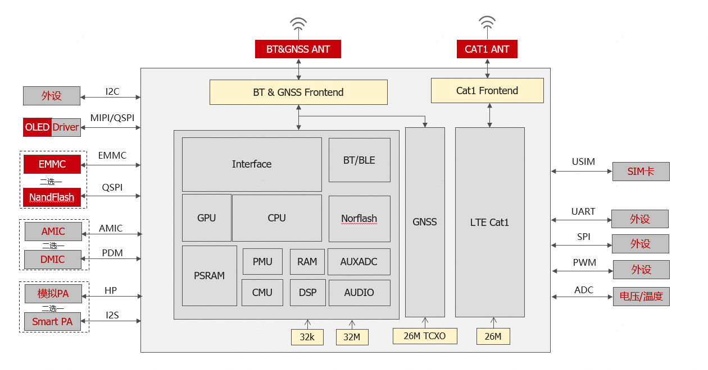

# HiDiTingV100 产品简介

**概述**

HiDiTing轻智能终端模组搭载高性能32bit微处理器，集成星闪、蓝牙、LTE Cat1、GNSS、音频、显示及NPU处理；提供USB2.0（Universal Serial Bus）、SPI（Synchronous Peripheral Interface）、UART（Universal Asynchronous Receiver & Transmitter）、I2C（The Inter-Integrated Circuit）、I2S（Inter-IC Sound）、PWM（Pulse-Width Modulation）、GPIO（General Purpose Input/Output）以及多路ADC（Analog to Digital Converter）模拟输入等丰富的外设接口，并配套提供开放、易用的开发和调试环境。

**功能框图**

**主要规格**

-   系统规格
    -   支持一个RISC-V（BCPU），最高主频为64MHz。
    -   支持一个RISC-V（MCPU），最高主频为266MHz。
    -   支持3个QSPI Master接口：

        外接NOR Flash，最大频率100MHz。

        外接NAND FLASH，接口最大频率100MHz。

        外接屏幕扩展，支持SDR/HDR（55MHz）。

    -   支持1个MIPI接口，1 data lane，最大速率1Gbit/s。
    -   支持1个SPI，支持Master/Slave模式，主最大频率32MHz，从最大频率16MHz。
    -   支持2个UART，最大速率2Mbit/s。
    -   支持4个I2C，支持Master/Slave，支持快速+模式，最大速率1Mbit/s。
    -   支持1个USB 2.0接口，支持Device/HOST，接口速率最高480Mbit/s。
    -   支持1个合封PSRAM，接口最高频率200MHz。
    -   支持1个SDIO HOST接口，支持SDR25，接口最高频率50MHz。
    -   支持一个eMMC 8线接口，最高频率100MHz。
    -   支持一个DVP接口，接口频率24MHz。
    -   支持70个GPIO接口。
    -   支持1个SWD CPU调试接口。
    -   支持2路PWM接口。
    -   电源电压2.7V～4.6V，3.3V，1.8V；IO电压1.8V。

-   AI
    -   支持一个Nano NPU，最高主频为200MHz，算力50Gops。

-   蓝牙
    -   支持蓝牙2.1+EDR/4.0/4.1/4.2/5.0/5.1/5.2/5.3/5.4。
    -   支持干扰检测。
    -   支持最多同时存在4条有效的ACL链路。
    -   支持BLE和BT并发。
    -   支持BT低功耗模式。
    -   支持最大发送功率：

        BR：10dBm

        EDR：6dBm

        BLE：10dBm

    -   支持接收灵敏度：

        BR：-94dBm

        EDR：-93dBm（DQPSK），-87dBm（8PSK）

        BLE：-96dBm（1M GFSK）

-   星闪
    -   支持星闪2.0。
    -   支持星闪测距。

-   单频GNSS
    -   支持GPS L1C/A、GLONASS L1OF、BDS B1I、Galileo E1C、QZSS L1C/A定位标准。
    -   支持GPS、GLONASS、BDS、Galileo单模定位。
    -   支持GPS、GLONASS、BDS、Galileo、QZSS多模定位。
    -   支持AGNSS。
    -   支持自动干扰检测。
    -   灵敏度：

        冷启动捕获灵敏度：-149dBm

        热启动捕获灵敏度：-159dBm

        跟踪灵敏度：-162dBm

-   LTE Cat1系统
    -   LTE-FDD：B1/B3/B5/B8。
    -   LTE-TDD：B34/B38/B39/B40/B41。
    -   支持WiFiScan 2.4GHz。
    -   支持LTE 3GPP Release 14版本协议。
    -   支持Category1 bis。
    -   支持LTE TDD，支持子帧配比0/1/2/3/4/5/6，支持特殊子帧配比0/1/2/3/4/5/6/7/8/9。
    -   支持1.4MHz/3MHz/5MHz/10MHz/15MHz/20MHz带宽。
    -   支持下行4×1 MISO+64QAM。
    -   支持上行1×1 SISO+16QAM。
    -   支持最大发送功率：

        LTE-FDD B1/B3/B5/B8：23dBm±2dB

        LTE-TDD B34/B38/B39/B40/b41：23dBm±2dB

    -   支持接收灵敏度（典型值）：

        B1（10MHz）：-99dBm

        B3（10MHz）：-99dBm

        B5（10MHz）：-99dBm

        B8（10MHz）：-98.5dBm

        B34（10MHz）：-101dBm

        B38（10MHz）：-101dBm

        B39（10MHz）：-100.5dBm

        B40（10MHz）：-100.5dBm

        B41（10MHz）：-101dBm

    -   支持峰值速率：

        FDD：下行10Mbit/s，上行5Mbit/s。

        TDD（子帧配比2，特殊子帧配比7）：下行7.5Mbit/s，上行1Mbit/s。

-   显示系统
    -   输入像素格式支持：ARGB8888、RGB888、RGB565、CLUT1、CLUT2、CLUT4、CLUT8、ACLUT44、ACLUT88、A1、A8、YUV-SP420的格式。
    -   输出像素格式支持：RGB565、RGB888、单像素。
    -   支持矢量绘制。
    -   支持渐变填充。
    -   支持3×3矩阵变换：平移、缩放、旋转、透视。
    -   支持pattern填充。
    -   支持纹理贴图。
    -   支持点光源。
    -   支持HDR VIVID双层图片。
    -   支持图片素材压缩。
    -   支持Alpha blending、ROP、Colorkey。
    -   支持高斯模糊。
    -   支持8X抗锯齿。
    -   支持JPEG、H264解码。
    -   支持MIPI接口、QSPI接口。
    -   支持最大分辨率600×600，640×480。

-   音频系统
    -   支持DSP最高主频266MHz。
    -   支持1路Normal ADC，支持差分模拟MIC，DR 105dB\(A\)。
    -   支持1路MAD ADC，与Normal ADC复用模拟MIC，DR 80dB\(A\)。
    -   支持MICBIAS提供片外模拟MIC的电源。
    -   支持2路数字ADC通道，单路数字ADC支持对接1个DMIC器件或1路Normal ADC或1路MAD ADC，录音输出16/32/48/96 kHz采样率。
    -   支持1路MAD用于语音唤醒，MAD外接DMIC接口或1路Normal ADC或1路MAD ADC。
    -   支持1路Class D型DAC差分输出，最大输出功率55mW（16Ω），SNR 102dB\(A\)。
    -   支持通过I2C/I2S进行片外SmartPA的配置/传输。
    -   支持独立的DMA用于数据搬移。
    -   支持1路I2S/TDM接口，采样率支持8/16/32/48/96/192 kHz。
    -   支持硬化的语音唤醒算法。
    -   支持音频算法动态加载，支持音频3A算法。
    -   支持SBC，LC3蓝牙音频编码，支持MP3编码。
    -   支持silk语音编解码。
    -   支持MP3、AAC（LC/HE V1/HE V2）、WAV、M4A、FLAC、OPUS解码。
    -   支持星闪L2HC编解码。
    -   支持SWS音效算法。

-   安全
    -   支持TEE安全执行环境。
    -   支持安全启动和安全升级。
    -   支持安全存储。
    -   支持AES和SM4算法加速。
    -   支持RSA/ECC/SM2算法加速。
    -   支持SHA2和SM3算法加速。
    -   支持硬件真随机数。
    -   支持安全生命周期管理。

-   存储空间
    -   支持2.3MB SRAM，可用于显示系统、DSP、APP灵活分配。
    -   支持合封16MB：OPIx16，最高频率200MHz的PSRAM空间。

-   操作系统
    -   支持LiteOS操作系统。
    -   支持OpenHarmony。

-   封装信息
    -   封装：LGA
    -   引脚数：144个
    -   尺寸：\(23.0±0.2\) mm × \(18.3 ±0.2\) mm × \(2.0 ±0.15\) mm

