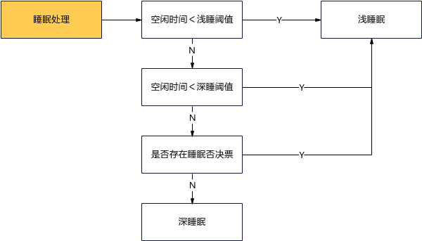
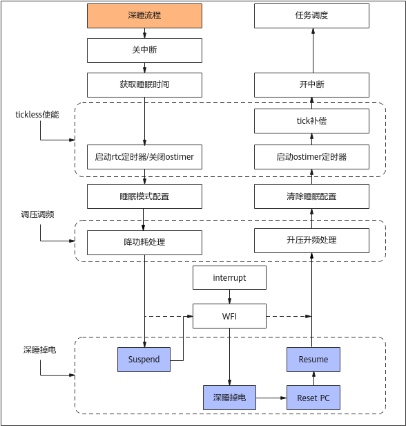
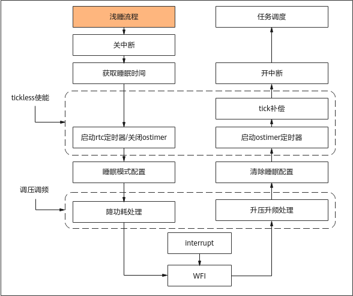
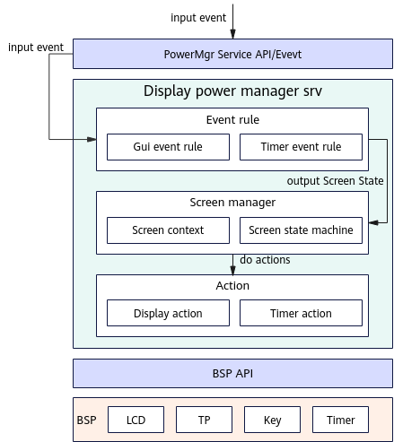
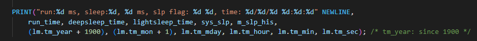
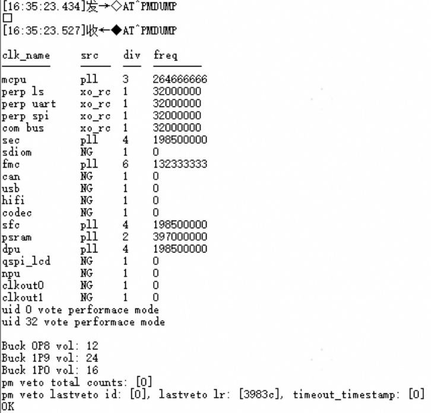

# 前言<a name="ZH-CN_TOPIC_0000002483741560"></a>

**概述<a name="zh-cn_topic_0000002444725865_section4537382116410"></a>**

本文档详细描述了HiDiTingV100的系统低功耗模式及应用开发指导，同时提供了常见问题的处理方法。用于指导用户低功耗开发及功耗调优。

**读者对象<a name="zh-cn_topic_0000002444725865_section4378592816410"></a>**

本文档主要适用于以下工程师：

-   技术支持工程师
-   软件开发工程师

**符号约定<a name="zh-cn_topic_0000002444725865_section133020216410"></a>**

在本文中可能出现下列标志，它们所代表的含义如下。

<a name="zh-cn_topic_0000002444725865_table2622507016410"></a>
<table><thead align="left"><tr id="zh-cn_topic_0000002444725865_row1530720816410"><th class="cellrowborder" valign="top" width="20.580000000000002%" id="mcps1.1.3.1.1"><p id="zh-cn_topic_0000002444725865_p6450074116410"><a name="zh-cn_topic_0000002444725865_p6450074116410"></a><a name="zh-cn_topic_0000002444725865_p6450074116410"></a><strong id="zh-cn_topic_0000002444725865_b2136615816410"><a name="zh-cn_topic_0000002444725865_b2136615816410"></a><a name="zh-cn_topic_0000002444725865_b2136615816410"></a>符号</strong></p>
</th>
<th class="cellrowborder" valign="top" width="79.42%" id="mcps1.1.3.1.2"><p id="zh-cn_topic_0000002444725865_p5435366816410"><a name="zh-cn_topic_0000002444725865_p5435366816410"></a><a name="zh-cn_topic_0000002444725865_p5435366816410"></a><strong id="zh-cn_topic_0000002444725865_b5941558116410"><a name="zh-cn_topic_0000002444725865_b5941558116410"></a><a name="zh-cn_topic_0000002444725865_b5941558116410"></a>说明</strong></p>
</th>
</tr>
</thead>
<tbody><tr id="zh-cn_topic_0000002444725865_row1372280416410"><td class="cellrowborder" valign="top" width="20.580000000000002%" headers="mcps1.1.3.1.1 "><p id="zh-cn_topic_0000002444725865_p3734547016410"><a name="zh-cn_topic_0000002444725865_p3734547016410"></a><a name="zh-cn_topic_0000002444725865_p3734547016410"></a><a name="zh-cn_topic_0000002444725865_image2670064316410"></a><a name="zh-cn_topic_0000002444725865_image2670064316410"></a><span></span></p>
</td>
<td class="cellrowborder" valign="top" width="79.42%" headers="mcps1.1.3.1.2 "><p id="zh-cn_topic_0000002444725865_p1757432116410"><a name="zh-cn_topic_0000002444725865_p1757432116410"></a><a name="zh-cn_topic_0000002444725865_p1757432116410"></a>表示如不避免则将会导致死亡或严重伤害的具有高等级风险的危害。</p>
</td>
</tr>
<tr id="zh-cn_topic_0000002444725865_row466863216410"><td class="cellrowborder" valign="top" width="20.580000000000002%" headers="mcps1.1.3.1.1 "><p id="zh-cn_topic_0000002444725865_p1432579516410"><a name="zh-cn_topic_0000002444725865_p1432579516410"></a><a name="zh-cn_topic_0000002444725865_p1432579516410"></a><a name="zh-cn_topic_0000002444725865_image4895582316410"></a><a name="zh-cn_topic_0000002444725865_image4895582316410"></a><span></span></p>
</td>
<td class="cellrowborder" valign="top" width="79.42%" headers="mcps1.1.3.1.2 "><p id="zh-cn_topic_0000002444725865_p959197916410"><a name="zh-cn_topic_0000002444725865_p959197916410"></a><a name="zh-cn_topic_0000002444725865_p959197916410"></a>表示如不避免则可能导致死亡或严重伤害的具有中等级风险的危害。</p>
</td>
</tr>
<tr id="zh-cn_topic_0000002444725865_row123863216410"><td class="cellrowborder" valign="top" width="20.580000000000002%" headers="mcps1.1.3.1.1 "><p id="zh-cn_topic_0000002444725865_p1232579516410"><a name="zh-cn_topic_0000002444725865_p1232579516410"></a><a name="zh-cn_topic_0000002444725865_p1232579516410"></a><a name="zh-cn_topic_0000002444725865_image1235582316410"></a><a name="zh-cn_topic_0000002444725865_image1235582316410"></a><span></span></p>
</td>
<td class="cellrowborder" valign="top" width="79.42%" headers="mcps1.1.3.1.2 "><p id="zh-cn_topic_0000002444725865_p123197916410"><a name="zh-cn_topic_0000002444725865_p123197916410"></a><a name="zh-cn_topic_0000002444725865_p123197916410"></a>表示如不避免则可能导致轻微或中度伤害的具有低等级风险的危害。</p>
</td>
</tr>
<tr id="zh-cn_topic_0000002444725865_row5786682116410"><td class="cellrowborder" valign="top" width="20.580000000000002%" headers="mcps1.1.3.1.1 "><p id="zh-cn_topic_0000002444725865_p2204984716410"><a name="zh-cn_topic_0000002444725865_p2204984716410"></a><a name="zh-cn_topic_0000002444725865_p2204984716410"></a><a name="zh-cn_topic_0000002444725865_image4504446716410"></a><a name="zh-cn_topic_0000002444725865_image4504446716410"></a><span></span></p>
</td>
<td class="cellrowborder" valign="top" width="79.42%" headers="mcps1.1.3.1.2 "><p id="zh-cn_topic_0000002444725865_p4388861916410"><a name="zh-cn_topic_0000002444725865_p4388861916410"></a><a name="zh-cn_topic_0000002444725865_p4388861916410"></a>用于传递设备或环境安全警示信息。如不避免则可能会导致设备损坏、数据丢失、设备性能降低或其它不可预知的结果。</p>
<p id="zh-cn_topic_0000002444725865_p1238861916410"><a name="zh-cn_topic_0000002444725865_p1238861916410"></a><a name="zh-cn_topic_0000002444725865_p1238861916410"></a>“须知”不涉及人身伤害。</p>
</td>
</tr>
<tr id="zh-cn_topic_0000002444725865_row2856923116410"><td class="cellrowborder" valign="top" width="20.580000000000002%" headers="mcps1.1.3.1.1 "><p id="zh-cn_topic_0000002444725865_p5555360116410"><a name="zh-cn_topic_0000002444725865_p5555360116410"></a><a name="zh-cn_topic_0000002444725865_p5555360116410"></a><a name="zh-cn_topic_0000002444725865_image799324016410"></a><a name="zh-cn_topic_0000002444725865_image799324016410"></a><span></span></p>
</td>
<td class="cellrowborder" valign="top" width="79.42%" headers="mcps1.1.3.1.2 "><p id="zh-cn_topic_0000002444725865_p4612588116410"><a name="zh-cn_topic_0000002444725865_p4612588116410"></a><a name="zh-cn_topic_0000002444725865_p4612588116410"></a>对正文中重点信息的补充说明。</p>
<p id="zh-cn_topic_0000002444725865_p1232588116410"><a name="zh-cn_topic_0000002444725865_p1232588116410"></a><a name="zh-cn_topic_0000002444725865_p1232588116410"></a>“说明”不是安全警示信息，不涉及人身、设备及环境伤害信息。</p>
</td>
</tr>
</tbody>
</table>

# 概述<a name="ZH-CN_TOPIC_0000002483901516"></a>

低功耗是芯片的重要特性，HiDiTingV100支持2种系统低功耗模式，如[表1](#zh-cn_topic_0000002411046604_table19591155119178)所示，用户可根据实际应用场景选用对应的低功耗策略。

**表 1**  低功耗模式说明

<a name="zh-cn_topic_0000002411046604_table19591155119178"></a>
<table><thead align="left"><tr id="zh-cn_topic_0000002411046604_row175912518174"><th class="cellrowborder" valign="top" width="18.279999999999998%" id="mcps1.2.4.1.1"><p id="zh-cn_topic_0000002411046604_p2591135119173"><a name="zh-cn_topic_0000002411046604_p2591135119173"></a><a name="zh-cn_topic_0000002411046604_p2591135119173"></a>模式</p>
</th>
<th class="cellrowborder" valign="top" width="36.67%" id="mcps1.2.4.1.2"><p id="zh-cn_topic_0000002411046604_p7591175111174"><a name="zh-cn_topic_0000002411046604_p7591175111174"></a><a name="zh-cn_topic_0000002411046604_p7591175111174"></a>芯片状态</p>
</th>
<th class="cellrowborder" valign="top" width="45.050000000000004%" id="mcps1.2.4.1.3"><p id="zh-cn_topic_0000002411046604_p059145114174"><a name="zh-cn_topic_0000002411046604_p059145114174"></a><a name="zh-cn_topic_0000002411046604_p059145114174"></a>特点</p>
</th>
</tr>
</thead>
<tbody><tr id="zh-cn_topic_0000002411046604_row11591155161718"><td class="cellrowborder" valign="top" width="18.279999999999998%" headers="mcps1.2.4.1.1 "><p id="zh-cn_topic_0000002411046604_p13591115161712"><a name="zh-cn_topic_0000002411046604_p13591115161712"></a><a name="zh-cn_topic_0000002411046604_p13591115161712"></a>深睡模式</p>
</td>
<td class="cellrowborder" valign="top" width="36.67%" headers="mcps1.2.4.1.2 "><p id="zh-cn_topic_0000002411046604_p151420312301"><a name="zh-cn_topic_0000002411046604_p151420312301"></a><a name="zh-cn_topic_0000002411046604_p151420312301"></a>CPU及外设下电，Memory进入睡眠保持或下电模式，XO 32M关闭，数字模块除AON/ULP AON外其余下电，PMU BUCK进ECO模式并降压。</p>
<p id="zh-cn_topic_0000002411046604_p1375312083217"><a name="zh-cn_topic_0000002411046604_p1375312083217"></a><a name="zh-cn_topic_0000002411046604_p1375312083217"></a>该模式仅支持GPIO/RTC/UART L0/IPC等唤醒源唤醒。</p>
</td>
<td class="cellrowborder" valign="top" width="45.050000000000004%" headers="mcps1.2.4.1.3 "><a name="zh-cn_topic_0000002411046604_ul859119516174"></a><a name="zh-cn_topic_0000002411046604_ul859119516174"></a><ul id="zh-cn_topic_0000002411046604_ul859119516174"><li>CPU进入掉电状态。</li><li>关闭OS Tick。</li><li>支持蓝牙/星闪保连。</li><li>支持睡眠唤醒通知。</li><li>支持外设器件低功耗，唤醒后快速恢复。</li><li>支持模块可控下电。</li><li>支持多种唤醒源。</li></ul>
</td>
</tr>
<tr id="zh-cn_topic_0000002411046604_row559275141715"><td class="cellrowborder" valign="top" width="18.279999999999998%" headers="mcps1.2.4.1.1 "><p id="zh-cn_topic_0000002411046604_p205921251191716"><a name="zh-cn_topic_0000002411046604_p205921251191716"></a><a name="zh-cn_topic_0000002411046604_p205921251191716"></a>浅睡模式</p>
</td>
<td class="cellrowborder" valign="top" width="36.67%" headers="mcps1.2.4.1.2 "><p id="zh-cn_topic_0000002411046604_p1118112515326"><a name="zh-cn_topic_0000002411046604_p1118112515326"></a><a name="zh-cn_topic_0000002411046604_p1118112515326"></a>CPU进WFI，RAM不下电，外设根据需要下电或者关闭时钟。</p>
<p id="zh-cn_topic_0000002411046604_p1718172516329"><a name="zh-cn_topic_0000002411046604_p1718172516329"></a><a name="zh-cn_topic_0000002411046604_p1718172516329"></a>任意中断可退出浅睡模式。</p>
</td>
<td class="cellrowborder" valign="top" width="45.050000000000004%" headers="mcps1.2.4.1.3 "><a name="zh-cn_topic_0000002411046604_ul18592125116171"></a><a name="zh-cn_topic_0000002411046604_ul18592125116171"></a><ul id="zh-cn_topic_0000002411046604_ul18592125116171"><li>CPU进入WFI状态。</li><li>支持tickless。</li><li>支持蓝牙/星闪保连。</li><li>支持所有外设正常工作，可控下电。</li><li>支持模块可控掉电。</li><li>支持所有中断唤醒。</li></ul>
</td>
</tr>
</tbody>
</table>

> **说明：** 
>-   AON：Always ON区域，包括RTC、GPIO、CWDT等。
>-   浅睡模式和深睡模式互斥，tickless和降压降频可根据业务场景与睡眠模式相结合。
>-   支持AT命令进入或退出低功耗：
>    1.  低功耗唤醒，“AT^PM=0”或者“AT+PMADDVOTE”，需要发送2次（由于深睡关闭UART工作时钟，UART唤醒无法正确识别首字节）
>    2.  低功耗深睡，“AT^PM=1”或者“AT+PMRMVOTE”

低功耗模式开启后，系统根据空闲时间和投票状态决定在空闲时进入深睡模式还是浅睡模式，当前系统的浅睡阈值为5ms，深睡眠阈值为10ms。如[图1](#zh-cn_topic_0000002411046604_fig993455812514)所示。

**图 1**  睡眠状态<a name="zh-cn_topic_0000002411046604_fig993455812514"></a>  


用户可结合应用场景主动调用调频接口来控制各类外设总线的开关和频率值。在HiDiTingV100中，可以通过以下几种方式降低系统的功耗：

-   Tickless：通过移除空闲时间的OS tick计数的方式降低系统调度次数及运行时间。
-   降压降频：通过调压调频接口，降低模块电压和频率，减少不必要的损耗。针对外设器件，非用即关。
-   浅睡模式：系统进入浅睡模式，CPU处于静止状态，即WFI。
-   深睡模式：系统进入深睡模式，CPU处于掉电状态，依赖唤醒源唤醒。

# 特性配置<a name="ZH-CN_TOPIC_0000002483741576"></a>

在“src\\drivers\\boards\\3322\_evb\\product\\product\_evb\_standard.h”文件，配置“ENABLE\_LOW\_POWER=YES”进行开启，配置“ENABLE\_LOW\_POWER=NO”进行关闭。

# 深睡模式<a name="ZH-CN_TOPIC_0000002516021471"></a>

-   **[概述](#ZH-CN_TOPIC_0000002516141449)**  

-   **[睡眠流程](#ZH-CN_TOPIC_0000002516021503)**  

## 概述<a name="ZH-CN_TOPIC_0000002516141449"></a>

HiDiTingV100的低功耗策略是利用IDLE任务进行系统管理，由于IDLE任务优先级最低，因此该任务仅在系统空闲时得到执行，当低功耗管理系统判断没有即将执行的业务且不存在深睡否决票时，即可允许系统进入深睡模式，即CPU、外设等下电，LDO降压。该模式可以通过深睡唤醒源唤醒，深睡唤醒源包括GPIO、IPC、RTC等。系统休眠时间采用tickless机制，避免每个tick都被唤醒。

深睡模式下，除S\_AGPIO以及S\_UGPIO外，其余IO均掉电。掉电域的IO管脚电平保持功能依赖芯片内部的弱上下拉以及板级上下拉配置，不支持睡眠唤醒，常电域的IO管脚支持管脚电平保持以及唤醒。

## 睡眠流程<a name="ZH-CN_TOPIC_0000002516021503"></a>

当系统状态满足深睡场景时，深睡眠场景的流程如[图1](#zh-cn_topic_0000002444645805_fig566012420386)所示。

**图 1**  深睡流程<a name="zh-cn_topic_0000002444645805_fig566012420386"></a>  


# 浅睡模式<a name="ZH-CN_TOPIC_0000002516021451"></a>

-   **[概述](#ZH-CN_TOPIC_0000002483741506)**  

-   **[睡眠流程](#ZH-CN_TOPIC_0000002483901492)**  

## 概述<a name="ZH-CN_TOPIC_0000002483741506"></a>

浅睡模式相比深睡模式，CPU和外设不下电，任意中断触发将使系统退出浅睡模式。浅睡模式下CPU本身进WFI，控制子模块下电或关闭时钟来降低功耗。

## 睡眠流程<a name="ZH-CN_TOPIC_0000002483901492"></a>

当系统状态满足浅睡场景时，浅睡眠场景的流程如[图1](#zh-cn_topic_0000002411046748_fig126141251164420)所示。

**图 1**  浅睡流程<a name="zh-cn_topic_0000002411046748_fig126141251164420"></a>  


# 低功耗接口<a name="ZH-CN_TOPIC_0000002483741538"></a>

低功耗接口说明如[表1](#zh-cn_topic_0000002411206628_table7513055)所示。

**表 1**  低功耗接口说明

<a name="zh-cn_topic_0000002411206628_table7513055"></a>
<table><thead align="left"><tr id="zh-cn_topic_0000002411206628_row60882656"><th class="cellrowborder" valign="top" width="37.230000000000004%" id="mcps1.2.4.1.1"><p id="zh-cn_topic_0000002411206628_p1096619262352"><a name="zh-cn_topic_0000002411206628_p1096619262352"></a><a name="zh-cn_topic_0000002411206628_p1096619262352"></a>接口名称</p>
</th>
<th class="cellrowborder" valign="top" width="46.48%" id="mcps1.2.4.1.2"><p id="zh-cn_topic_0000002411206628_p49661926123519"><a name="zh-cn_topic_0000002411206628_p49661926123519"></a><a name="zh-cn_topic_0000002411206628_p49661926123519"></a>说明</p>
</th>
<th class="cellrowborder" valign="top" width="16.29%" id="mcps1.2.4.1.3"><p id="zh-cn_topic_0000002411206628_p99519539508"><a name="zh-cn_topic_0000002411206628_p99519539508"></a><a name="zh-cn_topic_0000002411206628_p99519539508"></a>文件路径</p>
</th>
</tr>
</thead>
<tbody><tr id="zh-cn_topic_0000002411206628_row1322567648"><td class="cellrowborder" valign="top" width="37.230000000000004%" headers="mcps1.2.4.1.1 "><p id="zh-cn_topic_0000002411206628_p1827513212048"><a name="zh-cn_topic_0000002411206628_p1827513212048"></a><a name="zh-cn_topic_0000002411206628_p1827513212048"></a>uapi_sys_shipmode</p>
</td>
<td class="cellrowborder" valign="top" width="46.48%" headers="mcps1.2.4.1.2 "><p id="zh-cn_topic_0000002411206628_p1713720296418"><a name="zh-cn_topic_0000002411206628_p1713720296418"></a><a name="zh-cn_topic_0000002411206628_p1713720296418"></a>芯片进入shipmode模式。</p>
</td>
<td class="cellrowborder" valign="top" width="16.29%" headers="mcps1.2.4.1.3 "><p id="zh-cn_topic_0000002411206628_p1920610578355"><a name="zh-cn_topic_0000002411206628_p1920610578355"></a><a name="zh-cn_topic_0000002411206628_p1920610578355"></a>drivers/chips/3322/include/shared/pmu_ulp.h</p>
</td>
</tr>
<tr id="zh-cn_topic_0000002411206628_row192985192617"><td class="cellrowborder" valign="top" width="37.230000000000004%" headers="mcps1.2.4.1.1 "><p id="zh-cn_topic_0000002411206628_p15856173611355"><a name="zh-cn_topic_0000002411206628_p15856173611355"></a><a name="zh-cn_topic_0000002411206628_p15856173611355"></a>uapi_clocks_config_mode</p>
</td>
<td class="cellrowborder" valign="top" width="46.48%" headers="mcps1.2.4.1.2 "><p id="zh-cn_topic_0000002411206628_p82983194612"><a name="zh-cn_topic_0000002411206628_p82983194612"></a><a name="zh-cn_topic_0000002411206628_p82983194612"></a>调频接口，投票请求进入特定模式，包括LP、NORMAL、PERFORMACE等模式。</p>
</td>
<td class="cellrowborder" valign="top" width="16.29%" headers="mcps1.2.4.1.3 "><p id="zh-cn_topic_0000002411206628_p0487246113615"><a name="zh-cn_topic_0000002411206628_p0487246113615"></a><a name="zh-cn_topic_0000002411206628_p0487246113615"></a>middleware/chips/3322/include/shared/pm_clocks.h</p>
</td>
</tr>
<tr id="zh-cn_topic_0000002411206628_row35150104"><td class="cellrowborder" valign="top" width="37.230000000000004%" headers="mcps1.2.4.1.1 "><p id="zh-cn_topic_0000002411206628_p28586180"><a name="zh-cn_topic_0000002411206628_p28586180"></a><a name="zh-cn_topic_0000002411206628_p28586180"></a>uapi_pm_add_sleep_veto</p>
</td>
<td class="cellrowborder" valign="top" width="46.48%" headers="mcps1.2.4.1.2 "><p id="zh-cn_topic_0000002411206628_p33779240"><a name="zh-cn_topic_0000002411206628_p33779240"></a><a name="zh-cn_topic_0000002411206628_p33779240"></a>低功耗睡眠否决票，反对睡眠。（非对称接口，不支持嵌套使用）</p>
</td>
<td class="cellrowborder" rowspan="5" valign="top" width="16.29%" headers="mcps1.2.4.1.3 "><p id="zh-cn_topic_0000002411206628_p1279151613513"><a name="zh-cn_topic_0000002411206628_p1279151613513"></a><a name="zh-cn_topic_0000002411206628_p1279151613513"></a>middleware/utils/pm/pm_veto/pm_veto.h</p>
</td>
</tr>
<tr id="zh-cn_topic_0000002411206628_row23741350163011"><td class="cellrowborder" valign="top" headers="mcps1.2.4.1.1 "><p id="zh-cn_topic_0000002411206628_p221115153317"><a name="zh-cn_topic_0000002411206628_p221115153317"></a><a name="zh-cn_topic_0000002411206628_p221115153317"></a>uapi_pm_add_sleep_veto_with_symmetry</p>
</td>
<td class="cellrowborder" valign="top" headers="mcps1.2.4.1.2 "><p id="zh-cn_topic_0000002411206628_p63754504305"><a name="zh-cn_topic_0000002411206628_p63754504305"></a><a name="zh-cn_topic_0000002411206628_p63754504305"></a>低功耗睡眠否决票，反对睡眠。（对称接口，支持嵌套使用）</p>
</td>
</tr>
<tr id="zh-cn_topic_0000002411206628_row35577711"><td class="cellrowborder" valign="top" headers="mcps1.2.4.1.1 "><p id="zh-cn_topic_0000002411206628_p316911241544"><a name="zh-cn_topic_0000002411206628_p316911241544"></a><a name="zh-cn_topic_0000002411206628_p316911241544"></a>uapi_pm_add_sleep_veto_with_timeout</p>
</td>
<td class="cellrowborder" valign="top" headers="mcps1.2.4.1.2 "><p id="zh-cn_topic_0000002411206628_p19143163311416"><a name="zh-cn_topic_0000002411206628_p19143163311416"></a><a name="zh-cn_topic_0000002411206628_p19143163311416"></a>带超时时间的低功耗睡眠投票。</p>
</td>
</tr>
<tr id="zh-cn_topic_0000002411206628_row52422585"><td class="cellrowborder" valign="top" headers="mcps1.2.4.1.1 "><p id="zh-cn_topic_0000002411206628_p106606551419"><a name="zh-cn_topic_0000002411206628_p106606551419"></a><a name="zh-cn_topic_0000002411206628_p106606551419"></a>uapi_pm_remove_sleep_veto</p>
</td>
<td class="cellrowborder" valign="top" headers="mcps1.2.4.1.2 "><p id="zh-cn_topic_0000002411206628_p351152757"><a name="zh-cn_topic_0000002411206628_p351152757"></a><a name="zh-cn_topic_0000002411206628_p351152757"></a>取消低功耗睡眠否决票，移除睡眠投票，允许睡眠。</p>
<p id="zh-cn_topic_0000002411206628_p64221536359"><a name="zh-cn_topic_0000002411206628_p64221536359"></a><a name="zh-cn_topic_0000002411206628_p64221536359"></a>（对称接口，不支持嵌套使用）</p>
</td>
</tr>
<tr id="zh-cn_topic_0000002411206628_row85025462331"><td class="cellrowborder" valign="top" headers="mcps1.2.4.1.1 "><p id="zh-cn_topic_0000002411206628_p4553113193411"><a name="zh-cn_topic_0000002411206628_p4553113193411"></a><a name="zh-cn_topic_0000002411206628_p4553113193411"></a>uapi_pm_remove_sleep_veto_with_symmetry</p>
</td>
<td class="cellrowborder" valign="top" headers="mcps1.2.4.1.2 "><p id="zh-cn_topic_0000002411206628_p209900485348"><a name="zh-cn_topic_0000002411206628_p209900485348"></a><a name="zh-cn_topic_0000002411206628_p209900485348"></a>取消低功耗睡眠否决票，移除睡眠投票，允许睡眠。</p>
<p id="zh-cn_topic_0000002411206628_p5957933113417"><a name="zh-cn_topic_0000002411206628_p5957933113417"></a><a name="zh-cn_topic_0000002411206628_p5957933113417"></a>（对称接口，支持嵌套使用）</p>
</td>
</tr>
</tbody>
</table>

# 低功耗管理服务<a name="ZH-CN_TOPIC_0000002516141511"></a>

-   **[概述](#ZH-CN_TOPIC_0000002483901536)**  

-   **[接口说明](#ZH-CN_TOPIC_0000002483901480)**  

-   **[示例](#ZH-CN_TOPIC_0000002516141473)**  

## 概述<a name="ZH-CN_TOPIC_0000002483901536"></a>

低功耗管理服务，即Power manager service模块，当前用于屏幕的低功耗管理，主要实现亮屏和灭屏功能，向上对接上层uikit GUI引擎及native应用，向下对接按键、触屏、显示等驱动模块，其服务框架如[图1](#zh-cn_topic_0000002444645741_fig107361491214)所示。

**图 1**  Power manager service系统框架<a name="zh-cn_topic_0000002444645741_fig107361491214"></a>  


## 接口说明<a name="ZH-CN_TOPIC_0000002483901480"></a>

Power manager service提供统一对外接口“power\_display\_svr\_get\_api”用于获取显示功耗管理服务的API接口，其主要接口如[表1](#zh-cn_topic_0000002444725797_table385719539239)所示。

**表 1**  显示功耗管理服务成员函数

<a name="zh-cn_topic_0000002444725797_table385719539239"></a>
<table><thead align="left"><tr id="zh-cn_topic_0000002444725797_row98758536232"><th class="cellrowborder" valign="top" width="36.370000000000005%" id="mcps1.2.4.1.1"><p id="zh-cn_topic_0000002444725797_p1287515538233"><a name="zh-cn_topic_0000002444725797_p1287515538233"></a><a name="zh-cn_topic_0000002444725797_p1287515538233"></a>成员函数</p>
</th>
<th class="cellrowborder" valign="top" width="25.35%" id="mcps1.2.4.1.2"><p id="zh-cn_topic_0000002444725797_p1287535342315"><a name="zh-cn_topic_0000002444725797_p1287535342315"></a><a name="zh-cn_topic_0000002444725797_p1287535342315"></a>说明</p>
</th>
<th class="cellrowborder" valign="top" width="38.279999999999994%" id="mcps1.2.4.1.3"><p id="zh-cn_topic_0000002444725797_p15864554258"><a name="zh-cn_topic_0000002444725797_p15864554258"></a><a name="zh-cn_topic_0000002444725797_p15864554258"></a>备注</p>
</th>
</tr>
</thead>
<tbody><tr id="zh-cn_topic_0000002444725797_row1087515372311"><td class="cellrowborder" valign="top" width="36.370000000000005%" headers="mcps1.2.4.1.1 "><p id="zh-cn_topic_0000002444725797_p2875145322318"><a name="zh-cn_topic_0000002444725797_p2875145322318"></a><a name="zh-cn_topic_0000002444725797_p2875145322318"></a>turn_on_screen</p>
</td>
<td class="cellrowborder" valign="top" width="25.35%" headers="mcps1.2.4.1.2 "><p id="zh-cn_topic_0000002444725797_p1587595312231"><a name="zh-cn_topic_0000002444725797_p1587595312231"></a><a name="zh-cn_topic_0000002444725797_p1587595312231"></a>控制屏幕进入亮屏状态。</p>
</td>
<td class="cellrowborder" valign="top" width="38.279999999999994%" headers="mcps1.2.4.1.3 "><p id="zh-cn_topic_0000002444725797_p65861755112516"><a name="zh-cn_topic_0000002444725797_p65861755112516"></a><a name="zh-cn_topic_0000002444725797_p65861755112516"></a>-</p>
</td>
</tr>
<tr id="zh-cn_topic_0000002444725797_row10875853102315"><td class="cellrowborder" valign="top" width="36.370000000000005%" headers="mcps1.2.4.1.1 "><p id="zh-cn_topic_0000002444725797_p118754531239"><a name="zh-cn_topic_0000002444725797_p118754531239"></a><a name="zh-cn_topic_0000002444725797_p118754531239"></a>turn_off_screen</p>
</td>
<td class="cellrowborder" valign="top" width="25.35%" headers="mcps1.2.4.1.2 "><p id="zh-cn_topic_0000002444725797_p587535320235"><a name="zh-cn_topic_0000002444725797_p587535320235"></a><a name="zh-cn_topic_0000002444725797_p587535320235"></a>控制屏幕进入黑屏状态。</p>
</td>
<td class="cellrowborder" valign="top" width="38.279999999999994%" headers="mcps1.2.4.1.3 "><p id="zh-cn_topic_0000002444725797_p11586135511255"><a name="zh-cn_topic_0000002444725797_p11586135511255"></a><a name="zh-cn_topic_0000002444725797_p11586135511255"></a>-</p>
</td>
</tr>
<tr id="zh-cn_topic_0000002444725797_row68755539238"><td class="cellrowborder" valign="top" width="36.370000000000005%" headers="mcps1.2.4.1.1 "><p id="zh-cn_topic_0000002444725797_p1887518538232"><a name="zh-cn_topic_0000002444725797_p1887518538232"></a><a name="zh-cn_topic_0000002444725797_p1887518538232"></a>get_screen_state</p>
</td>
<td class="cellrowborder" valign="top" width="25.35%" headers="mcps1.2.4.1.2 "><p id="zh-cn_topic_0000002444725797_p58751353112315"><a name="zh-cn_topic_0000002444725797_p58751353112315"></a><a name="zh-cn_topic_0000002444725797_p58751353112315"></a>获取当前屏幕状态。</p>
</td>
<td class="cellrowborder" valign="top" width="38.279999999999994%" headers="mcps1.2.4.1.3 "><p id="zh-cn_topic_0000002444725797_p658685511251"><a name="zh-cn_topic_0000002444725797_p658685511251"></a><a name="zh-cn_topic_0000002444725797_p658685511251"></a>-</p>
</td>
</tr>
<tr id="zh-cn_topic_0000002444725797_row2087535310239"><td class="cellrowborder" valign="top" width="36.370000000000005%" headers="mcps1.2.4.1.1 "><p id="zh-cn_topic_0000002444725797_p7875105315230"><a name="zh-cn_topic_0000002444725797_p7875105315230"></a><a name="zh-cn_topic_0000002444725797_p7875105315230"></a>set_screen_auto_off_timeout</p>
</td>
<td class="cellrowborder" valign="top" width="25.35%" headers="mcps1.2.4.1.2 "><p id="zh-cn_topic_0000002444725797_p16875105314239"><a name="zh-cn_topic_0000002444725797_p16875105314239"></a><a name="zh-cn_topic_0000002444725797_p16875105314239"></a>设置屏幕超时灭屏时间。</p>
</td>
<td class="cellrowborder" valign="top" width="38.279999999999994%" headers="mcps1.2.4.1.3 "><a name="zh-cn_topic_0000002444725797_ul149807584014"></a><a name="zh-cn_topic_0000002444725797_ul149807584014"></a><ul id="zh-cn_topic_0000002444725797_ul149807584014"><li>配置前需要打开自动亮灭屏功能。</li><li>当前配置范围为[5s, 1h]，用户根据需要可进行二次开发。</li><li>若需要支持重启生效，则需要另外进行保存NV项开发。</li></ul>
</td>
</tr>
<tr id="zh-cn_topic_0000002444725797_row0875953202311"><td class="cellrowborder" valign="top" width="36.370000000000005%" headers="mcps1.2.4.1.1 "><p id="zh-cn_topic_0000002444725797_p48753532233"><a name="zh-cn_topic_0000002444725797_p48753532233"></a><a name="zh-cn_topic_0000002444725797_p48753532233"></a>set_auto_timeout_function</p>
</td>
<td class="cellrowborder" valign="top" width="25.35%" headers="mcps1.2.4.1.2 "><p id="zh-cn_topic_0000002444725797_p38751853102311"><a name="zh-cn_topic_0000002444725797_p38751853102311"></a><a name="zh-cn_topic_0000002444725797_p38751853102311"></a>设置自动超时灭屏功能是否生效。</p>
</td>
<td class="cellrowborder" valign="top" width="38.279999999999994%" headers="mcps1.2.4.1.3 "><p id="zh-cn_topic_0000002444725797_p7586135532513"><a name="zh-cn_topic_0000002444725797_p7586135532513"></a><a name="zh-cn_topic_0000002444725797_p7586135532513"></a>-</p>
</td>
</tr>
<tr id="zh-cn_topic_0000002444725797_row5875135312315"><td class="cellrowborder" valign="top" width="36.370000000000005%" headers="mcps1.2.4.1.1 "><p id="zh-cn_topic_0000002444725797_p1587518531237"><a name="zh-cn_topic_0000002444725797_p1587518531237"></a><a name="zh-cn_topic_0000002444725797_p1587518531237"></a>set_screen_set_keepon_timeout</p>
</td>
<td class="cellrowborder" valign="top" width="25.35%" headers="mcps1.2.4.1.2 "><p id="zh-cn_topic_0000002444725797_p2087555362311"><a name="zh-cn_topic_0000002444725797_p2087555362311"></a><a name="zh-cn_topic_0000002444725797_p2087555362311"></a>应用设置保持亮屏时间。</p>
</td>
<td class="cellrowborder" valign="top" width="38.279999999999994%" headers="mcps1.2.4.1.3 "><p id="zh-cn_topic_0000002444725797_p35861255152515"><a name="zh-cn_topic_0000002444725797_p35861255152515"></a><a name="zh-cn_topic_0000002444725797_p35861255152515"></a>当前配置保持亮屏时长最大为1h，即使配置超过1h，实际生效时长也为1h；小于等于1h按实际配置时长生效。用户可根据需要进行二次开发。</p>
</td>
</tr>
<tr id="zh-cn_topic_0000002444725797_row087585316232"><td class="cellrowborder" valign="top" width="36.370000000000005%" headers="mcps1.2.4.1.1 "><p id="zh-cn_topic_0000002444725797_p14875115315235"><a name="zh-cn_topic_0000002444725797_p14875115315235"></a><a name="zh-cn_topic_0000002444725797_p14875115315235"></a>set_brightness</p>
</td>
<td class="cellrowborder" valign="top" width="25.35%" headers="mcps1.2.4.1.2 "><p id="zh-cn_topic_0000002444725797_p118751953202313"><a name="zh-cn_topic_0000002444725797_p118751953202313"></a><a name="zh-cn_topic_0000002444725797_p118751953202313"></a>应用设置自定义亮度值。</p>
</td>
<td class="cellrowborder" valign="top" width="38.279999999999994%" headers="mcps1.2.4.1.3 "><p id="zh-cn_topic_0000002444725797_p458605572512"><a name="zh-cn_topic_0000002444725797_p458605572512"></a><a name="zh-cn_topic_0000002444725797_p458605572512"></a>-</p>
</td>
</tr>
<tr id="zh-cn_topic_0000002444725797_row168751853122311"><td class="cellrowborder" valign="top" width="36.370000000000005%" headers="mcps1.2.4.1.1 "><p id="zh-cn_topic_0000002444725797_p7875155312310"><a name="zh-cn_topic_0000002444725797_p7875155312310"></a><a name="zh-cn_topic_0000002444725797_p7875155312310"></a>get_brightness</p>
</td>
<td class="cellrowborder" valign="top" width="25.35%" headers="mcps1.2.4.1.2 "><p id="zh-cn_topic_0000002444725797_p2875053112312"><a name="zh-cn_topic_0000002444725797_p2875053112312"></a><a name="zh-cn_topic_0000002444725797_p2875053112312"></a>获取应用设置屏幕亮度值。</p>
</td>
<td class="cellrowborder" valign="top" width="38.279999999999994%" headers="mcps1.2.4.1.3 "><p id="zh-cn_topic_0000002444725797_p658613554259"><a name="zh-cn_topic_0000002444725797_p658613554259"></a><a name="zh-cn_topic_0000002444725797_p658613554259"></a>-</p>
</td>
</tr>
</tbody>
</table>

## 示例<a name="ZH-CN_TOPIC_0000002516141473"></a>

上层Native应用需要亮屏且保持一段时间不灭屏（当前点亮屏幕无操作一段时间会灭屏，默认5s，可配置），设置方法如下：

1.  获取显示功耗管理接口。

    ```
    const power_display_svr_api_t *display_api = power_display_svr_get_api();
    ```

2.  判断是否亮屏，如果为灭屏状态，则启动亮屏。

    ```
    if (display_api->get_screen_state() != SCREEN_ON) {
        display_api->turn_on_screen();
    }
    ```

3.  控制60s保持亮屏。

    ```
    display_api->set_screen_set_keepon_timeout(60000); // 入参单位为ms 
    ```

    如果在保持亮屏期间需要取消亮屏，恢复默认超时亮屏。（可选）

    ```
    display_api->set_screen_set_keepon_timeout(0); // 入参单位为ms 
    ```

> **须知：** 
>当前pms功能和UI线程任务合并，所以应用进入前设置长亮屏时间和应用退出后恢复长亮屏接口（配置display\_api-\>set\_screen\_set\_keepon\_timeout\(0\); ）需要成对使用，否则如果连续调用长亮屏接口设置长亮屏时间，可能由于下发的配置在队列未生效场景，导致后续调用设置长亮屏时间的接口返回失败。

# 低功耗调试<a name="ZH-CN_TOPIC_0000002483901526"></a>

本节主要针对低功耗的调试方法和优化手段进行说明，重点是对芯片功耗的调试和优化进行说明，并以EVB工程样机为例说明一般IO的配置方法，以及其它低功耗配置相关原则。

在调试低功耗前，首先需要了解硬件的各种电源管脚、硬件版图、管脚的PINMUX（管脚多路复用）功能以及PAD（芯片内部管脚）上的配置，这些内容请参考本芯片的《硬件用户指南》、《芯片用户指南》，本节重点是从软件方面介绍低功耗的优化。

-   **[功耗分解](#ZH-CN_TOPIC_0000002483741550)**  

-   **[典型场景功耗调试](#ZH-CN_TOPIC_0000002516021511)**  

-   **[功耗DFX](#ZH-CN_TOPIC_0000002483741566)**  

-   **[功耗优化原则](#ZH-CN_TOPIC_0000002483901544)**  

## 功耗分解<a name="ZH-CN_TOPIC_0000002483741550"></a>

通常所说的整机功耗，即电池上的功耗，为了便于调试和优化，将功耗分解为三个主要部分：主芯片的功耗、各类外设芯片的功耗、IO管脚的功耗。其主芯片功耗和芯片主频、低功耗状态相关；各类外设芯片的功耗参考外设的器件手册；IO功耗与板级硬件强相关，IO功耗测量点位可以参考硬件原理图。本小节将对上述各类的配置一般原则进行说明，并基于典型场景给出功耗调试和优化的指导。

## 典型场景功耗调试<a name="ZH-CN_TOPIC_0000002516021511"></a>

本芯片的典型功耗场景主要包括以下四类：

-   睡眠功耗：此场景即通常所说的待机状态，主芯片处于深睡状态（此睡眠指深睡状态），仅保留XO 32k的时钟，其余时钟都被关闭，只能被GPIO、RTC等唤醒源进行唤醒，各类外设根据业务需求配置其状态（工作、睡眠或者下电），芯片不能工作，只能唤醒后继续处理任务。
-   运行功耗：此场景即通常所说的工作状态，主芯片的CPU处于工作态，所需的时钟都会正常打开，系统正常处理各种任务。
-   蓝牙功耗：此场景指蓝牙相关状态，芯片的蓝牙功耗指处理蓝牙协议和业务的BT核功耗，包含了典型的BT sniff保连场景、BLE保连场景以及BT待机场景的功耗。
-   关机功耗：此场景指芯片处于shipmode模式的功耗，该模式下仅支持RTC时间、闹钟开机、按键开机、vbus sense检测开机、ULP GPIO中断开机。

-   **[睡眠功耗](#ZH-CN_TOPIC_0000002516141459)**  

-   **[运行功耗](#ZH-CN_TOPIC_0000002483901506)**  

-   **[蓝牙功耗](#ZH-CN_TOPIC_0000002483741526)**  

-   **[关机功耗](#ZH-CN_TOPIC_0000002516021493)**  

### 睡眠功耗<a name="ZH-CN_TOPIC_0000002516141459"></a>

睡眠功耗，重点关注本芯片的功耗消耗，如果在整机上测试需要关注IO漏电的功耗，此外外设的漏电也需要进行考虑。调试时参考以下步骤：

1.  调试最小版本的功耗，最小版本只包含系统启动所需的基本单元，包含芯片、NorFlash、PSRAM、NandFlash的功耗，Norflash、NandFlash、PSRAM颗粒由芯片PMU供电，具体功耗值和颗粒相关，此时测试的整机睡眠功耗再减去外设的漏电，即可得到芯片的睡眠功耗，这个值也就是芯片的睡眠功耗。
2.  调试IO的功耗：通过外灌IOLDO1测试IO功耗，掉电域管脚睡眠状态下默认高阻（输入、输出均关闭），常电域管脚输出状态取决于功能配置，输入状态默认关闭（除唤醒管脚），可调整管脚上下拉，匹配对端器件IO状态以及板极上下拉状态，达成IO功耗最低。
3.  调试板极其它外设的功耗，在完成上述的两项功耗调试后，可以逐步增加各类外设功能，基于外设特性调试外设功耗。建议硬件首板设计时预留各类功耗测试点，一般优先预留主芯片的功耗测试点、各类IO电源的测试点，其次是各类外设的功耗测试点。

### 运行功耗<a name="ZH-CN_TOPIC_0000002483901506"></a>

运行功耗，重点关注芯片处于运行态下的芯片功耗。调试时参考以下原则：

-   系统运行的动态功耗值包含不同的档位，主频越高，功耗值越大，实际使用中需要根据业务情况调档不同的频率，设置方法请参见“[低功耗接口](#ZH-CN_TOPIC_0000002483741538)”中uapi\_clocks\_config\_mode接口说明。当前默认亮屏起高频，灭屏降低频。
-   根据单板侧使用的不同IO管脚进行配置，详细配置请参见“[IO通用配置](#ZH-CN_TOPIC_0000002516021483)”。基本的原则关闭所有不用的管脚，使用的管脚根据睡眠状态和运行状态进行配置，使得IO漏电最小。例如EVB单板上IO漏电<10μA，供参考。
-   运行功耗的其它优化手段。
    -   优化性能，减少运行时长，增大深睡的时间。
    -   减少唤醒次数，可以将实际的唤醒都打印，分析关闭无效或者低效的唤醒。

### 蓝牙功耗<a name="ZH-CN_TOPIC_0000002483741526"></a>

蓝牙功耗决定因素主要是蓝牙连接的sniff周期、单个周期内蓝牙的收发数据以及蓝牙设备A和B之间的拉锯距离。

BT sniff的蓝牙连接保连间隔典型值为500ms；BLE连接如第三方手机的无业务保连典型值为240ms。BLE的保连功耗值在相同条件下比BT sniff的值要小，但BLE保连的稳定性相对较差。

BLE连接间隔通常由手机和手表协商确定，不同厂商手机BLE连接间隔和功耗差异较大，SDK支持手表侧进行主动协商，更新连接间隔。建议客户根据实际情况，使用合适的连接间隔，具体接口为gap\_ble\_connect\_param\_update，详细介绍请参考《BT/BLE软件 开发指南》。

### 关机功耗<a name="ZH-CN_TOPIC_0000002516021493"></a>

关机功耗包含芯片和charger功耗，此处主要说明芯片shipmode模式功耗。芯片的shipmode模式指芯片只保留了最小部分运行，支持内部RC 32k或外部XO 32k时钟，支持关机闹铃唤醒、按键唤醒、充电vbus in唤醒。

## 功耗DFX<a name="ZH-CN_TOPIC_0000002483741566"></a>

功耗DFX维测用来分析和调试低功耗相关信息，主要包含以下内容：

-   打印信息分析，打印深睡时间和次数，以及上次是否进行过深睡。

    

    上述的打印默认20s周期打印一次，打印参数分别为：系统自上电以来的运行时间、MCU深睡时间、MCU浅睡时间、系统睡眠历史、MCPU睡眠历史、UTC时间戳，其中睡眠历史代表上一次打印至本次打印时间内，MCU或者系统是否进入过深睡（0表示未进入过深睡，1表示进入过深睡）。

-   AT命令获取对应信息
    -   AT^SETPIN=pin, mode, pull, ie, sleep ie, ds：设置某一个管脚的模式、上下拉、输入使能、睡眠状态下的输入使能、驱动能力，各参数取值范围请参考相关代码“middleware/chips/3322/at\_wear\_cmd\_3322/at/at\_wear.c”。
    -   AT+GETPIN=pin：查询某一个管脚状态，包括模式、上下拉、输入使能、睡眠状态下的输入使能、驱动能力。
    -   AT+GETALLPIN：查询所有IO管脚状态，包括模式、上下拉、输入使能、睡眠状态下的输入使能、驱动能力。
    -   AT+LITSTTIMER：查询系统所有Timer状态，包括周期、模式等。
    -   AT+PMDUMP：查询当前低功耗状态，包括时钟、性能投票信息、电源电压或状态、睡眠投票信息、唤醒源信息，如下图所示。

        

## 功耗优化原则<a name="ZH-CN_TOPIC_0000002483901544"></a>

系统需要保证稳定性、性能、低功耗的平衡，并且上述优先级从大到小，因此首先保证系统的功能和可用性，在此前提下，从多方面调优功耗，提高系统的续航能力。通用功耗调优的原则如下：

-   提高深睡占空比，即在系统完成业务工作后就进入深睡状态，系统中尽量不让任务在死循环中工作。
-   系统的能效比最优，即在系统需要高频时，完成工作后也马上切入到低频中，系统中尽量用合适的频率做合适的工作。
-   尽可能减少系统的唤醒源和外设的使用，减少唤醒源会让系统保持深睡状态，对功耗的优化有较大贡献；关闭不常用的外设，或者使用时打开，使用后关闭。
-   代码部署以及算法的优化，尽量让代码在“局部”运行，减少代码的来回跳转，同时根据需要将运算频繁和性能要求高的代码放置到运行速率高的的内存上，也可优化功耗。

-   **[IO通用配置](#ZH-CN_TOPIC_0000002516021483)**  

-   **[外围器件功耗](#ZH-CN_TOPIC_0000002516141491)**  

### IO通用配置<a name="ZH-CN_TOPIC_0000002516021483"></a>

IO配置基本原则：防止连接IO两端的芯片侧和外设器件侧的电压存在压差，导致出现漏电问题。本芯片中的IO配置包含以下选项，具体代码的配置选项路径为“drivers/chips/3322/include/shared/pinctrl\_porting.h ”，配置结构体如下：

```
typedef struct {
    hal_pio_func_t func;
    hal_pio_drive_t drive;
    hal_pio_pull_t pull;
#if defined(CONFIG_PINCTRL_SUPPORT_IE)
    hal_pio_ie_t ie;
#endif
} hal_pio_config_t;
```

各参数含义如下：

-   “func”表示此管脚可配置的pinmux功能，例如可配置为GPIO、I2C、UART等，具体每个管脚管脚的配置请参见《硬件用户指南》。
-   “drive”表示此管脚的驱动能力，可配置的有四挡驱动能力，HAL\_PIO\_DRIVE\_0档驱动能力最弱，HAL\_PIO\_DRIVE\_3挡驱动能力最强，HAL\_PIO\_DRIVE\_MAX表示不配置，采用芯片的默认值。
-   “pull”表示此管脚的弱上拉或者弱下拉配置，上下拉的电阻阻值约为33kΩ，HAL\_PIO\_PULL\_DOWN表示下拉，HAL\_PIO\_PULL\_UP表示上拉，HAL\_PIO\_PULL\_MAX表示不进行上下拉的配置。
-   “ie”表示此管脚的输入使能是否打开，enable表示打开，disable表示关闭。

所有管脚的配置都放到一张表中，方便配置和修改，代码所在路径为“drivers/boards/3322\_evb/board\_config/board\_evb.h”，表的SDK配置示例如下：

```
const hal_pio_config_t g_pio_function_config[] = {
    { HAL_PIO_FUNC_QSPI2, HAL_PIO_DRIVE_MAX, HAL_PIO_PULL_MAX, HAL_PIO_IE_ENBALE },    // S_EGPIO0
    { HAL_PIO_FUNC_QSPI2, HAL_PIO_DRIVE_MAX, HAL_PIO_PULL_MAX, HAL_PIO_IE_ENBALE },    // S_EGPIO1
    { HAL_PIO_FUNC_QSPI2, HAL_PIO_DRIVE_MAX, HAL_PIO_PULL_MAX, HAL_PIO_IE_ENBALE },    // S_EGPIO2
    { HAL_PIO_FUNC_QSPI2, HAL_PIO_DRIVE_MAX, HAL_PIO_PULL_MAX, HAL_PIO_IE_ENBALE },    // S_EGPIO3
    { HAL_PIO_FUNC_QSPI2, HAL_PIO_DRIVE_MAX, HAL_PIO_PULL_MAX, HAL_PIO_IE_DISABLE },   // S_EGPIO4 clk
    { HAL_PIO_FUNC_QSPI2, HAL_PIO_DRIVE_MAX, HAL_PIO_PULL_UP, HAL_PIO_IE_DISABLE },    // S_EGPIO5 cs
}
```

建议客户实际开发时根据硬件的设计，重新修改管脚配置表。SDK提供基于EVB板的最优功耗IO配置。

结合上述IO的配置方法，本芯片具体配置参考以下原则：

-   对无外设连接的管脚，配置为高阻状态，IE配置为disable。
-   对有外设连接的管脚，首先考虑深睡模式下的配置，保证两边电平配置一致，使用芯片的PAD的上拉或者下拉进行配置，其次考虑工作时的状态进行配置。
-   对只有输出的管脚，IE可配置为disable。
-   对板侧有上拉电阻或者下拉电阻的配置，需要结合PAD进行配置，防止出现电平不一致导致的漏电。
-   对部分深睡时下电的管脚，需要根据对端器件的状态使用PAD的上拉或者下拉进行配置。
-   除以上基本原则，实际的管脚配置取决于实测IO在芯片深睡的漏电，选择最优值进行配置，其中对于NorFlash、PSRAM、NandFlash的管脚是固定的，SDK中的配置已为最优配置，用户无需修改。

对于上述的管脚配置原则，结合EVB单板，对SDK的部分配置进行说明，详细内容请参见“[低功耗优化调试说明](#ZH-CN_TOPIC_0000002516021459)”。

### 外围器件功耗<a name="ZH-CN_TOPIC_0000002516141491"></a>

外围器件的功耗，通常在器件手册中会有体现，本小节说明与芯片相关性较大的NorFlash、PSRAM和NandFlash的外设功耗。

-   NorFlash无访问默认进standby，在进深睡时进入deep power down模式，唤醒后退出deep power down模式，一般deep power down模式NorFlash功耗电流典型值为1μA～5μA，具体值和器件选型相关。
-   PSRAM合封在芯片内部，在深睡时进入half-sleep状态，唤醒后会退出half-sleep，典型的功耗值（温度为25℃）为深睡时20μA@1.8V。
-   NandFlash无访问默认进standby模式，功耗和器件选型相关，一般为5μA～50μA。
-   其它外设的功耗可参考对应的器件手册，并根据需求深睡时降低外设的功耗或者关闭外设。例如对于I2C连接的外设，通常在板级都设置有上拉电阻，因此在进入深睡后就需要对该上拉电阻的电源进行特殊配置，保证不会出现漏电问题，最终的配置为若上拉电阻的电源关闭，则I2C管脚配置为下拉；若上拉电阻的电源未关闭，则I2C管脚配置为上拉。

# 常见问题<a name="ZH-CN_TOPIC_0000002483741512"></a>

**1. 不能进入休眠模式，可能是什么原因？<a name="zh-cn_topic_0000002411206544_section1459032118517"></a>**

不能进入休眠模式原因比较多，常见原因如下：

-   定时器使用错误（定时器时间小于睡眠阈值）
    -   举例：启动10ms周期定时器。
    -   分析：系统在入睡前会检查是否有定时器即将到期，如果定时器即将到期，系统则不允许进入系统低功耗模式。
    -   建议：根据实际业务启动定时器，在业务空闲时关闭对应定时器，特别是周期性定时器。

-   任务使用错误
    -   举例：任务体中循环操作，无主动释放动作，例如调用阻塞接口。
    -   分析：某一任务无主动释放动作，则其他低优先级任务得不到执行，严重时会引起看门狗复位。系统在入睡前会检查是否有任务即将被调度，如果存在任务主动释放过少，则系统不允许进入系统低功耗模式。
    -   建议：业务设计上尽量调用非阻塞接口，超时时间不应设置为无穷大而是合理超时时间。

-   osal\_msleep使用错误
    -   举例：调用osal\_msleep接口，传参为10ms。
    -   分析：该行为效果类似于启动10ms周期定时器，该任务会以10ms为周期被调度，入睡前检查有任务即将到期，不允许进入系统低功耗模式。
    -   建议：尽量采用阻塞接口，阻塞时间设置为无穷大或合理超时时间；或者采用定时器实现，并在业务认为空闲时关闭定时器。

-   投票接口使用错误
    -   举例：投票接口当前区分成对使用和非成对使用两种，未按约束使用会导致睡眠异常。
    -   分析：系统在入睡前会检查“否决”休眠的状态，如有某个模块否决休眠，则一票即否决进入休眠模式，如果不解除对应的否决状态，系统将永远不能进入休眠模式。
    -   建议：严格检查是否成对使用，并保证否决休眠的状态持续时间尽量短，以保证尽快进入睡眠模式。

**3. 为什么外设对应业务概率性收发报文异常？<a name="zh-cn_topic_0000002411206544_section115561262529"></a>**

-   举例：SPI设备通信发现偶尔接收不到数据，或发送数据与预期不符。
-   分析：进入深睡模式后外设均掉电，会导致接收不到对端的发送数据，或者调用完异步发送接口后，数据实际并未发送出，但系统认为没有业务正在执行或即将执行，从而进入休眠模式导致数据发送异常。
-   建议：对应业务上需要增加uapi\_pm\_add\_sleep\_veto、uapi\_pm\_remove\_sleep\_veto等接口调用，以通知系统是否可以进入休眠模式。

**4. 为什么功耗数据会比预期偏高？<a name="zh-cn_topic_0000002411206544_section13411173611521"></a>**

建议从硬件和软件两个方面排查。

-   硬件：检查底电流是否符合预期。
-   软件：通过以下步骤进行排查。
    1.  通过发送AT命令“AT+PMDUMP”查看频率、电源、性能模式投票、睡眠投票、唤醒次数等相关维测。
    2.  通过发送AT命令“AT+STACKINFO”查看CPUP占用率统计，是否有线程工作时间过长。
    3.  通过发送AT命令“AT+LITSTTIMER”查看当前系统Timer运行情况，排查是否有较短的周期性Timer，引发无用唤醒。
    4.  通过查看维测LOG统计深睡时间、浅睡时间、睡眠历史信息。

**5. 业务子系统（BT、音频、显示）低功耗与系统低功耗的关系?<a name="zh-cn_topic_0000002411206544_section18834185912474"></a>**

-   睡眠关系：子系统进行睡眠时，关闭业务侧逻辑的时钟门控或电源门控等；系统睡眠时，各个业务子系统也应处于睡眠状态。系统进入睡眠会检查业务子系统的suspend状态及投票状态，满足系统睡眠后，CPU会下电，系统进入深睡模式，否则系统为浅睡模式。
-   投票关系：业务子系统睡眠时向系统取消睡眠否决票，业务子系统工作时向系统投否决票；系统睡眠前将上层业务子系统的投票结果以及其他组件注册的投票结果一起判决，只有所有投票结果都同意睡眠时系统才会进入深睡模式；否则系统进入浅睡模式。

**6. 进一步降低功耗的建议<a name="zh-cn_topic_0000002411206544_section7830134910527"></a>**

-   不使用的外设可在深睡唤醒后，关闭相应的时钟门控，建议不使用的外设在不使用时关闭，可进一步降低功耗。
-   深睡时，不使用的IO可配置为GPIO模式、配置为输入态，关闭IO的IE功能以及对上下拉配置来降低漏电流。

**7. 低功耗与驱动<a name="zh-cn_topic_0000002411206544_section12937151895910"></a>**

-   SPI/I2C/UART/eMMC/SDIO进入深睡会下电，唤醒时会默认恢复至睡眠前的状态，上层应用不感知。
-   NorFlash/PSRAM/NandFlash存储相关外设，睡眠唤醒流程已进行相关低功耗处理，上层应用不感知。
-   ADC处于掉电域，当前SDK不支持对其进行唤醒恢复，需要用的时候打开uapi\_adc\_init，用完关闭uapi\_adc\_deinit，防止ADC采样异常。
-   检测到USB插入后，系统默认不进深睡并切换至高频。
-   VICAP使用过程中，系统默认不进深睡并切换至高频。

# GPIO唤醒源说明<a name="ZH-CN_TOPIC_0000002516141501"></a>

-   GPIO分为五组，分别是S\_AGPIO、S\_MGPIO、S\_EGPIO、S\_HGPIO、ULP\_GPIO。
    -   S\_AGPIO、ULP\_GPIO在芯片深睡时可以作为唤醒源来唤醒芯片，并在深睡时上述管脚的PINMUX功能和PAD功能（包括驱动能力配置、输入使能配置、上下拉配置）都能正常保持。
    -   S\_EGPIO、S\_HGPIO、S\_MGPIO在深睡时不能作为唤醒源，并且深睡时PINMUX功能失效，只有PAD功能可以进行保持。

-   对于S\_EGPIO、S\_HGPIO、S\_MGPIO管脚，在深睡时其PINMUX功能会丢失，在唤醒恢复前其PINMUX是作为GPIO的功能。对于睡眠时上下拉有强约束的管脚，需要进行特殊配置。例如对于SPI的CS管脚，需要在深睡中持续保持高，可以通过配置默认上拉来进行保证；对于I2C的管脚，空闲态为高，需要配置外部上拉电阻或者配置上拉。

# 低功耗优化调试说明<a name="ZH-CN_TOPIC_0000002516021459"></a>

本节以EVB的单板为硬件，结合SDK的软件，说明功耗的基本配置。

-   IO配置原则的示例，配置文件所在的路径为“drivers/boards/3322\_evb/board\_config/board\_evb.h”，下面摘取部分配置进行说明：
    -   对于QSPI NorFlash、NandFlash接口的管脚，其中CLOCK和CS管脚仅输出，配置为HAL\_PIO\_IE\_DISABLE，CS管脚睡眠态为高电平确保颗粒进低功耗状态，配置为上拉，D2、D3管脚按照Flash颗粒要求配置为上拉。

        ```
            { HAL_PIO_FUNC_QSPI0, HAL_PIO_DRIVE_MAX, HAL_PIO_PULL_MAX, HAL_PIO_IE_ENBALE },    // S_EGPIO6
            { HAL_PIO_FUNC_QSPI0, HAL_PIO_DRIVE_MAX, HAL_PIO_PULL_DOWN, HAL_PIO_IE_ENBALE },   // S_EGPIO7
            { HAL_PIO_FUNC_QSPI0, HAL_PIO_DRIVE_MAX, HAL_PIO_PULL_MAX, HAL_PIO_IE_ENBALE },    // S_EGPIO8
            { HAL_PIO_FUNC_QSPI0, HAL_PIO_DRIVE_MAX, HAL_PIO_PULL_UP, HAL_PIO_IE_ENBALE },     // S_EGPIO9
            { HAL_PIO_FUNC_QSPI0, HAL_PIO_DRIVE_MAX, HAL_PIO_PULL_UP, HAL_PIO_IE_DISABLE },    // S_EGPIO10 clk
            { HAL_PIO_FUNC_QSPI0, HAL_PIO_DRIVE_MAX, HAL_PIO_PULL_UP, HAL_PIO_IE_DISABLE },    // S_EGPIO11 cs
        ```

    -   对于悬空或者不使用的管脚，统一配置为高阻，下述管脚即为此类。

        ```
            { HAL_PIO_FUNC_GPIO, HAL_PIO_DRIVE_MAX, HAL_PIO_PULL_MAX, HAL_PIO_IE_DISABLE },         // S_AGPIO33
            { HAL_PIO_FUNC_GPIO, HAL_PIO_DRIVE_MAX, HAL_PIO_PULL_MAX, HAL_PIO_IE_DISABLE },         // S_AGPIO34
        ```

    -   UART的管脚，协议规定空闲态管脚为高，因此在不接外设设备时管脚存在漏电，最优的配置为UART TX配置为IE DISABLE，UART RX/TX配置为上拉，此配置可以保证功能和功耗的最优。

        ```
            { HAL_PIO_FUNC_UART0_M1, HAL_PIO_DRIVE_MAX, HAL_PIO_PULL_UP, HAL_PIO_IE_DISABLE },     // S_MGPIO0 tx
            { HAL_PIO_FUNC_UART0_M1, HAL_PIO_DRIVE_MAX, HAL_PIO_PULL_UP, HAL_PIO_IE_ENBALE },      // S_MGPIO1 rx
        ```

    -   对于GPIO唤醒中断管脚，不能将IE配置关闭，否则会导致中断无法响应，如下为touch的中断响应管脚配置。

        ```
            { HAL_PIO_FUNC_GPIO, HAL_PIO_DRIVE_MAX, HAL_PIO_PULL_MAX, HAL_PIO_IE_ENBALE },          // S_AGPIO0 tp int
        ```

    -   对于SPI接口管脚，睡眠态CS管脚上拉，其它管脚配置为高阻。

        ```
            { HAL_PIO_FUNC_SPI1_M1, HAL_PIO_DRIVE_MAX, HAL_PIO_PULL_MAX, HAL_PIO_IE_ENBALE },      // S_MGPIO23
            { HAL_PIO_FUNC_SPI1_M1, HAL_PIO_DRIVE_MAX, HAL_PIO_PULL_MAX, HAL_PIO_IE_DISABLE },     // S_MGPIO24 do
            { HAL_PIO_FUNC_SPI1_M1, HAL_PIO_DRIVE_MAX, HAL_PIO_PULL_MAX, HAL_PIO_IE_DISABLE },     // S_MGPIO25 clk
            { HAL_PIO_FUNC_SPI1_M1, HAL_PIO_DRIVE_MAX, HAL_PIO_PULL_UP, HAL_PIO_IE_DISABLE },      // S_MGPIO26 cs
        ```

    -   对于I2C接口管脚，协议要求有上拉电阻，板极上拉后，不需要芯片侧上拉，下述的I2C管脚就是此类情况。

        ```
            { HAL_PIO_FUNC_I2C0_M1, HAL_PIO_DRIVE_MAX, HAL_PIO_PULL_UP, HAL_PIO_IE_ENBALE },       // S_MGPIO4
            { HAL_PIO_FUNC_I2C0_M1, HAL_PIO_DRIVE_MAX, HAL_PIO_PULL_UP, HAL_PIO_IE_ENBALE },       // S_MGPIO5
        ```

# 缩略语<a name="ZH-CN_TOPIC_0000002516141481"></a>

<a name="zh-cn_topic_0000002477920968_table138263712565"></a>
<table><tbody><tr id="zh-cn_topic_0000002477920968_row2038216378567"><td class="nocellnorowborder" style="border:none" valign="top" width="19.74197419741974%"><p id="zh-cn_topic_0000002477920968_p1938316374565"><a name="zh-cn_topic_0000002477920968_p1938316374565"></a><a name="zh-cn_topic_0000002477920968_p1938316374565"></a><strong id="zh-cn_topic_0000002477920968_b1676733325917"><a name="zh-cn_topic_0000002477920968_b1676733325917"></a><a name="zh-cn_topic_0000002477920968_b1676733325917"></a>A</strong></p>
</td>
<td class="nocellnorowborder" style="border:none" valign="top" width="46.92469246924693%">&nbsp;&nbsp;</td>
<td class="cell-norowborder" style="border:none" valign="top" width="33.33333333333333%">&nbsp;&nbsp;</td>
</tr>
<tr id="zh-cn_topic_0000002477920968_row354773881416"><td class="cellrowborder" style="border:none" valign="top" width="19.74197419741974%"><p id="zh-cn_topic_0000002477920968_p13548143801416"><a name="zh-cn_topic_0000002477920968_p13548143801416"></a><a name="zh-cn_topic_0000002477920968_p13548143801416"></a><strong id="zh-cn_topic_0000002477920968_b193965496145"><a name="zh-cn_topic_0000002477920968_b193965496145"></a><a name="zh-cn_topic_0000002477920968_b193965496145"></a>ADC</strong></p>
</td>
<td class="cellrowborder" style="border:none" valign="top" width="46.92469246924693%"><p id="zh-cn_topic_0000002477920968_p41731847171412"><a name="zh-cn_topic_0000002477920968_p41731847171412"></a><a name="zh-cn_topic_0000002477920968_p41731847171412"></a>Analog-to-Digital Converter</p>
</td>
<td class="cellrowborder" style="border:none" valign="top" width="33.33333333333333%"><p id="zh-cn_topic_0000002477920968_p15173114771417"><a name="zh-cn_topic_0000002477920968_p15173114771417"></a><a name="zh-cn_topic_0000002477920968_p15173114771417"></a>模拟数字转换器</p>
</td>
</tr>
<tr id="zh-cn_topic_0000002477920968_row7383183720569"><td class="nocellnorowborder" style="border:none" valign="top" width="19.74197419741974%"><p id="zh-cn_topic_0000002477920968_p153831537135617"><a name="zh-cn_topic_0000002477920968_p153831537135617"></a><a name="zh-cn_topic_0000002477920968_p153831537135617"></a><strong id="zh-cn_topic_0000002477920968_b15768033105910"><a name="zh-cn_topic_0000002477920968_b15768033105910"></a><a name="zh-cn_topic_0000002477920968_b15768033105910"></a>AON</strong></p>
</td>
<td class="nocellnorowborder" style="border:none" valign="top" width="46.92469246924693%"><p id="zh-cn_topic_0000002477920968_p18383183725619"><a name="zh-cn_topic_0000002477920968_p18383183725619"></a><a name="zh-cn_topic_0000002477920968_p18383183725619"></a>Alaways ON</p>
</td>
<td class="cell-norowborder" style="border:none" valign="top" width="33.33333333333333%"><p id="zh-cn_topic_0000002477920968_p13383153745615"><a name="zh-cn_topic_0000002477920968_p13383153745615"></a><a name="zh-cn_topic_0000002477920968_p13383153745615"></a>常电</p>
</td>
</tr>
<tr id="zh-cn_topic_0000002477920968_row38851717162115"><td class="nocellnorowborder" style="border:none" valign="top" width="19.74197419741974%">&nbsp;&nbsp;</td>
<td class="nocellnorowborder" style="border:none" valign="top" width="46.92469246924693%">&nbsp;&nbsp;</td>
<td class="cell-norowborder" style="border:none" valign="top" width="33.33333333333333%">&nbsp;&nbsp;</td>
</tr>
<tr id="zh-cn_topic_0000002477920968_row19715172142118"><td class="nocellnorowborder" style="border:none" valign="top" width="19.74197419741974%"><p id="zh-cn_topic_0000002477920968_p17151521162119"><a name="zh-cn_topic_0000002477920968_p17151521162119"></a><a name="zh-cn_topic_0000002477920968_p17151521162119"></a><strong id="zh-cn_topic_0000002477920968_b9769433135913"><a name="zh-cn_topic_0000002477920968_b9769433135913"></a><a name="zh-cn_topic_0000002477920968_b9769433135913"></a>B</strong></p>
</td>
<td class="nocellnorowborder" style="border:none" valign="top" width="46.92469246924693%">&nbsp;&nbsp;</td>
<td class="cell-norowborder" style="border:none" valign="top" width="33.33333333333333%">&nbsp;&nbsp;</td>
</tr>
<tr id="zh-cn_topic_0000002477920968_row8885151718218"><td class="nocellnorowborder" style="border:none" valign="top" width="19.74197419741974%"><p id="zh-cn_topic_0000002477920968_p1698533162116"><a name="zh-cn_topic_0000002477920968_p1698533162116"></a><a name="zh-cn_topic_0000002477920968_p1698533162116"></a><strong id="zh-cn_topic_0000002477920968_b69819339212"><a name="zh-cn_topic_0000002477920968_b69819339212"></a><a name="zh-cn_topic_0000002477920968_b69819339212"></a>BLE</strong></p>
</td>
<td class="nocellnorowborder" style="border:none" valign="top" width="46.92469246924693%"><p id="zh-cn_topic_0000002477920968_p1498183317215"><a name="zh-cn_topic_0000002477920968_p1498183317215"></a><a name="zh-cn_topic_0000002477920968_p1498183317215"></a>Bluetooth Low Energy</p>
</td>
<td class="cell-norowborder" style="border:none" valign="top" width="33.33333333333333%"><p id="zh-cn_topic_0000002477920968_p109853319213"><a name="zh-cn_topic_0000002477920968_p109853319213"></a><a name="zh-cn_topic_0000002477920968_p109853319213"></a>低功耗蓝牙</p>
</td>
</tr>
<tr id="zh-cn_topic_0000002477920968_row288512175218"><td class="nocellnorowborder" style="border:none" valign="top" width="19.74197419741974%"><p id="zh-cn_topic_0000002477920968_p1349182616217"><a name="zh-cn_topic_0000002477920968_p1349182616217"></a><a name="zh-cn_topic_0000002477920968_p1349182616217"></a><strong id="zh-cn_topic_0000002477920968_b19349626122117"><a name="zh-cn_topic_0000002477920968_b19349626122117"></a><a name="zh-cn_topic_0000002477920968_b19349626122117"></a>BT</strong></p>
</td>
<td class="nocellnorowborder" style="border:none" valign="top" width="46.92469246924693%"><p id="zh-cn_topic_0000002477920968_p133491526162118"><a name="zh-cn_topic_0000002477920968_p133491526162118"></a><a name="zh-cn_topic_0000002477920968_p133491526162118"></a>Bluetooth</p>
</td>
<td class="cell-norowborder" style="border:none" valign="top" width="33.33333333333333%"><p id="zh-cn_topic_0000002477920968_p834922622117"><a name="zh-cn_topic_0000002477920968_p834922622117"></a><a name="zh-cn_topic_0000002477920968_p834922622117"></a>蓝牙</p>
</td>
</tr>
<tr id="zh-cn_topic_0000002477920968_row18383203745610"><td class="nocellnorowborder" style="border:none" valign="top" width="19.74197419741974%">&nbsp;&nbsp;</td>
<td class="nocellnorowborder" style="border:none" valign="top" width="46.92469246924693%">&nbsp;&nbsp;</td>
<td class="cell-norowborder" style="border:none" valign="top" width="33.33333333333333%">&nbsp;&nbsp;</td>
</tr>
<tr id="zh-cn_topic_0000002477920968_row438373785611"><td class="nocellnorowborder" style="border:none" valign="top" width="19.74197419741974%"><p id="zh-cn_topic_0000002477920968_p193831837155615"><a name="zh-cn_topic_0000002477920968_p193831837155615"></a><a name="zh-cn_topic_0000002477920968_p193831837155615"></a><strong id="zh-cn_topic_0000002477920968_b1077143310596"><a name="zh-cn_topic_0000002477920968_b1077143310596"></a><a name="zh-cn_topic_0000002477920968_b1077143310596"></a>C</strong></p>
</td>
<td class="nocellnorowborder" style="border:none" valign="top" width="46.92469246924693%">&nbsp;&nbsp;</td>
<td class="cell-norowborder" style="border:none" valign="top" width="33.33333333333333%">&nbsp;&nbsp;</td>
</tr>
<tr id="zh-cn_topic_0000002477920968_row1738363710568"><td class="nocellnorowborder" style="border:none" valign="top" width="19.74197419741974%"><p id="zh-cn_topic_0000002477920968_p173831037155619"><a name="zh-cn_topic_0000002477920968_p173831037155619"></a><a name="zh-cn_topic_0000002477920968_p173831037155619"></a><strong id="zh-cn_topic_0000002477920968_b1977293315591"><a name="zh-cn_topic_0000002477920968_b1977293315591"></a><a name="zh-cn_topic_0000002477920968_b1977293315591"></a>CPU</strong></p>
</td>
<td class="nocellnorowborder" style="border:none" valign="top" width="46.92469246924693%"><p id="zh-cn_topic_0000002477920968_p93942452229"><a name="zh-cn_topic_0000002477920968_p93942452229"></a><a name="zh-cn_topic_0000002477920968_p93942452229"></a>Central Processing Unit</p>
</td>
<td class="cell-norowborder" style="border:none" valign="top" width="33.33333333333333%"><p id="zh-cn_topic_0000002477920968_p14394154572213"><a name="zh-cn_topic_0000002477920968_p14394154572213"></a><a name="zh-cn_topic_0000002477920968_p14394154572213"></a>中央处理器</p>
</td>
</tr>
<tr id="zh-cn_topic_0000002477920968_row1265035801012"><td class="cellrowborder" style="border:none" valign="top" width="19.74197419741974%"><p id="zh-cn_topic_0000002477920968_p0650175813107"><a name="zh-cn_topic_0000002477920968_p0650175813107"></a><a name="zh-cn_topic_0000002477920968_p0650175813107"></a><strong id="zh-cn_topic_0000002477920968_b71621363114"><a name="zh-cn_topic_0000002477920968_b71621363114"></a><a name="zh-cn_topic_0000002477920968_b71621363114"></a>CPUP</strong></p>
</td>
<td class="cellrowborder" style="border:none" valign="top" width="46.92469246924693%"><p id="zh-cn_topic_0000002477920968_p16650125891019"><a name="zh-cn_topic_0000002477920968_p16650125891019"></a><a name="zh-cn_topic_0000002477920968_p16650125891019"></a>Central Processing Unit Percent</p>
</td>
<td class="cellrowborder" style="border:none" valign="top" width="33.33333333333333%"><p id="zh-cn_topic_0000002477920968_p865125817104"><a name="zh-cn_topic_0000002477920968_p865125817104"></a><a name="zh-cn_topic_0000002477920968_p865125817104"></a>CPU占用率</p>
</td>
</tr>
<tr id="zh-cn_topic_0000002477920968_row838363717563"><td class="nocellnorowborder" style="border:none" valign="top" width="19.74197419741974%"><p id="zh-cn_topic_0000002477920968_p1538319377561"><a name="zh-cn_topic_0000002477920968_p1538319377561"></a><a name="zh-cn_topic_0000002477920968_p1538319377561"></a><strong id="zh-cn_topic_0000002477920968_b19773143317592"><a name="zh-cn_topic_0000002477920968_b19773143317592"></a><a name="zh-cn_topic_0000002477920968_b19773143317592"></a>CWDT</strong></p>
</td>
<td class="nocellnorowborder" style="border:none" valign="top" width="46.92469246924693%"><p id="zh-cn_topic_0000002477920968_p113831237185616"><a name="zh-cn_topic_0000002477920968_p113831237185616"></a><a name="zh-cn_topic_0000002477920968_p113831237185616"></a>CHIP WatchDog</p>
</td>
<td class="cell-norowborder" style="border:none" valign="top" width="33.33333333333333%"><p id="zh-cn_topic_0000002477920968_p1938453735612"><a name="zh-cn_topic_0000002477920968_p1938453735612"></a><a name="zh-cn_topic_0000002477920968_p1938453735612"></a>芯片看门狗</p>
</td>
</tr>
<tr id="zh-cn_topic_0000002477920968_row123849377568"><td class="nocellnorowborder" style="border:none" valign="top" width="19.74197419741974%">&nbsp;&nbsp;</td>
<td class="nocellnorowborder" style="border:none" valign="top" width="46.92469246924693%">&nbsp;&nbsp;</td>
<td class="cell-norowborder" style="border:none" valign="top" width="33.33333333333333%">&nbsp;&nbsp;</td>
</tr>
<tr id="zh-cn_topic_0000002477920968_row1638433735610"><td class="nocellnorowborder" style="border:none" valign="top" width="19.74197419741974%"><p id="zh-cn_topic_0000002477920968_p0384123725614"><a name="zh-cn_topic_0000002477920968_p0384123725614"></a><a name="zh-cn_topic_0000002477920968_p0384123725614"></a><strong id="zh-cn_topic_0000002477920968_b677343305918"><a name="zh-cn_topic_0000002477920968_b677343305918"></a><a name="zh-cn_topic_0000002477920968_b677343305918"></a>E</strong></p>
</td>
<td class="nocellnorowborder" style="border:none" valign="top" width="46.92469246924693%">&nbsp;&nbsp;</td>
<td class="cell-norowborder" style="border:none" valign="top" width="33.33333333333333%">&nbsp;&nbsp;</td>
</tr>
<tr id="zh-cn_topic_0000002477920968_row13384163795619"><td class="nocellnorowborder" style="border:none" valign="top" width="19.74197419741974%"><p id="zh-cn_topic_0000002477920968_p638453735610"><a name="zh-cn_topic_0000002477920968_p638453735610"></a><a name="zh-cn_topic_0000002477920968_p638453735610"></a><strong id="zh-cn_topic_0000002477920968_b877417335593"><a name="zh-cn_topic_0000002477920968_b877417335593"></a><a name="zh-cn_topic_0000002477920968_b877417335593"></a>ECO</strong></p>
</td>
<td class="nocellnorowborder" style="border:none" valign="top" width="46.92469246924693%"><p id="zh-cn_topic_0000002477920968_p43843378569"><a name="zh-cn_topic_0000002477920968_p43843378569"></a><a name="zh-cn_topic_0000002477920968_p43843378569"></a>Ecology、Conservation、Optimization</p>
</td>
<td class="cell-norowborder" style="border:none" valign="top" width="33.33333333333333%"><p id="zh-cn_topic_0000002477920968_p20384737155616"><a name="zh-cn_topic_0000002477920968_p20384737155616"></a><a name="zh-cn_topic_0000002477920968_p20384737155616"></a>节能模式</p>
</td>
</tr>
<tr id="zh-cn_topic_0000002477920968_row158931856132110"><td class="nocellnorowborder" style="border:none" valign="top" width="19.74197419741974%"><p id="zh-cn_topic_0000002477920968_p11893165672118"><a name="zh-cn_topic_0000002477920968_p11893165672118"></a><a name="zh-cn_topic_0000002477920968_p11893165672118"></a><strong id="zh-cn_topic_0000002477920968_b13775113318598"><a name="zh-cn_topic_0000002477920968_b13775113318598"></a><a name="zh-cn_topic_0000002477920968_b13775113318598"></a>EVB</strong></p>
</td>
<td class="nocellnorowborder" style="border:none" valign="top" width="46.92469246924693%"><p id="zh-cn_topic_0000002477920968_p1042955419225"><a name="zh-cn_topic_0000002477920968_p1042955419225"></a><a name="zh-cn_topic_0000002477920968_p1042955419225"></a>Evaluate Verification Board</p>
</td>
<td class="cell-norowborder" style="border:none" valign="top" width="33.33333333333333%"><p id="zh-cn_topic_0000002477920968_p4429135415220"><a name="zh-cn_topic_0000002477920968_p4429135415220"></a><a name="zh-cn_topic_0000002477920968_p4429135415220"></a>评估验证板</p>
</td>
</tr>
<tr id="zh-cn_topic_0000002477920968_row1538493718561"><td class="nocellnorowborder" style="border:none" valign="top" width="19.74197419741974%">&nbsp;&nbsp;</td>
<td class="nocellnorowborder" style="border:none" valign="top" width="46.92469246924693%">&nbsp;&nbsp;</td>
<td class="cell-norowborder" style="border:none" valign="top" width="33.33333333333333%">&nbsp;&nbsp;</td>
</tr>
<tr id="zh-cn_topic_0000002477920968_row19385437175612"><td class="nocellnorowborder" style="border:none" valign="top" width="19.74197419741974%"><p id="zh-cn_topic_0000002477920968_p138523755611"><a name="zh-cn_topic_0000002477920968_p138523755611"></a><a name="zh-cn_topic_0000002477920968_p138523755611"></a><strong id="zh-cn_topic_0000002477920968_b1377610336593"><a name="zh-cn_topic_0000002477920968_b1377610336593"></a><a name="zh-cn_topic_0000002477920968_b1377610336593"></a>G</strong></p>
</td>
<td class="nocellnorowborder" style="border:none" valign="top" width="46.92469246924693%">&nbsp;&nbsp;</td>
<td class="cell-norowborder" style="border:none" valign="top" width="33.33333333333333%">&nbsp;&nbsp;</td>
</tr>
<tr id="zh-cn_topic_0000002477920968_row638515373567"><td class="nocellnorowborder" style="border:none" valign="top" width="19.74197419741974%"><p id="zh-cn_topic_0000002477920968_p15833643171314"><a name="zh-cn_topic_0000002477920968_p15833643171314"></a><a name="zh-cn_topic_0000002477920968_p15833643171314"></a><strong id="zh-cn_topic_0000002477920968_b48331243151310"><a name="zh-cn_topic_0000002477920968_b48331243151310"></a><a name="zh-cn_topic_0000002477920968_b48331243151310"></a>GPIO</strong></p>
</td>
<td class="nocellnorowborder" style="border:none" valign="top" width="46.92469246924693%"><p id="zh-cn_topic_0000002477920968_p128338435139"><a name="zh-cn_topic_0000002477920968_p128338435139"></a><a name="zh-cn_topic_0000002477920968_p128338435139"></a>General Purpose Input/Output</p>
</td>
<td class="cell-norowborder" style="border:none" valign="top" width="33.33333333333333%"><p id="zh-cn_topic_0000002477920968_p118332436137"><a name="zh-cn_topic_0000002477920968_p118332436137"></a><a name="zh-cn_topic_0000002477920968_p118332436137"></a>通用输入输出</p>
</td>
</tr>
<tr id="zh-cn_topic_0000002477920968_row138304313199"><td class="nocellnorowborder" style="border:none" valign="top" width="19.74197419741974%"><p id="zh-cn_topic_0000002477920968_p3360732101910"><a name="zh-cn_topic_0000002477920968_p3360732101910"></a><a name="zh-cn_topic_0000002477920968_p3360732101910"></a><strong id="zh-cn_topic_0000002477920968_b23601332181916"><a name="zh-cn_topic_0000002477920968_b23601332181916"></a><a name="zh-cn_topic_0000002477920968_b23601332181916"></a>GUI</strong></p>
</td>
<td class="nocellnorowborder" style="border:none" valign="top" width="46.92469246924693%"><p id="zh-cn_topic_0000002477920968_p1360123216192"><a name="zh-cn_topic_0000002477920968_p1360123216192"></a><a name="zh-cn_topic_0000002477920968_p1360123216192"></a>Graphical User Interface</p>
</td>
<td class="cell-norowborder" style="border:none" valign="top" width="33.33333333333333%"><p id="zh-cn_topic_0000002477920968_p33601032181916"><a name="zh-cn_topic_0000002477920968_p33601032181916"></a><a name="zh-cn_topic_0000002477920968_p33601032181916"></a>图形用户界面</p>
</td>
</tr>
<tr id="zh-cn_topic_0000002477920968_row123851537105615"><td class="nocellnorowborder" style="border:none" valign="top" width="19.74197419741974%">&nbsp;&nbsp;</td>
<td class="nocellnorowborder" style="border:none" valign="top" width="46.92469246924693%">&nbsp;&nbsp;</td>
<td class="cell-norowborder" style="border:none" valign="top" width="33.33333333333333%">&nbsp;&nbsp;</td>
</tr>
<tr id="zh-cn_topic_0000002477920968_row6170530101410"><td class="nocellnorowborder" style="border:none" valign="top" width="19.74197419741974%"><p id="zh-cn_topic_0000002477920968_p161707306146"><a name="zh-cn_topic_0000002477920968_p161707306146"></a><a name="zh-cn_topic_0000002477920968_p161707306146"></a><strong id="zh-cn_topic_0000002477920968_b377733305915"><a name="zh-cn_topic_0000002477920968_b377733305915"></a><a name="zh-cn_topic_0000002477920968_b377733305915"></a>I</strong></p>
</td>
<td class="nocellnorowborder" style="border:none" valign="top" width="46.92469246924693%">&nbsp;&nbsp;</td>
<td class="cell-norowborder" style="border:none" valign="top" width="33.33333333333333%">&nbsp;&nbsp;</td>
</tr>
<tr id="zh-cn_topic_0000002477920968_row4831551161215"><td class="cellrowborder" style="border:none" valign="top" width="19.74197419741974%"><p id="zh-cn_topic_0000002477920968_p2915145217122"><a name="zh-cn_topic_0000002477920968_p2915145217122"></a><a name="zh-cn_topic_0000002477920968_p2915145217122"></a><strong id="zh-cn_topic_0000002477920968_b199151552191218"><a name="zh-cn_topic_0000002477920968_b199151552191218"></a><a name="zh-cn_topic_0000002477920968_b199151552191218"></a>I2C</strong></p>
</td>
<td class="cellrowborder" style="border:none" valign="top" width="46.92469246924693%"><p id="zh-cn_topic_0000002477920968_p6915125251220"><a name="zh-cn_topic_0000002477920968_p6915125251220"></a><a name="zh-cn_topic_0000002477920968_p6915125251220"></a>The Inter-Integrated Circuit</p>
</td>
<td class="cellrowborder" style="border:none" valign="top" width="33.33333333333333%"><p id="zh-cn_topic_0000002477920968_p1591555218126"><a name="zh-cn_topic_0000002477920968_p1591555218126"></a><a name="zh-cn_topic_0000002477920968_p1591555218126"></a>I2C总线</p>
</td>
</tr>
<tr id="zh-cn_topic_0000002477920968_row193844881710"><td class="nocellnorowborder" style="border:none" valign="top" width="19.74197419741974%"><p id="zh-cn_topic_0000002477920968_p238468161711"><a name="zh-cn_topic_0000002477920968_p238468161711"></a><a name="zh-cn_topic_0000002477920968_p238468161711"></a><strong id="zh-cn_topic_0000002477920968_b1077923315595"><a name="zh-cn_topic_0000002477920968_b1077923315595"></a><a name="zh-cn_topic_0000002477920968_b1077923315595"></a>IPC</strong></p>
</td>
<td class="nocellnorowborder" style="border:none" valign="top" width="46.92469246924693%"><p id="zh-cn_topic_0000002477920968_p338418812173"><a name="zh-cn_topic_0000002477920968_p338418812173"></a><a name="zh-cn_topic_0000002477920968_p338418812173"></a>Inter-Process Communication</p>
</td>
<td class="cell-norowborder" style="border:none" valign="top" width="33.33333333333333%"><p id="zh-cn_topic_0000002477920968_p14384138161713"><a name="zh-cn_topic_0000002477920968_p14384138161713"></a><a name="zh-cn_topic_0000002477920968_p14384138161713"></a>进程间通讯</p>
</td>
</tr>
<tr id="zh-cn_topic_0000002477920968_row1917013304144"><td class="nocellnorowborder" style="border:none" valign="top" width="19.74197419741974%">&nbsp;&nbsp;</td>
<td class="nocellnorowborder" style="border:none" valign="top" width="46.92469246924693%">&nbsp;&nbsp;</td>
<td class="cell-norowborder" style="border:none" valign="top" width="33.33333333333333%">&nbsp;&nbsp;</td>
</tr>
<tr id="zh-cn_topic_0000002477920968_row47562034182311"><td class="nocellnorowborder" style="border:none" valign="top" width="19.74197419741974%"><p id="zh-cn_topic_0000002477920968_p17571834172314"><a name="zh-cn_topic_0000002477920968_p17571834172314"></a><a name="zh-cn_topic_0000002477920968_p17571834172314"></a><strong id="zh-cn_topic_0000002477920968_b107791633115918"><a name="zh-cn_topic_0000002477920968_b107791633115918"></a><a name="zh-cn_topic_0000002477920968_b107791633115918"></a>M</strong></p>
</td>
<td class="nocellnorowborder" style="border:none" valign="top" width="46.92469246924693%">&nbsp;&nbsp;</td>
<td class="cell-norowborder" style="border:none" valign="top" width="33.33333333333333%">&nbsp;&nbsp;</td>
</tr>
<tr id="zh-cn_topic_0000002477920968_row175773492310"><td class="nocellnorowborder" style="border:none" valign="top" width="19.74197419741974%"><p id="zh-cn_topic_0000002477920968_p117573348234"><a name="zh-cn_topic_0000002477920968_p117573348234"></a><a name="zh-cn_topic_0000002477920968_p117573348234"></a><strong id="zh-cn_topic_0000002477920968_b1781143355913"><a name="zh-cn_topic_0000002477920968_b1781143355913"></a><a name="zh-cn_topic_0000002477920968_b1781143355913"></a>MCU</strong></p>
</td>
<td class="nocellnorowborder" style="border:none" valign="top" width="46.92469246924693%"><p id="zh-cn_topic_0000002477920968_p47571934132320"><a name="zh-cn_topic_0000002477920968_p47571934132320"></a><a name="zh-cn_topic_0000002477920968_p47571934132320"></a>Microcontroller Unit</p>
</td>
<td class="cell-norowborder" style="border:none" valign="top" width="33.33333333333333%"><p id="zh-cn_topic_0000002477920968_p4757034182310"><a name="zh-cn_topic_0000002477920968_p4757034182310"></a><a name="zh-cn_topic_0000002477920968_p4757034182310"></a>微控制单元</p>
</td>
</tr>
<tr id="zh-cn_topic_0000002477920968_row3757834142315"><td class="nocellnorowborder" style="border:none" valign="top" width="19.74197419741974%">&nbsp;&nbsp;</td>
<td class="nocellnorowborder" style="border:none" valign="top" width="46.92469246924693%">&nbsp;&nbsp;</td>
<td class="cell-norowborder" style="border:none" valign="top" width="33.33333333333333%">&nbsp;&nbsp;</td>
</tr>
<tr id="zh-cn_topic_0000002477920968_row143851037165613"><td class="nocellnorowborder" style="border:none" valign="top" width="19.74197419741974%"><p id="zh-cn_topic_0000002477920968_p5385123755612"><a name="zh-cn_topic_0000002477920968_p5385123755612"></a><a name="zh-cn_topic_0000002477920968_p5385123755612"></a><strong id="zh-cn_topic_0000002477920968_b12782163335911"><a name="zh-cn_topic_0000002477920968_b12782163335911"></a><a name="zh-cn_topic_0000002477920968_b12782163335911"></a>P</strong></p>
</td>
<td class="nocellnorowborder" style="border:none" valign="top" width="46.92469246924693%">&nbsp;&nbsp;</td>
<td class="cell-norowborder" style="border:none" valign="top" width="33.33333333333333%">&nbsp;&nbsp;</td>
</tr>
<tr id="zh-cn_topic_0000002477920968_row43861237165612"><td class="nocellnorowborder" style="border:none" valign="top" width="19.74197419741974%"><p id="zh-cn_topic_0000002477920968_p178173111131"><a name="zh-cn_topic_0000002477920968_p178173111131"></a><a name="zh-cn_topic_0000002477920968_p178173111131"></a><strong id="zh-cn_topic_0000002477920968_b16784316133"><a name="zh-cn_topic_0000002477920968_b16784316133"></a><a name="zh-cn_topic_0000002477920968_b16784316133"></a>PMU</strong></p>
</td>
<td class="nocellnorowborder" style="border:none" valign="top" width="46.92469246924693%"><p id="zh-cn_topic_0000002477920968_p12781431131318"><a name="zh-cn_topic_0000002477920968_p12781431131318"></a><a name="zh-cn_topic_0000002477920968_p12781431131318"></a>Power Management Unit</p>
</td>
<td class="cell-norowborder" style="border:none" valign="top" width="33.33333333333333%"><p id="zh-cn_topic_0000002477920968_p1781031201319"><a name="zh-cn_topic_0000002477920968_p1781031201319"></a><a name="zh-cn_topic_0000002477920968_p1781031201319"></a>电源管理单元</p>
</td>
</tr>
<tr id="zh-cn_topic_0000002477920968_row208632119133"><td class="nocellnorowborder" style="border:none" valign="top" width="19.74197419741974%"><p id="zh-cn_topic_0000002477920968_p186424211136"><a name="zh-cn_topic_0000002477920968_p186424211136"></a><a name="zh-cn_topic_0000002477920968_p186424211136"></a><strong id="zh-cn_topic_0000002477920968_b56421729135"><a name="zh-cn_topic_0000002477920968_b56421729135"></a><a name="zh-cn_topic_0000002477920968_b56421729135"></a>PSRAM</strong></p>
</td>
<td class="nocellnorowborder" style="border:none" valign="top" width="46.92469246924693%"><p id="zh-cn_topic_0000002477920968_p14642122138"><a name="zh-cn_topic_0000002477920968_p14642122138"></a><a name="zh-cn_topic_0000002477920968_p14642122138"></a>PseudoStatic&nbsp;Random&nbsp;Access&nbsp;Memory</p>
</td>
<td class="cell-norowborder" style="border:none" valign="top" width="33.33333333333333%"><p id="zh-cn_topic_0000002477920968_p196424214132"><a name="zh-cn_topic_0000002477920968_p196424214132"></a><a name="zh-cn_topic_0000002477920968_p196424214132"></a>伪静态随机存储器</p>
</td>
</tr>
<tr id="zh-cn_topic_0000002477920968_row1386193713561"><td class="nocellnorowborder" style="border:none" valign="top" width="19.74197419741974%">&nbsp;&nbsp;</td>
<td class="nocellnorowborder" style="border:none" valign="top" width="46.92469246924693%">&nbsp;&nbsp;</td>
<td class="cell-norowborder" style="border:none" valign="top" width="33.33333333333333%">&nbsp;&nbsp;</td>
</tr>
<tr id="zh-cn_topic_0000002477920968_row126310327593"><td class="nocellnorowborder" style="border:none" valign="top" width="19.74197419741974%"><p id="zh-cn_topic_0000002477920968_p1563183220592"><a name="zh-cn_topic_0000002477920968_p1563183220592"></a><a name="zh-cn_topic_0000002477920968_p1563183220592"></a><strong id="zh-cn_topic_0000002477920968_b157831233135916"><a name="zh-cn_topic_0000002477920968_b157831233135916"></a><a name="zh-cn_topic_0000002477920968_b157831233135916"></a>R</strong></p>
</td>
<td class="nocellnorowborder" style="border:none" valign="top" width="46.92469246924693%">&nbsp;&nbsp;</td>
<td class="cell-norowborder" style="border:none" valign="top" width="33.33333333333333%">&nbsp;&nbsp;</td>
</tr>
<tr id="zh-cn_topic_0000002477920968_row159141841801"><td class="nocellnorowborder" style="border:none" valign="top" width="19.74197419741974%"><p id="zh-cn_topic_0000002477920968_p39141341901"><a name="zh-cn_topic_0000002477920968_p39141341901"></a><a name="zh-cn_topic_0000002477920968_p39141341901"></a><strong id="zh-cn_topic_0000002477920968_b1278418335590"><a name="zh-cn_topic_0000002477920968_b1278418335590"></a><a name="zh-cn_topic_0000002477920968_b1278418335590"></a>RAM</strong></p>
</td>
<td class="nocellnorowborder" style="border:none" valign="top" width="46.92469246924693%"><p id="zh-cn_topic_0000002477920968_p6798171371311"><a name="zh-cn_topic_0000002477920968_p6798171371311"></a><a name="zh-cn_topic_0000002477920968_p6798171371311"></a>Random Access Memory</p>
</td>
<td class="cell-norowborder" style="border:none" valign="top" width="33.33333333333333%"><p id="zh-cn_topic_0000002477920968_p979891301313"><a name="zh-cn_topic_0000002477920968_p979891301313"></a><a name="zh-cn_topic_0000002477920968_p979891301313"></a>随机访问内存</p>
</td>
</tr>
<tr id="zh-cn_topic_0000002477920968_row1363332195916"><td class="nocellnorowborder" style="border:none" valign="top" width="19.74197419741974%"><p id="zh-cn_topic_0000002477920968_p1563432165914"><a name="zh-cn_topic_0000002477920968_p1563432165914"></a><a name="zh-cn_topic_0000002477920968_p1563432165914"></a><strong id="zh-cn_topic_0000002477920968_b1678517333595"><a name="zh-cn_topic_0000002477920968_b1678517333595"></a><a name="zh-cn_topic_0000002477920968_b1678517333595"></a>RTC</strong></p>
</td>
<td class="nocellnorowborder" style="border:none" valign="top" width="46.92469246924693%"><p id="zh-cn_topic_0000002477920968_p18641932135912"><a name="zh-cn_topic_0000002477920968_p18641932135912"></a><a name="zh-cn_topic_0000002477920968_p18641932135912"></a>Real-Time Clock</p>
</td>
<td class="cell-norowborder" style="border:none" valign="top" width="33.33333333333333%"><p id="zh-cn_topic_0000002477920968_p664163218596"><a name="zh-cn_topic_0000002477920968_p664163218596"></a><a name="zh-cn_topic_0000002477920968_p664163218596"></a>实时时钟</p>
</td>
</tr>
<tr id="zh-cn_topic_0000002477920968_row10252173010135"><td class="cellrowborder" style="border:none" valign="top" width="19.74197419741974%">&nbsp;&nbsp;</td>
<td class="cellrowborder" style="border:none" valign="top" width="46.92469246924693%">&nbsp;&nbsp;</td>
<td class="cellrowborder" style="border:none" valign="top" width="33.33333333333333%">&nbsp;&nbsp;</td>
</tr>
<tr id="zh-cn_topic_0000002477920968_row1725317305130"><td class="cellrowborder" style="border:none" valign="top" width="19.74197419741974%"><p id="zh-cn_topic_0000002477920968_p1825312301133"><a name="zh-cn_topic_0000002477920968_p1825312301133"></a><a name="zh-cn_topic_0000002477920968_p1825312301133"></a><strong id="zh-cn_topic_0000002477920968_b5240525111510"><a name="zh-cn_topic_0000002477920968_b5240525111510"></a><a name="zh-cn_topic_0000002477920968_b5240525111510"></a>S</strong></p>
</td>
<td class="cellrowborder" style="border:none" valign="top" width="46.92469246924693%">&nbsp;&nbsp;</td>
<td class="cellrowborder" style="border:none" valign="top" width="33.33333333333333%">&nbsp;&nbsp;</td>
</tr>
<tr id="zh-cn_topic_0000002477920968_row112537309132"><td class="cellrowborder" style="border:none" valign="top" width="19.74197419741974%"><p id="zh-cn_topic_0000002477920968_p11822153391311"><a name="zh-cn_topic_0000002477920968_p11822153391311"></a><a name="zh-cn_topic_0000002477920968_p11822153391311"></a><strong id="zh-cn_topic_0000002477920968_b17823173319132"><a name="zh-cn_topic_0000002477920968_b17823173319132"></a><a name="zh-cn_topic_0000002477920968_b17823173319132"></a>SDIO</strong></p>
</td>
<td class="cellrowborder" style="border:none" valign="top" width="46.92469246924693%"><p id="zh-cn_topic_0000002477920968_p188235339137"><a name="zh-cn_topic_0000002477920968_p188235339137"></a><a name="zh-cn_topic_0000002477920968_p188235339137"></a>Secure Digital Input/Output</p>
</td>
<td class="cellrowborder" style="border:none" valign="top" width="33.33333333333333%"><p id="zh-cn_topic_0000002477920968_p68231733191311"><a name="zh-cn_topic_0000002477920968_p68231733191311"></a><a name="zh-cn_topic_0000002477920968_p68231733191311"></a>安全数字输入输出接口</p>
</td>
</tr>
<tr id="zh-cn_topic_0000002477920968_row14253930191310"><td class="cellrowborder" style="border:none" valign="top" width="19.74197419741974%"><p id="zh-cn_topic_0000002477920968_p147311397133"><a name="zh-cn_topic_0000002477920968_p147311397133"></a><a name="zh-cn_topic_0000002477920968_p147311397133"></a><strong id="zh-cn_topic_0000002477920968_b1247383911317"><a name="zh-cn_topic_0000002477920968_b1247383911317"></a><a name="zh-cn_topic_0000002477920968_b1247383911317"></a>SPI</strong></p>
</td>
<td class="cellrowborder" style="border:none" valign="top" width="46.92469246924693%"><p id="zh-cn_topic_0000002477920968_p18473173914137"><a name="zh-cn_topic_0000002477920968_p18473173914137"></a><a name="zh-cn_topic_0000002477920968_p18473173914137"></a>Synchronous Peripheral Interface</p>
</td>
<td class="cellrowborder" style="border:none" valign="top" width="33.33333333333333%"><p id="zh-cn_topic_0000002477920968_p6473103910137"><a name="zh-cn_topic_0000002477920968_p6473103910137"></a><a name="zh-cn_topic_0000002477920968_p6473103910137"></a>串行外设接口</p>
</td>
</tr>
<tr id="zh-cn_topic_0000002477920968_row126493211598"><td class="nocellnorowborder" style="border:none" valign="top" width="19.74197419741974%">&nbsp;&nbsp;</td>
<td class="nocellnorowborder" style="border:none" valign="top" width="46.92469246924693%">&nbsp;&nbsp;</td>
<td class="cell-norowborder" style="border:none" valign="top" width="33.33333333333333%">&nbsp;&nbsp;</td>
</tr>
<tr id="zh-cn_topic_0000002477920968_row153861137105610"><td class="nocellnorowborder" style="border:none" valign="top" width="19.74197419741974%"><p id="zh-cn_topic_0000002477920968_p438643711566"><a name="zh-cn_topic_0000002477920968_p438643711566"></a><a name="zh-cn_topic_0000002477920968_p438643711566"></a><strong id="zh-cn_topic_0000002477920968_b3785173313599"><a name="zh-cn_topic_0000002477920968_b3785173313599"></a><a name="zh-cn_topic_0000002477920968_b3785173313599"></a>U</strong></p>
</td>
<td class="nocellnorowborder" style="border:none" valign="top" width="46.92469246924693%">&nbsp;&nbsp;</td>
<td class="cell-norowborder" style="border:none" valign="top" width="33.33333333333333%">&nbsp;&nbsp;</td>
</tr>
<tr id="zh-cn_topic_0000002477920968_row10360164217131"><td class="cellrowborder" style="border:none" valign="top" width="19.74197419741974%"><p id="zh-cn_topic_0000002477920968_p13106048141317"><a name="zh-cn_topic_0000002477920968_p13106048141317"></a><a name="zh-cn_topic_0000002477920968_p13106048141317"></a><strong id="zh-cn_topic_0000002477920968_b11107174811139"><a name="zh-cn_topic_0000002477920968_b11107174811139"></a><a name="zh-cn_topic_0000002477920968_b11107174811139"></a>UART</strong></p>
</td>
<td class="cellrowborder" style="border:none" valign="top" width="46.92469246924693%"><p id="zh-cn_topic_0000002477920968_p141071548201315"><a name="zh-cn_topic_0000002477920968_p141071548201315"></a><a name="zh-cn_topic_0000002477920968_p141071548201315"></a>Universal Asynchronous Receiver & Transmitter</p>
</td>
<td class="cellrowborder" style="border:none" valign="top" width="33.33333333333333%"><p id="zh-cn_topic_0000002477920968_p1010754891314"><a name="zh-cn_topic_0000002477920968_p1010754891314"></a><a name="zh-cn_topic_0000002477920968_p1010754891314"></a>通用异步收发器</p>
</td>
</tr>
<tr id="zh-cn_topic_0000002477920968_row3386163735610"><td class="nocellnorowborder" style="border:none" valign="top" width="19.74197419741974%"><p id="zh-cn_topic_0000002477920968_p438673795616"><a name="zh-cn_topic_0000002477920968_p438673795616"></a><a name="zh-cn_topic_0000002477920968_p438673795616"></a><strong id="zh-cn_topic_0000002477920968_b578673315591"><a name="zh-cn_topic_0000002477920968_b578673315591"></a><a name="zh-cn_topic_0000002477920968_b578673315591"></a>ULP</strong></p>
</td>
<td class="nocellnorowborder" style="border:none" valign="top" width="46.92469246924693%"><p id="zh-cn_topic_0000002477920968_p63861437115617"><a name="zh-cn_topic_0000002477920968_p63861437115617"></a><a name="zh-cn_topic_0000002477920968_p63861437115617"></a>Ultra-Low Power</p>
</td>
<td class="cell-norowborder" style="border:none" valign="top" width="33.33333333333333%"><p id="zh-cn_topic_0000002477920968_p203869379564"><a name="zh-cn_topic_0000002477920968_p203869379564"></a><a name="zh-cn_topic_0000002477920968_p203869379564"></a>超低功耗</p>
</td>
</tr>
<tr id="zh-cn_topic_0000002477920968_row871181510141"><td class="cellrowborder" style="border:none" valign="top" width="19.74197419741974%"><p id="zh-cn_topic_0000002477920968_p17151512149"><a name="zh-cn_topic_0000002477920968_p17151512149"></a><a name="zh-cn_topic_0000002477920968_p17151512149"></a><strong id="zh-cn_topic_0000002477920968_b13931421121510"><a name="zh-cn_topic_0000002477920968_b13931421121510"></a><a name="zh-cn_topic_0000002477920968_b13931421121510"></a>USB</strong></p>
</td>
<td class="cellrowborder" style="border:none" valign="top" width="46.92469246924693%"><p id="zh-cn_topic_0000002477920968_p1771131531417"><a name="zh-cn_topic_0000002477920968_p1771131531417"></a><a name="zh-cn_topic_0000002477920968_p1771131531417"></a>Universal Serial Bus</p>
</td>
<td class="cellrowborder" style="border:none" valign="top" width="33.33333333333333%"><p id="zh-cn_topic_0000002477920968_p117181515149"><a name="zh-cn_topic_0000002477920968_p117181515149"></a><a name="zh-cn_topic_0000002477920968_p117181515149"></a>通用串行总线</p>
</td>
</tr>
<tr id="zh-cn_topic_0000002477920968_row21427143153"><td class="cellrowborder" style="border:none" valign="top" width="19.74197419741974%">&nbsp;&nbsp;</td>
<td class="cellrowborder" style="border:none" valign="top" width="46.92469246924693%">&nbsp;&nbsp;</td>
<td class="cellrowborder" style="border:none" valign="top" width="33.33333333333333%">&nbsp;&nbsp;</td>
</tr>
<tr id="zh-cn_topic_0000002477920968_row20142191411510"><td class="cellrowborder" style="border:none" valign="top" width="19.74197419741974%"><p id="zh-cn_topic_0000002477920968_p10143131401516"><a name="zh-cn_topic_0000002477920968_p10143131401516"></a><a name="zh-cn_topic_0000002477920968_p10143131401516"></a><strong id="zh-cn_topic_0000002477920968_b393412161513"><a name="zh-cn_topic_0000002477920968_b393412161513"></a><a name="zh-cn_topic_0000002477920968_b393412161513"></a>V</strong></p>
</td>
<td class="cellrowborder" style="border:none" valign="top" width="46.92469246924693%">&nbsp;&nbsp;</td>
<td class="cellrowborder" style="border:none" valign="top" width="33.33333333333333%">&nbsp;&nbsp;</td>
</tr>
<tr id="zh-cn_topic_0000002477920968_row191431414171518"><td class="cellrowborder" style="border:none" valign="top" width="19.74197419741974%"><p id="zh-cn_topic_0000002477920968_p111201184155"><a name="zh-cn_topic_0000002477920968_p111201184155"></a><a name="zh-cn_topic_0000002477920968_p111201184155"></a><strong id="zh-cn_topic_0000002477920968_b7120418201520"><a name="zh-cn_topic_0000002477920968_b7120418201520"></a><a name="zh-cn_topic_0000002477920968_b7120418201520"></a>VICAP</strong></p>
</td>
<td class="cellrowborder" style="border:none" valign="top" width="46.92469246924693%"><p id="zh-cn_topic_0000002477920968_p16120618111518"><a name="zh-cn_topic_0000002477920968_p16120618111518"></a><a name="zh-cn_topic_0000002477920968_p16120618111518"></a>Video Input Capture</p>
</td>
<td class="cellrowborder" style="border:none" valign="top" width="33.33333333333333%"><p id="zh-cn_topic_0000002477920968_p121201418161511"><a name="zh-cn_topic_0000002477920968_p121201418161511"></a><a name="zh-cn_topic_0000002477920968_p121201418161511"></a>视频输入捕获</p>
</td>
</tr>
<tr id="zh-cn_topic_0000002477920968_row7386143719564"><td class="nocellnorowborder" style="border:none" valign="top" width="19.74197419741974%">&nbsp;&nbsp;</td>
<td class="nocellnorowborder" style="border:none" valign="top" width="46.92469246924693%">&nbsp;&nbsp;</td>
<td class="cell-norowborder" style="border:none" valign="top" width="33.33333333333333%">&nbsp;&nbsp;</td>
</tr>
<tr id="zh-cn_topic_0000002477920968_row538643715560"><td class="nocellnorowborder" style="border:none" valign="top" width="19.74197419741974%"><p id="zh-cn_topic_0000002477920968_p5386937115612"><a name="zh-cn_topic_0000002477920968_p5386937115612"></a><a name="zh-cn_topic_0000002477920968_p5386937115612"></a><strong id="zh-cn_topic_0000002477920968_b16787833135915"><a name="zh-cn_topic_0000002477920968_b16787833135915"></a><a name="zh-cn_topic_0000002477920968_b16787833135915"></a>W</strong></p>
</td>
<td class="nocellnorowborder" style="border:none" valign="top" width="46.92469246924693%">&nbsp;&nbsp;</td>
<td class="cell-norowborder" style="border:none" valign="top" width="33.33333333333333%">&nbsp;&nbsp;</td>
</tr>
<tr id="zh-cn_topic_0000002477920968_row12401654165815"><td class="row-nocellborder" style="border:none" valign="top" width="19.74197419741974%"><p id="zh-cn_topic_0000002477920968_p1424045417585"><a name="zh-cn_topic_0000002477920968_p1424045417585"></a><a name="zh-cn_topic_0000002477920968_p1424045417585"></a><strong id="zh-cn_topic_0000002477920968_b878753395912"><a name="zh-cn_topic_0000002477920968_b878753395912"></a><a name="zh-cn_topic_0000002477920968_b878753395912"></a>WFI</strong></p>
</td>
<td class="row-nocellborder" style="border:none" valign="top" width="46.92469246924693%"><p id="zh-cn_topic_0000002477920968_p92401354175812"><a name="zh-cn_topic_0000002477920968_p92401354175812"></a><a name="zh-cn_topic_0000002477920968_p92401354175812"></a>Wait For Interrupt</p>
</td>
<td class="cellrowborder" style="border:none" valign="top" width="33.33333333333333%"><p id="zh-cn_topic_0000002477920968_p132401354205814"><a name="zh-cn_topic_0000002477920968_p132401354205814"></a><a name="zh-cn_topic_0000002477920968_p132401354205814"></a>等待中断</p>
</td>
</tr>
</tbody>
</table>

