# 前言<a name="ZH-CN_TOPIC_0000002466382192"></a>

**概述<a name="zh-cn_topic_0000002444647513_section4537382116410"></a>**

本文档详细描述了HiDiTingV100的典型外设适配开发指导，包括LCD、TP、Button、NAND Flash、NOR Flash、eMMC等典型穿戴产品外设，帮助用户快速进行产品适配。

**读者对象<a name="zh-cn_topic_0000002444647513_section4378592816410"></a>**

本文档主要适用于以下工程师：

-   技术支持工程师
-   软件开发工程师

**符号约定<a name="zh-cn_topic_0000002444647513_section133020216410"></a>**

在本文中可能出现下列标志，它们所代表的含义如下。

<a name="zh-cn_topic_0000002444647513_table2622507016410"></a>
<table><thead align="left"><tr id="zh-cn_topic_0000002444647513_row1530720816410"><th class="cellrowborder" valign="top" width="20.580000000000002%" id="mcps1.1.3.1.1"><p id="zh-cn_topic_0000002444647513_p6450074116410"><a name="zh-cn_topic_0000002444647513_p6450074116410"></a><a name="zh-cn_topic_0000002444647513_p6450074116410"></a><strong id="zh-cn_topic_0000002444647513_b2136615816410"><a name="zh-cn_topic_0000002444647513_b2136615816410"></a><a name="zh-cn_topic_0000002444647513_b2136615816410"></a>符号</strong></p>
</th>
<th class="cellrowborder" valign="top" width="79.42%" id="mcps1.1.3.1.2"><p id="zh-cn_topic_0000002444647513_p5435366816410"><a name="zh-cn_topic_0000002444647513_p5435366816410"></a><a name="zh-cn_topic_0000002444647513_p5435366816410"></a><strong id="zh-cn_topic_0000002444647513_b5941558116410"><a name="zh-cn_topic_0000002444647513_b5941558116410"></a><a name="zh-cn_topic_0000002444647513_b5941558116410"></a>说明</strong></p>
</th>
</tr>
</thead>
<tbody><tr id="zh-cn_topic_0000002444647513_row1372280416410"><td class="cellrowborder" valign="top" width="20.580000000000002%" headers="mcps1.1.3.1.1 "><p id="zh-cn_topic_0000002444647513_p3734547016410"><a name="zh-cn_topic_0000002444647513_p3734547016410"></a><a name="zh-cn_topic_0000002444647513_p3734547016410"></a><a name="zh-cn_topic_0000002444647513_image2670064316410"></a><a name="zh-cn_topic_0000002444647513_image2670064316410"></a><span></span></p>
</td>
<td class="cellrowborder" valign="top" width="79.42%" headers="mcps1.1.3.1.2 "><p id="zh-cn_topic_0000002444647513_p1757432116410"><a name="zh-cn_topic_0000002444647513_p1757432116410"></a><a name="zh-cn_topic_0000002444647513_p1757432116410"></a>表示如不避免则将会导致死亡或严重伤害的具有高等级风险的危害。</p>
</td>
</tr>
<tr id="zh-cn_topic_0000002444647513_row466863216410"><td class="cellrowborder" valign="top" width="20.580000000000002%" headers="mcps1.1.3.1.1 "><p id="zh-cn_topic_0000002444647513_p1432579516410"><a name="zh-cn_topic_0000002444647513_p1432579516410"></a><a name="zh-cn_topic_0000002444647513_p1432579516410"></a><a name="zh-cn_topic_0000002444647513_image4895582316410"></a><a name="zh-cn_topic_0000002444647513_image4895582316410"></a><span></span></p>
</td>
<td class="cellrowborder" valign="top" width="79.42%" headers="mcps1.1.3.1.2 "><p id="zh-cn_topic_0000002444647513_p959197916410"><a name="zh-cn_topic_0000002444647513_p959197916410"></a><a name="zh-cn_topic_0000002444647513_p959197916410"></a>表示如不避免则可能导致死亡或严重伤害的具有中等级风险的危害。</p>
</td>
</tr>
<tr id="zh-cn_topic_0000002444647513_row123863216410"><td class="cellrowborder" valign="top" width="20.580000000000002%" headers="mcps1.1.3.1.1 "><p id="zh-cn_topic_0000002444647513_p1232579516410"><a name="zh-cn_topic_0000002444647513_p1232579516410"></a><a name="zh-cn_topic_0000002444647513_p1232579516410"></a><a name="zh-cn_topic_0000002444647513_image1235582316410"></a><a name="zh-cn_topic_0000002444647513_image1235582316410"></a><span></span></p>
</td>
<td class="cellrowborder" valign="top" width="79.42%" headers="mcps1.1.3.1.2 "><p id="zh-cn_topic_0000002444647513_p123197916410"><a name="zh-cn_topic_0000002444647513_p123197916410"></a><a name="zh-cn_topic_0000002444647513_p123197916410"></a>表示如不避免则可能导致轻微或中度伤害的具有低等级风险的危害。</p>
</td>
</tr>
<tr id="zh-cn_topic_0000002444647513_row5786682116410"><td class="cellrowborder" valign="top" width="20.580000000000002%" headers="mcps1.1.3.1.1 "><p id="zh-cn_topic_0000002444647513_p2204984716410"><a name="zh-cn_topic_0000002444647513_p2204984716410"></a><a name="zh-cn_topic_0000002444647513_p2204984716410"></a><a name="zh-cn_topic_0000002444647513_image4504446716410"></a><a name="zh-cn_topic_0000002444647513_image4504446716410"></a><span></span></p>
</td>
<td class="cellrowborder" valign="top" width="79.42%" headers="mcps1.1.3.1.2 "><p id="zh-cn_topic_0000002444647513_p4388861916410"><a name="zh-cn_topic_0000002444647513_p4388861916410"></a><a name="zh-cn_topic_0000002444647513_p4388861916410"></a>用于传递设备或环境安全警示信息。如不避免则可能会导致设备损坏、数据丢失、设备性能降低或其它不可预知的结果。</p>
<p id="zh-cn_topic_0000002444647513_p1238861916410"><a name="zh-cn_topic_0000002444647513_p1238861916410"></a><a name="zh-cn_topic_0000002444647513_p1238861916410"></a>“须知”不涉及人身伤害。</p>
</td>
</tr>
<tr id="zh-cn_topic_0000002444647513_row2856923116410"><td class="cellrowborder" valign="top" width="20.580000000000002%" headers="mcps1.1.3.1.1 "><p id="zh-cn_topic_0000002444647513_p5555360116410"><a name="zh-cn_topic_0000002444647513_p5555360116410"></a><a name="zh-cn_topic_0000002444647513_p5555360116410"></a><a name="zh-cn_topic_0000002444647513_image799324016410"></a><a name="zh-cn_topic_0000002444647513_image799324016410"></a><span></span></p>
</td>
<td class="cellrowborder" valign="top" width="79.42%" headers="mcps1.1.3.1.2 "><p id="zh-cn_topic_0000002444647513_p4612588116410"><a name="zh-cn_topic_0000002444647513_p4612588116410"></a><a name="zh-cn_topic_0000002444647513_p4612588116410"></a>对正文中重点信息的补充说明。</p>
<p id="zh-cn_topic_0000002444647513_p1232588116410"><a name="zh-cn_topic_0000002444647513_p1232588116410"></a><a name="zh-cn_topic_0000002444647513_p1232588116410"></a>“说明”不是安全警示信息，不涉及人身、设备及环境伤害信息。</p>
</td>
</tr>
</tbody>
</table>

# LCD适配<a name="ZH-CN_TOPIC_0000002466541884"></a>

-   **[配置文件介绍](#ZH-CN_TOPIC_0000002466382264)**  

-   **[适配步骤](#ZH-CN_TOPIC_0000002466382212)**  

-   **[常见问题解决方案](#ZH-CN_TOPIC_0000002499501185)**  

## 配置文件介绍<a name="ZH-CN_TOPIC_0000002466382264"></a>

LCD模块支持快速扩展，用户新屏幕在适配时，需要修改配置文件“lcd\_private.c”和“lcd\_config.c”。

-   lcd\_private.c：该文件提供了屏幕驱动的内部私有接口，主要包含LCD的上下电时序控制。不同的LCD屏幕，上下电时序也不同，因此需要用户根据LCD屏幕手册自行适配。
-   lcd\_config.c：该文件提供了所有支持的屏幕型号配置表，包括屏幕分辨率、像素格式及屏端操作指令等信息。适配不同屏幕时，只需要用户修改文件“lcd\_config.c”中的配置参数即可，主要包括DCS协议规定的通用配置命令，具体可参考下文适配步骤。

## 适配步骤<a name="ZH-CN_TOPIC_0000002466382212"></a>

LCD适配步骤如下：

1.  配置屏幕IO管脚：

    修改“drivers\\drivers\\driver\\lcd\\lcd\_private.c”，根据屏幕上电要求配置屏幕的复位（rst）和使能（vci\_en）管脚。

2.  增加屏幕配置：

    修改“drivers\\drivers\\driver\\lcd\\lcd\_config.c”，增加屏幕配置，主要在全局变量“g\_lcd\_driver\_ops”中增加新屏幕对应的配置，即一组lcd\_drv\_cfg结构体，如[图1](#zh-cn_topic_0000002411048428_fig2190515813)所示。

    **图 1**  g\_lcd\_driver\_ops 配置示意图<a name="zh-cn_topic_0000002411048428_fig2190515813"></a>  
    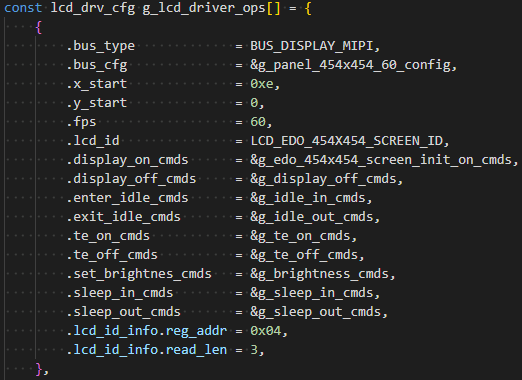

    各参数说明如下：

    -   bus\_type：只支持MIPI或者QSPI，该参数的类型为lcd\_bus\_type\_t。
    -   bus\_cfg：MIPI接口主要配置消隐区大小，QSPI接口主要配置屏幕实际像素大小，因此需要客户结合屏幕手册对该参数进行配置。修改主要涉及sync\_info字段，其他配置字段为MIPI协议相关，无需修改，具体可参考[图3](#zh-cn_topic_0000002411048428_fig71982620619)。

        注意：

        1.  pixel\_clk需要大于等于sync\_info中的（hsa+hbp+hact+hfp）\* （vsa+vbp+vact+vfp）\* 60 / 1000 （帧率配置60fps）
        2.  phy\_data\_rate＝pixel\_clk \* out\_formate\_bits / 1000， 其中out\_formate\_bits为输出颜色格式单个像素的bit数，例如：输出格式为RGB888，out\_formate\_bits就是24。

        **图 2**  修改pixel\_clk\_div\_num值<a name="zh-cn_topic_0000002411048428_fig13974121318591"></a>  
        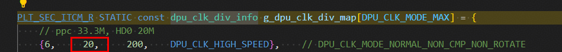

        **图 3**  bus\_cfg配置示意图<a name="zh-cn_topic_0000002411048428_fig71982620619"></a>  
        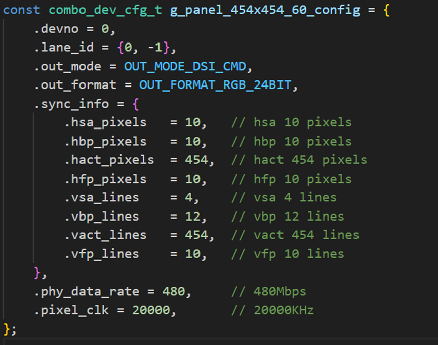

    -   x\_start：像素水平方向起始存放像素位置。
    -   y\_start：像素垂直方向起始存放像素位置。
    -   fps：可忽略。
    -   lcd\_id：屏幕ID值，初始化时会读取lcd\_id\_info.reg\_addr的值和该配置比较，获取g\_lcd\_driver\_ops中的配置进行屏幕配置。
    -   display\_on\_cmds：屏幕初始化配置序列，参考[图4](#zh-cn_topic_0000002411048428_fig1331653211)。

        **图 4**  屏幕初始化配置序列<a name="zh-cn_topic_0000002411048428_fig1331653211"></a>  
        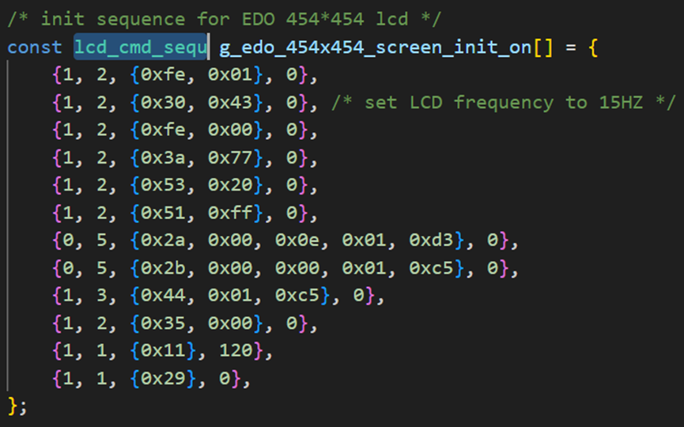

        第一个参数：1表示dcs命令，0表示gen命令，此参数需根据当前命令类型填写。

        第二个参数：命令长度（命令+参数）。

        第三个参数：命令内容。

        第四个参数：命令发送完成后延迟时间，单位：ms。

    -   display\_off\_cmd～sleep\_out\_cmd需要对照当前屏幕命令去实现。
    -   lcd\_id\_info.reg\_addr：读取屏幕ID寄存器地址。
    -   lcd\_id\_info.read\_len：屏幕ID长度。

3.  适配GUI屏幕分辨率，需要修改如下文件“middleware/services/gui/hal/common/include/graphic\_hardware\_config\_wearable.h”中的RESOLUTION\_WIDTH和RESOLUTION\_HEIGHT，默认分支配置为454×454，修改为新屏幕大小（QSPI等其他规格，请修改对应分支）。

以上即完成屏幕适配。

## 常见问题解决方案<a name="ZH-CN_TOPIC_0000002499501185"></a>

-   问题1：QSPI屏幕适配

    解决方案：QSPI屏幕需要修改“build/config/target\_config/3322/target\_config.py”文件，需要删除“MIPI\_ULPS\_SUPPORT”宏，同时增加“SUPPORT\_GPU\_QSPI”宏。

-   问题2：MIPI VIDEO屏幕适配

    解决方案：MIPI VIDEO屏幕需要修改“build/config/target\_config/3322/target\_config.py”文件，需要删除“MIPI\_ULPS\_SUPPORT”宏，同时增加“GPU\_SUPPORT\_VIDEO\_MODE”宏。

-   问题3：屏幕撕裂问题

    解决方案：调整Tear\_Scanline。使屏幕刷新时间晚于DPU送显时间，具体操作如下：在屏幕初始化序列中添加0x44的命令，参数设置范围为\[1, 屏幕高度 \]，该命令的效果是让屏幕刷新的时间延迟N行，具体设置值可根据裂屏时大致行数适配，如下图所示。

    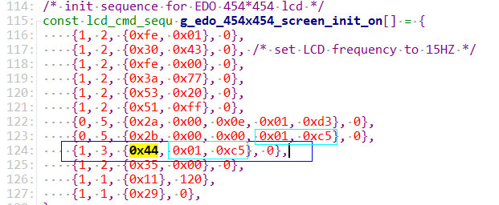

-   问题4：低带宽问题

    消隐区配置过小时，容易发生低带宽导致的黑屏，可适当增加消隐区来解决该问题，如下配置为红框值时有低带宽问题，调整为蓝框中值后低带宽问题消失。

    低带宽的表现：AT^GPU\_SAMPLE=dpu\_proc 0中“lowband\_cnt”非0且一直增加。

    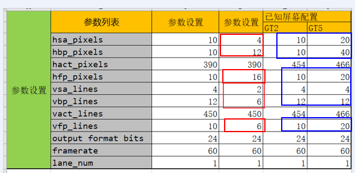

# TP适配<a name="ZH-CN_TOPIC_0000002466382276"></a>

本章节针对适配新TP器件提供指导，包含驱动目录简介、适配步骤以及常见问题分析。

-   **[驱动概述](#ZH-CN_TOPIC_0000002499501137)**  

-   **[适配步骤](#ZH-CN_TOPIC_0000002466382248)**  

-   **[常见问题](#ZH-CN_TOPIC_0000002499581197)**  

## 驱动概述<a name="ZH-CN_TOPIC_0000002499501137"></a>

当前主干版本支持的触控型号有ztw622、ztw523。

驱动目录：

-   “application/3322/input\_wear/peripheral/touch”目录下是触控公共处理相关源文件。
-   “application/3322/input\_wear/peripheral/touch/ztw523\_touch”目录下是ztw523型号触控使用的源文件。
-   “application/3322/input\_wear/peripheral/touch/ztw622\_touch”目录下是ztw622型号触控使用的源文件。

## 适配步骤<a name="ZH-CN_TOPIC_0000002466382248"></a>

以ZTW523为例，TP适配步骤如下：

1.  触控在项目实际使用中仅编译一种型号的源文件，因此适配新型号的触控时需要新建对应型号的目录：application/3322/input\_wear/peripheral/touch/xxx\_touch。
2.  适配触控通信I2C的相关配置，如bus id、中断管脚和复位管脚，参考头文件“drivers/boards/3322\_evb/product/product\_evb\_standard.h”。

    ```
    #define TOUCH_I2C_BUS I2C_BUS_1
    #define TOUCH_INT_GPIO S_AGPIO0
    #define TOUCH_RESET_GPIO S_AGPIO6
    ```

3.  适配触控的从机地址，如果有多个类型可以通过编译宏控制，参考头文件“application/3322/input\_wear/peripheral/touch/touch\_ctrl.h”。

    ```
    #define TOUCH_I2C_ADDR 0x20
    ```

4.  新建目录下的源文件可用已有型号的触控源文件为模板修改，用户通过触控厂商获取demo或触控手册，优先适配初始化和中断处理部分。

    ```
    ext_errno ztw523_init(void)                                           // 触控初始化
    ext_errno ztw523_irq_callback(uint8_t *data_buf, uint8_t data_len)    // 中断处理，获取报点信息
    ```

5.  适配触控芯片的通信接口，不同芯片的I2C交互方式不同，用户需要对比触控手册适配I2C通信接口。

    ```
    ext_errno tp_i2c_data_read(uint16_t reg_addr, uint8_t *data_buf, uint32_t data_len);
    ext_errno tp_i2c_cmd_write(uint16_t cmd);
    ext_errno tp_i2c_reg_write(uint16_t reg_addr, uint16_t reg_cfg);
    ext_errno tp_i2c_data_write(uint16_t reg_addr, uint8_t *data_buf, uint32_t data_len);
    ```

6.  适配触控芯片上电，用户需要对比触控手册适配上电时序。

    ```
    ext_errno ztw523_reset(void)
    ```

7.  <a name="zh-cn_topic_0000002444727569_li717515610192"></a>适配触控公共代码调用的函数指针，完成“.touch\_init”和“.touch\_get\_tpinfo”，即可支持基础报点功能。

    ```
    touch_peripheral_api g_ztw523_api = {
        .touch_init = ztw523_drv_init,
        .touch_deinit = ztw523_drv_deinit,
        .touch_get_tpinfo = ztw523_drv_get_info,
        .touch_suspend = ztw523_drv_suspend,
        .touch_resume = ztw523_drv_resume,
        .touch_sleep = ztw523_drv_sleep,
        .touch_bus_init = touch_host_peripheral_init,
        .register_callback = ztw523_register_handle,
        .unregister_callback = ztw523_unregister_handle,
    };
    ```

8.  完善[7](#zh-cn_topic_0000002444727569_li717515610192)中的其他接口。

## 常见问题<a name="ZH-CN_TOPIC_0000002499581197"></a>

1.  芯片与触控通信异常nack，检查触控上电时序、通信使用的bus id、slave通信地址是否正确。
2.  触摸屏时中断不上报，检查中断管脚适配是否正确、连接是否正常。
3.  触摸屏时中断可以正常上报，但获取的坐标、事件等信息错误，对比触控手册确保获取方式正确。
4.  触控可以正常报点时，需要确保中断处理时间不能过长，否则影响上层送显效果。

# 按键适配<a name="ZH-CN_TOPIC_0000002499501169"></a>

本章节针对GPIO按键扩展提供适配指导。

支持的GPIO按键最多可扩展7个。

按键适配步骤如下：

1.  <a name="zh-cn_topic_0000002411048424_li171081512346"></a>适配“application/3322/input\_wear/input\_feature/button/button\_feature.c”文件下的g\_brandy\_button\_pin\_map，例如适配BUTTON\_1为第一个GPIO按键，需要将其PIN\_NONE适配为按键实际使用的GPIO管脚。

    ```
    button_map_t g_brandy_button_pin_map[BUTTON_PIN_MAP_MAX] = {
        { PIN_NONE, BUTTON_PWR },
        { PIN_NONE, BUTTON_1 },
        { PIN_NONE, BUTTON_2 },
        { PIN_NONE, BUTTON_3 },
        { PIN_NONE, BUTTON_4 },
        { PIN_NONE, BUTTON_5 },
        { PIN_NONE, BUTTON_6 },
        { PIN_NONE, BUTTON_7 },
    };
    ```

2.  <a name="zh-cn_topic_0000002411048424_li5247185291611"></a>低功耗版本需要确保按键对应的GPIO管脚打开IE，在“drivers/boards/3322\_evb/board\_config/board\_evb.h”文件中修改对应管脚的IE配置。

    ```
    { HAL_PIO_FUNC_GPIO, HAL_PIO_DRIVE_MAX, HAL_PIO_PULL_MAX, HAL_PIO_IE_DISABLE },   // S_AGPIO25
    { HAL_PIO_FUNC_GPIO, HAL_PIO_DRIVE_MAX, HAL_PIO_PULL_MAX, HAL_PIO_IE_DISABLE },   // S_AGPIO26
    ```

    例如对应管脚是S\_AGPIO25，将该行的HAL\_PIO\_IE\_DISABLE改为HAL\_PIO\_IE\_ENABLE。

3.  在“application/3322/input\_wear/input\_feature/button/button\_feature.h”中适配新增按键事件枚举，默认只有BUTTON\_1事件。例如要新增两个GPIO按键，需要在BUTTON1事件枚举之后新增一组BUTTON2的事件枚举，以此类推。

    ```
    typedef enum {
        /* power key */
        BUTTON_PWR_START = 0,
        BUTTON_PWR_CLICKUP,
        BUTTON_PWR_CLICKUP_2,
        BUTTON_PWR_LONGPRESS_1S,
        BUTTON_PWR_LONGPRESS_5S,
        BUTTON_PWR_INVALID,
        
        /* function key */
        BUTTON1_START,
        BUTTON1_CLICKUP,
        BUTTON1_CLICKUP_2,
        BUTTON1_LONGPRESS_1S,
        BUTTON1_LONGPRESS_5S,
        BUTTON1_INVALID,
        
        /* new key */
        BUTTON2_START,
        BUTTON2_CLICKUP,
        BUTTON2_CLICKUP_2,
        BUTTON2_LONGPRESS_1S,
        BUTTON2_LONGPRESS_5S,
        BUTTON2_INVALID,
        
        BUTTON_BUTT
    } event_button_t;
    ```

4.  在“application/3322/input\_wear/input\_feature/button/button\_feature.c”文件的button\_event\_get接口中，适配新增按键事件处理，默认只有BUTTON\_1事件。例如要新增两个GPIO按键，需要在BUTTON1事件处理之后新增一组BUTTON2的事件处理，以此类推。

    ```
    static event_button_t button_event_get(button_id_t id, button_report_state_t state)
    {
        event_button_t event = BUTTON_PWR_START;
    
        if (id == BUTTON_1) {
            event = BUTTON1_START;
        }
    
        /* new key */
        if (id == BUTTON_2) {
            event = BUTTON2_START;
        }
        ......
    }
    ```

> **说明：** 
>若只适配一个GPIO按键，完成[1](#zh-cn_topic_0000002411048424_li171081512346)、[2](#zh-cn_topic_0000002411048424_li5247185291611)即可，否则需要全部步骤适配完成。

# NAND Flash适配<a name="ZH-CN_TOPIC_0000002466541836"></a>

> **须知：** 
>在适配之前请熟读NAND Flash手册，对NAND Flash有一定了解，需要对每个指令的波形有较为清晰的了解，需要知道当前厂商的波形与已支持的厂商的波形差异，如果波形有差异，还需要调整QSPI层的代码，以下内容以假设具体指令波形与已支持的厂商的波形相同的情况为例。

-   **[驱动适配](#ZH-CN_TOPIC_0000002499581257)**  

-   **[常见问题](#ZH-CN_TOPIC_0000002499581245)**  

## 驱动适配<a name="ZH-CN_TOPIC_0000002499581257"></a>

当前SDK已完成对大部分厂商NAND Flash的适配，理论上无需修改驱动代码，但仍然存在小部分厂商的配置与默认配置存在细微差异，可以查看“drivers/chips/3322/fmc/common/nand\_ids.c”文件的nand\_flash\_info\_t全局nand flash结构体数组，根据器件手册中器件id，与数组成员对比查看是否需要增加。

```
static struct nand_flash_info nand_flash_info_t[] = {
    {       /* SLC 4bit/512 1.8V */
        .name      = "DS35M1GA",
        .id        = {0xE5, 0x21},
        .id_len    = 2,  /* 2 is id len */
        .chipsize  = _128M,   //颗粒总大小
        .pagesize  = _2K,     //页大小
        .blocksize = _128K,   // block size大小，即此颗粒有一个block有64页
        .oobsize   = 64,      // oob大小
        .ecctype   = NAND_ECC_0BIT,
        .badblock_pos = BBP_FIRST_PAGE,
        .driver    = &spi_driver_general,  //是否需要开启QE使能
    },
	...
}
```

如果需要使用到镜像烧录功能，请将修改同步一份到“bootloader/provision\_3322/drivers/fmc/common/nand\_ids.c”目录，并同步验证镜像烧录功能是否正常，比对烧录文件是否完整。

常见NAND Flash器件差异适配主要是oob区域长度不同，器件的BLOCK数量不同，以[图1](#zh-cn_topic_0000002444727573_fig1655915411369)为例，图中可知该器件oob长度为128Byte，BLOCK数量为1024，适配前需要在手册中查找oob长度信息与BLOCK数量信息，获取oob的长度与BLOCK的数量。

**图 1**  NAND Flash存储组织图<a name="zh-cn_topic_0000002444727573_fig1655915411369"></a>  
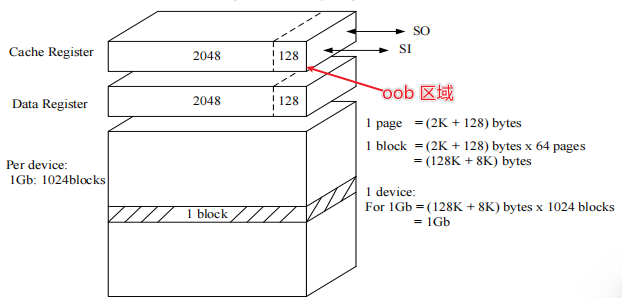

## 常见问题<a name="ZH-CN_TOPIC_0000002499581245"></a>

> **须知：** 
>由于NAND Flash器件支持内部ECC（Error Correcting Code）特性，该特性在版本上需要使用宏“ENABLE\_ECC”进行开启或者关闭，当版本上该特性发生切换（开启 -\> 关闭或者关闭 -\> 开启）时，由于NAND Flash内部存储结构发生变化，需要对文件系统进行格式化后再使用，格式化可参考使用AT命令“AT+FSFORMAT”。

# NOR Flash适配<a name="ZH-CN_TOPIC_0000002466382228"></a>

本章节针对新款NOR Flash器件提供适配指导，包含NOR Flash参数介绍、适配案例以及常见问题分析。支持产品开发人员能基于SDK代码，快速适配新款NOR Flash器件。当前SDK已经支持10+个厂商多款NOR Flash器件。

> **说明：** 
>本章节部分内容引用Flash datasheet《W25Q12PWWI KGD Datasheet Reversion B \_20240125》，仅供参考适配。

-   **[配置文件说明](#ZH-CN_TOPIC_0000002466541804)**  

-   **[适配步骤](#ZH-CN_TOPIC_0000002499501153)**  

-   **[32M NOR Flash适配](#ZH-CN_TOPIC_0000002577883856)**  

-   **[常见问题](#ZH-CN_TOPIC_0000002466541892)**  

## 配置文件说明<a name="ZH-CN_TOPIC_0000002466541804"></a>

-   **[文件说明](#ZH-CN_TOPIC_0000002499581229)**  

-   **[参数介绍](#ZH-CN_TOPIC_0000002466541852)**  

### 文件说明<a name="ZH-CN_TOPIC_0000002499581229"></a>

Flash相关的配置参数在“drivers/chips/3322/porting/sfc/sfc\_config\_info.c”及相关头文件中，含Flash ID、Flash枚举值、Flash读写相关命令、Flash参数列表、进入QSPI模式命令、配置dummy cycle、Flash QE命令列表等参数。

### 参数介绍<a name="ZH-CN_TOPIC_0000002466541852"></a>

-   Flash list， 以FLASH\_W25Q128为例，描述该型号ID、大小、擦除命令数量、读命令、写命令、擦除命令、bus使能命令、连续读命令。

    ```
    static const flash_spi_info_t g_flash_spi_info_list[] = {
        {
            FLASH_W25Q128,
            FLASH_SIZE_16MB,
            FLASH_ERASE_CMD_NUM_4,
            (spi_opreation_t *)g_flash_common_read_cmds,
            (spi_opreation_t *)g_flash_common_write_cmds,
            (spi_opreation_t *)g_flash_common_erase_cmds,
            (flash_cmd_execute_t *)g_flash_winbond_bus_enable, // 3322不使用该bus enable
    #ifdef CONFIG_SUPPORT_SFC_CONTINUE_READ
            {true, 0x20},
    #endif
        },
    ```

-   Flash ID

    ```
    #define FLASH_W25Q128           0x1860EF
    #define FLASH_W25Q128_IM        0x1880EF
    ```

-   Flash大小

    ```
    #define FLASH_SIZE_4MB  0x400000
    #define FLASH_SIZE_8MB  0x800000
    #define FLASH_SIZE_16MB 0x1000000
    #define FLASH_SIZE_32MB 0x2000000
    ```

-   erase num

    ```
    #define FLASH_ERASE_CMD_NUM_4 4
    #define FLASH_ERASE_CMD_NUM_3 3
    ```

-   读命令，含命令类型、命令字、接口类型、dummy。

    ```
    static const spi_opreation_t g_flash_common_read_cmds[] = {
        {SPI_CMD_SUPPORT, 0x03, STANDARD_SPI, 0x0},
        {SPI_CMD_SUPPORT, 0x0B, STANDARD_SPI, 0x1},
        {SPI_CMD_SUPPORT, 0x3B, DUAL_INPUT_DUAL_OUTPUT_SPI, 0x1},
        {SPI_CMD_SUPPORT, 0xBB, DUAL_IO_SPI, 0x1},
        {SPI_CMD_SUPPORT, 0x6B, QUAL_INPUT_QUAL_OUTPUT_SPI, 0x1},
        {SPI_CMD_SUPPORT, 0xEB, QUAL_IO_SPI, 0x3}
    };
    ```

-   写命令，含命令类型、命令字、接口类型。

    ```
    static const spi_opreation_t g_flash_common_write_cmds[] = {
        {SPI_CMD_SUPPORT, SFC_INVALID_CMD, 0x0, 0},
        {SPI_CMD_SUPPORT, 0x02, STANDARD_SPI, 0},
        SPI_CMD_UNSUPPORT,
        SPI_CMD_UNSUPPORT,
        {SPI_CMD_SUPPORT, 0x32, QUAL_INPUT_QUAL_OUTPUT_SPI, 0},
        SPI_CMD_UNSUPPORT,
    };
    ```

-   擦除命令，含命令类型、命令字、擦除范围。

    ```
    static const spi_opreation_t g_flash_common_erase_cmds[] = {
        {SPI_CMD_SUPPORT, 0xC7, 0x0, CHIP_SIZE},
        {SPI_CMD_SUPPORT, 0xD8, 0x0, _64K},
        {SPI_CMD_SUPPORT, 0x52, 0x0, _32K},
        {SPI_CMD_SUPPORT, 0x20, 0x0, _4K}
    };
    ```

-   bus enable命令，含Flash ID、命令长度、读命令字、写命令、写mask、读mask。

    ```
    static flash_cmd_qe_enable_t g_flash_cmd_qe_enable[] = {
        {FLASH_W25Q128, 1, { SPI_CMD_RDSR_2, 0}, SPI_CMD_WDSR_2, {0x2, 0}, {0x2, 0}},
        {FLASH_W25Q128_IM, 1, { SPI_CMD_RDSR_2, 0}, SPI_CMD_WDSR_2, {0x2, 0}, {0x2, 0}},
        {FLASH_GD25LQ64, 2, { SPI_CMD_RDSR, SPI_CMD_RDSR_2}, SPI_CMD_WDSR, {0x0, 0x2}, {0x0, 0x2}},
        {FLASH_GD25LE128E, 2, { SPI_CMD_RDSR, SPI_CMD_RDSR_2}, SPI_CMD_WDSR, {0x0, 0x2}, {0x0, 0x2}},
        {FLASH_FM25M4AA,   2, { SPI_CMD_RDSR, SPI_CMD_RDSR_2}, SPI_CMD_WDSR, {0x0, 0x2}, {0x0, 0x2}},
        {FLASH_EN25SX128A, 1, { SPI_CMD_RDSR_2, 0}, SPI_CMD_WDSR_2, {0x2, 0}, {0x2, 0}},
        {FLASH_XT25Q128, 2, { SPI_CMD_RDSR, SPI_CMD_RDSR_2}, SPI_CMD_WDSR, {0x0, 0x2}, {0x0, 0x2}},
        {FLASH_DS25M4AE, 2, { SPI_CMD_RDSR, SPI_CMD_RDSR_2}, SPI_CMD_WDSR, {0x0, 0x2}, {0x0, 0x2}},
    };
    ```

## 适配步骤<a name="ZH-CN_TOPIC_0000002499501153"></a>

-   **[Flash ID及枚举值配置](#ZH-CN_TOPIC_0000002499501201)**  

-   **[Flash相关参数配置](#ZH-CN_TOPIC_0000002466541868)**  

-   **[QE模式配置](#ZH-CN_TOPIC_0000002499581181)**  

### Flash ID及枚举值配置<a name="ZH-CN_TOPIC_0000002499501201"></a>

手册：

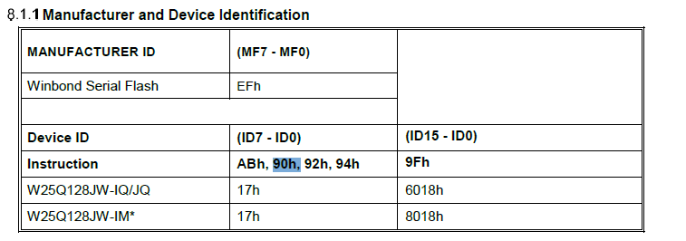

**代码：**

需要在“sfc\_config\_info.h”中添加该Flash的ID。

**图 1**  Flash ID宏定义<a name="zh-cn_topic_0000002444647501_fig16482105223512"></a>  
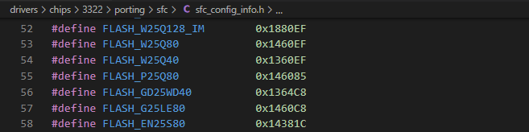

### Flash相关参数配置<a name="ZH-CN_TOPIC_0000002466541868"></a>

在“sfc\_config\_info.c”的g\_flash\_spi\_info\_list表中添加新Flash的信息， 需要添加Flash ID、ID、大小、擦除命令数量、读命令、写命令、擦除命令、连续读命令参数，如[图1](#zh-cn_topic_0000002444647521_fig2519112213718)所示。

bus使能命令在g\_flash\_cmd\_qe\_enable中适配。

**图 1**  Flash参数列表<a name="zh-cn_topic_0000002444647521_fig2519112213718"></a>  
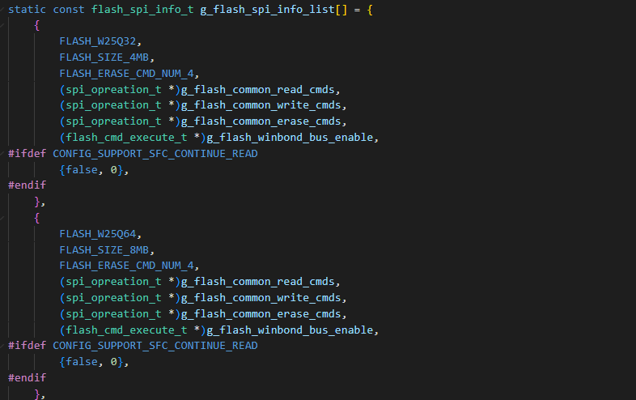

Flash相关参数配置步骤如下：

1.  根据手册填写Flash ID。

1.  根据手册填写Flash Size。
2.  根据手册填写支持的擦除命令个数。
3.  配置读命令，定义支持的读类型，读命令等，参考Flash datasheeet。

    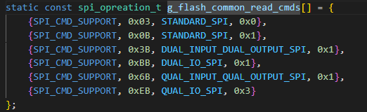

    以0xEB命令为例，命令类型为Quad I/O ，dummy cycle为3字节长度，包含M7-0。

    **手册：**

    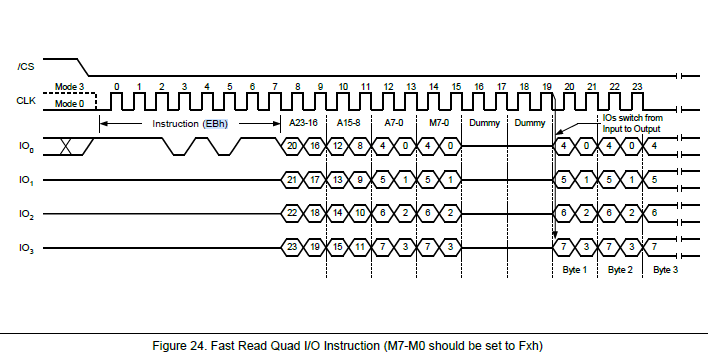

4.  配置写命令，定义支持的写类型，写命令等，参考Flash datasheeet。

    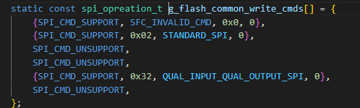

    以0x32命令为例，类型为Quad input。

    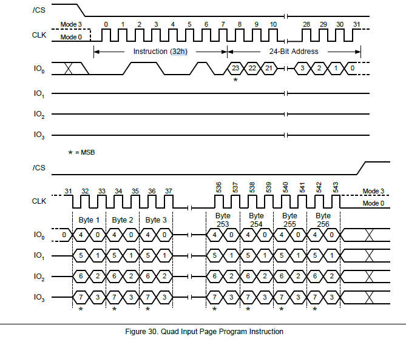

5.  配置擦除命令，包含命令字、擦除范围，通用型号支持四个擦除命令，参考Flash datasheeet

    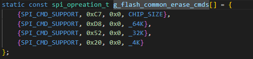

    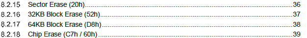

### QE模式配置<a name="ZH-CN_TOPIC_0000002499581181"></a>

部分Flash在切四线前，需要配置QE模式，以winbond为例。

QE模式说明：

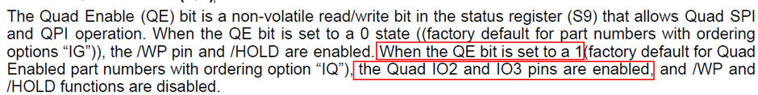

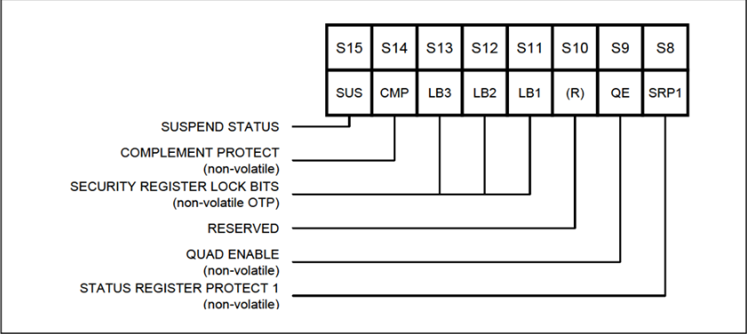


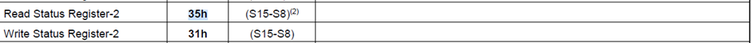

**代码：**写Flash状态寄存器2里面的QE bit，然后再回读，等待QE bit生效。

**图 1**  需要配置QE bit的Flash列表<a name="zh-cn_topic_0000002411048420_fig2813193015719"></a>  
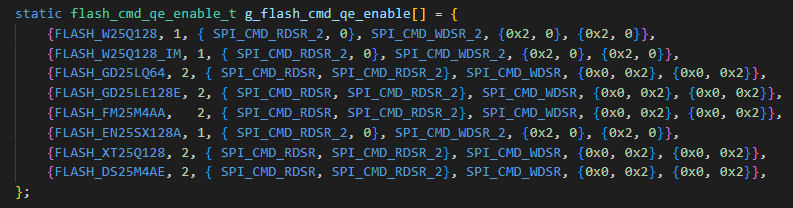

## 32M NOR Flash适配<a name="ZH-CN_TOPIC_0000002577883856"></a>

除常规适配外，对于超过16M的NOR Flash，还需进行以下额外配置：

1.  修改“FLASH\_LENGTH”为Flash实际容量的大小。例如，32M需配置为0x2000000。

    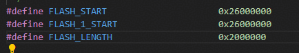

    修改文件路径为“drivers/boards/3322\_evb/memory\_config/norflash/ $\{WATCH\_TYPE\}/memory\_config\_flash.h”，若一个fwpkg中多个target的$\{WATCH\_TYPE\}不同，则需相应修改多个对应的“memory\_config\_flash.h”文件。

2.  修改分区表信息。分区表文件位于“build/config/target\_config/3322/param\_sector/$\{type\}.json”，其中“type”的取值请参考打包脚本“tools/pkg/chip\_packet/3322/packet.py”。

    注意：由于代码中存储分区size空间为24bit，因此每个分区大小不允许大于等于16M，且需按page对齐。

    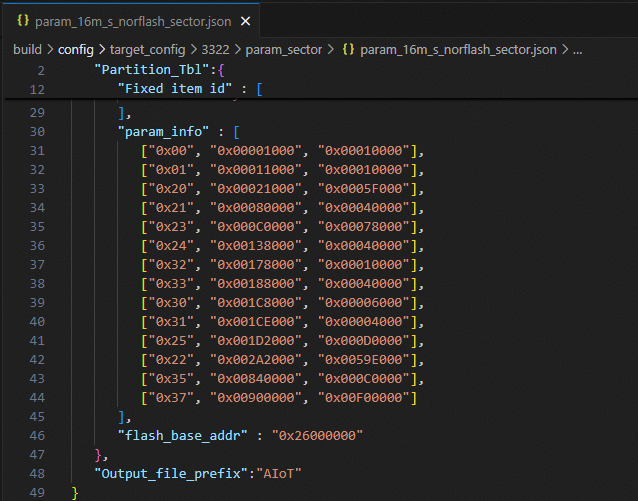

3.  若对分区表有调整，还需在文件“drivers/boards/3322\_evb/product/product\_evb\_standard.h”中修改对应的页大小。

    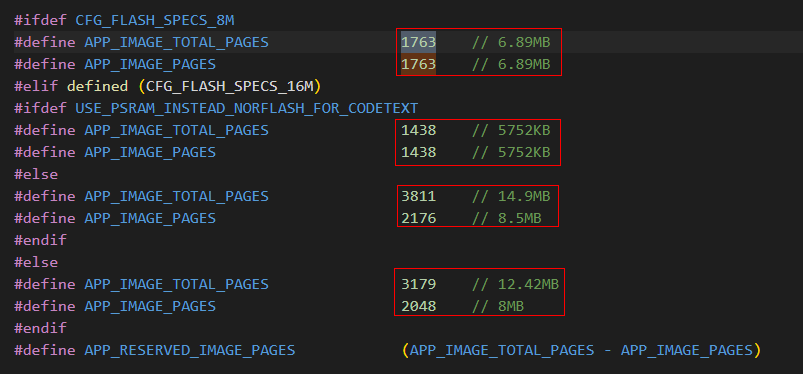

## 常见问题<a name="ZH-CN_TOPIC_0000002466541892"></a>

-   焊接问题：
    -   读出来的Flash ID为0。
    -   不管怎么调整dummy cycle，四线模式读出来的数据始终为0，或者0xCC等固定的数据。
    -   低频时，可以正常运行，高频时异常。

-   模式配置错误
    -   日志中出现timeout时，要查看是否QSPI模式和QPI模式配置错误。
    -   切四线前，确认该款Flash是否需要配置QE模式。

-   dummy cycle配置错误：四线模式，读出的数据有错位。

# eMMC适配<a name="ZH-CN_TOPIC_0000002466541820"></a>

由于eMMC的初始化流程是按照标准协议Embedded Multi-Media Card\(eMMC\) Electrical Standard \(5.1\)完成的，只要对端的器件支持标准协议，都无需进行特殊适配的。对于初始化流程请参考标准文档《JEDEC STANDARD -JESD84-B51》，本节只对开发过程中的问题和芯片的特殊之处进行说明。

-   本芯片的eMMC host支持的最高速率模式为HS200，并且时钟频率最大支持100MHz。
-   eMMC的管脚默认空闲态为高，因此除CLOCK管脚外的CMD和DATA管脚都需要默认为高，建议增加上拉电阻或者配置管脚PAD为上拉状态（具体配置请参见《低功耗软件 开发指南》的“IO通用配置”小节）。
-   本驱动中保证了eMMC基本的枚举、读、写以及擦的流程，保证上层文件系统的正常运行。
-   芯片进入深睡后，会对eMMC的host进行下电操作；唤醒后，会对寄存器进行恢复。只要保证深睡时，eMMC的器件不会下电，就无需重新枚举操作，代码中已对此部分流程进行处理，开发者正常使用即可。
-   在枚举前，请确保eMMC器件的供电正常，对应的RESET管脚配置正常，由于不同器件的差异，请参考对应的eMMC器件手册进行检查。
-   本驱动代码上层基于liteos中的开源mmc代码实现，底层适配芯片的配置完成。如果需要进行二次开发的，请在开源代码中进行处理。

# 缩略语<a name="ZH-CN_TOPIC_0000002499501213"></a>

<a name="zh-cn_topic_0000002472847281_table1144991620441"></a>
<table><tbody><tr id="zh-cn_topic_0000002472847281_row1244951619442"><td class="nocellnorowborder" style="border:none" valign="top" width="23.532353235323534%"><p id="zh-cn_topic_0000002472847281_p19449171684416"><a name="zh-cn_topic_0000002472847281_p19449171684416"></a><a name="zh-cn_topic_0000002472847281_p19449171684416"></a><strong id="zh-cn_topic_0000002472847281_b142873755619"><a name="zh-cn_topic_0000002472847281_b142873755619"></a><a name="zh-cn_topic_0000002472847281_b142873755619"></a>D</strong></p>
</td>
<td class="nocellnorowborder" style="border:none" valign="top" width="43.13431343134314%">&nbsp;&nbsp;</td>
<td class="cell-norowborder" style="border:none" valign="top" width="33.33333333333333%">&nbsp;&nbsp;</td>
</tr>
<tr id="zh-cn_topic_0000002472847281_row184491216194414"><td class="nocellnorowborder" style="border:none" valign="top" width="23.532353235323534%"><p id="zh-cn_topic_0000002472847281_p1544991611445"><a name="zh-cn_topic_0000002472847281_p1544991611445"></a><a name="zh-cn_topic_0000002472847281_p1544991611445"></a><strong id="zh-cn_topic_0000002472847281_b84291137165613"><a name="zh-cn_topic_0000002472847281_b84291137165613"></a><a name="zh-cn_topic_0000002472847281_b84291137165613"></a>DCS</strong></p>
</td>
<td class="nocellnorowborder" style="border:none" valign="top" width="43.13431343134314%">&nbsp;&nbsp;</td>
<td class="cell-norowborder" style="border:none" valign="top" width="33.33333333333333%">&nbsp;&nbsp;</td>
</tr>
<tr id="zh-cn_topic_0000002472847281_row2503134794914"><td class="nocellnorowborder" style="border:none" valign="top" width="23.532353235323534%"><p id="zh-cn_topic_0000002472847281_p9440204864911"><a name="zh-cn_topic_0000002472847281_p9440204864911"></a><a name="zh-cn_topic_0000002472847281_p9440204864911"></a><strong id="zh-cn_topic_0000002472847281_b1344064817497"><a name="zh-cn_topic_0000002472847281_b1344064817497"></a><a name="zh-cn_topic_0000002472847281_b1344064817497"></a>DPU</strong></p>
</td>
<td class="nocellnorowborder" style="border:none" valign="top" width="43.13431343134314%"><p id="zh-cn_topic_0000002472847281_p18440124814914"><a name="zh-cn_topic_0000002472847281_p18440124814914"></a><a name="zh-cn_topic_0000002472847281_p18440124814914"></a>Display Processing Unit</p>
</td>
<td class="cell-norowborder" style="border:none" valign="top" width="33.33333333333333%"><p id="zh-cn_topic_0000002472847281_p9440648104913"><a name="zh-cn_topic_0000002472847281_p9440648104913"></a><a name="zh-cn_topic_0000002472847281_p9440648104913"></a>显示处理单元</p>
</td>
</tr>
<tr id="zh-cn_topic_0000002472847281_row4224132385311"><td class="nocellnorowborder" style="border:none" valign="top" width="23.532353235323534%">&nbsp;&nbsp;</td>
<td class="nocellnorowborder" style="border:none" valign="top" width="43.13431343134314%">&nbsp;&nbsp;</td>
<td class="cell-norowborder" style="border:none" valign="top" width="33.33333333333333%">&nbsp;&nbsp;</td>
</tr>
<tr id="zh-cn_topic_0000002472847281_row32252023165317"><td class="nocellnorowborder" style="border:none" valign="top" width="23.532353235323534%"><p id="zh-cn_topic_0000002472847281_p13225162315317"><a name="zh-cn_topic_0000002472847281_p13225162315317"></a><a name="zh-cn_topic_0000002472847281_p13225162315317"></a><strong id="zh-cn_topic_0000002472847281_b84311137195614"><a name="zh-cn_topic_0000002472847281_b84311137195614"></a><a name="zh-cn_topic_0000002472847281_b84311137195614"></a>E</strong></p>
</td>
<td class="nocellnorowborder" style="border:none" valign="top" width="43.13431343134314%">&nbsp;&nbsp;</td>
<td class="cell-norowborder" style="border:none" valign="top" width="33.33333333333333%">&nbsp;&nbsp;</td>
</tr>
<tr id="zh-cn_topic_0000002472847281_row1422582310538"><td class="nocellnorowborder" style="border:none" valign="top" width="23.532353235323534%"><p id="zh-cn_topic_0000002472847281_p18225623205315"><a name="zh-cn_topic_0000002472847281_p18225623205315"></a><a name="zh-cn_topic_0000002472847281_p18225623205315"></a><strong id="zh-cn_topic_0000002472847281_b1443113714567"><a name="zh-cn_topic_0000002472847281_b1443113714567"></a><a name="zh-cn_topic_0000002472847281_b1443113714567"></a>ECC</strong></p>
</td>
<td class="nocellnorowborder" style="border:none" valign="top" width="43.13431343134314%"><p id="zh-cn_topic_0000002472847281_p122562335312"><a name="zh-cn_topic_0000002472847281_p122562335312"></a><a name="zh-cn_topic_0000002472847281_p122562335312"></a>Error Correction Code</p>
</td>
<td class="cell-norowborder" style="border:none" valign="top" width="33.33333333333333%"><p id="zh-cn_topic_0000002472847281_p722515231534"><a name="zh-cn_topic_0000002472847281_p722515231534"></a><a name="zh-cn_topic_0000002472847281_p722515231534"></a>纠错码</p>
</td>
</tr>
<tr id="zh-cn_topic_0000002472847281_row54216279553"><td class="nocellnorowborder" style="border:none" valign="top" width="23.532353235323534%"><p id="zh-cn_topic_0000002472847281_p2974192735519"><a name="zh-cn_topic_0000002472847281_p2974192735519"></a><a name="zh-cn_topic_0000002472847281_p2974192735519"></a><strong id="zh-cn_topic_0000002472847281_b12974162755511"><a name="zh-cn_topic_0000002472847281_b12974162755511"></a><a name="zh-cn_topic_0000002472847281_b12974162755511"></a>eMMC</strong></p>
</td>
<td class="nocellnorowborder" style="border:none" valign="top" width="43.13431343134314%"><p id="zh-cn_topic_0000002472847281_p3974122745518"><a name="zh-cn_topic_0000002472847281_p3974122745518"></a><a name="zh-cn_topic_0000002472847281_p3974122745518"></a>Embedded Multimedia Controller</p>
</td>
<td class="cell-norowborder" style="border:none" valign="top" width="33.33333333333333%"><p id="zh-cn_topic_0000002472847281_p13974112795516"><a name="zh-cn_topic_0000002472847281_p13974112795516"></a><a name="zh-cn_topic_0000002472847281_p13974112795516"></a>嵌入式多媒体控制器</p>
</td>
</tr>
<tr id="zh-cn_topic_0000002472847281_row174497167449"><td class="nocellnorowborder" style="border:none" valign="top" width="23.532353235323534%">&nbsp;&nbsp;</td>
<td class="nocellnorowborder" style="border:none" valign="top" width="43.13431343134314%">&nbsp;&nbsp;</td>
<td class="cell-norowborder" style="border:none" valign="top" width="33.33333333333333%">&nbsp;&nbsp;</td>
</tr>
<tr id="zh-cn_topic_0000002472847281_row860012014918"><td class="nocellnorowborder" style="border:none" valign="top" width="23.532353235323534%"><p id="zh-cn_topic_0000002472847281_p16854142114917"><a name="zh-cn_topic_0000002472847281_p16854142114917"></a><a name="zh-cn_topic_0000002472847281_p16854142114917"></a><strong id="zh-cn_topic_0000002472847281_b185414210498"><a name="zh-cn_topic_0000002472847281_b185414210498"></a><a name="zh-cn_topic_0000002472847281_b185414210498"></a>G</strong></p>
</td>
<td class="nocellnorowborder" style="border:none" valign="top" width="43.13431343134314%">&nbsp;&nbsp;</td>
<td class="cell-norowborder" style="border:none" valign="top" width="33.33333333333333%">&nbsp;&nbsp;</td>
</tr>
<tr id="zh-cn_topic_0000002472847281_row22610215218"><td class="nocellnorowborder" style="border:none" valign="top" width="23.532353235323534%"><p id="zh-cn_topic_0000002472847281_p194811539521"><a name="zh-cn_topic_0000002472847281_p194811539521"></a><a name="zh-cn_topic_0000002472847281_p194811539521"></a><strong id="zh-cn_topic_0000002472847281_b16481839528"><a name="zh-cn_topic_0000002472847281_b16481839528"></a><a name="zh-cn_topic_0000002472847281_b16481839528"></a>GPIO</strong></p>
</td>
<td class="nocellnorowborder" style="border:none" valign="top" width="43.13431343134314%"><p id="zh-cn_topic_0000002472847281_p148114315219"><a name="zh-cn_topic_0000002472847281_p148114315219"></a><a name="zh-cn_topic_0000002472847281_p148114315219"></a>General Purpose Input/Output</p>
</td>
<td class="cell-norowborder" style="border:none" valign="top" width="33.33333333333333%"><p id="zh-cn_topic_0000002472847281_p184819313525"><a name="zh-cn_topic_0000002472847281_p184819313525"></a><a name="zh-cn_topic_0000002472847281_p184819313525"></a>通用输入输出</p>
</td>
</tr>
<tr id="zh-cn_topic_0000002472847281_row1260092019498"><td class="nocellnorowborder" style="border:none" valign="top" width="23.532353235323534%"><p id="zh-cn_topic_0000002472847281_p148544218497"><a name="zh-cn_topic_0000002472847281_p148544218497"></a><a name="zh-cn_topic_0000002472847281_p148544218497"></a><strong id="zh-cn_topic_0000002472847281_b148541321104916"><a name="zh-cn_topic_0000002472847281_b148541321104916"></a><a name="zh-cn_topic_0000002472847281_b148541321104916"></a>GUI</strong></p>
</td>
<td class="nocellnorowborder" style="border:none" valign="top" width="43.13431343134314%"><p id="zh-cn_topic_0000002472847281_p985492111494"><a name="zh-cn_topic_0000002472847281_p985492111494"></a><a name="zh-cn_topic_0000002472847281_p985492111494"></a>Graphical User Interface</p>
</td>
<td class="cell-norowborder" style="border:none" valign="top" width="33.33333333333333%"><p id="zh-cn_topic_0000002472847281_p485413213490"><a name="zh-cn_topic_0000002472847281_p485413213490"></a><a name="zh-cn_topic_0000002472847281_p485413213490"></a>图形用户界面</p>
</td>
</tr>
<tr id="zh-cn_topic_0000002472847281_row6308444145112"><td class="nocellnorowborder" style="border:none" valign="top" width="23.532353235323534%">&nbsp;&nbsp;</td>
<td class="nocellnorowborder" style="border:none" valign="top" width="43.13431343134314%">&nbsp;&nbsp;</td>
<td class="cell-norowborder" style="border:none" valign="top" width="33.33333333333333%">&nbsp;&nbsp;</td>
</tr>
<tr id="zh-cn_topic_0000002472847281_row153081644145113"><td class="nocellnorowborder" style="border:none" valign="top" width="23.532353235323534%"><p id="zh-cn_topic_0000002472847281_p956194675110"><a name="zh-cn_topic_0000002472847281_p956194675110"></a><a name="zh-cn_topic_0000002472847281_p956194675110"></a><strong id="zh-cn_topic_0000002472847281_b105634605114"><a name="zh-cn_topic_0000002472847281_b105634605114"></a><a name="zh-cn_topic_0000002472847281_b105634605114"></a>I</strong></p>
</td>
<td class="nocellnorowborder" style="border:none" valign="top" width="43.13431343134314%">&nbsp;&nbsp;</td>
<td class="cell-norowborder" style="border:none" valign="top" width="33.33333333333333%">&nbsp;&nbsp;</td>
</tr>
<tr id="zh-cn_topic_0000002472847281_row11308644125115"><td class="nocellnorowborder" style="border:none" valign="top" width="23.532353235323534%"><p id="zh-cn_topic_0000002472847281_p165614614513"><a name="zh-cn_topic_0000002472847281_p165614614513"></a><a name="zh-cn_topic_0000002472847281_p165614614513"></a><strong id="zh-cn_topic_0000002472847281_b356204613514"><a name="zh-cn_topic_0000002472847281_b356204613514"></a><a name="zh-cn_topic_0000002472847281_b356204613514"></a>I2C</strong></p>
</td>
<td class="nocellnorowborder" style="border:none" valign="top" width="43.13431343134314%"><p id="zh-cn_topic_0000002472847281_p95654614510"><a name="zh-cn_topic_0000002472847281_p95654614510"></a><a name="zh-cn_topic_0000002472847281_p95654614510"></a>The Inter-Integrated Circuit</p>
</td>
<td class="cell-norowborder" style="border:none" valign="top" width="33.33333333333333%"><p id="zh-cn_topic_0000002472847281_p756946195111"><a name="zh-cn_topic_0000002472847281_p756946195111"></a><a name="zh-cn_topic_0000002472847281_p756946195111"></a>I2C总线</p>
</td>
</tr>
<tr id="zh-cn_topic_0000002472847281_row5600162074916"><td class="nocellnorowborder" style="border:none" valign="top" width="23.532353235323534%">&nbsp;&nbsp;</td>
<td class="nocellnorowborder" style="border:none" valign="top" width="43.13431343134314%">&nbsp;&nbsp;</td>
<td class="cell-norowborder" style="border:none" valign="top" width="33.33333333333333%">&nbsp;&nbsp;</td>
</tr>
<tr id="zh-cn_topic_0000002472847281_row104501116184419"><td class="nocellnorowborder" style="border:none" valign="top" width="23.532353235323534%"><p id="zh-cn_topic_0000002472847281_p2391101874711"><a name="zh-cn_topic_0000002472847281_p2391101874711"></a><a name="zh-cn_topic_0000002472847281_p2391101874711"></a><strong id="zh-cn_topic_0000002472847281_b939191854714"><a name="zh-cn_topic_0000002472847281_b939191854714"></a><a name="zh-cn_topic_0000002472847281_b939191854714"></a>M</strong></p>
</td>
<td class="nocellnorowborder" style="border:none" valign="top" width="43.13431343134314%">&nbsp;&nbsp;</td>
<td class="cell-norowborder" style="border:none" valign="top" width="33.33333333333333%">&nbsp;&nbsp;</td>
</tr>
<tr id="zh-cn_topic_0000002472847281_row54501316114416"><td class="nocellnorowborder" style="border:none" valign="top" width="23.532353235323534%"><p id="zh-cn_topic_0000002472847281_p113911718144716"><a name="zh-cn_topic_0000002472847281_p113911718144716"></a><a name="zh-cn_topic_0000002472847281_p113911718144716"></a><strong id="zh-cn_topic_0000002472847281_b13912182476"><a name="zh-cn_topic_0000002472847281_b13912182476"></a><a name="zh-cn_topic_0000002472847281_b13912182476"></a>MIPI</strong></p>
</td>
<td class="nocellnorowborder" style="border:none" valign="top" width="43.13431343134314%"><p id="zh-cn_topic_0000002472847281_p23921818134713"><a name="zh-cn_topic_0000002472847281_p23921818134713"></a><a name="zh-cn_topic_0000002472847281_p23921818134713"></a>Mobile Industry Processor Interface</p>
</td>
<td class="cell-norowborder" style="border:none" valign="top" width="33.33333333333333%"><p id="zh-cn_topic_0000002472847281_p1392118154712"><a name="zh-cn_topic_0000002472847281_p1392118154712"></a><a name="zh-cn_topic_0000002472847281_p1392118154712"></a>移动产业处理器接口</p>
</td>
</tr>
<tr id="zh-cn_topic_0000002472847281_row112911447175210"><td class="nocellnorowborder" style="border:none" valign="top" width="23.532353235323534%">&nbsp;&nbsp;</td>
<td class="nocellnorowborder" style="border:none" valign="top" width="43.13431343134314%">&nbsp;&nbsp;</td>
<td class="cell-norowborder" style="border:none" valign="top" width="33.33333333333333%">&nbsp;&nbsp;</td>
</tr>
<tr id="zh-cn_topic_0000002472847281_row32915474525"><td class="nocellnorowborder" style="border:none" valign="top" width="23.532353235323534%"><p id="zh-cn_topic_0000002472847281_p18291184715213"><a name="zh-cn_topic_0000002472847281_p18291184715213"></a><a name="zh-cn_topic_0000002472847281_p18291184715213"></a><strong id="zh-cn_topic_0000002472847281_b154362371561"><a name="zh-cn_topic_0000002472847281_b154362371561"></a><a name="zh-cn_topic_0000002472847281_b154362371561"></a>O</strong></p>
</td>
<td class="nocellnorowborder" style="border:none" valign="top" width="43.13431343134314%">&nbsp;&nbsp;</td>
<td class="cell-norowborder" style="border:none" valign="top" width="33.33333333333333%">&nbsp;&nbsp;</td>
</tr>
<tr id="zh-cn_topic_0000002472847281_row18291847155211"><td class="nocellnorowborder" style="border:none" valign="top" width="23.532353235323534%"><p id="zh-cn_topic_0000002472847281_p9291547115210"><a name="zh-cn_topic_0000002472847281_p9291547115210"></a><a name="zh-cn_topic_0000002472847281_p9291547115210"></a><strong id="zh-cn_topic_0000002472847281_b1943763785616"><a name="zh-cn_topic_0000002472847281_b1943763785616"></a><a name="zh-cn_topic_0000002472847281_b1943763785616"></a>OOB</strong></p>
</td>
<td class="nocellnorowborder" style="border:none" valign="top" width="43.13431343134314%"><p id="zh-cn_topic_0000002472847281_p1829154712522"><a name="zh-cn_topic_0000002472847281_p1829154712522"></a><a name="zh-cn_topic_0000002472847281_p1829154712522"></a>out of band</p>
</td>
<td class="cell-norowborder" style="border:none" valign="top" width="33.33333333333333%"><p id="zh-cn_topic_0000002472847281_p202919477528"><a name="zh-cn_topic_0000002472847281_p202919477528"></a><a name="zh-cn_topic_0000002472847281_p202919477528"></a>带外数据</p>
</td>
</tr>
<tr id="zh-cn_topic_0000002472847281_row7450201614447"><td class="nocellnorowborder" style="border:none" valign="top" width="23.532353235323534%">&nbsp;&nbsp;</td>
<td class="nocellnorowborder" style="border:none" valign="top" width="43.13431343134314%">&nbsp;&nbsp;</td>
<td class="cell-norowborder" style="border:none" valign="top" width="33.33333333333333%">&nbsp;&nbsp;</td>
</tr>
<tr id="zh-cn_topic_0000002472847281_row12450516184414"><td class="nocellnorowborder" style="border:none" valign="top" width="23.532353235323534%"><p id="zh-cn_topic_0000002472847281_p12450151654414"><a name="zh-cn_topic_0000002472847281_p12450151654414"></a><a name="zh-cn_topic_0000002472847281_p12450151654414"></a><strong id="zh-cn_topic_0000002472847281_b18438937135615"><a name="zh-cn_topic_0000002472847281_b18438937135615"></a><a name="zh-cn_topic_0000002472847281_b18438937135615"></a>Q</strong></p>
</td>
<td class="nocellnorowborder" style="border:none" valign="top" width="43.13431343134314%">&nbsp;&nbsp;</td>
<td class="cell-norowborder" style="border:none" valign="top" width="33.33333333333333%">&nbsp;&nbsp;</td>
</tr>
<tr id="zh-cn_topic_0000002472847281_row54371634195415"><td class="nocellnorowborder" style="border:none" valign="top" width="23.532353235323534%"><p id="zh-cn_topic_0000002472847281_p1243753415542"><a name="zh-cn_topic_0000002472847281_p1243753415542"></a><a name="zh-cn_topic_0000002472847281_p1243753415542"></a><strong id="zh-cn_topic_0000002472847281_b114381837145610"><a name="zh-cn_topic_0000002472847281_b114381837145610"></a><a name="zh-cn_topic_0000002472847281_b114381837145610"></a>QE</strong></p>
</td>
<td class="nocellnorowborder" style="border:none" valign="top" width="43.13431343134314%">&nbsp;&nbsp;</td>
<td class="cell-norowborder" style="border:none" valign="top" width="33.33333333333333%">&nbsp;&nbsp;</td>
</tr>
<tr id="zh-cn_topic_0000002472847281_row1287552624710"><td class="nocellnorowborder" style="border:none" valign="top" width="23.532353235323534%"><p id="zh-cn_topic_0000002472847281_p1187512260475"><a name="zh-cn_topic_0000002472847281_p1187512260475"></a><a name="zh-cn_topic_0000002472847281_p1187512260475"></a><strong id="zh-cn_topic_0000002472847281_b343933720568"><a name="zh-cn_topic_0000002472847281_b343933720568"></a><a name="zh-cn_topic_0000002472847281_b343933720568"></a>QSPI</strong></p>
</td>
<td class="nocellnorowborder" style="border:none" valign="top" width="43.13431343134314%"><p id="zh-cn_topic_0000002472847281_p447911539474"><a name="zh-cn_topic_0000002472847281_p447911539474"></a><a name="zh-cn_topic_0000002472847281_p447911539474"></a>Queued SPI</p>
</td>
<td class="cell-norowborder" style="border:none" valign="top" width="33.33333333333333%"><p id="zh-cn_topic_0000002472847281_p1447925317472"><a name="zh-cn_topic_0000002472847281_p1447925317472"></a><a name="zh-cn_topic_0000002472847281_p1447925317472"></a>队列串行外设接口</p>
</td>
</tr>
<tr id="zh-cn_topic_0000002472847281_row1987512610474"><td class="nocellnorowborder" style="border:none" valign="top" width="23.532353235323534%">&nbsp;&nbsp;</td>
<td class="nocellnorowborder" style="border:none" valign="top" width="43.13431343134314%">&nbsp;&nbsp;</td>
<td class="cell-norowborder" style="border:none" valign="top" width="33.33333333333333%">&nbsp;&nbsp;</td>
</tr>
<tr id="zh-cn_topic_0000002472847281_row7876172611479"><td class="nocellnorowborder" style="border:none" valign="top" width="23.532353235323534%"><p id="zh-cn_topic_0000002472847281_p118761526204719"><a name="zh-cn_topic_0000002472847281_p118761526204719"></a><a name="zh-cn_topic_0000002472847281_p118761526204719"></a><strong id="zh-cn_topic_0000002472847281_b114408372562"><a name="zh-cn_topic_0000002472847281_b114408372562"></a><a name="zh-cn_topic_0000002472847281_b114408372562"></a>T</strong></p>
</td>
<td class="nocellnorowborder" style="border:none" valign="top" width="43.13431343134314%">&nbsp;&nbsp;</td>
<td class="cell-norowborder" style="border:none" valign="top" width="33.33333333333333%">&nbsp;&nbsp;</td>
</tr>
<tr id="zh-cn_topic_0000002472847281_row1945612489503"><td class="nocellnorowborder" style="border:none" valign="top" width="23.532353235323534%"><p id="zh-cn_topic_0000002472847281_p1545711483509"><a name="zh-cn_topic_0000002472847281_p1545711483509"></a><a name="zh-cn_topic_0000002472847281_p1545711483509"></a><strong id="zh-cn_topic_0000002472847281_b744033785611"><a name="zh-cn_topic_0000002472847281_b744033785611"></a><a name="zh-cn_topic_0000002472847281_b744033785611"></a>TP</strong></p>
</td>
<td class="nocellnorowborder" style="border:none" valign="top" width="43.13431343134314%"><p id="zh-cn_topic_0000002472847281_p4457184818503"><a name="zh-cn_topic_0000002472847281_p4457184818503"></a><a name="zh-cn_topic_0000002472847281_p4457184818503"></a>Touch panel</p>
</td>
<td class="cell-norowborder" style="border:none" valign="top" width="33.33333333333333%"><p id="zh-cn_topic_0000002472847281_p1045774816504"><a name="zh-cn_topic_0000002472847281_p1045774816504"></a><a name="zh-cn_topic_0000002472847281_p1045774816504"></a>触摸屏</p>
</td>
</tr>
<tr id="zh-cn_topic_0000002472847281_row13368744559"><td class="nocellnorowborder" style="border:none" valign="top" width="23.532353235323534%">&nbsp;&nbsp;</td>
<td class="nocellnorowborder" style="border:none" valign="top" width="43.13431343134314%">&nbsp;&nbsp;</td>
<td class="cell-norowborder" style="border:none" valign="top" width="33.33333333333333%">&nbsp;&nbsp;</td>
</tr>
<tr id="zh-cn_topic_0000002472847281_row13681495517"><td class="nocellnorowborder" style="border:none" valign="top" width="23.532353235323534%"><p id="zh-cn_topic_0000002472847281_p1579614505515"><a name="zh-cn_topic_0000002472847281_p1579614505515"></a><a name="zh-cn_topic_0000002472847281_p1579614505515"></a><strong id="zh-cn_topic_0000002472847281_b187961558557"><a name="zh-cn_topic_0000002472847281_b187961558557"></a><a name="zh-cn_topic_0000002472847281_b187961558557"></a>X</strong></p>
</td>
<td class="nocellnorowborder" style="border:none" valign="top" width="43.13431343134314%">&nbsp;&nbsp;</td>
<td class="cell-norowborder" style="border:none" valign="top" width="33.33333333333333%">&nbsp;&nbsp;</td>
</tr>
<tr id="zh-cn_topic_0000002472847281_row03681041550"><td class="row-nocellborder" style="border:none" valign="top" width="23.532353235323534%"><p id="zh-cn_topic_0000002472847281_p1979612565511"><a name="zh-cn_topic_0000002472847281_p1979612565511"></a><a name="zh-cn_topic_0000002472847281_p1979612565511"></a><strong id="zh-cn_topic_0000002472847281_b17796256556"><a name="zh-cn_topic_0000002472847281_b17796256556"></a><a name="zh-cn_topic_0000002472847281_b17796256556"></a>XIP</strong></p>
</td>
<td class="row-nocellborder" style="border:none" valign="top" width="43.13431343134314%"><p id="zh-cn_topic_0000002472847281_p1479612510555"><a name="zh-cn_topic_0000002472847281_p1479612510555"></a><a name="zh-cn_topic_0000002472847281_p1479612510555"></a>eXecute-In-Place</p>
</td>
<td class="cellrowborder" style="border:none" valign="top" width="33.33333333333333%"><p id="zh-cn_topic_0000002472847281_p107964519558"><a name="zh-cn_topic_0000002472847281_p107964519558"></a><a name="zh-cn_topic_0000002472847281_p107964519558"></a>片上运行</p>
</td>
</tr>
</tbody>
</table>

