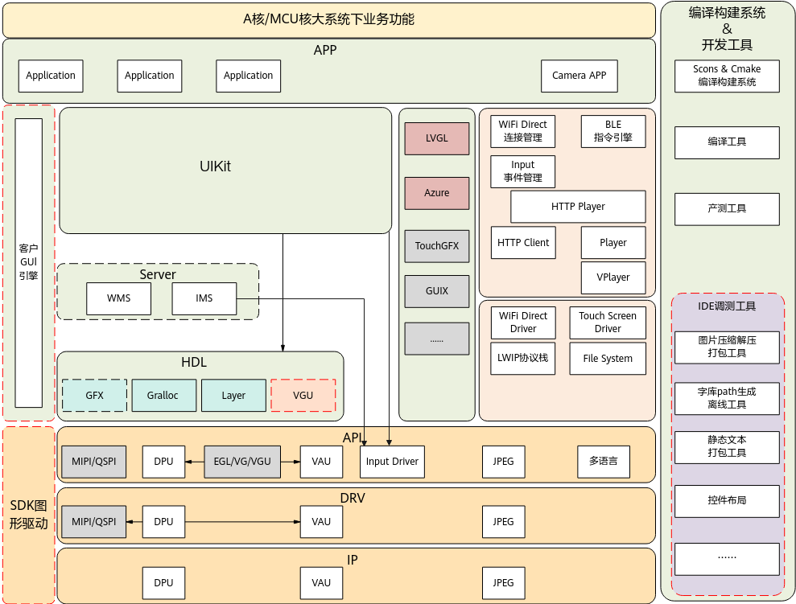
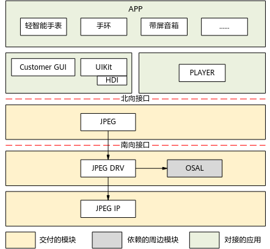
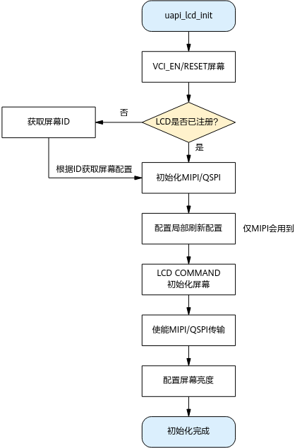
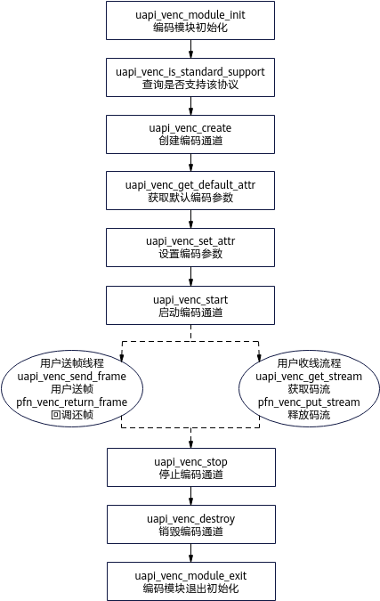
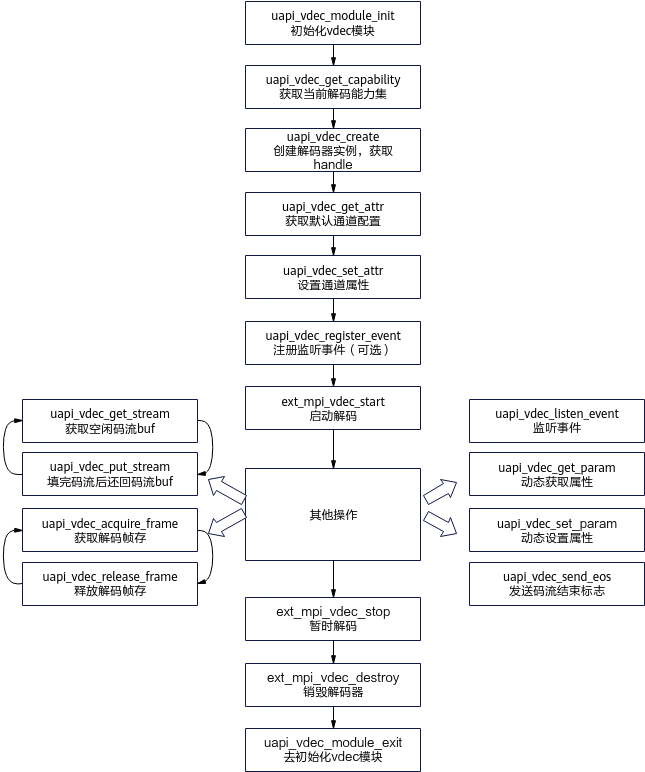

# 前言<a name="ZH-CN_TOPIC_0000002466543128"></a>

**概述<a name="zh-cn_topic_0000002444647825_section4537382116410"></a>**

本文档主要介绍图形驱动开发相关内容，包括工作原理、功能描述、接口使用方法及注意事项。

**读者对象<a name="zh-cn_topic_0000002444647825_section4378592816410"></a>**

本文档主要适用于以下工程师：

-   技术支持工程师
-   软件开发工程师

**符号约定<a name="zh-cn_topic_0000002444647825_section133020216410"></a>**

在本文中可能出现下列标志，它们所代表的含义如下。

<a name="zh-cn_topic_0000002444647825_table2622507016410"></a>
<table><thead align="left"><tr id="zh-cn_topic_0000002444647825_row1530720816410"><th class="cellrowborder" valign="top" width="20.580000000000002%" id="mcps1.1.3.1.1"><p id="zh-cn_topic_0000002444647825_p6450074116410"><a name="zh-cn_topic_0000002444647825_p6450074116410"></a><a name="zh-cn_topic_0000002444647825_p6450074116410"></a><strong id="zh-cn_topic_0000002444647825_b2136615816410"><a name="zh-cn_topic_0000002444647825_b2136615816410"></a><a name="zh-cn_topic_0000002444647825_b2136615816410"></a>符号</strong></p>
</th>
<th class="cellrowborder" valign="top" width="79.42%" id="mcps1.1.3.1.2"><p id="zh-cn_topic_0000002444647825_p5435366816410"><a name="zh-cn_topic_0000002444647825_p5435366816410"></a><a name="zh-cn_topic_0000002444647825_p5435366816410"></a><strong id="zh-cn_topic_0000002444647825_b5941558116410"><a name="zh-cn_topic_0000002444647825_b5941558116410"></a><a name="zh-cn_topic_0000002444647825_b5941558116410"></a>说明</strong></p>
</th>
</tr>
</thead>
<tbody><tr id="zh-cn_topic_0000002444647825_row1372280416410"><td class="cellrowborder" valign="top" width="20.580000000000002%" headers="mcps1.1.3.1.1 "><p id="zh-cn_topic_0000002444647825_p3734547016410"><a name="zh-cn_topic_0000002444647825_p3734547016410"></a><a name="zh-cn_topic_0000002444647825_p3734547016410"></a><a name="zh-cn_topic_0000002444647825_image2670064316410"></a><a name="zh-cn_topic_0000002444647825_image2670064316410"></a><span></span></p>
</td>
<td class="cellrowborder" valign="top" width="79.42%" headers="mcps1.1.3.1.2 "><p id="zh-cn_topic_0000002444647825_p1757432116410"><a name="zh-cn_topic_0000002444647825_p1757432116410"></a><a name="zh-cn_topic_0000002444647825_p1757432116410"></a>表示如不避免则将会导致死亡或严重伤害的具有高等级风险的危害。</p>
</td>
</tr>
<tr id="zh-cn_topic_0000002444647825_row466863216410"><td class="cellrowborder" valign="top" width="20.580000000000002%" headers="mcps1.1.3.1.1 "><p id="zh-cn_topic_0000002444647825_p1432579516410"><a name="zh-cn_topic_0000002444647825_p1432579516410"></a><a name="zh-cn_topic_0000002444647825_p1432579516410"></a><a name="zh-cn_topic_0000002444647825_image4895582316410"></a><a name="zh-cn_topic_0000002444647825_image4895582316410"></a><span></span></p>
</td>
<td class="cellrowborder" valign="top" width="79.42%" headers="mcps1.1.3.1.2 "><p id="zh-cn_topic_0000002444647825_p959197916410"><a name="zh-cn_topic_0000002444647825_p959197916410"></a><a name="zh-cn_topic_0000002444647825_p959197916410"></a>表示如不避免则可能导致死亡或严重伤害的具有中等级风险的危害。</p>
</td>
</tr>
<tr id="zh-cn_topic_0000002444647825_row123863216410"><td class="cellrowborder" valign="top" width="20.580000000000002%" headers="mcps1.1.3.1.1 "><p id="zh-cn_topic_0000002444647825_p1232579516410"><a name="zh-cn_topic_0000002444647825_p1232579516410"></a><a name="zh-cn_topic_0000002444647825_p1232579516410"></a><a name="zh-cn_topic_0000002444647825_image1235582316410"></a><a name="zh-cn_topic_0000002444647825_image1235582316410"></a><span></span></p>
</td>
<td class="cellrowborder" valign="top" width="79.42%" headers="mcps1.1.3.1.2 "><p id="zh-cn_topic_0000002444647825_p123197916410"><a name="zh-cn_topic_0000002444647825_p123197916410"></a><a name="zh-cn_topic_0000002444647825_p123197916410"></a>表示如不避免则可能导致轻微或中度伤害的具有低等级风险的危害。</p>
</td>
</tr>
<tr id="zh-cn_topic_0000002444647825_row5786682116410"><td class="cellrowborder" valign="top" width="20.580000000000002%" headers="mcps1.1.3.1.1 "><p id="zh-cn_topic_0000002444647825_p2204984716410"><a name="zh-cn_topic_0000002444647825_p2204984716410"></a><a name="zh-cn_topic_0000002444647825_p2204984716410"></a><a name="zh-cn_topic_0000002444647825_image4504446716410"></a><a name="zh-cn_topic_0000002444647825_image4504446716410"></a><span></span></p>
</td>
<td class="cellrowborder" valign="top" width="79.42%" headers="mcps1.1.3.1.2 "><p id="zh-cn_topic_0000002444647825_p4388861916410"><a name="zh-cn_topic_0000002444647825_p4388861916410"></a><a name="zh-cn_topic_0000002444647825_p4388861916410"></a>用于传递设备或环境安全警示信息。如不避免则可能会导致设备损坏、数据丢失、设备性能降低或其它不可预知的结果。</p>
<p id="zh-cn_topic_0000002444647825_p1238861916410"><a name="zh-cn_topic_0000002444647825_p1238861916410"></a><a name="zh-cn_topic_0000002444647825_p1238861916410"></a>“须知”不涉及人身伤害。</p>
</td>
</tr>
<tr id="zh-cn_topic_0000002444647825_row2856923116410"><td class="cellrowborder" valign="top" width="20.580000000000002%" headers="mcps1.1.3.1.1 "><p id="zh-cn_topic_0000002444647825_p5555360116410"><a name="zh-cn_topic_0000002444647825_p5555360116410"></a><a name="zh-cn_topic_0000002444647825_p5555360116410"></a><a name="zh-cn_topic_0000002444647825_image799324016410"></a><a name="zh-cn_topic_0000002444647825_image799324016410"></a><span></span></p>
</td>
<td class="cellrowborder" valign="top" width="79.42%" headers="mcps1.1.3.1.2 "><p id="zh-cn_topic_0000002444647825_p4612588116410"><a name="zh-cn_topic_0000002444647825_p4612588116410"></a><a name="zh-cn_topic_0000002444647825_p4612588116410"></a>对正文中重点信息的补充说明。</p>
<p id="zh-cn_topic_0000002444647825_p1232588116410"><a name="zh-cn_topic_0000002444647825_p1232588116410"></a><a name="zh-cn_topic_0000002444647825_p1232588116410"></a>“说明”不是安全警示信息，不涉及人身、设备及环境伤害信息。</p>
</td>
</tr>
</tbody>
</table>

# 概述<a name="ZH-CN_TOPIC_0000002466543144"></a>

-   **[图形显示系统介绍](#ZH-CN_TOPIC_0000002499582493)**  

-   **[图形显示系统架构图](#ZH-CN_TOPIC_0000002499502445)**  

-   **[API接口文件目录](#ZH-CN_TOPIC_0000002466383508)**  

## 图形显示系统介绍<a name="ZH-CN_TOPIC_0000002499582493"></a>

图形显示系统将绘制完成的内容在显示屏进行显示，主要包括GUI图形引擎、图形驱动、显示接口、显示设备，其中：

-   GUI图形引擎：包含窗口管理、布局、动画、输入事件、图形渲染及图形送显。详细信息参考《UIKit 开发指南》。
-   图形驱动：包含VAU、DPU、JPEG。详细信息参考后续章节。
-   显示接口：包含MIPI、QSPI。
-   显示设备：智慧手表屏幕。

## 图形显示系统架构图<a name="ZH-CN_TOPIC_0000002499502445"></a>

**图 1**  图形显示系统架构<a name="zh-cn_topic_0000002444727913_fig14946149181313"></a>  


## API接口文件目录<a name="ZH-CN_TOPIC_0000002466383508"></a>

头文件包含目录 ：./middleware/utils/common\_headers/drivers/gpu

# VAU<a name="ZH-CN_TOPIC_0000002499502465"></a>

-   **[概述](#ZH-CN_TOPIC_0000002499502457)**  

-   **[功能描述](#ZH-CN_TOPIC_0000002466543116)**  

-   **[开发指引](#ZH-CN_TOPIC_0000002499502441)**  

## 概述<a name="ZH-CN_TOPIC_0000002499502457"></a>

矢量加速单元VAU（Vector Acceleration Unit）主要包含矢量绘制、矩阵变换、2.5D、多层混合叠加、低功耗、高性能（60@fps）、低内存等功能。

## 功能描述<a name="ZH-CN_TOPIC_0000002466543116"></a>

VAU模块提供如[表1](#zh-cn_topic_0000002411208608_table6924734152714)所示接口。

**表 1**  VAU模块接口

<a name="zh-cn_topic_0000002411208608_table6924734152714"></a>
<table><thead align="left"><tr id="zh-cn_topic_0000002411208608_row1924834142720"><th class="cellrowborder" valign="top" width="26.57%" id="mcps1.2.3.1.1"><p id="zh-cn_topic_0000002411208608_p11924183432718"><a name="zh-cn_topic_0000002411208608_p11924183432718"></a><a name="zh-cn_topic_0000002411208608_p11924183432718"></a>接口</p>
</th>
<th class="cellrowborder" valign="top" width="73.42999999999999%" id="mcps1.2.3.1.2"><p id="zh-cn_topic_0000002411208608_p11924134132719"><a name="zh-cn_topic_0000002411208608_p11924134132719"></a><a name="zh-cn_topic_0000002411208608_p11924134132719"></a>描述</p>
</th>
</tr>
</thead>
<tbody><tr id="zh-cn_topic_0000002411208608_row1192433472711"><td class="cellrowborder" valign="top" width="26.57%" headers="mcps1.2.3.1.1 "><p id="zh-cn_topic_0000002411208608_p731955593814"><a name="zh-cn_topic_0000002411208608_p731955593814"></a><a name="zh-cn_topic_0000002411208608_p731955593814"></a>uapi_vau_create</p>
</td>
<td class="cellrowborder" valign="top" width="73.42999999999999%" headers="mcps1.2.3.1.2 "><p id="zh-cn_topic_0000002411208608_p1451911793816"><a name="zh-cn_topic_0000002411208608_p1451911793816"></a><a name="zh-cn_topic_0000002411208608_p1451911793816"></a>返回对应任务的句柄。</p>
</td>
</tr>
<tr id="zh-cn_topic_0000002411208608_row16925134182713"><td class="cellrowborder" valign="top" width="26.57%" headers="mcps1.2.3.1.1 "><p id="zh-cn_topic_0000002411208608_p3203164718387"><a name="zh-cn_topic_0000002411208608_p3203164718387"></a><a name="zh-cn_topic_0000002411208608_p3203164718387"></a>uapi_vau_cancel</p>
</td>
<td class="cellrowborder" valign="top" width="73.42999999999999%" headers="mcps1.2.3.1.2 "><p id="zh-cn_topic_0000002411208608_p17203147103818"><a name="zh-cn_topic_0000002411208608_p17203147103818"></a><a name="zh-cn_topic_0000002411208608_p17203147103818"></a>取消对应任务。</p>
</td>
</tr>
<tr id="zh-cn_topic_0000002411208608_row79251534192719"><td class="cellrowborder" valign="top" width="26.57%" headers="mcps1.2.3.1.1 "><p id="zh-cn_topic_0000002411208608_p10688193013718"><a name="zh-cn_topic_0000002411208608_p10688193013718"></a><a name="zh-cn_topic_0000002411208608_p10688193013718"></a>uapi_vau_destroy</p>
</td>
<td class="cellrowborder" valign="top" width="73.42999999999999%" headers="mcps1.2.3.1.2 "><p id="zh-cn_topic_0000002411208608_p91969433910"><a name="zh-cn_topic_0000002411208608_p91969433910"></a><a name="zh-cn_topic_0000002411208608_p91969433910"></a>销毁对应任务</p>
</td>
</tr>
<tr id="zh-cn_topic_0000002411208608_row149259345278"><td class="cellrowborder" valign="top" width="26.57%" headers="mcps1.2.3.1.1 "><p id="zh-cn_topic_0000002411208608_p1919644163912"><a name="zh-cn_topic_0000002411208608_p1919644163912"></a><a name="zh-cn_topic_0000002411208608_p1919644163912"></a>uapi_vau_fill</p>
</td>
<td class="cellrowborder" valign="top" width="73.42999999999999%" headers="mcps1.2.3.1.2 "><p id="zh-cn_topic_0000002411208608_p91974423916"><a name="zh-cn_topic_0000002411208608_p91974423916"></a><a name="zh-cn_topic_0000002411208608_p91974423916"></a>快速填充颜色，对surface填充的颜色为color值，color的格式支持：ARGB8888、RGB888。</p>
</td>
</tr>
<tr id="zh-cn_topic_0000002411208608_row69259345273"><td class="cellrowborder" valign="top" width="26.57%" headers="mcps1.2.3.1.1 "><p id="zh-cn_topic_0000002411208608_p1819764153920"><a name="zh-cn_topic_0000002411208608_p1819764153920"></a><a name="zh-cn_topic_0000002411208608_p1819764153920"></a>uapi_vau_render</p>
</td>
<td class="cellrowborder" valign="top" width="73.42999999999999%" headers="mcps1.2.3.1.2 "><p id="zh-cn_topic_0000002411208608_p19462162723915"><a name="zh-cn_topic_0000002411208608_p19462162723915"></a><a name="zh-cn_topic_0000002411208608_p19462162723915"></a>矢量图形绘制，主要用于绘制矢量基本图形。</p>
</td>
</tr>
<tr id="zh-cn_topic_0000002411208608_row1192603432714"><td class="cellrowborder" valign="top" width="26.57%" headers="mcps1.2.3.1.1 "><p id="zh-cn_topic_0000002411208608_p019714493911"><a name="zh-cn_topic_0000002411208608_p019714493911"></a><a name="zh-cn_topic_0000002411208608_p019714493911"></a>uapi_vau_compose</p>
</td>
<td class="cellrowborder" valign="top" width="73.42999999999999%" headers="mcps1.2.3.1.2 "><p id="zh-cn_topic_0000002411208608_p91976411391"><a name="zh-cn_topic_0000002411208608_p91976411391"></a><a name="zh-cn_topic_0000002411208608_p91976411391"></a>多图层叠加，可支持叠加、仿射变换、ColorKey、ROP等操作（多个操作一次性提交）。</p>
</td>
</tr>
<tr id="zh-cn_topic_0000002411208608_row5926193452710"><td class="cellrowborder" valign="top" width="26.57%" headers="mcps1.2.3.1.1 "><p id="zh-cn_topic_0000002411208608_p1219734163916"><a name="zh-cn_topic_0000002411208608_p1219734163916"></a><a name="zh-cn_topic_0000002411208608_p1219734163916"></a>uapi_vau_submit</p>
</td>
<td class="cellrowborder" valign="top" width="73.42999999999999%" headers="mcps1.2.3.1.2 "><p id="zh-cn_topic_0000002411208608_p201971149395"><a name="zh-cn_topic_0000002411208608_p201971149395"></a><a name="zh-cn_topic_0000002411208608_p201971149395"></a>提交任务。</p>
</td>
</tr>
<tr id="zh-cn_topic_0000002411208608_row69227547714"><td class="cellrowborder" valign="top" width="26.57%" headers="mcps1.2.3.1.1 "><p id="zh-cn_topic_0000002411208608_p892220544715"><a name="zh-cn_topic_0000002411208608_p892220544715"></a><a name="zh-cn_topic_0000002411208608_p892220544715"></a>uapi_vau_parse_cmp_header</p>
</td>
<td class="cellrowborder" valign="top" width="73.42999999999999%" headers="mcps1.2.3.1.2 "><p id="zh-cn_topic_0000002411208608_p19922145416713"><a name="zh-cn_topic_0000002411208608_p19922145416713"></a><a name="zh-cn_topic_0000002411208608_p19922145416713"></a>解析压缩文件头。</p>
</td>
</tr>
<tr id="zh-cn_topic_0000002411208608_row85461120187"><td class="cellrowborder" valign="top" width="26.57%" headers="mcps1.2.3.1.1 "><p id="zh-cn_topic_0000002411208608_p054614201814"><a name="zh-cn_topic_0000002411208608_p054614201814"></a><a name="zh-cn_topic_0000002411208608_p054614201814"></a>uapi_vau_wait_for_done</p>
</td>
<td class="cellrowborder" valign="top" width="73.42999999999999%" headers="mcps1.2.3.1.2 "><p id="zh-cn_topic_0000002411208608_p1254613200812"><a name="zh-cn_topic_0000002411208608_p1254613200812"></a><a name="zh-cn_topic_0000002411208608_p1254613200812"></a>等待任务完成。</p>
</td>
</tr>
</tbody>
</table>

-   矩形填充

    用某种颜色填充表面的某一矩形区域，矩形填充支持Alpha混和。

-   数据搬移

    数据搬移过程中可以完成像素格式转换、Alpha混和、ColorKey、ROP等，也可进行缩放、旋转、镜像变换。

-   像素格式转换

    Blit模块支持以下像素格式转换：

    -   源位图像素格式：ARGB8888、RGB888、RGB565、ARGB1555、ARGB4444、A1、A8。
    -   目标位图像素格式：ARGB8888、RGB888、RGB565、ARGB1555、ARGB4444。

-   Alpha混和

    将多个位图的像素值按照Alpha值进行加权求和，得到一个Alpha混和后的位图。Alpha可来源于源位图、目标位图和全局Alpha。

-   ColorKey
    -   对源位图进行ColorKey，则把位图从源地址搬移到输出地址，在此过程中，颜色为关键色的位图像素使用目标位图数据替换。
    -   对目标位图进行ColorKey，则把位图从目标地址搬移到输出地址，在此过程中，颜色为与关键色不相同的位图像素用源位图数据替换。

-   ROP

    对源位图和目标位图的颜色值进行布尔运算。

## 开发指引<a name="ZH-CN_TOPIC_0000002499502441"></a>

以使用VAU两层叠加为例，surface1作为背景通过VAU纯色填充，surface2作为前景，surface1与surface2进行叠加。

1.  设置surface1和surface2的属性配置：

    ```
    #define TEST_VAU_W 454
    #define TEST_VAU_H 454
    #define TEST_VAU_PSRAM_OFFSET         0x6C200000
    #define TEST_VAU_MAX_BUF_SIZE         0x10000000
    
    ext_vau_surface src_surface[2] = {0};
    ext_vau_surface dst_surface = {0};
    ext_vau_surface_list surface_list = {0};
    ext_vau_blit_opt opt = {0};
    
    /* src_surface[0] backgroud fill color red */
    src_surface[0].width          = TEST_VAU_W; 
    src_surface[0].height         = TEST_VAU_H;
    src_surface[0].phy_addr       = TEST_VAU_PSRAM_OFFSET + 0xD0000;
    src_surface[0].color_fmt      = EXT_GFX_FMT_ARGB8888;
    src_surface[0].compress_mode  = EXT_GFX_COMPRESS_NONE;
    src_surface[0].argb_order     = EXT_GFX_FMT_ORDER_ARGB;
    src_surface[0].rect.x         = 100;
    src_surface[0].rect.y         = 100;
    src_surface[0].rect.width     = 256; /* 256:index */
    src_surface[0].rect.height    = 256; /* 256:index */
    src_surface[0].stride         = 1816; /* 454 * 32 / 8 = 1816 */
    src_surface[0].is_color_surface = TD_TRUE;
    src_surface[0].color            = 0xffff0000;
    memset_s((void *)src_surface[0].phy_addr, TEST_VAU_MAX_BUF_SIZE,
    0xff, src_surface[0].stride * src_surface[0].height)
    
    /* src_surface[1] foreground white */
    src_surface[1].width          = 256; /* 256:index */
    src_surface[1].height         = 256; /* 256:index */
    src_surface[1].phy_addr       = TEST_VAU_PSRAM_OFFSET;
    src_surface[1].color_fmt      = EXT_GFX_FMT_RGB565;
    src_surface[1].argb_order     = EXT_GFX_FMT_ORDER_ARGB;
    src_surface[1].compress_mode  = EXT_GFX_COMPRESS_NONE;
    src_surface[1].rect.x         = 0;
    src_surface[1].rect.y         = 0;
    src_surface[1].rect.width     = src_surface[1].width;
    src_surface[1].rect.height    = src_surface[1].height;
    src_surface[1].stride         = 912; /* 454 * 16 / 8 = 908， 8字节对齐得912 */
    
    memset_s((void *)src_surface[1].phy_addr, TEST_VAU_MAX_BUF_SIZE,
    0x0, src_surface[1].stride * src_surface[1].height);
    src_surface[1].alpha_info.global_alpha_en = TD_TRUE;
    src_surface[1].alpha_info.global_alpha    = 0x50;
    src_surface[1].alpha_info.pixel_alpha_en  = TD_TRUE;
    src_surface[1].alpha_info.premult_en      = TD_TRUE;
    ```

2.  设置dst surface的属性：

    ```
    /* dst surface */
    dst_surface.width          = TEST_VAU_W;
    dst_surface.height         = TEST_VAU_H;
    dst_surface.phy_addr       = TEST_VAU_PSRAM_OFFSET + 0xD0000;
    dst_surface.color_fmt      = EXT_GFX_FMT_ARGB8888;
    dst_surface.compress_mode  = EXT_GFX_COMPRESS_NONE;
    dst_surface.argb_order     = EXT_GFX_FMT_ORDER_ARGB;
    dst_surface.rect.x         = src_surface[0].rect.x;
    dst_surface.rect.y         = src_surface[0].rect.y;
    dst_surface.rect.width     = src_surface[0].rect.width;
    dst_surface.rect.height    = src_surface[0].rect.height;
    dst_surface.stride         = 1816; /* 454 * 32 / 8 = 1816 */
    opt.blend_opt.blend_enable   = TD_TRUE;
    opt.blend_opt.blend_cmd      = EXT_VAU_BLENDCMD_SRCOVER; /* 正常绘制显示，上下层绘制叠加 */
    opt.blend_opt.out_alpha_mode = EXT_VAU_OUTALPHA_FROM_FOREGROUND; /* alpha来自前景 */
    surface_list.src_surface_cnt = 2; /* 2:index */
    surface_list.src_surface = src_surface;
    surface_list.dst_surface = &dst_surface;
    surface_list.opt = &opt;
    ```

3.  执行一次blit操作：

    ```
    td_s32 ret;
    td_handle handle;
    handle = uapi_vau_create();
    if (handle <= 0) {
        printf("uapi_vau_create failed\n");
        return EXT_FAILURE;
    }
    ret = uapi_vau_compose(handle, surface_list);
    if (ret != EXT_SUCCESS) {
        printf("uapi_vau_compose failed\n");
        return ret;
    }
    ret = uapi_vau_submit(handle, TD_TRUE, 1000); /* 1000 ms timeout */
    if (ret != EXT_SUCCESS) {
        uapi_vau_cancel(handle);
        printf("uapi_vau_submit failed\n");
        return ret;
    }
    uapi_vau_destroy(handle);
    ```

# DPU<a name="ZH-CN_TOPIC_0000002466383524"></a>

-   **[概述](#ZH-CN_TOPIC_0000002499582489)**  

-   **[功能描述](#ZH-CN_TOPIC_0000002499502473)**  

-   **[开发指引](#ZH-CN_TOPIC_0000002499582509)**  

## 概述<a name="ZH-CN_TOPIC_0000002499582489"></a>

显示处理单元DPU（Display Processing Unit）主要对图形显示通路的处理，包含多层叠加、自研压缩数据解压、局部刷新、低功耗等功能。

## 功能描述<a name="ZH-CN_TOPIC_0000002499502473"></a>

**主要功能：<a name="zh-cn_topic_0000002411048772_section189698112315"></a>**

-   支持两层在线叠加。
-   支持RTOS操作系统。
-   支持SRAM存储访问。
-   支持PSRAM存储访问。
-   支持低功耗。
-   支持输入分辨率可设。
-   支持CMD模式刷新显示。
-   支持对接MIPI接口实现图形显示。
-   支持对接QSPI接口实现图形显示。
-   支持DFX。
-   支持低Flash下DPU运行。
-   支持低内存下DPU运行。
-   支持图层ColorKey。

**硬件约束：<a name="zh-cn_topic_0000002411048772_section184259242402"></a>**

-   申请地址16Byte对齐。
-   输入stride要求16Byte对齐。
-   G0/G1支持的颜色格式：RGB888/RGB565。

**DPU模块提供以下接口：<a name="zh-cn_topic_0000002411048772_section34501532104313"></a>**

**表 1**  DPU模块接口

<a name="zh-cn_topic_0000002411048772_table1483917177407"></a>
<table><thead align="left"><tr id="zh-cn_topic_0000002411048772_row11839317174013"><th class="cellrowborder" valign="top" width="50%" id="mcps1.2.3.1.1"><p id="zh-cn_topic_0000002411048772_p12839111714403"><a name="zh-cn_topic_0000002411048772_p12839111714403"></a><a name="zh-cn_topic_0000002411048772_p12839111714403"></a>接口</p>
</th>
<th class="cellrowborder" valign="top" width="50%" id="mcps1.2.3.1.2"><p id="zh-cn_topic_0000002411048772_p3839131714015"><a name="zh-cn_topic_0000002411048772_p3839131714015"></a><a name="zh-cn_topic_0000002411048772_p3839131714015"></a>说明</p>
</th>
</tr>
</thead>
<tbody><tr id="zh-cn_topic_0000002411048772_row19839141719409"><td class="cellrowborder" valign="top" width="50%" headers="mcps1.2.3.1.1 "><p id="zh-cn_topic_0000002411048772_p1083910178407"><a name="zh-cn_topic_0000002411048772_p1083910178407"></a><a name="zh-cn_topic_0000002411048772_p1083910178407"></a>uapi_dpu_create_layer</p>
</td>
<td class="cellrowborder" valign="top" width="50%" headers="mcps1.2.3.1.2 "><p id="zh-cn_topic_0000002411048772_p1883911175403"><a name="zh-cn_topic_0000002411048772_p1883911175403"></a><a name="zh-cn_topic_0000002411048772_p1883911175403"></a>创建图层。</p>
</td>
</tr>
<tr id="zh-cn_topic_0000002411048772_row1883981711408"><td class="cellrowborder" valign="top" width="50%" headers="mcps1.2.3.1.1 "><p id="zh-cn_topic_0000002411048772_p683921710408"><a name="zh-cn_topic_0000002411048772_p683921710408"></a><a name="zh-cn_topic_0000002411048772_p683921710408"></a>uapi_dpu_destroy_layer</p>
</td>
<td class="cellrowborder" valign="top" width="50%" headers="mcps1.2.3.1.2 "><p id="zh-cn_topic_0000002411048772_p11987185954019"><a name="zh-cn_topic_0000002411048772_p11987185954019"></a><a name="zh-cn_topic_0000002411048772_p11987185954019"></a>销毁图层。</p>
</td>
</tr>
<tr id="zh-cn_topic_0000002411048772_row983991714402"><td class="cellrowborder" valign="top" width="50%" headers="mcps1.2.3.1.1 "><p id="zh-cn_topic_0000002411048772_p20839161734020"><a name="zh-cn_topic_0000002411048772_p20839161734020"></a><a name="zh-cn_topic_0000002411048772_p20839161734020"></a>uapi_dpu_set_layer_alpha</p>
</td>
<td class="cellrowborder" valign="top" width="50%" headers="mcps1.2.3.1.2 "><p id="zh-cn_topic_0000002411048772_p1085741414411"><a name="zh-cn_topic_0000002411048772_p1085741414411"></a><a name="zh-cn_topic_0000002411048772_p1085741414411"></a>设置图层全局Alpha。</p>
</td>
</tr>
<tr id="zh-cn_topic_0000002411048772_row683914172403"><td class="cellrowborder" valign="top" width="50%" headers="mcps1.2.3.1.1 "><p id="zh-cn_topic_0000002411048772_p68397178406"><a name="zh-cn_topic_0000002411048772_p68397178406"></a><a name="zh-cn_topic_0000002411048772_p68397178406"></a>uapi_dpu_get_layer_alpha</p>
</td>
<td class="cellrowborder" valign="top" width="50%" headers="mcps1.2.3.1.2 "><p id="zh-cn_topic_0000002411048772_p12839171710401"><a name="zh-cn_topic_0000002411048772_p12839171710401"></a><a name="zh-cn_topic_0000002411048772_p12839171710401"></a>获取图层全局Alpha。</p>
</td>
</tr>
<tr id="zh-cn_topic_0000002411048772_row20839517134019"><td class="cellrowborder" valign="top" width="50%" headers="mcps1.2.3.1.1 "><p id="zh-cn_topic_0000002411048772_p383918171408"><a name="zh-cn_topic_0000002411048772_p383918171408"></a><a name="zh-cn_topic_0000002411048772_p383918171408"></a>uapi_dpu_set_layer_pos</p>
</td>
<td class="cellrowborder" valign="top" width="50%" headers="mcps1.2.3.1.2 "><p id="zh-cn_topic_0000002411048772_p148391178405"><a name="zh-cn_topic_0000002411048772_p148391178405"></a><a name="zh-cn_topic_0000002411048772_p148391178405"></a>设置图层在屏上的显示位置。</p>
</td>
</tr>
<tr id="zh-cn_topic_0000002411048772_row1983931744019"><td class="cellrowborder" valign="top" width="50%" headers="mcps1.2.3.1.1 "><p id="zh-cn_topic_0000002411048772_p383991734018"><a name="zh-cn_topic_0000002411048772_p383991734018"></a><a name="zh-cn_topic_0000002411048772_p383991734018"></a>uapi_dpu_get_layer_pos</p>
</td>
<td class="cellrowborder" valign="top" width="50%" headers="mcps1.2.3.1.2 "><p id="zh-cn_topic_0000002411048772_p11839717114012"><a name="zh-cn_topic_0000002411048772_p11839717114012"></a><a name="zh-cn_topic_0000002411048772_p11839717114012"></a>获取图层在屏上的显示位置。</p>
</td>
</tr>
<tr id="zh-cn_topic_0000002411048772_row10839161764015"><td class="cellrowborder" valign="top" width="50%" headers="mcps1.2.3.1.1 "><p id="zh-cn_topic_0000002411048772_p14839917134016"><a name="zh-cn_topic_0000002411048772_p14839917134016"></a><a name="zh-cn_topic_0000002411048772_p14839917134016"></a>uapi_dpu_set_layer_zorder</p>
</td>
<td class="cellrowborder" valign="top" width="50%" headers="mcps1.2.3.1.2 "><p id="zh-cn_topic_0000002411048772_p8839181718406"><a name="zh-cn_topic_0000002411048772_p8839181718406"></a><a name="zh-cn_topic_0000002411048772_p8839181718406"></a>设置图层Z序。</p>
</td>
</tr>
<tr id="zh-cn_topic_0000002411048772_row1384051734013"><td class="cellrowborder" valign="top" width="50%" headers="mcps1.2.3.1.1 "><p id="zh-cn_topic_0000002411048772_p8840141712408"><a name="zh-cn_topic_0000002411048772_p8840141712408"></a><a name="zh-cn_topic_0000002411048772_p8840141712408"></a>uapi_dpu_get_layer_zorder</p>
</td>
<td class="cellrowborder" valign="top" width="50%" headers="mcps1.2.3.1.2 "><p id="zh-cn_topic_0000002411048772_p6840717144016"><a name="zh-cn_topic_0000002411048772_p6840717144016"></a><a name="zh-cn_topic_0000002411048772_p6840717144016"></a>获取图层Z序。</p>
</td>
</tr>
<tr id="zh-cn_topic_0000002411048772_row11840131784014"><td class="cellrowborder" valign="top" width="50%" headers="mcps1.2.3.1.1 "><p id="zh-cn_topic_0000002411048772_p38401017104019"><a name="zh-cn_topic_0000002411048772_p38401017104019"></a><a name="zh-cn_topic_0000002411048772_p38401017104019"></a>uapi_dpu_show_layer</p>
</td>
<td class="cellrowborder" valign="top" width="50%" headers="mcps1.2.3.1.2 "><p id="zh-cn_topic_0000002411048772_p1684031713404"><a name="zh-cn_topic_0000002411048772_p1684031713404"></a><a name="zh-cn_topic_0000002411048772_p1684031713404"></a>显示图层。</p>
</td>
</tr>
<tr id="zh-cn_topic_0000002411048772_row14840131744013"><td class="cellrowborder" valign="top" width="50%" headers="mcps1.2.3.1.1 "><p id="zh-cn_topic_0000002411048772_p9840101717400"><a name="zh-cn_topic_0000002411048772_p9840101717400"></a><a name="zh-cn_topic_0000002411048772_p9840101717400"></a>uapi_dpu_hide_layer</p>
</td>
<td class="cellrowborder" valign="top" width="50%" headers="mcps1.2.3.1.2 "><p id="zh-cn_topic_0000002411048772_p138400176403"><a name="zh-cn_topic_0000002411048772_p138400176403"></a><a name="zh-cn_topic_0000002411048772_p138400176403"></a>隐藏图层。</p>
</td>
</tr>
<tr id="zh-cn_topic_0000002411048772_row88401917104010"><td class="cellrowborder" valign="top" width="50%" headers="mcps1.2.3.1.1 "><p id="zh-cn_topic_0000002411048772_p484021714404"><a name="zh-cn_topic_0000002411048772_p484021714404"></a><a name="zh-cn_topic_0000002411048772_p484021714404"></a>uapi_dpu_set_layer_info</p>
</td>
<td class="cellrowborder" valign="top" width="50%" headers="mcps1.2.3.1.2 "><p id="zh-cn_topic_0000002411048772_p16840141794017"><a name="zh-cn_topic_0000002411048772_p16840141794017"></a><a name="zh-cn_topic_0000002411048772_p16840141794017"></a>设置图层信息。</p>
</td>
</tr>
<tr id="zh-cn_topic_0000002411048772_row20840141710405"><td class="cellrowborder" valign="top" width="50%" headers="mcps1.2.3.1.1 "><p id="zh-cn_topic_0000002411048772_p10840101714017"><a name="zh-cn_topic_0000002411048772_p10840101714017"></a><a name="zh-cn_topic_0000002411048772_p10840101714017"></a>uapi_dpu_get_layer_info</p>
</td>
<td class="cellrowborder" valign="top" width="50%" headers="mcps1.2.3.1.2 "><p id="zh-cn_topic_0000002411048772_p8840111764015"><a name="zh-cn_topic_0000002411048772_p8840111764015"></a><a name="zh-cn_topic_0000002411048772_p8840111764015"></a>获取图层信息。</p>
</td>
</tr>
<tr id="zh-cn_topic_0000002411048772_row48401817184010"><td class="cellrowborder" valign="top" width="50%" headers="mcps1.2.3.1.1 "><p id="zh-cn_topic_0000002411048772_p1984021711403"><a name="zh-cn_topic_0000002411048772_p1984021711403"></a><a name="zh-cn_topic_0000002411048772_p1984021711403"></a>uapi_dpu_set_layer_colorkey</p>
</td>
<td class="cellrowborder" valign="top" width="50%" headers="mcps1.2.3.1.2 "><p id="zh-cn_topic_0000002411048772_p084001794016"><a name="zh-cn_topic_0000002411048772_p084001794016"></a><a name="zh-cn_topic_0000002411048772_p084001794016"></a>设置图层的ColorKey。</p>
</td>
</tr>
<tr id="zh-cn_topic_0000002411048772_row984013179408"><td class="cellrowborder" valign="top" width="50%" headers="mcps1.2.3.1.1 "><p id="zh-cn_topic_0000002411048772_p138401117114010"><a name="zh-cn_topic_0000002411048772_p138401117114010"></a><a name="zh-cn_topic_0000002411048772_p138401117114010"></a>uapi_dpu_get_layer_colorkey</p>
</td>
<td class="cellrowborder" valign="top" width="50%" headers="mcps1.2.3.1.2 "><p id="zh-cn_topic_0000002411048772_p884011715407"><a name="zh-cn_topic_0000002411048772_p884011715407"></a><a name="zh-cn_topic_0000002411048772_p884011715407"></a>获取图层的ColorKey。</p>
</td>
</tr>
<tr id="zh-cn_topic_0000002411048772_row8840417124014"><td class="cellrowborder" valign="top" width="50%" headers="mcps1.2.3.1.1 "><p id="zh-cn_topic_0000002411048772_p18401417174016"><a name="zh-cn_topic_0000002411048772_p18401417174016"></a><a name="zh-cn_topic_0000002411048772_p18401417174016"></a>uapi_dpu_refresh_layers</p>
</td>
<td class="cellrowborder" valign="top" width="50%" headers="mcps1.2.3.1.2 "><p id="zh-cn_topic_0000002411048772_p5840317124010"><a name="zh-cn_topic_0000002411048772_p5840317124010"></a><a name="zh-cn_topic_0000002411048772_p5840317124010"></a>刷新显示。</p>
</td>
</tr>
<tr id="zh-cn_topic_0000002411048772_row584081734014"><td class="cellrowborder" valign="top" width="50%" headers="mcps1.2.3.1.1 "><p id="zh-cn_topic_0000002411048772_p28408177407"><a name="zh-cn_topic_0000002411048772_p28408177407"></a><a name="zh-cn_topic_0000002411048772_p28408177407"></a>uapi_dpu_wait_layer_vsync</p>
</td>
<td class="cellrowborder" valign="top" width="50%" headers="mcps1.2.3.1.2 "><p id="zh-cn_topic_0000002411048772_p18840017144019"><a name="zh-cn_topic_0000002411048772_p18840017144019"></a><a name="zh-cn_topic_0000002411048772_p18840017144019"></a>等待显示完成。</p>
</td>
</tr>
<tr id="zh-cn_topic_0000002411048772_row188403175402"><td class="cellrowborder" valign="top" width="50%" headers="mcps1.2.3.1.1 "><p id="zh-cn_topic_0000002411048772_p184051713403"><a name="zh-cn_topic_0000002411048772_p184051713403"></a><a name="zh-cn_topic_0000002411048772_p184051713403"></a>uapi_dpu_set_layer_vblank</p>
</td>
<td class="cellrowborder" valign="top" width="50%" headers="mcps1.2.3.1.2 "><p id="zh-cn_topic_0000002411048772_p28400179408"><a name="zh-cn_topic_0000002411048772_p28400179408"></a><a name="zh-cn_topic_0000002411048772_p28400179408"></a>设置等待标记。</p>
</td>
</tr>
<tr id="zh-cn_topic_0000002411048772_row38401617144015"><td class="cellrowborder" valign="top" width="50%" headers="mcps1.2.3.1.1 "><p id="zh-cn_topic_0000002411048772_p8840417154017"><a name="zh-cn_topic_0000002411048772_p8840417154017"></a><a name="zh-cn_topic_0000002411048772_p8840417154017"></a>uapi_dpu_get_layer_vblank</p>
</td>
<td class="cellrowborder" valign="top" width="50%" headers="mcps1.2.3.1.2 "><p id="zh-cn_topic_0000002411048772_p1784091734017"><a name="zh-cn_topic_0000002411048772_p1784091734017"></a><a name="zh-cn_topic_0000002411048772_p1784091734017"></a>获取等待标记。</p>
</td>
</tr>
<tr id="zh-cn_topic_0000002411048772_row28404170401"><td class="cellrowborder" valign="top" width="50%" headers="mcps1.2.3.1.1 "><p id="zh-cn_topic_0000002411048772_p48402179404"><a name="zh-cn_topic_0000002411048772_p48402179404"></a><a name="zh-cn_topic_0000002411048772_p48402179404"></a>uapi_dpu_query_layer_state</p>
</td>
<td class="cellrowborder" valign="top" width="50%" headers="mcps1.2.3.1.2 "><p id="zh-cn_topic_0000002411048772_p99893515454"><a name="zh-cn_topic_0000002411048772_p99893515454"></a><a name="zh-cn_topic_0000002411048772_p99893515454"></a>查询图层的显示完成状态。</p>
</td>
</tr>
<tr id="zh-cn_topic_0000002411048772_row135018434414"><td class="cellrowborder" valign="top" width="50%" headers="mcps1.2.3.1.1 "><p id="zh-cn_topic_0000002411048772_p17350114317417"><a name="zh-cn_topic_0000002411048772_p17350114317417"></a><a name="zh-cn_topic_0000002411048772_p17350114317417"></a>uapi_dpu_set_output_info</p>
</td>
<td class="cellrowborder" valign="top" width="50%" headers="mcps1.2.3.1.2 "><p id="zh-cn_topic_0000002411048772_p1135044374117"><a name="zh-cn_topic_0000002411048772_p1135044374117"></a><a name="zh-cn_topic_0000002411048772_p1135044374117"></a>配置输出参数。</p>
</td>
</tr>
</tbody>
</table>

## 开发指引<a name="ZH-CN_TOPIC_0000002499582509"></a>

1.  通过接口uapi\_dpu\_create\_layer创建显示图层，并返回图层句柄：

    ```
    td_s32 ret;
    td_handle dpu_handle;
    dpu_surface dpu_canvas = { 0 };
    dpu_layer_info layer_info = { 0 };
    /* dst_surface vau的输出surface */
    layer_info.width           = dst_surface->width; 
    layer_info.height          = dst_surface->height;
    layer_info.layer_id        = EXT_DPU_LAYER_ID1;
    layer_info.layer_fmt       = dst_surface->color_fmt;
    layer_info.compress_mode   = dst_surface->compress_mode;
    /* NORMAL模式（双canvas送显模式） */
    layer_info.buf_mode        = EXT_DPU_BUFFER_MODE_NORMAL; 
    ret = uapi_dpu_create_layer(&layer_info, &dpu_handle);
    if (ret != EXT_SUCCESS) {
        printf("call uapi_dpu_create_layer fail, ret:0x%x\n", ret);
        return ret;
    }
    ```

2.  通过接口uapi\_dpu\_set\_layer\_info设置图层显示信息：

    ```
    dpu_canvas.width             = dst_surface->width;
    dpu_canvas.height            = dst_surface->height;
    dpu_canvas.stride            = dst_surface->stride;
    dpu_canvas.size              = dpu_canvas.height * dpu_canvas.stride;
    dpu_canvas.phy_addr          = dst_surface->phy_addr;
    dpu_canvas.vir_addr          = dst_surface->vir_addr;
    dpu_canvas.update_rect       = TD_NULL;
    dpu_canvas.color_fmt         = dst_surface->color_fmt;
    dpu_canvas.compress_mode     = dst_surface->compress_mode;
    ret = uapi_dpu_set_layer_info(dpu_handle, &dpu_canvas);
    if (ret != EXT_SUCCESS) {
        printf("call uapi_dpu_set_layer_info fail, ret:0x%x\n", ret);
        return ret;
    }
    ```

3.  调用接口uapi\_dpu\_refresh\_layers刷新显示内容：

    ```
    ret = uapi_dpu_refresh_layers();
    if (ret != EXT_SUCCESS) {
        printf("call uapi_dpu_refresh_layers fail, ret:0x%x\n", ret);
        return ret;
    }
    ```

# JPEG<a name="ZH-CN_TOPIC_0000002499502469"></a>

-   **[概述](#ZH-CN_TOPIC_0000002499582477)**  

-   **[功能描述](#ZH-CN_TOPIC_0000002499582485)**  

-   **[开发指引](#ZH-CN_TOPIC_0000002499582505)**  

-   **[注意事项](#ZH-CN_TOPIC_0000002499502453)**  

## 概述<a name="ZH-CN_TOPIC_0000002499582477"></a>

穿戴手表对体验的需求越来越高，如视频预览（手表控制手机拍照，在手表端可看到要拍照的内容）、本地视频播放（如视频表盘），而这些应用需要支持JPEG解码的功能。

**图 1**  JPEG解码微架构图<a name="zh-cn_topic_0000002411208604_fig533162014369"></a>  


## 功能描述<a name="ZH-CN_TOPIC_0000002499582485"></a>

-   支持文件方式输入。
-   支持内存方式输入。
-   支持解码输出yuv420 semi-planer格式的数据。
-   支持解码缩小1倍、2倍、4倍、8倍。
-   支持获取缩略图。

## 开发指引<a name="ZH-CN_TOPIC_0000002499582505"></a>

JPEG提供的接口说明请参考API说明，后续章节通过demo来指导应用如何使用。

-   **[获取缩略图](#ZH-CN_TOPIC_0000002466383520)**  

-   **[解码后数据输出yuv420 semi-planer](#ZH-CN_TOPIC_0000002466543140)**  

### 获取缩略图<a name="ZH-CN_TOPIC_0000002466383520"></a>

```
void demo_get_exif_data(char *file_name)
{
    int ret;
    static int cnt = 0;
    FILE *in_file = NULL;
    FILE *ou_file = NULL;
    struct jpeg_decompress_struct dinfo = { 0 };
    struct jpeg_source_struct src = { 0 };

    in_file = fopen(file_name, "rb");
    if (in_file == NULL) {
        return;
    }

    /* 设置输入流信息 */
    src.infile = in_file;
    /* 缩略图操作使能 */
    dinfo.thumbnail_en = TD_TRUE;

    /* 创建解码器，该函数包含对文件头的解析处理 */
    ret = uapi_jpeg_decomress_create(&dinfo, &src, TD_FALSE);
    if (ret != 0) {
        fclose(in_file);
        return;
    }
    /* 缩略图要写入的文件路径和文件名 */
    snprintf(file_name, SAMPLE_JPEG_EXIF_FILE_PATH_LEN, "%s/out_%d.jpg", SAMPLE_JPEG_EXIF_FILE_DIR, cnt++);

    /*  将缩略图数据写到文件中 */
    ou_file = fopen(file_name, "wb");
    fwrite(dinfo.thumbnail.buffer, 1, dinfo.thumbnail.size, ou_file);
    fclose(ou_file);

    /*  销毁解码器 */
    uapi_jpeg_decompress _destroy(&dinfo);

    fclose(in_file);
    return;
}
```

### 解码后数据输出yuv420 semi-planer<a name="ZH-CN_TOPIC_0000002466543140"></a>

```
void demo_decompress_to_yuvsp(char *file_name)
{
    int ret;
    FILE *in_file = NULL;
    struct jpeg_decompress_struct dinfo = { 0 };
    struct jpeg_source_struct src = { 0 };
    struct jpeg_dst_struct dst = { 0 };

    in_file = fopen(file_name, "rb");
    if (in_file == NULL) {
        return;
    }

    /* 设置输入流信息 */
    src.infile = in_file;
    /* 缩小1倍 */
    dinfo.scale = JPEG_SCALE_1;
    /* 解码输出格式和图片格式保持一致 */
    dinfo.output_yuv420sp = TD_TRUE;

    /* 创建解码器 */
    ret = uapi_jpeg_decomress_create(&dinfo, &src, TD_FALSE);
    if (ret != 0) {
        fclose(in_file);
        return;
    }

    /* 根据图片信息分配内存 */
    dst.stride    = dinfo.output.stride[0];
    dst.uv_stride = dinfo.output.stride[1];
    dst.size      = dinfo.output.size[0] + dinfo.output.size[1];
    dst.uv_offset = dinfo.output.size[0];

    /* 内存分配 */
    dst.phy_buf = mpi_mmz_new(dst.size, 64, NULL, "JPEG");
    if (dst.phy_buf == 0) {
    fclose(in_file);
        return;
    }

    dst.vir_buf = (td_char *)mpi_mmz_map(dst.phy_buf, 0);
    if (dst.vir_buf == NULL) {
        mpi_mmz_delete(dst.phy_buf);
        fclose(in_file);
        return;
    }

    /* 启动解码 */
    uapi_jpeg_decompress_start(&dinfo, &dst);

    /* 销毁解码器 */
    uapi_jpeg_decompress_destroy(&dinfo);

    /* 释放资源 */
    mpi_mmz_unmap(dst.phy_buf);
    mpi_mmz_delete(dst.phy_buf);

    fclose(in_file);
    return;
}
```

## 注意事项<a name="ZH-CN_TOPIC_0000002499502453"></a>

只支持baseline，数据精度为8的JPEG图片。

# LCD<a name="ZH-CN_TOPIC_0000002499582501"></a>

-   **[概述](#ZH-CN_TOPIC_0000002466543108)**  

-   **[功能描述](#ZH-CN_TOPIC_0000002499582481)**  

-   **[开发指引](#ZH-CN_TOPIC_0000002466543136)**  

## 概述<a name="ZH-CN_TOPIC_0000002466543108"></a>

LCD为屏端控制驱动提供显示、进出睡眠、进出IDLE、读写屏端控制寄存器、设置获取屏幕亮度等功能。

## 功能描述<a name="ZH-CN_TOPIC_0000002499582481"></a>

LCD模块提供以下接口：

**表 1**  LCD提供的接口

<a name="zh-cn_topic_0000002411208620_table736518371597"></a>
<table><thead align="left"><tr id="zh-cn_topic_0000002411208620_row8365153713593"><th class="cellrowborder" valign="top" width="49.87%" id="mcps1.2.3.1.1"><p id="zh-cn_topic_0000002411208620_p1636514377594"><a name="zh-cn_topic_0000002411208620_p1636514377594"></a><a name="zh-cn_topic_0000002411208620_p1636514377594"></a>接口</p>
</th>
<th class="cellrowborder" valign="top" width="50.129999999999995%" id="mcps1.2.3.1.2"><p id="zh-cn_topic_0000002411208620_p0365193716593"><a name="zh-cn_topic_0000002411208620_p0365193716593"></a><a name="zh-cn_topic_0000002411208620_p0365193716593"></a>描述</p>
</th>
</tr>
</thead>
<tbody><tr id="zh-cn_topic_0000002411208620_row1136513719594"><td class="cellrowborder" valign="top" width="49.87%" headers="mcps1.2.3.1.1 "><p id="zh-cn_topic_0000002411208620_p123651437135916"><a name="zh-cn_topic_0000002411208620_p123651437135916"></a><a name="zh-cn_topic_0000002411208620_p123651437135916"></a>uapi_lcd_info_register</p>
</td>
<td class="cellrowborder" valign="top" width="50.129999999999995%" headers="mcps1.2.3.1.2 "><p id="zh-cn_topic_0000002411208620_p1736543795915"><a name="zh-cn_topic_0000002411208620_p1736543795915"></a><a name="zh-cn_topic_0000002411208620_p1736543795915"></a>屏幕信息注册，包括屏幕分辨率、帧率、通信串口类型及指令集等。</p>
</td>
</tr>
<tr id="zh-cn_topic_0000002411208620_row12365163718594"><td class="cellrowborder" valign="top" width="49.87%" headers="mcps1.2.3.1.1 "><p id="zh-cn_topic_0000002411208620_p143667378593"><a name="zh-cn_topic_0000002411208620_p143667378593"></a><a name="zh-cn_topic_0000002411208620_p143667378593"></a>uapi_lcd_init</p>
</td>
<td class="cellrowborder" valign="top" width="50.129999999999995%" headers="mcps1.2.3.1.2 "><p id="zh-cn_topic_0000002411208620_p17366203775916"><a name="zh-cn_topic_0000002411208620_p17366203775916"></a><a name="zh-cn_topic_0000002411208620_p17366203775916"></a>LCD驱动初始化。</p>
</td>
</tr>
<tr id="zh-cn_topic_0000002411208620_row1336623719595"><td class="cellrowborder" valign="top" width="49.87%" headers="mcps1.2.3.1.1 "><p id="zh-cn_topic_0000002411208620_p536623712597"><a name="zh-cn_topic_0000002411208620_p536623712597"></a><a name="zh-cn_topic_0000002411208620_p536623712597"></a>uapi_lcd_deinit</p>
</td>
<td class="cellrowborder" valign="top" width="50.129999999999995%" headers="mcps1.2.3.1.2 "><p id="zh-cn_topic_0000002411208620_p1553435413143"><a name="zh-cn_topic_0000002411208620_p1553435413143"></a><a name="zh-cn_topic_0000002411208620_p1553435413143"></a>LCD驱动去初始化。</p>
</td>
</tr>
<tr id="zh-cn_topic_0000002411208620_row163661375598"><td class="cellrowborder" valign="top" width="49.87%" headers="mcps1.2.3.1.1 "><p id="zh-cn_topic_0000002411208620_p43661737105912"><a name="zh-cn_topic_0000002411208620_p43661737105912"></a><a name="zh-cn_topic_0000002411208620_p43661737105912"></a>uapi_lcd_get_status</p>
</td>
<td class="cellrowborder" valign="top" width="50.129999999999995%" headers="mcps1.2.3.1.2 "><p id="zh-cn_topic_0000002411208620_p17366163712590"><a name="zh-cn_topic_0000002411208620_p17366163712590"></a><a name="zh-cn_topic_0000002411208620_p17366163712590"></a>获取屏幕当前状态。</p>
</td>
</tr>
<tr id="zh-cn_topic_0000002411208620_row12366143716596"><td class="cellrowborder" valign="top" width="49.87%" headers="mcps1.2.3.1.1 "><p id="zh-cn_topic_0000002411208620_p16366173712599"><a name="zh-cn_topic_0000002411208620_p16366173712599"></a><a name="zh-cn_topic_0000002411208620_p16366173712599"></a>uapi_lcd_enter_sleep_mode</p>
</td>
<td class="cellrowborder" valign="top" width="50.129999999999995%" headers="mcps1.2.3.1.2 "><p id="zh-cn_topic_0000002411208620_p33661837185919"><a name="zh-cn_topic_0000002411208620_p33661837185919"></a><a name="zh-cn_topic_0000002411208620_p33661837185919"></a>使屏端进入睡眠模式。</p>
</td>
</tr>
<tr id="zh-cn_topic_0000002411208620_row736643715597"><td class="cellrowborder" valign="top" width="49.87%" headers="mcps1.2.3.1.1 "><p id="zh-cn_topic_0000002411208620_p113661237155914"><a name="zh-cn_topic_0000002411208620_p113661237155914"></a><a name="zh-cn_topic_0000002411208620_p113661237155914"></a>uapi_lcd_exit_sleep_mode</p>
</td>
<td class="cellrowborder" valign="top" width="50.129999999999995%" headers="mcps1.2.3.1.2 "><p id="zh-cn_topic_0000002411208620_p193662037205913"><a name="zh-cn_topic_0000002411208620_p193662037205913"></a><a name="zh-cn_topic_0000002411208620_p193662037205913"></a>使屏端退出睡眠模式。</p>
</td>
</tr>
<tr id="zh-cn_topic_0000002411208620_row143661137125919"><td class="cellrowborder" valign="top" width="49.87%" headers="mcps1.2.3.1.1 "><p id="zh-cn_topic_0000002411208620_p23661137145918"><a name="zh-cn_topic_0000002411208620_p23661137145918"></a><a name="zh-cn_topic_0000002411208620_p23661137145918"></a>uapi_lcd_enter_idle_mode</p>
</td>
<td class="cellrowborder" valign="top" width="50.129999999999995%" headers="mcps1.2.3.1.2 "><p id="zh-cn_topic_0000002411208620_p11366937115917"><a name="zh-cn_topic_0000002411208620_p11366937115917"></a><a name="zh-cn_topic_0000002411208620_p11366937115917"></a>使屏端进入IDLE模式。</p>
</td>
</tr>
<tr id="zh-cn_topic_0000002411208620_row1036663765916"><td class="cellrowborder" valign="top" width="49.87%" headers="mcps1.2.3.1.1 "><p id="zh-cn_topic_0000002411208620_p83668377599"><a name="zh-cn_topic_0000002411208620_p83668377599"></a><a name="zh-cn_topic_0000002411208620_p83668377599"></a>uapi_lcd_exit_idle_mode</p>
</td>
<td class="cellrowborder" valign="top" width="50.129999999999995%" headers="mcps1.2.3.1.2 "><p id="zh-cn_topic_0000002411208620_p18366737185918"><a name="zh-cn_topic_0000002411208620_p18366737185918"></a><a name="zh-cn_topic_0000002411208620_p18366737185918"></a>使屏端退出IDLE模式。</p>
</td>
</tr>
<tr id="zh-cn_topic_0000002411208620_row12366637205920"><td class="cellrowborder" valign="top" width="49.87%" headers="mcps1.2.3.1.1 "><p id="zh-cn_topic_0000002411208620_p133661737105920"><a name="zh-cn_topic_0000002411208620_p133661737105920"></a><a name="zh-cn_topic_0000002411208620_p133661737105920"></a>uapi_lcd_te_on</p>
</td>
<td class="cellrowborder" valign="top" width="50.129999999999995%" headers="mcps1.2.3.1.2 "><p id="zh-cn_topic_0000002411208620_p113663372598"><a name="zh-cn_topic_0000002411208620_p113663372598"></a><a name="zh-cn_topic_0000002411208620_p113663372598"></a>使能te信号。</p>
</td>
</tr>
<tr id="zh-cn_topic_0000002411208620_row153661237145910"><td class="cellrowborder" valign="top" width="49.87%" headers="mcps1.2.3.1.1 "><p id="zh-cn_topic_0000002411208620_p6366143725918"><a name="zh-cn_topic_0000002411208620_p6366143725918"></a><a name="zh-cn_topic_0000002411208620_p6366143725918"></a>uapi_lcd_te_off</p>
</td>
<td class="cellrowborder" valign="top" width="50.129999999999995%" headers="mcps1.2.3.1.2 "><p id="zh-cn_topic_0000002411208620_p14366173735916"><a name="zh-cn_topic_0000002411208620_p14366173735916"></a><a name="zh-cn_topic_0000002411208620_p14366173735916"></a>关闭te信号。</p>
</td>
</tr>
<tr id="zh-cn_topic_0000002411208620_row1836633715599"><td class="cellrowborder" valign="top" width="49.87%" headers="mcps1.2.3.1.1 "><p id="zh-cn_topic_0000002411208620_p16366193714594"><a name="zh-cn_topic_0000002411208620_p16366193714594"></a><a name="zh-cn_topic_0000002411208620_p16366193714594"></a>uapi_lcd_set_brightness</p>
</td>
<td class="cellrowborder" valign="top" width="50.129999999999995%" headers="mcps1.2.3.1.2 "><p id="zh-cn_topic_0000002411208620_p10366537175911"><a name="zh-cn_topic_0000002411208620_p10366537175911"></a><a name="zh-cn_topic_0000002411208620_p10366537175911"></a>设置屏幕亮度。</p>
</td>
</tr>
<tr id="zh-cn_topic_0000002411208620_row203661337115919"><td class="cellrowborder" valign="top" width="49.87%" headers="mcps1.2.3.1.1 "><p id="zh-cn_topic_0000002411208620_p936613714593"><a name="zh-cn_topic_0000002411208620_p936613714593"></a><a name="zh-cn_topic_0000002411208620_p936613714593"></a>uapi_lcd_get_brightness</p>
</td>
<td class="cellrowborder" valign="top" width="50.129999999999995%" headers="mcps1.2.3.1.2 "><p id="zh-cn_topic_0000002411208620_p43663372595"><a name="zh-cn_topic_0000002411208620_p43663372595"></a><a name="zh-cn_topic_0000002411208620_p43663372595"></a>获取当前屏幕亮度。</p>
</td>
</tr>
<tr id="zh-cn_topic_0000002411208620_row17366133745914"><td class="cellrowborder" valign="top" width="49.87%" headers="mcps1.2.3.1.1 "><p id="zh-cn_topic_0000002411208620_p15366173735916"><a name="zh-cn_topic_0000002411208620_p15366173735916"></a><a name="zh-cn_topic_0000002411208620_p15366173735916"></a>uapi_lcd_write_reg</p>
</td>
<td class="cellrowborder" valign="top" width="50.129999999999995%" headers="mcps1.2.3.1.2 "><p id="zh-cn_topic_0000002411208620_p7366637115916"><a name="zh-cn_topic_0000002411208620_p7366637115916"></a><a name="zh-cn_topic_0000002411208620_p7366637115916"></a>将数据写入屏端寄存器。</p>
</td>
</tr>
<tr id="zh-cn_topic_0000002411208620_row336617374598"><td class="cellrowborder" valign="top" width="49.87%" headers="mcps1.2.3.1.1 "><p id="zh-cn_topic_0000002411208620_p836683714598"><a name="zh-cn_topic_0000002411208620_p836683714598"></a><a name="zh-cn_topic_0000002411208620_p836683714598"></a>uapi_lcd_read_reg</p>
</td>
<td class="cellrowborder" valign="top" width="50.129999999999995%" headers="mcps1.2.3.1.2 "><p id="zh-cn_topic_0000002411208620_p17366113785914"><a name="zh-cn_topic_0000002411208620_p17366113785914"></a><a name="zh-cn_topic_0000002411208620_p17366113785914"></a>从屏端寄存器读取数据。</p>
</td>
</tr>
</tbody>
</table>

**初始化<a name="zh-cn_topic_0000002411208620_section5109173913575"></a>**

uapi\_lcd\_init接口支持屏端复位、串口初始化、屏端初始化、送显使能等配置，主要配置流程如[图1](#zh-cn_topic_0000002411208620_fig3982913643)所示。

**图 1**  初始化配置流程图<a name="zh-cn_topic_0000002411208620_fig3982913643"></a>  


**通信串口说明<a name="zh-cn_topic_0000002411208620_section1412173713584"></a>**

驱动内部支持两种串口协议：QSPI协议与MIPI协议。完成硬件环境搭建后，通过uapi\_lcd\_info\_register接口注册屏幕信息，屏蔽了底层协议的差异。

## 开发指引<a name="ZH-CN_TOPIC_0000002466543136"></a>

1.  LCD信息注册：

    **信息注册的参数结构：**

    ```
    typedef struct {
        lcd_bus_type bus_type;
        combo_dev_cfg_t *bus_cfg;
        uint16_t x_start;
        uint16_t y_start;
        uint32_t fps;
        uint32_t lcd_id;
        uint32_t ddic_id;
        lcd_cmds_sequ *display_on_cmds;
        lcd_cmds_sequ *display_off_cmds;
        lcd_cmds_sequ *enter_idle_cmds;
        lcd_cmds_sequ *exit_idle_cmds;
        lcd_cmds_sequ *te_on_cmds;
        lcd_cmds_sequ *te_off_cmds;
        lcd_cmds_sequ *set_brightnes_cmds;
        lcd_cmds_sequ *sleep_in_cmds;
        lcd_cmds_sequ *sleep_out_cmds;
        ext_lcd_read_info lcd_id_info;
    } lcd_drv_cfg;
    ```

    **combo\_dev\_cfg\_t结构体定义：**

    ```
    typedef struct {
        uint32_t            devno;                
        short               lane_id[LANE_MAX_NUM];
        out_mode_t          out_mode;             
        video_mode_t        video_mode;
        out_format_t        out_format;
        sync_info_t         sync_info;
        pck_en_t            pck_en;
        uint32_t            phy_data_rate;        
        uint32_t            pixel_clk;            
    } combo_dev_cfg_t;
    
    ```

    **sync\_info\_t 结构体定义：**

    ```
    typedef struct {
        uint16_t            hsa_pixels;
        uint16_t            hbp_pixels;
        uint16_t            hact_pixels;
        uint16_t            hfp_pixels;
        uint16_t            vsa_lines;
        uint16_t            vbp_lines;
        uint16_t            vact_lines;
        uint16_t            vfp_lines;
    } sync_info_t;
    ```

    **指令集结构体定义：**

    ```
    typedef struct lcd_cmd_sequ {
        uint8_t dcs_flag; /* 当前数据是否通过DCS协议命令下发，为0表示不是DCS命令 */
        uint8_t data_len; /* payload length, 小于等于64 */
        uint8_t data[MAX_DATA_LENGTH]; /* data内包含cmd和参数，有效数据最短为1（例如0x11），最长为128 */
        uint16_t delay_ms; /* 发送命令后等待时间，单位：ms */
    } lcd_cmd_sequ;
    typedef struct lcd_cmds_sequ {
        lcd_cmd_sequ *cmd; /* dsi命令数组 */
        uint16_t cmd_cnt; /* dsi命令个数 */
    } lcd_cmds_sequ;
    ```

    **LCD信息注册示例代码：**

    **BUS配置信息**

    ```
    /* MIPI配置参数,根据实际屏幕信息修改 */
    combo_dev_cfg_t g_mipi_config = {
        .devno = 0,
        .lane_id = {0, -1},
        .out_mode = OUT_MODE_DSI_CMD,
        .out_format = OUT_FORMAT_RGB_24BIT,
        .sync_info = {
            .hsa_pixels   = 10,   // hsa 10 pixels
            .hbp_pixels   = 10,   // hbp 10 pixels
            .hact_pixels  = 454,  // hact 454 pixels
            .hfp_pixels   = 10,   // hfp 10 pixels
            .vsa_lines    = 4,    // vsa 4 lines
            .vbp_lines    = 12,   // vbp 12 lines
            .vact_lines   = 454,  // vact 454 lines
            .vfp_lines    = 10,   // vfp 10 lines
        },
        .phy_data_rate = 480,     // 480Mbps
        .pixel_clk = 20000,       // 20000KHz
    };
    /*QSPI屏幕配置与MIP屏幕一致*/
    ```

    **指令集**

    ```
    /* display off sequence for common lcd */
    lcd_cmd_sequ g_common_cmd_display_off[] = {
        {1, 2, {0xfe, 0x00}, 0},   /* select default cmd page */
        {1, 1, {0x28}, 0},         /* display off */
        {1, 1, {0x10}, 120},       /* sleep in */
    };
    /* sleep in sequence for common lcd */
    
    const lcd_cmd_sequ g_common_cmd_sleep_in[] = {
        {1, 2, {0xfe, 0x00}, 0},   /* select default cmd page */
        {1, 1, {0x28}, 0},         /* display off */
        {1, 1, {0x10}, 120},       /* sleep in */
    };
    /* sleep out sequence */
    
    const lcd_cmd_sequ g_common_cmd_sleep_out[] = {
        {1, 2, {0xfe, 0x00}, 0},   /* select default cmd page */
        {1, 1, {0x11}, 120},       /* sleep out */
        {1, 1, {0x29}, 0},         /* display on */
    };
    /* idle in sequence */
    lcd_cmd_sequ g_common_cmd_idle_in[] = {
        {1, 2, {0xfe, 0x00}, 0},
        {1, 1, {0x39}, 0},
    };
    /* idle out sequence */
    lcd_cmd_sequ g_common_cmd_idle_out[] = {
        {1, 2, {0xfe, 0x00}, 0},
        {1, 1, {0x38}, 0},
    };
    /* te on sequence */
    lcd_cmd_sequ g_common_cmd_te_on[] = {
        {1, 2, {0xfe, 0x00}, 0},
        {1, 1, {0x35}, 0},
    };
    /* te off sequence */
    lcd_cmd_sequ g_common_cmd_te_off[] = {
        {1, 2, {0xfe, 0x00}, 0},
        {1, 1, {0x34}, 0},
    };
    /* set brightness sequence */
    lcd_cmd_sequ g_common_cmd_brightness[] = {
        {1, 2, {0xfe, 0x00}, 0},
        {1, 2, {0x51, 0xff}, 0},
    };
    /* init sequence, 根据屏端提供的手册输入 */
    lcd_cmd_sequ g_screen_init[] = {
        {1, 2, {0xfe, 0x01}, 0},
        {1, 2, {0x30, 0x43}, 0}, /* set LCD frequency to 15HZ */
        {1, 2, {0xfe, 0x00}, 0},
        {1, 2, {0x3a, 0x77}, 0},
        {1, 2, {0x53, 0x20}, 0},
        {1, 2, {0x51, 0xff}, 0},
        {0, 5, {0x2a, 0x00, 0x0e, 0x01, 0xd3}, 0},
        {0, 5, {0x2b, 0x00, 0x00, 0x01, 0xc5}, 0},
        {1, 2, {0x35, 0x00}, 0},
        {1, 1, {0x11}, 120},
        {1, 1, {0x29}, 0},
    };
    ```

    **信息注册**

    ```
    lcd_drv_cfg g_lcd_info = {
        .bus_type             = BUS_DISPLAY_MIPI, /* BUS_DISPLAY_QSPI */
        .bus_cfg              = &g_mipi_config, /* g_qspi_config */
        .x_start              = 0xe,
        .y_start              = 0,
        .fps                  = 60,
        .lcd_id               = 0xf00,
        .display_on_cmds      = &g_screen_init,
        .display_off_cmds     = &g_display_off_cmds,
        .enter_idle_cmds      = &g_idle_in_cmds,
        .exit_idle_cmds       = &g_idle_out_cmds,
        .te_on_cmds           = &g_te_on_cmds,
        .te_off_cmds          = &g_te_off_cmds,
        .set_brightnes_cmds   = &g_brightness_cmds,
        .sleep_in_cmds        = &g_sleep_in_cmds,
        .sleep_out_cmds       = &g_sleep_out_cmds,
        .lcd_id_info.reg_addr = 0x04,
        .lcd_id_info.read_len = 3,
    };
    ext_errno ret = uapi_lcd_info_register(&g_lcd_info);
    if (ret != EXT_ERR_SUCCESS) {
        ...
    }
    ```

2.  LCD初始化：

    ```
    ext_errno ret = uapi_lcd_init();
    if (ret != EXT_ERR_SUCCESS) {
        ...
    }
    ```

3.  送显。参考VAU及DPU接口说明，本章不做说明。
4.  设置亮度或其他控制功能，以设置亮度为例：

    ```
    uint32_t brightness = 0x80;
    ext_errno ret = uapi_lcd_set_brightness(brightness);
    if (ret != EXT_ERR_SUCCESS) {
        ...
    }
    ```

5.  读写其他控制寄存器。
    -   写操作：

        ```
        lcd_cmd_sequ wdata = {0};
        wdata.data[0] = 0x3A; /* 修改像素格式 */
        wdata.data[1] = 0x77; /* 像素格式为RGB888 */
        wdata.data_len = 2;
        ext_errno ret = uapi_lcd_write_reg(&wdata, 1);
        if (ret != EXT_ERR_SUCCESS) {
            ...
        }
        ```

    -   读操作：

        ```
        uint8_t data;
        ext_errno ret = uapi_lcd_read_reg(0xC, &data, 1); /* 0xC读像素格式 */
        if (ret != EXT_ERR_SUCCESS) {
           ...
        }
        ```

# VENC<a name="ZH-CN_TOPIC_0000002466543124"></a>

-   **[概述](#ZH-CN_TOPIC_0000002466543112)**  

-   **[功能描述](#ZH-CN_TOPIC_0000002466383516)**  

-   **[开发指引](#ZH-CN_TOPIC_0000002466543120)**  

## 概述<a name="ZH-CN_TOPIC_0000002466543112"></a>

视频编码器VENC（Video Encoder）主要对输入图像或图像序列进行编码，并输出二进制码流，支持多路、多协议、高性能、低功耗等功能。

当前Hi3322V100HiDiTingV100版本VENC支持JPEG、MJPEG协议编码。

## 功能描述<a name="ZH-CN_TOPIC_0000002466383516"></a>

VENC模块具有以下功能特点：

-   支持JPEG、MJPEG协议编码。
-   支持最大分辨率1280×720、最小120×120。
-   支持8bit YUV semi-planar 420。
-   支持最多2个编码通道，不区分协议。
-   支持输出码流缓存大小设置。
-   支持用户主动送图和前级绑定送图。
-   支持编码通道状态查询。
-   支持编码私有用户数据。
-   支持输入输出帧率设置。
-   支持码率控制RC参数设置。
-   支持设置序列码率过冲策略。
-   支持设置单帧码率过冲策略。
-   支持JPEG支持Baseline编码。
    -   JPEG支持FixQP码控模式。
    -   JPEG支持ECS MCU个数设置。
    -   JPEG支持量化表设置。

-   支持MJPEG编码，由JPEG Baseline构成。
    -   MJPEG支持FixQP、CBR、VBR码控模式。
    -   MJPEG支持ECS MCU个数设置，中断使能。
    -   MJPEG支持量化表参数设置。

VENC模块提供如[表1](#zh-cn_topic_0000002484655317_table6924734152714)所示接口。

**表 1**  VENC模块接口

<a name="zh-cn_topic_0000002484655317_table6924734152714"></a>
<table><thead align="left"><tr id="zh-cn_topic_0000002484655317_row1924834142720"><th class="cellrowborder" valign="top" width="51.31%" id="mcps1.2.3.1.1"><p id="zh-cn_topic_0000002484655317_p11924183432718"><a name="zh-cn_topic_0000002484655317_p11924183432718"></a><a name="zh-cn_topic_0000002484655317_p11924183432718"></a>接口</p>
</th>
<th class="cellrowborder" valign="top" width="48.69%" id="mcps1.2.3.1.2"><p id="zh-cn_topic_0000002484655317_p11924134132719"><a name="zh-cn_topic_0000002484655317_p11924134132719"></a><a name="zh-cn_topic_0000002484655317_p11924134132719"></a>描述</p>
</th>
</tr>
</thead>
<tbody><tr id="zh-cn_topic_0000002484655317_row1944317103615"><td class="cellrowborder" valign="top" width="51.31%" headers="mcps1.2.3.1.1 "><p id="zh-cn_topic_0000002484655317_p9944171715363"><a name="zh-cn_topic_0000002484655317_p9944171715363"></a><a name="zh-cn_topic_0000002484655317_p9944171715363"></a>uapi_venc_module_init</p>
</td>
<td class="cellrowborder" valign="top" width="48.69%" headers="mcps1.2.3.1.2 "><p id="zh-cn_topic_0000002484655317_p894414179367"><a name="zh-cn_topic_0000002484655317_p894414179367"></a><a name="zh-cn_topic_0000002484655317_p894414179367"></a>编码模块初始化。</p>
</td>
</tr>
<tr id="zh-cn_topic_0000002484655317_row66182543611"><td class="cellrowborder" valign="top" width="51.31%" headers="mcps1.2.3.1.1 "><p id="zh-cn_topic_0000002484655317_p156172519367"><a name="zh-cn_topic_0000002484655317_p156172519367"></a><a name="zh-cn_topic_0000002484655317_p156172519367"></a>uapi_venc_module_exit</p>
</td>
<td class="cellrowborder" valign="top" width="48.69%" headers="mcps1.2.3.1.2 "><p id="zh-cn_topic_0000002484655317_p126172503618"><a name="zh-cn_topic_0000002484655317_p126172503618"></a><a name="zh-cn_topic_0000002484655317_p126172503618"></a>编码模块去初始化。</p>
</td>
</tr>
<tr id="zh-cn_topic_0000002484655317_row1192433472711"><td class="cellrowborder" valign="top" width="51.31%" headers="mcps1.2.3.1.1 "><p id="zh-cn_topic_0000002484655317_p117831126115216"><a name="zh-cn_topic_0000002484655317_p117831126115216"></a><a name="zh-cn_topic_0000002484655317_p117831126115216"></a>uapi_venc_is_standard_support</p>
</td>
<td class="cellrowborder" valign="top" width="48.69%" headers="mcps1.2.3.1.2 "><p id="zh-cn_topic_0000002484655317_p8433123075210"><a name="zh-cn_topic_0000002484655317_p8433123075210"></a><a name="zh-cn_topic_0000002484655317_p8433123075210"></a>判断编码器是否支持给定协议。</p>
</td>
</tr>
<tr id="zh-cn_topic_0000002484655317_row16925134182713"><td class="cellrowborder" valign="top" width="51.31%" headers="mcps1.2.3.1.1 "><p id="zh-cn_topic_0000002484655317_p177821026155215"><a name="zh-cn_topic_0000002484655317_p177821026155215"></a><a name="zh-cn_topic_0000002484655317_p177821026155215"></a>uapi_venc_get_default_attr</p>
</td>
<td class="cellrowborder" valign="top" width="48.69%" headers="mcps1.2.3.1.2 "><p id="zh-cn_topic_0000002484655317_p3718165110523"><a name="zh-cn_topic_0000002484655317_p3718165110523"></a><a name="zh-cn_topic_0000002484655317_p3718165110523"></a>获取编码器默认配置值。</p>
</td>
</tr>
<tr id="zh-cn_topic_0000002484655317_row79251534192719"><td class="cellrowborder" valign="top" width="51.31%" headers="mcps1.2.3.1.1 "><p id="zh-cn_topic_0000002484655317_p1778218268525"><a name="zh-cn_topic_0000002484655317_p1778218268525"></a><a name="zh-cn_topic_0000002484655317_p1778218268525"></a>uapi_venc_create</p>
</td>
<td class="cellrowborder" valign="top" width="48.69%" headers="mcps1.2.3.1.2 "><p id="zh-cn_topic_0000002484655317_p0361677538"><a name="zh-cn_topic_0000002484655317_p0361677538"></a><a name="zh-cn_topic_0000002484655317_p0361677538"></a>创建编码通道。</p>
</td>
</tr>
<tr id="zh-cn_topic_0000002484655317_row149259345278"><td class="cellrowborder" valign="top" width="51.31%" headers="mcps1.2.3.1.1 "><p id="zh-cn_topic_0000002484655317_p4782192635218"><a name="zh-cn_topic_0000002484655317_p4782192635218"></a><a name="zh-cn_topic_0000002484655317_p4782192635218"></a>uapi_venc_destroy</p>
</td>
<td class="cellrowborder" valign="top" width="48.69%" headers="mcps1.2.3.1.2 "><p id="zh-cn_topic_0000002484655317_p1168815199530"><a name="zh-cn_topic_0000002484655317_p1168815199530"></a><a name="zh-cn_topic_0000002484655317_p1168815199530"></a>销毁编码通道。</p>
</td>
</tr>
<tr id="zh-cn_topic_0000002484655317_row69259345273"><td class="cellrowborder" valign="top" width="51.31%" headers="mcps1.2.3.1.1 "><p id="zh-cn_topic_0000002484655317_p378122613522"><a name="zh-cn_topic_0000002484655317_p378122613522"></a><a name="zh-cn_topic_0000002484655317_p378122613522"></a>uapi_venc_reset</p>
</td>
<td class="cellrowborder" valign="top" width="48.69%" headers="mcps1.2.3.1.2 "><p id="zh-cn_topic_0000002484655317_p41243375317"><a name="zh-cn_topic_0000002484655317_p41243375317"></a><a name="zh-cn_topic_0000002484655317_p41243375317"></a>复位编码通道。</p>
</td>
</tr>
<tr id="zh-cn_topic_0000002484655317_row1192603432714"><td class="cellrowborder" valign="top" width="51.31%" headers="mcps1.2.3.1.1 "><p id="zh-cn_topic_0000002484655317_p197811626145218"><a name="zh-cn_topic_0000002484655317_p197811626145218"></a><a name="zh-cn_topic_0000002484655317_p197811626145218"></a>uapi_venc_start</p>
</td>
<td class="cellrowborder" valign="top" width="48.69%" headers="mcps1.2.3.1.2 "><p id="zh-cn_topic_0000002484655317_p743113085212"><a name="zh-cn_topic_0000002484655317_p743113085212"></a><a name="zh-cn_topic_0000002484655317_p743113085212"></a>开启编码通道接收图像。</p>
</td>
</tr>
<tr id="zh-cn_topic_0000002484655317_row5926193452710"><td class="cellrowborder" valign="top" width="51.31%" headers="mcps1.2.3.1.1 "><p id="zh-cn_topic_0000002484655317_p078015265528"><a name="zh-cn_topic_0000002484655317_p078015265528"></a><a name="zh-cn_topic_0000002484655317_p078015265528"></a>uapi_venc_stop</p>
</td>
<td class="cellrowborder" valign="top" width="48.69%" headers="mcps1.2.3.1.2 "><p id="zh-cn_topic_0000002484655317_p697517413545"><a name="zh-cn_topic_0000002484655317_p697517413545"></a><a name="zh-cn_topic_0000002484655317_p697517413545"></a>停止编码通道接收图像。</p>
</td>
</tr>
<tr id="zh-cn_topic_0000002484655317_row69227547714"><td class="cellrowborder" valign="top" width="51.31%" headers="mcps1.2.3.1.1 "><p id="zh-cn_topic_0000002484655317_p147801526205219"><a name="zh-cn_topic_0000002484655317_p147801526205219"></a><a name="zh-cn_topic_0000002484655317_p147801526205219"></a>uapi_venc_get_status</p>
</td>
<td class="cellrowborder" valign="top" width="48.69%" headers="mcps1.2.3.1.2 "><p id="zh-cn_topic_0000002484655317_p114311630115216"><a name="zh-cn_topic_0000002484655317_p114311630115216"></a><a name="zh-cn_topic_0000002484655317_p114311630115216"></a>获取编码通道状态。</p>
</td>
</tr>
<tr id="zh-cn_topic_0000002484655317_row85461120187"><td class="cellrowborder" valign="top" width="51.31%" headers="mcps1.2.3.1.1 "><p id="zh-cn_topic_0000002484655317_p377916269529"><a name="zh-cn_topic_0000002484655317_p377916269529"></a><a name="zh-cn_topic_0000002484655317_p377916269529"></a>uapi_venc_send_frame</p>
</td>
<td class="cellrowborder" valign="top" width="48.69%" headers="mcps1.2.3.1.2 "><p id="zh-cn_topic_0000002484655317_p124302030185213"><a name="zh-cn_topic_0000002484655317_p124302030185213"></a><a name="zh-cn_topic_0000002484655317_p124302030185213"></a>用户发送图像。</p>
</td>
</tr>
<tr id="zh-cn_topic_0000002484655317_row995814218543"><td class="cellrowborder" valign="top" width="51.31%" headers="mcps1.2.3.1.1 "><p id="zh-cn_topic_0000002484655317_p795820213544"><a name="zh-cn_topic_0000002484655317_p795820213544"></a><a name="zh-cn_topic_0000002484655317_p795820213544"></a>uapi_venc_send_userdata</p>
</td>
<td class="cellrowborder" valign="top" width="48.69%" headers="mcps1.2.3.1.2 "><p id="zh-cn_topic_0000002484655317_p4958122114545"><a name="zh-cn_topic_0000002484655317_p4958122114545"></a><a name="zh-cn_topic_0000002484655317_p4958122114545"></a>发送用户数据。</p>
</td>
</tr>
<tr id="zh-cn_topic_0000002484655317_row1958172115419"><td class="cellrowborder" valign="top" width="51.31%" headers="mcps1.2.3.1.1 "><p id="zh-cn_topic_0000002484655317_p1995822145413"><a name="zh-cn_topic_0000002484655317_p1995822145413"></a><a name="zh-cn_topic_0000002484655317_p1995822145413"></a>uapi_venc_get_stream</p>
</td>
<td class="cellrowborder" valign="top" width="48.69%" headers="mcps1.2.3.1.2 "><p id="zh-cn_topic_0000002484655317_p595814216541"><a name="zh-cn_topic_0000002484655317_p595814216541"></a><a name="zh-cn_topic_0000002484655317_p595814216541"></a>获取编码码流。</p>
</td>
</tr>
<tr id="zh-cn_topic_0000002484655317_row736573445512"><td class="cellrowborder" valign="top" width="51.31%" headers="mcps1.2.3.1.1 "><p id="zh-cn_topic_0000002484655317_p7365163415557"><a name="zh-cn_topic_0000002484655317_p7365163415557"></a><a name="zh-cn_topic_0000002484655317_p7365163415557"></a>uapi_venc_put_stream</p>
</td>
<td class="cellrowborder" valign="top" width="48.69%" headers="mcps1.2.3.1.2 "><p id="zh-cn_topic_0000002484655317_p936553416556"><a name="zh-cn_topic_0000002484655317_p936553416556"></a><a name="zh-cn_topic_0000002484655317_p936553416556"></a>释放码流缓存。</p>
</td>
</tr>
<tr id="zh-cn_topic_0000002484655317_row8365163411558"><td class="cellrowborder" valign="top" width="51.31%" headers="mcps1.2.3.1.1 "><p id="zh-cn_topic_0000002484655317_p1936563495514"><a name="zh-cn_topic_0000002484655317_p1936563495514"></a><a name="zh-cn_topic_0000002484655317_p1936563495514"></a>uapi_venc_get_attr</p>
</td>
<td class="cellrowborder" valign="top" width="48.69%" headers="mcps1.2.3.1.2 "><p id="zh-cn_topic_0000002484655317_p6365113445511"><a name="zh-cn_topic_0000002484655317_p6365113445511"></a><a name="zh-cn_topic_0000002484655317_p6365113445511"></a>获取编码属性。</p>
</td>
</tr>
<tr id="zh-cn_topic_0000002484655317_row18949156135714"><td class="cellrowborder" valign="top" width="51.31%" headers="mcps1.2.3.1.1 "><p id="zh-cn_topic_0000002484655317_p17949867576"><a name="zh-cn_topic_0000002484655317_p17949867576"></a><a name="zh-cn_topic_0000002484655317_p17949867576"></a>uapi_venc_set_attr</p>
</td>
<td class="cellrowborder" valign="top" width="48.69%" headers="mcps1.2.3.1.2 "><p id="zh-cn_topic_0000002484655317_p894913615711"><a name="zh-cn_topic_0000002484655317_p894913615711"></a><a name="zh-cn_topic_0000002484655317_p894913615711"></a>设置编码通道属性。</p>
</td>
</tr>
<tr id="zh-cn_topic_0000002484655317_row1765201113572"><td class="cellrowborder" valign="top" width="51.31%" headers="mcps1.2.3.1.1 "><p id="zh-cn_topic_0000002484655317_p1865341111571"><a name="zh-cn_topic_0000002484655317_p1865341111571"></a><a name="zh-cn_topic_0000002484655317_p1865341111571"></a>uapi_venc_get_rc_param</p>
</td>
<td class="cellrowborder" valign="top" width="48.69%" headers="mcps1.2.3.1.2 "><p id="zh-cn_topic_0000002484655317_p14653151115571"><a name="zh-cn_topic_0000002484655317_p14653151115571"></a><a name="zh-cn_topic_0000002484655317_p14653151115571"></a>获取码控参数。</p>
</td>
</tr>
<tr id="zh-cn_topic_0000002484655317_row032610167574"><td class="cellrowborder" valign="top" width="51.31%" headers="mcps1.2.3.1.1 "><p id="zh-cn_topic_0000002484655317_p632731605710"><a name="zh-cn_topic_0000002484655317_p632731605710"></a><a name="zh-cn_topic_0000002484655317_p632731605710"></a>uapi_venc_set_rc_param</p>
</td>
<td class="cellrowborder" valign="top" width="48.69%" headers="mcps1.2.3.1.2 "><p id="zh-cn_topic_0000002484655317_p3327131612577"><a name="zh-cn_topic_0000002484655317_p3327131612577"></a><a name="zh-cn_topic_0000002484655317_p3327131612577"></a>设置码控参数。</p>
</td>
</tr>
<tr id="zh-cn_topic_0000002484655317_row121085219572"><td class="cellrowborder" valign="top" width="51.31%" headers="mcps1.2.3.1.1 "><p id="zh-cn_topic_0000002484655317_p6108621125713"><a name="zh-cn_topic_0000002484655317_p6108621125713"></a><a name="zh-cn_topic_0000002484655317_p6108621125713"></a>uapi_venc_get_bit_rate_overshoot</p>
</td>
<td class="cellrowborder" valign="top" width="48.69%" headers="mcps1.2.3.1.2 "><p id="zh-cn_topic_0000002484655317_p610810211578"><a name="zh-cn_topic_0000002484655317_p610810211578"></a><a name="zh-cn_topic_0000002484655317_p610810211578"></a>获取序列码率过冲应对策略设置。</p>
</td>
</tr>
<tr id="zh-cn_topic_0000002484655317_row610119415592"><td class="cellrowborder" valign="top" width="51.31%" headers="mcps1.2.3.1.1 "><p id="zh-cn_topic_0000002484655317_p510217411594"><a name="zh-cn_topic_0000002484655317_p510217411594"></a><a name="zh-cn_topic_0000002484655317_p510217411594"></a>uapi_venc_set_bit_rate_overshoot</p>
</td>
<td class="cellrowborder" valign="top" width="48.69%" headers="mcps1.2.3.1.2 "><p id="zh-cn_topic_0000002484655317_p151020412590"><a name="zh-cn_topic_0000002484655317_p151020412590"></a><a name="zh-cn_topic_0000002484655317_p151020412590"></a>设置序列码率过冲应对策略设置。</p>
</td>
</tr>
<tr id="zh-cn_topic_0000002484655317_row592519745919"><td class="cellrowborder" valign="top" width="51.31%" headers="mcps1.2.3.1.1 "><p id="zh-cn_topic_0000002484655317_p15925117135912"><a name="zh-cn_topic_0000002484655317_p15925117135912"></a><a name="zh-cn_topic_0000002484655317_p15925117135912"></a>uapi_venc_get_frame_bits_overshoot</p>
</td>
<td class="cellrowborder" valign="top" width="48.69%" headers="mcps1.2.3.1.2 "><p id="zh-cn_topic_0000002484655317_p39838367211"><a name="zh-cn_topic_0000002484655317_p39838367211"></a><a name="zh-cn_topic_0000002484655317_p39838367211"></a>获取单帧码率过冲应对策略设置。</p>
</td>
</tr>
<tr id="zh-cn_topic_0000002484655317_row459181211598"><td class="cellrowborder" valign="top" width="51.31%" headers="mcps1.2.3.1.1 "><p id="zh-cn_topic_0000002484655317_p859121275910"><a name="zh-cn_topic_0000002484655317_p859121275910"></a><a name="zh-cn_topic_0000002484655317_p859121275910"></a>uapi_venc_set_frame_bits_overshoot</p>
</td>
<td class="cellrowborder" valign="top" width="48.69%" headers="mcps1.2.3.1.2 "><p id="zh-cn_topic_0000002484655317_p136841929171217"><a name="zh-cn_topic_0000002484655317_p136841929171217"></a><a name="zh-cn_topic_0000002484655317_p136841929171217"></a>设置单帧码率过冲应对策略设置。</p>
</td>
</tr>
<tr id="zh-cn_topic_0000002484655317_row18651131525912"><td class="cellrowborder" valign="top" width="51.31%" headers="mcps1.2.3.1.1 "><p id="zh-cn_topic_0000002484655317_p15651181518598"><a name="zh-cn_topic_0000002484655317_p15651181518598"></a><a name="zh-cn_topic_0000002484655317_p15651181518598"></a>uapi_venc_get_jpeg_ecs</p>
</td>
<td class="cellrowborder" valign="top" width="48.69%" headers="mcps1.2.3.1.2 "><p id="zh-cn_topic_0000002484655317_p17651131516593"><a name="zh-cn_topic_0000002484655317_p17651131516593"></a><a name="zh-cn_topic_0000002484655317_p17651131516593"></a>获取JPEG/MJPEG协议编码通道ecs参数。</p>
</td>
</tr>
<tr id="zh-cn_topic_0000002484655317_row018444431213"><td class="cellrowborder" valign="top" width="51.31%" headers="mcps1.2.3.1.1 "><p id="zh-cn_topic_0000002484655317_p13184114481211"><a name="zh-cn_topic_0000002484655317_p13184114481211"></a><a name="zh-cn_topic_0000002484655317_p13184114481211"></a>uapi_venc_set_jpeg_ecs</p>
</td>
<td class="cellrowborder" valign="top" width="48.69%" headers="mcps1.2.3.1.2 "><p id="zh-cn_topic_0000002484655317_p4184144151215"><a name="zh-cn_topic_0000002484655317_p4184144151215"></a><a name="zh-cn_topic_0000002484655317_p4184144151215"></a>设置JPEG/MJPEG协议编码通道ecs参数。</p>
</td>
</tr>
<tr id="zh-cn_topic_0000002484655317_row16252488121"><td class="cellrowborder" valign="top" width="51.31%" headers="mcps1.2.3.1.1 "><p id="zh-cn_topic_0000002484655317_p1462517486129"><a name="zh-cn_topic_0000002484655317_p1462517486129"></a><a name="zh-cn_topic_0000002484655317_p1462517486129"></a>uapi_venc_get_jpeg_qt</p>
</td>
<td class="cellrowborder" valign="top" width="48.69%" headers="mcps1.2.3.1.2 "><p id="zh-cn_topic_0000002484655317_p1062564815120"><a name="zh-cn_topic_0000002484655317_p1062564815120"></a><a name="zh-cn_topic_0000002484655317_p1062564815120"></a>获取JPEG/MJPEG协议编码量化表。</p>
</td>
</tr>
<tr id="zh-cn_topic_0000002484655317_row114048532120"><td class="cellrowborder" valign="top" width="51.31%" headers="mcps1.2.3.1.1 "><p id="zh-cn_topic_0000002484655317_p1040411532124"><a name="zh-cn_topic_0000002484655317_p1040411532124"></a><a name="zh-cn_topic_0000002484655317_p1040411532124"></a>uapi_venc_set_jpeg_qt</p>
</td>
<td class="cellrowborder" valign="top" width="48.69%" headers="mcps1.2.3.1.2 "><p id="zh-cn_topic_0000002484655317_p2404175381211"><a name="zh-cn_topic_0000002484655317_p2404175381211"></a><a name="zh-cn_topic_0000002484655317_p2404175381211"></a>设置JPEG/MJPEG协议编码量化表。</p>
</td>
</tr>
</tbody>
</table>

## 开发指引<a name="ZH-CN_TOPIC_0000002466543120"></a>

**图 1**  VENC工作流程<a name="zh-cn_topic_0000002451575492_fig178761019083"></a>  


# VDEC<a name="ZH-CN_TOPIC_0000002466383532"></a>

-   **[概述](#ZH-CN_TOPIC_0000002499502449)**  

-   **[功能描述](#ZH-CN_TOPIC_0000002499582497)**  

-   **[开发指引](#ZH-CN_TOPIC_0000002466383500)**  

## 概述<a name="ZH-CN_TOPIC_0000002499502449"></a>

VDEC（Video Decoder）即视频解码器，主要是对压缩数据例如H.264、MJPGE码流进行解码出YUV的功能。

## 功能描述<a name="ZH-CN_TOPIC_0000002499582497"></a>

VDEC模块具有以下功能特点：

-   支持H.264解码，最高支持2个参考帧，参考帧类型为P帧/B帧。
-   支持MJPEG解码。
-   支持分辨率最大600×600分辨率。
-   支持semi-planar420的输出。
-   支持PTS纠正。
-   支持帧率计算。
-   解码性能：500×500@60fps（YUV420格式）。

硬件约束：

-   首地址16Byte对齐。
-   stride16Byte对齐。

VDEC提供如[表1](#zh-cn_topic_0000002451415860_table129851022121915)所示接口。

**表 1**  VDEC接口说明

<a name="zh-cn_topic_0000002451415860_table129851022121915"></a>
<table><thead align="left"><tr id="zh-cn_topic_0000002451415860_row7985722201912"><th class="cellrowborder" valign="top" width="44.14%" id="mcps1.2.3.1.1"><p id="zh-cn_topic_0000002451415860_p13985022191916"><a name="zh-cn_topic_0000002451415860_p13985022191916"></a><a name="zh-cn_topic_0000002451415860_p13985022191916"></a>接口</p>
</th>
<th class="cellrowborder" valign="top" width="55.86%" id="mcps1.2.3.1.2"><p id="zh-cn_topic_0000002451415860_p16985172221918"><a name="zh-cn_topic_0000002451415860_p16985172221918"></a><a name="zh-cn_topic_0000002451415860_p16985172221918"></a>说明</p>
</th>
</tr>
</thead>
<tbody><tr id="zh-cn_topic_0000002451415860_row29851622161910"><td class="cellrowborder" valign="top" width="44.14%" headers="mcps1.2.3.1.1 "><p id="zh-cn_topic_0000002451415860_p1898517223199"><a name="zh-cn_topic_0000002451415860_p1898517223199"></a><a name="zh-cn_topic_0000002451415860_p1898517223199"></a>uapi_vdec_module_init</p>
</td>
<td class="cellrowborder" valign="top" width="55.86%" headers="mcps1.2.3.1.2 "><p id="zh-cn_topic_0000002451415860_p1698552218199"><a name="zh-cn_topic_0000002451415860_p1698552218199"></a><a name="zh-cn_topic_0000002451415860_p1698552218199"></a>初始化VDEC模块。</p>
</td>
</tr>
<tr id="zh-cn_topic_0000002451415860_row1398522211914"><td class="cellrowborder" valign="top" width="44.14%" headers="mcps1.2.3.1.1 "><p id="zh-cn_topic_0000002451415860_p19985322101918"><a name="zh-cn_topic_0000002451415860_p19985322101918"></a><a name="zh-cn_topic_0000002451415860_p19985322101918"></a>uapi_vdec_module_exit</p>
</td>
<td class="cellrowborder" valign="top" width="55.86%" headers="mcps1.2.3.1.2 "><p id="zh-cn_topic_0000002451415860_p139851522161919"><a name="zh-cn_topic_0000002451415860_p139851522161919"></a><a name="zh-cn_topic_0000002451415860_p139851522161919"></a>去初始化VDEC模块。</p>
</td>
</tr>
<tr id="zh-cn_topic_0000002451415860_row11985112291914"><td class="cellrowborder" valign="top" width="44.14%" headers="mcps1.2.3.1.1 "><p id="zh-cn_topic_0000002451415860_p8985122218198"><a name="zh-cn_topic_0000002451415860_p8985122218198"></a><a name="zh-cn_topic_0000002451415860_p8985122218198"></a>uapi_vdec_suspend</p>
</td>
<td class="cellrowborder" valign="top" width="55.86%" headers="mcps1.2.3.1.2 "><p id="zh-cn_topic_0000002451415860_p2985152261916"><a name="zh-cn_topic_0000002451415860_p2985152261916"></a><a name="zh-cn_topic_0000002451415860_p2985152261916"></a>VDEC模块待机。</p>
</td>
</tr>
<tr id="zh-cn_topic_0000002451415860_row209851622191916"><td class="cellrowborder" valign="top" width="44.14%" headers="mcps1.2.3.1.1 "><p id="zh-cn_topic_0000002451415860_p498512226195"><a name="zh-cn_topic_0000002451415860_p498512226195"></a><a name="zh-cn_topic_0000002451415860_p498512226195"></a>uapi_vdec_resume</p>
</td>
<td class="cellrowborder" valign="top" width="55.86%" headers="mcps1.2.3.1.2 "><p id="zh-cn_topic_0000002451415860_p14985132231919"><a name="zh-cn_topic_0000002451415860_p14985132231919"></a><a name="zh-cn_topic_0000002451415860_p14985132231919"></a>VDEC模块唤醒。</p>
</td>
</tr>
<tr id="zh-cn_topic_0000002451415860_row698592241919"><td class="cellrowborder" valign="top" width="44.14%" headers="mcps1.2.3.1.1 "><p id="zh-cn_topic_0000002451415860_p1798592217190"><a name="zh-cn_topic_0000002451415860_p1798592217190"></a><a name="zh-cn_topic_0000002451415860_p1798592217190"></a>uapi_vdec_create</p>
</td>
<td class="cellrowborder" valign="top" width="55.86%" headers="mcps1.2.3.1.2 "><p id="zh-cn_topic_0000002451415860_p1998552271917"><a name="zh-cn_topic_0000002451415860_p1998552271917"></a><a name="zh-cn_topic_0000002451415860_p1998552271917"></a>创建解码器实例。</p>
</td>
</tr>
<tr id="zh-cn_topic_0000002451415860_row8985102231915"><td class="cellrowborder" valign="top" width="44.14%" headers="mcps1.2.3.1.1 "><p id="zh-cn_topic_0000002451415860_p1298502271920"><a name="zh-cn_topic_0000002451415860_p1298502271920"></a><a name="zh-cn_topic_0000002451415860_p1298502271920"></a>uapi_vdec_destroy</p>
</td>
<td class="cellrowborder" valign="top" width="55.86%" headers="mcps1.2.3.1.2 "><p id="zh-cn_topic_0000002451415860_p39853226199"><a name="zh-cn_topic_0000002451415860_p39853226199"></a><a name="zh-cn_topic_0000002451415860_p39853226199"></a>销毁解码器实例。</p>
</td>
</tr>
<tr id="zh-cn_topic_0000002451415860_row910517194272"><td class="cellrowborder" valign="top" width="44.14%" headers="mcps1.2.3.1.1 "><p id="zh-cn_topic_0000002451415860_p1610531952711"><a name="zh-cn_topic_0000002451415860_p1610531952711"></a><a name="zh-cn_topic_0000002451415860_p1610531952711"></a>uapi_vdec_start</p>
</td>
<td class="cellrowborder" valign="top" width="55.86%" headers="mcps1.2.3.1.2 "><p id="zh-cn_topic_0000002451415860_p41050196276"><a name="zh-cn_topic_0000002451415860_p41050196276"></a><a name="zh-cn_topic_0000002451415860_p41050196276"></a>启动解码器。</p>
</td>
</tr>
<tr id="zh-cn_topic_0000002451415860_row33183331273"><td class="cellrowborder" valign="top" width="44.14%" headers="mcps1.2.3.1.1 "><p id="zh-cn_topic_0000002451415860_p3318933152714"><a name="zh-cn_topic_0000002451415860_p3318933152714"></a><a name="zh-cn_topic_0000002451415860_p3318933152714"></a>uapi_vdec_stop</p>
</td>
<td class="cellrowborder" valign="top" width="55.86%" headers="mcps1.2.3.1.2 "><p id="zh-cn_topic_0000002451415860_p13185337271"><a name="zh-cn_topic_0000002451415860_p13185337271"></a><a name="zh-cn_topic_0000002451415860_p13185337271"></a>暂停解码器。</p>
</td>
</tr>
<tr id="zh-cn_topic_0000002451415860_row4853122922718"><td class="cellrowborder" valign="top" width="44.14%" headers="mcps1.2.3.1.1 "><p id="zh-cn_topic_0000002451415860_p285362918277"><a name="zh-cn_topic_0000002451415860_p285362918277"></a><a name="zh-cn_topic_0000002451415860_p285362918277"></a>uapi_vdec_reset</p>
</td>
<td class="cellrowborder" valign="top" width="55.86%" headers="mcps1.2.3.1.2 "><p id="zh-cn_topic_0000002451415860_p6853202912275"><a name="zh-cn_topic_0000002451415860_p6853202912275"></a><a name="zh-cn_topic_0000002451415860_p6853202912275"></a>复位解码器。</p>
</td>
</tr>
<tr id="zh-cn_topic_0000002451415860_row1769915230272"><td class="cellrowborder" valign="top" width="44.14%" headers="mcps1.2.3.1.1 "><p id="zh-cn_topic_0000002451415860_p1169952312713"><a name="zh-cn_topic_0000002451415860_p1169952312713"></a><a name="zh-cn_topic_0000002451415860_p1169952312713"></a>uapi_vdec_flush</p>
</td>
<td class="cellrowborder" valign="top" width="55.86%" headers="mcps1.2.3.1.2 "><p id="zh-cn_topic_0000002451415860_p17699182352718"><a name="zh-cn_topic_0000002451415860_p17699182352718"></a><a name="zh-cn_topic_0000002451415860_p17699182352718"></a>刷新解码器。</p>
</td>
</tr>
<tr id="zh-cn_topic_0000002451415860_row1298855413197"><td class="cellrowborder" valign="top" width="44.14%" headers="mcps1.2.3.1.1 "><p id="zh-cn_topic_0000002451415860_p098855441920"><a name="zh-cn_topic_0000002451415860_p098855441920"></a><a name="zh-cn_topic_0000002451415860_p098855441920"></a>uapi_vdec_decode</p>
</td>
<td class="cellrowborder" valign="top" width="55.86%" headers="mcps1.2.3.1.2 "><p id="zh-cn_topic_0000002451415860_p12988105421917"><a name="zh-cn_topic_0000002451415860_p12988105421917"></a><a name="zh-cn_topic_0000002451415860_p12988105421917"></a>单帧解码（I帧）。</p>
</td>
</tr>
<tr id="zh-cn_topic_0000002451415860_row16985132210193"><td class="cellrowborder" valign="top" width="44.14%" headers="mcps1.2.3.1.1 "><p id="zh-cn_topic_0000002451415860_p798592210193"><a name="zh-cn_topic_0000002451415860_p798592210193"></a><a name="zh-cn_topic_0000002451415860_p798592210193"></a>uapi_vdec_get_attr</p>
</td>
<td class="cellrowborder" valign="top" width="55.86%" headers="mcps1.2.3.1.2 "><p id="zh-cn_topic_0000002451415860_p10985172241916"><a name="zh-cn_topic_0000002451415860_p10985172241916"></a><a name="zh-cn_topic_0000002451415860_p10985172241916"></a>获取实例属性。</p>
</td>
</tr>
<tr id="zh-cn_topic_0000002451415860_row671418522910"><td class="cellrowborder" valign="top" width="44.14%" headers="mcps1.2.3.1.1 "><p id="zh-cn_topic_0000002451415860_p871515102915"><a name="zh-cn_topic_0000002451415860_p871515102915"></a><a name="zh-cn_topic_0000002451415860_p871515102915"></a>uapi_vdec_set_attr</p>
</td>
<td class="cellrowborder" valign="top" width="55.86%" headers="mcps1.2.3.1.2 "><p id="zh-cn_topic_0000002451415860_p117151256296"><a name="zh-cn_topic_0000002451415860_p117151256296"></a><a name="zh-cn_topic_0000002451415860_p117151256296"></a>设置实例属性。</p>
</td>
</tr>
<tr id="zh-cn_topic_0000002451415860_row12309173320291"><td class="cellrowborder" valign="top" width="44.14%" headers="mcps1.2.3.1.1 "><p id="zh-cn_topic_0000002451415860_p2030943318295"><a name="zh-cn_topic_0000002451415860_p2030943318295"></a><a name="zh-cn_topic_0000002451415860_p2030943318295"></a>uapi_vdec_get_param</p>
</td>
<td class="cellrowborder" valign="top" width="55.86%" headers="mcps1.2.3.1.2 "><p id="zh-cn_topic_0000002451415860_p143091233182917"><a name="zh-cn_topic_0000002451415860_p143091233182917"></a><a name="zh-cn_topic_0000002451415860_p143091233182917"></a>获取实例参数。</p>
</td>
</tr>
<tr id="zh-cn_topic_0000002451415860_row171851230202917"><td class="cellrowborder" valign="top" width="44.14%" headers="mcps1.2.3.1.1 "><p id="zh-cn_topic_0000002451415860_p918533072911"><a name="zh-cn_topic_0000002451415860_p918533072911"></a><a name="zh-cn_topic_0000002451415860_p918533072911"></a>uapi_vdec_set_param</p>
</td>
<td class="cellrowborder" valign="top" width="55.86%" headers="mcps1.2.3.1.2 "><p id="zh-cn_topic_0000002451415860_p1518593062919"><a name="zh-cn_topic_0000002451415860_p1518593062919"></a><a name="zh-cn_topic_0000002451415860_p1518593062919"></a>设置实例参数。</p>
</td>
</tr>
<tr id="zh-cn_topic_0000002451415860_row5840226182910"><td class="cellrowborder" valign="top" width="44.14%" headers="mcps1.2.3.1.1 "><p id="zh-cn_topic_0000002451415860_p3841526172916"><a name="zh-cn_topic_0000002451415860_p3841526172916"></a><a name="zh-cn_topic_0000002451415860_p3841526172916"></a>uapi_vdec_get_feature</p>
</td>
<td class="cellrowborder" valign="top" width="55.86%" headers="mcps1.2.3.1.2 "><p id="zh-cn_topic_0000002451415860_p1841162614296"><a name="zh-cn_topic_0000002451415860_p1841162614296"></a><a name="zh-cn_topic_0000002451415860_p1841162614296"></a>获取实例特性。</p>
</td>
</tr>
<tr id="zh-cn_topic_0000002451415860_row1614915244299"><td class="cellrowborder" valign="top" width="44.14%" headers="mcps1.2.3.1.1 "><p id="zh-cn_topic_0000002451415860_p1415092462910"><a name="zh-cn_topic_0000002451415860_p1415092462910"></a><a name="zh-cn_topic_0000002451415860_p1415092462910"></a>uapi_vdec_get_status</p>
</td>
<td class="cellrowborder" valign="top" width="55.86%" headers="mcps1.2.3.1.2 "><p id="zh-cn_topic_0000002451415860_p10150024162916"><a name="zh-cn_topic_0000002451415860_p10150024162916"></a><a name="zh-cn_topic_0000002451415860_p10150024162916"></a>获取实例状态。</p>
</td>
</tr>
<tr id="zh-cn_topic_0000002451415860_row933322118293"><td class="cellrowborder" valign="top" width="44.14%" headers="mcps1.2.3.1.1 "><p id="zh-cn_topic_0000002451415860_p163331721152913"><a name="zh-cn_topic_0000002451415860_p163331721152913"></a><a name="zh-cn_topic_0000002451415860_p163331721152913"></a>uapi_vdec_get_stream</p>
</td>
<td class="cellrowborder" valign="top" width="55.86%" headers="mcps1.2.3.1.2 "><p id="zh-cn_topic_0000002451415860_p5333162102912"><a name="zh-cn_topic_0000002451415860_p5333162102912"></a><a name="zh-cn_topic_0000002451415860_p5333162102912"></a>获取空闲的码流缓冲。</p>
</td>
</tr>
<tr id="zh-cn_topic_0000002451415860_row103681818132913"><td class="cellrowborder" valign="top" width="44.14%" headers="mcps1.2.3.1.1 "><p id="zh-cn_topic_0000002451415860_p11368191812914"><a name="zh-cn_topic_0000002451415860_p11368191812914"></a><a name="zh-cn_topic_0000002451415860_p11368191812914"></a>uapi_vdec_put_stream</p>
</td>
<td class="cellrowborder" valign="top" width="55.86%" headers="mcps1.2.3.1.2 "><p id="zh-cn_topic_0000002451415860_p9368151818298"><a name="zh-cn_topic_0000002451415860_p9368151818298"></a><a name="zh-cn_topic_0000002451415860_p9368151818298"></a>发送码流缓冲。</p>
</td>
</tr>
<tr id="zh-cn_topic_0000002451415860_row13871112014313"><td class="cellrowborder" valign="top" width="44.14%" headers="mcps1.2.3.1.1 "><p id="zh-cn_topic_0000002451415860_p18871420153118"><a name="zh-cn_topic_0000002451415860_p18871420153118"></a><a name="zh-cn_topic_0000002451415860_p18871420153118"></a>uapi_vdec_acquire_frame</p>
</td>
<td class="cellrowborder" valign="top" width="55.86%" headers="mcps1.2.3.1.2 "><p id="zh-cn_topic_0000002451415860_p128713203312"><a name="zh-cn_topic_0000002451415860_p128713203312"></a><a name="zh-cn_topic_0000002451415860_p128713203312"></a>获取解码帧存。</p>
</td>
</tr>
<tr id="zh-cn_topic_0000002451415860_row365014273317"><td class="cellrowborder" valign="top" width="44.14%" headers="mcps1.2.3.1.1 "><p id="zh-cn_topic_0000002451415860_p9650142719311"><a name="zh-cn_topic_0000002451415860_p9650142719311"></a><a name="zh-cn_topic_0000002451415860_p9650142719311"></a>uapi_vdec_release_frame</p>
</td>
<td class="cellrowborder" valign="top" width="55.86%" headers="mcps1.2.3.1.2 "><p id="zh-cn_topic_0000002451415860_p1865052753120"><a name="zh-cn_topic_0000002451415860_p1865052753120"></a><a name="zh-cn_topic_0000002451415860_p1865052753120"></a>释放解码帧存。</p>
</td>
</tr>
<tr id="zh-cn_topic_0000002451415860_row9558624183115"><td class="cellrowborder" valign="top" width="44.14%" headers="mcps1.2.3.1.1 "><p id="zh-cn_topic_0000002451415860_p1558162443115"><a name="zh-cn_topic_0000002451415860_p1558162443115"></a><a name="zh-cn_topic_0000002451415860_p1558162443115"></a>uapi_vdec_register_event</p>
</td>
<td class="cellrowborder" valign="top" width="55.86%" headers="mcps1.2.3.1.2 "><p id="zh-cn_topic_0000002451415860_p755832413116"><a name="zh-cn_topic_0000002451415860_p755832413116"></a><a name="zh-cn_topic_0000002451415860_p755832413116"></a>注册事件。</p>
</td>
</tr>
<tr id="zh-cn_topic_0000002451415860_row9633161016311"><td class="cellrowborder" valign="top" width="44.14%" headers="mcps1.2.3.1.1 "><p id="zh-cn_topic_0000002451415860_p116339107317"><a name="zh-cn_topic_0000002451415860_p116339107317"></a><a name="zh-cn_topic_0000002451415860_p116339107317"></a>uapi_vdec_listen_event</p>
</td>
<td class="cellrowborder" valign="top" width="55.86%" headers="mcps1.2.3.1.2 "><p id="zh-cn_topic_0000002451415860_p6633181033112"><a name="zh-cn_topic_0000002451415860_p6633181033112"></a><a name="zh-cn_topic_0000002451415860_p6633181033112"></a>监测解码事件。</p>
</td>
</tr>
<tr id="zh-cn_topic_0000002451415860_row69661793116"><td class="cellrowborder" valign="top" width="44.14%" headers="mcps1.2.3.1.1 "><p id="zh-cn_topic_0000002451415860_p696616718314"><a name="zh-cn_topic_0000002451415860_p696616718314"></a><a name="zh-cn_topic_0000002451415860_p696616718314"></a>uapi_vdec_send_eos</p>
</td>
<td class="cellrowborder" valign="top" width="55.86%" headers="mcps1.2.3.1.2 "><p id="zh-cn_topic_0000002451415860_p7966270316"><a name="zh-cn_topic_0000002451415860_p7966270316"></a><a name="zh-cn_topic_0000002451415860_p7966270316"></a>发送码流结束标志。</p>
</td>
</tr>
<tr id="zh-cn_topic_0000002451415860_row313817510313"><td class="cellrowborder" valign="top" width="44.14%" headers="mcps1.2.3.1.1 "><p id="zh-cn_topic_0000002451415860_p1613810518319"><a name="zh-cn_topic_0000002451415860_p1613810518319"></a><a name="zh-cn_topic_0000002451415860_p1613810518319"></a>uapi_vdec_bind_frame_buffer</p>
</td>
<td class="cellrowborder" valign="top" width="55.86%" headers="mcps1.2.3.1.2 "><p id="zh-cn_topic_0000002451415860_p013811563113"><a name="zh-cn_topic_0000002451415860_p013811563113"></a><a name="zh-cn_topic_0000002451415860_p013811563113"></a>绑定解码帧存。</p>
</td>
</tr>
</tbody>
</table>

**表 2**  VDEC静态实例属性表

<a name="zh-cn_topic_0000002451415860_table103261354133517"></a>
<table><thead align="left"><tr id="zh-cn_topic_0000002451415860_row153261548355"><th class="cellrowborder" valign="top" width="36.230000000000004%" id="mcps1.2.3.1.1"><p id="zh-cn_topic_0000002451415860_p1632685412354"><a name="zh-cn_topic_0000002451415860_p1632685412354"></a><a name="zh-cn_topic_0000002451415860_p1632685412354"></a>属性名称</p>
</th>
<th class="cellrowborder" valign="top" width="63.77%" id="mcps1.2.3.1.2"><p id="zh-cn_topic_0000002451415860_p17326195453510"><a name="zh-cn_topic_0000002451415860_p17326195453510"></a><a name="zh-cn_topic_0000002451415860_p17326195453510"></a>描述</p>
</th>
</tr>
</thead>
<tbody><tr id="zh-cn_topic_0000002451415860_row163261854103512"><td class="cellrowborder" valign="top" width="36.230000000000004%" headers="mcps1.2.3.1.1 "><p id="zh-cn_topic_0000002451415860_p2032645414351"><a name="zh-cn_topic_0000002451415860_p2032645414351"></a><a name="zh-cn_topic_0000002451415860_p2032645414351"></a>standard</p>
</td>
<td class="cellrowborder" valign="top" width="63.77%" headers="mcps1.2.3.1.2 "><p id="zh-cn_topic_0000002451415860_p15326754153520"><a name="zh-cn_topic_0000002451415860_p15326754153520"></a><a name="zh-cn_topic_0000002451415860_p15326754153520"></a>解码协议。</p>
</td>
</tr>
<tr id="zh-cn_topic_0000002451415860_row1732625483510"><td class="cellrowborder" valign="top" width="36.230000000000004%" headers="mcps1.2.3.1.1 "><p id="zh-cn_topic_0000002451415860_p8326175433515"><a name="zh-cn_topic_0000002451415860_p8326175433515"></a><a name="zh-cn_topic_0000002451415860_p8326175433515"></a>decode_mode</p>
</td>
<td class="cellrowborder" valign="top" width="63.77%" headers="mcps1.2.3.1.2 "><p id="zh-cn_topic_0000002451415860_p17326154203518"><a name="zh-cn_topic_0000002451415860_p17326154203518"></a><a name="zh-cn_topic_0000002451415860_p17326154203518"></a>解码模式（IPB/IP/I）。</p>
</td>
</tr>
<tr id="zh-cn_topic_0000002451415860_row132695473513"><td class="cellrowborder" valign="top" width="36.230000000000004%" headers="mcps1.2.3.1.1 "><p id="zh-cn_topic_0000002451415860_p8326254103520"><a name="zh-cn_topic_0000002451415860_p8326254103520"></a><a name="zh-cn_topic_0000002451415860_p8326254103520"></a>output_order</p>
</td>
<td class="cellrowborder" valign="top" width="63.77%" headers="mcps1.2.3.1.2 "><p id="zh-cn_topic_0000002451415860_p6326165412352"><a name="zh-cn_topic_0000002451415860_p6326165412352"></a><a name="zh-cn_topic_0000002451415860_p6326165412352"></a>输出顺序，默认显示序输出。</p>
</td>
</tr>
<tr id="zh-cn_topic_0000002451415860_row12326654133510"><td class="cellrowborder" valign="top" width="36.230000000000004%" headers="mcps1.2.3.1.1 "><p id="zh-cn_topic_0000002451415860_p18326125493517"><a name="zh-cn_topic_0000002451415860_p18326125493517"></a><a name="zh-cn_topic_0000002451415860_p18326125493517"></a>frame_layout</p>
</td>
<td class="cellrowborder" valign="top" width="63.77%" headers="mcps1.2.3.1.2 "><p id="zh-cn_topic_0000002451415860_p6326165417359"><a name="zh-cn_topic_0000002451415860_p6326165417359"></a><a name="zh-cn_topic_0000002451415860_p6326165417359"></a>帧存YUV布局方式。</p>
</td>
</tr>
<tr id="zh-cn_topic_0000002451415860_row032645443511"><td class="cellrowborder" valign="top" width="36.230000000000004%" headers="mcps1.2.3.1.1 "><p id="zh-cn_topic_0000002451415860_p632645433518"><a name="zh-cn_topic_0000002451415860_p632645433518"></a><a name="zh-cn_topic_0000002451415860_p632645433518"></a>max_stream_size</p>
</td>
<td class="cellrowborder" valign="top" width="63.77%" headers="mcps1.2.3.1.2 "><p id="zh-cn_topic_0000002451415860_p123261554153515"><a name="zh-cn_topic_0000002451415860_p123261554153515"></a><a name="zh-cn_topic_0000002451415860_p123261554153515"></a>最大码流缓冲大小。</p>
</td>
</tr>
<tr id="zh-cn_topic_0000002451415860_row1632611545357"><td class="cellrowborder" valign="top" width="36.230000000000004%" headers="mcps1.2.3.1.1 "><p id="zh-cn_topic_0000002451415860_p5327155453517"><a name="zh-cn_topic_0000002451415860_p5327155453517"></a><a name="zh-cn_topic_0000002451415860_p5327155453517"></a>max_stream_num</p>
</td>
<td class="cellrowborder" valign="top" width="63.77%" headers="mcps1.2.3.1.2 "><p id="zh-cn_topic_0000002451415860_p183271854153510"><a name="zh-cn_topic_0000002451415860_p183271854153510"></a><a name="zh-cn_topic_0000002451415860_p183271854153510"></a>最大码流缓冲个数。</p>
</td>
</tr>
<tr id="zh-cn_topic_0000002451415860_row123261628193614"><td class="cellrowborder" valign="top" width="36.230000000000004%" headers="mcps1.2.3.1.1 "><p id="zh-cn_topic_0000002451415860_p732614284366"><a name="zh-cn_topic_0000002451415860_p732614284366"></a><a name="zh-cn_topic_0000002451415860_p732614284366"></a>extra_frame_num</p>
</td>
<td class="cellrowborder" valign="top" width="63.77%" headers="mcps1.2.3.1.2 "><p id="zh-cn_topic_0000002451415860_p1732652817369"><a name="zh-cn_topic_0000002451415860_p1732652817369"></a><a name="zh-cn_topic_0000002451415860_p1732652817369"></a>额外解码缓冲帧数，不包含解码所需的最少帧存数。</p>
</td>
</tr>
<tr id="zh-cn_topic_0000002451415860_row1132745416356"><td class="cellrowborder" valign="top" width="36.230000000000004%" headers="mcps1.2.3.1.1 "><p id="zh-cn_topic_0000002451415860_p17327254173510"><a name="zh-cn_topic_0000002451415860_p17327254173510"></a><a name="zh-cn_topic_0000002451415860_p17327254173510"></a>error_threshold</p>
</td>
<td class="cellrowborder" valign="top" width="63.77%" headers="mcps1.2.3.1.2 "><p id="zh-cn_topic_0000002451415860_p03272547358"><a name="zh-cn_topic_0000002451415860_p03272547358"></a><a name="zh-cn_topic_0000002451415860_p03272547358"></a>错误阈值[0,100]，当一帧的error_ratio大于错误阈值时此帧会被解码丢弃，小于等于错误阈值的帧输出，0：所有有错误的帧都会被丢弃；100：所有帧全部输出。</p>
</td>
</tr>
</tbody>
</table>

**表 3**  VDEC监测事件表

<a name="zh-cn_topic_0000002451415860_table627193519430"></a>
<table><thead align="left"><tr id="zh-cn_topic_0000002451415860_row102703544310"><th class="cellrowborder" valign="top" width="35.78357835783578%" id="mcps1.2.4.1.1"><p id="zh-cn_topic_0000002451415860_p16272356431"><a name="zh-cn_topic_0000002451415860_p16272356431"></a><a name="zh-cn_topic_0000002451415860_p16272356431"></a>事件类型</p>
</th>
<th class="cellrowborder" valign="top" width="30.883088308830885%" id="mcps1.2.4.1.2"><p id="zh-cn_topic_0000002451415860_p1327173514438"><a name="zh-cn_topic_0000002451415860_p1327173514438"></a><a name="zh-cn_topic_0000002451415860_p1327173514438"></a>作用</p>
</th>
<th class="cellrowborder" valign="top" width="33.33333333333333%" id="mcps1.2.4.1.3"><p id="zh-cn_topic_0000002451415860_p15271635134311"><a name="zh-cn_topic_0000002451415860_p15271635134311"></a><a name="zh-cn_topic_0000002451415860_p15271635134311"></a>备注</p>
</th>
</tr>
</thead>
<tbody><tr id="zh-cn_topic_0000002451415860_row5274355437"><td class="cellrowborder" valign="top" width="35.78357835783578%" headers="mcps1.2.4.1.1 "><p id="zh-cn_topic_0000002451415860_p427635174313"><a name="zh-cn_topic_0000002451415860_p427635174313"></a><a name="zh-cn_topic_0000002451415860_p427635174313"></a>EXT_VDEC_EVT_NEW_FRAME</p>
</td>
<td class="cellrowborder" valign="top" width="30.883088308830885%" headers="mcps1.2.4.1.2 "><p id="zh-cn_topic_0000002451415860_p1727143516438"><a name="zh-cn_topic_0000002451415860_p1727143516438"></a><a name="zh-cn_topic_0000002451415860_p1727143516438"></a>新帧事件。</p>
</td>
<td class="cellrowborder" valign="top" width="33.33333333333333%" headers="mcps1.2.4.1.3 "><p id="zh-cn_topic_0000002451415860_p7278356432"><a name="zh-cn_topic_0000002451415860_p7278356432"></a><a name="zh-cn_topic_0000002451415860_p7278356432"></a>监测是否解码出帧。</p>
</td>
</tr>
<tr id="zh-cn_topic_0000002451415860_row152719359439"><td class="cellrowborder" valign="top" width="35.78357835783578%" headers="mcps1.2.4.1.1 "><p id="zh-cn_topic_0000002451415860_p172743574311"><a name="zh-cn_topic_0000002451415860_p172743574311"></a><a name="zh-cn_topic_0000002451415860_p172743574311"></a>EXT_VDEC_EVT_FREE_STREAM</p>
</td>
<td class="cellrowborder" valign="top" width="30.883088308830885%" headers="mcps1.2.4.1.2 "><p id="zh-cn_topic_0000002451415860_p1027435114316"><a name="zh-cn_topic_0000002451415860_p1027435114316"></a><a name="zh-cn_topic_0000002451415860_p1027435114316"></a>码流空闲事件。</p>
</td>
<td class="cellrowborder" valign="top" width="33.33333333333333%" headers="mcps1.2.4.1.3 "><p id="zh-cn_topic_0000002451415860_p11279358432"><a name="zh-cn_topic_0000002451415860_p11279358432"></a><a name="zh-cn_topic_0000002451415860_p11279358432"></a>监测是否码流缓冲可用。</p>
</td>
</tr>
<tr id="zh-cn_topic_0000002451415860_row1127143519435"><td class="cellrowborder" valign="top" width="35.78357835783578%" headers="mcps1.2.4.1.1 "><p id="zh-cn_topic_0000002451415860_p1827143534315"><a name="zh-cn_topic_0000002451415860_p1827143534315"></a><a name="zh-cn_topic_0000002451415860_p1827143534315"></a>EXT_VDEC_EVT_EOS</p>
</td>
<td class="cellrowborder" valign="top" width="30.883088308830885%" headers="mcps1.2.4.1.2 "><p id="zh-cn_topic_0000002451415860_p1527153516433"><a name="zh-cn_topic_0000002451415860_p1527153516433"></a><a name="zh-cn_topic_0000002451415860_p1527153516433"></a>码流结束事件。</p>
</td>
<td class="cellrowborder" valign="top" width="33.33333333333333%" headers="mcps1.2.4.1.3 "><p id="zh-cn_topic_0000002451415860_p92703584310"><a name="zh-cn_topic_0000002451415860_p92703584310"></a><a name="zh-cn_topic_0000002451415860_p92703584310"></a>监测是否码流解码结束。</p>
</td>
</tr>
<tr id="zh-cn_topic_0000002451415860_row827143510433"><td class="cellrowborder" valign="top" width="35.78357835783578%" headers="mcps1.2.4.1.1 "><p id="zh-cn_topic_0000002451415860_p1727535114316"><a name="zh-cn_topic_0000002451415860_p1727535114316"></a><a name="zh-cn_topic_0000002451415860_p1727535114316"></a>EXT_VDEC_EVT_ERR_UNSUPPORT</p>
</td>
<td class="cellrowborder" valign="top" width="30.883088308830885%" headers="mcps1.2.4.1.2 "><p id="zh-cn_topic_0000002451415860_p1727193519438"><a name="zh-cn_topic_0000002451415860_p1727193519438"></a><a name="zh-cn_topic_0000002451415860_p1727193519438"></a>不支持事件。</p>
</td>
<td class="cellrowborder" valign="top" width="33.33333333333333%" headers="mcps1.2.4.1.3 "><p id="zh-cn_topic_0000002451415860_p13271835194314"><a name="zh-cn_topic_0000002451415860_p13271835194314"></a><a name="zh-cn_topic_0000002451415860_p13271835194314"></a>监测是否有不支持规格。</p>
</td>
</tr>
<tr id="zh-cn_topic_0000002451415860_row52773515437"><td class="cellrowborder" valign="top" width="35.78357835783578%" headers="mcps1.2.4.1.1 "><p id="zh-cn_topic_0000002451415860_p19278357432"><a name="zh-cn_topic_0000002451415860_p19278357432"></a><a name="zh-cn_topic_0000002451415860_p19278357432"></a>EXT_VDEC_EVT_ERR_FRAME</p>
</td>
<td class="cellrowborder" valign="top" width="30.883088308830885%" headers="mcps1.2.4.1.2 "><p id="zh-cn_topic_0000002451415860_p127143574316"><a name="zh-cn_topic_0000002451415860_p127143574316"></a><a name="zh-cn_topic_0000002451415860_p127143574316"></a>错误帧事件。</p>
</td>
<td class="cellrowborder" valign="top" width="33.33333333333333%" headers="mcps1.2.4.1.3 "><p id="zh-cn_topic_0000002451415860_p527143544312"><a name="zh-cn_topic_0000002451415860_p527143544312"></a><a name="zh-cn_topic_0000002451415860_p527143544312"></a>监测是否错误帧。</p>
</td>
</tr>
<tr id="zh-cn_topic_0000002451415860_row92763511434"><td class="cellrowborder" valign="top" width="35.78357835783578%" headers="mcps1.2.4.1.1 "><p id="zh-cn_topic_0000002451415860_p1274356433"><a name="zh-cn_topic_0000002451415860_p1274356433"></a><a name="zh-cn_topic_0000002451415860_p1274356433"></a>EXT_VDEC_EVT_ERR_DECODE</p>
</td>
<td class="cellrowborder" valign="top" width="30.883088308830885%" headers="mcps1.2.4.1.2 "><p id="zh-cn_topic_0000002451415860_p427935164320"><a name="zh-cn_topic_0000002451415860_p427935164320"></a><a name="zh-cn_topic_0000002451415860_p427935164320"></a>解码报错事件。</p>
</td>
<td class="cellrowborder" valign="top" width="33.33333333333333%" headers="mcps1.2.4.1.3 "><p id="zh-cn_topic_0000002451415860_p127335154315"><a name="zh-cn_topic_0000002451415860_p127335154315"></a><a name="zh-cn_topic_0000002451415860_p127335154315"></a>监测是否出现解码报错。</p>
</td>
</tr>
<tr id="zh-cn_topic_0000002451415860_row62713357436"><td class="cellrowborder" valign="top" width="35.78357835783578%" headers="mcps1.2.4.1.1 "><p id="zh-cn_topic_0000002451415860_p1227535154311"><a name="zh-cn_topic_0000002451415860_p1227535154311"></a><a name="zh-cn_topic_0000002451415860_p1227535154311"></a>EXT_VDEC_EVT_ALL</p>
</td>
<td class="cellrowborder" valign="top" width="30.883088308830885%" headers="mcps1.2.4.1.2 "><p id="zh-cn_topic_0000002451415860_p18277354430"><a name="zh-cn_topic_0000002451415860_p18277354430"></a><a name="zh-cn_topic_0000002451415860_p18277354430"></a>所有事件。</p>
</td>
<td class="cellrowborder" valign="top" width="33.33333333333333%" headers="mcps1.2.4.1.3 "><p id="zh-cn_topic_0000002451415860_p12278350435"><a name="zh-cn_topic_0000002451415860_p12278350435"></a><a name="zh-cn_topic_0000002451415860_p12278350435"></a>监测以上所有事件。</p>
</td>
</tr>
</tbody>
</table>

## 开发指引<a name="ZH-CN_TOPIC_0000002466383500"></a>

**图 1**  VDEC工作流图<a name="zh-cn_topic_0000002484655321_fig1629842073917"></a>  


# VICAP<a name="ZH-CN_TOPIC_0000002499502461"></a>

-   **[概述](#ZH-CN_TOPIC_0000002466383528)**  

-   **[功能描述](#ZH-CN_TOPIC_0000002466383512)**  

-   **[开发指引](#ZH-CN_TOPIC_0000002466543132)**  

## 概述<a name="ZH-CN_TOPIC_0000002466383528"></a>

VICAP（Video Input Capture）为视频输入捕获模块，模块主要功能是接收不同接口、不同时序的视频数据，将捕获的图像写入PARAM。

## 功能描述<a name="ZH-CN_TOPIC_0000002466383512"></a>

VICAP模块具有以下功能特性：

-   支持1路视频输入接口（PT0 DC时序），YUV422输入。
-   支持1路CH写出 ，YUV422/YUV444写出。
-   支持自建时序写出。

## 开发指引<a name="ZH-CN_TOPIC_0000002466543132"></a>

**图 1**  VICAP开发流程<a name="zh-cn_topic_0000002451415864_fig87841531194"></a>  


# 缩略语<a name="ZH-CN_TOPIC_0000002466383504"></a>

<a name="zh-cn_topic_0000002467910369_table1617320542357"></a>
<table><tbody><tr id="zh-cn_topic_0000002467910369_row8569942124418"><td class="nocellnorowborder" style="border:none" valign="top" width="20.642064206420642%"><p id="zh-cn_topic_0000002467910369_p1756924213441"><a name="zh-cn_topic_0000002467910369_p1756924213441"></a><a name="zh-cn_topic_0000002467910369_p1756924213441"></a><strong id="zh-cn_topic_0000002467910369_b19966115372714"><a name="zh-cn_topic_0000002467910369_b19966115372714"></a><a name="zh-cn_topic_0000002467910369_b19966115372714"></a>C</strong></p>
</td>
<td class="nocellnorowborder" style="border:none" valign="top" width="41.89418941894189%">&nbsp;&nbsp;</td>
<td class="cell-norowborder" style="border:none" valign="top" width="37.463746374637466%">&nbsp;&nbsp;</td>
</tr>
<tr id="zh-cn_topic_0000002467910369_row10329849152912"><td class="cellrowborder" style="border:none" valign="top" width="20.642064206420642%"><p id="zh-cn_topic_0000002467910369_p93293497299"><a name="zh-cn_topic_0000002467910369_p93293497299"></a><a name="zh-cn_topic_0000002467910369_p93293497299"></a><strong id="zh-cn_topic_0000002467910369_b192531550173714"><a name="zh-cn_topic_0000002467910369_b192531550173714"></a><a name="zh-cn_topic_0000002467910369_b192531550173714"></a>CBR</strong></p>
</td>
<td class="cellrowborder" style="border:none" valign="top" width="41.89418941894189%"><p id="zh-cn_topic_0000002467910369_p18329204911295"><a name="zh-cn_topic_0000002467910369_p18329204911295"></a><a name="zh-cn_topic_0000002467910369_p18329204911295"></a>Constant Bit Rate</p>
</td>
<td class="cellrowborder" style="border:none" valign="top" width="37.463746374637466%"><p id="zh-cn_topic_0000002467910369_p1432994972912"><a name="zh-cn_topic_0000002467910369_p1432994972912"></a><a name="zh-cn_topic_0000002467910369_p1432994972912"></a>固定比特率</p>
</td>
</tr>
<tr id="zh-cn_topic_0000002467910369_row19569114224411"><td class="nocellnorowborder" style="border:none" valign="top" width="20.642064206420642%"><p id="zh-cn_topic_0000002467910369_p17569742154419"><a name="zh-cn_topic_0000002467910369_p17569742154419"></a><a name="zh-cn_topic_0000002467910369_p17569742154419"></a><strong id="zh-cn_topic_0000002467910369_b996785352714"><a name="zh-cn_topic_0000002467910369_b996785352714"></a><a name="zh-cn_topic_0000002467910369_b996785352714"></a>CMD</strong></p>
</td>
<td class="nocellnorowborder" style="border:none" valign="top" width="41.89418941894189%"><p id="zh-cn_topic_0000002467910369_p1756924218443"><a name="zh-cn_topic_0000002467910369_p1756924218443"></a><a name="zh-cn_topic_0000002467910369_p1756924218443"></a>Command</p>
</td>
<td class="cell-norowborder" style="border:none" valign="top" width="37.463746374637466%"><p id="zh-cn_topic_0000002467910369_p14569114214449"><a name="zh-cn_topic_0000002467910369_p14569114214449"></a><a name="zh-cn_topic_0000002467910369_p14569114214449"></a>命令</p>
</td>
</tr>
<tr id="zh-cn_topic_0000002467910369_row4569144264417"><td class="nocellnorowborder" style="border:none" valign="top" width="20.642064206420642%">&nbsp;&nbsp;</td>
<td class="nocellnorowborder" style="border:none" valign="top" width="41.89418941894189%">&nbsp;&nbsp;</td>
<td class="cell-norowborder" style="border:none" valign="top" width="37.463746374637466%">&nbsp;&nbsp;</td>
</tr>
<tr id="zh-cn_topic_0000002467910369_row17173854113517"><td class="nocellnorowborder" style="border:none" valign="top" width="20.642064206420642%"><p id="zh-cn_topic_0000002467910369_p317313542357"><a name="zh-cn_topic_0000002467910369_p317313542357"></a><a name="zh-cn_topic_0000002467910369_p317313542357"></a><strong id="zh-cn_topic_0000002467910369_b14969155342718"><a name="zh-cn_topic_0000002467910369_b14969155342718"></a><a name="zh-cn_topic_0000002467910369_b14969155342718"></a>D</strong></p>
</td>
<td class="nocellnorowborder" style="border:none" valign="top" width="41.89418941894189%">&nbsp;&nbsp;</td>
<td class="cell-norowborder" style="border:none" valign="top" width="37.463746374637466%">&nbsp;&nbsp;</td>
</tr>
<tr id="zh-cn_topic_0000002467910369_row874423314417"><td class="nocellnorowborder" style="border:none" valign="top" width="20.642064206420642%"><p id="zh-cn_topic_0000002467910369_p77441333184410"><a name="zh-cn_topic_0000002467910369_p77441333184410"></a><a name="zh-cn_topic_0000002467910369_p77441333184410"></a><strong id="zh-cn_topic_0000002467910369_b17970105342710"><a name="zh-cn_topic_0000002467910369_b17970105342710"></a><a name="zh-cn_topic_0000002467910369_b17970105342710"></a>DFX</strong></p>
</td>
<td class="nocellnorowborder" style="border:none" valign="top" width="41.89418941894189%"><p id="zh-cn_topic_0000002467910369_p63491118194912"><a name="zh-cn_topic_0000002467910369_p63491118194912"></a><a name="zh-cn_topic_0000002467910369_p63491118194912"></a>Design For X</p>
</td>
<td class="cell-norowborder" style="border:none" valign="top" width="37.463746374637466%"><p id="zh-cn_topic_0000002467910369_p63491118134912"><a name="zh-cn_topic_0000002467910369_p63491118134912"></a><a name="zh-cn_topic_0000002467910369_p63491118134912"></a>面向X的设计（X代指可测试性、可制造性、可服务性等）</p>
</td>
</tr>
<tr id="zh-cn_topic_0000002467910369_row1517495412353"><td class="nocellnorowborder" style="border:none" valign="top" width="20.642064206420642%"><p id="zh-cn_topic_0000002467910369_p21741354173514"><a name="zh-cn_topic_0000002467910369_p21741354173514"></a><a name="zh-cn_topic_0000002467910369_p21741354173514"></a><strong id="zh-cn_topic_0000002467910369_b1997185312717"><a name="zh-cn_topic_0000002467910369_b1997185312717"></a><a name="zh-cn_topic_0000002467910369_b1997185312717"></a>DPU</strong></p>
</td>
<td class="nocellnorowborder" style="border:none" valign="top" width="41.89418941894189%"><p id="zh-cn_topic_0000002467910369_p917465410357"><a name="zh-cn_topic_0000002467910369_p917465410357"></a><a name="zh-cn_topic_0000002467910369_p917465410357"></a>Display Processing Unit</p>
</td>
<td class="cell-norowborder" style="border:none" valign="top" width="37.463746374637466%"><p id="zh-cn_topic_0000002467910369_p7174754133514"><a name="zh-cn_topic_0000002467910369_p7174754133514"></a><a name="zh-cn_topic_0000002467910369_p7174754133514"></a>显示处理单元</p>
</td>
</tr>
<tr id="zh-cn_topic_0000002467910369_row94241732192612"><td class="cellrowborder" style="border:none" valign="top" width="20.642064206420642%">&nbsp;&nbsp;</td>
<td class="cellrowborder" style="border:none" valign="top" width="41.89418941894189%">&nbsp;&nbsp;</td>
<td class="cellrowborder" style="border:none" valign="top" width="37.463746374637466%">&nbsp;&nbsp;</td>
</tr>
<tr id="zh-cn_topic_0000002467910369_row5424632112615"><td class="cellrowborder" style="border:none" valign="top" width="20.642064206420642%"><p id="zh-cn_topic_0000002467910369_p9424123242617"><a name="zh-cn_topic_0000002467910369_p9424123242617"></a><a name="zh-cn_topic_0000002467910369_p9424123242617"></a><strong id="zh-cn_topic_0000002467910369_b10256185043716"><a name="zh-cn_topic_0000002467910369_b10256185043716"></a><a name="zh-cn_topic_0000002467910369_b10256185043716"></a>E</strong></p>
</td>
<td class="cellrowborder" style="border:none" valign="top" width="41.89418941894189%">&nbsp;&nbsp;</td>
<td class="cellrowborder" style="border:none" valign="top" width="37.463746374637466%">&nbsp;&nbsp;</td>
</tr>
<tr id="zh-cn_topic_0000002467910369_row10424173202610"><td class="cellrowborder" style="border:none" valign="top" width="20.642064206420642%"><p id="zh-cn_topic_0000002467910369_p154241326262"><a name="zh-cn_topic_0000002467910369_p154241326262"></a><a name="zh-cn_topic_0000002467910369_p154241326262"></a><strong id="zh-cn_topic_0000002467910369_b192576505375"><a name="zh-cn_topic_0000002467910369_b192576505375"></a><a name="zh-cn_topic_0000002467910369_b192576505375"></a>ECS</strong></p>
</td>
<td class="cellrowborder" style="border:none" valign="top" width="41.89418941894189%"><p id="zh-cn_topic_0000002467910369_p124246327264"><a name="zh-cn_topic_0000002467910369_p124246327264"></a><a name="zh-cn_topic_0000002467910369_p124246327264"></a>Entropy Coded Segment</p>
</td>
<td class="cellrowborder" style="border:none" valign="top" width="37.463746374637466%"><p id="zh-cn_topic_0000002467910369_p174240321260"><a name="zh-cn_topic_0000002467910369_p174240321260"></a><a name="zh-cn_topic_0000002467910369_p174240321260"></a>熵编码段</p>
</td>
</tr>
<tr id="zh-cn_topic_0000002467910369_row31741354163512"><td class="nocellnorowborder" style="border:none" valign="top" width="20.642064206420642%">&nbsp;&nbsp;</td>
<td class="nocellnorowborder" style="border:none" valign="top" width="41.89418941894189%">&nbsp;&nbsp;</td>
<td class="cell-norowborder" style="border:none" valign="top" width="37.463746374637466%">&nbsp;&nbsp;</td>
</tr>
<tr id="zh-cn_topic_0000002467910369_row61741254103517"><td class="nocellnorowborder" style="border:none" valign="top" width="20.642064206420642%"><p id="zh-cn_topic_0000002467910369_p15174125493520"><a name="zh-cn_topic_0000002467910369_p15174125493520"></a><a name="zh-cn_topic_0000002467910369_p15174125493520"></a><strong id="zh-cn_topic_0000002467910369_b497220531279"><a name="zh-cn_topic_0000002467910369_b497220531279"></a><a name="zh-cn_topic_0000002467910369_b497220531279"></a>G</strong></p>
</td>
<td class="nocellnorowborder" style="border:none" valign="top" width="41.89418941894189%">&nbsp;&nbsp;</td>
<td class="cell-norowborder" style="border:none" valign="top" width="37.463746374637466%">&nbsp;&nbsp;</td>
</tr>
<tr id="zh-cn_topic_0000002467910369_row3174175493518"><td class="nocellnorowborder" style="border:none" valign="top" width="20.642064206420642%"><p id="zh-cn_topic_0000002467910369_p111741754183510"><a name="zh-cn_topic_0000002467910369_p111741754183510"></a><a name="zh-cn_topic_0000002467910369_p111741754183510"></a><strong id="zh-cn_topic_0000002467910369_b14973753102719"><a name="zh-cn_topic_0000002467910369_b14973753102719"></a><a name="zh-cn_topic_0000002467910369_b14973753102719"></a>GUI</strong></p>
</td>
<td class="nocellnorowborder" style="border:none" valign="top" width="41.89418941894189%"><p id="zh-cn_topic_0000002467910369_p917435403510"><a name="zh-cn_topic_0000002467910369_p917435403510"></a><a name="zh-cn_topic_0000002467910369_p917435403510"></a>Graphical User Interface</p>
</td>
<td class="cell-norowborder" style="border:none" valign="top" width="37.463746374637466%"><p id="zh-cn_topic_0000002467910369_p61749543353"><a name="zh-cn_topic_0000002467910369_p61749543353"></a><a name="zh-cn_topic_0000002467910369_p61749543353"></a>图形用户界面</p>
</td>
</tr>
<tr id="zh-cn_topic_0000002467910369_row1897614824517"><td class="nocellnorowborder" style="border:none" valign="top" width="20.642064206420642%">&nbsp;&nbsp;</td>
<td class="nocellnorowborder" style="border:none" valign="top" width="41.89418941894189%">&nbsp;&nbsp;</td>
<td class="cell-norowborder" style="border:none" valign="top" width="37.463746374637466%">&nbsp;&nbsp;</td>
</tr>
<tr id="zh-cn_topic_0000002467910369_row94102011202214"><td class="nocellnorowborder" style="border:none" valign="top" width="20.642064206420642%"><p id="zh-cn_topic_0000002467910369_p941101111222"><a name="zh-cn_topic_0000002467910369_p941101111222"></a><a name="zh-cn_topic_0000002467910369_p941101111222"></a><strong id="zh-cn_topic_0000002467910369_b209741653132715"><a name="zh-cn_topic_0000002467910369_b209741653132715"></a><a name="zh-cn_topic_0000002467910369_b209741653132715"></a>I</strong></p>
</td>
<td class="nocellnorowborder" style="border:none" valign="top" width="41.89418941894189%">&nbsp;&nbsp;</td>
<td class="cell-norowborder" style="border:none" valign="top" width="37.463746374637466%">&nbsp;&nbsp;</td>
</tr>
<tr id="zh-cn_topic_0000002467910369_row1354415186221"><td class="nocellnorowborder" style="border:none" valign="top" width="20.642064206420642%"><p id="zh-cn_topic_0000002467910369_p254520182226"><a name="zh-cn_topic_0000002467910369_p254520182226"></a><a name="zh-cn_topic_0000002467910369_p254520182226"></a><strong id="zh-cn_topic_0000002467910369_b59751353122714"><a name="zh-cn_topic_0000002467910369_b59751353122714"></a><a name="zh-cn_topic_0000002467910369_b59751353122714"></a>IDLE</strong></p>
</td>
<td class="nocellnorowborder" style="border:none" valign="top" width="41.89418941894189%"><p id="zh-cn_topic_0000002467910369_p1545141815228"><a name="zh-cn_topic_0000002467910369_p1545141815228"></a><a name="zh-cn_topic_0000002467910369_p1545141815228"></a>Idle</p>
</td>
<td class="cell-norowborder" style="border:none" valign="top" width="37.463746374637466%"><p id="zh-cn_topic_0000002467910369_p107935257232"><a name="zh-cn_topic_0000002467910369_p107935257232"></a><a name="zh-cn_topic_0000002467910369_p107935257232"></a>待机</p>
</td>
</tr>
<tr id="zh-cn_topic_0000002467910369_row2071212213228"><td class="nocellnorowborder" style="border:none" valign="top" width="20.642064206420642%">&nbsp;&nbsp;</td>
<td class="nocellnorowborder" style="border:none" valign="top" width="41.89418941894189%">&nbsp;&nbsp;</td>
<td class="cell-norowborder" style="border:none" valign="top" width="37.463746374637466%">&nbsp;&nbsp;</td>
</tr>
<tr id="zh-cn_topic_0000002467910369_row151741354143511"><td class="nocellnorowborder" style="border:none" valign="top" width="20.642064206420642%"><p id="zh-cn_topic_0000002467910369_p417413545352"><a name="zh-cn_topic_0000002467910369_p417413545352"></a><a name="zh-cn_topic_0000002467910369_p417413545352"></a><strong id="zh-cn_topic_0000002467910369_b11976753132712"><a name="zh-cn_topic_0000002467910369_b11976753132712"></a><a name="zh-cn_topic_0000002467910369_b11976753132712"></a>J</strong></p>
</td>
<td class="nocellnorowborder" style="border:none" valign="top" width="41.89418941894189%">&nbsp;&nbsp;</td>
<td class="cell-norowborder" style="border:none" valign="top" width="37.463746374637466%">&nbsp;&nbsp;</td>
</tr>
<tr id="zh-cn_topic_0000002467910369_row1174145453518"><td class="nocellnorowborder" style="border:none" valign="top" width="20.642064206420642%"><p id="zh-cn_topic_0000002467910369_p81741354173516"><a name="zh-cn_topic_0000002467910369_p81741354173516"></a><a name="zh-cn_topic_0000002467910369_p81741354173516"></a><strong id="zh-cn_topic_0000002467910369_b1097735312712"><a name="zh-cn_topic_0000002467910369_b1097735312712"></a><a name="zh-cn_topic_0000002467910369_b1097735312712"></a>JPEG</strong></p>
</td>
<td class="nocellnorowborder" style="border:none" valign="top" width="41.89418941894189%"><p id="zh-cn_topic_0000002467910369_p217420542357"><a name="zh-cn_topic_0000002467910369_p217420542357"></a><a name="zh-cn_topic_0000002467910369_p217420542357"></a>Joint Photographic Experts Group</p>
</td>
<td class="cell-norowborder" style="border:none" valign="top" width="37.463746374637466%"><p id="zh-cn_topic_0000002467910369_p18174145473513"><a name="zh-cn_topic_0000002467910369_p18174145473513"></a><a name="zh-cn_topic_0000002467910369_p18174145473513"></a>联合活动图像专家组</p>
</td>
</tr>
<tr id="zh-cn_topic_0000002467910369_row12880193520458"><td class="nocellnorowborder" style="border:none" valign="top" width="20.642064206420642%">&nbsp;&nbsp;</td>
<td class="nocellnorowborder" style="border:none" valign="top" width="41.89418941894189%">&nbsp;&nbsp;</td>
<td class="cell-norowborder" style="border:none" valign="top" width="37.463746374637466%">&nbsp;&nbsp;</td>
</tr>
<tr id="zh-cn_topic_0000002467910369_row16437124882813"><td class="nocellnorowborder" style="border:none" valign="top" width="20.642064206420642%"><p id="zh-cn_topic_0000002467910369_p1243704815285"><a name="zh-cn_topic_0000002467910369_p1243704815285"></a><a name="zh-cn_topic_0000002467910369_p1243704815285"></a><strong id="zh-cn_topic_0000002467910369_b17980175313271"><a name="zh-cn_topic_0000002467910369_b17980175313271"></a><a name="zh-cn_topic_0000002467910369_b17980175313271"></a>M</strong></p>
</td>
<td class="nocellnorowborder" style="border:none" valign="top" width="41.89418941894189%">&nbsp;&nbsp;</td>
<td class="cell-norowborder" style="border:none" valign="top" width="37.463746374637466%">&nbsp;&nbsp;</td>
</tr>
<tr id="zh-cn_topic_0000002467910369_row1626352415243"><td class="cellrowborder" style="border:none" valign="top" width="20.642064206420642%"><p id="zh-cn_topic_0000002467910369_p19515192815247"><a name="zh-cn_topic_0000002467910369_p19515192815247"></a><a name="zh-cn_topic_0000002467910369_p19515192815247"></a><strong id="zh-cn_topic_0000002467910369_b351518288240"><a name="zh-cn_topic_0000002467910369_b351518288240"></a><a name="zh-cn_topic_0000002467910369_b351518288240"></a>MCU</strong></p>
</td>
<td class="cellrowborder" style="border:none" valign="top" width="41.89418941894189%"><p id="zh-cn_topic_0000002467910369_p751592819248"><a name="zh-cn_topic_0000002467910369_p751592819248"></a><a name="zh-cn_topic_0000002467910369_p751592819248"></a>Micro Controller Unit</p>
</td>
<td class="cellrowborder" style="border:none" valign="top" width="37.463746374637466%"><p id="zh-cn_topic_0000002467910369_p10515182812419"><a name="zh-cn_topic_0000002467910369_p10515182812419"></a><a name="zh-cn_topic_0000002467910369_p10515182812419"></a>微控制单元</p>
</td>
</tr>
<tr id="zh-cn_topic_0000002467910369_row10247155352810"><td class="nocellnorowborder" style="border:none" valign="top" width="20.642064206420642%"><p id="zh-cn_topic_0000002467910369_p0247135315288"><a name="zh-cn_topic_0000002467910369_p0247135315288"></a><a name="zh-cn_topic_0000002467910369_p0247135315288"></a><strong id="zh-cn_topic_0000002467910369_b129804532273"><a name="zh-cn_topic_0000002467910369_b129804532273"></a><a name="zh-cn_topic_0000002467910369_b129804532273"></a>MIPI</strong></p>
</td>
<td class="nocellnorowborder" style="border:none" valign="top" width="41.89418941894189%"><p id="zh-cn_topic_0000002467910369_p52471653202817"><a name="zh-cn_topic_0000002467910369_p52471653202817"></a><a name="zh-cn_topic_0000002467910369_p52471653202817"></a>Mobile Industry Processor Interface</p>
</td>
<td class="cell-norowborder" style="border:none" valign="top" width="37.463746374637466%"><p id="zh-cn_topic_0000002467910369_p132478531287"><a name="zh-cn_topic_0000002467910369_p132478531287"></a><a name="zh-cn_topic_0000002467910369_p132478531287"></a>移动产业处理器接口</p>
</td>
</tr>
<tr id="zh-cn_topic_0000002467910369_row8353512973"><td class="cellrowborder" style="border:none" valign="top" width="20.642064206420642%"><p id="zh-cn_topic_0000002467910369_p2035341213715"><a name="zh-cn_topic_0000002467910369_p2035341213715"></a><a name="zh-cn_topic_0000002467910369_p2035341213715"></a><strong id="zh-cn_topic_0000002467910369_b19568114512374"><a name="zh-cn_topic_0000002467910369_b19568114512374"></a><a name="zh-cn_topic_0000002467910369_b19568114512374"></a>MJPEG</strong></p>
</td>
<td class="cellrowborder" style="border:none" valign="top" width="41.89418941894189%"><p id="zh-cn_topic_0000002467910369_p235315120714"><a name="zh-cn_topic_0000002467910369_p235315120714"></a><a name="zh-cn_topic_0000002467910369_p235315120714"></a>Motion Joint Photographic Experts Group</p>
</td>
<td class="cellrowborder" style="border:none" valign="top" width="37.463746374637466%"><p id="zh-cn_topic_0000002467910369_p13535121715"><a name="zh-cn_topic_0000002467910369_p13535121715"></a><a name="zh-cn_topic_0000002467910369_p13535121715"></a>运动联合图像专家组</p>
</td>
</tr>
<tr id="zh-cn_topic_0000002467910369_row106681559102820"><td class="nocellnorowborder" style="border:none" valign="top" width="20.642064206420642%">&nbsp;&nbsp;</td>
<td class="nocellnorowborder" style="border:none" valign="top" width="41.89418941894189%">&nbsp;&nbsp;</td>
<td class="cell-norowborder" style="border:none" valign="top" width="37.463746374637466%">&nbsp;&nbsp;</td>
</tr>
<tr id="zh-cn_topic_0000002467910369_row11415124284216"><td class="nocellnorowborder" style="border:none" valign="top" width="20.642064206420642%"><p id="zh-cn_topic_0000002467910369_p3415442144217"><a name="zh-cn_topic_0000002467910369_p3415442144217"></a><a name="zh-cn_topic_0000002467910369_p3415442144217"></a><strong id="zh-cn_topic_0000002467910369_b189811953132714"><a name="zh-cn_topic_0000002467910369_b189811953132714"></a><a name="zh-cn_topic_0000002467910369_b189811953132714"></a>P</strong></p>
</td>
<td class="nocellnorowborder" style="border:none" valign="top" width="41.89418941894189%">&nbsp;&nbsp;</td>
<td class="cell-norowborder" style="border:none" valign="top" width="37.463746374637466%">&nbsp;&nbsp;</td>
</tr>
<tr id="zh-cn_topic_0000002467910369_row6415542104216"><td class="nocellnorowborder" style="border:none" valign="top" width="20.642064206420642%"><p id="zh-cn_topic_0000002467910369_p18415104234211"><a name="zh-cn_topic_0000002467910369_p18415104234211"></a><a name="zh-cn_topic_0000002467910369_p18415104234211"></a><strong id="zh-cn_topic_0000002467910369_b3982185316279"><a name="zh-cn_topic_0000002467910369_b3982185316279"></a><a name="zh-cn_topic_0000002467910369_b3982185316279"></a>PSRAM</strong></p>
</td>
<td class="nocellnorowborder" style="border:none" valign="top" width="41.89418941894189%"><p id="zh-cn_topic_0000002467910369_p5651194615434"><a name="zh-cn_topic_0000002467910369_p5651194615434"></a><a name="zh-cn_topic_0000002467910369_p5651194615434"></a>Pseudostatic RAM</p>
</td>
<td class="cell-norowborder" style="border:none" valign="top" width="37.463746374637466%"><p id="zh-cn_topic_0000002467910369_p465116468431"><a name="zh-cn_topic_0000002467910369_p465116468431"></a><a name="zh-cn_topic_0000002467910369_p465116468431"></a>伪静态随机存储器</p>
</td>
</tr>
<tr id="zh-cn_topic_0000002467910369_row46661846161413"><td class="cellrowborder" style="border:none" valign="top" width="20.642064206420642%"><p id="zh-cn_topic_0000002467910369_p196662046141412"><a name="zh-cn_topic_0000002467910369_p196662046141412"></a><a name="zh-cn_topic_0000002467910369_p196662046141412"></a><strong id="zh-cn_topic_0000002467910369_b5570745203712"><a name="zh-cn_topic_0000002467910369_b5570745203712"></a><a name="zh-cn_topic_0000002467910369_b5570745203712"></a>PTS</strong></p>
</td>
<td class="cellrowborder" style="border:none" valign="top" width="41.89418941894189%"><p id="zh-cn_topic_0000002467910369_p666624691413"><a name="zh-cn_topic_0000002467910369_p666624691413"></a><a name="zh-cn_topic_0000002467910369_p666624691413"></a>Partial Transmit Sequence</p>
</td>
<td class="cellrowborder" style="border:none" valign="top" width="37.463746374637466%"><p id="zh-cn_topic_0000002467910369_p9666184611419"><a name="zh-cn_topic_0000002467910369_p9666184611419"></a><a name="zh-cn_topic_0000002467910369_p9666184611419"></a>部分传输序列</p>
</td>
</tr>
<tr id="zh-cn_topic_0000002467910369_row106631511384"><td class="nocellnorowborder" style="border:none" valign="top" width="20.642064206420642%">&nbsp;&nbsp;</td>
<td class="nocellnorowborder" style="border:none" valign="top" width="41.89418941894189%">&nbsp;&nbsp;</td>
<td class="cell-norowborder" style="border:none" valign="top" width="37.463746374637466%">&nbsp;&nbsp;</td>
</tr>
<tr id="zh-cn_topic_0000002467910369_row1566314512381"><td class="nocellnorowborder" style="border:none" valign="top" width="20.642064206420642%"><p id="zh-cn_topic_0000002467910369_p56634583816"><a name="zh-cn_topic_0000002467910369_p56634583816"></a><a name="zh-cn_topic_0000002467910369_p56634583816"></a><strong id="zh-cn_topic_0000002467910369_b1898495392720"><a name="zh-cn_topic_0000002467910369_b1898495392720"></a><a name="zh-cn_topic_0000002467910369_b1898495392720"></a>Q</strong></p>
</td>
<td class="nocellnorowborder" style="border:none" valign="top" width="41.89418941894189%">&nbsp;&nbsp;</td>
<td class="cell-norowborder" style="border:none" valign="top" width="37.463746374637466%">&nbsp;&nbsp;</td>
</tr>
<tr id="zh-cn_topic_0000002467910369_row18663195143812"><td class="nocellnorowborder" style="border:none" valign="top" width="20.642064206420642%"><p id="zh-cn_topic_0000002467910369_p1866312514384"><a name="zh-cn_topic_0000002467910369_p1866312514384"></a><a name="zh-cn_topic_0000002467910369_p1866312514384"></a><strong id="zh-cn_topic_0000002467910369_b1698513531276"><a name="zh-cn_topic_0000002467910369_b1698513531276"></a><a name="zh-cn_topic_0000002467910369_b1698513531276"></a>QSPI</strong></p>
</td>
<td class="nocellnorowborder" style="border:none" valign="top" width="41.89418941894189%"><p id="zh-cn_topic_0000002467910369_p123269710442"><a name="zh-cn_topic_0000002467910369_p123269710442"></a><a name="zh-cn_topic_0000002467910369_p123269710442"></a>Queued Synchronous Peripheral Interface</p>
</td>
<td class="cell-norowborder" style="border:none" valign="top" width="37.463746374637466%"><p id="zh-cn_topic_0000002467910369_p19326877449"><a name="zh-cn_topic_0000002467910369_p19326877449"></a><a name="zh-cn_topic_0000002467910369_p19326877449"></a>队列串行外设接口</p>
</td>
</tr>
<tr id="zh-cn_topic_0000002467910369_row773142110238"><td class="cellrowborder" style="border:none" valign="top" width="20.642064206420642%">&nbsp;&nbsp;</td>
<td class="cellrowborder" style="border:none" valign="top" width="41.89418941894189%">&nbsp;&nbsp;</td>
<td class="cellrowborder" style="border:none" valign="top" width="37.463746374637466%">&nbsp;&nbsp;</td>
</tr>
<tr id="zh-cn_topic_0000002467910369_row197311621172310"><td class="cellrowborder" style="border:none" valign="top" width="20.642064206420642%"><p id="zh-cn_topic_0000002467910369_p5731421162318"><a name="zh-cn_topic_0000002467910369_p5731421162318"></a><a name="zh-cn_topic_0000002467910369_p5731421162318"></a><strong id="zh-cn_topic_0000002467910369_b13572742183717"><a name="zh-cn_topic_0000002467910369_b13572742183717"></a><a name="zh-cn_topic_0000002467910369_b13572742183717"></a>R</strong></p>
</td>
<td class="cellrowborder" style="border:none" valign="top" width="41.89418941894189%">&nbsp;&nbsp;</td>
<td class="cellrowborder" style="border:none" valign="top" width="37.463746374637466%">&nbsp;&nbsp;</td>
</tr>
<tr id="zh-cn_topic_0000002467910369_row16731521142315"><td class="cellrowborder" style="border:none" valign="top" width="20.642064206420642%"><p id="zh-cn_topic_0000002467910369_p13731132119234"><a name="zh-cn_topic_0000002467910369_p13731132119234"></a><a name="zh-cn_topic_0000002467910369_p13731132119234"></a><strong id="zh-cn_topic_0000002467910369_b1573442113713"><a name="zh-cn_topic_0000002467910369_b1573442113713"></a><a name="zh-cn_topic_0000002467910369_b1573442113713"></a>ROI</strong></p>
</td>
<td class="cellrowborder" style="border:none" valign="top" width="41.89418941894189%"><p id="zh-cn_topic_0000002467910369_p47314216236"><a name="zh-cn_topic_0000002467910369_p47314216236"></a><a name="zh-cn_topic_0000002467910369_p47314216236"></a>Region Of Interest</p>
</td>
<td class="cellrowborder" style="border:none" valign="top" width="37.463746374637466%"><p id="zh-cn_topic_0000002467910369_p673102122317"><a name="zh-cn_topic_0000002467910369_p673102122317"></a><a name="zh-cn_topic_0000002467910369_p673102122317"></a>感兴趣区域</p>
</td>
</tr>
<tr id="zh-cn_topic_0000002467910369_row165901217153812"><td class="nocellnorowborder" style="border:none" valign="top" width="20.642064206420642%">&nbsp;&nbsp;</td>
<td class="nocellnorowborder" style="border:none" valign="top" width="41.89418941894189%">&nbsp;&nbsp;</td>
<td class="cell-norowborder" style="border:none" valign="top" width="37.463746374637466%">&nbsp;&nbsp;</td>
</tr>
<tr id="zh-cn_topic_0000002467910369_row20660135318423"><td class="nocellnorowborder" style="border:none" valign="top" width="20.642064206420642%"><p id="zh-cn_topic_0000002467910369_p1366016536421"><a name="zh-cn_topic_0000002467910369_p1366016536421"></a><a name="zh-cn_topic_0000002467910369_p1366016536421"></a><strong id="zh-cn_topic_0000002467910369_b1698685382711"><a name="zh-cn_topic_0000002467910369_b1698685382711"></a><a name="zh-cn_topic_0000002467910369_b1698685382711"></a>S</strong></p>
</td>
<td class="nocellnorowborder" style="border:none" valign="top" width="41.89418941894189%">&nbsp;&nbsp;</td>
<td class="cell-norowborder" style="border:none" valign="top" width="37.463746374637466%">&nbsp;&nbsp;</td>
</tr>
<tr id="zh-cn_topic_0000002467910369_row11660155394210"><td class="nocellnorowborder" style="border:none" valign="top" width="20.642064206420642%"><p id="zh-cn_topic_0000002467910369_p1660145320420"><a name="zh-cn_topic_0000002467910369_p1660145320420"></a><a name="zh-cn_topic_0000002467910369_p1660145320420"></a><strong id="zh-cn_topic_0000002467910369_b2987105312714"><a name="zh-cn_topic_0000002467910369_b2987105312714"></a><a name="zh-cn_topic_0000002467910369_b2987105312714"></a>SRAM</strong></p>
</td>
<td class="nocellnorowborder" style="border:none" valign="top" width="41.89418941894189%"><p id="zh-cn_topic_0000002467910369_p926085112438"><a name="zh-cn_topic_0000002467910369_p926085112438"></a><a name="zh-cn_topic_0000002467910369_p926085112438"></a>Static Random Access Memory</p>
</td>
<td class="cell-norowborder" style="border:none" valign="top" width="37.463746374637466%"><p id="zh-cn_topic_0000002467910369_p162601951154311"><a name="zh-cn_topic_0000002467910369_p162601951154311"></a><a name="zh-cn_topic_0000002467910369_p162601951154311"></a>静态随机存取存储器</p>
</td>
</tr>
<tr id="zh-cn_topic_0000002467910369_row1066011531421"><td class="nocellnorowborder" style="border:none" valign="top" width="20.642064206420642%">&nbsp;&nbsp;</td>
<td class="nocellnorowborder" style="border:none" valign="top" width="41.89418941894189%">&nbsp;&nbsp;</td>
<td class="cell-norowborder" style="border:none" valign="top" width="37.463746374637466%">&nbsp;&nbsp;</td>
</tr>
<tr id="zh-cn_topic_0000002467910369_row209775162315"><td class="nocellnorowborder" style="border:none" valign="top" width="20.642064206420642%"><p id="zh-cn_topic_0000002467910369_p119771167318"><a name="zh-cn_topic_0000002467910369_p119771167318"></a><a name="zh-cn_topic_0000002467910369_p119771167318"></a><strong id="zh-cn_topic_0000002467910369_b14988165311277"><a name="zh-cn_topic_0000002467910369_b14988165311277"></a><a name="zh-cn_topic_0000002467910369_b14988165311277"></a>T</strong></p>
</td>
<td class="nocellnorowborder" style="border:none" valign="top" width="41.89418941894189%">&nbsp;&nbsp;</td>
<td class="cell-norowborder" style="border:none" valign="top" width="37.463746374637466%">&nbsp;&nbsp;</td>
</tr>
<tr id="zh-cn_topic_0000002467910369_row2939141915310"><td class="nocellnorowborder" style="border:none" valign="top" width="20.642064206420642%"><p id="zh-cn_topic_0000002467910369_p1793931916312"><a name="zh-cn_topic_0000002467910369_p1793931916312"></a><a name="zh-cn_topic_0000002467910369_p1793931916312"></a><strong id="zh-cn_topic_0000002467910369_b10989155314277"><a name="zh-cn_topic_0000002467910369_b10989155314277"></a><a name="zh-cn_topic_0000002467910369_b10989155314277"></a>TE</strong></p>
</td>
<td class="nocellnorowborder" style="border:none" valign="top" width="41.89418941894189%"><p id="zh-cn_topic_0000002467910369_p2093981953112"><a name="zh-cn_topic_0000002467910369_p2093981953112"></a><a name="zh-cn_topic_0000002467910369_p2093981953112"></a>Tearing Effect Signal</p>
</td>
<td class="cell-norowborder" style="border:none" valign="top" width="37.463746374637466%"><p id="zh-cn_topic_0000002467910369_p159396198313"><a name="zh-cn_topic_0000002467910369_p159396198313"></a><a name="zh-cn_topic_0000002467910369_p159396198313"></a>防撕裂反馈信号</p>
</td>
</tr>
<tr id="zh-cn_topic_0000002467910369_row2553112373111"><td class="nocellnorowborder" style="border:none" valign="top" width="20.642064206420642%">&nbsp;&nbsp;</td>
<td class="nocellnorowborder" style="border:none" valign="top" width="41.89418941894189%">&nbsp;&nbsp;</td>
<td class="cell-norowborder" style="border:none" valign="top" width="37.463746374637466%">&nbsp;&nbsp;</td>
</tr>
<tr id="zh-cn_topic_0000002467910369_row259018170381"><td class="nocellnorowborder" style="border:none" valign="top" width="20.642064206420642%"><p id="zh-cn_topic_0000002467910369_p95909175383"><a name="zh-cn_topic_0000002467910369_p95909175383"></a><a name="zh-cn_topic_0000002467910369_p95909175383"></a><strong id="zh-cn_topic_0000002467910369_b11991105319274"><a name="zh-cn_topic_0000002467910369_b11991105319274"></a><a name="zh-cn_topic_0000002467910369_b11991105319274"></a>V</strong></p>
</td>
<td class="nocellnorowborder" style="border:none" valign="top" width="41.89418941894189%">&nbsp;&nbsp;</td>
<td class="cell-norowborder" style="border:none" valign="top" width="37.463746374637466%">&nbsp;&nbsp;</td>
</tr>
<tr id="zh-cn_topic_0000002467910369_row159041714382"><td class="nocellnorowborder" style="border:none" valign="top" width="20.642064206420642%"><p id="zh-cn_topic_0000002467910369_p5590111743820"><a name="zh-cn_topic_0000002467910369_p5590111743820"></a><a name="zh-cn_topic_0000002467910369_p5590111743820"></a><strong id="zh-cn_topic_0000002467910369_b139911453132714"><a name="zh-cn_topic_0000002467910369_b139911453132714"></a><a name="zh-cn_topic_0000002467910369_b139911453132714"></a>VAU</strong></p>
</td>
<td class="nocellnorowborder" style="border:none" valign="top" width="41.89418941894189%"><p id="zh-cn_topic_0000002467910369_p7590111773819"><a name="zh-cn_topic_0000002467910369_p7590111773819"></a><a name="zh-cn_topic_0000002467910369_p7590111773819"></a>Vector Acceleration Unit</p>
</td>
<td class="cell-norowborder" style="border:none" valign="top" width="37.463746374637466%"><p id="zh-cn_topic_0000002467910369_p12590171715380"><a name="zh-cn_topic_0000002467910369_p12590171715380"></a><a name="zh-cn_topic_0000002467910369_p12590171715380"></a>矢量加速单元</p>
</td>
</tr>
<tr id="zh-cn_topic_0000002467910369_row8688233113013"><td class="cellrowborder" style="border:none" valign="top" width="20.642064206420642%"><p id="zh-cn_topic_0000002467910369_p06880332300"><a name="zh-cn_topic_0000002467910369_p06880332300"></a><a name="zh-cn_topic_0000002467910369_p06880332300"></a><strong id="zh-cn_topic_0000002467910369_b1170716393377"><a name="zh-cn_topic_0000002467910369_b1170716393377"></a><a name="zh-cn_topic_0000002467910369_b1170716393377"></a>VBR</strong></p>
</td>
<td class="cellrowborder" style="border:none" valign="top" width="41.89418941894189%"><p id="zh-cn_topic_0000002467910369_p1780016251311"><a name="zh-cn_topic_0000002467910369_p1780016251311"></a><a name="zh-cn_topic_0000002467910369_p1780016251311"></a>Variable Bit Rate</p>
</td>
<td class="cellrowborder" style="border:none" valign="top" width="37.463746374637466%"><p id="zh-cn_topic_0000002467910369_p0689173318308"><a name="zh-cn_topic_0000002467910369_p0689173318308"></a><a name="zh-cn_topic_0000002467910369_p0689173318308"></a>可变比特率</p>
</td>
</tr>
<tr id="zh-cn_topic_0000002467910369_row14355512116"><td class="cellrowborder" style="border:none" valign="top" width="20.642064206420642%"><p id="zh-cn_topic_0000002467910369_p113635118112"><a name="zh-cn_topic_0000002467910369_p113635118112"></a><a name="zh-cn_topic_0000002467910369_p113635118112"></a><strong id="zh-cn_topic_0000002467910369_b107081439103714"><a name="zh-cn_topic_0000002467910369_b107081439103714"></a><a name="zh-cn_topic_0000002467910369_b107081439103714"></a>VDEC</strong></p>
</td>
<td class="cellrowborder" style="border:none" valign="top" width="41.89418941894189%"><p id="zh-cn_topic_0000002467910369_p936195141111"><a name="zh-cn_topic_0000002467910369_p936195141111"></a><a name="zh-cn_topic_0000002467910369_p936195141111"></a>Video Decoder</p>
</td>
<td class="cellrowborder" style="border:none" valign="top" width="37.463746374637466%"><p id="zh-cn_topic_0000002467910369_p6366519113"><a name="zh-cn_topic_0000002467910369_p6366519113"></a><a name="zh-cn_topic_0000002467910369_p6366519113"></a>视频解码器</p>
</td>
</tr>
<tr id="zh-cn_topic_0000002467910369_row186321839617"><td class="cellrowborder" style="border:none" valign="top" width="20.642064206420642%"><p id="zh-cn_topic_0000002467910369_p1363315316619"><a name="zh-cn_topic_0000002467910369_p1363315316619"></a><a name="zh-cn_topic_0000002467910369_p1363315316619"></a><strong id="zh-cn_topic_0000002467910369_b14709183983714"><a name="zh-cn_topic_0000002467910369_b14709183983714"></a><a name="zh-cn_topic_0000002467910369_b14709183983714"></a>VENC</strong></p>
</td>
<td class="cellrowborder" style="border:none" valign="top" width="41.89418941894189%"><p id="zh-cn_topic_0000002467910369_p206337313615"><a name="zh-cn_topic_0000002467910369_p206337313615"></a><a name="zh-cn_topic_0000002467910369_p206337313615"></a>Video Encoder</p>
</td>
<td class="cellrowborder" style="border:none" valign="top" width="37.463746374637466%"><p id="zh-cn_topic_0000002467910369_p1763313313615"><a name="zh-cn_topic_0000002467910369_p1763313313615"></a><a name="zh-cn_topic_0000002467910369_p1763313313615"></a>视频编码器</p>
</td>
</tr>
<tr id="zh-cn_topic_0000002467910369_row0785194814815"><td class="cellrowborder" style="border:none" valign="top" width="20.642064206420642%"><p id="zh-cn_topic_0000002467910369_p147851481381"><a name="zh-cn_topic_0000002467910369_p147851481381"></a><a name="zh-cn_topic_0000002467910369_p147851481381"></a><strong id="zh-cn_topic_0000002467910369_b1670973933714"><a name="zh-cn_topic_0000002467910369_b1670973933714"></a><a name="zh-cn_topic_0000002467910369_b1670973933714"></a>VICAP</strong></p>
</td>
<td class="cellrowborder" style="border:none" valign="top" width="41.89418941894189%"><p id="zh-cn_topic_0000002467910369_p8364958144812"><a name="zh-cn_topic_0000002467910369_p8364958144812"></a><a name="zh-cn_topic_0000002467910369_p8364958144812"></a>Video Input Capture</p>
</td>
<td class="cellrowborder" style="border:none" valign="top" width="37.463746374637466%"><p id="zh-cn_topic_0000002467910369_p2078584817816"><a name="zh-cn_topic_0000002467910369_p2078584817816"></a><a name="zh-cn_topic_0000002467910369_p2078584817816"></a>视频输入捕获</p>
</td>
</tr>
<tr id="zh-cn_topic_0000002467910369_row137541329171312"><td class="cellrowborder" style="border:none" valign="top" width="20.642064206420642%">&nbsp;&nbsp;</td>
<td class="cellrowborder" style="border:none" valign="top" width="41.89418941894189%">&nbsp;&nbsp;</td>
<td class="cellrowborder" style="border:none" valign="top" width="37.463746374637466%">&nbsp;&nbsp;</td>
</tr>
<tr id="zh-cn_topic_0000002467910369_row1175516293135"><td class="cellrowborder" style="border:none" valign="top" width="20.642064206420642%"><p id="zh-cn_topic_0000002467910369_p1190873111138"><a name="zh-cn_topic_0000002467910369_p1190873111138"></a><a name="zh-cn_topic_0000002467910369_p1190873111138"></a><strong id="zh-cn_topic_0000002467910369_b159089311133"><a name="zh-cn_topic_0000002467910369_b159089311133"></a><a name="zh-cn_topic_0000002467910369_b159089311133"></a>Y</strong></p>
</td>
<td class="cellrowborder" style="border:none" valign="top" width="41.89418941894189%">&nbsp;&nbsp;</td>
<td class="cellrowborder" style="border:none" valign="top" width="37.463746374637466%">&nbsp;&nbsp;</td>
</tr>
<tr id="zh-cn_topic_0000002467910369_row17755142912132"><td class="cellrowborder" style="border:none" valign="top" width="20.642064206420642%"><p id="zh-cn_topic_0000002467910369_p690817318134"><a name="zh-cn_topic_0000002467910369_p690817318134"></a><a name="zh-cn_topic_0000002467910369_p690817318134"></a><strong id="zh-cn_topic_0000002467910369_b14908133111131"><a name="zh-cn_topic_0000002467910369_b14908133111131"></a><a name="zh-cn_topic_0000002467910369_b14908133111131"></a>YUV</strong></p>
</td>
<td class="cellrowborder" style="border:none" valign="top" width="41.89418941894189%"><p id="zh-cn_topic_0000002467910369_p18152183820381"><a name="zh-cn_topic_0000002467910369_p18152183820381"></a><a name="zh-cn_topic_0000002467910369_p18152183820381"></a>YUV</p>
</td>
<td class="cellrowborder" style="border:none" valign="top" width="37.463746374637466%"><p id="zh-cn_topic_0000002467910369_p19152838183816"><a name="zh-cn_topic_0000002467910369_p19152838183816"></a><a name="zh-cn_topic_0000002467910369_p19152838183816"></a>色彩格式</p>
</td>
</tr>
</tbody>
</table>

