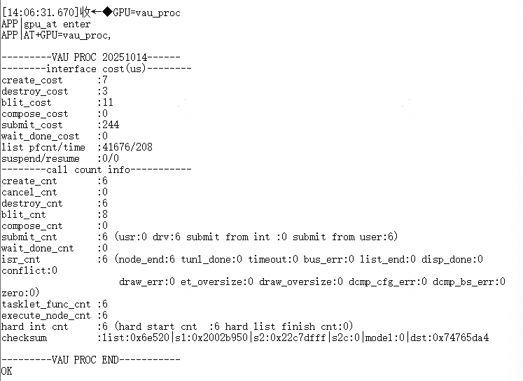
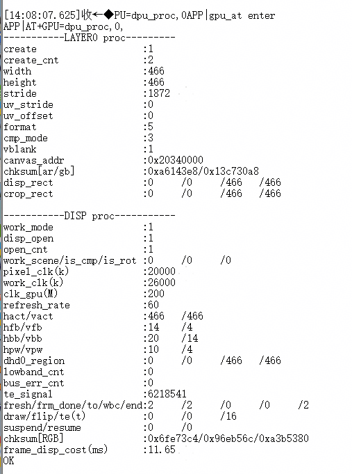
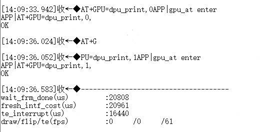
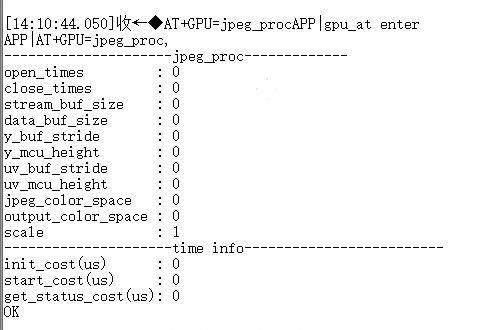
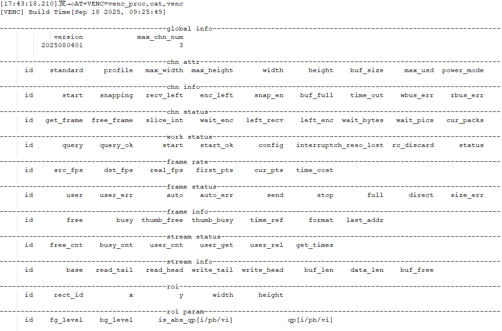
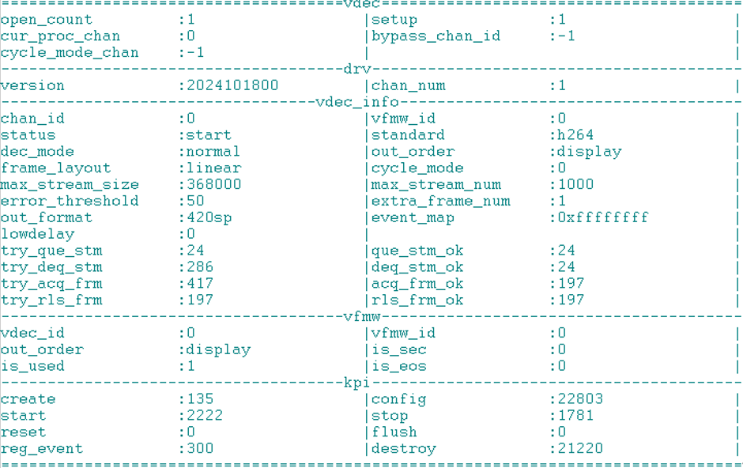
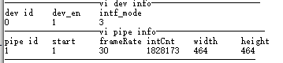

# 前言

**概述**

本文档主要介绍图形驱动调试相关内容，包括工作原理、使用方法和注意事项，用于指导客户快速抓取需要的调试信息。

**读者对象**

本文档主要适用于以下工程师：

-   技术支持工程师
-   软件开发工程师

**符号约定**

在本文中可能出现下列标志，它们所代表的含义如下。

<table><thead align="left"><tr id="zh-cn_topic_0000002411047416_row1530720816410"><th class="cellrowborder" valign="top" width="20.580000000000002%" id="mcps1.1.3.1.1">
<strong id="zh-cn_topic_0000002411047416_b2136615816410">符号</strong>

</th>
<th class="cellrowborder" valign="top" width="79.42%" id="mcps1.1.3.1.2">
<strong id="zh-cn_topic_0000002411047416_b5941558116410">说明</strong>

</th>
</tr>
</thead>
<tbody><tr id="zh-cn_topic_0000002411047416_row1372280416410"><td class="cellrowborder" valign="top" width="20.580000000000002%" headers="mcps1.1.3.1.1 ">

</td>
<td class="cellrowborder" valign="top" width="79.42%" headers="mcps1.1.3.1.2 ">
表示如不避免则将会导致死亡或严重伤害的具有高等级风险的危害。

</td>
</tr>
<tr id="zh-cn_topic_0000002411047416_row466863216410"><td class="cellrowborder" valign="top" width="20.580000000000002%" headers="mcps1.1.3.1.1 ">

</td>
<td class="cellrowborder" valign="top" width="79.42%" headers="mcps1.1.3.1.2 ">
表示如不避免则可能导致死亡或严重伤害的具有中等级风险的危害。

</td>
</tr>
<tr id="zh-cn_topic_0000002411047416_row123863216410"><td class="cellrowborder" valign="top" width="20.580000000000002%" headers="mcps1.1.3.1.1 ">

</td>
<td class="cellrowborder" valign="top" width="79.42%" headers="mcps1.1.3.1.2 ">
表示如不避免则可能导致轻微或中度伤害的具有低等级风险的危害。

</td>
</tr>
<tr id="zh-cn_topic_0000002411047416_row5786682116410"><td class="cellrowborder" valign="top" width="20.580000000000002%" headers="mcps1.1.3.1.1 ">

</td>
<td class="cellrowborder" valign="top" width="79.42%" headers="mcps1.1.3.1.2 ">
用于传递设备或环境安全警示信息。如不避免则可能会导致设备损坏、数据丢失、设备性能降低或其它不可预知的结果。

“须知”不涉及人身伤害。

</td>
</tr>
<tr id="zh-cn_topic_0000002411047416_row2856923116410"><td class="cellrowborder" valign="top" width="20.580000000000002%" headers="mcps1.1.3.1.1 ">

</td>
<td class="cellrowborder" valign="top" width="79.42%" headers="mcps1.1.3.1.2 ">
对正文中重点信息的补充说明。

“说明”不是安全警示信息，不涉及人身、设备及环境伤害信息。

</td>
</tr>
</tbody>
</table>

# 概述

通过下发命令查询图形驱动各模块基本信息、状态。

只有在有对应图形业务的时候，抓取的proc信息才有实际内容，否则为空。

# 各模块AT命令汇总

**表 1**  各模块AT命令

<table><thead align="left"><tr id="zh-cn_topic_0000002411047420_row713mcpsimp"><th class="cellrowborder" valign="top" width="29.12%" id="mcps1.2.4.1.1">
命令

</th>
<th class="cellrowborder" valign="top" width="33.77%" id="mcps1.2.4.1.2">
功能

</th>
<th class="cellrowborder" valign="top" width="37.11%" id="mcps1.2.4.1.3">
参数说明

</th>
</tr>
</thead>
<tbody><tr id="zh-cn_topic_0000002411047420_row723mcpsimp"><td class="cellrowborder" valign="top" width="29.12%" headers="mcps1.2.4.1.1 ">
AT+GPU=smoke

</td>
<td class="cellrowborder" valign="top" width="33.77%" headers="mcps1.2.4.1.2 ">
GPU冒烟用例：颜色填充＋显示。

</td>
<td class="cellrowborder" valign="top" width="37.11%" headers="mcps1.2.4.1.3 ">
无参。

</td>
</tr>
<tr id="zh-cn_topic_0000002411047420_row730mcpsimp"><td class="cellrowborder" valign="top" width="29.12%" headers="mcps1.2.4.1.1 ">
AT+GPU=dpu_cbar,0/1

</td>
<td class="cellrowborder" valign="top" width="33.77%" headers="mcps1.2.4.1.2 ">
color_bar使能控制。

</td>
<td class="cellrowborder" valign="top" width="37.11%" headers="mcps1.2.4.1.3 ">
使能标记。

0：不使能；

1：使能。

</td>
</tr>
<tr id="zh-cn_topic_0000002411047420_row737mcpsimp"><td class="cellrowborder" valign="top" width="29.12%" headers="mcps1.2.4.1.1 ">
AT+GPU=dpu_wbc_screen_cap,layer_id,is_wbc_cap

</td>
<td class="cellrowborder" valign="top" width="33.77%" headers="mcps1.2.4.1.2 ">
DPU截屏，截屏成功后会输出文件路径和stride\height信息。

</td>
<td class="cellrowborder" valign="top" width="37.11%" headers="mcps1.2.4.1.3 ">
layer_id(0~2) is_wbc_cap(0/1)。

</td>
</tr>
<tr id="zh-cn_topic_0000002411047420_row744mcpsimp"><td class="cellrowborder" valign="top" width="29.12%" headers="mcps1.2.4.1.1 ">
AT+GPU=vau_proc

</td>
<td class="cellrowborder" valign="top" width="33.77%" headers="mcps1.2.4.1.2 ">
输出VAU的DFX信息。

</td>
<td class="cellrowborder" valign="top" width="37.11%" headers="mcps1.2.4.1.3 ">
无参。

</td>
</tr>
<tr id="zh-cn_topic_0000002411047420_row751mcpsimp"><td class="cellrowborder" valign="top" width="29.12%" headers="mcps1.2.4.1.1 ">
AT+GPU=jpeg_proc

</td>
<td class="cellrowborder" valign="top" width="33.77%" headers="mcps1.2.4.1.2 ">
输出JPEG的DFX信息。

</td>
<td class="cellrowborder" valign="top" width="37.11%" headers="mcps1.2.4.1.3 ">
无参。

</td>
</tr>
<tr id="zh-cn_topic_0000002411047420_row758mcpsimp"><td class="cellrowborder" valign="top" width="29.12%" headers="mcps1.2.4.1.1 ">
AT+GPU=dpu_proc,0/1

</td>
<td class="cellrowborder" valign="top" width="33.77%" headers="mcps1.2.4.1.2 ">
输出DPU层的信息。

</td>
<td class="cellrowborder" valign="top" width="37.11%" headers="mcps1.2.4.1.3 ">
0/1代表layer_id。

</td>
</tr>
<tr id="zh-cn_topic_0000002411047420_row765mcpsimp"><td class="cellrowborder" valign="top" width="29.12%" headers="mcps1.2.4.1.1 ">
AT+GPU=dpu_print,0/1

</td>
<td class="cellrowborder" valign="top" width="33.77%" headers="mcps1.2.4.1.2 ">
送显接口耗时统计输出使能。

</td>
<td class="cellrowborder" valign="top" width="37.11%" headers="mcps1.2.4.1.3 ">
使能标记。

0：不使能；

1：使能。

</td>
</tr>
<tr id="zh-cn_topic_0000002411047420_row02821155164818"><td class="cellrowborder" valign="top" width="29.12%" headers="mcps1.2.4.1.1 ">
AT+GPU=dpu_test_layer_destroy,0/1

</td>
<td class="cellrowborder" valign="top" width="33.77%" headers="mcps1.2.4.1.2 ">
销毁layer 0/1

</td>
<td class="cellrowborder" valign="top" width="37.11%" headers="mcps1.2.4.1.3 ">
0/1代表layer_id。

</td>
</tr>
<tr id="zh-cn_topic_0000002411047420_row1228819154498"><td class="cellrowborder" valign="top" width="29.12%" headers="mcps1.2.4.1.1 ">
AT+GPU=dpu_test_layer_show,layer,show

</td>
<td class="cellrowborder" valign="top" width="33.77%" headers="mcps1.2.4.1.2 ">
打开或关闭layer 0/1

</td>
<td class="cellrowborder" valign="top" width="37.11%" headers="mcps1.2.4.1.3 ">
layer：0/1。

show：0：关闭；1：打开。

</td>
</tr>
<tr id="zh-cn_topic_0000002411047420_row1857821813499"><td class="cellrowborder" valign="top" width="29.12%" headers="mcps1.2.4.1.1 ">
AT+GPU=dpu_save_fb,0,1,1,10

</td>
<td class="cellrowborder" valign="top" width="33.77%" headers="mcps1.2.4.1.2 ">
保存DPU送显前FB数据。

</td>
<td class="cellrowborder" valign="top" width="37.11%" headers="mcps1.2.4.1.3 ">
参数1：layer_id取值0/1。

参数2：数据保存使能标记：0/1。

参数3：全屏保存标记：对局刷场景来说，填0只保存局刷区域数据，填1保存全屏数据，对全局送显场景，保存数据无差别。取值范围0/1。

参数4：save_cnt：保存的帧数。

</td>
</tr>
</tbody>
</table>

# VAU proc

-   **[proc简介](#ZH-CN_TOPIC_0000002466543316)**  

-   **[proc信息](#ZH-CN_TOPIC_0000002499502641)**  

-   **[proc详解](#ZH-CN_TOPIC_0000002499502621)**  

## proc简介

查询VAU主要函数耗时、主要函数调用次数、任务链表相关信息。

## proc信息

下发命令： AT+GPU=vau\_proc

VAU模块的proc信息如[图1](#zh-cn_topic_0000002411207292_fig154294588820)所示。

**图 1**  VAU proc信息  

## proc详解

**表 1**  VAU proc信息说明

<table><thead align="left"><tr id="zh-cn_topic_0000002411047432_row112mcpsimp"><th class="cellrowborder" valign="top" width="27%" id="mcps1.2.4.1.1">
类别

</th>
<th class="cellrowborder" valign="top" width="28.999999999999996%" id="mcps1.2.4.1.2">
参数

</th>
<th class="cellrowborder" valign="top" width="44%" id="mcps1.2.4.1.3">
说明

</th>
</tr>
</thead>
<tbody><tr id="zh-cn_topic_0000002411047432_row116mcpsimp"><td class="cellrowborder" rowspan="8" valign="top" width="27%" headers="mcps1.2.4.1.1 ">
time info

主要函数单次运行时长，单位：μs

</td>
<td class="cellrowborder" valign="top" width="28.999999999999996%" headers="mcps1.2.4.1.2 ">
create_cost

</td>
<td class="cellrowborder" valign="top" width="44%" headers="mcps1.2.4.1.3 ">
vau_create函数运行时长。

</td>
</tr>
<tr id="zh-cn_topic_0000002411047432_row124mcpsimp"><td class="cellrowborder" valign="top" headers="mcps1.2.4.1.1 ">
destroy_cost

</td>
<td class="cellrowborder" valign="top" headers="mcps1.2.4.1.2 ">
vau_destroy函数运行时长。

</td>
</tr>
<tr id="zh-cn_topic_0000002411047432_row129mcpsimp"><td class="cellrowborder" valign="top" headers="mcps1.2.4.1.1 ">
blit_cost

</td>
<td class="cellrowborder" valign="top" headers="mcps1.2.4.1.2 ">
vau_blit函数运行时长。

</td>
</tr>
<tr id="zh-cn_topic_0000002411047432_row134mcpsimp"><td class="cellrowborder" valign="top" headers="mcps1.2.4.1.1 ">
compose_cost

</td>
<td class="cellrowborder" valign="top" headers="mcps1.2.4.1.2 ">
vau_compose函数运行时长。

</td>
</tr>
<tr id="zh-cn_topic_0000002411047432_row139mcpsimp"><td class="cellrowborder" valign="top" headers="mcps1.2.4.1.1 ">
submit_cost

</td>
<td class="cellrowborder" valign="top" headers="mcps1.2.4.1.2 ">
vau_submit函数运行时长。

</td>
</tr>
<tr id="zh-cn_topic_0000002411047432_row144mcpsimp"><td class="cellrowborder" valign="top" headers="mcps1.2.4.1.1 ">
wait done cose

</td>
<td class="cellrowborder" valign="top" headers="mcps1.2.4.1.2 ">
vau_wait_for_done函数运行时长。

</td>
</tr>
<tr id="zh-cn_topic_0000002411047432_row149mcpsimp"><td class="cellrowborder" valign="top" headers="mcps1.2.4.1.1 ">
list pfcnt/time_us

</td>
<td class="cellrowborder" valign="top" headers="mcps1.2.4.1.2 ">
链表性能统计（时钟周期）/链表性能统计（μs）。

</td>
</tr>
<tr id="zh-cn_topic_0000002411047432_row154mcpsimp"><td class="cellrowborder" valign="top" headers="mcps1.2.4.1.1 ">
suspend/resume

</td>
<td class="cellrowborder" valign="top" headers="mcps1.2.4.1.2 ">
suspend/resume次数。

</td>
</tr>
<tr id="zh-cn_topic_0000002411047432_row159mcpsimp"><td class="cellrowborder" rowspan="25" valign="top" width="27%" headers="mcps1.2.4.1.1 ">
call count info

主要函数调用次数

</td>
<td class="cellrowborder" valign="top" width="28.999999999999996%" headers="mcps1.2.4.1.2 ">
create_cnt

</td>
<td class="cellrowborder" valign="top" width="44%" headers="mcps1.2.4.1.3 ">
vau_create函数调用次数。

</td>
</tr>
<tr id="zh-cn_topic_0000002411047432_row167mcpsimp"><td class="cellrowborder" valign="top" headers="mcps1.2.4.1.1 ">
cancel_cnt

</td>
<td class="cellrowborder" valign="top" headers="mcps1.2.4.1.2 ">
vau_cancel函数调用次数。

</td>
</tr>
<tr id="zh-cn_topic_0000002411047432_row172mcpsimp"><td class="cellrowborder" valign="top" headers="mcps1.2.4.1.1 ">
destroy_cnt

</td>
<td class="cellrowborder" valign="top" headers="mcps1.2.4.1.2 ">
vau_destroy函数调用次数。

</td>
</tr>
<tr id="zh-cn_topic_0000002411047432_row177mcpsimp"><td class="cellrowborder" valign="top" headers="mcps1.2.4.1.1 ">
blit_cnt

</td>
<td class="cellrowborder" valign="top" headers="mcps1.2.4.1.2 ">
vau_blit函数调用次数。

</td>
</tr>
<tr id="zh-cn_topic_0000002411047432_row182mcpsimp"><td class="cellrowborder" valign="top" headers="mcps1.2.4.1.1 ">
compose_cnt

</td>
<td class="cellrowborder" valign="top" headers="mcps1.2.4.1.2 ">
vau_compose函数调用次数。

</td>
</tr>
<tr id="zh-cn_topic_0000002411047432_row187mcpsimp"><td class="cellrowborder" valign="top" headers="mcps1.2.4.1.1 ">
submit_cnt

</td>
<td class="cellrowborder" valign="top" headers="mcps1.2.4.1.2 ">
vau_submit函数调用次数。

</td>
</tr>
<tr id="zh-cn_topic_0000002411047432_row192mcpsimp"><td class="cellrowborder" valign="top" headers="mcps1.2.4.1.1 ">
usr

</td>
<td class="cellrowborder" valign="top" headers="mcps1.2.4.1.2 ">
vau_submit函数被用户调用次数。

</td>
</tr>
<tr id="zh-cn_topic_0000002411047432_row197mcpsimp"><td class="cellrowborder" valign="top" headers="mcps1.2.4.1.1 ">
drv

</td>
<td class="cellrowborder" valign="top" headers="mcps1.2.4.1.2 ">
vau_submit函数被驱动调用次数。

</td>
</tr>
<tr id="zh-cn_topic_0000002411047432_row202mcpsimp"><td class="cellrowborder" valign="top" headers="mcps1.2.4.1.1 ">
submit from int

</td>
<td class="cellrowborder" valign="top" headers="mcps1.2.4.1.2 ">
中断触发的submit次数。

</td>
</tr>
<tr id="zh-cn_topic_0000002411047432_row207mcpsimp"><td class="cellrowborder" valign="top" headers="mcps1.2.4.1.1 ">
submit from user

</td>
<td class="cellrowborder" valign="top" headers="mcps1.2.4.1.2 ">
用户触发的submit次数。

</td>
</tr>
<tr id="zh-cn_topic_0000002411047432_row212mcpsimp"><td class="cellrowborder" valign="top" headers="mcps1.2.4.1.1 ">
wait_done_cnt

</td>
<td class="cellrowborder" valign="top" headers="mcps1.2.4.1.2 ">
vau_wait_for_doen函数调用次数。

</td>
</tr>
<tr id="zh-cn_topic_0000002411047432_row217mcpsimp"><td class="cellrowborder" valign="top" headers="mcps1.2.4.1.1 ">
isr_cnt

</td>
<td class="cellrowborder" valign="top" headers="mcps1.2.4.1.2 ">
中断触发次数。

</td>
</tr>
<tr id="zh-cn_topic_0000002411047432_row222mcpsimp"><td class="cellrowborder" valign="top" headers="mcps1.2.4.1.1 ">
node_end

</td>
<td class="cellrowborder" valign="top" headers="mcps1.2.4.1.2 ">
节点完成中断次数。

</td>
</tr>
<tr id="zh-cn_topic_0000002411047432_row227mcpsimp"><td class="cellrowborder" valign="top" headers="mcps1.2.4.1.1 ">
tunl_done

</td>
<td class="cellrowborder" valign="top" headers="mcps1.2.4.1.2 ">
低时延中断次数。

</td>
</tr>
<tr id="zh-cn_topic_0000002411047432_row232mcpsimp"><td class="cellrowborder" valign="top" headers="mcps1.2.4.1.1 ">
timeout

</td>
<td class="cellrowborder" valign="top" headers="mcps1.2.4.1.2 ">
中断超时次数。

</td>
</tr>
<tr id="zh-cn_topic_0000002411047432_row237mcpsimp"><td class="cellrowborder" valign="top" headers="mcps1.2.4.1.1 ">
bus_err

</td>
<td class="cellrowborder" valign="top" headers="mcps1.2.4.1.2 ">
总线错误中断次数。

</td>
</tr>
<tr id="zh-cn_topic_0000002411047432_row242mcpsimp"><td class="cellrowborder" valign="top" headers="mcps1.2.4.1.1 ">
list_end

</td>
<td class="cellrowborder" valign="top" headers="mcps1.2.4.1.2 ">
链表结束中断次数。

</td>
</tr>
<tr id="zh-cn_topic_0000002411047432_row247mcpsimp"><td class="cellrowborder" valign="top" headers="mcps1.2.4.1.1 ">
disp_done

</td>
<td class="cellrowborder" valign="top" headers="mcps1.2.4.1.2 ">
送显node完成中断次数。

</td>
</tr>
<tr id="zh-cn_topic_0000002411047432_row252mcpsimp"><td class="cellrowborder" valign="top" headers="mcps1.2.4.1.1 ">
conflict

</td>
<td class="cellrowborder" valign="top" headers="mcps1.2.4.1.2 ">
中断冲突次数。

</td>
</tr>
<tr id="zh-cn_topic_0000002411047432_row257mcpsimp"><td class="cellrowborder" valign="top" headers="mcps1.2.4.1.1 ">
isr zero value

</td>
<td class="cellrowborder" valign="top" headers="mcps1.2.4.1.2 ">
中断状态为0次数。

</td>
</tr>
<tr id="zh-cn_topic_0000002411047432_row262mcpsimp"><td class="cellrowborder" valign="top" headers="mcps1.2.4.1.1 ">
tasklet_func_cnt

</td>
<td class="cellrowborder" valign="top" headers="mcps1.2.4.1.2 ">
tasklet_func函数调用次数。

</td>
</tr>
<tr id="zh-cn_topic_0000002411047432_row267mcpsimp"><td class="cellrowborder" valign="top" headers="mcps1.2.4.1.1 ">
execute_node_cnt

</td>
<td class="cellrowborder" valign="top" headers="mcps1.2.4.1.2 ">
节点执行次数。

</td>
</tr>
<tr id="zh-cn_topic_0000002411047432_row272mcpsimp"><td class="cellrowborder" valign="top" headers="mcps1.2.4.1.1 ">
hard int cnt

</td>
<td class="cellrowborder" valign="top" headers="mcps1.2.4.1.2 ">
寄存器值读取：VAU中断个数的计数。

</td>
</tr>
<tr id="zh-cn_topic_0000002411047432_row277mcpsimp"><td class="cellrowborder" valign="top" headers="mcps1.2.4.1.1 ">
hard start cnt

</td>
<td class="cellrowborder" valign="top" headers="mcps1.2.4.1.2 ">
寄存器值读取：链表start的个数计数。

</td>
</tr>
<tr id="zh-cn_topic_0000002411047432_row282mcpsimp"><td class="cellrowborder" valign="top" headers="mcps1.2.4.1.1 ">
hard list finish cnt

</td>
<td class="cellrowborder" valign="top" headers="mcps1.2.4.1.2 ">
寄存器值读取：链表完成的个数计数。

</td>
</tr>
<tr id="zh-cn_topic_0000002411047432_row287mcpsimp"><td class="cellrowborder" rowspan="8" valign="top" width="27%" headers="mcps1.2.4.1.1 ">
job_list

任务信息查询

</td>
<td class="cellrowborder" valign="top" width="28.999999999999996%" headers="mcps1.2.4.1.2 ">
last finished handle

</td>
<td class="cellrowborder" valign="top" width="44%" headers="mcps1.2.4.1.3 ">
最后一次任务完成的handle号。

</td>
</tr>
<tr id="zh-cn_topic_0000002411047432_row295mcpsimp"><td class="cellrowborder" valign="top" headers="mcps1.2.4.1.1 ">
job create num

</td>
<td class="cellrowborder" valign="top" headers="mcps1.2.4.1.2 ">
任务创建总次数。

</td>
</tr>
<tr id="zh-cn_topic_0000002411047432_row300mcpsimp"><td class="cellrowborder" valign="top" headers="mcps1.2.4.1.1 ">
job submit(delay)

</td>
<td class="cellrowborder" valign="top" headers="mcps1.2.4.1.2 ">
延迟递交次数。

</td>
</tr>
<tr id="zh-cn_topic_0000002411047432_row305mcpsimp"><td class="cellrowborder" valign="top" headers="mcps1.2.4.1.1 ">
job unfinish

</td>
<td class="cellrowborder" valign="top" headers="mcps1.2.4.1.2 ">
等待递交任务个数。

</td>
</tr>
<tr id="zh-cn_topic_0000002411047432_row310mcpsimp"><td class="cellrowborder" valign="top" headers="mcps1.2.4.1.1 ">
job resume num

</td>
<td class="cellrowborder" valign="top" headers="mcps1.2.4.1.2 ">
硬件处理超时导致的resume次数。

</td>
</tr>
<tr id="zh-cn_topic_0000002411047432_row315mcpsimp"><td class="cellrowborder" valign="top" headers="mcps1.2.4.1.1 ">
job timeout num

</td>
<td class="cellrowborder" valign="top" headers="mcps1.2.4.1.2 ">
软件超时次数。

</td>
</tr>
<tr id="zh-cn_topic_0000002411047432_row319mcpsimp"><td class="cellrowborder" valign="top" headers="mcps1.2.4.1.1 ">
workqueen start

</td>
<td class="cellrowborder" valign="top" headers="mcps1.2.4.1.2 ">
workqueen start次数。

</td>
</tr>
<tr id="zh-cn_topic_0000002411047432_row324mcpsimp"><td class="cellrowborder" valign="top" headers="mcps1.2.4.1.1 ">
workqueen end

</td>
<td class="cellrowborder" valign="top" headers="mcps1.2.4.1.2 ">
workqueen end次数。

</td>
</tr>
</tbody>
</table>

# DPU proc

-   **[proc简介](#ZH-CN_TOPIC_0000002466543308)**  

-   **[proc信息](#ZH-CN_TOPIC_0000002499582677)**  

-   **[proc详解](#ZH-CN_TOPIC_0000002499582665)**  

## proc简介

支持查询DPU层的相关信息，并且支持实时打印当前送显帧率与TE帧率等。

## proc信息

下发命令：

AT+GPU=dpu\_proc,0/1

AT+GPU=dpu\_print,0/1

DPU模块的proc信息如[图1](#zh-cn_topic_0000002444726577_fig10779981098)所示。

**图 1**  DPU proc信息  

## proc详解

**表 1**  DPU proc信息说明

<table><thead align="left"><tr id="zh-cn_topic_0000002444646489_row419mcpsimp"><th class="cellrowborder" valign="top" width="28.999999999999996%" id="mcps1.2.4.1.1">
类别

</th>
<th class="cellrowborder" valign="top" width="30%" id="mcps1.2.4.1.2">
参数

</th>
<th class="cellrowborder" valign="top" width="41%" id="mcps1.2.4.1.3">
说明

</th>
</tr>
</thead>
<tbody><tr id="zh-cn_topic_0000002444646489_row423mcpsimp"><td class="cellrowborder" rowspan="13" valign="top" width="28.999999999999996%" headers="mcps1.2.4.1.1 ">
layer 0/1 proc

</td>
<td class="cellrowborder" valign="top" width="30%" headers="mcps1.2.4.1.2 ">
create

</td>
<td class="cellrowborder" valign="top" width="41%" headers="mcps1.2.4.1.3 ">
layer 0/1是否创建。

</td>
</tr>
<tr id="zh-cn_topic_0000002444646489_row430mcpsimp"><td class="cellrowborder" valign="top" headers="mcps1.2.4.1.1 ">
create_cnt

</td>
<td class="cellrowborder" valign="top" headers="mcps1.2.4.1.2 ">
创建次数。

</td>
</tr>
<tr id="zh-cn_topic_0000002444646489_row435mcpsimp"><td class="cellrowborder" valign="top" headers="mcps1.2.4.1.1 ">
width

</td>
<td class="cellrowborder" valign="top" headers="mcps1.2.4.1.2 ">
宽。

</td>
</tr>
<tr id="zh-cn_topic_0000002444646489_row440mcpsimp"><td class="cellrowborder" valign="top" headers="mcps1.2.4.1.1 ">
height

</td>
<td class="cellrowborder" valign="top" headers="mcps1.2.4.1.2 ">
高。

</td>
</tr>
<tr id="zh-cn_topic_0000002444646489_row445mcpsimp"><td class="cellrowborder" valign="top" headers="mcps1.2.4.1.1 ">
stride

</td>
<td class="cellrowborder" valign="top" headers="mcps1.2.4.1.2 ">
buffer行间距。

</td>
</tr>
<tr id="zh-cn_topic_0000002444646489_row450mcpsimp"><td class="cellrowborder" valign="top" headers="mcps1.2.4.1.1 ">
uv_stride

</td>
<td class="cellrowborder" valign="top" headers="mcps1.2.4.1.2 ">
uv数据行间距。

</td>
</tr>
<tr id="zh-cn_topic_0000002444646489_row455mcpsimp"><td class="cellrowborder" valign="top" headers="mcps1.2.4.1.1 ">
uv_offset

</td>
<td class="cellrowborder" valign="top" headers="mcps1.2.4.1.2 ">
uv数据偏移量。

</td>
</tr>
<tr id="zh-cn_topic_0000002444646489_row460mcpsimp"><td class="cellrowborder" valign="top" headers="mcps1.2.4.1.1 ">
format

</td>
<td class="cellrowborder" valign="top" headers="mcps1.2.4.1.2 ">
颜色格式。

</td>
</tr>
<tr id="zh-cn_topic_0000002444646489_row465mcpsimp"><td class="cellrowborder" valign="top" headers="mcps1.2.4.1.1 ">
cmp_mode

</td>
<td class="cellrowborder" valign="top" headers="mcps1.2.4.1.2 ">
压缩模式。

</td>
</tr>
<tr id="zh-cn_topic_0000002444646489_row470mcpsimp"><td class="cellrowborder" valign="top" headers="mcps1.2.4.1.1 ">
vblank

</td>
<td class="cellrowborder" valign="top" headers="mcps1.2.4.1.2 ">
是否开启vblank。

true：单buffer同步送显。false：双buffer异步送显。

</td>
</tr>
<tr id="zh-cn_topic_0000002444646489_row475mcpsimp"><td class="cellrowborder" valign="top" headers="mcps1.2.4.1.1 ">
chksum[ar/gb]

</td>
<td class="cellrowborder" valign="top" headers="mcps1.2.4.1.2 ">
输入checksum值。

</td>
</tr>
<tr id="zh-cn_topic_0000002444646489_row480mcpsimp"><td class="cellrowborder" valign="top" headers="mcps1.2.4.1.1 ">
disp_rect

</td>
<td class="cellrowborder" valign="top" headers="mcps1.2.4.1.2 ">
显示区域。

</td>
</tr>
<tr id="zh-cn_topic_0000002444646489_row485mcpsimp"><td class="cellrowborder" valign="top" headers="mcps1.2.4.1.1 ">
crop_rect

</td>
<td class="cellrowborder" valign="top" headers="mcps1.2.4.1.2 ">
剪切区域。

</td>
</tr>
<tr id="zh-cn_topic_0000002444646489_row490mcpsimp"><td class="cellrowborder" rowspan="17" valign="top" width="28.999999999999996%" headers="mcps1.2.4.1.1 ">
DISP proc

</td>
<td class="cellrowborder" valign="top" width="30%" headers="mcps1.2.4.1.2 ">
work_mode

</td>
<td class="cellrowborder" valign="top" width="41%" headers="mcps1.2.4.1.3 ">
是否cmd_mode。

</td>
</tr>
<tr id="zh-cn_topic_0000002444646489_row497mcpsimp"><td class="cellrowborder" valign="top" headers="mcps1.2.4.1.1 ">
disp_open

</td>
<td class="cellrowborder" valign="top" headers="mcps1.2.4.1.2 ">
打开标志。

</td>
</tr>
<tr id="zh-cn_topic_0000002444646489_row502mcpsimp"><td class="cellrowborder" valign="top" headers="mcps1.2.4.1.1 ">
open_cnt

</td>
<td class="cellrowborder" valign="top" headers="mcps1.2.4.1.2 ">
打开次数。

</td>
</tr>
<tr id="zh-cn_topic_0000002444646489_row507mcpsimp"><td class="cellrowborder" valign="top" headers="mcps1.2.4.1.1 ">
pixel_clk

</td>
<td class="cellrowborder" valign="top" headers="mcps1.2.4.1.2 ">
像素时钟。

</td>
</tr>
<tr id="zh-cn_topic_0000002444646489_row512mcpsimp"><td class="cellrowborder" valign="top" headers="mcps1.2.4.1.1 ">
refresh_rate

</td>
<td class="cellrowborder" valign="top" headers="mcps1.2.4.1.2 ">
刷新率。

</td>
</tr>
<tr id="zh-cn_topic_0000002444646489_row517mcpsimp"><td class="cellrowborder" valign="top" headers="mcps1.2.4.1.1 ">
hact/vact

</td>
<td class="cellrowborder" valign="top" headers="mcps1.2.4.1.2 ">
水平/垂直有效显示区。

</td>
</tr>
<tr id="zh-cn_topic_0000002444646489_row522mcpsimp"><td class="cellrowborder" valign="top" headers="mcps1.2.4.1.1 ">
hfb/vfb

</td>
<td class="cellrowborder" valign="top" headers="mcps1.2.4.1.2 ">
水平/垂直前向消隐区。

</td>
</tr>
<tr id="zh-cn_topic_0000002444646489_row527mcpsimp"><td class="cellrowborder" valign="top" headers="mcps1.2.4.1.1 ">
hbb/vbb

</td>
<td class="cellrowborder" valign="top" headers="mcps1.2.4.1.2 ">
水平/垂直后向消隐区。

</td>
</tr>
<tr id="zh-cn_topic_0000002444646489_row532mcpsimp"><td class="cellrowborder" valign="top" headers="mcps1.2.4.1.1 ">
hpw/vpw

</td>
<td class="cellrowborder" valign="top" headers="mcps1.2.4.1.2 ">
水平/垂直脉冲宽度。

</td>
</tr>
<tr id="zh-cn_topic_0000002444646489_row537mcpsimp"><td class="cellrowborder" valign="top" headers="mcps1.2.4.1.1 ">
dhd0_region

</td>
<td class="cellrowborder" valign="top" headers="mcps1.2.4.1.2 ">
显示区域。

</td>
</tr>
<tr id="zh-cn_topic_0000002444646489_row542mcpsimp"><td class="cellrowborder" valign="top" headers="mcps1.2.4.1.1 ">
lowband_cnt

</td>
<td class="cellrowborder" valign="top" headers="mcps1.2.4.1.2 ">
低带宽次数。

</td>
</tr>
<tr id="zh-cn_topic_0000002444646489_row547mcpsimp"><td class="cellrowborder" valign="top" headers="mcps1.2.4.1.1 ">
bus_err_cnt

</td>
<td class="cellrowborder" valign="top" headers="mcps1.2.4.1.2 ">
总线错误次数。

</td>
</tr>
<tr id="zh-cn_topic_0000002444646489_row552mcpsimp"><td class="cellrowborder" valign="top" headers="mcps1.2.4.1.1 ">
te_signal

</td>
<td class="cellrowborder" valign="top" headers="mcps1.2.4.1.2 ">
TE信号次数。

</td>
</tr>
<tr id="zh-cn_topic_0000002444646489_row557mcpsimp"><td class="cellrowborder" valign="top" headers="mcps1.2.4.1.1 ">
fresh/frm_done

</td>
<td class="cellrowborder" valign="top" headers="mcps1.2.4.1.2 ">
refresh次数/frm_done中断次数。

</td>
</tr>
<tr id="zh-cn_topic_0000002444646489_row562mcpsimp"><td class="cellrowborder" valign="top" headers="mcps1.2.4.1.1 ">
draw/flip/te(t)

</td>
<td class="cellrowborder" valign="top" headers="mcps1.2.4.1.2 ">
刷新/显示/TE中断的次数。

</td>
</tr>
<tr id="zh-cn_topic_0000002444646489_row567mcpsimp"><td class="cellrowborder" valign="top" headers="mcps1.2.4.1.1 ">
suspend/resume

</td>
<td class="cellrowborder" valign="top" headers="mcps1.2.4.1.2 ">
suspemd/resume次数。

</td>
</tr>
<tr id="zh-cn_topic_0000002444646489_row572mcpsimp"><td class="cellrowborder" valign="top" headers="mcps1.2.4.1.1 ">
chksum[RGB]

</td>
<td class="cellrowborder" valign="top" headers="mcps1.2.4.1.2 ">
输出checksum值。

</td>
</tr>
<tr id="zh-cn_topic_0000002444646489_row577mcpsimp"><td class="cellrowborder" rowspan="4" valign="top" width="28.999999999999996%" headers="mcps1.2.4.1.1 ">
送显接口耗时统计

</td>
<td class="cellrowborder" valign="top" width="30%" headers="mcps1.2.4.1.2 ">
wait_frm_done(us)

</td>
<td class="cellrowborder" valign="top" width="41%" headers="mcps1.2.4.1.3 ">
函数wait_frm_done耗时。

</td>
</tr>
<tr id="zh-cn_topic_0000002444646489_row584mcpsimp"><td class="cellrowborder" valign="top" headers="mcps1.2.4.1.1 ">
fresh_intf_cost(us)

</td>
<td class="cellrowborder" valign="top" headers="mcps1.2.4.1.2 ">
函数dpu_layer_refresh耗时。

</td>
</tr>
<tr id="zh-cn_topic_0000002444646489_row589mcpsimp"><td class="cellrowborder" valign="top" headers="mcps1.2.4.1.1 ">
te_interrupt(us)

</td>
<td class="cellrowborder" valign="top" headers="mcps1.2.4.1.2 ">
两次TE中断的间隔时间。

</td>
</tr>
<tr id="zh-cn_topic_0000002444646489_row594mcpsimp"><td class="cellrowborder" valign="top" headers="mcps1.2.4.1.1 ">
draw/flip/te(fps)

</td>
<td class="cellrowborder" valign="top" headers="mcps1.2.4.1.2 ">
刷新/显示/TE中断的帧率。

</td>
</tr>
</tbody>
</table>

# JPEG proc

-   **[proc简介](#ZH-CN_TOPIC_0000002466383676)**  

-   **[proc信息](#ZH-CN_TOPIC_0000002499502613)**  

-   **[proc详解](#ZH-CN_TOPIC_0000002466383688)**  

## proc简介

查询JPEG模块基本信息。

## proc信息

下发命令：AT+GPU=jpeg\_proc

JPEG模块的proc信息如[图1](#zh-cn_topic_0000002444726565_fig44112237915)所示。

**图 1**  JPEG proc信息  

## proc详解

**表 1**  JPEG proc信息说明

<table><thead align="left"><tr id="zh-cn_topic_0000002411207304_row619mcpsimp"><th class="cellrowborder" valign="top" width="15%" id="mcps1.2.4.1.1">
类别

</th>
<th class="cellrowborder" valign="top" width="31%" id="mcps1.2.4.1.2">
参数

</th>
<th class="cellrowborder" valign="top" width="54%" id="mcps1.2.4.1.3">
说明

</th>
</tr>
</thead>
<tbody><tr id="zh-cn_topic_0000002411207304_row623mcpsimp"><td class="cellrowborder" rowspan="11" valign="top" width="15%" headers="mcps1.2.4.1.1 ">
jpeg_proc

</td>
<td class="cellrowborder" valign="top" width="31%" headers="mcps1.2.4.1.2 ">
open_times

</td>
<td class="cellrowborder" valign="top" width="54%" headers="mcps1.2.4.1.3 ">
设备打开次数。

</td>
</tr>
<tr id="zh-cn_topic_0000002411207304_row630mcpsimp"><td class="cellrowborder" valign="top" headers="mcps1.2.4.1.1 ">
close_times

</td>
<td class="cellrowborder" valign="top" headers="mcps1.2.4.1.2 ">
设备关闭次数。

</td>
</tr>
<tr id="zh-cn_topic_0000002411207304_row635mcpsimp"><td class="cellrowborder" valign="top" headers="mcps1.2.4.1.1 ">
stream_buf_size

</td>
<td class="cellrowborder" valign="top" headers="mcps1.2.4.1.2 ">
流buf大小。

</td>
</tr>
<tr id="zh-cn_topic_0000002411207304_row640mcpsimp"><td class="cellrowborder" valign="top" headers="mcps1.2.4.1.1 ">
data_buf_size

</td>
<td class="cellrowborder" valign="top" headers="mcps1.2.4.1.2 ">
数据buf大小。

</td>
</tr>
<tr id="zh-cn_topic_0000002411207304_row645mcpsimp"><td class="cellrowborder" valign="top" headers="mcps1.2.4.1.1 ">
y_buf_stride

</td>
<td class="cellrowborder" valign="top" headers="mcps1.2.4.1.2 ">
y数据buf的stride。

</td>
</tr>
<tr id="zh-cn_topic_0000002411207304_row650mcpsimp"><td class="cellrowborder" valign="top" headers="mcps1.2.4.1.1 ">
y_mcu_height

</td>
<td class="cellrowborder" valign="top" headers="mcps1.2.4.1.2 ">
y MCU的高。

</td>
</tr>
<tr id="zh-cn_topic_0000002411207304_row655mcpsimp"><td class="cellrowborder" valign="top" headers="mcps1.2.4.1.1 ">
uv_buf_stride

</td>
<td class="cellrowborder" valign="top" headers="mcps1.2.4.1.2 ">
uv数据buf的stride。

</td>
</tr>
<tr id="zh-cn_topic_0000002411207304_row660mcpsimp"><td class="cellrowborder" valign="top" headers="mcps1.2.4.1.1 ">
uv_mcu_height

</td>
<td class="cellrowborder" valign="top" headers="mcps1.2.4.1.2 ">
uv MCU的高。

</td>
</tr>
<tr id="zh-cn_topic_0000002411207304_row665mcpsimp"><td class="cellrowborder" valign="top" headers="mcps1.2.4.1.1 ">
jpeg_color_space

</td>
<td class="cellrowborder" valign="top" headers="mcps1.2.4.1.2 ">
输入颜色格式。

</td>
</tr>
<tr id="zh-cn_topic_0000002411207304_row670mcpsimp"><td class="cellrowborder" valign="top" headers="mcps1.2.4.1.1 ">
output_color_space

</td>
<td class="cellrowborder" valign="top" headers="mcps1.2.4.1.2 ">
输出颜色格式。

</td>
</tr>
<tr id="zh-cn_topic_0000002411207304_row675mcpsimp"><td class="cellrowborder" valign="top" headers="mcps1.2.4.1.1 ">
scale

</td>
<td class="cellrowborder" valign="top" headers="mcps1.2.4.1.2 ">
缩放系数。

</td>
</tr>
<tr id="zh-cn_topic_0000002411207304_row680mcpsimp"><td class="cellrowborder" rowspan="3" valign="top" width="15%" headers="mcps1.2.4.1.1 ">
time info

</td>
<td class="cellrowborder" valign="top" width="31%" headers="mcps1.2.4.1.2 ">
init_cost(us)

</td>
<td class="cellrowborder" valign="top" width="54%" headers="mcps1.2.4.1.3 ">
函数jpeg_ioctl_decompress_init耗时。

</td>
</tr>
<tr id="zh-cn_topic_0000002411207304_row687mcpsimp"><td class="cellrowborder" valign="top" headers="mcps1.2.4.1.1 ">
start_cost(us)

</td>
<td class="cellrowborder" valign="top" headers="mcps1.2.4.1.2 ">
函数jpeg_ioctl_start_decompress耗时。

</td>
</tr>
<tr id="zh-cn_topic_0000002411207304_row692mcpsimp"><td class="cellrowborder" valign="top" headers="mcps1.2.4.1.1 ">
get_status_cost(us)

</td>
<td class="cellrowborder" valign="top" headers="mcps1.2.4.1.2 ">
函数jpeg_ioctl_get_decompress_status耗时。

</td>
</tr>
</tbody>
</table>

# VENC

-   **[proc简介](#ZH-CN_TOPIC_0000002466383692)**  

-   **[proc信息](#ZH-CN_TOPIC_0000002466383672)**  

-   **[proc详解](#ZH-CN_TOPIC_0000002499582673)**  

## proc简介

查询VENC（Video Encoder）模块基本信息。

## proc信息

下发命令：AT+VENC=venc\_proc,cat,venc

VENC模块proc信息如[图1](#zh-cn_topic_0000002484810301_fig14325145711811)所示。

**图 1**  VENC proc信息  

## proc详解

**表 1**  VENC proc信息说明

<table><thead align="left"><tr id="zh-cn_topic_0000002451730862_row619mcpsimp"><th class="cellrowborder" valign="top" width="18.22%" id="mcps1.2.4.1.1">
类别

</th>
<th class="cellrowborder" valign="top" width="27.83%" id="mcps1.2.4.1.2">
参数

</th>
<th class="cellrowborder" valign="top" width="53.949999999999996%" id="mcps1.2.4.1.3">
说明

</th>
</tr>
</thead>
<tbody><tr id="zh-cn_topic_0000002451730862_row623mcpsimp"><td class="cellrowborder" rowspan="2" valign="top" width="18.22%" headers="mcps1.2.4.1.1 ">
global info

</td>
<td class="cellrowborder" valign="top" width="27.83%" headers="mcps1.2.4.1.2 ">
version

</td>
<td class="cellrowborder" valign="top" width="53.949999999999996%" headers="mcps1.2.4.1.3 ">
版本号。

</td>
</tr>
<tr id="zh-cn_topic_0000002451730862_row630mcpsimp"><td class="cellrowborder" valign="top" headers="mcps1.2.4.1.1 ">
max_chn_num

</td>
<td class="cellrowborder" valign="top" headers="mcps1.2.4.1.2 ">
最大编码通道数。

</td>
</tr>
<tr id="zh-cn_topic_0000002451730862_row680mcpsimp"><td class="cellrowborder" rowspan="10" valign="top" width="18.22%" headers="mcps1.2.4.1.1 ">
chn attr

</td>
<td class="cellrowborder" valign="top" width="27.83%" headers="mcps1.2.4.1.2 ">
id

</td>
<td class="cellrowborder" valign="top" width="53.949999999999996%" headers="mcps1.2.4.1.3 ">
编码通道号。

</td>
</tr>
<tr id="zh-cn_topic_0000002451730862_row687mcpsimp"><td class="cellrowborder" valign="top" headers="mcps1.2.4.1.1 ">
standard

</td>
<td class="cellrowborder" valign="top" headers="mcps1.2.4.1.2 ">
编码通道协议。

</td>
</tr>
<tr id="zh-cn_topic_0000002451730862_row1712996222"><td class="cellrowborder" valign="top" headers="mcps1.2.4.1.1 ">
profile

</td>
<td class="cellrowborder" valign="top" headers="mcps1.2.4.1.2 ">
编码协议档次。

</td>
</tr>
<tr id="zh-cn_topic_0000002451730862_row53611983410"><td class="cellrowborder" valign="top" headers="mcps1.2.4.1.1 ">
max_width

</td>
<td class="cellrowborder" valign="top" headers="mcps1.2.4.1.2 ">
通道最大宽度，以像素为单位。

</td>
</tr>
<tr id="zh-cn_topic_0000002451730862_row12360453933"><td class="cellrowborder" valign="top" headers="mcps1.2.4.1.1 ">
max_height

</td>
<td class="cellrowborder" valign="top" headers="mcps1.2.4.1.2 ">
通道最大高度，以像素为单位。

</td>
</tr>
<tr id="zh-cn_topic_0000002451730862_row163061914163413"><td class="cellrowborder" valign="top" headers="mcps1.2.4.1.1 ">
width

</td>
<td class="cellrowborder" valign="top" headers="mcps1.2.4.1.2 ">
图像宽度，以像素为单位。

</td>
</tr>
<tr id="zh-cn_topic_0000002451730862_row1896113618415"><td class="cellrowborder" valign="top" headers="mcps1.2.4.1.1 ">
height

</td>
<td class="cellrowborder" valign="top" headers="mcps1.2.4.1.2 ">
图像高度，以像素为单位。

</td>
</tr>
<tr id="zh-cn_topic_0000002451730862_row230617140343"><td class="cellrowborder" valign="top" headers="mcps1.2.4.1.1 ">
buf_size

</td>
<td class="cellrowborder" valign="top" headers="mcps1.2.4.1.2 ">
码流缓存大小。

</td>
</tr>
<tr id="zh-cn_topic_0000002451730862_row153061314133416"><td class="cellrowborder" valign="top" headers="mcps1.2.4.1.1 ">
max_usd

</td>
<td class="cellrowborder" valign="top" headers="mcps1.2.4.1.2 ">
最大用户数据长度。

</td>
</tr>
<tr id="zh-cn_topic_0000002451730862_row692mcpsimp"><td class="cellrowborder" valign="top" headers="mcps1.2.4.1.1 ">
power_mode

</td>
<td class="cellrowborder" valign="top" headers="mcps1.2.4.1.2 ">
编码功耗模式。

</td>
</tr>
<tr id="zh-cn_topic_0000002451730862_row226155171616"><td class="cellrowborder" rowspan="10" valign="top" width="18.22%" headers="mcps1.2.4.1.1 ">
chn info

</td>
<td class="cellrowborder" valign="top" width="27.83%" headers="mcps1.2.4.1.2 ">
id

</td>
<td class="cellrowborder" valign="top" width="53.949999999999996%" headers="mcps1.2.4.1.3 ">
编码通道号。

</td>
</tr>
<tr id="zh-cn_topic_0000002451730862_row1164318318357"><td class="cellrowborder" valign="top" headers="mcps1.2.4.1.1 ">
start

</td>
<td class="cellrowborder" valign="top" headers="mcps1.2.4.1.2 ">
编码通道是否启动。

</td>
</tr>
<tr id="zh-cn_topic_0000002451730862_row76441731153510"><td class="cellrowborder" valign="top" headers="mcps1.2.4.1.1 ">
snap_en

</td>
<td class="cellrowborder" valign="top" headers="mcps1.2.4.1.2 ">
抓拍是否使能。

</td>
</tr>
<tr id="zh-cn_topic_0000002451730862_row1431217191616"><td class="cellrowborder" valign="top" headers="mcps1.2.4.1.1 ">
snapping

</td>
<td class="cellrowborder" valign="top" headers="mcps1.2.4.1.2 ">
是否正在抓拍。

</td>
</tr>
<tr id="zh-cn_topic_0000002451730862_row12644631103518"><td class="cellrowborder" valign="top" headers="mcps1.2.4.1.1 ">
recv_left

</td>
<td class="cellrowborder" valign="top" headers="mcps1.2.4.1.2 ">
剩余接收帧数。

</td>
</tr>
<tr id="zh-cn_topic_0000002451730862_row5638923068"><td class="cellrowborder" valign="top" headers="mcps1.2.4.1.1 ">
enc_left

</td>
<td class="cellrowborder" valign="top" headers="mcps1.2.4.1.2 ">
剩余编码帧数。

</td>
</tr>
<tr id="zh-cn_topic_0000002451730862_row192321226183515"><td class="cellrowborder" valign="top" headers="mcps1.2.4.1.1 ">
buf_full

</td>
<td class="cellrowborder" valign="top" headers="mcps1.2.4.1.2 ">
码流buf满次数。

</td>
</tr>
<tr id="zh-cn_topic_0000002451730862_row159181727567"><td class="cellrowborder" valign="top" headers="mcps1.2.4.1.1 ">
time_out

</td>
<td class="cellrowborder" valign="top" headers="mcps1.2.4.1.2 ">
硬件超时次数。

</td>
</tr>
<tr id="zh-cn_topic_0000002451730862_row1491819321960"><td class="cellrowborder" valign="top" headers="mcps1.2.4.1.1 ">
wbus_err

</td>
<td class="cellrowborder" valign="top" headers="mcps1.2.4.1.2 ">
写总线错误次数。

</td>
</tr>
<tr id="zh-cn_topic_0000002451730862_row1423362610356"><td class="cellrowborder" valign="top" headers="mcps1.2.4.1.1 ">
rbus_err

</td>
<td class="cellrowborder" valign="top" headers="mcps1.2.4.1.2 ">
读总线错误次数。

</td>
</tr>
<tr id="zh-cn_topic_0000002451730862_row15519719131719"><td class="cellrowborder" rowspan="10" valign="top" width="18.22%" headers="mcps1.2.4.1.1 ">
chn status

</td>
<td class="cellrowborder" valign="top" width="27.83%" headers="mcps1.2.4.1.2 ">
id

</td>
<td class="cellrowborder" valign="top" width="53.949999999999996%" headers="mcps1.2.4.1.3 ">
编码通道号。

</td>
</tr>
<tr id="zh-cn_topic_0000002451730862_row63429345306"><td class="cellrowborder" valign="top" headers="mcps1.2.4.1.1 ">
get_frame

</td>
<td class="cellrowborder" valign="top" headers="mcps1.2.4.1.2 ">
收帧次数。

</td>
</tr>
<tr id="zh-cn_topic_0000002451730862_row0677336576"><td class="cellrowborder" valign="top" headers="mcps1.2.4.1.1 ">
free_frame

</td>
<td class="cellrowborder" valign="top" headers="mcps1.2.4.1.2 ">
还帧次数。

</td>
</tr>
<tr id="zh-cn_topic_0000002451730862_row1242852615363"><td class="cellrowborder" valign="top" headers="mcps1.2.4.1.1 ">
slice_int

</td>
<td class="cellrowborder" valign="top" headers="mcps1.2.4.1.2 ">
slice中断次数。

</td>
</tr>
<tr id="zh-cn_topic_0000002451730862_row184291726103613"><td class="cellrowborder" valign="top" headers="mcps1.2.4.1.1 ">
wait_enc

</td>
<td class="cellrowborder" valign="top" headers="mcps1.2.4.1.2 ">
等待编码帧数。

</td>
</tr>
<tr id="zh-cn_topic_0000002451730862_row104291526133617"><td class="cellrowborder" valign="top" headers="mcps1.2.4.1.1 ">
left_recv

</td>
<td class="cellrowborder" valign="top" headers="mcps1.2.4.1.2 ">
剩余接收帧数。

</td>
</tr>
<tr id="zh-cn_topic_0000002451730862_row18209618286"><td class="cellrowborder" valign="top" headers="mcps1.2.4.1.1 ">
left_enc

</td>
<td class="cellrowborder" valign="top" headers="mcps1.2.4.1.2 ">
剩余编码帧数。

</td>
</tr>
<tr id="zh-cn_topic_0000002451730862_row75839228366"><td class="cellrowborder" valign="top" headers="mcps1.2.4.1.1 ">
wait_bytes

</td>
<td class="cellrowborder" valign="top" headers="mcps1.2.4.1.2 ">
等待收走码流大小。

</td>
</tr>
<tr id="zh-cn_topic_0000002451730862_row255233117819"><td class="cellrowborder" valign="top" headers="mcps1.2.4.1.1 ">
wait_pics

</td>
<td class="cellrowborder" valign="top" headers="mcps1.2.4.1.2 ">
等待收走码流帧数

</td>
</tr>
<tr id="zh-cn_topic_0000002451730862_row3342113415306"><td class="cellrowborder" valign="top" headers="mcps1.2.4.1.1 ">
cur_packs

</td>
<td class="cellrowborder" valign="top" headers="mcps1.2.4.1.2 ">
当前帧码流包数。

</td>
</tr>
<tr id="zh-cn_topic_0000002451730862_row104983515172"><td class="cellrowborder" rowspan="10" valign="top" width="18.22%" headers="mcps1.2.4.1.1 ">
work status

</td>
<td class="cellrowborder" valign="top" width="27.83%" headers="mcps1.2.4.1.2 ">
id

</td>
<td class="cellrowborder" valign="top" width="53.949999999999996%" headers="mcps1.2.4.1.3 ">
编码通道号。

</td>
</tr>
<tr id="zh-cn_topic_0000002451730862_row9189436183112"><td class="cellrowborder" valign="top" headers="mcps1.2.4.1.1 ">
query

</td>
<td class="cellrowborder" valign="top" headers="mcps1.2.4.1.2 ">
查询任务次数。

</td>
</tr>
<tr id="zh-cn_topic_0000002451730862_row630844786"><td class="cellrowborder" valign="top" headers="mcps1.2.4.1.1 ">
query_ok

</td>
<td class="cellrowborder" valign="top" headers="mcps1.2.4.1.2 ">
查询成功次数。

</td>
</tr>
<tr id="zh-cn_topic_0000002451730862_row6189173673112"><td class="cellrowborder" valign="top" headers="mcps1.2.4.1.1 ">
start

</td>
<td class="cellrowborder" valign="top" headers="mcps1.2.4.1.2 ">
启动编码次数。

</td>
</tr>
<tr id="zh-cn_topic_0000002451730862_row32656470810"><td class="cellrowborder" valign="top" headers="mcps1.2.4.1.1 ">
start_ok

</td>
<td class="cellrowborder" valign="top" headers="mcps1.2.4.1.2 ">
启动成功次数。

</td>
</tr>
<tr id="zh-cn_topic_0000002451730862_row124715331521"><td class="cellrowborder" valign="top" headers="mcps1.2.4.1.1 ">
config

</td>
<td class="cellrowborder" valign="top" headers="mcps1.2.4.1.2 ">
配置硬件次数。

</td>
</tr>
<tr id="zh-cn_topic_0000002451730862_row183413501583"><td class="cellrowborder" valign="top" headers="mcps1.2.4.1.1 ">
interrupt

</td>
<td class="cellrowborder" valign="top" headers="mcps1.2.4.1.2 ">
硬件中断次数。

</td>
</tr>
<tr id="zh-cn_topic_0000002451730862_row1312752945211"><td class="cellrowborder" valign="top" headers="mcps1.2.4.1.1 ">
ch_reso_lost

</td>
<td class="cellrowborder" valign="top" headers="mcps1.2.4.1.2 ">
分辨率变化次数。

</td>
</tr>
<tr id="zh-cn_topic_0000002451730862_row121991539528"><td class="cellrowborder" valign="top" headers="mcps1.2.4.1.1 ">
rc_discard

</td>
<td class="cellrowborder" valign="top" headers="mcps1.2.4.1.2 ">
码控丢帧次数。

</td>
</tr>
<tr id="zh-cn_topic_0000002451730862_row1020525005213"><td class="cellrowborder" valign="top" headers="mcps1.2.4.1.1 ">
status

</td>
<td class="cellrowborder" valign="top" headers="mcps1.2.4.1.2 ">
编码任务状态。

</td>
</tr>
<tr id="zh-cn_topic_0000002451730862_row2883195314175"><td class="cellrowborder" rowspan="7" valign="top" width="18.22%" headers="mcps1.2.4.1.1 ">
frame rate

</td>
<td class="cellrowborder" valign="top" width="27.83%" headers="mcps1.2.4.1.2 ">
id

</td>
<td class="cellrowborder" valign="top" width="53.949999999999996%" headers="mcps1.2.4.1.3 ">
编码通道号。

</td>
</tr>
<tr id="zh-cn_topic_0000002451730862_row16129439113113"><td class="cellrowborder" valign="top" headers="mcps1.2.4.1.1 ">
src_fps

</td>
<td class="cellrowborder" valign="top" headers="mcps1.2.4.1.2 ">
源帧率。

</td>
</tr>
<tr id="zh-cn_topic_0000002451730862_row187723491914"><td class="cellrowborder" valign="top" headers="mcps1.2.4.1.1 ">
dst_fps

</td>
<td class="cellrowborder" valign="top" headers="mcps1.2.4.1.2 ">
目标帧率。

</td>
</tr>
<tr id="zh-cn_topic_0000002451730862_row99760452920"><td class="cellrowborder" valign="top" headers="mcps1.2.4.1.1 ">
real_fps

</td>
<td class="cellrowborder" valign="top" headers="mcps1.2.4.1.2 ">
实际帧率。

</td>
</tr>
<tr id="zh-cn_topic_0000002451730862_row17517516419"><td class="cellrowborder" valign="top" headers="mcps1.2.4.1.1 ">
first_pts

</td>
<td class="cellrowborder" valign="top" headers="mcps1.2.4.1.2 ">
第1帧帧时间戳。

</td>
</tr>
<tr id="zh-cn_topic_0000002451730862_row0618950141019"><td class="cellrowborder" valign="top" headers="mcps1.2.4.1.1 ">
cur_pts

</td>
<td class="cellrowborder" valign="top" headers="mcps1.2.4.1.2 ">
当前帧时间戳。

</td>
</tr>
<tr id="zh-cn_topic_0000002451730862_row3129139133112"><td class="cellrowborder" valign="top" headers="mcps1.2.4.1.1 ">
time_cost

</td>
<td class="cellrowborder" valign="top" headers="mcps1.2.4.1.2 ">
编码耗时（单位：μs）。

</td>
</tr>
<tr id="zh-cn_topic_0000002451730862_row206821011131814"><td class="cellrowborder" rowspan="10" valign="top" width="18.22%" headers="mcps1.2.4.1.1 ">
frame status

</td>
<td class="cellrowborder" valign="top" width="27.83%" headers="mcps1.2.4.1.2 ">
id

</td>
<td class="cellrowborder" valign="top" width="53.949999999999996%" headers="mcps1.2.4.1.3 ">
编码通道号。

</td>
</tr>
<tr id="zh-cn_topic_0000002451730862_row655518073216"><td class="cellrowborder" valign="top" headers="mcps1.2.4.1.1 ">
user

</td>
<td class="cellrowborder" valign="top" headers="mcps1.2.4.1.2 ">
用户送帧数。

</td>
</tr>
<tr id="zh-cn_topic_0000002451730862_row1604197111111"><td class="cellrowborder" valign="top" headers="mcps1.2.4.1.1 ">
user_err

</td>
<td class="cellrowborder" valign="top" headers="mcps1.2.4.1.2 ">
用户送帧错误数。

</td>
</tr>
<tr id="zh-cn_topic_0000002451730862_row1855414053212"><td class="cellrowborder" valign="top" headers="mcps1.2.4.1.1 ">
auto

</td>
<td class="cellrowborder" valign="top" headers="mcps1.2.4.1.2 ">
前级送帧数。

</td>
</tr>
<tr id="zh-cn_topic_0000002451730862_row14925171413115"><td class="cellrowborder" valign="top" headers="mcps1.2.4.1.1 ">
auto_err

</td>
<td class="cellrowborder" valign="top" headers="mcps1.2.4.1.2 ">
前级送帧错误数。

</td>
</tr>
<tr id="zh-cn_topic_0000002451730862_row1717818393714"><td class="cellrowborder" valign="top" headers="mcps1.2.4.1.1 ">
send

</td>
<td class="cellrowborder" valign="top" headers="mcps1.2.4.1.2 ">
正确发送图像帧数。

</td>
</tr>
<tr id="zh-cn_topic_0000002451730862_row17741201082"><td class="cellrowborder" valign="top" headers="mcps1.2.4.1.1 ">
stop

</td>
<td class="cellrowborder" valign="top" headers="mcps1.2.4.1.2 ">
停止通道丢帧数。

</td>
</tr>
<tr id="zh-cn_topic_0000002451730862_row481911526119"><td class="cellrowborder" valign="top" headers="mcps1.2.4.1.1 ">
full

</td>
<td class="cellrowborder" valign="top" headers="mcps1.2.4.1.2 ">
码流buf满丢帧数。

</td>
</tr>
<tr id="zh-cn_topic_0000002451730862_row15615033819"><td class="cellrowborder" valign="top" headers="mcps1.2.4.1.1 ">
direct

</td>
<td class="cellrowborder" valign="top" headers="mcps1.2.4.1.2 ">
直接送编码队列帧数。

</td>
</tr>
<tr id="zh-cn_topic_0000002451730862_row15554208327"><td class="cellrowborder" valign="top" headers="mcps1.2.4.1.1 ">
size_err

</td>
<td class="cellrowborder" valign="top" headers="mcps1.2.4.1.2 ">
分辨率错误帧数。

</td>
</tr>
<tr id="zh-cn_topic_0000002451730862_row335012308180"><td class="cellrowborder" rowspan="7" valign="top" width="18.22%" headers="mcps1.2.4.1.1 ">
frame info

</td>
<td class="cellrowborder" valign="top" width="27.83%" headers="mcps1.2.4.1.2 ">
id

</td>
<td class="cellrowborder" valign="top" width="53.949999999999996%" headers="mcps1.2.4.1.3 ">
编码通道号。

</td>
</tr>
<tr id="zh-cn_topic_0000002451730862_row1733173183211"><td class="cellrowborder" valign="top" headers="mcps1.2.4.1.1 ">
free

</td>
<td class="cellrowborder" valign="top" headers="mcps1.2.4.1.2 ">
原图空闲队列帧数。

</td>
</tr>
<tr id="zh-cn_topic_0000002451730862_row45044551216"><td class="cellrowborder" valign="top" headers="mcps1.2.4.1.1 ">
busy

</td>
<td class="cellrowborder" valign="top" headers="mcps1.2.4.1.2 ">
原图有效队列帧数。

</td>
</tr>
<tr id="zh-cn_topic_0000002451730862_row33319310328"><td class="cellrowborder" valign="top" headers="mcps1.2.4.1.1 ">
thumb_free

</td>
<td class="cellrowborder" valign="top" headers="mcps1.2.4.1.2 ">
缩略图空闲队列帧数。

</td>
</tr>
<tr id="zh-cn_topic_0000002451730862_row875739141210"><td class="cellrowborder" valign="top" headers="mcps1.2.4.1.1 ">
thumb_busy

</td>
<td class="cellrowborder" valign="top" headers="mcps1.2.4.1.2 ">
缩略图有效队列帧数。

</td>
</tr>
<tr id="zh-cn_topic_0000002451730862_row10462164314154"><td class="cellrowborder" valign="top" headers="mcps1.2.4.1.1 ">
time_ref

</td>
<td class="cellrowborder" valign="top" headers="mcps1.2.4.1.2 ">
最新输入图像时间戳。

</td>
</tr>
<tr id="zh-cn_topic_0000002451730862_row13462114341517"><td class="cellrowborder" valign="top" headers="mcps1.2.4.1.1 ">
format

</td>
<td class="cellrowborder" valign="top" headers="mcps1.2.4.1.2 ">
最新输入图像格式。

</td>
</tr>
<tr id="zh-cn_topic_0000002451730862_row22821047151818"><td class="cellrowborder" rowspan="7" valign="top" width="18.22%" headers="mcps1.2.4.1.1 ">
stream status

</td>
<td class="cellrowborder" valign="top" width="27.83%" headers="mcps1.2.4.1.2 ">
id

</td>
<td class="cellrowborder" valign="top" width="53.949999999999996%" headers="mcps1.2.4.1.3 ">
编码通道号。

</td>
</tr>
<tr id="zh-cn_topic_0000002451730862_row116956191325"><td class="cellrowborder" valign="top" headers="mcps1.2.4.1.1 ">
free_cnt

</td>
<td class="cellrowborder" valign="top" headers="mcps1.2.4.1.2 ">
码流buffer中空闲节点数。

</td>
</tr>
<tr id="zh-cn_topic_0000002451730862_row3790282267"><td class="cellrowborder" valign="top" headers="mcps1.2.4.1.1 ">
busy_cnt

</td>
<td class="cellrowborder" valign="top" headers="mcps1.2.4.1.2 ">
码流buffer中有效节点数。

</td>
</tr>
<tr id="zh-cn_topic_0000002451730862_row7483195112615"><td class="cellrowborder" valign="top" headers="mcps1.2.4.1.1 ">
user_cnt

</td>
<td class="cellrowborder" valign="top" headers="mcps1.2.4.1.2 ">
码流buffer中用户节点数。

</td>
</tr>
<tr id="zh-cn_topic_0000002451730862_row12695151923213"><td class="cellrowborder" valign="top" headers="mcps1.2.4.1.1 ">
user_get

</td>
<td class="cellrowborder" valign="top" headers="mcps1.2.4.1.2 ">
获取码流的码流包数。

</td>
</tr>
<tr id="zh-cn_topic_0000002451730862_row11246195692518"><td class="cellrowborder" valign="top" headers="mcps1.2.4.1.1 ">
user_rel

</td>
<td class="cellrowborder" valign="top" headers="mcps1.2.4.1.2 ">
释放码流的码流包数。

</td>
</tr>
<tr id="zh-cn_topic_0000002451730862_row1269561903217"><td class="cellrowborder" valign="top" headers="mcps1.2.4.1.1 ">
get_times

</td>
<td class="cellrowborder" valign="top" headers="mcps1.2.4.1.2 ">
用户获取码流的次数。

</td>
</tr>
<tr id="zh-cn_topic_0000002451730862_row133211513171911"><td class="cellrowborder" rowspan="9" valign="top" width="18.22%" headers="mcps1.2.4.1.1 ">
stream info

</td>
<td class="cellrowborder" valign="top" width="27.83%" headers="mcps1.2.4.1.2 ">
id

</td>
<td class="cellrowborder" valign="top" width="53.949999999999996%" headers="mcps1.2.4.1.3 ">
编码通道号。

</td>
</tr>
<tr id="zh-cn_topic_0000002451730862_row1929418218323"><td class="cellrowborder" valign="top" headers="mcps1.2.4.1.1 ">
base

</td>
<td class="cellrowborder" valign="top" headers="mcps1.2.4.1.2 ">
码流buf基地址。

</td>
</tr>
<tr id="zh-cn_topic_0000002451730862_row1871345415354"><td class="cellrowborder" valign="top" headers="mcps1.2.4.1.1 ">
read_tail

</td>
<td class="cellrowborder" valign="top" headers="mcps1.2.4.1.2 ">
码流buf读尾指针。

</td>
</tr>
<tr id="zh-cn_topic_0000002451730862_row5329103020135"><td class="cellrowborder" valign="top" headers="mcps1.2.4.1.1 ">
read_head

</td>
<td class="cellrowborder" valign="top" headers="mcps1.2.4.1.2 ">
码流buf读头指针。

</td>
</tr>
<tr id="zh-cn_topic_0000002451730862_row1692725113357"><td class="cellrowborder" valign="top" headers="mcps1.2.4.1.1 ">
write_tail

</td>
<td class="cellrowborder" valign="top" headers="mcps1.2.4.1.2 ">
码流buf写尾指针。

</td>
</tr>
<tr id="zh-cn_topic_0000002451730862_row89161244151311"><td class="cellrowborder" valign="top" headers="mcps1.2.4.1.1 ">
write_head

</td>
<td class="cellrowborder" valign="top" headers="mcps1.2.4.1.2 ">
码流buf写头指针。

</td>
</tr>
<tr id="zh-cn_topic_0000002451730862_row173836484358"><td class="cellrowborder" valign="top" headers="mcps1.2.4.1.1 ">
buf_len

</td>
<td class="cellrowborder" valign="top" headers="mcps1.2.4.1.2 ">
码流buf长度。

</td>
</tr>
<tr id="zh-cn_topic_0000002451730862_row1729482193217"><td class="cellrowborder" valign="top" headers="mcps1.2.4.1.1 ">
data_len

</td>
<td class="cellrowborder" valign="top" headers="mcps1.2.4.1.2 ">
码流数据长度。

</td>
</tr>
<tr id="zh-cn_topic_0000002451730862_row829442193217"><td class="cellrowborder" valign="top" headers="mcps1.2.4.1.1 ">
buf_free

</td>
<td class="cellrowborder" valign="top" headers="mcps1.2.4.1.2 ">
码流buf空闲长度。

</td>
</tr>
<tr id="zh-cn_topic_0000002451730862_row267711296192"><td class="cellrowborder" rowspan="6" valign="top" width="18.22%" headers="mcps1.2.4.1.1 ">
roi

</td>
<td class="cellrowborder" valign="top" width="27.83%" headers="mcps1.2.4.1.2 ">
id

</td>
<td class="cellrowborder" valign="top" width="53.949999999999996%" headers="mcps1.2.4.1.3 ">
编码通道号。

</td>
</tr>
<tr id="zh-cn_topic_0000002451730862_row37851037113219"><td class="cellrowborder" valign="top" headers="mcps1.2.4.1.1 ">
rect_id

</td>
<td class="cellrowborder" valign="top" headers="mcps1.2.4.1.2 ">
ROI区域编号。

</td>
</tr>
<tr id="zh-cn_topic_0000002451730862_row0785123718328"><td class="cellrowborder" valign="top" headers="mcps1.2.4.1.1 ">
x

</td>
<td class="cellrowborder" valign="top" headers="mcps1.2.4.1.2 ">
ROI区域坐标x。

</td>
</tr>
<tr id="zh-cn_topic_0000002451730862_row11535164143"><td class="cellrowborder" valign="top" headers="mcps1.2.4.1.1 ">
y

</td>
<td class="cellrowborder" valign="top" headers="mcps1.2.4.1.2 ">
ROI区域坐标y。

</td>
</tr>
<tr id="zh-cn_topic_0000002451730862_row1399101061411"><td class="cellrowborder" valign="top" headers="mcps1.2.4.1.1 ">
width

</td>
<td class="cellrowborder" valign="top" headers="mcps1.2.4.1.2 ">
ROI区域宽度。

</td>
</tr>
<tr id="zh-cn_topic_0000002451730862_row1195193443910"><td class="cellrowborder" valign="top" headers="mcps1.2.4.1.1 ">
height

</td>
<td class="cellrowborder" valign="top" headers="mcps1.2.4.1.2 ">
ROI区域高度。

</td>
</tr>
<tr id="zh-cn_topic_0000002451730862_row161661859111918"><td class="cellrowborder" rowspan="5" valign="top" width="18.22%" headers="mcps1.2.4.1.1 ">
roi param

</td>
<td class="cellrowborder" valign="top" width="27.83%" headers="mcps1.2.4.1.2 ">
id

</td>
<td class="cellrowborder" valign="top" width="53.949999999999996%" headers="mcps1.2.4.1.3 ">
编码通道号。

</td>
</tr>
<tr id="zh-cn_topic_0000002451730862_row97851237143214"><td class="cellrowborder" valign="top" headers="mcps1.2.4.1.1 ">
fg_level

</td>
<td class="cellrowborder" valign="top" headers="mcps1.2.4.1.2 ">
ROI区域等级。

</td>
</tr>
<tr id="zh-cn_topic_0000002451730862_row1378503713217"><td class="cellrowborder" valign="top" headers="mcps1.2.4.1.1 ">
bg_level

</td>
<td class="cellrowborder" valign="top" headers="mcps1.2.4.1.2 ">
非ROI区域等级。

</td>
</tr>
<tr id="zh-cn_topic_0000002451730862_row123689204493"><td class="cellrowborder" valign="top" headers="mcps1.2.4.1.1 ">
is_abs_qp[i/pb/vi]

</td>
<td class="cellrowborder" valign="top" headers="mcps1.2.4.1.2 ">
i/pb/vi帧是否绝对qp。

</td>
</tr>
<tr id="zh-cn_topic_0000002451730862_row1778543719320"><td class="cellrowborder" valign="top" headers="mcps1.2.4.1.1 ">
qp[i/pb/vi]

</td>
<td class="cellrowborder" valign="top" headers="mcps1.2.4.1.2 ">
i/pb/vi帧qp值。

</td>
</tr>
</tbody>
</table>

# VDEC

-   **[proc简介](#ZH-CN_TOPIC_0000002499582685)**  

-   **[proc信息](#ZH-CN_TOPIC_0000002499502617)**  

-   **[proc详解](#ZH-CN_TOPIC_0000002466543304)**  

## proc简介

查询VDEC（Video Decoder）模块基本信息。

## proc信息

下发命令：AT+VDEC=vdec\_proc,cat,vdec

VDEC模块proc信息如[图1](#zh-cn_topic_0000002451890526_fig14854174112716)所示。

**图 1**  VDEC proc信息  

## proc详解

**表 1**  VDEC proc参数说明

<table><thead align="left"><tr id="zh-cn_topic_0000002484810349_row148631658192315"><th class="cellrowborder" valign="top" width="41.68%" id="mcps1.2.3.1.1">
参数

</th>
<th class="cellrowborder" valign="top" width="58.32000000000001%" id="mcps1.2.3.1.2">
描述

</th>
</tr>
</thead>
<tbody><tr id="zh-cn_topic_0000002484810349_row8863135813238"><td class="cellrowborder" valign="top" width="41.68%" headers="mcps1.2.3.1.1 ">
open_count

</td>
<td class="cellrowborder" valign="top" width="58.32000000000001%" headers="mcps1.2.3.1.2 ">
VDEC设备打开次数。

</td>
</tr>
<tr id="zh-cn_topic_0000002484810349_row28631358122313"><td class="cellrowborder" valign="top" width="41.68%" headers="mcps1.2.3.1.1 ">
setup

</td>
<td class="cellrowborder" valign="top" width="58.32000000000001%" headers="mcps1.2.3.1.2 ">
0：VDEC设备未注册；1：VDEC设备注册成功。

</td>
</tr>
<tr id="zh-cn_topic_0000002484810349_row4863165822313"><td class="cellrowborder" valign="top" width="41.68%" headers="mcps1.2.3.1.1 ">
cur_proc_chan

</td>
<td class="cellrowborder" valign="top" width="58.32000000000001%" headers="mcps1.2.3.1.2 ">
proc查看的实例VDEC ID。

</td>
</tr>
<tr id="zh-cn_topic_0000002484810349_row68631458152316"><td class="cellrowborder" valign="top" width="41.68%" headers="mcps1.2.3.1.1 ">
bypass_chan_id

</td>
<td class="cellrowborder" valign="top" width="58.32000000000001%" headers="mcps1.2.3.1.2 ">
VDEC bypass调试功能，即解码内部循环收还帧，不对外输出图像。

</td>
</tr>
<tr id="zh-cn_topic_0000002484810349_row1986313589239"><td class="cellrowborder" valign="top" width="41.68%" headers="mcps1.2.3.1.1 ">
cycle_mode_chan

</td>
<td class="cellrowborder" valign="top" width="58.32000000000001%" headers="mcps1.2.3.1.2 ">
循环输出固定帧模式。

</td>
</tr>
<tr id="zh-cn_topic_0000002484810349_row15863105822312"><td class="cellrowborder" valign="top" width="41.68%" headers="mcps1.2.3.1.1 ">
version

</td>
<td class="cellrowborder" valign="top" width="58.32000000000001%" headers="mcps1.2.3.1.2 ">
VDEC版本号。

</td>
</tr>
<tr id="zh-cn_topic_0000002484810349_row18863155819234"><td class="cellrowborder" valign="top" width="41.68%" headers="mcps1.2.3.1.1 ">
chan_num

</td>
<td class="cellrowborder" valign="top" width="58.32000000000001%" headers="mcps1.2.3.1.2 ">
当前运行的实例个数。

</td>
</tr>
<tr id="zh-cn_topic_0000002484810349_row8863185842318"><td class="cellrowborder" valign="top" width="41.68%" headers="mcps1.2.3.1.1 ">
chan_id

</td>
<td class="cellrowborder" valign="top" width="58.32000000000001%" headers="mcps1.2.3.1.2 ">
VDEC实例ID。

</td>
</tr>
<tr id="zh-cn_topic_0000002484810349_row12863185811237"><td class="cellrowborder" valign="top" width="41.68%" headers="mcps1.2.3.1.1 ">
vfmw_id

</td>
<td class="cellrowborder" valign="top" width="58.32000000000001%" headers="mcps1.2.3.1.2 ">
vfmw实例ID。

</td>
</tr>
<tr id="zh-cn_topic_0000002484810349_row2863155892314"><td class="cellrowborder" valign="top" width="41.68%" headers="mcps1.2.3.1.1 ">
status

</td>
<td class="cellrowborder" valign="top" width="58.32000000000001%" headers="mcps1.2.3.1.2 ">
模块状态。

</td>
</tr>
<tr id="zh-cn_topic_0000002484810349_row1863358192314"><td class="cellrowborder" valign="top" width="41.68%" headers="mcps1.2.3.1.1 ">
standard

</td>
<td class="cellrowborder" valign="top" width="58.32000000000001%" headers="mcps1.2.3.1.2 ">
解码协议。

</td>
</tr>
<tr id="zh-cn_topic_0000002484810349_row2863158172314"><td class="cellrowborder" valign="top" width="41.68%" headers="mcps1.2.3.1.1 ">
dec_mode

</td>
<td class="cellrowborder" valign="top" width="58.32000000000001%" headers="mcps1.2.3.1.2 ">
解码模式。

</td>
</tr>
<tr id="zh-cn_topic_0000002484810349_row5863165812316"><td class="cellrowborder" valign="top" width="41.68%" headers="mcps1.2.3.1.1 ">
out_order

</td>
<td class="cellrowborder" valign="top" width="58.32000000000001%" headers="mcps1.2.3.1.2 ">
输出模式。

</td>
</tr>
<tr id="zh-cn_topic_0000002484810349_row5863958132311"><td class="cellrowborder" valign="top" width="41.68%" headers="mcps1.2.3.1.1 ">
frame_layout

</td>
<td class="cellrowborder" valign="top" width="58.32000000000001%" headers="mcps1.2.3.1.2 ">
图像布局方式。

</td>
</tr>
<tr id="zh-cn_topic_0000002484810349_row11863205818236"><td class="cellrowborder" valign="top" width="41.68%" headers="mcps1.2.3.1.1 ">
cycle_mode

</td>
<td class="cellrowborder" valign="top" width="58.32000000000001%" headers="mcps1.2.3.1.2 ">
循环测试模式。

</td>
</tr>
<tr id="zh-cn_topic_0000002484810349_row2863115813235"><td class="cellrowborder" valign="top" width="41.68%" headers="mcps1.2.3.1.1 ">
max_stream_size

</td>
<td class="cellrowborder" valign="top" width="58.32000000000001%" headers="mcps1.2.3.1.2 ">
最大码流缓冲大小。

</td>
</tr>
<tr id="zh-cn_topic_0000002484810349_row98631458192315"><td class="cellrowborder" valign="top" width="41.68%" headers="mcps1.2.3.1.1 ">
max_stream_num

</td>
<td class="cellrowborder" valign="top" width="58.32000000000001%" headers="mcps1.2.3.1.2 ">
最大码流个数。

</td>
</tr>
<tr id="zh-cn_topic_0000002484810349_row10863165812317"><td class="cellrowborder" valign="top" width="41.68%" headers="mcps1.2.3.1.1 ">
error_threshold

</td>
<td class="cellrowborder" valign="top" width="58.32000000000001%" headers="mcps1.2.3.1.2 ">
错误阈值。

</td>
</tr>
<tr id="zh-cn_topic_0000002484810349_row486435862318"><td class="cellrowborder" valign="top" width="41.68%" headers="mcps1.2.3.1.1 ">
extra_frame_num

</td>
<td class="cellrowborder" valign="top" width="58.32000000000001%" headers="mcps1.2.3.1.2 ">
额外解码帧存个数，不包含解码所需的最少帧存数。

</td>
</tr>
<tr id="zh-cn_topic_0000002484810349_row1686410581230"><td class="cellrowborder" valign="top" width="41.68%" headers="mcps1.2.3.1.1 ">
out_format

</td>
<td class="cellrowborder" valign="top" width="58.32000000000001%" headers="mcps1.2.3.1.2 ">
输出YUV格式。

</td>
</tr>
<tr id="zh-cn_topic_0000002484810349_row16864165832319"><td class="cellrowborder" valign="top" width="41.68%" headers="mcps1.2.3.1.1 ">
event_map

</td>
<td class="cellrowborder" valign="top" width="58.32000000000001%" headers="mcps1.2.3.1.2 ">
注册事件。

</td>
</tr>
<tr id="zh-cn_topic_0000002484810349_row1386465892317"><td class="cellrowborder" valign="top" width="41.68%" headers="mcps1.2.3.1.1 ">
lowdelay

</td>
<td class="cellrowborder" valign="top" width="58.32000000000001%" headers="mcps1.2.3.1.2 ">
低延时使能。

</td>
</tr>
<tr id="zh-cn_topic_0000002484810349_row14864165812316"><td class="cellrowborder" valign="top" width="41.68%" headers="mcps1.2.3.1.1 ">
try_que_stm

</td>
<td class="cellrowborder" valign="top" width="58.32000000000001%" headers="mcps1.2.3.1.2 ">
尝试入队次数。

</td>
</tr>
<tr id="zh-cn_topic_0000002484810349_row19864125811235"><td class="cellrowborder" valign="top" width="41.68%" headers="mcps1.2.3.1.1 ">
que_stm_ok

</td>
<td class="cellrowborder" valign="top" width="58.32000000000001%" headers="mcps1.2.3.1.2 ">
入队成功次数。

</td>
</tr>
<tr id="zh-cn_topic_0000002484810349_row2086411589238"><td class="cellrowborder" valign="top" width="41.68%" headers="mcps1.2.3.1.1 ">
try_deq_stm

</td>
<td class="cellrowborder" valign="top" width="58.32000000000001%" headers="mcps1.2.3.1.2 ">
尝试获取码流buffer次数。

</td>
</tr>
<tr id="zh-cn_topic_0000002484810349_row5864145811236"><td class="cellrowborder" valign="top" width="41.68%" headers="mcps1.2.3.1.1 ">
deq_stm_ok

</td>
<td class="cellrowborder" valign="top" width="58.32000000000001%" headers="mcps1.2.3.1.2 ">
获取码流buffer成功次数。

</td>
</tr>
<tr id="zh-cn_topic_0000002484810349_row686495812317"><td class="cellrowborder" valign="top" width="41.68%" headers="mcps1.2.3.1.1 ">
try_acq_frm

</td>
<td class="cellrowborder" valign="top" width="58.32000000000001%" headers="mcps1.2.3.1.2 ">
尝试获取帧存次数。

</td>
</tr>
<tr id="zh-cn_topic_0000002484810349_row5306192274"><td class="cellrowborder" valign="top" width="41.68%" headers="mcps1.2.3.1.1 ">
acq_frm_ok

</td>
<td class="cellrowborder" valign="top" width="58.32000000000001%" headers="mcps1.2.3.1.2 ">
获取帧存成功次数。

</td>
</tr>
<tr id="zh-cn_topic_0000002484810349_row12971642715"><td class="cellrowborder" valign="top" width="41.68%" headers="mcps1.2.3.1.1 ">
try_rls_frm

</td>
<td class="cellrowborder" valign="top" width="58.32000000000001%" headers="mcps1.2.3.1.2 ">
尝试释放帧存次数。

</td>
</tr>
<tr id="zh-cn_topic_0000002484810349_row229141322710"><td class="cellrowborder" valign="top" width="41.68%" headers="mcps1.2.3.1.1 ">
rls_frm_ok

</td>
<td class="cellrowborder" valign="top" width="58.32000000000001%" headers="mcps1.2.3.1.2 ">
释放帧存成功次数。

</td>
</tr>
<tr id="zh-cn_topic_0000002484810349_row38648589235"><td class="cellrowborder" valign="top" width="41.68%" headers="mcps1.2.3.1.1 ">
is_eos

</td>
<td class="cellrowborder" valign="top" width="58.32000000000001%" headers="mcps1.2.3.1.2 ">
eos使能。

</td>
</tr>
<tr id="zh-cn_topic_0000002484810349_row68641658122318"><td class="cellrowborder" valign="top" width="41.68%" headers="mcps1.2.3.1.1 ">
reg_event

</td>
<td class="cellrowborder" valign="top" width="58.32000000000001%" headers="mcps1.2.3.1.2 ">
注册事件耗时（单位：μs）。

</td>
</tr>
</tbody>
</table>

# VICAP

-   **[proc简介](#ZH-CN_TOPIC_0000002466383696)**  

-   **[proc信息](#ZH-CN_TOPIC_0000002499582669)**  

-   **[proc详解](#ZH-CN_TOPIC_0000002499502637)**  

## proc简介

查询VICAP（Video Input Capture）模块基本信息。

## proc信息

下发命令：AT+ISP=test\_isp\_dfx\_show

VICAP模块proc信息如[图1](#zh-cn_topic_0000002484970373_fig2969123217011)所示。

**图 1**  VICAP proc信息  

## proc详解

**表 1**  VICAP proc参数说明

<table><thead align="left"><tr id="zh-cn_topic_0000002451890578_row13831542175914"><th class="cellrowborder" valign="top" width="17.031703170317034%" id="mcps1.2.4.1.1">
类别

</th>
<th class="cellrowborder" valign="top" width="24.442444244424443%" id="mcps1.2.4.1.2">
参数

</th>
<th class="cellrowborder" valign="top" width="58.525852585258534%" id="mcps1.2.4.1.3">
说明

</th>
</tr>
</thead>
<tbody><tr id="zh-cn_topic_0000002451890578_row183174205920"><td class="cellrowborder" rowspan="3" valign="top" width="17.031703170317034%" headers="mcps1.2.4.1.1 ">
dev信息

</td>
<td class="cellrowborder" valign="top" width="24.442444244424443%" headers="mcps1.2.4.1.2 ">
dev id

</td>
<td class="cellrowborder" valign="top" width="58.525852585258534%" headers="mcps1.2.4.1.3 ">
dev编号。

</td>
</tr>
<tr id="zh-cn_topic_0000002451890578_row9831542195911"><td class="cellrowborder" valign="top" headers="mcps1.2.4.1.1 ">
dev_en

</td>
<td class="cellrowborder" valign="top" headers="mcps1.2.4.1.2 ">
dev使能。

</td>
</tr>
<tr id="zh-cn_topic_0000002451890578_row5832242155910"><td class="cellrowborder" valign="top" headers="mcps1.2.4.1.1 ">
intf_mode

</td>
<td class="cellrowborder" valign="top" headers="mcps1.2.4.1.2 ">
6：自建时序；3：对接sensor模式。

</td>
</tr>
<tr id="zh-cn_topic_0000002451890578_row083284216590"><td class="cellrowborder" rowspan="6" valign="top" width="17.031703170317034%" headers="mcps1.2.4.1.1 ">
pipe信息

</td>
<td class="cellrowborder" valign="top" width="24.442444244424443%" headers="mcps1.2.4.1.2 ">
pipe id

</td>
<td class="cellrowborder" valign="top" width="58.525852585258534%" headers="mcps1.2.4.1.3 ">
pipe编号。

</td>
</tr>
<tr id="zh-cn_topic_0000002451890578_row12832144214594"><td class="cellrowborder" valign="top" headers="mcps1.2.4.1.1 ">
start

</td>
<td class="cellrowborder" valign="top" headers="mcps1.2.4.1.2 ">
是否启动。

</td>
</tr>
<tr id="zh-cn_topic_0000002451890578_row158321642195918"><td class="cellrowborder" valign="top" headers="mcps1.2.4.1.1 ">
frameRate

</td>
<td class="cellrowborder" valign="top" headers="mcps1.2.4.1.2 ">
pipe帧率。

</td>
</tr>
<tr id="zh-cn_topic_0000002451890578_row1083224211595"><td class="cellrowborder" valign="top" headers="mcps1.2.4.1.1 ">
intCnt

</td>
<td class="cellrowborder" valign="top" headers="mcps1.2.4.1.2 ">
pipe中断数量，正常启动时候应该不断增加。

</td>
</tr>
<tr id="zh-cn_topic_0000002451890578_row283217421593"><td class="cellrowborder" valign="top" headers="mcps1.2.4.1.1 ">
width

</td>
<td class="cellrowborder" valign="top" headers="mcps1.2.4.1.2 ">
pipe宽度。

</td>
</tr>
<tr id="zh-cn_topic_0000002451890578_row98322042195919"><td class="cellrowborder" valign="top" headers="mcps1.2.4.1.1 ">
height

</td>
<td class="cellrowborder" valign="top" headers="mcps1.2.4.1.2 ">
pipe高度。

</td>
</tr>
</tbody>
</table>

# 缩略语

<table><tbody><tr id="zh-cn_topic_0000002434369178_row2675161913543"><td class="nocellnorowborder" style="border:none" valign="top" width="21.81218121812181%">
<strong id="zh-cn_topic_0000002434369178_b2058011209272">B</strong>

</td>
<td class="nocellnorowborder" style="border:none" valign="top" width="44.85448544854486%">&nbsp;&nbsp;</td>
<td class="cell-norowborder" style="border:none" valign="top" width="33.33333333333333%">&nbsp;&nbsp;</td>
</tr>
<tr id="zh-cn_topic_0000002434369178_row16427131510544"><td class="nocellnorowborder" style="border:none" valign="top" width="21.81218121812181%">
<strong id="zh-cn_topic_0000002434369178_b5582112015277">Blit</strong>

</td>
<td class="nocellnorowborder" style="border:none" valign="top" width="44.85448544854486%">
Bliting

</td>
<td class="cell-norowborder" style="border:none" valign="top" width="33.33333333333333%">
位图组合操作

</td>
</tr>
<tr id="zh-cn_topic_0000002434369178_row1376101214547"><td class="nocellnorowborder" style="border:none" valign="top" width="21.81218121812181%">&nbsp;&nbsp;</td>
<td class="nocellnorowborder" style="border:none" valign="top" width="44.85448544854486%">&nbsp;&nbsp;</td>
<td class="cell-norowborder" style="border:none" valign="top" width="33.33333333333333%">&nbsp;&nbsp;</td>
</tr>
<tr id="zh-cn_topic_0000002434369178_row17173854113517"><td class="nocellnorowborder" style="border:none" valign="top" width="21.81218121812181%">
<strong id="zh-cn_topic_0000002434369178_b165841320122715">D</strong>

</td>
<td class="nocellnorowborder" style="border:none" valign="top" width="44.85448544854486%">&nbsp;&nbsp;</td>
<td class="cell-norowborder" style="border:none" valign="top" width="33.33333333333333%">&nbsp;&nbsp;</td>
</tr>
<tr id="zh-cn_topic_0000002434369178_row874423314417"><td class="nocellnorowborder" style="border:none" valign="top" width="21.81218121812181%">
<strong id="zh-cn_topic_0000002434369178_b358552012717">DFX</strong>

</td>
<td class="nocellnorowborder" style="border:none" valign="top" width="44.85448544854486%">
Design For X

</td>
<td class="cell-norowborder" style="border:none" valign="top" width="33.33333333333333%">
面向X的设计（可测试性、可制造性、可服务性等）

</td>
</tr>
<tr id="zh-cn_topic_0000002434369178_row1517495412353"><td class="nocellnorowborder" style="border:none" valign="top" width="21.81218121812181%">
<strong id="zh-cn_topic_0000002434369178_b10586152092716">DPU</strong>

</td>
<td class="nocellnorowborder" style="border:none" valign="top" width="44.85448544854486%">
Display Processing Unit

</td>
<td class="cell-norowborder" style="border:none" valign="top" width="33.33333333333333%">
显示处理单元

</td>
</tr>
<tr id="zh-cn_topic_0000002434369178_row31741354163512"><td class="nocellnorowborder" style="border:none" valign="top" width="21.81218121812181%">&nbsp;&nbsp;</td>
<td class="nocellnorowborder" style="border:none" valign="top" width="44.85448544854486%">&nbsp;&nbsp;</td>
<td class="cell-norowborder" style="border:none" valign="top" width="33.33333333333333%">&nbsp;&nbsp;</td>
</tr>
<tr id="zh-cn_topic_0000002434369178_row162511916567"><td class="nocellnorowborder" style="border:none" valign="top" width="21.81218121812181%">
<strong id="zh-cn_topic_0000002434369178_b11587420162718">F</strong>

</td>
<td class="nocellnorowborder" style="border:none" valign="top" width="44.85448544854486%">&nbsp;&nbsp;</td>
<td class="cell-norowborder" style="border:none" valign="top" width="33.33333333333333%">&nbsp;&nbsp;</td>
</tr>
<tr id="zh-cn_topic_0000002434369178_row106261292567"><td class="nocellnorowborder" style="border:none" valign="top" width="21.81218121812181%">
<strong id="zh-cn_topic_0000002434369178_b2058862011278">FB</strong>

</td>
<td class="nocellnorowborder" style="border:none" valign="top" width="44.85448544854486%">
Frame Buffer

</td>
<td class="cell-norowborder" style="border:none" valign="top" width="33.33333333333333%">
帧缓冲区

</td>
</tr>
<tr id="zh-cn_topic_0000002434369178_row36263918560"><td class="nocellnorowborder" style="border:none" valign="top" width="21.81218121812181%">&nbsp;&nbsp;</td>
<td class="nocellnorowborder" style="border:none" valign="top" width="44.85448544854486%">&nbsp;&nbsp;</td>
<td class="cell-norowborder" style="border:none" valign="top" width="33.33333333333333%">&nbsp;&nbsp;</td>
</tr>
<tr id="zh-cn_topic_0000002434369178_row61741254103517"><td class="nocellnorowborder" style="border:none" valign="top" width="21.81218121812181%">
<strong id="zh-cn_topic_0000002434369178_b1358912013277">G</strong>

</td>
<td class="nocellnorowborder" style="border:none" valign="top" width="44.85448544854486%">&nbsp;&nbsp;</td>
<td class="cell-norowborder" style="border:none" valign="top" width="33.33333333333333%">&nbsp;&nbsp;</td>
</tr>
<tr id="zh-cn_topic_0000002434369178_row3174175493518"><td class="nocellnorowborder" style="border:none" valign="top" width="21.81218121812181%">
<strong id="zh-cn_topic_0000002434369178_b25908201270">GPU</strong>

</td>
<td class="nocellnorowborder" style="border:none" valign="top" width="44.85448544854486%">
Graphical Processing Unit

</td>
<td class="cell-norowborder" style="border:none" valign="top" width="33.33333333333333%">
图形处理单元

</td>
</tr>
<tr id="zh-cn_topic_0000002434369178_row1897614824517"><td class="nocellnorowborder" style="border:none" valign="top" width="21.81218121812181%">&nbsp;&nbsp;</td>
<td class="nocellnorowborder" style="border:none" valign="top" width="44.85448544854486%">&nbsp;&nbsp;</td>
<td class="cell-norowborder" style="border:none" valign="top" width="33.33333333333333%">&nbsp;&nbsp;</td>
</tr>
<tr id="zh-cn_topic_0000002434369178_row151741354143511"><td class="nocellnorowborder" style="border:none" valign="top" width="21.81218121812181%">
<strong id="zh-cn_topic_0000002434369178_b2592182015277">J</strong>

</td>
<td class="nocellnorowborder" style="border:none" valign="top" width="44.85448544854486%">&nbsp;&nbsp;</td>
<td class="cell-norowborder" style="border:none" valign="top" width="33.33333333333333%">&nbsp;&nbsp;</td>
</tr>
<tr id="zh-cn_topic_0000002434369178_row1174145453518"><td class="nocellnorowborder" style="border:none" valign="top" width="21.81218121812181%">
<strong id="zh-cn_topic_0000002434369178_b659311205273">JPEG</strong>

</td>
<td class="nocellnorowborder" style="border:none" valign="top" width="44.85448544854486%">
Joint Photographic Experts Group

</td>
<td class="cell-norowborder" style="border:none" valign="top" width="33.33333333333333%">
联合活动图像专家组

</td>
</tr>
<tr id="zh-cn_topic_0000002434369178_row62723410573"><td class="nocellnorowborder" style="border:none" valign="top" width="21.81218121812181%">&nbsp;&nbsp;</td>
<td class="nocellnorowborder" style="border:none" valign="top" width="44.85448544854486%">&nbsp;&nbsp;</td>
<td class="cell-norowborder" style="border:none" valign="top" width="33.33333333333333%">&nbsp;&nbsp;</td>
</tr>
<tr id="zh-cn_topic_0000002434369178_row16273124110575"><td class="nocellnorowborder" style="border:none" valign="top" width="21.81218121812181%">
<strong id="zh-cn_topic_0000002434369178_b759492082720">M</strong>

</td>
<td class="nocellnorowborder" style="border:none" valign="top" width="44.85448544854486%">&nbsp;&nbsp;</td>
<td class="cell-norowborder" style="border:none" valign="top" width="33.33333333333333%">&nbsp;&nbsp;</td>
</tr>
<tr id="zh-cn_topic_0000002434369178_row1527374119572"><td class="nocellnorowborder" style="border:none" valign="top" width="21.81218121812181%">
<strong id="zh-cn_topic_0000002434369178_b1359532019279">MCU</strong>

</td>
<td class="nocellnorowborder" style="border:none" valign="top" width="44.85448544854486%">
Micro Control Unit

</td>
<td class="cell-norowborder" style="border:none" valign="top" width="33.33333333333333%">
微控制单元

</td>
</tr>
<tr id="zh-cn_topic_0000002434369178_row12880193520458"><td class="nocellnorowborder" style="border:none" valign="top" width="21.81218121812181%">&nbsp;&nbsp;</td>
<td class="nocellnorowborder" style="border:none" valign="top" width="44.85448544854486%">&nbsp;&nbsp;</td>
<td class="cell-norowborder" style="border:none" valign="top" width="33.33333333333333%">&nbsp;&nbsp;</td>
</tr>
<tr id="zh-cn_topic_0000002434369178_row11415124284216"><td class="nocellnorowborder" style="border:none" valign="top" width="21.81218121812181%">
<strong id="zh-cn_topic_0000002434369178_b145972020152714">P</strong>

</td>
<td class="nocellnorowborder" style="border:none" valign="top" width="44.85448544854486%">&nbsp;&nbsp;</td>
<td class="cell-norowborder" style="border:none" valign="top" width="33.33333333333333%">&nbsp;&nbsp;</td>
</tr>
<tr id="zh-cn_topic_0000002434369178_row6415542104216"><td class="nocellnorowborder" style="border:none" valign="top" width="21.81218121812181%">
<strong id="zh-cn_topic_0000002434369178_b19598720162711">PSRAM</strong>

</td>
<td class="nocellnorowborder" style="border:none" valign="top" width="44.85448544854486%">
Pseudostatic RAM

</td>
<td class="cell-norowborder" style="border:none" valign="top" width="33.33333333333333%">
伪静态随机存储器

</td>
</tr>
<tr id="zh-cn_topic_0000002434369178_row106631511384"><td class="nocellnorowborder" style="border:none" valign="top" width="21.81218121812181%">
<strong id="zh-cn_topic_0000002434369178_b260016206279">Proc</strong>

</td>
<td class="nocellnorowborder" style="border:none" valign="top" width="44.85448544854486%">
Process

</td>
<td class="cell-norowborder" style="border:none" valign="top" width="33.33333333333333%">
proc文件系统

</td>
</tr>
<tr id="zh-cn_topic_0000002434369178_row181971881565"><td class="nocellnorowborder" style="border:none" valign="top" width="21.81218121812181%">&nbsp;&nbsp;</td>
<td class="nocellnorowborder" style="border:none" valign="top" width="44.85448544854486%">&nbsp;&nbsp;</td>
<td class="cell-norowborder" style="border:none" valign="top" width="33.33333333333333%">&nbsp;&nbsp;</td>
</tr>
<tr id="zh-cn_topic_0000002434369178_row1566314512381"><td class="nocellnorowborder" style="border:none" valign="top" width="21.81218121812181%">
<strong id="zh-cn_topic_0000002434369178_b1860162082713">Q</strong>

</td>
<td class="nocellnorowborder" style="border:none" valign="top" width="44.85448544854486%">&nbsp;&nbsp;</td>
<td class="cell-norowborder" style="border:none" valign="top" width="33.33333333333333%">&nbsp;&nbsp;</td>
</tr>
<tr id="zh-cn_topic_0000002434369178_row18663195143812"><td class="nocellnorowborder" style="border:none" valign="top" width="21.81218121812181%">
<strong id="zh-cn_topic_0000002434369178_b9602720172716">QSPI</strong>

</td>
<td class="nocellnorowborder" style="border:none" valign="top" width="44.85448544854486%">
Queued Synchronous Peripheral Interface

</td>
<td class="cell-norowborder" style="border:none" valign="top" width="33.33333333333333%">
队列串行外设接口

</td>
</tr>
<tr id="zh-cn_topic_0000002434369178_row165901217153812"><td class="nocellnorowborder" style="border:none" valign="top" width="21.81218121812181%">&nbsp;&nbsp;</td>
<td class="nocellnorowborder" style="border:none" valign="top" width="44.85448544854486%">&nbsp;&nbsp;</td>
<td class="cell-norowborder" style="border:none" valign="top" width="33.33333333333333%">&nbsp;&nbsp;</td>
</tr>
<tr id="zh-cn_topic_0000002434369178_row20660135318423"><td class="nocellnorowborder" style="border:none" valign="top" width="21.81218121812181%">
<strong id="zh-cn_topic_0000002434369178_b860317201277">S</strong>

</td>
<td class="nocellnorowborder" style="border:none" valign="top" width="44.85448544854486%">&nbsp;&nbsp;</td>
<td class="cell-norowborder" style="border:none" valign="top" width="33.33333333333333%">&nbsp;&nbsp;</td>
</tr>
<tr id="zh-cn_topic_0000002434369178_row11660155394210"><td class="nocellnorowborder" style="border:none" valign="top" width="21.81218121812181%">
<strong id="zh-cn_topic_0000002434369178_b10604520112712">SRAM</strong>

</td>
<td class="nocellnorowborder" style="border:none" valign="top" width="44.85448544854486%">
Static Random Access Memory

</td>
<td class="cell-norowborder" style="border:none" valign="top" width="33.33333333333333%">
静态随机存取存储器

</td>
</tr>
<tr id="zh-cn_topic_0000002434369178_row1066011531421"><td class="nocellnorowborder" style="border:none" valign="top" width="21.81218121812181%">&nbsp;&nbsp;</td>
<td class="nocellnorowborder" style="border:none" valign="top" width="44.85448544854486%">&nbsp;&nbsp;</td>
<td class="cell-norowborder" style="border:none" valign="top" width="33.33333333333333%">&nbsp;&nbsp;</td>
</tr>
<tr id="zh-cn_topic_0000002434369178_row164641547175620"><td class="nocellnorowborder" style="border:none" valign="top" width="21.81218121812181%">
<strong id="zh-cn_topic_0000002434369178_b12605020192718">T</strong>

</td>
<td class="nocellnorowborder" style="border:none" valign="top" width="44.85448544854486%">&nbsp;&nbsp;</td>
<td class="cell-norowborder" style="border:none" valign="top" width="33.33333333333333%">&nbsp;&nbsp;</td>
</tr>
<tr id="zh-cn_topic_0000002434369178_row946434716565"><td class="nocellnorowborder" style="border:none" valign="top" width="21.81218121812181%">
<strong id="zh-cn_topic_0000002434369178_b1460714209275">TE</strong>

</td>
<td class="nocellnorowborder" style="border:none" valign="top" width="44.85448544854486%">
Tearing Effect Sign

</td>
<td class="cell-norowborder" style="border:none" valign="top" width="33.33333333333333%">
防撕裂反馈信号

</td>
</tr>
<tr id="zh-cn_topic_0000002434369178_row6464114765614"><td class="nocellnorowborder" style="border:none" valign="top" width="21.81218121812181%">&nbsp;&nbsp;</td>
<td class="nocellnorowborder" style="border:none" valign="top" width="44.85448544854486%">&nbsp;&nbsp;</td>
<td class="cell-norowborder" style="border:none" valign="top" width="33.33333333333333%">&nbsp;&nbsp;</td>
</tr>
<tr id="zh-cn_topic_0000002434369178_row259018170381"><td class="nocellnorowborder" style="border:none" valign="top" width="21.81218121812181%">
<strong id="zh-cn_topic_0000002434369178_b960872017271">V</strong>

</td>
<td class="nocellnorowborder" style="border:none" valign="top" width="44.85448544854486%">&nbsp;&nbsp;</td>
<td class="cell-norowborder" style="border:none" valign="top" width="33.33333333333333%">&nbsp;&nbsp;</td>
</tr>
<tr id="zh-cn_topic_0000002434369178_row159041714382"><td class="nocellnorowborder" style="border:none" valign="top" width="21.81218121812181%">
<strong id="zh-cn_topic_0000002434369178_b8609102052712">VAU</strong>

</td>
<td class="nocellnorowborder" style="border:none" valign="top" width="44.85448544854486%">
Vector Acceleration Unit

</td>
<td class="cell-norowborder" style="border:none" valign="top" width="33.33333333333333%">
矢量加速单元

</td>
</tr>
<tr id="zh-cn_topic_0000002434369178_row15269184815120"><td class="nocellnorowborder" style="border:none" valign="top" width="21.81218121812181%">
<strong id="zh-cn_topic_0000002434369178_b17375250153816">VDEC</strong>

</td>
<td class="nocellnorowborder" style="border:none" valign="top" width="44.85448544854486%">
Video Decoder

</td>
<td class="cell-norowborder" style="border:none" valign="top" width="33.33333333333333%">
视频解码器

</td>
</tr>
<tr id="zh-cn_topic_0000002434369178_row11261251165115"><td class="nocellnorowborder" style="border:none" valign="top" width="21.81218121812181%">
<strong id="zh-cn_topic_0000002434369178_b43761650123810">VENC</strong>

<strong id="zh-cn_topic_0000002434369178_b1937710504382">VICAP</strong>

<strong id="zh-cn_topic_0000002434369178_b1537845033815">Y</strong>

</td>
<td class="nocellnorowborder" style="border:none" valign="top" width="44.85448544854486%">
Video Encoder

Video Input Capture

</td>
<td class="cell-norowborder" style="border:none" valign="top" width="33.33333333333333%">
视频编码器

视频输入捕获

</td>
</tr>
<tr id="zh-cn_topic_0000002434369178_row6458145716518"><td class="row-nocellborder" style="border:none" valign="top" width="21.81218121812181%">
<strong id="zh-cn_topic_0000002434369178_b126110205276">YUV</strong>

</td>
<td class="row-nocellborder" style="border:none" valign="top" width="44.85448544854486%">
YUV

</td>
<td class="cellrowborder" style="border:none" valign="top" width="33.33333333333333%">
色彩格式

</td>
</tr>
</tbody>
</table>

