# 前言<a name="ZH-CN_TOPIC_0000002466383304"></a>

**概述<a name="zh-cn_topic_0000002364911082_section102mcpsimp"></a>**

本文档介绍媒体子系统相关的方案、使用方法以及注意事项，用于指导用户快速开发上层应用。

**读者对象<a name="zh-cn_topic_0000002364911082_section139mcpsimp"></a>**

本文档主要适用于以下工程师：

-   技术支持工程师
-   软件开发工程师

**符号约定<a name="zh-cn_topic_0000002364911082_section133020216410"></a>**

在本文中可能出现下列标志，它们所代表的含义如下。

<a name="zh-cn_topic_0000002364911082_table2622507016410"></a>
<table><thead align="left"><tr id="zh-cn_topic_0000002364911082_row1530720816410"><th class="cellrowborder" valign="top" width="20.580000000000002%" id="mcps1.1.3.1.1"><p id="zh-cn_topic_0000002364911082_p6450074116410"><a name="zh-cn_topic_0000002364911082_p6450074116410"></a><a name="zh-cn_topic_0000002364911082_p6450074116410"></a><strong id="zh-cn_topic_0000002364911082_b2136615816410"><a name="zh-cn_topic_0000002364911082_b2136615816410"></a><a name="zh-cn_topic_0000002364911082_b2136615816410"></a>符号</strong></p>
</th>
<th class="cellrowborder" valign="top" width="79.42%" id="mcps1.1.3.1.2"><p id="zh-cn_topic_0000002364911082_p5435366816410"><a name="zh-cn_topic_0000002364911082_p5435366816410"></a><a name="zh-cn_topic_0000002364911082_p5435366816410"></a><strong id="zh-cn_topic_0000002364911082_b5941558116410"><a name="zh-cn_topic_0000002364911082_b5941558116410"></a><a name="zh-cn_topic_0000002364911082_b5941558116410"></a>说明</strong></p>
</th>
</tr>
</thead>
<tbody><tr id="zh-cn_topic_0000002364911082_row1372280416410"><td class="cellrowborder" valign="top" width="20.580000000000002%" headers="mcps1.1.3.1.1 "><p id="zh-cn_topic_0000002364911082_p3734547016410"><a name="zh-cn_topic_0000002364911082_p3734547016410"></a><a name="zh-cn_topic_0000002364911082_p3734547016410"></a><a name="zh-cn_topic_0000002364911082_image2670064316410"></a><a name="zh-cn_topic_0000002364911082_image2670064316410"></a><span></span></p>
</td>
<td class="cellrowborder" valign="top" width="79.42%" headers="mcps1.1.3.1.2 "><p id="zh-cn_topic_0000002364911082_p1757432116410"><a name="zh-cn_topic_0000002364911082_p1757432116410"></a><a name="zh-cn_topic_0000002364911082_p1757432116410"></a>表示如不避免则将会导致死亡或严重伤害的具有高等级风险的危害。</p>
</td>
</tr>
<tr id="zh-cn_topic_0000002364911082_row466863216410"><td class="cellrowborder" valign="top" width="20.580000000000002%" headers="mcps1.1.3.1.1 "><p id="zh-cn_topic_0000002364911082_p1432579516410"><a name="zh-cn_topic_0000002364911082_p1432579516410"></a><a name="zh-cn_topic_0000002364911082_p1432579516410"></a><a name="zh-cn_topic_0000002364911082_image4895582316410"></a><a name="zh-cn_topic_0000002364911082_image4895582316410"></a><span></span></p>
</td>
<td class="cellrowborder" valign="top" width="79.42%" headers="mcps1.1.3.1.2 "><p id="zh-cn_topic_0000002364911082_p959197916410"><a name="zh-cn_topic_0000002364911082_p959197916410"></a><a name="zh-cn_topic_0000002364911082_p959197916410"></a>表示如不避免则可能导致死亡或严重伤害的具有中等级风险的危害。</p>
</td>
</tr>
<tr id="zh-cn_topic_0000002364911082_row123863216410"><td class="cellrowborder" valign="top" width="20.580000000000002%" headers="mcps1.1.3.1.1 "><p id="zh-cn_topic_0000002364911082_p1232579516410"><a name="zh-cn_topic_0000002364911082_p1232579516410"></a><a name="zh-cn_topic_0000002364911082_p1232579516410"></a><a name="zh-cn_topic_0000002364911082_image1235582316410"></a><a name="zh-cn_topic_0000002364911082_image1235582316410"></a><span></span></p>
</td>
<td class="cellrowborder" valign="top" width="79.42%" headers="mcps1.1.3.1.2 "><p id="zh-cn_topic_0000002364911082_p123197916410"><a name="zh-cn_topic_0000002364911082_p123197916410"></a><a name="zh-cn_topic_0000002364911082_p123197916410"></a>表示如不避免则可能导致轻微或中度伤害的具有低等级风险的危害。</p>
</td>
</tr>
<tr id="zh-cn_topic_0000002364911082_row5786682116410"><td class="cellrowborder" valign="top" width="20.580000000000002%" headers="mcps1.1.3.1.1 "><p id="zh-cn_topic_0000002364911082_p2204984716410"><a name="zh-cn_topic_0000002364911082_p2204984716410"></a><a name="zh-cn_topic_0000002364911082_p2204984716410"></a><a name="zh-cn_topic_0000002364911082_image4504446716410"></a><a name="zh-cn_topic_0000002364911082_image4504446716410"></a><span></span></p>
</td>
<td class="cellrowborder" valign="top" width="79.42%" headers="mcps1.1.3.1.2 "><p id="zh-cn_topic_0000002364911082_p4388861916410"><a name="zh-cn_topic_0000002364911082_p4388861916410"></a><a name="zh-cn_topic_0000002364911082_p4388861916410"></a>用于传递设备或环境安全警示信息。如不避免则可能会导致设备损坏、数据丢失、设备性能降低或其它不可预知的结果。</p>
<p id="zh-cn_topic_0000002364911082_p1238861916410"><a name="zh-cn_topic_0000002364911082_p1238861916410"></a><a name="zh-cn_topic_0000002364911082_p1238861916410"></a>“须知”不涉及人身伤害。</p>
</td>
</tr>
<tr id="zh-cn_topic_0000002364911082_row2856923116410"><td class="cellrowborder" valign="top" width="20.580000000000002%" headers="mcps1.1.3.1.1 "><p id="zh-cn_topic_0000002364911082_p5555360116410"><a name="zh-cn_topic_0000002364911082_p5555360116410"></a><a name="zh-cn_topic_0000002364911082_p5555360116410"></a><a name="zh-cn_topic_0000002364911082_image799324016410"></a><a name="zh-cn_topic_0000002364911082_image799324016410"></a><span></span></p>
</td>
<td class="cellrowborder" valign="top" width="79.42%" headers="mcps1.1.3.1.2 "><p id="zh-cn_topic_0000002364911082_p4612588116410"><a name="zh-cn_topic_0000002364911082_p4612588116410"></a><a name="zh-cn_topic_0000002364911082_p4612588116410"></a>对正文中重点信息的补充说明。</p>
<p id="zh-cn_topic_0000002364911082_p1232588116410"><a name="zh-cn_topic_0000002364911082_p1232588116410"></a><a name="zh-cn_topic_0000002364911082_p1232588116410"></a>“说明”不是安全警示信息，不涉及人身、设备及环境伤害信息。</p>
</td>
</tr>
</tbody>
</table>

# 概述<a name="ZH-CN_TOPIC_0000002466542976"></a>

本章节介绍媒体子系统框架结构及支持的功能，详细见如下分解内容。

-   **[媒体子系统框架](#ZH-CN_TOPIC_0000002499502269)**  

-   **[模块划分](#ZH-CN_TOPIC_0000002499502245)**  

## 媒体子系统框架<a name="ZH-CN_TOPIC_0000002499502269"></a>

媒体子系统框架如[图1](#zh-cn_topic_0000002398510865_fig197020288212)所示。

**图 1**  整体框图<a name="zh-cn_topic_0000002398510865_fig197020288212"></a>  
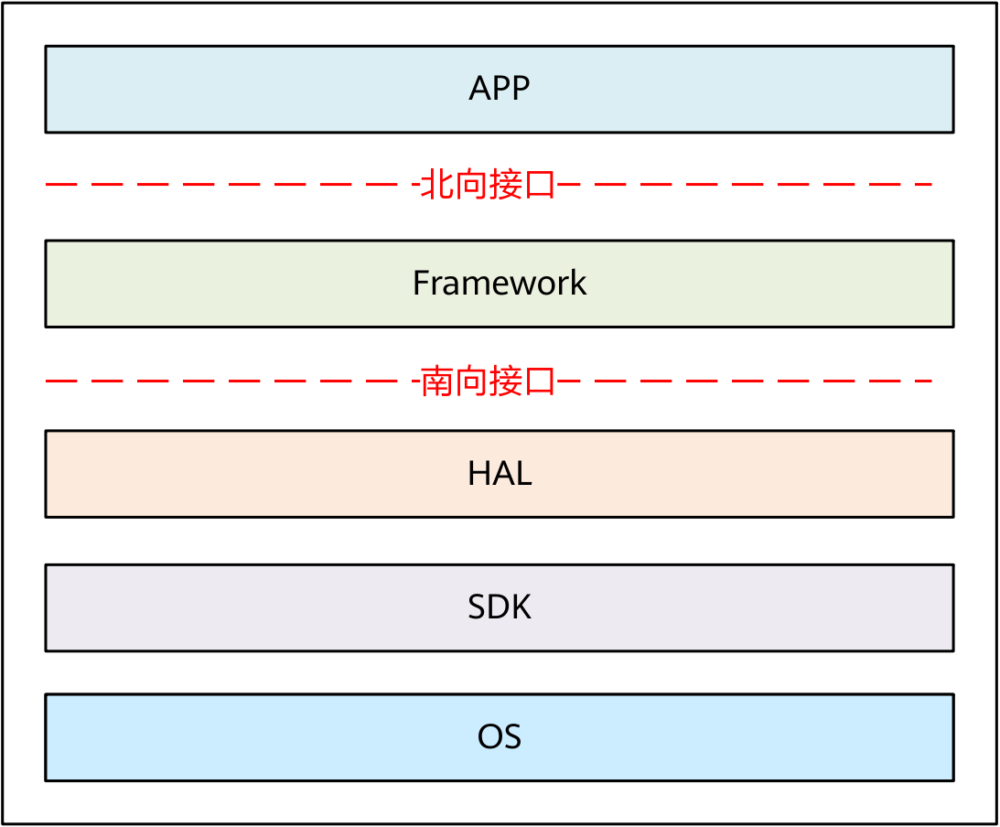

各层次职责概述：

-   APP：基于媒体框架提供的接口开发应用，同时向用户提供UI使用。
-   Framework：为上层开发提供媒体业务相关北向接口。
-   HAL（ardware Abstract Layer）：基于SDK，提供设备管理、数据流控制等功能。
-   SDK：提供媒体采集、编解码、图像处理、视频显示等具体功能。

## 模块划分<a name="ZH-CN_TOPIC_0000002499502245"></a>

**图 1**  模块划分<a name="zh-cn_topic_0000002398510973_fig1735984112407"></a>  
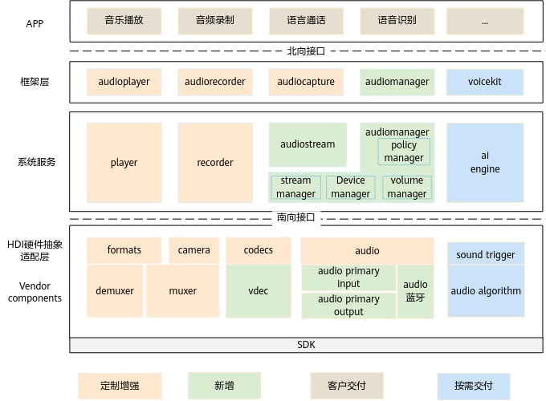

本文针对媒体子系统主要介绍AudioManager（音频管理）、AudioCapture（音频采集）、Player（播放器）。

-   **[Framework层模块](#ZH-CN_TOPIC_0000002466383396)**  

-   **[HAL层模块](#ZH-CN_TOPIC_0000002499582365)**  

### Framework层模块<a name="ZH-CN_TOPIC_0000002466383396"></a>

-   AudioManager：音频管理，对APP侧提供音频资源管理接口。
-   AudioCapture：音频采集，对APP侧提供音频数据采集接口。
-   Player：播放器，对APP侧提供音视频片源播放接口。

### HAL层模块<a name="ZH-CN_TOPIC_0000002499582365"></a>

-   audio：提供音频设备管理、音频采集、渲染管理、音量调节等功能。
-   codec：提供音视频编解码功能。
-   camera：提供H264流预览显示功能。
-   formats：提供容器封装及解封装功能。

# 音频管理<a name="ZH-CN_TOPIC_0000002466542872"></a>

-   **[基本概念](#ZH-CN_TOPIC_0000002466542920)**  

-   **[功能描述](#ZH-CN_TOPIC_0000002499502405)**  

-   **[API参考](#ZH-CN_TOPIC_0000002499582197)**  

-   **[数据类型、数据结构](#ZH-CN_TOPIC_0000002466542900)**  

-   **[错误码](#ZH-CN_TOPIC_0000002466383204)**  

-   **[开发指导](#ZH-CN_TOPIC_0000002499502189)**  

## 基本概念<a name="ZH-CN_TOPIC_0000002466542920"></a>

音频管理负责管理系统的音频资源，包括音频设备管理、音频策略管理、音频冲突管理、音频流管理、音量管理、音效管理。

**图 1**  音频管理总体框架<a name="zh-cn_topic_0000002398630861_fig1610517013397"></a>  
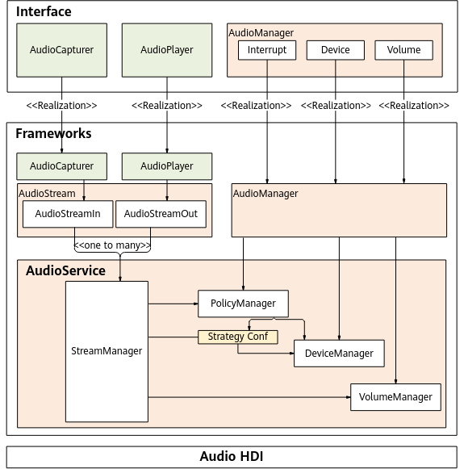

-   AudioManager包括对输入输出设备的管理和输入输出流的管理。
-   AudioManager根据功能的不同，将音频设备分为输入和输出设备，使用DeviceManager模块基于南向Audio HDI（Hardware Device Interface）对音频设备进行抽象和统一管理。
-   对应到输入设备上的采集数据流用AudioStreamIn实现。
-   对应到输出设备上的播放数据流用AudioStreamOut实现。
-   StreamManager模块对不同应用的不同类型数据流进行统一管理。
-   PolicyManager模块根据不同产品音频配置策略决策音频流的冲突解决策略和路由设备选择。

## 功能描述<a name="ZH-CN_TOPIC_0000002499502405"></a>

-   **[音频设备管理](#ZH-CN_TOPIC_0000002466542868)**  

-   **[音频中断策略管理](#ZH-CN_TOPIC_0000002499582385)**  

-   **[音频流管理](#ZH-CN_TOPIC_0000002466383264)**  

-   **[音量管理](#ZH-CN_TOPIC_0000002499582405)**  

-   **[音效管理](#ZH-CN_TOPIC_0000002466542936)**  

-   **[音频管理DFX](#ZH-CN_TOPIC_0000002466383324)**  

### 音频设备管理<a name="ZH-CN_TOPIC_0000002466542868"></a>

AudioManager根据功能的不同，将音频设备分为输入和输出设备。当前支持Mic、Speaker、Modem以及蓝牙设备的管理，Mic、Speaker属于Primary device，是常驻设备；Modem和蓝牙设备的连接和断开状态，需要用户或者蓝牙服务在蓝牙对应的音频设备状态改变时，通过接口调用反馈给AudioManager：

-   Primary device：Mic、Speaker。
-   Bluetooth device：A2DP、SCO IN、SCO OUT。
-   Modem device：OUT\_MODEM、OUT\_MODEM\_HEADSET、IN\_MODEM、IN\_MODEM\_HEADSET。

### 音频中断策略管理<a name="ZH-CN_TOPIC_0000002499582385"></a>

音频管理根据业务场景不同，涉及音频输入、输出策略决策和焦点管理，细分如下：

-   支持如下音频类型：

    -   报警类：健康报警、设备告警。
    -   通话类：语音通话、蓝牙通话、4G VOLTE（Voice over LTE）通话。
    -   语音交互类：语音识别、语音助手、语音合成等。
    -   提示类：蓝牙电话提示音、系统提示音、闹钟。
    -   操作类：触屏音、按键音。
    -   媒体类：影音。
    -   蓝牙输入媒体音：手机蓝牙连接手表，然后从手机过来的媒体音。

    **图 1**  输出流打断策略关系图<a name="zh-cn_topic_0000002364911046_fig2411134136"></a>  
    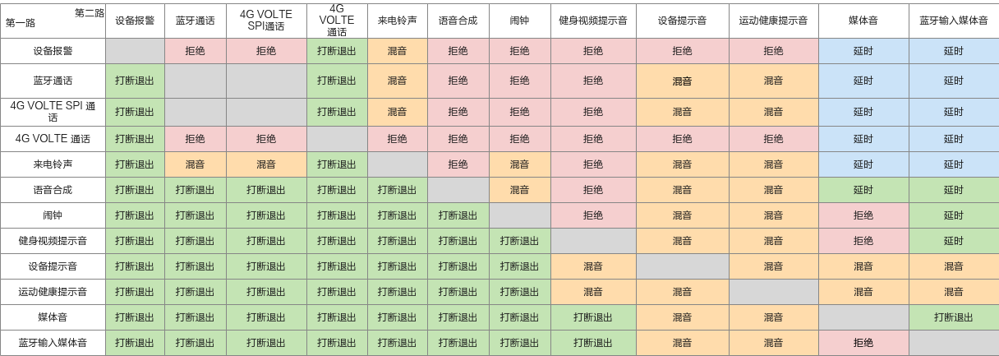

    > **说明：** 
    >-   目前不支持只能在本地播放的音频和蓝牙提示音的并发场景，用户需要在播放本地音频前，先将蓝牙输出设备断开。
    >-   有蓝牙输入媒体音时，可以连接蓝牙耳机，但是手表本身的音频都从本地输出，不会从蓝牙耳机输出。
    >-   如果手表连接手机，手表正在播放音乐，此时从手机侧过来的A2DP链路建立会把手表播放的音乐打断，A2DP链路断开后音乐恢复播放，可能手机只是创建A2DP链路，并没有发送数据，所以手表音乐播放过程中会出现短暂的无声，过一会就恢复的现象，实际上是正常的现象。

    **图 2**  输入流打断策略关系图<a name="zh-cn_topic_0000002364911046_fig14921355193418"></a>  
    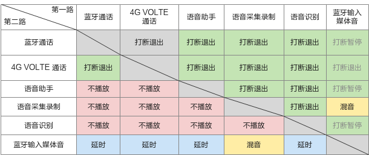

    目前不支持音频输入和输出并发场景的打断策略，典型场景：第一路媒体音，第二路语音采集录制、第一路语音采集录制，第二路媒体音等。

-   支持音频输出分类分级处理策略：
    -   支持不同音频类型配置不同优先级，根据产品可以进行不同的配置。
    -   支持音频输出根据类型和优先级决策音频冲突的策略：打断退出、打断暂停、不播放、混音，延时。

-   支持音频输入设备分优先级选择：

    支持音频输入设备分优先级选择，默认蓝牙优先于本地Mic。

-   支持音频输出设备分优先级选择：

    支持音频输出设备分优先级选择，默认蓝牙优先于本地Speaker。

-   支持异常焦点恢复：
    -   焦点申请成功后，一直不创建对应流会触发超时，进而删除该异常焦点。
    -   流销毁后，不去激活焦点会触发超时，进而删除该异常焦点。

### 音频流管理<a name="ZH-CN_TOPIC_0000002466383264"></a>

音频管理根据流的方向不同，将流分为输入流和输出流。从流的生命周期、状态、倍速、信息、在线模式等角度实现流管理和控制，细分如下：

-   支持音频流的生命周期管理：

    支持根据音频策略决策、参数创建和销毁音频流。

-   支持音频流状态管理：
    -   支持根据用户行为和焦点状态启动、停止、暂停、刷新音频输出流。
    -   支持根据用户行为启动、停止音频输入流。

-   支持音频输出流倍速：

    支持音频输出流的倍速播放（依赖SDK，当前SDK未支持）。

-   支持音频流信息获取：
    -   支持获取音频输出流的播放位置信息。
    -   支持获取音频输出流的播放时间戳信息。
    -   支持获取音频输入流的采集时间戳信息。
    -   支持获取音频输出流的播放缓冲大小。

-   支持音频流在线模式：
    -   支持获取音频输入流的数据通道ID，在线采集数据。
    -   支持获取音频输出流的数据通道ID，在线播放数据。

### 音量管理<a name="ZH-CN_TOPIC_0000002499582405"></a>

音量管理涉及音量调节和音量记录，细分如下：

-   支持音频流音量调节：
    -   支持增大音量、减少音量、静音、关闭静音、恢复音量。
    -   支持调节不同的音频类型的音量，包含不同的输出设备：本地speaker和蓝牙音量。

-   支持音频流音量记录和管理：
    -   支持音量记录，播放时恢复上一次的音量。
    -   支持音量分类型记录管理，不同音频类型可以分别保存。

-   支持多音频场景叠加时音量的淡入淡出效果：

    -   即将到来的音频流会把当前的流的音量压低为即将到来的音频流的一半，这个比例会一直存在，调整新的音频流音量，老的音频流音量也会变化，调整老的音频流音量，新的音频流音量也会变化，但是这个变化的音量值不会被一直记录，音频流停止以后音量就恢复为原来的值。
    -   即将到来的音频流停止以后会恢复当前音频流的音量。

    例如：现在正在播放提示音，此时又开始播放音乐，提示音和音乐应该混音，按照策略此时提示音音量会是音乐音量的一半，可能会出现提示音突然听不见或者声音很小，退出音乐又恢复的情况，就是这个策略导致的。

### 音效管理<a name="ZH-CN_TOPIC_0000002466542936"></a>

音效按照音频场景对应生效，例如：音乐播放、语音通话场景对应不同音效，也可以没有音效，目前媒体配置音效具体效果依赖SDK。

### 音频管理DFX<a name="ZH-CN_TOPIC_0000002466383324"></a>

音频管理DFX（Design For X）属于非功能属性，例如：性能、可靠性、可服务性、可测试性，细分如下：

-   音频焦点信息（焦点SessionID、对应流类型、策略、对应流的创建销毁状态），请参见“[DumpInfo](#ZH-CN_TOPIC_0000002466542952)”小节。
-   支持前后台音频流信息查询（包括音频流类型、对应策略、音频格式、混音比例、流类型音量、流音量、流路由设备），请参见“[DumpInfo](#ZH-CN_TOPIC_0000002466542952)”小节。
-   支持音频设备音量查询。
-   音频设备切换到耳机时，保持音量在安全范围内。
-   可测试性支持CHR日志打点，通过调用公共CHR打点接口将打点数据通过串口打印或者保存到文件系统中，实现对音频管理模块关键行为节点的记录，具体枚举定义请参见“middleware/services/media/dfx/chr/include/media\_chr\_log.h”文件。

## API参考<a name="ZH-CN_TOPIC_0000002499582197"></a>

-   **[AudioManager类](#ZH-CN_TOPIC_0000002466542948)**  

-   **[InterruptListener类](#ZH-CN_TOPIC_0000002466383320)**  

-   **[AudioStreamIn类](#ZH-CN_TOPIC_0000002499582305)**  

-   **[AudioStreamOut类](#ZH-CN_TOPIC_0000002499582237)**  

### AudioManager类<a name="ZH-CN_TOPIC_0000002466542948"></a>

音频管理模块主要提供获取输入/输出设备、设备连接/断开、激活/去激活音频中断、音量设置/获取、静音设置/获取、响铃模式设置/获取等功能。提供以下API（Application Programming Interface）：

-   GetInstance：获取AudioManager实例（单例模式）。
-   Initialize：初始化音频资源。
-   MakeSessionId：创建会话ID。
-   SetVolume：设置指定流类型音量。
-   GetVolume：获取指定流类型音量。
-   GetMinVolume：获取指定流类型最小音量。
-   GetMaxVolume：获取指定流类型最大音量。
-   Mute：静音指定流类型。
-   UnMute：取消指定流类型静音。
-   IsMute：检查指定流类型是否静音。
-   SetMasterMute：静音或取消静音全局音频流。
-   IsMasterMute：检查音频流是否全局静音。
-   SetMicrophoneMute：设置麦克风静音或取消静音。
-   IsMicrophoneMute：检查麦克风是否静音。
-   SetRingerMode：设置振铃模式。
-   GetRingerMode：获取振铃模式。
-   GetDevices：获取音频输入输出设备或所有设备的信息。
-   IsSupportOffload：根据音频Offload信息查询是否支持Offload。
-   SetDeviceConnectionState：设置设备连接状态。
-   ActivateAudioInterrupt：激活音频中断。
-   DeactivateAudioInterrupt：去激活音频中断。
-   DumpInfo：Dump信息。
-   SetParam：设置参数
-   GetParam：获取参数

-   **[GetInstance](#ZH-CN_TOPIC_0000002466383412)**  

-   **[Initialize](#ZH-CN_TOPIC_0000002466383384)**  

-   **[MakeSessionId](#ZH-CN_TOPIC_0000002499502177)**  

-   **[SetVolume](#ZH-CN_TOPIC_0000002466383380)**  

-   **[GetVolume](#ZH-CN_TOPIC_0000002466542884)**  

-   **[GetMinVolume](#ZH-CN_TOPIC_0000002466383436)**  

-   **[GetMaxVolume](#ZH-CN_TOPIC_0000002466383480)**  

-   **[Mute](#ZH-CN_TOPIC_0000002499582333)**  

-   **[UnMute](#ZH-CN_TOPIC_0000002499502241)**  

-   **[IsMute](#ZH-CN_TOPIC_0000002466383492)**  

-   **[SetMasterMute](#ZH-CN_TOPIC_0000002466542896)**  

-   **[IsMasterMute](#ZH-CN_TOPIC_0000002499502429)**  

-   **[SetMicrophoneMute](#ZH-CN_TOPIC_0000002499582357)**  

-   **[IsMicrophoneMute](#ZH-CN_TOPIC_0000002466383448)**  

-   **[SetRingerMode](#ZH-CN_TOPIC_0000002466543104)**  

-   **[GetRingerMode](#ZH-CN_TOPIC_0000002466383260)**  

-   **[GetDevices](#ZH-CN_TOPIC_0000002499582377)**  

-   **[IsSupportOffload](#ZH-CN_TOPIC_0000002499582345)**  

-   **[SetDeviceConnectionState](#ZH-CN_TOPIC_0000002466542980)**  

-   **[ActivateAudioInterrupt](#ZH-CN_TOPIC_0000002499502365)**  

-   **[DeactivateAudioInterrupt](#ZH-CN_TOPIC_0000002499582285)**  

-   **[DumpInfo](#ZH-CN_TOPIC_0000002466542952)**  

-   **[SetParam](#ZH-CN_TOPIC_0000002499502237)**  

-   **[GetParam](#ZH-CN_TOPIC_0000002499582465)**  

#### GetInstance<a name="ZH-CN_TOPIC_0000002466383412"></a>

【描述】

获取AudioManager实例。

【语法】

static AudioManager& GetInstance\(\);

【参数】

无

【返回值】

<a name="zh-cn_topic_0000002398630941_table333mcpsimp"></a>
<table><thead align="left"><tr id="zh-cn_topic_0000002398630941_row338mcpsimp"><th class="cellrowborder" valign="top" width="52%" id="mcps1.1.3.1.1"><p id="zh-cn_topic_0000002398630941_p340mcpsimp"><a name="zh-cn_topic_0000002398630941_p340mcpsimp"></a><a name="zh-cn_topic_0000002398630941_p340mcpsimp"></a>返回值</p>
</th>
<th class="cellrowborder" valign="top" width="48%" id="mcps1.1.3.1.2"><p id="zh-cn_topic_0000002398630941_p342mcpsimp"><a name="zh-cn_topic_0000002398630941_p342mcpsimp"></a><a name="zh-cn_topic_0000002398630941_p342mcpsimp"></a>描述</p>
</th>
</tr>
</thead>
<tbody><tr id="zh-cn_topic_0000002398630941_row344mcpsimp"><td class="cellrowborder" valign="top" width="52%" headers="mcps1.1.3.1.1 "><p id="zh-cn_topic_0000002398630941_p346mcpsimp"><a name="zh-cn_topic_0000002398630941_p346mcpsimp"></a><a name="zh-cn_topic_0000002398630941_p346mcpsimp"></a>AudioManager&</p>
</td>
<td class="cellrowborder" valign="top" width="48%" headers="mcps1.1.3.1.2 "><p id="zh-cn_topic_0000002398630941_p348mcpsimp"><a name="zh-cn_topic_0000002398630941_p348mcpsimp"></a><a name="zh-cn_topic_0000002398630941_p348mcpsimp"></a>获取AudioManager实例，单例模式。</p>
</td>
</tr>
</tbody>
</table>

【芯片差异】

无。

【注意】

无。

【举例】

具体示例内容请参见“[本地音乐播放](#ZH-CN_TOPIC_0000002466383428)”小节。

【相关主题】

无。

#### Initialize<a name="ZH-CN_TOPIC_0000002466383384"></a>

【描述】

初始化音频资源。

【语法】

bool Initialize\(\);

【参数】

无。

【返回值】

<a name="zh-cn_topic_0000002398630893_table365mcpsimp"></a>
<table><thead align="left"><tr id="zh-cn_topic_0000002398630893_row371mcpsimp"><th class="cellrowborder" valign="top" width="20%" id="mcps1.1.4.1.1"><p id="zh-cn_topic_0000002398630893_p373mcpsimp"><a name="zh-cn_topic_0000002398630893_p373mcpsimp"></a><a name="zh-cn_topic_0000002398630893_p373mcpsimp"></a>返回值</p>
</th>
<th class="cellrowborder" valign="top" width="55.00000000000001%" id="mcps1.1.4.1.2"><p id="zh-cn_topic_0000002398630893_p375mcpsimp"><a name="zh-cn_topic_0000002398630893_p375mcpsimp"></a><a name="zh-cn_topic_0000002398630893_p375mcpsimp"></a>描述</p>
</th>
<th class="cellrowborder" valign="top" width="25%" id="mcps1.1.4.1.3"><p id="zh-cn_topic_0000002398630893_p377mcpsimp"><a name="zh-cn_topic_0000002398630893_p377mcpsimp"></a><a name="zh-cn_topic_0000002398630893_p377mcpsimp"></a>输入/输出</p>
</th>
</tr>
</thead>
<tbody><tr id="zh-cn_topic_0000002398630893_row379mcpsimp"><td class="cellrowborder" valign="top" width="20%" headers="mcps1.1.4.1.1 "><p id="zh-cn_topic_0000002398630893_p381mcpsimp"><a name="zh-cn_topic_0000002398630893_p381mcpsimp"></a><a name="zh-cn_topic_0000002398630893_p381mcpsimp"></a>bool</p>
</td>
<td class="cellrowborder" valign="top" width="55.00000000000001%" headers="mcps1.1.4.1.2 "><a name="zh-cn_topic_0000002398630893_ul1048332633011"></a><a name="zh-cn_topic_0000002398630893_ul1048332633011"></a><ul id="zh-cn_topic_0000002398630893_ul1048332633011"><li>true：成功。</li><li>false：失败。</li></ul>
</td>
<td class="cellrowborder" valign="top" width="25%" headers="mcps1.1.4.1.3 "><p id="zh-cn_topic_0000002398630893_p385mcpsimp"><a name="zh-cn_topic_0000002398630893_p385mcpsimp"></a><a name="zh-cn_topic_0000002398630893_p385mcpsimp"></a>输出</p>
</td>
</tr>
</tbody>
</table>

【芯片差异】

无。

【注意】

无。

【举例】

具体示例内容请参见“[本地音乐播放](#ZH-CN_TOPIC_0000002466383428)”小节。

【相关主题】

无。

#### MakeSessionId<a name="ZH-CN_TOPIC_0000002499502177"></a>

【描述】

创建会话ID。

【语法】

AudioSession MakeSessionId\(\);

【参数】

无。

【返回值】

<a name="zh-cn_topic_0000002364911026_table402mcpsimp"></a>
<table><thead align="left"><tr id="zh-cn_topic_0000002364911026_row408mcpsimp"><th class="cellrowborder" valign="top" width="20%" id="mcps1.1.4.1.1"><p id="zh-cn_topic_0000002364911026_p410mcpsimp"><a name="zh-cn_topic_0000002364911026_p410mcpsimp"></a><a name="zh-cn_topic_0000002364911026_p410mcpsimp"></a>返回值</p>
</th>
<th class="cellrowborder" valign="top" width="62%" id="mcps1.1.4.1.2"><p id="zh-cn_topic_0000002364911026_p412mcpsimp"><a name="zh-cn_topic_0000002364911026_p412mcpsimp"></a><a name="zh-cn_topic_0000002364911026_p412mcpsimp"></a>描述</p>
</th>
<th class="cellrowborder" valign="top" width="18%" id="mcps1.1.4.1.3"><p id="zh-cn_topic_0000002364911026_p414mcpsimp"><a name="zh-cn_topic_0000002364911026_p414mcpsimp"></a><a name="zh-cn_topic_0000002364911026_p414mcpsimp"></a>输入/输出</p>
</th>
</tr>
</thead>
<tbody><tr id="zh-cn_topic_0000002364911026_row416mcpsimp"><td class="cellrowborder" valign="top" width="20%" headers="mcps1.1.4.1.1 "><p id="zh-cn_topic_0000002364911026_p418mcpsimp"><a name="zh-cn_topic_0000002364911026_p418mcpsimp"></a><a name="zh-cn_topic_0000002364911026_p418mcpsimp"></a>AudioSession</p>
</td>
<td class="cellrowborder" valign="top" width="62%" headers="mcps1.1.4.1.2 "><a name="zh-cn_topic_0000002364911026_ul369310380301"></a><a name="zh-cn_topic_0000002364911026_ul369310380301"></a><ul id="zh-cn_topic_0000002364911026_ul369310380301"><li>成功：返回会话ID。</li><li>失败：返回0。</li></ul>
<p id="zh-cn_topic_0000002364911026_p420mcpsimp"><a name="zh-cn_topic_0000002364911026_p420mcpsimp"></a><a name="zh-cn_topic_0000002364911026_p420mcpsimp"></a>详见“<a href="#ZH-CN_TOPIC_0000002466542832">AudioSession</a>”小节。</p>
</td>
<td class="cellrowborder" valign="top" width="18%" headers="mcps1.1.4.1.3 "><p id="zh-cn_topic_0000002364911026_p422mcpsimp"><a name="zh-cn_topic_0000002364911026_p422mcpsimp"></a><a name="zh-cn_topic_0000002364911026_p422mcpsimp"></a>输出</p>
</td>
</tr>
</tbody>
</table>

【芯片差异】

无。

【注意】

无。

【举例】

具体示例内容请参见“[本地音乐播放](#ZH-CN_TOPIC_0000002466383428)”小节。

【相关主题】

无。

#### SetVolume<a name="ZH-CN_TOPIC_0000002466383380"></a>

【描述】

设置指定流类型音量。

【语法】

bool SetVolume\(AudioStreamType streamType, int32\_t volume\);

【参数】

<a name="zh-cn_topic_0000002364911114_table437mcpsimp"></a>
<table><thead align="left"><tr id="zh-cn_topic_0000002364911114_row443mcpsimp"><th class="cellrowborder" valign="top" width="28.999999999999996%" id="mcps1.1.4.1.1"><p id="zh-cn_topic_0000002364911114_p445mcpsimp"><a name="zh-cn_topic_0000002364911114_p445mcpsimp"></a><a name="zh-cn_topic_0000002364911114_p445mcpsimp"></a>参数名称</p>
</th>
<th class="cellrowborder" valign="top" width="45.56%" id="mcps1.1.4.1.2"><p id="zh-cn_topic_0000002364911114_p447mcpsimp"><a name="zh-cn_topic_0000002364911114_p447mcpsimp"></a><a name="zh-cn_topic_0000002364911114_p447mcpsimp"></a>描述</p>
</th>
<th class="cellrowborder" valign="top" width="25.44%" id="mcps1.1.4.1.3"><p id="zh-cn_topic_0000002364911114_p449mcpsimp"><a name="zh-cn_topic_0000002364911114_p449mcpsimp"></a><a name="zh-cn_topic_0000002364911114_p449mcpsimp"></a>输入/输出</p>
</th>
</tr>
</thead>
<tbody><tr id="zh-cn_topic_0000002364911114_row450mcpsimp"><td class="cellrowborder" valign="top" width="28.999999999999996%" headers="mcps1.1.4.1.1 "><p id="zh-cn_topic_0000002364911114_p452mcpsimp"><a name="zh-cn_topic_0000002364911114_p452mcpsimp"></a><a name="zh-cn_topic_0000002364911114_p452mcpsimp"></a>streamType</p>
</td>
<td class="cellrowborder" valign="top" width="45.56%" headers="mcps1.1.4.1.2 "><p id="zh-cn_topic_0000002364911114_p454mcpsimp"><a name="zh-cn_topic_0000002364911114_p454mcpsimp"></a><a name="zh-cn_topic_0000002364911114_p454mcpsimp"></a>流类型。</p>
</td>
<td class="cellrowborder" valign="top" width="25.44%" headers="mcps1.1.4.1.3 "><p id="zh-cn_topic_0000002364911114_p456mcpsimp"><a name="zh-cn_topic_0000002364911114_p456mcpsimp"></a><a name="zh-cn_topic_0000002364911114_p456mcpsimp"></a>输入</p>
</td>
</tr>
<tr id="zh-cn_topic_0000002364911114_row457mcpsimp"><td class="cellrowborder" valign="top" width="28.999999999999996%" headers="mcps1.1.4.1.1 "><p id="zh-cn_topic_0000002364911114_p459mcpsimp"><a name="zh-cn_topic_0000002364911114_p459mcpsimp"></a><a name="zh-cn_topic_0000002364911114_p459mcpsimp"></a>volume</p>
</td>
<td class="cellrowborder" valign="top" width="45.56%" headers="mcps1.1.4.1.2 "><p id="zh-cn_topic_0000002364911114_p461mcpsimp"><a name="zh-cn_topic_0000002364911114_p461mcpsimp"></a><a name="zh-cn_topic_0000002364911114_p461mcpsimp"></a>音量值。</p>
</td>
<td class="cellrowborder" valign="top" width="25.44%" headers="mcps1.1.4.1.3 "><p id="zh-cn_topic_0000002364911114_p463mcpsimp"><a name="zh-cn_topic_0000002364911114_p463mcpsimp"></a><a name="zh-cn_topic_0000002364911114_p463mcpsimp"></a>输入</p>
</td>
</tr>
</tbody>
</table>

【返回值】

<a name="zh-cn_topic_0000002364911114_table465mcpsimp"></a>
<table><thead align="left"><tr id="zh-cn_topic_0000002364911114_row471mcpsimp"><th class="cellrowborder" valign="top" width="28.24%" id="mcps1.1.4.1.1"><p id="zh-cn_topic_0000002364911114_p473mcpsimp"><a name="zh-cn_topic_0000002364911114_p473mcpsimp"></a><a name="zh-cn_topic_0000002364911114_p473mcpsimp"></a>返回值</p>
</th>
<th class="cellrowborder" valign="top" width="46.760000000000005%" id="mcps1.1.4.1.2"><p id="zh-cn_topic_0000002364911114_p475mcpsimp"><a name="zh-cn_topic_0000002364911114_p475mcpsimp"></a><a name="zh-cn_topic_0000002364911114_p475mcpsimp"></a>描述</p>
</th>
<th class="cellrowborder" valign="top" width="25%" id="mcps1.1.4.1.3"><p id="zh-cn_topic_0000002364911114_p477mcpsimp"><a name="zh-cn_topic_0000002364911114_p477mcpsimp"></a><a name="zh-cn_topic_0000002364911114_p477mcpsimp"></a>输入/输出</p>
</th>
</tr>
</thead>
<tbody><tr id="zh-cn_topic_0000002364911114_row479mcpsimp"><td class="cellrowborder" valign="top" width="28.24%" headers="mcps1.1.4.1.1 "><p id="zh-cn_topic_0000002364911114_p481mcpsimp"><a name="zh-cn_topic_0000002364911114_p481mcpsimp"></a><a name="zh-cn_topic_0000002364911114_p481mcpsimp"></a>bool</p>
</td>
<td class="cellrowborder" valign="top" width="46.760000000000005%" headers="mcps1.1.4.1.2 "><a name="zh-cn_topic_0000002364911114_ul1358866103116"></a><a name="zh-cn_topic_0000002364911114_ul1358866103116"></a><ul id="zh-cn_topic_0000002364911114_ul1358866103116"><li>true：成功。</li><li>false：失败。</li></ul>
</td>
<td class="cellrowborder" valign="top" width="25%" headers="mcps1.1.4.1.3 "><p id="zh-cn_topic_0000002364911114_p485mcpsimp"><a name="zh-cn_topic_0000002364911114_p485mcpsimp"></a><a name="zh-cn_topic_0000002364911114_p485mcpsimp"></a>输出</p>
</td>
</tr>
</tbody>
</table>

【芯片差异】

无。

【注意】

音量值范围，可通过GetMinVolume/GetMaxVolume获取。

【举例】

无。

【相关主题】

无。

#### GetVolume<a name="ZH-CN_TOPIC_0000002466542884"></a>

【描述】

获取指定流类型音量。

【语法】

int32\_t GetVolume\(AudioStreamType streamType\);

【参数】

<a name="zh-cn_topic_0000002364911210_table500mcpsimp"></a>
<table><thead align="left"><tr id="zh-cn_topic_0000002364911210_row506mcpsimp"><th class="cellrowborder" valign="top" width="26%" id="mcps1.1.4.1.1"><p id="zh-cn_topic_0000002364911210_p508mcpsimp"><a name="zh-cn_topic_0000002364911210_p508mcpsimp"></a><a name="zh-cn_topic_0000002364911210_p508mcpsimp"></a>参数名称</p>
</th>
<th class="cellrowborder" valign="top" width="51%" id="mcps1.1.4.1.2"><p id="zh-cn_topic_0000002364911210_p510mcpsimp"><a name="zh-cn_topic_0000002364911210_p510mcpsimp"></a><a name="zh-cn_topic_0000002364911210_p510mcpsimp"></a>描述</p>
</th>
<th class="cellrowborder" valign="top" width="23%" id="mcps1.1.4.1.3"><p id="zh-cn_topic_0000002364911210_p512mcpsimp"><a name="zh-cn_topic_0000002364911210_p512mcpsimp"></a><a name="zh-cn_topic_0000002364911210_p512mcpsimp"></a>输入/输出</p>
</th>
</tr>
</thead>
<tbody><tr id="zh-cn_topic_0000002364911210_row514mcpsimp"><td class="cellrowborder" valign="top" width="26%" headers="mcps1.1.4.1.1 "><p id="zh-cn_topic_0000002364911210_p516mcpsimp"><a name="zh-cn_topic_0000002364911210_p516mcpsimp"></a><a name="zh-cn_topic_0000002364911210_p516mcpsimp"></a>streamType</p>
</td>
<td class="cellrowborder" valign="top" width="51%" headers="mcps1.1.4.1.2 "><p id="zh-cn_topic_0000002364911210_p518mcpsimp"><a name="zh-cn_topic_0000002364911210_p518mcpsimp"></a><a name="zh-cn_topic_0000002364911210_p518mcpsimp"></a>流类型。</p>
</td>
<td class="cellrowborder" valign="top" width="23%" headers="mcps1.1.4.1.3 "><p id="zh-cn_topic_0000002364911210_p520mcpsimp"><a name="zh-cn_topic_0000002364911210_p520mcpsimp"></a><a name="zh-cn_topic_0000002364911210_p520mcpsimp"></a>输入</p>
</td>
</tr>
</tbody>
</table>

【返回值】

<a name="zh-cn_topic_0000002364911210_table522mcpsimp"></a>
<table><thead align="left"><tr id="zh-cn_topic_0000002364911210_row528mcpsimp"><th class="cellrowborder" valign="top" width="26.14%" id="mcps1.1.4.1.1"><p id="zh-cn_topic_0000002364911210_p530mcpsimp"><a name="zh-cn_topic_0000002364911210_p530mcpsimp"></a><a name="zh-cn_topic_0000002364911210_p530mcpsimp"></a>返回值</p>
</th>
<th class="cellrowborder" valign="top" width="48.86%" id="mcps1.1.4.1.2"><p id="zh-cn_topic_0000002364911210_p532mcpsimp"><a name="zh-cn_topic_0000002364911210_p532mcpsimp"></a><a name="zh-cn_topic_0000002364911210_p532mcpsimp"></a>描述</p>
</th>
<th class="cellrowborder" valign="top" width="25%" id="mcps1.1.4.1.3"><p id="zh-cn_topic_0000002364911210_p534mcpsimp"><a name="zh-cn_topic_0000002364911210_p534mcpsimp"></a><a name="zh-cn_topic_0000002364911210_p534mcpsimp"></a>输入/输出</p>
</th>
</tr>
</thead>
<tbody><tr id="zh-cn_topic_0000002364911210_row536mcpsimp"><td class="cellrowborder" valign="top" width="26.14%" headers="mcps1.1.4.1.1 "><p id="zh-cn_topic_0000002364911210_p538mcpsimp"><a name="zh-cn_topic_0000002364911210_p538mcpsimp"></a><a name="zh-cn_topic_0000002364911210_p538mcpsimp"></a>int32_t</p>
</td>
<td class="cellrowborder" valign="top" width="48.86%" headers="mcps1.1.4.1.2 "><p id="zh-cn_topic_0000002364911210_p540mcpsimp"><a name="zh-cn_topic_0000002364911210_p540mcpsimp"></a><a name="zh-cn_topic_0000002364911210_p540mcpsimp"></a>音量值。</p>
</td>
<td class="cellrowborder" valign="top" width="25%" headers="mcps1.1.4.1.3 "><p id="zh-cn_topic_0000002364911210_p542mcpsimp"><a name="zh-cn_topic_0000002364911210_p542mcpsimp"></a><a name="zh-cn_topic_0000002364911210_p542mcpsimp"></a>输出</p>
</td>
</tr>
</tbody>
</table>

【芯片差异】

无。

【注意】

无。

【举例】

无。

【相关主题】

无。

#### GetMinVolume<a name="ZH-CN_TOPIC_0000002466383436"></a>

【描述】

获取指定流类型最小音量。

【语法】

int32\_t GetMinVolume\(AudioStreamType streamType\);

【参数】

<a name="zh-cn_topic_0000002398630833_table557mcpsimp"></a>
<table><thead align="left"><tr id="zh-cn_topic_0000002398630833_row563mcpsimp"><th class="cellrowborder" valign="top" width="26%" id="mcps1.1.4.1.1"><p id="zh-cn_topic_0000002398630833_p565mcpsimp"><a name="zh-cn_topic_0000002398630833_p565mcpsimp"></a><a name="zh-cn_topic_0000002398630833_p565mcpsimp"></a>参数名称</p>
</th>
<th class="cellrowborder" valign="top" width="51%" id="mcps1.1.4.1.2"><p id="zh-cn_topic_0000002398630833_p567mcpsimp"><a name="zh-cn_topic_0000002398630833_p567mcpsimp"></a><a name="zh-cn_topic_0000002398630833_p567mcpsimp"></a>描述</p>
</th>
<th class="cellrowborder" valign="top" width="23%" id="mcps1.1.4.1.3"><p id="zh-cn_topic_0000002398630833_p569mcpsimp"><a name="zh-cn_topic_0000002398630833_p569mcpsimp"></a><a name="zh-cn_topic_0000002398630833_p569mcpsimp"></a>输入/输出</p>
</th>
</tr>
</thead>
<tbody><tr id="zh-cn_topic_0000002398630833_row571mcpsimp"><td class="cellrowborder" valign="top" width="26%" headers="mcps1.1.4.1.1 "><p id="zh-cn_topic_0000002398630833_p573mcpsimp"><a name="zh-cn_topic_0000002398630833_p573mcpsimp"></a><a name="zh-cn_topic_0000002398630833_p573mcpsimp"></a>streamType</p>
</td>
<td class="cellrowborder" valign="top" width="51%" headers="mcps1.1.4.1.2 "><p id="zh-cn_topic_0000002398630833_p575mcpsimp"><a name="zh-cn_topic_0000002398630833_p575mcpsimp"></a><a name="zh-cn_topic_0000002398630833_p575mcpsimp"></a>流类型。</p>
</td>
<td class="cellrowborder" valign="top" width="23%" headers="mcps1.1.4.1.3 "><p id="zh-cn_topic_0000002398630833_p577mcpsimp"><a name="zh-cn_topic_0000002398630833_p577mcpsimp"></a><a name="zh-cn_topic_0000002398630833_p577mcpsimp"></a>输入</p>
</td>
</tr>
</tbody>
</table>

【返回值】

<a name="zh-cn_topic_0000002398630833_table579mcpsimp"></a>
<table><thead align="left"><tr id="zh-cn_topic_0000002398630833_row585mcpsimp"><th class="cellrowborder" valign="top" width="27%" id="mcps1.1.4.1.1"><p id="zh-cn_topic_0000002398630833_p587mcpsimp"><a name="zh-cn_topic_0000002398630833_p587mcpsimp"></a><a name="zh-cn_topic_0000002398630833_p587mcpsimp"></a>返回值</p>
</th>
<th class="cellrowborder" valign="top" width="50%" id="mcps1.1.4.1.2"><p id="zh-cn_topic_0000002398630833_p589mcpsimp"><a name="zh-cn_topic_0000002398630833_p589mcpsimp"></a><a name="zh-cn_topic_0000002398630833_p589mcpsimp"></a>描述</p>
</th>
<th class="cellrowborder" valign="top" width="23%" id="mcps1.1.4.1.3"><p id="zh-cn_topic_0000002398630833_p591mcpsimp"><a name="zh-cn_topic_0000002398630833_p591mcpsimp"></a><a name="zh-cn_topic_0000002398630833_p591mcpsimp"></a>输入/输出</p>
</th>
</tr>
</thead>
<tbody><tr id="zh-cn_topic_0000002398630833_row593mcpsimp"><td class="cellrowborder" valign="top" width="27%" headers="mcps1.1.4.1.1 "><p id="zh-cn_topic_0000002398630833_p595mcpsimp"><a name="zh-cn_topic_0000002398630833_p595mcpsimp"></a><a name="zh-cn_topic_0000002398630833_p595mcpsimp"></a>int32_t</p>
</td>
<td class="cellrowborder" valign="top" width="50%" headers="mcps1.1.4.1.2 "><p id="zh-cn_topic_0000002398630833_p597mcpsimp"><a name="zh-cn_topic_0000002398630833_p597mcpsimp"></a><a name="zh-cn_topic_0000002398630833_p597mcpsimp"></a>最小音量值。</p>
</td>
<td class="cellrowborder" valign="top" width="23%" headers="mcps1.1.4.1.3 "><p id="zh-cn_topic_0000002398630833_p599mcpsimp"><a name="zh-cn_topic_0000002398630833_p599mcpsimp"></a><a name="zh-cn_topic_0000002398630833_p599mcpsimp"></a>输出</p>
</td>
</tr>
</tbody>
</table>

【芯片差异】

无。

【注意】

无。

【举例】

无。

【相关主题】

无。

#### GetMaxVolume<a name="ZH-CN_TOPIC_0000002466383480"></a>

【描述】

获取指定流类型最大音量。

【语法】

int32\_t GetMaxVolume\(AudioStreamType streamType\);

【参数】

<a name="zh-cn_topic_0000002364911190_table614mcpsimp"></a>
<table><thead align="left"><tr id="zh-cn_topic_0000002364911190_row620mcpsimp"><th class="cellrowborder" valign="top" width="20%" id="mcps1.1.4.1.1"><p id="zh-cn_topic_0000002364911190_p622mcpsimp"><a name="zh-cn_topic_0000002364911190_p622mcpsimp"></a><a name="zh-cn_topic_0000002364911190_p622mcpsimp"></a>参数名称</p>
</th>
<th class="cellrowborder" valign="top" width="55.00000000000001%" id="mcps1.1.4.1.2"><p id="zh-cn_topic_0000002364911190_p624mcpsimp"><a name="zh-cn_topic_0000002364911190_p624mcpsimp"></a><a name="zh-cn_topic_0000002364911190_p624mcpsimp"></a>描述</p>
</th>
<th class="cellrowborder" valign="top" width="25%" id="mcps1.1.4.1.3"><p id="zh-cn_topic_0000002364911190_p626mcpsimp"><a name="zh-cn_topic_0000002364911190_p626mcpsimp"></a><a name="zh-cn_topic_0000002364911190_p626mcpsimp"></a>输入/输出</p>
</th>
</tr>
</thead>
<tbody><tr id="zh-cn_topic_0000002364911190_row627mcpsimp"><td class="cellrowborder" valign="top" width="20%" headers="mcps1.1.4.1.1 "><p id="zh-cn_topic_0000002364911190_p629mcpsimp"><a name="zh-cn_topic_0000002364911190_p629mcpsimp"></a><a name="zh-cn_topic_0000002364911190_p629mcpsimp"></a>streamType</p>
</td>
<td class="cellrowborder" valign="top" width="55.00000000000001%" headers="mcps1.1.4.1.2 "><p id="zh-cn_topic_0000002364911190_p631mcpsimp"><a name="zh-cn_topic_0000002364911190_p631mcpsimp"></a><a name="zh-cn_topic_0000002364911190_p631mcpsimp"></a>流类型。</p>
</td>
<td class="cellrowborder" valign="top" width="25%" headers="mcps1.1.4.1.3 "><p id="zh-cn_topic_0000002364911190_p633mcpsimp"><a name="zh-cn_topic_0000002364911190_p633mcpsimp"></a><a name="zh-cn_topic_0000002364911190_p633mcpsimp"></a>输入</p>
</td>
</tr>
</tbody>
</table>

【返回值】

<a name="zh-cn_topic_0000002364911190_table635mcpsimp"></a>
<table><thead align="left"><tr id="zh-cn_topic_0000002364911190_row641mcpsimp"><th class="cellrowborder" valign="top" width="20%" id="mcps1.1.4.1.1"><p id="zh-cn_topic_0000002364911190_p643mcpsimp"><a name="zh-cn_topic_0000002364911190_p643mcpsimp"></a><a name="zh-cn_topic_0000002364911190_p643mcpsimp"></a>返回值</p>
</th>
<th class="cellrowborder" valign="top" width="55.00000000000001%" id="mcps1.1.4.1.2"><p id="zh-cn_topic_0000002364911190_p645mcpsimp"><a name="zh-cn_topic_0000002364911190_p645mcpsimp"></a><a name="zh-cn_topic_0000002364911190_p645mcpsimp"></a>描述</p>
</th>
<th class="cellrowborder" valign="top" width="25%" id="mcps1.1.4.1.3"><p id="zh-cn_topic_0000002364911190_p647mcpsimp"><a name="zh-cn_topic_0000002364911190_p647mcpsimp"></a><a name="zh-cn_topic_0000002364911190_p647mcpsimp"></a>输入/输出</p>
</th>
</tr>
</thead>
<tbody><tr id="zh-cn_topic_0000002364911190_row648mcpsimp"><td class="cellrowborder" valign="top" width="20%" headers="mcps1.1.4.1.1 "><p id="zh-cn_topic_0000002364911190_p650mcpsimp"><a name="zh-cn_topic_0000002364911190_p650mcpsimp"></a><a name="zh-cn_topic_0000002364911190_p650mcpsimp"></a>int32_t</p>
</td>
<td class="cellrowborder" valign="top" width="55.00000000000001%" headers="mcps1.1.4.1.2 "><p id="zh-cn_topic_0000002364911190_p652mcpsimp"><a name="zh-cn_topic_0000002364911190_p652mcpsimp"></a><a name="zh-cn_topic_0000002364911190_p652mcpsimp"></a>最大音量值。</p>
</td>
<td class="cellrowborder" valign="top" width="25%" headers="mcps1.1.4.1.3 "><p id="zh-cn_topic_0000002364911190_p654mcpsimp"><a name="zh-cn_topic_0000002364911190_p654mcpsimp"></a><a name="zh-cn_topic_0000002364911190_p654mcpsimp"></a>输出</p>
</td>
</tr>
</tbody>
</table>

【芯片差异】

无。

【注意】

无。

【举例】

无。

【相关主题】

无。

#### Mute<a name="ZH-CN_TOPIC_0000002499582333"></a>

【描述】

静音指定流类型。

【语法】

bool Mute\(AudioStreamType streamType\);

【参数】

<a name="zh-cn_topic_0000002398630845_table669mcpsimp"></a>
<table><thead align="left"><tr id="zh-cn_topic_0000002398630845_row675mcpsimp"><th class="cellrowborder" valign="top" width="20%" id="mcps1.1.4.1.1"><p id="zh-cn_topic_0000002398630845_p677mcpsimp"><a name="zh-cn_topic_0000002398630845_p677mcpsimp"></a><a name="zh-cn_topic_0000002398630845_p677mcpsimp"></a>参数名称</p>
</th>
<th class="cellrowborder" valign="top" width="55.00000000000001%" id="mcps1.1.4.1.2"><p id="zh-cn_topic_0000002398630845_p679mcpsimp"><a name="zh-cn_topic_0000002398630845_p679mcpsimp"></a><a name="zh-cn_topic_0000002398630845_p679mcpsimp"></a>描述</p>
</th>
<th class="cellrowborder" valign="top" width="25%" id="mcps1.1.4.1.3"><p id="zh-cn_topic_0000002398630845_p681mcpsimp"><a name="zh-cn_topic_0000002398630845_p681mcpsimp"></a><a name="zh-cn_topic_0000002398630845_p681mcpsimp"></a>输入/输出</p>
</th>
</tr>
</thead>
<tbody><tr id="zh-cn_topic_0000002398630845_row682mcpsimp"><td class="cellrowborder" valign="top" width="20%" headers="mcps1.1.4.1.1 "><p id="zh-cn_topic_0000002398630845_p684mcpsimp"><a name="zh-cn_topic_0000002398630845_p684mcpsimp"></a><a name="zh-cn_topic_0000002398630845_p684mcpsimp"></a>streamType</p>
</td>
<td class="cellrowborder" valign="top" width="55.00000000000001%" headers="mcps1.1.4.1.2 "><p id="zh-cn_topic_0000002398630845_p686mcpsimp"><a name="zh-cn_topic_0000002398630845_p686mcpsimp"></a><a name="zh-cn_topic_0000002398630845_p686mcpsimp"></a>流类型。</p>
</td>
<td class="cellrowborder" valign="top" width="25%" headers="mcps1.1.4.1.3 "><p id="zh-cn_topic_0000002398630845_p688mcpsimp"><a name="zh-cn_topic_0000002398630845_p688mcpsimp"></a><a name="zh-cn_topic_0000002398630845_p688mcpsimp"></a>输入</p>
</td>
</tr>
</tbody>
</table>

【返回值】

<a name="zh-cn_topic_0000002398630845_table690mcpsimp"></a>
<table><thead align="left"><tr id="zh-cn_topic_0000002398630845_row696mcpsimp"><th class="cellrowborder" valign="top" width="20%" id="mcps1.1.4.1.1"><p id="zh-cn_topic_0000002398630845_p698mcpsimp"><a name="zh-cn_topic_0000002398630845_p698mcpsimp"></a><a name="zh-cn_topic_0000002398630845_p698mcpsimp"></a>返回值</p>
</th>
<th class="cellrowborder" valign="top" width="55.00000000000001%" id="mcps1.1.4.1.2"><p id="zh-cn_topic_0000002398630845_p700mcpsimp"><a name="zh-cn_topic_0000002398630845_p700mcpsimp"></a><a name="zh-cn_topic_0000002398630845_p700mcpsimp"></a>描述</p>
</th>
<th class="cellrowborder" valign="top" width="25%" id="mcps1.1.4.1.3"><p id="zh-cn_topic_0000002398630845_p702mcpsimp"><a name="zh-cn_topic_0000002398630845_p702mcpsimp"></a><a name="zh-cn_topic_0000002398630845_p702mcpsimp"></a>输入/输出</p>
</th>
</tr>
</thead>
<tbody><tr id="zh-cn_topic_0000002398630845_row703mcpsimp"><td class="cellrowborder" valign="top" width="20%" headers="mcps1.1.4.1.1 "><p id="zh-cn_topic_0000002398630845_p705mcpsimp"><a name="zh-cn_topic_0000002398630845_p705mcpsimp"></a><a name="zh-cn_topic_0000002398630845_p705mcpsimp"></a>bool</p>
</td>
<td class="cellrowborder" valign="top" width="55.00000000000001%" headers="mcps1.1.4.1.2 "><a name="zh-cn_topic_0000002398630845_ul197882420321"></a><a name="zh-cn_topic_0000002398630845_ul197882420321"></a><ul id="zh-cn_topic_0000002398630845_ul197882420321"><li>true：成功。</li><li>false：失败。</li></ul>
</td>
<td class="cellrowborder" valign="top" width="25%" headers="mcps1.1.4.1.3 "><p id="zh-cn_topic_0000002398630845_p709mcpsimp"><a name="zh-cn_topic_0000002398630845_p709mcpsimp"></a><a name="zh-cn_topic_0000002398630845_p709mcpsimp"></a>输出</p>
</td>
</tr>
</tbody>
</table>

【芯片差异】

无。

【注意】

无。

【举例】

无。

【相关主题】

无。

#### UnMute<a name="ZH-CN_TOPIC_0000002499502241"></a>

【描述】

取消指定流类型静音。

【语法】

bool UnMute\(AudioStreamType streamType\) ;

【参数】

<a name="zh-cn_topic_0000002398510853_table724mcpsimp"></a>
<table><thead align="left"><tr id="zh-cn_topic_0000002398510853_row730mcpsimp"><th class="cellrowborder" valign="top" width="20%" id="mcps1.1.4.1.1"><p id="zh-cn_topic_0000002398510853_p732mcpsimp"><a name="zh-cn_topic_0000002398510853_p732mcpsimp"></a><a name="zh-cn_topic_0000002398510853_p732mcpsimp"></a>参数名称</p>
</th>
<th class="cellrowborder" valign="top" width="55.00000000000001%" id="mcps1.1.4.1.2"><p id="zh-cn_topic_0000002398510853_p734mcpsimp"><a name="zh-cn_topic_0000002398510853_p734mcpsimp"></a><a name="zh-cn_topic_0000002398510853_p734mcpsimp"></a>描述</p>
</th>
<th class="cellrowborder" valign="top" width="25%" id="mcps1.1.4.1.3"><p id="zh-cn_topic_0000002398510853_p736mcpsimp"><a name="zh-cn_topic_0000002398510853_p736mcpsimp"></a><a name="zh-cn_topic_0000002398510853_p736mcpsimp"></a>输入/输出</p>
</th>
</tr>
</thead>
<tbody><tr id="zh-cn_topic_0000002398510853_row737mcpsimp"><td class="cellrowborder" valign="top" width="20%" headers="mcps1.1.4.1.1 "><p id="zh-cn_topic_0000002398510853_p739mcpsimp"><a name="zh-cn_topic_0000002398510853_p739mcpsimp"></a><a name="zh-cn_topic_0000002398510853_p739mcpsimp"></a>streamType</p>
</td>
<td class="cellrowborder" valign="top" width="55.00000000000001%" headers="mcps1.1.4.1.2 "><p id="zh-cn_topic_0000002398510853_p741mcpsimp"><a name="zh-cn_topic_0000002398510853_p741mcpsimp"></a><a name="zh-cn_topic_0000002398510853_p741mcpsimp"></a>流类型。</p>
</td>
<td class="cellrowborder" valign="top" width="25%" headers="mcps1.1.4.1.3 "><p id="zh-cn_topic_0000002398510853_p743mcpsimp"><a name="zh-cn_topic_0000002398510853_p743mcpsimp"></a><a name="zh-cn_topic_0000002398510853_p743mcpsimp"></a>输入</p>
</td>
</tr>
</tbody>
</table>

【返回值】

<a name="zh-cn_topic_0000002398510853_table745mcpsimp"></a>
<table><thead align="left"><tr id="zh-cn_topic_0000002398510853_row751mcpsimp"><th class="cellrowborder" valign="top" width="20%" id="mcps1.1.4.1.1"><p id="zh-cn_topic_0000002398510853_p753mcpsimp"><a name="zh-cn_topic_0000002398510853_p753mcpsimp"></a><a name="zh-cn_topic_0000002398510853_p753mcpsimp"></a>返回值</p>
</th>
<th class="cellrowborder" valign="top" width="55.00000000000001%" id="mcps1.1.4.1.2"><p id="zh-cn_topic_0000002398510853_p755mcpsimp"><a name="zh-cn_topic_0000002398510853_p755mcpsimp"></a><a name="zh-cn_topic_0000002398510853_p755mcpsimp"></a>描述</p>
</th>
<th class="cellrowborder" valign="top" width="25%" id="mcps1.1.4.1.3"><p id="zh-cn_topic_0000002398510853_p757mcpsimp"><a name="zh-cn_topic_0000002398510853_p757mcpsimp"></a><a name="zh-cn_topic_0000002398510853_p757mcpsimp"></a>输入/输出</p>
</th>
</tr>
</thead>
<tbody><tr id="zh-cn_topic_0000002398510853_row758mcpsimp"><td class="cellrowborder" valign="top" width="20%" headers="mcps1.1.4.1.1 "><p id="zh-cn_topic_0000002398510853_p760mcpsimp"><a name="zh-cn_topic_0000002398510853_p760mcpsimp"></a><a name="zh-cn_topic_0000002398510853_p760mcpsimp"></a>bool</p>
</td>
<td class="cellrowborder" valign="top" width="55.00000000000001%" headers="mcps1.1.4.1.2 "><a name="zh-cn_topic_0000002398510853_ul15337131619325"></a><a name="zh-cn_topic_0000002398510853_ul15337131619325"></a><ul id="zh-cn_topic_0000002398510853_ul15337131619325"><li>true：成功。</li><li>false：失败。</li></ul>
</td>
<td class="cellrowborder" valign="top" width="25%" headers="mcps1.1.4.1.3 "><p id="zh-cn_topic_0000002398510853_p764mcpsimp"><a name="zh-cn_topic_0000002398510853_p764mcpsimp"></a><a name="zh-cn_topic_0000002398510853_p764mcpsimp"></a>输出</p>
</td>
</tr>
</tbody>
</table>

【芯片差异】

无。

【注意】

无。

【举例】

无。

【相关主题】

无。

#### IsMute<a name="ZH-CN_TOPIC_0000002466383492"></a>

【描述】

检查指定流类型是否静音。

【语法】

bool IsMute\(AudioStreamType streamType\);

【参数】

<a name="zh-cn_topic_0000002398630813_table779mcpsimp"></a>
<table><thead align="left"><tr id="zh-cn_topic_0000002398630813_row785mcpsimp"><th class="cellrowborder" valign="top" width="24%" id="mcps1.1.4.1.1"><p id="zh-cn_topic_0000002398630813_p787mcpsimp"><a name="zh-cn_topic_0000002398630813_p787mcpsimp"></a><a name="zh-cn_topic_0000002398630813_p787mcpsimp"></a>参数名称</p>
</th>
<th class="cellrowborder" valign="top" width="51%" id="mcps1.1.4.1.2"><p id="zh-cn_topic_0000002398630813_p789mcpsimp"><a name="zh-cn_topic_0000002398630813_p789mcpsimp"></a><a name="zh-cn_topic_0000002398630813_p789mcpsimp"></a>描述</p>
</th>
<th class="cellrowborder" valign="top" width="25%" id="mcps1.1.4.1.3"><p id="zh-cn_topic_0000002398630813_p791mcpsimp"><a name="zh-cn_topic_0000002398630813_p791mcpsimp"></a><a name="zh-cn_topic_0000002398630813_p791mcpsimp"></a>输入/输出</p>
</th>
</tr>
</thead>
<tbody><tr id="zh-cn_topic_0000002398630813_row792mcpsimp"><td class="cellrowborder" valign="top" width="24%" headers="mcps1.1.4.1.1 "><p id="zh-cn_topic_0000002398630813_p794mcpsimp"><a name="zh-cn_topic_0000002398630813_p794mcpsimp"></a><a name="zh-cn_topic_0000002398630813_p794mcpsimp"></a>streamType</p>
</td>
<td class="cellrowborder" valign="top" width="51%" headers="mcps1.1.4.1.2 "><p id="zh-cn_topic_0000002398630813_p796mcpsimp"><a name="zh-cn_topic_0000002398630813_p796mcpsimp"></a><a name="zh-cn_topic_0000002398630813_p796mcpsimp"></a>流类型。</p>
</td>
<td class="cellrowborder" valign="top" width="25%" headers="mcps1.1.4.1.3 "><p id="zh-cn_topic_0000002398630813_p798mcpsimp"><a name="zh-cn_topic_0000002398630813_p798mcpsimp"></a><a name="zh-cn_topic_0000002398630813_p798mcpsimp"></a>输入</p>
</td>
</tr>
</tbody>
</table>

【返回值】

<a name="zh-cn_topic_0000002398630813_table800mcpsimp"></a>
<table><thead align="left"><tr id="zh-cn_topic_0000002398630813_row806mcpsimp"><th class="cellrowborder" valign="top" width="23.35%" id="mcps1.1.4.1.1"><p id="zh-cn_topic_0000002398630813_p808mcpsimp"><a name="zh-cn_topic_0000002398630813_p808mcpsimp"></a><a name="zh-cn_topic_0000002398630813_p808mcpsimp"></a>返回值</p>
</th>
<th class="cellrowborder" valign="top" width="51.65%" id="mcps1.1.4.1.2"><p id="zh-cn_topic_0000002398630813_p810mcpsimp"><a name="zh-cn_topic_0000002398630813_p810mcpsimp"></a><a name="zh-cn_topic_0000002398630813_p810mcpsimp"></a>描述</p>
</th>
<th class="cellrowborder" valign="top" width="25%" id="mcps1.1.4.1.3"><p id="zh-cn_topic_0000002398630813_p812mcpsimp"><a name="zh-cn_topic_0000002398630813_p812mcpsimp"></a><a name="zh-cn_topic_0000002398630813_p812mcpsimp"></a>输入/输出</p>
</th>
</tr>
</thead>
<tbody><tr id="zh-cn_topic_0000002398630813_row813mcpsimp"><td class="cellrowborder" valign="top" width="23.35%" headers="mcps1.1.4.1.1 "><p id="zh-cn_topic_0000002398630813_p815mcpsimp"><a name="zh-cn_topic_0000002398630813_p815mcpsimp"></a><a name="zh-cn_topic_0000002398630813_p815mcpsimp"></a>bool</p>
</td>
<td class="cellrowborder" valign="top" width="51.65%" headers="mcps1.1.4.1.2 "><a name="zh-cn_topic_0000002398630813_ul1364172663216"></a><a name="zh-cn_topic_0000002398630813_ul1364172663216"></a><ul id="zh-cn_topic_0000002398630813_ul1364172663216"><li>true：静音。</li><li>false：非静音。</li></ul>
</td>
<td class="cellrowborder" valign="top" width="25%" headers="mcps1.1.4.1.3 "><p id="zh-cn_topic_0000002398630813_p819mcpsimp"><a name="zh-cn_topic_0000002398630813_p819mcpsimp"></a><a name="zh-cn_topic_0000002398630813_p819mcpsimp"></a>输出</p>
</td>
</tr>
</tbody>
</table>

【芯片差异】

无。

【注意】

无。

【举例】

无。

【相关主题】

无。

#### SetMasterMute<a name="ZH-CN_TOPIC_0000002466542896"></a>

【描述】

静音或取消静音全局音频流。

【语法】

bool SetMasterMute\(bool isMute\)；

【参数】

<a name="zh-cn_topic_0000002364911222_table834mcpsimp"></a>
<table><thead align="left"><tr id="zh-cn_topic_0000002364911222_row840mcpsimp"><th class="cellrowborder" valign="top" width="19.15%" id="mcps1.1.4.1.1"><p id="zh-cn_topic_0000002364911222_p842mcpsimp"><a name="zh-cn_topic_0000002364911222_p842mcpsimp"></a><a name="zh-cn_topic_0000002364911222_p842mcpsimp"></a>参数名称</p>
</th>
<th class="cellrowborder" valign="top" width="55.85%" id="mcps1.1.4.1.2"><p id="zh-cn_topic_0000002364911222_p844mcpsimp"><a name="zh-cn_topic_0000002364911222_p844mcpsimp"></a><a name="zh-cn_topic_0000002364911222_p844mcpsimp"></a>描述</p>
</th>
<th class="cellrowborder" valign="top" width="25%" id="mcps1.1.4.1.3"><p id="zh-cn_topic_0000002364911222_p846mcpsimp"><a name="zh-cn_topic_0000002364911222_p846mcpsimp"></a><a name="zh-cn_topic_0000002364911222_p846mcpsimp"></a>输入/输出</p>
</th>
</tr>
</thead>
<tbody><tr id="zh-cn_topic_0000002364911222_row847mcpsimp"><td class="cellrowborder" valign="top" width="19.15%" headers="mcps1.1.4.1.1 "><p id="zh-cn_topic_0000002364911222_p849mcpsimp"><a name="zh-cn_topic_0000002364911222_p849mcpsimp"></a><a name="zh-cn_topic_0000002364911222_p849mcpsimp"></a>isMute</p>
</td>
<td class="cellrowborder" valign="top" width="55.85%" headers="mcps1.1.4.1.2 "><a name="zh-cn_topic_0000002364911222_ul12626183712323"></a><a name="zh-cn_topic_0000002364911222_ul12626183712323"></a><ul id="zh-cn_topic_0000002364911222_ul12626183712323"><li>true：静音。</li><li>false：取消静音。</li></ul>
</td>
<td class="cellrowborder" valign="top" width="25%" headers="mcps1.1.4.1.3 "><p id="zh-cn_topic_0000002364911222_p853mcpsimp"><a name="zh-cn_topic_0000002364911222_p853mcpsimp"></a><a name="zh-cn_topic_0000002364911222_p853mcpsimp"></a>输入</p>
</td>
</tr>
</tbody>
</table>

【返回值】

<a name="zh-cn_topic_0000002364911222_table855mcpsimp"></a>
<table><thead align="left"><tr id="zh-cn_topic_0000002364911222_row861mcpsimp"><th class="cellrowborder" valign="top" width="20%" id="mcps1.1.4.1.1"><p id="zh-cn_topic_0000002364911222_p863mcpsimp"><a name="zh-cn_topic_0000002364911222_p863mcpsimp"></a><a name="zh-cn_topic_0000002364911222_p863mcpsimp"></a>返回值</p>
</th>
<th class="cellrowborder" valign="top" width="55.00000000000001%" id="mcps1.1.4.1.2"><p id="zh-cn_topic_0000002364911222_p865mcpsimp"><a name="zh-cn_topic_0000002364911222_p865mcpsimp"></a><a name="zh-cn_topic_0000002364911222_p865mcpsimp"></a>描述</p>
</th>
<th class="cellrowborder" valign="top" width="25%" id="mcps1.1.4.1.3"><p id="zh-cn_topic_0000002364911222_p867mcpsimp"><a name="zh-cn_topic_0000002364911222_p867mcpsimp"></a><a name="zh-cn_topic_0000002364911222_p867mcpsimp"></a>输入/输出</p>
</th>
</tr>
</thead>
<tbody><tr id="zh-cn_topic_0000002364911222_row868mcpsimp"><td class="cellrowborder" valign="top" width="20%" headers="mcps1.1.4.1.1 "><p id="zh-cn_topic_0000002364911222_p870mcpsimp"><a name="zh-cn_topic_0000002364911222_p870mcpsimp"></a><a name="zh-cn_topic_0000002364911222_p870mcpsimp"></a>bool</p>
</td>
<td class="cellrowborder" valign="top" width="55.00000000000001%" headers="mcps1.1.4.1.2 "><a name="zh-cn_topic_0000002364911222_ul13366154533218"></a><a name="zh-cn_topic_0000002364911222_ul13366154533218"></a><ul id="zh-cn_topic_0000002364911222_ul13366154533218"><li>true：成功。</li><li>false：失败。</li></ul>
</td>
<td class="cellrowborder" valign="top" width="25%" headers="mcps1.1.4.1.3 "><p id="zh-cn_topic_0000002364911222_p874mcpsimp"><a name="zh-cn_topic_0000002364911222_p874mcpsimp"></a><a name="zh-cn_topic_0000002364911222_p874mcpsimp"></a>输出</p>
</td>
</tr>
</tbody>
</table>

【芯片差异】

无。

【注意】

无。

【举例】

无。

【相关主题】

无。

#### IsMasterMute<a name="ZH-CN_TOPIC_0000002499502429"></a>

【描述】

检查音频流是否全局静音。

【语法】

bool IsMasterMute\(\);

【参数】

无。

【返回值】

<a name="zh-cn_topic_0000002365071026_table891mcpsimp"></a>
<table><thead align="left"><tr id="zh-cn_topic_0000002365071026_row897mcpsimp"><th class="cellrowborder" valign="top" width="20%" id="mcps1.1.4.1.1"><p id="zh-cn_topic_0000002365071026_p899mcpsimp"><a name="zh-cn_topic_0000002365071026_p899mcpsimp"></a><a name="zh-cn_topic_0000002365071026_p899mcpsimp"></a>返回值</p>
</th>
<th class="cellrowborder" valign="top" width="55.00000000000001%" id="mcps1.1.4.1.2"><p id="zh-cn_topic_0000002365071026_p901mcpsimp"><a name="zh-cn_topic_0000002365071026_p901mcpsimp"></a><a name="zh-cn_topic_0000002365071026_p901mcpsimp"></a>描述</p>
</th>
<th class="cellrowborder" valign="top" width="25%" id="mcps1.1.4.1.3"><p id="zh-cn_topic_0000002365071026_p903mcpsimp"><a name="zh-cn_topic_0000002365071026_p903mcpsimp"></a><a name="zh-cn_topic_0000002365071026_p903mcpsimp"></a>输入/输出</p>
</th>
</tr>
</thead>
<tbody><tr id="zh-cn_topic_0000002365071026_row904mcpsimp"><td class="cellrowborder" valign="top" width="20%" headers="mcps1.1.4.1.1 "><p id="zh-cn_topic_0000002365071026_p906mcpsimp"><a name="zh-cn_topic_0000002365071026_p906mcpsimp"></a><a name="zh-cn_topic_0000002365071026_p906mcpsimp"></a>bool</p>
</td>
<td class="cellrowborder" valign="top" width="55.00000000000001%" headers="mcps1.1.4.1.2 "><a name="zh-cn_topic_0000002365071026_ul1527585483211"></a><a name="zh-cn_topic_0000002365071026_ul1527585483211"></a><ul id="zh-cn_topic_0000002365071026_ul1527585483211"><li>true：静音。</li><li>false：非静音。</li></ul>
</td>
<td class="cellrowborder" valign="top" width="25%" headers="mcps1.1.4.1.3 "><p id="zh-cn_topic_0000002365071026_p910mcpsimp"><a name="zh-cn_topic_0000002365071026_p910mcpsimp"></a><a name="zh-cn_topic_0000002365071026_p910mcpsimp"></a>输出</p>
</td>
</tr>
</tbody>
</table>

【芯片差异】

无。

【注意】

无。

【举例】

无。

【相关主题】

无。

#### SetMicrophoneMute<a name="ZH-CN_TOPIC_0000002499582357"></a>

【描述】

设置麦克风静音或取消静音。

【语法】

bool SetMicrophoneMute\(bool isMute\);

【参数】

<a name="zh-cn_topic_0000002398511013_table925mcpsimp"></a>
<table><thead align="left"><tr id="zh-cn_topic_0000002398511013_row931mcpsimp"><th class="cellrowborder" valign="top" width="19.52%" id="mcps1.1.4.1.1"><p id="zh-cn_topic_0000002398511013_p933mcpsimp"><a name="zh-cn_topic_0000002398511013_p933mcpsimp"></a><a name="zh-cn_topic_0000002398511013_p933mcpsimp"></a>参数名称</p>
</th>
<th class="cellrowborder" valign="top" width="55.48%" id="mcps1.1.4.1.2"><p id="zh-cn_topic_0000002398511013_p935mcpsimp"><a name="zh-cn_topic_0000002398511013_p935mcpsimp"></a><a name="zh-cn_topic_0000002398511013_p935mcpsimp"></a>描述</p>
</th>
<th class="cellrowborder" valign="top" width="25%" id="mcps1.1.4.1.3"><p id="zh-cn_topic_0000002398511013_p937mcpsimp"><a name="zh-cn_topic_0000002398511013_p937mcpsimp"></a><a name="zh-cn_topic_0000002398511013_p937mcpsimp"></a>输入/输出</p>
</th>
</tr>
</thead>
<tbody><tr id="zh-cn_topic_0000002398511013_row938mcpsimp"><td class="cellrowborder" valign="top" width="19.52%" headers="mcps1.1.4.1.1 "><p id="zh-cn_topic_0000002398511013_p940mcpsimp"><a name="zh-cn_topic_0000002398511013_p940mcpsimp"></a><a name="zh-cn_topic_0000002398511013_p940mcpsimp"></a>isMute</p>
</td>
<td class="cellrowborder" valign="top" width="55.48%" headers="mcps1.1.4.1.2 "><a name="zh-cn_topic_0000002398511013_ul10473328335"></a><a name="zh-cn_topic_0000002398511013_ul10473328335"></a><ul id="zh-cn_topic_0000002398511013_ul10473328335"><li>true：静音。</li><li>false：取消静音。</li></ul>
</td>
<td class="cellrowborder" valign="top" width="25%" headers="mcps1.1.4.1.3 "><p id="zh-cn_topic_0000002398511013_p944mcpsimp"><a name="zh-cn_topic_0000002398511013_p944mcpsimp"></a><a name="zh-cn_topic_0000002398511013_p944mcpsimp"></a>输入</p>
</td>
</tr>
</tbody>
</table>

【返回值】

<a name="zh-cn_topic_0000002398511013_table946mcpsimp"></a>
<table><thead align="left"><tr id="zh-cn_topic_0000002398511013_row952mcpsimp"><th class="cellrowborder" valign="top" width="20%" id="mcps1.1.4.1.1"><p id="zh-cn_topic_0000002398511013_p954mcpsimp"><a name="zh-cn_topic_0000002398511013_p954mcpsimp"></a><a name="zh-cn_topic_0000002398511013_p954mcpsimp"></a>返回值</p>
</th>
<th class="cellrowborder" valign="top" width="55.00000000000001%" id="mcps1.1.4.1.2"><p id="zh-cn_topic_0000002398511013_p956mcpsimp"><a name="zh-cn_topic_0000002398511013_p956mcpsimp"></a><a name="zh-cn_topic_0000002398511013_p956mcpsimp"></a>描述</p>
</th>
<th class="cellrowborder" valign="top" width="25%" id="mcps1.1.4.1.3"><p id="zh-cn_topic_0000002398511013_p958mcpsimp"><a name="zh-cn_topic_0000002398511013_p958mcpsimp"></a><a name="zh-cn_topic_0000002398511013_p958mcpsimp"></a>输入/输出</p>
</th>
</tr>
</thead>
<tbody><tr id="zh-cn_topic_0000002398511013_row959mcpsimp"><td class="cellrowborder" valign="top" width="20%" headers="mcps1.1.4.1.1 "><p id="zh-cn_topic_0000002398511013_p961mcpsimp"><a name="zh-cn_topic_0000002398511013_p961mcpsimp"></a><a name="zh-cn_topic_0000002398511013_p961mcpsimp"></a>bool</p>
</td>
<td class="cellrowborder" valign="top" width="55.00000000000001%" headers="mcps1.1.4.1.2 "><a name="zh-cn_topic_0000002398511013_ul660389153314"></a><a name="zh-cn_topic_0000002398511013_ul660389153314"></a><ul id="zh-cn_topic_0000002398511013_ul660389153314"><li>true：成功。</li><li>false：失败。</li></ul>
</td>
<td class="cellrowborder" valign="top" width="25%" headers="mcps1.1.4.1.3 "><p id="zh-cn_topic_0000002398511013_p965mcpsimp"><a name="zh-cn_topic_0000002398511013_p965mcpsimp"></a><a name="zh-cn_topic_0000002398511013_p965mcpsimp"></a>输出</p>
</td>
</tr>
</tbody>
</table>

【芯片差异】

无。

【注意】

无。

【举例】

无。

【相关主题】

无。

#### IsMicrophoneMute<a name="ZH-CN_TOPIC_0000002466383448"></a>

【描述】

检查麦克风是否静音。

【语法】

bool IsMicrophoneMute\(\) ;

【参数】

无。

【返回值】

<a name="zh-cn_topic_0000002398511089_table982mcpsimp"></a>
<table><thead align="left"><tr id="zh-cn_topic_0000002398511089_row988mcpsimp"><th class="cellrowborder" valign="top" width="20%" id="mcps1.1.4.1.1"><p id="zh-cn_topic_0000002398511089_p990mcpsimp"><a name="zh-cn_topic_0000002398511089_p990mcpsimp"></a><a name="zh-cn_topic_0000002398511089_p990mcpsimp"></a>返回值</p>
</th>
<th class="cellrowborder" valign="top" width="55.00000000000001%" id="mcps1.1.4.1.2"><p id="zh-cn_topic_0000002398511089_p992mcpsimp"><a name="zh-cn_topic_0000002398511089_p992mcpsimp"></a><a name="zh-cn_topic_0000002398511089_p992mcpsimp"></a>描述</p>
</th>
<th class="cellrowborder" valign="top" width="25%" id="mcps1.1.4.1.3"><p id="zh-cn_topic_0000002398511089_p994mcpsimp"><a name="zh-cn_topic_0000002398511089_p994mcpsimp"></a><a name="zh-cn_topic_0000002398511089_p994mcpsimp"></a>输入/输出</p>
</th>
</tr>
</thead>
<tbody><tr id="zh-cn_topic_0000002398511089_row995mcpsimp"><td class="cellrowborder" valign="top" width="20%" headers="mcps1.1.4.1.1 "><p id="zh-cn_topic_0000002398511089_p997mcpsimp"><a name="zh-cn_topic_0000002398511089_p997mcpsimp"></a><a name="zh-cn_topic_0000002398511089_p997mcpsimp"></a>bool</p>
</td>
<td class="cellrowborder" valign="top" width="55.00000000000001%" headers="mcps1.1.4.1.2 "><a name="zh-cn_topic_0000002398511089_ul4124318133319"></a><a name="zh-cn_topic_0000002398511089_ul4124318133319"></a><ul id="zh-cn_topic_0000002398511089_ul4124318133319"><li>true：静音。</li><li>false：非静音。</li></ul>
</td>
<td class="cellrowborder" valign="top" width="25%" headers="mcps1.1.4.1.3 "><p id="zh-cn_topic_0000002398511089_p1001mcpsimp"><a name="zh-cn_topic_0000002398511089_p1001mcpsimp"></a><a name="zh-cn_topic_0000002398511089_p1001mcpsimp"></a>输出</p>
</td>
</tr>
</tbody>
</table>

【芯片差异】

无。

【注意】

无。

【举例】

无。

【相关主题】

无。

#### SetRingerMode<a name="ZH-CN_TOPIC_0000002466543104"></a>

【描述】

设置振铃模式。

【语法】

bool SetRingerMode\(AudioRingMode mode\) ;

【参数】

<a name="zh-cn_topic_0000002365071142_table1016mcpsimp"></a>
<table><thead align="left"><tr id="zh-cn_topic_0000002365071142_row1022mcpsimp"><th class="cellrowborder" valign="top" width="19.52%" id="mcps1.1.4.1.1"><p id="zh-cn_topic_0000002365071142_p1024mcpsimp"><a name="zh-cn_topic_0000002365071142_p1024mcpsimp"></a><a name="zh-cn_topic_0000002365071142_p1024mcpsimp"></a>参数名称</p>
</th>
<th class="cellrowborder" valign="top" width="55.81%" id="mcps1.1.4.1.2"><p id="zh-cn_topic_0000002365071142_p1026mcpsimp"><a name="zh-cn_topic_0000002365071142_p1026mcpsimp"></a><a name="zh-cn_topic_0000002365071142_p1026mcpsimp"></a>描述</p>
</th>
<th class="cellrowborder" valign="top" width="24.67%" id="mcps1.1.4.1.3"><p id="zh-cn_topic_0000002365071142_p1028mcpsimp"><a name="zh-cn_topic_0000002365071142_p1028mcpsimp"></a><a name="zh-cn_topic_0000002365071142_p1028mcpsimp"></a>输入/输出</p>
</th>
</tr>
</thead>
<tbody><tr id="zh-cn_topic_0000002365071142_row1029mcpsimp"><td class="cellrowborder" valign="top" width="19.52%" headers="mcps1.1.4.1.1 "><p id="zh-cn_topic_0000002365071142_p1031mcpsimp"><a name="zh-cn_topic_0000002365071142_p1031mcpsimp"></a><a name="zh-cn_topic_0000002365071142_p1031mcpsimp"></a>mode</p>
</td>
<td class="cellrowborder" valign="top" width="55.81%" headers="mcps1.1.4.1.2 "><p id="zh-cn_topic_0000002365071142_p1033mcpsimp"><a name="zh-cn_topic_0000002365071142_p1033mcpsimp"></a><a name="zh-cn_topic_0000002365071142_p1033mcpsimp"></a>振铃模式，详见“<a href="#ZH-CN_TOPIC_0000002499502309">AudioRingMode</a>”小节。</p>
</td>
<td class="cellrowborder" valign="top" width="24.67%" headers="mcps1.1.4.1.3 "><p id="zh-cn_topic_0000002365071142_p1035mcpsimp"><a name="zh-cn_topic_0000002365071142_p1035mcpsimp"></a><a name="zh-cn_topic_0000002365071142_p1035mcpsimp"></a>输入</p>
</td>
</tr>
</tbody>
</table>

【返回值】

<a name="zh-cn_topic_0000002365071142_table1037mcpsimp"></a>
<table><thead align="left"><tr id="zh-cn_topic_0000002365071142_row1043mcpsimp"><th class="cellrowborder" valign="top" width="20%" id="mcps1.1.4.1.1"><p id="zh-cn_topic_0000002365071142_p1045mcpsimp"><a name="zh-cn_topic_0000002365071142_p1045mcpsimp"></a><a name="zh-cn_topic_0000002365071142_p1045mcpsimp"></a>返回值</p>
</th>
<th class="cellrowborder" valign="top" width="55.00000000000001%" id="mcps1.1.4.1.2"><p id="zh-cn_topic_0000002365071142_p1047mcpsimp"><a name="zh-cn_topic_0000002365071142_p1047mcpsimp"></a><a name="zh-cn_topic_0000002365071142_p1047mcpsimp"></a>描述</p>
</th>
<th class="cellrowborder" valign="top" width="25%" id="mcps1.1.4.1.3"><p id="zh-cn_topic_0000002365071142_p1049mcpsimp"><a name="zh-cn_topic_0000002365071142_p1049mcpsimp"></a><a name="zh-cn_topic_0000002365071142_p1049mcpsimp"></a>输入/输出</p>
</th>
</tr>
</thead>
<tbody><tr id="zh-cn_topic_0000002365071142_row1050mcpsimp"><td class="cellrowborder" valign="top" width="20%" headers="mcps1.1.4.1.1 "><p id="zh-cn_topic_0000002365071142_p1052mcpsimp"><a name="zh-cn_topic_0000002365071142_p1052mcpsimp"></a><a name="zh-cn_topic_0000002365071142_p1052mcpsimp"></a>bool</p>
</td>
<td class="cellrowborder" valign="top" width="55.00000000000001%" headers="mcps1.1.4.1.2 "><a name="zh-cn_topic_0000002365071142_ul763010289339"></a><a name="zh-cn_topic_0000002365071142_ul763010289339"></a><ul id="zh-cn_topic_0000002365071142_ul763010289339"><li>true：成功。</li><li>false：失败。</li></ul>
</td>
<td class="cellrowborder" valign="top" width="25%" headers="mcps1.1.4.1.3 "><p id="zh-cn_topic_0000002365071142_p1056mcpsimp"><a name="zh-cn_topic_0000002365071142_p1056mcpsimp"></a><a name="zh-cn_topic_0000002365071142_p1056mcpsimp"></a>输出</p>
</td>
</tr>
</tbody>
</table>

【芯片差异】

无。

【注意】

无。

【举例】

无。

【相关主题】

无。

#### GetRingerMode<a name="ZH-CN_TOPIC_0000002466383260"></a>

【描述】

获取振铃模式。

【语法】

int32\_t GetRingerMode\(\);

【参数】

无。

【返回值】

<a name="zh-cn_topic_0000002365070922_table1073mcpsimp"></a>
<table><thead align="left"><tr id="zh-cn_topic_0000002365070922_row1079mcpsimp"><th class="cellrowborder" valign="top" width="20%" id="mcps1.1.4.1.1"><p id="zh-cn_topic_0000002365070922_p1081mcpsimp"><a name="zh-cn_topic_0000002365070922_p1081mcpsimp"></a><a name="zh-cn_topic_0000002365070922_p1081mcpsimp"></a>返回值</p>
</th>
<th class="cellrowborder" valign="top" width="55.00000000000001%" id="mcps1.1.4.1.2"><p id="zh-cn_topic_0000002365070922_p1083mcpsimp"><a name="zh-cn_topic_0000002365070922_p1083mcpsimp"></a><a name="zh-cn_topic_0000002365070922_p1083mcpsimp"></a>描述</p>
</th>
<th class="cellrowborder" valign="top" width="25%" id="mcps1.1.4.1.3"><p id="zh-cn_topic_0000002365070922_p1085mcpsimp"><a name="zh-cn_topic_0000002365070922_p1085mcpsimp"></a><a name="zh-cn_topic_0000002365070922_p1085mcpsimp"></a>输入/输出</p>
</th>
</tr>
</thead>
<tbody><tr id="zh-cn_topic_0000002365070922_row1086mcpsimp"><td class="cellrowborder" valign="top" width="20%" headers="mcps1.1.4.1.1 "><p id="zh-cn_topic_0000002365070922_p1088mcpsimp"><a name="zh-cn_topic_0000002365070922_p1088mcpsimp"></a><a name="zh-cn_topic_0000002365070922_p1088mcpsimp"></a>int32_t</p>
</td>
<td class="cellrowborder" valign="top" width="55.00000000000001%" headers="mcps1.1.4.1.2 "><p id="zh-cn_topic_0000002365070922_p1090mcpsimp"><a name="zh-cn_topic_0000002365070922_p1090mcpsimp"></a><a name="zh-cn_topic_0000002365070922_p1090mcpsimp"></a>当前振铃模式，详见“<a href="#ZH-CN_TOPIC_0000002499502309">AudioRingMode</a>”小节 。</p>
</td>
<td class="cellrowborder" valign="top" width="25%" headers="mcps1.1.4.1.3 "><p id="zh-cn_topic_0000002365070922_p1092mcpsimp"><a name="zh-cn_topic_0000002365070922_p1092mcpsimp"></a><a name="zh-cn_topic_0000002365070922_p1092mcpsimp"></a>输出</p>
</td>
</tr>
</tbody>
</table>

【芯片差异】

无。

【注意】

无。

【举例】

无。

【相关主题】

无。

#### GetDevices<a name="ZH-CN_TOPIC_0000002499582377"></a>

【描述】

获取音频输入输出设备或所有设备的信息。

【语法】

std::vector<AudioDeviceInfo\> GetDevices\(DeviceFlag flag\) ;

【参数】

<a name="zh-cn_topic_0000002364911162_table1107mcpsimp"></a>
<table><thead align="left"><tr id="zh-cn_topic_0000002364911162_row1113mcpsimp"><th class="cellrowborder" valign="top" width="34.63%" id="mcps1.1.4.1.1"><p id="zh-cn_topic_0000002364911162_p1115mcpsimp"><a name="zh-cn_topic_0000002364911162_p1115mcpsimp"></a><a name="zh-cn_topic_0000002364911162_p1115mcpsimp"></a>参数名称</p>
</th>
<th class="cellrowborder" valign="top" width="47.1%" id="mcps1.1.4.1.2"><p id="zh-cn_topic_0000002364911162_p1117mcpsimp"><a name="zh-cn_topic_0000002364911162_p1117mcpsimp"></a><a name="zh-cn_topic_0000002364911162_p1117mcpsimp"></a>描述</p>
</th>
<th class="cellrowborder" valign="top" width="18.270000000000003%" id="mcps1.1.4.1.3"><p id="zh-cn_topic_0000002364911162_p1119mcpsimp"><a name="zh-cn_topic_0000002364911162_p1119mcpsimp"></a><a name="zh-cn_topic_0000002364911162_p1119mcpsimp"></a>输入/输出</p>
</th>
</tr>
</thead>
<tbody><tr id="zh-cn_topic_0000002364911162_row1120mcpsimp"><td class="cellrowborder" valign="top" width="34.63%" headers="mcps1.1.4.1.1 "><p id="zh-cn_topic_0000002364911162_p1122mcpsimp"><a name="zh-cn_topic_0000002364911162_p1122mcpsimp"></a><a name="zh-cn_topic_0000002364911162_p1122mcpsimp"></a>flag</p>
</td>
<td class="cellrowborder" valign="top" width="47.1%" headers="mcps1.1.4.1.2 "><p id="zh-cn_topic_0000002364911162_p1124mcpsimp"><a name="zh-cn_topic_0000002364911162_p1124mcpsimp"></a><a name="zh-cn_topic_0000002364911162_p1124mcpsimp"></a>设备标志位，详见“<a href="#ZH-CN_TOPIC_0000002499502301">DeviceFlag</a>”小节。</p>
</td>
<td class="cellrowborder" valign="top" width="18.270000000000003%" headers="mcps1.1.4.1.3 "><p id="zh-cn_topic_0000002364911162_p1126mcpsimp"><a name="zh-cn_topic_0000002364911162_p1126mcpsimp"></a><a name="zh-cn_topic_0000002364911162_p1126mcpsimp"></a>输入</p>
</td>
</tr>
</tbody>
</table>

【返回值】

<a name="zh-cn_topic_0000002364911162_table1128mcpsimp"></a>
<table><thead align="left"><tr id="zh-cn_topic_0000002364911162_row1134mcpsimp"><th class="cellrowborder" valign="top" width="35.35353535353536%" id="mcps1.1.4.1.1"><p id="zh-cn_topic_0000002364911162_p1136mcpsimp"><a name="zh-cn_topic_0000002364911162_p1136mcpsimp"></a><a name="zh-cn_topic_0000002364911162_p1136mcpsimp"></a>返回值</p>
</th>
<th class="cellrowborder" valign="top" width="45.45454545454545%" id="mcps1.1.4.1.2"><p id="zh-cn_topic_0000002364911162_p1138mcpsimp"><a name="zh-cn_topic_0000002364911162_p1138mcpsimp"></a><a name="zh-cn_topic_0000002364911162_p1138mcpsimp"></a>描述</p>
</th>
<th class="cellrowborder" valign="top" width="19.19191919191919%" id="mcps1.1.4.1.3"><p id="zh-cn_topic_0000002364911162_p1140mcpsimp"><a name="zh-cn_topic_0000002364911162_p1140mcpsimp"></a><a name="zh-cn_topic_0000002364911162_p1140mcpsimp"></a>输入/输出</p>
</th>
</tr>
</thead>
<tbody><tr id="zh-cn_topic_0000002364911162_row1141mcpsimp"><td class="cellrowborder" valign="top" width="35.35353535353536%" headers="mcps1.1.4.1.1 "><p id="zh-cn_topic_0000002364911162_p1143mcpsimp"><a name="zh-cn_topic_0000002364911162_p1143mcpsimp"></a><a name="zh-cn_topic_0000002364911162_p1143mcpsimp"></a>std::vector&lt;AudioDeviceInfo&gt;</p>
</td>
<td class="cellrowborder" valign="top" width="45.45454545454545%" headers="mcps1.1.4.1.2 "><p id="zh-cn_topic_0000002364911162_p1145mcpsimp"><a name="zh-cn_topic_0000002364911162_p1145mcpsimp"></a><a name="zh-cn_topic_0000002364911162_p1145mcpsimp"></a>设备信息列表，详见“<a href="#ZH-CN_TOPIC_0000002466383444">AudioDeviceInfo</a>”小节。</p>
</td>
<td class="cellrowborder" valign="top" width="19.19191919191919%" headers="mcps1.1.4.1.3 "><p id="zh-cn_topic_0000002364911162_p1147mcpsimp"><a name="zh-cn_topic_0000002364911162_p1147mcpsimp"></a><a name="zh-cn_topic_0000002364911162_p1147mcpsimp"></a>输出</p>
</td>
</tr>
</tbody>
</table>

【芯片差异】

无。

【注意】

无。

【举例】

无。

【相关主题】

无。

#### IsSupportOffload<a name="ZH-CN_TOPIC_0000002499582345"></a>

【描述】

根据音频Offload信息查询是否支持Offload。

【语法】

bool IsSupportOffload\(AudioOffloadInfo &info\) ;

【参数】

<a name="zh-cn_topic_0000002365071102_table1162mcpsimp"></a>
<table><thead align="left"><tr id="zh-cn_topic_0000002365071102_row1168mcpsimp"><th class="cellrowborder" valign="top" width="14.85%" id="mcps1.1.4.1.1"><p id="zh-cn_topic_0000002365071102_p1170mcpsimp"><a name="zh-cn_topic_0000002365071102_p1170mcpsimp"></a><a name="zh-cn_topic_0000002365071102_p1170mcpsimp"></a>参数名称</p>
</th>
<th class="cellrowborder" valign="top" width="67.33%" id="mcps1.1.4.1.2"><p id="zh-cn_topic_0000002365071102_p1172mcpsimp"><a name="zh-cn_topic_0000002365071102_p1172mcpsimp"></a><a name="zh-cn_topic_0000002365071102_p1172mcpsimp"></a>描述</p>
</th>
<th class="cellrowborder" valign="top" width="17.82%" id="mcps1.1.4.1.3"><p id="zh-cn_topic_0000002365071102_p1174mcpsimp"><a name="zh-cn_topic_0000002365071102_p1174mcpsimp"></a><a name="zh-cn_topic_0000002365071102_p1174mcpsimp"></a>输入/输出</p>
</th>
</tr>
</thead>
<tbody><tr id="zh-cn_topic_0000002365071102_row1175mcpsimp"><td class="cellrowborder" valign="top" width="14.85%" headers="mcps1.1.4.1.1 "><p id="zh-cn_topic_0000002365071102_p1177mcpsimp"><a name="zh-cn_topic_0000002365071102_p1177mcpsimp"></a><a name="zh-cn_topic_0000002365071102_p1177mcpsimp"></a>info</p>
</td>
<td class="cellrowborder" valign="top" width="67.33%" headers="mcps1.1.4.1.2 "><p id="zh-cn_topic_0000002365071102_p1179mcpsimp"><a name="zh-cn_topic_0000002365071102_p1179mcpsimp"></a><a name="zh-cn_topic_0000002365071102_p1179mcpsimp"></a>Offload信息，详见“<a href="#ZH-CN_TOPIC_0000002466543012">AudioOffloadInfo</a>”小节。</p>
</td>
<td class="cellrowborder" valign="top" width="17.82%" headers="mcps1.1.4.1.3 "><p id="zh-cn_topic_0000002365071102_p1181mcpsimp"><a name="zh-cn_topic_0000002365071102_p1181mcpsimp"></a><a name="zh-cn_topic_0000002365071102_p1181mcpsimp"></a>输入</p>
</td>
</tr>
</tbody>
</table>

【返回值】

<a name="zh-cn_topic_0000002365071102_table1183mcpsimp"></a>
<table><thead align="left"><tr id="zh-cn_topic_0000002365071102_row1189mcpsimp"><th class="cellrowborder" valign="top" width="14.000000000000002%" id="mcps1.1.4.1.1"><p id="zh-cn_topic_0000002365071102_p1191mcpsimp"><a name="zh-cn_topic_0000002365071102_p1191mcpsimp"></a><a name="zh-cn_topic_0000002365071102_p1191mcpsimp"></a>返回值</p>
</th>
<th class="cellrowborder" valign="top" width="68%" id="mcps1.1.4.1.2"><p id="zh-cn_topic_0000002365071102_p1193mcpsimp"><a name="zh-cn_topic_0000002365071102_p1193mcpsimp"></a><a name="zh-cn_topic_0000002365071102_p1193mcpsimp"></a>描述</p>
</th>
<th class="cellrowborder" valign="top" width="18%" id="mcps1.1.4.1.3"><p id="zh-cn_topic_0000002365071102_p1195mcpsimp"><a name="zh-cn_topic_0000002365071102_p1195mcpsimp"></a><a name="zh-cn_topic_0000002365071102_p1195mcpsimp"></a>输入/输出</p>
</th>
</tr>
</thead>
<tbody><tr id="zh-cn_topic_0000002365071102_row1196mcpsimp"><td class="cellrowborder" valign="top" width="14.000000000000002%" headers="mcps1.1.4.1.1 "><p id="zh-cn_topic_0000002365071102_p1198mcpsimp"><a name="zh-cn_topic_0000002365071102_p1198mcpsimp"></a><a name="zh-cn_topic_0000002365071102_p1198mcpsimp"></a>bool</p>
</td>
<td class="cellrowborder" valign="top" width="68%" headers="mcps1.1.4.1.2 "><a name="zh-cn_topic_0000002365071102_ul16207175313330"></a><a name="zh-cn_topic_0000002365071102_ul16207175313330"></a><ul id="zh-cn_topic_0000002365071102_ul16207175313330"><li>true：支持Offload。</li><li>false：不支持Offload。</li></ul>
</td>
<td class="cellrowborder" valign="top" width="18%" headers="mcps1.1.4.1.3 "><p id="zh-cn_topic_0000002365071102_p1202mcpsimp"><a name="zh-cn_topic_0000002365071102_p1202mcpsimp"></a><a name="zh-cn_topic_0000002365071102_p1202mcpsimp"></a>输出</p>
</td>
</tr>
</tbody>
</table>

【芯片差异】

无。

【注意】

无。

【举例】

无。

【相关主题】

无。

#### SetDeviceConnectionState<a name="ZH-CN_TOPIC_0000002466542980"></a>

【描述】

设置设备连接状态。

【语法】

int32\_t SetDeviceConnectionState\(AudioDeviceType device, AudioDeviceConnectState state\);

【参数】

<a name="zh-cn_topic_0000002398630761_table1217mcpsimp"></a>
<table><thead align="left"><tr id="zh-cn_topic_0000002398630761_row1223mcpsimp"><th class="cellrowborder" valign="top" width="14.85%" id="mcps1.1.4.1.1"><p id="zh-cn_topic_0000002398630761_p1225mcpsimp"><a name="zh-cn_topic_0000002398630761_p1225mcpsimp"></a><a name="zh-cn_topic_0000002398630761_p1225mcpsimp"></a>参数名称</p>
</th>
<th class="cellrowborder" valign="top" width="67.33%" id="mcps1.1.4.1.2"><p id="zh-cn_topic_0000002398630761_p1227mcpsimp"><a name="zh-cn_topic_0000002398630761_p1227mcpsimp"></a><a name="zh-cn_topic_0000002398630761_p1227mcpsimp"></a>描述</p>
</th>
<th class="cellrowborder" valign="top" width="17.82%" id="mcps1.1.4.1.3"><p id="zh-cn_topic_0000002398630761_p1229mcpsimp"><a name="zh-cn_topic_0000002398630761_p1229mcpsimp"></a><a name="zh-cn_topic_0000002398630761_p1229mcpsimp"></a>输入/输出</p>
</th>
</tr>
</thead>
<tbody><tr id="zh-cn_topic_0000002398630761_row1230mcpsimp"><td class="cellrowborder" valign="top" width="14.85%" headers="mcps1.1.4.1.1 "><p id="zh-cn_topic_0000002398630761_p1232mcpsimp"><a name="zh-cn_topic_0000002398630761_p1232mcpsimp"></a><a name="zh-cn_topic_0000002398630761_p1232mcpsimp"></a>device</p>
</td>
<td class="cellrowborder" valign="top" width="67.33%" headers="mcps1.1.4.1.2 "><p id="zh-cn_topic_0000002398630761_p1234mcpsimp"><a name="zh-cn_topic_0000002398630761_p1234mcpsimp"></a><a name="zh-cn_topic_0000002398630761_p1234mcpsimp"></a>设备类型，详见“<a href="#ZH-CN_TOPIC_0000002499582189">AudioDeviceType</a>”小节。</p>
</td>
<td class="cellrowborder" valign="top" width="17.82%" headers="mcps1.1.4.1.3 "><p id="zh-cn_topic_0000002398630761_p1236mcpsimp"><a name="zh-cn_topic_0000002398630761_p1236mcpsimp"></a><a name="zh-cn_topic_0000002398630761_p1236mcpsimp"></a>输入</p>
</td>
</tr>
<tr id="zh-cn_topic_0000002398630761_row1237mcpsimp"><td class="cellrowborder" valign="top" width="14.85%" headers="mcps1.1.4.1.1 "><p id="zh-cn_topic_0000002398630761_p1239mcpsimp"><a name="zh-cn_topic_0000002398630761_p1239mcpsimp"></a><a name="zh-cn_topic_0000002398630761_p1239mcpsimp"></a>state</p>
</td>
<td class="cellrowborder" valign="top" width="67.33%" headers="mcps1.1.4.1.2 "><p id="zh-cn_topic_0000002398630761_p1241mcpsimp"><a name="zh-cn_topic_0000002398630761_p1241mcpsimp"></a><a name="zh-cn_topic_0000002398630761_p1241mcpsimp"></a>连接状态，详见“<a href="#ZH-CN_TOPIC_0000002499582297">AudioDeviceConnectState</a>”小节。</p>
</td>
<td class="cellrowborder" valign="top" width="17.82%" headers="mcps1.1.4.1.3 "><p id="zh-cn_topic_0000002398630761_p1243mcpsimp"><a name="zh-cn_topic_0000002398630761_p1243mcpsimp"></a><a name="zh-cn_topic_0000002398630761_p1243mcpsimp"></a>输入</p>
</td>
</tr>
</tbody>
</table>

【返回值】

<a name="zh-cn_topic_0000002398630761_table1245mcpsimp"></a>
<table><thead align="left"><tr id="zh-cn_topic_0000002398630761_row1251mcpsimp"><th class="cellrowborder" valign="top" width="14.000000000000002%" id="mcps1.1.4.1.1"><p id="zh-cn_topic_0000002398630761_p1253mcpsimp"><a name="zh-cn_topic_0000002398630761_p1253mcpsimp"></a><a name="zh-cn_topic_0000002398630761_p1253mcpsimp"></a>返回值</p>
</th>
<th class="cellrowborder" valign="top" width="68%" id="mcps1.1.4.1.2"><p id="zh-cn_topic_0000002398630761_p1255mcpsimp"><a name="zh-cn_topic_0000002398630761_p1255mcpsimp"></a><a name="zh-cn_topic_0000002398630761_p1255mcpsimp"></a>描述</p>
</th>
<th class="cellrowborder" valign="top" width="18%" id="mcps1.1.4.1.3"><p id="zh-cn_topic_0000002398630761_p1257mcpsimp"><a name="zh-cn_topic_0000002398630761_p1257mcpsimp"></a><a name="zh-cn_topic_0000002398630761_p1257mcpsimp"></a>输入/输出</p>
</th>
</tr>
</thead>
<tbody><tr id="zh-cn_topic_0000002398630761_row1258mcpsimp"><td class="cellrowborder" valign="top" width="14.000000000000002%" headers="mcps1.1.4.1.1 "><p id="zh-cn_topic_0000002398630761_p1260mcpsimp"><a name="zh-cn_topic_0000002398630761_p1260mcpsimp"></a><a name="zh-cn_topic_0000002398630761_p1260mcpsimp"></a>int32_t</p>
</td>
<td class="cellrowborder" valign="top" width="68%" headers="mcps1.1.4.1.2 "><a name="zh-cn_topic_0000002398630761_ul19549914342"></a><a name="zh-cn_topic_0000002398630761_ul19549914342"></a><ul id="zh-cn_topic_0000002398630761_ul19549914342"><li>0：成功。</li><li>非0：失败，错误码定义在“audio_errors.h”。</li></ul>
</td>
<td class="cellrowborder" valign="top" width="18%" headers="mcps1.1.4.1.3 "><p id="zh-cn_topic_0000002398630761_p1264mcpsimp"><a name="zh-cn_topic_0000002398630761_p1264mcpsimp"></a><a name="zh-cn_topic_0000002398630761_p1264mcpsimp"></a>输出</p>
</td>
</tr>
</tbody>
</table>

【芯片差异】

无。

【注意】

无。

【举例】

无。

【相关主题】

无。

#### ActivateAudioInterrupt<a name="ZH-CN_TOPIC_0000002499502365"></a>

【描述】

激活音频中断，应用在使用音频资源前，向其他应用发出中断请求，根据反馈结果，合理使用音频资源，避免资源冲突。

【语法】

int32\_t ActivateAudioInterrupt\(AudioInterrupt &interrupt\) ;

【参数】

<a name="zh-cn_topic_0000002364911174_table1279mcpsimp"></a>
<table><thead align="left"><tr id="zh-cn_topic_0000002364911174_row1285mcpsimp"><th class="cellrowborder" valign="top" width="14.85%" id="mcps1.1.4.1.1"><p id="zh-cn_topic_0000002364911174_p1287mcpsimp"><a name="zh-cn_topic_0000002364911174_p1287mcpsimp"></a><a name="zh-cn_topic_0000002364911174_p1287mcpsimp"></a>参数名称</p>
</th>
<th class="cellrowborder" valign="top" width="67.33%" id="mcps1.1.4.1.2"><p id="zh-cn_topic_0000002364911174_p1289mcpsimp"><a name="zh-cn_topic_0000002364911174_p1289mcpsimp"></a><a name="zh-cn_topic_0000002364911174_p1289mcpsimp"></a>描述</p>
</th>
<th class="cellrowborder" valign="top" width="17.82%" id="mcps1.1.4.1.3"><p id="zh-cn_topic_0000002364911174_p1291mcpsimp"><a name="zh-cn_topic_0000002364911174_p1291mcpsimp"></a><a name="zh-cn_topic_0000002364911174_p1291mcpsimp"></a>输入/输出</p>
</th>
</tr>
</thead>
<tbody><tr id="zh-cn_topic_0000002364911174_row1292mcpsimp"><td class="cellrowborder" valign="top" width="14.85%" headers="mcps1.1.4.1.1 "><p id="zh-cn_topic_0000002364911174_p1294mcpsimp"><a name="zh-cn_topic_0000002364911174_p1294mcpsimp"></a><a name="zh-cn_topic_0000002364911174_p1294mcpsimp"></a>interrupt</p>
</td>
<td class="cellrowborder" valign="top" width="67.33%" headers="mcps1.1.4.1.2 "><p id="zh-cn_topic_0000002364911174_p1296mcpsimp"><a name="zh-cn_topic_0000002364911174_p1296mcpsimp"></a><a name="zh-cn_topic_0000002364911174_p1296mcpsimp"></a>中断数据结构，详见“<a href="#ZH-CN_TOPIC_0000002466383340">AudioInterrupt</a>”小节。</p>
</td>
<td class="cellrowborder" valign="top" width="17.82%" headers="mcps1.1.4.1.3 "><p id="zh-cn_topic_0000002364911174_p1298mcpsimp"><a name="zh-cn_topic_0000002364911174_p1298mcpsimp"></a><a name="zh-cn_topic_0000002364911174_p1298mcpsimp"></a>输入</p>
</td>
</tr>
</tbody>
</table>

【返回值】

<a name="zh-cn_topic_0000002364911174_table1300mcpsimp"></a>
<table><thead align="left"><tr id="zh-cn_topic_0000002364911174_row1306mcpsimp"><th class="cellrowborder" valign="top" width="14.000000000000002%" id="mcps1.1.4.1.1"><p id="zh-cn_topic_0000002364911174_p1308mcpsimp"><a name="zh-cn_topic_0000002364911174_p1308mcpsimp"></a><a name="zh-cn_topic_0000002364911174_p1308mcpsimp"></a>返回值</p>
</th>
<th class="cellrowborder" valign="top" width="68%" id="mcps1.1.4.1.2"><p id="zh-cn_topic_0000002364911174_p1310mcpsimp"><a name="zh-cn_topic_0000002364911174_p1310mcpsimp"></a><a name="zh-cn_topic_0000002364911174_p1310mcpsimp"></a>描述</p>
</th>
<th class="cellrowborder" valign="top" width="18%" id="mcps1.1.4.1.3"><p id="zh-cn_topic_0000002364911174_p1312mcpsimp"><a name="zh-cn_topic_0000002364911174_p1312mcpsimp"></a><a name="zh-cn_topic_0000002364911174_p1312mcpsimp"></a>输入/输出</p>
</th>
</tr>
</thead>
<tbody><tr id="zh-cn_topic_0000002364911174_row1313mcpsimp"><td class="cellrowborder" valign="top" width="14.000000000000002%" headers="mcps1.1.4.1.1 "><p id="zh-cn_topic_0000002364911174_p1315mcpsimp"><a name="zh-cn_topic_0000002364911174_p1315mcpsimp"></a><a name="zh-cn_topic_0000002364911174_p1315mcpsimp"></a>int32_t</p>
</td>
<td class="cellrowborder" valign="top" width="68%" headers="mcps1.1.4.1.2 "><a name="zh-cn_topic_0000002364911174_ul8431533183417"></a><a name="zh-cn_topic_0000002364911174_ul8431533183417"></a><ul id="zh-cn_topic_0000002364911174_ul8431533183417"><li>INTERRUPT_FAILED：中断拒绝。</li><li>INTERRUPT_GRANTED：中断激活。</li><li>INTERRUPT_DELAYED：中断延时。</li><li>其他：错误码定义在“audio_errors.h”。</li></ul>
</td>
<td class="cellrowborder" valign="top" width="18%" headers="mcps1.1.4.1.3 "><p id="zh-cn_topic_0000002364911174_p1322mcpsimp"><a name="zh-cn_topic_0000002364911174_p1322mcpsimp"></a><a name="zh-cn_topic_0000002364911174_p1322mcpsimp"></a>输出</p>
</td>
</tr>
</tbody>
</table>

【芯片差异】

无。

【注意】

当前应用激活音频中断成功后，如果有其他应用被打断，用户要等打断策略执行结束再使用音频资源，避免竞争。

典型场景：蓝牙音乐被蓝牙通话打断，要等音乐应用暂停流程结束，再创建通话通路（音乐应用暂停耗时长，通话应用可提示接听失败）。

【举例】

具体示例内容请参见“[本地音乐播放](#ZH-CN_TOPIC_0000002466383428)”小节。

【相关主题】

DeactivateAudioInterrupt。

#### DeactivateAudioInterrupt<a name="ZH-CN_TOPIC_0000002499582285"></a>

【描述】

去激活音频中断，表示应用不再使用音频资源，其他应用可激活音频中断，使用音频资源。

【语法】

int32\_t DeactivateAudioInterrupt\(AudioInterrupt &interrupt\);

【参数】

<a name="zh-cn_topic_0000002398510977_table1337mcpsimp"></a>
<table><thead align="left"><tr id="zh-cn_topic_0000002398510977_row1343mcpsimp"><th class="cellrowborder" valign="top" width="20.97%" id="mcps1.1.4.1.1"><p id="zh-cn_topic_0000002398510977_p1345mcpsimp"><a name="zh-cn_topic_0000002398510977_p1345mcpsimp"></a><a name="zh-cn_topic_0000002398510977_p1345mcpsimp"></a>参数名称</p>
</th>
<th class="cellrowborder" valign="top" width="61.28%" id="mcps1.1.4.1.2"><p id="zh-cn_topic_0000002398510977_p1347mcpsimp"><a name="zh-cn_topic_0000002398510977_p1347mcpsimp"></a><a name="zh-cn_topic_0000002398510977_p1347mcpsimp"></a>描述</p>
</th>
<th class="cellrowborder" valign="top" width="17.75%" id="mcps1.1.4.1.3"><p id="zh-cn_topic_0000002398510977_p1349mcpsimp"><a name="zh-cn_topic_0000002398510977_p1349mcpsimp"></a><a name="zh-cn_topic_0000002398510977_p1349mcpsimp"></a>输入/输出</p>
</th>
</tr>
</thead>
<tbody><tr id="zh-cn_topic_0000002398510977_row1350mcpsimp"><td class="cellrowborder" valign="top" width="20.97%" headers="mcps1.1.4.1.1 "><p id="zh-cn_topic_0000002398510977_p1352mcpsimp"><a name="zh-cn_topic_0000002398510977_p1352mcpsimp"></a><a name="zh-cn_topic_0000002398510977_p1352mcpsimp"></a>interrupt</p>
</td>
<td class="cellrowborder" valign="top" width="61.28%" headers="mcps1.1.4.1.2 "><p id="zh-cn_topic_0000002398510977_p1354mcpsimp"><a name="zh-cn_topic_0000002398510977_p1354mcpsimp"></a><a name="zh-cn_topic_0000002398510977_p1354mcpsimp"></a>中断数据结构，详见“<a href="#ZH-CN_TOPIC_0000002466383340">AudioInterrupt</a>”小节。</p>
</td>
<td class="cellrowborder" valign="top" width="17.75%" headers="mcps1.1.4.1.3 "><p id="zh-cn_topic_0000002398510977_p1356mcpsimp"><a name="zh-cn_topic_0000002398510977_p1356mcpsimp"></a><a name="zh-cn_topic_0000002398510977_p1356mcpsimp"></a>输入</p>
</td>
</tr>
</tbody>
</table>

【返回值】

<a name="zh-cn_topic_0000002398510977_table1358mcpsimp"></a>
<table><thead align="left"><tr id="zh-cn_topic_0000002398510977_row1364mcpsimp"><th class="cellrowborder" valign="top" width="21.2%" id="mcps1.1.4.1.1"><p id="zh-cn_topic_0000002398510977_p1366mcpsimp"><a name="zh-cn_topic_0000002398510977_p1366mcpsimp"></a><a name="zh-cn_topic_0000002398510977_p1366mcpsimp"></a>返回值</p>
</th>
<th class="cellrowborder" valign="top" width="60.8%" id="mcps1.1.4.1.2"><p id="zh-cn_topic_0000002398510977_p1368mcpsimp"><a name="zh-cn_topic_0000002398510977_p1368mcpsimp"></a><a name="zh-cn_topic_0000002398510977_p1368mcpsimp"></a>描述</p>
</th>
<th class="cellrowborder" valign="top" width="18%" id="mcps1.1.4.1.3"><p id="zh-cn_topic_0000002398510977_p1370mcpsimp"><a name="zh-cn_topic_0000002398510977_p1370mcpsimp"></a><a name="zh-cn_topic_0000002398510977_p1370mcpsimp"></a>输入/输出</p>
</th>
</tr>
</thead>
<tbody><tr id="zh-cn_topic_0000002398510977_row1371mcpsimp"><td class="cellrowborder" valign="top" width="21.2%" headers="mcps1.1.4.1.1 "><p id="zh-cn_topic_0000002398510977_p1373mcpsimp"><a name="zh-cn_topic_0000002398510977_p1373mcpsimp"></a><a name="zh-cn_topic_0000002398510977_p1373mcpsimp"></a>int32_t</p>
</td>
<td class="cellrowborder" valign="top" width="60.8%" headers="mcps1.1.4.1.2 "><a name="zh-cn_topic_0000002398510977_ul1971491043514"></a><a name="zh-cn_topic_0000002398510977_ul1971491043514"></a><ul id="zh-cn_topic_0000002398510977_ul1971491043514"><li>0：成功。</li><li>非0：失败，错误码定义在“audio_errors.h”。</li></ul>
</td>
<td class="cellrowborder" valign="top" width="18%" headers="mcps1.1.4.1.3 "><p id="zh-cn_topic_0000002398510977_p1377mcpsimp"><a name="zh-cn_topic_0000002398510977_p1377mcpsimp"></a><a name="zh-cn_topic_0000002398510977_p1377mcpsimp"></a>输出</p>
</td>
</tr>
</tbody>
</table>

【芯片差异】

无。

【注意】

无。

【举例】

具体示例内容请参见“[本地音乐播放](#ZH-CN_TOPIC_0000002466383428)”小节。

【相关主题】

ActivateAudioInterrupt。

#### DumpInfo<a name="ZH-CN_TOPIC_0000002466542952"></a>

【描述】

Dump信息。

【语法】

int32\_t DumpInfo\(AudioManagerDebugInfo &audioManagerInfo\);

【参数】

<a name="zh-cn_topic_0000002365070946_table1392mcpsimp"></a>
<table><thead align="left"><tr id="zh-cn_topic_0000002365070946_row1398mcpsimp"><th class="cellrowborder" valign="top" width="24.51%" id="mcps1.1.4.1.1"><p id="zh-cn_topic_0000002365070946_p1400mcpsimp"><a name="zh-cn_topic_0000002365070946_p1400mcpsimp"></a><a name="zh-cn_topic_0000002365070946_p1400mcpsimp"></a>参数名称</p>
</th>
<th class="cellrowborder" valign="top" width="54.22%" id="mcps1.1.4.1.2"><p id="zh-cn_topic_0000002365070946_p1402mcpsimp"><a name="zh-cn_topic_0000002365070946_p1402mcpsimp"></a><a name="zh-cn_topic_0000002365070946_p1402mcpsimp"></a>描述</p>
</th>
<th class="cellrowborder" valign="top" width="21.27%" id="mcps1.1.4.1.3"><p id="zh-cn_topic_0000002365070946_p1404mcpsimp"><a name="zh-cn_topic_0000002365070946_p1404mcpsimp"></a><a name="zh-cn_topic_0000002365070946_p1404mcpsimp"></a>输入/输出</p>
</th>
</tr>
</thead>
<tbody><tr id="zh-cn_topic_0000002365070946_row1405mcpsimp"><td class="cellrowborder" valign="top" width="24.51%" headers="mcps1.1.4.1.1 "><p id="zh-cn_topic_0000002365070946_p1407mcpsimp"><a name="zh-cn_topic_0000002365070946_p1407mcpsimp"></a><a name="zh-cn_topic_0000002365070946_p1407mcpsimp"></a>audioManagerInfo</p>
</td>
<td class="cellrowborder" valign="top" width="54.22%" headers="mcps1.1.4.1.2 "><p id="zh-cn_topic_0000002365070946_p1409mcpsimp"><a name="zh-cn_topic_0000002365070946_p1409mcpsimp"></a><a name="zh-cn_topic_0000002365070946_p1409mcpsimp"></a>AudioManager基本信息，详见“<a href="#ZH-CN_TOPIC_0000002466542928">AudioManagerDebugInfo</a>”小节。</p>
</td>
<td class="cellrowborder" valign="top" width="21.27%" headers="mcps1.1.4.1.3 "><p id="zh-cn_topic_0000002365070946_p1411mcpsimp"><a name="zh-cn_topic_0000002365070946_p1411mcpsimp"></a><a name="zh-cn_topic_0000002365070946_p1411mcpsimp"></a>输出</p>
</td>
</tr>
</tbody>
</table>

【返回值】

<a name="zh-cn_topic_0000002365070946_table1413mcpsimp"></a>
<table><thead align="left"><tr id="zh-cn_topic_0000002365070946_row1419mcpsimp"><th class="cellrowborder" valign="top" width="23.49%" id="mcps1.1.4.1.1"><p id="zh-cn_topic_0000002365070946_p1421mcpsimp"><a name="zh-cn_topic_0000002365070946_p1421mcpsimp"></a><a name="zh-cn_topic_0000002365070946_p1421mcpsimp"></a>返回值</p>
</th>
<th class="cellrowborder" valign="top" width="56.230000000000004%" id="mcps1.1.4.1.2"><p id="zh-cn_topic_0000002365070946_p1423mcpsimp"><a name="zh-cn_topic_0000002365070946_p1423mcpsimp"></a><a name="zh-cn_topic_0000002365070946_p1423mcpsimp"></a>描述</p>
</th>
<th class="cellrowborder" valign="top" width="20.28%" id="mcps1.1.4.1.3"><p id="zh-cn_topic_0000002365070946_p1425mcpsimp"><a name="zh-cn_topic_0000002365070946_p1425mcpsimp"></a><a name="zh-cn_topic_0000002365070946_p1425mcpsimp"></a>输入/输出</p>
</th>
</tr>
</thead>
<tbody><tr id="zh-cn_topic_0000002365070946_row1426mcpsimp"><td class="cellrowborder" valign="top" width="23.49%" headers="mcps1.1.4.1.1 "><p id="zh-cn_topic_0000002365070946_p1428mcpsimp"><a name="zh-cn_topic_0000002365070946_p1428mcpsimp"></a><a name="zh-cn_topic_0000002365070946_p1428mcpsimp"></a>int32_t</p>
</td>
<td class="cellrowborder" valign="top" width="56.230000000000004%" headers="mcps1.1.4.1.2 "><a name="zh-cn_topic_0000002365070946_ul1037432323515"></a><a name="zh-cn_topic_0000002365070946_ul1037432323515"></a><ul id="zh-cn_topic_0000002365070946_ul1037432323515"><li>0：成功。</li><li>非0：失败，错误码定义在“audio_errors.h”。</li></ul>
</td>
<td class="cellrowborder" valign="top" width="20.28%" headers="mcps1.1.4.1.3 "><p id="zh-cn_topic_0000002365070946_p1432mcpsimp"><a name="zh-cn_topic_0000002365070946_p1432mcpsimp"></a><a name="zh-cn_topic_0000002365070946_p1432mcpsimp"></a>输出</p>
</td>
</tr>
</tbody>
</table>

【芯片差异】

无。

【注意】

维测类接口，非功能接口。

【举例】

无。

【相关主题】

无。

#### SetParam<a name="ZH-CN_TOPIC_0000002499502237"></a>

【描述】

设置参数。

【语法】

int32\_t SetParam\(AudioLinkDirection direction, const char \*param, uint32\_t len\);

【参数】

<a name="zh-cn_topic_0000002415456106_table1392mcpsimp"></a>
<table><thead align="left"><tr id="zh-cn_topic_0000002415456106_row1398mcpsimp"><th class="cellrowborder" valign="top" width="24.51%" id="mcps1.1.4.1.1"><p id="zh-cn_topic_0000002415456106_p1400mcpsimp"><a name="zh-cn_topic_0000002415456106_p1400mcpsimp"></a><a name="zh-cn_topic_0000002415456106_p1400mcpsimp"></a>参数名称</p>
</th>
<th class="cellrowborder" valign="top" width="54.22%" id="mcps1.1.4.1.2"><p id="zh-cn_topic_0000002415456106_p1402mcpsimp"><a name="zh-cn_topic_0000002415456106_p1402mcpsimp"></a><a name="zh-cn_topic_0000002415456106_p1402mcpsimp"></a>描述</p>
</th>
<th class="cellrowborder" valign="top" width="21.27%" id="mcps1.1.4.1.3"><p id="zh-cn_topic_0000002415456106_p1404mcpsimp"><a name="zh-cn_topic_0000002415456106_p1404mcpsimp"></a><a name="zh-cn_topic_0000002415456106_p1404mcpsimp"></a>输入/输出</p>
</th>
</tr>
</thead>
<tbody><tr id="zh-cn_topic_0000002415456106_row1405mcpsimp"><td class="cellrowborder" valign="top" width="24.51%" headers="mcps1.1.4.1.1 "><p id="zh-cn_topic_0000002415456106_p1407mcpsimp"><a name="zh-cn_topic_0000002415456106_p1407mcpsimp"></a><a name="zh-cn_topic_0000002415456106_p1407mcpsimp"></a>direction</p>
</td>
<td class="cellrowborder" valign="top" width="54.22%" headers="mcps1.1.4.1.2 "><p id="zh-cn_topic_0000002415456106_p1409mcpsimp"><a name="zh-cn_topic_0000002415456106_p1409mcpsimp"></a><a name="zh-cn_topic_0000002415456106_p1409mcpsimp"></a>音频链路方向，详见“<a href="#ZH-CN_TOPIC_0000002466542944">AudioLinkDirection</a>”小节。</p>
</td>
<td class="cellrowborder" valign="top" width="21.27%" headers="mcps1.1.4.1.3 "><p id="zh-cn_topic_0000002415456106_p1411mcpsimp"><a name="zh-cn_topic_0000002415456106_p1411mcpsimp"></a><a name="zh-cn_topic_0000002415456106_p1411mcpsimp"></a>输入</p>
</td>
</tr>
<tr id="zh-cn_topic_0000002415456106_row15147587179"><td class="cellrowborder" valign="top" width="24.51%" headers="mcps1.1.4.1.1 "><p id="zh-cn_topic_0000002415456106_p65141358171712"><a name="zh-cn_topic_0000002415456106_p65141358171712"></a><a name="zh-cn_topic_0000002415456106_p65141358171712"></a>param</p>
</td>
<td class="cellrowborder" valign="top" width="54.22%" headers="mcps1.1.4.1.2 "><p id="zh-cn_topic_0000002415456106_p185141558181710"><a name="zh-cn_topic_0000002415456106_p185141558181710"></a><a name="zh-cn_topic_0000002415456106_p185141558181710"></a>参数键值对列表（格式：key = value，参数间用空格分隔）。</p>
</td>
<td class="cellrowborder" valign="top" width="21.27%" headers="mcps1.1.4.1.3 "><p id="zh-cn_topic_0000002415456106_p751465811178"><a name="zh-cn_topic_0000002415456106_p751465811178"></a><a name="zh-cn_topic_0000002415456106_p751465811178"></a>输入</p>
</td>
</tr>
<tr id="zh-cn_topic_0000002415456106_row1254751617187"><td class="cellrowborder" valign="top" width="24.51%" headers="mcps1.1.4.1.1 "><p id="zh-cn_topic_0000002415456106_p1054841681810"><a name="zh-cn_topic_0000002415456106_p1054841681810"></a><a name="zh-cn_topic_0000002415456106_p1054841681810"></a>len</p>
</td>
<td class="cellrowborder" valign="top" width="54.22%" headers="mcps1.1.4.1.2 "><p id="zh-cn_topic_0000002415456106_p3548101631817"><a name="zh-cn_topic_0000002415456106_p3548101631817"></a><a name="zh-cn_topic_0000002415456106_p3548101631817"></a>参数键值对长度。</p>
</td>
<td class="cellrowborder" valign="top" width="21.27%" headers="mcps1.1.4.1.3 "><p id="zh-cn_topic_0000002415456106_p554861601810"><a name="zh-cn_topic_0000002415456106_p554861601810"></a><a name="zh-cn_topic_0000002415456106_p554861601810"></a>输入</p>
</td>
</tr>
</tbody>
</table>

【返回值】

<a name="zh-cn_topic_0000002415456106_table1413mcpsimp"></a>
<table><thead align="left"><tr id="zh-cn_topic_0000002415456106_row1419mcpsimp"><th class="cellrowborder" valign="top" width="23.49%" id="mcps1.1.4.1.1"><p id="zh-cn_topic_0000002415456106_p1421mcpsimp"><a name="zh-cn_topic_0000002415456106_p1421mcpsimp"></a><a name="zh-cn_topic_0000002415456106_p1421mcpsimp"></a>返回值</p>
</th>
<th class="cellrowborder" valign="top" width="56.230000000000004%" id="mcps1.1.4.1.2"><p id="zh-cn_topic_0000002415456106_p1423mcpsimp"><a name="zh-cn_topic_0000002415456106_p1423mcpsimp"></a><a name="zh-cn_topic_0000002415456106_p1423mcpsimp"></a>描述</p>
</th>
<th class="cellrowborder" valign="top" width="20.28%" id="mcps1.1.4.1.3"><p id="zh-cn_topic_0000002415456106_p1425mcpsimp"><a name="zh-cn_topic_0000002415456106_p1425mcpsimp"></a><a name="zh-cn_topic_0000002415456106_p1425mcpsimp"></a>输入/输出</p>
</th>
</tr>
</thead>
<tbody><tr id="zh-cn_topic_0000002415456106_row1426mcpsimp"><td class="cellrowborder" valign="top" width="23.49%" headers="mcps1.1.4.1.1 "><p id="zh-cn_topic_0000002415456106_p1428mcpsimp"><a name="zh-cn_topic_0000002415456106_p1428mcpsimp"></a><a name="zh-cn_topic_0000002415456106_p1428mcpsimp"></a>int32_t</p>
</td>
<td class="cellrowborder" valign="top" width="56.230000000000004%" headers="mcps1.1.4.1.2 "><a name="zh-cn_topic_0000002415456106_ul1037432323515"></a><a name="zh-cn_topic_0000002415456106_ul1037432323515"></a><ul id="zh-cn_topic_0000002415456106_ul1037432323515"><li>0：成功。</li><li>非0：失败，错误码定义在“audio_errors.h”。</li></ul>
</td>
<td class="cellrowborder" valign="top" width="20.28%" headers="mcps1.1.4.1.3 "><p id="zh-cn_topic_0000002415456106_p1432mcpsimp"><a name="zh-cn_topic_0000002415456106_p1432mcpsimp"></a><a name="zh-cn_topic_0000002415456106_p1432mcpsimp"></a>输出</p>
</td>
</tr>
</tbody>
</table>

【芯片差异】

无。

【注意】

无。

【举例】

无。

【相关主题】

无。

#### GetParam<a name="ZH-CN_TOPIC_0000002499582465"></a>

【描述】

获取设置的参数。

【语法】

int32\_t GetParam\(AudioLinkDirection direction, char \*param, uint32\_t len\);

【参数】

<a name="zh-cn_topic_0000002449015109_table1392mcpsimp"></a>
<table><thead align="left"><tr id="zh-cn_topic_0000002449015109_row1398mcpsimp"><th class="cellrowborder" valign="top" width="24.51%" id="mcps1.1.4.1.1"><p id="zh-cn_topic_0000002449015109_p1400mcpsimp"><a name="zh-cn_topic_0000002449015109_p1400mcpsimp"></a><a name="zh-cn_topic_0000002449015109_p1400mcpsimp"></a>参数名称</p>
</th>
<th class="cellrowborder" valign="top" width="54.22%" id="mcps1.1.4.1.2"><p id="zh-cn_topic_0000002449015109_p1402mcpsimp"><a name="zh-cn_topic_0000002449015109_p1402mcpsimp"></a><a name="zh-cn_topic_0000002449015109_p1402mcpsimp"></a>描述</p>
</th>
<th class="cellrowborder" valign="top" width="21.27%" id="mcps1.1.4.1.3"><p id="zh-cn_topic_0000002449015109_p1404mcpsimp"><a name="zh-cn_topic_0000002449015109_p1404mcpsimp"></a><a name="zh-cn_topic_0000002449015109_p1404mcpsimp"></a>输入/输出</p>
</th>
</tr>
</thead>
<tbody><tr id="zh-cn_topic_0000002449015109_row1405mcpsimp"><td class="cellrowborder" valign="top" width="24.51%" headers="mcps1.1.4.1.1 "><p id="zh-cn_topic_0000002449015109_p161791461387"><a name="zh-cn_topic_0000002449015109_p161791461387"></a><a name="zh-cn_topic_0000002449015109_p161791461387"></a>direction</p>
</td>
<td class="cellrowborder" valign="top" width="54.22%" headers="mcps1.1.4.1.2 "><p id="zh-cn_topic_0000002449015109_p1409mcpsimp"><a name="zh-cn_topic_0000002449015109_p1409mcpsimp"></a><a name="zh-cn_topic_0000002449015109_p1409mcpsimp"></a>音频链路方向，详见“<a href="#ZH-CN_TOPIC_0000002466542928">AudioManagerDebugInfo</a>”小节。</p>
</td>
<td class="cellrowborder" valign="top" width="21.27%" headers="mcps1.1.4.1.3 "><p id="zh-cn_topic_0000002449015109_p1411mcpsimp"><a name="zh-cn_topic_0000002449015109_p1411mcpsimp"></a><a name="zh-cn_topic_0000002449015109_p1411mcpsimp"></a>输出</p>
</td>
</tr>
<tr id="zh-cn_topic_0000002449015109_row17250518131919"><td class="cellrowborder" valign="top" width="24.51%" headers="mcps1.1.4.1.1 "><p id="zh-cn_topic_0000002449015109_p65141358171712"><a name="zh-cn_topic_0000002449015109_p65141358171712"></a><a name="zh-cn_topic_0000002449015109_p65141358171712"></a>param</p>
</td>
<td class="cellrowborder" valign="top" width="54.22%" headers="mcps1.1.4.1.2 "><p id="zh-cn_topic_0000002449015109_p185141558181710"><a name="zh-cn_topic_0000002449015109_p185141558181710"></a><a name="zh-cn_topic_0000002449015109_p185141558181710"></a>参数键值对列表（格式：key = value，参数间用空格分隔）。</p>
</td>
<td class="cellrowborder" valign="top" width="21.27%" headers="mcps1.1.4.1.3 "><p id="zh-cn_topic_0000002449015109_p751465811178"><a name="zh-cn_topic_0000002449015109_p751465811178"></a><a name="zh-cn_topic_0000002449015109_p751465811178"></a>输入</p>
</td>
</tr>
<tr id="zh-cn_topic_0000002449015109_row158704215194"><td class="cellrowborder" valign="top" width="24.51%" headers="mcps1.1.4.1.1 "><p id="zh-cn_topic_0000002449015109_p1054841681810"><a name="zh-cn_topic_0000002449015109_p1054841681810"></a><a name="zh-cn_topic_0000002449015109_p1054841681810"></a>len</p>
</td>
<td class="cellrowborder" valign="top" width="54.22%" headers="mcps1.1.4.1.2 "><p id="zh-cn_topic_0000002449015109_p3548101631817"><a name="zh-cn_topic_0000002449015109_p3548101631817"></a><a name="zh-cn_topic_0000002449015109_p3548101631817"></a>参数键值对长度。</p>
</td>
<td class="cellrowborder" valign="top" width="21.27%" headers="mcps1.1.4.1.3 "><p id="zh-cn_topic_0000002449015109_p554861601810"><a name="zh-cn_topic_0000002449015109_p554861601810"></a><a name="zh-cn_topic_0000002449015109_p554861601810"></a>输入</p>
</td>
</tr>
</tbody>
</table>

【返回值】

<a name="zh-cn_topic_0000002449015109_table1413mcpsimp"></a>
<table><thead align="left"><tr id="zh-cn_topic_0000002449015109_row1419mcpsimp"><th class="cellrowborder" valign="top" width="23.49%" id="mcps1.1.4.1.1"><p id="zh-cn_topic_0000002449015109_p1421mcpsimp"><a name="zh-cn_topic_0000002449015109_p1421mcpsimp"></a><a name="zh-cn_topic_0000002449015109_p1421mcpsimp"></a>返回值</p>
</th>
<th class="cellrowborder" valign="top" width="56.230000000000004%" id="mcps1.1.4.1.2"><p id="zh-cn_topic_0000002449015109_p1423mcpsimp"><a name="zh-cn_topic_0000002449015109_p1423mcpsimp"></a><a name="zh-cn_topic_0000002449015109_p1423mcpsimp"></a>描述</p>
</th>
<th class="cellrowborder" valign="top" width="20.28%" id="mcps1.1.4.1.3"><p id="zh-cn_topic_0000002449015109_p1425mcpsimp"><a name="zh-cn_topic_0000002449015109_p1425mcpsimp"></a><a name="zh-cn_topic_0000002449015109_p1425mcpsimp"></a>输入/输出</p>
</th>
</tr>
</thead>
<tbody><tr id="zh-cn_topic_0000002449015109_row1426mcpsimp"><td class="cellrowborder" valign="top" width="23.49%" headers="mcps1.1.4.1.1 "><p id="zh-cn_topic_0000002449015109_p1428mcpsimp"><a name="zh-cn_topic_0000002449015109_p1428mcpsimp"></a><a name="zh-cn_topic_0000002449015109_p1428mcpsimp"></a>int32_t</p>
</td>
<td class="cellrowborder" valign="top" width="56.230000000000004%" headers="mcps1.1.4.1.2 "><a name="zh-cn_topic_0000002449015109_ul1037432323515"></a><a name="zh-cn_topic_0000002449015109_ul1037432323515"></a><ul id="zh-cn_topic_0000002449015109_ul1037432323515"><li>0：成功。</li><li>非0：失败，错误码定义在“audio_errors.h”。</li></ul>
</td>
<td class="cellrowborder" valign="top" width="20.28%" headers="mcps1.1.4.1.3 "><p id="zh-cn_topic_0000002449015109_p1432mcpsimp"><a name="zh-cn_topic_0000002449015109_p1432mcpsimp"></a><a name="zh-cn_topic_0000002449015109_p1432mcpsimp"></a>输出</p>
</td>
</tr>
</tbody>
</table>

【芯片差异】

无。

【注意】

无。

【举例】

无。

【相关主题】

无。

### InterruptListener类<a name="ZH-CN_TOPIC_0000002466383320"></a>

当应用程序的音频被另一个应用程序中断时，回调以通知应用程序。提供以下API：

OnInterrupt：中断处理回调函数。

-   **[OnInterrupt](#ZH-CN_TOPIC_0000002499582229)**  

#### OnInterrupt<a name="ZH-CN_TOPIC_0000002499582229"></a>

【描述】

中断处理回调函数（纯虚函数），应用程序继承实现，当被另个应用程序中断时，在该函数中做相应响应。

【语法】

virtual void OnInterrupt\(int32\_t type, int32\_t hint\) = 0;

【参数】

<a name="zh-cn_topic_0000002364911154_table1451mcpsimp"></a>
<table><thead align="left"><tr id="zh-cn_topic_0000002364911154_row1457mcpsimp"><th class="cellrowborder" valign="top" width="25%" id="mcps1.1.4.1.1"><p id="zh-cn_topic_0000002364911154_p1459mcpsimp"><a name="zh-cn_topic_0000002364911154_p1459mcpsimp"></a><a name="zh-cn_topic_0000002364911154_p1459mcpsimp"></a>参数名称</p>
</th>
<th class="cellrowborder" valign="top" width="51%" id="mcps1.1.4.1.2"><p id="zh-cn_topic_0000002364911154_p1461mcpsimp"><a name="zh-cn_topic_0000002364911154_p1461mcpsimp"></a><a name="zh-cn_topic_0000002364911154_p1461mcpsimp"></a>描述</p>
</th>
<th class="cellrowborder" valign="top" width="24%" id="mcps1.1.4.1.3"><p id="zh-cn_topic_0000002364911154_p1463mcpsimp"><a name="zh-cn_topic_0000002364911154_p1463mcpsimp"></a><a name="zh-cn_topic_0000002364911154_p1463mcpsimp"></a>输入/输出</p>
</th>
</tr>
</thead>
<tbody><tr id="zh-cn_topic_0000002364911154_row1464mcpsimp"><td class="cellrowborder" valign="top" width="25%" headers="mcps1.1.4.1.1 "><p id="zh-cn_topic_0000002364911154_p1466mcpsimp"><a name="zh-cn_topic_0000002364911154_p1466mcpsimp"></a><a name="zh-cn_topic_0000002364911154_p1466mcpsimp"></a>type</p>
</td>
<td class="cellrowborder" valign="top" width="51%" headers="mcps1.1.4.1.2 "><p id="zh-cn_topic_0000002364911154_p1468mcpsimp"><a name="zh-cn_topic_0000002364911154_p1468mcpsimp"></a><a name="zh-cn_topic_0000002364911154_p1468mcpsimp"></a>中断类型，详见 “<a href="#ZH-CN_TOPIC_0000002499582245">enum AudioInterruptType</a>”小节。</p>
</td>
<td class="cellrowborder" valign="top" width="24%" headers="mcps1.1.4.1.3 "><p id="zh-cn_topic_0000002364911154_p1470mcpsimp"><a name="zh-cn_topic_0000002364911154_p1470mcpsimp"></a><a name="zh-cn_topic_0000002364911154_p1470mcpsimp"></a>输入</p>
</td>
</tr>
<tr id="zh-cn_topic_0000002364911154_row1471mcpsimp"><td class="cellrowborder" valign="top" width="25%" headers="mcps1.1.4.1.1 "><p id="zh-cn_topic_0000002364911154_p1473mcpsimp"><a name="zh-cn_topic_0000002364911154_p1473mcpsimp"></a><a name="zh-cn_topic_0000002364911154_p1473mcpsimp"></a>hint</p>
</td>
<td class="cellrowborder" valign="top" width="51%" headers="mcps1.1.4.1.2 "><p id="zh-cn_topic_0000002364911154_p1475mcpsimp"><a name="zh-cn_topic_0000002364911154_p1475mcpsimp"></a><a name="zh-cn_topic_0000002364911154_p1475mcpsimp"></a>音频中断提示类型，详见“<a href="#ZH-CN_TOPIC_0000002466542924">AudioInterruptHintType</a>”小节。</p>
</td>
<td class="cellrowborder" valign="top" width="24%" headers="mcps1.1.4.1.3 "><p id="zh-cn_topic_0000002364911154_p1477mcpsimp"><a name="zh-cn_topic_0000002364911154_p1477mcpsimp"></a><a name="zh-cn_topic_0000002364911154_p1477mcpsimp"></a>输入</p>
</td>
</tr>
</tbody>
</table>

【返回值】

无。

【芯片差异】

无。

【注意】

该函数运行在媒体内部创建的子线程中，应用程序在回调函数中应回到自身线程去做播控操作等。

【举例】

具体示例内容请参见“[本地音乐播放](#ZH-CN_TOPIC_0000002466383428)”小节。

【相关主题】

无。

### AudioStreamIn类<a name="ZH-CN_TOPIC_0000002499582305"></a>

音频输入流模块主要提供流控操作和数据获取等功能。提供以下API：

-   Init：初始化流信息。
-   GetCurrentDeviceId：获取当前设备ID。
-   GetCurrentChannelId：获取当前通道ID。
-   AttachBackend：绑定后端输出流。
-   GetTimestamp：获取时间戳。
-   Start：启动流。
-   Stop：停止流。
-   SetInputDevice：设置输入设备。
-   ObtainBuffer：获取数据。
-   Release：释放资源。
-   SetParam：设置参数。
-   GetParam：获取设置的参数。

-   **[Init](#ZH-CN_TOPIC_0000002466383308)**  

-   **[GetCurrentDeviceId](#ZH-CN_TOPIC_0000002466542912)**  

-   **[GetCurrentChannelId](#ZH-CN_TOPIC_0000002499502417)**  

-   **[AttachBackend](#ZH-CN_TOPIC_0000002466383348)**  

-   **[GetTimestamp](#ZH-CN_TOPIC_0000002499502137)**  

-   **[Start](#ZH-CN_TOPIC_0000002466383192)**  

-   **[Stop](#ZH-CN_TOPIC_0000002466383356)**  

-   **[SetInputDevice](#ZH-CN_TOPIC_0000002466383476)**  

-   **[ObtainBuffer](#ZH-CN_TOPIC_0000002466383296)**  

-   **[Release](#ZH-CN_TOPIC_0000002466543100)**  

-   **[SetParam](#ZH-CN_TOPIC_0000002466383280)**  

-   **[GetParam](#ZH-CN_TOPIC_0000002466542840)**  

#### Init<a name="ZH-CN_TOPIC_0000002466383308"></a>

【描述】

初始化流信息。

【语法】

int32\_t Init\(const CapturerInputConfig &config, CapturerCallback cbk = nullptr, const void \*caller = nullptr\);

【参数】

<a name="zh-cn_topic_0000002365071134_table1508mcpsimp"></a>
<table><thead align="left"><tr id="zh-cn_topic_0000002365071134_row1514mcpsimp"><th class="cellrowborder" valign="top" width="25%" id="mcps1.1.4.1.1"><p id="zh-cn_topic_0000002365071134_p1516mcpsimp"><a name="zh-cn_topic_0000002365071134_p1516mcpsimp"></a><a name="zh-cn_topic_0000002365071134_p1516mcpsimp"></a>参数名称</p>
</th>
<th class="cellrowborder" valign="top" width="51%" id="mcps1.1.4.1.2"><p id="zh-cn_topic_0000002365071134_p1518mcpsimp"><a name="zh-cn_topic_0000002365071134_p1518mcpsimp"></a><a name="zh-cn_topic_0000002365071134_p1518mcpsimp"></a>描述</p>
</th>
<th class="cellrowborder" valign="top" width="24%" id="mcps1.1.4.1.3"><p id="zh-cn_topic_0000002365071134_p1520mcpsimp"><a name="zh-cn_topic_0000002365071134_p1520mcpsimp"></a><a name="zh-cn_topic_0000002365071134_p1520mcpsimp"></a>输入/输出</p>
</th>
</tr>
</thead>
<tbody><tr id="zh-cn_topic_0000002365071134_row1521mcpsimp"><td class="cellrowborder" valign="top" width="25%" headers="mcps1.1.4.1.1 "><p id="zh-cn_topic_0000002365071134_p1523mcpsimp"><a name="zh-cn_topic_0000002365071134_p1523mcpsimp"></a><a name="zh-cn_topic_0000002365071134_p1523mcpsimp"></a>config</p>
</td>
<td class="cellrowborder" valign="top" width="51%" headers="mcps1.1.4.1.2 "><p id="zh-cn_topic_0000002365071134_p1525mcpsimp"><a name="zh-cn_topic_0000002365071134_p1525mcpsimp"></a><a name="zh-cn_topic_0000002365071134_p1525mcpsimp"></a>采集配置，详见“<a href="#ZH-CN_TOPIC_0000002499502257">CapturerInputConfig</a>”小节。</p>
</td>
<td class="cellrowborder" valign="top" width="24%" headers="mcps1.1.4.1.3 "><p id="zh-cn_topic_0000002365071134_p1527mcpsimp"><a name="zh-cn_topic_0000002365071134_p1527mcpsimp"></a><a name="zh-cn_topic_0000002365071134_p1527mcpsimp"></a>输入</p>
</td>
</tr>
<tr id="zh-cn_topic_0000002365071134_row1528mcpsimp"><td class="cellrowborder" valign="top" width="25%" headers="mcps1.1.4.1.1 "><p id="zh-cn_topic_0000002365071134_p1530mcpsimp"><a name="zh-cn_topic_0000002365071134_p1530mcpsimp"></a><a name="zh-cn_topic_0000002365071134_p1530mcpsimp"></a>cbk</p>
</td>
<td class="cellrowborder" valign="top" width="51%" headers="mcps1.1.4.1.2 "><p id="zh-cn_topic_0000002365071134_p1532mcpsimp"><a name="zh-cn_topic_0000002365071134_p1532mcpsimp"></a><a name="zh-cn_topic_0000002365071134_p1532mcpsimp"></a>采集回调函数指针，详见“<a href="#ZH-CN_TOPIC_0000002499502289">CapturerCallback</a>”小节，默认 nullptr。</p>
</td>
<td class="cellrowborder" valign="top" width="24%" headers="mcps1.1.4.1.3 "><p id="zh-cn_topic_0000002365071134_p1534mcpsimp"><a name="zh-cn_topic_0000002365071134_p1534mcpsimp"></a><a name="zh-cn_topic_0000002365071134_p1534mcpsimp"></a>输入</p>
</td>
</tr>
<tr id="zh-cn_topic_0000002365071134_row1535mcpsimp"><td class="cellrowborder" valign="top" width="25%" headers="mcps1.1.4.1.1 "><p id="zh-cn_topic_0000002365071134_p1537mcpsimp"><a name="zh-cn_topic_0000002365071134_p1537mcpsimp"></a><a name="zh-cn_topic_0000002365071134_p1537mcpsimp"></a>caller</p>
</td>
<td class="cellrowborder" valign="top" width="51%" headers="mcps1.1.4.1.2 "><p id="zh-cn_topic_0000002365071134_p1539mcpsimp"><a name="zh-cn_topic_0000002365071134_p1539mcpsimp"></a><a name="zh-cn_topic_0000002365071134_p1539mcpsimp"></a>调用者指针，默认nullptr。</p>
</td>
<td class="cellrowborder" valign="top" width="24%" headers="mcps1.1.4.1.3 "><p id="zh-cn_topic_0000002365071134_p1541mcpsimp"><a name="zh-cn_topic_0000002365071134_p1541mcpsimp"></a><a name="zh-cn_topic_0000002365071134_p1541mcpsimp"></a>输入</p>
</td>
</tr>
</tbody>
</table>

【返回值】

<a name="zh-cn_topic_0000002365071134_table1543mcpsimp"></a>
<table><thead align="left"><tr id="zh-cn_topic_0000002365071134_row1549mcpsimp"><th class="cellrowborder" valign="top" width="24.11%" id="mcps1.1.4.1.1"><p id="zh-cn_topic_0000002365071134_p1551mcpsimp"><a name="zh-cn_topic_0000002365071134_p1551mcpsimp"></a><a name="zh-cn_topic_0000002365071134_p1551mcpsimp"></a>返回值</p>
</th>
<th class="cellrowborder" valign="top" width="52.690000000000005%" id="mcps1.1.4.1.2"><p id="zh-cn_topic_0000002365071134_p1553mcpsimp"><a name="zh-cn_topic_0000002365071134_p1553mcpsimp"></a><a name="zh-cn_topic_0000002365071134_p1553mcpsimp"></a>描述</p>
</th>
<th class="cellrowborder" valign="top" width="23.200000000000003%" id="mcps1.1.4.1.3"><p id="zh-cn_topic_0000002365071134_p1555mcpsimp"><a name="zh-cn_topic_0000002365071134_p1555mcpsimp"></a><a name="zh-cn_topic_0000002365071134_p1555mcpsimp"></a>输入/输出</p>
</th>
</tr>
</thead>
<tbody><tr id="zh-cn_topic_0000002365071134_row1556mcpsimp"><td class="cellrowborder" valign="top" width="24.11%" headers="mcps1.1.4.1.1 "><p id="zh-cn_topic_0000002365071134_p1558mcpsimp"><a name="zh-cn_topic_0000002365071134_p1558mcpsimp"></a><a name="zh-cn_topic_0000002365071134_p1558mcpsimp"></a>int32_t</p>
</td>
<td class="cellrowborder" valign="top" width="52.690000000000005%" headers="mcps1.1.4.1.2 "><a name="zh-cn_topic_0000002365071134_ul17891345423"></a><a name="zh-cn_topic_0000002365071134_ul17891345423"></a><ul id="zh-cn_topic_0000002365071134_ul17891345423"><li>0：成功。</li><li>非0：失败，错误码定义在“audio_errors.h”。</li></ul>
</td>
<td class="cellrowborder" valign="top" width="23.200000000000003%" headers="mcps1.1.4.1.3 "><p id="zh-cn_topic_0000002365071134_p1562mcpsimp"><a name="zh-cn_topic_0000002365071134_p1562mcpsimp"></a><a name="zh-cn_topic_0000002365071134_p1562mcpsimp"></a>输出</p>
</td>
</tr>
</tbody>
</table>

【芯片差异】

无。

【注意】

无。

【举例】

具体示例内容请参见“[蓝牙语音通话](#ZH-CN_TOPIC_0000002499502217)”小节。

【相关主题】

无。

#### GetCurrentDeviceId<a name="ZH-CN_TOPIC_0000002466542912"></a>

【描述】

获取当前设备ID。

【语法】

int32\_t GetCurrentDeviceId\(\);

【参数】

无。

【返回值】

<a name="zh-cn_topic_0000002398511029_table1579mcpsimp"></a>
<table><thead align="left"><tr id="zh-cn_topic_0000002398511029_row1585mcpsimp"><th class="cellrowborder" valign="top" width="23.73%" id="mcps1.1.4.1.1"><p id="zh-cn_topic_0000002398511029_p1587mcpsimp"><a name="zh-cn_topic_0000002398511029_p1587mcpsimp"></a><a name="zh-cn_topic_0000002398511029_p1587mcpsimp"></a>返回值</p>
</th>
<th class="cellrowborder" valign="top" width="52.900000000000006%" id="mcps1.1.4.1.2"><p id="zh-cn_topic_0000002398511029_p1589mcpsimp"><a name="zh-cn_topic_0000002398511029_p1589mcpsimp"></a><a name="zh-cn_topic_0000002398511029_p1589mcpsimp"></a>描述</p>
</th>
<th class="cellrowborder" valign="top" width="23.369999999999997%" id="mcps1.1.4.1.3"><p id="zh-cn_topic_0000002398511029_p1591mcpsimp"><a name="zh-cn_topic_0000002398511029_p1591mcpsimp"></a><a name="zh-cn_topic_0000002398511029_p1591mcpsimp"></a>输入/输出</p>
</th>
</tr>
</thead>
<tbody><tr id="zh-cn_topic_0000002398511029_row1592mcpsimp"><td class="cellrowborder" valign="top" width="23.73%" headers="mcps1.1.4.1.1 "><p id="zh-cn_topic_0000002398511029_p1594mcpsimp"><a name="zh-cn_topic_0000002398511029_p1594mcpsimp"></a><a name="zh-cn_topic_0000002398511029_p1594mcpsimp"></a>int32_t</p>
</td>
<td class="cellrowborder" valign="top" width="52.900000000000006%" headers="mcps1.1.4.1.2 "><p id="zh-cn_topic_0000002398511029_p1596mcpsimp"><a name="zh-cn_topic_0000002398511029_p1596mcpsimp"></a><a name="zh-cn_topic_0000002398511029_p1596mcpsimp"></a>当前设备ID，详见“<a href="#ZH-CN_TOPIC_0000002499582189">AudioDeviceType</a>”小节。</p>
</td>
<td class="cellrowborder" valign="top" width="23.369999999999997%" headers="mcps1.1.4.1.3 "><p id="zh-cn_topic_0000002398511029_p1598mcpsimp"><a name="zh-cn_topic_0000002398511029_p1598mcpsimp"></a><a name="zh-cn_topic_0000002398511029_p1598mcpsimp"></a>输出</p>
</td>
</tr>
</tbody>
</table>

【芯片差异】

无。

【注意】

无。

【举例】

无。

【相关主题】

无。

#### GetCurrentChannelId<a name="ZH-CN_TOPIC_0000002499502417"></a>

【描述】

获取当前通道ID。

【语法】

int32\_t GetCurrentChannelId\(uint32\_t &channelId\);

【参数】

<a name="zh-cn_topic_0000002365070978_table1613mcpsimp"></a>
<table><thead align="left"><tr id="zh-cn_topic_0000002365070978_row1619mcpsimp"><th class="cellrowborder" valign="top" width="25%" id="mcps1.1.4.1.1"><p id="zh-cn_topic_0000002365070978_p1621mcpsimp"><a name="zh-cn_topic_0000002365070978_p1621mcpsimp"></a><a name="zh-cn_topic_0000002365070978_p1621mcpsimp"></a>参数名称</p>
</th>
<th class="cellrowborder" valign="top" width="51%" id="mcps1.1.4.1.2"><p id="zh-cn_topic_0000002365070978_p1623mcpsimp"><a name="zh-cn_topic_0000002365070978_p1623mcpsimp"></a><a name="zh-cn_topic_0000002365070978_p1623mcpsimp"></a>描述</p>
</th>
<th class="cellrowborder" valign="top" width="24%" id="mcps1.1.4.1.3"><p id="zh-cn_topic_0000002365070978_p1625mcpsimp"><a name="zh-cn_topic_0000002365070978_p1625mcpsimp"></a><a name="zh-cn_topic_0000002365070978_p1625mcpsimp"></a>输入/输出</p>
</th>
</tr>
</thead>
<tbody><tr id="zh-cn_topic_0000002365070978_row1626mcpsimp"><td class="cellrowborder" valign="top" width="25%" headers="mcps1.1.4.1.1 "><p id="zh-cn_topic_0000002365070978_p1628mcpsimp"><a name="zh-cn_topic_0000002365070978_p1628mcpsimp"></a><a name="zh-cn_topic_0000002365070978_p1628mcpsimp"></a>channelId</p>
</td>
<td class="cellrowborder" valign="top" width="51%" headers="mcps1.1.4.1.2 "><p id="zh-cn_topic_0000002365070978_p1630mcpsimp"><a name="zh-cn_topic_0000002365070978_p1630mcpsimp"></a><a name="zh-cn_topic_0000002365070978_p1630mcpsimp"></a>当前通道ID。</p>
</td>
<td class="cellrowborder" valign="top" width="24%" headers="mcps1.1.4.1.3 "><p id="zh-cn_topic_0000002365070978_p1632mcpsimp"><a name="zh-cn_topic_0000002365070978_p1632mcpsimp"></a><a name="zh-cn_topic_0000002365070978_p1632mcpsimp"></a>输出</p>
</td>
</tr>
</tbody>
</table>

【返回值】

<a name="zh-cn_topic_0000002365070978_table1634mcpsimp"></a>
<table><thead align="left"><tr id="zh-cn_topic_0000002365070978_row1640mcpsimp"><th class="cellrowborder" valign="top" width="24.22%" id="mcps1.1.4.1.1"><p id="zh-cn_topic_0000002365070978_p1642mcpsimp"><a name="zh-cn_topic_0000002365070978_p1642mcpsimp"></a><a name="zh-cn_topic_0000002365070978_p1642mcpsimp"></a>返回值</p>
</th>
<th class="cellrowborder" valign="top" width="52.300000000000004%" id="mcps1.1.4.1.2"><p id="zh-cn_topic_0000002365070978_p1644mcpsimp"><a name="zh-cn_topic_0000002365070978_p1644mcpsimp"></a><a name="zh-cn_topic_0000002365070978_p1644mcpsimp"></a>描述</p>
</th>
<th class="cellrowborder" valign="top" width="23.48%" id="mcps1.1.4.1.3"><p id="zh-cn_topic_0000002365070978_p1646mcpsimp"><a name="zh-cn_topic_0000002365070978_p1646mcpsimp"></a><a name="zh-cn_topic_0000002365070978_p1646mcpsimp"></a>输入/输出</p>
</th>
</tr>
</thead>
<tbody><tr id="zh-cn_topic_0000002365070978_row1647mcpsimp"><td class="cellrowborder" valign="top" width="24.22%" headers="mcps1.1.4.1.1 "><p id="zh-cn_topic_0000002365070978_p1649mcpsimp"><a name="zh-cn_topic_0000002365070978_p1649mcpsimp"></a><a name="zh-cn_topic_0000002365070978_p1649mcpsimp"></a>int32_t</p>
</td>
<td class="cellrowborder" valign="top" width="52.300000000000004%" headers="mcps1.1.4.1.2 "><a name="zh-cn_topic_0000002365070978_ul78618243423"></a><a name="zh-cn_topic_0000002365070978_ul78618243423"></a><ul id="zh-cn_topic_0000002365070978_ul78618243423"><li>0：成功。</li><li>非0：失败，错误码定义在“audio_errors.h”。</li></ul>
</td>
<td class="cellrowborder" valign="top" width="23.48%" headers="mcps1.1.4.1.3 "><p id="zh-cn_topic_0000002365070978_p1653mcpsimp"><a name="zh-cn_topic_0000002365070978_p1653mcpsimp"></a><a name="zh-cn_topic_0000002365070978_p1653mcpsimp"></a>输出</p>
</td>
</tr>
</tbody>
</table>

【芯片差异】

无。

【注意】

该接口与AudioStreamOut的AttachFrontend配合使用。

【举例】

具体示例内容请参见“[蓝牙语音通话](#ZH-CN_TOPIC_0000002499502217)”小节。

【相关主题】

AudioStreamOut的AttachFrontend。

#### AttachBackend<a name="ZH-CN_TOPIC_0000002466383348"></a>

【描述】

绑定后端输出流。

【语法】

int32\_t AttachBackend\(uint32\_t &backendId\);

【参数】

<a name="zh-cn_topic_0000002398630841_table1668mcpsimp"></a>
<table><thead align="left"><tr id="zh-cn_topic_0000002398630841_row1674mcpsimp"><th class="cellrowborder" valign="top" width="21.25%" id="mcps1.1.4.1.1"><p id="zh-cn_topic_0000002398630841_p1676mcpsimp"><a name="zh-cn_topic_0000002398630841_p1676mcpsimp"></a><a name="zh-cn_topic_0000002398630841_p1676mcpsimp"></a>参数名称</p>
</th>
<th class="cellrowborder" valign="top" width="54.75%" id="mcps1.1.4.1.2"><p id="zh-cn_topic_0000002398630841_p1678mcpsimp"><a name="zh-cn_topic_0000002398630841_p1678mcpsimp"></a><a name="zh-cn_topic_0000002398630841_p1678mcpsimp"></a>描述</p>
</th>
<th class="cellrowborder" valign="top" width="24%" id="mcps1.1.4.1.3"><p id="zh-cn_topic_0000002398630841_p1680mcpsimp"><a name="zh-cn_topic_0000002398630841_p1680mcpsimp"></a><a name="zh-cn_topic_0000002398630841_p1680mcpsimp"></a>输入/输出</p>
</th>
</tr>
</thead>
<tbody><tr id="zh-cn_topic_0000002398630841_row1681mcpsimp"><td class="cellrowborder" valign="top" width="21.25%" headers="mcps1.1.4.1.1 "><p id="zh-cn_topic_0000002398630841_p1683mcpsimp"><a name="zh-cn_topic_0000002398630841_p1683mcpsimp"></a><a name="zh-cn_topic_0000002398630841_p1683mcpsimp"></a>backendId</p>
</td>
<td class="cellrowborder" valign="top" width="54.75%" headers="mcps1.1.4.1.2 "><p id="zh-cn_topic_0000002398630841_p1685mcpsimp"><a name="zh-cn_topic_0000002398630841_p1685mcpsimp"></a><a name="zh-cn_topic_0000002398630841_p1685mcpsimp"></a>输出流ID。</p>
</td>
<td class="cellrowborder" valign="top" width="24%" headers="mcps1.1.4.1.3 "><p id="zh-cn_topic_0000002398630841_p1687mcpsimp"><a name="zh-cn_topic_0000002398630841_p1687mcpsimp"></a><a name="zh-cn_topic_0000002398630841_p1687mcpsimp"></a>输入</p>
</td>
</tr>
</tbody>
</table>

【返回值】

<a name="zh-cn_topic_0000002398630841_table1689mcpsimp"></a>
<table><thead align="left"><tr id="zh-cn_topic_0000002398630841_row1695mcpsimp"><th class="cellrowborder" valign="top" width="21.2%" id="mcps1.1.4.1.1"><p id="zh-cn_topic_0000002398630841_p1697mcpsimp"><a name="zh-cn_topic_0000002398630841_p1697mcpsimp"></a><a name="zh-cn_topic_0000002398630841_p1697mcpsimp"></a>返回值</p>
</th>
<th class="cellrowborder" valign="top" width="54.910000000000004%" id="mcps1.1.4.1.2"><p id="zh-cn_topic_0000002398630841_p1699mcpsimp"><a name="zh-cn_topic_0000002398630841_p1699mcpsimp"></a><a name="zh-cn_topic_0000002398630841_p1699mcpsimp"></a>描述</p>
</th>
<th class="cellrowborder" valign="top" width="23.89%" id="mcps1.1.4.1.3"><p id="zh-cn_topic_0000002398630841_p1701mcpsimp"><a name="zh-cn_topic_0000002398630841_p1701mcpsimp"></a><a name="zh-cn_topic_0000002398630841_p1701mcpsimp"></a>输入/输出</p>
</th>
</tr>
</thead>
<tbody><tr id="zh-cn_topic_0000002398630841_row1702mcpsimp"><td class="cellrowborder" valign="top" width="21.2%" headers="mcps1.1.4.1.1 "><p id="zh-cn_topic_0000002398630841_p1704mcpsimp"><a name="zh-cn_topic_0000002398630841_p1704mcpsimp"></a><a name="zh-cn_topic_0000002398630841_p1704mcpsimp"></a>int32_t</p>
</td>
<td class="cellrowborder" valign="top" width="54.910000000000004%" headers="mcps1.1.4.1.2 "><a name="zh-cn_topic_0000002398630841_ul4411647455"></a><a name="zh-cn_topic_0000002398630841_ul4411647455"></a><ul id="zh-cn_topic_0000002398630841_ul4411647455"><li>0：成功。</li><li>非0：失败，错误码定义在“audio_errors.h”。</li></ul>
</td>
<td class="cellrowborder" valign="top" width="23.89%" headers="mcps1.1.4.1.3 "><p id="zh-cn_topic_0000002398630841_p1708mcpsimp"><a name="zh-cn_topic_0000002398630841_p1708mcpsimp"></a><a name="zh-cn_topic_0000002398630841_p1708mcpsimp"></a>输出</p>
</td>
</tr>
</tbody>
</table>

【芯片差异】

无。

【注意】

该接口与AudioStreamOut的GetCurrentChannelId配合使用。

【举例】

具体示例内容请参见“[蓝牙语音通话](#ZH-CN_TOPIC_0000002499502217)”小节。

【相关主题】

AudioStreamOut的GetCurrentChannelId。

#### GetTimestamp<a name="ZH-CN_TOPIC_0000002499502137"></a>

【描述】

获取时间戳。

【语法】

int32\_t GetTimestamp\(struct timespec &timestamp, Timebase base\);

【参数】

<a name="zh-cn_topic_0000002364911242_table1723mcpsimp"></a>
<table><thead align="left"><tr id="zh-cn_topic_0000002364911242_row1729mcpsimp"><th class="cellrowborder" valign="top" width="19.15%" id="mcps1.1.4.1.1"><p id="zh-cn_topic_0000002364911242_p1731mcpsimp"><a name="zh-cn_topic_0000002364911242_p1731mcpsimp"></a><a name="zh-cn_topic_0000002364911242_p1731mcpsimp"></a>参数名称</p>
</th>
<th class="cellrowborder" valign="top" width="56.85%" id="mcps1.1.4.1.2"><p id="zh-cn_topic_0000002364911242_p1733mcpsimp"><a name="zh-cn_topic_0000002364911242_p1733mcpsimp"></a><a name="zh-cn_topic_0000002364911242_p1733mcpsimp"></a>描述</p>
</th>
<th class="cellrowborder" valign="top" width="24%" id="mcps1.1.4.1.3"><p id="zh-cn_topic_0000002364911242_p1735mcpsimp"><a name="zh-cn_topic_0000002364911242_p1735mcpsimp"></a><a name="zh-cn_topic_0000002364911242_p1735mcpsimp"></a>输入/输出</p>
</th>
</tr>
</thead>
<tbody><tr id="zh-cn_topic_0000002364911242_row1736mcpsimp"><td class="cellrowborder" valign="top" width="19.15%" headers="mcps1.1.4.1.1 "><p id="zh-cn_topic_0000002364911242_p1738mcpsimp"><a name="zh-cn_topic_0000002364911242_p1738mcpsimp"></a><a name="zh-cn_topic_0000002364911242_p1738mcpsimp"></a>timestamp</p>
</td>
<td class="cellrowborder" valign="top" width="56.85%" headers="mcps1.1.4.1.2 "><p id="zh-cn_topic_0000002364911242_p1740mcpsimp"><a name="zh-cn_topic_0000002364911242_p1740mcpsimp"></a><a name="zh-cn_topic_0000002364911242_p1740mcpsimp"></a>C标准库时间结构。</p>
</td>
<td class="cellrowborder" valign="top" width="24%" headers="mcps1.1.4.1.3 "><p id="zh-cn_topic_0000002364911242_p1742mcpsimp"><a name="zh-cn_topic_0000002364911242_p1742mcpsimp"></a><a name="zh-cn_topic_0000002364911242_p1742mcpsimp"></a>输出</p>
</td>
</tr>
<tr id="zh-cn_topic_0000002364911242_row1743mcpsimp"><td class="cellrowborder" valign="top" width="19.15%" headers="mcps1.1.4.1.1 "><p id="zh-cn_topic_0000002364911242_p1745mcpsimp"><a name="zh-cn_topic_0000002364911242_p1745mcpsimp"></a><a name="zh-cn_topic_0000002364911242_p1745mcpsimp"></a>base</p>
</td>
<td class="cellrowborder" valign="top" width="56.85%" headers="mcps1.1.4.1.2 "><p id="zh-cn_topic_0000002364911242_p1747mcpsimp"><a name="zh-cn_topic_0000002364911242_p1747mcpsimp"></a><a name="zh-cn_topic_0000002364911242_p1747mcpsimp"></a>预留参数。</p>
</td>
<td class="cellrowborder" valign="top" width="24%" headers="mcps1.1.4.1.3 "><p id="zh-cn_topic_0000002364911242_p1749mcpsimp"><a name="zh-cn_topic_0000002364911242_p1749mcpsimp"></a><a name="zh-cn_topic_0000002364911242_p1749mcpsimp"></a>输入</p>
</td>
</tr>
</tbody>
</table>

【返回值】

<a name="zh-cn_topic_0000002364911242_table1751mcpsimp"></a>
<table><thead align="left"><tr id="zh-cn_topic_0000002364911242_row1757mcpsimp"><th class="cellrowborder" valign="top" width="19.1%" id="mcps1.1.4.1.1"><p id="zh-cn_topic_0000002364911242_p1759mcpsimp"><a name="zh-cn_topic_0000002364911242_p1759mcpsimp"></a><a name="zh-cn_topic_0000002364911242_p1759mcpsimp"></a>返回值</p>
</th>
<th class="cellrowborder" valign="top" width="57.13%" id="mcps1.1.4.1.2"><p id="zh-cn_topic_0000002364911242_p1761mcpsimp"><a name="zh-cn_topic_0000002364911242_p1761mcpsimp"></a><a name="zh-cn_topic_0000002364911242_p1761mcpsimp"></a>描述</p>
</th>
<th class="cellrowborder" valign="top" width="23.77%" id="mcps1.1.4.1.3"><p id="zh-cn_topic_0000002364911242_p1763mcpsimp"><a name="zh-cn_topic_0000002364911242_p1763mcpsimp"></a><a name="zh-cn_topic_0000002364911242_p1763mcpsimp"></a>输入/输出</p>
</th>
</tr>
</thead>
<tbody><tr id="zh-cn_topic_0000002364911242_row1764mcpsimp"><td class="cellrowborder" valign="top" width="19.1%" headers="mcps1.1.4.1.1 "><p id="zh-cn_topic_0000002364911242_p1766mcpsimp"><a name="zh-cn_topic_0000002364911242_p1766mcpsimp"></a><a name="zh-cn_topic_0000002364911242_p1766mcpsimp"></a>int32_t</p>
</td>
<td class="cellrowborder" valign="top" width="57.13%" headers="mcps1.1.4.1.2 "><a name="zh-cn_topic_0000002364911242_ul595774613458"></a><a name="zh-cn_topic_0000002364911242_ul595774613458"></a><ul id="zh-cn_topic_0000002364911242_ul595774613458"><li>0：成功。</li><li>非0：失败，错误码定义在“audio_errors.h”。</li></ul>
</td>
<td class="cellrowborder" valign="top" width="23.77%" headers="mcps1.1.4.1.3 "><p id="zh-cn_topic_0000002364911242_p1770mcpsimp"><a name="zh-cn_topic_0000002364911242_p1770mcpsimp"></a><a name="zh-cn_topic_0000002364911242_p1770mcpsimp"></a>输出</p>
</td>
</tr>
</tbody>
</table>

【芯片差异】

无。

【注意】

无。

【举例】

无。

【相关主题】

无。

#### Start<a name="ZH-CN_TOPIC_0000002466383192"></a>

【描述】

启动流。

【语法】

int32\_t Start\(\);

【参数】

无。

【返回值】

<a name="zh-cn_topic_0000002398630905_table1787mcpsimp"></a>
<table><thead align="left"><tr id="zh-cn_topic_0000002398630905_row1793mcpsimp"><th class="cellrowborder" valign="top" width="20.73%" id="mcps1.1.4.1.1"><p id="zh-cn_topic_0000002398630905_p1795mcpsimp"><a name="zh-cn_topic_0000002398630905_p1795mcpsimp"></a><a name="zh-cn_topic_0000002398630905_p1795mcpsimp"></a>返回值</p>
</th>
<th class="cellrowborder" valign="top" width="61.27%" id="mcps1.1.4.1.2"><p id="zh-cn_topic_0000002398630905_p1797mcpsimp"><a name="zh-cn_topic_0000002398630905_p1797mcpsimp"></a><a name="zh-cn_topic_0000002398630905_p1797mcpsimp"></a>描述</p>
</th>
<th class="cellrowborder" valign="top" width="18%" id="mcps1.1.4.1.3"><p id="zh-cn_topic_0000002398630905_p1799mcpsimp"><a name="zh-cn_topic_0000002398630905_p1799mcpsimp"></a><a name="zh-cn_topic_0000002398630905_p1799mcpsimp"></a>输入/输出</p>
</th>
</tr>
</thead>
<tbody><tr id="zh-cn_topic_0000002398630905_row1800mcpsimp"><td class="cellrowborder" valign="top" width="20.73%" headers="mcps1.1.4.1.1 "><p id="zh-cn_topic_0000002398630905_p1802mcpsimp"><a name="zh-cn_topic_0000002398630905_p1802mcpsimp"></a><a name="zh-cn_topic_0000002398630905_p1802mcpsimp"></a>int32_t</p>
</td>
<td class="cellrowborder" valign="top" width="61.27%" headers="mcps1.1.4.1.2 "><a name="zh-cn_topic_0000002398630905_ul198701911466"></a><a name="zh-cn_topic_0000002398630905_ul198701911466"></a><ul id="zh-cn_topic_0000002398630905_ul198701911466"><li>0：成功。</li><li>非0：失败，错误码定义在“audio_errors.h”。</li></ul>
</td>
<td class="cellrowborder" valign="top" width="18%" headers="mcps1.1.4.1.3 "><p id="zh-cn_topic_0000002398630905_p1806mcpsimp"><a name="zh-cn_topic_0000002398630905_p1806mcpsimp"></a><a name="zh-cn_topic_0000002398630905_p1806mcpsimp"></a>输出</p>
</td>
</tr>
</tbody>
</table>

【芯片差异】

无。

【注意】

无。

【举例】

具体示例内容请参见“[蓝牙语音通话](#ZH-CN_TOPIC_0000002499502217)”小节。

【相关主题】

无。

#### Stop<a name="ZH-CN_TOPIC_0000002466383356"></a>

【描述】

停止流。

【语法】

int32\_t Stop\(\);

【参数】

无。

【返回值】

<a name="zh-cn_topic_0000002398511057_table1823mcpsimp"></a>
<table><thead align="left"><tr id="zh-cn_topic_0000002398511057_row1829mcpsimp"><th class="cellrowborder" valign="top" width="19.57%" id="mcps1.1.4.1.1"><p id="zh-cn_topic_0000002398511057_p1831mcpsimp"><a name="zh-cn_topic_0000002398511057_p1831mcpsimp"></a><a name="zh-cn_topic_0000002398511057_p1831mcpsimp"></a>返回值</p>
</th>
<th class="cellrowborder" valign="top" width="62.43%" id="mcps1.1.4.1.2"><p id="zh-cn_topic_0000002398511057_p1833mcpsimp"><a name="zh-cn_topic_0000002398511057_p1833mcpsimp"></a><a name="zh-cn_topic_0000002398511057_p1833mcpsimp"></a>描述</p>
</th>
<th class="cellrowborder" valign="top" width="18%" id="mcps1.1.4.1.3"><p id="zh-cn_topic_0000002398511057_p1835mcpsimp"><a name="zh-cn_topic_0000002398511057_p1835mcpsimp"></a><a name="zh-cn_topic_0000002398511057_p1835mcpsimp"></a>输入/输出</p>
</th>
</tr>
</thead>
<tbody><tr id="zh-cn_topic_0000002398511057_row1836mcpsimp"><td class="cellrowborder" valign="top" width="19.57%" headers="mcps1.1.4.1.1 "><p id="zh-cn_topic_0000002398511057_p1838mcpsimp"><a name="zh-cn_topic_0000002398511057_p1838mcpsimp"></a><a name="zh-cn_topic_0000002398511057_p1838mcpsimp"></a>int32_t</p>
</td>
<td class="cellrowborder" valign="top" width="62.43%" headers="mcps1.1.4.1.2 "><a name="zh-cn_topic_0000002398511057_ul18555617174611"></a><a name="zh-cn_topic_0000002398511057_ul18555617174611"></a><ul id="zh-cn_topic_0000002398511057_ul18555617174611"><li>0：成功。</li><li>非0：失败，错误码定义在“audio_errors.h”。</li></ul>
</td>
<td class="cellrowborder" valign="top" width="18%" headers="mcps1.1.4.1.3 "><p id="zh-cn_topic_0000002398511057_p1842mcpsimp"><a name="zh-cn_topic_0000002398511057_p1842mcpsimp"></a><a name="zh-cn_topic_0000002398511057_p1842mcpsimp"></a>输出</p>
</td>
</tr>
</tbody>
</table>

【芯片差异】

无。

【注意】

无。

【举例】

具体示例内容请参见“[蓝牙语音通话](#ZH-CN_TOPIC_0000002499502217)”小节。

【相关主题】

无。

#### SetInputDevice<a name="ZH-CN_TOPIC_0000002466383476"></a>

【描述】

设置输入设备。

【语法】

int32\_t SetInputDevice\(int32\_t deviceId, AudioRendererConfig &renderConfig\);

【参数】

<a name="zh-cn_topic_0000002365070974_table1857mcpsimp"></a>
<table><thead align="left"><tr id="zh-cn_topic_0000002365070974_row1863mcpsimp"><th class="cellrowborder" valign="top" width="25%" id="mcps1.1.4.1.1"><p id="zh-cn_topic_0000002365070974_p1865mcpsimp"><a name="zh-cn_topic_0000002365070974_p1865mcpsimp"></a><a name="zh-cn_topic_0000002365070974_p1865mcpsimp"></a>参数名称</p>
</th>
<th class="cellrowborder" valign="top" width="51%" id="mcps1.1.4.1.2"><p id="zh-cn_topic_0000002365070974_p1867mcpsimp"><a name="zh-cn_topic_0000002365070974_p1867mcpsimp"></a><a name="zh-cn_topic_0000002365070974_p1867mcpsimp"></a>描述</p>
</th>
<th class="cellrowborder" valign="top" width="24%" id="mcps1.1.4.1.3"><p id="zh-cn_topic_0000002365070974_p1869mcpsimp"><a name="zh-cn_topic_0000002365070974_p1869mcpsimp"></a><a name="zh-cn_topic_0000002365070974_p1869mcpsimp"></a>输入/输出</p>
</th>
</tr>
</thead>
<tbody><tr id="zh-cn_topic_0000002365070974_row1870mcpsimp"><td class="cellrowborder" valign="top" width="25%" headers="mcps1.1.4.1.1 "><p id="zh-cn_topic_0000002365070974_p1872mcpsimp"><a name="zh-cn_topic_0000002365070974_p1872mcpsimp"></a><a name="zh-cn_topic_0000002365070974_p1872mcpsimp"></a>deviceId</p>
</td>
<td class="cellrowborder" valign="top" width="51%" headers="mcps1.1.4.1.2 "><p id="zh-cn_topic_0000002365070974_p1874mcpsimp"><a name="zh-cn_topic_0000002365070974_p1874mcpsimp"></a><a name="zh-cn_topic_0000002365070974_p1874mcpsimp"></a>设备 ID，详见“<a href="#ZH-CN_TOPIC_0000002499582189">AudioDeviceType</a>”小节。</p>
</td>
<td class="cellrowborder" valign="top" width="24%" headers="mcps1.1.4.1.3 "><p id="zh-cn_topic_0000002365070974_p1876mcpsimp"><a name="zh-cn_topic_0000002365070974_p1876mcpsimp"></a><a name="zh-cn_topic_0000002365070974_p1876mcpsimp"></a>输入</p>
</td>
</tr>
<tr id="zh-cn_topic_0000002365070974_row1877mcpsimp"><td class="cellrowborder" valign="top" width="25%" headers="mcps1.1.4.1.1 "><p id="zh-cn_topic_0000002365070974_p1879mcpsimp"><a name="zh-cn_topic_0000002365070974_p1879mcpsimp"></a><a name="zh-cn_topic_0000002365070974_p1879mcpsimp"></a>renderConfig</p>
</td>
<td class="cellrowborder" valign="top" width="51%" headers="mcps1.1.4.1.2 "><p id="zh-cn_topic_0000002365070974_p1881mcpsimp"><a name="zh-cn_topic_0000002365070974_p1881mcpsimp"></a><a name="zh-cn_topic_0000002365070974_p1881mcpsimp"></a>预留参数。</p>
</td>
<td class="cellrowborder" valign="top" width="24%" headers="mcps1.1.4.1.3 "><p id="zh-cn_topic_0000002365070974_p1883mcpsimp"><a name="zh-cn_topic_0000002365070974_p1883mcpsimp"></a><a name="zh-cn_topic_0000002365070974_p1883mcpsimp"></a>输入</p>
</td>
</tr>
</tbody>
</table>

【返回值】

<a name="zh-cn_topic_0000002365070974_table1885mcpsimp"></a>
<table><thead align="left"><tr id="zh-cn_topic_0000002365070974_row1891mcpsimp"><th class="cellrowborder" valign="top" width="14.000000000000002%" id="mcps1.1.4.1.1"><p id="zh-cn_topic_0000002365070974_p1893mcpsimp"><a name="zh-cn_topic_0000002365070974_p1893mcpsimp"></a><a name="zh-cn_topic_0000002365070974_p1893mcpsimp"></a>返回值</p>
</th>
<th class="cellrowborder" valign="top" width="68%" id="mcps1.1.4.1.2"><p id="zh-cn_topic_0000002365070974_p1895mcpsimp"><a name="zh-cn_topic_0000002365070974_p1895mcpsimp"></a><a name="zh-cn_topic_0000002365070974_p1895mcpsimp"></a>描述</p>
</th>
<th class="cellrowborder" valign="top" width="18%" id="mcps1.1.4.1.3"><p id="zh-cn_topic_0000002365070974_p1897mcpsimp"><a name="zh-cn_topic_0000002365070974_p1897mcpsimp"></a><a name="zh-cn_topic_0000002365070974_p1897mcpsimp"></a>输入/输出</p>
</th>
</tr>
</thead>
<tbody><tr id="zh-cn_topic_0000002365070974_row1898mcpsimp"><td class="cellrowborder" valign="top" width="14.000000000000002%" headers="mcps1.1.4.1.1 "><p id="zh-cn_topic_0000002365070974_p1900mcpsimp"><a name="zh-cn_topic_0000002365070974_p1900mcpsimp"></a><a name="zh-cn_topic_0000002365070974_p1900mcpsimp"></a>int32_t</p>
</td>
<td class="cellrowborder" valign="top" width="68%" headers="mcps1.1.4.1.2 "><a name="zh-cn_topic_0000002365070974_ul73536378465"></a><a name="zh-cn_topic_0000002365070974_ul73536378465"></a><ul id="zh-cn_topic_0000002365070974_ul73536378465"><li>0：成功；</li><li>非0：失败，错误码定义在“audio_errors.h”。</li></ul>
</td>
<td class="cellrowborder" valign="top" width="18%" headers="mcps1.1.4.1.3 "><p id="zh-cn_topic_0000002365070974_p1904mcpsimp"><a name="zh-cn_topic_0000002365070974_p1904mcpsimp"></a><a name="zh-cn_topic_0000002365070974_p1904mcpsimp"></a>输出</p>
</td>
</tr>
</tbody>
</table>

【芯片差异】

无。

【注意】

设备ID必须是输入设备的ID。

【举例】

无。

【相关主题】

无。

#### ObtainBuffer<a name="ZH-CN_TOPIC_0000002466383296"></a>

【描述】

获取数据。

【语法】

int32\_t ObtainBuffer\(CapturerBuffer &buffer, bool isBlocking\);

【参数】

<a name="zh-cn_topic_0000002365071018_table1919mcpsimp"></a>
<table><thead align="left"><tr id="zh-cn_topic_0000002365071018_row1925mcpsimp"><th class="cellrowborder" valign="top" width="25%" id="mcps1.1.4.1.1"><p id="zh-cn_topic_0000002365071018_p1927mcpsimp"><a name="zh-cn_topic_0000002365071018_p1927mcpsimp"></a><a name="zh-cn_topic_0000002365071018_p1927mcpsimp"></a>参数名称</p>
</th>
<th class="cellrowborder" valign="top" width="51%" id="mcps1.1.4.1.2"><p id="zh-cn_topic_0000002365071018_p1929mcpsimp"><a name="zh-cn_topic_0000002365071018_p1929mcpsimp"></a><a name="zh-cn_topic_0000002365071018_p1929mcpsimp"></a>描述</p>
</th>
<th class="cellrowborder" valign="top" width="24%" id="mcps1.1.4.1.3"><p id="zh-cn_topic_0000002365071018_p1931mcpsimp"><a name="zh-cn_topic_0000002365071018_p1931mcpsimp"></a><a name="zh-cn_topic_0000002365071018_p1931mcpsimp"></a>输入/输出</p>
</th>
</tr>
</thead>
<tbody><tr id="zh-cn_topic_0000002365071018_row1932mcpsimp"><td class="cellrowborder" valign="top" width="25%" headers="mcps1.1.4.1.1 "><p id="zh-cn_topic_0000002365071018_p1934mcpsimp"><a name="zh-cn_topic_0000002365071018_p1934mcpsimp"></a><a name="zh-cn_topic_0000002365071018_p1934mcpsimp"></a>buffer</p>
</td>
<td class="cellrowborder" valign="top" width="51%" headers="mcps1.1.4.1.2 "><p id="zh-cn_topic_0000002365071018_p1936mcpsimp"><a name="zh-cn_topic_0000002365071018_p1936mcpsimp"></a><a name="zh-cn_topic_0000002365071018_p1936mcpsimp"></a>采集缓冲数据结构，详见“<a href="#ZH-CN_TOPIC_0000002499582353">CapturerBuffer</a>”小节。</p>
</td>
<td class="cellrowborder" valign="top" width="24%" headers="mcps1.1.4.1.3 "><p id="zh-cn_topic_0000002365071018_p1938mcpsimp"><a name="zh-cn_topic_0000002365071018_p1938mcpsimp"></a><a name="zh-cn_topic_0000002365071018_p1938mcpsimp"></a>输入</p>
</td>
</tr>
<tr id="zh-cn_topic_0000002365071018_row1939mcpsimp"><td class="cellrowborder" valign="top" width="25%" headers="mcps1.1.4.1.1 "><p id="zh-cn_topic_0000002365071018_p1941mcpsimp"><a name="zh-cn_topic_0000002365071018_p1941mcpsimp"></a><a name="zh-cn_topic_0000002365071018_p1941mcpsimp"></a>isBlocking</p>
</td>
<td class="cellrowborder" valign="top" width="51%" headers="mcps1.1.4.1.2 "><p id="zh-cn_topic_0000002365071018_p1943mcpsimp"><a name="zh-cn_topic_0000002365071018_p1943mcpsimp"></a><a name="zh-cn_topic_0000002365071018_p1943mcpsimp"></a>预留参数。</p>
</td>
<td class="cellrowborder" valign="top" width="24%" headers="mcps1.1.4.1.3 "><p id="zh-cn_topic_0000002365071018_p1945mcpsimp"><a name="zh-cn_topic_0000002365071018_p1945mcpsimp"></a><a name="zh-cn_topic_0000002365071018_p1945mcpsimp"></a>输入</p>
</td>
</tr>
</tbody>
</table>

【返回值】

<a name="zh-cn_topic_0000002365071018_table1947mcpsimp"></a>
<table><thead align="left"><tr id="zh-cn_topic_0000002365071018_row1953mcpsimp"><th class="cellrowborder" valign="top" width="24.34%" id="mcps1.1.4.1.1"><p id="zh-cn_topic_0000002365071018_p1955mcpsimp"><a name="zh-cn_topic_0000002365071018_p1955mcpsimp"></a><a name="zh-cn_topic_0000002365071018_p1955mcpsimp"></a>返回值</p>
</th>
<th class="cellrowborder" valign="top" width="51.78%" id="mcps1.1.4.1.2"><p id="zh-cn_topic_0000002365071018_p1957mcpsimp"><a name="zh-cn_topic_0000002365071018_p1957mcpsimp"></a><a name="zh-cn_topic_0000002365071018_p1957mcpsimp"></a>描述</p>
</th>
<th class="cellrowborder" valign="top" width="23.880000000000003%" id="mcps1.1.4.1.3"><p id="zh-cn_topic_0000002365071018_p1959mcpsimp"><a name="zh-cn_topic_0000002365071018_p1959mcpsimp"></a><a name="zh-cn_topic_0000002365071018_p1959mcpsimp"></a>输入/输出</p>
</th>
</tr>
</thead>
<tbody><tr id="zh-cn_topic_0000002365071018_row1960mcpsimp"><td class="cellrowborder" valign="top" width="24.34%" headers="mcps1.1.4.1.1 "><p id="zh-cn_topic_0000002365071018_p1962mcpsimp"><a name="zh-cn_topic_0000002365071018_p1962mcpsimp"></a><a name="zh-cn_topic_0000002365071018_p1962mcpsimp"></a>int32_t</p>
</td>
<td class="cellrowborder" valign="top" width="51.78%" headers="mcps1.1.4.1.2 "><a name="zh-cn_topic_0000002365071018_ul141371144718"></a><a name="zh-cn_topic_0000002365071018_ul141371144718"></a><ul id="zh-cn_topic_0000002365071018_ul141371144718"><li>0：成功；</li><li>非0：失败，错误码定义在“audio_errors.h”。</li></ul>
</td>
<td class="cellrowborder" valign="top" width="23.880000000000003%" headers="mcps1.1.4.1.3 "><p id="zh-cn_topic_0000002365071018_p1966mcpsimp"><a name="zh-cn_topic_0000002365071018_p1966mcpsimp"></a><a name="zh-cn_topic_0000002365071018_p1966mcpsimp"></a>输出</p>
</td>
</tr>
</tbody>
</table>

【芯片差异】

无。

【注意】

无。

【举例】

无。

【相关主题】

无。

#### Release<a name="ZH-CN_TOPIC_0000002466543100"></a>

【描述】

释放资源。

【语法】

int32\_t Release\(\);

【参数】

无。

【返回值】

<a name="zh-cn_topic_0000002365070970_table1983mcpsimp"></a>
<table><thead align="left"><tr id="zh-cn_topic_0000002365070970_row1989mcpsimp"><th class="cellrowborder" valign="top" width="14.000000000000002%" id="mcps1.1.4.1.1"><p id="zh-cn_topic_0000002365070970_p1991mcpsimp"><a name="zh-cn_topic_0000002365070970_p1991mcpsimp"></a><a name="zh-cn_topic_0000002365070970_p1991mcpsimp"></a>返回值</p>
</th>
<th class="cellrowborder" valign="top" width="68%" id="mcps1.1.4.1.2"><p id="zh-cn_topic_0000002365070970_p1993mcpsimp"><a name="zh-cn_topic_0000002365070970_p1993mcpsimp"></a><a name="zh-cn_topic_0000002365070970_p1993mcpsimp"></a>描述</p>
</th>
<th class="cellrowborder" valign="top" width="18%" id="mcps1.1.4.1.3"><p id="zh-cn_topic_0000002365070970_p1995mcpsimp"><a name="zh-cn_topic_0000002365070970_p1995mcpsimp"></a><a name="zh-cn_topic_0000002365070970_p1995mcpsimp"></a>输入/输出</p>
</th>
</tr>
</thead>
<tbody><tr id="zh-cn_topic_0000002365070970_row1996mcpsimp"><td class="cellrowborder" valign="top" width="14.000000000000002%" headers="mcps1.1.4.1.1 "><p id="zh-cn_topic_0000002365070970_p1998mcpsimp"><a name="zh-cn_topic_0000002365070970_p1998mcpsimp"></a><a name="zh-cn_topic_0000002365070970_p1998mcpsimp"></a>int32_t</p>
</td>
<td class="cellrowborder" valign="top" width="68%" headers="mcps1.1.4.1.2 "><a name="zh-cn_topic_0000002365070970_ul104668351475"></a><a name="zh-cn_topic_0000002365070970_ul104668351475"></a><ul id="zh-cn_topic_0000002365070970_ul104668351475"><li>0：成功。</li><li>非0：失败，错误码定义在“audio_errors.h”。</li></ul>
</td>
<td class="cellrowborder" valign="top" width="18%" headers="mcps1.1.4.1.3 "><p id="zh-cn_topic_0000002365070970_p2002mcpsimp"><a name="zh-cn_topic_0000002365070970_p2002mcpsimp"></a><a name="zh-cn_topic_0000002365070970_p2002mcpsimp"></a>输出</p>
</td>
</tr>
</tbody>
</table>

【芯片差异】

无。

【注意】

无。

【举例】

具体示例内容请参见“[蓝牙语音通话](#ZH-CN_TOPIC_0000002499502217)”小节。

【相关主题】

无。

#### SetParam<a name="ZH-CN_TOPIC_0000002466383280"></a>

【描述】

设置参数。

【语法】

int32\_t SetParam\(const char \*keyValueList, int32\_t len\) ;

【参数】

<a name="zh-cn_topic_0000002415593716_table1392mcpsimp"></a>
<table><thead align="left"><tr id="zh-cn_topic_0000002415593716_row1398mcpsimp"><th class="cellrowborder" valign="top" width="24.51%" id="mcps1.1.4.1.1"><p id="zh-cn_topic_0000002415593716_p1400mcpsimp"><a name="zh-cn_topic_0000002415593716_p1400mcpsimp"></a><a name="zh-cn_topic_0000002415593716_p1400mcpsimp"></a>参数名称</p>
</th>
<th class="cellrowborder" valign="top" width="54.22%" id="mcps1.1.4.1.2"><p id="zh-cn_topic_0000002415593716_p1402mcpsimp"><a name="zh-cn_topic_0000002415593716_p1402mcpsimp"></a><a name="zh-cn_topic_0000002415593716_p1402mcpsimp"></a>描述</p>
</th>
<th class="cellrowborder" valign="top" width="21.27%" id="mcps1.1.4.1.3"><p id="zh-cn_topic_0000002415593716_p1404mcpsimp"><a name="zh-cn_topic_0000002415593716_p1404mcpsimp"></a><a name="zh-cn_topic_0000002415593716_p1404mcpsimp"></a>输入/输出</p>
</th>
</tr>
</thead>
<tbody><tr id="zh-cn_topic_0000002415593716_row15147587179"><td class="cellrowborder" valign="top" width="24.51%" headers="mcps1.1.4.1.1 "><p id="zh-cn_topic_0000002415593716_p65141358171712"><a name="zh-cn_topic_0000002415593716_p65141358171712"></a><a name="zh-cn_topic_0000002415593716_p65141358171712"></a>keyValueList</p>
</td>
<td class="cellrowborder" valign="top" width="54.22%" headers="mcps1.1.4.1.2 "><p id="zh-cn_topic_0000002415593716_p185141558181710"><a name="zh-cn_topic_0000002415593716_p185141558181710"></a><a name="zh-cn_topic_0000002415593716_p185141558181710"></a>参数键值对列表（格式：key = value，参数间用空格分隔）。</p>
</td>
<td class="cellrowborder" valign="top" width="21.27%" headers="mcps1.1.4.1.3 "><p id="zh-cn_topic_0000002415593716_p751465811178"><a name="zh-cn_topic_0000002415593716_p751465811178"></a><a name="zh-cn_topic_0000002415593716_p751465811178"></a>输入</p>
</td>
</tr>
<tr id="zh-cn_topic_0000002415593716_row1254751617187"><td class="cellrowborder" valign="top" width="24.51%" headers="mcps1.1.4.1.1 "><p id="zh-cn_topic_0000002415593716_p1054841681810"><a name="zh-cn_topic_0000002415593716_p1054841681810"></a><a name="zh-cn_topic_0000002415593716_p1054841681810"></a>len</p>
</td>
<td class="cellrowborder" valign="top" width="54.22%" headers="mcps1.1.4.1.2 "><p id="zh-cn_topic_0000002415593716_p3548101631817"><a name="zh-cn_topic_0000002415593716_p3548101631817"></a><a name="zh-cn_topic_0000002415593716_p3548101631817"></a>参数键值对长度。</p>
</td>
<td class="cellrowborder" valign="top" width="21.27%" headers="mcps1.1.4.1.3 "><p id="zh-cn_topic_0000002415593716_p554861601810"><a name="zh-cn_topic_0000002415593716_p554861601810"></a><a name="zh-cn_topic_0000002415593716_p554861601810"></a>输入</p>
</td>
</tr>
</tbody>
</table>

【返回值】

<a name="zh-cn_topic_0000002415593716_table1413mcpsimp"></a>
<table><thead align="left"><tr id="zh-cn_topic_0000002415593716_row1419mcpsimp"><th class="cellrowborder" valign="top" width="23.49%" id="mcps1.1.4.1.1"><p id="zh-cn_topic_0000002415593716_p1421mcpsimp"><a name="zh-cn_topic_0000002415593716_p1421mcpsimp"></a><a name="zh-cn_topic_0000002415593716_p1421mcpsimp"></a>返回值</p>
</th>
<th class="cellrowborder" valign="top" width="56.230000000000004%" id="mcps1.1.4.1.2"><p id="zh-cn_topic_0000002415593716_p1423mcpsimp"><a name="zh-cn_topic_0000002415593716_p1423mcpsimp"></a><a name="zh-cn_topic_0000002415593716_p1423mcpsimp"></a>描述</p>
</th>
<th class="cellrowborder" valign="top" width="20.28%" id="mcps1.1.4.1.3"><p id="zh-cn_topic_0000002415593716_p1425mcpsimp"><a name="zh-cn_topic_0000002415593716_p1425mcpsimp"></a><a name="zh-cn_topic_0000002415593716_p1425mcpsimp"></a>输入/输出</p>
</th>
</tr>
</thead>
<tbody><tr id="zh-cn_topic_0000002415593716_row1426mcpsimp"><td class="cellrowborder" valign="top" width="23.49%" headers="mcps1.1.4.1.1 "><p id="zh-cn_topic_0000002415593716_p1428mcpsimp"><a name="zh-cn_topic_0000002415593716_p1428mcpsimp"></a><a name="zh-cn_topic_0000002415593716_p1428mcpsimp"></a>int32_t</p>
</td>
<td class="cellrowborder" valign="top" width="56.230000000000004%" headers="mcps1.1.4.1.2 "><a name="zh-cn_topic_0000002415593716_ul1037432323515"></a><a name="zh-cn_topic_0000002415593716_ul1037432323515"></a><ul id="zh-cn_topic_0000002415593716_ul1037432323515"><li>0：成功。</li><li>非0：失败，错误码定义在“audio_errors.h”。</li></ul>
</td>
<td class="cellrowborder" valign="top" width="20.28%" headers="mcps1.1.4.1.3 "><p id="zh-cn_topic_0000002415593716_p1432mcpsimp"><a name="zh-cn_topic_0000002415593716_p1432mcpsimp"></a><a name="zh-cn_topic_0000002415593716_p1432mcpsimp"></a>输出</p>
</td>
</tr>
</tbody>
</table>

【芯片差异】

无。

【注意】

无。

【举例】

无。

【相关主题】

无。

#### GetParam<a name="ZH-CN_TOPIC_0000002466542840"></a>

【描述】

获取设置的参数。

【语法】

int32\_t GetParam\(char \*keyValueList, int32\_t len\);

【参数】

<a name="zh-cn_topic_0000002449272729_table1392mcpsimp"></a>
<table><thead align="left"><tr id="zh-cn_topic_0000002449272729_row1398mcpsimp"><th class="cellrowborder" valign="top" width="24.51%" id="mcps1.1.4.1.1"><p id="zh-cn_topic_0000002449272729_p1400mcpsimp"><a name="zh-cn_topic_0000002449272729_p1400mcpsimp"></a><a name="zh-cn_topic_0000002449272729_p1400mcpsimp"></a>参数名称</p>
</th>
<th class="cellrowborder" valign="top" width="54.22%" id="mcps1.1.4.1.2"><p id="zh-cn_topic_0000002449272729_p1402mcpsimp"><a name="zh-cn_topic_0000002449272729_p1402mcpsimp"></a><a name="zh-cn_topic_0000002449272729_p1402mcpsimp"></a>描述</p>
</th>
<th class="cellrowborder" valign="top" width="21.27%" id="mcps1.1.4.1.3"><p id="zh-cn_topic_0000002449272729_p1404mcpsimp"><a name="zh-cn_topic_0000002449272729_p1404mcpsimp"></a><a name="zh-cn_topic_0000002449272729_p1404mcpsimp"></a>输入/输出</p>
</th>
</tr>
</thead>
<tbody><tr id="zh-cn_topic_0000002449272729_row17250518131919"><td class="cellrowborder" valign="top" width="24.51%" headers="mcps1.1.4.1.1 "><p id="zh-cn_topic_0000002449272729_p65141358171712"><a name="zh-cn_topic_0000002449272729_p65141358171712"></a><a name="zh-cn_topic_0000002449272729_p65141358171712"></a>keyValueList</p>
</td>
<td class="cellrowborder" valign="top" width="54.22%" headers="mcps1.1.4.1.2 "><p id="zh-cn_topic_0000002449272729_p185141558181710"><a name="zh-cn_topic_0000002449272729_p185141558181710"></a><a name="zh-cn_topic_0000002449272729_p185141558181710"></a>参数键值对列表（格式：key = value，参数间用空格分隔）。</p>
</td>
<td class="cellrowborder" valign="top" width="21.27%" headers="mcps1.1.4.1.3 "><p id="zh-cn_topic_0000002449272729_p751465811178"><a name="zh-cn_topic_0000002449272729_p751465811178"></a><a name="zh-cn_topic_0000002449272729_p751465811178"></a>输入</p>
</td>
</tr>
<tr id="zh-cn_topic_0000002449272729_row158704215194"><td class="cellrowborder" valign="top" width="24.51%" headers="mcps1.1.4.1.1 "><p id="zh-cn_topic_0000002449272729_p1054841681810"><a name="zh-cn_topic_0000002449272729_p1054841681810"></a><a name="zh-cn_topic_0000002449272729_p1054841681810"></a>len</p>
</td>
<td class="cellrowborder" valign="top" width="54.22%" headers="mcps1.1.4.1.2 "><p id="zh-cn_topic_0000002449272729_p3548101631817"><a name="zh-cn_topic_0000002449272729_p3548101631817"></a><a name="zh-cn_topic_0000002449272729_p3548101631817"></a>参数键值对长度。</p>
</td>
<td class="cellrowborder" valign="top" width="21.27%" headers="mcps1.1.4.1.3 "><p id="zh-cn_topic_0000002449272729_p554861601810"><a name="zh-cn_topic_0000002449272729_p554861601810"></a><a name="zh-cn_topic_0000002449272729_p554861601810"></a>输入</p>
</td>
</tr>
</tbody>
</table>

【返回值】

<a name="zh-cn_topic_0000002449272729_table1413mcpsimp"></a>
<table><thead align="left"><tr id="zh-cn_topic_0000002449272729_row1419mcpsimp"><th class="cellrowborder" valign="top" width="23.49%" id="mcps1.1.4.1.1"><p id="zh-cn_topic_0000002449272729_p1421mcpsimp"><a name="zh-cn_topic_0000002449272729_p1421mcpsimp"></a><a name="zh-cn_topic_0000002449272729_p1421mcpsimp"></a>返回值</p>
</th>
<th class="cellrowborder" valign="top" width="56.230000000000004%" id="mcps1.1.4.1.2"><p id="zh-cn_topic_0000002449272729_p1423mcpsimp"><a name="zh-cn_topic_0000002449272729_p1423mcpsimp"></a><a name="zh-cn_topic_0000002449272729_p1423mcpsimp"></a>描述</p>
</th>
<th class="cellrowborder" valign="top" width="20.28%" id="mcps1.1.4.1.3"><p id="zh-cn_topic_0000002449272729_p1425mcpsimp"><a name="zh-cn_topic_0000002449272729_p1425mcpsimp"></a><a name="zh-cn_topic_0000002449272729_p1425mcpsimp"></a>输入/输出</p>
</th>
</tr>
</thead>
<tbody><tr id="zh-cn_topic_0000002449272729_row1426mcpsimp"><td class="cellrowborder" valign="top" width="23.49%" headers="mcps1.1.4.1.1 "><p id="zh-cn_topic_0000002449272729_p1428mcpsimp"><a name="zh-cn_topic_0000002449272729_p1428mcpsimp"></a><a name="zh-cn_topic_0000002449272729_p1428mcpsimp"></a>int32_t</p>
</td>
<td class="cellrowborder" valign="top" width="56.230000000000004%" headers="mcps1.1.4.1.2 "><a name="zh-cn_topic_0000002449272729_ul1037432323515"></a><a name="zh-cn_topic_0000002449272729_ul1037432323515"></a><ul id="zh-cn_topic_0000002449272729_ul1037432323515"><li>0：成功。</li><li>非0：失败，错误码定义在“audio_errors.h”。</li></ul>
</td>
<td class="cellrowborder" valign="top" width="20.28%" headers="mcps1.1.4.1.3 "><p id="zh-cn_topic_0000002449272729_p1432mcpsimp"><a name="zh-cn_topic_0000002449272729_p1432mcpsimp"></a><a name="zh-cn_topic_0000002449272729_p1432mcpsimp"></a>输出</p>
</td>
</tr>
</tbody>
</table>

【芯片差异】

无。

【注意】

无。

【举例】

无。

【相关主题】

无

### AudioStreamOut类<a name="ZH-CN_TOPIC_0000002499582237"></a>

音频输出流模块主要提供流控操作和数据发送等功能。提供以下API：

-   Init：初始化流信息。
-   Play：启动流。
-   Pause：暂停流。
-   Stop：停止流。
-   Release：释放资源。
-   SetPlayBackSpeed：设置流速度。
-   SetVolume：设置音量。
-   SetMute：设置静音模式。
-   GetCurrentDeviceId：获取当前设备ID。
-   GetCurrentChannelId：获取当前通道ID。
-   AttachFrontend：绑定前端输入流。
-   StreamWrite：发送数据。
-   GetPosition：获取当前流位置。
-   GetTimestamp：获取当前流时间戳。
-   Flush：刷新缓存。
-   SetOutputDevice：设置输出设备。
-   GetBufferFrameSize：获取缓冲帧数。
-   GetBufferUnderflowTimes：获取缓冲欠载次数。
-   DumpInfo：Dump信息。
-   SetParam：设置参数。
-   GetParam：获取设置的参数。

-   **[Init](#ZH-CN_TOPIC_0000002499502377)**  

-   **[Play](#ZH-CN_TOPIC_0000002499582261)**  

-   **[Pause](#ZH-CN_TOPIC_0000002499502369)**  

-   **[Stop](#ZH-CN_TOPIC_0000002499502433)**  

-   **[Release](#ZH-CN_TOPIC_0000002499502157)**  

-   **[SetPlayBackSpeed](#ZH-CN_TOPIC_0000002499582281)**  

-   **[SetVolume](#ZH-CN_TOPIC_0000002466542892)**  

-   **[SetMute](#ZH-CN_TOPIC_0000002499582273)**  

-   **[GetCurrentDeviceId](#ZH-CN_TOPIC_0000002499582349)**  

-   **[GetCurrentChannelId](#ZH-CN_TOPIC_0000002499582205)**  

-   **[AttachFrontend](#ZH-CN_TOPIC_0000002466542908)**  

-   **[StreamWrite](#ZH-CN_TOPIC_0000002499502325)**  

-   **[GetPosition](#ZH-CN_TOPIC_0000002499502385)**  

-   **[GetTimestamp](#ZH-CN_TOPIC_0000002466383432)**  

-   **[Flush](#ZH-CN_TOPIC_0000002466383352)**  

-   **[SetOutputDevice](#ZH-CN_TOPIC_0000002499502317)**  

-   **[GetBufferFrameSize](#ZH-CN_TOPIC_0000002466543076)**  

-   **[GetBufferUnderflowTimes](#ZH-CN_TOPIC_0000002466542916)**  

-   **[DumpInfo](#ZH-CN_TOPIC_0000002499502373)**  

-   **[SetParam](#ZH-CN_TOPIC_0000002466542824)**  

-   **[GetParam](#ZH-CN_TOPIC_0000002499582173)**  

#### Init<a name="ZH-CN_TOPIC_0000002499502377"></a>

【描述】

初始化流信息。

【语法】

int32\_t Init\(AudioRendererConfig &config, RendererCallback cbk = nullptr, const void \*caller = nullptr\);

【参数】

<a name="zh-cn_topic_0000002364911050_table2039mcpsimp"></a>
<table><thead align="left"><tr id="zh-cn_topic_0000002364911050_row2045mcpsimp"><th class="cellrowborder" valign="top" width="25%" id="mcps1.1.4.1.1"><p id="zh-cn_topic_0000002364911050_p2047mcpsimp"><a name="zh-cn_topic_0000002364911050_p2047mcpsimp"></a><a name="zh-cn_topic_0000002364911050_p2047mcpsimp"></a>参数名称</p>
</th>
<th class="cellrowborder" valign="top" width="51%" id="mcps1.1.4.1.2"><p id="zh-cn_topic_0000002364911050_p2049mcpsimp"><a name="zh-cn_topic_0000002364911050_p2049mcpsimp"></a><a name="zh-cn_topic_0000002364911050_p2049mcpsimp"></a>描述</p>
</th>
<th class="cellrowborder" valign="top" width="24%" id="mcps1.1.4.1.3"><p id="zh-cn_topic_0000002364911050_p2051mcpsimp"><a name="zh-cn_topic_0000002364911050_p2051mcpsimp"></a><a name="zh-cn_topic_0000002364911050_p2051mcpsimp"></a>输入/输出</p>
</th>
</tr>
</thead>
<tbody><tr id="zh-cn_topic_0000002364911050_row2052mcpsimp"><td class="cellrowborder" valign="top" width="25%" headers="mcps1.1.4.1.1 "><p id="zh-cn_topic_0000002364911050_p2054mcpsimp"><a name="zh-cn_topic_0000002364911050_p2054mcpsimp"></a><a name="zh-cn_topic_0000002364911050_p2054mcpsimp"></a>config</p>
</td>
<td class="cellrowborder" valign="top" width="51%" headers="mcps1.1.4.1.2 "><p id="zh-cn_topic_0000002364911050_p2056mcpsimp"><a name="zh-cn_topic_0000002364911050_p2056mcpsimp"></a><a name="zh-cn_topic_0000002364911050_p2056mcpsimp"></a>渲染配置，详见“<a href="#ZH-CN_TOPIC_0000002499582441">AudioRendererConfig</a>”小节。</p>
</td>
<td class="cellrowborder" valign="top" width="24%" headers="mcps1.1.4.1.3 "><p id="zh-cn_topic_0000002364911050_p2058mcpsimp"><a name="zh-cn_topic_0000002364911050_p2058mcpsimp"></a><a name="zh-cn_topic_0000002364911050_p2058mcpsimp"></a>输入</p>
</td>
</tr>
<tr id="zh-cn_topic_0000002364911050_row2059mcpsimp"><td class="cellrowborder" valign="top" width="25%" headers="mcps1.1.4.1.1 "><p id="zh-cn_topic_0000002364911050_p2061mcpsimp"><a name="zh-cn_topic_0000002364911050_p2061mcpsimp"></a><a name="zh-cn_topic_0000002364911050_p2061mcpsimp"></a>cbk</p>
</td>
<td class="cellrowborder" valign="top" width="51%" headers="mcps1.1.4.1.2 "><p id="zh-cn_topic_0000002364911050_p2063mcpsimp"><a name="zh-cn_topic_0000002364911050_p2063mcpsimp"></a><a name="zh-cn_topic_0000002364911050_p2063mcpsimp"></a>渲染回调函数指针，详见“<a href="#ZH-CN_TOPIC_0000002499502293">RendererCallback</a>”小节，默认nullptr。</p>
</td>
<td class="cellrowborder" valign="top" width="24%" headers="mcps1.1.4.1.3 "><p id="zh-cn_topic_0000002364911050_p2065mcpsimp"><a name="zh-cn_topic_0000002364911050_p2065mcpsimp"></a><a name="zh-cn_topic_0000002364911050_p2065mcpsimp"></a>输入</p>
</td>
</tr>
<tr id="zh-cn_topic_0000002364911050_row2066mcpsimp"><td class="cellrowborder" valign="top" width="25%" headers="mcps1.1.4.1.1 "><p id="zh-cn_topic_0000002364911050_p2068mcpsimp"><a name="zh-cn_topic_0000002364911050_p2068mcpsimp"></a><a name="zh-cn_topic_0000002364911050_p2068mcpsimp"></a>caller</p>
</td>
<td class="cellrowborder" valign="top" width="51%" headers="mcps1.1.4.1.2 "><p id="zh-cn_topic_0000002364911050_p2070mcpsimp"><a name="zh-cn_topic_0000002364911050_p2070mcpsimp"></a><a name="zh-cn_topic_0000002364911050_p2070mcpsimp"></a>调用者指针，默认nullptr。</p>
</td>
<td class="cellrowborder" valign="top" width="24%" headers="mcps1.1.4.1.3 "><p id="zh-cn_topic_0000002364911050_p2072mcpsimp"><a name="zh-cn_topic_0000002364911050_p2072mcpsimp"></a><a name="zh-cn_topic_0000002364911050_p2072mcpsimp"></a>输入</p>
</td>
</tr>
</tbody>
</table>

【返回值】

<a name="zh-cn_topic_0000002364911050_table2074mcpsimp"></a>
<table><thead align="left"><tr id="zh-cn_topic_0000002364911050_row2080mcpsimp"><th class="cellrowborder" valign="top" width="24.69%" id="mcps1.1.4.1.1"><p id="zh-cn_topic_0000002364911050_p2082mcpsimp"><a name="zh-cn_topic_0000002364911050_p2082mcpsimp"></a><a name="zh-cn_topic_0000002364911050_p2082mcpsimp"></a>返回值</p>
</th>
<th class="cellrowborder" valign="top" width="51.88%" id="mcps1.1.4.1.2"><p id="zh-cn_topic_0000002364911050_p2084mcpsimp"><a name="zh-cn_topic_0000002364911050_p2084mcpsimp"></a><a name="zh-cn_topic_0000002364911050_p2084mcpsimp"></a>描述</p>
</th>
<th class="cellrowborder" valign="top" width="23.43%" id="mcps1.1.4.1.3"><p id="zh-cn_topic_0000002364911050_p2086mcpsimp"><a name="zh-cn_topic_0000002364911050_p2086mcpsimp"></a><a name="zh-cn_topic_0000002364911050_p2086mcpsimp"></a>输入/输出</p>
</th>
</tr>
</thead>
<tbody><tr id="zh-cn_topic_0000002364911050_row2087mcpsimp"><td class="cellrowborder" valign="top" width="24.69%" headers="mcps1.1.4.1.1 "><p id="zh-cn_topic_0000002364911050_p2089mcpsimp"><a name="zh-cn_topic_0000002364911050_p2089mcpsimp"></a><a name="zh-cn_topic_0000002364911050_p2089mcpsimp"></a>int32_t</p>
</td>
<td class="cellrowborder" valign="top" width="51.88%" headers="mcps1.1.4.1.2 "><a name="zh-cn_topic_0000002364911050_ul1225931412517"></a><a name="zh-cn_topic_0000002364911050_ul1225931412517"></a><ul id="zh-cn_topic_0000002364911050_ul1225931412517"><li>0：成功。</li><li>非0：失败，错误码定义在“audio_errors.h”。</li></ul>
</td>
<td class="cellrowborder" valign="top" width="23.43%" headers="mcps1.1.4.1.3 "><p id="zh-cn_topic_0000002364911050_p2093mcpsimp"><a name="zh-cn_topic_0000002364911050_p2093mcpsimp"></a><a name="zh-cn_topic_0000002364911050_p2093mcpsimp"></a>输出</p>
</td>
</tr>
</tbody>
</table>

【芯片差异】

无。

【注意】

无。

【举例】

具体示例内容请参见“[蓝牙语音通话](#ZH-CN_TOPIC_0000002499502217)”小节。

【相关主题】

无。

#### Play<a name="ZH-CN_TOPIC_0000002499582261"></a>

【描述】

启动流。

【语法】

int32\_t Play\(\);

【参数】

无。

【返回值】

<a name="zh-cn_topic_0000002398511001_table2110mcpsimp"></a>
<table><thead align="left"><tr id="zh-cn_topic_0000002398511001_row2116mcpsimp"><th class="cellrowborder" valign="top" width="23.29%" id="mcps1.1.4.1.1"><p id="zh-cn_topic_0000002398511001_p2118mcpsimp"><a name="zh-cn_topic_0000002398511001_p2118mcpsimp"></a><a name="zh-cn_topic_0000002398511001_p2118mcpsimp"></a>返回值</p>
</th>
<th class="cellrowborder" valign="top" width="56.66%" id="mcps1.1.4.1.2"><p id="zh-cn_topic_0000002398511001_p2120mcpsimp"><a name="zh-cn_topic_0000002398511001_p2120mcpsimp"></a><a name="zh-cn_topic_0000002398511001_p2120mcpsimp"></a>描述</p>
</th>
<th class="cellrowborder" valign="top" width="20.05%" id="mcps1.1.4.1.3"><p id="zh-cn_topic_0000002398511001_p2122mcpsimp"><a name="zh-cn_topic_0000002398511001_p2122mcpsimp"></a><a name="zh-cn_topic_0000002398511001_p2122mcpsimp"></a>输入/输出</p>
</th>
</tr>
</thead>
<tbody><tr id="zh-cn_topic_0000002398511001_row2123mcpsimp"><td class="cellrowborder" valign="top" width="23.29%" headers="mcps1.1.4.1.1 "><p id="zh-cn_topic_0000002398511001_p2125mcpsimp"><a name="zh-cn_topic_0000002398511001_p2125mcpsimp"></a><a name="zh-cn_topic_0000002398511001_p2125mcpsimp"></a>int32_t</p>
</td>
<td class="cellrowborder" valign="top" width="56.66%" headers="mcps1.1.4.1.2 "><a name="zh-cn_topic_0000002398511001_ul1226372555119"></a><a name="zh-cn_topic_0000002398511001_ul1226372555119"></a><ul id="zh-cn_topic_0000002398511001_ul1226372555119"><li>0：成功。</li><li>非0：失败，错误码定义在“audio_errors.h”。</li></ul>
</td>
<td class="cellrowborder" valign="top" width="20.05%" headers="mcps1.1.4.1.3 "><p id="zh-cn_topic_0000002398511001_p2129mcpsimp"><a name="zh-cn_topic_0000002398511001_p2129mcpsimp"></a><a name="zh-cn_topic_0000002398511001_p2129mcpsimp"></a>输出</p>
</td>
</tr>
</tbody>
</table>

【芯片差异】

无。

【注意】

无。

【举例】

具体示例内容请参见“[蓝牙语音通话](#ZH-CN_TOPIC_0000002499502217)”小节。

【相关主题】

无。

#### Pause<a name="ZH-CN_TOPIC_0000002499502369"></a>

【描述】

暂停流。

【语法】

int32\_t Pause\(\);

【参数】

无。

【返回值】

<a name="zh-cn_topic_0000002365070998_table2146mcpsimp"></a>
<table><thead align="left"><tr id="zh-cn_topic_0000002365070998_row2152mcpsimp"><th class="cellrowborder" valign="top" width="20.849999999999998%" id="mcps1.1.4.1.1"><p id="zh-cn_topic_0000002365070998_p2154mcpsimp"><a name="zh-cn_topic_0000002365070998_p2154mcpsimp"></a><a name="zh-cn_topic_0000002365070998_p2154mcpsimp"></a>返回值</p>
</th>
<th class="cellrowborder" valign="top" width="55.03%" id="mcps1.1.4.1.2"><p id="zh-cn_topic_0000002365070998_p2156mcpsimp"><a name="zh-cn_topic_0000002365070998_p2156mcpsimp"></a><a name="zh-cn_topic_0000002365070998_p2156mcpsimp"></a>描述</p>
</th>
<th class="cellrowborder" valign="top" width="24.12%" id="mcps1.1.4.1.3"><p id="zh-cn_topic_0000002365070998_p2158mcpsimp"><a name="zh-cn_topic_0000002365070998_p2158mcpsimp"></a><a name="zh-cn_topic_0000002365070998_p2158mcpsimp"></a>输入/输出</p>
</th>
</tr>
</thead>
<tbody><tr id="zh-cn_topic_0000002365070998_row2159mcpsimp"><td class="cellrowborder" valign="top" width="20.849999999999998%" headers="mcps1.1.4.1.1 "><p id="zh-cn_topic_0000002365070998_p2161mcpsimp"><a name="zh-cn_topic_0000002365070998_p2161mcpsimp"></a><a name="zh-cn_topic_0000002365070998_p2161mcpsimp"></a>int32_t</p>
</td>
<td class="cellrowborder" valign="top" width="55.03%" headers="mcps1.1.4.1.2 "><a name="zh-cn_topic_0000002365070998_ul098614380518"></a><a name="zh-cn_topic_0000002365070998_ul098614380518"></a><ul id="zh-cn_topic_0000002365070998_ul098614380518"><li>0：成功。</li><li>非0：失败，错误码定义在“audio_errors.h”。</li></ul>
</td>
<td class="cellrowborder" valign="top" width="24.12%" headers="mcps1.1.4.1.3 "><p id="zh-cn_topic_0000002365070998_p2165mcpsimp"><a name="zh-cn_topic_0000002365070998_p2165mcpsimp"></a><a name="zh-cn_topic_0000002365070998_p2165mcpsimp"></a>输出</p>
</td>
</tr>
</tbody>
</table>

【芯片差异】

无。

【注意】

无。

【举例】

无。

【相关主题】

无。

#### Stop<a name="ZH-CN_TOPIC_0000002499502433"></a>

【描述】

停止流。

【语法】

int32\_t Stop\(\);

【参数】

无。

【返回值】

<a name="zh-cn_topic_0000002365071022_table2182mcpsimp"></a>
<table><thead align="left"><tr id="zh-cn_topic_0000002365071022_row2188mcpsimp"><th class="cellrowborder" valign="top" width="20.849999999999998%" id="mcps1.1.4.1.1"><p id="zh-cn_topic_0000002365071022_p2190mcpsimp"><a name="zh-cn_topic_0000002365071022_p2190mcpsimp"></a><a name="zh-cn_topic_0000002365071022_p2190mcpsimp"></a>返回值</p>
</th>
<th class="cellrowborder" valign="top" width="58.52%" id="mcps1.1.4.1.2"><p id="zh-cn_topic_0000002365071022_p2192mcpsimp"><a name="zh-cn_topic_0000002365071022_p2192mcpsimp"></a><a name="zh-cn_topic_0000002365071022_p2192mcpsimp"></a>描述</p>
</th>
<th class="cellrowborder" valign="top" width="20.630000000000003%" id="mcps1.1.4.1.3"><p id="zh-cn_topic_0000002365071022_p2194mcpsimp"><a name="zh-cn_topic_0000002365071022_p2194mcpsimp"></a><a name="zh-cn_topic_0000002365071022_p2194mcpsimp"></a>输入/输出</p>
</th>
</tr>
</thead>
<tbody><tr id="zh-cn_topic_0000002365071022_row2195mcpsimp"><td class="cellrowborder" valign="top" width="20.849999999999998%" headers="mcps1.1.4.1.1 "><p id="zh-cn_topic_0000002365071022_p2197mcpsimp"><a name="zh-cn_topic_0000002365071022_p2197mcpsimp"></a><a name="zh-cn_topic_0000002365071022_p2197mcpsimp"></a>int32_t</p>
</td>
<td class="cellrowborder" valign="top" width="58.52%" headers="mcps1.1.4.1.2 "><a name="zh-cn_topic_0000002365071022_ul1674375695116"></a><a name="zh-cn_topic_0000002365071022_ul1674375695116"></a><ul id="zh-cn_topic_0000002365071022_ul1674375695116"><li>0：成功。</li><li>非0：失败，错误码定义在“audio_errors.h”。</li></ul>
</td>
<td class="cellrowborder" valign="top" width="20.630000000000003%" headers="mcps1.1.4.1.3 "><p id="zh-cn_topic_0000002365071022_p2201mcpsimp"><a name="zh-cn_topic_0000002365071022_p2201mcpsimp"></a><a name="zh-cn_topic_0000002365071022_p2201mcpsimp"></a>输出</p>
</td>
</tr>
</tbody>
</table>

【芯片差异】

无。

【注意】

无。

【举例】

具体示例内容请参见“[蓝牙语音通话](#ZH-CN_TOPIC_0000002499502217)”小节。

【相关主题】

无。

#### Release<a name="ZH-CN_TOPIC_0000002499502157"></a>

【描述】

释放资源。

【语法】

int32\_t Release\(\);

【参数】

无。

【返回值】

<a name="zh-cn_topic_0000002398510905_table2218mcpsimp"></a>
<table><thead align="left"><tr id="zh-cn_topic_0000002398510905_row2224mcpsimp"><th class="cellrowborder" valign="top" width="20.849999999999998%" id="mcps1.1.4.1.1"><p id="zh-cn_topic_0000002398510905_p2226mcpsimp"><a name="zh-cn_topic_0000002398510905_p2226mcpsimp"></a><a name="zh-cn_topic_0000002398510905_p2226mcpsimp"></a>返回值</p>
</th>
<th class="cellrowborder" valign="top" width="59.21999999999999%" id="mcps1.1.4.1.2"><p id="zh-cn_topic_0000002398510905_p2228mcpsimp"><a name="zh-cn_topic_0000002398510905_p2228mcpsimp"></a><a name="zh-cn_topic_0000002398510905_p2228mcpsimp"></a>描述</p>
</th>
<th class="cellrowborder" valign="top" width="19.93%" id="mcps1.1.4.1.3"><p id="zh-cn_topic_0000002398510905_p2230mcpsimp"><a name="zh-cn_topic_0000002398510905_p2230mcpsimp"></a><a name="zh-cn_topic_0000002398510905_p2230mcpsimp"></a>输入/输出</p>
</th>
</tr>
</thead>
<tbody><tr id="zh-cn_topic_0000002398510905_row2231mcpsimp"><td class="cellrowborder" valign="top" width="20.849999999999998%" headers="mcps1.1.4.1.1 "><p id="zh-cn_topic_0000002398510905_p2233mcpsimp"><a name="zh-cn_topic_0000002398510905_p2233mcpsimp"></a><a name="zh-cn_topic_0000002398510905_p2233mcpsimp"></a>int32_t</p>
</td>
<td class="cellrowborder" valign="top" width="59.21999999999999%" headers="mcps1.1.4.1.2 "><a name="zh-cn_topic_0000002398510905_ul411218108525"></a><a name="zh-cn_topic_0000002398510905_ul411218108525"></a><ul id="zh-cn_topic_0000002398510905_ul411218108525"><li>0：成功。</li><li>非0：失败，错误码定义在“audio_errors.h”。</li></ul>
</td>
<td class="cellrowborder" valign="top" width="19.93%" headers="mcps1.1.4.1.3 "><p id="zh-cn_topic_0000002398510905_p2237mcpsimp"><a name="zh-cn_topic_0000002398510905_p2237mcpsimp"></a><a name="zh-cn_topic_0000002398510905_p2237mcpsimp"></a>输出</p>
</td>
</tr>
</tbody>
</table>

【芯片差异】

无。

【注意】

无。

【举例】

具体示例内容请参见“[蓝牙语音通话](#ZH-CN_TOPIC_0000002499502217)”小节。

【相关主题】

无。

#### SetPlayBackSpeed<a name="ZH-CN_TOPIC_0000002499582281"></a>

【描述】

设置流速度。

【语法】

int32\_t SetPlayBackSpeed\(float speed\);

【参数】

<a name="zh-cn_topic_0000002365070962_table2252mcpsimp"></a>
<table><thead align="left"><tr id="zh-cn_topic_0000002365070962_row2258mcpsimp"><th class="cellrowborder" valign="top" width="19.62%" id="mcps1.1.4.1.1"><p id="zh-cn_topic_0000002365070962_p2260mcpsimp"><a name="zh-cn_topic_0000002365070962_p2260mcpsimp"></a><a name="zh-cn_topic_0000002365070962_p2260mcpsimp"></a>参数名称</p>
</th>
<th class="cellrowborder" valign="top" width="56.379999999999995%" id="mcps1.1.4.1.2"><p id="zh-cn_topic_0000002365070962_p2262mcpsimp"><a name="zh-cn_topic_0000002365070962_p2262mcpsimp"></a><a name="zh-cn_topic_0000002365070962_p2262mcpsimp"></a>描述</p>
</th>
<th class="cellrowborder" valign="top" width="24%" id="mcps1.1.4.1.3"><p id="zh-cn_topic_0000002365070962_p2264mcpsimp"><a name="zh-cn_topic_0000002365070962_p2264mcpsimp"></a><a name="zh-cn_topic_0000002365070962_p2264mcpsimp"></a>输入/输出</p>
</th>
</tr>
</thead>
<tbody><tr id="zh-cn_topic_0000002365070962_row2265mcpsimp"><td class="cellrowborder" valign="top" width="19.62%" headers="mcps1.1.4.1.1 "><p id="zh-cn_topic_0000002365070962_p2267mcpsimp"><a name="zh-cn_topic_0000002365070962_p2267mcpsimp"></a><a name="zh-cn_topic_0000002365070962_p2267mcpsimp"></a>speed</p>
</td>
<td class="cellrowborder" valign="top" width="56.379999999999995%" headers="mcps1.1.4.1.2 "><p id="zh-cn_topic_0000002365070962_p2269mcpsimp"><a name="zh-cn_topic_0000002365070962_p2269mcpsimp"></a><a name="zh-cn_topic_0000002365070962_p2269mcpsimp"></a>播放速度。</p>
</td>
<td class="cellrowborder" valign="top" width="24%" headers="mcps1.1.4.1.3 "><p id="zh-cn_topic_0000002365070962_p2271mcpsimp"><a name="zh-cn_topic_0000002365070962_p2271mcpsimp"></a><a name="zh-cn_topic_0000002365070962_p2271mcpsimp"></a>输入</p>
</td>
</tr>
</tbody>
</table>

【返回值】

<a name="zh-cn_topic_0000002365070962_table2273mcpsimp"></a>
<table><thead align="left"><tr id="zh-cn_topic_0000002365070962_row2279mcpsimp"><th class="cellrowborder" valign="top" width="18.990000000000002%" id="mcps1.1.4.1.1"><p id="zh-cn_topic_0000002365070962_p2281mcpsimp"><a name="zh-cn_topic_0000002365070962_p2281mcpsimp"></a><a name="zh-cn_topic_0000002365070962_p2281mcpsimp"></a>返回值</p>
</th>
<th class="cellrowborder" valign="top" width="57.75%" id="mcps1.1.4.1.2"><p id="zh-cn_topic_0000002365070962_p2283mcpsimp"><a name="zh-cn_topic_0000002365070962_p2283mcpsimp"></a><a name="zh-cn_topic_0000002365070962_p2283mcpsimp"></a>描述</p>
</th>
<th class="cellrowborder" valign="top" width="23.26%" id="mcps1.1.4.1.3"><p id="zh-cn_topic_0000002365070962_p2285mcpsimp"><a name="zh-cn_topic_0000002365070962_p2285mcpsimp"></a><a name="zh-cn_topic_0000002365070962_p2285mcpsimp"></a>输入/输出</p>
</th>
</tr>
</thead>
<tbody><tr id="zh-cn_topic_0000002365070962_row2286mcpsimp"><td class="cellrowborder" valign="top" width="18.990000000000002%" headers="mcps1.1.4.1.1 "><p id="zh-cn_topic_0000002365070962_p2288mcpsimp"><a name="zh-cn_topic_0000002365070962_p2288mcpsimp"></a><a name="zh-cn_topic_0000002365070962_p2288mcpsimp"></a>int32_t</p>
</td>
<td class="cellrowborder" valign="top" width="57.75%" headers="mcps1.1.4.1.2 "><a name="zh-cn_topic_0000002365070962_ul20947824195210"></a><a name="zh-cn_topic_0000002365070962_ul20947824195210"></a><ul id="zh-cn_topic_0000002365070962_ul20947824195210"><li>0：成功。</li><li>非0：失败，错误码定义在“audio_errors.h”。</li></ul>
</td>
<td class="cellrowborder" valign="top" width="23.26%" headers="mcps1.1.4.1.3 "><p id="zh-cn_topic_0000002365070962_p2292mcpsimp"><a name="zh-cn_topic_0000002365070962_p2292mcpsimp"></a><a name="zh-cn_topic_0000002365070962_p2292mcpsimp"></a>输出</p>
</td>
</tr>
</tbody>
</table>

【芯片差异】

无。

【注意】

无。

【举例】

无。

【相关主题】

无。

#### SetVolume<a name="ZH-CN_TOPIC_0000002466542892"></a>

【描述】

设置音量。

【语法】

int32\_t SetVolume\(float volume\);

【参数】

<a name="zh-cn_topic_0000002364911206_table2307mcpsimp"></a>
<table><thead align="left"><tr id="zh-cn_topic_0000002364911206_row2313mcpsimp"><th class="cellrowborder" valign="top" width="20.080000000000002%" id="mcps1.1.4.1.1"><p id="zh-cn_topic_0000002364911206_p2315mcpsimp"><a name="zh-cn_topic_0000002364911206_p2315mcpsimp"></a><a name="zh-cn_topic_0000002364911206_p2315mcpsimp"></a>参数名称</p>
</th>
<th class="cellrowborder" valign="top" width="55.92%" id="mcps1.1.4.1.2"><p id="zh-cn_topic_0000002364911206_p2317mcpsimp"><a name="zh-cn_topic_0000002364911206_p2317mcpsimp"></a><a name="zh-cn_topic_0000002364911206_p2317mcpsimp"></a>描述</p>
</th>
<th class="cellrowborder" valign="top" width="24%" id="mcps1.1.4.1.3"><p id="zh-cn_topic_0000002364911206_p2319mcpsimp"><a name="zh-cn_topic_0000002364911206_p2319mcpsimp"></a><a name="zh-cn_topic_0000002364911206_p2319mcpsimp"></a>输入/输出</p>
</th>
</tr>
</thead>
<tbody><tr id="zh-cn_topic_0000002364911206_row2320mcpsimp"><td class="cellrowborder" valign="top" width="20.080000000000002%" headers="mcps1.1.4.1.1 "><p id="zh-cn_topic_0000002364911206_p2322mcpsimp"><a name="zh-cn_topic_0000002364911206_p2322mcpsimp"></a><a name="zh-cn_topic_0000002364911206_p2322mcpsimp"></a>volume</p>
</td>
<td class="cellrowborder" valign="top" width="55.92%" headers="mcps1.1.4.1.2 "><p id="zh-cn_topic_0000002364911206_p2324mcpsimp"><a name="zh-cn_topic_0000002364911206_p2324mcpsimp"></a><a name="zh-cn_topic_0000002364911206_p2324mcpsimp"></a>音量值，范围：0.0～1.0。</p>
</td>
<td class="cellrowborder" valign="top" width="24%" headers="mcps1.1.4.1.3 "><p id="zh-cn_topic_0000002364911206_p2326mcpsimp"><a name="zh-cn_topic_0000002364911206_p2326mcpsimp"></a><a name="zh-cn_topic_0000002364911206_p2326mcpsimp"></a>输入</p>
</td>
</tr>
</tbody>
</table>

【返回值】

<a name="zh-cn_topic_0000002364911206_table2328mcpsimp"></a>
<table><thead align="left"><tr id="zh-cn_topic_0000002364911206_row2334mcpsimp"><th class="cellrowborder" valign="top" width="20.020000000000003%" id="mcps1.1.4.1.1"><p id="zh-cn_topic_0000002364911206_p2336mcpsimp"><a name="zh-cn_topic_0000002364911206_p2336mcpsimp"></a><a name="zh-cn_topic_0000002364911206_p2336mcpsimp"></a>返回值</p>
</th>
<th class="cellrowborder" valign="top" width="56.09%" id="mcps1.1.4.1.2"><p id="zh-cn_topic_0000002364911206_p2338mcpsimp"><a name="zh-cn_topic_0000002364911206_p2338mcpsimp"></a><a name="zh-cn_topic_0000002364911206_p2338mcpsimp"></a>描述</p>
</th>
<th class="cellrowborder" valign="top" width="23.890000000000004%" id="mcps1.1.4.1.3"><p id="zh-cn_topic_0000002364911206_p2340mcpsimp"><a name="zh-cn_topic_0000002364911206_p2340mcpsimp"></a><a name="zh-cn_topic_0000002364911206_p2340mcpsimp"></a>输入/输出</p>
</th>
</tr>
</thead>
<tbody><tr id="zh-cn_topic_0000002364911206_row2341mcpsimp"><td class="cellrowborder" valign="top" width="20.020000000000003%" headers="mcps1.1.4.1.1 "><p id="zh-cn_topic_0000002364911206_p2343mcpsimp"><a name="zh-cn_topic_0000002364911206_p2343mcpsimp"></a><a name="zh-cn_topic_0000002364911206_p2343mcpsimp"></a>int32_t</p>
</td>
<td class="cellrowborder" valign="top" width="56.09%" headers="mcps1.1.4.1.2 "><a name="zh-cn_topic_0000002364911206_ul8111204810527"></a><a name="zh-cn_topic_0000002364911206_ul8111204810527"></a><ul id="zh-cn_topic_0000002364911206_ul8111204810527"><li>0：成功。</li><li>非0：失败，错误码定义在“audio_errors.h”。</li></ul>
</td>
<td class="cellrowborder" valign="top" width="23.890000000000004%" headers="mcps1.1.4.1.3 "><p id="zh-cn_topic_0000002364911206_p2347mcpsimp"><a name="zh-cn_topic_0000002364911206_p2347mcpsimp"></a><a name="zh-cn_topic_0000002364911206_p2347mcpsimp"></a>输出</p>
</td>
</tr>
</tbody>
</table>

【芯片差异】

无。

【注意】

无。

【举例】

无。

【相关主题】

无。

#### SetMute<a name="ZH-CN_TOPIC_0000002499582273"></a>

【描述】

设置静音模式。

【语法】

int32\_t SetMute\(bool mute\);

【参数】

无。

【返回值】

【参数】

<a name="zh-cn_topic_0000002449453165_table2307mcpsimp"></a>
<table><thead align="left"><tr id="zh-cn_topic_0000002449453165_row2313mcpsimp"><th class="cellrowborder" valign="top" width="20.080000000000002%" id="mcps1.1.4.1.1"><p id="zh-cn_topic_0000002449453165_p2315mcpsimp"><a name="zh-cn_topic_0000002449453165_p2315mcpsimp"></a><a name="zh-cn_topic_0000002449453165_p2315mcpsimp"></a>参数名称</p>
</th>
<th class="cellrowborder" valign="top" width="55.92%" id="mcps1.1.4.1.2"><p id="zh-cn_topic_0000002449453165_p2317mcpsimp"><a name="zh-cn_topic_0000002449453165_p2317mcpsimp"></a><a name="zh-cn_topic_0000002449453165_p2317mcpsimp"></a>描述</p>
</th>
<th class="cellrowborder" valign="top" width="24%" id="mcps1.1.4.1.3"><p id="zh-cn_topic_0000002449453165_p2319mcpsimp"><a name="zh-cn_topic_0000002449453165_p2319mcpsimp"></a><a name="zh-cn_topic_0000002449453165_p2319mcpsimp"></a>输入/输出</p>
</th>
</tr>
</thead>
<tbody><tr id="zh-cn_topic_0000002449453165_row2320mcpsimp"><td class="cellrowborder" valign="top" width="20.080000000000002%" headers="mcps1.1.4.1.1 "><p id="zh-cn_topic_0000002449453165_p2322mcpsimp"><a name="zh-cn_topic_0000002449453165_p2322mcpsimp"></a><a name="zh-cn_topic_0000002449453165_p2322mcpsimp"></a>mute</p>
</td>
<td class="cellrowborder" valign="top" width="55.92%" headers="mcps1.1.4.1.2 "><p id="zh-cn_topic_0000002449453165_p2324mcpsimp"><a name="zh-cn_topic_0000002449453165_p2324mcpsimp"></a><a name="zh-cn_topic_0000002449453165_p2324mcpsimp"></a>布尔值，TRUE表示设置静音，FALSE表示设置非静音。</p>
</td>
<td class="cellrowborder" valign="top" width="24%" headers="mcps1.1.4.1.3 "><p id="zh-cn_topic_0000002449453165_p2326mcpsimp"><a name="zh-cn_topic_0000002449453165_p2326mcpsimp"></a><a name="zh-cn_topic_0000002449453165_p2326mcpsimp"></a>输入</p>
</td>
</tr>
</tbody>
</table>

<a name="zh-cn_topic_0000002449453165_table2364mcpsimp"></a>
<table><thead align="left"><tr id="zh-cn_topic_0000002449453165_row2370mcpsimp"><th class="cellrowborder" valign="top" width="20.73%" id="mcps1.1.4.1.1"><p id="zh-cn_topic_0000002449453165_p2372mcpsimp"><a name="zh-cn_topic_0000002449453165_p2372mcpsimp"></a><a name="zh-cn_topic_0000002449453165_p2372mcpsimp"></a>返回值</p>
</th>
<th class="cellrowborder" valign="top" width="61.27%" id="mcps1.1.4.1.2"><p id="zh-cn_topic_0000002449453165_p2374mcpsimp"><a name="zh-cn_topic_0000002449453165_p2374mcpsimp"></a><a name="zh-cn_topic_0000002449453165_p2374mcpsimp"></a>描述</p>
</th>
<th class="cellrowborder" valign="top" width="18%" id="mcps1.1.4.1.3"><p id="zh-cn_topic_0000002449453165_p2376mcpsimp"><a name="zh-cn_topic_0000002449453165_p2376mcpsimp"></a><a name="zh-cn_topic_0000002449453165_p2376mcpsimp"></a>输入/输出</p>
</th>
</tr>
</thead>
<tbody><tr id="zh-cn_topic_0000002449453165_row2377mcpsimp"><td class="cellrowborder" valign="top" width="20.73%" headers="mcps1.1.4.1.1 "><p id="zh-cn_topic_0000002449453165_p2379mcpsimp"><a name="zh-cn_topic_0000002449453165_p2379mcpsimp"></a><a name="zh-cn_topic_0000002449453165_p2379mcpsimp"></a>int32_t</p>
</td>
<td class="cellrowborder" valign="top" width="61.27%" headers="mcps1.1.4.1.2 "><a name="zh-cn_topic_0000002449453165_ul8111204810527"></a><a name="zh-cn_topic_0000002449453165_ul8111204810527"></a><ul id="zh-cn_topic_0000002449453165_ul8111204810527"><li>0：成功。</li><li>非0：失败，错误码定义在“audio_errors.h”。</li></ul>
</td>
<td class="cellrowborder" valign="top" width="18%" headers="mcps1.1.4.1.3 "><p id="zh-cn_topic_0000002449453165_p2383mcpsimp"><a name="zh-cn_topic_0000002449453165_p2383mcpsimp"></a><a name="zh-cn_topic_0000002449453165_p2383mcpsimp"></a>输出</p>
</td>
</tr>
</tbody>
</table>

【芯片差异】

无。

【注意】

无。

【举例】

无。

【相关主题】

无。

#### GetCurrentDeviceId<a name="ZH-CN_TOPIC_0000002499582349"></a>

【描述】

获取当前设备ID。

【语法】

int32\_t GetCurrentDeviceId\(\);

【参数】

无。

【返回值】

<a name="zh-cn_topic_0000002364911214_table2364mcpsimp"></a>
<table><thead align="left"><tr id="zh-cn_topic_0000002364911214_row2370mcpsimp"><th class="cellrowborder" valign="top" width="20.73%" id="mcps1.1.4.1.1"><p id="zh-cn_topic_0000002364911214_p2372mcpsimp"><a name="zh-cn_topic_0000002364911214_p2372mcpsimp"></a><a name="zh-cn_topic_0000002364911214_p2372mcpsimp"></a>返回值</p>
</th>
<th class="cellrowborder" valign="top" width="61.27%" id="mcps1.1.4.1.2"><p id="zh-cn_topic_0000002364911214_p2374mcpsimp"><a name="zh-cn_topic_0000002364911214_p2374mcpsimp"></a><a name="zh-cn_topic_0000002364911214_p2374mcpsimp"></a>描述</p>
</th>
<th class="cellrowborder" valign="top" width="18%" id="mcps1.1.4.1.3"><p id="zh-cn_topic_0000002364911214_p2376mcpsimp"><a name="zh-cn_topic_0000002364911214_p2376mcpsimp"></a><a name="zh-cn_topic_0000002364911214_p2376mcpsimp"></a>输入/输出</p>
</th>
</tr>
</thead>
<tbody><tr id="zh-cn_topic_0000002364911214_row2377mcpsimp"><td class="cellrowborder" valign="top" width="20.73%" headers="mcps1.1.4.1.1 "><p id="zh-cn_topic_0000002364911214_p2379mcpsimp"><a name="zh-cn_topic_0000002364911214_p2379mcpsimp"></a><a name="zh-cn_topic_0000002364911214_p2379mcpsimp"></a>int32_t</p>
</td>
<td class="cellrowborder" valign="top" width="61.27%" headers="mcps1.1.4.1.2 "><p id="zh-cn_topic_0000002364911214_p2381mcpsimp"><a name="zh-cn_topic_0000002364911214_p2381mcpsimp"></a><a name="zh-cn_topic_0000002364911214_p2381mcpsimp"></a>当前设备ID，详见“<a href="#ZH-CN_TOPIC_0000002499582189">AudioDeviceType</a>”小节。</p>
</td>
<td class="cellrowborder" valign="top" width="18%" headers="mcps1.1.4.1.3 "><p id="zh-cn_topic_0000002364911214_p2383mcpsimp"><a name="zh-cn_topic_0000002364911214_p2383mcpsimp"></a><a name="zh-cn_topic_0000002364911214_p2383mcpsimp"></a>输出</p>
</td>
</tr>
</tbody>
</table>

【芯片差异】

无。

【注意】

无。

【举例】

无。

【相关主题】

无。

#### GetCurrentChannelId<a name="ZH-CN_TOPIC_0000002499582205"></a>

【描述】

获取当前通道ID。

【语法】

int32\_t GetCurrentChannelId\(uint32\_t &channelId\);

【参数】

<a name="zh-cn_topic_0000002398630913_table2398mcpsimp"></a>
<table><thead align="left"><tr id="zh-cn_topic_0000002398630913_row2404mcpsimp"><th class="cellrowborder" valign="top" width="20.78%" id="mcps1.1.4.1.1"><p id="zh-cn_topic_0000002398630913_p2406mcpsimp"><a name="zh-cn_topic_0000002398630913_p2406mcpsimp"></a><a name="zh-cn_topic_0000002398630913_p2406mcpsimp"></a>参数名称</p>
</th>
<th class="cellrowborder" valign="top" width="55.22%" id="mcps1.1.4.1.2"><p id="zh-cn_topic_0000002398630913_p2408mcpsimp"><a name="zh-cn_topic_0000002398630913_p2408mcpsimp"></a><a name="zh-cn_topic_0000002398630913_p2408mcpsimp"></a>描述</p>
</th>
<th class="cellrowborder" valign="top" width="24%" id="mcps1.1.4.1.3"><p id="zh-cn_topic_0000002398630913_p2410mcpsimp"><a name="zh-cn_topic_0000002398630913_p2410mcpsimp"></a><a name="zh-cn_topic_0000002398630913_p2410mcpsimp"></a>输入/输出</p>
</th>
</tr>
</thead>
<tbody><tr id="zh-cn_topic_0000002398630913_row2411mcpsimp"><td class="cellrowborder" valign="top" width="20.78%" headers="mcps1.1.4.1.1 "><p id="zh-cn_topic_0000002398630913_p2413mcpsimp"><a name="zh-cn_topic_0000002398630913_p2413mcpsimp"></a><a name="zh-cn_topic_0000002398630913_p2413mcpsimp"></a>channelId</p>
</td>
<td class="cellrowborder" valign="top" width="55.22%" headers="mcps1.1.4.1.2 "><p id="zh-cn_topic_0000002398630913_p2415mcpsimp"><a name="zh-cn_topic_0000002398630913_p2415mcpsimp"></a><a name="zh-cn_topic_0000002398630913_p2415mcpsimp"></a>当前通道ID。</p>
</td>
<td class="cellrowborder" valign="top" width="24%" headers="mcps1.1.4.1.3 "><p id="zh-cn_topic_0000002398630913_p2417mcpsimp"><a name="zh-cn_topic_0000002398630913_p2417mcpsimp"></a><a name="zh-cn_topic_0000002398630913_p2417mcpsimp"></a>输出</p>
</td>
</tr>
</tbody>
</table>

【返回值】

<a name="zh-cn_topic_0000002398630913_table2419mcpsimp"></a>
<table><thead align="left"><tr id="zh-cn_topic_0000002398630913_row2425mcpsimp"><th class="cellrowborder" valign="top" width="20.73%" id="mcps1.1.4.1.1"><p id="zh-cn_topic_0000002398630913_p2427mcpsimp"><a name="zh-cn_topic_0000002398630913_p2427mcpsimp"></a><a name="zh-cn_topic_0000002398630913_p2427mcpsimp"></a>返回值</p>
</th>
<th class="cellrowborder" valign="top" width="56.08%" id="mcps1.1.4.1.2"><p id="zh-cn_topic_0000002398630913_p2429mcpsimp"><a name="zh-cn_topic_0000002398630913_p2429mcpsimp"></a><a name="zh-cn_topic_0000002398630913_p2429mcpsimp"></a>描述</p>
</th>
<th class="cellrowborder" valign="top" width="23.189999999999998%" id="mcps1.1.4.1.3"><p id="zh-cn_topic_0000002398630913_p2431mcpsimp"><a name="zh-cn_topic_0000002398630913_p2431mcpsimp"></a><a name="zh-cn_topic_0000002398630913_p2431mcpsimp"></a>输入/输出</p>
</th>
</tr>
</thead>
<tbody><tr id="zh-cn_topic_0000002398630913_row2432mcpsimp"><td class="cellrowborder" valign="top" width="20.73%" headers="mcps1.1.4.1.1 "><p id="zh-cn_topic_0000002398630913_p2434mcpsimp"><a name="zh-cn_topic_0000002398630913_p2434mcpsimp"></a><a name="zh-cn_topic_0000002398630913_p2434mcpsimp"></a>int32_t</p>
</td>
<td class="cellrowborder" valign="top" width="56.08%" headers="mcps1.1.4.1.2 "><a name="zh-cn_topic_0000002398630913_ul1692111075310"></a><a name="zh-cn_topic_0000002398630913_ul1692111075310"></a><ul id="zh-cn_topic_0000002398630913_ul1692111075310"><li>0：成功。</li><li>非0：失败，错误码定义在“audio_errors.h”。</li></ul>
</td>
<td class="cellrowborder" valign="top" width="23.189999999999998%" headers="mcps1.1.4.1.3 "><p id="zh-cn_topic_0000002398630913_p2438mcpsimp"><a name="zh-cn_topic_0000002398630913_p2438mcpsimp"></a><a name="zh-cn_topic_0000002398630913_p2438mcpsimp"></a>输出</p>
</td>
</tr>
</tbody>
</table>

【芯片差异】

无。

【注意】

该接口与AudioStreamIn的AttachBackend配合使用。

【举例】

具体示例内容请参见“[蓝牙语音通话](#ZH-CN_TOPIC_0000002499502217)”小节。

【相关主题】

AudioStreamIn的AttachBackend。

#### AttachFrontend<a name="ZH-CN_TOPIC_0000002466542908"></a>

【描述】

绑定前端输入流。

【语法】

int32\_t AttachFrontend\(uint32\_t &frontendId\);

【参数】

<a name="zh-cn_topic_0000002365070966_table2453mcpsimp"></a>
<table><thead align="left"><tr id="zh-cn_topic_0000002365070966_row2459mcpsimp"><th class="cellrowborder" valign="top" width="22.41%" id="mcps1.1.4.1.1"><p id="zh-cn_topic_0000002365070966_p2461mcpsimp"><a name="zh-cn_topic_0000002365070966_p2461mcpsimp"></a><a name="zh-cn_topic_0000002365070966_p2461mcpsimp"></a>参数名称</p>
</th>
<th class="cellrowborder" valign="top" width="53.59%" id="mcps1.1.4.1.2"><p id="zh-cn_topic_0000002365070966_p2463mcpsimp"><a name="zh-cn_topic_0000002365070966_p2463mcpsimp"></a><a name="zh-cn_topic_0000002365070966_p2463mcpsimp"></a>描述</p>
</th>
<th class="cellrowborder" valign="top" width="24%" id="mcps1.1.4.1.3"><p id="zh-cn_topic_0000002365070966_p2465mcpsimp"><a name="zh-cn_topic_0000002365070966_p2465mcpsimp"></a><a name="zh-cn_topic_0000002365070966_p2465mcpsimp"></a>输入/输出</p>
</th>
</tr>
</thead>
<tbody><tr id="zh-cn_topic_0000002365070966_row2466mcpsimp"><td class="cellrowborder" valign="top" width="22.41%" headers="mcps1.1.4.1.1 "><p id="zh-cn_topic_0000002365070966_p2468mcpsimp"><a name="zh-cn_topic_0000002365070966_p2468mcpsimp"></a><a name="zh-cn_topic_0000002365070966_p2468mcpsimp"></a>frontendId</p>
</td>
<td class="cellrowborder" valign="top" width="53.59%" headers="mcps1.1.4.1.2 "><p id="zh-cn_topic_0000002365070966_p2470mcpsimp"><a name="zh-cn_topic_0000002365070966_p2470mcpsimp"></a><a name="zh-cn_topic_0000002365070966_p2470mcpsimp"></a>输入流ID。</p>
</td>
<td class="cellrowborder" valign="top" width="24%" headers="mcps1.1.4.1.3 "><p id="zh-cn_topic_0000002365070966_p2472mcpsimp"><a name="zh-cn_topic_0000002365070966_p2472mcpsimp"></a><a name="zh-cn_topic_0000002365070966_p2472mcpsimp"></a>输入</p>
</td>
</tr>
</tbody>
</table>

【返回值】

<a name="zh-cn_topic_0000002365070966_table2474mcpsimp"></a>
<table><thead align="left"><tr id="zh-cn_topic_0000002365070966_row2480mcpsimp"><th class="cellrowborder" valign="top" width="22.240000000000002%" id="mcps1.1.4.1.1"><p id="zh-cn_topic_0000002365070966_p2482mcpsimp"><a name="zh-cn_topic_0000002365070966_p2482mcpsimp"></a><a name="zh-cn_topic_0000002365070966_p2482mcpsimp"></a>返回值</p>
</th>
<th class="cellrowborder" valign="top" width="54.46000000000001%" id="mcps1.1.4.1.2"><p id="zh-cn_topic_0000002365070966_p2484mcpsimp"><a name="zh-cn_topic_0000002365070966_p2484mcpsimp"></a><a name="zh-cn_topic_0000002365070966_p2484mcpsimp"></a>描述</p>
</th>
<th class="cellrowborder" valign="top" width="23.300000000000004%" id="mcps1.1.4.1.3"><p id="zh-cn_topic_0000002365070966_p2486mcpsimp"><a name="zh-cn_topic_0000002365070966_p2486mcpsimp"></a><a name="zh-cn_topic_0000002365070966_p2486mcpsimp"></a>输入/输出</p>
</th>
</tr>
</thead>
<tbody><tr id="zh-cn_topic_0000002365070966_row2487mcpsimp"><td class="cellrowborder" valign="top" width="22.240000000000002%" headers="mcps1.1.4.1.1 "><p id="zh-cn_topic_0000002365070966_p2489mcpsimp"><a name="zh-cn_topic_0000002365070966_p2489mcpsimp"></a><a name="zh-cn_topic_0000002365070966_p2489mcpsimp"></a>int32_t</p>
</td>
<td class="cellrowborder" valign="top" width="54.46000000000001%" headers="mcps1.1.4.1.2 "><a name="zh-cn_topic_0000002365070966_ul19618184312533"></a><a name="zh-cn_topic_0000002365070966_ul19618184312533"></a><ul id="zh-cn_topic_0000002365070966_ul19618184312533"><li>0：成功。</li><li>非0：失败，错误码定义在“audio_errors.h”。</li></ul>
</td>
<td class="cellrowborder" valign="top" width="23.300000000000004%" headers="mcps1.1.4.1.3 "><p id="zh-cn_topic_0000002365070966_p2493mcpsimp"><a name="zh-cn_topic_0000002365070966_p2493mcpsimp"></a><a name="zh-cn_topic_0000002365070966_p2493mcpsimp"></a>输出</p>
</td>
</tr>
</tbody>
</table>

【芯片差异】

无。

【注意】

该接口与AudioStreamIn的GetCurrentChannelId配合使用。

【举例】

具体示例内容请参见“[蓝牙语音通话](#ZH-CN_TOPIC_0000002499502217)”小节。

【相关主题】

AudioStreamIn的GetCurrentChannelId。

#### StreamWrite<a name="ZH-CN_TOPIC_0000002499502325"></a>

【描述】

发送数据。

【语法】

int32\_t StreamWrite\(const uint8\_t \*buffer, uint64\_t userSize, uint64\_t &writtenSize, AudioRendererConfig &renderConfig\);

【参数】

<a name="zh-cn_topic_0000002398511017_table2508mcpsimp"></a>
<table><thead align="left"><tr id="zh-cn_topic_0000002398511017_row2514mcpsimp"><th class="cellrowborder" valign="top" width="25%" id="mcps1.1.4.1.1"><p id="zh-cn_topic_0000002398511017_p2516mcpsimp"><a name="zh-cn_topic_0000002398511017_p2516mcpsimp"></a><a name="zh-cn_topic_0000002398511017_p2516mcpsimp"></a>参数名称</p>
</th>
<th class="cellrowborder" valign="top" width="51%" id="mcps1.1.4.1.2"><p id="zh-cn_topic_0000002398511017_p2518mcpsimp"><a name="zh-cn_topic_0000002398511017_p2518mcpsimp"></a><a name="zh-cn_topic_0000002398511017_p2518mcpsimp"></a>描述</p>
</th>
<th class="cellrowborder" valign="top" width="24%" id="mcps1.1.4.1.3"><p id="zh-cn_topic_0000002398511017_p2520mcpsimp"><a name="zh-cn_topic_0000002398511017_p2520mcpsimp"></a><a name="zh-cn_topic_0000002398511017_p2520mcpsimp"></a>输入/输出</p>
</th>
</tr>
</thead>
<tbody><tr id="zh-cn_topic_0000002398511017_row2521mcpsimp"><td class="cellrowborder" valign="top" width="25%" headers="mcps1.1.4.1.1 "><p id="zh-cn_topic_0000002398511017_p2523mcpsimp"><a name="zh-cn_topic_0000002398511017_p2523mcpsimp"></a><a name="zh-cn_topic_0000002398511017_p2523mcpsimp"></a>buffer</p>
</td>
<td class="cellrowborder" valign="top" width="51%" headers="mcps1.1.4.1.2 "><p id="zh-cn_topic_0000002398511017_p2525mcpsimp"><a name="zh-cn_topic_0000002398511017_p2525mcpsimp"></a><a name="zh-cn_topic_0000002398511017_p2525mcpsimp"></a>数据地址。</p>
</td>
<td class="cellrowborder" valign="top" width="24%" headers="mcps1.1.4.1.3 "><p id="zh-cn_topic_0000002398511017_p2527mcpsimp"><a name="zh-cn_topic_0000002398511017_p2527mcpsimp"></a><a name="zh-cn_topic_0000002398511017_p2527mcpsimp"></a>输入</p>
</td>
</tr>
<tr id="zh-cn_topic_0000002398511017_row2528mcpsimp"><td class="cellrowborder" valign="top" width="25%" headers="mcps1.1.4.1.1 "><p id="zh-cn_topic_0000002398511017_p2530mcpsimp"><a name="zh-cn_topic_0000002398511017_p2530mcpsimp"></a><a name="zh-cn_topic_0000002398511017_p2530mcpsimp"></a>userSize</p>
</td>
<td class="cellrowborder" valign="top" width="51%" headers="mcps1.1.4.1.2 "><p id="zh-cn_topic_0000002398511017_p2532mcpsimp"><a name="zh-cn_topic_0000002398511017_p2532mcpsimp"></a><a name="zh-cn_topic_0000002398511017_p2532mcpsimp"></a>数据大小。</p>
</td>
<td class="cellrowborder" valign="top" width="24%" headers="mcps1.1.4.1.3 "><p id="zh-cn_topic_0000002398511017_p2534mcpsimp"><a name="zh-cn_topic_0000002398511017_p2534mcpsimp"></a><a name="zh-cn_topic_0000002398511017_p2534mcpsimp"></a>输入</p>
</td>
</tr>
<tr id="zh-cn_topic_0000002398511017_row2535mcpsimp"><td class="cellrowborder" valign="top" width="25%" headers="mcps1.1.4.1.1 "><p id="zh-cn_topic_0000002398511017_p2537mcpsimp"><a name="zh-cn_topic_0000002398511017_p2537mcpsimp"></a><a name="zh-cn_topic_0000002398511017_p2537mcpsimp"></a>writtenSize</p>
</td>
<td class="cellrowborder" valign="top" width="51%" headers="mcps1.1.4.1.2 "><p id="zh-cn_topic_0000002398511017_p2539mcpsimp"><a name="zh-cn_topic_0000002398511017_p2539mcpsimp"></a><a name="zh-cn_topic_0000002398511017_p2539mcpsimp"></a>发送成功数据大小。</p>
</td>
<td class="cellrowborder" valign="top" width="24%" headers="mcps1.1.4.1.3 "><p id="zh-cn_topic_0000002398511017_p2541mcpsimp"><a name="zh-cn_topic_0000002398511017_p2541mcpsimp"></a><a name="zh-cn_topic_0000002398511017_p2541mcpsimp"></a>输出</p>
</td>
</tr>
<tr id="zh-cn_topic_0000002398511017_row2542mcpsimp"><td class="cellrowborder" valign="top" width="25%" headers="mcps1.1.4.1.1 "><p id="zh-cn_topic_0000002398511017_p2544mcpsimp"><a name="zh-cn_topic_0000002398511017_p2544mcpsimp"></a><a name="zh-cn_topic_0000002398511017_p2544mcpsimp"></a>renderConfig</p>
</td>
<td class="cellrowborder" valign="top" width="51%" headers="mcps1.1.4.1.2 "><p id="zh-cn_topic_0000002398511017_p2546mcpsimp"><a name="zh-cn_topic_0000002398511017_p2546mcpsimp"></a><a name="zh-cn_topic_0000002398511017_p2546mcpsimp"></a>预留参数。</p>
</td>
<td class="cellrowborder" valign="top" width="24%" headers="mcps1.1.4.1.3 "><p id="zh-cn_topic_0000002398511017_p2548mcpsimp"><a name="zh-cn_topic_0000002398511017_p2548mcpsimp"></a><a name="zh-cn_topic_0000002398511017_p2548mcpsimp"></a>输入</p>
</td>
</tr>
</tbody>
</table>

【返回值】

<a name="zh-cn_topic_0000002398511017_table2550mcpsimp"></a>
<table><thead align="left"><tr id="zh-cn_topic_0000002398511017_row2556mcpsimp"><th class="cellrowborder" valign="top" width="24.45%" id="mcps1.1.4.1.1"><p id="zh-cn_topic_0000002398511017_p2558mcpsimp"><a name="zh-cn_topic_0000002398511017_p2558mcpsimp"></a><a name="zh-cn_topic_0000002398511017_p2558mcpsimp"></a>返回值</p>
</th>
<th class="cellrowborder" valign="top" width="52.01%" id="mcps1.1.4.1.2"><p id="zh-cn_topic_0000002398511017_p2560mcpsimp"><a name="zh-cn_topic_0000002398511017_p2560mcpsimp"></a><a name="zh-cn_topic_0000002398511017_p2560mcpsimp"></a>描述</p>
</th>
<th class="cellrowborder" valign="top" width="23.54%" id="mcps1.1.4.1.3"><p id="zh-cn_topic_0000002398511017_p2562mcpsimp"><a name="zh-cn_topic_0000002398511017_p2562mcpsimp"></a><a name="zh-cn_topic_0000002398511017_p2562mcpsimp"></a>输入/输出</p>
</th>
</tr>
</thead>
<tbody><tr id="zh-cn_topic_0000002398511017_row2563mcpsimp"><td class="cellrowborder" valign="top" width="24.45%" headers="mcps1.1.4.1.1 "><p id="zh-cn_topic_0000002398511017_p2565mcpsimp"><a name="zh-cn_topic_0000002398511017_p2565mcpsimp"></a><a name="zh-cn_topic_0000002398511017_p2565mcpsimp"></a>int32_t</p>
</td>
<td class="cellrowborder" valign="top" width="52.01%" headers="mcps1.1.4.1.2 "><a name="zh-cn_topic_0000002398511017_ul13671014135419"></a><a name="zh-cn_topic_0000002398511017_ul13671014135419"></a><ul id="zh-cn_topic_0000002398511017_ul13671014135419"><li>0：成功。</li><li>非0：失败，错误码定义在“audio_errors.h”。</li></ul>
</td>
<td class="cellrowborder" valign="top" width="23.54%" headers="mcps1.1.4.1.3 "><p id="zh-cn_topic_0000002398511017_p2569mcpsimp"><a name="zh-cn_topic_0000002398511017_p2569mcpsimp"></a><a name="zh-cn_topic_0000002398511017_p2569mcpsimp"></a>输出</p>
</td>
</tr>
</tbody>
</table>

【芯片差异】

无。

【注意】

无。

【举例】

具体示例内容请参见“[蓝牙语音通话](#ZH-CN_TOPIC_0000002499502217)”小节。

【相关主题】

无。

#### GetPosition<a name="ZH-CN_TOPIC_0000002499502385"></a>

【描述】

获取当前流位置。

【语法】

int64\_t GetPosition\(\);

【参数】

无。

【返回值】

<a name="zh-cn_topic_0000002398630837_table2586mcpsimp"></a>
<table><thead align="left"><tr id="zh-cn_topic_0000002398630837_row2592mcpsimp"><th class="cellrowborder" valign="top" width="19.68%" id="mcps1.1.4.1.1"><p id="zh-cn_topic_0000002398630837_p2594mcpsimp"><a name="zh-cn_topic_0000002398630837_p2594mcpsimp"></a><a name="zh-cn_topic_0000002398630837_p2594mcpsimp"></a>返回值</p>
</th>
<th class="cellrowborder" valign="top" width="62.32%" id="mcps1.1.4.1.2"><p id="zh-cn_topic_0000002398630837_p2596mcpsimp"><a name="zh-cn_topic_0000002398630837_p2596mcpsimp"></a><a name="zh-cn_topic_0000002398630837_p2596mcpsimp"></a>描述</p>
</th>
<th class="cellrowborder" valign="top" width="18%" id="mcps1.1.4.1.3"><p id="zh-cn_topic_0000002398630837_p2598mcpsimp"><a name="zh-cn_topic_0000002398630837_p2598mcpsimp"></a><a name="zh-cn_topic_0000002398630837_p2598mcpsimp"></a>输入/输出</p>
</th>
</tr>
</thead>
<tbody><tr id="zh-cn_topic_0000002398630837_row2599mcpsimp"><td class="cellrowborder" valign="top" width="19.68%" headers="mcps1.1.4.1.1 "><p id="zh-cn_topic_0000002398630837_p2601mcpsimp"><a name="zh-cn_topic_0000002398630837_p2601mcpsimp"></a><a name="zh-cn_topic_0000002398630837_p2601mcpsimp"></a>int64_t</p>
</td>
<td class="cellrowborder" valign="top" width="62.32%" headers="mcps1.1.4.1.2 "><a name="zh-cn_topic_0000002398630837_ul11725192710542"></a><a name="zh-cn_topic_0000002398630837_ul11725192710542"></a><ul id="zh-cn_topic_0000002398630837_ul11725192710542"><li>0：播放位置，单位为ns。</li><li>非0：失败，错误码定义在“audio_errors.h”。</li></ul>
</td>
<td class="cellrowborder" valign="top" width="18%" headers="mcps1.1.4.1.3 "><p id="zh-cn_topic_0000002398630837_p2605mcpsimp"><a name="zh-cn_topic_0000002398630837_p2605mcpsimp"></a><a name="zh-cn_topic_0000002398630837_p2605mcpsimp"></a>输出</p>
</td>
</tr>
</tbody>
</table>

【芯片差异】

无。

【注意】

无。

【举例】

无。

【相关主题】

无。

#### GetTimestamp<a name="ZH-CN_TOPIC_0000002466383432"></a>

【描述】

获取当前流时间戳。

【语法】

int32\_t GetTimestamp\(struct timespec &timeStamp\);

【参数】

<a name="zh-cn_topic_0000002364911170_table2620mcpsimp"></a>
<table><thead align="left"><tr id="zh-cn_topic_0000002364911170_row2626mcpsimp"><th class="cellrowborder" valign="top" width="20.61%" id="mcps1.1.4.1.1"><p id="zh-cn_topic_0000002364911170_p2628mcpsimp"><a name="zh-cn_topic_0000002364911170_p2628mcpsimp"></a><a name="zh-cn_topic_0000002364911170_p2628mcpsimp"></a>参数名称</p>
</th>
<th class="cellrowborder" valign="top" width="55.38999999999999%" id="mcps1.1.4.1.2"><p id="zh-cn_topic_0000002364911170_p2630mcpsimp"><a name="zh-cn_topic_0000002364911170_p2630mcpsimp"></a><a name="zh-cn_topic_0000002364911170_p2630mcpsimp"></a>描述</p>
</th>
<th class="cellrowborder" valign="top" width="24%" id="mcps1.1.4.1.3"><p id="zh-cn_topic_0000002364911170_p2632mcpsimp"><a name="zh-cn_topic_0000002364911170_p2632mcpsimp"></a><a name="zh-cn_topic_0000002364911170_p2632mcpsimp"></a>输入/输出</p>
</th>
</tr>
</thead>
<tbody><tr id="zh-cn_topic_0000002364911170_row2633mcpsimp"><td class="cellrowborder" valign="top" width="20.61%" headers="mcps1.1.4.1.1 "><p id="zh-cn_topic_0000002364911170_p2635mcpsimp"><a name="zh-cn_topic_0000002364911170_p2635mcpsimp"></a><a name="zh-cn_topic_0000002364911170_p2635mcpsimp"></a>timestamp</p>
</td>
<td class="cellrowborder" valign="top" width="55.38999999999999%" headers="mcps1.1.4.1.2 "><p id="zh-cn_topic_0000002364911170_p2637mcpsimp"><a name="zh-cn_topic_0000002364911170_p2637mcpsimp"></a><a name="zh-cn_topic_0000002364911170_p2637mcpsimp"></a>时间结构，详见struct timespec。</p>
</td>
<td class="cellrowborder" valign="top" width="24%" headers="mcps1.1.4.1.3 "><p id="zh-cn_topic_0000002364911170_p2639mcpsimp"><a name="zh-cn_topic_0000002364911170_p2639mcpsimp"></a><a name="zh-cn_topic_0000002364911170_p2639mcpsimp"></a>输出</p>
</td>
</tr>
</tbody>
</table>

【返回值】

<a name="zh-cn_topic_0000002364911170_table2641mcpsimp"></a>
<table><thead align="left"><tr id="zh-cn_topic_0000002364911170_row2647mcpsimp"><th class="cellrowborder" valign="top" width="20.61%" id="mcps1.1.4.1.1"><p id="zh-cn_topic_0000002364911170_p2649mcpsimp"><a name="zh-cn_topic_0000002364911170_p2649mcpsimp"></a><a name="zh-cn_topic_0000002364911170_p2649mcpsimp"></a>返回值</p>
</th>
<th class="cellrowborder" valign="top" width="61.39%" id="mcps1.1.4.1.2"><p id="zh-cn_topic_0000002364911170_p2651mcpsimp"><a name="zh-cn_topic_0000002364911170_p2651mcpsimp"></a><a name="zh-cn_topic_0000002364911170_p2651mcpsimp"></a>描述</p>
</th>
<th class="cellrowborder" valign="top" width="18%" id="mcps1.1.4.1.3"><p id="zh-cn_topic_0000002364911170_p2653mcpsimp"><a name="zh-cn_topic_0000002364911170_p2653mcpsimp"></a><a name="zh-cn_topic_0000002364911170_p2653mcpsimp"></a>输入/输出</p>
</th>
</tr>
</thead>
<tbody><tr id="zh-cn_topic_0000002364911170_row2654mcpsimp"><td class="cellrowborder" valign="top" width="20.61%" headers="mcps1.1.4.1.1 "><p id="zh-cn_topic_0000002364911170_p2656mcpsimp"><a name="zh-cn_topic_0000002364911170_p2656mcpsimp"></a><a name="zh-cn_topic_0000002364911170_p2656mcpsimp"></a>int32_t</p>
</td>
<td class="cellrowborder" valign="top" width="61.39%" headers="mcps1.1.4.1.2 "><a name="zh-cn_topic_0000002364911170_ul867695011547"></a><a name="zh-cn_topic_0000002364911170_ul867695011547"></a><ul id="zh-cn_topic_0000002364911170_ul867695011547"><li>0：成功。</li><li>非0：失败，错误码定义在“audio_errors.h”。</li></ul>
</td>
<td class="cellrowborder" valign="top" width="18%" headers="mcps1.1.4.1.3 "><p id="zh-cn_topic_0000002364911170_p2660mcpsimp"><a name="zh-cn_topic_0000002364911170_p2660mcpsimp"></a><a name="zh-cn_topic_0000002364911170_p2660mcpsimp"></a>输出</p>
</td>
</tr>
</tbody>
</table>

【芯片差异】

无。

【注意】

无。

【举例】

无。

【相关主题】

无。

#### Flush<a name="ZH-CN_TOPIC_0000002466383352"></a>

【描述】

刷新缓存。

【语法】

int32\_t Flush\(\);

【参数】

无。

【返回值】

<a name="zh-cn_topic_0000002365071110_table2677mcpsimp"></a>
<table><thead align="left"><tr id="zh-cn_topic_0000002365071110_row2683mcpsimp"><th class="cellrowborder" valign="top" width="17.94%" id="mcps1.1.4.1.1"><p id="zh-cn_topic_0000002365071110_p2685mcpsimp"><a name="zh-cn_topic_0000002365071110_p2685mcpsimp"></a><a name="zh-cn_topic_0000002365071110_p2685mcpsimp"></a>返回值</p>
</th>
<th class="cellrowborder" valign="top" width="62.01%" id="mcps1.1.4.1.2"><p id="zh-cn_topic_0000002365071110_p2687mcpsimp"><a name="zh-cn_topic_0000002365071110_p2687mcpsimp"></a><a name="zh-cn_topic_0000002365071110_p2687mcpsimp"></a>描述</p>
</th>
<th class="cellrowborder" valign="top" width="20.05%" id="mcps1.1.4.1.3"><p id="zh-cn_topic_0000002365071110_p2689mcpsimp"><a name="zh-cn_topic_0000002365071110_p2689mcpsimp"></a><a name="zh-cn_topic_0000002365071110_p2689mcpsimp"></a>输入/输出</p>
</th>
</tr>
</thead>
<tbody><tr id="zh-cn_topic_0000002365071110_row2690mcpsimp"><td class="cellrowborder" valign="top" width="17.94%" headers="mcps1.1.4.1.1 "><p id="zh-cn_topic_0000002365071110_p2692mcpsimp"><a name="zh-cn_topic_0000002365071110_p2692mcpsimp"></a><a name="zh-cn_topic_0000002365071110_p2692mcpsimp"></a>int32_t</p>
</td>
<td class="cellrowborder" valign="top" width="62.01%" headers="mcps1.1.4.1.2 "><a name="zh-cn_topic_0000002365071110_ul76819165519"></a><a name="zh-cn_topic_0000002365071110_ul76819165519"></a><ul id="zh-cn_topic_0000002365071110_ul76819165519"><li>0：成功。</li><li>非0：失败，错误码定义在“audio_errors.h”。</li></ul>
</td>
<td class="cellrowborder" valign="top" width="20.05%" headers="mcps1.1.4.1.3 "><p id="zh-cn_topic_0000002365071110_p2696mcpsimp"><a name="zh-cn_topic_0000002365071110_p2696mcpsimp"></a><a name="zh-cn_topic_0000002365071110_p2696mcpsimp"></a>输出</p>
</td>
</tr>
</tbody>
</table>

【芯片差异】

无。

【注意】

无。

【举例】

无。

【相关主题】

无。

#### SetOutputDevice<a name="ZH-CN_TOPIC_0000002499502317"></a>

【描述】

设置输出设备。

【语法】

int32\_t SetOutputDevice\(int32\_t deviceId, AudioRendererConfig &renderConfig\);

【参数】

<a name="zh-cn_topic_0000002364911230_table2711mcpsimp"></a>
<table><thead align="left"><tr id="zh-cn_topic_0000002364911230_row2717mcpsimp"><th class="cellrowborder" valign="top" width="23.46%" id="mcps1.1.4.1.1"><p id="zh-cn_topic_0000002364911230_p2719mcpsimp"><a name="zh-cn_topic_0000002364911230_p2719mcpsimp"></a><a name="zh-cn_topic_0000002364911230_p2719mcpsimp"></a>参数名称</p>
</th>
<th class="cellrowborder" valign="top" width="52.54%" id="mcps1.1.4.1.2"><p id="zh-cn_topic_0000002364911230_p2721mcpsimp"><a name="zh-cn_topic_0000002364911230_p2721mcpsimp"></a><a name="zh-cn_topic_0000002364911230_p2721mcpsimp"></a>描述</p>
</th>
<th class="cellrowborder" valign="top" width="24%" id="mcps1.1.4.1.3"><p id="zh-cn_topic_0000002364911230_p2723mcpsimp"><a name="zh-cn_topic_0000002364911230_p2723mcpsimp"></a><a name="zh-cn_topic_0000002364911230_p2723mcpsimp"></a>输入/输出</p>
</th>
</tr>
</thead>
<tbody><tr id="zh-cn_topic_0000002364911230_row2724mcpsimp"><td class="cellrowborder" valign="top" width="23.46%" headers="mcps1.1.4.1.1 "><p id="zh-cn_topic_0000002364911230_p2726mcpsimp"><a name="zh-cn_topic_0000002364911230_p2726mcpsimp"></a><a name="zh-cn_topic_0000002364911230_p2726mcpsimp"></a>deviceId</p>
</td>
<td class="cellrowborder" valign="top" width="52.54%" headers="mcps1.1.4.1.2 "><p id="zh-cn_topic_0000002364911230_p2728mcpsimp"><a name="zh-cn_topic_0000002364911230_p2728mcpsimp"></a><a name="zh-cn_topic_0000002364911230_p2728mcpsimp"></a>设备ID，详见“<a href="#ZH-CN_TOPIC_0000002499582189">AudioDeviceType</a>”小节。</p>
</td>
<td class="cellrowborder" valign="top" width="24%" headers="mcps1.1.4.1.3 "><p id="zh-cn_topic_0000002364911230_p2730mcpsimp"><a name="zh-cn_topic_0000002364911230_p2730mcpsimp"></a><a name="zh-cn_topic_0000002364911230_p2730mcpsimp"></a>输入</p>
</td>
</tr>
<tr id="zh-cn_topic_0000002364911230_row2731mcpsimp"><td class="cellrowborder" valign="top" width="23.46%" headers="mcps1.1.4.1.1 "><p id="zh-cn_topic_0000002364911230_p2733mcpsimp"><a name="zh-cn_topic_0000002364911230_p2733mcpsimp"></a><a name="zh-cn_topic_0000002364911230_p2733mcpsimp"></a>renderConfig</p>
</td>
<td class="cellrowborder" valign="top" width="52.54%" headers="mcps1.1.4.1.2 "><p id="zh-cn_topic_0000002364911230_p2735mcpsimp"><a name="zh-cn_topic_0000002364911230_p2735mcpsimp"></a><a name="zh-cn_topic_0000002364911230_p2735mcpsimp"></a>预留参数。</p>
</td>
<td class="cellrowborder" valign="top" width="24%" headers="mcps1.1.4.1.3 "><p id="zh-cn_topic_0000002364911230_p2737mcpsimp"><a name="zh-cn_topic_0000002364911230_p2737mcpsimp"></a><a name="zh-cn_topic_0000002364911230_p2737mcpsimp"></a>输入</p>
</td>
</tr>
</tbody>
</table>

【返回值】

<a name="zh-cn_topic_0000002364911230_table2739mcpsimp"></a>
<table><thead align="left"><tr id="zh-cn_topic_0000002364911230_row2745mcpsimp"><th class="cellrowborder" valign="top" width="23.29%" id="mcps1.1.4.1.1"><p id="zh-cn_topic_0000002364911230_p2747mcpsimp"><a name="zh-cn_topic_0000002364911230_p2747mcpsimp"></a><a name="zh-cn_topic_0000002364911230_p2747mcpsimp"></a>返回值</p>
</th>
<th class="cellrowborder" valign="top" width="53.64%" id="mcps1.1.4.1.2"><p id="zh-cn_topic_0000002364911230_p2749mcpsimp"><a name="zh-cn_topic_0000002364911230_p2749mcpsimp"></a><a name="zh-cn_topic_0000002364911230_p2749mcpsimp"></a>描述</p>
</th>
<th class="cellrowborder" valign="top" width="23.07%" id="mcps1.1.4.1.3"><p id="zh-cn_topic_0000002364911230_p2751mcpsimp"><a name="zh-cn_topic_0000002364911230_p2751mcpsimp"></a><a name="zh-cn_topic_0000002364911230_p2751mcpsimp"></a>输入/输出</p>
</th>
</tr>
</thead>
<tbody><tr id="zh-cn_topic_0000002364911230_row2752mcpsimp"><td class="cellrowborder" valign="top" width="23.29%" headers="mcps1.1.4.1.1 "><p id="zh-cn_topic_0000002364911230_p2754mcpsimp"><a name="zh-cn_topic_0000002364911230_p2754mcpsimp"></a><a name="zh-cn_topic_0000002364911230_p2754mcpsimp"></a>int32_t</p>
</td>
<td class="cellrowborder" valign="top" width="53.64%" headers="mcps1.1.4.1.2 "><a name="zh-cn_topic_0000002364911230_ul12568519165515"></a><a name="zh-cn_topic_0000002364911230_ul12568519165515"></a><ul id="zh-cn_topic_0000002364911230_ul12568519165515"><li>0：成功。</li><li>非0：失败，错误码定义在“audio_errors.h”。</li></ul>
</td>
<td class="cellrowborder" valign="top" width="23.07%" headers="mcps1.1.4.1.3 "><p id="zh-cn_topic_0000002364911230_p2758mcpsimp"><a name="zh-cn_topic_0000002364911230_p2758mcpsimp"></a><a name="zh-cn_topic_0000002364911230_p2758mcpsimp"></a>输出</p>
</td>
</tr>
</tbody>
</table>

【芯片差异】

无。

【注意】

设备ID必须是输出设备的ID。

【举例】

无。

【相关主题】

无。

#### GetBufferFrameSize<a name="ZH-CN_TOPIC_0000002466543076"></a>

【描述】

获取缓冲帧数。

【语法】

int32\_t GetBufferFrameSize\(\);

【参数】

无。

【返回值】

<a name="zh-cn_topic_0000002365071158_table2775mcpsimp"></a>
<table><thead align="left"><tr id="zh-cn_topic_0000002365071158_row2781mcpsimp"><th class="cellrowborder" valign="top" width="22.79%" id="mcps1.1.4.1.1"><p id="zh-cn_topic_0000002365071158_p2783mcpsimp"><a name="zh-cn_topic_0000002365071158_p2783mcpsimp"></a><a name="zh-cn_topic_0000002365071158_p2783mcpsimp"></a>返回值</p>
</th>
<th class="cellrowborder" valign="top" width="59.209999999999994%" id="mcps1.1.4.1.2"><p id="zh-cn_topic_0000002365071158_p2785mcpsimp"><a name="zh-cn_topic_0000002365071158_p2785mcpsimp"></a><a name="zh-cn_topic_0000002365071158_p2785mcpsimp"></a>描述</p>
</th>
<th class="cellrowborder" valign="top" width="18%" id="mcps1.1.4.1.3"><p id="zh-cn_topic_0000002365071158_p2787mcpsimp"><a name="zh-cn_topic_0000002365071158_p2787mcpsimp"></a><a name="zh-cn_topic_0000002365071158_p2787mcpsimp"></a>输入/输出</p>
</th>
</tr>
</thead>
<tbody><tr id="zh-cn_topic_0000002365071158_row2788mcpsimp"><td class="cellrowborder" valign="top" width="22.79%" headers="mcps1.1.4.1.1 "><p id="zh-cn_topic_0000002365071158_p2790mcpsimp"><a name="zh-cn_topic_0000002365071158_p2790mcpsimp"></a><a name="zh-cn_topic_0000002365071158_p2790mcpsimp"></a>int32_t</p>
</td>
<td class="cellrowborder" valign="top" width="59.209999999999994%" headers="mcps1.1.4.1.2 "><p id="zh-cn_topic_0000002365071158_p2792mcpsimp"><a name="zh-cn_topic_0000002365071158_p2792mcpsimp"></a><a name="zh-cn_topic_0000002365071158_p2792mcpsimp"></a>预留。</p>
</td>
<td class="cellrowborder" valign="top" width="18%" headers="mcps1.1.4.1.3 "><p id="zh-cn_topic_0000002365071158_p2794mcpsimp"><a name="zh-cn_topic_0000002365071158_p2794mcpsimp"></a><a name="zh-cn_topic_0000002365071158_p2794mcpsimp"></a>输出</p>
</td>
</tr>
</tbody>
</table>

【芯片差异】

无。

【注意】

预留接口，功能未实现。

【举例】

无。

【相关主题】

无。

#### GetBufferUnderflowTimes<a name="ZH-CN_TOPIC_0000002466542916"></a>

【描述】

获取缓冲欠载次数。

【语法】

int32\_t GetBufferUnderflowTimes\(\);

【参数】

无。

【返回值】

<a name="zh-cn_topic_0000002398510857_table2811mcpsimp"></a>
<table><thead align="left"><tr id="zh-cn_topic_0000002398510857_row2817mcpsimp"><th class="cellrowborder" valign="top" width="17.01%" id="mcps1.1.4.1.1"><p id="zh-cn_topic_0000002398510857_p2819mcpsimp"><a name="zh-cn_topic_0000002398510857_p2819mcpsimp"></a><a name="zh-cn_topic_0000002398510857_p2819mcpsimp"></a>返回值</p>
</th>
<th class="cellrowborder" valign="top" width="62.94%" id="mcps1.1.4.1.2"><p id="zh-cn_topic_0000002398510857_p2821mcpsimp"><a name="zh-cn_topic_0000002398510857_p2821mcpsimp"></a><a name="zh-cn_topic_0000002398510857_p2821mcpsimp"></a>描述</p>
</th>
<th class="cellrowborder" valign="top" width="20.05%" id="mcps1.1.4.1.3"><p id="zh-cn_topic_0000002398510857_p2823mcpsimp"><a name="zh-cn_topic_0000002398510857_p2823mcpsimp"></a><a name="zh-cn_topic_0000002398510857_p2823mcpsimp"></a>输入/输出</p>
</th>
</tr>
</thead>
<tbody><tr id="zh-cn_topic_0000002398510857_row2824mcpsimp"><td class="cellrowborder" valign="top" width="17.01%" headers="mcps1.1.4.1.1 "><p id="zh-cn_topic_0000002398510857_p2826mcpsimp"><a name="zh-cn_topic_0000002398510857_p2826mcpsimp"></a><a name="zh-cn_topic_0000002398510857_p2826mcpsimp"></a>int32_t</p>
</td>
<td class="cellrowborder" valign="top" width="62.94%" headers="mcps1.1.4.1.2 "><p id="zh-cn_topic_0000002398510857_p2828mcpsimp"><a name="zh-cn_topic_0000002398510857_p2828mcpsimp"></a><a name="zh-cn_topic_0000002398510857_p2828mcpsimp"></a>预留。</p>
</td>
<td class="cellrowborder" valign="top" width="20.05%" headers="mcps1.1.4.1.3 "><p id="zh-cn_topic_0000002398510857_p2830mcpsimp"><a name="zh-cn_topic_0000002398510857_p2830mcpsimp"></a><a name="zh-cn_topic_0000002398510857_p2830mcpsimp"></a>输出</p>
</td>
</tr>
</tbody>
</table>

【芯片差异】

无。

【注意】

预留接口，功能未实现。

【举例】

无。

【相关主题】

无。

#### DumpInfo<a name="ZH-CN_TOPIC_0000002499502373"></a>

【描述】

Dump信息。

【语法】

StreamDebugInfo DumpInfo\(\);

【参数】

无。

【返回值】

<a name="zh-cn_topic_0000002365070994_table2847mcpsimp"></a>
<table><thead align="left"><tr id="zh-cn_topic_0000002365070994_row2853mcpsimp"><th class="cellrowborder" valign="top" width="26.86%" id="mcps1.1.4.1.1"><p id="zh-cn_topic_0000002365070994_p2855mcpsimp"><a name="zh-cn_topic_0000002365070994_p2855mcpsimp"></a><a name="zh-cn_topic_0000002365070994_p2855mcpsimp"></a>返回值</p>
</th>
<th class="cellrowborder" valign="top" width="57.14%" id="mcps1.1.4.1.2"><p id="zh-cn_topic_0000002365070994_p2857mcpsimp"><a name="zh-cn_topic_0000002365070994_p2857mcpsimp"></a><a name="zh-cn_topic_0000002365070994_p2857mcpsimp"></a>描述</p>
</th>
<th class="cellrowborder" valign="top" width="16%" id="mcps1.1.4.1.3"><p id="zh-cn_topic_0000002365070994_p2859mcpsimp"><a name="zh-cn_topic_0000002365070994_p2859mcpsimp"></a><a name="zh-cn_topic_0000002365070994_p2859mcpsimp"></a>输入/输出</p>
</th>
</tr>
</thead>
<tbody><tr id="zh-cn_topic_0000002365070994_row2860mcpsimp"><td class="cellrowborder" valign="top" width="26.86%" headers="mcps1.1.4.1.1 "><p id="zh-cn_topic_0000002365070994_p2862mcpsimp"><a name="zh-cn_topic_0000002365070994_p2862mcpsimp"></a><a name="zh-cn_topic_0000002365070994_p2862mcpsimp"></a>StreamDebugInfo</p>
</td>
<td class="cellrowborder" valign="top" width="57.14%" headers="mcps1.1.4.1.2 "><p id="zh-cn_topic_0000002365070994_p2864mcpsimp"><a name="zh-cn_topic_0000002365070994_p2864mcpsimp"></a><a name="zh-cn_topic_0000002365070994_p2864mcpsimp"></a>流信息，详见“<a href="#ZH-CN_TOPIC_0000002499582221">StreamDebugInfo</a>”小节。</p>
</td>
<td class="cellrowborder" valign="top" width="16%" headers="mcps1.1.4.1.3 "><p id="zh-cn_topic_0000002365070994_p2866mcpsimp"><a name="zh-cn_topic_0000002365070994_p2866mcpsimp"></a><a name="zh-cn_topic_0000002365070994_p2866mcpsimp"></a>输出</p>
</td>
</tr>
</tbody>
</table>

【芯片差异】

无。

【注意】

维测类接口，非功能接口。

【举例】

无。

【相关主题】

无。

#### SetParam<a name="ZH-CN_TOPIC_0000002466542824"></a>

【描述】

设置参数。

【语法】

int32\_t SetParam\(const char \*keyValueList, int32\_t len\);

【参数】

<a name="zh-cn_topic_0000002364911014_table2881mcpsimp"></a>
<table><thead align="left"><tr id="zh-cn_topic_0000002364911014_row2887mcpsimp"><th class="cellrowborder" valign="top" width="22.64%" id="mcps1.1.4.1.1"><p id="zh-cn_topic_0000002364911014_p2889mcpsimp"><a name="zh-cn_topic_0000002364911014_p2889mcpsimp"></a><a name="zh-cn_topic_0000002364911014_p2889mcpsimp"></a>参数名称</p>
</th>
<th class="cellrowborder" valign="top" width="55.04%" id="mcps1.1.4.1.2"><p id="zh-cn_topic_0000002364911014_p2891mcpsimp"><a name="zh-cn_topic_0000002364911014_p2891mcpsimp"></a><a name="zh-cn_topic_0000002364911014_p2891mcpsimp"></a>描述</p>
</th>
<th class="cellrowborder" valign="top" width="22.32%" id="mcps1.1.4.1.3"><p id="zh-cn_topic_0000002364911014_p2893mcpsimp"><a name="zh-cn_topic_0000002364911014_p2893mcpsimp"></a><a name="zh-cn_topic_0000002364911014_p2893mcpsimp"></a>输入/输出</p>
</th>
</tr>
</thead>
<tbody><tr id="zh-cn_topic_0000002364911014_row2894mcpsimp"><td class="cellrowborder" valign="top" width="22.64%" headers="mcps1.1.4.1.1 "><p id="zh-cn_topic_0000002364911014_p2896mcpsimp"><a name="zh-cn_topic_0000002364911014_p2896mcpsimp"></a><a name="zh-cn_topic_0000002364911014_p2896mcpsimp"></a>keyValueList</p>
</td>
<td class="cellrowborder" valign="top" width="55.04%" headers="mcps1.1.4.1.2 "><p id="zh-cn_topic_0000002364911014_p2898mcpsimp"><a name="zh-cn_topic_0000002364911014_p2898mcpsimp"></a><a name="zh-cn_topic_0000002364911014_p2898mcpsimp"></a>参数键值对列表（格式：key = value，参数间用空格分隔）。</p>
</td>
<td class="cellrowborder" valign="top" width="22.32%" headers="mcps1.1.4.1.3 "><p id="zh-cn_topic_0000002364911014_p2900mcpsimp"><a name="zh-cn_topic_0000002364911014_p2900mcpsimp"></a><a name="zh-cn_topic_0000002364911014_p2900mcpsimp"></a>输入</p>
</td>
</tr>
<tr id="zh-cn_topic_0000002364911014_row02311358175217"><td class="cellrowborder" valign="top" width="22.64%" headers="mcps1.1.4.1.1 "><p id="zh-cn_topic_0000002364911014_p19231058195213"><a name="zh-cn_topic_0000002364911014_p19231058195213"></a><a name="zh-cn_topic_0000002364911014_p19231058195213"></a>len</p>
</td>
<td class="cellrowborder" valign="top" width="55.04%" headers="mcps1.1.4.1.2 "><p id="zh-cn_topic_0000002364911014_p62311258175214"><a name="zh-cn_topic_0000002364911014_p62311258175214"></a><a name="zh-cn_topic_0000002364911014_p62311258175214"></a>参数键值对长度。</p>
</td>
<td class="cellrowborder" valign="top" width="22.32%" headers="mcps1.1.4.1.3 "><p id="zh-cn_topic_0000002364911014_p102313580527"><a name="zh-cn_topic_0000002364911014_p102313580527"></a><a name="zh-cn_topic_0000002364911014_p102313580527"></a>输入</p>
</td>
</tr>
</tbody>
</table>

【返回值】

<a name="zh-cn_topic_0000002364911014_table2902mcpsimp"></a>
<table><thead align="left"><tr id="zh-cn_topic_0000002364911014_row2908mcpsimp"><th class="cellrowborder" valign="top" width="22.240000000000002%" id="mcps1.1.4.1.1"><p id="zh-cn_topic_0000002364911014_p2910mcpsimp"><a name="zh-cn_topic_0000002364911014_p2910mcpsimp"></a><a name="zh-cn_topic_0000002364911014_p2910mcpsimp"></a>返回值</p>
</th>
<th class="cellrowborder" valign="top" width="55.85000000000001%" id="mcps1.1.4.1.2"><p id="zh-cn_topic_0000002364911014_p2912mcpsimp"><a name="zh-cn_topic_0000002364911014_p2912mcpsimp"></a><a name="zh-cn_topic_0000002364911014_p2912mcpsimp"></a>描述</p>
</th>
<th class="cellrowborder" valign="top" width="21.91%" id="mcps1.1.4.1.3"><p id="zh-cn_topic_0000002364911014_p2914mcpsimp"><a name="zh-cn_topic_0000002364911014_p2914mcpsimp"></a><a name="zh-cn_topic_0000002364911014_p2914mcpsimp"></a>输入/输出</p>
</th>
</tr>
</thead>
<tbody><tr id="zh-cn_topic_0000002364911014_row2915mcpsimp"><td class="cellrowborder" valign="top" width="22.240000000000002%" headers="mcps1.1.4.1.1 "><p id="zh-cn_topic_0000002364911014_p2917mcpsimp"><a name="zh-cn_topic_0000002364911014_p2917mcpsimp"></a><a name="zh-cn_topic_0000002364911014_p2917mcpsimp"></a>int32_t</p>
</td>
<td class="cellrowborder" valign="top" width="55.85000000000001%" headers="mcps1.1.4.1.2 "><a name="zh-cn_topic_0000002364911014_ul139532216562"></a><a name="zh-cn_topic_0000002364911014_ul139532216562"></a><ul id="zh-cn_topic_0000002364911014_ul139532216562"><li>0：成功。</li><li>非0：失败，错误码定义在“audio_errors.h”。</li></ul>
</td>
<td class="cellrowborder" valign="top" width="21.91%" headers="mcps1.1.4.1.3 "><p id="zh-cn_topic_0000002364911014_p2921mcpsimp"><a name="zh-cn_topic_0000002364911014_p2921mcpsimp"></a><a name="zh-cn_topic_0000002364911014_p2921mcpsimp"></a>输出</p>
</td>
</tr>
</tbody>
</table>

【芯片差异】

无。

【注意】

无。

【举例】

无。

【相关主题】

无。

#### GetParam<a name="ZH-CN_TOPIC_0000002499582173"></a>

【描述】

获取设置的参数。

【语法】

int32\_t GetParam\(char \*keyValueList, int32\_t len\);

【参数】

<a name="zh-cn_topic_0000002449352625_table1392mcpsimp"></a>
<table><thead align="left"><tr id="zh-cn_topic_0000002449352625_row1398mcpsimp"><th class="cellrowborder" valign="top" width="24.51%" id="mcps1.1.4.1.1"><p id="zh-cn_topic_0000002449352625_p1400mcpsimp"><a name="zh-cn_topic_0000002449352625_p1400mcpsimp"></a><a name="zh-cn_topic_0000002449352625_p1400mcpsimp"></a>参数名称</p>
</th>
<th class="cellrowborder" valign="top" width="54.22%" id="mcps1.1.4.1.2"><p id="zh-cn_topic_0000002449352625_p1402mcpsimp"><a name="zh-cn_topic_0000002449352625_p1402mcpsimp"></a><a name="zh-cn_topic_0000002449352625_p1402mcpsimp"></a>描述</p>
</th>
<th class="cellrowborder" valign="top" width="21.27%" id="mcps1.1.4.1.3"><p id="zh-cn_topic_0000002449352625_p1404mcpsimp"><a name="zh-cn_topic_0000002449352625_p1404mcpsimp"></a><a name="zh-cn_topic_0000002449352625_p1404mcpsimp"></a>输入/输出</p>
</th>
</tr>
</thead>
<tbody><tr id="zh-cn_topic_0000002449352625_row17250518131919"><td class="cellrowborder" valign="top" width="24.51%" headers="mcps1.1.4.1.1 "><p id="zh-cn_topic_0000002449352625_p65141358171712"><a name="zh-cn_topic_0000002449352625_p65141358171712"></a><a name="zh-cn_topic_0000002449352625_p65141358171712"></a>keyValueList</p>
</td>
<td class="cellrowborder" valign="top" width="54.22%" headers="mcps1.1.4.1.2 "><p id="zh-cn_topic_0000002449352625_p185141558181710"><a name="zh-cn_topic_0000002449352625_p185141558181710"></a><a name="zh-cn_topic_0000002449352625_p185141558181710"></a>参数键值对列表（格式：key = value，参数间用空格分隔）。</p>
</td>
<td class="cellrowborder" valign="top" width="21.27%" headers="mcps1.1.4.1.3 "><p id="zh-cn_topic_0000002449352625_p751465811178"><a name="zh-cn_topic_0000002449352625_p751465811178"></a><a name="zh-cn_topic_0000002449352625_p751465811178"></a>输入</p>
</td>
</tr>
<tr id="zh-cn_topic_0000002449352625_row158704215194"><td class="cellrowborder" valign="top" width="24.51%" headers="mcps1.1.4.1.1 "><p id="zh-cn_topic_0000002449352625_p1054841681810"><a name="zh-cn_topic_0000002449352625_p1054841681810"></a><a name="zh-cn_topic_0000002449352625_p1054841681810"></a>len</p>
</td>
<td class="cellrowborder" valign="top" width="54.22%" headers="mcps1.1.4.1.2 "><p id="zh-cn_topic_0000002449352625_p3548101631817"><a name="zh-cn_topic_0000002449352625_p3548101631817"></a><a name="zh-cn_topic_0000002449352625_p3548101631817"></a>参数键值对长度。</p>
</td>
<td class="cellrowborder" valign="top" width="21.27%" headers="mcps1.1.4.1.3 "><p id="zh-cn_topic_0000002449352625_p554861601810"><a name="zh-cn_topic_0000002449352625_p554861601810"></a><a name="zh-cn_topic_0000002449352625_p554861601810"></a>输入</p>
</td>
</tr>
</tbody>
</table>

【返回值】

<a name="zh-cn_topic_0000002449352625_table1413mcpsimp"></a>
<table><thead align="left"><tr id="zh-cn_topic_0000002449352625_row1419mcpsimp"><th class="cellrowborder" valign="top" width="23.49%" id="mcps1.1.4.1.1"><p id="zh-cn_topic_0000002449352625_p1421mcpsimp"><a name="zh-cn_topic_0000002449352625_p1421mcpsimp"></a><a name="zh-cn_topic_0000002449352625_p1421mcpsimp"></a>返回值</p>
</th>
<th class="cellrowborder" valign="top" width="56.230000000000004%" id="mcps1.1.4.1.2"><p id="zh-cn_topic_0000002449352625_p1423mcpsimp"><a name="zh-cn_topic_0000002449352625_p1423mcpsimp"></a><a name="zh-cn_topic_0000002449352625_p1423mcpsimp"></a>描述</p>
</th>
<th class="cellrowborder" valign="top" width="20.28%" id="mcps1.1.4.1.3"><p id="zh-cn_topic_0000002449352625_p1425mcpsimp"><a name="zh-cn_topic_0000002449352625_p1425mcpsimp"></a><a name="zh-cn_topic_0000002449352625_p1425mcpsimp"></a>输入/输出</p>
</th>
</tr>
</thead>
<tbody><tr id="zh-cn_topic_0000002449352625_row1426mcpsimp"><td class="cellrowborder" valign="top" width="23.49%" headers="mcps1.1.4.1.1 "><p id="zh-cn_topic_0000002449352625_p1428mcpsimp"><a name="zh-cn_topic_0000002449352625_p1428mcpsimp"></a><a name="zh-cn_topic_0000002449352625_p1428mcpsimp"></a>int32_t</p>
</td>
<td class="cellrowborder" valign="top" width="56.230000000000004%" headers="mcps1.1.4.1.2 "><a name="zh-cn_topic_0000002449352625_ul1037432323515"></a><a name="zh-cn_topic_0000002449352625_ul1037432323515"></a><ul id="zh-cn_topic_0000002449352625_ul1037432323515"><li>0：成功。</li><li>非0：失败，错误码定义在“audio_errors.h”。</li></ul>
</td>
<td class="cellrowborder" valign="top" width="20.28%" headers="mcps1.1.4.1.3 "><p id="zh-cn_topic_0000002449352625_p1432mcpsimp"><a name="zh-cn_topic_0000002449352625_p1432mcpsimp"></a><a name="zh-cn_topic_0000002449352625_p1432mcpsimp"></a>输出</p>
</td>
</tr>
</tbody>
</table>

【芯片差异】

无。

【注意】

无。

【举例】

无。

【相关主题】

无

## 数据类型、数据结构<a name="ZH-CN_TOPIC_0000002466542900"></a>

-   AudioSession：音频会话ID数据类型。
-   DeviceFlag：设备标志位。

-   AudioDeviceType：音频设备类型。
-   AudioDeviceInfo：音频设备信息。
-   AudioDeviceConnectState：音频设备连接状态。
-   AudioRingMode：音频振铃模式。

-   AudioSourceType：音频源类型。
-   AudioDeviceDesc：音频设备描述信息。
-   AudioCodecFormat：音频编解码格式。
-   AudioStreamType：音频流类型。
-   AudioLinkDirection：音频链路方向。
-   AudioStreamFlag：音频流标志位。
-   AudioChannelMode：音频声道模式。
-   AudioBitWidth：音频位宽。
-   AudioOffloadInfo：音频Offload信息。
-   AudioStrategy：音频策略。
-   enum AudioInterruptType：音频中断类型。
-   AudioInterruptHintType：音频中断提示类型。
-   AudioStreamInfo：音频流信息。
-   AudioRendererConfig：音频渲染配置。
-   CapturerInputConfig：音频采集配置。
-   AudioCallbackEventType：音频回调事件类型类型。
-   RendererCallback：渲染回调函数指针。
-   CapturerCallback：采集回调函数指针。
-   CapturerBuffer：采集Buffer。
-   InterruptDebugInfo：中断信息。
-   DeviceDebugInfo：设备信息。
-   StreamDebugInfo：流信息。
-   AudioInterruptDebugInfo：音频中断信息汇总。
-   AudioStreamDebugInfo：音频流信息汇总。
-   AudioDeviceDebugInfo：音频设备信息汇总。
-   AudioServiceDebugInfo：音频服务信息。
-   struct AudioInterrupt：音频中断。
-   AudioManagerDebugInfo：音频管理信息。

-   **[AudioSession](#ZH-CN_TOPIC_0000002466542832)**  

-   **[DeviceFlag](#ZH-CN_TOPIC_0000002499502301)**  

-   **[AudioDeviceType](#ZH-CN_TOPIC_0000002499582189)**  

-   **[AudioDeviceInfo](#ZH-CN_TOPIC_0000002466383444)**  

-   **[AudioDeviceConnectState](#ZH-CN_TOPIC_0000002499582297)**  

-   **[AudioRingMode](#ZH-CN_TOPIC_0000002499502309)**  

-   **[AudioSourceType](#ZH-CN_TOPIC_0000002499502413)**  

-   **[AudioDeviceDesc](#ZH-CN_TOPIC_0000002466543084)**  

-   **[AudioCodecFormat](#ZH-CN_TOPIC_0000002466542984)**  

-   **[AudioStreamType](#ZH-CN_TOPIC_0000002466542968)**  

-   **[AudioLinkDirection](#ZH-CN_TOPIC_0000002466542944)**  

-   **[AudioStreamFlag](#ZH-CN_TOPIC_0000002499582401)**  

-   **[AudioChannelMode](#ZH-CN_TOPIC_0000002499502397)**  

-   **[AudioBitWidth](#ZH-CN_TOPIC_0000002466542888)**  

-   **[AudioOffloadInfo](#ZH-CN_TOPIC_0000002466543012)**  

-   **[AudioStrategy](#ZH-CN_TOPIC_0000002466383232)**  

-   **[enum AudioInterruptType](#ZH-CN_TOPIC_0000002499582245)**  

-   **[AudioInterruptHintType](#ZH-CN_TOPIC_0000002466542924)**  

-   **[AudioStreamInfo](#ZH-CN_TOPIC_0000002499582329)**  

-   **[AudioRendererConfig](#ZH-CN_TOPIC_0000002499582441)**  

-   **[CapturerInputConfig](#ZH-CN_TOPIC_0000002499502257)**  

-   **[AudioCallbackEventType](#ZH-CN_TOPIC_0000002499502389)**  

-   **[RendererCallback](#ZH-CN_TOPIC_0000002499502293)**  

-   **[CapturerCallback](#ZH-CN_TOPIC_0000002499502289)**  

-   **[CapturerBuffer](#ZH-CN_TOPIC_0000002499582353)**  

-   **[InterruptDebugInfo](#ZH-CN_TOPIC_0000002466542852)**  

-   **[DeviceDebugInfo](#ZH-CN_TOPIC_0000002466383312)**  

-   **[StreamDebugInfo](#ZH-CN_TOPIC_0000002499582221)**  

-   **[AudioInterruptDebugInfo](#ZH-CN_TOPIC_0000002499582449)**  

-   **[AudioStreamDebugInfo](#ZH-CN_TOPIC_0000002499582185)**  

-   **[AudioDeviceDebugInfo](#ZH-CN_TOPIC_0000002466542964)**  

-   **[AudioServiceDebugInfo](#ZH-CN_TOPIC_0000002466542960)**  

-   **[AudioInterrupt](#ZH-CN_TOPIC_0000002466383340)**  

-   **[AudioManagerDebugInfo](#ZH-CN_TOPIC_0000002466542928)**  

### AudioSession<a name="ZH-CN_TOPIC_0000002466542832"></a>

【说明】

会话ID数据类型。

【定义】

```
typedef uint32_t AudioSession;
```

【成员】

无。

【注意事项】

无。

【相关数据类型及接口】

```
enum {
    AUDIO_SESSION_ID_NONE    = 0, // 无效会话 ID
};
AudioManager::MakeSessionId();
AudioManager::ActivateAudioInterrupt(AudioInterrupt &interrupt);
```

### DeviceFlag<a name="ZH-CN_TOPIC_0000002499502301"></a>

【说明】

设备标志位。

【定义】

```
typedef enum {
    OUTPUT_DEVICES_FLAG    = 0x1u,
    INPUT_DEVICES_FLAG     = 0x2u，
} DeviceFlag;
```

【成员】

<a name="zh-cn_topic_0000002365070930_table2997mcpsimp"></a>
<table><thead align="left"><tr id="zh-cn_topic_0000002365070930_row3002mcpsimp"><th class="cellrowborder" valign="top" width="48.480000000000004%" id="mcps1.1.3.1.1"><p id="zh-cn_topic_0000002365070930_p3004mcpsimp"><a name="zh-cn_topic_0000002365070930_p3004mcpsimp"></a><a name="zh-cn_topic_0000002365070930_p3004mcpsimp"></a>成员名称</p>
</th>
<th class="cellrowborder" valign="top" width="51.519999999999996%" id="mcps1.1.3.1.2"><p id="zh-cn_topic_0000002365070930_p3006mcpsimp"><a name="zh-cn_topic_0000002365070930_p3006mcpsimp"></a><a name="zh-cn_topic_0000002365070930_p3006mcpsimp"></a>描述</p>
</th>
</tr>
</thead>
<tbody><tr id="zh-cn_topic_0000002365070930_row3008mcpsimp"><td class="cellrowborder" valign="top" width="48.480000000000004%" headers="mcps1.1.3.1.1 "><p id="zh-cn_topic_0000002365070930_p3010mcpsimp"><a name="zh-cn_topic_0000002365070930_p3010mcpsimp"></a><a name="zh-cn_topic_0000002365070930_p3010mcpsimp"></a>OUTPUT_DEVICES_FLAG</p>
</td>
<td class="cellrowborder" valign="top" width="51.519999999999996%" headers="mcps1.1.3.1.2 "><p id="zh-cn_topic_0000002365070930_p3012mcpsimp"><a name="zh-cn_topic_0000002365070930_p3012mcpsimp"></a><a name="zh-cn_topic_0000002365070930_p3012mcpsimp"></a>输出设备标志位。</p>
</td>
</tr>
<tr id="zh-cn_topic_0000002365070930_row3013mcpsimp"><td class="cellrowborder" valign="top" width="48.480000000000004%" headers="mcps1.1.3.1.1 "><p id="zh-cn_topic_0000002365070930_p3015mcpsimp"><a name="zh-cn_topic_0000002365070930_p3015mcpsimp"></a><a name="zh-cn_topic_0000002365070930_p3015mcpsimp"></a>INPUT_DEVICES_FLAG</p>
</td>
<td class="cellrowborder" valign="top" width="51.519999999999996%" headers="mcps1.1.3.1.2 "><p id="zh-cn_topic_0000002365070930_p3017mcpsimp"><a name="zh-cn_topic_0000002365070930_p3017mcpsimp"></a><a name="zh-cn_topic_0000002365070930_p3017mcpsimp"></a>输入设备标志位。</p>
</td>
</tr>
</tbody>
</table>

【注意事项】

无。

【相关数据类型及接口】

```
std::vector<AudioDeviceInfo> GetDevices(DeviceFlag flag);
```

### AudioDeviceType<a name="ZH-CN_TOPIC_0000002499582189"></a>

【说明】

音频设备类型。

【定义】

```
typedef enum {
   UNKNOWN = 0x0,
   IN_FLAG = 0x80000000,
   OUT_BUILTIN_SPEAKER = 0x1,
   OUT_BLUETOOTH_SCO = 0x2,
   OUT_NEARLINK_ISO_CALL = 0x4,
   OUT_NEARLINK_ISO_MUSIC = 0x8,
   OUT_BLUETOOTH_A2DP = 0x10,
   OUT_MODEM = 0x20,
   OUT_MODEM_HEADSET = 0x40,
   OUT_USB = 0x80,
   OUT_USB_DOGGLE = 0x100,
   IN_BUILTIN_MIC = IN_FLAG | 0x200,
   IN_BLUETOOTH_SCO = IN_FLAG | 0x400,
   IN_NEARLINK_ISO_CALL = IN_FLAG | 0x800,
   IN_NEARLINK_ISO_MUSIC = IN_FLAG | 0x1000,
   IN_BLUETOOTH_A2DP = IN_FLAG | 0x2000,
   IN_MODEM = IN_FLAG | 0x4000,
   IN_MODEM_HEADSET = IN_FLAG | 0x8000,
   IN_USB = IN_FLAG | 0x10000,
   IN_USB_DOGGLE = IN_FLAG | 0x20000,
} AudioDeviceType;
```

【成员】

<a name="zh-cn_topic_0000002398630917_table3036mcpsimp"></a>
<table><thead align="left"><tr id="zh-cn_topic_0000002398630917_row3041mcpsimp"><th class="cellrowborder" valign="top" width="43.21%" id="mcps1.1.3.1.1"><p id="zh-cn_topic_0000002398630917_p3043mcpsimp"><a name="zh-cn_topic_0000002398630917_p3043mcpsimp"></a><a name="zh-cn_topic_0000002398630917_p3043mcpsimp"></a>成员名称</p>
</th>
<th class="cellrowborder" valign="top" width="56.79%" id="mcps1.1.3.1.2"><p id="zh-cn_topic_0000002398630917_p3045mcpsimp"><a name="zh-cn_topic_0000002398630917_p3045mcpsimp"></a><a name="zh-cn_topic_0000002398630917_p3045mcpsimp"></a>描述</p>
</th>
</tr>
</thead>
<tbody><tr id="zh-cn_topic_0000002398630917_row3047mcpsimp"><td class="cellrowborder" valign="top" width="43.21%" headers="mcps1.1.3.1.1 "><p id="zh-cn_topic_0000002398630917_p3049mcpsimp"><a name="zh-cn_topic_0000002398630917_p3049mcpsimp"></a><a name="zh-cn_topic_0000002398630917_p3049mcpsimp"></a>UNKNOWN</p>
</td>
<td class="cellrowborder" valign="top" width="56.79%" headers="mcps1.1.3.1.2 "><p id="zh-cn_topic_0000002398630917_p3051mcpsimp"><a name="zh-cn_topic_0000002398630917_p3051mcpsimp"></a><a name="zh-cn_topic_0000002398630917_p3051mcpsimp"></a>未知设备。</p>
</td>
</tr>
<tr id="zh-cn_topic_0000002398630917_row3052mcpsimp"><td class="cellrowborder" valign="top" width="43.21%" headers="mcps1.1.3.1.1 "><p id="zh-cn_topic_0000002398630917_p3054mcpsimp"><a name="zh-cn_topic_0000002398630917_p3054mcpsimp"></a><a name="zh-cn_topic_0000002398630917_p3054mcpsimp"></a>IN_FLAG</p>
</td>
<td class="cellrowborder" valign="top" width="56.79%" headers="mcps1.1.3.1.2 "><p id="zh-cn_topic_0000002398630917_p3056mcpsimp"><a name="zh-cn_topic_0000002398630917_p3056mcpsimp"></a><a name="zh-cn_topic_0000002398630917_p3056mcpsimp"></a>输入设备标志位。</p>
</td>
</tr>
<tr id="zh-cn_topic_0000002398630917_row3057mcpsimp"><td class="cellrowborder" valign="top" width="43.21%" headers="mcps1.1.3.1.1 "><p id="zh-cn_topic_0000002398630917_p3059mcpsimp"><a name="zh-cn_topic_0000002398630917_p3059mcpsimp"></a><a name="zh-cn_topic_0000002398630917_p3059mcpsimp"></a>OUT_BUILTIN_SPEAKER</p>
</td>
<td class="cellrowborder" valign="top" width="56.79%" headers="mcps1.1.3.1.2 "><p id="zh-cn_topic_0000002398630917_p3061mcpsimp"><a name="zh-cn_topic_0000002398630917_p3061mcpsimp"></a><a name="zh-cn_topic_0000002398630917_p3061mcpsimp"></a>内置扬声器输出设备。</p>
</td>
</tr>
<tr id="zh-cn_topic_0000002398630917_row3062mcpsimp"><td class="cellrowborder" valign="top" width="43.21%" headers="mcps1.1.3.1.1 "><p id="zh-cn_topic_0000002398630917_p3064mcpsimp"><a name="zh-cn_topic_0000002398630917_p3064mcpsimp"></a><a name="zh-cn_topic_0000002398630917_p3064mcpsimp"></a>OUT_BLUETOOTH_SCO</p>
</td>
<td class="cellrowborder" valign="top" width="56.79%" headers="mcps1.1.3.1.2 "><p id="zh-cn_topic_0000002398630917_p3066mcpsimp"><a name="zh-cn_topic_0000002398630917_p3066mcpsimp"></a><a name="zh-cn_topic_0000002398630917_p3066mcpsimp"></a>蓝牙SCO链路输出设备。</p>
</td>
</tr>
<tr id="zh-cn_topic_0000002398630917_row17870115619346"><td class="cellrowborder" valign="top" width="43.21%" headers="mcps1.1.3.1.1 "><p id="zh-cn_topic_0000002398630917_p787125623416"><a name="zh-cn_topic_0000002398630917_p787125623416"></a><a name="zh-cn_topic_0000002398630917_p787125623416"></a>OUT_NEARLINK_ISO_CALL</p>
</td>
<td class="cellrowborder" valign="top" width="56.79%" headers="mcps1.1.3.1.2 "><p id="zh-cn_topic_0000002398630917_p20150097269"><a name="zh-cn_topic_0000002398630917_p20150097269"></a><a name="zh-cn_topic_0000002398630917_p20150097269"></a>星闪通话链路输出设备，不支持。</p>
</td>
</tr>
<tr id="zh-cn_topic_0000002398630917_row15954190351"><td class="cellrowborder" valign="top" width="43.21%" headers="mcps1.1.3.1.1 "><p id="zh-cn_topic_0000002398630917_p995512973515"><a name="zh-cn_topic_0000002398630917_p995512973515"></a><a name="zh-cn_topic_0000002398630917_p995512973515"></a>OUT_NEARLINK_ISO_MUSIC</p>
</td>
<td class="cellrowborder" valign="top" width="56.79%" headers="mcps1.1.3.1.2 "><p id="zh-cn_topic_0000002398630917_p14955169143518"><a name="zh-cn_topic_0000002398630917_p14955169143518"></a><a name="zh-cn_topic_0000002398630917_p14955169143518"></a>星闪音乐链路输出设备，不支持。</p>
</td>
</tr>
<tr id="zh-cn_topic_0000002398630917_row3067mcpsimp"><td class="cellrowborder" valign="top" width="43.21%" headers="mcps1.1.3.1.1 "><p id="zh-cn_topic_0000002398630917_p3069mcpsimp"><a name="zh-cn_topic_0000002398630917_p3069mcpsimp"></a><a name="zh-cn_topic_0000002398630917_p3069mcpsimp"></a>OUT_BLUETOOTH_A2DP</p>
</td>
<td class="cellrowborder" valign="top" width="56.79%" headers="mcps1.1.3.1.2 "><p id="zh-cn_topic_0000002398630917_p3071mcpsimp"><a name="zh-cn_topic_0000002398630917_p3071mcpsimp"></a><a name="zh-cn_topic_0000002398630917_p3071mcpsimp"></a>蓝牙A2DP（Advanced Audio Distribution Profile）协议输出设备。</p>
</td>
</tr>
<tr id="zh-cn_topic_0000002398630917_row8419161193119"><td class="cellrowborder" valign="top" width="43.21%" headers="mcps1.1.3.1.1 "><p id="zh-cn_topic_0000002398630917_p11419131117313"><a name="zh-cn_topic_0000002398630917_p11419131117313"></a><a name="zh-cn_topic_0000002398630917_p11419131117313"></a>OUT_MODEM</p>
</td>
<td class="cellrowborder" valign="top" width="56.79%" headers="mcps1.1.3.1.2 "><p id="zh-cn_topic_0000002398630917_p1041912115317"><a name="zh-cn_topic_0000002398630917_p1041912115317"></a><a name="zh-cn_topic_0000002398630917_p1041912115317"></a>本地MODEM输出设备。</p>
</td>
</tr>
<tr id="zh-cn_topic_0000002398630917_row3887107193219"><td class="cellrowborder" valign="top" width="43.21%" headers="mcps1.1.3.1.1 "><p id="zh-cn_topic_0000002398630917_p12887272328"><a name="zh-cn_topic_0000002398630917_p12887272328"></a><a name="zh-cn_topic_0000002398630917_p12887272328"></a>OUT_MODEM_HEADSET</p>
</td>
<td class="cellrowborder" valign="top" width="56.79%" headers="mcps1.1.3.1.2 "><p id="zh-cn_topic_0000002398630917_p388716710328"><a name="zh-cn_topic_0000002398630917_p388716710328"></a><a name="zh-cn_topic_0000002398630917_p388716710328"></a>连接蓝牙设备时，MODEM输出设备。</p>
</td>
</tr>
<tr id="zh-cn_topic_0000002398630917_row16001738163616"><td class="cellrowborder" valign="top" width="43.21%" headers="mcps1.1.3.1.1 "><p id="zh-cn_topic_0000002398630917_p146001838103613"><a name="zh-cn_topic_0000002398630917_p146001838103613"></a><a name="zh-cn_topic_0000002398630917_p146001838103613"></a>OUT_USB</p>
</td>
<td class="cellrowborder" valign="top" width="56.79%" headers="mcps1.1.3.1.2 "><p id="zh-cn_topic_0000002398630917_p56002383367"><a name="zh-cn_topic_0000002398630917_p56002383367"></a><a name="zh-cn_topic_0000002398630917_p56002383367"></a>有线USB（Universal Serial Bus）输出设备，不支持。</p>
</td>
</tr>
<tr id="zh-cn_topic_0000002398630917_row1052454163612"><td class="cellrowborder" valign="top" width="43.21%" headers="mcps1.1.3.1.1 "><p id="zh-cn_topic_0000002398630917_p752419414366"><a name="zh-cn_topic_0000002398630917_p752419414366"></a><a name="zh-cn_topic_0000002398630917_p752419414366"></a>OUT_USB_DOGGLE</p>
</td>
<td class="cellrowborder" valign="top" width="56.79%" headers="mcps1.1.3.1.2 "><p id="zh-cn_topic_0000002398630917_p35244419363"><a name="zh-cn_topic_0000002398630917_p35244419363"></a><a name="zh-cn_topic_0000002398630917_p35244419363"></a>无线USB输出设备，不支持。</p>
</td>
</tr>
<tr id="zh-cn_topic_0000002398630917_row3072mcpsimp"><td class="cellrowborder" valign="top" width="43.21%" headers="mcps1.1.3.1.1 "><p id="zh-cn_topic_0000002398630917_p3074mcpsimp"><a name="zh-cn_topic_0000002398630917_p3074mcpsimp"></a><a name="zh-cn_topic_0000002398630917_p3074mcpsimp"></a>IN_BUILTIN_MIC</p>
</td>
<td class="cellrowborder" valign="top" width="56.79%" headers="mcps1.1.3.1.2 "><p id="zh-cn_topic_0000002398630917_p3076mcpsimp"><a name="zh-cn_topic_0000002398630917_p3076mcpsimp"></a><a name="zh-cn_topic_0000002398630917_p3076mcpsimp"></a>内置麦克风输入设备。</p>
</td>
</tr>
<tr id="zh-cn_topic_0000002398630917_row3077mcpsimp"><td class="cellrowborder" valign="top" width="43.21%" headers="mcps1.1.3.1.1 "><p id="zh-cn_topic_0000002398630917_p3079mcpsimp"><a name="zh-cn_topic_0000002398630917_p3079mcpsimp"></a><a name="zh-cn_topic_0000002398630917_p3079mcpsimp"></a>IN_BLUETOOTH_SCO</p>
</td>
<td class="cellrowborder" valign="top" width="56.79%" headers="mcps1.1.3.1.2 "><p id="zh-cn_topic_0000002398630917_p3081mcpsimp"><a name="zh-cn_topic_0000002398630917_p3081mcpsimp"></a><a name="zh-cn_topic_0000002398630917_p3081mcpsimp"></a>蓝牙SCO链路输入设备。</p>
</td>
</tr>
<tr id="zh-cn_topic_0000002398630917_row10853341103718"><td class="cellrowborder" valign="top" width="43.21%" headers="mcps1.1.3.1.1 "><p id="zh-cn_topic_0000002398630917_p18853941183711"><a name="zh-cn_topic_0000002398630917_p18853941183711"></a><a name="zh-cn_topic_0000002398630917_p18853941183711"></a>IN_NEARLINK_ISO_CALL</p>
</td>
<td class="cellrowborder" valign="top" width="56.79%" headers="mcps1.1.3.1.2 "><p id="zh-cn_topic_0000002398630917_p11913012817"><a name="zh-cn_topic_0000002398630917_p11913012817"></a><a name="zh-cn_topic_0000002398630917_p11913012817"></a>星闪通话链路输入设备，不支持。</p>
</td>
</tr>
<tr id="zh-cn_topic_0000002398630917_row2070217448373"><td class="cellrowborder" valign="top" width="43.21%" headers="mcps1.1.3.1.1 "><p id="zh-cn_topic_0000002398630917_p1170254412374"><a name="zh-cn_topic_0000002398630917_p1170254412374"></a><a name="zh-cn_topic_0000002398630917_p1170254412374"></a>IN_NEARLINK_ISO_MUSIC</p>
</td>
<td class="cellrowborder" valign="top" width="56.79%" headers="mcps1.1.3.1.2 "><p id="zh-cn_topic_0000002398630917_p1147616236283"><a name="zh-cn_topic_0000002398630917_p1147616236283"></a><a name="zh-cn_topic_0000002398630917_p1147616236283"></a>星闪音乐链路输入设备，不支持。</p>
</td>
</tr>
<tr id="zh-cn_topic_0000002398630917_row11864125173311"><td class="cellrowborder" valign="top" width="43.21%" headers="mcps1.1.3.1.1 "><p id="zh-cn_topic_0000002398630917_p168640593319"><a name="zh-cn_topic_0000002398630917_p168640593319"></a><a name="zh-cn_topic_0000002398630917_p168640593319"></a>IN_BLUETOOTH_A2DP</p>
</td>
<td class="cellrowborder" valign="top" width="56.79%" headers="mcps1.1.3.1.2 "><p id="zh-cn_topic_0000002398630917_p108641752331"><a name="zh-cn_topic_0000002398630917_p108641752331"></a><a name="zh-cn_topic_0000002398630917_p108641752331"></a>蓝牙A2DP协议输入设备。</p>
</td>
</tr>
<tr id="zh-cn_topic_0000002398630917_row11738520103319"><td class="cellrowborder" valign="top" width="43.21%" headers="mcps1.1.3.1.1 "><p id="zh-cn_topic_0000002398630917_p573842018336"><a name="zh-cn_topic_0000002398630917_p573842018336"></a><a name="zh-cn_topic_0000002398630917_p573842018336"></a>IN_MODEM</p>
</td>
<td class="cellrowborder" valign="top" width="56.79%" headers="mcps1.1.3.1.2 "><p id="zh-cn_topic_0000002398630917_p7738122043310"><a name="zh-cn_topic_0000002398630917_p7738122043310"></a><a name="zh-cn_topic_0000002398630917_p7738122043310"></a>本地MODEM输入设备。</p>
</td>
</tr>
<tr id="zh-cn_topic_0000002398630917_row18688724113314"><td class="cellrowborder" valign="top" width="43.21%" headers="mcps1.1.3.1.1 "><p id="zh-cn_topic_0000002398630917_p5689224113314"><a name="zh-cn_topic_0000002398630917_p5689224113314"></a><a name="zh-cn_topic_0000002398630917_p5689224113314"></a>IN_MODEM_HEADSET</p>
</td>
<td class="cellrowborder" valign="top" width="56.79%" headers="mcps1.1.3.1.2 "><p id="zh-cn_topic_0000002398630917_p468919249333"><a name="zh-cn_topic_0000002398630917_p468919249333"></a><a name="zh-cn_topic_0000002398630917_p468919249333"></a>连接蓝牙设备时，MODEM输入设备。</p>
</td>
</tr>
<tr id="zh-cn_topic_0000002398630917_row145761356173718"><td class="cellrowborder" valign="top" width="43.21%" headers="mcps1.1.3.1.1 "><p id="zh-cn_topic_0000002398630917_p4576155673710"><a name="zh-cn_topic_0000002398630917_p4576155673710"></a><a name="zh-cn_topic_0000002398630917_p4576155673710"></a>IN_USB</p>
</td>
<td class="cellrowborder" valign="top" width="56.79%" headers="mcps1.1.3.1.2 "><p id="zh-cn_topic_0000002398630917_p1192104742814"><a name="zh-cn_topic_0000002398630917_p1192104742814"></a><a name="zh-cn_topic_0000002398630917_p1192104742814"></a>有线USB输入设备，不支持。</p>
</td>
</tr>
<tr id="zh-cn_topic_0000002398630917_row1113314212389"><td class="cellrowborder" valign="top" width="43.21%" headers="mcps1.1.3.1.1 "><p id="zh-cn_topic_0000002398630917_p313314210387"><a name="zh-cn_topic_0000002398630917_p313314210387"></a><a name="zh-cn_topic_0000002398630917_p313314210387"></a>IN_USB_DOGGLE</p>
</td>
<td class="cellrowborder" valign="top" width="56.79%" headers="mcps1.1.3.1.2 "><p id="zh-cn_topic_0000002398630917_p13617542919"><a name="zh-cn_topic_0000002398630917_p13617542919"></a><a name="zh-cn_topic_0000002398630917_p13617542919"></a>无线USB输入设备，不支持。</p>
</td>
</tr>
</tbody>
</table>

【注意事项】

无。

【相关数据类型及接口】

```
int32_t SetDeviceConnectionState(AudioDeviceType device, AudioDeviceConnectState state);
```

### AudioDeviceInfo<a name="ZH-CN_TOPIC_0000002466383444"></a>

【说明】

音频设备信息。

【定义】

```
typedef struct {
   DeviceFlag      flag;          /* enum DeviceRole  */
   AudioDeviceType device;        /* device type */
   const char      *name;
} AudioDeviceInfo;
```

【成员】

<a name="zh-cn_topic_0000002365071162_table3096mcpsimp"></a>
<table><thead align="left"><tr id="zh-cn_topic_0000002365071162_row3101mcpsimp"><th class="cellrowborder" valign="top" width="32%" id="mcps1.1.3.1.1"><p id="zh-cn_topic_0000002365071162_p3103mcpsimp"><a name="zh-cn_topic_0000002365071162_p3103mcpsimp"></a><a name="zh-cn_topic_0000002365071162_p3103mcpsimp"></a>成员名称</p>
</th>
<th class="cellrowborder" valign="top" width="68%" id="mcps1.1.3.1.2"><p id="zh-cn_topic_0000002365071162_p3105mcpsimp"><a name="zh-cn_topic_0000002365071162_p3105mcpsimp"></a><a name="zh-cn_topic_0000002365071162_p3105mcpsimp"></a>描述</p>
</th>
</tr>
</thead>
<tbody><tr id="zh-cn_topic_0000002365071162_row3107mcpsimp"><td class="cellrowborder" valign="top" width="32%" headers="mcps1.1.3.1.1 "><p id="zh-cn_topic_0000002365071162_p3109mcpsimp"><a name="zh-cn_topic_0000002365071162_p3109mcpsimp"></a><a name="zh-cn_topic_0000002365071162_p3109mcpsimp"></a>flag</p>
</td>
<td class="cellrowborder" valign="top" width="68%" headers="mcps1.1.3.1.2 "><p id="zh-cn_topic_0000002365071162_p3111mcpsimp"><a name="zh-cn_topic_0000002365071162_p3111mcpsimp"></a><a name="zh-cn_topic_0000002365071162_p3111mcpsimp"></a>设备标志位，详见“<a href="#ZH-CN_TOPIC_0000002499502301">DeviceFlag</a>”小节。</p>
</td>
</tr>
<tr id="zh-cn_topic_0000002365071162_row3112mcpsimp"><td class="cellrowborder" valign="top" width="32%" headers="mcps1.1.3.1.1 "><p id="zh-cn_topic_0000002365071162_p3114mcpsimp"><a name="zh-cn_topic_0000002365071162_p3114mcpsimp"></a><a name="zh-cn_topic_0000002365071162_p3114mcpsimp"></a>device</p>
</td>
<td class="cellrowborder" valign="top" width="68%" headers="mcps1.1.3.1.2 "><p id="zh-cn_topic_0000002365071162_p3116mcpsimp"><a name="zh-cn_topic_0000002365071162_p3116mcpsimp"></a><a name="zh-cn_topic_0000002365071162_p3116mcpsimp"></a>音频设备类型，详见“<a href="#ZH-CN_TOPIC_0000002499582189">AudioDeviceType</a>”小节。</p>
</td>
</tr>
<tr id="zh-cn_topic_0000002365071162_row3117mcpsimp"><td class="cellrowborder" valign="top" width="32%" headers="mcps1.1.3.1.1 "><p id="zh-cn_topic_0000002365071162_p3119mcpsimp"><a name="zh-cn_topic_0000002365071162_p3119mcpsimp"></a><a name="zh-cn_topic_0000002365071162_p3119mcpsimp"></a>name</p>
</td>
<td class="cellrowborder" valign="top" width="68%" headers="mcps1.1.3.1.2 "><p id="zh-cn_topic_0000002365071162_p3121mcpsimp"><a name="zh-cn_topic_0000002365071162_p3121mcpsimp"></a><a name="zh-cn_topic_0000002365071162_p3121mcpsimp"></a>设备名称。</p>
</td>
</tr>
</tbody>
</table>

【注意事项】

无。

【相关数据类型及接口】

```
std::vector<AudioDeviceInfo> GetDevices(DeviceFlag flag);
```

### AudioDeviceConnectState<a name="ZH-CN_TOPIC_0000002499582297"></a>

【说明】

音频设备连接状态。

【定义】

```
typedef enum {
   AUDIO_DEVICE_CONNECTED        = 0x0u,
   AUDIO_DEVICE_DISCONNECTED     = 0x1u,
} AudioDeviceConnectState;
```

【成员】

<a name="zh-cn_topic_0000002398630869_table3135mcpsimp"></a>
<table><thead align="left"><tr id="zh-cn_topic_0000002398630869_row3140mcpsimp"><th class="cellrowborder" valign="top" width="54.55%" id="mcps1.1.3.1.1"><p id="zh-cn_topic_0000002398630869_p3142mcpsimp"><a name="zh-cn_topic_0000002398630869_p3142mcpsimp"></a><a name="zh-cn_topic_0000002398630869_p3142mcpsimp"></a>成员名称</p>
</th>
<th class="cellrowborder" valign="top" width="45.45%" id="mcps1.1.3.1.2"><p id="zh-cn_topic_0000002398630869_p3144mcpsimp"><a name="zh-cn_topic_0000002398630869_p3144mcpsimp"></a><a name="zh-cn_topic_0000002398630869_p3144mcpsimp"></a>描述</p>
</th>
</tr>
</thead>
<tbody><tr id="zh-cn_topic_0000002398630869_row3146mcpsimp"><td class="cellrowborder" valign="top" width="54.55%" headers="mcps1.1.3.1.1 "><p id="zh-cn_topic_0000002398630869_p3148mcpsimp"><a name="zh-cn_topic_0000002398630869_p3148mcpsimp"></a><a name="zh-cn_topic_0000002398630869_p3148mcpsimp"></a>AUDIO_DEVICE_CONNECTED</p>
</td>
<td class="cellrowborder" valign="top" width="45.45%" headers="mcps1.1.3.1.2 "><p id="zh-cn_topic_0000002398630869_p3150mcpsimp"><a name="zh-cn_topic_0000002398630869_p3150mcpsimp"></a><a name="zh-cn_topic_0000002398630869_p3150mcpsimp"></a>音频设备连接。</p>
</td>
</tr>
<tr id="zh-cn_topic_0000002398630869_row3151mcpsimp"><td class="cellrowborder" valign="top" width="54.55%" headers="mcps1.1.3.1.1 "><p id="zh-cn_topic_0000002398630869_p3153mcpsimp"><a name="zh-cn_topic_0000002398630869_p3153mcpsimp"></a><a name="zh-cn_topic_0000002398630869_p3153mcpsimp"></a>AUDIO_DEVICE_DISCONNECTED</p>
</td>
<td class="cellrowborder" valign="top" width="45.45%" headers="mcps1.1.3.1.2 "><p id="zh-cn_topic_0000002398630869_p3155mcpsimp"><a name="zh-cn_topic_0000002398630869_p3155mcpsimp"></a><a name="zh-cn_topic_0000002398630869_p3155mcpsimp"></a>音频设备断开。</p>
</td>
</tr>
</tbody>
</table>

【注意事项】

无。

【相关数据类型及接口】

```
int32_t SetDeviceConnectionState(AudioDeviceType device, AudioDeviceConnectState state);
```

### AudioRingMode<a name="ZH-CN_TOPIC_0000002499502309"></a>

【说明】

音频振铃模式。

【定义】

```
/**
* @brief Describes ringer modes.
*
* @since 1.0
* @version 1.0
*/
typedef enum {
    /**
    * Indicates that the ringer mode is restored to the previous setting. A device will be audible if the previous mode was sound.
    */
    RINGER_MODE_NORMAL = 0,
    /**
    * Indicates that a device is silent and vibrates. For calls, the device will vibrate,
    * and for message notifications, the vibration can be enabled by users.
    */
    RINGER_MODE_VIBRATE,
    /**
    * Indicates that a device is silent and does not vibrate. This mode overrides the vibration mode.
    */
    RINGER_MODE_SILENT,
    /**
    * Invalid value
    */
    RINGER_MODE_INVALID,
} AudioRingMode;
```

【成员】

<a name="zh-cn_topic_0000002398511061_table3190mcpsimp"></a>
<table><thead align="left"><tr id="zh-cn_topic_0000002398511061_row3195mcpsimp"><th class="cellrowborder" valign="top" width="41%" id="mcps1.1.3.1.1"><p id="zh-cn_topic_0000002398511061_p3197mcpsimp"><a name="zh-cn_topic_0000002398511061_p3197mcpsimp"></a><a name="zh-cn_topic_0000002398511061_p3197mcpsimp"></a>成员名称</p>
</th>
<th class="cellrowborder" valign="top" width="59%" id="mcps1.1.3.1.2"><p id="zh-cn_topic_0000002398511061_p3199mcpsimp"><a name="zh-cn_topic_0000002398511061_p3199mcpsimp"></a><a name="zh-cn_topic_0000002398511061_p3199mcpsimp"></a>描述</p>
</th>
</tr>
</thead>
<tbody><tr id="zh-cn_topic_0000002398511061_row3201mcpsimp"><td class="cellrowborder" valign="top" width="41%" headers="mcps1.1.3.1.1 "><p id="zh-cn_topic_0000002398511061_p3203mcpsimp"><a name="zh-cn_topic_0000002398511061_p3203mcpsimp"></a><a name="zh-cn_topic_0000002398511061_p3203mcpsimp"></a>RINGER_MODE_NORMAL</p>
</td>
<td class="cellrowborder" valign="top" width="59%" headers="mcps1.1.3.1.2 "><p id="zh-cn_topic_0000002398511061_p3205mcpsimp"><a name="zh-cn_topic_0000002398511061_p3205mcpsimp"></a><a name="zh-cn_topic_0000002398511061_p3205mcpsimp"></a>正常模式：恢复到以前的设置，如果上个模式是响铃，可以听到设备的声音。</p>
</td>
</tr>
<tr id="zh-cn_topic_0000002398511061_row3206mcpsimp"><td class="cellrowborder" valign="top" width="41%" headers="mcps1.1.3.1.1 "><p id="zh-cn_topic_0000002398511061_p3208mcpsimp"><a name="zh-cn_topic_0000002398511061_p3208mcpsimp"></a><a name="zh-cn_topic_0000002398511061_p3208mcpsimp"></a>RINGER_MODE_VIBRATE</p>
</td>
<td class="cellrowborder" valign="top" width="59%" headers="mcps1.1.3.1.2 "><p id="zh-cn_topic_0000002398511061_p3210mcpsimp"><a name="zh-cn_topic_0000002398511061_p3210mcpsimp"></a><a name="zh-cn_topic_0000002398511061_p3210mcpsimp"></a>振动模式：静音并振动，通话场景，设备将振动；消息通知场景，用户可以启用振动。</p>
</td>
</tr>
<tr id="zh-cn_topic_0000002398511061_row3211mcpsimp"><td class="cellrowborder" valign="top" width="41%" headers="mcps1.1.3.1.1 "><p id="zh-cn_topic_0000002398511061_p3213mcpsimp"><a name="zh-cn_topic_0000002398511061_p3213mcpsimp"></a><a name="zh-cn_topic_0000002398511061_p3213mcpsimp"></a>RINGER_MODE_SILENT</p>
</td>
<td class="cellrowborder" valign="top" width="59%" headers="mcps1.1.3.1.2 "><p id="zh-cn_topic_0000002398511061_p3215mcpsimp"><a name="zh-cn_topic_0000002398511061_p3215mcpsimp"></a><a name="zh-cn_topic_0000002398511061_p3215mcpsimp"></a>静音模式：静音不振动，此模式会覆盖振动模式。</p>
</td>
</tr>
<tr id="zh-cn_topic_0000002398511061_row3216mcpsimp"><td class="cellrowborder" valign="top" width="41%" headers="mcps1.1.3.1.1 "><p id="zh-cn_topic_0000002398511061_p3218mcpsimp"><a name="zh-cn_topic_0000002398511061_p3218mcpsimp"></a><a name="zh-cn_topic_0000002398511061_p3218mcpsimp"></a>RINGER_MODE_INVALID</p>
</td>
<td class="cellrowborder" valign="top" width="59%" headers="mcps1.1.3.1.2 "><p id="zh-cn_topic_0000002398511061_p3220mcpsimp"><a name="zh-cn_topic_0000002398511061_p3220mcpsimp"></a><a name="zh-cn_topic_0000002398511061_p3220mcpsimp"></a>无效模式。</p>
</td>
</tr>
</tbody>
</table>

【注意事项】

无。

【相关数据类型及接口】

```
bool SetRingerMode(AudioRingMode mode);
int32_t GetRingerMode();
```

### AudioSourceType<a name="ZH-CN_TOPIC_0000002499502413"></a>

【说明】

音频源类型。

【定义】

```
/**
* @brief Enumerates audio source types.
*
* @since 1.0
* @version 1.0
*/
typedef enum {
    /** Invalid audio source */
    AUDIO_SOURCE_INVALID = -1,
    /** Default audio source */
    AUDIO_SOURCE_DEFAULT = 0,
    /** Microphone */
    AUDIO_MIC = 1,
    /** Uplink voice */
    AUDIO_VOICE_UPLINK = 2,
    /** Downlink voice */
    AUDIO_VOICE_DOWNLINK = 3,
    /** Voice call */
    AUDIO_VOICE_CALL = 4,
    /** Camcorder */
    AUDIO_CAMCORDER = 5,
    /** Voice recognition */
    AUDIO_VOICE_RECOGNITION = 6,
    /** Voice communication */
    AUDIO_VOICE_COMMUNICATION = 7,
    /** Remote submix */
    AUDIO_REMOTE_SUBMIX = 8,
    /** Unprocessed audio */
    AUDIO_UNPROCESSED = 9,
    /** Voice performance */
    AUDIO_VOICE_PERFORMANCE = 10,
    /** Echo reference */
    AUDIO_ECHO_REFERENCE = 1997,
    /** Radio tuner */
    AUDIO_RADIO_TUNER = 1998,
    /** Hotword */
    AUDIO_HOTWORD = 1999,
    /** Extended remote submix */
    AUDIO_REMOTE_SUBMIX_EXTEND = 10007,
} AudioSourceType;
```

【成员】

<a name="zh-cn_topic_0000002365071030_table3271mcpsimp"></a>
<table><thead align="left"><tr id="zh-cn_topic_0000002365071030_row3276mcpsimp"><th class="cellrowborder" valign="top" width="54%" id="mcps1.1.3.1.1"><p id="zh-cn_topic_0000002365071030_p3278mcpsimp"><a name="zh-cn_topic_0000002365071030_p3278mcpsimp"></a><a name="zh-cn_topic_0000002365071030_p3278mcpsimp"></a>成员名称</p>
</th>
<th class="cellrowborder" valign="top" width="46%" id="mcps1.1.3.1.2"><p id="zh-cn_topic_0000002365071030_p3280mcpsimp"><a name="zh-cn_topic_0000002365071030_p3280mcpsimp"></a><a name="zh-cn_topic_0000002365071030_p3280mcpsimp"></a>描述</p>
</th>
</tr>
</thead>
<tbody><tr id="zh-cn_topic_0000002365071030_row3282mcpsimp"><td class="cellrowborder" valign="top" width="54%" headers="mcps1.1.3.1.1 "><p xml:lang="de-DE" id="zh-cn_topic_0000002365071030_p3284mcpsimp"><a name="zh-cn_topic_0000002365071030_p3284mcpsimp"></a><a name="zh-cn_topic_0000002365071030_p3284mcpsimp"></a>AUDIO_SOURCE_INVALID</p>
</td>
<td class="cellrowborder" valign="top" width="46%" headers="mcps1.1.3.1.2 "><p id="zh-cn_topic_0000002365071030_p3286mcpsimp"><a name="zh-cn_topic_0000002365071030_p3286mcpsimp"></a><a name="zh-cn_topic_0000002365071030_p3286mcpsimp"></a>无效类型。</p>
</td>
</tr>
<tr id="zh-cn_topic_0000002365071030_row3287mcpsimp"><td class="cellrowborder" valign="top" width="54%" headers="mcps1.1.3.1.1 "><p xml:lang="de-DE" id="zh-cn_topic_0000002365071030_p3289mcpsimp"><a name="zh-cn_topic_0000002365071030_p3289mcpsimp"></a><a name="zh-cn_topic_0000002365071030_p3289mcpsimp"></a>AUDIO_SOURCE_DEFAULT</p>
</td>
<td class="cellrowborder" valign="top" width="46%" headers="mcps1.1.3.1.2 "><p id="zh-cn_topic_0000002365071030_p3291mcpsimp"><a name="zh-cn_topic_0000002365071030_p3291mcpsimp"></a><a name="zh-cn_topic_0000002365071030_p3291mcpsimp"></a>默认源类型，对应麦克风。</p>
</td>
</tr>
<tr id="zh-cn_topic_0000002365071030_row3292mcpsimp"><td class="cellrowborder" valign="top" width="54%" headers="mcps1.1.3.1.1 "><p xml:lang="de-DE" id="zh-cn_topic_0000002365071030_p3294mcpsimp"><a name="zh-cn_topic_0000002365071030_p3294mcpsimp"></a><a name="zh-cn_topic_0000002365071030_p3294mcpsimp"></a>AUDIO_MIC</p>
</td>
<td class="cellrowborder" valign="top" width="46%" headers="mcps1.1.3.1.2 "><p id="zh-cn_topic_0000002365071030_p3296mcpsimp"><a name="zh-cn_topic_0000002365071030_p3296mcpsimp"></a><a name="zh-cn_topic_0000002365071030_p3296mcpsimp"></a>麦克风。</p>
</td>
</tr>
<tr id="zh-cn_topic_0000002365071030_row3297mcpsimp"><td class="cellrowborder" valign="top" width="54%" headers="mcps1.1.3.1.1 "><p xml:lang="de-DE" id="zh-cn_topic_0000002365071030_p3299mcpsimp"><a name="zh-cn_topic_0000002365071030_p3299mcpsimp"></a><a name="zh-cn_topic_0000002365071030_p3299mcpsimp"></a>AUDIO_VOICE_UPLINK</p>
</td>
<td class="cellrowborder" valign="top" width="46%" headers="mcps1.1.3.1.2 "><p id="zh-cn_topic_0000002365071030_p3301mcpsimp"><a name="zh-cn_topic_0000002365071030_p3301mcpsimp"></a><a name="zh-cn_topic_0000002365071030_p3301mcpsimp"></a>不支持。</p>
</td>
</tr>
<tr id="zh-cn_topic_0000002365071030_row3302mcpsimp"><td class="cellrowborder" valign="top" width="54%" headers="mcps1.1.3.1.1 "><p xml:lang="de-DE" id="zh-cn_topic_0000002365071030_p3304mcpsimp"><a name="zh-cn_topic_0000002365071030_p3304mcpsimp"></a><a name="zh-cn_topic_0000002365071030_p3304mcpsimp"></a>AUDIO_VOICE_DOWNLINK</p>
</td>
<td class="cellrowborder" valign="top" width="46%" headers="mcps1.1.3.1.2 "><p id="zh-cn_topic_0000002365071030_p3306mcpsimp"><a name="zh-cn_topic_0000002365071030_p3306mcpsimp"></a><a name="zh-cn_topic_0000002365071030_p3306mcpsimp"></a>不支持。</p>
</td>
</tr>
<tr id="zh-cn_topic_0000002365071030_row3307mcpsimp"><td class="cellrowborder" valign="top" width="54%" headers="mcps1.1.3.1.1 "><p xml:lang="de-DE" id="zh-cn_topic_0000002365071030_p3309mcpsimp"><a name="zh-cn_topic_0000002365071030_p3309mcpsimp"></a><a name="zh-cn_topic_0000002365071030_p3309mcpsimp"></a>AUDIO_VOICE_CALL</p>
</td>
<td class="cellrowborder" valign="top" width="46%" headers="mcps1.1.3.1.2 "><p id="zh-cn_topic_0000002365071030_p3311mcpsimp"><a name="zh-cn_topic_0000002365071030_p3311mcpsimp"></a><a name="zh-cn_topic_0000002365071030_p3311mcpsimp"></a>不支持。</p>
</td>
</tr>
<tr id="zh-cn_topic_0000002365071030_row3312mcpsimp"><td class="cellrowborder" valign="top" width="54%" headers="mcps1.1.3.1.1 "><p xml:lang="de-DE" id="zh-cn_topic_0000002365071030_p3314mcpsimp"><a name="zh-cn_topic_0000002365071030_p3314mcpsimp"></a><a name="zh-cn_topic_0000002365071030_p3314mcpsimp"></a>AUDIO_CAMCORDER</p>
</td>
<td class="cellrowborder" valign="top" width="46%" headers="mcps1.1.3.1.2 "><p id="zh-cn_topic_0000002365071030_p3316mcpsimp"><a name="zh-cn_topic_0000002365071030_p3316mcpsimp"></a><a name="zh-cn_topic_0000002365071030_p3316mcpsimp"></a>不支持。</p>
</td>
</tr>
<tr id="zh-cn_topic_0000002365071030_row3317mcpsimp"><td class="cellrowborder" valign="top" width="54%" headers="mcps1.1.3.1.1 "><p xml:lang="de-DE" id="zh-cn_topic_0000002365071030_p3319mcpsimp"><a name="zh-cn_topic_0000002365071030_p3319mcpsimp"></a><a name="zh-cn_topic_0000002365071030_p3319mcpsimp"></a>AUDIO_VOICE_RECOGNITION</p>
</td>
<td class="cellrowborder" valign="top" width="46%" headers="mcps1.1.3.1.2 "><p id="zh-cn_topic_0000002365071030_p3321mcpsimp"><a name="zh-cn_topic_0000002365071030_p3321mcpsimp"></a><a name="zh-cn_topic_0000002365071030_p3321mcpsimp"></a>不支持。</p>
</td>
</tr>
<tr id="zh-cn_topic_0000002365071030_row3322mcpsimp"><td class="cellrowborder" valign="top" width="54%" headers="mcps1.1.3.1.1 "><p xml:lang="de-DE" id="zh-cn_topic_0000002365071030_p3324mcpsimp"><a name="zh-cn_topic_0000002365071030_p3324mcpsimp"></a><a name="zh-cn_topic_0000002365071030_p3324mcpsimp"></a>AUDIO_VOICE_COMMUNICATION</p>
</td>
<td class="cellrowborder" valign="top" width="46%" headers="mcps1.1.3.1.2 "><p id="zh-cn_topic_0000002365071030_p3326mcpsimp"><a name="zh-cn_topic_0000002365071030_p3326mcpsimp"></a><a name="zh-cn_topic_0000002365071030_p3326mcpsimp"></a>不支持。</p>
</td>
</tr>
<tr id="zh-cn_topic_0000002365071030_row3327mcpsimp"><td class="cellrowborder" valign="top" width="54%" headers="mcps1.1.3.1.1 "><p xml:lang="de-DE" id="zh-cn_topic_0000002365071030_p3329mcpsimp"><a name="zh-cn_topic_0000002365071030_p3329mcpsimp"></a><a name="zh-cn_topic_0000002365071030_p3329mcpsimp"></a>AUDIO_REMOTE_SUBMIX</p>
</td>
<td class="cellrowborder" valign="top" width="46%" headers="mcps1.1.3.1.2 "><p id="zh-cn_topic_0000002365071030_p3331mcpsimp"><a name="zh-cn_topic_0000002365071030_p3331mcpsimp"></a><a name="zh-cn_topic_0000002365071030_p3331mcpsimp"></a>不支持。</p>
</td>
</tr>
<tr id="zh-cn_topic_0000002365071030_row3332mcpsimp"><td class="cellrowborder" valign="top" width="54%" headers="mcps1.1.3.1.1 "><p xml:lang="de-DE" id="zh-cn_topic_0000002365071030_p3334mcpsimp"><a name="zh-cn_topic_0000002365071030_p3334mcpsimp"></a><a name="zh-cn_topic_0000002365071030_p3334mcpsimp"></a>AUDIO_UNPROCESSED</p>
</td>
<td class="cellrowborder" valign="top" width="46%" headers="mcps1.1.3.1.2 "><p id="zh-cn_topic_0000002365071030_p3336mcpsimp"><a name="zh-cn_topic_0000002365071030_p3336mcpsimp"></a><a name="zh-cn_topic_0000002365071030_p3336mcpsimp"></a>不支持。</p>
</td>
</tr>
<tr id="zh-cn_topic_0000002365071030_row3337mcpsimp"><td class="cellrowborder" valign="top" width="54%" headers="mcps1.1.3.1.1 "><p xml:lang="de-DE" id="zh-cn_topic_0000002365071030_p3339mcpsimp"><a name="zh-cn_topic_0000002365071030_p3339mcpsimp"></a><a name="zh-cn_topic_0000002365071030_p3339mcpsimp"></a>AUDIO_VOICE_PERFORMANCE</p>
</td>
<td class="cellrowborder" valign="top" width="46%" headers="mcps1.1.3.1.2 "><p id="zh-cn_topic_0000002365071030_p3341mcpsimp"><a name="zh-cn_topic_0000002365071030_p3341mcpsimp"></a><a name="zh-cn_topic_0000002365071030_p3341mcpsimp"></a>不支持。</p>
</td>
</tr>
<tr id="zh-cn_topic_0000002365071030_row3342mcpsimp"><td class="cellrowborder" valign="top" width="54%" headers="mcps1.1.3.1.1 "><p xml:lang="de-DE" id="zh-cn_topic_0000002365071030_p3344mcpsimp"><a name="zh-cn_topic_0000002365071030_p3344mcpsimp"></a><a name="zh-cn_topic_0000002365071030_p3344mcpsimp"></a>AUDIO_ECHO_REFERENCE</p>
</td>
<td class="cellrowborder" valign="top" width="46%" headers="mcps1.1.3.1.2 "><p id="zh-cn_topic_0000002365071030_p3346mcpsimp"><a name="zh-cn_topic_0000002365071030_p3346mcpsimp"></a><a name="zh-cn_topic_0000002365071030_p3346mcpsimp"></a>不支持。</p>
</td>
</tr>
<tr id="zh-cn_topic_0000002365071030_row3347mcpsimp"><td class="cellrowborder" valign="top" width="54%" headers="mcps1.1.3.1.1 "><p xml:lang="de-DE" id="zh-cn_topic_0000002365071030_p3349mcpsimp"><a name="zh-cn_topic_0000002365071030_p3349mcpsimp"></a><a name="zh-cn_topic_0000002365071030_p3349mcpsimp"></a>AUDIO_RADIO_TUNER</p>
</td>
<td class="cellrowborder" valign="top" width="46%" headers="mcps1.1.3.1.2 "><p id="zh-cn_topic_0000002365071030_p3351mcpsimp"><a name="zh-cn_topic_0000002365071030_p3351mcpsimp"></a><a name="zh-cn_topic_0000002365071030_p3351mcpsimp"></a>不支持。</p>
</td>
</tr>
<tr id="zh-cn_topic_0000002365071030_row3352mcpsimp"><td class="cellrowborder" valign="top" width="54%" headers="mcps1.1.3.1.1 "><p xml:lang="de-DE" id="zh-cn_topic_0000002365071030_p3354mcpsimp"><a name="zh-cn_topic_0000002365071030_p3354mcpsimp"></a><a name="zh-cn_topic_0000002365071030_p3354mcpsimp"></a>AUDIO_HOTWORD</p>
</td>
<td class="cellrowborder" valign="top" width="46%" headers="mcps1.1.3.1.2 "><p id="zh-cn_topic_0000002365071030_p3356mcpsimp"><a name="zh-cn_topic_0000002365071030_p3356mcpsimp"></a><a name="zh-cn_topic_0000002365071030_p3356mcpsimp"></a>不支持。</p>
</td>
</tr>
<tr id="zh-cn_topic_0000002365071030_row3357mcpsimp"><td class="cellrowborder" valign="top" width="54%" headers="mcps1.1.3.1.1 "><p xml:lang="de-DE" id="zh-cn_topic_0000002365071030_p3359mcpsimp"><a name="zh-cn_topic_0000002365071030_p3359mcpsimp"></a><a name="zh-cn_topic_0000002365071030_p3359mcpsimp"></a>AUDIO_REMOTE_SUBMIX_EXTEND</p>
</td>
<td class="cellrowborder" valign="top" width="46%" headers="mcps1.1.3.1.2 "><p id="zh-cn_topic_0000002365071030_p3361mcpsimp"><a name="zh-cn_topic_0000002365071030_p3361mcpsimp"></a><a name="zh-cn_topic_0000002365071030_p3361mcpsimp"></a>不支持。</p>
</td>
</tr>
</tbody>
</table>

【注意事项】

该数据结构仅在音频录制场景使用。

【相关数据类型及接口】

无。

### AudioDeviceDesc<a name="ZH-CN_TOPIC_0000002466543084"></a>

【说明】

音频设备描述信息。

【定义】

```
/**
* @brief Defines the audio Device Descriptor.
*
* @since 1.0
* @version 1.0
*/
typedef struct {
    /** Device name */
    uint8_t *deviceName; // todo: std::string --> uint8_t *
    /** Type of the audio input source */
    AudioSourceType inputSourceType;
    /** Bits 31-24: reserved bits; bits 23-16: mode ID; bits 15-8: device ID; bits 7-0: channel ID */
    uint32_t deviceId;
} AudioDeviceDesc;
```

【成员】

<a name="zh-cn_topic_0000002398511097_table3385mcpsimp"></a>
<table><thead align="left"><tr id="zh-cn_topic_0000002398511097_row3390mcpsimp"><th class="cellrowborder" valign="top" width="43.11%" id="mcps1.1.3.1.1"><p id="zh-cn_topic_0000002398511097_p3392mcpsimp"><a name="zh-cn_topic_0000002398511097_p3392mcpsimp"></a><a name="zh-cn_topic_0000002398511097_p3392mcpsimp"></a>成员名称</p>
</th>
<th class="cellrowborder" valign="top" width="56.88999999999999%" id="mcps1.1.3.1.2"><p id="zh-cn_topic_0000002398511097_p3394mcpsimp"><a name="zh-cn_topic_0000002398511097_p3394mcpsimp"></a><a name="zh-cn_topic_0000002398511097_p3394mcpsimp"></a>描述</p>
</th>
</tr>
</thead>
<tbody><tr id="zh-cn_topic_0000002398511097_row3396mcpsimp"><td class="cellrowborder" valign="top" width="43.11%" headers="mcps1.1.3.1.1 "><p id="zh-cn_topic_0000002398511097_p3398mcpsimp"><a name="zh-cn_topic_0000002398511097_p3398mcpsimp"></a><a name="zh-cn_topic_0000002398511097_p3398mcpsimp"></a>deviceName</p>
</td>
<td class="cellrowborder" valign="top" width="56.88999999999999%" headers="mcps1.1.3.1.2 "><p id="zh-cn_topic_0000002398511097_p3400mcpsimp"><a name="zh-cn_topic_0000002398511097_p3400mcpsimp"></a><a name="zh-cn_topic_0000002398511097_p3400mcpsimp"></a>设备名称。</p>
</td>
</tr>
<tr id="zh-cn_topic_0000002398511097_row3401mcpsimp"><td class="cellrowborder" valign="top" width="43.11%" headers="mcps1.1.3.1.1 "><p xml:lang="de-DE" id="zh-cn_topic_0000002398511097_p3403mcpsimp"><a name="zh-cn_topic_0000002398511097_p3403mcpsimp"></a><a name="zh-cn_topic_0000002398511097_p3403mcpsimp"></a>inputSourceType</p>
</td>
<td class="cellrowborder" valign="top" width="56.88999999999999%" headers="mcps1.1.3.1.2 "><p id="zh-cn_topic_0000002398511097_p3405mcpsimp"><a name="zh-cn_topic_0000002398511097_p3405mcpsimp"></a><a name="zh-cn_topic_0000002398511097_p3405mcpsimp"></a>输入源类型，详见“<a href="#ZH-CN_TOPIC_0000002499502413">AudioSourceType</a>”小节。</p>
</td>
</tr>
<tr id="zh-cn_topic_0000002398511097_row3406mcpsimp"><td class="cellrowborder" valign="top" width="43.11%" headers="mcps1.1.3.1.1 "><p id="zh-cn_topic_0000002398511097_p3408mcpsimp"><a name="zh-cn_topic_0000002398511097_p3408mcpsimp"></a><a name="zh-cn_topic_0000002398511097_p3408mcpsimp"></a>deviceId</p>
</td>
<td class="cellrowborder" valign="top" width="56.88999999999999%" headers="mcps1.1.3.1.2 "><p id="zh-cn_topic_0000002398511097_p3410mcpsimp"><a name="zh-cn_topic_0000002398511097_p3410mcpsimp"></a><a name="zh-cn_topic_0000002398511097_p3410mcpsimp"></a>设备ID。</p>
</td>
</tr>
</tbody>
</table>

【注意事项】

该数据结构仅用在音频录制场景。

【相关数据类型及接口】

无。

### AudioCodecFormat<a name="ZH-CN_TOPIC_0000002466542984"></a>

【说明】

音频编解码格式。

【定义】

```
/**
* @brief Enumerates audio codec formats.
*
* @since 1.0
* @version 1.0
*/
typedef enum {
    /** Default format */
    AUDIO_DEFAULT    = 0,
    /** PCM */
    PCM              = 1,
    /** Advanced Audio Coding Low Complexity (AAC-LC) */
    AAC_LC         = 2,
    /** High-Efficiency Advanced Audio Coding (AAC-HE), previously known as AAC+ or aacPlus v1 */
    AAC_HE_V1   = 3,
    /** AAC++ or aacPlus v2 */
    AAC_HE_V2   = 4,
    /** Advanced Audio Coding Low Delay (AAC-LD) */
    AAC_LD         = 5,
    /** Advanced Audio Coding Enhanced Low Delay (AAC-ELD) */
    AAC_ELD       = 6,
    /** G711 a-law*/
    G711A           = 7,
    /** G711 u-law */
    G711U           = 8,
    /** G726 */
    G726             = 9,
    /** Opus */
    OPUS            = 10,
    /** Flac */
    FLAC             = 11,
    /** Vorbis */
    VORBIS         = 12,
    /** Ape */
    APE               = 13,
    /** Mp3 */
    MP3              = 14,
    /** mSBC */
    mSBC            = 15,
    SILK             = 16,
    SBC              = 17,
    L2HC             = 18,
    AMR_WB           = 19,
    /** Invalid value */
    FORMAT_INVALID,
} AudioCodecFormat;
```

【成员】

<a name="zh-cn_topic_0000002364911218_table3462mcpsimp"></a>
<table><thead align="left"><tr id="zh-cn_topic_0000002364911218_row3467mcpsimp"><th class="cellrowborder" valign="top" width="29.59%" id="mcps1.1.4.1.1"><p id="zh-cn_topic_0000002364911218_p3469mcpsimp"><a name="zh-cn_topic_0000002364911218_p3469mcpsimp"></a><a name="zh-cn_topic_0000002364911218_p3469mcpsimp"></a>成员名称</p>
</th>
<th class="cellrowborder" valign="top" width="49.830000000000005%" id="mcps1.1.4.1.2"><p id="zh-cn_topic_0000002364911218_p3471mcpsimp"><a name="zh-cn_topic_0000002364911218_p3471mcpsimp"></a><a name="zh-cn_topic_0000002364911218_p3471mcpsimp"></a>描述</p>
</th>
<th class="cellrowborder" valign="top" width="20.580000000000002%" id="mcps1.1.4.1.3"><p id="zh-cn_topic_0000002364911218_p683853422311"><a name="zh-cn_topic_0000002364911218_p683853422311"></a><a name="zh-cn_topic_0000002364911218_p683853422311"></a>当前是否支持</p>
</th>
</tr>
</thead>
<tbody><tr id="zh-cn_topic_0000002364911218_row3473mcpsimp"><td class="cellrowborder" valign="top" width="29.59%" headers="mcps1.1.4.1.1 "><p xml:lang="sv-SE" id="zh-cn_topic_0000002364911218_p3475mcpsimp"><a name="zh-cn_topic_0000002364911218_p3475mcpsimp"></a><a name="zh-cn_topic_0000002364911218_p3475mcpsimp"></a>AUDIO_DEFAULT</p>
</td>
<td class="cellrowborder" valign="top" width="49.830000000000005%" headers="mcps1.1.4.1.2 "><p id="zh-cn_topic_0000002364911218_p3477mcpsimp"><a name="zh-cn_topic_0000002364911218_p3477mcpsimp"></a><a name="zh-cn_topic_0000002364911218_p3477mcpsimp"></a>默认格式，对应PCM（Pulse Code Modulation）。</p>
</td>
<td class="cellrowborder" valign="top" width="20.580000000000002%" headers="mcps1.1.4.1.3 "><p id="zh-cn_topic_0000002364911218_p1483813420233"><a name="zh-cn_topic_0000002364911218_p1483813420233"></a><a name="zh-cn_topic_0000002364911218_p1483813420233"></a>NA</p>
</td>
</tr>
<tr id="zh-cn_topic_0000002364911218_row3478mcpsimp"><td class="cellrowborder" valign="top" width="29.59%" headers="mcps1.1.4.1.1 "><p xml:lang="sv-SE" id="zh-cn_topic_0000002364911218_p3480mcpsimp"><a name="zh-cn_topic_0000002364911218_p3480mcpsimp"></a><a name="zh-cn_topic_0000002364911218_p3480mcpsimp"></a>PCM</p>
</td>
<td class="cellrowborder" valign="top" width="49.830000000000005%" headers="mcps1.1.4.1.2 "><p id="zh-cn_topic_0000002364911218_p3482mcpsimp"><a name="zh-cn_topic_0000002364911218_p3482mcpsimp"></a><a name="zh-cn_topic_0000002364911218_p3482mcpsimp"></a>脉冲编码调制。</p>
</td>
<td class="cellrowborder" valign="top" width="20.580000000000002%" headers="mcps1.1.4.1.3 "><p id="zh-cn_topic_0000002364911218_p118381345234"><a name="zh-cn_topic_0000002364911218_p118381345234"></a><a name="zh-cn_topic_0000002364911218_p118381345234"></a>是</p>
</td>
</tr>
<tr id="zh-cn_topic_0000002364911218_row3483mcpsimp"><td class="cellrowborder" valign="top" width="29.59%" headers="mcps1.1.4.1.1 "><p id="zh-cn_topic_0000002364911218_p3485mcpsimp"><a name="zh-cn_topic_0000002364911218_p3485mcpsimp"></a><a name="zh-cn_topic_0000002364911218_p3485mcpsimp"></a>AAC_LC</p>
</td>
<td class="cellrowborder" valign="top" width="49.830000000000005%" headers="mcps1.1.4.1.2 "><p id="zh-cn_topic_0000002364911218_p3487mcpsimp"><a name="zh-cn_topic_0000002364911218_p3487mcpsimp"></a><a name="zh-cn_topic_0000002364911218_p3487mcpsimp"></a>高级音频编码低复杂度。</p>
</td>
<td class="cellrowborder" valign="top" width="20.580000000000002%" headers="mcps1.1.4.1.3 "><p id="zh-cn_topic_0000002364911218_p16838183462311"><a name="zh-cn_topic_0000002364911218_p16838183462311"></a><a name="zh-cn_topic_0000002364911218_p16838183462311"></a>是</p>
</td>
</tr>
<tr id="zh-cn_topic_0000002364911218_row3488mcpsimp"><td class="cellrowborder" valign="top" width="29.59%" headers="mcps1.1.4.1.1 "><p xml:lang="sv-SE" id="zh-cn_topic_0000002364911218_p3490mcpsimp"><a name="zh-cn_topic_0000002364911218_p3490mcpsimp"></a><a name="zh-cn_topic_0000002364911218_p3490mcpsimp"></a>AAC_HE_V1</p>
</td>
<td class="cellrowborder" valign="top" width="49.830000000000005%" headers="mcps1.1.4.1.2 "><p id="zh-cn_topic_0000002364911218_p3492mcpsimp"><a name="zh-cn_topic_0000002364911218_p3492mcpsimp"></a><a name="zh-cn_topic_0000002364911218_p3492mcpsimp"></a>高效高级音频编码以前称为AAC+（Advanced Audio Coding）或aacPlus v1，目前不支持。</p>
</td>
<td class="cellrowborder" valign="top" width="20.580000000000002%" headers="mcps1.1.4.1.3 "><p id="zh-cn_topic_0000002364911218_p17838334172320"><a name="zh-cn_topic_0000002364911218_p17838334172320"></a><a name="zh-cn_topic_0000002364911218_p17838334172320"></a>否</p>
</td>
</tr>
<tr id="zh-cn_topic_0000002364911218_row3493mcpsimp"><td class="cellrowborder" valign="top" width="29.59%" headers="mcps1.1.4.1.1 "><p id="zh-cn_topic_0000002364911218_p3495mcpsimp"><a name="zh-cn_topic_0000002364911218_p3495mcpsimp"></a><a name="zh-cn_topic_0000002364911218_p3495mcpsimp"></a>AAC_HE_V2</p>
</td>
<td class="cellrowborder" valign="top" width="49.830000000000005%" headers="mcps1.1.4.1.2 "><p id="zh-cn_topic_0000002364911218_p3497mcpsimp"><a name="zh-cn_topic_0000002364911218_p3497mcpsimp"></a><a name="zh-cn_topic_0000002364911218_p3497mcpsimp"></a>高效高级音频编码以前称为AAC+或aacPlus v2，目前不支持。</p>
</td>
<td class="cellrowborder" valign="top" width="20.580000000000002%" headers="mcps1.1.4.1.3 "><p id="zh-cn_topic_0000002364911218_p108381534142315"><a name="zh-cn_topic_0000002364911218_p108381534142315"></a><a name="zh-cn_topic_0000002364911218_p108381534142315"></a>否</p>
</td>
</tr>
<tr id="zh-cn_topic_0000002364911218_row3498mcpsimp"><td class="cellrowborder" valign="top" width="29.59%" headers="mcps1.1.4.1.1 "><p id="zh-cn_topic_0000002364911218_p3500mcpsimp"><a name="zh-cn_topic_0000002364911218_p3500mcpsimp"></a><a name="zh-cn_topic_0000002364911218_p3500mcpsimp"></a>AAC_LD</p>
</td>
<td class="cellrowborder" valign="top" width="49.830000000000005%" headers="mcps1.1.4.1.2 "><p id="zh-cn_topic_0000002364911218_p3502mcpsimp"><a name="zh-cn_topic_0000002364911218_p3502mcpsimp"></a><a name="zh-cn_topic_0000002364911218_p3502mcpsimp"></a>高级音频编码低延迟，目前不支持。</p>
</td>
<td class="cellrowborder" valign="top" width="20.580000000000002%" headers="mcps1.1.4.1.3 "><p id="zh-cn_topic_0000002364911218_p2083893442315"><a name="zh-cn_topic_0000002364911218_p2083893442315"></a><a name="zh-cn_topic_0000002364911218_p2083893442315"></a>否</p>
</td>
</tr>
<tr id="zh-cn_topic_0000002364911218_row3503mcpsimp"><td class="cellrowborder" valign="top" width="29.59%" headers="mcps1.1.4.1.1 "><p id="zh-cn_topic_0000002364911218_p3505mcpsimp"><a name="zh-cn_topic_0000002364911218_p3505mcpsimp"></a><a name="zh-cn_topic_0000002364911218_p3505mcpsimp"></a>AAC_ELD</p>
</td>
<td class="cellrowborder" valign="top" width="49.830000000000005%" headers="mcps1.1.4.1.2 "><p id="zh-cn_topic_0000002364911218_p3507mcpsimp"><a name="zh-cn_topic_0000002364911218_p3507mcpsimp"></a><a name="zh-cn_topic_0000002364911218_p3507mcpsimp"></a>高级音频编码增强低延迟，目前不支持。</p>
</td>
<td class="cellrowborder" valign="top" width="20.580000000000002%" headers="mcps1.1.4.1.3 "><p id="zh-cn_topic_0000002364911218_p1783813462314"><a name="zh-cn_topic_0000002364911218_p1783813462314"></a><a name="zh-cn_topic_0000002364911218_p1783813462314"></a>否</p>
</td>
</tr>
<tr id="zh-cn_topic_0000002364911218_row3508mcpsimp"><td class="cellrowborder" valign="top" width="29.59%" headers="mcps1.1.4.1.1 "><p id="zh-cn_topic_0000002364911218_p3510mcpsimp"><a name="zh-cn_topic_0000002364911218_p3510mcpsimp"></a><a name="zh-cn_topic_0000002364911218_p3510mcpsimp"></a>G711A</p>
</td>
<td class="cellrowborder" valign="top" width="49.830000000000005%" headers="mcps1.1.4.1.2 "><p id="zh-cn_topic_0000002364911218_p3512mcpsimp"><a name="zh-cn_topic_0000002364911218_p3512mcpsimp"></a><a name="zh-cn_topic_0000002364911218_p3512mcpsimp"></a>G711 a-law。</p>
</td>
<td class="cellrowborder" valign="top" width="20.580000000000002%" headers="mcps1.1.4.1.3 "><p id="zh-cn_topic_0000002364911218_p083912346237"><a name="zh-cn_topic_0000002364911218_p083912346237"></a><a name="zh-cn_topic_0000002364911218_p083912346237"></a>否</p>
</td>
</tr>
<tr id="zh-cn_topic_0000002364911218_row3513mcpsimp"><td class="cellrowborder" valign="top" width="29.59%" headers="mcps1.1.4.1.1 "><p id="zh-cn_topic_0000002364911218_p3515mcpsimp"><a name="zh-cn_topic_0000002364911218_p3515mcpsimp"></a><a name="zh-cn_topic_0000002364911218_p3515mcpsimp"></a>G711U</p>
</td>
<td class="cellrowborder" valign="top" width="49.830000000000005%" headers="mcps1.1.4.1.2 "><p id="zh-cn_topic_0000002364911218_p3517mcpsimp"><a name="zh-cn_topic_0000002364911218_p3517mcpsimp"></a><a name="zh-cn_topic_0000002364911218_p3517mcpsimp"></a>G711 u-law。</p>
</td>
<td class="cellrowborder" valign="top" width="20.580000000000002%" headers="mcps1.1.4.1.3 "><p id="zh-cn_topic_0000002364911218_p10839634162315"><a name="zh-cn_topic_0000002364911218_p10839634162315"></a><a name="zh-cn_topic_0000002364911218_p10839634162315"></a>否</p>
</td>
</tr>
<tr id="zh-cn_topic_0000002364911218_row3518mcpsimp"><td class="cellrowborder" valign="top" width="29.59%" headers="mcps1.1.4.1.1 "><p id="zh-cn_topic_0000002364911218_p3520mcpsimp"><a name="zh-cn_topic_0000002364911218_p3520mcpsimp"></a><a name="zh-cn_topic_0000002364911218_p3520mcpsimp"></a>G726</p>
</td>
<td class="cellrowborder" valign="top" width="49.830000000000005%" headers="mcps1.1.4.1.2 "><p id="zh-cn_topic_0000002364911218_p3522mcpsimp"><a name="zh-cn_topic_0000002364911218_p3522mcpsimp"></a><a name="zh-cn_topic_0000002364911218_p3522mcpsimp"></a>G726。</p>
</td>
<td class="cellrowborder" valign="top" width="20.580000000000002%" headers="mcps1.1.4.1.3 "><p id="zh-cn_topic_0000002364911218_p983993482319"><a name="zh-cn_topic_0000002364911218_p983993482319"></a><a name="zh-cn_topic_0000002364911218_p983993482319"></a>否</p>
</td>
</tr>
<tr id="zh-cn_topic_0000002364911218_row3523mcpsimp"><td class="cellrowborder" valign="top" width="29.59%" headers="mcps1.1.4.1.1 "><p id="zh-cn_topic_0000002364911218_p3525mcpsimp"><a name="zh-cn_topic_0000002364911218_p3525mcpsimp"></a><a name="zh-cn_topic_0000002364911218_p3525mcpsimp"></a>OPUS</p>
</td>
<td class="cellrowborder" valign="top" width="49.830000000000005%" headers="mcps1.1.4.1.2 "><p id="zh-cn_topic_0000002364911218_p3527mcpsimp"><a name="zh-cn_topic_0000002364911218_p3527mcpsimp"></a><a name="zh-cn_topic_0000002364911218_p3527mcpsimp"></a>OPUS。</p>
</td>
<td class="cellrowborder" valign="top" width="20.580000000000002%" headers="mcps1.1.4.1.3 "><p id="zh-cn_topic_0000002364911218_p108398349232"><a name="zh-cn_topic_0000002364911218_p108398349232"></a><a name="zh-cn_topic_0000002364911218_p108398349232"></a>是</p>
</td>
</tr>
<tr id="zh-cn_topic_0000002364911218_row3528mcpsimp"><td class="cellrowborder" valign="top" width="29.59%" headers="mcps1.1.4.1.1 "><p id="zh-cn_topic_0000002364911218_p3530mcpsimp"><a name="zh-cn_topic_0000002364911218_p3530mcpsimp"></a><a name="zh-cn_topic_0000002364911218_p3530mcpsimp"></a>FLAC</p>
</td>
<td class="cellrowborder" valign="top" width="49.830000000000005%" headers="mcps1.1.4.1.2 "><p id="zh-cn_topic_0000002364911218_p170012781411"><a name="zh-cn_topic_0000002364911218_p170012781411"></a><a name="zh-cn_topic_0000002364911218_p170012781411"></a>FLAC（Free Lossless Audio Codec）。</p>
</td>
<td class="cellrowborder" valign="top" width="20.580000000000002%" headers="mcps1.1.4.1.3 "><p id="zh-cn_topic_0000002364911218_p78391134102316"><a name="zh-cn_topic_0000002364911218_p78391134102316"></a><a name="zh-cn_topic_0000002364911218_p78391134102316"></a>是</p>
</td>
</tr>
<tr id="zh-cn_topic_0000002364911218_row3533mcpsimp"><td class="cellrowborder" valign="top" width="29.59%" headers="mcps1.1.4.1.1 "><p id="zh-cn_topic_0000002364911218_p3535mcpsimp"><a name="zh-cn_topic_0000002364911218_p3535mcpsimp"></a><a name="zh-cn_topic_0000002364911218_p3535mcpsimp"></a>VORBIS</p>
</td>
<td class="cellrowborder" valign="top" width="49.830000000000005%" headers="mcps1.1.4.1.2 "><p id="zh-cn_topic_0000002364911218_p3537mcpsimp"><a name="zh-cn_topic_0000002364911218_p3537mcpsimp"></a><a name="zh-cn_topic_0000002364911218_p3537mcpsimp"></a>Vorbis。</p>
</td>
<td class="cellrowborder" valign="top" width="20.580000000000002%" headers="mcps1.1.4.1.3 "><p id="zh-cn_topic_0000002364911218_p1883963418235"><a name="zh-cn_topic_0000002364911218_p1883963418235"></a><a name="zh-cn_topic_0000002364911218_p1883963418235"></a>否</p>
</td>
</tr>
<tr id="zh-cn_topic_0000002364911218_row3538mcpsimp"><td class="cellrowborder" valign="top" width="29.59%" headers="mcps1.1.4.1.1 "><p id="zh-cn_topic_0000002364911218_p3540mcpsimp"><a name="zh-cn_topic_0000002364911218_p3540mcpsimp"></a><a name="zh-cn_topic_0000002364911218_p3540mcpsimp"></a>APE</p>
</td>
<td class="cellrowborder" valign="top" width="49.830000000000005%" headers="mcps1.1.4.1.2 "><p id="zh-cn_topic_0000002364911218_p3542mcpsimp"><a name="zh-cn_topic_0000002364911218_p3542mcpsimp"></a><a name="zh-cn_topic_0000002364911218_p3542mcpsimp"></a>APE。</p>
</td>
<td class="cellrowborder" valign="top" width="20.580000000000002%" headers="mcps1.1.4.1.3 "><p id="zh-cn_topic_0000002364911218_p38391634122316"><a name="zh-cn_topic_0000002364911218_p38391634122316"></a><a name="zh-cn_topic_0000002364911218_p38391634122316"></a>否</p>
</td>
</tr>
<tr id="zh-cn_topic_0000002364911218_row3543mcpsimp"><td class="cellrowborder" valign="top" width="29.59%" headers="mcps1.1.4.1.1 "><p id="zh-cn_topic_0000002364911218_p3545mcpsimp"><a name="zh-cn_topic_0000002364911218_p3545mcpsimp"></a><a name="zh-cn_topic_0000002364911218_p3545mcpsimp"></a>MP3</p>
</td>
<td class="cellrowborder" valign="top" width="49.830000000000005%" headers="mcps1.1.4.1.2 "><p id="zh-cn_topic_0000002364911218_p3547mcpsimp"><a name="zh-cn_topic_0000002364911218_p3547mcpsimp"></a><a name="zh-cn_topic_0000002364911218_p3547mcpsimp"></a>MP3。</p>
</td>
<td class="cellrowborder" valign="top" width="20.580000000000002%" headers="mcps1.1.4.1.3 "><p id="zh-cn_topic_0000002364911218_p19839103442313"><a name="zh-cn_topic_0000002364911218_p19839103442313"></a><a name="zh-cn_topic_0000002364911218_p19839103442313"></a>是</p>
</td>
</tr>
<tr id="zh-cn_topic_0000002364911218_row3548mcpsimp"><td class="cellrowborder" valign="top" width="29.59%" headers="mcps1.1.4.1.1 "><p id="zh-cn_topic_0000002364911218_p3550mcpsimp"><a name="zh-cn_topic_0000002364911218_p3550mcpsimp"></a><a name="zh-cn_topic_0000002364911218_p3550mcpsimp"></a>mSBC</p>
</td>
<td class="cellrowborder" valign="top" width="49.830000000000005%" headers="mcps1.1.4.1.2 "><p id="zh-cn_topic_0000002364911218_p3552mcpsimp"><a name="zh-cn_topic_0000002364911218_p3552mcpsimp"></a><a name="zh-cn_topic_0000002364911218_p3552mcpsimp"></a>mSBC。</p>
</td>
<td class="cellrowborder" valign="top" width="20.580000000000002%" headers="mcps1.1.4.1.3 "><p id="zh-cn_topic_0000002364911218_p1983923412239"><a name="zh-cn_topic_0000002364911218_p1983923412239"></a><a name="zh-cn_topic_0000002364911218_p1983923412239"></a>是</p>
</td>
</tr>
<tr id="zh-cn_topic_0000002364911218_row499615297260"><td class="cellrowborder" valign="top" width="29.59%" headers="mcps1.1.4.1.1 "><p id="zh-cn_topic_0000002364911218_p209967292262"><a name="zh-cn_topic_0000002364911218_p209967292262"></a><a name="zh-cn_topic_0000002364911218_p209967292262"></a>SILK</p>
</td>
<td class="cellrowborder" valign="top" width="49.830000000000005%" headers="mcps1.1.4.1.2 "><p id="zh-cn_topic_0000002364911218_p1699672912265"><a name="zh-cn_topic_0000002364911218_p1699672912265"></a><a name="zh-cn_topic_0000002364911218_p1699672912265"></a>Silk。</p>
</td>
<td class="cellrowborder" valign="top" width="20.580000000000002%" headers="mcps1.1.4.1.3 "><p id="zh-cn_topic_0000002364911218_p1699672962614"><a name="zh-cn_topic_0000002364911218_p1699672962614"></a><a name="zh-cn_topic_0000002364911218_p1699672962614"></a>是</p>
</td>
</tr>
<tr id="zh-cn_topic_0000002364911218_row631163416261"><td class="cellrowborder" valign="top" width="29.59%" headers="mcps1.1.4.1.1 "><p id="zh-cn_topic_0000002364911218_p19311193413267"><a name="zh-cn_topic_0000002364911218_p19311193413267"></a><a name="zh-cn_topic_0000002364911218_p19311193413267"></a>SBC</p>
</td>
<td class="cellrowborder" valign="top" width="49.830000000000005%" headers="mcps1.1.4.1.2 "><p id="zh-cn_topic_0000002364911218_p1790118331391"><a name="zh-cn_topic_0000002364911218_p1790118331391"></a><a name="zh-cn_topic_0000002364911218_p1790118331391"></a>SBC（Sub-Band Coding）。</p>
</td>
<td class="cellrowborder" valign="top" width="20.580000000000002%" headers="mcps1.1.4.1.3 "><p id="zh-cn_topic_0000002364911218_p9311143452616"><a name="zh-cn_topic_0000002364911218_p9311143452616"></a><a name="zh-cn_topic_0000002364911218_p9311143452616"></a>是</p>
</td>
</tr>
<tr id="zh-cn_topic_0000002364911218_row1937185219481"><td class="cellrowborder" valign="top" width="29.59%" headers="mcps1.1.4.1.1 "><p id="zh-cn_topic_0000002364911218_p8372185204812"><a name="zh-cn_topic_0000002364911218_p8372185204812"></a><a name="zh-cn_topic_0000002364911218_p8372185204812"></a>L2HC</p>
</td>
<td class="cellrowborder" valign="top" width="49.830000000000005%" headers="mcps1.1.4.1.2 "><p id="zh-cn_topic_0000002364911218_p5372105264817"><a name="zh-cn_topic_0000002364911218_p5372105264817"></a><a name="zh-cn_topic_0000002364911218_p5372105264817"></a>l2hc。</p>
</td>
<td class="cellrowborder" valign="top" width="20.580000000000002%" headers="mcps1.1.4.1.3 "><p id="zh-cn_topic_0000002364911218_p183727525487"><a name="zh-cn_topic_0000002364911218_p183727525487"></a><a name="zh-cn_topic_0000002364911218_p183727525487"></a>是</p>
</td>
</tr>
<tr id="zh-cn_topic_0000002364911218_row14721144862616"><td class="cellrowborder" valign="top" width="29.59%" headers="mcps1.1.4.1.1 "><p id="zh-cn_topic_0000002364911218_p472114842611"><a name="zh-cn_topic_0000002364911218_p472114842611"></a><a name="zh-cn_topic_0000002364911218_p472114842611"></a>AMR_WB</p>
</td>
<td class="cellrowborder" valign="top" width="49.830000000000005%" headers="mcps1.1.4.1.2 "><p id="zh-cn_topic_0000002364911218_p12721194815268"><a name="zh-cn_topic_0000002364911218_p12721194815268"></a><a name="zh-cn_topic_0000002364911218_p12721194815268"></a>AMR_WB。</p>
</td>
<td class="cellrowborder" valign="top" width="20.580000000000002%" headers="mcps1.1.4.1.3 "><p id="zh-cn_topic_0000002364911218_p1772254811264"><a name="zh-cn_topic_0000002364911218_p1772254811264"></a><a name="zh-cn_topic_0000002364911218_p1772254811264"></a>是</p>
</td>
</tr>
<tr id="zh-cn_topic_0000002364911218_row3553mcpsimp"><td class="cellrowborder" valign="top" width="29.59%" headers="mcps1.1.4.1.1 "><p id="zh-cn_topic_0000002364911218_p3555mcpsimp"><a name="zh-cn_topic_0000002364911218_p3555mcpsimp"></a><a name="zh-cn_topic_0000002364911218_p3555mcpsimp"></a>FORMAT_INVALID</p>
</td>
<td class="cellrowborder" valign="top" width="49.830000000000005%" headers="mcps1.1.4.1.2 "><p id="zh-cn_topic_0000002364911218_p3557mcpsimp"><a name="zh-cn_topic_0000002364911218_p3557mcpsimp"></a><a name="zh-cn_topic_0000002364911218_p3557mcpsimp"></a>无效格式。</p>
</td>
<td class="cellrowborder" valign="top" width="20.580000000000002%" headers="mcps1.1.4.1.3 "><p id="zh-cn_topic_0000002364911218_p1183963413237"><a name="zh-cn_topic_0000002364911218_p1183963413237"></a><a name="zh-cn_topic_0000002364911218_p1183963413237"></a>NA</p>
</td>
</tr>
</tbody>
</table>

【注意事项】

无。

【相关数据类型及接口】

无。

### AudioStreamType<a name="ZH-CN_TOPIC_0000002466542968"></a>

【说明】

音频流类型。

【定义】

```
/**
* @brief 音频流类型定义.
*
* @since 1.0
* @version 1.0
*/
// 0xFFFF FFFFu  高8位表示基础类型分类   低8位 子类
typedef enum {

    /** Default audio stream type */
    TYPE_DEFAULT = -1,
    /** Media */
    TYPE_MEDIA = 0,
    /** Voice call */
    TYPE_VOICE_COMMUNICATION = 1,
    AUDIO_STREAM_NONE                       = 0x0u,             /**< None */
    AUDIO_STREAM_HEAR_AID                   = 0x00001000u,      /**< 助听类型 */
    AUDIO_STREAM_ALARM                      = 0x00010000u,      /**< 报警类 */
    AUDIO_STREAM_ALARM_SYSTEM               = 0x00010001u,      /**< 设备报警: 手表温度过高报警、车机上发动机故障报警、转向系统报警、刹车系统故障报警等,健康报警:心率过高、环境噪声报警 */
    AUDIO_STREAM_ALARM_CLOCK                = 0x00010002u,      /**< 闹钟 */
    AUDIO_STREAM_RING                       = 0x00020000u,      /**< 来电铃声 */
    AUDIO_STREAM_VOICE_CALL                 = 0x00040000u,      /**< 语音通话 */
    AUDIO_STREAM_VOICE_CALL_VOIP            = 0x00040001u,      /**< 语音通话 */
    AUDIO_STREAM_VOICE_CALL_BT_SCO          = 0x00040002u,      /**< 蓝牙通话 */
    AUDIO_STREAM_VOICE_CALL_VOLTE           = 0x00040003u,      /**< 4G VOLTE 通话 */
    AUDIO_STREAM_LIVE_MIC                   = 0x00040004u,      /**< 直播麦 */
    AUDIO_STREAM_VOICE_CALL_USB             = 0x00040005u,      /**< USB语音通话 */
    AUDIO_STREAM_VOICE_CALL_NEARLINK        = 0x00040006u,      /**< 星闪语音通话 */
    AUDIO_STREAM_VOICE_ASSISTANT            = 0x00080004u,      /**< 语音助手 */
    AUDIO_STREAM_TTS                        = 0x00100000u,      /**< 语音合成 */
    AUDIO_STREAM_NOTIFICATION               = 0x00200000u,      /**< 提示音 */
    AUDIO_STREAM_NOTIFICATION_SYSTEM        = 0x00200001u,      /**< 设备提示音: 蓝牙断开、连接提示音 低电量 LOW POWER 消息提示音 MESSAGE*/
    AUDIO_STREAM_NOTIFICATION_PROMPT        = 0x00200002,       /**< 运动健康提示音 */
    AUDIO_STREAM_MUSIC                      = 0x00400000u,      /**< 媒体音 */
    AUDIO_STREAM_A2DP_MUSIC                 = 0x00400001u,      /**< 蓝牙输入媒体音 */
    AUDIO_STREAM_USB_MUSIC                  = 0x00400002u,      /**< USB音乐 */
    AUDIO_STREAM_NEARLINK_MUSIC             = 0x00400003u,      /**< 星闪音乐 */
    AUDIO_STREAM_FITNESS_VIDEO              = 0x00800000u,      /**< 健身视频指导提示音 */
    AUDIO_STREAM_VOICE_RECORD               = 0x01000000u,      /**< 语音采集录制 */
    AUDIO_STREAM_VOICE_RECOGNITION          = 0x02000000u,      /**< 语音识别 */
    AUDIO_STREAM_VOICE_PICKUP               = 0x02000001u,      /**< 拾音 */
    AUDIO_STREAM_INVALID                    = 0x7FFFFFFFu       /**< 无效流 */
} AudioStreamType;
```

【成员】

<a name="zh-cn_topic_0000002398511053_table3601mcpsimp"></a>
<table><thead align="left"><tr id="zh-cn_topic_0000002398511053_row3606mcpsimp"><th class="cellrowborder" valign="top" width="46.800000000000004%" id="mcps1.1.3.1.1"><p id="zh-cn_topic_0000002398511053_p3608mcpsimp"><a name="zh-cn_topic_0000002398511053_p3608mcpsimp"></a><a name="zh-cn_topic_0000002398511053_p3608mcpsimp"></a>成员名称</p>
</th>
<th class="cellrowborder" valign="top" width="53.2%" id="mcps1.1.3.1.2"><p id="zh-cn_topic_0000002398511053_p3610mcpsimp"><a name="zh-cn_topic_0000002398511053_p3610mcpsimp"></a><a name="zh-cn_topic_0000002398511053_p3610mcpsimp"></a>描述</p>
</th>
</tr>
</thead>
<tbody><tr id="zh-cn_topic_0000002398511053_row3612mcpsimp"><td class="cellrowborder" valign="top" width="46.800000000000004%" headers="mcps1.1.3.1.1 "><p xml:lang="sv-SE" id="zh-cn_topic_0000002398511053_p3614mcpsimp"><a name="zh-cn_topic_0000002398511053_p3614mcpsimp"></a><a name="zh-cn_topic_0000002398511053_p3614mcpsimp"></a>TYPE_DEFAULT</p>
</td>
<td class="cellrowborder" valign="top" width="53.2%" headers="mcps1.1.3.1.2 "><p id="zh-cn_topic_0000002398511053_p3616mcpsimp"><a name="zh-cn_topic_0000002398511053_p3616mcpsimp"></a><a name="zh-cn_topic_0000002398511053_p3616mcpsimp"></a>默认类型，按照TYPE_MEDIA处理。</p>
</td>
</tr>
<tr id="zh-cn_topic_0000002398511053_row3617mcpsimp"><td class="cellrowborder" valign="top" width="46.800000000000004%" headers="mcps1.1.3.1.1 "><p id="zh-cn_topic_0000002398511053_p3619mcpsimp"><a name="zh-cn_topic_0000002398511053_p3619mcpsimp"></a><a name="zh-cn_topic_0000002398511053_p3619mcpsimp"></a>TYPE_MEDIA</p>
</td>
<td class="cellrowborder" valign="top" width="53.2%" headers="mcps1.1.3.1.2 "><p id="zh-cn_topic_0000002398511053_p3621mcpsimp"><a name="zh-cn_topic_0000002398511053_p3621mcpsimp"></a><a name="zh-cn_topic_0000002398511053_p3621mcpsimp"></a>媒体声，采集场景对应从麦克风接收到的声音。</p>
</td>
</tr>
<tr id="zh-cn_topic_0000002398511053_row3622mcpsimp"><td class="cellrowborder" valign="top" width="46.800000000000004%" headers="mcps1.1.3.1.1 "><p id="zh-cn_topic_0000002398511053_p3624mcpsimp"><a name="zh-cn_topic_0000002398511053_p3624mcpsimp"></a><a name="zh-cn_topic_0000002398511053_p3624mcpsimp"></a>TYPE_VOICE_COMMUNICATION</p>
</td>
<td class="cellrowborder" valign="top" width="53.2%" headers="mcps1.1.3.1.2 "><p id="zh-cn_topic_0000002398511053_p3626mcpsimp"><a name="zh-cn_topic_0000002398511053_p3626mcpsimp"></a><a name="zh-cn_topic_0000002398511053_p3626mcpsimp"></a>语音通话声音。</p>
</td>
</tr>
<tr id="zh-cn_topic_0000002398511053_row3627mcpsimp"><td class="cellrowborder" valign="top" width="46.800000000000004%" headers="mcps1.1.3.1.1 "><p id="zh-cn_topic_0000002398511053_p3629mcpsimp"><a name="zh-cn_topic_0000002398511053_p3629mcpsimp"></a><a name="zh-cn_topic_0000002398511053_p3629mcpsimp"></a>AUDIO_STREAM_NONE</p>
</td>
<td class="cellrowborder" valign="top" width="53.2%" headers="mcps1.1.3.1.2 "><p id="zh-cn_topic_0000002398511053_p3631mcpsimp"><a name="zh-cn_topic_0000002398511053_p3631mcpsimp"></a><a name="zh-cn_topic_0000002398511053_p3631mcpsimp"></a>无。</p>
</td>
</tr>
<tr id="zh-cn_topic_0000002398511053_row85719232212"><td class="cellrowborder" valign="top" width="46.800000000000004%" headers="mcps1.1.3.1.1 "><p id="zh-cn_topic_0000002398511053_p257216239218"><a name="zh-cn_topic_0000002398511053_p257216239218"></a><a name="zh-cn_topic_0000002398511053_p257216239218"></a>AUDIO_STREAM_HEAR_AID</p>
</td>
<td class="cellrowborder" valign="top" width="53.2%" headers="mcps1.1.3.1.2 "><p id="zh-cn_topic_0000002398511053_p206117183313"><a name="zh-cn_topic_0000002398511053_p206117183313"></a><a name="zh-cn_topic_0000002398511053_p206117183313"></a>助听类，不支持。</p>
</td>
</tr>
<tr id="zh-cn_topic_0000002398511053_row3632mcpsimp"><td class="cellrowborder" valign="top" width="46.800000000000004%" headers="mcps1.1.3.1.1 "><p id="zh-cn_topic_0000002398511053_p3634mcpsimp"><a name="zh-cn_topic_0000002398511053_p3634mcpsimp"></a><a name="zh-cn_topic_0000002398511053_p3634mcpsimp"></a>AUDIO_STREAM_ALARM</p>
</td>
<td class="cellrowborder" valign="top" width="53.2%" headers="mcps1.1.3.1.2 "><p id="zh-cn_topic_0000002398511053_p3636mcpsimp"><a name="zh-cn_topic_0000002398511053_p3636mcpsimp"></a><a name="zh-cn_topic_0000002398511053_p3636mcpsimp"></a>报警类。</p>
</td>
</tr>
<tr id="zh-cn_topic_0000002398511053_row3637mcpsimp"><td class="cellrowborder" valign="top" width="46.800000000000004%" headers="mcps1.1.3.1.1 "><p id="zh-cn_topic_0000002398511053_p3639mcpsimp"><a name="zh-cn_topic_0000002398511053_p3639mcpsimp"></a><a name="zh-cn_topic_0000002398511053_p3639mcpsimp"></a>AUDIO_STREAM_ALARM_SYSTEM</p>
</td>
<td class="cellrowborder" valign="top" width="53.2%" headers="mcps1.1.3.1.2 "><p id="zh-cn_topic_0000002398511053_p3641mcpsimp"><a name="zh-cn_topic_0000002398511053_p3641mcpsimp"></a><a name="zh-cn_topic_0000002398511053_p3641mcpsimp"></a>设备报警：手表温度过高报警、车机上发动机故障报警、转向系统报警、刹车系统故障报警等。</p>
<p id="zh-cn_topic_0000002398511053_p3642mcpsimp"><a name="zh-cn_topic_0000002398511053_p3642mcpsimp"></a><a name="zh-cn_topic_0000002398511053_p3642mcpsimp"></a>健康报警：心率过高、环境噪声报警。</p>
</td>
</tr>
<tr id="zh-cn_topic_0000002398511053_row3643mcpsimp"><td class="cellrowborder" valign="top" width="46.800000000000004%" headers="mcps1.1.3.1.1 "><p id="zh-cn_topic_0000002398511053_p3645mcpsimp"><a name="zh-cn_topic_0000002398511053_p3645mcpsimp"></a><a name="zh-cn_topic_0000002398511053_p3645mcpsimp"></a>AUDIO_STREAM_ALARM_CLOCK</p>
</td>
<td class="cellrowborder" valign="top" width="53.2%" headers="mcps1.1.3.1.2 "><p id="zh-cn_topic_0000002398511053_p3647mcpsimp"><a name="zh-cn_topic_0000002398511053_p3647mcpsimp"></a><a name="zh-cn_topic_0000002398511053_p3647mcpsimp"></a>闹钟。</p>
</td>
</tr>
<tr id="zh-cn_topic_0000002398511053_row3648mcpsimp"><td class="cellrowborder" valign="top" width="46.800000000000004%" headers="mcps1.1.3.1.1 "><p id="zh-cn_topic_0000002398511053_p3650mcpsimp"><a name="zh-cn_topic_0000002398511053_p3650mcpsimp"></a><a name="zh-cn_topic_0000002398511053_p3650mcpsimp"></a>AUDIO_STREAM_RING</p>
</td>
<td class="cellrowborder" valign="top" width="53.2%" headers="mcps1.1.3.1.2 "><p id="zh-cn_topic_0000002398511053_p3652mcpsimp"><a name="zh-cn_topic_0000002398511053_p3652mcpsimp"></a><a name="zh-cn_topic_0000002398511053_p3652mcpsimp"></a>来电铃声。</p>
</td>
</tr>
<tr id="zh-cn_topic_0000002398511053_row3653mcpsimp"><td class="cellrowborder" valign="top" width="46.800000000000004%" headers="mcps1.1.3.1.1 "><p id="zh-cn_topic_0000002398511053_p3655mcpsimp"><a name="zh-cn_topic_0000002398511053_p3655mcpsimp"></a><a name="zh-cn_topic_0000002398511053_p3655mcpsimp"></a>AUDIO_STREAM_VOICE_CALL</p>
</td>
<td class="cellrowborder" valign="top" width="53.2%" headers="mcps1.1.3.1.2 "><p id="zh-cn_topic_0000002398511053_p3657mcpsimp"><a name="zh-cn_topic_0000002398511053_p3657mcpsimp"></a><a name="zh-cn_topic_0000002398511053_p3657mcpsimp"></a>语音通话。</p>
</td>
</tr>
<tr id="zh-cn_topic_0000002398511053_row3658mcpsimp"><td class="cellrowborder" valign="top" width="46.800000000000004%" headers="mcps1.1.3.1.1 "><p id="zh-cn_topic_0000002398511053_p3660mcpsimp"><a name="zh-cn_topic_0000002398511053_p3660mcpsimp"></a><a name="zh-cn_topic_0000002398511053_p3660mcpsimp"></a>AUDIO_STREAM_VOICE_CALL_VOIP</p>
</td>
<td class="cellrowborder" valign="top" width="53.2%" headers="mcps1.1.3.1.2 "><p id="zh-cn_topic_0000002398511053_p3662mcpsimp"><a name="zh-cn_topic_0000002398511053_p3662mcpsimp"></a><a name="zh-cn_topic_0000002398511053_p3662mcpsimp"></a>VOIP（Voice over Internet Protocol）语音通话，不支持。</p>
</td>
</tr>
<tr id="zh-cn_topic_0000002398511053_row3663mcpsimp"><td class="cellrowborder" valign="top" width="46.800000000000004%" headers="mcps1.1.3.1.1 "><p id="zh-cn_topic_0000002398511053_p3665mcpsimp"><a name="zh-cn_topic_0000002398511053_p3665mcpsimp"></a><a name="zh-cn_topic_0000002398511053_p3665mcpsimp"></a>AUDIO_STREAM_VOICE_CALL_BT_SCO</p>
</td>
<td class="cellrowborder" valign="top" width="53.2%" headers="mcps1.1.3.1.2 "><p id="zh-cn_topic_0000002398511053_p3667mcpsimp"><a name="zh-cn_topic_0000002398511053_p3667mcpsimp"></a><a name="zh-cn_topic_0000002398511053_p3667mcpsimp"></a>蓝牙通话。</p>
</td>
</tr>
<tr id="zh-cn_topic_0000002398511053_row11979147183514"><td class="cellrowborder" valign="top" width="46.800000000000004%" headers="mcps1.1.3.1.1 "><p id="zh-cn_topic_0000002398511053_p1197913713513"><a name="zh-cn_topic_0000002398511053_p1197913713513"></a><a name="zh-cn_topic_0000002398511053_p1197913713513"></a>AUDIO_STREAM_VOICE_CALL_VOLTE</p>
</td>
<td class="cellrowborder" valign="top" width="53.2%" headers="mcps1.1.3.1.2 "><p id="zh-cn_topic_0000002398511053_p897997143510"><a name="zh-cn_topic_0000002398511053_p897997143510"></a><a name="zh-cn_topic_0000002398511053_p897997143510"></a>4G VOLTE通话。</p>
</td>
</tr>
<tr id="zh-cn_topic_0000002398511053_row1074103291319"><td class="cellrowborder" valign="top" width="46.800000000000004%" headers="mcps1.1.3.1.1 "><p id="zh-cn_topic_0000002398511053_p117418328138"><a name="zh-cn_topic_0000002398511053_p117418328138"></a><a name="zh-cn_topic_0000002398511053_p117418328138"></a>AUDIO_STREAM_LIVE_MIC</p>
</td>
<td class="cellrowborder" valign="top" width="53.2%" headers="mcps1.1.3.1.2 "><p id="zh-cn_topic_0000002398511053_p710017144421"><a name="zh-cn_topic_0000002398511053_p710017144421"></a><a name="zh-cn_topic_0000002398511053_p710017144421"></a>直播麦，不支持。</p>
</td>
</tr>
<tr id="zh-cn_topic_0000002398511053_row1760643410135"><td class="cellrowborder" valign="top" width="46.800000000000004%" headers="mcps1.1.3.1.1 "><p id="zh-cn_topic_0000002398511053_p4606173414133"><a name="zh-cn_topic_0000002398511053_p4606173414133"></a><a name="zh-cn_topic_0000002398511053_p4606173414133"></a>AUDIO_STREAM_VOICE_CALL_USB</p>
</td>
<td class="cellrowborder" valign="top" width="53.2%" headers="mcps1.1.3.1.2 "><p id="zh-cn_topic_0000002398511053_p43305229421"><a name="zh-cn_topic_0000002398511053_p43305229421"></a><a name="zh-cn_topic_0000002398511053_p43305229421"></a>USB语音通话，不支持。</p>
</td>
</tr>
<tr id="zh-cn_topic_0000002398511053_row1844316385599"><td class="cellrowborder" valign="top" width="46.800000000000004%" headers="mcps1.1.3.1.1 "><p id="zh-cn_topic_0000002398511053_p14443123817599"><a name="zh-cn_topic_0000002398511053_p14443123817599"></a><a name="zh-cn_topic_0000002398511053_p14443123817599"></a>AUDIO_STREAM_VOICE_CALL_NEARLINK</p>
</td>
<td class="cellrowborder" valign="top" width="53.2%" headers="mcps1.1.3.1.2 "><p id="zh-cn_topic_0000002398511053_p201549191428"><a name="zh-cn_topic_0000002398511053_p201549191428"></a><a name="zh-cn_topic_0000002398511053_p201549191428"></a>星闪语音通话，不支持。</p>
</td>
</tr>
<tr id="zh-cn_topic_0000002398511053_row3668mcpsimp"><td class="cellrowborder" valign="top" width="46.800000000000004%" headers="mcps1.1.3.1.1 "><p id="zh-cn_topic_0000002398511053_p3670mcpsimp"><a name="zh-cn_topic_0000002398511053_p3670mcpsimp"></a><a name="zh-cn_topic_0000002398511053_p3670mcpsimp"></a>AUDIO_STREAM_VOICE_ASSISTANT</p>
</td>
<td class="cellrowborder" valign="top" width="53.2%" headers="mcps1.1.3.1.2 "><p id="zh-cn_topic_0000002398511053_p3672mcpsimp"><a name="zh-cn_topic_0000002398511053_p3672mcpsimp"></a><a name="zh-cn_topic_0000002398511053_p3672mcpsimp"></a>语音助手。</p>
</td>
</tr>
<tr id="zh-cn_topic_0000002398511053_row3673mcpsimp"><td class="cellrowborder" valign="top" width="46.800000000000004%" headers="mcps1.1.3.1.1 "><p id="zh-cn_topic_0000002398511053_p3675mcpsimp"><a name="zh-cn_topic_0000002398511053_p3675mcpsimp"></a><a name="zh-cn_topic_0000002398511053_p3675mcpsimp"></a>AUDIO_STREAM_TTS</p>
</td>
<td class="cellrowborder" valign="top" width="53.2%" headers="mcps1.1.3.1.2 "><p id="zh-cn_topic_0000002398511053_p3677mcpsimp"><a name="zh-cn_topic_0000002398511053_p3677mcpsimp"></a><a name="zh-cn_topic_0000002398511053_p3677mcpsimp"></a>语音合成。</p>
</td>
</tr>
<tr id="zh-cn_topic_0000002398511053_row3678mcpsimp"><td class="cellrowborder" valign="top" width="46.800000000000004%" headers="mcps1.1.3.1.1 "><p id="zh-cn_topic_0000002398511053_p3680mcpsimp"><a name="zh-cn_topic_0000002398511053_p3680mcpsimp"></a><a name="zh-cn_topic_0000002398511053_p3680mcpsimp"></a>AUDIO_STREAM_NOTIFICATION</p>
</td>
<td class="cellrowborder" valign="top" width="53.2%" headers="mcps1.1.3.1.2 "><p id="zh-cn_topic_0000002398511053_p3682mcpsimp"><a name="zh-cn_topic_0000002398511053_p3682mcpsimp"></a><a name="zh-cn_topic_0000002398511053_p3682mcpsimp"></a>提示音。</p>
</td>
</tr>
<tr id="zh-cn_topic_0000002398511053_row3683mcpsimp"><td class="cellrowborder" valign="top" width="46.800000000000004%" headers="mcps1.1.3.1.1 "><p id="zh-cn_topic_0000002398511053_p3685mcpsimp"><a name="zh-cn_topic_0000002398511053_p3685mcpsimp"></a><a name="zh-cn_topic_0000002398511053_p3685mcpsimp"></a>AUDIO_STREAM_NOTIFICATION_SYSTEM</p>
</td>
<td class="cellrowborder" valign="top" width="53.2%" headers="mcps1.1.3.1.2 "><p id="zh-cn_topic_0000002398511053_p3687mcpsimp"><a name="zh-cn_topic_0000002398511053_p3687mcpsimp"></a><a name="zh-cn_topic_0000002398511053_p3687mcpsimp"></a>设备提示音：蓝牙断开/连接提示音、低电量LOW POWER消息提示音MESSAGE。</p>
</td>
</tr>
<tr id="zh-cn_topic_0000002398511053_row3688mcpsimp"><td class="cellrowborder" valign="top" width="46.800000000000004%" headers="mcps1.1.3.1.1 "><p id="zh-cn_topic_0000002398511053_p3690mcpsimp"><a name="zh-cn_topic_0000002398511053_p3690mcpsimp"></a><a name="zh-cn_topic_0000002398511053_p3690mcpsimp"></a>AUDIO_STREAM_NOTIFICATION_PROMPT</p>
</td>
<td class="cellrowborder" valign="top" width="53.2%" headers="mcps1.1.3.1.2 "><p id="zh-cn_topic_0000002398511053_p3692mcpsimp"><a name="zh-cn_topic_0000002398511053_p3692mcpsimp"></a><a name="zh-cn_topic_0000002398511053_p3692mcpsimp"></a>运动健康提示音。</p>
</td>
</tr>
<tr id="zh-cn_topic_0000002398511053_row3693mcpsimp"><td class="cellrowborder" valign="top" width="46.800000000000004%" headers="mcps1.1.3.1.1 "><p id="zh-cn_topic_0000002398511053_p3695mcpsimp"><a name="zh-cn_topic_0000002398511053_p3695mcpsimp"></a><a name="zh-cn_topic_0000002398511053_p3695mcpsimp"></a>AUDIO_STREAM_MUSIC</p>
</td>
<td class="cellrowborder" valign="top" width="53.2%" headers="mcps1.1.3.1.2 "><p id="zh-cn_topic_0000002398511053_p3697mcpsimp"><a name="zh-cn_topic_0000002398511053_p3697mcpsimp"></a><a name="zh-cn_topic_0000002398511053_p3697mcpsimp"></a>音乐播放。</p>
</td>
</tr>
<tr id="zh-cn_topic_0000002398511053_row640274883217"><td class="cellrowborder" valign="top" width="46.800000000000004%" headers="mcps1.1.3.1.1 "><p id="zh-cn_topic_0000002398511053_p184022048173211"><a name="zh-cn_topic_0000002398511053_p184022048173211"></a><a name="zh-cn_topic_0000002398511053_p184022048173211"></a>AUDIO_STREAM_A2DP_MUSIC</p>
</td>
<td class="cellrowborder" valign="top" width="53.2%" headers="mcps1.1.3.1.2 "><p id="zh-cn_topic_0000002398511053_p24021488327"><a name="zh-cn_topic_0000002398511053_p24021488327"></a><a name="zh-cn_topic_0000002398511053_p24021488327"></a>蓝牙输入媒体音（A2DP sink）。</p>
</td>
</tr>
<tr id="zh-cn_topic_0000002398511053_row1163921019010"><td class="cellrowborder" valign="top" width="46.800000000000004%" headers="mcps1.1.3.1.1 "><p id="zh-cn_topic_0000002398511053_p196398101004"><a name="zh-cn_topic_0000002398511053_p196398101004"></a><a name="zh-cn_topic_0000002398511053_p196398101004"></a>AUDIO_STREAM_USB_MUSIC</p>
</td>
<td class="cellrowborder" valign="top" width="53.2%" headers="mcps1.1.3.1.2 "><p id="zh-cn_topic_0000002398511053_p3857462429"><a name="zh-cn_topic_0000002398511053_p3857462429"></a><a name="zh-cn_topic_0000002398511053_p3857462429"></a>USB音乐，不支持。</p>
</td>
</tr>
<tr id="zh-cn_topic_0000002398511053_row3155413906"><td class="cellrowborder" valign="top" width="46.800000000000004%" headers="mcps1.1.3.1.1 "><p id="zh-cn_topic_0000002398511053_p1615518131606"><a name="zh-cn_topic_0000002398511053_p1615518131606"></a><a name="zh-cn_topic_0000002398511053_p1615518131606"></a>AUDIO_STREAM_NEARLINK_MUSIC</p>
</td>
<td class="cellrowborder" valign="top" width="53.2%" headers="mcps1.1.3.1.2 "><p id="zh-cn_topic_0000002398511053_p08641747164219"><a name="zh-cn_topic_0000002398511053_p08641747164219"></a><a name="zh-cn_topic_0000002398511053_p08641747164219"></a>星闪音乐，不支持。</p>
</td>
</tr>
<tr id="zh-cn_topic_0000002398511053_row450813619419"><td class="cellrowborder" valign="top" width="46.800000000000004%" headers="mcps1.1.3.1.1 "><p id="zh-cn_topic_0000002398511053_p95089361342"><a name="zh-cn_topic_0000002398511053_p95089361342"></a><a name="zh-cn_topic_0000002398511053_p95089361342"></a>AUDIO_STREAM_FITNESS_VIDEO</p>
</td>
<td class="cellrowborder" valign="top" width="53.2%" headers="mcps1.1.3.1.2 "><p id="zh-cn_topic_0000002398511053_p195084363413"><a name="zh-cn_topic_0000002398511053_p195084363413"></a><a name="zh-cn_topic_0000002398511053_p195084363413"></a>健身视频指导提示音，不支持。</p>
</td>
</tr>
<tr id="zh-cn_topic_0000002398511053_row3698mcpsimp"><td class="cellrowborder" valign="top" width="46.800000000000004%" headers="mcps1.1.3.1.1 "><p id="zh-cn_topic_0000002398511053_p3700mcpsimp"><a name="zh-cn_topic_0000002398511053_p3700mcpsimp"></a><a name="zh-cn_topic_0000002398511053_p3700mcpsimp"></a>AUDIO_STREAM_VOICE_RECORD</p>
</td>
<td class="cellrowborder" valign="top" width="53.2%" headers="mcps1.1.3.1.2 "><p id="zh-cn_topic_0000002398511053_p3702mcpsimp"><a name="zh-cn_topic_0000002398511053_p3702mcpsimp"></a><a name="zh-cn_topic_0000002398511053_p3702mcpsimp"></a>语音采集录制。</p>
</td>
</tr>
<tr id="zh-cn_topic_0000002398511053_row3703mcpsimp"><td class="cellrowborder" valign="top" width="46.800000000000004%" headers="mcps1.1.3.1.1 "><p id="zh-cn_topic_0000002398511053_p3705mcpsimp"><a name="zh-cn_topic_0000002398511053_p3705mcpsimp"></a><a name="zh-cn_topic_0000002398511053_p3705mcpsimp"></a>AUDIO_STREAM_VOICE_RECOGNITION</p>
</td>
<td class="cellrowborder" valign="top" width="53.2%" headers="mcps1.1.3.1.2 "><p id="zh-cn_topic_0000002398511053_p3707mcpsimp"><a name="zh-cn_topic_0000002398511053_p3707mcpsimp"></a><a name="zh-cn_topic_0000002398511053_p3707mcpsimp"></a>语音识别。</p>
</td>
</tr>
<tr id="zh-cn_topic_0000002398511053_row20376311131913"><td class="cellrowborder" valign="top" width="46.800000000000004%" headers="mcps1.1.3.1.1 "><p id="zh-cn_topic_0000002398511053_p113771114193"><a name="zh-cn_topic_0000002398511053_p113771114193"></a><a name="zh-cn_topic_0000002398511053_p113771114193"></a>AUDIO_STREAM_VOICE_PICKUP</p>
</td>
<td class="cellrowborder" valign="top" width="53.2%" headers="mcps1.1.3.1.2 "><p id="zh-cn_topic_0000002398511053_p16377161141920"><a name="zh-cn_topic_0000002398511053_p16377161141920"></a><a name="zh-cn_topic_0000002398511053_p16377161141920"></a>音频拾音。</p>
</td>
</tr>
<tr id="zh-cn_topic_0000002398511053_row3708mcpsimp"><td class="cellrowborder" valign="top" width="46.800000000000004%" headers="mcps1.1.3.1.1 "><p id="zh-cn_topic_0000002398511053_p3710mcpsimp"><a name="zh-cn_topic_0000002398511053_p3710mcpsimp"></a><a name="zh-cn_topic_0000002398511053_p3710mcpsimp"></a>AUDIO_STREAM_INVALID</p>
</td>
<td class="cellrowborder" valign="top" width="53.2%" headers="mcps1.1.3.1.2 "><p id="zh-cn_topic_0000002398511053_p3712mcpsimp"><a name="zh-cn_topic_0000002398511053_p3712mcpsimp"></a><a name="zh-cn_topic_0000002398511053_p3712mcpsimp"></a>无效流。</p>
</td>
</tr>
</tbody>
</table>

【注意事项】

下面类型仅用在音频录制场景：

TYPE\_DEFAULT、TYPE\_MEDIA、TYPE\_VOICE\_COMMUNICATION。

【相关数据类型及接口】

```
bool SetVolume(AudioStreamType streamType, int32_t volume);
int32_t GetVolume(AudioStreamType streamType);
int32_t GetMinVolume(AudioStreamType streamType);
int32_t GetMaxVolume(AudioStreamType streamType);
bool Mute(AudioStreamType streamType);
bool UnMute(AudioStreamType streamType);
bool IsMute(AudioStreamType streamType);
```

### AudioLinkDirection<a name="ZH-CN_TOPIC_0000002466542944"></a>

【说明】

音频链路方向。

【定义】

```
/**
* Describes audio stream Link Direction.
*
* @since 1
*/
typedef enum {
    AUDIO_DOWN_LINK,
    AUDIO_UP_LINK,
    AUDIO_UP_DOWN_LINK,
    AUDIO_LINK_NONE
} AudioLinkDirection;
```

【成员】

<a name="zh-cn_topic_0000002398630873_table3741mcpsimp"></a>
<table><thead align="left"><tr id="zh-cn_topic_0000002398630873_row3746mcpsimp"><th class="cellrowborder" valign="top" width="52%" id="mcps1.1.3.1.1"><p id="zh-cn_topic_0000002398630873_p3748mcpsimp"><a name="zh-cn_topic_0000002398630873_p3748mcpsimp"></a><a name="zh-cn_topic_0000002398630873_p3748mcpsimp"></a>成员名称</p>
</th>
<th class="cellrowborder" valign="top" width="48%" id="mcps1.1.3.1.2"><p id="zh-cn_topic_0000002398630873_p3750mcpsimp"><a name="zh-cn_topic_0000002398630873_p3750mcpsimp"></a><a name="zh-cn_topic_0000002398630873_p3750mcpsimp"></a>描述</p>
</th>
</tr>
</thead>
<tbody><tr id="zh-cn_topic_0000002398630873_row3752mcpsimp"><td class="cellrowborder" valign="top" width="52%" headers="mcps1.1.3.1.1 "><p id="zh-cn_topic_0000002398630873_p3754mcpsimp"><a name="zh-cn_topic_0000002398630873_p3754mcpsimp"></a><a name="zh-cn_topic_0000002398630873_p3754mcpsimp"></a>AUDIO_DOWN_LINK</p>
</td>
<td class="cellrowborder" valign="top" width="48%" headers="mcps1.1.3.1.2 "><p id="zh-cn_topic_0000002398630873_p3756mcpsimp"><a name="zh-cn_topic_0000002398630873_p3756mcpsimp"></a><a name="zh-cn_topic_0000002398630873_p3756mcpsimp"></a>音频下行链路。</p>
</td>
</tr>
<tr id="zh-cn_topic_0000002398630873_row3757mcpsimp"><td class="cellrowborder" valign="top" width="52%" headers="mcps1.1.3.1.1 "><p id="zh-cn_topic_0000002398630873_p3759mcpsimp"><a name="zh-cn_topic_0000002398630873_p3759mcpsimp"></a><a name="zh-cn_topic_0000002398630873_p3759mcpsimp"></a>AUDIO_UP_LINK</p>
</td>
<td class="cellrowborder" valign="top" width="48%" headers="mcps1.1.3.1.2 "><p id="zh-cn_topic_0000002398630873_p3761mcpsimp"><a name="zh-cn_topic_0000002398630873_p3761mcpsimp"></a><a name="zh-cn_topic_0000002398630873_p3761mcpsimp"></a>音频上行链路。</p>
</td>
</tr>
<tr id="zh-cn_topic_0000002398630873_row181266301461"><td class="cellrowborder" valign="top" width="52%" headers="mcps1.1.3.1.1 "><p id="zh-cn_topic_0000002398630873_p1412616305618"><a name="zh-cn_topic_0000002398630873_p1412616305618"></a><a name="zh-cn_topic_0000002398630873_p1412616305618"></a>AUDIO_UP_DOWN_LINK</p>
</td>
<td class="cellrowborder" valign="top" width="48%" headers="mcps1.1.3.1.2 "><p id="zh-cn_topic_0000002398630873_p212611301667"><a name="zh-cn_topic_0000002398630873_p212611301667"></a><a name="zh-cn_topic_0000002398630873_p212611301667"></a>音频上下行链路</p>
</td>
</tr>
<tr id="zh-cn_topic_0000002398630873_row3762mcpsimp"><td class="cellrowborder" valign="top" width="52%" headers="mcps1.1.3.1.1 "><p id="zh-cn_topic_0000002398630873_p3764mcpsimp"><a name="zh-cn_topic_0000002398630873_p3764mcpsimp"></a><a name="zh-cn_topic_0000002398630873_p3764mcpsimp"></a>AUDIO_LINK_NONE</p>
</td>
<td class="cellrowborder" valign="top" width="48%" headers="mcps1.1.3.1.2 "><p id="zh-cn_topic_0000002398630873_p3766mcpsimp"><a name="zh-cn_topic_0000002398630873_p3766mcpsimp"></a><a name="zh-cn_topic_0000002398630873_p3766mcpsimp"></a>无。</p>
</td>
</tr>
</tbody>
</table>

【注意事项】

无。

【相关数据类型及接口】

无。

### AudioStreamFlag<a name="ZH-CN_TOPIC_0000002499582401"></a>

【说明】

音频流标志位。

【定义】

```
/**
* Describes audio stream flags.
*
* @since 1
*/
typedef enum {
    AUDIO_STREAM_FLAG_NONE = 0x0,
    AUDIO_STREAM_FLAG_LOW_LATENCY = 0x1,
    AUDIO_STREAM_FLAG_SECURE = 0x2,
} AudioStreamFlag;
```

【成员】

<a name="zh-cn_topic_0000002398630825_table3786mcpsimp"></a>
<table><thead align="left"><tr id="zh-cn_topic_0000002398630825_row3791mcpsimp"><th class="cellrowborder" valign="top" width="52%" id="mcps1.1.3.1.1"><p id="zh-cn_topic_0000002398630825_p3793mcpsimp"><a name="zh-cn_topic_0000002398630825_p3793mcpsimp"></a><a name="zh-cn_topic_0000002398630825_p3793mcpsimp"></a>成员名称</p>
</th>
<th class="cellrowborder" valign="top" width="48%" id="mcps1.1.3.1.2"><p id="zh-cn_topic_0000002398630825_p3795mcpsimp"><a name="zh-cn_topic_0000002398630825_p3795mcpsimp"></a><a name="zh-cn_topic_0000002398630825_p3795mcpsimp"></a>描述</p>
</th>
</tr>
</thead>
<tbody><tr id="zh-cn_topic_0000002398630825_row3797mcpsimp"><td class="cellrowborder" valign="top" width="52%" headers="mcps1.1.3.1.1 "><p id="zh-cn_topic_0000002398630825_p3799mcpsimp"><a name="zh-cn_topic_0000002398630825_p3799mcpsimp"></a><a name="zh-cn_topic_0000002398630825_p3799mcpsimp"></a>AUDIO_STREAM_FLAG_NONE</p>
</td>
<td class="cellrowborder" valign="top" width="48%" headers="mcps1.1.3.1.2 "><p id="zh-cn_topic_0000002398630825_p3801mcpsimp"><a name="zh-cn_topic_0000002398630825_p3801mcpsimp"></a><a name="zh-cn_topic_0000002398630825_p3801mcpsimp"></a>无。</p>
</td>
</tr>
<tr id="zh-cn_topic_0000002398630825_row3802mcpsimp"><td class="cellrowborder" valign="top" width="52%" headers="mcps1.1.3.1.1 "><p id="zh-cn_topic_0000002398630825_p3804mcpsimp"><a name="zh-cn_topic_0000002398630825_p3804mcpsimp"></a><a name="zh-cn_topic_0000002398630825_p3804mcpsimp"></a>AUDIO_STREAM_FLAG_LOW_LATENCY</p>
</td>
<td class="cellrowborder" valign="top" width="48%" headers="mcps1.1.3.1.2 "><p id="zh-cn_topic_0000002398630825_p3806mcpsimp"><a name="zh-cn_topic_0000002398630825_p3806mcpsimp"></a><a name="zh-cn_topic_0000002398630825_p3806mcpsimp"></a>低延迟通路标志。</p>
</td>
</tr>
<tr id="zh-cn_topic_0000002398630825_row3807mcpsimp"><td class="cellrowborder" valign="top" width="52%" headers="mcps1.1.3.1.1 "><p id="zh-cn_topic_0000002398630825_p3809mcpsimp"><a name="zh-cn_topic_0000002398630825_p3809mcpsimp"></a><a name="zh-cn_topic_0000002398630825_p3809mcpsimp"></a>AUDIO_STREAM_FLAG_SECURE</p>
</td>
<td class="cellrowborder" valign="top" width="48%" headers="mcps1.1.3.1.2 "><p id="zh-cn_topic_0000002398630825_p3811mcpsimp"><a name="zh-cn_topic_0000002398630825_p3811mcpsimp"></a><a name="zh-cn_topic_0000002398630825_p3811mcpsimp"></a>安全通路标志。</p>
</td>
</tr>
</tbody>
</table>

【注意事项】

无。

【相关数据类型及接口】

无。

### AudioChannelMode<a name="ZH-CN_TOPIC_0000002499502397"></a>

【说明】

音频声道模式。

【定义】

```
/**
* @brief Enumerates the audio channel mode.
*
* A mask describes an audio channel position.
*/
typedef enum {
    /**
    * Indicates an invalid channel mask.
    */
    AUDIO_CHANNEL_MODE_NONE = 0x0u,
    /**
    * Indicates the mask of the front left output channel.
    */
    AUDIO_CHANNEL_MODE_FRONT_LEFT = 0x1u,
    /**
    * Indicates the mask of the front right output channel.
    */
    AUDIO_CHANNEL_MODE_FRONT_RIGHT = 0x2u,
    /**
    * Indicates the single output channel mask.
    */
    AUDIO_CHANNEL_MODE_MONO = 0x4u,
    /**
    * Indicates the dual output channel mask of
    * {@code AUDIO_CHANNEL_FRONT_LEFT | AUDIO_CHANNEL_RIGHT}.
    */
    AUDIO_CHANNEL_MODE_STEREO = 0x8u,
} AudioChannelMode;
```

【成员】

<a name="zh-cn_topic_0000002364911066_table3849mcpsimp"></a>
<table><thead align="left"><tr id="zh-cn_topic_0000002364911066_row3854mcpsimp"><th class="cellrowborder" valign="top" width="62.239999999999995%" id="mcps1.1.3.1.1"><p id="zh-cn_topic_0000002364911066_p3856mcpsimp"><a name="zh-cn_topic_0000002364911066_p3856mcpsimp"></a><a name="zh-cn_topic_0000002364911066_p3856mcpsimp"></a>成员名称</p>
</th>
<th class="cellrowborder" valign="top" width="37.76%" id="mcps1.1.3.1.2"><p id="zh-cn_topic_0000002364911066_p3858mcpsimp"><a name="zh-cn_topic_0000002364911066_p3858mcpsimp"></a><a name="zh-cn_topic_0000002364911066_p3858mcpsimp"></a>描述</p>
</th>
</tr>
</thead>
<tbody><tr id="zh-cn_topic_0000002364911066_row3860mcpsimp"><td class="cellrowborder" valign="top" width="62.239999999999995%" headers="mcps1.1.3.1.1 "><p id="zh-cn_topic_0000002364911066_p3862mcpsimp"><a name="zh-cn_topic_0000002364911066_p3862mcpsimp"></a><a name="zh-cn_topic_0000002364911066_p3862mcpsimp"></a>AUDIO_CHANNEL_MODE_NONE</p>
</td>
<td class="cellrowborder" valign="top" width="37.76%" headers="mcps1.1.3.1.2 "><p id="zh-cn_topic_0000002364911066_p3864mcpsimp"><a name="zh-cn_topic_0000002364911066_p3864mcpsimp"></a><a name="zh-cn_topic_0000002364911066_p3864mcpsimp"></a>无效音频声道掩码。</p>
</td>
</tr>
<tr id="zh-cn_topic_0000002364911066_row3865mcpsimp"><td class="cellrowborder" valign="top" width="62.239999999999995%" headers="mcps1.1.3.1.1 "><p id="zh-cn_topic_0000002364911066_p3867mcpsimp"><a name="zh-cn_topic_0000002364911066_p3867mcpsimp"></a><a name="zh-cn_topic_0000002364911066_p3867mcpsimp"></a>AUDIO_CHANNEL_MODE_FRONT_LEFT</p>
</td>
<td class="cellrowborder" valign="top" width="37.76%" headers="mcps1.1.3.1.2 "><p id="zh-cn_topic_0000002364911066_p3869mcpsimp"><a name="zh-cn_topic_0000002364911066_p3869mcpsimp"></a><a name="zh-cn_topic_0000002364911066_p3869mcpsimp"></a>左前输出声道掩码。</p>
</td>
</tr>
<tr id="zh-cn_topic_0000002364911066_row3870mcpsimp"><td class="cellrowborder" valign="top" width="62.239999999999995%" headers="mcps1.1.3.1.1 "><p id="zh-cn_topic_0000002364911066_p3872mcpsimp"><a name="zh-cn_topic_0000002364911066_p3872mcpsimp"></a><a name="zh-cn_topic_0000002364911066_p3872mcpsimp"></a>AUDIO_CHANNEL_MODE_FRONT_RIGHT</p>
</td>
<td class="cellrowborder" valign="top" width="37.76%" headers="mcps1.1.3.1.2 "><p id="zh-cn_topic_0000002364911066_p3874mcpsimp"><a name="zh-cn_topic_0000002364911066_p3874mcpsimp"></a><a name="zh-cn_topic_0000002364911066_p3874mcpsimp"></a>右前输出声道掩码。</p>
</td>
</tr>
<tr id="zh-cn_topic_0000002364911066_row3875mcpsimp"><td class="cellrowborder" valign="top" width="62.239999999999995%" headers="mcps1.1.3.1.1 "><p id="zh-cn_topic_0000002364911066_p3877mcpsimp"><a name="zh-cn_topic_0000002364911066_p3877mcpsimp"></a><a name="zh-cn_topic_0000002364911066_p3877mcpsimp"></a>AUDIO_CHANNEL_MODE_MONO</p>
</td>
<td class="cellrowborder" valign="top" width="37.76%" headers="mcps1.1.3.1.2 "><p id="zh-cn_topic_0000002364911066_p3879mcpsimp"><a name="zh-cn_topic_0000002364911066_p3879mcpsimp"></a><a name="zh-cn_topic_0000002364911066_p3879mcpsimp"></a>单输出声道掩码。</p>
</td>
</tr>
<tr id="zh-cn_topic_0000002364911066_row3880mcpsimp"><td class="cellrowborder" valign="top" width="62.239999999999995%" headers="mcps1.1.3.1.1 "><p id="zh-cn_topic_0000002364911066_p3882mcpsimp"><a name="zh-cn_topic_0000002364911066_p3882mcpsimp"></a><a name="zh-cn_topic_0000002364911066_p3882mcpsimp"></a>AUDIO_CHANNEL_MODE_STEREO</p>
</td>
<td class="cellrowborder" valign="top" width="37.76%" headers="mcps1.1.3.1.2 "><p id="zh-cn_topic_0000002364911066_p3884mcpsimp"><a name="zh-cn_topic_0000002364911066_p3884mcpsimp"></a><a name="zh-cn_topic_0000002364911066_p3884mcpsimp"></a>双输出声道掩码。</p>
</td>
</tr>
</tbody>
</table>

【注意事项】

无。

【相关数据类型及接口】

无。

### AudioBitWidth<a name="ZH-CN_TOPIC_0000002466542888"></a>

【说明】

音频位宽。

【定义】

```
/**
* @brief Enumerates audio bit widths.
*
* @since 1.0
* @version 1.0
*/
typedef enum {
    /** 8-bit width */
    BIT_WIDTH_8   = 8,
    /** 16-bit width */
    BIT_WIDTH_16  = 16,
    /** 24-bit width */
    BIT_WIDTH_24  = 24,
    /** 32-bit width */
    BIT_WIDTH_32  = 32,
    /** 32-bit float width */    
    BIT_WIDTH_32_FLOAT = 33,
    /** Invalid value */
    BIT_WIDTH_BUTT,
} AudioBitWidth;
```

【成员】

<a name="zh-cn_topic_0000002365070918_table3912mcpsimp"></a>
<table><thead align="left"><tr id="zh-cn_topic_0000002365070918_row3917mcpsimp"><th class="cellrowborder" valign="top" width="52%" id="mcps1.1.3.1.1"><p id="zh-cn_topic_0000002365070918_p3919mcpsimp"><a name="zh-cn_topic_0000002365070918_p3919mcpsimp"></a><a name="zh-cn_topic_0000002365070918_p3919mcpsimp"></a>成员名称</p>
</th>
<th class="cellrowborder" valign="top" width="48%" id="mcps1.1.3.1.2"><p id="zh-cn_topic_0000002365070918_p3921mcpsimp"><a name="zh-cn_topic_0000002365070918_p3921mcpsimp"></a><a name="zh-cn_topic_0000002365070918_p3921mcpsimp"></a>描述</p>
</th>
</tr>
</thead>
<tbody><tr id="zh-cn_topic_0000002365070918_row3923mcpsimp"><td class="cellrowborder" valign="top" width="52%" headers="mcps1.1.3.1.1 "><p id="zh-cn_topic_0000002365070918_p3925mcpsimp"><a name="zh-cn_topic_0000002365070918_p3925mcpsimp"></a><a name="zh-cn_topic_0000002365070918_p3925mcpsimp"></a>BIT_WIDTH_8</p>
</td>
<td class="cellrowborder" valign="top" width="48%" headers="mcps1.1.3.1.2 "><p id="zh-cn_topic_0000002365070918_p3927mcpsimp"><a name="zh-cn_topic_0000002365070918_p3927mcpsimp"></a><a name="zh-cn_topic_0000002365070918_p3927mcpsimp"></a>8bit位宽。</p>
</td>
</tr>
<tr id="zh-cn_topic_0000002365070918_row3928mcpsimp"><td class="cellrowborder" valign="top" width="52%" headers="mcps1.1.3.1.1 "><p id="zh-cn_topic_0000002365070918_p3930mcpsimp"><a name="zh-cn_topic_0000002365070918_p3930mcpsimp"></a><a name="zh-cn_topic_0000002365070918_p3930mcpsimp"></a>BIT_WIDTH_16</p>
</td>
<td class="cellrowborder" valign="top" width="48%" headers="mcps1.1.3.1.2 "><p id="zh-cn_topic_0000002365070918_p3932mcpsimp"><a name="zh-cn_topic_0000002365070918_p3932mcpsimp"></a><a name="zh-cn_topic_0000002365070918_p3932mcpsimp"></a>16bit位宽。</p>
</td>
</tr>
<tr id="zh-cn_topic_0000002365070918_row3933mcpsimp"><td class="cellrowborder" valign="top" width="52%" headers="mcps1.1.3.1.1 "><p id="zh-cn_topic_0000002365070918_p3935mcpsimp"><a name="zh-cn_topic_0000002365070918_p3935mcpsimp"></a><a name="zh-cn_topic_0000002365070918_p3935mcpsimp"></a>BIT_WIDTH_24</p>
</td>
<td class="cellrowborder" valign="top" width="48%" headers="mcps1.1.3.1.2 "><p id="zh-cn_topic_0000002365070918_p3937mcpsimp"><a name="zh-cn_topic_0000002365070918_p3937mcpsimp"></a><a name="zh-cn_topic_0000002365070918_p3937mcpsimp"></a>24bit位宽。</p>
</td>
</tr>
<tr id="zh-cn_topic_0000002365070918_row3938mcpsimp"><td class="cellrowborder" valign="top" width="52%" headers="mcps1.1.3.1.1 "><p id="zh-cn_topic_0000002365070918_p3940mcpsimp"><a name="zh-cn_topic_0000002365070918_p3940mcpsimp"></a><a name="zh-cn_topic_0000002365070918_p3940mcpsimp"></a>BIT_WIDTH_32</p>
</td>
<td class="cellrowborder" valign="top" width="48%" headers="mcps1.1.3.1.2 "><p id="zh-cn_topic_0000002365070918_p3942mcpsimp"><a name="zh-cn_topic_0000002365070918_p3942mcpsimp"></a><a name="zh-cn_topic_0000002365070918_p3942mcpsimp"></a>32bit位宽。</p>
</td>
</tr>
<tr id="zh-cn_topic_0000002365070918_row8681126194112"><td class="cellrowborder" valign="top" width="52%" headers="mcps1.1.3.1.1 "><p id="zh-cn_topic_0000002365070918_p268112604111"><a name="zh-cn_topic_0000002365070918_p268112604111"></a><a name="zh-cn_topic_0000002365070918_p268112604111"></a>BIT_WIDTH_32_FLOAT</p>
</td>
<td class="cellrowborder" valign="top" width="48%" headers="mcps1.1.3.1.2 "><p id="zh-cn_topic_0000002365070918_p468116268417"><a name="zh-cn_topic_0000002365070918_p468116268417"></a><a name="zh-cn_topic_0000002365070918_p468116268417"></a>32bit浮点位宽。</p>
</td>
</tr>
<tr id="zh-cn_topic_0000002365070918_row3943mcpsimp"><td class="cellrowborder" valign="top" width="52%" headers="mcps1.1.3.1.1 "><p id="zh-cn_topic_0000002365070918_p3945mcpsimp"><a name="zh-cn_topic_0000002365070918_p3945mcpsimp"></a><a name="zh-cn_topic_0000002365070918_p3945mcpsimp"></a>BIT_WIDTH_BUTT</p>
</td>
<td class="cellrowborder" valign="top" width="48%" headers="mcps1.1.3.1.2 "><p id="zh-cn_topic_0000002365070918_p3947mcpsimp"><a name="zh-cn_topic_0000002365070918_p3947mcpsimp"></a><a name="zh-cn_topic_0000002365070918_p3947mcpsimp"></a>无效位宽。</p>
</td>
</tr>
</tbody>
</table>

【注意事项】

无。

【相关数据类型及接口】

无。

### AudioOffloadInfo<a name="ZH-CN_TOPIC_0000002466543012"></a>

【说明】

音频Offload信息。

【定义】

```
typedef struct {
    AudioStreamType streamType;
    uint32_t      samplerate;
    AudioCodecFormat format;
    uint32_t      channel;
    uint32_t      bitwidth;
} AudioOffloadInfo;
```

【成员】

<a name="zh-cn_topic_0000002398511069_table3964mcpsimp"></a>
<table><thead align="left"><tr id="zh-cn_topic_0000002398511069_row3969mcpsimp"><th class="cellrowborder" valign="top" width="34.61%" id="mcps1.1.3.1.1"><p id="zh-cn_topic_0000002398511069_p3971mcpsimp"><a name="zh-cn_topic_0000002398511069_p3971mcpsimp"></a><a name="zh-cn_topic_0000002398511069_p3971mcpsimp"></a>成员名称</p>
</th>
<th class="cellrowborder" valign="top" width="65.39%" id="mcps1.1.3.1.2"><p id="zh-cn_topic_0000002398511069_p3973mcpsimp"><a name="zh-cn_topic_0000002398511069_p3973mcpsimp"></a><a name="zh-cn_topic_0000002398511069_p3973mcpsimp"></a>描述</p>
</th>
</tr>
</thead>
<tbody><tr id="zh-cn_topic_0000002398511069_row3975mcpsimp"><td class="cellrowborder" valign="top" width="34.61%" headers="mcps1.1.3.1.1 "><p id="zh-cn_topic_0000002398511069_p3977mcpsimp"><a name="zh-cn_topic_0000002398511069_p3977mcpsimp"></a><a name="zh-cn_topic_0000002398511069_p3977mcpsimp"></a>streamType</p>
</td>
<td class="cellrowborder" valign="top" width="65.39%" headers="mcps1.1.3.1.2 "><p id="zh-cn_topic_0000002398511069_p3979mcpsimp"><a name="zh-cn_topic_0000002398511069_p3979mcpsimp"></a><a name="zh-cn_topic_0000002398511069_p3979mcpsimp"></a>音频流类型，详见“<a href="#ZH-CN_TOPIC_0000002466542968">AudioStreamType</a>”小节。</p>
</td>
</tr>
<tr id="zh-cn_topic_0000002398511069_row3980mcpsimp"><td class="cellrowborder" valign="top" width="34.61%" headers="mcps1.1.3.1.1 "><p id="zh-cn_topic_0000002398511069_p3982mcpsimp"><a name="zh-cn_topic_0000002398511069_p3982mcpsimp"></a><a name="zh-cn_topic_0000002398511069_p3982mcpsimp"></a>samplerate</p>
</td>
<td class="cellrowborder" valign="top" width="65.39%" headers="mcps1.1.3.1.2 "><p id="zh-cn_topic_0000002398511069_p3984mcpsimp"><a name="zh-cn_topic_0000002398511069_p3984mcpsimp"></a><a name="zh-cn_topic_0000002398511069_p3984mcpsimp"></a>采样率。</p>
</td>
</tr>
<tr id="zh-cn_topic_0000002398511069_row3985mcpsimp"><td class="cellrowborder" valign="top" width="34.61%" headers="mcps1.1.3.1.1 "><p id="zh-cn_topic_0000002398511069_p3987mcpsimp"><a name="zh-cn_topic_0000002398511069_p3987mcpsimp"></a><a name="zh-cn_topic_0000002398511069_p3987mcpsimp"></a>format</p>
</td>
<td class="cellrowborder" valign="top" width="65.39%" headers="mcps1.1.3.1.2 "><p id="zh-cn_topic_0000002398511069_p3989mcpsimp"><a name="zh-cn_topic_0000002398511069_p3989mcpsimp"></a><a name="zh-cn_topic_0000002398511069_p3989mcpsimp"></a>音频编解码格式，详见“<a href="#ZH-CN_TOPIC_0000002466542984">AudioCodecFormat</a>”小节。</p>
</td>
</tr>
<tr id="zh-cn_topic_0000002398511069_row3990mcpsimp"><td class="cellrowborder" valign="top" width="34.61%" headers="mcps1.1.3.1.1 "><p id="zh-cn_topic_0000002398511069_p3992mcpsimp"><a name="zh-cn_topic_0000002398511069_p3992mcpsimp"></a><a name="zh-cn_topic_0000002398511069_p3992mcpsimp"></a>channel</p>
</td>
<td class="cellrowborder" valign="top" width="65.39%" headers="mcps1.1.3.1.2 "><p id="zh-cn_topic_0000002398511069_p3994mcpsimp"><a name="zh-cn_topic_0000002398511069_p3994mcpsimp"></a><a name="zh-cn_topic_0000002398511069_p3994mcpsimp"></a>声道数。</p>
</td>
</tr>
<tr id="zh-cn_topic_0000002398511069_row3995mcpsimp"><td class="cellrowborder" valign="top" width="34.61%" headers="mcps1.1.3.1.1 "><p id="zh-cn_topic_0000002398511069_p3997mcpsimp"><a name="zh-cn_topic_0000002398511069_p3997mcpsimp"></a><a name="zh-cn_topic_0000002398511069_p3997mcpsimp"></a>bitwidth</p>
</td>
<td class="cellrowborder" valign="top" width="65.39%" headers="mcps1.1.3.1.2 "><p id="zh-cn_topic_0000002398511069_p3999mcpsimp"><a name="zh-cn_topic_0000002398511069_p3999mcpsimp"></a><a name="zh-cn_topic_0000002398511069_p3999mcpsimp"></a>位宽，详见“<a href="#ZH-CN_TOPIC_0000002466542888">AudioBitWidth</a>”小节。</p>
</td>
</tr>
</tbody>
</table>

【注意事项】

无。

【相关数据类型及接口】

```
AudioManager::IsSupportOffload(AudioOffloadInfo &info);
```

### AudioStrategy<a name="ZH-CN_TOPIC_0000002466383232"></a>

【说明】

音频策略。

【定义】

```
/**
* @brief 音频策略定义.
*
* @since 1.0
* @version 1.0
*/
typedef enum {
    /* NA同级别流策略，或者不存在此种流组合 */
    STRATEGY_NONE       = 0x0u,
    /* 打断、排他，当返回该策略时需要给使用者回调INTERRUPT的事件并停止接收之前流的数据 */
    STRATEGY_EXCLUSIVE  = 0x1u,
    /* 混音（第一条流权重100%，每次增加需要混音的流权重为50%，之前的每条流按比例共享剩下的50%） */
    STRATEGY_MIX        = 0x2u,
    /* 延时，当前流延时获取音频焦点 */
    STRATEGY_DELAY      = 0x3u,
    /* 不播放，当前无法获取音频焦点 */
    STRATEGY_REJECT     = 0x4u
} AudioStrategy;
```

【成员】

<a name="zh-cn_topic_0000002364911146_table4027mcpsimp"></a>
<table><thead align="left"><tr id="zh-cn_topic_0000002364911146_row4032mcpsimp"><th class="cellrowborder" valign="top" width="41.38%" id="mcps1.1.3.1.1"><p id="zh-cn_topic_0000002364911146_p4034mcpsimp"><a name="zh-cn_topic_0000002364911146_p4034mcpsimp"></a><a name="zh-cn_topic_0000002364911146_p4034mcpsimp"></a>成员名称</p>
</th>
<th class="cellrowborder" valign="top" width="58.620000000000005%" id="mcps1.1.3.1.2"><p id="zh-cn_topic_0000002364911146_p4036mcpsimp"><a name="zh-cn_topic_0000002364911146_p4036mcpsimp"></a><a name="zh-cn_topic_0000002364911146_p4036mcpsimp"></a>描述</p>
</th>
</tr>
</thead>
<tbody><tr id="zh-cn_topic_0000002364911146_row4038mcpsimp"><td class="cellrowborder" valign="top" width="41.38%" headers="mcps1.1.3.1.1 "><p id="zh-cn_topic_0000002364911146_p4040mcpsimp"><a name="zh-cn_topic_0000002364911146_p4040mcpsimp"></a><a name="zh-cn_topic_0000002364911146_p4040mcpsimp"></a>STRATEGY_NONE</p>
</td>
<td class="cellrowborder" valign="top" width="58.620000000000005%" headers="mcps1.1.3.1.2 "><p id="zh-cn_topic_0000002364911146_p4042mcpsimp"><a name="zh-cn_topic_0000002364911146_p4042mcpsimp"></a><a name="zh-cn_topic_0000002364911146_p4042mcpsimp"></a>同级别流策略，或者不存在此种流组合。</p>
</td>
</tr>
<tr id="zh-cn_topic_0000002364911146_row4043mcpsimp"><td class="cellrowborder" valign="top" width="41.38%" headers="mcps1.1.3.1.1 "><p id="zh-cn_topic_0000002364911146_p4045mcpsimp"><a name="zh-cn_topic_0000002364911146_p4045mcpsimp"></a><a name="zh-cn_topic_0000002364911146_p4045mcpsimp"></a>STRATEGY_EXCLUSIVE</p>
</td>
<td class="cellrowborder" valign="top" width="58.620000000000005%" headers="mcps1.1.3.1.2 "><p id="zh-cn_topic_0000002364911146_p4047mcpsimp"><a name="zh-cn_topic_0000002364911146_p4047mcpsimp"></a><a name="zh-cn_topic_0000002364911146_p4047mcpsimp"></a>打断、排他，当返回该策略时需要给使用者回调INTERRUPT的事件并停止接收之前流的数据。</p>
</td>
</tr>
<tr id="zh-cn_topic_0000002364911146_row4048mcpsimp"><td class="cellrowborder" valign="top" width="41.38%" headers="mcps1.1.3.1.1 "><p id="zh-cn_topic_0000002364911146_p4050mcpsimp"><a name="zh-cn_topic_0000002364911146_p4050mcpsimp"></a><a name="zh-cn_topic_0000002364911146_p4050mcpsimp"></a>STRATEGY_MIX</p>
</td>
<td class="cellrowborder" valign="top" width="58.620000000000005%" headers="mcps1.1.3.1.2 "><p id="zh-cn_topic_0000002364911146_p4052mcpsimp"><a name="zh-cn_topic_0000002364911146_p4052mcpsimp"></a><a name="zh-cn_topic_0000002364911146_p4052mcpsimp"></a>混音（第一条流权重100%，每次增加需要混音的流权重为50%，之前的每条流按比例共享剩下的50%）。</p>
</td>
</tr>
<tr id="zh-cn_topic_0000002364911146_row4053mcpsimp"><td class="cellrowborder" valign="top" width="41.38%" headers="mcps1.1.3.1.1 "><p id="zh-cn_topic_0000002364911146_p4055mcpsimp"><a name="zh-cn_topic_0000002364911146_p4055mcpsimp"></a><a name="zh-cn_topic_0000002364911146_p4055mcpsimp"></a>STRATEGY_DELAY</p>
</td>
<td class="cellrowborder" valign="top" width="58.620000000000005%" headers="mcps1.1.3.1.2 "><p id="zh-cn_topic_0000002364911146_p4057mcpsimp"><a name="zh-cn_topic_0000002364911146_p4057mcpsimp"></a><a name="zh-cn_topic_0000002364911146_p4057mcpsimp"></a>延时，当前流延时获取音频焦点。</p>
</td>
</tr>
<tr id="zh-cn_topic_0000002364911146_row4058mcpsimp"><td class="cellrowborder" valign="top" width="41.38%" headers="mcps1.1.3.1.1 "><p id="zh-cn_topic_0000002364911146_p4060mcpsimp"><a name="zh-cn_topic_0000002364911146_p4060mcpsimp"></a><a name="zh-cn_topic_0000002364911146_p4060mcpsimp"></a>STRATEGY_REJECT</p>
</td>
<td class="cellrowborder" valign="top" width="58.620000000000005%" headers="mcps1.1.3.1.2 "><p id="zh-cn_topic_0000002364911146_p4062mcpsimp"><a name="zh-cn_topic_0000002364911146_p4062mcpsimp"></a><a name="zh-cn_topic_0000002364911146_p4062mcpsimp"></a>不播放，当前无法获取音频焦点。</p>
</td>
</tr>
</tbody>
</table>

【注意事项】

无。

【相关数据类型及接口】

无。

### enum AudioInterruptType<a name="ZH-CN_TOPIC_0000002499582245"></a>

【说明】

音频中断类型。

【定义】

```
/**
* Indicates that the interruption types.
*
* @since 1
*/
enum AudioInterruptType {
    /**
    * Indicates that the interruption starts.
    *
    * @since 1
    */
    INTERRUPT_TYPE_BEGIN = 1,
    /**
    * Indicates that the interruption ends.
    *
    * @since 1
    */
    INTERRUPT_TYPE_END
};
```

【成员】

<a name="zh-cn_topic_0000002364911202_table4091mcpsimp"></a>
<table><thead align="left"><tr id="zh-cn_topic_0000002364911202_row4096mcpsimp"><th class="cellrowborder" valign="top" width="52%" id="mcps1.1.3.1.1"><p id="zh-cn_topic_0000002364911202_p4098mcpsimp"><a name="zh-cn_topic_0000002364911202_p4098mcpsimp"></a><a name="zh-cn_topic_0000002364911202_p4098mcpsimp"></a>成员名称</p>
</th>
<th class="cellrowborder" valign="top" width="48%" id="mcps1.1.3.1.2"><p id="zh-cn_topic_0000002364911202_p4100mcpsimp"><a name="zh-cn_topic_0000002364911202_p4100mcpsimp"></a><a name="zh-cn_topic_0000002364911202_p4100mcpsimp"></a>描述</p>
</th>
</tr>
</thead>
<tbody><tr id="zh-cn_topic_0000002364911202_row4102mcpsimp"><td class="cellrowborder" valign="top" width="52%" headers="mcps1.1.3.1.1 "><p id="zh-cn_topic_0000002364911202_p4104mcpsimp"><a name="zh-cn_topic_0000002364911202_p4104mcpsimp"></a><a name="zh-cn_topic_0000002364911202_p4104mcpsimp"></a>INTERRUPT_TYPE_BEGIN</p>
</td>
<td class="cellrowborder" valign="top" width="48%" headers="mcps1.1.3.1.2 "><p id="zh-cn_topic_0000002364911202_p4106mcpsimp"><a name="zh-cn_topic_0000002364911202_p4106mcpsimp"></a><a name="zh-cn_topic_0000002364911202_p4106mcpsimp"></a>中断开始。</p>
</td>
</tr>
<tr id="zh-cn_topic_0000002364911202_row4107mcpsimp"><td class="cellrowborder" valign="top" width="52%" headers="mcps1.1.3.1.1 "><p id="zh-cn_topic_0000002364911202_p4109mcpsimp"><a name="zh-cn_topic_0000002364911202_p4109mcpsimp"></a><a name="zh-cn_topic_0000002364911202_p4109mcpsimp"></a>INTERRUPT_TYPE_END</p>
</td>
<td class="cellrowborder" valign="top" width="48%" headers="mcps1.1.3.1.2 "><p id="zh-cn_topic_0000002364911202_p4111mcpsimp"><a name="zh-cn_topic_0000002364911202_p4111mcpsimp"></a><a name="zh-cn_topic_0000002364911202_p4111mcpsimp"></a>中断结束。</p>
</td>
</tr>
</tbody>
</table>

【注意事项】

无。

【相关数据类型及接口】

无。

### AudioInterruptHintType<a name="ZH-CN_TOPIC_0000002466542924"></a>

【说明】

音频中断提示类型。

【定义】

```
/**
* Indicates that the interruption hint types.
*
* @since 1
*/
enum AudioInterruptHintType {
    /**
    * Indicates a prompt for the application to pause audio playback.
    *
    * @since 1
    */
    INTERRUPT_HINT_PAUSE = 0,
    /**
    * Indicates a prompt for the application to resume audio playback.
    *
    * @since 1
    */
    INTERRUPT_HINT_RESUME,
    /**
    * Indicates a prompt for the application to stop audio playback.
    *
    * @since 1
    */
    INTERRUPT_HINT_STOP
};
```

【成员】

<a name="zh-cn_topic_0000002398630865_table4146mcpsimp"></a>
<table><thead align="left"><tr id="zh-cn_topic_0000002398630865_row4151mcpsimp"><th class="cellrowborder" valign="top" width="52%" id="mcps1.1.3.1.1"><p id="zh-cn_topic_0000002398630865_p4153mcpsimp"><a name="zh-cn_topic_0000002398630865_p4153mcpsimp"></a><a name="zh-cn_topic_0000002398630865_p4153mcpsimp"></a>成员名称</p>
</th>
<th class="cellrowborder" valign="top" width="48%" id="mcps1.1.3.1.2"><p id="zh-cn_topic_0000002398630865_p4155mcpsimp"><a name="zh-cn_topic_0000002398630865_p4155mcpsimp"></a><a name="zh-cn_topic_0000002398630865_p4155mcpsimp"></a>描述</p>
</th>
</tr>
</thead>
<tbody><tr id="zh-cn_topic_0000002398630865_row4157mcpsimp"><td class="cellrowborder" valign="top" width="52%" headers="mcps1.1.3.1.1 "><p id="zh-cn_topic_0000002398630865_p4159mcpsimp"><a name="zh-cn_topic_0000002398630865_p4159mcpsimp"></a><a name="zh-cn_topic_0000002398630865_p4159mcpsimp"></a>INTERRUPT_HINT_PAUSE</p>
</td>
<td class="cellrowborder" valign="top" width="48%" headers="mcps1.1.3.1.2 "><p id="zh-cn_topic_0000002398630865_p4161mcpsimp"><a name="zh-cn_topic_0000002398630865_p4161mcpsimp"></a><a name="zh-cn_topic_0000002398630865_p4161mcpsimp"></a>提示应用程序暂停音频播放。</p>
</td>
</tr>
<tr id="zh-cn_topic_0000002398630865_row4162mcpsimp"><td class="cellrowborder" valign="top" width="52%" headers="mcps1.1.3.1.1 "><p id="zh-cn_topic_0000002398630865_p4164mcpsimp"><a name="zh-cn_topic_0000002398630865_p4164mcpsimp"></a><a name="zh-cn_topic_0000002398630865_p4164mcpsimp"></a>INTERRUPT_HINT_RESUME</p>
</td>
<td class="cellrowborder" valign="top" width="48%" headers="mcps1.1.3.1.2 "><p id="zh-cn_topic_0000002398630865_p4166mcpsimp"><a name="zh-cn_topic_0000002398630865_p4166mcpsimp"></a><a name="zh-cn_topic_0000002398630865_p4166mcpsimp"></a>提示应用程序恢复音频播放。</p>
</td>
</tr>
<tr id="zh-cn_topic_0000002398630865_row4167mcpsimp"><td class="cellrowborder" valign="top" width="52%" headers="mcps1.1.3.1.1 "><p id="zh-cn_topic_0000002398630865_p4169mcpsimp"><a name="zh-cn_topic_0000002398630865_p4169mcpsimp"></a><a name="zh-cn_topic_0000002398630865_p4169mcpsimp"></a>INTERRUPT_HINT_STOP</p>
</td>
<td class="cellrowborder" valign="top" width="48%" headers="mcps1.1.3.1.2 "><p id="zh-cn_topic_0000002398630865_p4171mcpsimp"><a name="zh-cn_topic_0000002398630865_p4171mcpsimp"></a><a name="zh-cn_topic_0000002398630865_p4171mcpsimp"></a>提示应用程序停止音频播放。</p>
</td>
</tr>
</tbody>
</table>

【注意事项】

音频管理提示恢复播放时，应用层面可根据自身逻辑选择遵从或忽略，例如用户暂停播放时接听电话，待电话结束后，播放应用会收到音频管理恢复提示，当前可根据需要，选择是否恢复，通常保持暂停。

【相关数据类型及接口】

无。

### AudioStreamInfo<a name="ZH-CN_TOPIC_0000002499582329"></a>

【说明】

音频流信息。

【定义】

```
/**
* Provides audio stream information.
*
* <p>This class provides initialized parameters of {@code AudioCapturer} and {@code AudioRenderer},
* including the stream encoding format, sampling rate, audio channel, usage type, session ID,
* buffer size, clearing flag, audio source, and stream flags.
*
* @since 1
*/
typedef struct {
    AudioStreamType streamType;
    AudioSession sessionID;
    AudioCodecFormat format;
    uint32_t sampleRate;
    uint32_t bitWidth;
    int32_t bitRate;
    /** Number of audio channels */
    uint32_t channelCount;
    uint32_t deviceId;
    AudioChannelMode channelMask;
    AudioStreamFlag audioStreamFlag;
    AudioLinkDirection linkDir;
    uint16_t sampleFmt;
    bool isProductTestMode;
    CapturerMicType micType;
} AudioStreamInfo;
```

【成员】

<a name="zh-cn_topic_0000002398510997_table4203mcpsimp"></a>
<table><thead align="left"><tr id="zh-cn_topic_0000002398510997_row4208mcpsimp"><th class="cellrowborder" valign="top" width="37.43%" id="mcps1.1.3.1.1"><p id="zh-cn_topic_0000002398510997_p4210mcpsimp"><a name="zh-cn_topic_0000002398510997_p4210mcpsimp"></a><a name="zh-cn_topic_0000002398510997_p4210mcpsimp"></a>成员名称</p>
</th>
<th class="cellrowborder" valign="top" width="62.57%" id="mcps1.1.3.1.2"><p id="zh-cn_topic_0000002398510997_p4212mcpsimp"><a name="zh-cn_topic_0000002398510997_p4212mcpsimp"></a><a name="zh-cn_topic_0000002398510997_p4212mcpsimp"></a>描述</p>
</th>
</tr>
</thead>
<tbody><tr id="zh-cn_topic_0000002398510997_row4214mcpsimp"><td class="cellrowborder" valign="top" width="37.43%" headers="mcps1.1.3.1.1 "><p id="zh-cn_topic_0000002398510997_p4216mcpsimp"><a name="zh-cn_topic_0000002398510997_p4216mcpsimp"></a><a name="zh-cn_topic_0000002398510997_p4216mcpsimp"></a>streamType</p>
</td>
<td class="cellrowborder" valign="top" width="62.57%" headers="mcps1.1.3.1.2 "><p id="zh-cn_topic_0000002398510997_p4218mcpsimp"><a name="zh-cn_topic_0000002398510997_p4218mcpsimp"></a><a name="zh-cn_topic_0000002398510997_p4218mcpsimp"></a>音频流类型，详见“<a href="#ZH-CN_TOPIC_0000002466542968">AudioStreamType</a>”小节。</p>
</td>
</tr>
<tr id="zh-cn_topic_0000002398510997_row4219mcpsimp"><td class="cellrowborder" valign="top" width="37.43%" headers="mcps1.1.3.1.1 "><p id="zh-cn_topic_0000002398510997_p4221mcpsimp"><a name="zh-cn_topic_0000002398510997_p4221mcpsimp"></a><a name="zh-cn_topic_0000002398510997_p4221mcpsimp"></a>sessionID</p>
</td>
<td class="cellrowborder" valign="top" width="62.57%" headers="mcps1.1.3.1.2 "><p id="zh-cn_topic_0000002398510997_p4223mcpsimp"><a name="zh-cn_topic_0000002398510997_p4223mcpsimp"></a><a name="zh-cn_topic_0000002398510997_p4223mcpsimp"></a>音频会话ID，详见“<a href="#ZH-CN_TOPIC_0000002466542832">AudioSession</a>”小节。</p>
</td>
</tr>
<tr id="zh-cn_topic_0000002398510997_row4224mcpsimp"><td class="cellrowborder" valign="top" width="37.43%" headers="mcps1.1.3.1.1 "><p id="zh-cn_topic_0000002398510997_p4226mcpsimp"><a name="zh-cn_topic_0000002398510997_p4226mcpsimp"></a><a name="zh-cn_topic_0000002398510997_p4226mcpsimp"></a>format</p>
</td>
<td class="cellrowborder" valign="top" width="62.57%" headers="mcps1.1.3.1.2 "><p id="zh-cn_topic_0000002398510997_p4228mcpsimp"><a name="zh-cn_topic_0000002398510997_p4228mcpsimp"></a><a name="zh-cn_topic_0000002398510997_p4228mcpsimp"></a>音频编解码格式，详见“<a href="#ZH-CN_TOPIC_0000002466542984">AudioCodecFormat</a>”小节。</p>
</td>
</tr>
<tr id="zh-cn_topic_0000002398510997_row4229mcpsimp"><td class="cellrowborder" valign="top" width="37.43%" headers="mcps1.1.3.1.1 "><p id="zh-cn_topic_0000002398510997_p4231mcpsimp"><a name="zh-cn_topic_0000002398510997_p4231mcpsimp"></a><a name="zh-cn_topic_0000002398510997_p4231mcpsimp"></a>sampleRate</p>
</td>
<td class="cellrowborder" valign="top" width="62.57%" headers="mcps1.1.3.1.2 "><p id="zh-cn_topic_0000002398510997_p4233mcpsimp"><a name="zh-cn_topic_0000002398510997_p4233mcpsimp"></a><a name="zh-cn_topic_0000002398510997_p4233mcpsimp"></a>采样率。</p>
</td>
</tr>
<tr id="zh-cn_topic_0000002398510997_row1955922616"><td class="cellrowborder" valign="top" width="37.43%" headers="mcps1.1.3.1.1 "><p id="zh-cn_topic_0000002398510997_p4556213616"><a name="zh-cn_topic_0000002398510997_p4556213616"></a><a name="zh-cn_topic_0000002398510997_p4556213616"></a>bitWidth</p>
</td>
<td class="cellrowborder" valign="top" width="62.57%" headers="mcps1.1.3.1.2 "><p id="zh-cn_topic_0000002398510997_p0473181211618"><a name="zh-cn_topic_0000002398510997_p0473181211618"></a><a name="zh-cn_topic_0000002398510997_p0473181211618"></a>位宽</p>
</td>
</tr>
<tr id="zh-cn_topic_0000002398510997_row4234mcpsimp"><td class="cellrowborder" valign="top" width="37.43%" headers="mcps1.1.3.1.1 "><p id="zh-cn_topic_0000002398510997_p4236mcpsimp"><a name="zh-cn_topic_0000002398510997_p4236mcpsimp"></a><a name="zh-cn_topic_0000002398510997_p4236mcpsimp"></a>bitRate</p>
</td>
<td class="cellrowborder" valign="top" width="62.57%" headers="mcps1.1.3.1.2 "><p id="zh-cn_topic_0000002398510997_p4238mcpsimp"><a name="zh-cn_topic_0000002398510997_p4238mcpsimp"></a><a name="zh-cn_topic_0000002398510997_p4238mcpsimp"></a>码率。</p>
</td>
</tr>
<tr id="zh-cn_topic_0000002398510997_row4239mcpsimp"><td class="cellrowborder" valign="top" width="37.43%" headers="mcps1.1.3.1.1 "><p id="zh-cn_topic_0000002398510997_p4241mcpsimp"><a name="zh-cn_topic_0000002398510997_p4241mcpsimp"></a><a name="zh-cn_topic_0000002398510997_p4241mcpsimp"></a>channelCount</p>
</td>
<td class="cellrowborder" valign="top" width="62.57%" headers="mcps1.1.3.1.2 "><p id="zh-cn_topic_0000002398510997_p4243mcpsimp"><a name="zh-cn_topic_0000002398510997_p4243mcpsimp"></a><a name="zh-cn_topic_0000002398510997_p4243mcpsimp"></a>声道数。</p>
</td>
</tr>
<tr id="zh-cn_topic_0000002398510997_row387616111376"><td class="cellrowborder" valign="top" width="37.43%" headers="mcps1.1.3.1.1 "><p id="zh-cn_topic_0000002398510997_p887610111571"><a name="zh-cn_topic_0000002398510997_p887610111571"></a><a name="zh-cn_topic_0000002398510997_p887610111571"></a>deviceId</p>
</td>
<td class="cellrowborder" valign="top" width="62.57%" headers="mcps1.1.3.1.2 "><p id="zh-cn_topic_0000002398510997_p1690142213715"><a name="zh-cn_topic_0000002398510997_p1690142213715"></a><a name="zh-cn_topic_0000002398510997_p1690142213715"></a>设备编号</p>
</td>
</tr>
<tr id="zh-cn_topic_0000002398510997_row4244mcpsimp"><td class="cellrowborder" valign="top" width="37.43%" headers="mcps1.1.3.1.1 "><p id="zh-cn_topic_0000002398510997_p4246mcpsimp"><a name="zh-cn_topic_0000002398510997_p4246mcpsimp"></a><a name="zh-cn_topic_0000002398510997_p4246mcpsimp"></a>channelMask</p>
</td>
<td class="cellrowborder" valign="top" width="62.57%" headers="mcps1.1.3.1.2 "><p id="zh-cn_topic_0000002398510997_p4248mcpsimp"><a name="zh-cn_topic_0000002398510997_p4248mcpsimp"></a><a name="zh-cn_topic_0000002398510997_p4248mcpsimp"></a>声道模式，详见“<a href="#ZH-CN_TOPIC_0000002499502397">AudioChannelMode</a>”小节。</p>
</td>
</tr>
<tr id="zh-cn_topic_0000002398510997_row4249mcpsimp"><td class="cellrowborder" valign="top" width="37.43%" headers="mcps1.1.3.1.1 "><p id="zh-cn_topic_0000002398510997_p4251mcpsimp"><a name="zh-cn_topic_0000002398510997_p4251mcpsimp"></a><a name="zh-cn_topic_0000002398510997_p4251mcpsimp"></a>audioStreamFlag</p>
</td>
<td class="cellrowborder" valign="top" width="62.57%" headers="mcps1.1.3.1.2 "><p id="zh-cn_topic_0000002398510997_p4253mcpsimp"><a name="zh-cn_topic_0000002398510997_p4253mcpsimp"></a><a name="zh-cn_topic_0000002398510997_p4253mcpsimp"></a>音频流标志位，详见“<a href="#ZH-CN_TOPIC_0000002499582401">AudioStreamFlag</a>”小节。</p>
</td>
</tr>
<tr id="zh-cn_topic_0000002398510997_row4254mcpsimp"><td class="cellrowborder" valign="top" width="37.43%" headers="mcps1.1.3.1.1 "><p id="zh-cn_topic_0000002398510997_p4256mcpsimp"><a name="zh-cn_topic_0000002398510997_p4256mcpsimp"></a><a name="zh-cn_topic_0000002398510997_p4256mcpsimp"></a>linkDir</p>
</td>
<td class="cellrowborder" valign="top" width="62.57%" headers="mcps1.1.3.1.2 "><p id="zh-cn_topic_0000002398510997_p4258mcpsimp"><a name="zh-cn_topic_0000002398510997_p4258mcpsimp"></a><a name="zh-cn_topic_0000002398510997_p4258mcpsimp"></a>音频链路方向，详见“<a href="#ZH-CN_TOPIC_0000002466542944">AudioLinkDirection</a>”小节。</p>
</td>
</tr>
<tr id="zh-cn_topic_0000002398510997_row4259mcpsimp"><td class="cellrowborder" valign="top" width="37.43%" headers="mcps1.1.3.1.1 "><p id="zh-cn_topic_0000002398510997_p4261mcpsimp"><a name="zh-cn_topic_0000002398510997_p4261mcpsimp"></a><a name="zh-cn_topic_0000002398510997_p4261mcpsimp"></a>sampleFmt</p>
</td>
<td class="cellrowborder" valign="top" width="62.57%" headers="mcps1.1.3.1.2 "><p id="zh-cn_topic_0000002398510997_p4263mcpsimp"><a name="zh-cn_topic_0000002398510997_p4263mcpsimp"></a><a name="zh-cn_topic_0000002398510997_p4263mcpsimp"></a>采样格式。1：pcm 16bit；2：pcm 24bit。</p>
</td>
</tr>
<tr id="zh-cn_topic_0000002398510997_row794512192086"><td class="cellrowborder" valign="top" width="37.43%" headers="mcps1.1.3.1.1 "><p id="zh-cn_topic_0000002398510997_p159454191183"><a name="zh-cn_topic_0000002398510997_p159454191183"></a><a name="zh-cn_topic_0000002398510997_p159454191183"></a>isProductTestMode</p>
</td>
<td class="cellrowborder" valign="top" width="62.57%" headers="mcps1.1.3.1.2 "><p id="zh-cn_topic_0000002398510997_p1594521913818"><a name="zh-cn_topic_0000002398510997_p1594521913818"></a><a name="zh-cn_topic_0000002398510997_p1594521913818"></a>产品测试模式，true为开启，产品测试使用。</p>
</td>
</tr>
<tr id="zh-cn_topic_0000002398510997_row1964152211811"><td class="cellrowborder" valign="top" width="37.43%" headers="mcps1.1.3.1.1 "><p id="zh-cn_topic_0000002398510997_p1696415227818"><a name="zh-cn_topic_0000002398510997_p1696415227818"></a><a name="zh-cn_topic_0000002398510997_p1696415227818"></a>micType</p>
</td>
<td class="cellrowborder" valign="top" width="62.57%" headers="mcps1.1.3.1.2 "><p id="zh-cn_topic_0000002398510997_p12965132213820"><a name="zh-cn_topic_0000002398510997_p12965132213820"></a><a name="zh-cn_topic_0000002398510997_p12965132213820"></a>音频采集麦克风类型，产品测试使用。</p>
</td>
</tr>
</tbody>
</table>

【注意事项】

无。

【相关数据类型及接口】

无。

### AudioRendererConfig<a name="ZH-CN_TOPIC_0000002499582441"></a>

【说明】

音频渲染配置。

【定义】

```
/**
* Provides audio stream out config.
*
* <p>This class provides initialized parameters of {@code AudioCapturer} and {@code AudioRenderer},
* including the stream encoding format, sampling rate, audio channel, usage type, session ID,
* buffer size, clearing flag, audio source, and stream flags.
*
* @since 1
*/
typedef struct {
    AudioCodecFormat audioFormat;
    AudioStreamType streamType;
    uint32_t sampleRate;
    uint32_t sessionID;
    uint32_t channelCount;
    AudioLinkDirection linkDir;
    uint16_t sampleFmt;
    AudioBitWidth bitWidth;
} AudioRendererConfig;
```

【成员】

<a name="zh-cn_topic_0000002364911062_table4291mcpsimp"></a>
<table><thead align="left"><tr id="zh-cn_topic_0000002364911062_row4296mcpsimp"><th class="cellrowborder" valign="top" width="37.05%" id="mcps1.1.3.1.1"><p id="zh-cn_topic_0000002364911062_p4298mcpsimp"><a name="zh-cn_topic_0000002364911062_p4298mcpsimp"></a><a name="zh-cn_topic_0000002364911062_p4298mcpsimp"></a>成员名称</p>
</th>
<th class="cellrowborder" valign="top" width="62.949999999999996%" id="mcps1.1.3.1.2"><p id="zh-cn_topic_0000002364911062_p4300mcpsimp"><a name="zh-cn_topic_0000002364911062_p4300mcpsimp"></a><a name="zh-cn_topic_0000002364911062_p4300mcpsimp"></a>描述</p>
</th>
</tr>
</thead>
<tbody><tr id="zh-cn_topic_0000002364911062_row4302mcpsimp"><td class="cellrowborder" valign="top" width="37.05%" headers="mcps1.1.3.1.1 "><p id="zh-cn_topic_0000002364911062_p4304mcpsimp"><a name="zh-cn_topic_0000002364911062_p4304mcpsimp"></a><a name="zh-cn_topic_0000002364911062_p4304mcpsimp"></a>audioFormat</p>
</td>
<td class="cellrowborder" valign="top" width="62.949999999999996%" headers="mcps1.1.3.1.2 "><p id="zh-cn_topic_0000002364911062_p4306mcpsimp"><a name="zh-cn_topic_0000002364911062_p4306mcpsimp"></a><a name="zh-cn_topic_0000002364911062_p4306mcpsimp"></a>音频编解码格式，详见“<a href="#ZH-CN_TOPIC_0000002466542984">AudioCodecFormat</a>”小节。</p>
</td>
</tr>
<tr id="zh-cn_topic_0000002364911062_row4307mcpsimp"><td class="cellrowborder" valign="top" width="37.05%" headers="mcps1.1.3.1.1 "><p id="zh-cn_topic_0000002364911062_p4309mcpsimp"><a name="zh-cn_topic_0000002364911062_p4309mcpsimp"></a><a name="zh-cn_topic_0000002364911062_p4309mcpsimp"></a>streamType</p>
</td>
<td class="cellrowborder" valign="top" width="62.949999999999996%" headers="mcps1.1.3.1.2 "><p id="zh-cn_topic_0000002364911062_p4311mcpsimp"><a name="zh-cn_topic_0000002364911062_p4311mcpsimp"></a><a name="zh-cn_topic_0000002364911062_p4311mcpsimp"></a>音频流类型，详见“<a href="#ZH-CN_TOPIC_0000002466542968">AudioStreamType</a>”小节。</p>
</td>
</tr>
<tr id="zh-cn_topic_0000002364911062_row4312mcpsimp"><td class="cellrowborder" valign="top" width="37.05%" headers="mcps1.1.3.1.1 "><p id="zh-cn_topic_0000002364911062_p4314mcpsimp"><a name="zh-cn_topic_0000002364911062_p4314mcpsimp"></a><a name="zh-cn_topic_0000002364911062_p4314mcpsimp"></a>sampleRate</p>
</td>
<td class="cellrowborder" valign="top" width="62.949999999999996%" headers="mcps1.1.3.1.2 "><p id="zh-cn_topic_0000002364911062_p4316mcpsimp"><a name="zh-cn_topic_0000002364911062_p4316mcpsimp"></a><a name="zh-cn_topic_0000002364911062_p4316mcpsimp"></a>采样率。</p>
</td>
</tr>
<tr id="zh-cn_topic_0000002364911062_row4317mcpsimp"><td class="cellrowborder" valign="top" width="37.05%" headers="mcps1.1.3.1.1 "><p id="zh-cn_topic_0000002364911062_p4319mcpsimp"><a name="zh-cn_topic_0000002364911062_p4319mcpsimp"></a><a name="zh-cn_topic_0000002364911062_p4319mcpsimp"></a>sessionID</p>
</td>
<td class="cellrowborder" valign="top" width="62.949999999999996%" headers="mcps1.1.3.1.2 "><p id="zh-cn_topic_0000002364911062_p4321mcpsimp"><a name="zh-cn_topic_0000002364911062_p4321mcpsimp"></a><a name="zh-cn_topic_0000002364911062_p4321mcpsimp"></a>音频会话ID，详见“<a href="#ZH-CN_TOPIC_0000002466542832">AudioSession</a>”小节。</p>
</td>
</tr>
<tr id="zh-cn_topic_0000002364911062_row4322mcpsimp"><td class="cellrowborder" valign="top" width="37.05%" headers="mcps1.1.3.1.1 "><p id="zh-cn_topic_0000002364911062_p4324mcpsimp"><a name="zh-cn_topic_0000002364911062_p4324mcpsimp"></a><a name="zh-cn_topic_0000002364911062_p4324mcpsimp"></a>channelCount</p>
</td>
<td class="cellrowborder" valign="top" width="62.949999999999996%" headers="mcps1.1.3.1.2 "><p id="zh-cn_topic_0000002364911062_p4326mcpsimp"><a name="zh-cn_topic_0000002364911062_p4326mcpsimp"></a><a name="zh-cn_topic_0000002364911062_p4326mcpsimp"></a>声道数。</p>
</td>
</tr>
<tr id="zh-cn_topic_0000002364911062_row4327mcpsimp"><td class="cellrowborder" valign="top" width="37.05%" headers="mcps1.1.3.1.1 "><p id="zh-cn_topic_0000002364911062_p4329mcpsimp"><a name="zh-cn_topic_0000002364911062_p4329mcpsimp"></a><a name="zh-cn_topic_0000002364911062_p4329mcpsimp"></a>linkDir</p>
</td>
<td class="cellrowborder" valign="top" width="62.949999999999996%" headers="mcps1.1.3.1.2 "><p id="zh-cn_topic_0000002364911062_p4331mcpsimp"><a name="zh-cn_topic_0000002364911062_p4331mcpsimp"></a><a name="zh-cn_topic_0000002364911062_p4331mcpsimp"></a>音频链路方向，详见“<a href="#ZH-CN_TOPIC_0000002466542944">AudioLinkDirection</a>”小节。</p>
</td>
</tr>
<tr id="zh-cn_topic_0000002364911062_row4332mcpsimp"><td class="cellrowborder" valign="top" width="37.05%" headers="mcps1.1.3.1.1 "><p id="zh-cn_topic_0000002364911062_p4334mcpsimp"><a name="zh-cn_topic_0000002364911062_p4334mcpsimp"></a><a name="zh-cn_topic_0000002364911062_p4334mcpsimp"></a>sampleFmt</p>
</td>
<td class="cellrowborder" valign="top" width="62.949999999999996%" headers="mcps1.1.3.1.2 "><p id="zh-cn_topic_0000002364911062_p4336mcpsimp"><a name="zh-cn_topic_0000002364911062_p4336mcpsimp"></a><a name="zh-cn_topic_0000002364911062_p4336mcpsimp"></a>采样格式。1：pcm 16bit；2：pcm 24bit。</p>
</td>
</tr>
<tr id="zh-cn_topic_0000002364911062_row916015131411"><td class="cellrowborder" valign="top" width="37.05%" headers="mcps1.1.3.1.1 "><p id="zh-cn_topic_0000002364911062_p13160018147"><a name="zh-cn_topic_0000002364911062_p13160018147"></a><a name="zh-cn_topic_0000002364911062_p13160018147"></a>bitWidth</p>
</td>
<td class="cellrowborder" valign="top" width="62.949999999999996%" headers="mcps1.1.3.1.2 "><p id="zh-cn_topic_0000002364911062_p17160315149"><a name="zh-cn_topic_0000002364911062_p17160315149"></a><a name="zh-cn_topic_0000002364911062_p17160315149"></a>位宽，详见“<a href="#ZH-CN_TOPIC_0000002466542888">AudioBitWidth</a>”小节。</p>
</td>
</tr>
</tbody>
</table>

【注意事项】

无。

【相关数据类型及接口】

```
int32_t AudioStreamOut::Init(AudioRendererConfig &config, RendererCallback cbk, const void *caller);
```

### CapturerInputConfig<a name="ZH-CN_TOPIC_0000002499502257"></a>

【说明】

音频采集配置。

【定义】

```
typedef struct {
   AudioCodecFormat audioFormat;
   AudioStreamType streamType;
   uint32_t sampleRate;
   uint32_t sessionID;
   uint32_t channelCount;
   AudioLinkDirection linkDir;
   bool isProductTestMode;
   CapturerMicType micType;
   AudioBitWidth bitWidth;
} CapturerInputConfig;
```

【成员】

<a name="zh-cn_topic_0000002365071130_table4354mcpsimp"></a>
<table><thead align="left"><tr id="zh-cn_topic_0000002365071130_row4359mcpsimp"><th class="cellrowborder" valign="top" width="38.37%" id="mcps1.1.3.1.1"><p id="zh-cn_topic_0000002365071130_p4361mcpsimp"><a name="zh-cn_topic_0000002365071130_p4361mcpsimp"></a><a name="zh-cn_topic_0000002365071130_p4361mcpsimp"></a>成员名称</p>
</th>
<th class="cellrowborder" valign="top" width="61.629999999999995%" id="mcps1.1.3.1.2"><p id="zh-cn_topic_0000002365071130_p4363mcpsimp"><a name="zh-cn_topic_0000002365071130_p4363mcpsimp"></a><a name="zh-cn_topic_0000002365071130_p4363mcpsimp"></a>描述</p>
</th>
</tr>
</thead>
<tbody><tr id="zh-cn_topic_0000002365071130_row4365mcpsimp"><td class="cellrowborder" valign="top" width="38.37%" headers="mcps1.1.3.1.1 "><p id="zh-cn_topic_0000002365071130_p4367mcpsimp"><a name="zh-cn_topic_0000002365071130_p4367mcpsimp"></a><a name="zh-cn_topic_0000002365071130_p4367mcpsimp"></a>audioFormat</p>
</td>
<td class="cellrowborder" valign="top" width="61.629999999999995%" headers="mcps1.1.3.1.2 "><p id="zh-cn_topic_0000002365071130_p4369mcpsimp"><a name="zh-cn_topic_0000002365071130_p4369mcpsimp"></a><a name="zh-cn_topic_0000002365071130_p4369mcpsimp"></a>音频编解码格式，详见“<a href="#ZH-CN_TOPIC_0000002466542984">AudioCodecFormat</a>”小节。</p>
</td>
</tr>
<tr id="zh-cn_topic_0000002365071130_row4370mcpsimp"><td class="cellrowborder" valign="top" width="38.37%" headers="mcps1.1.3.1.1 "><p id="zh-cn_topic_0000002365071130_p4372mcpsimp"><a name="zh-cn_topic_0000002365071130_p4372mcpsimp"></a><a name="zh-cn_topic_0000002365071130_p4372mcpsimp"></a>streamType</p>
</td>
<td class="cellrowborder" valign="top" width="61.629999999999995%" headers="mcps1.1.3.1.2 "><p id="zh-cn_topic_0000002365071130_p4374mcpsimp"><a name="zh-cn_topic_0000002365071130_p4374mcpsimp"></a><a name="zh-cn_topic_0000002365071130_p4374mcpsimp"></a>音频流类型，详见“<a href="#ZH-CN_TOPIC_0000002466542968">AudioStreamType</a>”小节。</p>
</td>
</tr>
<tr id="zh-cn_topic_0000002365071130_row4375mcpsimp"><td class="cellrowborder" valign="top" width="38.37%" headers="mcps1.1.3.1.1 "><p id="zh-cn_topic_0000002365071130_p4377mcpsimp"><a name="zh-cn_topic_0000002365071130_p4377mcpsimp"></a><a name="zh-cn_topic_0000002365071130_p4377mcpsimp"></a>sampleRate</p>
</td>
<td class="cellrowborder" valign="top" width="61.629999999999995%" headers="mcps1.1.3.1.2 "><p id="zh-cn_topic_0000002365071130_p4379mcpsimp"><a name="zh-cn_topic_0000002365071130_p4379mcpsimp"></a><a name="zh-cn_topic_0000002365071130_p4379mcpsimp"></a>采样率。</p>
</td>
</tr>
<tr id="zh-cn_topic_0000002365071130_row4380mcpsimp"><td class="cellrowborder" valign="top" width="38.37%" headers="mcps1.1.3.1.1 "><p id="zh-cn_topic_0000002365071130_p4382mcpsimp"><a name="zh-cn_topic_0000002365071130_p4382mcpsimp"></a><a name="zh-cn_topic_0000002365071130_p4382mcpsimp"></a>sessionID</p>
</td>
<td class="cellrowborder" valign="top" width="61.629999999999995%" headers="mcps1.1.3.1.2 "><p id="zh-cn_topic_0000002365071130_p4384mcpsimp"><a name="zh-cn_topic_0000002365071130_p4384mcpsimp"></a><a name="zh-cn_topic_0000002365071130_p4384mcpsimp"></a>音频会话ID，详见“<a href="#ZH-CN_TOPIC_0000002466542832">AudioSession</a>”小节。</p>
</td>
</tr>
<tr id="zh-cn_topic_0000002365071130_row4385mcpsimp"><td class="cellrowborder" valign="top" width="38.37%" headers="mcps1.1.3.1.1 "><p id="zh-cn_topic_0000002365071130_p4387mcpsimp"><a name="zh-cn_topic_0000002365071130_p4387mcpsimp"></a><a name="zh-cn_topic_0000002365071130_p4387mcpsimp"></a>channelCount</p>
</td>
<td class="cellrowborder" valign="top" width="61.629999999999995%" headers="mcps1.1.3.1.2 "><p id="zh-cn_topic_0000002365071130_p4389mcpsimp"><a name="zh-cn_topic_0000002365071130_p4389mcpsimp"></a><a name="zh-cn_topic_0000002365071130_p4389mcpsimp"></a>声道数。</p>
</td>
</tr>
<tr id="zh-cn_topic_0000002365071130_row4390mcpsimp"><td class="cellrowborder" valign="top" width="38.37%" headers="mcps1.1.3.1.1 "><p id="zh-cn_topic_0000002365071130_p4392mcpsimp"><a name="zh-cn_topic_0000002365071130_p4392mcpsimp"></a><a name="zh-cn_topic_0000002365071130_p4392mcpsimp"></a>linkDir</p>
</td>
<td class="cellrowborder" valign="top" width="61.629999999999995%" headers="mcps1.1.3.1.2 "><p id="zh-cn_topic_0000002365071130_p4394mcpsimp"><a name="zh-cn_topic_0000002365071130_p4394mcpsimp"></a><a name="zh-cn_topic_0000002365071130_p4394mcpsimp"></a>音频链路方向，详见“<a href="#ZH-CN_TOPIC_0000002466542944">AudioLinkDirection</a>”小节。</p>
</td>
</tr>
<tr id="zh-cn_topic_0000002365071130_row192810334164"><td class="cellrowborder" valign="top" width="38.37%" headers="mcps1.1.3.1.1 "><p id="zh-cn_topic_0000002365071130_p159454191183"><a name="zh-cn_topic_0000002365071130_p159454191183"></a><a name="zh-cn_topic_0000002365071130_p159454191183"></a>isProductTestMode</p>
</td>
<td class="cellrowborder" valign="top" width="61.629999999999995%" headers="mcps1.1.3.1.2 "><p id="zh-cn_topic_0000002365071130_p1594521913818"><a name="zh-cn_topic_0000002365071130_p1594521913818"></a><a name="zh-cn_topic_0000002365071130_p1594521913818"></a>产品测试模式，true为开启，产品测试使用。</p>
</td>
</tr>
<tr id="zh-cn_topic_0000002365071130_row1691713355165"><td class="cellrowborder" valign="top" width="38.37%" headers="mcps1.1.3.1.1 "><p id="zh-cn_topic_0000002365071130_p1696415227818"><a name="zh-cn_topic_0000002365071130_p1696415227818"></a><a name="zh-cn_topic_0000002365071130_p1696415227818"></a>micType</p>
</td>
<td class="cellrowborder" valign="top" width="61.629999999999995%" headers="mcps1.1.3.1.2 "><p id="zh-cn_topic_0000002365071130_p12965132213820"><a name="zh-cn_topic_0000002365071130_p12965132213820"></a><a name="zh-cn_topic_0000002365071130_p12965132213820"></a>音频采集麦克风类型，产品测试使用。</p>
</td>
</tr>
<tr id="zh-cn_topic_0000002365071130_row108525383164"><td class="cellrowborder" valign="top" width="38.37%" headers="mcps1.1.3.1.1 "><p id="zh-cn_topic_0000002365071130_p13160018147"><a name="zh-cn_topic_0000002365071130_p13160018147"></a><a name="zh-cn_topic_0000002365071130_p13160018147"></a>bitWidth</p>
</td>
<td class="cellrowborder" valign="top" width="61.629999999999995%" headers="mcps1.1.3.1.2 "><p id="zh-cn_topic_0000002365071130_p17160315149"><a name="zh-cn_topic_0000002365071130_p17160315149"></a><a name="zh-cn_topic_0000002365071130_p17160315149"></a>位宽，详见“<a href="#ZH-CN_TOPIC_0000002466542888">AudioBitWidth</a>”小节。</p>
</td>
</tr>
</tbody>
</table>

【注意事项】

无。

【相关数据类型及接口】

```
int32_t AudioStreamIn::Init(const CapturerInputConfig &config, CapturerCallback cbk, const void *caller);
```

### AudioCallbackEventType<a name="ZH-CN_TOPIC_0000002499502389"></a>

【说明】

音频回调事件类型类型。

【定义】

```
typedef enum {
    AUDIO_EVENT_NONBLOCK_WRITE_COMPLETED, /*!< @if Eng The non-block write is complete.
    @else 非阻塞写操作完成。 @endif */
    AUDIO_EVENT_DRAIN_COMPLETED,          /*!< @if Eng The draining is complete.
    @else 排水完毕。 @endif */
    AUDIO_EVENT_FLUSH_COMPLETED,           /*!< @if Eng The flush is complete.
    @else 刷新完成。 @endif *//**< The flush is complete. */
    AUDIO_EVENT_RENDER_FULL,               /*!< @if Eng The render buffer is full.
    @else 渲染缓冲区已满。 @endif */
    AUDIO_EVENT_RENDER_EOS,                /*!< @if Eng Render to the end of the stream.
    @else 渲染到流的末尾。 @endif */
    AUDIO_EVENT_BUFFER_EMPTY,              /*!< @if Eng The underlying buffer data is empty.
    @else 基础缓冲区数据为空。 @endif */
    AUDIO_EVENT_OUTPUT_DEVICE_CHANGED,     /*!< @if Eng The output device has been changed.
    @else 输出设备已更改。 @endif */
    AUDIO_EVENT_ERROR_OCCUR = 0xFFFFFFFFu,  /*!< @if Eng An error occurs.
    @else 发生错误。 @endif */
} AudioCallbackEventType;
```

【成员】

<a name="zh-cn_topic_0000002450561613_table3036mcpsimp"></a>
<table><thead align="left"><tr id="zh-cn_topic_0000002450561613_row3041mcpsimp"><th class="cellrowborder" valign="top" width="53.83%" id="mcps1.1.3.1.1"><p id="zh-cn_topic_0000002450561613_p3043mcpsimp"><a name="zh-cn_topic_0000002450561613_p3043mcpsimp"></a><a name="zh-cn_topic_0000002450561613_p3043mcpsimp"></a>成员名称</p>
</th>
<th class="cellrowborder" valign="top" width="46.17%" id="mcps1.1.3.1.2"><p id="zh-cn_topic_0000002450561613_p3045mcpsimp"><a name="zh-cn_topic_0000002450561613_p3045mcpsimp"></a><a name="zh-cn_topic_0000002450561613_p3045mcpsimp"></a>描述</p>
</th>
</tr>
</thead>
<tbody><tr id="zh-cn_topic_0000002450561613_row3047mcpsimp"><td class="cellrowborder" valign="top" width="53.83%" headers="mcps1.1.3.1.1 "><p id="zh-cn_topic_0000002450561613_p3049mcpsimp"><a name="zh-cn_topic_0000002450561613_p3049mcpsimp"></a><a name="zh-cn_topic_0000002450561613_p3049mcpsimp"></a>AUDIO_EVENT_NONBLOCK_WRITE_COMPLETED</p>
</td>
<td class="cellrowborder" valign="top" width="46.17%" headers="mcps1.1.3.1.2 "><p id="zh-cn_topic_0000002450561613_p3051mcpsimp"><a name="zh-cn_topic_0000002450561613_p3051mcpsimp"></a><a name="zh-cn_topic_0000002450561613_p3051mcpsimp"></a>非阻塞写操作完成。</p>
</td>
</tr>
<tr id="zh-cn_topic_0000002450561613_row3052mcpsimp"><td class="cellrowborder" valign="top" width="53.83%" headers="mcps1.1.3.1.1 "><p id="zh-cn_topic_0000002450561613_p31081018182115"><a name="zh-cn_topic_0000002450561613_p31081018182115"></a><a name="zh-cn_topic_0000002450561613_p31081018182115"></a>AUDIO_EVENT_DRAIN_COMPLETED</p>
</td>
<td class="cellrowborder" valign="top" width="46.17%" headers="mcps1.1.3.1.2 "><p id="zh-cn_topic_0000002450561613_p3056mcpsimp"><a name="zh-cn_topic_0000002450561613_p3056mcpsimp"></a><a name="zh-cn_topic_0000002450561613_p3056mcpsimp"></a>排水完毕。</p>
</td>
</tr>
<tr id="zh-cn_topic_0000002450561613_row3057mcpsimp"><td class="cellrowborder" valign="top" width="53.83%" headers="mcps1.1.3.1.1 "><p id="zh-cn_topic_0000002450561613_p3059mcpsimp"><a name="zh-cn_topic_0000002450561613_p3059mcpsimp"></a><a name="zh-cn_topic_0000002450561613_p3059mcpsimp"></a>AUDIO_EVENT_FLUSH_COMPLETED</p>
</td>
<td class="cellrowborder" valign="top" width="46.17%" headers="mcps1.1.3.1.2 "><p id="zh-cn_topic_0000002450561613_p3061mcpsimp"><a name="zh-cn_topic_0000002450561613_p3061mcpsimp"></a><a name="zh-cn_topic_0000002450561613_p3061mcpsimp"></a>刷新完成。</p>
</td>
</tr>
<tr id="zh-cn_topic_0000002450561613_row3062mcpsimp"><td class="cellrowborder" valign="top" width="53.83%" headers="mcps1.1.3.1.1 "><p id="zh-cn_topic_0000002450561613_p3064mcpsimp"><a name="zh-cn_topic_0000002450561613_p3064mcpsimp"></a><a name="zh-cn_topic_0000002450561613_p3064mcpsimp"></a>AUDIO_EVENT_RENDER_FULL</p>
</td>
<td class="cellrowborder" valign="top" width="46.17%" headers="mcps1.1.3.1.2 "><p id="zh-cn_topic_0000002450561613_p3066mcpsimp"><a name="zh-cn_topic_0000002450561613_p3066mcpsimp"></a><a name="zh-cn_topic_0000002450561613_p3066mcpsimp"></a>渲染缓冲区已满。</p>
</td>
</tr>
<tr id="zh-cn_topic_0000002450561613_row17870115619346"><td class="cellrowborder" valign="top" width="53.83%" headers="mcps1.1.3.1.1 "><p id="zh-cn_topic_0000002450561613_p787125623416"><a name="zh-cn_topic_0000002450561613_p787125623416"></a><a name="zh-cn_topic_0000002450561613_p787125623416"></a>AUDIO_EVENT_RENDER_EOS</p>
</td>
<td class="cellrowborder" valign="top" width="46.17%" headers="mcps1.1.3.1.2 "><p id="zh-cn_topic_0000002450561613_p20150097269"><a name="zh-cn_topic_0000002450561613_p20150097269"></a><a name="zh-cn_topic_0000002450561613_p20150097269"></a>渲染到流的末尾。</p>
</td>
</tr>
<tr id="zh-cn_topic_0000002450561613_row15954190351"><td class="cellrowborder" valign="top" width="53.83%" headers="mcps1.1.3.1.1 "><p id="zh-cn_topic_0000002450561613_p995512973515"><a name="zh-cn_topic_0000002450561613_p995512973515"></a><a name="zh-cn_topic_0000002450561613_p995512973515"></a>AUDIO_EVENT_BUFFER_EMPTY</p>
</td>
<td class="cellrowborder" valign="top" width="46.17%" headers="mcps1.1.3.1.2 "><p id="zh-cn_topic_0000002450561613_p14955169143518"><a name="zh-cn_topic_0000002450561613_p14955169143518"></a><a name="zh-cn_topic_0000002450561613_p14955169143518"></a>基础缓冲区数据为空。</p>
</td>
</tr>
<tr id="zh-cn_topic_0000002450561613_row3067mcpsimp"><td class="cellrowborder" valign="top" width="53.83%" headers="mcps1.1.3.1.1 "><p id="zh-cn_topic_0000002450561613_p3069mcpsimp"><a name="zh-cn_topic_0000002450561613_p3069mcpsimp"></a><a name="zh-cn_topic_0000002450561613_p3069mcpsimp"></a>AUDIO_EVENT_OUTPUT_DEVICE_CHANGED</p>
</td>
<td class="cellrowborder" valign="top" width="46.17%" headers="mcps1.1.3.1.2 "><p id="zh-cn_topic_0000002450561613_p3071mcpsimp"><a name="zh-cn_topic_0000002450561613_p3071mcpsimp"></a><a name="zh-cn_topic_0000002450561613_p3071mcpsimp"></a>输出设备已更改。</p>
</td>
</tr>
<tr id="zh-cn_topic_0000002450561613_row8419161193119"><td class="cellrowborder" valign="top" width="53.83%" headers="mcps1.1.3.1.1 "><p id="zh-cn_topic_0000002450561613_p11419131117313"><a name="zh-cn_topic_0000002450561613_p11419131117313"></a><a name="zh-cn_topic_0000002450561613_p11419131117313"></a>AUDIO_EVENT_ERROR_OCCUR</p>
</td>
<td class="cellrowborder" valign="top" width="46.17%" headers="mcps1.1.3.1.2 "><p id="zh-cn_topic_0000002450561613_p1041912115317"><a name="zh-cn_topic_0000002450561613_p1041912115317"></a><a name="zh-cn_topic_0000002450561613_p1041912115317"></a>发生错误。</p>
</td>
</tr>
</tbody>
</table>

【注意事项】

无。

【相关数据类型及接口】

```
int32_t AudioSink::OnRenderCallback(const void *caller, AudioCallbackEventType event, const void *info);
```

### RendererCallback<a name="ZH-CN_TOPIC_0000002499502293"></a>

【说明】

渲染回调函数指针。

【定义】

```
typedef void (*RendererCallback)(void *caller, AudioCallbackEventType event, void *info);
```

【成员】

无。

【注意事项】

无。

【相关数据类型及接口】

```
int32_t AudioStreamOut::Init(AudioRendererConfig &config, RendererCallback cbk, const void *caller);
```

### CapturerCallback<a name="ZH-CN_TOPIC_0000002499502289"></a>

【说明】

采集回调函数指针。

【定义】

```
typedef void (*CapturerCallback)(void *caller, AudioCallbackEventType event, void *info);
```

【成员】

无。

【注意事项】

无。

【相关数据类型及接口】

```
int32_t AudioStreamIn::Init(const CapturerInputConfig &config, CapturerCallback cbk, const void *caller);
```

### CapturerBuffer<a name="ZH-CN_TOPIC_0000002499582353"></a>

【说明】

采集Buffer。

【定义】

```
typedef struct {
   uint32_t frameCount;     // number of sample frames corresponding to size;
   uint32_t size;           // input/output in bytes == frameCount * frameSize | userSize >= frameCount * channelCount * BytesPerSample
   uint8_t *data;           // 调用者分配内存
} CapturerBuffer;
```

【成员】

<a name="zh-cn_topic_0000002398630769_table4432mcpsimp"></a>
<table><thead align="left"><tr id="zh-cn_topic_0000002398630769_row4437mcpsimp"><th class="cellrowborder" valign="top" width="45.89%" id="mcps1.1.3.1.1"><p id="zh-cn_topic_0000002398630769_p4439mcpsimp"><a name="zh-cn_topic_0000002398630769_p4439mcpsimp"></a><a name="zh-cn_topic_0000002398630769_p4439mcpsimp"></a>成员名称</p>
</th>
<th class="cellrowborder" valign="top" width="54.11%" id="mcps1.1.3.1.2"><p id="zh-cn_topic_0000002398630769_p4441mcpsimp"><a name="zh-cn_topic_0000002398630769_p4441mcpsimp"></a><a name="zh-cn_topic_0000002398630769_p4441mcpsimp"></a>描述</p>
</th>
</tr>
</thead>
<tbody><tr id="zh-cn_topic_0000002398630769_row4443mcpsimp"><td class="cellrowborder" valign="top" width="45.89%" headers="mcps1.1.3.1.1 "><p id="zh-cn_topic_0000002398630769_p4445mcpsimp"><a name="zh-cn_topic_0000002398630769_p4445mcpsimp"></a><a name="zh-cn_topic_0000002398630769_p4445mcpsimp"></a>frameCount</p>
</td>
<td class="cellrowborder" valign="top" width="54.11%" headers="mcps1.1.3.1.2 "><p id="zh-cn_topic_0000002398630769_p4447mcpsimp"><a name="zh-cn_topic_0000002398630769_p4447mcpsimp"></a><a name="zh-cn_topic_0000002398630769_p4447mcpsimp"></a>预留参数。</p>
</td>
</tr>
<tr id="zh-cn_topic_0000002398630769_row4448mcpsimp"><td class="cellrowborder" valign="top" width="45.89%" headers="mcps1.1.3.1.1 "><p id="zh-cn_topic_0000002398630769_p4450mcpsimp"><a name="zh-cn_topic_0000002398630769_p4450mcpsimp"></a><a name="zh-cn_topic_0000002398630769_p4450mcpsimp"></a>size</p>
</td>
<td class="cellrowborder" valign="top" width="54.11%" headers="mcps1.1.3.1.2 "><p id="zh-cn_topic_0000002398630769_p4452mcpsimp"><a name="zh-cn_topic_0000002398630769_p4452mcpsimp"></a><a name="zh-cn_topic_0000002398630769_p4452mcpsimp"></a>采集Buffer大小。</p>
</td>
</tr>
<tr id="zh-cn_topic_0000002398630769_row4453mcpsimp"><td class="cellrowborder" valign="top" width="45.89%" headers="mcps1.1.3.1.1 "><p id="zh-cn_topic_0000002398630769_p4455mcpsimp"><a name="zh-cn_topic_0000002398630769_p4455mcpsimp"></a><a name="zh-cn_topic_0000002398630769_p4455mcpsimp"></a>data</p>
</td>
<td class="cellrowborder" valign="top" width="54.11%" headers="mcps1.1.3.1.2 "><p id="zh-cn_topic_0000002398630769_p4457mcpsimp"><a name="zh-cn_topic_0000002398630769_p4457mcpsimp"></a><a name="zh-cn_topic_0000002398630769_p4457mcpsimp"></a>采集Buffer地址。</p>
</td>
</tr>
</tbody>
</table>

【注意事项】

无。

【相关数据类型及接口】

```
int32_t AudioStreamIn::ObtainBuffer(CapturerBuffer &buffer, bool isBlocking);
```

### InterruptDebugInfo<a name="ZH-CN_TOPIC_0000002466542852"></a>

【说明】

中断信息。

【定义】

```
typedef struct {
   AudioStreamType streamType;
   AudioStrategy  currentStrategy;
   AudioSession sessionID;
   int64_t streamCreateTime;
   int64_t streamDestroyTime;
} InterruptDebugInfo;
```

【成员】

<a name="zh-cn_topic_0000002364911138_table4474mcpsimp"></a>
<table><thead align="left"><tr id="zh-cn_topic_0000002364911138_row4479mcpsimp"><th class="cellrowborder" valign="top" width="40.18%" id="mcps1.1.3.1.1"><p id="zh-cn_topic_0000002364911138_p4481mcpsimp"><a name="zh-cn_topic_0000002364911138_p4481mcpsimp"></a><a name="zh-cn_topic_0000002364911138_p4481mcpsimp"></a>成员名称</p>
</th>
<th class="cellrowborder" valign="top" width="59.81999999999999%" id="mcps1.1.3.1.2"><p id="zh-cn_topic_0000002364911138_p4483mcpsimp"><a name="zh-cn_topic_0000002364911138_p4483mcpsimp"></a><a name="zh-cn_topic_0000002364911138_p4483mcpsimp"></a>描述</p>
</th>
</tr>
</thead>
<tbody><tr id="zh-cn_topic_0000002364911138_row4485mcpsimp"><td class="cellrowborder" valign="top" width="40.18%" headers="mcps1.1.3.1.1 "><p id="zh-cn_topic_0000002364911138_p4487mcpsimp"><a name="zh-cn_topic_0000002364911138_p4487mcpsimp"></a><a name="zh-cn_topic_0000002364911138_p4487mcpsimp"></a>streamType</p>
</td>
<td class="cellrowborder" valign="top" width="59.81999999999999%" headers="mcps1.1.3.1.2 "><p id="zh-cn_topic_0000002364911138_p4489mcpsimp"><a name="zh-cn_topic_0000002364911138_p4489mcpsimp"></a><a name="zh-cn_topic_0000002364911138_p4489mcpsimp"></a>音频流类型，详见“<a href="#ZH-CN_TOPIC_0000002466542968">AudioStreamType</a>”小节。</p>
</td>
</tr>
<tr id="zh-cn_topic_0000002364911138_row4490mcpsimp"><td class="cellrowborder" valign="top" width="40.18%" headers="mcps1.1.3.1.1 "><p id="zh-cn_topic_0000002364911138_p4492mcpsimp"><a name="zh-cn_topic_0000002364911138_p4492mcpsimp"></a><a name="zh-cn_topic_0000002364911138_p4492mcpsimp"></a>currentStrategy</p>
</td>
<td class="cellrowborder" valign="top" width="59.81999999999999%" headers="mcps1.1.3.1.2 "><p id="zh-cn_topic_0000002364911138_p4494mcpsimp"><a name="zh-cn_topic_0000002364911138_p4494mcpsimp"></a><a name="zh-cn_topic_0000002364911138_p4494mcpsimp"></a>音频策略，详见“<a href="#ZH-CN_TOPIC_0000002466383232">AudioStrategy</a>”小节。</p>
</td>
</tr>
<tr id="zh-cn_topic_0000002364911138_row4495mcpsimp"><td class="cellrowborder" valign="top" width="40.18%" headers="mcps1.1.3.1.1 "><p id="zh-cn_topic_0000002364911138_p4497mcpsimp"><a name="zh-cn_topic_0000002364911138_p4497mcpsimp"></a><a name="zh-cn_topic_0000002364911138_p4497mcpsimp"></a>sessionID</p>
</td>
<td class="cellrowborder" valign="top" width="59.81999999999999%" headers="mcps1.1.3.1.2 "><p id="zh-cn_topic_0000002364911138_p4499mcpsimp"><a name="zh-cn_topic_0000002364911138_p4499mcpsimp"></a><a name="zh-cn_topic_0000002364911138_p4499mcpsimp"></a>音频会话ID，详见“<a href="#ZH-CN_TOPIC_0000002466542832">AudioSession</a>”小节。</p>
</td>
</tr>
<tr id="zh-cn_topic_0000002364911138_row4500mcpsimp"><td class="cellrowborder" valign="top" width="40.18%" headers="mcps1.1.3.1.1 "><p id="zh-cn_topic_0000002364911138_p4502mcpsimp"><a name="zh-cn_topic_0000002364911138_p4502mcpsimp"></a><a name="zh-cn_topic_0000002364911138_p4502mcpsimp"></a>streamCreateTime</p>
</td>
<td class="cellrowborder" valign="top" width="59.81999999999999%" headers="mcps1.1.3.1.2 "><p id="zh-cn_topic_0000002364911138_p4504mcpsimp"><a name="zh-cn_topic_0000002364911138_p4504mcpsimp"></a><a name="zh-cn_topic_0000002364911138_p4504mcpsimp"></a>音频流创建时间。</p>
</td>
</tr>
<tr id="zh-cn_topic_0000002364911138_row4505mcpsimp"><td class="cellrowborder" valign="top" width="40.18%" headers="mcps1.1.3.1.1 "><p id="zh-cn_topic_0000002364911138_p4507mcpsimp"><a name="zh-cn_topic_0000002364911138_p4507mcpsimp"></a><a name="zh-cn_topic_0000002364911138_p4507mcpsimp"></a>streamDestroyTime</p>
</td>
<td class="cellrowborder" valign="top" width="59.81999999999999%" headers="mcps1.1.3.1.2 "><p id="zh-cn_topic_0000002364911138_p4509mcpsimp"><a name="zh-cn_topic_0000002364911138_p4509mcpsimp"></a><a name="zh-cn_topic_0000002364911138_p4509mcpsimp"></a>音频流销毁时间。</p>
</td>
</tr>
</tbody>
</table>

【注意事项】

无。

【相关数据类型及接口】

```
AudioManagerDebugInfo。
```

### DeviceDebugInfo<a name="ZH-CN_TOPIC_0000002466383312"></a>

【说明】

设备信息。

【定义】

```
typedef struct {
   AudioDeviceInfo            deviceInfo;
   AudioDeviceConnectState    deviceState;
} DeviceDebugInfo;
```

【成员】

<a name="zh-cn_topic_0000002365071010_table4523mcpsimp"></a>
<table><thead align="left"><tr id="zh-cn_topic_0000002365071010_row4528mcpsimp"><th class="cellrowborder" valign="top" width="30.049999999999997%" id="mcps1.1.3.1.1"><p id="zh-cn_topic_0000002365071010_p4530mcpsimp"><a name="zh-cn_topic_0000002365071010_p4530mcpsimp"></a><a name="zh-cn_topic_0000002365071010_p4530mcpsimp"></a>成员名称</p>
</th>
<th class="cellrowborder" valign="top" width="69.95%" id="mcps1.1.3.1.2"><p id="zh-cn_topic_0000002365071010_p4532mcpsimp"><a name="zh-cn_topic_0000002365071010_p4532mcpsimp"></a><a name="zh-cn_topic_0000002365071010_p4532mcpsimp"></a>描述</p>
</th>
</tr>
</thead>
<tbody><tr id="zh-cn_topic_0000002365071010_row4534mcpsimp"><td class="cellrowborder" valign="top" width="30.049999999999997%" headers="mcps1.1.3.1.1 "><p id="zh-cn_topic_0000002365071010_p4536mcpsimp"><a name="zh-cn_topic_0000002365071010_p4536mcpsimp"></a><a name="zh-cn_topic_0000002365071010_p4536mcpsimp"></a>deviceInfo</p>
</td>
<td class="cellrowborder" valign="top" width="69.95%" headers="mcps1.1.3.1.2 "><p id="zh-cn_topic_0000002365071010_p4538mcpsimp"><a name="zh-cn_topic_0000002365071010_p4538mcpsimp"></a><a name="zh-cn_topic_0000002365071010_p4538mcpsimp"></a>音频设备信息，详见“<a href="#ZH-CN_TOPIC_0000002466383444">AudioDeviceInfo</a>”小节。</p>
</td>
</tr>
<tr id="zh-cn_topic_0000002365071010_row4539mcpsimp"><td class="cellrowborder" valign="top" width="30.049999999999997%" headers="mcps1.1.3.1.1 "><p id="zh-cn_topic_0000002365071010_p4541mcpsimp"><a name="zh-cn_topic_0000002365071010_p4541mcpsimp"></a><a name="zh-cn_topic_0000002365071010_p4541mcpsimp"></a>deviceState</p>
</td>
<td class="cellrowborder" valign="top" width="69.95%" headers="mcps1.1.3.1.2 "><p id="zh-cn_topic_0000002365071010_p4543mcpsimp"><a name="zh-cn_topic_0000002365071010_p4543mcpsimp"></a><a name="zh-cn_topic_0000002365071010_p4543mcpsimp"></a>音频设备状态，详见“<a href="#ZH-CN_TOPIC_0000002499582297">AudioDeviceConnectState</a>”小节。</p>
</td>
</tr>
</tbody>
</table>

【注意事项】

无。

【相关数据类型及接口】

```
AudioManagerDebugInfo。
```

### StreamDebugInfo<a name="ZH-CN_TOPIC_0000002499582221"></a>

【说明】

流信息。

【定义】

```
typedef struct {
   uint32_t state;
   int32_t  streamIndex;
   AudioStreamInfo streamInfo;
   float streamVolume; 
   float mixWeight;
   uint32_t curDevice;
} StreamDebugInfo;
```

【成员】

<a name="zh-cn_topic_0000002364911018_table4561mcpsimp"></a>
<table><thead align="left"><tr id="zh-cn_topic_0000002364911018_row4566mcpsimp"><th class="cellrowborder" valign="top" width="34.410000000000004%" id="mcps1.1.3.1.1"><p id="zh-cn_topic_0000002364911018_p4568mcpsimp"><a name="zh-cn_topic_0000002364911018_p4568mcpsimp"></a><a name="zh-cn_topic_0000002364911018_p4568mcpsimp"></a>成员名称</p>
</th>
<th class="cellrowborder" valign="top" width="65.59%" id="mcps1.1.3.1.2"><p id="zh-cn_topic_0000002364911018_p4570mcpsimp"><a name="zh-cn_topic_0000002364911018_p4570mcpsimp"></a><a name="zh-cn_topic_0000002364911018_p4570mcpsimp"></a>描述</p>
</th>
</tr>
</thead>
<tbody><tr id="zh-cn_topic_0000002364911018_row4572mcpsimp"><td class="cellrowborder" valign="top" width="34.410000000000004%" headers="mcps1.1.3.1.1 "><p id="zh-cn_topic_0000002364911018_p4574mcpsimp"><a name="zh-cn_topic_0000002364911018_p4574mcpsimp"></a><a name="zh-cn_topic_0000002364911018_p4574mcpsimp"></a>state</p>
</td>
<td class="cellrowborder" valign="top" width="65.59%" headers="mcps1.1.3.1.2 "><p id="zh-cn_topic_0000002364911018_p4576mcpsimp"><a name="zh-cn_topic_0000002364911018_p4576mcpsimp"></a><a name="zh-cn_topic_0000002364911018_p4576mcpsimp"></a>流状态。</p>
</td>
</tr>
<tr id="zh-cn_topic_0000002364911018_row4577mcpsimp"><td class="cellrowborder" valign="top" width="34.410000000000004%" headers="mcps1.1.3.1.1 "><p id="zh-cn_topic_0000002364911018_p4579mcpsimp"><a name="zh-cn_topic_0000002364911018_p4579mcpsimp"></a><a name="zh-cn_topic_0000002364911018_p4579mcpsimp"></a>streamIndex</p>
</td>
<td class="cellrowborder" valign="top" width="65.59%" headers="mcps1.1.3.1.2 "><p id="zh-cn_topic_0000002364911018_p4581mcpsimp"><a name="zh-cn_topic_0000002364911018_p4581mcpsimp"></a><a name="zh-cn_topic_0000002364911018_p4581mcpsimp"></a>流索引。</p>
</td>
</tr>
<tr id="zh-cn_topic_0000002364911018_row4582mcpsimp"><td class="cellrowborder" valign="top" width="34.410000000000004%" headers="mcps1.1.3.1.1 "><p id="zh-cn_topic_0000002364911018_p4584mcpsimp"><a name="zh-cn_topic_0000002364911018_p4584mcpsimp"></a><a name="zh-cn_topic_0000002364911018_p4584mcpsimp"></a>streamInfo</p>
</td>
<td class="cellrowborder" valign="top" width="65.59%" headers="mcps1.1.3.1.2 "><p id="zh-cn_topic_0000002364911018_p4586mcpsimp"><a name="zh-cn_topic_0000002364911018_p4586mcpsimp"></a><a name="zh-cn_topic_0000002364911018_p4586mcpsimp"></a>音频流信息，详见“<a href="#ZH-CN_TOPIC_0000002499582329">AudioStreamInfo</a>”小节。</p>
</td>
</tr>
<tr id="zh-cn_topic_0000002364911018_row4587mcpsimp"><td class="cellrowborder" valign="top" width="34.410000000000004%" headers="mcps1.1.3.1.1 "><p id="zh-cn_topic_0000002364911018_p4589mcpsimp"><a name="zh-cn_topic_0000002364911018_p4589mcpsimp"></a><a name="zh-cn_topic_0000002364911018_p4589mcpsimp"></a>streamVolume</p>
</td>
<td class="cellrowborder" valign="top" width="65.59%" headers="mcps1.1.3.1.2 "><p id="zh-cn_topic_0000002364911018_p4591mcpsimp"><a name="zh-cn_topic_0000002364911018_p4591mcpsimp"></a><a name="zh-cn_topic_0000002364911018_p4591mcpsimp"></a>流音量。</p>
</td>
</tr>
<tr id="zh-cn_topic_0000002364911018_row4592mcpsimp"><td class="cellrowborder" valign="top" width="34.410000000000004%" headers="mcps1.1.3.1.1 "><p id="zh-cn_topic_0000002364911018_p4594mcpsimp"><a name="zh-cn_topic_0000002364911018_p4594mcpsimp"></a><a name="zh-cn_topic_0000002364911018_p4594mcpsimp"></a>mixWeight</p>
</td>
<td class="cellrowborder" valign="top" width="65.59%" headers="mcps1.1.3.1.2 "><p id="zh-cn_topic_0000002364911018_p4596mcpsimp"><a name="zh-cn_topic_0000002364911018_p4596mcpsimp"></a><a name="zh-cn_topic_0000002364911018_p4596mcpsimp"></a>混音权重。</p>
</td>
</tr>
<tr id="zh-cn_topic_0000002364911018_row4597mcpsimp"><td class="cellrowborder" valign="top" width="34.410000000000004%" headers="mcps1.1.3.1.1 "><p id="zh-cn_topic_0000002364911018_p4599mcpsimp"><a name="zh-cn_topic_0000002364911018_p4599mcpsimp"></a><a name="zh-cn_topic_0000002364911018_p4599mcpsimp"></a>curDevice</p>
</td>
<td class="cellrowborder" valign="top" width="65.59%" headers="mcps1.1.3.1.2 "><p id="zh-cn_topic_0000002364911018_p4601mcpsimp"><a name="zh-cn_topic_0000002364911018_p4601mcpsimp"></a><a name="zh-cn_topic_0000002364911018_p4601mcpsimp"></a>当前设备。</p>
</td>
</tr>
</tbody>
</table>

【注意事项】

无。

【相关数据类型及接口】

```
AudioManagerDebugInfo;
```

### AudioInterruptDebugInfo<a name="ZH-CN_TOPIC_0000002499582449"></a>

【说明】

音频中断信息汇总。

【定义】

```
typedef struct {
   uint32_t inputInterruptCnt;
   InterruptDebugInfo inputInterruptInfo[MAX_INST_NUM];
   uint32_t outputInterruptCnt;
   InterruptDebugInfo outputInterruptInfo[MAX_INST_NUM];
} AudioInterruptDebugInfo;
```

【成员】

<a name="zh-cn_topic_0000002398630925_table4617mcpsimp"></a>
<table><thead align="left"><tr id="zh-cn_topic_0000002398630925_row4622mcpsimp"><th class="cellrowborder" valign="top" width="38.37%" id="mcps1.1.3.1.1"><p id="zh-cn_topic_0000002398630925_p4624mcpsimp"><a name="zh-cn_topic_0000002398630925_p4624mcpsimp"></a><a name="zh-cn_topic_0000002398630925_p4624mcpsimp"></a>成员名称</p>
</th>
<th class="cellrowborder" valign="top" width="61.629999999999995%" id="mcps1.1.3.1.2"><p id="zh-cn_topic_0000002398630925_p4626mcpsimp"><a name="zh-cn_topic_0000002398630925_p4626mcpsimp"></a><a name="zh-cn_topic_0000002398630925_p4626mcpsimp"></a>描述</p>
</th>
</tr>
</thead>
<tbody><tr id="zh-cn_topic_0000002398630925_row4628mcpsimp"><td class="cellrowborder" valign="top" width="38.37%" headers="mcps1.1.3.1.1 "><p id="zh-cn_topic_0000002398630925_p4630mcpsimp"><a name="zh-cn_topic_0000002398630925_p4630mcpsimp"></a><a name="zh-cn_topic_0000002398630925_p4630mcpsimp"></a>inputInterruptCnt</p>
</td>
<td class="cellrowborder" valign="top" width="61.629999999999995%" headers="mcps1.1.3.1.2 "><p id="zh-cn_topic_0000002398630925_p4632mcpsimp"><a name="zh-cn_topic_0000002398630925_p4632mcpsimp"></a><a name="zh-cn_topic_0000002398630925_p4632mcpsimp"></a>输入中断个数。</p>
</td>
</tr>
<tr id="zh-cn_topic_0000002398630925_row4633mcpsimp"><td class="cellrowborder" valign="top" width="38.37%" headers="mcps1.1.3.1.1 "><p id="zh-cn_topic_0000002398630925_p4635mcpsimp"><a name="zh-cn_topic_0000002398630925_p4635mcpsimp"></a><a name="zh-cn_topic_0000002398630925_p4635mcpsimp"></a>inputInterruptInfo</p>
</td>
<td class="cellrowborder" valign="top" width="61.629999999999995%" headers="mcps1.1.3.1.2 "><p id="zh-cn_topic_0000002398630925_p4637mcpsimp"><a name="zh-cn_topic_0000002398630925_p4637mcpsimp"></a><a name="zh-cn_topic_0000002398630925_p4637mcpsimp"></a>输入中断信息，详见“<a href="#ZH-CN_TOPIC_0000002466542852">InterruptDebugInfo</a>”小节。</p>
</td>
</tr>
<tr id="zh-cn_topic_0000002398630925_row4638mcpsimp"><td class="cellrowborder" valign="top" width="38.37%" headers="mcps1.1.3.1.1 "><p id="zh-cn_topic_0000002398630925_p4640mcpsimp"><a name="zh-cn_topic_0000002398630925_p4640mcpsimp"></a><a name="zh-cn_topic_0000002398630925_p4640mcpsimp"></a>outputInterruptCnt</p>
</td>
<td class="cellrowborder" valign="top" width="61.629999999999995%" headers="mcps1.1.3.1.2 "><p id="zh-cn_topic_0000002398630925_p4642mcpsimp"><a name="zh-cn_topic_0000002398630925_p4642mcpsimp"></a><a name="zh-cn_topic_0000002398630925_p4642mcpsimp"></a>输出中断个数。</p>
</td>
</tr>
<tr id="zh-cn_topic_0000002398630925_row4643mcpsimp"><td class="cellrowborder" valign="top" width="38.37%" headers="mcps1.1.3.1.1 "><p id="zh-cn_topic_0000002398630925_p4645mcpsimp"><a name="zh-cn_topic_0000002398630925_p4645mcpsimp"></a><a name="zh-cn_topic_0000002398630925_p4645mcpsimp"></a>outputInterruptInfo</p>
</td>
<td class="cellrowborder" valign="top" width="61.629999999999995%" headers="mcps1.1.3.1.2 "><p id="zh-cn_topic_0000002398630925_p4647mcpsimp"><a name="zh-cn_topic_0000002398630925_p4647mcpsimp"></a><a name="zh-cn_topic_0000002398630925_p4647mcpsimp"></a>输出中断信息，详见“<a href="#ZH-CN_TOPIC_0000002466542852">InterruptDebugInfo</a>”小节。</p>
</td>
</tr>
</tbody>
</table>

【注意事项】

无。

【相关数据类型及接口】

```
AudioServiceDebugInfo。
```

### AudioStreamDebugInfo<a name="ZH-CN_TOPIC_0000002499582185"></a>

【说明】

音频流信息汇总。

【定义】

```
typedef struct {
   uint32_t streamInfoCnt;
   StreamDebugInfo allstreamInfo[MAX_INST_NUM];
} AudioStreamDebugInfo;
```

【成员】

<a name="zh-cn_topic_0000002365071098_table4661mcpsimp"></a>
<table><thead align="left"><tr id="zh-cn_topic_0000002365071098_row4666mcpsimp"><th class="cellrowborder" valign="top" width="34.36%" id="mcps1.1.3.1.1"><p id="zh-cn_topic_0000002365071098_p4668mcpsimp"><a name="zh-cn_topic_0000002365071098_p4668mcpsimp"></a><a name="zh-cn_topic_0000002365071098_p4668mcpsimp"></a>成员名称</p>
</th>
<th class="cellrowborder" valign="top" width="65.64%" id="mcps1.1.3.1.2"><p id="zh-cn_topic_0000002365071098_p4670mcpsimp"><a name="zh-cn_topic_0000002365071098_p4670mcpsimp"></a><a name="zh-cn_topic_0000002365071098_p4670mcpsimp"></a>描述</p>
</th>
</tr>
</thead>
<tbody><tr id="zh-cn_topic_0000002365071098_row4672mcpsimp"><td class="cellrowborder" valign="top" width="34.36%" headers="mcps1.1.3.1.1 "><p id="zh-cn_topic_0000002365071098_p4674mcpsimp"><a name="zh-cn_topic_0000002365071098_p4674mcpsimp"></a><a name="zh-cn_topic_0000002365071098_p4674mcpsimp"></a>streamInfoCnt</p>
</td>
<td class="cellrowborder" valign="top" width="65.64%" headers="mcps1.1.3.1.2 "><p id="zh-cn_topic_0000002365071098_p4676mcpsimp"><a name="zh-cn_topic_0000002365071098_p4676mcpsimp"></a><a name="zh-cn_topic_0000002365071098_p4676mcpsimp"></a>流信息个数。</p>
</td>
</tr>
<tr id="zh-cn_topic_0000002365071098_row4677mcpsimp"><td class="cellrowborder" valign="top" width="34.36%" headers="mcps1.1.3.1.1 "><p id="zh-cn_topic_0000002365071098_p4679mcpsimp"><a name="zh-cn_topic_0000002365071098_p4679mcpsimp"></a><a name="zh-cn_topic_0000002365071098_p4679mcpsimp"></a>allstreamInfo</p>
</td>
<td class="cellrowborder" valign="top" width="65.64%" headers="mcps1.1.3.1.2 "><p id="zh-cn_topic_0000002365071098_p4681mcpsimp"><a name="zh-cn_topic_0000002365071098_p4681mcpsimp"></a><a name="zh-cn_topic_0000002365071098_p4681mcpsimp"></a>所有的流信息，详见“<a href="#ZH-CN_TOPIC_0000002499582221">StreamDebugInfo</a>”小节。</p>
</td>
</tr>
</tbody>
</table>

【注意事项】

无。

【相关数据类型及接口】

```
AudioServiceDebugInfo;
```

### AudioDeviceDebugInfo<a name="ZH-CN_TOPIC_0000002466542964"></a>

【说明】

音频设备信息汇总。

【定义】

```
typedef struct {
   uint32_t deviceInfoCnt;
   DeviceDebugInfo devicesInfo[MAX_INST_NUM];
} AudioDeviceDebugInfo;
```

【成员】

<a name="zh-cn_topic_0000002365071114_table4695mcpsimp"></a>
<table><thead align="left"><tr id="zh-cn_topic_0000002365071114_row4700mcpsimp"><th class="cellrowborder" valign="top" width="34.61%" id="mcps1.1.3.1.1"><p id="zh-cn_topic_0000002365071114_p4702mcpsimp"><a name="zh-cn_topic_0000002365071114_p4702mcpsimp"></a><a name="zh-cn_topic_0000002365071114_p4702mcpsimp"></a>成员名称</p>
</th>
<th class="cellrowborder" valign="top" width="65.39%" id="mcps1.1.3.1.2"><p id="zh-cn_topic_0000002365071114_p4704mcpsimp"><a name="zh-cn_topic_0000002365071114_p4704mcpsimp"></a><a name="zh-cn_topic_0000002365071114_p4704mcpsimp"></a>描述</p>
</th>
</tr>
</thead>
<tbody><tr id="zh-cn_topic_0000002365071114_row4706mcpsimp"><td class="cellrowborder" valign="top" width="34.61%" headers="mcps1.1.3.1.1 "><p id="zh-cn_topic_0000002365071114_p4708mcpsimp"><a name="zh-cn_topic_0000002365071114_p4708mcpsimp"></a><a name="zh-cn_topic_0000002365071114_p4708mcpsimp"></a>deviceInfoCnt</p>
</td>
<td class="cellrowborder" valign="top" width="65.39%" headers="mcps1.1.3.1.2 "><p id="zh-cn_topic_0000002365071114_p4710mcpsimp"><a name="zh-cn_topic_0000002365071114_p4710mcpsimp"></a><a name="zh-cn_topic_0000002365071114_p4710mcpsimp"></a>设备信息条数。</p>
</td>
</tr>
<tr id="zh-cn_topic_0000002365071114_row4711mcpsimp"><td class="cellrowborder" valign="top" width="34.61%" headers="mcps1.1.3.1.1 "><p id="zh-cn_topic_0000002365071114_p4713mcpsimp"><a name="zh-cn_topic_0000002365071114_p4713mcpsimp"></a><a name="zh-cn_topic_0000002365071114_p4713mcpsimp"></a>devicesInfo</p>
</td>
<td class="cellrowborder" valign="top" width="65.39%" headers="mcps1.1.3.1.2 "><p id="zh-cn_topic_0000002365071114_p4715mcpsimp"><a name="zh-cn_topic_0000002365071114_p4715mcpsimp"></a><a name="zh-cn_topic_0000002365071114_p4715mcpsimp"></a>设备信息，详见“<a href="#ZH-CN_TOPIC_0000002466383312">DeviceDebugInfo</a>”小节。</p>
</td>
</tr>
</tbody>
</table>

【注意事项】

无。

【相关数据类型及接口】

```
AudioServiceDebugInfo;
```

### AudioServiceDebugInfo<a name="ZH-CN_TOPIC_0000002466542960"></a>

【说明】

音频服务信息。

【定义】

```
typedef struct {
   AudioInterruptDebugInfo audioInterruptInfo;
   AudioStreamDebugInfo audioStreamInfo;
   AudioDeviceDebugInfo audioDeviceInfo;
} AudioServiceDebugInfo;
```

【成员】

<a name="zh-cn_topic_0000002398510877_table4730mcpsimp"></a>
<table><thead align="left"><tr id="zh-cn_topic_0000002398510877_row4735mcpsimp"><th class="cellrowborder" valign="top" width="52%" id="mcps1.1.3.1.1"><p id="zh-cn_topic_0000002398510877_p4737mcpsimp"><a name="zh-cn_topic_0000002398510877_p4737mcpsimp"></a><a name="zh-cn_topic_0000002398510877_p4737mcpsimp"></a>成员名称</p>
</th>
<th class="cellrowborder" valign="top" width="48%" id="mcps1.1.3.1.2"><p id="zh-cn_topic_0000002398510877_p4739mcpsimp"><a name="zh-cn_topic_0000002398510877_p4739mcpsimp"></a><a name="zh-cn_topic_0000002398510877_p4739mcpsimp"></a>描述</p>
</th>
</tr>
</thead>
<tbody><tr id="zh-cn_topic_0000002398510877_row4741mcpsimp"><td class="cellrowborder" valign="top" width="52%" headers="mcps1.1.3.1.1 "><p id="zh-cn_topic_0000002398510877_p4743mcpsimp"><a name="zh-cn_topic_0000002398510877_p4743mcpsimp"></a><a name="zh-cn_topic_0000002398510877_p4743mcpsimp"></a>audioInterruptInfo</p>
</td>
<td class="cellrowborder" valign="top" width="48%" headers="mcps1.1.3.1.2 "><p id="zh-cn_topic_0000002398510877_p4745mcpsimp"><a name="zh-cn_topic_0000002398510877_p4745mcpsimp"></a><a name="zh-cn_topic_0000002398510877_p4745mcpsimp"></a>音频中断信息。</p>
</td>
</tr>
<tr id="zh-cn_topic_0000002398510877_row4746mcpsimp"><td class="cellrowborder" valign="top" width="52%" headers="mcps1.1.3.1.1 "><p id="zh-cn_topic_0000002398510877_p4748mcpsimp"><a name="zh-cn_topic_0000002398510877_p4748mcpsimp"></a><a name="zh-cn_topic_0000002398510877_p4748mcpsimp"></a>audioStreamInfo</p>
</td>
<td class="cellrowborder" valign="top" width="48%" headers="mcps1.1.3.1.2 "><p id="zh-cn_topic_0000002398510877_p4750mcpsimp"><a name="zh-cn_topic_0000002398510877_p4750mcpsimp"></a><a name="zh-cn_topic_0000002398510877_p4750mcpsimp"></a>音频流信息。</p>
</td>
</tr>
<tr id="zh-cn_topic_0000002398510877_row4751mcpsimp"><td class="cellrowborder" valign="top" width="52%" headers="mcps1.1.3.1.1 "><p id="zh-cn_topic_0000002398510877_p4753mcpsimp"><a name="zh-cn_topic_0000002398510877_p4753mcpsimp"></a><a name="zh-cn_topic_0000002398510877_p4753mcpsimp"></a>audioDeviceInfo</p>
</td>
<td class="cellrowborder" valign="top" width="48%" headers="mcps1.1.3.1.2 "><p id="zh-cn_topic_0000002398510877_p4755mcpsimp"><a name="zh-cn_topic_0000002398510877_p4755mcpsimp"></a><a name="zh-cn_topic_0000002398510877_p4755mcpsimp"></a>音频设备信息。</p>
</td>
</tr>
</tbody>
</table>

【注意事项】

无。

【相关数据类型及接口】

```
AudioInterruptDebugInfo;
AudioStreamDebugInfo;
AudioDeviceDebugInfo;
```

### AudioInterrupt<a name="ZH-CN_TOPIC_0000002466383340"></a>

【说明】

音频中断。

【定义】

```
/**
* @brief An audio interruption management mechanism used to resolve audio playback conflicts among multiple applications.
*
* @since 1.0
* @version 1.0
*/
struct AudioInterrupt {
    AudioStreamType streamType;
    AudioSession sessionID;
    std::shared_ptr<InterruptListener> interruptListener;
};
```

【成员】

<a name="zh-cn_topic_0000002365071118_table4779mcpsimp"></a>
<table><thead align="left"><tr id="zh-cn_topic_0000002365071118_row4784mcpsimp"><th class="cellrowborder" valign="top" width="39.12%" id="mcps1.1.3.1.1"><p id="zh-cn_topic_0000002365071118_p4786mcpsimp"><a name="zh-cn_topic_0000002365071118_p4786mcpsimp"></a><a name="zh-cn_topic_0000002365071118_p4786mcpsimp"></a>成员名称</p>
</th>
<th class="cellrowborder" valign="top" width="60.88%" id="mcps1.1.3.1.2"><p id="zh-cn_topic_0000002365071118_p4788mcpsimp"><a name="zh-cn_topic_0000002365071118_p4788mcpsimp"></a><a name="zh-cn_topic_0000002365071118_p4788mcpsimp"></a>描述</p>
</th>
</tr>
</thead>
<tbody><tr id="zh-cn_topic_0000002365071118_row4790mcpsimp"><td class="cellrowborder" valign="top" width="39.12%" headers="mcps1.1.3.1.1 "><p id="zh-cn_topic_0000002365071118_p4792mcpsimp"><a name="zh-cn_topic_0000002365071118_p4792mcpsimp"></a><a name="zh-cn_topic_0000002365071118_p4792mcpsimp"></a>streamType</p>
</td>
<td class="cellrowborder" valign="top" width="60.88%" headers="mcps1.1.3.1.2 "><p id="zh-cn_topic_0000002365071118_p4794mcpsimp"><a name="zh-cn_topic_0000002365071118_p4794mcpsimp"></a><a name="zh-cn_topic_0000002365071118_p4794mcpsimp"></a>音频流类型，详见“<a href="#ZH-CN_TOPIC_0000002466542968">AudioStreamType</a>”小节。</p>
</td>
</tr>
<tr id="zh-cn_topic_0000002365071118_row4795mcpsimp"><td class="cellrowborder" valign="top" width="39.12%" headers="mcps1.1.3.1.1 "><p id="zh-cn_topic_0000002365071118_p4797mcpsimp"><a name="zh-cn_topic_0000002365071118_p4797mcpsimp"></a><a name="zh-cn_topic_0000002365071118_p4797mcpsimp"></a>sessionID</p>
</td>
<td class="cellrowborder" valign="top" width="60.88%" headers="mcps1.1.3.1.2 "><p id="zh-cn_topic_0000002365071118_p4799mcpsimp"><a name="zh-cn_topic_0000002365071118_p4799mcpsimp"></a><a name="zh-cn_topic_0000002365071118_p4799mcpsimp"></a>音频会话ID，详见“<a href="#ZH-CN_TOPIC_0000002466542832">AudioSession</a>”小节。</p>
</td>
</tr>
<tr id="zh-cn_topic_0000002365071118_row4800mcpsimp"><td class="cellrowborder" valign="top" width="39.12%" headers="mcps1.1.3.1.1 "><p id="zh-cn_topic_0000002365071118_p4802mcpsimp"><a name="zh-cn_topic_0000002365071118_p4802mcpsimp"></a><a name="zh-cn_topic_0000002365071118_p4802mcpsimp"></a>interruptListener</p>
</td>
<td class="cellrowborder" valign="top" width="60.88%" headers="mcps1.1.3.1.2 "><p id="zh-cn_topic_0000002365071118_p4804mcpsimp"><a name="zh-cn_topic_0000002365071118_p4804mcpsimp"></a><a name="zh-cn_topic_0000002365071118_p4804mcpsimp"></a>音频中断观察对象。</p>
</td>
</tr>
</tbody>
</table>

【注意事项】

无。

【相关数据类型及接口】

```
enum AudioInterruptType;
AudioInterruptHintType;
int32_t AudioManager::ActivateAudioInterrupt(AudioInterrupt &interrupt);
int32_t AudioManager::DeactivateAudioInterrupt(AudioInterrupt &interrupt);
```

### AudioManagerDebugInfo<a name="ZH-CN_TOPIC_0000002466542928"></a>

【说明】

音频管理信息。

【定义】

```
typedef struct {
    /* 所有输入焦点类型 */
    std::vector<InterruptDebugInfo> inputInterruptInfo;
    /* 所有输出焦点类型 */
    std::vector<InterruptDebugInfo> outputInterruptInfo;
    /* 所有流的信息 */
    std::vector<StreamDebugInfo> allstreamInfo;
    /* 所有设备的信息 */
    std::vector<DeviceDebugInfo> allDeviceInfo;
} AudioManagerDebugInfo;

```

【成员】

<a name="zh-cn_topic_0000002398630989_table3433104716313"></a>
<table><thead align="left"><tr id="zh-cn_topic_0000002398630989_row54491347338"><th class="cellrowborder" valign="top" width="39.77%" id="mcps1.1.3.1.1"><p id="zh-cn_topic_0000002398630989_p1944917475317"><a name="zh-cn_topic_0000002398630989_p1944917475317"></a><a name="zh-cn_topic_0000002398630989_p1944917475317"></a>成员名称</p>
</th>
<th class="cellrowborder" valign="top" width="60.23%" id="mcps1.1.3.1.2"><p id="zh-cn_topic_0000002398630989_p644913471438"><a name="zh-cn_topic_0000002398630989_p644913471438"></a><a name="zh-cn_topic_0000002398630989_p644913471438"></a>描述</p>
</th>
</tr>
</thead>
<tbody><tr id="zh-cn_topic_0000002398630989_row104492477318"><td class="cellrowborder" valign="top" width="39.77%" headers="mcps1.1.3.1.1 "><p id="zh-cn_topic_0000002398630989_p4449134713317"><a name="zh-cn_topic_0000002398630989_p4449134713317"></a><a name="zh-cn_topic_0000002398630989_p4449134713317"></a>inputInterruptInfo</p>
</td>
<td class="cellrowborder" valign="top" width="60.23%" headers="mcps1.1.3.1.2 "><p id="zh-cn_topic_0000002398630989_p1244918471331"><a name="zh-cn_topic_0000002398630989_p1244918471331"></a><a name="zh-cn_topic_0000002398630989_p1244918471331"></a>音频输入中断信息，详见“<a href="#ZH-CN_TOPIC_0000002466542852">InterruptDebugInfo</a> ”小节。</p>
</td>
</tr>
<tr id="zh-cn_topic_0000002398630989_row114496478316"><td class="cellrowborder" valign="top" width="39.77%" headers="mcps1.1.3.1.1 "><p id="zh-cn_topic_0000002398630989_p194494475319"><a name="zh-cn_topic_0000002398630989_p194494475319"></a><a name="zh-cn_topic_0000002398630989_p194494475319"></a>outputInterruptInfo</p>
</td>
<td class="cellrowborder" valign="top" width="60.23%" headers="mcps1.1.3.1.2 "><p id="zh-cn_topic_0000002398630989_p18449124711310"><a name="zh-cn_topic_0000002398630989_p18449124711310"></a><a name="zh-cn_topic_0000002398630989_p18449124711310"></a>音频输出中断信息，详见“<a href="#ZH-CN_TOPIC_0000002466542852">InterruptDebugInfo</a>”小节。</p>
</td>
</tr>
<tr id="zh-cn_topic_0000002398630989_row114493475316"><td class="cellrowborder" valign="top" width="39.77%" headers="mcps1.1.3.1.1 "><p id="zh-cn_topic_0000002398630989_p2044954712320"><a name="zh-cn_topic_0000002398630989_p2044954712320"></a><a name="zh-cn_topic_0000002398630989_p2044954712320"></a>allstreamInfo</p>
</td>
<td class="cellrowborder" valign="top" width="60.23%" headers="mcps1.1.3.1.2 "><p id="zh-cn_topic_0000002398630989_p24494478318"><a name="zh-cn_topic_0000002398630989_p24494478318"></a><a name="zh-cn_topic_0000002398630989_p24494478318"></a>音频流信息，详见“ <a href="#ZH-CN_TOPIC_0000002499582221">StreamDebugInfo</a>”小节。</p>
</td>
</tr>
<tr id="zh-cn_topic_0000002398630989_row104494471135"><td class="cellrowborder" valign="top" width="39.77%" headers="mcps1.1.3.1.1 "><p id="zh-cn_topic_0000002398630989_p144914471316"><a name="zh-cn_topic_0000002398630989_p144914471316"></a><a name="zh-cn_topic_0000002398630989_p144914471316"></a>allDeviceInfo</p>
</td>
<td class="cellrowborder" valign="top" width="60.23%" headers="mcps1.1.3.1.2 "><p id="zh-cn_topic_0000002398630989_p24495471039"><a name="zh-cn_topic_0000002398630989_p24495471039"></a><a name="zh-cn_topic_0000002398630989_p24495471039"></a>音频设备信息，详见“ <a href="#ZH-CN_TOPIC_0000002466383312">DeviceDebugInfo</a>”小节。</p>
</td>
</tr>
</tbody>
</table>

【注意事项】

无。

【相关数据类型及接口】

```
InterruptDebugInfo;
StreamDebugInfo;
DeviceDebugInfo;
```

## 错误码<a name="ZH-CN_TOPIC_0000002466383204"></a>

**表 1**  音频管理错误码

<a name="zh-cn_topic_0000002364911130_table4828mcpsimp"></a>
<table><thead align="left"><tr id="zh-cn_topic_0000002364911130_row4835mcpsimp"><th class="cellrowborder" valign="top" width="25%" id="mcps1.2.4.1.1"><p id="zh-cn_topic_0000002364911130_p4837mcpsimp"><a name="zh-cn_topic_0000002364911130_p4837mcpsimp"></a><a name="zh-cn_topic_0000002364911130_p4837mcpsimp"></a>错误代码</p>
</th>
<th class="cellrowborder" valign="top" width="43%" id="mcps1.2.4.1.2"><p id="zh-cn_topic_0000002364911130_p4839mcpsimp"><a name="zh-cn_topic_0000002364911130_p4839mcpsimp"></a><a name="zh-cn_topic_0000002364911130_p4839mcpsimp"></a>宏定义</p>
</th>
<th class="cellrowborder" valign="top" width="32%" id="mcps1.2.4.1.3"><p id="zh-cn_topic_0000002364911130_p4841mcpsimp"><a name="zh-cn_topic_0000002364911130_p4841mcpsimp"></a><a name="zh-cn_topic_0000002364911130_p4841mcpsimp"></a>描述</p>
</th>
</tr>
</thead>
<tbody><tr id="zh-cn_topic_0000002364911130_row4843mcpsimp"><td class="cellrowborder" valign="top" width="25%" headers="mcps1.2.4.1.1 "><p id="zh-cn_topic_0000002364911130_p4845mcpsimp"><a name="zh-cn_topic_0000002364911130_p4845mcpsimp"></a><a name="zh-cn_topic_0000002364911130_p4845mcpsimp"></a>0</p>
</td>
<td class="cellrowborder" valign="top" width="43%" headers="mcps1.2.4.1.2 "><p xml:lang="sv-SE" id="zh-cn_topic_0000002364911130_p4847mcpsimp"><a name="zh-cn_topic_0000002364911130_p4847mcpsimp"></a><a name="zh-cn_topic_0000002364911130_p4847mcpsimp"></a>AUDIO_SUCCESS</p>
</td>
<td class="cellrowborder" valign="top" width="32%" headers="mcps1.2.4.1.3 "><p id="zh-cn_topic_0000002364911130_p4849mcpsimp"><a name="zh-cn_topic_0000002364911130_p4849mcpsimp"></a><a name="zh-cn_topic_0000002364911130_p4849mcpsimp"></a>成功。</p>
</td>
</tr>
<tr id="zh-cn_topic_0000002364911130_row4850mcpsimp"><td class="cellrowborder" valign="top" width="25%" headers="mcps1.2.4.1.1 "><p id="zh-cn_topic_0000002364911130_p4852mcpsimp"><a name="zh-cn_topic_0000002364911130_p4852mcpsimp"></a><a name="zh-cn_topic_0000002364911130_p4852mcpsimp"></a>-1</p>
</td>
<td class="cellrowborder" valign="top" width="43%" headers="mcps1.2.4.1.2 "><p xml:lang="sv-SE" id="zh-cn_topic_0000002364911130_p4854mcpsimp"><a name="zh-cn_topic_0000002364911130_p4854mcpsimp"></a><a name="zh-cn_topic_0000002364911130_p4854mcpsimp"></a>AUDIO_ERROR</p>
</td>
<td class="cellrowborder" valign="top" width="32%" headers="mcps1.2.4.1.3 "><p id="zh-cn_topic_0000002364911130_p4856mcpsimp"><a name="zh-cn_topic_0000002364911130_p4856mcpsimp"></a><a name="zh-cn_topic_0000002364911130_p4856mcpsimp"></a>失败。</p>
</td>
</tr>
<tr id="zh-cn_topic_0000002364911130_row4857mcpsimp"><td class="cellrowborder" valign="top" width="25%" headers="mcps1.2.4.1.1 "><p id="zh-cn_topic_0000002364911130_p4859mcpsimp"><a name="zh-cn_topic_0000002364911130_p4859mcpsimp"></a><a name="zh-cn_topic_0000002364911130_p4859mcpsimp"></a>-2</p>
</td>
<td class="cellrowborder" valign="top" width="43%" headers="mcps1.2.4.1.2 "><p xml:lang="sv-SE" id="zh-cn_topic_0000002364911130_p4861mcpsimp"><a name="zh-cn_topic_0000002364911130_p4861mcpsimp"></a><a name="zh-cn_topic_0000002364911130_p4861mcpsimp"></a>AUDIO_INVALID_PARAMS</p>
</td>
<td class="cellrowborder" valign="top" width="32%" headers="mcps1.2.4.1.3 "><p id="zh-cn_topic_0000002364911130_p4863mcpsimp"><a name="zh-cn_topic_0000002364911130_p4863mcpsimp"></a><a name="zh-cn_topic_0000002364911130_p4863mcpsimp"></a>无效参数。</p>
</td>
</tr>
<tr id="zh-cn_topic_0000002364911130_row4864mcpsimp"><td class="cellrowborder" valign="top" width="25%" headers="mcps1.2.4.1.1 "><p id="zh-cn_topic_0000002364911130_p4866mcpsimp"><a name="zh-cn_topic_0000002364911130_p4866mcpsimp"></a><a name="zh-cn_topic_0000002364911130_p4866mcpsimp"></a>-3</p>
</td>
<td class="cellrowborder" valign="top" width="43%" headers="mcps1.2.4.1.2 "><p xml:lang="sv-SE" id="zh-cn_topic_0000002364911130_p4868mcpsimp"><a name="zh-cn_topic_0000002364911130_p4868mcpsimp"></a><a name="zh-cn_topic_0000002364911130_p4868mcpsimp"></a>AUDIO_INVALID_OPERATION</p>
</td>
<td class="cellrowborder" valign="top" width="32%" headers="mcps1.2.4.1.3 "><p id="zh-cn_topic_0000002364911130_p4870mcpsimp"><a name="zh-cn_topic_0000002364911130_p4870mcpsimp"></a><a name="zh-cn_topic_0000002364911130_p4870mcpsimp"></a>无效操作。</p>
</td>
</tr>
<tr id="zh-cn_topic_0000002364911130_row4871mcpsimp"><td class="cellrowborder" valign="top" width="25%" headers="mcps1.2.4.1.1 "><p id="zh-cn_topic_0000002364911130_p4873mcpsimp"><a name="zh-cn_topic_0000002364911130_p4873mcpsimp"></a><a name="zh-cn_topic_0000002364911130_p4873mcpsimp"></a>-4</p>
</td>
<td class="cellrowborder" valign="top" width="43%" headers="mcps1.2.4.1.2 "><p id="zh-cn_topic_0000002364911130_p4875mcpsimp"><a name="zh-cn_topic_0000002364911130_p4875mcpsimp"></a><a name="zh-cn_topic_0000002364911130_p4875mcpsimp"></a>AUDIO_PERMISSION_DENIED</p>
</td>
<td class="cellrowborder" valign="top" width="32%" headers="mcps1.2.4.1.3 "><p id="zh-cn_topic_0000002364911130_p4877mcpsimp"><a name="zh-cn_topic_0000002364911130_p4877mcpsimp"></a><a name="zh-cn_topic_0000002364911130_p4877mcpsimp"></a>权限拒绝。</p>
</td>
</tr>
<tr id="zh-cn_topic_0000002364911130_row4878mcpsimp"><td class="cellrowborder" valign="top" width="25%" headers="mcps1.2.4.1.1 "><p id="zh-cn_topic_0000002364911130_p4880mcpsimp"><a name="zh-cn_topic_0000002364911130_p4880mcpsimp"></a><a name="zh-cn_topic_0000002364911130_p4880mcpsimp"></a>-5</p>
</td>
<td class="cellrowborder" valign="top" width="43%" headers="mcps1.2.4.1.2 "><p id="zh-cn_topic_0000002364911130_p4882mcpsimp"><a name="zh-cn_topic_0000002364911130_p4882mcpsimp"></a><a name="zh-cn_topic_0000002364911130_p4882mcpsimp"></a>AUDIO_NO_INIT</p>
</td>
<td class="cellrowborder" valign="top" width="32%" headers="mcps1.2.4.1.3 "><p id="zh-cn_topic_0000002364911130_p4884mcpsimp"><a name="zh-cn_topic_0000002364911130_p4884mcpsimp"></a><a name="zh-cn_topic_0000002364911130_p4884mcpsimp"></a>未初始化。</p>
</td>
</tr>
<tr id="zh-cn_topic_0000002364911130_row4885mcpsimp"><td class="cellrowborder" valign="top" width="25%" headers="mcps1.2.4.1.1 "><p id="zh-cn_topic_0000002364911130_p4887mcpsimp"><a name="zh-cn_topic_0000002364911130_p4887mcpsimp"></a><a name="zh-cn_topic_0000002364911130_p4887mcpsimp"></a>-6</p>
</td>
<td class="cellrowborder" valign="top" width="43%" headers="mcps1.2.4.1.2 "><p id="zh-cn_topic_0000002364911130_p4889mcpsimp"><a name="zh-cn_topic_0000002364911130_p4889mcpsimp"></a><a name="zh-cn_topic_0000002364911130_p4889mcpsimp"></a>AUDIO_NO_MEM</p>
</td>
<td class="cellrowborder" valign="top" width="32%" headers="mcps1.2.4.1.3 "><p id="zh-cn_topic_0000002364911130_p4891mcpsimp"><a name="zh-cn_topic_0000002364911130_p4891mcpsimp"></a><a name="zh-cn_topic_0000002364911130_p4891mcpsimp"></a>没有内存。</p>
</td>
</tr>
<tr id="zh-cn_topic_0000002364911130_row4892mcpsimp"><td class="cellrowborder" valign="top" width="25%" headers="mcps1.2.4.1.1 "><p id="zh-cn_topic_0000002364911130_p4894mcpsimp"><a name="zh-cn_topic_0000002364911130_p4894mcpsimp"></a><a name="zh-cn_topic_0000002364911130_p4894mcpsimp"></a>-7</p>
</td>
<td class="cellrowborder" valign="top" width="43%" headers="mcps1.2.4.1.2 "><p id="zh-cn_topic_0000002364911130_p4896mcpsimp"><a name="zh-cn_topic_0000002364911130_p4896mcpsimp"></a><a name="zh-cn_topic_0000002364911130_p4896mcpsimp"></a>AUDIO_RETRY_READ</p>
</td>
<td class="cellrowborder" valign="top" width="32%" headers="mcps1.2.4.1.3 "><p id="zh-cn_topic_0000002364911130_p4898mcpsimp"><a name="zh-cn_topic_0000002364911130_p4898mcpsimp"></a><a name="zh-cn_topic_0000002364911130_p4898mcpsimp"></a>再读取一次。</p>
</td>
</tr>
<tr id="zh-cn_topic_0000002364911130_row4899mcpsimp"><td class="cellrowborder" valign="top" width="25%" headers="mcps1.2.4.1.1 "><p id="zh-cn_topic_0000002364911130_p4901mcpsimp"><a name="zh-cn_topic_0000002364911130_p4901mcpsimp"></a><a name="zh-cn_topic_0000002364911130_p4901mcpsimp"></a>-8</p>
</td>
<td class="cellrowborder" valign="top" width="43%" headers="mcps1.2.4.1.2 "><p id="zh-cn_topic_0000002364911130_p4903mcpsimp"><a name="zh-cn_topic_0000002364911130_p4903mcpsimp"></a><a name="zh-cn_topic_0000002364911130_p4903mcpsimp"></a>AUDIO_DEAD_OBJECT</p>
</td>
<td class="cellrowborder" valign="top" width="32%" headers="mcps1.2.4.1.3 "><p id="zh-cn_topic_0000002364911130_p4905mcpsimp"><a name="zh-cn_topic_0000002364911130_p4905mcpsimp"></a><a name="zh-cn_topic_0000002364911130_p4905mcpsimp"></a>对象已死。</p>
</td>
</tr>
<tr id="zh-cn_topic_0000002364911130_row4906mcpsimp"><td class="cellrowborder" valign="top" width="25%" headers="mcps1.2.4.1.1 "><p id="zh-cn_topic_0000002364911130_p4908mcpsimp"><a name="zh-cn_topic_0000002364911130_p4908mcpsimp"></a><a name="zh-cn_topic_0000002364911130_p4908mcpsimp"></a>-9</p>
</td>
<td class="cellrowborder" valign="top" width="43%" headers="mcps1.2.4.1.2 "><p id="zh-cn_topic_0000002364911130_p4910mcpsimp"><a name="zh-cn_topic_0000002364911130_p4910mcpsimp"></a><a name="zh-cn_topic_0000002364911130_p4910mcpsimp"></a>AUDIO_BAD_STATE</p>
</td>
<td class="cellrowborder" valign="top" width="32%" headers="mcps1.2.4.1.3 "><p id="zh-cn_topic_0000002364911130_p4912mcpsimp"><a name="zh-cn_topic_0000002364911130_p4912mcpsimp"></a><a name="zh-cn_topic_0000002364911130_p4912mcpsimp"></a>异常状态。</p>
</td>
</tr>
</tbody>
</table>

## 开发指导<a name="ZH-CN_TOPIC_0000002499502189"></a>

> **须知：** 
>开发前请参见“[音频配置](#ZH-CN_TOPIC_0000002466383344)”章节修改所需的配置。

-   **[本地音乐播放](#ZH-CN_TOPIC_0000002466383428)**  

-   **[本地音乐和蓝牙音乐切换](#ZH-CN_TOPIC_0000002466543068)**  

-   **[蓝牙语音通话](#ZH-CN_TOPIC_0000002499502217)**  

-   **[音乐播放中途蓝牙语音通话](#ZH-CN_TOPIC_0000002499582321)**  

-   **[4G VOLTE本地通话](#ZH-CN_TOPIC_0000002499582209)**  

-   **[4G VOLTE蓝牙通话](#ZH-CN_TOPIC_0000002466383388)**  

-   **[A2DP Sink蓝牙播放](#ZH-CN_TOPIC_0000002499502337)**  

### 本地音乐播放<a name="ZH-CN_TOPIC_0000002466383428"></a>

该命令是实现将等号后面的参数列表传给媒体sample代码入口函数，sample是媒体对外API的封装，用法如下：

1.  <a name="zh-cn_topic_0000002364911178_li14185125915378"></a>应用实现中断观察回调的派生类，用户在回调函数中，根据回调参数，做出相应播控操作。

    ```
    class PlayerInterruptListener : public InterruptListener {
        void OnInterrupt(int32_t type, int32_t hint) override
        {
            if (type == INTERRUPT_TYPE_BEGIN && hint == INTERRUPT_HINT_PAUSE) {
                // 应用暂停播放
            }
            if (type == INTERRUPT_TYPE_END && hint == INTERRUPT_HINT_RESUME) {
                // 应用恢复播放
            }
            if (type == INTERRUPT_TYPE_BEGIN && hint == INTERRUPT_HINT_STOP) {
                // 应用退出播放
            }
        }
    };
    ```

2.  激活音频中断。

    ```
    /* 获取AudioManager实例 */
    AudioManager& amIntance = AudioManager::GetInstance();
    /* 初始化音频资源*/
    amIntance.Initialize();
    /* 创建会话ID */
    AudioSession sessionId = amIntance.MakeSessionId();
    /* 激活音频中断 */
    std::shared_ptr<PlayerInterruptListener> playerInterruptListener = std::make_shared<PlayerInterruptListener>();
    AudioInterrupt interrupt = { AUDIO_STREAM_MUSIC, sessionId, playerInterruptListener };
    amIntance.ActivateAudioInterrupt(interrupt);
    ```

3.  播放音乐，详细内容请参见“[本地文件播放示例](#ZH-CN_TOPIC_0000002466542836)”小节。
4.  如果播放中途收到中断观察回调，证明有其他应用在激活音频中断，需要做出相应播控响应，因此返回到[步骤1](#zh-cn_topic_0000002364911178_li14185125915378)；正常播放结束则进行[步骤5](#zh-cn_topic_0000002364911178_li191851659163714)，正常播放结束的流程，请参见“[本地文件播放示例](#ZH-CN_TOPIC_0000002466542836)”小节。
5.  <a name="zh-cn_topic_0000002364911178_li191851659163714"></a>去激活音频中断。

    ```
    (amIntance.DeactivateAudioInterrupt(interrupt)
    ```

### 本地音乐和蓝牙音乐切换<a name="ZH-CN_TOPIC_0000002466543068"></a>

1.  请参见“[本地音乐播放](#ZH-CN_TOPIC_0000002466383428)”小节创建本地音乐播放，如果此时又连接了蓝牙耳机则需要进行设备的切换，设置蓝牙设备已经连接状态。

    如果在创建本地音乐播放之前设置蓝牙设备已经连接，则会直接从蓝牙设备输出。

    如果蓝牙设备断开，设置蓝牙设备已经断连，则自动切换到本地设备输出。

2.  设置蓝牙设备已经连接状态。

    ```
    amIntance.SetDeviceConnectionState(OUT_BLUETOOTH_A2DP, AUDIO_DEVICE_CONNECTED);
    ```

3.  设置蓝牙设备已经断连状态。

    ```
    amIntance.SetDeviceConnectionState(OUT_BLUETOOTH_A2DP, AUDIO_DEVICE_DISCONNECTED);
    ```

### 蓝牙语音通话<a name="ZH-CN_TOPIC_0000002499502217"></a>

1.  请参见“[本地音乐播放](#ZH-CN_TOPIC_0000002466383428)”小节中的[1](#zh-cn_topic_0000002364911178_li14185125915378)，通话应用需要响应相应通话控制。
2.  请参见“[本地音乐播放](#ZH-CN_TOPIC_0000002466383428)”小节中的[2](#zh-cn_topic_0000002364911178_li18185115912377)，流类型传入AUDIO\_STREAM\_VOICE\_CALL\_BT\_SCO。
3.  设置蓝牙SCO链路输入/输出设备连接状态。

    ```
    amIntance.SetDeviceConnectionState(IN_BLUETOOTH_SCO, AUDIO_DEVICE_CONNECTED);
    amIntance.SetDeviceConnectionState(OUT_BLUETOOTH_SCO, AUDIO_DEVICE_CONNECTED);
    ```

4.  初始化通话上下行输入/输出流信息。

    ```
    /* 通话上下行输入流实例 */
    std::shared_ptr<AudioStreamIn> upLinkStreamIn = std::make_shared<AudioStreamIn>();
    std::shared_ptr<AudioStreamIn> downLinkStreamIn = = std::make_shared<AudioStreamIn>();
     
    /* 通话上下行输出流实例*/
    std::shared_ptr<AudioStreamOut> upLinkStreamOut = std::make_shared<AudioStreamOut>();
    std::shared_ptr<AudioStreamOut> downLinkStreamOut = std::make_shared<AudioStreamOut>();
     
    /* 初始化通话上行输入流信息（Codec：mSBC）*/
    CapturerInputConfig upLinkCaptureConfig = {};
    upLinkCaptureConfig.audioFormat = mSBC;
    upLinkCaptureConfig.channelCount = AUDIO_CHANNEL_1;
    upLinkCaptureConfig.sampleRate = AUDIO_SAMPLE_RATE_16K;
    upLinkCaptureConfig.sessionID = sessionId;
    upLinkCaptureConfig.streamType = AUDIO_STREAM_VOICE_CALL_BT_SCO;
    upLinkCaptureConfig.linkDir = AUDIO_UP_LINK;
    upLinkStreamIn ->Init(upLinkCaptureConfig);
     
    /* 初始化通话下行输入流信息*/
    CapturerInputConfig downLinkCaptureConfig = {};
    downLinkCaptureConfig.sessionID = sessionId;
    downLinkCaptureConfig.streamType = AUDIO_STREAM_VOICE_CALL_BT_SCO;
    downLinkCaptureConfig.linkDir = AUDIO_DOWN_LINK;
    downLinkStreamIn ->Init(downLinkCaptureConfig);
     
    /* 初始化通话上行输出流信息*/
    AudioRendererConfig upLinkRenderConfig = {};
    upLinkRenderConfig.sessionID = g_sessionId;
    upLinkRenderConfig.streamType = AUDIO_STREAM_VOICE_CALL_BT_SCO;
    upLinkRenderConfig.linkDir = AUDIO_UP_LINK;
    upLinkStreamOut ->Init(upLinkRenderConfig);
     
    /* 初始化通话下行输出流信息（Codec：mSBC） */
    AudioRendererConfig downLinkRenderConfig = {};
    downLinkRenderConfig.audioFormat = mSBC;
    downLinkRenderConfig.channelCount = AUDIO_CHANNEL_1;
    downLinkRenderConfig.sampleRate = AUDIO_SAMPLE_RATE_16K;
    downLinkRenderConfig.sessionID = g_sessionId;
    downLinkRenderConfig.streamType = AUDIO_STREAM_VOICE_CALL_BT_SCO;
    downLinkRenderConfig.linkDir = linkDir;
    downLinkStreamOut ->Init(downLinkRenderConfig);
    ```

5.  启动通话上下行输入/输出流，建立绑定关系。

    ```
    /* 启动通话上行输入/输出流*/
    upLinkStreamIn->Start()；
    upLinkStreamOut->Start()；
     
    /* 建立通话上行绑定关系*/
    uint32_t frontendId;
    upLinkStreamIn ->GetCurrentChannelId(frontendId);
    upLinkStreamOut ->AttachFrontend(frontendId);
     
    /* 启动通话下行输入/输出流*/
    downLinkStreamIn->Start()；
    downLinkStreamOut->Start()；
    /* 建立通话下行绑定关系*/
    uint32_t backendId;
    downLinkStreamOut->GetCurrentChannelId(backendId);
    downLinkStreamIn ->AttachFrontend(backendId);
    ```

6.  通话结束，停止并销毁通话上下行输入/输出流。

    ```
    upLinkStreamOut->Stop();
    upLinkStreamOut->Release();
    downLinkStreamIn->Stop();
    downLinkStreamIn->Release();
    upLinkStreamIn->Stop();
    upLinkStreamIn->Release();
    downLinkStreamOut->Stop();
    downLinkStreamOut->Release();
    ```

7.  设置蓝牙SCO链路输入/输出设备断开状态。

    ```
    amIntance.SetDeviceConnectionState(IN_BLUETOOTH_SCO, AUDIO_DEVICE_DISCONNECTED);
    amIntance.SetDeviceConnectionState(OUT_BLUETOOTH_SCO, AUDIO_DEVICE_DISCONNECTED);
    ```

8.  请参见“[本地音乐播放](#ZH-CN_TOPIC_0000002466383428)”小节中的[5](#zh-cn_topic_0000002364911178_li191851659163714)，去激活音频中断。

### 音乐播放中途蓝牙语音通话<a name="ZH-CN_TOPIC_0000002499582321"></a>

交互场景介绍：音乐播放和蓝牙语音通话两个场景交互，音频管理会根据应用类型等决策最终行为，上层只需实现中断监控回调函数即可。

1.  <a name="zh-cn_topic_0000002398511045_li1870124472911"></a>请参见“[本地音乐播放](#ZH-CN_TOPIC_0000002466383428)”小节播放音乐，[1](#zh-cn_topic_0000002364911178_li14185125915378)  中需要实现中断监控回调函数。

    ```
    class PlayerInerruptListener : public InterruptListener {
        void OnInterrupbu(int32_t type, int32_t hint) override
        {
            if (type == INTERRUPT_TYPE_BEGIN && hint == INTERRUPT_HINT_PAUSE) {
                // 当前在媒体回调线程，需要回到应用线程响应播放暂停操作
            }
            if (type == INTERRUPT_TYPE_END && hint == INTERRUPT_HINT_RESUME) {
                // 当前在媒体回调线程，需要回到应用线程响应播放恢复操作
            }
            if (type == INTERRUPT_TYPE_BEGIN && hint == INTERRUPT_HINT_STOP) {
                // 当前在媒体回调线程，需要回到应用线程响应播放退出操作
            }
        }
    };
    ```

2.  请参见“[蓝牙语音通话](#ZH-CN_TOPIC_0000002499502217)”小节[1](#zh-cn_topic_0000002398510945_li65551056134318)～[5](#zh-cn_topic_0000002398510945_li15556856134316)进行蓝牙语音通话，此时会触发[1](#zh-cn_topic_0000002398511045_li1870124472911)中的中断响应函数，type：INTERRUPT\_TYPE\_BEGIN，hint：INTERRUPT\_HINT\_PAUSE，播放应用需要响应该操作。
3.  请参见“[蓝牙语音通话](#ZH-CN_TOPIC_0000002499502217)”小节[6](#zh-cn_topic_0000002398510945_li15556456124318)和[7](#zh-cn_topic_0000002398510945_li10556956204317)退出蓝牙语音通话，此时会触发[1](#zh-cn_topic_0000002398511045_li1870124472911)中的中断响应函数，type：INTERRUPT\_TYPE\_END，hint：INTERRUPT\_HINT\_RESUME，播放应用需要响应该操作。
4.  请参见“[本地文件播放示例](#ZH-CN_TOPIC_0000002466542836)”小节中的[4](#zh-cn_topic_0000002365071086_li627614035913)和[5](#zh-cn_topic_0000002365071086_li127640205913)等待播放完成并退出播放。

### 4G VOLTE本地通话<a name="ZH-CN_TOPIC_0000002499582209"></a>

1.  请参见“[本地音乐播放](#ZH-CN_TOPIC_0000002466383428)”小节中的[1](#zh-cn_topic_0000002364911178_li14185125915378)，通话应用做相应通话控制响应。
2.  请参见“[本地音乐播放](#ZH-CN_TOPIC_0000002466383428)”小节中的[2](#zh-cn_topic_0000002364911178_li18185115912377)，流类型传入AUDIO\_STREAM\_VOICE\_CALL\_VOLTE。
3.  设置4G VOLTE 通话，本地输入/输出设备连接状态。

    ```
    amIntance.SetDeviceConnectionState(IN_MODEM, AUDIO_DEVICE_CONNECTED);
    amIntance.SetDeviceConnectionState(OUT_MODEM, AUDIO_DEVICE_CONNECTED);
    ```

4.  初始化通话上下行输入/输出流信息。

    ```
    /* 创建通话上下行流实例 */
    std::shared_ptr<AudioStreamIn> downLinkStreamIn = = std::make_shared<AudioStreamIn>();
    std::shared_ptr<AudioStreamOut> upLinkStreamOut = std::make_shared<AudioStreamOut>();
    
    /* 初始化通话上下行流实例 */
    CapturerInputConfig captureConfig = {};
    captureConfig.audioFormat = PCM;
    captureConfig.channelCount = 1;
    captureConfig.linkDir = AUDIO_DOWN_LINK;
    captureConfig.sampleRate = 16000;
    captureConfig.sessionID = context->sessionId;
    captureConfig.streamType = AUDIO_STREAM_VOICE_CALL_VOLTE;
    downLinkStreamIn->Init(captureConfig);
    
    AudioRendererConfig renderConfig = {};
    renderConfig.audioFormat = PCM;
    renderConfig.channelCount = 1;
    renderConfig.linkDir = AUDIO_UP_LINK;
    renderConfig.sampleRate = 16000;
    renderConfig.sessionID = context->sessionId;
    renderConfig.streamType = AUDIO_STREAM_VOICE_CALL_VOLTE;
    upLinkStreamOut->Init(renderConfig);
    ```

5.  启动通话上下行输入/输出流。

    ```
    /* 启动通话上下行流 */
    downLinkStreamIn->Start();
    upLinkStreamOut->Play();
    ```

6.  停止/销毁通话上下行输入/输出流。

    ```
    /* 停止上下行输入/输出流 */
    downLinkStreamIn->Stop();
    upLinkStreamOut->Stop();
    
    /* 销毁上下行输入/输出流 */
    downLinkStreamIn->Release();
    upLinkStreamOut->Release();
    ```

7.  设置4G VOLTE通话，本地输入/输出设备断开状态。

    ```
    amIntance.SetDeviceConnectionState(IN_MODEM, AUDIO_DEVICE_DISCONNECTED);
    amIntance.SetDeviceConnectionState(OUT_MODEM, AUDIO_DEVICE_DISCONNECTED);
    ```

8.  请参见“[本地音乐播放](#ZH-CN_TOPIC_0000002466383428)”小节中的[5](#zh-cn_topic_0000002364911178_li191851659163714)，去激活音频中断。

    场景限制：不支持CAT1本地通话场景和CAT1蓝牙耳机通话场景自动切换；不支持CAT1通话场景和其他场景交互。

    用法限制：上述场景需要用户先退出当前场景，再进入新场景。

### 4G VOLTE蓝牙通话<a name="ZH-CN_TOPIC_0000002466383388"></a>

1.  请参见“[本地音乐播放](#ZH-CN_TOPIC_0000002466383428)”小节中的[1](#zh-cn_topic_0000002364911178_li14185125915378)，通话应用做相应通话控制响应。
2.  请参见“[本地音乐播放](#ZH-CN_TOPIC_0000002466383428)”小节中的[2](#zh-cn_topic_0000002364911178_li18185115912377)，流类型传入AUDIO\_STREAM\_VOICE\_CALL\_VOLTE。
3.  设置4G VOLTE通话，蓝牙输入/输出设备连接状态。

    ```
    amIntance.SetDeviceConnectionState(IN_BLUETOOTH_SCO, AUDIO_DEVICE_CONNECTED);
    amIntance.SetDeviceConnectionState(OUT_BLUETOOTH_SCO, AUDIO_DEVICE_CONNECTED);
    amIntance.SetDeviceConnectionState(IN_MODEM_HEADSET, AUDIO_DEVICE_CONNECTED);
    amIntance.SetDeviceConnectionState(OUT_MODEM_HEADSET, AUDIO_DEVICE_CONNECTED);
    ```

4.  初始化通话上下行输入/输出流信息。

    ```
    /* 创建通话上下行流实例 */
    std::shared_ptr<AudioStreamIn> downLinkStreamIn = = std::make_shared<AudioStreamIn>();
    std::shared_ptr<AudioStreamIn> downLinkStreamOut = = std::make_shared<AudioStreamOut>();
    std::shared_ptr<AudioStreamOut> upLinkStreamOut = std::make_shared<AudioStreamOut>();
    std::shared_ptr<AudioStreamIn> upLinkStreamIn = = std::make_shared<AudioStreamIn>();
    
    /* 初始化通话上行流实例 */
    CapturerInputConfig captureConfig = {};
    captureConfig.audioFormat = mSBC;
    captureConfig.channelCount = 1;
    captureConfig.linkDir = AUDIO_DOWN_LINK;
    captureConfig.sampleRate = 16000;
    captureConfig.sessionID = context->sessionId;
    captureConfig.streamType = AUDIO_STREAM_VOICE_CALL_VOLTE;
    downLinkStreamIn->Init(captureConfig);
    upLinkStreamIn->Init(captureConfig);
    
    /* 初始化通话上下行流实例 */
    AudioRendererConfig renderConfig = {};
    renderConfig.audioFormat = mSBC;
    renderConfig.channelCount = 1;
    renderConfig.linkDir = AUDIO_UP_LINK;
    renderConfig.sampleRate = 16000;
    renderConfig.sessionID = context->sessionId;
    renderConfig.streamType = AUDIO_STREAM_VOICE_CALL_VOLTE;
    upLinkStreamOut->Init(renderConfig);
    downLinkStreamOut->Init(renderConfig);
    ```

5.  启动通话上下行输入/输出流。

    ```
    /* 启动通话上行流 */
    upLinkStreamIn->Start();
    upLinkStreamOut->Play();
    
    /* 启动通话下行流 */
    downLinkStreamIn->Start();
    downLinkStreamOut->Play();
    ```

6.  停止/销毁通话上下行输入/输出流。

    ```
    /* 停止上行输入/输出流 */
    upLinkStreamIn->Stop();
    upLinkStreamOut->Stop();
    
    /* 停止下行输入/输出流 */
    downLinkStreamIn->Stop();
    downLinkStreamOut->Stop();
    
    /* 销毁上行输入/输出流 */
    upLinkStreamIn->Release();
    upLinkStreamOut->Release();
    
    /* 销毁下行输入/输出流 */
    downLinkStreamIn->Release();
    downLinkStreamOut->Release();
    ```

7.  设置4G VOLTE通话，本地输入/输出设备断开状态。

    ```
    amIntance.SetDeviceConnectionState(IN_BLUETOOTH_SCO, AUDIO_DEVICE_DISCONNECTED);
    amIntance.SetDeviceConnectionState(OUT_BLUETOOTH_SCO, AUDIO_DEVICE_DISCONNECTED);
    amIntance.SetDeviceConnectionState(IN_MODEM_HEADSET, AUDIO_DEVICE_DISCONNECTED);
    amIntance.SetDeviceConnectionState(OUT_MODEM_HEADSET, AUDIO_DEVICE_DISCONNECTED);
    ```

8.  请参见“[本地音乐播放](#ZH-CN_TOPIC_0000002466383428)”小节中的[5](#zh-cn_topic_0000002364911178_li191851659163714)，去激活音频中断。

    场景限制：不支持CAT1本地通话场景和CAT1蓝牙耳机通话场景自动切换；不支持CAT1通话场景和其他场景交互。

    用法限制：上述场景需要用户先退出当前场景，再进入新场景。

### A2DP Sink蓝牙播放<a name="ZH-CN_TOPIC_0000002499502337"></a>

1.  请参见“[本地音乐播放](#ZH-CN_TOPIC_0000002466383428)”小节中的[1](#zh-cn_topic_0000002364911178_li14185125915378)，A2DP Sink应用做相应控制响应。
2.  请参见“[本地音乐播放](#ZH-CN_TOPIC_0000002466383428)”小节中的[2](#zh-cn_topic_0000002364911178_li18185115912377)，流类型传入AUDIO\_STREAM\_A2DP\_MUSIC。
3.  设置A2DP sink输入设备连接状态：

    ```
    amIntance.SetDeviceConnectionState(IN_BLUETOOTH_A2DP, AUDIO_DEVICE_CONNECTED);
    ```

4.  初始化A2DP sink上下行输入/输出流信息，部分信息可能需要从蓝牙获取。

    ```
    g_a2dpInputConfig.audioFormat = config.audioFormat;
    g_a2dpInputConfig.sampleRate = config.sampleRate;
    g_a2dpInputConfig.channelCount = config.channelCount;
    g_a2dpInputConfig.streamType = AUDIO_STREAM_A2DP_MUSIC;
    g_a2dpInputConfig.linkDir = AUDIO_LINK_NONE;
    upLinkStreamOut->Init(captureConfig);
    
    g_a2dpRenderConfig.audioFormat = config.audioFormat;
    g_a2dpRenderConfig.sampleRate = config.sampleRate;
    g_a2dpRenderConfig.channelCount = config.channelCount;
    g_a2dpRenderConfig.streamType = AUDIO_STREAM_A2DP_MUSIC;
    g_a2dpRenderConfig.linkDir = AUDIO_LINK_NONE;
    downLinkStreamIn->Init(captureConfig);
    ```

5.  启动A2DP sink上下行输入/输出流。

    ```
    /* 启动通话上下行流 */
    downLinkStreamIn->Start();
    upLinkStreamOut->Play();
    ```

6.  停止/销毁A2DP sink上下行输入/输出流。

    ```
    /* 停止上下行输入/输出流 */
    downLinkStreamIn->Stop();
    upLinkStreamOut->Stop();
    
    /* 销毁上下行输入/输出流 */
    downLinkStreamIn->Release();
    upLinkStreamOut->Release();
    ```

7.  设置A2DP sink输入设备断开状态。

    ```
    amIntance.SetDeviceConnectionState(IN_BLUETOOTH_A2DP, AUDIO_DEVICE_DISCONNECTED);
    ```

8.  请参见“[本地音乐播放](#ZH-CN_TOPIC_0000002466383428)”小节中的[5](#zh-cn_topic_0000002364911178_li191851659163714)，去激活音频中断。

    场景限制：不支持A2DP sink播放的时候、再连接蓝牙耳机进行播放。

# 音频采集<a name="ZH-CN_TOPIC_0000002499502409"></a>

-   **[概述](#ZH-CN_TOPIC_0000002499502401)**  

-   **[功能描述](#ZH-CN_TOPIC_0000002499502321)**  

-   **[API参考](#ZH-CN_TOPIC_0000002499502253)**  

-   **[数据类型、数据结构](#ZH-CN_TOPIC_0000002499502361)**  

-   **[错误码](#ZH-CN_TOPIC_0000002466542816)**  

-   **[典型场景开发指导](#ZH-CN_TOPIC_0000002499582253)**  

## 概述<a name="ZH-CN_TOPIC_0000002499502401"></a>

音频采集模块提供完整的声音采集功能，根据用户配置，支持采集音频原始PCM和带有压缩的MP3数据、OPUS数据、SILK数据，仅OPUS数据支持OGG（OGG-Vorbis）格式封装。

备注：不支持多实例。

## 功能描述<a name="ZH-CN_TOPIC_0000002499502321"></a>

-   **[机制原理](#ZH-CN_TOPIC_0000002499502181)**  

-   **[音频采集DFX](#ZH-CN_TOPIC_0000002466542940)**  

### 机制原理<a name="ZH-CN_TOPIC_0000002499502181"></a>

音频采集模块主要提供参数配置、参数获取、流程控制和状态获取四个功能。具体的流程框图和周边模块交互关系如[图1](#zh-cn_topic_0000002365071070_fig9694254442)所示。

**图 1**  音频采集模块上下文组件关系图<a name="zh-cn_topic_0000002365071070_fig9694254442"></a>  
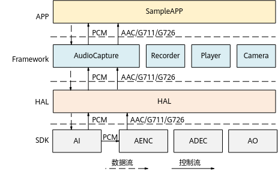

概括来说，音频采集模块主要用来提供以下服务：

-   提供采集参数配置和获取接口。

    例如：可配参数包含输入源类型、音频数据格式、采样率、声道数、采样位宽等。

-   提供获取帧数接口。

    例如：外部根据该接口得到帧数进而计算存储音频数据缓冲区大小，详见“  [Read](#ZH-CN_TOPIC_0000002466383220)”接口。

-   提供采集流程接口。

    例如：开始采集、开始读数据、停止采集、释放资源等。

-   提供采集位置接口。

    例如：获取采集实时位置。

-   提供采集状态获取接口。

    例如：采集状态包括初始状态、准备录制、正在录制、录制已停止、资源已释放。

-   **[音频采集状态机](#ZH-CN_TOPIC_0000002499502285)**  

#### 音频采集状态机<a name="ZH-CN_TOPIC_0000002499502285"></a>

**图 1**  音频采集调用和状态迁移<a name="zh-cn_topic_0000002398510873_fig83420598513"></a>  
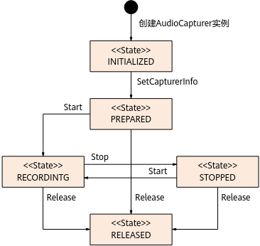

为保证音频采集状态机正常运转，对上层调用约束如下：

-   Start不允许在INITIALIZED、RECORDING、RELEASED状态调用，正常是在SetCaptureInfo成功后调用。
-   Read和Stop只能在Start后调用。
-   GetFrameCount不允许在INITIALIZED和RELEASED状态调用，返回0表示失败。
-   GetCaptureInfo和GetAudioTime不允许在RELEASED状态调用。

### 音频采集DFX<a name="ZH-CN_TOPIC_0000002466542940"></a>

音频采集DFX属于非功能属性，例如：性能、可靠性、可服务性、可测试性。细分如下：

-   音频采集参数信息（帧数、采样率、声道数、码率、位宽、音频采集状态），请参见“[DumpInfo](#ZH-CN_TOPIC_0000002499582445)”小节。
-   支持获取采集音频时间。
-   可测试性支持CHR日志打点，通过调用公共CHR打点接口将打点数据通过串口打印或者保存到文件系统中，实现对音频采集模块关键行为节点的记录，具体枚举定义请参见“middleware/services/media/dfx/chr/include/media\_chr\_log.h”文件。

## API参考<a name="ZH-CN_TOPIC_0000002499502253"></a>

该功能模块为用户提供以下API：

-   SetCaptureInfo：配置采集参数。
-   GetCaptureInfo：获取采集参数。
-   Start：开始采集。
-   Read：读取采集数据。
-   GetStatus：获取采集状态。
-   GetAudioTime：获取采集音频时间。
-   GetMinFrameCount：获取最小帧数。
-   GetFrameCount：获取帧数。
-   Stop：停止采集。
-   Release：释放采集相关资源。
-   DumpInfo：获取运行时的转储日志信息。

-   **[AudioCapturer类](#ZH-CN_TOPIC_0000002499582181)**  

-   **[RecordingModule类](#ZH-CN_TOPIC_0000002499502165)**  

### AudioCapturer类<a name="ZH-CN_TOPIC_0000002499582181"></a>

-   **[SetCapturerInfo](#ZH-CN_TOPIC_0000002466383212)**  

-   **[GetCapturerInfo](#ZH-CN_TOPIC_0000002466543064)**  

-   **[Start](#ZH-CN_TOPIC_0000002499582201)**  

-   **[Read](#ZH-CN_TOPIC_0000002466383220)**  

-   **[GetStatus](#ZH-CN_TOPIC_0000002499502141)**  

-   **[GetAudioTime](#ZH-CN_TOPIC_0000002499582437)**  

-   **[GetMinFrameCount](#ZH-CN_TOPIC_0000002466542828)**  

-   **[GetFrameCount](#ZH-CN_TOPIC_0000002466383208)**  

-   **[Stop](#ZH-CN_TOPIC_0000002466542864)**  

-   **[Release](#ZH-CN_TOPIC_0000002499502149)**  

-   **[DumpInfo](#ZH-CN_TOPIC_0000002499582445)**  

#### SetCapturerInfo<a name="ZH-CN_TOPIC_0000002466383212"></a>

【描述】

配置采集参数。

【定义】

int32\_t SetCapturerInfo\(const AudioCaptureInfo info\);

【参数】

<a name="zh-cn_topic_0000002451111969_table5098mcpsimp"></a>
<table><thead align="left"><tr id="zh-cn_topic_0000002451111969_row5104mcpsimp"><th class="cellrowborder" valign="top" width="26.732673267326728%" id="mcps1.1.4.1.1"><p id="zh-cn_topic_0000002451111969_p5106mcpsimp"><a name="zh-cn_topic_0000002451111969_p5106mcpsimp"></a><a name="zh-cn_topic_0000002451111969_p5106mcpsimp"></a>参数名称</p>
</th>
<th class="cellrowborder" valign="top" width="44.554455445544555%" id="mcps1.1.4.1.2"><p id="zh-cn_topic_0000002451111969_p5108mcpsimp"><a name="zh-cn_topic_0000002451111969_p5108mcpsimp"></a><a name="zh-cn_topic_0000002451111969_p5108mcpsimp"></a>描述</p>
</th>
<th class="cellrowborder" valign="top" width="28.712871287128717%" id="mcps1.1.4.1.3"><p id="zh-cn_topic_0000002451111969_p5110mcpsimp"><a name="zh-cn_topic_0000002451111969_p5110mcpsimp"></a><a name="zh-cn_topic_0000002451111969_p5110mcpsimp"></a>输入/输出</p>
</th>
</tr>
</thead>
<tbody><tr id="zh-cn_topic_0000002451111969_row5112mcpsimp"><td class="cellrowborder" valign="top" width="26.732673267326728%" headers="mcps1.1.4.1.1 "><p xml:lang="sv-SE" id="zh-cn_topic_0000002451111969_p5114mcpsimp"><a name="zh-cn_topic_0000002451111969_p5114mcpsimp"></a><a name="zh-cn_topic_0000002451111969_p5114mcpsimp"></a>info</p>
</td>
<td class="cellrowborder" valign="top" width="44.554455445544555%" headers="mcps1.1.4.1.2 "><p id="zh-cn_topic_0000002451111969_p5116mcpsimp"><a name="zh-cn_topic_0000002451111969_p5116mcpsimp"></a><a name="zh-cn_topic_0000002451111969_p5116mcpsimp"></a>音频采集参数结构体。</p>
</td>
<td class="cellrowborder" valign="top" width="28.712871287128717%" headers="mcps1.1.4.1.3 "><p id="zh-cn_topic_0000002451111969_p5118mcpsimp"><a name="zh-cn_topic_0000002451111969_p5118mcpsimp"></a><a name="zh-cn_topic_0000002451111969_p5118mcpsimp"></a>输入</p>
</td>
</tr>
</tbody>
</table>

【返回值】

<a name="zh-cn_topic_0000002451111969_table5120mcpsimp"></a>
<table><thead align="left"><tr id="zh-cn_topic_0000002451111969_row5125mcpsimp"><th class="cellrowborder" valign="top" width="50%" id="mcps1.1.3.1.1"><p id="zh-cn_topic_0000002451111969_p5127mcpsimp"><a name="zh-cn_topic_0000002451111969_p5127mcpsimp"></a><a name="zh-cn_topic_0000002451111969_p5127mcpsimp"></a>返回值</p>
</th>
<th class="cellrowborder" valign="top" width="50%" id="mcps1.1.3.1.2"><p id="zh-cn_topic_0000002451111969_p5129mcpsimp"><a name="zh-cn_topic_0000002451111969_p5129mcpsimp"></a><a name="zh-cn_topic_0000002451111969_p5129mcpsimp"></a>描述</p>
</th>
</tr>
</thead>
<tbody><tr id="zh-cn_topic_0000002451111969_row5131mcpsimp"><td class="cellrowborder" valign="top" width="50%" headers="mcps1.1.3.1.1 "><p id="zh-cn_topic_0000002451111969_p5133mcpsimp"><a name="zh-cn_topic_0000002451111969_p5133mcpsimp"></a><a name="zh-cn_topic_0000002451111969_p5133mcpsimp"></a>0</p>
</td>
<td class="cellrowborder" valign="top" width="50%" headers="mcps1.1.3.1.2 "><p id="zh-cn_topic_0000002451111969_p5135mcpsimp"><a name="zh-cn_topic_0000002451111969_p5135mcpsimp"></a><a name="zh-cn_topic_0000002451111969_p5135mcpsimp"></a>成功。</p>
</td>
</tr>
<tr id="zh-cn_topic_0000002451111969_row5136mcpsimp"><td class="cellrowborder" valign="top" width="50%" headers="mcps1.1.3.1.1 "><p id="zh-cn_topic_0000002451111969_p5138mcpsimp"><a name="zh-cn_topic_0000002451111969_p5138mcpsimp"></a><a name="zh-cn_topic_0000002451111969_p5138mcpsimp"></a>非0</p>
</td>
<td class="cellrowborder" valign="top" width="50%" headers="mcps1.1.3.1.2 "><p id="zh-cn_topic_0000002451111969_p5140mcpsimp"><a name="zh-cn_topic_0000002451111969_p5140mcpsimp"></a><a name="zh-cn_topic_0000002451111969_p5140mcpsimp"></a>失败，详见“<a href="#ZH-CN_TOPIC_0000002466542816">错误码</a>”。</p>
</td>
</tr>
</tbody>
</table>

【需求】

-   头文件：audio\_capturer.h
-   库文件：libaudio\_capture.a

【注意】

当前音频编码支持单声道、16k采样率、16bit位宽采集能力。

【举例】

**表 1**  音频采集常用参数配置

<a name="zh-cn_topic_0000002451111969_table5150mcpsimp"></a>
<table><thead align="left"><tr id="zh-cn_topic_0000002451111969_row5161mcpsimp"><th class="cellrowborder" valign="top" width="8.91089108910891%" id="mcps1.2.8.1.1"><p id="zh-cn_topic_0000002451111969_p5163mcpsimp"><a name="zh-cn_topic_0000002451111969_p5163mcpsimp"></a><a name="zh-cn_topic_0000002451111969_p5163mcpsimp"></a>格式</p>
</th>
<th class="cellrowborder" valign="top" width="17.82178217821782%" id="mcps1.2.8.1.2"><p id="zh-cn_topic_0000002451111969_p5165mcpsimp"><a name="zh-cn_topic_0000002451111969_p5165mcpsimp"></a><a name="zh-cn_topic_0000002451111969_p5165mcpsimp"></a>源类型</p>
</th>
<th class="cellrowborder" valign="top" width="10.891089108910892%" id="mcps1.2.8.1.3"><p id="zh-cn_topic_0000002451111969_p5167mcpsimp"><a name="zh-cn_topic_0000002451111969_p5167mcpsimp"></a><a name="zh-cn_topic_0000002451111969_p5167mcpsimp"></a>采样率（Hz）</p>
</th>
<th class="cellrowborder" valign="top" width="10.891089108910892%" id="mcps1.2.8.1.4"><p id="zh-cn_topic_0000002451111969_p5169mcpsimp"><a name="zh-cn_topic_0000002451111969_p5169mcpsimp"></a><a name="zh-cn_topic_0000002451111969_p5169mcpsimp"></a>声道数</p>
</th>
<th class="cellrowborder" valign="top" width="10.87108710871087%" id="mcps1.2.8.1.5"><p id="zh-cn_topic_0000002451111969_p5171mcpsimp"><a name="zh-cn_topic_0000002451111969_p5171mcpsimp"></a><a name="zh-cn_topic_0000002451111969_p5171mcpsimp"></a>码率（bit/s）</p>
</th>
<th class="cellrowborder" valign="top" width="15.861586158615863%" id="mcps1.2.8.1.6"><p id="zh-cn_topic_0000002451111969_p5173mcpsimp"><a name="zh-cn_topic_0000002451111969_p5173mcpsimp"></a><a name="zh-cn_topic_0000002451111969_p5173mcpsimp"></a>数据位宽</p>
</th>
<th class="cellrowborder" valign="top" width="24.752475247524753%" id="mcps1.2.8.1.7"><p id="zh-cn_topic_0000002451111969_p5175mcpsimp"><a name="zh-cn_topic_0000002451111969_p5175mcpsimp"></a><a name="zh-cn_topic_0000002451111969_p5175mcpsimp"></a>流类型</p>
</th>
</tr>
</thead>
<tbody><tr id="zh-cn_topic_0000002451111969_row5177mcpsimp"><td class="cellrowborder" valign="top" width="8.91089108910891%" headers="mcps1.2.8.1.1 "><p id="zh-cn_topic_0000002451111969_p5179mcpsimp"><a name="zh-cn_topic_0000002451111969_p5179mcpsimp"></a><a name="zh-cn_topic_0000002451111969_p5179mcpsimp"></a>PCM</p>
</td>
<td class="cellrowborder" valign="top" width="17.82178217821782%" headers="mcps1.2.8.1.2 "><p id="zh-cn_topic_0000002451111969_p5181mcpsimp"><a name="zh-cn_topic_0000002451111969_p5181mcpsimp"></a><a name="zh-cn_topic_0000002451111969_p5181mcpsimp"></a>AUDIO_MIC</p>
</td>
<td class="cellrowborder" valign="top" width="10.891089108910892%" headers="mcps1.2.8.1.3 "><p id="zh-cn_topic_0000002451111969_p5183mcpsimp"><a name="zh-cn_topic_0000002451111969_p5183mcpsimp"></a><a name="zh-cn_topic_0000002451111969_p5183mcpsimp"></a>16000</p>
</td>
<td class="cellrowborder" valign="top" width="10.891089108910892%" headers="mcps1.2.8.1.4 "><p id="zh-cn_topic_0000002451111969_p5185mcpsimp"><a name="zh-cn_topic_0000002451111969_p5185mcpsimp"></a><a name="zh-cn_topic_0000002451111969_p5185mcpsimp"></a>1或2</p>
</td>
<td class="cellrowborder" valign="top" width="10.87108710871087%" headers="mcps1.2.8.1.5 "><p id="zh-cn_topic_0000002451111969_p5187mcpsimp"><a name="zh-cn_topic_0000002451111969_p5187mcpsimp"></a><a name="zh-cn_topic_0000002451111969_p5187mcpsimp"></a>128000</p>
</td>
<td class="cellrowborder" valign="top" width="15.861586158615863%" headers="mcps1.2.8.1.6 "><p id="zh-cn_topic_0000002451111969_p5189mcpsimp"><a name="zh-cn_topic_0000002451111969_p5189mcpsimp"></a><a name="zh-cn_topic_0000002451111969_p5189mcpsimp"></a>BIT_WIDTH_16</p>
</td>
<td class="cellrowborder" valign="top" width="24.752475247524753%" headers="mcps1.2.8.1.7 "><p id="zh-cn_topic_0000002451111969_p5191mcpsimp"><a name="zh-cn_topic_0000002451111969_p5191mcpsimp"></a><a name="zh-cn_topic_0000002451111969_p5191mcpsimp"></a>TYPE_MEDIA 或TYPE_VOICE_COMMUNICATION</p>
</td>
</tr>
<tr id="zh-cn_topic_0000002451111969_row5193mcpsimp"><td class="cellrowborder" valign="top" width="8.91089108910891%" headers="mcps1.2.8.1.1 "><p id="zh-cn_topic_0000002451111969_p5195mcpsimp"><a name="zh-cn_topic_0000002451111969_p5195mcpsimp"></a><a name="zh-cn_topic_0000002451111969_p5195mcpsimp"></a>AAC</p>
</td>
<td class="cellrowborder" valign="top" width="17.82178217821782%" headers="mcps1.2.8.1.2 "><p id="zh-cn_topic_0000002451111969_p5197mcpsimp"><a name="zh-cn_topic_0000002451111969_p5197mcpsimp"></a><a name="zh-cn_topic_0000002451111969_p5197mcpsimp"></a>AUDIO_MIC</p>
</td>
<td class="cellrowborder" valign="top" width="10.891089108910892%" headers="mcps1.2.8.1.3 "><p id="zh-cn_topic_0000002451111969_p5199mcpsimp"><a name="zh-cn_topic_0000002451111969_p5199mcpsimp"></a><a name="zh-cn_topic_0000002451111969_p5199mcpsimp"></a>48000</p>
</td>
<td class="cellrowborder" valign="top" width="10.891089108910892%" headers="mcps1.2.8.1.4 "><p id="zh-cn_topic_0000002451111969_p5201mcpsimp"><a name="zh-cn_topic_0000002451111969_p5201mcpsimp"></a><a name="zh-cn_topic_0000002451111969_p5201mcpsimp"></a>1或2</p>
</td>
<td class="cellrowborder" valign="top" width="10.87108710871087%" headers="mcps1.2.8.1.5 "><p id="zh-cn_topic_0000002451111969_p5203mcpsimp"><a name="zh-cn_topic_0000002451111969_p5203mcpsimp"></a><a name="zh-cn_topic_0000002451111969_p5203mcpsimp"></a>128000</p>
</td>
<td class="cellrowborder" valign="top" width="15.861586158615863%" headers="mcps1.2.8.1.6 "><p id="zh-cn_topic_0000002451111969_p5205mcpsimp"><a name="zh-cn_topic_0000002451111969_p5205mcpsimp"></a><a name="zh-cn_topic_0000002451111969_p5205mcpsimp"></a>BIT_WIDTH_16</p>
</td>
<td class="cellrowborder" valign="top" width="24.752475247524753%" headers="mcps1.2.8.1.7 "><p id="zh-cn_topic_0000002451111969_p5207mcpsimp"><a name="zh-cn_topic_0000002451111969_p5207mcpsimp"></a><a name="zh-cn_topic_0000002451111969_p5207mcpsimp"></a>TYPE_MEDIA 或TYPE_VOICE_COMMUNICATION</p>
</td>
</tr>
<tr id="zh-cn_topic_0000002451111969_row5209mcpsimp"><td class="cellrowborder" valign="top" width="8.91089108910891%" headers="mcps1.2.8.1.1 "><p id="zh-cn_topic_0000002451111969_p5211mcpsimp"><a name="zh-cn_topic_0000002451111969_p5211mcpsimp"></a><a name="zh-cn_topic_0000002451111969_p5211mcpsimp"></a>G711</p>
</td>
<td class="cellrowborder" valign="top" width="17.82178217821782%" headers="mcps1.2.8.1.2 "><p id="zh-cn_topic_0000002451111969_p5213mcpsimp"><a name="zh-cn_topic_0000002451111969_p5213mcpsimp"></a><a name="zh-cn_topic_0000002451111969_p5213mcpsimp"></a>AUDIO_MIC</p>
</td>
<td class="cellrowborder" valign="top" width="10.891089108910892%" headers="mcps1.2.8.1.3 "><p id="zh-cn_topic_0000002451111969_p5215mcpsimp"><a name="zh-cn_topic_0000002451111969_p5215mcpsimp"></a><a name="zh-cn_topic_0000002451111969_p5215mcpsimp"></a>8000</p>
</td>
<td class="cellrowborder" valign="top" width="10.891089108910892%" headers="mcps1.2.8.1.4 "><p id="zh-cn_topic_0000002451111969_p5217mcpsimp"><a name="zh-cn_topic_0000002451111969_p5217mcpsimp"></a><a name="zh-cn_topic_0000002451111969_p5217mcpsimp"></a>1</p>
</td>
<td class="cellrowborder" valign="top" width="10.87108710871087%" headers="mcps1.2.8.1.5 "><p id="zh-cn_topic_0000002451111969_p5219mcpsimp"><a name="zh-cn_topic_0000002451111969_p5219mcpsimp"></a><a name="zh-cn_topic_0000002451111969_p5219mcpsimp"></a>64000</p>
</td>
<td class="cellrowborder" valign="top" width="15.861586158615863%" headers="mcps1.2.8.1.6 "><p id="zh-cn_topic_0000002451111969_p5221mcpsimp"><a name="zh-cn_topic_0000002451111969_p5221mcpsimp"></a><a name="zh-cn_topic_0000002451111969_p5221mcpsimp"></a>BIT_WIDTH_16</p>
</td>
<td class="cellrowborder" valign="top" width="24.752475247524753%" headers="mcps1.2.8.1.7 "><p id="zh-cn_topic_0000002451111969_p5223mcpsimp"><a name="zh-cn_topic_0000002451111969_p5223mcpsimp"></a><a name="zh-cn_topic_0000002451111969_p5223mcpsimp"></a>TYPE_MEDIA 或TYPE_VOICE_COMMUNICATION</p>
</td>
</tr>
<tr id="zh-cn_topic_0000002451111969_row5225mcpsimp"><td class="cellrowborder" valign="top" width="8.91089108910891%" headers="mcps1.2.8.1.1 "><p id="zh-cn_topic_0000002451111969_p5227mcpsimp"><a name="zh-cn_topic_0000002451111969_p5227mcpsimp"></a><a name="zh-cn_topic_0000002451111969_p5227mcpsimp"></a>G726</p>
</td>
<td class="cellrowborder" valign="top" width="17.82178217821782%" headers="mcps1.2.8.1.2 "><p id="zh-cn_topic_0000002451111969_p5229mcpsimp"><a name="zh-cn_topic_0000002451111969_p5229mcpsimp"></a><a name="zh-cn_topic_0000002451111969_p5229mcpsimp"></a>AUDIO_MIC</p>
</td>
<td class="cellrowborder" valign="top" width="10.891089108910892%" headers="mcps1.2.8.1.3 "><p id="zh-cn_topic_0000002451111969_p5231mcpsimp"><a name="zh-cn_topic_0000002451111969_p5231mcpsimp"></a><a name="zh-cn_topic_0000002451111969_p5231mcpsimp"></a>8000</p>
</td>
<td class="cellrowborder" valign="top" width="10.891089108910892%" headers="mcps1.2.8.1.4 "><p id="zh-cn_topic_0000002451111969_p5233mcpsimp"><a name="zh-cn_topic_0000002451111969_p5233mcpsimp"></a><a name="zh-cn_topic_0000002451111969_p5233mcpsimp"></a>1</p>
</td>
<td class="cellrowborder" valign="top" width="10.87108710871087%" headers="mcps1.2.8.1.5 "><p id="zh-cn_topic_0000002451111969_p5235mcpsimp"><a name="zh-cn_topic_0000002451111969_p5235mcpsimp"></a><a name="zh-cn_topic_0000002451111969_p5235mcpsimp"></a>24000</p>
</td>
<td class="cellrowborder" valign="top" width="15.861586158615863%" headers="mcps1.2.8.1.6 "><p id="zh-cn_topic_0000002451111969_p5237mcpsimp"><a name="zh-cn_topic_0000002451111969_p5237mcpsimp"></a><a name="zh-cn_topic_0000002451111969_p5237mcpsimp"></a>BIT_WIDTH_16</p>
</td>
<td class="cellrowborder" valign="top" width="24.752475247524753%" headers="mcps1.2.8.1.7 "><p id="zh-cn_topic_0000002451111969_p5239mcpsimp"><a name="zh-cn_topic_0000002451111969_p5239mcpsimp"></a><a name="zh-cn_topic_0000002451111969_p5239mcpsimp"></a>TYPE_MEDIA 或TYPE_VOICE_COMMUNICATION</p>
</td>
</tr>
</tbody>
</table>

#### GetCapturerInfo<a name="ZH-CN_TOPIC_0000002466543064"></a>

【描述】

获取采集参数。

【定义】

int32\_t GetCapturerInfo\(AudioCaptureInfo &info\);

【参数】

<a name="zh-cn_topic_0000002417633002_table5248mcpsimp"></a>
<table><thead align="left"><tr id="zh-cn_topic_0000002417633002_row5254mcpsimp"><th class="cellrowborder" valign="top" width="27%" id="mcps1.1.4.1.1"><p id="zh-cn_topic_0000002417633002_p5256mcpsimp"><a name="zh-cn_topic_0000002417633002_p5256mcpsimp"></a><a name="zh-cn_topic_0000002417633002_p5256mcpsimp"></a>参数名称</p>
</th>
<th class="cellrowborder" valign="top" width="46%" id="mcps1.1.4.1.2"><p id="zh-cn_topic_0000002417633002_p5258mcpsimp"><a name="zh-cn_topic_0000002417633002_p5258mcpsimp"></a><a name="zh-cn_topic_0000002417633002_p5258mcpsimp"></a>描述</p>
</th>
<th class="cellrowborder" valign="top" width="27%" id="mcps1.1.4.1.3"><p id="zh-cn_topic_0000002417633002_p5260mcpsimp"><a name="zh-cn_topic_0000002417633002_p5260mcpsimp"></a><a name="zh-cn_topic_0000002417633002_p5260mcpsimp"></a>输入/输出</p>
</th>
</tr>
</thead>
<tbody><tr id="zh-cn_topic_0000002417633002_row5262mcpsimp"><td class="cellrowborder" valign="top" width="27%" headers="mcps1.1.4.1.1 "><p id="zh-cn_topic_0000002417633002_p5264mcpsimp"><a name="zh-cn_topic_0000002417633002_p5264mcpsimp"></a><a name="zh-cn_topic_0000002417633002_p5264mcpsimp"></a>info</p>
</td>
<td class="cellrowborder" valign="top" width="46%" headers="mcps1.1.4.1.2 "><p id="zh-cn_topic_0000002417633002_p5266mcpsimp"><a name="zh-cn_topic_0000002417633002_p5266mcpsimp"></a><a name="zh-cn_topic_0000002417633002_p5266mcpsimp"></a>音频采集参数结构体引用。</p>
</td>
<td class="cellrowborder" valign="top" width="27%" headers="mcps1.1.4.1.3 "><p id="zh-cn_topic_0000002417633002_p5268mcpsimp"><a name="zh-cn_topic_0000002417633002_p5268mcpsimp"></a><a name="zh-cn_topic_0000002417633002_p5268mcpsimp"></a>输出</p>
</td>
</tr>
</tbody>
</table>

【返回值】

<a name="zh-cn_topic_0000002417633002_table5270mcpsimp"></a>
<table><thead align="left"><tr id="zh-cn_topic_0000002417633002_row5275mcpsimp"><th class="cellrowborder" valign="top" width="50%" id="mcps1.1.3.1.1"><p id="zh-cn_topic_0000002417633002_p5277mcpsimp"><a name="zh-cn_topic_0000002417633002_p5277mcpsimp"></a><a name="zh-cn_topic_0000002417633002_p5277mcpsimp"></a>返回值</p>
</th>
<th class="cellrowborder" valign="top" width="50%" id="mcps1.1.3.1.2"><p id="zh-cn_topic_0000002417633002_p5279mcpsimp"><a name="zh-cn_topic_0000002417633002_p5279mcpsimp"></a><a name="zh-cn_topic_0000002417633002_p5279mcpsimp"></a>描述</p>
</th>
</tr>
</thead>
<tbody><tr id="zh-cn_topic_0000002417633002_row5281mcpsimp"><td class="cellrowborder" valign="top" width="50%" headers="mcps1.1.3.1.1 "><p id="zh-cn_topic_0000002417633002_p5283mcpsimp"><a name="zh-cn_topic_0000002417633002_p5283mcpsimp"></a><a name="zh-cn_topic_0000002417633002_p5283mcpsimp"></a>0</p>
</td>
<td class="cellrowborder" valign="top" width="50%" headers="mcps1.1.3.1.2 "><p id="zh-cn_topic_0000002417633002_p5285mcpsimp"><a name="zh-cn_topic_0000002417633002_p5285mcpsimp"></a><a name="zh-cn_topic_0000002417633002_p5285mcpsimp"></a>成功。</p>
</td>
</tr>
<tr id="zh-cn_topic_0000002417633002_row5286mcpsimp"><td class="cellrowborder" valign="top" width="50%" headers="mcps1.1.3.1.1 "><p id="zh-cn_topic_0000002417633002_p5288mcpsimp"><a name="zh-cn_topic_0000002417633002_p5288mcpsimp"></a><a name="zh-cn_topic_0000002417633002_p5288mcpsimp"></a>非0</p>
</td>
<td class="cellrowborder" valign="top" width="50%" headers="mcps1.1.3.1.2 "><p id="zh-cn_topic_0000002417633002_p5290mcpsimp"><a name="zh-cn_topic_0000002417633002_p5290mcpsimp"></a><a name="zh-cn_topic_0000002417633002_p5290mcpsimp"></a>失败，详见“<a href="#ZH-CN_TOPIC_0000002466542816">错误码</a>”。</p>
</td>
</tr>
</tbody>
</table>

【需求】

-   头文件：audio\_capturer.h
-   库文件：libaudio\_capture.a

【注意】

SetCapturerInfo成功后调用该接口有效。

【举例】

无。

#### Start<a name="ZH-CN_TOPIC_0000002499582201"></a>

【描述】

开始采集。

【定义】

bool Start\(\);

【参数】

无。

【返回值】

<a name="zh-cn_topic_0000002451152041_table5310mcpsimp"></a>
<table><thead align="left"><tr id="zh-cn_topic_0000002451152041_row5315mcpsimp"><th class="cellrowborder" valign="top" width="50%" id="mcps1.1.3.1.1"><p id="zh-cn_topic_0000002451152041_p5317mcpsimp"><a name="zh-cn_topic_0000002451152041_p5317mcpsimp"></a><a name="zh-cn_topic_0000002451152041_p5317mcpsimp"></a>返回值</p>
</th>
<th class="cellrowborder" valign="top" width="50%" id="mcps1.1.3.1.2"><p id="zh-cn_topic_0000002451152041_p5319mcpsimp"><a name="zh-cn_topic_0000002451152041_p5319mcpsimp"></a><a name="zh-cn_topic_0000002451152041_p5319mcpsimp"></a>描述</p>
</th>
</tr>
</thead>
<tbody><tr id="zh-cn_topic_0000002451152041_row5321mcpsimp"><td class="cellrowborder" valign="top" width="50%" headers="mcps1.1.3.1.1 "><p id="zh-cn_topic_0000002451152041_p5323mcpsimp"><a name="zh-cn_topic_0000002451152041_p5323mcpsimp"></a><a name="zh-cn_topic_0000002451152041_p5323mcpsimp"></a>true</p>
</td>
<td class="cellrowborder" valign="top" width="50%" headers="mcps1.1.3.1.2 "><p id="zh-cn_topic_0000002451152041_p5325mcpsimp"><a name="zh-cn_topic_0000002451152041_p5325mcpsimp"></a><a name="zh-cn_topic_0000002451152041_p5325mcpsimp"></a>成功。</p>
</td>
</tr>
<tr id="zh-cn_topic_0000002451152041_row5326mcpsimp"><td class="cellrowborder" valign="top" width="50%" headers="mcps1.1.3.1.1 "><p id="zh-cn_topic_0000002451152041_p5328mcpsimp"><a name="zh-cn_topic_0000002451152041_p5328mcpsimp"></a><a name="zh-cn_topic_0000002451152041_p5328mcpsimp"></a>false</p>
</td>
<td class="cellrowborder" valign="top" width="50%" headers="mcps1.1.3.1.2 "><p id="zh-cn_topic_0000002451152041_p5330mcpsimp"><a name="zh-cn_topic_0000002451152041_p5330mcpsimp"></a><a name="zh-cn_topic_0000002451152041_p5330mcpsimp"></a>失败。</p>
</td>
</tr>
</tbody>
</table>

【需求】

-   头文件：audio\_capturer.h
-   库文件：libaudio\_capture.a

【注意】

SetCapturerInfo成功后调用该接口有效。

【举例】

无。

#### Read<a name="ZH-CN_TOPIC_0000002466383220"></a>

【描述】

读取采集数据。

【定义】

int32\_t Read\(uint8\_t \*buffer, size\_t userSize, bool isBlockingRead\);

【参数】

<a name="zh-cn_topic_0000002417473134_table5346mcpsimp"></a>
<table><thead align="left"><tr id="zh-cn_topic_0000002417473134_row5352mcpsimp"><th class="cellrowborder" valign="top" width="27%" id="mcps1.1.4.1.1"><p id="zh-cn_topic_0000002417473134_p5354mcpsimp"><a name="zh-cn_topic_0000002417473134_p5354mcpsimp"></a><a name="zh-cn_topic_0000002417473134_p5354mcpsimp"></a>参数名称</p>
</th>
<th class="cellrowborder" valign="top" width="48%" id="mcps1.1.4.1.2"><p id="zh-cn_topic_0000002417473134_p5356mcpsimp"><a name="zh-cn_topic_0000002417473134_p5356mcpsimp"></a><a name="zh-cn_topic_0000002417473134_p5356mcpsimp"></a>描述</p>
</th>
<th class="cellrowborder" valign="top" width="25%" id="mcps1.1.4.1.3"><p id="zh-cn_topic_0000002417473134_p5358mcpsimp"><a name="zh-cn_topic_0000002417473134_p5358mcpsimp"></a><a name="zh-cn_topic_0000002417473134_p5358mcpsimp"></a>输入/输出</p>
</th>
</tr>
</thead>
<tbody><tr id="zh-cn_topic_0000002417473134_row5360mcpsimp"><td class="cellrowborder" valign="top" width="27%" headers="mcps1.1.4.1.1 "><p id="zh-cn_topic_0000002417473134_p5362mcpsimp"><a name="zh-cn_topic_0000002417473134_p5362mcpsimp"></a><a name="zh-cn_topic_0000002417473134_p5362mcpsimp"></a>buffer</p>
</td>
<td class="cellrowborder" valign="top" width="48%" headers="mcps1.1.4.1.2 "><p id="zh-cn_topic_0000002417473134_p5364mcpsimp"><a name="zh-cn_topic_0000002417473134_p5364mcpsimp"></a><a name="zh-cn_topic_0000002417473134_p5364mcpsimp"></a>音频数据指针。</p>
</td>
<td class="cellrowborder" valign="top" width="25%" headers="mcps1.1.4.1.3 "><p id="zh-cn_topic_0000002417473134_p5366mcpsimp"><a name="zh-cn_topic_0000002417473134_p5366mcpsimp"></a><a name="zh-cn_topic_0000002417473134_p5366mcpsimp"></a>输入</p>
</td>
</tr>
<tr id="zh-cn_topic_0000002417473134_row5367mcpsimp"><td class="cellrowborder" valign="top" width="27%" headers="mcps1.1.4.1.1 "><p id="zh-cn_topic_0000002417473134_p5369mcpsimp"><a name="zh-cn_topic_0000002417473134_p5369mcpsimp"></a><a name="zh-cn_topic_0000002417473134_p5369mcpsimp"></a>userSize</p>
</td>
<td class="cellrowborder" valign="top" width="48%" headers="mcps1.1.4.1.2 "><p id="zh-cn_topic_0000002417473134_p5371mcpsimp"><a name="zh-cn_topic_0000002417473134_p5371mcpsimp"></a><a name="zh-cn_topic_0000002417473134_p5371mcpsimp"></a>音频数据缓冲区大小，单位Byte。</p>
</td>
<td class="cellrowborder" valign="top" width="25%" headers="mcps1.1.4.1.3 "><p id="zh-cn_topic_0000002417473134_p5373mcpsimp"><a name="zh-cn_topic_0000002417473134_p5373mcpsimp"></a><a name="zh-cn_topic_0000002417473134_p5373mcpsimp"></a>输入</p>
</td>
</tr>
<tr id="zh-cn_topic_0000002417473134_row5374mcpsimp"><td class="cellrowborder" valign="top" width="27%" headers="mcps1.1.4.1.1 "><p id="zh-cn_topic_0000002417473134_p5376mcpsimp"><a name="zh-cn_topic_0000002417473134_p5376mcpsimp"></a><a name="zh-cn_topic_0000002417473134_p5376mcpsimp"></a>isBlockingRead</p>
</td>
<td class="cellrowborder" valign="top" width="48%" headers="mcps1.1.4.1.2 "><p id="zh-cn_topic_0000002417473134_p5378mcpsimp"><a name="zh-cn_topic_0000002417473134_p5378mcpsimp"></a><a name="zh-cn_topic_0000002417473134_p5378mcpsimp"></a>读取数据是否阻塞。</p>
<p id="zh-cn_topic_0000002417473134_p5379mcpsimp"><a name="zh-cn_topic_0000002417473134_p5379mcpsimp"></a><a name="zh-cn_topic_0000002417473134_p5379mcpsimp"></a>备注：目前该参数没有使用。</p>
</td>
<td class="cellrowborder" valign="top" width="25%" headers="mcps1.1.4.1.3 "><p id="zh-cn_topic_0000002417473134_p5381mcpsimp"><a name="zh-cn_topic_0000002417473134_p5381mcpsimp"></a><a name="zh-cn_topic_0000002417473134_p5381mcpsimp"></a>输入</p>
</td>
</tr>
</tbody>
</table>

【返回值】

<a name="zh-cn_topic_0000002417473134_table5383mcpsimp"></a>
<table><thead align="left"><tr id="zh-cn_topic_0000002417473134_row5388mcpsimp"><th class="cellrowborder" valign="top" width="50%" id="mcps1.1.3.1.1"><p id="zh-cn_topic_0000002417473134_p5390mcpsimp"><a name="zh-cn_topic_0000002417473134_p5390mcpsimp"></a><a name="zh-cn_topic_0000002417473134_p5390mcpsimp"></a>返回值</p>
</th>
<th class="cellrowborder" valign="top" width="50%" id="mcps1.1.3.1.2"><p id="zh-cn_topic_0000002417473134_p5392mcpsimp"><a name="zh-cn_topic_0000002417473134_p5392mcpsimp"></a><a name="zh-cn_topic_0000002417473134_p5392mcpsimp"></a>描述</p>
</th>
</tr>
</thead>
<tbody><tr id="zh-cn_topic_0000002417473134_row5394mcpsimp"><td class="cellrowborder" valign="top" width="50%" headers="mcps1.1.3.1.1 "><p id="zh-cn_topic_0000002417473134_p5396mcpsimp"><a name="zh-cn_topic_0000002417473134_p5396mcpsimp"></a><a name="zh-cn_topic_0000002417473134_p5396mcpsimp"></a>0</p>
</td>
<td class="cellrowborder" valign="top" width="50%" headers="mcps1.1.3.1.2 "><p id="zh-cn_topic_0000002417473134_p5398mcpsimp"><a name="zh-cn_topic_0000002417473134_p5398mcpsimp"></a><a name="zh-cn_topic_0000002417473134_p5398mcpsimp"></a>成功。</p>
</td>
</tr>
<tr id="zh-cn_topic_0000002417473134_row5399mcpsimp"><td class="cellrowborder" valign="top" width="50%" headers="mcps1.1.3.1.1 "><p id="zh-cn_topic_0000002417473134_p5401mcpsimp"><a name="zh-cn_topic_0000002417473134_p5401mcpsimp"></a><a name="zh-cn_topic_0000002417473134_p5401mcpsimp"></a>非0</p>
</td>
<td class="cellrowborder" valign="top" width="50%" headers="mcps1.1.3.1.2 "><p id="zh-cn_topic_0000002417473134_p5403mcpsimp"><a name="zh-cn_topic_0000002417473134_p5403mcpsimp"></a><a name="zh-cn_topic_0000002417473134_p5403mcpsimp"></a>失败，详见“<a href="#ZH-CN_TOPIC_0000002466542816">错误码</a>”。</p>
</td>
</tr>
</tbody>
</table>

【需求】

-   头文件：audio\_capturer.h
-   库文件：libaudio\_capture.a

【注意】

-   Start成功后调用该接口有效。
-   缓冲区大小需要根据GetFrameCount返回值确定。

【举例】

确定缓冲区大小方法：

```
AudioCapturer audioCap;
AudioCapturerInfo info;
info.bitWidth = BIT_WIDTH_16;
size_t frameCount = audioCap.GetFrameCount();
size_t userSize = frameCount * (info.bitWidth / 8) * info.channelCount;
uint8_t *buffer = new uint8_t[userSize];
```

#### GetStatus<a name="ZH-CN_TOPIC_0000002499502141"></a>

【描述】

获取采集状态。

【定义】

State GetStatus\(\);

【参数】

无。

【返回值】

<a name="zh-cn_topic_0000002451111977_table5436mcpsimp"></a>
<table><thead align="left"><tr id="zh-cn_topic_0000002451111977_row5441mcpsimp"><th class="cellrowborder" valign="top" width="50%" id="mcps1.1.3.1.1"><p id="zh-cn_topic_0000002451111977_p5443mcpsimp"><a name="zh-cn_topic_0000002451111977_p5443mcpsimp"></a><a name="zh-cn_topic_0000002451111977_p5443mcpsimp"></a>返回值</p>
</th>
<th class="cellrowborder" valign="top" width="50%" id="mcps1.1.3.1.2"><p id="zh-cn_topic_0000002451111977_p5445mcpsimp"><a name="zh-cn_topic_0000002451111977_p5445mcpsimp"></a><a name="zh-cn_topic_0000002451111977_p5445mcpsimp"></a>描述</p>
</th>
</tr>
</thead>
<tbody><tr id="zh-cn_topic_0000002451111977_row5447mcpsimp"><td class="cellrowborder" valign="top" width="50%" headers="mcps1.1.3.1.1 "><p id="zh-cn_topic_0000002451111977_p5449mcpsimp"><a name="zh-cn_topic_0000002451111977_p5449mcpsimp"></a><a name="zh-cn_topic_0000002451111977_p5449mcpsimp"></a>State</p>
</td>
<td class="cellrowborder" valign="top" width="50%" headers="mcps1.1.3.1.2 "><p id="zh-cn_topic_0000002451111977_p5451mcpsimp"><a name="zh-cn_topic_0000002451111977_p5451mcpsimp"></a><a name="zh-cn_topic_0000002451111977_p5451mcpsimp"></a>当前采集状态。</p>
</td>
</tr>
</tbody>
</table>

【需求】

-   头文件：audio\_capturer.h
-   库文件：libaudio\_capture.a

【注意】

外部可根据该接口获取当前状态，同时结合状态机合理使用音频采集API。

【举例】

无。

#### GetAudioTime<a name="ZH-CN_TOPIC_0000002499582437"></a>

【描述】

获取采集音频时间。

【定义】

bool GetAudioTime\(Timestamp &timestamp, ::Timebase base\);

【参数】

<a name="zh-cn_topic_0000002417633006_table5472mcpsimp"></a>
<table><thead align="left"><tr id="zh-cn_topic_0000002417633006_row5478mcpsimp"><th class="cellrowborder" valign="top" width="30%" id="mcps1.1.4.1.1"><p id="zh-cn_topic_0000002417633006_p5480mcpsimp"><a name="zh-cn_topic_0000002417633006_p5480mcpsimp"></a><a name="zh-cn_topic_0000002417633006_p5480mcpsimp"></a>参数名称</p>
</th>
<th class="cellrowborder" valign="top" width="43%" id="mcps1.1.4.1.2"><p id="zh-cn_topic_0000002417633006_p5482mcpsimp"><a name="zh-cn_topic_0000002417633006_p5482mcpsimp"></a><a name="zh-cn_topic_0000002417633006_p5482mcpsimp"></a>描述</p>
</th>
<th class="cellrowborder" valign="top" width="27%" id="mcps1.1.4.1.3"><p id="zh-cn_topic_0000002417633006_p5484mcpsimp"><a name="zh-cn_topic_0000002417633006_p5484mcpsimp"></a><a name="zh-cn_topic_0000002417633006_p5484mcpsimp"></a>输入/输出</p>
</th>
</tr>
</thead>
<tbody><tr id="zh-cn_topic_0000002417633006_row5486mcpsimp"><td class="cellrowborder" valign="top" width="30%" headers="mcps1.1.4.1.1 "><p xml:lang="sv-SE" id="zh-cn_topic_0000002417633006_p5488mcpsimp"><a name="zh-cn_topic_0000002417633006_p5488mcpsimp"></a><a name="zh-cn_topic_0000002417633006_p5488mcpsimp"></a>timestamp</p>
</td>
<td class="cellrowborder" valign="top" width="43%" headers="mcps1.1.4.1.2 "><p id="zh-cn_topic_0000002417633006_p5490mcpsimp"><a name="zh-cn_topic_0000002417633006_p5490mcpsimp"></a><a name="zh-cn_topic_0000002417633006_p5490mcpsimp"></a>Timestamp实例引用。</p>
</td>
<td class="cellrowborder" valign="top" width="27%" headers="mcps1.1.4.1.3 "><p id="zh-cn_topic_0000002417633006_p5492mcpsimp"><a name="zh-cn_topic_0000002417633006_p5492mcpsimp"></a><a name="zh-cn_topic_0000002417633006_p5492mcpsimp"></a>输入</p>
</td>
</tr>
<tr id="zh-cn_topic_0000002417633006_row5493mcpsimp"><td class="cellrowborder" valign="top" width="30%" headers="mcps1.1.4.1.1 "><p xml:lang="sv-SE" id="zh-cn_topic_0000002417633006_p5495mcpsimp"><a name="zh-cn_topic_0000002417633006_p5495mcpsimp"></a><a name="zh-cn_topic_0000002417633006_p5495mcpsimp"></a>base</p>
</td>
<td class="cellrowborder" valign="top" width="43%" headers="mcps1.1.4.1.2 "><p id="zh-cn_topic_0000002417633006_p5497mcpsimp"><a name="zh-cn_topic_0000002417633006_p5497mcpsimp"></a><a name="zh-cn_topic_0000002417633006_p5497mcpsimp"></a>时间基数。</p>
</td>
<td class="cellrowborder" valign="top" width="27%" headers="mcps1.1.4.1.3 "><p id="zh-cn_topic_0000002417633006_p5499mcpsimp"><a name="zh-cn_topic_0000002417633006_p5499mcpsimp"></a><a name="zh-cn_topic_0000002417633006_p5499mcpsimp"></a>输入</p>
</td>
</tr>
</tbody>
</table>

【返回值】

<a name="zh-cn_topic_0000002417633006_table5501mcpsimp"></a>
<table><thead align="left"><tr id="zh-cn_topic_0000002417633006_row5506mcpsimp"><th class="cellrowborder" valign="top" width="50%" id="mcps1.1.3.1.1"><p id="zh-cn_topic_0000002417633006_p5508mcpsimp"><a name="zh-cn_topic_0000002417633006_p5508mcpsimp"></a><a name="zh-cn_topic_0000002417633006_p5508mcpsimp"></a>返回值</p>
</th>
<th class="cellrowborder" valign="top" width="50%" id="mcps1.1.3.1.2"><p id="zh-cn_topic_0000002417633006_p5510mcpsimp"><a name="zh-cn_topic_0000002417633006_p5510mcpsimp"></a><a name="zh-cn_topic_0000002417633006_p5510mcpsimp"></a>描述</p>
</th>
</tr>
</thead>
<tbody><tr id="zh-cn_topic_0000002417633006_row5512mcpsimp"><td class="cellrowborder" valign="top" width="50%" headers="mcps1.1.3.1.1 "><p id="zh-cn_topic_0000002417633006_p5514mcpsimp"><a name="zh-cn_topic_0000002417633006_p5514mcpsimp"></a><a name="zh-cn_topic_0000002417633006_p5514mcpsimp"></a>true</p>
</td>
<td class="cellrowborder" valign="top" width="50%" headers="mcps1.1.3.1.2 "><p id="zh-cn_topic_0000002417633006_p5516mcpsimp"><a name="zh-cn_topic_0000002417633006_p5516mcpsimp"></a><a name="zh-cn_topic_0000002417633006_p5516mcpsimp"></a>成功。</p>
</td>
</tr>
<tr id="zh-cn_topic_0000002417633006_row5517mcpsimp"><td class="cellrowborder" valign="top" width="50%" headers="mcps1.1.3.1.1 "><p id="zh-cn_topic_0000002417633006_p5519mcpsimp"><a name="zh-cn_topic_0000002417633006_p5519mcpsimp"></a><a name="zh-cn_topic_0000002417633006_p5519mcpsimp"></a>false</p>
</td>
<td class="cellrowborder" valign="top" width="50%" headers="mcps1.1.3.1.2 "><p id="zh-cn_topic_0000002417633006_p5521mcpsimp"><a name="zh-cn_topic_0000002417633006_p5521mcpsimp"></a><a name="zh-cn_topic_0000002417633006_p5521mcpsimp"></a>失败。</p>
</td>
</tr>
</tbody>
</table>

【需求】

-   头文件：audio\_capturer.h
-   库文件：libaudio\_capture.a

【注意】

无。

【举例】

无。

#### GetMinFrameCount<a name="ZH-CN_TOPIC_0000002466542828"></a>

【描述】

获取最小帧数。

【定义】

static bool GetMinFrameCount\(int32\_t sampleRate, int32\_t channelCount, AudioCodecFormat audioFormat, size\_t &frameCount\);

【参数】

<a name="zh-cn_topic_0000002451152049_table5537mcpsimp"></a>
<table><thead align="left"><tr id="zh-cn_topic_0000002451152049_row5543mcpsimp"><th class="cellrowborder" valign="top" width="30%" id="mcps1.1.4.1.1"><p id="zh-cn_topic_0000002451152049_p5545mcpsimp"><a name="zh-cn_topic_0000002451152049_p5545mcpsimp"></a><a name="zh-cn_topic_0000002451152049_p5545mcpsimp"></a>参数名称</p>
</th>
<th class="cellrowborder" valign="top" width="43%" id="mcps1.1.4.1.2"><p id="zh-cn_topic_0000002451152049_p5547mcpsimp"><a name="zh-cn_topic_0000002451152049_p5547mcpsimp"></a><a name="zh-cn_topic_0000002451152049_p5547mcpsimp"></a>描述</p>
</th>
<th class="cellrowborder" valign="top" width="27%" id="mcps1.1.4.1.3"><p id="zh-cn_topic_0000002451152049_p5549mcpsimp"><a name="zh-cn_topic_0000002451152049_p5549mcpsimp"></a><a name="zh-cn_topic_0000002451152049_p5549mcpsimp"></a>输入/输出</p>
</th>
</tr>
</thead>
<tbody><tr id="zh-cn_topic_0000002451152049_row5551mcpsimp"><td class="cellrowborder" valign="top" width="30%" headers="mcps1.1.4.1.1 "><p id="zh-cn_topic_0000002451152049_p5553mcpsimp"><a name="zh-cn_topic_0000002451152049_p5553mcpsimp"></a><a name="zh-cn_topic_0000002451152049_p5553mcpsimp"></a>sampleRate</p>
</td>
<td class="cellrowborder" valign="top" width="43%" headers="mcps1.1.4.1.2 "><p id="zh-cn_topic_0000002451152049_p5555mcpsimp"><a name="zh-cn_topic_0000002451152049_p5555mcpsimp"></a><a name="zh-cn_topic_0000002451152049_p5555mcpsimp"></a>采样率。</p>
</td>
<td class="cellrowborder" valign="top" width="27%" headers="mcps1.1.4.1.3 "><p id="zh-cn_topic_0000002451152049_p5557mcpsimp"><a name="zh-cn_topic_0000002451152049_p5557mcpsimp"></a><a name="zh-cn_topic_0000002451152049_p5557mcpsimp"></a>输入</p>
</td>
</tr>
<tr id="zh-cn_topic_0000002451152049_row5558mcpsimp"><td class="cellrowborder" valign="top" width="30%" headers="mcps1.1.4.1.1 "><p id="zh-cn_topic_0000002451152049_p5560mcpsimp"><a name="zh-cn_topic_0000002451152049_p5560mcpsimp"></a><a name="zh-cn_topic_0000002451152049_p5560mcpsimp"></a>channelCount</p>
</td>
<td class="cellrowborder" valign="top" width="43%" headers="mcps1.1.4.1.2 "><p id="zh-cn_topic_0000002451152049_p5562mcpsimp"><a name="zh-cn_topic_0000002451152049_p5562mcpsimp"></a><a name="zh-cn_topic_0000002451152049_p5562mcpsimp"></a>声道数。</p>
</td>
<td class="cellrowborder" valign="top" width="27%" headers="mcps1.1.4.1.3 "><p id="zh-cn_topic_0000002451152049_p5564mcpsimp"><a name="zh-cn_topic_0000002451152049_p5564mcpsimp"></a><a name="zh-cn_topic_0000002451152049_p5564mcpsimp"></a>输入</p>
</td>
</tr>
<tr id="zh-cn_topic_0000002451152049_row5565mcpsimp"><td class="cellrowborder" valign="top" width="30%" headers="mcps1.1.4.1.1 "><p id="zh-cn_topic_0000002451152049_p5567mcpsimp"><a name="zh-cn_topic_0000002451152049_p5567mcpsimp"></a><a name="zh-cn_topic_0000002451152049_p5567mcpsimp"></a>audioFormat</p>
</td>
<td class="cellrowborder" valign="top" width="43%" headers="mcps1.1.4.1.2 "><p id="zh-cn_topic_0000002451152049_p5569mcpsimp"><a name="zh-cn_topic_0000002451152049_p5569mcpsimp"></a><a name="zh-cn_topic_0000002451152049_p5569mcpsimp"></a>音频数据格式。</p>
</td>
<td class="cellrowborder" valign="top" width="27%" headers="mcps1.1.4.1.3 "><p id="zh-cn_topic_0000002451152049_p5571mcpsimp"><a name="zh-cn_topic_0000002451152049_p5571mcpsimp"></a><a name="zh-cn_topic_0000002451152049_p5571mcpsimp"></a>输入</p>
</td>
</tr>
<tr id="zh-cn_topic_0000002451152049_row5572mcpsimp"><td class="cellrowborder" valign="top" width="30%" headers="mcps1.1.4.1.1 "><p id="zh-cn_topic_0000002451152049_p5574mcpsimp"><a name="zh-cn_topic_0000002451152049_p5574mcpsimp"></a><a name="zh-cn_topic_0000002451152049_p5574mcpsimp"></a>frameCount</p>
</td>
<td class="cellrowborder" valign="top" width="43%" headers="mcps1.1.4.1.2 "><p id="zh-cn_topic_0000002451152049_p5576mcpsimp"><a name="zh-cn_topic_0000002451152049_p5576mcpsimp"></a><a name="zh-cn_topic_0000002451152049_p5576mcpsimp"></a>最小帧数。</p>
</td>
<td class="cellrowborder" valign="top" width="27%" headers="mcps1.1.4.1.3 "><p id="zh-cn_topic_0000002451152049_p5578mcpsimp"><a name="zh-cn_topic_0000002451152049_p5578mcpsimp"></a><a name="zh-cn_topic_0000002451152049_p5578mcpsimp"></a>输出</p>
</td>
</tr>
</tbody>
</table>

【返回值】

<a name="zh-cn_topic_0000002451152049_table5580mcpsimp"></a>
<table><thead align="left"><tr id="zh-cn_topic_0000002451152049_row5585mcpsimp"><th class="cellrowborder" valign="top" width="50%" id="mcps1.1.3.1.1"><p id="zh-cn_topic_0000002451152049_p5587mcpsimp"><a name="zh-cn_topic_0000002451152049_p5587mcpsimp"></a><a name="zh-cn_topic_0000002451152049_p5587mcpsimp"></a>返回值</p>
</th>
<th class="cellrowborder" valign="top" width="50%" id="mcps1.1.3.1.2"><p id="zh-cn_topic_0000002451152049_p5589mcpsimp"><a name="zh-cn_topic_0000002451152049_p5589mcpsimp"></a><a name="zh-cn_topic_0000002451152049_p5589mcpsimp"></a>描述</p>
</th>
</tr>
</thead>
<tbody><tr id="zh-cn_topic_0000002451152049_row5591mcpsimp"><td class="cellrowborder" valign="top" width="50%" headers="mcps1.1.3.1.1 "><p id="zh-cn_topic_0000002451152049_p5593mcpsimp"><a name="zh-cn_topic_0000002451152049_p5593mcpsimp"></a><a name="zh-cn_topic_0000002451152049_p5593mcpsimp"></a>true</p>
</td>
<td class="cellrowborder" valign="top" width="50%" headers="mcps1.1.3.1.2 "><p id="zh-cn_topic_0000002451152049_p5595mcpsimp"><a name="zh-cn_topic_0000002451152049_p5595mcpsimp"></a><a name="zh-cn_topic_0000002451152049_p5595mcpsimp"></a>成功。</p>
</td>
</tr>
<tr id="zh-cn_topic_0000002451152049_row5596mcpsimp"><td class="cellrowborder" valign="top" width="50%" headers="mcps1.1.3.1.1 "><p id="zh-cn_topic_0000002451152049_p5598mcpsimp"><a name="zh-cn_topic_0000002451152049_p5598mcpsimp"></a><a name="zh-cn_topic_0000002451152049_p5598mcpsimp"></a>false</p>
</td>
<td class="cellrowborder" valign="top" width="50%" headers="mcps1.1.3.1.2 "><p id="zh-cn_topic_0000002451152049_p5600mcpsimp"><a name="zh-cn_topic_0000002451152049_p5600mcpsimp"></a><a name="zh-cn_topic_0000002451152049_p5600mcpsimp"></a>失败。</p>
</td>
</tr>
</tbody>
</table>

【需求】

-   头文件：audio\_capturer.h
-   库文件：libaudio\_capture.a

【注意】

默认返回 0。

【举例】

无。

#### GetFrameCount<a name="ZH-CN_TOPIC_0000002466383208"></a>

【描述】

获取帧数。

【定义】

uint64\_t GetFrameCount\(\);

【参数】

无。

【返回值】

<a name="zh-cn_topic_0000002417473138_table5617mcpsimp"></a>
<table><thead align="left"><tr id="zh-cn_topic_0000002417473138_row5622mcpsimp"><th class="cellrowborder" valign="top" width="50%" id="mcps1.1.3.1.1"><p id="zh-cn_topic_0000002417473138_p5624mcpsimp"><a name="zh-cn_topic_0000002417473138_p5624mcpsimp"></a><a name="zh-cn_topic_0000002417473138_p5624mcpsimp"></a>返回值</p>
</th>
<th class="cellrowborder" valign="top" width="50%" id="mcps1.1.3.1.2"><p id="zh-cn_topic_0000002417473138_p5626mcpsimp"><a name="zh-cn_topic_0000002417473138_p5626mcpsimp"></a><a name="zh-cn_topic_0000002417473138_p5626mcpsimp"></a>描述</p>
</th>
</tr>
</thead>
<tbody><tr id="zh-cn_topic_0000002417473138_row5628mcpsimp"><td class="cellrowborder" valign="top" width="50%" headers="mcps1.1.3.1.1 "><p id="zh-cn_topic_0000002417473138_p5630mcpsimp"><a name="zh-cn_topic_0000002417473138_p5630mcpsimp"></a><a name="zh-cn_topic_0000002417473138_p5630mcpsimp"></a>大于等于0</p>
</td>
<td class="cellrowborder" valign="top" width="50%" headers="mcps1.1.3.1.2 "><p id="zh-cn_topic_0000002417473138_p5632mcpsimp"><a name="zh-cn_topic_0000002417473138_p5632mcpsimp"></a><a name="zh-cn_topic_0000002417473138_p5632mcpsimp"></a>成功。</p>
</td>
</tr>
<tr id="zh-cn_topic_0000002417473138_row5633mcpsimp"><td class="cellrowborder" valign="top" width="50%" headers="mcps1.1.3.1.1 "><p id="zh-cn_topic_0000002417473138_p5635mcpsimp"><a name="zh-cn_topic_0000002417473138_p5635mcpsimp"></a><a name="zh-cn_topic_0000002417473138_p5635mcpsimp"></a>小于0</p>
</td>
<td class="cellrowborder" valign="top" width="50%" headers="mcps1.1.3.1.2 "><p id="zh-cn_topic_0000002417473138_p5637mcpsimp"><a name="zh-cn_topic_0000002417473138_p5637mcpsimp"></a><a name="zh-cn_topic_0000002417473138_p5637mcpsimp"></a>失败，详见“<a href="#ZH-CN_TOPIC_0000002466542816">错误码</a>”。</p>
</td>
</tr>
</tbody>
</table>

【需求】

-   头文件：audio\_capturer.h
-   库文件：libaudio\_capture.a

【注意】

无。

【举例】

本接口用于外部计算存储音频数据缓冲区大小，详见“[Read](#ZH-CN_TOPIC_0000002466383220)”接口。

【备注】

这里单个音频样点为一帧，调用该接口获取得到的值对应单个压缩包包含的样点数。

#### Stop<a name="ZH-CN_TOPIC_0000002466542864"></a>

【描述】

停止采集。

【定义】

bool Stop\(\);

【参数】

无。

【返回值】

<a name="zh-cn_topic_0000002451111981_table5659mcpsimp"></a>
<table><thead align="left"><tr id="zh-cn_topic_0000002451111981_row5664mcpsimp"><th class="cellrowborder" valign="top" width="50%" id="mcps1.1.3.1.1"><p id="zh-cn_topic_0000002451111981_p5666mcpsimp"><a name="zh-cn_topic_0000002451111981_p5666mcpsimp"></a><a name="zh-cn_topic_0000002451111981_p5666mcpsimp"></a>返回值</p>
</th>
<th class="cellrowborder" valign="top" width="50%" id="mcps1.1.3.1.2"><p id="zh-cn_topic_0000002451111981_p5668mcpsimp"><a name="zh-cn_topic_0000002451111981_p5668mcpsimp"></a><a name="zh-cn_topic_0000002451111981_p5668mcpsimp"></a>描述</p>
</th>
</tr>
</thead>
<tbody><tr id="zh-cn_topic_0000002451111981_row5670mcpsimp"><td class="cellrowborder" valign="top" width="50%" headers="mcps1.1.3.1.1 "><p id="zh-cn_topic_0000002451111981_p5672mcpsimp"><a name="zh-cn_topic_0000002451111981_p5672mcpsimp"></a><a name="zh-cn_topic_0000002451111981_p5672mcpsimp"></a>1</p>
</td>
<td class="cellrowborder" valign="top" width="50%" headers="mcps1.1.3.1.2 "><p id="zh-cn_topic_0000002451111981_p5674mcpsimp"><a name="zh-cn_topic_0000002451111981_p5674mcpsimp"></a><a name="zh-cn_topic_0000002451111981_p5674mcpsimp"></a>成功。</p>
</td>
</tr>
<tr id="zh-cn_topic_0000002451111981_row5675mcpsimp"><td class="cellrowborder" valign="top" width="50%" headers="mcps1.1.3.1.1 "><p id="zh-cn_topic_0000002451111981_p5677mcpsimp"><a name="zh-cn_topic_0000002451111981_p5677mcpsimp"></a><a name="zh-cn_topic_0000002451111981_p5677mcpsimp"></a>0</p>
</td>
<td class="cellrowborder" valign="top" width="50%" headers="mcps1.1.3.1.2 "><p id="zh-cn_topic_0000002451111981_p5679mcpsimp"><a name="zh-cn_topic_0000002451111981_p5679mcpsimp"></a><a name="zh-cn_topic_0000002451111981_p5679mcpsimp"></a>失败。</p>
</td>
</tr>
</tbody>
</table>

【需求】

-   头文件：audio\_capturer.h
-   库文件：libaudio\_capture.a

【注意】

Start成功后调用该接口有效。

【举例】

无。

#### Release<a name="ZH-CN_TOPIC_0000002499502149"></a>

【描述】

释放采集相关资源。

【定义】

bool Release\(\);

【参数】

无。

【返回值】

<a name="zh-cn_topic_0000002417633014_table5698mcpsimp"></a>
<table><thead align="left"><tr id="zh-cn_topic_0000002417633014_row5703mcpsimp"><th class="cellrowborder" valign="top" width="50%" id="mcps1.1.3.1.1"><p id="zh-cn_topic_0000002417633014_p5705mcpsimp"><a name="zh-cn_topic_0000002417633014_p5705mcpsimp"></a><a name="zh-cn_topic_0000002417633014_p5705mcpsimp"></a>返回值</p>
</th>
<th class="cellrowborder" valign="top" width="50%" id="mcps1.1.3.1.2"><p id="zh-cn_topic_0000002417633014_p5707mcpsimp"><a name="zh-cn_topic_0000002417633014_p5707mcpsimp"></a><a name="zh-cn_topic_0000002417633014_p5707mcpsimp"></a>描述</p>
</th>
</tr>
</thead>
<tbody><tr id="zh-cn_topic_0000002417633014_row5709mcpsimp"><td class="cellrowborder" valign="top" width="50%" headers="mcps1.1.3.1.1 "><p id="zh-cn_topic_0000002417633014_p5711mcpsimp"><a name="zh-cn_topic_0000002417633014_p5711mcpsimp"></a><a name="zh-cn_topic_0000002417633014_p5711mcpsimp"></a>0</p>
</td>
<td class="cellrowborder" valign="top" width="50%" headers="mcps1.1.3.1.2 "><p id="zh-cn_topic_0000002417633014_p5713mcpsimp"><a name="zh-cn_topic_0000002417633014_p5713mcpsimp"></a><a name="zh-cn_topic_0000002417633014_p5713mcpsimp"></a>成功。</p>
</td>
</tr>
<tr id="zh-cn_topic_0000002417633014_row5714mcpsimp"><td class="cellrowborder" valign="top" width="50%" headers="mcps1.1.3.1.1 "><p id="zh-cn_topic_0000002417633014_p5716mcpsimp"><a name="zh-cn_topic_0000002417633014_p5716mcpsimp"></a><a name="zh-cn_topic_0000002417633014_p5716mcpsimp"></a>1</p>
</td>
<td class="cellrowborder" valign="top" width="50%" headers="mcps1.1.3.1.2 "><p id="zh-cn_topic_0000002417633014_p5718mcpsimp"><a name="zh-cn_topic_0000002417633014_p5718mcpsimp"></a><a name="zh-cn_topic_0000002417633014_p5718mcpsimp"></a>失败。</p>
</td>
</tr>
</tbody>
</table>

【需求】

-   头文件：audio\_capturer.h
-   库文件：libaudio\_capture.a

【注意】

无。

【举例】

无。

#### DumpInfo<a name="ZH-CN_TOPIC_0000002499582445"></a>

【描述】

Dump信息。

【语法】

int32\_t DumpInfo\(AudioCapturerDebugInfo &capturerInfo\);

【参数】

<a name="zh-cn_topic_0000002451152053_table1392mcpsimp"></a>
<table><thead align="left"><tr id="zh-cn_topic_0000002451152053_row1398mcpsimp"><th class="cellrowborder" valign="top" width="24.51%" id="mcps1.1.4.1.1"><p id="zh-cn_topic_0000002451152053_p1400mcpsimp"><a name="zh-cn_topic_0000002451152053_p1400mcpsimp"></a><a name="zh-cn_topic_0000002451152053_p1400mcpsimp"></a>参数名称</p>
</th>
<th class="cellrowborder" valign="top" width="58.41%" id="mcps1.1.4.1.2"><p id="zh-cn_topic_0000002451152053_p1402mcpsimp"><a name="zh-cn_topic_0000002451152053_p1402mcpsimp"></a><a name="zh-cn_topic_0000002451152053_p1402mcpsimp"></a>描述</p>
</th>
<th class="cellrowborder" valign="top" width="17.080000000000002%" id="mcps1.1.4.1.3"><p id="zh-cn_topic_0000002451152053_p1404mcpsimp"><a name="zh-cn_topic_0000002451152053_p1404mcpsimp"></a><a name="zh-cn_topic_0000002451152053_p1404mcpsimp"></a>输入/输出</p>
</th>
</tr>
</thead>
<tbody><tr id="zh-cn_topic_0000002451152053_row1405mcpsimp"><td class="cellrowborder" valign="top" width="24.51%" headers="mcps1.1.4.1.1 "><p id="zh-cn_topic_0000002451152053_p1407mcpsimp"><a name="zh-cn_topic_0000002451152053_p1407mcpsimp"></a><a name="zh-cn_topic_0000002451152053_p1407mcpsimp"></a>capturerInfo</p>
</td>
<td class="cellrowborder" valign="top" width="58.41%" headers="mcps1.1.4.1.2 "><p id="zh-cn_topic_0000002451152053_p1409mcpsimp"><a name="zh-cn_topic_0000002451152053_p1409mcpsimp"></a><a name="zh-cn_topic_0000002451152053_p1409mcpsimp"></a>AudioCapturerDebugInfo基本信息，详见“<a href="#ZH-CN_TOPIC_0000002499502153">AudioCapturerDebugInfo</a>”小节。</p>
</td>
<td class="cellrowborder" valign="top" width="17.080000000000002%" headers="mcps1.1.4.1.3 "><p id="zh-cn_topic_0000002451152053_p1411mcpsimp"><a name="zh-cn_topic_0000002451152053_p1411mcpsimp"></a><a name="zh-cn_topic_0000002451152053_p1411mcpsimp"></a>输出</p>
</td>
</tr>
</tbody>
</table>

【返回值】

<a name="zh-cn_topic_0000002451152053_table1413mcpsimp"></a>
<table><thead align="left"><tr id="zh-cn_topic_0000002451152053_row1419mcpsimp"><th class="cellrowborder" valign="top" width="23.49%" id="mcps1.1.4.1.1"><p id="zh-cn_topic_0000002451152053_p1421mcpsimp"><a name="zh-cn_topic_0000002451152053_p1421mcpsimp"></a><a name="zh-cn_topic_0000002451152053_p1421mcpsimp"></a>返回值</p>
</th>
<th class="cellrowborder" valign="top" width="59.650000000000006%" id="mcps1.1.4.1.2"><p id="zh-cn_topic_0000002451152053_p1423mcpsimp"><a name="zh-cn_topic_0000002451152053_p1423mcpsimp"></a><a name="zh-cn_topic_0000002451152053_p1423mcpsimp"></a>描述</p>
</th>
<th class="cellrowborder" valign="top" width="16.86%" id="mcps1.1.4.1.3"><p id="zh-cn_topic_0000002451152053_p1425mcpsimp"><a name="zh-cn_topic_0000002451152053_p1425mcpsimp"></a><a name="zh-cn_topic_0000002451152053_p1425mcpsimp"></a>输入/输出</p>
</th>
</tr>
</thead>
<tbody><tr id="zh-cn_topic_0000002451152053_row1426mcpsimp"><td class="cellrowborder" valign="top" width="23.49%" headers="mcps1.1.4.1.1 "><p id="zh-cn_topic_0000002451152053_p1428mcpsimp"><a name="zh-cn_topic_0000002451152053_p1428mcpsimp"></a><a name="zh-cn_topic_0000002451152053_p1428mcpsimp"></a>int32_t</p>
</td>
<td class="cellrowborder" valign="top" width="59.650000000000006%" headers="mcps1.1.4.1.2 "><a name="zh-cn_topic_0000002451152053_ul1037432323515"></a><a name="zh-cn_topic_0000002451152053_ul1037432323515"></a><ul id="zh-cn_topic_0000002451152053_ul1037432323515"><li>0：成功。</li><li>非0：失败，错误码定义在“audio_errors.h”。</li></ul>
</td>
<td class="cellrowborder" valign="top" width="16.86%" headers="mcps1.1.4.1.3 "><p id="zh-cn_topic_0000002451152053_p1432mcpsimp"><a name="zh-cn_topic_0000002451152053_p1432mcpsimp"></a><a name="zh-cn_topic_0000002451152053_p1432mcpsimp"></a>输出</p>
</td>
</tr>
</tbody>
</table>

【芯片差异】

无。

【注意】

维测类接口，非功能接口。

【举例】

无。

【相关主题】

无。

### RecordingModule类<a name="ZH-CN_TOPIC_0000002499502165"></a>

该模块面向JS应用提供以下API：

-   Start：开始音频采集。
-   Stop：停止音频采集。
-   Cancel：清除资源。

-   **[Start](#ZH-CN_TOPIC_0000002466542988)**  

-   **[Stop](#ZH-CN_TOPIC_0000002466543052)**  

-   **[Cancel](#ZH-CN_TOPIC_0000002499502221)**  

#### Start<a name="ZH-CN_TOPIC_0000002466542988"></a>

【描述】

开始音频采集。

【定义】

static JSIValue Start\(const JSIValue thisVal, const JSIValue \*args, uint8\_t argsSize\);

【参数】

<a name="zh-cn_topic_0000002451163589_table5537mcpsimp"></a>
<table><thead align="left"><tr id="zh-cn_topic_0000002451163589_row5543mcpsimp"><th class="cellrowborder" valign="top" width="30%" id="mcps1.1.4.1.1"><p id="zh-cn_topic_0000002451163589_p5545mcpsimp"><a name="zh-cn_topic_0000002451163589_p5545mcpsimp"></a><a name="zh-cn_topic_0000002451163589_p5545mcpsimp"></a>参数名称</p>
</th>
<th class="cellrowborder" valign="top" width="43%" id="mcps1.1.4.1.2"><p id="zh-cn_topic_0000002451163589_p5547mcpsimp"><a name="zh-cn_topic_0000002451163589_p5547mcpsimp"></a><a name="zh-cn_topic_0000002451163589_p5547mcpsimp"></a>描述</p>
</th>
<th class="cellrowborder" valign="top" width="27%" id="mcps1.1.4.1.3"><p id="zh-cn_topic_0000002451163589_p5549mcpsimp"><a name="zh-cn_topic_0000002451163589_p5549mcpsimp"></a><a name="zh-cn_topic_0000002451163589_p5549mcpsimp"></a>输入/输出</p>
</th>
</tr>
</thead>
<tbody><tr id="zh-cn_topic_0000002451163589_row5551mcpsimp"><td class="cellrowborder" valign="top" width="30%" headers="mcps1.1.4.1.1 "><p id="zh-cn_topic_0000002451163589_p5553mcpsimp"><a name="zh-cn_topic_0000002451163589_p5553mcpsimp"></a><a name="zh-cn_topic_0000002451163589_p5553mcpsimp"></a>thisVal</p>
</td>
<td class="cellrowborder" valign="top" width="43%" headers="mcps1.1.4.1.2 "><p id="zh-cn_topic_0000002451163589_p5555mcpsimp"><a name="zh-cn_topic_0000002451163589_p5555mcpsimp"></a><a name="zh-cn_topic_0000002451163589_p5555mcpsimp"></a>函数执行上下文。</p>
</td>
<td class="cellrowborder" valign="top" width="27%" headers="mcps1.1.4.1.3 "><p id="zh-cn_topic_0000002451163589_p5557mcpsimp"><a name="zh-cn_topic_0000002451163589_p5557mcpsimp"></a><a name="zh-cn_topic_0000002451163589_p5557mcpsimp"></a>输入</p>
</td>
</tr>
<tr id="zh-cn_topic_0000002451163589_row5558mcpsimp"><td class="cellrowborder" valign="top" width="30%" headers="mcps1.1.4.1.1 "><p id="zh-cn_topic_0000002451163589_p5560mcpsimp"><a name="zh-cn_topic_0000002451163589_p5560mcpsimp"></a><a name="zh-cn_topic_0000002451163589_p5560mcpsimp"></a>args</p>
</td>
<td class="cellrowborder" valign="top" width="43%" headers="mcps1.1.4.1.2 "><p id="zh-cn_topic_0000002451163589_p5562mcpsimp"><a name="zh-cn_topic_0000002451163589_p5562mcpsimp"></a><a name="zh-cn_topic_0000002451163589_p5562mcpsimp"></a>函数参数。</p>
</td>
<td class="cellrowborder" valign="top" width="27%" headers="mcps1.1.4.1.3 "><p id="zh-cn_topic_0000002451163589_p5564mcpsimp"><a name="zh-cn_topic_0000002451163589_p5564mcpsimp"></a><a name="zh-cn_topic_0000002451163589_p5564mcpsimp"></a>输入</p>
</td>
</tr>
<tr id="zh-cn_topic_0000002451163589_row5565mcpsimp"><td class="cellrowborder" valign="top" width="30%" headers="mcps1.1.4.1.1 "><p id="zh-cn_topic_0000002451163589_p5567mcpsimp"><a name="zh-cn_topic_0000002451163589_p5567mcpsimp"></a><a name="zh-cn_topic_0000002451163589_p5567mcpsimp"></a>argsSize</p>
</td>
<td class="cellrowborder" valign="top" width="43%" headers="mcps1.1.4.1.2 "><p id="zh-cn_topic_0000002451163589_p5569mcpsimp"><a name="zh-cn_topic_0000002451163589_p5569mcpsimp"></a><a name="zh-cn_topic_0000002451163589_p5569mcpsimp"></a>函数参数个数。</p>
</td>
<td class="cellrowborder" valign="top" width="27%" headers="mcps1.1.4.1.3 "><p id="zh-cn_topic_0000002451163589_p5571mcpsimp"><a name="zh-cn_topic_0000002451163589_p5571mcpsimp"></a><a name="zh-cn_topic_0000002451163589_p5571mcpsimp"></a>输入</p>
</td>
</tr>
</tbody>
</table>

【返回值】

<a name="zh-cn_topic_0000002451163589_table5698mcpsimp"></a>
<table><thead align="left"><tr id="zh-cn_topic_0000002451163589_row5703mcpsimp"><th class="cellrowborder" valign="top" width="50%" id="mcps1.1.3.1.1"><p id="zh-cn_topic_0000002451163589_p5705mcpsimp"><a name="zh-cn_topic_0000002451163589_p5705mcpsimp"></a><a name="zh-cn_topic_0000002451163589_p5705mcpsimp"></a>返回值</p>
</th>
<th class="cellrowborder" valign="top" width="50%" id="mcps1.1.3.1.2"><p id="zh-cn_topic_0000002451163589_p5707mcpsimp"><a name="zh-cn_topic_0000002451163589_p5707mcpsimp"></a><a name="zh-cn_topic_0000002451163589_p5707mcpsimp"></a>描述</p>
</th>
</tr>
</thead>
<tbody><tr id="zh-cn_topic_0000002451163589_row5709mcpsimp"><td class="cellrowborder" valign="top" width="50%" headers="mcps1.1.3.1.1 "><p id="zh-cn_topic_0000002451163589_p5711mcpsimp"><a name="zh-cn_topic_0000002451163589_p5711mcpsimp"></a><a name="zh-cn_topic_0000002451163589_p5711mcpsimp"></a>0</p>
</td>
<td class="cellrowborder" valign="top" width="50%" headers="mcps1.1.3.1.2 "><p id="zh-cn_topic_0000002451163589_p5713mcpsimp"><a name="zh-cn_topic_0000002451163589_p5713mcpsimp"></a><a name="zh-cn_topic_0000002451163589_p5713mcpsimp"></a>成功。</p>
</td>
</tr>
<tr id="zh-cn_topic_0000002451163589_row5714mcpsimp"><td class="cellrowborder" valign="top" width="50%" headers="mcps1.1.3.1.1 "><p id="zh-cn_topic_0000002451163589_p5716mcpsimp"><a name="zh-cn_topic_0000002451163589_p5716mcpsimp"></a><a name="zh-cn_topic_0000002451163589_p5716mcpsimp"></a>1</p>
</td>
<td class="cellrowborder" valign="top" width="50%" headers="mcps1.1.3.1.2 "><p id="zh-cn_topic_0000002451163589_p5718mcpsimp"><a name="zh-cn_topic_0000002451163589_p5718mcpsimp"></a><a name="zh-cn_topic_0000002451163589_p5718mcpsimp"></a>失败。</p>
</td>
</tr>
</tbody>
</table>

【需求】

-   头文件：recording\_module.h。
-   库文件：libjs\_audio\_capturer.a

【注意】

不需要输入。

【举例】

无。

#### Stop<a name="ZH-CN_TOPIC_0000002466543052"></a>

【描述】

停止音频采集。

【定义】

static JSIValue Start\(const JSIValue thisVal, const JSIValue \*args, uint8\_t argsSize\);

【参数】

<a name="zh-cn_topic_0000002451123505_table5537mcpsimp"></a>
<table><thead align="left"><tr id="zh-cn_topic_0000002451123505_row5543mcpsimp"><th class="cellrowborder" valign="top" width="30%" id="mcps1.1.4.1.1"><p id="zh-cn_topic_0000002451123505_p5545mcpsimp"><a name="zh-cn_topic_0000002451123505_p5545mcpsimp"></a><a name="zh-cn_topic_0000002451123505_p5545mcpsimp"></a>参数名称</p>
</th>
<th class="cellrowborder" valign="top" width="43%" id="mcps1.1.4.1.2"><p id="zh-cn_topic_0000002451123505_p5547mcpsimp"><a name="zh-cn_topic_0000002451123505_p5547mcpsimp"></a><a name="zh-cn_topic_0000002451123505_p5547mcpsimp"></a>描述</p>
</th>
<th class="cellrowborder" valign="top" width="27%" id="mcps1.1.4.1.3"><p id="zh-cn_topic_0000002451123505_p5549mcpsimp"><a name="zh-cn_topic_0000002451123505_p5549mcpsimp"></a><a name="zh-cn_topic_0000002451123505_p5549mcpsimp"></a>输入/输出</p>
</th>
</tr>
</thead>
<tbody><tr id="zh-cn_topic_0000002451123505_row5551mcpsimp"><td class="cellrowborder" valign="top" width="30%" headers="mcps1.1.4.1.1 "><p id="zh-cn_topic_0000002451123505_p5553mcpsimp"><a name="zh-cn_topic_0000002451123505_p5553mcpsimp"></a><a name="zh-cn_topic_0000002451123505_p5553mcpsimp"></a>thisVal</p>
</td>
<td class="cellrowborder" valign="top" width="43%" headers="mcps1.1.4.1.2 "><p id="zh-cn_topic_0000002451123505_p5555mcpsimp"><a name="zh-cn_topic_0000002451123505_p5555mcpsimp"></a><a name="zh-cn_topic_0000002451123505_p5555mcpsimp"></a>函数执行上下文。</p>
</td>
<td class="cellrowborder" valign="top" width="27%" headers="mcps1.1.4.1.3 "><p id="zh-cn_topic_0000002451123505_p5557mcpsimp"><a name="zh-cn_topic_0000002451123505_p5557mcpsimp"></a><a name="zh-cn_topic_0000002451123505_p5557mcpsimp"></a>输入</p>
</td>
</tr>
<tr id="zh-cn_topic_0000002451123505_row5558mcpsimp"><td class="cellrowborder" valign="top" width="30%" headers="mcps1.1.4.1.1 "><p id="zh-cn_topic_0000002451123505_p5560mcpsimp"><a name="zh-cn_topic_0000002451123505_p5560mcpsimp"></a><a name="zh-cn_topic_0000002451123505_p5560mcpsimp"></a>args</p>
</td>
<td class="cellrowborder" valign="top" width="43%" headers="mcps1.1.4.1.2 "><p id="zh-cn_topic_0000002451123505_p5562mcpsimp"><a name="zh-cn_topic_0000002451123505_p5562mcpsimp"></a><a name="zh-cn_topic_0000002451123505_p5562mcpsimp"></a>函数参数。</p>
</td>
<td class="cellrowborder" valign="top" width="27%" headers="mcps1.1.4.1.3 "><p id="zh-cn_topic_0000002451123505_p5564mcpsimp"><a name="zh-cn_topic_0000002451123505_p5564mcpsimp"></a><a name="zh-cn_topic_0000002451123505_p5564mcpsimp"></a>输入</p>
</td>
</tr>
<tr id="zh-cn_topic_0000002451123505_row5565mcpsimp"><td class="cellrowborder" valign="top" width="30%" headers="mcps1.1.4.1.1 "><p id="zh-cn_topic_0000002451123505_p5567mcpsimp"><a name="zh-cn_topic_0000002451123505_p5567mcpsimp"></a><a name="zh-cn_topic_0000002451123505_p5567mcpsimp"></a>argsSize</p>
</td>
<td class="cellrowborder" valign="top" width="43%" headers="mcps1.1.4.1.2 "><p id="zh-cn_topic_0000002451123505_p5569mcpsimp"><a name="zh-cn_topic_0000002451123505_p5569mcpsimp"></a><a name="zh-cn_topic_0000002451123505_p5569mcpsimp"></a>函数参数个数。</p>
</td>
<td class="cellrowborder" valign="top" width="27%" headers="mcps1.1.4.1.3 "><p id="zh-cn_topic_0000002451123505_p5571mcpsimp"><a name="zh-cn_topic_0000002451123505_p5571mcpsimp"></a><a name="zh-cn_topic_0000002451123505_p5571mcpsimp"></a>输入</p>
</td>
</tr>
</tbody>
</table>

【返回值】

<a name="zh-cn_topic_0000002451123505_table5698mcpsimp"></a>
<table><thead align="left"><tr id="zh-cn_topic_0000002451123505_row5703mcpsimp"><th class="cellrowborder" valign="top" width="50%" id="mcps1.1.3.1.1"><p id="zh-cn_topic_0000002451123505_p5705mcpsimp"><a name="zh-cn_topic_0000002451123505_p5705mcpsimp"></a><a name="zh-cn_topic_0000002451123505_p5705mcpsimp"></a>返回值</p>
</th>
<th class="cellrowborder" valign="top" width="50%" id="mcps1.1.3.1.2"><p id="zh-cn_topic_0000002451123505_p5707mcpsimp"><a name="zh-cn_topic_0000002451123505_p5707mcpsimp"></a><a name="zh-cn_topic_0000002451123505_p5707mcpsimp"></a>描述</p>
</th>
</tr>
</thead>
<tbody><tr id="zh-cn_topic_0000002451123505_row5709mcpsimp"><td class="cellrowborder" valign="top" width="50%" headers="mcps1.1.3.1.1 "><p id="zh-cn_topic_0000002451123505_p5711mcpsimp"><a name="zh-cn_topic_0000002451123505_p5711mcpsimp"></a><a name="zh-cn_topic_0000002451123505_p5711mcpsimp"></a>0</p>
</td>
<td class="cellrowborder" valign="top" width="50%" headers="mcps1.1.3.1.2 "><p id="zh-cn_topic_0000002451123505_p5713mcpsimp"><a name="zh-cn_topic_0000002451123505_p5713mcpsimp"></a><a name="zh-cn_topic_0000002451123505_p5713mcpsimp"></a>成功。</p>
</td>
</tr>
<tr id="zh-cn_topic_0000002451123505_row5714mcpsimp"><td class="cellrowborder" valign="top" width="50%" headers="mcps1.1.3.1.1 "><p id="zh-cn_topic_0000002451123505_p5716mcpsimp"><a name="zh-cn_topic_0000002451123505_p5716mcpsimp"></a><a name="zh-cn_topic_0000002451123505_p5716mcpsimp"></a>1</p>
</td>
<td class="cellrowborder" valign="top" width="50%" headers="mcps1.1.3.1.2 "><p id="zh-cn_topic_0000002451123505_p5718mcpsimp"><a name="zh-cn_topic_0000002451123505_p5718mcpsimp"></a><a name="zh-cn_topic_0000002451123505_p5718mcpsimp"></a>失败。</p>
</td>
</tr>
</tbody>
</table>

【需求】

-   头文件：recording\_module.h。
-   库文件：libjs\_audio\_capturer.a

【注意】

不需要输入。

【举例】

无。

#### Cancel<a name="ZH-CN_TOPIC_0000002499502221"></a>

【描述】

清除所有资源，包括音频资源、pcm队列资源。

【定义】

static JSIValue Start\(const JSIValue thisVal, const JSIValue \*args, uint8\_t argsSize\);

【参数】

<a name="zh-cn_topic_0000002417644502_table5537mcpsimp"></a>
<table><thead align="left"><tr id="zh-cn_topic_0000002417644502_row5543mcpsimp"><th class="cellrowborder" valign="top" width="30%" id="mcps1.1.4.1.1"><p id="zh-cn_topic_0000002417644502_p5545mcpsimp"><a name="zh-cn_topic_0000002417644502_p5545mcpsimp"></a><a name="zh-cn_topic_0000002417644502_p5545mcpsimp"></a>参数名称</p>
</th>
<th class="cellrowborder" valign="top" width="43%" id="mcps1.1.4.1.2"><p id="zh-cn_topic_0000002417644502_p5547mcpsimp"><a name="zh-cn_topic_0000002417644502_p5547mcpsimp"></a><a name="zh-cn_topic_0000002417644502_p5547mcpsimp"></a>描述</p>
</th>
<th class="cellrowborder" valign="top" width="27%" id="mcps1.1.4.1.3"><p id="zh-cn_topic_0000002417644502_p5549mcpsimp"><a name="zh-cn_topic_0000002417644502_p5549mcpsimp"></a><a name="zh-cn_topic_0000002417644502_p5549mcpsimp"></a>输入/输出</p>
</th>
</tr>
</thead>
<tbody><tr id="zh-cn_topic_0000002417644502_row5551mcpsimp"><td class="cellrowborder" valign="top" width="30%" headers="mcps1.1.4.1.1 "><p id="zh-cn_topic_0000002417644502_p5553mcpsimp"><a name="zh-cn_topic_0000002417644502_p5553mcpsimp"></a><a name="zh-cn_topic_0000002417644502_p5553mcpsimp"></a>thisVal</p>
</td>
<td class="cellrowborder" valign="top" width="43%" headers="mcps1.1.4.1.2 "><p id="zh-cn_topic_0000002417644502_p5555mcpsimp"><a name="zh-cn_topic_0000002417644502_p5555mcpsimp"></a><a name="zh-cn_topic_0000002417644502_p5555mcpsimp"></a>函数执行上下文。</p>
</td>
<td class="cellrowborder" valign="top" width="27%" headers="mcps1.1.4.1.3 "><p id="zh-cn_topic_0000002417644502_p5557mcpsimp"><a name="zh-cn_topic_0000002417644502_p5557mcpsimp"></a><a name="zh-cn_topic_0000002417644502_p5557mcpsimp"></a>输入</p>
</td>
</tr>
<tr id="zh-cn_topic_0000002417644502_row5558mcpsimp"><td class="cellrowborder" valign="top" width="30%" headers="mcps1.1.4.1.1 "><p id="zh-cn_topic_0000002417644502_p5560mcpsimp"><a name="zh-cn_topic_0000002417644502_p5560mcpsimp"></a><a name="zh-cn_topic_0000002417644502_p5560mcpsimp"></a>args</p>
</td>
<td class="cellrowborder" valign="top" width="43%" headers="mcps1.1.4.1.2 "><p id="zh-cn_topic_0000002417644502_p5562mcpsimp"><a name="zh-cn_topic_0000002417644502_p5562mcpsimp"></a><a name="zh-cn_topic_0000002417644502_p5562mcpsimp"></a>函数参数。</p>
</td>
<td class="cellrowborder" valign="top" width="27%" headers="mcps1.1.4.1.3 "><p id="zh-cn_topic_0000002417644502_p5564mcpsimp"><a name="zh-cn_topic_0000002417644502_p5564mcpsimp"></a><a name="zh-cn_topic_0000002417644502_p5564mcpsimp"></a>输入</p>
</td>
</tr>
<tr id="zh-cn_topic_0000002417644502_row5565mcpsimp"><td class="cellrowborder" valign="top" width="30%" headers="mcps1.1.4.1.1 "><p id="zh-cn_topic_0000002417644502_p5567mcpsimp"><a name="zh-cn_topic_0000002417644502_p5567mcpsimp"></a><a name="zh-cn_topic_0000002417644502_p5567mcpsimp"></a>argsSize</p>
</td>
<td class="cellrowborder" valign="top" width="43%" headers="mcps1.1.4.1.2 "><p id="zh-cn_topic_0000002417644502_p5569mcpsimp"><a name="zh-cn_topic_0000002417644502_p5569mcpsimp"></a><a name="zh-cn_topic_0000002417644502_p5569mcpsimp"></a>函数参数个数。</p>
</td>
<td class="cellrowborder" valign="top" width="27%" headers="mcps1.1.4.1.3 "><p id="zh-cn_topic_0000002417644502_p5571mcpsimp"><a name="zh-cn_topic_0000002417644502_p5571mcpsimp"></a><a name="zh-cn_topic_0000002417644502_p5571mcpsimp"></a>输入</p>
</td>
</tr>
</tbody>
</table>

【返回值】

<a name="zh-cn_topic_0000002417644502_table5698mcpsimp"></a>
<table><thead align="left"><tr id="zh-cn_topic_0000002417644502_row5703mcpsimp"><th class="cellrowborder" valign="top" width="50%" id="mcps1.1.3.1.1"><p id="zh-cn_topic_0000002417644502_p5705mcpsimp"><a name="zh-cn_topic_0000002417644502_p5705mcpsimp"></a><a name="zh-cn_topic_0000002417644502_p5705mcpsimp"></a>返回值</p>
</th>
<th class="cellrowborder" valign="top" width="50%" id="mcps1.1.3.1.2"><p id="zh-cn_topic_0000002417644502_p5707mcpsimp"><a name="zh-cn_topic_0000002417644502_p5707mcpsimp"></a><a name="zh-cn_topic_0000002417644502_p5707mcpsimp"></a>描述</p>
</th>
</tr>
</thead>
<tbody><tr id="zh-cn_topic_0000002417644502_row5709mcpsimp"><td class="cellrowborder" valign="top" width="50%" headers="mcps1.1.3.1.1 "><p id="zh-cn_topic_0000002417644502_p5711mcpsimp"><a name="zh-cn_topic_0000002417644502_p5711mcpsimp"></a><a name="zh-cn_topic_0000002417644502_p5711mcpsimp"></a>0</p>
</td>
<td class="cellrowborder" valign="top" width="50%" headers="mcps1.1.3.1.2 "><p id="zh-cn_topic_0000002417644502_p5713mcpsimp"><a name="zh-cn_topic_0000002417644502_p5713mcpsimp"></a><a name="zh-cn_topic_0000002417644502_p5713mcpsimp"></a>成功。</p>
</td>
</tr>
<tr id="zh-cn_topic_0000002417644502_row5714mcpsimp"><td class="cellrowborder" valign="top" width="50%" headers="mcps1.1.3.1.1 "><p id="zh-cn_topic_0000002417644502_p5716mcpsimp"><a name="zh-cn_topic_0000002417644502_p5716mcpsimp"></a><a name="zh-cn_topic_0000002417644502_p5716mcpsimp"></a>1</p>
</td>
<td class="cellrowborder" valign="top" width="50%" headers="mcps1.1.3.1.2 "><p id="zh-cn_topic_0000002417644502_p5718mcpsimp"><a name="zh-cn_topic_0000002417644502_p5718mcpsimp"></a><a name="zh-cn_topic_0000002417644502_p5718mcpsimp"></a>失败。</p>
</td>
</tr>
</tbody>
</table>

【需求】

-   头文件：recording\_module.h。
-   库文件：libjs\_audio\_capturer.a

【注意】

JS应用退出时需要调用以清除所有资源。

【举例】

无。

## 数据类型、数据结构<a name="ZH-CN_TOPIC_0000002499502361"></a>

音频采集模块相关数据类型、数据结构定义如下：

-   AudioCapture：定义音频采集类。
-   AudioCaptureInfo：定义音频采集属性结构体。
-   Timestamp：定义时间戳信息类。
-   Timebase：定义时间基数枚举。
-   State：定义采集状态枚举。
-   AudioCapturerDebugInfo：音频采集基本调试信息。

-   **[AudioCapturer](#ZH-CN_TOPIC_0000002466543016)**  

-   **[AudioCapturerInfo](#ZH-CN_TOPIC_0000002499502209)**  

-   **[Timestamp](#ZH-CN_TOPIC_0000002466543080)**  

-   **[Timebase](#ZH-CN_TOPIC_0000002466383288)**  

-   **[State](#ZH-CN_TOPIC_0000002499502225)**  

-   **[AudioCapturerDebugInfo](#ZH-CN_TOPIC_0000002499502153)**  

### AudioCapturer<a name="ZH-CN_TOPIC_0000002466543016"></a>

【说明】

定义音频采集类。

【定义】

```
class AudioCapturer {
    public:
    AudioCapturer();
    virtual ~AudioCapturer();
    static bool GetMinFrameCount(int32_t sampleRate, int32_t channelCount,
    AudioCodecFormat audioFormat, size_t &frameCount);
    uint64_t GetFrameCount();
    int32_t SetCapturerInfo(const AudioCapturerInfo info);
    int32_t GetCapturerInfo(AudioCapturerInfo &info);
    bool Start();
    int32_t Read(uint8_t *buffer, size_t userSize, bool isBlockingRead);
    State GetStatus();
    bool GetAudioTime(Timestamp ×tamp, Timestamp::Timebase base);
    bool Stop();
    bool Release();
    private:
    class 
    class AudioCapturerClient;
    std::unique_ptr<AudioCapturerClient> impl_;
};
```

【注意事项】

无。

【相关数据结构及接口】

-   数据类型：
    -   AudioCapturerInfo
    -   Timestamp
    -   Timebase
    -   State

-   成员函数：
    -   GetMinFrameCount
    -   GetFrameCount
    -   SetCapturerInfo
    -   GetCapturerInfo
    -   Start
    -   Read
    -   GetStatus
    -   GetAudioTime
    -   Stop
    -   Release

### AudioCapturerInfo<a name="ZH-CN_TOPIC_0000002499502209"></a>

【说明】

定义采集属性结构体。

【定义】

```
struct AudioCapturerInfo {
    AudioSourceType inputSource = AUDIO_MIC;
    AudioCodecFormat audioFormat = AUDIO_DEFAULT;
    int32_t sampleRate = 0;
    int32_t channelCount = 0;
    int32_t bitRate = 0;
    AudioStreamType streamType = TYPE_MEDIA;
    AudioBitWidth bitWidth = BIT_WIDTH_16;
    AudioSession sessionID = AUDIO_SESSION_ID_NONE;
};
```

【成员】

<a name="zh-cn_topic_0000002365070926_table5884mcpsimp"></a>
<table><thead align="left"><tr id="zh-cn_topic_0000002365070926_row5889mcpsimp"><th class="cellrowborder" valign="top" width="32%" id="mcps1.1.3.1.1"><p id="zh-cn_topic_0000002365070926_p5891mcpsimp"><a name="zh-cn_topic_0000002365070926_p5891mcpsimp"></a><a name="zh-cn_topic_0000002365070926_p5891mcpsimp"></a>成员名称</p>
</th>
<th class="cellrowborder" valign="top" width="68%" id="mcps1.1.3.1.2"><p id="zh-cn_topic_0000002365070926_p5893mcpsimp"><a name="zh-cn_topic_0000002365070926_p5893mcpsimp"></a><a name="zh-cn_topic_0000002365070926_p5893mcpsimp"></a>描述</p>
</th>
</tr>
</thead>
<tbody><tr id="zh-cn_topic_0000002365070926_row5895mcpsimp"><td class="cellrowborder" valign="top" width="32%" headers="mcps1.1.3.1.1 "><p xml:lang="de-DE" id="zh-cn_topic_0000002365070926_p5897mcpsimp"><a name="zh-cn_topic_0000002365070926_p5897mcpsimp"></a><a name="zh-cn_topic_0000002365070926_p5897mcpsimp"></a>inputSource</p>
</td>
<td class="cellrowborder" valign="top" width="68%" headers="mcps1.1.3.1.2 "><p id="zh-cn_topic_0000002365070926_p5899mcpsimp"><a name="zh-cn_topic_0000002365070926_p5899mcpsimp"></a><a name="zh-cn_topic_0000002365070926_p5899mcpsimp"></a>音频源类型，详见“<a href="#ZH-CN_TOPIC_0000002499502413">AudioSourceType</a>”小节。</p>
</td>
</tr>
<tr id="zh-cn_topic_0000002365070926_row5901mcpsimp"><td class="cellrowborder" valign="top" width="32%" headers="mcps1.1.3.1.1 "><p xml:lang="de-DE" id="zh-cn_topic_0000002365070926_p5903mcpsimp"><a name="zh-cn_topic_0000002365070926_p5903mcpsimp"></a><a name="zh-cn_topic_0000002365070926_p5903mcpsimp"></a>audioFormat</p>
</td>
<td class="cellrowborder" valign="top" width="68%" headers="mcps1.1.3.1.2 "><p id="zh-cn_topic_0000002365070926_p5905mcpsimp"><a name="zh-cn_topic_0000002365070926_p5905mcpsimp"></a><a name="zh-cn_topic_0000002365070926_p5905mcpsimp"></a>音频数据格式，详见“<a href="#ZH-CN_TOPIC_0000002466542984">AudioCodecFormat</a>”小节。</p>
</td>
</tr>
<tr id="zh-cn_topic_0000002365070926_row5907mcpsimp"><td class="cellrowborder" valign="top" width="32%" headers="mcps1.1.3.1.1 "><p xml:lang="de-DE" id="zh-cn_topic_0000002365070926_p5909mcpsimp"><a name="zh-cn_topic_0000002365070926_p5909mcpsimp"></a><a name="zh-cn_topic_0000002365070926_p5909mcpsimp"></a>sampleRate</p>
</td>
<td class="cellrowborder" valign="top" width="68%" headers="mcps1.1.3.1.2 "><p id="zh-cn_topic_0000002365070926_p5911mcpsimp"><a name="zh-cn_topic_0000002365070926_p5911mcpsimp"></a><a name="zh-cn_topic_0000002365070926_p5911mcpsimp"></a>采样率。</p>
</td>
</tr>
<tr id="zh-cn_topic_0000002365070926_row5912mcpsimp"><td class="cellrowborder" valign="top" width="32%" headers="mcps1.1.3.1.1 "><p xml:lang="de-DE" id="zh-cn_topic_0000002365070926_p5914mcpsimp"><a name="zh-cn_topic_0000002365070926_p5914mcpsimp"></a><a name="zh-cn_topic_0000002365070926_p5914mcpsimp"></a>channelCount</p>
</td>
<td class="cellrowborder" valign="top" width="68%" headers="mcps1.1.3.1.2 "><p id="zh-cn_topic_0000002365070926_p5916mcpsimp"><a name="zh-cn_topic_0000002365070926_p5916mcpsimp"></a><a name="zh-cn_topic_0000002365070926_p5916mcpsimp"></a>声道数。</p>
</td>
</tr>
<tr id="zh-cn_topic_0000002365070926_row5917mcpsimp"><td class="cellrowborder" valign="top" width="32%" headers="mcps1.1.3.1.1 "><p xml:lang="de-DE" id="zh-cn_topic_0000002365070926_p5919mcpsimp"><a name="zh-cn_topic_0000002365070926_p5919mcpsimp"></a><a name="zh-cn_topic_0000002365070926_p5919mcpsimp"></a>bitRate</p>
</td>
<td class="cellrowborder" valign="top" width="68%" headers="mcps1.1.3.1.2 "><p id="zh-cn_topic_0000002365070926_p5921mcpsimp"><a name="zh-cn_topic_0000002365070926_p5921mcpsimp"></a><a name="zh-cn_topic_0000002365070926_p5921mcpsimp"></a>码率。</p>
</td>
</tr>
<tr id="zh-cn_topic_0000002365070926_row5922mcpsimp"><td class="cellrowborder" valign="top" width="32%" headers="mcps1.1.3.1.1 "><p xml:lang="de-DE" id="zh-cn_topic_0000002365070926_p5924mcpsimp"><a name="zh-cn_topic_0000002365070926_p5924mcpsimp"></a><a name="zh-cn_topic_0000002365070926_p5924mcpsimp"></a>streamType</p>
</td>
<td class="cellrowborder" valign="top" width="68%" headers="mcps1.1.3.1.2 "><p id="zh-cn_topic_0000002365070926_p5926mcpsimp"><a name="zh-cn_topic_0000002365070926_p5926mcpsimp"></a><a name="zh-cn_topic_0000002365070926_p5926mcpsimp"></a>音频流类型，详见“<a href="#ZH-CN_TOPIC_0000002466542968">AudioStreamType</a>”小节。</p>
</td>
</tr>
<tr id="zh-cn_topic_0000002365070926_row5928mcpsimp"><td class="cellrowborder" valign="top" width="32%" headers="mcps1.1.3.1.1 "><p xml:lang="de-DE" id="zh-cn_topic_0000002365070926_p5930mcpsimp"><a name="zh-cn_topic_0000002365070926_p5930mcpsimp"></a><a name="zh-cn_topic_0000002365070926_p5930mcpsimp"></a>bitWidth</p>
</td>
<td class="cellrowborder" valign="top" width="68%" headers="mcps1.1.3.1.2 "><p id="zh-cn_topic_0000002365070926_p5932mcpsimp"><a name="zh-cn_topic_0000002365070926_p5932mcpsimp"></a><a name="zh-cn_topic_0000002365070926_p5932mcpsimp"></a>数据位宽，详见“<a href="#ZH-CN_TOPIC_0000002466542888">AudioBitWidth</a>”小节。</p>
</td>
</tr>
<tr id="zh-cn_topic_0000002365070926_row572975411475"><td class="cellrowborder" valign="top" width="32%" headers="mcps1.1.3.1.1 "><p id="zh-cn_topic_0000002365070926_p7729754194715"><a name="zh-cn_topic_0000002365070926_p7729754194715"></a><a name="zh-cn_topic_0000002365070926_p7729754194715"></a>sessionID</p>
</td>
<td class="cellrowborder" valign="top" width="68%" headers="mcps1.1.3.1.2 "><p id="zh-cn_topic_0000002365070926_p1772985416477"><a name="zh-cn_topic_0000002365070926_p1772985416477"></a><a name="zh-cn_topic_0000002365070926_p1772985416477"></a>会话ID，详见“<a href="#ZH-CN_TOPIC_0000002466542832">AudioSession</a>”小节。</p>
</td>
</tr>
</tbody>
</table>

【注意事项】

无。

【相关数据类型及接口】

-   AudioSourceType
-   AudioCodecFormat
-   AudioStreamType
-   AudioBitWidth
-   SetCapturerInfo
-   GetCapturerInfo

### Timestamp<a name="ZH-CN_TOPIC_0000002466543080"></a>

【说明】

定义时间戳信息类。

【定义】

```
class Timestamp {
    public:
    Timestamp() : framePosition(0)
    {
        time.tv_sec = 0;
        time.tv_nsec = 0;
    }
    ~Timestamp() = default;
    uint32_t framePosition;
    struct timespec time;
    /**
    * @brief Enumerates the time base of this <b>Timestamp</b>. Different timing methods are supported.
    *
    */
    enum class Timebase : int32_t {
        /** Monotonically increasing time, excluding the system sleep time */
        MONOTONIC = 0,
        /** Monotonically increasing time, including the system sleep time */
        BOOTTIME = 1
    };
};
```

【成员】

<a name="zh-cn_topic_0000002398511093_table6359mcpsimp"></a>
<table><thead align="left"><tr id="zh-cn_topic_0000002398511093_row6364mcpsimp"><th class="cellrowborder" valign="top" width="37.36%" id="mcps1.1.3.1.1"><p id="zh-cn_topic_0000002398511093_p6366mcpsimp"><a name="zh-cn_topic_0000002398511093_p6366mcpsimp"></a><a name="zh-cn_topic_0000002398511093_p6366mcpsimp"></a>成员名称</p>
</th>
<th class="cellrowborder" valign="top" width="62.63999999999999%" id="mcps1.1.3.1.2"><p id="zh-cn_topic_0000002398511093_p6368mcpsimp"><a name="zh-cn_topic_0000002398511093_p6368mcpsimp"></a><a name="zh-cn_topic_0000002398511093_p6368mcpsimp"></a>描述</p>
</th>
</tr>
</thead>
<tbody><tr id="zh-cn_topic_0000002398511093_row6370mcpsimp"><td class="cellrowborder" valign="top" width="37.36%" headers="mcps1.1.3.1.1 "><p xml:lang="de-DE" id="zh-cn_topic_0000002398511093_p6372mcpsimp"><a name="zh-cn_topic_0000002398511093_p6372mcpsimp"></a><a name="zh-cn_topic_0000002398511093_p6372mcpsimp"></a>framePosition</p>
</td>
<td class="cellrowborder" valign="top" width="62.63999999999999%" headers="mcps1.1.3.1.2 "><p id="zh-cn_topic_0000002398511093_p6374mcpsimp"><a name="zh-cn_topic_0000002398511093_p6374mcpsimp"></a><a name="zh-cn_topic_0000002398511093_p6374mcpsimp"></a>不支持。</p>
</td>
</tr>
<tr id="zh-cn_topic_0000002398511093_row6375mcpsimp"><td class="cellrowborder" valign="top" width="37.36%" headers="mcps1.1.3.1.1 "><p xml:lang="de-DE" id="zh-cn_topic_0000002398511093_p6377mcpsimp"><a name="zh-cn_topic_0000002398511093_p6377mcpsimp"></a><a name="zh-cn_topic_0000002398511093_p6377mcpsimp"></a>time</p>
</td>
<td class="cellrowborder" valign="top" width="62.63999999999999%" headers="mcps1.1.3.1.2 "><p id="zh-cn_topic_0000002398511093_p6379mcpsimp"><a name="zh-cn_topic_0000002398511093_p6379mcpsimp"></a><a name="zh-cn_topic_0000002398511093_p6379mcpsimp"></a>Linux时间结构timespec变量。</p>
</td>
</tr>
<tr id="zh-cn_topic_0000002398511093_row6380mcpsimp"><td class="cellrowborder" valign="top" width="37.36%" headers="mcps1.1.3.1.1 "><p xml:lang="de-DE" id="zh-cn_topic_0000002398511093_p6382mcpsimp"><a name="zh-cn_topic_0000002398511093_p6382mcpsimp"></a><a name="zh-cn_topic_0000002398511093_p6382mcpsimp"></a>Timebase</p>
</td>
<td class="cellrowborder" valign="top" width="62.63999999999999%" headers="mcps1.1.3.1.2 "><p id="zh-cn_topic_0000002398511093_p6384mcpsimp"><a name="zh-cn_topic_0000002398511093_p6384mcpsimp"></a><a name="zh-cn_topic_0000002398511093_p6384mcpsimp"></a>时间基数枚举，详见“<a href="#ZH-CN_TOPIC_0000002466383288">Timebase</a>”小节。</p>
</td>
</tr>
</tbody>
</table>

【注意事项】

无。

【相关数据类型及接口】

-   Timebase
-   GetAudioTime

### Timebase<a name="ZH-CN_TOPIC_0000002466383288"></a>

【描述】

定义时间基数枚举。

【定义】

```
enum class Timebase : int32_t {
    /** Monotonically increasing time, excluding the system sleep time */
    MONOTONIC = 0,
    /** Monotonically increasing time, including the system sleep time */
    BOOTTIME = 1
};
```

【成员】

<a name="zh-cn_topic_0000002398510957_table6405mcpsimp"></a>
<table><thead align="left"><tr id="zh-cn_topic_0000002398510957_row6410mcpsimp"><th class="cellrowborder" valign="top" width="39.61%" id="mcps1.1.3.1.1"><p id="zh-cn_topic_0000002398510957_p6412mcpsimp"><a name="zh-cn_topic_0000002398510957_p6412mcpsimp"></a><a name="zh-cn_topic_0000002398510957_p6412mcpsimp"></a>成员名称</p>
</th>
<th class="cellrowborder" valign="top" width="60.39%" id="mcps1.1.3.1.2"><p id="zh-cn_topic_0000002398510957_p6414mcpsimp"><a name="zh-cn_topic_0000002398510957_p6414mcpsimp"></a><a name="zh-cn_topic_0000002398510957_p6414mcpsimp"></a>描述</p>
</th>
</tr>
</thead>
<tbody><tr id="zh-cn_topic_0000002398510957_row6416mcpsimp"><td class="cellrowborder" valign="top" width="39.61%" headers="mcps1.1.3.1.1 "><p xml:lang="sv-SE" id="zh-cn_topic_0000002398510957_p6418mcpsimp"><a name="zh-cn_topic_0000002398510957_p6418mcpsimp"></a><a name="zh-cn_topic_0000002398510957_p6418mcpsimp"></a>MONOTONIC</p>
</td>
<td class="cellrowborder" valign="top" width="60.39%" headers="mcps1.1.3.1.2 "><p id="zh-cn_topic_0000002398510957_p6420mcpsimp"><a name="zh-cn_topic_0000002398510957_p6420mcpsimp"></a><a name="zh-cn_topic_0000002398510957_p6420mcpsimp"></a>单调递增时间，不包括系统休眠时间。</p>
</td>
</tr>
<tr id="zh-cn_topic_0000002398510957_row6421mcpsimp"><td class="cellrowborder" valign="top" width="39.61%" headers="mcps1.1.3.1.1 "><p xml:lang="sv-SE" id="zh-cn_topic_0000002398510957_p6423mcpsimp"><a name="zh-cn_topic_0000002398510957_p6423mcpsimp"></a><a name="zh-cn_topic_0000002398510957_p6423mcpsimp"></a>BOOTTIME</p>
</td>
<td class="cellrowborder" valign="top" width="60.39%" headers="mcps1.1.3.1.2 "><p id="zh-cn_topic_0000002398510957_p6425mcpsimp"><a name="zh-cn_topic_0000002398510957_p6425mcpsimp"></a><a name="zh-cn_topic_0000002398510957_p6425mcpsimp"></a>单调递增时间，包括系统休眠时间。</p>
</td>
</tr>
</tbody>
</table>

【注意事项】

建议使用MONOTONIC。实际效果与芯片相关。

【相关数据类型及接口】

Timestamp

### State<a name="ZH-CN_TOPIC_0000002499502225"></a>

【描述】

定义采集状态枚举。

【定义】

```
enum State : uint32_t {
    /** Initialized */
    INITIALIZED,
    /** Prepared */
    PREPARED,
    /** Recording */
    RECORDING,
    /** Stopped */
    STOPPED,
    /** Released */
    RELEASED
};
```

【成员】

<a name="zh-cn_topic_0000002398511005_table6449mcpsimp"></a>
<table><thead align="left"><tr id="zh-cn_topic_0000002398511005_row6454mcpsimp"><th class="cellrowborder" valign="top" width="44.35%" id="mcps1.1.3.1.1"><p id="zh-cn_topic_0000002398511005_p6456mcpsimp"><a name="zh-cn_topic_0000002398511005_p6456mcpsimp"></a><a name="zh-cn_topic_0000002398511005_p6456mcpsimp"></a>成员名称</p>
</th>
<th class="cellrowborder" valign="top" width="55.65%" id="mcps1.1.3.1.2"><p id="zh-cn_topic_0000002398511005_p6458mcpsimp"><a name="zh-cn_topic_0000002398511005_p6458mcpsimp"></a><a name="zh-cn_topic_0000002398511005_p6458mcpsimp"></a>描述</p>
</th>
</tr>
</thead>
<tbody><tr id="zh-cn_topic_0000002398511005_row6460mcpsimp"><td class="cellrowborder" valign="top" width="44.35%" headers="mcps1.1.3.1.1 "><p xml:lang="sv-SE" id="zh-cn_topic_0000002398511005_INITIALIZED"><a name="zh-cn_topic_0000002398511005_INITIALIZED"></a><a name="zh-cn_topic_0000002398511005_INITIALIZED"></a>INITIALIZED</p>
</td>
<td class="cellrowborder" valign="top" width="55.65%" headers="mcps1.1.3.1.2 "><p id="zh-cn_topic_0000002398511005_p6463mcpsimp"><a name="zh-cn_topic_0000002398511005_p6463mcpsimp"></a><a name="zh-cn_topic_0000002398511005_p6463mcpsimp"></a>初始状态。</p>
</td>
</tr>
<tr id="zh-cn_topic_0000002398511005_row6464mcpsimp"><td class="cellrowborder" valign="top" width="44.35%" headers="mcps1.1.3.1.1 "><p xml:lang="sv-SE" id="zh-cn_topic_0000002398511005_PREPARED"><a name="zh-cn_topic_0000002398511005_PREPARED"></a><a name="zh-cn_topic_0000002398511005_PREPARED"></a>PREPARED</p>
</td>
<td class="cellrowborder" valign="top" width="55.65%" headers="mcps1.1.3.1.2 "><p id="zh-cn_topic_0000002398511005_p6467mcpsimp"><a name="zh-cn_topic_0000002398511005_p6467mcpsimp"></a><a name="zh-cn_topic_0000002398511005_p6467mcpsimp"></a>准备采集。</p>
</td>
</tr>
<tr id="zh-cn_topic_0000002398511005_row6468mcpsimp"><td class="cellrowborder" valign="top" width="44.35%" headers="mcps1.1.3.1.1 "><p xml:lang="sv-SE" id="zh-cn_topic_0000002398511005_RECORDING"><a name="zh-cn_topic_0000002398511005_RECORDING"></a><a name="zh-cn_topic_0000002398511005_RECORDING"></a>RECORDING</p>
</td>
<td class="cellrowborder" valign="top" width="55.65%" headers="mcps1.1.3.1.2 "><p id="zh-cn_topic_0000002398511005_p6471mcpsimp"><a name="zh-cn_topic_0000002398511005_p6471mcpsimp"></a><a name="zh-cn_topic_0000002398511005_p6471mcpsimp"></a>正在采集。</p>
</td>
</tr>
<tr id="zh-cn_topic_0000002398511005_row6472mcpsimp"><td class="cellrowborder" valign="top" width="44.35%" headers="mcps1.1.3.1.1 "><p xml:lang="sv-SE" id="zh-cn_topic_0000002398511005_STOPPED"><a name="zh-cn_topic_0000002398511005_STOPPED"></a><a name="zh-cn_topic_0000002398511005_STOPPED"></a>STOPPED</p>
</td>
<td class="cellrowborder" valign="top" width="55.65%" headers="mcps1.1.3.1.2 "><p id="zh-cn_topic_0000002398511005_p6475mcpsimp"><a name="zh-cn_topic_0000002398511005_p6475mcpsimp"></a><a name="zh-cn_topic_0000002398511005_p6475mcpsimp"></a>采集已停止。</p>
</td>
</tr>
<tr id="zh-cn_topic_0000002398511005_row6476mcpsimp"><td class="cellrowborder" valign="top" width="44.35%" headers="mcps1.1.3.1.1 "><p xml:lang="sv-SE" id="zh-cn_topic_0000002398511005_RELEASED"><a name="zh-cn_topic_0000002398511005_RELEASED"></a><a name="zh-cn_topic_0000002398511005_RELEASED"></a>RELEASED</p>
</td>
<td class="cellrowborder" valign="top" width="55.65%" headers="mcps1.1.3.1.2 "><p id="zh-cn_topic_0000002398511005_p6479mcpsimp"><a name="zh-cn_topic_0000002398511005_p6479mcpsimp"></a><a name="zh-cn_topic_0000002398511005_p6479mcpsimp"></a>采集资源已释放。</p>
</td>
</tr>
</tbody>
</table>

【注意事项】

无。

【相关数据类型及接口】

-   GetStatus

### AudioCapturerDebugInfo<a name="ZH-CN_TOPIC_0000002499502153"></a>

【说明】

音频采集基本调试信息。

【定义】

```
struct AudioCapturerDebugInfo {
    int64_t frameCount;
    int32_t sampleRate;
    int32_t channelCount;
    int32_t bitRate;
    AudioBitWidth bitWidth;
    State state;
};
```

【成员】

<a name="zh-cn_topic_0000002364911134_table3433104716313"></a>
<table><thead align="left"><tr id="zh-cn_topic_0000002364911134_row54491347338"><th class="cellrowborder" valign="top" width="36.25%" id="mcps1.1.3.1.1"><p id="zh-cn_topic_0000002364911134_p1944917475317"><a name="zh-cn_topic_0000002364911134_p1944917475317"></a><a name="zh-cn_topic_0000002364911134_p1944917475317"></a>成员名称</p>
</th>
<th class="cellrowborder" valign="top" width="63.74999999999999%" id="mcps1.1.3.1.2"><p id="zh-cn_topic_0000002364911134_p644913471438"><a name="zh-cn_topic_0000002364911134_p644913471438"></a><a name="zh-cn_topic_0000002364911134_p644913471438"></a>描述</p>
</th>
</tr>
</thead>
<tbody><tr id="zh-cn_topic_0000002364911134_row104492477318"><td class="cellrowborder" valign="top" width="36.25%" headers="mcps1.1.3.1.1 "><p id="zh-cn_topic_0000002364911134_p4449134713317"><a name="zh-cn_topic_0000002364911134_p4449134713317"></a><a name="zh-cn_topic_0000002364911134_p4449134713317"></a>frameCount</p>
</td>
<td class="cellrowborder" valign="top" width="63.74999999999999%" headers="mcps1.1.3.1.2 "><p id="zh-cn_topic_0000002364911134_p1244918471331"><a name="zh-cn_topic_0000002364911134_p1244918471331"></a><a name="zh-cn_topic_0000002364911134_p1244918471331"></a>当前条件下所需的帧数。</p>
</td>
</tr>
<tr id="zh-cn_topic_0000002364911134_row114496478316"><td class="cellrowborder" valign="top" width="36.25%" headers="mcps1.1.3.1.1 "><p id="zh-cn_topic_0000002364911134_p194494475319"><a name="zh-cn_topic_0000002364911134_p194494475319"></a><a name="zh-cn_topic_0000002364911134_p194494475319"></a>sampleRate</p>
</td>
<td class="cellrowborder" valign="top" width="63.74999999999999%" headers="mcps1.1.3.1.2 "><p id="zh-cn_topic_0000002364911134_p18449124711310"><a name="zh-cn_topic_0000002364911134_p18449124711310"></a><a name="zh-cn_topic_0000002364911134_p18449124711310"></a>采样率。</p>
</td>
</tr>
<tr id="zh-cn_topic_0000002364911134_row114493475316"><td class="cellrowborder" valign="top" width="36.25%" headers="mcps1.1.3.1.1 "><p id="zh-cn_topic_0000002364911134_p2044954712320"><a name="zh-cn_topic_0000002364911134_p2044954712320"></a><a name="zh-cn_topic_0000002364911134_p2044954712320"></a>channelCount</p>
</td>
<td class="cellrowborder" valign="top" width="63.74999999999999%" headers="mcps1.1.3.1.2 "><p id="zh-cn_topic_0000002364911134_p12391781376"><a name="zh-cn_topic_0000002364911134_p12391781376"></a><a name="zh-cn_topic_0000002364911134_p12391781376"></a>声道数。</p>
</td>
</tr>
<tr id="zh-cn_topic_0000002364911134_row104494471135"><td class="cellrowborder" valign="top" width="36.25%" headers="mcps1.1.3.1.1 "><p id="zh-cn_topic_0000002364911134_p144914471316"><a name="zh-cn_topic_0000002364911134_p144914471316"></a><a name="zh-cn_topic_0000002364911134_p144914471316"></a>bitRate</p>
</td>
<td class="cellrowborder" valign="top" width="63.74999999999999%" headers="mcps1.1.3.1.2 "><p id="zh-cn_topic_0000002364911134_p24495471039"><a name="zh-cn_topic_0000002364911134_p24495471039"></a><a name="zh-cn_topic_0000002364911134_p24495471039"></a>码率。</p>
</td>
</tr>
<tr id="zh-cn_topic_0000002364911134_row12193155016115"><td class="cellrowborder" valign="top" width="36.25%" headers="mcps1.1.3.1.1 "><p id="zh-cn_topic_0000002364911134_p1919318501512"><a name="zh-cn_topic_0000002364911134_p1919318501512"></a><a name="zh-cn_topic_0000002364911134_p1919318501512"></a>bitWidth</p>
</td>
<td class="cellrowborder" valign="top" width="63.74999999999999%" headers="mcps1.1.3.1.2 "><p id="zh-cn_topic_0000002364911134_p519310501017"><a name="zh-cn_topic_0000002364911134_p519310501017"></a><a name="zh-cn_topic_0000002364911134_p519310501017"></a>采样位宽，详见“ <a href="#ZH-CN_TOPIC_0000002466542888">AudioBitWidth</a>”小节。</p>
</td>
</tr>
<tr id="zh-cn_topic_0000002364911134_row101857565111"><td class="cellrowborder" valign="top" width="36.25%" headers="mcps1.1.3.1.1 "><p id="zh-cn_topic_0000002364911134_p818518569118"><a name="zh-cn_topic_0000002364911134_p818518569118"></a><a name="zh-cn_topic_0000002364911134_p818518569118"></a>state</p>
</td>
<td class="cellrowborder" valign="top" width="63.74999999999999%" headers="mcps1.1.3.1.2 "><p id="zh-cn_topic_0000002364911134_p918595620117"><a name="zh-cn_topic_0000002364911134_p918595620117"></a><a name="zh-cn_topic_0000002364911134_p918595620117"></a>音频采集的状态，详见“ <a href="#ZH-CN_TOPIC_0000002499502225">State</a>”小节。</p>
</td>
</tr>
</tbody>
</table>

【注意事项】

无。

【相关数据类型及接口】

-   AudioBitWidth
-   State
-   GetFrameCount
-   GetStatus
-   GetCapturerInfo

## 错误码<a name="ZH-CN_TOPIC_0000002466542816"></a>

**表 1**  音频采集API错误码

<a name="zh-cn_topic_0000002364911118_table6486mcpsimp"></a>
<table><thead align="left"><tr id="zh-cn_topic_0000002364911118_row6493mcpsimp"><th class="cellrowborder" valign="top" width="25%" id="mcps1.2.4.1.1"><p id="zh-cn_topic_0000002364911118_p6495mcpsimp"><a name="zh-cn_topic_0000002364911118_p6495mcpsimp"></a><a name="zh-cn_topic_0000002364911118_p6495mcpsimp"></a>错误代码</p>
</th>
<th class="cellrowborder" valign="top" width="43%" id="mcps1.2.4.1.2"><p id="zh-cn_topic_0000002364911118_p6497mcpsimp"><a name="zh-cn_topic_0000002364911118_p6497mcpsimp"></a><a name="zh-cn_topic_0000002364911118_p6497mcpsimp"></a>宏定义</p>
</th>
<th class="cellrowborder" valign="top" width="32%" id="mcps1.2.4.1.3"><p id="zh-cn_topic_0000002364911118_p6499mcpsimp"><a name="zh-cn_topic_0000002364911118_p6499mcpsimp"></a><a name="zh-cn_topic_0000002364911118_p6499mcpsimp"></a>描述</p>
</th>
</tr>
</thead>
<tbody><tr id="zh-cn_topic_0000002364911118_row6501mcpsimp"><td class="cellrowborder" valign="top" width="25%" headers="mcps1.2.4.1.1 "><p id="zh-cn_topic_0000002364911118_p6503mcpsimp"><a name="zh-cn_topic_0000002364911118_p6503mcpsimp"></a><a name="zh-cn_topic_0000002364911118_p6503mcpsimp"></a>0xFFFFFFFF</p>
</td>
<td class="cellrowborder" valign="top" width="43%" headers="mcps1.2.4.1.2 "><p xml:lang="sv-SE" id="zh-cn_topic_0000002364911118_p6505mcpsimp"><a name="zh-cn_topic_0000002364911118_p6505mcpsimp"></a><a name="zh-cn_topic_0000002364911118_p6505mcpsimp"></a>ERR_INVALID_READ</p>
</td>
<td class="cellrowborder" valign="top" width="32%" headers="mcps1.2.4.1.3 "><p id="zh-cn_topic_0000002364911118_p6507mcpsimp"><a name="zh-cn_topic_0000002364911118_p6507mcpsimp"></a><a name="zh-cn_topic_0000002364911118_p6507mcpsimp"></a>读数据失败。</p>
</td>
</tr>
<tr id="zh-cn_topic_0000002364911118_row6508mcpsimp"><td class="cellrowborder" valign="top" width="25%" headers="mcps1.2.4.1.1 "><p id="zh-cn_topic_0000002364911118_p6510mcpsimp"><a name="zh-cn_topic_0000002364911118_p6510mcpsimp"></a><a name="zh-cn_topic_0000002364911118_p6510mcpsimp"></a>0x0</p>
</td>
<td class="cellrowborder" valign="top" width="43%" headers="mcps1.2.4.1.2 "><p xml:lang="sv-SE" id="zh-cn_topic_0000002364911118_p6512mcpsimp"><a name="zh-cn_topic_0000002364911118_p6512mcpsimp"></a><a name="zh-cn_topic_0000002364911118_p6512mcpsimp"></a>SUCCESS</p>
</td>
<td class="cellrowborder" valign="top" width="32%" headers="mcps1.2.4.1.3 "><p id="zh-cn_topic_0000002364911118_p6514mcpsimp"><a name="zh-cn_topic_0000002364911118_p6514mcpsimp"></a><a name="zh-cn_topic_0000002364911118_p6514mcpsimp"></a>成功。</p>
</td>
</tr>
<tr id="zh-cn_topic_0000002364911118_row6515mcpsimp"><td class="cellrowborder" valign="top" width="25%" headers="mcps1.2.4.1.1 "><p id="zh-cn_topic_0000002364911118_p6517mcpsimp"><a name="zh-cn_topic_0000002364911118_p6517mcpsimp"></a><a name="zh-cn_topic_0000002364911118_p6517mcpsimp"></a>0x3C10000</p>
</td>
<td class="cellrowborder" valign="top" width="43%" headers="mcps1.2.4.1.2 "><p xml:lang="sv-SE" id="zh-cn_topic_0000002364911118_p6519mcpsimp"><a name="zh-cn_topic_0000002364911118_p6519mcpsimp"></a><a name="zh-cn_topic_0000002364911118_p6519mcpsimp"></a>ERROR</p>
</td>
<td class="cellrowborder" valign="top" width="32%" headers="mcps1.2.4.1.3 "><p id="zh-cn_topic_0000002364911118_p6521mcpsimp"><a name="zh-cn_topic_0000002364911118_p6521mcpsimp"></a><a name="zh-cn_topic_0000002364911118_p6521mcpsimp"></a>失败。</p>
</td>
</tr>
<tr id="zh-cn_topic_0000002364911118_row6522mcpsimp"><td class="cellrowborder" valign="top" width="25%" headers="mcps1.2.4.1.1 "><p id="zh-cn_topic_0000002364911118_p6524mcpsimp"><a name="zh-cn_topic_0000002364911118_p6524mcpsimp"></a><a name="zh-cn_topic_0000002364911118_p6524mcpsimp"></a>0x3C10001</p>
</td>
<td class="cellrowborder" valign="top" width="43%" headers="mcps1.2.4.1.2 "><p xml:lang="sv-SE" id="zh-cn_topic_0000002364911118_p6526mcpsimp"><a name="zh-cn_topic_0000002364911118_p6526mcpsimp"></a><a name="zh-cn_topic_0000002364911118_p6526mcpsimp"></a>ERR_ILLEGAL_STATE</p>
</td>
<td class="cellrowborder" valign="top" width="32%" headers="mcps1.2.4.1.3 "><p id="zh-cn_topic_0000002364911118_p6528mcpsimp"><a name="zh-cn_topic_0000002364911118_p6528mcpsimp"></a><a name="zh-cn_topic_0000002364911118_p6528mcpsimp"></a>非法状态。</p>
</td>
</tr>
<tr id="zh-cn_topic_0000002364911118_row6529mcpsimp"><td class="cellrowborder" valign="top" width="25%" headers="mcps1.2.4.1.1 "><p id="zh-cn_topic_0000002364911118_p6531mcpsimp"><a name="zh-cn_topic_0000002364911118_p6531mcpsimp"></a><a name="zh-cn_topic_0000002364911118_p6531mcpsimp"></a>0x2A05</p>
</td>
<td class="cellrowborder" valign="top" width="43%" headers="mcps1.2.4.1.2 "><p id="zh-cn_topic_0000002364911118_p6533mcpsimp"><a name="zh-cn_topic_0000002364911118_p6533mcpsimp"></a><a name="zh-cn_topic_0000002364911118_p6533mcpsimp"></a>ERR_INVALID_PARAM</p>
</td>
<td class="cellrowborder" valign="top" width="32%" headers="mcps1.2.4.1.3 "><p id="zh-cn_topic_0000002364911118_p6535mcpsimp"><a name="zh-cn_topic_0000002364911118_p6535mcpsimp"></a><a name="zh-cn_topic_0000002364911118_p6535mcpsimp"></a>无效参数。</p>
</td>
</tr>
<tr id="zh-cn_topic_0000002364911118_row6536mcpsimp"><td class="cellrowborder" valign="top" width="25%" headers="mcps1.2.4.1.1 "><p id="zh-cn_topic_0000002364911118_p6538mcpsimp"><a name="zh-cn_topic_0000002364911118_p6538mcpsimp"></a><a name="zh-cn_topic_0000002364911118_p6538mcpsimp"></a>0x3C10003</p>
</td>
<td class="cellrowborder" valign="top" width="43%" headers="mcps1.2.4.1.2 "><p xml:lang="da-DK" id="zh-cn_topic_0000002364911118_p6540mcpsimp"><a name="zh-cn_topic_0000002364911118_p6540mcpsimp"></a><a name="zh-cn_topic_0000002364911118_p6540mcpsimp"></a>ERR_EARLY_PREPARE</p>
</td>
<td class="cellrowborder" valign="top" width="32%" headers="mcps1.2.4.1.3 "><p id="zh-cn_topic_0000002364911118_p6542mcpsimp"><a name="zh-cn_topic_0000002364911118_p6542mcpsimp"></a><a name="zh-cn_topic_0000002364911118_p6542mcpsimp"></a>不涉及。</p>
</td>
</tr>
<tr id="zh-cn_topic_0000002364911118_row6543mcpsimp"><td class="cellrowborder" valign="top" width="25%" headers="mcps1.2.4.1.1 "><p id="zh-cn_topic_0000002364911118_p6545mcpsimp"><a name="zh-cn_topic_0000002364911118_p6545mcpsimp"></a><a name="zh-cn_topic_0000002364911118_p6545mcpsimp"></a>0x3C10004</p>
</td>
<td class="cellrowborder" valign="top" width="43%" headers="mcps1.2.4.1.2 "><p id="zh-cn_topic_0000002364911118_p6547mcpsimp"><a name="zh-cn_topic_0000002364911118_p6547mcpsimp"></a><a name="zh-cn_topic_0000002364911118_p6547mcpsimp"></a>ERR_SOURCE_NOT_SET</p>
</td>
<td class="cellrowborder" valign="top" width="32%" headers="mcps1.2.4.1.3 "><p id="zh-cn_topic_0000002364911118_p6549mcpsimp"><a name="zh-cn_topic_0000002364911118_p6549mcpsimp"></a><a name="zh-cn_topic_0000002364911118_p6549mcpsimp"></a>不涉及。</p>
</td>
</tr>
<tr id="zh-cn_topic_0000002364911118_row6550mcpsimp"><td class="cellrowborder" valign="top" width="25%" headers="mcps1.2.4.1.1 "><p id="zh-cn_topic_0000002364911118_p6552mcpsimp"><a name="zh-cn_topic_0000002364911118_p6552mcpsimp"></a><a name="zh-cn_topic_0000002364911118_p6552mcpsimp"></a>0x3C10005</p>
</td>
<td class="cellrowborder" valign="top" width="43%" headers="mcps1.2.4.1.2 "><p id="zh-cn_topic_0000002364911118_p6554mcpsimp"><a name="zh-cn_topic_0000002364911118_p6554mcpsimp"></a><a name="zh-cn_topic_0000002364911118_p6554mcpsimp"></a>ERR_INVALID_OPERATION</p>
</td>
<td class="cellrowborder" valign="top" width="32%" headers="mcps1.2.4.1.3 "><p id="zh-cn_topic_0000002364911118_p6556mcpsimp"><a name="zh-cn_topic_0000002364911118_p6556mcpsimp"></a><a name="zh-cn_topic_0000002364911118_p6556mcpsimp"></a>无效操作。</p>
</td>
</tr>
<tr id="zh-cn_topic_0000002364911118_row6557mcpsimp"><td class="cellrowborder" valign="top" width="25%" headers="mcps1.2.4.1.1 "><p id="zh-cn_topic_0000002364911118_p6559mcpsimp"><a name="zh-cn_topic_0000002364911118_p6559mcpsimp"></a><a name="zh-cn_topic_0000002364911118_p6559mcpsimp"></a>0x2A09</p>
</td>
<td class="cellrowborder" valign="top" width="43%" headers="mcps1.2.4.1.2 "><p id="zh-cn_topic_0000002364911118_p6561mcpsimp"><a name="zh-cn_topic_0000002364911118_p6561mcpsimp"></a><a name="zh-cn_topic_0000002364911118_p6561mcpsimp"></a>ERR_NOFREE_CHANNEL</p>
</td>
<td class="cellrowborder" valign="top" width="32%" headers="mcps1.2.4.1.3 "><p id="zh-cn_topic_0000002364911118_p6563mcpsimp"><a name="zh-cn_topic_0000002364911118_p6563mcpsimp"></a><a name="zh-cn_topic_0000002364911118_p6563mcpsimp"></a>不涉及。</p>
</td>
</tr>
<tr id="zh-cn_topic_0000002364911118_row6564mcpsimp"><td class="cellrowborder" valign="top" width="25%" headers="mcps1.2.4.1.1 "><p id="zh-cn_topic_0000002364911118_p6566mcpsimp"><a name="zh-cn_topic_0000002364911118_p6566mcpsimp"></a><a name="zh-cn_topic_0000002364911118_p6566mcpsimp"></a>0x3C10007</p>
</td>
<td class="cellrowborder" valign="top" width="43%" headers="mcps1.2.4.1.2 "><p id="zh-cn_topic_0000002364911118_p6568mcpsimp"><a name="zh-cn_topic_0000002364911118_p6568mcpsimp"></a><a name="zh-cn_topic_0000002364911118_p6568mcpsimp"></a>ERR_READ_BUFFER</p>
</td>
<td class="cellrowborder" valign="top" width="32%" headers="mcps1.2.4.1.3 "><p id="zh-cn_topic_0000002364911118_p6570mcpsimp"><a name="zh-cn_topic_0000002364911118_p6570mcpsimp"></a><a name="zh-cn_topic_0000002364911118_p6570mcpsimp"></a>不涉及。</p>
</td>
</tr>
<tr id="zh-cn_topic_0000002364911118_row6571mcpsimp"><td class="cellrowborder" valign="top" width="25%" headers="mcps1.2.4.1.1 "><p id="zh-cn_topic_0000002364911118_p6573mcpsimp"><a name="zh-cn_topic_0000002364911118_p6573mcpsimp"></a><a name="zh-cn_topic_0000002364911118_p6573mcpsimp"></a>0x3C10008</p>
</td>
<td class="cellrowborder" valign="top" width="43%" headers="mcps1.2.4.1.2 "><p id="zh-cn_topic_0000002364911118_p6575mcpsimp"><a name="zh-cn_topic_0000002364911118_p6575mcpsimp"></a><a name="zh-cn_topic_0000002364911118_p6575mcpsimp"></a>ERR_NOT_STARTED</p>
</td>
<td class="cellrowborder" valign="top" width="32%" headers="mcps1.2.4.1.3 "><p id="zh-cn_topic_0000002364911118_p6577mcpsimp"><a name="zh-cn_topic_0000002364911118_p6577mcpsimp"></a><a name="zh-cn_topic_0000002364911118_p6577mcpsimp"></a>不涉及。</p>
</td>
</tr>
<tr id="zh-cn_topic_0000002364911118_row6578mcpsimp"><td class="cellrowborder" valign="top" width="25%" headers="mcps1.2.4.1.1 "><p id="zh-cn_topic_0000002364911118_p6580mcpsimp"><a name="zh-cn_topic_0000002364911118_p6580mcpsimp"></a><a name="zh-cn_topic_0000002364911118_p6580mcpsimp"></a>0x3C100C8</p>
</td>
<td class="cellrowborder" valign="top" width="43%" headers="mcps1.2.4.1.2 "><p id="zh-cn_topic_0000002364911118_p6582mcpsimp"><a name="zh-cn_topic_0000002364911118_p6582mcpsimp"></a><a name="zh-cn_topic_0000002364911118_p6582mcpsimp"></a>ERR_UNKNOWN</p>
</td>
<td class="cellrowborder" valign="top" width="32%" headers="mcps1.2.4.1.3 "><p id="zh-cn_topic_0000002364911118_p6584mcpsimp"><a name="zh-cn_topic_0000002364911118_p6584mcpsimp"></a><a name="zh-cn_topic_0000002364911118_p6584mcpsimp"></a>未知错误。</p>
</td>
</tr>
</tbody>
</table>

## 典型场景开发指导<a name="ZH-CN_TOPIC_0000002499582253"></a>

-   **[音频采集](#ZH-CN_TOPIC_0000002466383228)**  

### 音频采集<a name="ZH-CN_TOPIC_0000002466383228"></a>

下面sample描述了音频采集模块的创建、提取数据到销毁的过程。

> **说明：** 
>每种格式的采样率/声道数/位宽是固定的，不支持修改。

上述命令会将等号后面的参数列表传给媒体sample代码入口函数，sample是媒体对外API的封装，用法如下。

-   **[音频采集准备工作](#ZH-CN_TOPIC_0000002499582341)**  

-   **[音频采集启动](#ZH-CN_TOPIC_0000002466542808)**  

-   **[音频采集数据提取](#ZH-CN_TOPIC_0000002466383300)**  

-   **[音频采集停止](#ZH-CN_TOPIC_0000002499502297)**  

-   **[音频采集退出工作](#ZH-CN_TOPIC_0000002499582373)**  

#### 音频采集准备工作<a name="ZH-CN_TOPIC_0000002499582341"></a>

```
/*******************************************************************/
请求音频焦点、创建实例、配置参数
/*******************************************************************/
class CaptureInterruptListener : public InterruptListener {
public:
    CaptureInterruptListener(){};
    ~CaptureInterruptListener(){};

    void OnInterrupt(int32_t type, int32_t hint) override
    {
        if (type == INTERRUPT_TYPE_BEGIN && hint == INTERRUPT_HINT_PAUSE) {
            printf("{%s():%d} need app pause audio capture\n", __FUNCTION__, __LINE__);
        }
        if (type == INTERRUPT_TYPE_END && hint == INTERRUPT_HINT_RESUME) {
            printf("{%s():%d} need app resume audio capture\n", __FUNCTION__, __LINE__);
        }
        if (type == INTERRUPT_TYPE_BEGIN && hint == INTERRUPT_HINT_STOP) {
            printf("{%s():%d} need app stop audio capture\n", __FUNCTION__, __LINE__);
        }
        if (type == INTERRUPT_TYPE_END && hint == INTERRUPT_HINT_STOP) {
            printf("{%s():%d} reserved\n", __FUNCTION__, __LINE__);
        }
    }
};
char filePath[PATH_MAX];
AudioCodecFormat audioFormat;
if (strncasecmp(argv[1], "mp3", strlen("mp3")) == 0) {
    audioFormat = MP3;
} else if (strncasecmp(argv[1], "silk", strlen("silk")) == 0) {
    audioFormat = SILK;
} else if (strncasecmp(argv[1], "pcm", strlen("pcm")) {
    audioFormat = PCM;
}

int32_t sampleRate = atoi(argv[2]);
int32_t channelCount = atoi(argv[3]);
AudioBitWidth bitWidth = (AudioBitWidth)atoi(argv[4]);
if (strlen(argv[5]) < PATH_MAX) {
    if (memcpy_s(filePath, PATH_MAX, argv[5], strlen(argv[5]) + 1) != EOK) {
        printf("{%s():%d} memcpy_s failed\n", __FUNCTION__, __LINE__);
        return -1;
    }
} else {
    printf("{%s():%d} file path too long\n", __FUNCTION__, __LINE__);
    return -1;
}

FILE *pfd = fopen(filePath, "w+");
if (pfd == NULL) {
    printf("{%s():%d} fopen failed\n", __FUNCTION__, __LINE__);
    return -1;
}

/* 获取AudioManager实例 */
AudioManager& amIntance = AudioManager::GetInstance();
/* 初始化音频资源*/
amIntance.Initialize();
/* 创建会话ID */
AudioSession sessionId = amIntance.MakeSessionId();
/* 激活音频中断 */
std::shared_ptr<CaptureInterruptListener> captureInterruptListener= std::make_shared<CaptureInterruptListener>();
AudioInterrupt interrupt = { AUDIO_STREAM_VOICE_RECORD, sessionId, captureInterruptListener};
amIntance.ActivateAudioInterrupt(interrupt);

AudioCapturer audioCapturer = std::make_shared<AudioCapturer>();
if (audioCapturer == nullptr || audioCapturer.get() == nullptr) {
    printf("{%s,%d} audio capturer is nullptr\n", __func__, __LINE__);
    (void)amIntance.DeactivateAudioInterrupt(interrupt);
    fclose(pfd);
    return -1;
}
AudioCapturerInfo info = {};
info.inputSource = AUDIO_MIC;
info.audioFormat = audioFormat;
info.sampleRate = sampleRate;
info.channelCount = channelCount;
info.streamType = AUDIO_STREAM_VOICE_RECORD;
info.bitWidth = bitWidth;
info.sessionID = sessionId;

if (audioCapturer->SetCapturerInfo(info) != 0) {
    printf("{%s,%d} set capturer info failed\n", __func__, __LINE__);
    (void)amIntance.DeactivateAudioInterrupt(interrupt);
    fclose(pfd);
    return -1'
}

size_t frameCount = audioCapturer->GetFrameCount();
if (!frameCount) {
    printf("{%s,%d} frame count is invalid\n", __func__, __LINE__);
    (void)audioCapturer->Release()
    (void)amIntance.DeactivateAudioInterrupt(interrupt);
    fclose(pfd);
    return -1;
}
if (audioFormat == OPUS) {
    AudioCapturerOggCtxInit(pfd, info);
}
```

#### 音频采集启动<a name="ZH-CN_TOPIC_0000002466542808"></a>

```
/*******************************************************************/
启动处理
/*******************************************************************/
size_t framesize = frameCount * info.channelCount * info.bitWidth / sizeof(uint8_t);
uint8_t *buffer = new uint8_t[framesize];
if (buffer == nullptr) {
    printf("{%s,%d} buffer is nullptr\n", __func__, __LINE__);
    return -1;
}
if (!audioCapturer->Start()) {
    printf("{%s,%d} start failed\n", __func__, __LINE__);
    delete g_audioSourceProcessInput.buffer;
    g_audioSourceProcessInput.buffer = nullptr;
    return -1;
}
```

#### 音频采集数据提取<a name="ZH-CN_TOPIC_0000002466383300"></a>

```
/*******************************************************************/
数据提取处理
/*******************************************************************/
int readCnt = 0;
bool needStop = false;
while (true) {
    int ret = audioCapturer->Read(buffer, framesize, false);
    if (ret == -1) {
        printf("{%s():%d} read failed: 0x%x\n", __FUNCTION__, __LINE__, ret);
        continue;
    }
    if (ret == ERR_RETRY_READ) {
        usleep(10000);
        continue;
    }
    fwrite(buffer, 1, ret, pfd);
    readCnt++；
    printf("{%s():%d} read count: %d, size: %d\n", __FUNCTION__, __LINE__, readCnt, ret);
    if (needStop) {
        break;
    }
}
```

#### 音频采集停止<a name="ZH-CN_TOPIC_0000002499502297"></a>

```
/*******************************************************************/
停止处理
/*******************************************************************/
if (!audioCapturer->Stop()) {
    printf("{%s,%d} stop failed\n", __func__, __LINE__);
}
```

#### 音频采集退出工作<a name="ZH-CN_TOPIC_0000002499582373"></a>

```
/*******************************************************************/
退出处理
/*******************************************************************/
if (!audioCapturer->Release()) {
    printf("{%s,%d} release failed\n", __func__, __LINE__);
}
delete g_audioSourceProcessInput.buffer;
g_audioSourceProcessInput.buffer = nullptr;

if (amIntance.DeactivateAudioInterrupt(interrupt) != 0) {
    printf("{%s,%d} deactivate audio interrupt failed\n", __func__, __LINE__);
}
```

# 播放器模块<a name="ZH-CN_TOPIC_0000002466543000"></a>

-   **[概述](#ZH-CN_TOPIC_0000002499582397)**  

-   **[功能描述](#ZH-CN_TOPIC_0000002466383276)**  

-   **[API参考](#ZH-CN_TOPIC_0000002499502357)**  

-   **[数据类型及数据结构](#ZH-CN_TOPIC_0000002466383464)**  

-   **[错误码](#ZH-CN_TOPIC_0000002499502305)**  

-   **[使用指导](#ZH-CN_TOPIC_0000002499582381)**  

## 概述<a name="ZH-CN_TOPIC_0000002499582397"></a>

播放器模块为用户提供本地文件播放功能、网络音频播放功能和StreamSource播放功能。播放器支持的音视频格式请参考“[播放器模块支持音视频格式](#ZH-CN_TOPIC_0000002499502353)”小节。

播放器模块包含解封装功能与播控功能，解封装功能使用对媒体文件的解析，例如将MP3解析成ES（Elementary Stream）流；播控功能包括播放控制、内部数据管理等。用户可以根据demuxer\_interface插件库头文件实现自己的解封装库。

此外，本模块提供了回调注册接口，用户可以选择注册回调接口以接收文件播放完成和拖动完成的消息。可以接收播放进度回调消息以及播放错误消息。

播放器模块在整个系统中的位置如[图1](#zh-cn_topic_0000002365071054_fig18224164521713)所示。

**图 1**  播放器模块上下文<a name="zh-cn_topic_0000002365071054_fig18224164521713"></a>  
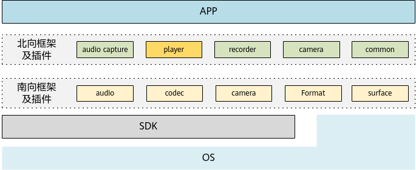

> **说明：** 
>本播放器不支持网络播放。

-   **[播放器模块层次结构](#ZH-CN_TOPIC_0000002499582453)**  

-   **[播放器模块处理流程](#ZH-CN_TOPIC_0000002499582361)**  

-   **[播放器状态图](#ZH-CN_TOPIC_0000002466383484)**  

-   **[StreamSource源类型Buffer流转](#ZH-CN_TOPIC_0000002499582421)**  

-   **[播放器模块支持音视频格式](#ZH-CN_TOPIC_0000002499502353)**  

### 播放器模块层次结构<a name="ZH-CN_TOPIC_0000002499582453"></a>

播放器模块的层次结构如[图1](#zh-cn_topic_0000002364911074_fig9612172564512)所示。

**图 1**  播放器模块层次结构图<a name="zh-cn_topic_0000002364911074_fig9612172564512"></a>  
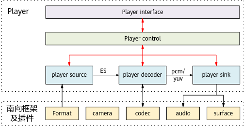

Player主要由4大模块组成：player control（播放器控制模块）、player source（播放源处理模块）、player decoder（解码模块）、player sink（输出模块）。

-   player control模块主要负责接收响应APP侧命令、模块管理和上报事件处理。
-   player source对接Format模块，负责片源解析处理及输出数据帧处理。
-   player decoder模块对接codec模块，负责音视频帧解码处理。
-   player sink对接audio和显示模块，负责音视频流输出处理及同步处理。

### 播放器模块处理流程<a name="ZH-CN_TOPIC_0000002499582361"></a>

播放器模块的处理流程如[图1](#zh-cn_topic_0000002364911234_fig3232102532313)所示。

**图 1**  播放器模块处理流程<a name="zh-cn_topic_0000002364911234_fig3232102532313"></a>  
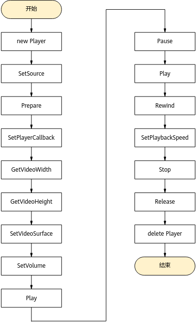

从[图1](#zh-cn_topic_0000002364911234_fig3232102532313)可以看出整个播放器的处理流程：

1.  创建播放器实例。
2.  设置播放源（文件路径uri或stream source）。
3.  播放准备处理。
4.  注册回调函数。
5.  获取宽高属性（可选）。
6.  设置视频显示区域。
7.  设置音量（可选）。
8.  执行播放直到文件结束。
9.  播放过程中执行Pause/Play。
10. 播放过程中执行Rewind。
11. 播放过程中执行倍速播放（目前暂不支持）。
12. 停止播放器。
13. 释放播放器资源。
14. 删除播放器实例。

### 播放器状态图<a name="ZH-CN_TOPIC_0000002466383484"></a>

播放器状态如[图1](#zh-cn_topic_0000002364911194_fig83189256305)所示。

**图 1**  播放器模块状态图<a name="zh-cn_topic_0000002364911194_fig83189256305"></a>  
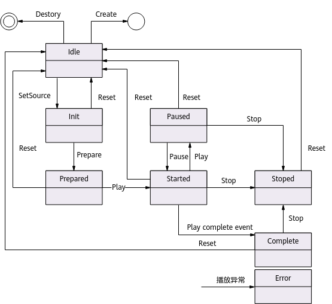

### StreamSource源类型Buffer流转<a name="ZH-CN_TOPIC_0000002499582421"></a>

针对StreamSource场景，Buffer运转方式示意图如[图1](#zh-cn_topic_0000002365071046_fig1320554212196)所示，player内部持有Buffer实体，外部APP侧仅使用Available Buffer并填充后送到player侧，player从Buffer读取数据解析后送解码处理。

**图 1**  StreamSource buffer流转图<a name="zh-cn_topic_0000002365071046_fig1320554212196"></a>  
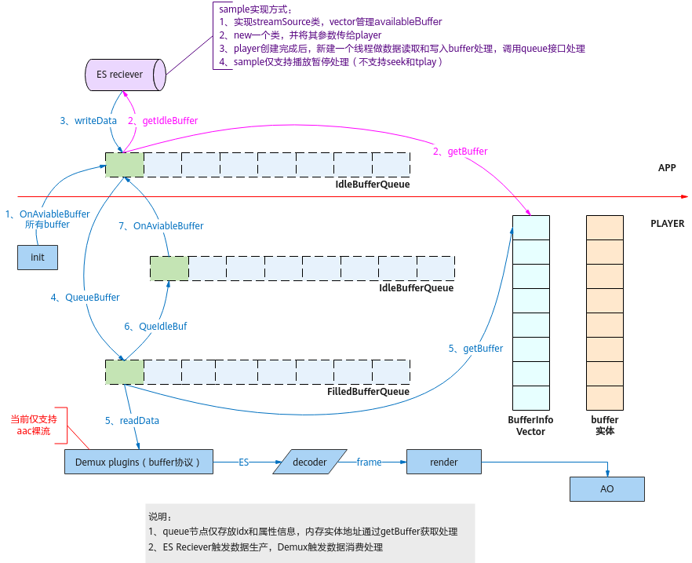

### 播放器模块支持音视频格式<a name="ZH-CN_TOPIC_0000002499502353"></a>

播放器在本地播放、网络播放、StreamSource播放场景支持的音视频格式如[图1](#zh-cn_topic_0000002466881185_fig886342342715)所示。

**图 1**  播放器模块支持音视频格式<a name="zh-cn_topic_0000002466881185_fig886342342715"></a>  
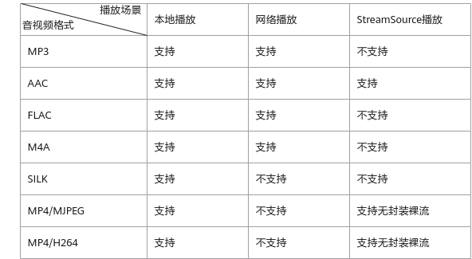

> **说明：** 
>播放器不支持MSBC格式。
>SILK格式播放不支持暂停恢复、播放中切换输出设备。

## 功能描述<a name="ZH-CN_TOPIC_0000002466383276"></a>

-   **[播控模块](#ZH-CN_TOPIC_0000002466383268)**  

-   **[播放器模块DFX](#ZH-CN_TOPIC_0000002499502161)**  

### 播控模块<a name="ZH-CN_TOPIC_0000002466383268"></a>

播控模块提供媒体播放、暂停、停止功能。用户在回调函数中不能有阻塞操作，也不能调用播放器接口。

播放器模块的播放状态对应接口如下：

-   实例创建后对应PLAYER\_IDLE状态。
-   SetSource对应PLAYER\_INITIALIZED状态。
-   Prepare对应PLAYER\_PREPARED状态。
-   Play对应PLAYER\_STARTED状态。
-   Pause对应PLAYER\_PAUSED状态。
-   Stop 对应PLAYER\_STOPPED状态。
-   Reset对应PLAYER\_IDLE状态。

### 播放器模块DFX<a name="ZH-CN_TOPIC_0000002499502161"></a>

播放器模块DFX属于非功能属性，例如：性能、可靠性、可服务性、可测试性。细分如下：

-   播放文件信息（流类型、文件路径、文件大小、开始播放时间、总播放时间、视频流索引、音频流索引等），请参见“[DumpInfo](#ZH-CN_TOPIC_0000002499502233)”小节。
-   播放视频流信息（视频流索引号、视频解码类型、视频宽、视频高等），请参见“[DumpInfo](#ZH-CN_TOPIC_0000002499502233)”小节。
-   播放音频流信息（音频流索引号、音频解码类型、采样率、声道数、位宽等），请参见“[DumpInfo](#ZH-CN_TOPIC_0000002499502233)”小节。
-   播放控制信息（会话ID、输出设备、当前播放位置、倍速、播放状态、是否循环等），请参见“[DumpInfo](#ZH-CN_TOPIC_0000002499502233)”小节。
-   支持获取播放状态、播放倍速、当前播放位置。
-   支持获取视频宽、高信息。
-   可测试性支持CHR日志打点，通过调用公共CHR打点接口将打点数据通过串口打印或者保存到文件系统中，实现对播放器模块关键行为节点的记录，具体枚举定义请参见“middleware/services/media/dfx/chr/include/media\_chr\_log.h”文件。

## API参考<a name="ZH-CN_TOPIC_0000002499502357"></a>

-   **[Player类](#ZH-CN_TOPIC_0000002466383400)**  

-   **[PlayerCallback类](#ZH-CN_TOPIC_0000002499502197)**  

-   **[Source类](#ZH-CN_TOPIC_0000002466383200)**  

-   **[StreamSource类](#ZH-CN_TOPIC_0000002466383240)**  

-   **[StreamCallback类](#ZH-CN_TOPIC_0000002499502381)**  

-   **[AudioModule类](#ZH-CN_TOPIC_0000002466383456)**  

### Player类<a name="ZH-CN_TOPIC_0000002466383400"></a>

该功能模块提供以下API：

-   SetSource：设置player要播放的数据源。
-   Prepare：播放器预处理，同时完成片源的解析处理。
-   Play：开始片源播放处理。
-   IsPlaying：查询当前播放器状态是否处于播放状态。
-   Pause：暂停播放。
-   Stop：停止播放。
-   Rewind：回退到指定播放位置。
-   SetVolume：设置播放器音量。
-   SetVideoSurface：设置视频显示区域。
-   EnableSingleLooping：设置循环播放标记。
-   IsSingleLooping：查询循环播放标记。
-   GetPlayerState：查询当前播放器状态。
-   GetCurrentTime：查询当前播放器位置。
-   GetDuration：查询播放源时长。
-   SetPlaybackSpeed：设置播放速度。
-   GetPlaybackSpeed：获取播放速度。
-   SetAudioStreamType：设置音频流类型
-   GetAudioStreamType：获取音频流类型
-   Reset：重置播放器到IDLE状态。
-   Release：销毁播放器资源。
-   SetPlayerCallback：设置播放器回调函数。
-   SetParameter：扩展接口，设置播放器参数（如设置首帧暂停模式）。
-   GetParameter：获取播放器参数。
-   GetTotalTracks：获取track总数。
-   SetAudioSessionId：设置会话ID。
-   GetAudioSessionId：获取会话ID。
-   SetOutputDevice：收着输出设备。
-   GetRoutedDeviceId：获取当前路由设备
-   DumpInfo：获取运行时的转储日志信息。

-   **[SetSource](#ZH-CN_TOPIC_0000002466542996)**  

-   **[Prepare](#ZH-CN_TOPIC_0000002466383248)**  

-   **[Play](#ZH-CN_TOPIC_0000002466383216)**  

-   **[IsPlaying](#ZH-CN_TOPIC_0000002499582265)**  

-   **[Pause](#ZH-CN_TOPIC_0000002466383328)**  

-   **[Stop](#ZH-CN_TOPIC_0000002499582309)**  

-   **[Rewind](#ZH-CN_TOPIC_0000002466543004)**  

-   **[SetVolume](#ZH-CN_TOPIC_0000002466542972)**  

-   **[SetVideoSurface](#ZH-CN_TOPIC_0000002466383460)**  

-   **[EnableSingleLooping](#ZH-CN_TOPIC_0000002499502265)**  

-   **[IsSingleLooping](#ZH-CN_TOPIC_0000002466543008)**  

-   **[GetPlayerState](#ZH-CN_TOPIC_0000002499582193)**  

-   **[GetCurrentTime](#ZH-CN_TOPIC_0000002466543056)**  

-   **[GetDuration](#ZH-CN_TOPIC_0000002499582301)**  

-   **[SetPlaybackSpeed](#ZH-CN_TOPIC_0000002499582393)**  

-   **[GetPlaybackSpeed](#ZH-CN_TOPIC_0000002499502145)**  

-   **[SetAudioStreamType](#ZH-CN_TOPIC_0000002499582225)**  

-   **[GetAudioStreamType](#ZH-CN_TOPIC_0000002466383224)**  

-   **[Reset](#ZH-CN_TOPIC_0000002499582289)**  

-   **[Release](#ZH-CN_TOPIC_0000002466542956)**  

-   **[SetPlayerCallback](#ZH-CN_TOPIC_0000002466383416)**  

-   **[SetParameter](#ZH-CN_TOPIC_0000002466383360)**  

-   **[GetParameter](#ZH-CN_TOPIC_0000002499582413)**  

-   **[GetTotalTracks](#ZH-CN_TOPIC_0000002466383392)**  

-   **[SetAudioSessionId](#ZH-CN_TOPIC_0000002466543040)**  

-   **[GetAudioSessionId](#ZH-CN_TOPIC_0000002466542844)**  

-   **[SetOutputDevice](#ZH-CN_TOPIC_0000002466543020)**  

-   **[GetRoutedDeviceId](#ZH-CN_TOPIC_0000002466543024)**  

-   **[DumpInfo](#ZH-CN_TOPIC_0000002499502233)**  

#### SetSource<a name="ZH-CN_TOPIC_0000002466542996"></a>

【描述】

设置player要播放的数据源，支持文件路径URI和AAC音频、MJPEG视频、H264视频裸流StreamSource。

【语法】

int32\_t SetSource\(const Source &source\);

【参数】

<a name="zh-cn_topic_0000002398510965_table6743mcpsimp"></a>
<table><thead align="left"><tr id="zh-cn_topic_0000002398510965_row6749mcpsimp"><th class="cellrowborder" valign="top" width="19%" id="mcps1.1.4.1.1"><p id="zh-cn_topic_0000002398510965_p6751mcpsimp"><a name="zh-cn_topic_0000002398510965_p6751mcpsimp"></a><a name="zh-cn_topic_0000002398510965_p6751mcpsimp"></a>参数名称</p>
</th>
<th class="cellrowborder" valign="top" width="61%" id="mcps1.1.4.1.2"><p id="zh-cn_topic_0000002398510965_p6753mcpsimp"><a name="zh-cn_topic_0000002398510965_p6753mcpsimp"></a><a name="zh-cn_topic_0000002398510965_p6753mcpsimp"></a>描述</p>
</th>
<th class="cellrowborder" valign="top" width="20%" id="mcps1.1.4.1.3"><p id="zh-cn_topic_0000002398510965_p6755mcpsimp"><a name="zh-cn_topic_0000002398510965_p6755mcpsimp"></a><a name="zh-cn_topic_0000002398510965_p6755mcpsimp"></a>输入/输出</p>
</th>
</tr>
</thead>
<tbody><tr id="zh-cn_topic_0000002398510965_row6757mcpsimp"><td class="cellrowborder" valign="top" width="19%" headers="mcps1.1.4.1.1 "><p id="zh-cn_topic_0000002398510965_p6759mcpsimp"><a name="zh-cn_topic_0000002398510965_p6759mcpsimp"></a><a name="zh-cn_topic_0000002398510965_p6759mcpsimp"></a>source</p>
</td>
<td class="cellrowborder" valign="top" width="61%" headers="mcps1.1.4.1.2 "><p id="zh-cn_topic_0000002398510965_p6761mcpsimp"><a name="zh-cn_topic_0000002398510965_p6761mcpsimp"></a><a name="zh-cn_topic_0000002398510965_p6761mcpsimp"></a>播放片源信息，详见“<a href="#ZH-CN_TOPIC_0000002466383200">Source类</a>”。</p>
</td>
<td class="cellrowborder" valign="top" width="20%" headers="mcps1.1.4.1.3 "><p id="zh-cn_topic_0000002398510965_p6763mcpsimp"><a name="zh-cn_topic_0000002398510965_p6763mcpsimp"></a><a name="zh-cn_topic_0000002398510965_p6763mcpsimp"></a>输入</p>
</td>
</tr>
</tbody>
</table>

【返回值】

<a name="zh-cn_topic_0000002398510965_table6765mcpsimp"></a>
<table><thead align="left"><tr id="zh-cn_topic_0000002398510965_row6770mcpsimp"><th class="cellrowborder" valign="top" width="50%" id="mcps1.1.3.1.1"><p id="zh-cn_topic_0000002398510965_p6772mcpsimp"><a name="zh-cn_topic_0000002398510965_p6772mcpsimp"></a><a name="zh-cn_topic_0000002398510965_p6772mcpsimp"></a>返回值</p>
</th>
<th class="cellrowborder" valign="top" width="50%" id="mcps1.1.3.1.2"><p id="zh-cn_topic_0000002398510965_p6774mcpsimp"><a name="zh-cn_topic_0000002398510965_p6774mcpsimp"></a><a name="zh-cn_topic_0000002398510965_p6774mcpsimp"></a>描述</p>
</th>
</tr>
</thead>
<tbody><tr id="zh-cn_topic_0000002398510965_row6776mcpsimp"><td class="cellrowborder" valign="top" width="50%" headers="mcps1.1.3.1.1 "><p id="zh-cn_topic_0000002398510965_p6778mcpsimp"><a name="zh-cn_topic_0000002398510965_p6778mcpsimp"></a><a name="zh-cn_topic_0000002398510965_p6778mcpsimp"></a>0</p>
</td>
<td class="cellrowborder" valign="top" width="50%" headers="mcps1.1.3.1.2 "><p id="zh-cn_topic_0000002398510965_p6780mcpsimp"><a name="zh-cn_topic_0000002398510965_p6780mcpsimp"></a><a name="zh-cn_topic_0000002398510965_p6780mcpsimp"></a>成功。</p>
</td>
</tr>
<tr id="zh-cn_topic_0000002398510965_row6781mcpsimp"><td class="cellrowborder" valign="top" width="50%" headers="mcps1.1.3.1.1 "><p id="zh-cn_topic_0000002398510965_p6783mcpsimp"><a name="zh-cn_topic_0000002398510965_p6783mcpsimp"></a><a name="zh-cn_topic_0000002398510965_p6783mcpsimp"></a>非0</p>
</td>
<td class="cellrowborder" valign="top" width="50%" headers="mcps1.1.3.1.2 "><p id="zh-cn_topic_0000002398510965_p6785mcpsimp"><a name="zh-cn_topic_0000002398510965_p6785mcpsimp"></a><a name="zh-cn_topic_0000002398510965_p6785mcpsimp"></a>失败，详见“<a href="#ZH-CN_TOPIC_0000002499502305">错误码</a>”。</p>
</td>
</tr>
</tbody>
</table>

【需求】

-   头文件：player.h、source.h、format.h、surface.h
-   库文件：libplayer.a

【注意】

无。

【举例】

具体示例内容请参见“[本地文件播放示例](#ZH-CN_TOPIC_0000002466542836)”小节。

【相关主题】

无。

#### Prepare<a name="ZH-CN_TOPIC_0000002466383248"></a>

【描述】

播放器预处理，同时完成片源的解析处理。

【语法】

int32\_t Prepare\(\);

【参数】

无。

【返回值】

<a name="zh-cn_topic_0000002364911034_table6807mcpsimp"></a>
<table><thead align="left"><tr id="zh-cn_topic_0000002364911034_row6812mcpsimp"><th class="cellrowborder" valign="top" width="50%" id="mcps1.1.3.1.1"><p id="zh-cn_topic_0000002364911034_p6814mcpsimp"><a name="zh-cn_topic_0000002364911034_p6814mcpsimp"></a><a name="zh-cn_topic_0000002364911034_p6814mcpsimp"></a>返回值</p>
</th>
<th class="cellrowborder" valign="top" width="50%" id="mcps1.1.3.1.2"><p id="zh-cn_topic_0000002364911034_p6816mcpsimp"><a name="zh-cn_topic_0000002364911034_p6816mcpsimp"></a><a name="zh-cn_topic_0000002364911034_p6816mcpsimp"></a>描述</p>
</th>
</tr>
</thead>
<tbody><tr id="zh-cn_topic_0000002364911034_row6817mcpsimp"><td class="cellrowborder" valign="top" width="50%" headers="mcps1.1.3.1.1 "><p id="zh-cn_topic_0000002364911034_p6819mcpsimp"><a name="zh-cn_topic_0000002364911034_p6819mcpsimp"></a><a name="zh-cn_topic_0000002364911034_p6819mcpsimp"></a>0</p>
</td>
<td class="cellrowborder" valign="top" width="50%" headers="mcps1.1.3.1.2 "><p id="zh-cn_topic_0000002364911034_p6821mcpsimp"><a name="zh-cn_topic_0000002364911034_p6821mcpsimp"></a><a name="zh-cn_topic_0000002364911034_p6821mcpsimp"></a>成功。</p>
</td>
</tr>
<tr id="zh-cn_topic_0000002364911034_row6822mcpsimp"><td class="cellrowborder" valign="top" width="50%" headers="mcps1.1.3.1.1 "><p id="zh-cn_topic_0000002364911034_p6824mcpsimp"><a name="zh-cn_topic_0000002364911034_p6824mcpsimp"></a><a name="zh-cn_topic_0000002364911034_p6824mcpsimp"></a>非0</p>
</td>
<td class="cellrowborder" valign="top" width="50%" headers="mcps1.1.3.1.2 "><p id="zh-cn_topic_0000002364911034_p6826mcpsimp"><a name="zh-cn_topic_0000002364911034_p6826mcpsimp"></a><a name="zh-cn_topic_0000002364911034_p6826mcpsimp"></a>失败，详见“<a href="#ZH-CN_TOPIC_0000002499502305">错误码</a>”。</p>
</td>
</tr>
</tbody>
</table>

【需求】

-   头文件：player.h、source.h、format.h、surface.h
-   库文件：libplayer.a

【注意】

该接口需SetSource接口调用成功后使用。

【举例】

具体示例内容请参见“[本地文件播放示例](#ZH-CN_TOPIC_0000002466542836)”小节。

【相关主题】

无。

#### Play<a name="ZH-CN_TOPIC_0000002466383216"></a>

【描述】

开始片源播放处理。

【语法】

int32\_t Play\(\);

【参数】

无。

【返回值】

<a name="zh-cn_topic_0000002365071082_table6848mcpsimp"></a>
<table><thead align="left"><tr id="zh-cn_topic_0000002365071082_row6853mcpsimp"><th class="cellrowborder" valign="top" width="28.999999999999996%" id="mcps1.1.3.1.1"><p id="zh-cn_topic_0000002365071082_p6855mcpsimp"><a name="zh-cn_topic_0000002365071082_p6855mcpsimp"></a><a name="zh-cn_topic_0000002365071082_p6855mcpsimp"></a>返回值</p>
</th>
<th class="cellrowborder" valign="top" width="71%" id="mcps1.1.3.1.2"><p id="zh-cn_topic_0000002365071082_p6857mcpsimp"><a name="zh-cn_topic_0000002365071082_p6857mcpsimp"></a><a name="zh-cn_topic_0000002365071082_p6857mcpsimp"></a>描述</p>
</th>
</tr>
</thead>
<tbody><tr id="zh-cn_topic_0000002365071082_row6859mcpsimp"><td class="cellrowborder" valign="top" width="28.999999999999996%" headers="mcps1.1.3.1.1 "><p id="zh-cn_topic_0000002365071082_p6861mcpsimp"><a name="zh-cn_topic_0000002365071082_p6861mcpsimp"></a><a name="zh-cn_topic_0000002365071082_p6861mcpsimp"></a>0</p>
</td>
<td class="cellrowborder" valign="top" width="71%" headers="mcps1.1.3.1.2 "><p id="zh-cn_topic_0000002365071082_p6863mcpsimp"><a name="zh-cn_topic_0000002365071082_p6863mcpsimp"></a><a name="zh-cn_topic_0000002365071082_p6863mcpsimp"></a>成功。</p>
</td>
</tr>
<tr id="zh-cn_topic_0000002365071082_row6864mcpsimp"><td class="cellrowborder" valign="top" width="28.999999999999996%" headers="mcps1.1.3.1.1 "><p id="zh-cn_topic_0000002365071082_p6866mcpsimp"><a name="zh-cn_topic_0000002365071082_p6866mcpsimp"></a><a name="zh-cn_topic_0000002365071082_p6866mcpsimp"></a>非0</p>
</td>
<td class="cellrowborder" valign="top" width="71%" headers="mcps1.1.3.1.2 "><p id="zh-cn_topic_0000002365071082_p6868mcpsimp"><a name="zh-cn_topic_0000002365071082_p6868mcpsimp"></a><a name="zh-cn_topic_0000002365071082_p6868mcpsimp"></a>失败，详见“<a href="#ZH-CN_TOPIC_0000002499502305">错误码</a>”。</p>
</td>
</tr>
</tbody>
</table>

【需求】

-   头文件：player.h、source.h、format.h、surface.h
-   库文件：libplayer.a

【注意】

该接口需Prepare接口调用成功后使用。

【举例】

具体示例内容请参见“[本地文件播放示例](#ZH-CN_TOPIC_0000002466542836)”小节。

【相关主题】

无。

#### IsPlaying<a name="ZH-CN_TOPIC_0000002499582265"></a>

【描述】

查询当前播放器状态是否处于播放状态。

【语法】

bool IsPlaying\(\);

【参数】

无。

【返回值】

<a name="zh-cn_topic_0000002364911102_table6890mcpsimp"></a>
<table><thead align="left"><tr id="zh-cn_topic_0000002364911102_row6895mcpsimp"><th class="cellrowborder" valign="top" width="21%" id="mcps1.1.3.1.1"><p id="zh-cn_topic_0000002364911102_p6897mcpsimp"><a name="zh-cn_topic_0000002364911102_p6897mcpsimp"></a><a name="zh-cn_topic_0000002364911102_p6897mcpsimp"></a>返回值</p>
</th>
<th class="cellrowborder" valign="top" width="79%" id="mcps1.1.3.1.2"><p id="zh-cn_topic_0000002364911102_p6899mcpsimp"><a name="zh-cn_topic_0000002364911102_p6899mcpsimp"></a><a name="zh-cn_topic_0000002364911102_p6899mcpsimp"></a>描述</p>
</th>
</tr>
</thead>
<tbody><tr id="zh-cn_topic_0000002364911102_row6901mcpsimp"><td class="cellrowborder" valign="top" width="21%" headers="mcps1.1.3.1.1 "><p id="zh-cn_topic_0000002364911102_p6903mcpsimp"><a name="zh-cn_topic_0000002364911102_p6903mcpsimp"></a><a name="zh-cn_topic_0000002364911102_p6903mcpsimp"></a>true</p>
</td>
<td class="cellrowborder" valign="top" width="79%" headers="mcps1.1.3.1.2 "><p id="zh-cn_topic_0000002364911102_p6905mcpsimp"><a name="zh-cn_topic_0000002364911102_p6905mcpsimp"></a><a name="zh-cn_topic_0000002364911102_p6905mcpsimp"></a>处于播放状态，对应PLAYER_STARTED状态。</p>
</td>
</tr>
<tr id="zh-cn_topic_0000002364911102_row6906mcpsimp"><td class="cellrowborder" valign="top" width="21%" headers="mcps1.1.3.1.1 "><p id="zh-cn_topic_0000002364911102_p6908mcpsimp"><a name="zh-cn_topic_0000002364911102_p6908mcpsimp"></a><a name="zh-cn_topic_0000002364911102_p6908mcpsimp"></a>false</p>
</td>
<td class="cellrowborder" valign="top" width="79%" headers="mcps1.1.3.1.2 "><p id="zh-cn_topic_0000002364911102_p6910mcpsimp"><a name="zh-cn_topic_0000002364911102_p6910mcpsimp"></a><a name="zh-cn_topic_0000002364911102_p6910mcpsimp"></a>处于非播放状态，除PLAYER_STARTED之外的状态。</p>
</td>
</tr>
</tbody>
</table>

【需求】

-   头文件：player.h、source.h、format.h、surface.h
-   库文件：libplayer.a

【注意】

无。

【举例】

具体示例内容请参见“[本地文件播放示例](#ZH-CN_TOPIC_0000002466542836)”小节。

【相关主题】

无。

#### Pause<a name="ZH-CN_TOPIC_0000002466383328"></a>

【描述】

暂停播放。

【语法】

int32\_t Pause\(\);

【参数】

无。

【返回值】

<a name="zh-cn_topic_0000002398510869_table6932mcpsimp"></a>
<table><thead align="left"><tr id="zh-cn_topic_0000002398510869_row6937mcpsimp"><th class="cellrowborder" valign="top" width="28.999999999999996%" id="mcps1.1.3.1.1"><p id="zh-cn_topic_0000002398510869_p6939mcpsimp"><a name="zh-cn_topic_0000002398510869_p6939mcpsimp"></a><a name="zh-cn_topic_0000002398510869_p6939mcpsimp"></a>返回值</p>
</th>
<th class="cellrowborder" valign="top" width="71%" id="mcps1.1.3.1.2"><p id="zh-cn_topic_0000002398510869_p6941mcpsimp"><a name="zh-cn_topic_0000002398510869_p6941mcpsimp"></a><a name="zh-cn_topic_0000002398510869_p6941mcpsimp"></a>描述</p>
</th>
</tr>
</thead>
<tbody><tr id="zh-cn_topic_0000002398510869_row6943mcpsimp"><td class="cellrowborder" valign="top" width="28.999999999999996%" headers="mcps1.1.3.1.1 "><p id="zh-cn_topic_0000002398510869_p6945mcpsimp"><a name="zh-cn_topic_0000002398510869_p6945mcpsimp"></a><a name="zh-cn_topic_0000002398510869_p6945mcpsimp"></a>0</p>
</td>
<td class="cellrowborder" valign="top" width="71%" headers="mcps1.1.3.1.2 "><p id="zh-cn_topic_0000002398510869_p6947mcpsimp"><a name="zh-cn_topic_0000002398510869_p6947mcpsimp"></a><a name="zh-cn_topic_0000002398510869_p6947mcpsimp"></a>成功。</p>
</td>
</tr>
<tr id="zh-cn_topic_0000002398510869_row6948mcpsimp"><td class="cellrowborder" valign="top" width="28.999999999999996%" headers="mcps1.1.3.1.1 "><p id="zh-cn_topic_0000002398510869_p6950mcpsimp"><a name="zh-cn_topic_0000002398510869_p6950mcpsimp"></a><a name="zh-cn_topic_0000002398510869_p6950mcpsimp"></a>非0</p>
</td>
<td class="cellrowborder" valign="top" width="71%" headers="mcps1.1.3.1.2 "><p id="zh-cn_topic_0000002398510869_p6952mcpsimp"><a name="zh-cn_topic_0000002398510869_p6952mcpsimp"></a><a name="zh-cn_topic_0000002398510869_p6952mcpsimp"></a>失败，详见“<a href="#ZH-CN_TOPIC_0000002499502305">错误码</a>”。</p>
</td>
</tr>
</tbody>
</table>

【需求】

-   头文件：player.h、source.h、format.h、surface.h
-   库文件：libplayer.a

【注意】

-   该接口一般在PLAYER\_STARTED状态下调用。
-   如果是首帧暂停播放模式，则在PLAYER\_PREPARED状态下调用本接口达到首帧暂停的效果。

【举例】

具体示例内容请参见“[本地文件播放示例](#ZH-CN_TOPIC_0000002466542836)”小节。

【相关主题】

无。

#### Stop<a name="ZH-CN_TOPIC_0000002499582309"></a>

【描述】

停止播放。

【语法】

int32\_t Stop\(\);

【参数】

无。

【返回值】

<a name="zh-cn_topic_0000002398510989_table6976mcpsimp"></a>
<table><thead align="left"><tr id="zh-cn_topic_0000002398510989_row6981mcpsimp"><th class="cellrowborder" valign="top" width="28.999999999999996%" id="mcps1.1.3.1.1"><p id="zh-cn_topic_0000002398510989_p6983mcpsimp"><a name="zh-cn_topic_0000002398510989_p6983mcpsimp"></a><a name="zh-cn_topic_0000002398510989_p6983mcpsimp"></a>返回值</p>
</th>
<th class="cellrowborder" valign="top" width="71%" id="mcps1.1.3.1.2"><p id="zh-cn_topic_0000002398510989_p6985mcpsimp"><a name="zh-cn_topic_0000002398510989_p6985mcpsimp"></a><a name="zh-cn_topic_0000002398510989_p6985mcpsimp"></a>描述</p>
</th>
</tr>
</thead>
<tbody><tr id="zh-cn_topic_0000002398510989_row6987mcpsimp"><td class="cellrowborder" valign="top" width="28.999999999999996%" headers="mcps1.1.3.1.1 "><p id="zh-cn_topic_0000002398510989_p6989mcpsimp"><a name="zh-cn_topic_0000002398510989_p6989mcpsimp"></a><a name="zh-cn_topic_0000002398510989_p6989mcpsimp"></a>0</p>
</td>
<td class="cellrowborder" valign="top" width="71%" headers="mcps1.1.3.1.2 "><p id="zh-cn_topic_0000002398510989_p6991mcpsimp"><a name="zh-cn_topic_0000002398510989_p6991mcpsimp"></a><a name="zh-cn_topic_0000002398510989_p6991mcpsimp"></a>成功。</p>
</td>
</tr>
<tr id="zh-cn_topic_0000002398510989_row6992mcpsimp"><td class="cellrowborder" valign="top" width="28.999999999999996%" headers="mcps1.1.3.1.1 "><p id="zh-cn_topic_0000002398510989_p6994mcpsimp"><a name="zh-cn_topic_0000002398510989_p6994mcpsimp"></a><a name="zh-cn_topic_0000002398510989_p6994mcpsimp"></a>非0</p>
</td>
<td class="cellrowborder" valign="top" width="71%" headers="mcps1.1.3.1.2 "><p id="zh-cn_topic_0000002398510989_p6996mcpsimp"><a name="zh-cn_topic_0000002398510989_p6996mcpsimp"></a><a name="zh-cn_topic_0000002398510989_p6996mcpsimp"></a>失败，详见“<a href="#ZH-CN_TOPIC_0000002499502305">错误码</a>”。</p>
</td>
</tr>
</tbody>
</table>

【需求】

-   头文件：player.h、source.h、format.h、surface.h
-   库文件：libplayer.a

【注意】

该接口需在PLAYER\_STARTED、PLAYER\_PAUSED、PLAYER\_PLAYBACK\_COMPLETE状态下调用。

【举例】

具体示例内容请参见“[本地文件播放示例](#ZH-CN_TOPIC_0000002466542836)”小节。

【相关主题】

无。

#### Rewind<a name="ZH-CN_TOPIC_0000002466543004"></a>

【描述】

回退到指定播放位置。

【语法】

int32\_t Rewind\(int64\_t mSeconds, int32\_t mode\);

【参数】

<a name="zh-cn_topic_0000002398511021_table7016mcpsimp"></a>
<table><thead align="left"><tr id="zh-cn_topic_0000002398511021_row7022mcpsimp"><th class="cellrowborder" valign="top" width="18.180000000000003%" id="mcps1.1.4.1.1"><p id="zh-cn_topic_0000002398511021_p7024mcpsimp"><a name="zh-cn_topic_0000002398511021_p7024mcpsimp"></a><a name="zh-cn_topic_0000002398511021_p7024mcpsimp"></a>参数名称</p>
</th>
<th class="cellrowborder" valign="top" width="63.64000000000001%" id="mcps1.1.4.1.2"><p id="zh-cn_topic_0000002398511021_p7026mcpsimp"><a name="zh-cn_topic_0000002398511021_p7026mcpsimp"></a><a name="zh-cn_topic_0000002398511021_p7026mcpsimp"></a>描述</p>
</th>
<th class="cellrowborder" valign="top" width="18.180000000000003%" id="mcps1.1.4.1.3"><p id="zh-cn_topic_0000002398511021_p7028mcpsimp"><a name="zh-cn_topic_0000002398511021_p7028mcpsimp"></a><a name="zh-cn_topic_0000002398511021_p7028mcpsimp"></a>输入/输出</p>
</th>
</tr>
</thead>
<tbody><tr id="zh-cn_topic_0000002398511021_row7030mcpsimp"><td class="cellrowborder" valign="top" width="18.180000000000003%" headers="mcps1.1.4.1.1 "><p id="zh-cn_topic_0000002398511021_p7032mcpsimp"><a name="zh-cn_topic_0000002398511021_p7032mcpsimp"></a><a name="zh-cn_topic_0000002398511021_p7032mcpsimp"></a>mSeconds</p>
</td>
<td class="cellrowborder" valign="top" width="63.64000000000001%" headers="mcps1.1.4.1.2 "><p id="zh-cn_topic_0000002398511021_p7034mcpsimp"><a name="zh-cn_topic_0000002398511021_p7034mcpsimp"></a><a name="zh-cn_topic_0000002398511021_p7034mcpsimp"></a>回退位置，单位：ms。</p>
</td>
<td class="cellrowborder" valign="top" width="18.180000000000003%" headers="mcps1.1.4.1.3 "><p id="zh-cn_topic_0000002398511021_p7036mcpsimp"><a name="zh-cn_topic_0000002398511021_p7036mcpsimp"></a><a name="zh-cn_topic_0000002398511021_p7036mcpsimp"></a>输入</p>
</td>
</tr>
<tr id="zh-cn_topic_0000002398511021_row7037mcpsimp"><td class="cellrowborder" valign="top" width="18.180000000000003%" headers="mcps1.1.4.1.1 "><p id="zh-cn_topic_0000002398511021_p7039mcpsimp"><a name="zh-cn_topic_0000002398511021_p7039mcpsimp"></a><a name="zh-cn_topic_0000002398511021_p7039mcpsimp"></a>mode</p>
</td>
<td class="cellrowborder" valign="top" width="63.64000000000001%" headers="mcps1.1.4.1.2 "><p id="zh-cn_topic_0000002398511021_p7041mcpsimp"><a name="zh-cn_topic_0000002398511021_p7041mcpsimp"></a><a name="zh-cn_topic_0000002398511021_p7041mcpsimp"></a>回退处理模式，详见“<a href="#ZH-CN_TOPIC_0000002466383336">PlayerSeekMode</a>”。</p>
</td>
<td class="cellrowborder" valign="top" width="18.180000000000003%" headers="mcps1.1.4.1.3 "><p id="zh-cn_topic_0000002398511021_p7043mcpsimp"><a name="zh-cn_topic_0000002398511021_p7043mcpsimp"></a><a name="zh-cn_topic_0000002398511021_p7043mcpsimp"></a>输入</p>
</td>
</tr>
</tbody>
</table>

【返回值】

<a name="zh-cn_topic_0000002398511021_table7045mcpsimp"></a>
<table><thead align="left"><tr id="zh-cn_topic_0000002398511021_row7050mcpsimp"><th class="cellrowborder" valign="top" width="28.999999999999996%" id="mcps1.1.3.1.1"><p id="zh-cn_topic_0000002398511021_p7052mcpsimp"><a name="zh-cn_topic_0000002398511021_p7052mcpsimp"></a><a name="zh-cn_topic_0000002398511021_p7052mcpsimp"></a>返回值</p>
</th>
<th class="cellrowborder" valign="top" width="71%" id="mcps1.1.3.1.2"><p id="zh-cn_topic_0000002398511021_p7054mcpsimp"><a name="zh-cn_topic_0000002398511021_p7054mcpsimp"></a><a name="zh-cn_topic_0000002398511021_p7054mcpsimp"></a>描述</p>
</th>
</tr>
</thead>
<tbody><tr id="zh-cn_topic_0000002398511021_row7056mcpsimp"><td class="cellrowborder" valign="top" width="28.999999999999996%" headers="mcps1.1.3.1.1 "><p id="zh-cn_topic_0000002398511021_p7058mcpsimp"><a name="zh-cn_topic_0000002398511021_p7058mcpsimp"></a><a name="zh-cn_topic_0000002398511021_p7058mcpsimp"></a>0</p>
</td>
<td class="cellrowborder" valign="top" width="71%" headers="mcps1.1.3.1.2 "><p id="zh-cn_topic_0000002398511021_p7060mcpsimp"><a name="zh-cn_topic_0000002398511021_p7060mcpsimp"></a><a name="zh-cn_topic_0000002398511021_p7060mcpsimp"></a>成功。</p>
</td>
</tr>
<tr id="zh-cn_topic_0000002398511021_row7061mcpsimp"><td class="cellrowborder" valign="top" width="28.999999999999996%" headers="mcps1.1.3.1.1 "><p id="zh-cn_topic_0000002398511021_p7063mcpsimp"><a name="zh-cn_topic_0000002398511021_p7063mcpsimp"></a><a name="zh-cn_topic_0000002398511021_p7063mcpsimp"></a>非0</p>
</td>
<td class="cellrowborder" valign="top" width="71%" headers="mcps1.1.3.1.2 "><p id="zh-cn_topic_0000002398511021_p7065mcpsimp"><a name="zh-cn_topic_0000002398511021_p7065mcpsimp"></a><a name="zh-cn_topic_0000002398511021_p7065mcpsimp"></a>失败，详见“<a href="#ZH-CN_TOPIC_0000002499502305">错误码</a>”。</p>
</td>
</tr>
</tbody>
</table>

【需求】

-   头文件：player.h、source.h、format.h、surface.h
-   库文件：libplayer.a

【注意】

-   该接口是异步接口，Rewind完成后会播放器根据注册的回调函数调用OnRewindToComplete上报事件处理。
-   多Rewind操作需要在前次Rewind操作收到OnRewindToComplete回调消息后执行，否则可能出现中间的Rewind操作失效。
-   该接口只能在PLAYER\_STARTED、PLAYER\_PAUSED两种播放状态下调用。
-   在调用Rewind接口与接收到Rewind end回调消息之间：
    -   调用Play或Pause会执行失败。
    -   调用SetPlaybackSpeed则Rewind操作可能会执行失败。

【举例】

具体示例内容请参见“[本地文件播放示例](#ZH-CN_TOPIC_0000002466542836)”小节。

【相关主题】

无。

#### SetVolume<a name="ZH-CN_TOPIC_0000002466542972"></a>

【描述】

设置播放器音量。

【语法】

int32\_t SetVolume\(float leftVolume, float rightVolume\);

【参数】

<a name="zh-cn_topic_0000002365071106_table7094mcpsimp"></a>
<table><thead align="left"><tr id="zh-cn_topic_0000002365071106_row7100mcpsimp"><th class="cellrowborder" valign="top" width="33.663366336633665%" id="mcps1.1.4.1.1"><p id="zh-cn_topic_0000002365071106_p7102mcpsimp"><a name="zh-cn_topic_0000002365071106_p7102mcpsimp"></a><a name="zh-cn_topic_0000002365071106_p7102mcpsimp"></a>参数名称</p>
</th>
<th class="cellrowborder" valign="top" width="37.62376237623762%" id="mcps1.1.4.1.2"><p id="zh-cn_topic_0000002365071106_p7104mcpsimp"><a name="zh-cn_topic_0000002365071106_p7104mcpsimp"></a><a name="zh-cn_topic_0000002365071106_p7104mcpsimp"></a>描述</p>
</th>
<th class="cellrowborder" valign="top" width="28.712871287128717%" id="mcps1.1.4.1.3"><p id="zh-cn_topic_0000002365071106_p7106mcpsimp"><a name="zh-cn_topic_0000002365071106_p7106mcpsimp"></a><a name="zh-cn_topic_0000002365071106_p7106mcpsimp"></a>输入/输出</p>
</th>
</tr>
</thead>
<tbody><tr id="zh-cn_topic_0000002365071106_row7108mcpsimp"><td class="cellrowborder" valign="top" width="33.663366336633665%" headers="mcps1.1.4.1.1 "><p id="zh-cn_topic_0000002365071106_p7110mcpsimp"><a name="zh-cn_topic_0000002365071106_p7110mcpsimp"></a><a name="zh-cn_topic_0000002365071106_p7110mcpsimp"></a>leftVolume</p>
</td>
<td class="cellrowborder" valign="top" width="37.62376237623762%" headers="mcps1.1.4.1.2 "><p id="zh-cn_topic_0000002365071106_p7112mcpsimp"><a name="zh-cn_topic_0000002365071106_p7112mcpsimp"></a><a name="zh-cn_topic_0000002365071106_p7112mcpsimp"></a>左声道音量。</p>
</td>
<td class="cellrowborder" valign="top" width="28.712871287128717%" headers="mcps1.1.4.1.3 "><p id="zh-cn_topic_0000002365071106_p7114mcpsimp"><a name="zh-cn_topic_0000002365071106_p7114mcpsimp"></a><a name="zh-cn_topic_0000002365071106_p7114mcpsimp"></a>输入</p>
</td>
</tr>
<tr id="zh-cn_topic_0000002365071106_row7115mcpsimp"><td class="cellrowborder" valign="top" width="33.663366336633665%" headers="mcps1.1.4.1.1 "><p id="zh-cn_topic_0000002365071106_p7117mcpsimp"><a name="zh-cn_topic_0000002365071106_p7117mcpsimp"></a><a name="zh-cn_topic_0000002365071106_p7117mcpsimp"></a>rightVolume</p>
</td>
<td class="cellrowborder" valign="top" width="37.62376237623762%" headers="mcps1.1.4.1.2 "><p id="zh-cn_topic_0000002365071106_p7119mcpsimp"><a name="zh-cn_topic_0000002365071106_p7119mcpsimp"></a><a name="zh-cn_topic_0000002365071106_p7119mcpsimp"></a>右声道音量。</p>
</td>
<td class="cellrowborder" valign="top" width="28.712871287128717%" headers="mcps1.1.4.1.3 "><p id="zh-cn_topic_0000002365071106_p7121mcpsimp"><a name="zh-cn_topic_0000002365071106_p7121mcpsimp"></a><a name="zh-cn_topic_0000002365071106_p7121mcpsimp"></a>输入</p>
</td>
</tr>
</tbody>
</table>

【返回值】

<a name="zh-cn_topic_0000002365071106_table7123mcpsimp"></a>
<table><thead align="left"><tr id="zh-cn_topic_0000002365071106_row7128mcpsimp"><th class="cellrowborder" valign="top" width="28.999999999999996%" id="mcps1.1.3.1.1"><p id="zh-cn_topic_0000002365071106_p7130mcpsimp"><a name="zh-cn_topic_0000002365071106_p7130mcpsimp"></a><a name="zh-cn_topic_0000002365071106_p7130mcpsimp"></a>返回值</p>
</th>
<th class="cellrowborder" valign="top" width="71%" id="mcps1.1.3.1.2"><p id="zh-cn_topic_0000002365071106_p7132mcpsimp"><a name="zh-cn_topic_0000002365071106_p7132mcpsimp"></a><a name="zh-cn_topic_0000002365071106_p7132mcpsimp"></a>描述</p>
</th>
</tr>
</thead>
<tbody><tr id="zh-cn_topic_0000002365071106_row7134mcpsimp"><td class="cellrowborder" valign="top" width="28.999999999999996%" headers="mcps1.1.3.1.1 "><p id="zh-cn_topic_0000002365071106_p7136mcpsimp"><a name="zh-cn_topic_0000002365071106_p7136mcpsimp"></a><a name="zh-cn_topic_0000002365071106_p7136mcpsimp"></a>0</p>
</td>
<td class="cellrowborder" valign="top" width="71%" headers="mcps1.1.3.1.2 "><p id="zh-cn_topic_0000002365071106_p7138mcpsimp"><a name="zh-cn_topic_0000002365071106_p7138mcpsimp"></a><a name="zh-cn_topic_0000002365071106_p7138mcpsimp"></a>成功。</p>
</td>
</tr>
<tr id="zh-cn_topic_0000002365071106_row7139mcpsimp"><td class="cellrowborder" valign="top" width="28.999999999999996%" headers="mcps1.1.3.1.1 "><p id="zh-cn_topic_0000002365071106_p7141mcpsimp"><a name="zh-cn_topic_0000002365071106_p7141mcpsimp"></a><a name="zh-cn_topic_0000002365071106_p7141mcpsimp"></a>非0</p>
</td>
<td class="cellrowborder" valign="top" width="71%" headers="mcps1.1.3.1.2 "><p id="zh-cn_topic_0000002365071106_p7143mcpsimp"><a name="zh-cn_topic_0000002365071106_p7143mcpsimp"></a><a name="zh-cn_topic_0000002365071106_p7143mcpsimp"></a>失败，详见“<a href="#ZH-CN_TOPIC_0000002499502305">错误码</a>”。</p>
</td>
</tr>
</tbody>
</table>

【需求】

-   头文件：player.h、source.h、format.h、surface.h
-   库文件：libplayer.a

【注意】

-   芯片差异不支持单独控制左声道和右声道，内部取左右声道均值配置AO音量处理。
-   左右声道都配置为0，表示设置静音模式。

【相关主题】

无。

#### SetVideoSurface<a name="ZH-CN_TOPIC_0000002466383460"></a>

【描述】

设置视频显示区域。

【语法】

int32\_t SetVideoSurface\(Surface \*surface\);

【参数】

<a name="zh-cn_topic_0000002365071150_table7161mcpsimp"></a>
<table><thead align="left"><tr id="zh-cn_topic_0000002365071150_row7167mcpsimp"><th class="cellrowborder" valign="top" width="16%" id="mcps1.1.4.1.1"><p id="zh-cn_topic_0000002365071150_p7169mcpsimp"><a name="zh-cn_topic_0000002365071150_p7169mcpsimp"></a><a name="zh-cn_topic_0000002365071150_p7169mcpsimp"></a>参数名称</p>
</th>
<th class="cellrowborder" valign="top" width="67%" id="mcps1.1.4.1.2"><p id="zh-cn_topic_0000002365071150_p7171mcpsimp"><a name="zh-cn_topic_0000002365071150_p7171mcpsimp"></a><a name="zh-cn_topic_0000002365071150_p7171mcpsimp"></a>描述</p>
</th>
<th class="cellrowborder" valign="top" width="17%" id="mcps1.1.4.1.3"><p id="zh-cn_topic_0000002365071150_p7173mcpsimp"><a name="zh-cn_topic_0000002365071150_p7173mcpsimp"></a><a name="zh-cn_topic_0000002365071150_p7173mcpsimp"></a>输入/输出</p>
</th>
</tr>
</thead>
<tbody><tr id="zh-cn_topic_0000002365071150_row7175mcpsimp"><td class="cellrowborder" valign="top" width="16%" headers="mcps1.1.4.1.1 "><p id="zh-cn_topic_0000002365071150_p7177mcpsimp"><a name="zh-cn_topic_0000002365071150_p7177mcpsimp"></a><a name="zh-cn_topic_0000002365071150_p7177mcpsimp"></a>surface</p>
</td>
<td class="cellrowborder" valign="top" width="67%" headers="mcps1.1.4.1.2 "><p id="zh-cn_topic_0000002365071150_p7179mcpsimp"><a name="zh-cn_topic_0000002365071150_p7179mcpsimp"></a><a name="zh-cn_topic_0000002365071150_p7179mcpsimp"></a>Surface指针，来源详见<a href="#zh-cn_topic_0000002365071086_li202765045911">3</a>。</p>
</td>
<td class="cellrowborder" valign="top" width="17%" headers="mcps1.1.4.1.3 "><p id="zh-cn_topic_0000002365071150_p7181mcpsimp"><a name="zh-cn_topic_0000002365071150_p7181mcpsimp"></a><a name="zh-cn_topic_0000002365071150_p7181mcpsimp"></a>输入</p>
</td>
</tr>
</tbody>
</table>

【返回值】

<a name="zh-cn_topic_0000002365071150_table7183mcpsimp"></a>
<table><thead align="left"><tr id="zh-cn_topic_0000002365071150_row7188mcpsimp"><th class="cellrowborder" valign="top" width="28.999999999999996%" id="mcps1.1.3.1.1"><p id="zh-cn_topic_0000002365071150_p7190mcpsimp"><a name="zh-cn_topic_0000002365071150_p7190mcpsimp"></a><a name="zh-cn_topic_0000002365071150_p7190mcpsimp"></a>返回值</p>
</th>
<th class="cellrowborder" valign="top" width="71%" id="mcps1.1.3.1.2"><p id="zh-cn_topic_0000002365071150_p7192mcpsimp"><a name="zh-cn_topic_0000002365071150_p7192mcpsimp"></a><a name="zh-cn_topic_0000002365071150_p7192mcpsimp"></a>描述</p>
</th>
</tr>
</thead>
<tbody><tr id="zh-cn_topic_0000002365071150_row7193mcpsimp"><td class="cellrowborder" valign="top" width="28.999999999999996%" headers="mcps1.1.3.1.1 "><p id="zh-cn_topic_0000002365071150_p7195mcpsimp"><a name="zh-cn_topic_0000002365071150_p7195mcpsimp"></a><a name="zh-cn_topic_0000002365071150_p7195mcpsimp"></a>0</p>
</td>
<td class="cellrowborder" valign="top" width="71%" headers="mcps1.1.3.1.2 "><p id="zh-cn_topic_0000002365071150_p7197mcpsimp"><a name="zh-cn_topic_0000002365071150_p7197mcpsimp"></a><a name="zh-cn_topic_0000002365071150_p7197mcpsimp"></a>成功。</p>
</td>
</tr>
<tr id="zh-cn_topic_0000002365071150_row7198mcpsimp"><td class="cellrowborder" valign="top" width="28.999999999999996%" headers="mcps1.1.3.1.1 "><p id="zh-cn_topic_0000002365071150_p7200mcpsimp"><a name="zh-cn_topic_0000002365071150_p7200mcpsimp"></a><a name="zh-cn_topic_0000002365071150_p7200mcpsimp"></a>非0</p>
</td>
<td class="cellrowborder" valign="top" width="71%" headers="mcps1.1.3.1.2 "><p id="zh-cn_topic_0000002365071150_p7202mcpsimp"><a name="zh-cn_topic_0000002365071150_p7202mcpsimp"></a><a name="zh-cn_topic_0000002365071150_p7202mcpsimp"></a>失败，详见“<a href="#ZH-CN_TOPIC_0000002499502305">错误码</a>”。</p>
</td>
</tr>
</tbody>
</table>

【需求】

-   头文件：player.h、source.h、format.h、surface.h
-   库文件：libplayer.a

【注意】

设置的显示区域不能超过显示器或LCD可显示区域。

【举例】

具体示例内容请参见“[本地文件播放示例](#ZH-CN_TOPIC_0000002466542836)”小节。

【相关主题】

无。

#### EnableSingleLooping<a name="ZH-CN_TOPIC_0000002499502265"></a>

【描述】

设置循环播放标记。

【语法】

int32\_t EnableSingleLooping\(bool loop\);

【参数】

<a name="zh-cn_topic_0000002398510861_table7222mcpsimp"></a>
<table><thead align="left"><tr id="zh-cn_topic_0000002398510861_row7228mcpsimp"><th class="cellrowborder" valign="top" width="27%" id="mcps1.1.4.1.1"><p id="zh-cn_topic_0000002398510861_p7230mcpsimp"><a name="zh-cn_topic_0000002398510861_p7230mcpsimp"></a><a name="zh-cn_topic_0000002398510861_p7230mcpsimp"></a>参数名称</p>
</th>
<th class="cellrowborder" valign="top" width="44%" id="mcps1.1.4.1.2"><p id="zh-cn_topic_0000002398510861_p7232mcpsimp"><a name="zh-cn_topic_0000002398510861_p7232mcpsimp"></a><a name="zh-cn_topic_0000002398510861_p7232mcpsimp"></a>描述</p>
</th>
<th class="cellrowborder" valign="top" width="28.999999999999996%" id="mcps1.1.4.1.3"><p id="zh-cn_topic_0000002398510861_p7234mcpsimp"><a name="zh-cn_topic_0000002398510861_p7234mcpsimp"></a><a name="zh-cn_topic_0000002398510861_p7234mcpsimp"></a>输入/输出</p>
</th>
</tr>
</thead>
<tbody><tr id="zh-cn_topic_0000002398510861_row7235mcpsimp"><td class="cellrowborder" valign="top" width="27%" headers="mcps1.1.4.1.1 "><p id="zh-cn_topic_0000002398510861_p7237mcpsimp"><a name="zh-cn_topic_0000002398510861_p7237mcpsimp"></a><a name="zh-cn_topic_0000002398510861_p7237mcpsimp"></a>loop</p>
</td>
<td class="cellrowborder" valign="top" width="44%" headers="mcps1.1.4.1.2 "><p id="zh-cn_topic_0000002398510861_p7239mcpsimp"><a name="zh-cn_topic_0000002398510861_p7239mcpsimp"></a><a name="zh-cn_topic_0000002398510861_p7239mcpsimp"></a>是否循环播放。</p>
</td>
<td class="cellrowborder" valign="top" width="28.999999999999996%" headers="mcps1.1.4.1.3 "><p id="zh-cn_topic_0000002398510861_p7241mcpsimp"><a name="zh-cn_topic_0000002398510861_p7241mcpsimp"></a><a name="zh-cn_topic_0000002398510861_p7241mcpsimp"></a>输入</p>
</td>
</tr>
</tbody>
</table>

【返回值】

<a name="zh-cn_topic_0000002398510861_table7243mcpsimp"></a>
<table><thead align="left"><tr id="zh-cn_topic_0000002398510861_row7248mcpsimp"><th class="cellrowborder" valign="top" width="28.999999999999996%" id="mcps1.1.3.1.1"><p id="zh-cn_topic_0000002398510861_p7250mcpsimp"><a name="zh-cn_topic_0000002398510861_p7250mcpsimp"></a><a name="zh-cn_topic_0000002398510861_p7250mcpsimp"></a>返回值</p>
</th>
<th class="cellrowborder" valign="top" width="71%" id="mcps1.1.3.1.2"><p id="zh-cn_topic_0000002398510861_p7252mcpsimp"><a name="zh-cn_topic_0000002398510861_p7252mcpsimp"></a><a name="zh-cn_topic_0000002398510861_p7252mcpsimp"></a>描述</p>
</th>
</tr>
</thead>
<tbody><tr id="zh-cn_topic_0000002398510861_row7254mcpsimp"><td class="cellrowborder" valign="top" width="28.999999999999996%" headers="mcps1.1.3.1.1 "><p id="zh-cn_topic_0000002398510861_p7256mcpsimp"><a name="zh-cn_topic_0000002398510861_p7256mcpsimp"></a><a name="zh-cn_topic_0000002398510861_p7256mcpsimp"></a>0</p>
</td>
<td class="cellrowborder" valign="top" width="71%" headers="mcps1.1.3.1.2 "><p id="zh-cn_topic_0000002398510861_p7258mcpsimp"><a name="zh-cn_topic_0000002398510861_p7258mcpsimp"></a><a name="zh-cn_topic_0000002398510861_p7258mcpsimp"></a>成功。</p>
</td>
</tr>
<tr id="zh-cn_topic_0000002398510861_row7259mcpsimp"><td class="cellrowborder" valign="top" width="28.999999999999996%" headers="mcps1.1.3.1.1 "><p id="zh-cn_topic_0000002398510861_p7261mcpsimp"><a name="zh-cn_topic_0000002398510861_p7261mcpsimp"></a><a name="zh-cn_topic_0000002398510861_p7261mcpsimp"></a>非0</p>
</td>
<td class="cellrowborder" valign="top" width="71%" headers="mcps1.1.3.1.2 "><p id="zh-cn_topic_0000002398510861_p7263mcpsimp"><a name="zh-cn_topic_0000002398510861_p7263mcpsimp"></a><a name="zh-cn_topic_0000002398510861_p7263mcpsimp"></a>失败，详见“<a href="#ZH-CN_TOPIC_0000002499502305">错误码</a>”。</p>
</td>
</tr>
</tbody>
</table>

【需求】

-   头文件：player.h、source.h、format.h、surface.h
-   库文件：libplayer.a

【注意】

针对不支持循环播放的场景，设置失败或没有循环播放效果。

【举例】

具体示例内容请参见“[本地文件播放示例](#ZH-CN_TOPIC_0000002466542836)”小节。

【相关主题】

无。

#### IsSingleLooping<a name="ZH-CN_TOPIC_0000002466543008"></a>

【描述】

查询循环播放标记。

【语法】

bool IsSingleLooping\(\);

【参数】

无。

【返回值】

<a name="zh-cn_topic_0000002398511065_table7285mcpsimp"></a>
<table><thead align="left"><tr id="zh-cn_topic_0000002398511065_row7290mcpsimp"><th class="cellrowborder" valign="top" width="31%" id="mcps1.1.3.1.1"><p id="zh-cn_topic_0000002398511065_p7292mcpsimp"><a name="zh-cn_topic_0000002398511065_p7292mcpsimp"></a><a name="zh-cn_topic_0000002398511065_p7292mcpsimp"></a>返回值</p>
</th>
<th class="cellrowborder" valign="top" width="69%" id="mcps1.1.3.1.2"><p id="zh-cn_topic_0000002398511065_p7294mcpsimp"><a name="zh-cn_topic_0000002398511065_p7294mcpsimp"></a><a name="zh-cn_topic_0000002398511065_p7294mcpsimp"></a>描述</p>
</th>
</tr>
</thead>
<tbody><tr id="zh-cn_topic_0000002398511065_row7295mcpsimp"><td class="cellrowborder" valign="top" width="31%" headers="mcps1.1.3.1.1 "><p id="zh-cn_topic_0000002398511065_p7297mcpsimp"><a name="zh-cn_topic_0000002398511065_p7297mcpsimp"></a><a name="zh-cn_topic_0000002398511065_p7297mcpsimp"></a>true</p>
</td>
<td class="cellrowborder" valign="top" width="69%" headers="mcps1.1.3.1.2 "><p id="zh-cn_topic_0000002398511065_p7299mcpsimp"><a name="zh-cn_topic_0000002398511065_p7299mcpsimp"></a><a name="zh-cn_topic_0000002398511065_p7299mcpsimp"></a>循环播放模式。</p>
</td>
</tr>
<tr id="zh-cn_topic_0000002398511065_row7300mcpsimp"><td class="cellrowborder" valign="top" width="31%" headers="mcps1.1.3.1.1 "><p id="zh-cn_topic_0000002398511065_p7302mcpsimp"><a name="zh-cn_topic_0000002398511065_p7302mcpsimp"></a><a name="zh-cn_topic_0000002398511065_p7302mcpsimp"></a>false</p>
</td>
<td class="cellrowborder" valign="top" width="69%" headers="mcps1.1.3.1.2 "><p id="zh-cn_topic_0000002398511065_p7304mcpsimp"><a name="zh-cn_topic_0000002398511065_p7304mcpsimp"></a><a name="zh-cn_topic_0000002398511065_p7304mcpsimp"></a>非循环播放模式。</p>
</td>
</tr>
</tbody>
</table>

【需求】

-   头文件：player.h、source.h、format.h、surface.h
-   库文件：libplayer.a

【注意】

无。

【举例】

具体示例内容请参见“[本地文件播放示例](#ZH-CN_TOPIC_0000002466542836)”小节。

【相关主题】

无。

#### GetPlayerState<a name="ZH-CN_TOPIC_0000002499582193"></a>

【描述】

查询当前播放器状态。

【语法】

int32\_t GetPlayerState\(int32\_t &state\);

【参数】

<a name="zh-cn_topic_0000002398510901_table7323mcpsimp"></a>
<table><thead align="left"><tr id="zh-cn_topic_0000002398510901_row7329mcpsimp"><th class="cellrowborder" valign="top" width="31%" id="mcps1.1.4.1.1"><p id="zh-cn_topic_0000002398510901_p7331mcpsimp"><a name="zh-cn_topic_0000002398510901_p7331mcpsimp"></a><a name="zh-cn_topic_0000002398510901_p7331mcpsimp"></a>参数名称</p>
</th>
<th class="cellrowborder" valign="top" width="37%" id="mcps1.1.4.1.2"><p id="zh-cn_topic_0000002398510901_p7333mcpsimp"><a name="zh-cn_topic_0000002398510901_p7333mcpsimp"></a><a name="zh-cn_topic_0000002398510901_p7333mcpsimp"></a>描述</p>
</th>
<th class="cellrowborder" valign="top" width="32%" id="mcps1.1.4.1.3"><p id="zh-cn_topic_0000002398510901_p7335mcpsimp"><a name="zh-cn_topic_0000002398510901_p7335mcpsimp"></a><a name="zh-cn_topic_0000002398510901_p7335mcpsimp"></a>输入/输出</p>
</th>
</tr>
</thead>
<tbody><tr id="zh-cn_topic_0000002398510901_row7337mcpsimp"><td class="cellrowborder" valign="top" width="31%" headers="mcps1.1.4.1.1 "><p id="zh-cn_topic_0000002398510901_p7339mcpsimp"><a name="zh-cn_topic_0000002398510901_p7339mcpsimp"></a><a name="zh-cn_topic_0000002398510901_p7339mcpsimp"></a>state</p>
</td>
<td class="cellrowborder" valign="top" width="37%" headers="mcps1.1.4.1.2 "><p id="zh-cn_topic_0000002398510901_p7341mcpsimp"><a name="zh-cn_topic_0000002398510901_p7341mcpsimp"></a><a name="zh-cn_topic_0000002398510901_p7341mcpsimp"></a>播放状态。</p>
</td>
<td class="cellrowborder" valign="top" width="32%" headers="mcps1.1.4.1.3 "><p id="zh-cn_topic_0000002398510901_p7343mcpsimp"><a name="zh-cn_topic_0000002398510901_p7343mcpsimp"></a><a name="zh-cn_topic_0000002398510901_p7343mcpsimp"></a>输出</p>
</td>
</tr>
</tbody>
</table>

【返回值】

<a name="zh-cn_topic_0000002398510901_table7345mcpsimp"></a>
<table><thead align="left"><tr id="zh-cn_topic_0000002398510901_row7350mcpsimp"><th class="cellrowborder" valign="top" width="28.999999999999996%" id="mcps1.1.3.1.1"><p id="zh-cn_topic_0000002398510901_p7352mcpsimp"><a name="zh-cn_topic_0000002398510901_p7352mcpsimp"></a><a name="zh-cn_topic_0000002398510901_p7352mcpsimp"></a>返回值</p>
</th>
<th class="cellrowborder" valign="top" width="71%" id="mcps1.1.3.1.2"><p id="zh-cn_topic_0000002398510901_p7354mcpsimp"><a name="zh-cn_topic_0000002398510901_p7354mcpsimp"></a><a name="zh-cn_topic_0000002398510901_p7354mcpsimp"></a>描述</p>
</th>
</tr>
</thead>
<tbody><tr id="zh-cn_topic_0000002398510901_row7355mcpsimp"><td class="cellrowborder" valign="top" width="28.999999999999996%" headers="mcps1.1.3.1.1 "><p id="zh-cn_topic_0000002398510901_p7357mcpsimp"><a name="zh-cn_topic_0000002398510901_p7357mcpsimp"></a><a name="zh-cn_topic_0000002398510901_p7357mcpsimp"></a>0</p>
</td>
<td class="cellrowborder" valign="top" width="71%" headers="mcps1.1.3.1.2 "><p id="zh-cn_topic_0000002398510901_p7359mcpsimp"><a name="zh-cn_topic_0000002398510901_p7359mcpsimp"></a><a name="zh-cn_topic_0000002398510901_p7359mcpsimp"></a>成功。</p>
</td>
</tr>
<tr id="zh-cn_topic_0000002398510901_row7360mcpsimp"><td class="cellrowborder" valign="top" width="28.999999999999996%" headers="mcps1.1.3.1.1 "><p id="zh-cn_topic_0000002398510901_p7362mcpsimp"><a name="zh-cn_topic_0000002398510901_p7362mcpsimp"></a><a name="zh-cn_topic_0000002398510901_p7362mcpsimp"></a>非0</p>
</td>
<td class="cellrowborder" valign="top" width="71%" headers="mcps1.1.3.1.2 "><p id="zh-cn_topic_0000002398510901_p7364mcpsimp"><a name="zh-cn_topic_0000002398510901_p7364mcpsimp"></a><a name="zh-cn_topic_0000002398510901_p7364mcpsimp"></a>失败，详见“<a href="#ZH-CN_TOPIC_0000002499502305">错误码</a>”。</p>
</td>
</tr>
</tbody>
</table>

【需求】

-   头文件：player.h、source.h、format.h、surface.h
-   库文件：libplayer.a

【注意】

无。

【举例】

具体示例内容请参见“[本地文件播放示例](#ZH-CN_TOPIC_0000002466542836)”小节。

【相关主题】

无。

#### GetCurrentTime<a name="ZH-CN_TOPIC_0000002466543056"></a>

【描述】

查询当前播放时间。

【语法】

int32\_t GetCurrentTime\(int64\_t &time\);

【参数】

<a name="zh-cn_topic_0000002398511085_table7384mcpsimp"></a>
<table><thead align="left"><tr id="zh-cn_topic_0000002398511085_row7390mcpsimp"><th class="cellrowborder" valign="top" width="22%" id="mcps1.1.4.1.1"><p id="zh-cn_topic_0000002398511085_p7392mcpsimp"><a name="zh-cn_topic_0000002398511085_p7392mcpsimp"></a><a name="zh-cn_topic_0000002398511085_p7392mcpsimp"></a>参数名称</p>
</th>
<th class="cellrowborder" valign="top" width="55.00000000000001%" id="mcps1.1.4.1.2"><p id="zh-cn_topic_0000002398511085_p7394mcpsimp"><a name="zh-cn_topic_0000002398511085_p7394mcpsimp"></a><a name="zh-cn_topic_0000002398511085_p7394mcpsimp"></a>描述</p>
</th>
<th class="cellrowborder" valign="top" width="23%" id="mcps1.1.4.1.3"><p id="zh-cn_topic_0000002398511085_p7396mcpsimp"><a name="zh-cn_topic_0000002398511085_p7396mcpsimp"></a><a name="zh-cn_topic_0000002398511085_p7396mcpsimp"></a>输入/输出</p>
</th>
</tr>
</thead>
<tbody><tr id="zh-cn_topic_0000002398511085_row7398mcpsimp"><td class="cellrowborder" valign="top" width="22%" headers="mcps1.1.4.1.1 "><p id="zh-cn_topic_0000002398511085_p7400mcpsimp"><a name="zh-cn_topic_0000002398511085_p7400mcpsimp"></a><a name="zh-cn_topic_0000002398511085_p7400mcpsimp"></a>time</p>
</td>
<td class="cellrowborder" valign="top" width="55.00000000000001%" headers="mcps1.1.4.1.2 "><p id="zh-cn_topic_0000002398511085_p7402mcpsimp"><a name="zh-cn_topic_0000002398511085_p7402mcpsimp"></a><a name="zh-cn_topic_0000002398511085_p7402mcpsimp"></a>当前播放时间，单位ms。</p>
</td>
<td class="cellrowborder" valign="top" width="23%" headers="mcps1.1.4.1.3 "><p id="zh-cn_topic_0000002398511085_p7404mcpsimp"><a name="zh-cn_topic_0000002398511085_p7404mcpsimp"></a><a name="zh-cn_topic_0000002398511085_p7404mcpsimp"></a>输出</p>
</td>
</tr>
</tbody>
</table>

【返回值】

<a name="zh-cn_topic_0000002398511085_table7406mcpsimp"></a>
<table><thead align="left"><tr id="zh-cn_topic_0000002398511085_row7411mcpsimp"><th class="cellrowborder" valign="top" width="28.999999999999996%" id="mcps1.1.3.1.1"><p id="zh-cn_topic_0000002398511085_p7413mcpsimp"><a name="zh-cn_topic_0000002398511085_p7413mcpsimp"></a><a name="zh-cn_topic_0000002398511085_p7413mcpsimp"></a>返回值</p>
</th>
<th class="cellrowborder" valign="top" width="71%" id="mcps1.1.3.1.2"><p id="zh-cn_topic_0000002398511085_p7415mcpsimp"><a name="zh-cn_topic_0000002398511085_p7415mcpsimp"></a><a name="zh-cn_topic_0000002398511085_p7415mcpsimp"></a>描述</p>
</th>
</tr>
</thead>
<tbody><tr id="zh-cn_topic_0000002398511085_row7416mcpsimp"><td class="cellrowborder" valign="top" width="28.999999999999996%" headers="mcps1.1.3.1.1 "><p id="zh-cn_topic_0000002398511085_p7418mcpsimp"><a name="zh-cn_topic_0000002398511085_p7418mcpsimp"></a><a name="zh-cn_topic_0000002398511085_p7418mcpsimp"></a>0</p>
</td>
<td class="cellrowborder" valign="top" width="71%" headers="mcps1.1.3.1.2 "><p id="zh-cn_topic_0000002398511085_p7420mcpsimp"><a name="zh-cn_topic_0000002398511085_p7420mcpsimp"></a><a name="zh-cn_topic_0000002398511085_p7420mcpsimp"></a>成功。</p>
</td>
</tr>
<tr id="zh-cn_topic_0000002398511085_row7421mcpsimp"><td class="cellrowborder" valign="top" width="28.999999999999996%" headers="mcps1.1.3.1.1 "><p id="zh-cn_topic_0000002398511085_p7423mcpsimp"><a name="zh-cn_topic_0000002398511085_p7423mcpsimp"></a><a name="zh-cn_topic_0000002398511085_p7423mcpsimp"></a>非0</p>
</td>
<td class="cellrowborder" valign="top" width="71%" headers="mcps1.1.3.1.2 "><p id="zh-cn_topic_0000002398511085_p7425mcpsimp"><a name="zh-cn_topic_0000002398511085_p7425mcpsimp"></a><a name="zh-cn_topic_0000002398511085_p7425mcpsimp"></a>失败，详见“<a href="#ZH-CN_TOPIC_0000002499502305">错误码</a>”。</p>
</td>
</tr>
</tbody>
</table>

【需求】

-   头文件：player.h、source.h、format.h、surface.h
-   库文件：libplayer.a

【注意】

无。

【举例】

具体示例内容请参见“[本地文件播放示例](#ZH-CN_TOPIC_0000002466542836)”小节。

【相关主题】

无。

#### GetDuration<a name="ZH-CN_TOPIC_0000002499582301"></a>

【描述】

获取片源时长。

【语法】

int32\_t GetDuration\(int64\_t &duration\);

【参数】

<a name="zh-cn_topic_0000002365070954_table7445mcpsimp"></a>
<table><thead align="left"><tr id="zh-cn_topic_0000002365070954_row7451mcpsimp"><th class="cellrowborder" valign="top" width="31%" id="mcps1.1.4.1.1"><p id="zh-cn_topic_0000002365070954_p7453mcpsimp"><a name="zh-cn_topic_0000002365070954_p7453mcpsimp"></a><a name="zh-cn_topic_0000002365070954_p7453mcpsimp"></a>参数名称</p>
</th>
<th class="cellrowborder" valign="top" width="37%" id="mcps1.1.4.1.2"><p id="zh-cn_topic_0000002365070954_p7455mcpsimp"><a name="zh-cn_topic_0000002365070954_p7455mcpsimp"></a><a name="zh-cn_topic_0000002365070954_p7455mcpsimp"></a>描述</p>
</th>
<th class="cellrowborder" valign="top" width="32%" id="mcps1.1.4.1.3"><p id="zh-cn_topic_0000002365070954_p7457mcpsimp"><a name="zh-cn_topic_0000002365070954_p7457mcpsimp"></a><a name="zh-cn_topic_0000002365070954_p7457mcpsimp"></a>输入/输出</p>
</th>
</tr>
</thead>
<tbody><tr id="zh-cn_topic_0000002365070954_row7459mcpsimp"><td class="cellrowborder" valign="top" width="31%" headers="mcps1.1.4.1.1 "><p id="zh-cn_topic_0000002365070954_p7461mcpsimp"><a name="zh-cn_topic_0000002365070954_p7461mcpsimp"></a><a name="zh-cn_topic_0000002365070954_p7461mcpsimp"></a>duration</p>
</td>
<td class="cellrowborder" valign="top" width="37%" headers="mcps1.1.4.1.2 "><p id="zh-cn_topic_0000002365070954_p7463mcpsimp"><a name="zh-cn_topic_0000002365070954_p7463mcpsimp"></a><a name="zh-cn_topic_0000002365070954_p7463mcpsimp"></a>片源时长，单位：ms。</p>
</td>
<td class="cellrowborder" valign="top" width="32%" headers="mcps1.1.4.1.3 "><p id="zh-cn_topic_0000002365070954_p7465mcpsimp"><a name="zh-cn_topic_0000002365070954_p7465mcpsimp"></a><a name="zh-cn_topic_0000002365070954_p7465mcpsimp"></a>输出</p>
</td>
</tr>
</tbody>
</table>

【返回值】

<a name="zh-cn_topic_0000002365070954_table7467mcpsimp"></a>
<table><thead align="left"><tr id="zh-cn_topic_0000002365070954_row7472mcpsimp"><th class="cellrowborder" valign="top" width="28.999999999999996%" id="mcps1.1.3.1.1"><p id="zh-cn_topic_0000002365070954_p7474mcpsimp"><a name="zh-cn_topic_0000002365070954_p7474mcpsimp"></a><a name="zh-cn_topic_0000002365070954_p7474mcpsimp"></a>返回值</p>
</th>
<th class="cellrowborder" valign="top" width="71%" id="mcps1.1.3.1.2"><p id="zh-cn_topic_0000002365070954_p7476mcpsimp"><a name="zh-cn_topic_0000002365070954_p7476mcpsimp"></a><a name="zh-cn_topic_0000002365070954_p7476mcpsimp"></a>描述</p>
</th>
</tr>
</thead>
<tbody><tr id="zh-cn_topic_0000002365070954_row7477mcpsimp"><td class="cellrowborder" valign="top" width="28.999999999999996%" headers="mcps1.1.3.1.1 "><p id="zh-cn_topic_0000002365070954_p7479mcpsimp"><a name="zh-cn_topic_0000002365070954_p7479mcpsimp"></a><a name="zh-cn_topic_0000002365070954_p7479mcpsimp"></a>0</p>
</td>
<td class="cellrowborder" valign="top" width="71%" headers="mcps1.1.3.1.2 "><p id="zh-cn_topic_0000002365070954_p7481mcpsimp"><a name="zh-cn_topic_0000002365070954_p7481mcpsimp"></a><a name="zh-cn_topic_0000002365070954_p7481mcpsimp"></a>成功。</p>
</td>
</tr>
<tr id="zh-cn_topic_0000002365070954_row7482mcpsimp"><td class="cellrowborder" valign="top" width="28.999999999999996%" headers="mcps1.1.3.1.1 "><p id="zh-cn_topic_0000002365070954_p7484mcpsimp"><a name="zh-cn_topic_0000002365070954_p7484mcpsimp"></a><a name="zh-cn_topic_0000002365070954_p7484mcpsimp"></a>非0</p>
</td>
<td class="cellrowborder" valign="top" width="71%" headers="mcps1.1.3.1.2 "><p id="zh-cn_topic_0000002365070954_p7486mcpsimp"><a name="zh-cn_topic_0000002365070954_p7486mcpsimp"></a><a name="zh-cn_topic_0000002365070954_p7486mcpsimp"></a>失败，详见“<a href="#ZH-CN_TOPIC_0000002499502305">错误码</a>”。</p>
</td>
</tr>
</tbody>
</table>

【需求】

-   头文件：player.h、source.h、format.h、surface.h
-   库文件：libplayer.a

【注意】

针对StreamSource类型源，获取到的时长为-1，直到播放完成，可获取到片源时长。

AAC裸码流文件播放获取文件时长不准确，如需准确的时长，需要用封装后的文件获取。

【举例】

具体示例内容请参见“[本地文件播放示例](#ZH-CN_TOPIC_0000002466542836)”小节。

【相关主题】

无。

#### SetPlaybackSpeed<a name="ZH-CN_TOPIC_0000002499582393"></a>

【描述】

设置播放速度，当前版本不支持该接口。

【语法】

int32\_t SetPlaybackSpeed\(float speed\);

【参数】

<a name="zh-cn_topic_0000002365071058_table7626mcpsimp"></a>
<table><thead align="left"><tr id="zh-cn_topic_0000002365071058_row7632mcpsimp"><th class="cellrowborder" valign="top" width="31%" id="mcps1.1.4.1.1"><p id="zh-cn_topic_0000002365071058_p7634mcpsimp"><a name="zh-cn_topic_0000002365071058_p7634mcpsimp"></a><a name="zh-cn_topic_0000002365071058_p7634mcpsimp"></a>参数名称</p>
</th>
<th class="cellrowborder" valign="top" width="37%" id="mcps1.1.4.1.2"><p id="zh-cn_topic_0000002365071058_p7636mcpsimp"><a name="zh-cn_topic_0000002365071058_p7636mcpsimp"></a><a name="zh-cn_topic_0000002365071058_p7636mcpsimp"></a>描述</p>
</th>
<th class="cellrowborder" valign="top" width="32%" id="mcps1.1.4.1.3"><p id="zh-cn_topic_0000002365071058_p7638mcpsimp"><a name="zh-cn_topic_0000002365071058_p7638mcpsimp"></a><a name="zh-cn_topic_0000002365071058_p7638mcpsimp"></a>输入/输出</p>
</th>
</tr>
</thead>
<tbody><tr id="zh-cn_topic_0000002365071058_row7640mcpsimp"><td class="cellrowborder" valign="top" width="31%" headers="mcps1.1.4.1.1 "><p id="zh-cn_topic_0000002365071058_p7642mcpsimp"><a name="zh-cn_topic_0000002365071058_p7642mcpsimp"></a><a name="zh-cn_topic_0000002365071058_p7642mcpsimp"></a>speed</p>
</td>
<td class="cellrowborder" valign="top" width="37%" headers="mcps1.1.4.1.2 "><p id="zh-cn_topic_0000002365071058_p7644mcpsimp"><a name="zh-cn_topic_0000002365071058_p7644mcpsimp"></a><a name="zh-cn_topic_0000002365071058_p7644mcpsimp"></a>播放速度。</p>
</td>
<td class="cellrowborder" valign="top" width="32%" headers="mcps1.1.4.1.3 "><p id="zh-cn_topic_0000002365071058_p7646mcpsimp"><a name="zh-cn_topic_0000002365071058_p7646mcpsimp"></a><a name="zh-cn_topic_0000002365071058_p7646mcpsimp"></a>输入</p>
</td>
</tr>
</tbody>
</table>

【返回值】

<a name="zh-cn_topic_0000002365071058_table7648mcpsimp"></a>
<table><thead align="left"><tr id="zh-cn_topic_0000002365071058_row7653mcpsimp"><th class="cellrowborder" valign="top" width="28.999999999999996%" id="mcps1.1.3.1.1"><p id="zh-cn_topic_0000002365071058_p7655mcpsimp"><a name="zh-cn_topic_0000002365071058_p7655mcpsimp"></a><a name="zh-cn_topic_0000002365071058_p7655mcpsimp"></a>返回值</p>
</th>
<th class="cellrowborder" valign="top" width="71%" id="mcps1.1.3.1.2"><p id="zh-cn_topic_0000002365071058_p7657mcpsimp"><a name="zh-cn_topic_0000002365071058_p7657mcpsimp"></a><a name="zh-cn_topic_0000002365071058_p7657mcpsimp"></a>描述</p>
</th>
</tr>
</thead>
<tbody><tr id="zh-cn_topic_0000002365071058_row7658mcpsimp"><td class="cellrowborder" valign="top" width="28.999999999999996%" headers="mcps1.1.3.1.1 "><p id="zh-cn_topic_0000002365071058_p7660mcpsimp"><a name="zh-cn_topic_0000002365071058_p7660mcpsimp"></a><a name="zh-cn_topic_0000002365071058_p7660mcpsimp"></a>0</p>
</td>
<td class="cellrowborder" valign="top" width="71%" headers="mcps1.1.3.1.2 "><p id="zh-cn_topic_0000002365071058_p7662mcpsimp"><a name="zh-cn_topic_0000002365071058_p7662mcpsimp"></a><a name="zh-cn_topic_0000002365071058_p7662mcpsimp"></a>成功。</p>
</td>
</tr>
<tr id="zh-cn_topic_0000002365071058_row7663mcpsimp"><td class="cellrowborder" valign="top" width="28.999999999999996%" headers="mcps1.1.3.1.1 "><p id="zh-cn_topic_0000002365071058_p7665mcpsimp"><a name="zh-cn_topic_0000002365071058_p7665mcpsimp"></a><a name="zh-cn_topic_0000002365071058_p7665mcpsimp"></a>非0</p>
</td>
<td class="cellrowborder" valign="top" width="71%" headers="mcps1.1.3.1.2 "><p id="zh-cn_topic_0000002365071058_p7667mcpsimp"><a name="zh-cn_topic_0000002365071058_p7667mcpsimp"></a><a name="zh-cn_topic_0000002365071058_p7667mcpsimp"></a>失败，详见“<a href="#ZH-CN_TOPIC_0000002499502305">错误码</a>”。</p>
</td>
</tr>
</tbody>
</table>

【需求】

-   头文件：player.h、source.h、format.h、surface.h
-   库文件：libplayer.a

【注意】

-   该接口需要Play执行后操作设置，非正常速度下只有视频输出。
-   设置播放速度为1.0恢复正常速度。
-   纯音频文件播放无倍速效果，且返回失败。

【举例】

具体示例内容请参见“[本地文件播放示例](#ZH-CN_TOPIC_0000002466542836)”小节。

【相关主题】

无。

#### GetPlaybackSpeed<a name="ZH-CN_TOPIC_0000002499502145"></a>

【描述】

获取播放速度。

【语法】

int32\_t GetPlaybackSpeed\(float &speed\);

【参数】

<a name="zh-cn_topic_0000002364911238_table7690mcpsimp"></a>
<table><thead align="left"><tr id="zh-cn_topic_0000002364911238_row7696mcpsimp"><th class="cellrowborder" valign="top" width="31%" id="mcps1.1.4.1.1"><p id="zh-cn_topic_0000002364911238_p7698mcpsimp"><a name="zh-cn_topic_0000002364911238_p7698mcpsimp"></a><a name="zh-cn_topic_0000002364911238_p7698mcpsimp"></a>参数名称</p>
</th>
<th class="cellrowborder" valign="top" width="37%" id="mcps1.1.4.1.2"><p id="zh-cn_topic_0000002364911238_p7700mcpsimp"><a name="zh-cn_topic_0000002364911238_p7700mcpsimp"></a><a name="zh-cn_topic_0000002364911238_p7700mcpsimp"></a>描述</p>
</th>
<th class="cellrowborder" valign="top" width="32%" id="mcps1.1.4.1.3"><p id="zh-cn_topic_0000002364911238_p7702mcpsimp"><a name="zh-cn_topic_0000002364911238_p7702mcpsimp"></a><a name="zh-cn_topic_0000002364911238_p7702mcpsimp"></a>输入/输出</p>
</th>
</tr>
</thead>
<tbody><tr id="zh-cn_topic_0000002364911238_row7704mcpsimp"><td class="cellrowborder" valign="top" width="31%" headers="mcps1.1.4.1.1 "><p id="zh-cn_topic_0000002364911238_p7706mcpsimp"><a name="zh-cn_topic_0000002364911238_p7706mcpsimp"></a><a name="zh-cn_topic_0000002364911238_p7706mcpsimp"></a>speed</p>
</td>
<td class="cellrowborder" valign="top" width="37%" headers="mcps1.1.4.1.2 "><p id="zh-cn_topic_0000002364911238_p7708mcpsimp"><a name="zh-cn_topic_0000002364911238_p7708mcpsimp"></a><a name="zh-cn_topic_0000002364911238_p7708mcpsimp"></a>播放速度。</p>
</td>
<td class="cellrowborder" valign="top" width="32%" headers="mcps1.1.4.1.3 "><p id="zh-cn_topic_0000002364911238_p7710mcpsimp"><a name="zh-cn_topic_0000002364911238_p7710mcpsimp"></a><a name="zh-cn_topic_0000002364911238_p7710mcpsimp"></a>输出</p>
</td>
</tr>
</tbody>
</table>

【返回值】

<a name="zh-cn_topic_0000002364911238_table7712mcpsimp"></a>
<table><thead align="left"><tr id="zh-cn_topic_0000002364911238_row7717mcpsimp"><th class="cellrowborder" valign="top" width="28.999999999999996%" id="mcps1.1.3.1.1"><p id="zh-cn_topic_0000002364911238_p7719mcpsimp"><a name="zh-cn_topic_0000002364911238_p7719mcpsimp"></a><a name="zh-cn_topic_0000002364911238_p7719mcpsimp"></a>返回值</p>
</th>
<th class="cellrowborder" valign="top" width="71%" id="mcps1.1.3.1.2"><p id="zh-cn_topic_0000002364911238_p7721mcpsimp"><a name="zh-cn_topic_0000002364911238_p7721mcpsimp"></a><a name="zh-cn_topic_0000002364911238_p7721mcpsimp"></a>描述</p>
</th>
</tr>
</thead>
<tbody><tr id="zh-cn_topic_0000002364911238_row7722mcpsimp"><td class="cellrowborder" valign="top" width="28.999999999999996%" headers="mcps1.1.3.1.1 "><p id="zh-cn_topic_0000002364911238_p7724mcpsimp"><a name="zh-cn_topic_0000002364911238_p7724mcpsimp"></a><a name="zh-cn_topic_0000002364911238_p7724mcpsimp"></a>0</p>
</td>
<td class="cellrowborder" valign="top" width="71%" headers="mcps1.1.3.1.2 "><p id="zh-cn_topic_0000002364911238_p7726mcpsimp"><a name="zh-cn_topic_0000002364911238_p7726mcpsimp"></a><a name="zh-cn_topic_0000002364911238_p7726mcpsimp"></a>成功。</p>
</td>
</tr>
<tr id="zh-cn_topic_0000002364911238_row7727mcpsimp"><td class="cellrowborder" valign="top" width="28.999999999999996%" headers="mcps1.1.3.1.1 "><p id="zh-cn_topic_0000002364911238_p7729mcpsimp"><a name="zh-cn_topic_0000002364911238_p7729mcpsimp"></a><a name="zh-cn_topic_0000002364911238_p7729mcpsimp"></a>非0</p>
</td>
<td class="cellrowborder" valign="top" width="71%" headers="mcps1.1.3.1.2 "><p id="zh-cn_topic_0000002364911238_p7731mcpsimp"><a name="zh-cn_topic_0000002364911238_p7731mcpsimp"></a><a name="zh-cn_topic_0000002364911238_p7731mcpsimp"></a>失败，详见“<a href="#ZH-CN_TOPIC_0000002499502305">错误码</a>”。</p>
</td>
</tr>
</tbody>
</table>

【需求】

-   头文件：player.h、source.h、format.h、surface.h
-   库文件：libplayer.a

【注意】

无。

【举例】

具体示例内容请参见“[本地文件播放示例](#ZH-CN_TOPIC_0000002466542836)”小节。

【相关主题】

无。

#### SetAudioStreamType<a name="ZH-CN_TOPIC_0000002499582225"></a>

【描述】

设置音频流类型。

【语法】

int32\_t SetAudioStreamType\(int32\_t type\);

【参数】

<a name="zh-cn_topic_0000002450529305_table7690mcpsimp"></a>
<table><thead align="left"><tr id="zh-cn_topic_0000002450529305_row7696mcpsimp"><th class="cellrowborder" valign="top" width="31%" id="mcps1.1.4.1.1"><p id="zh-cn_topic_0000002450529305_p7698mcpsimp"><a name="zh-cn_topic_0000002450529305_p7698mcpsimp"></a><a name="zh-cn_topic_0000002450529305_p7698mcpsimp"></a>参数名称</p>
</th>
<th class="cellrowborder" valign="top" width="37%" id="mcps1.1.4.1.2"><p id="zh-cn_topic_0000002450529305_p7700mcpsimp"><a name="zh-cn_topic_0000002450529305_p7700mcpsimp"></a><a name="zh-cn_topic_0000002450529305_p7700mcpsimp"></a>描述</p>
</th>
<th class="cellrowborder" valign="top" width="32%" id="mcps1.1.4.1.3"><p id="zh-cn_topic_0000002450529305_p7702mcpsimp"><a name="zh-cn_topic_0000002450529305_p7702mcpsimp"></a><a name="zh-cn_topic_0000002450529305_p7702mcpsimp"></a>输入/输出</p>
</th>
</tr>
</thead>
<tbody><tr id="zh-cn_topic_0000002450529305_row7704mcpsimp"><td class="cellrowborder" valign="top" width="31%" headers="mcps1.1.4.1.1 "><p id="zh-cn_topic_0000002450529305_p7706mcpsimp"><a name="zh-cn_topic_0000002450529305_p7706mcpsimp"></a><a name="zh-cn_topic_0000002450529305_p7706mcpsimp"></a>type</p>
</td>
<td class="cellrowborder" valign="top" width="37%" headers="mcps1.1.4.1.2 "><p id="zh-cn_topic_0000002450529305_p7708mcpsimp"><a name="zh-cn_topic_0000002450529305_p7708mcpsimp"></a><a name="zh-cn_topic_0000002450529305_p7708mcpsimp"></a>音频流类型。</p>
</td>
<td class="cellrowborder" valign="top" width="32%" headers="mcps1.1.4.1.3 "><p id="zh-cn_topic_0000002450529305_p7710mcpsimp"><a name="zh-cn_topic_0000002450529305_p7710mcpsimp"></a><a name="zh-cn_topic_0000002450529305_p7710mcpsimp"></a>输入</p>
</td>
</tr>
</tbody>
</table>

【返回值】

<a name="zh-cn_topic_0000002450529305_table7712mcpsimp"></a>
<table><thead align="left"><tr id="zh-cn_topic_0000002450529305_row7717mcpsimp"><th class="cellrowborder" valign="top" width="28.999999999999996%" id="mcps1.1.3.1.1"><p id="zh-cn_topic_0000002450529305_p7719mcpsimp"><a name="zh-cn_topic_0000002450529305_p7719mcpsimp"></a><a name="zh-cn_topic_0000002450529305_p7719mcpsimp"></a>返回值</p>
</th>
<th class="cellrowborder" valign="top" width="71%" id="mcps1.1.3.1.2"><p id="zh-cn_topic_0000002450529305_p7721mcpsimp"><a name="zh-cn_topic_0000002450529305_p7721mcpsimp"></a><a name="zh-cn_topic_0000002450529305_p7721mcpsimp"></a>描述</p>
</th>
</tr>
</thead>
<tbody><tr id="zh-cn_topic_0000002450529305_row7722mcpsimp"><td class="cellrowborder" valign="top" width="28.999999999999996%" headers="mcps1.1.3.1.1 "><p id="zh-cn_topic_0000002450529305_p7724mcpsimp"><a name="zh-cn_topic_0000002450529305_p7724mcpsimp"></a><a name="zh-cn_topic_0000002450529305_p7724mcpsimp"></a>0</p>
</td>
<td class="cellrowborder" valign="top" width="71%" headers="mcps1.1.3.1.2 "><p id="zh-cn_topic_0000002450529305_p7726mcpsimp"><a name="zh-cn_topic_0000002450529305_p7726mcpsimp"></a><a name="zh-cn_topic_0000002450529305_p7726mcpsimp"></a>成功。</p>
</td>
</tr>
<tr id="zh-cn_topic_0000002450529305_row7727mcpsimp"><td class="cellrowborder" valign="top" width="28.999999999999996%" headers="mcps1.1.3.1.1 "><p id="zh-cn_topic_0000002450529305_p7729mcpsimp"><a name="zh-cn_topic_0000002450529305_p7729mcpsimp"></a><a name="zh-cn_topic_0000002450529305_p7729mcpsimp"></a>非0</p>
</td>
<td class="cellrowborder" valign="top" width="71%" headers="mcps1.1.3.1.2 "><p id="zh-cn_topic_0000002450529305_p7731mcpsimp"><a name="zh-cn_topic_0000002450529305_p7731mcpsimp"></a><a name="zh-cn_topic_0000002450529305_p7731mcpsimp"></a>失败，详见“<a href="#ZH-CN_TOPIC_0000002499502305">错误码</a>”。</p>
</td>
</tr>
</tbody>
</table>

【需求】

-   头文件：player.h、source.h、format.h、surface.h
-   库文件：libplayer.a

【注意】

无。

【举例】

具体示例内容请参见“[本地文件播放示例](#ZH-CN_TOPIC_0000002466542836)”小节。

【相关主题】

无。

#### GetAudioStreamType<a name="ZH-CN_TOPIC_0000002466383224"></a>

【描述】

获取音频流类型。

【语法】

int32\_t GetAudioStreamType\(int32\_t &type\);

【参数】

<a name="zh-cn_topic_0000002450609413_table7690mcpsimp"></a>
<table><thead align="left"><tr id="zh-cn_topic_0000002450609413_row7696mcpsimp"><th class="cellrowborder" valign="top" width="31%" id="mcps1.1.4.1.1"><p id="zh-cn_topic_0000002450609413_p7698mcpsimp"><a name="zh-cn_topic_0000002450609413_p7698mcpsimp"></a><a name="zh-cn_topic_0000002450609413_p7698mcpsimp"></a>参数名称</p>
</th>
<th class="cellrowborder" valign="top" width="37%" id="mcps1.1.4.1.2"><p id="zh-cn_topic_0000002450609413_p7700mcpsimp"><a name="zh-cn_topic_0000002450609413_p7700mcpsimp"></a><a name="zh-cn_topic_0000002450609413_p7700mcpsimp"></a>描述</p>
</th>
<th class="cellrowborder" valign="top" width="32%" id="mcps1.1.4.1.3"><p id="zh-cn_topic_0000002450609413_p7702mcpsimp"><a name="zh-cn_topic_0000002450609413_p7702mcpsimp"></a><a name="zh-cn_topic_0000002450609413_p7702mcpsimp"></a>输入/输出</p>
</th>
</tr>
</thead>
<tbody><tr id="zh-cn_topic_0000002450609413_row7704mcpsimp"><td class="cellrowborder" valign="top" width="31%" headers="mcps1.1.4.1.1 "><p id="zh-cn_topic_0000002450609413_p7706mcpsimp"><a name="zh-cn_topic_0000002450609413_p7706mcpsimp"></a><a name="zh-cn_topic_0000002450609413_p7706mcpsimp"></a>type</p>
</td>
<td class="cellrowborder" valign="top" width="37%" headers="mcps1.1.4.1.2 "><p id="zh-cn_topic_0000002450609413_p7708mcpsimp"><a name="zh-cn_topic_0000002450609413_p7708mcpsimp"></a><a name="zh-cn_topic_0000002450609413_p7708mcpsimp"></a>音频流类型。</p>
</td>
<td class="cellrowborder" valign="top" width="32%" headers="mcps1.1.4.1.3 "><p id="zh-cn_topic_0000002450609413_p7710mcpsimp"><a name="zh-cn_topic_0000002450609413_p7710mcpsimp"></a><a name="zh-cn_topic_0000002450609413_p7710mcpsimp"></a>输出</p>
</td>
</tr>
</tbody>
</table>

【返回值】

<a name="zh-cn_topic_0000002450609413_table7712mcpsimp"></a>
<table><thead align="left"><tr id="zh-cn_topic_0000002450609413_row7717mcpsimp"><th class="cellrowborder" valign="top" width="28.999999999999996%" id="mcps1.1.3.1.1"><p id="zh-cn_topic_0000002450609413_p7719mcpsimp"><a name="zh-cn_topic_0000002450609413_p7719mcpsimp"></a><a name="zh-cn_topic_0000002450609413_p7719mcpsimp"></a>返回值</p>
</th>
<th class="cellrowborder" valign="top" width="71%" id="mcps1.1.3.1.2"><p id="zh-cn_topic_0000002450609413_p7721mcpsimp"><a name="zh-cn_topic_0000002450609413_p7721mcpsimp"></a><a name="zh-cn_topic_0000002450609413_p7721mcpsimp"></a>描述</p>
</th>
</tr>
</thead>
<tbody><tr id="zh-cn_topic_0000002450609413_row7722mcpsimp"><td class="cellrowborder" valign="top" width="28.999999999999996%" headers="mcps1.1.3.1.1 "><p id="zh-cn_topic_0000002450609413_p7724mcpsimp"><a name="zh-cn_topic_0000002450609413_p7724mcpsimp"></a><a name="zh-cn_topic_0000002450609413_p7724mcpsimp"></a>0</p>
</td>
<td class="cellrowborder" valign="top" width="71%" headers="mcps1.1.3.1.2 "><p id="zh-cn_topic_0000002450609413_p7726mcpsimp"><a name="zh-cn_topic_0000002450609413_p7726mcpsimp"></a><a name="zh-cn_topic_0000002450609413_p7726mcpsimp"></a>成功。</p>
</td>
</tr>
<tr id="zh-cn_topic_0000002450609413_row7727mcpsimp"><td class="cellrowborder" valign="top" width="28.999999999999996%" headers="mcps1.1.3.1.1 "><p id="zh-cn_topic_0000002450609413_p7729mcpsimp"><a name="zh-cn_topic_0000002450609413_p7729mcpsimp"></a><a name="zh-cn_topic_0000002450609413_p7729mcpsimp"></a>非0</p>
</td>
<td class="cellrowborder" valign="top" width="71%" headers="mcps1.1.3.1.2 "><p id="zh-cn_topic_0000002450609413_p7731mcpsimp"><a name="zh-cn_topic_0000002450609413_p7731mcpsimp"></a><a name="zh-cn_topic_0000002450609413_p7731mcpsimp"></a>失败，详见“<a href="#ZH-CN_TOPIC_0000002499502305">错误码</a>”。</p>
</td>
</tr>
</tbody>
</table>

【需求】

-   头文件：player.h、source.h、format.h、surface.h
-   库文件：libplayer.a

【注意】

无。

【举例】

具体示例内容请参见“[本地文件播放示例](#ZH-CN_TOPIC_0000002466542836)”小节。

【相关主题】

无。

#### Reset<a name="ZH-CN_TOPIC_0000002499582289"></a>

【描述】

重置播放器到IDLE状态。

【语法】

int32\_t Reset\(\);

【参数】

无。

【返回值】

<a name="zh-cn_topic_0000002365071014_table7753mcpsimp"></a>
<table><thead align="left"><tr id="zh-cn_topic_0000002365071014_row7758mcpsimp"><th class="cellrowborder" valign="top" width="28.999999999999996%" id="mcps1.1.3.1.1"><p id="zh-cn_topic_0000002365071014_p7760mcpsimp"><a name="zh-cn_topic_0000002365071014_p7760mcpsimp"></a><a name="zh-cn_topic_0000002365071014_p7760mcpsimp"></a>返回值</p>
</th>
<th class="cellrowborder" valign="top" width="71%" id="mcps1.1.3.1.2"><p id="zh-cn_topic_0000002365071014_p7762mcpsimp"><a name="zh-cn_topic_0000002365071014_p7762mcpsimp"></a><a name="zh-cn_topic_0000002365071014_p7762mcpsimp"></a>描述</p>
</th>
</tr>
</thead>
<tbody><tr id="zh-cn_topic_0000002365071014_row7763mcpsimp"><td class="cellrowborder" valign="top" width="28.999999999999996%" headers="mcps1.1.3.1.1 "><p id="zh-cn_topic_0000002365071014_p7765mcpsimp"><a name="zh-cn_topic_0000002365071014_p7765mcpsimp"></a><a name="zh-cn_topic_0000002365071014_p7765mcpsimp"></a>0</p>
</td>
<td class="cellrowborder" valign="top" width="71%" headers="mcps1.1.3.1.2 "><p id="zh-cn_topic_0000002365071014_p7767mcpsimp"><a name="zh-cn_topic_0000002365071014_p7767mcpsimp"></a><a name="zh-cn_topic_0000002365071014_p7767mcpsimp"></a>成功。</p>
</td>
</tr>
<tr id="zh-cn_topic_0000002365071014_row7768mcpsimp"><td class="cellrowborder" valign="top" width="28.999999999999996%" headers="mcps1.1.3.1.1 "><p id="zh-cn_topic_0000002365071014_p7770mcpsimp"><a name="zh-cn_topic_0000002365071014_p7770mcpsimp"></a><a name="zh-cn_topic_0000002365071014_p7770mcpsimp"></a>非0</p>
</td>
<td class="cellrowborder" valign="top" width="71%" headers="mcps1.1.3.1.2 "><p id="zh-cn_topic_0000002365071014_p7772mcpsimp"><a name="zh-cn_topic_0000002365071014_p7772mcpsimp"></a><a name="zh-cn_topic_0000002365071014_p7772mcpsimp"></a>失败，详见“<a href="#ZH-CN_TOPIC_0000002499502305">错误码</a>”。</p>
</td>
</tr>
</tbody>
</table>

【需求】

-   头文件：player.h、source.h、format.h、surface.h
-   库文件：libplayer.a

【注意】

Reset操作成功后可调用SetSource继续播放下一个片源处理。

【举例】

无。

【相关主题】

无。

#### Release<a name="ZH-CN_TOPIC_0000002466542956"></a>

【描述】

释放播放器资源。

【语法】

int32\_t Release\(\);

【参数】

无。

【返回值】

<a name="zh-cn_topic_0000002365070942_table7792mcpsimp"></a>
<table><thead align="left"><tr id="zh-cn_topic_0000002365070942_row7797mcpsimp"><th class="cellrowborder" valign="top" width="28.999999999999996%" id="mcps1.1.3.1.1"><p id="zh-cn_topic_0000002365070942_p7799mcpsimp"><a name="zh-cn_topic_0000002365070942_p7799mcpsimp"></a><a name="zh-cn_topic_0000002365070942_p7799mcpsimp"></a>返回值</p>
</th>
<th class="cellrowborder" valign="top" width="71%" id="mcps1.1.3.1.2"><p id="zh-cn_topic_0000002365070942_p7801mcpsimp"><a name="zh-cn_topic_0000002365070942_p7801mcpsimp"></a><a name="zh-cn_topic_0000002365070942_p7801mcpsimp"></a>描述</p>
</th>
</tr>
</thead>
<tbody><tr id="zh-cn_topic_0000002365070942_row7802mcpsimp"><td class="cellrowborder" valign="top" width="28.999999999999996%" headers="mcps1.1.3.1.1 "><p id="zh-cn_topic_0000002365070942_p7804mcpsimp"><a name="zh-cn_topic_0000002365070942_p7804mcpsimp"></a><a name="zh-cn_topic_0000002365070942_p7804mcpsimp"></a>0</p>
</td>
<td class="cellrowborder" valign="top" width="71%" headers="mcps1.1.3.1.2 "><p id="zh-cn_topic_0000002365070942_p7806mcpsimp"><a name="zh-cn_topic_0000002365070942_p7806mcpsimp"></a><a name="zh-cn_topic_0000002365070942_p7806mcpsimp"></a>成功。</p>
</td>
</tr>
<tr id="zh-cn_topic_0000002365070942_row7807mcpsimp"><td class="cellrowborder" valign="top" width="28.999999999999996%" headers="mcps1.1.3.1.1 "><p id="zh-cn_topic_0000002365070942_p7809mcpsimp"><a name="zh-cn_topic_0000002365070942_p7809mcpsimp"></a><a name="zh-cn_topic_0000002365070942_p7809mcpsimp"></a>非0</p>
</td>
<td class="cellrowborder" valign="top" width="71%" headers="mcps1.1.3.1.2 "><p id="zh-cn_topic_0000002365070942_p7811mcpsimp"><a name="zh-cn_topic_0000002365070942_p7811mcpsimp"></a><a name="zh-cn_topic_0000002365070942_p7811mcpsimp"></a>失败，详见“<a href="#ZH-CN_TOPIC_0000002499502305">错误码</a>”。</p>
</td>
</tr>
</tbody>
</table>

【需求】

-   头文件：player.h、source.h、format.h、surface.h
-   库文件：libplayer.a

【注意】

-   该接口主要用做释放播放器资源，但是实例本身不会析构。
-   调用该接口后，不能再执行其他操作处理。

【举例】

具体示例内容请参见“[本地文件播放示例](#ZH-CN_TOPIC_0000002466542836)”小节。

【相关主题】

无。

#### SetPlayerCallback<a name="ZH-CN_TOPIC_0000002466383416"></a>

【描述】

设置播放器回调函数。

【语法】

void SetPlayerCallback\(const std::shared\_ptr<PlayerCallback\> &cb\);

【参数】

<a name="zh-cn_topic_0000002398511073_table7833mcpsimp"></a>
<table><thead align="left"><tr id="zh-cn_topic_0000002398511073_row7839mcpsimp"><th class="cellrowborder" valign="top" width="19%" id="mcps1.1.4.1.1"><p id="zh-cn_topic_0000002398511073_p7841mcpsimp"><a name="zh-cn_topic_0000002398511073_p7841mcpsimp"></a><a name="zh-cn_topic_0000002398511073_p7841mcpsimp"></a>参数名称</p>
</th>
<th class="cellrowborder" valign="top" width="61%" id="mcps1.1.4.1.2"><p id="zh-cn_topic_0000002398511073_p7843mcpsimp"><a name="zh-cn_topic_0000002398511073_p7843mcpsimp"></a><a name="zh-cn_topic_0000002398511073_p7843mcpsimp"></a>描述</p>
</th>
<th class="cellrowborder" valign="top" width="20%" id="mcps1.1.4.1.3"><p id="zh-cn_topic_0000002398511073_p7845mcpsimp"><a name="zh-cn_topic_0000002398511073_p7845mcpsimp"></a><a name="zh-cn_topic_0000002398511073_p7845mcpsimp"></a>输入/输出</p>
</th>
</tr>
</thead>
<tbody><tr id="zh-cn_topic_0000002398511073_row7847mcpsimp"><td class="cellrowborder" valign="top" width="19%" headers="mcps1.1.4.1.1 "><p id="zh-cn_topic_0000002398511073_p7849mcpsimp"><a name="zh-cn_topic_0000002398511073_p7849mcpsimp"></a><a name="zh-cn_topic_0000002398511073_p7849mcpsimp"></a>cb</p>
</td>
<td class="cellrowborder" valign="top" width="61%" headers="mcps1.1.4.1.2 "><p id="zh-cn_topic_0000002398511073_p7851mcpsimp"><a name="zh-cn_topic_0000002398511073_p7851mcpsimp"></a><a name="zh-cn_topic_0000002398511073_p7851mcpsimp"></a>播放器回调函数类PlayerCallback。</p>
</td>
<td class="cellrowborder" valign="top" width="20%" headers="mcps1.1.4.1.3 "><p id="zh-cn_topic_0000002398511073_p7853mcpsimp"><a name="zh-cn_topic_0000002398511073_p7853mcpsimp"></a><a name="zh-cn_topic_0000002398511073_p7853mcpsimp"></a>输入</p>
</td>
</tr>
</tbody>
</table>

【返回值】

<a name="zh-cn_topic_0000002398511073_table7855mcpsimp"></a>
<table><thead align="left"><tr id="zh-cn_topic_0000002398511073_row7860mcpsimp"><th class="cellrowborder" valign="top" width="28.999999999999996%" id="mcps1.1.3.1.1"><p id="zh-cn_topic_0000002398511073_p7862mcpsimp"><a name="zh-cn_topic_0000002398511073_p7862mcpsimp"></a><a name="zh-cn_topic_0000002398511073_p7862mcpsimp"></a>返回值</p>
</th>
<th class="cellrowborder" valign="top" width="71%" id="mcps1.1.3.1.2"><p id="zh-cn_topic_0000002398511073_p7864mcpsimp"><a name="zh-cn_topic_0000002398511073_p7864mcpsimp"></a><a name="zh-cn_topic_0000002398511073_p7864mcpsimp"></a>描述</p>
</th>
</tr>
</thead>
<tbody><tr id="zh-cn_topic_0000002398511073_row7865mcpsimp"><td class="cellrowborder" valign="top" width="28.999999999999996%" headers="mcps1.1.3.1.1 "><p id="zh-cn_topic_0000002398511073_p7867mcpsimp"><a name="zh-cn_topic_0000002398511073_p7867mcpsimp"></a><a name="zh-cn_topic_0000002398511073_p7867mcpsimp"></a>0</p>
</td>
<td class="cellrowborder" valign="top" width="71%" headers="mcps1.1.3.1.2 "><p id="zh-cn_topic_0000002398511073_p7869mcpsimp"><a name="zh-cn_topic_0000002398511073_p7869mcpsimp"></a><a name="zh-cn_topic_0000002398511073_p7869mcpsimp"></a>成功。</p>
</td>
</tr>
<tr id="zh-cn_topic_0000002398511073_row7870mcpsimp"><td class="cellrowborder" valign="top" width="28.999999999999996%" headers="mcps1.1.3.1.1 "><p id="zh-cn_topic_0000002398511073_p7872mcpsimp"><a name="zh-cn_topic_0000002398511073_p7872mcpsimp"></a><a name="zh-cn_topic_0000002398511073_p7872mcpsimp"></a>非0</p>
</td>
<td class="cellrowborder" valign="top" width="71%" headers="mcps1.1.3.1.2 "><p id="zh-cn_topic_0000002398511073_p7874mcpsimp"><a name="zh-cn_topic_0000002398511073_p7874mcpsimp"></a><a name="zh-cn_topic_0000002398511073_p7874mcpsimp"></a>失败，详见“<a href="#ZH-CN_TOPIC_0000002499502305">错误码</a>”。</p>
</td>
</tr>
</tbody>
</table>

【需求】

-   头文件：player.h、source.h、format.h、surface.h
-   库文件：libplayer.a

【注意】

-   如果不设置播放器回调函数或设置回调函数cb为NULL，则不会触发事件上报到APP侧。
-   APP需在释放播放器资源后回调函数类。

【举例】

具体示例内容请参见“[本地文件播放示例](#ZH-CN_TOPIC_0000002466542836)”小节。

【相关主题】

无。

#### SetParameter<a name="ZH-CN_TOPIC_0000002466383360"></a>

【描述】

扩展接口，设置播放器参数（如设置首帧暂停模式）。

【语法】

int32\_t SetParameter\(const Format &params\);

【参数】

<a name="zh-cn_topic_0000002398510889_table7896mcpsimp"></a>
<table><thead align="left"><tr id="zh-cn_topic_0000002398510889_row7902mcpsimp"><th class="cellrowborder" valign="top" width="25%" id="mcps1.1.4.1.1"><p id="zh-cn_topic_0000002398510889_p7904mcpsimp"><a name="zh-cn_topic_0000002398510889_p7904mcpsimp"></a><a name="zh-cn_topic_0000002398510889_p7904mcpsimp"></a>参数名称</p>
</th>
<th class="cellrowborder" valign="top" width="50%" id="mcps1.1.4.1.2"><p id="zh-cn_topic_0000002398510889_p7906mcpsimp"><a name="zh-cn_topic_0000002398510889_p7906mcpsimp"></a><a name="zh-cn_topic_0000002398510889_p7906mcpsimp"></a>描述</p>
</th>
<th class="cellrowborder" valign="top" width="25%" id="mcps1.1.4.1.3"><p id="zh-cn_topic_0000002398510889_p7908mcpsimp"><a name="zh-cn_topic_0000002398510889_p7908mcpsimp"></a><a name="zh-cn_topic_0000002398510889_p7908mcpsimp"></a>输入/输出</p>
</th>
</tr>
</thead>
<tbody><tr id="zh-cn_topic_0000002398510889_row7910mcpsimp"><td class="cellrowborder" valign="top" width="25%" headers="mcps1.1.4.1.1 "><p id="zh-cn_topic_0000002398510889_p7912mcpsimp"><a name="zh-cn_topic_0000002398510889_p7912mcpsimp"></a><a name="zh-cn_topic_0000002398510889_p7912mcpsimp"></a>params</p>
</td>
<td class="cellrowborder" valign="top" width="50%" headers="mcps1.1.4.1.2 "><p id="zh-cn_topic_0000002398510889_p7914mcpsimp"><a name="zh-cn_topic_0000002398510889_p7914mcpsimp"></a><a name="zh-cn_topic_0000002398510889_p7914mcpsimp"></a>待设置的参数Format类，如PAUSE_AFTER_PLAY。</p>
</td>
<td class="cellrowborder" valign="top" width="25%" headers="mcps1.1.4.1.3 "><p id="zh-cn_topic_0000002398510889_p7916mcpsimp"><a name="zh-cn_topic_0000002398510889_p7916mcpsimp"></a><a name="zh-cn_topic_0000002398510889_p7916mcpsimp"></a>输入</p>
</td>
</tr>
</tbody>
</table>

【返回值】

<a name="zh-cn_topic_0000002398510889_table7918mcpsimp"></a>
<table><thead align="left"><tr id="zh-cn_topic_0000002398510889_row7923mcpsimp"><th class="cellrowborder" valign="top" width="28.999999999999996%" id="mcps1.1.3.1.1"><p id="zh-cn_topic_0000002398510889_p7925mcpsimp"><a name="zh-cn_topic_0000002398510889_p7925mcpsimp"></a><a name="zh-cn_topic_0000002398510889_p7925mcpsimp"></a>返回值</p>
</th>
<th class="cellrowborder" valign="top" width="71%" id="mcps1.1.3.1.2"><p id="zh-cn_topic_0000002398510889_p7927mcpsimp"><a name="zh-cn_topic_0000002398510889_p7927mcpsimp"></a><a name="zh-cn_topic_0000002398510889_p7927mcpsimp"></a>描述</p>
</th>
</tr>
</thead>
<tbody><tr id="zh-cn_topic_0000002398510889_row7928mcpsimp"><td class="cellrowborder" valign="top" width="28.999999999999996%" headers="mcps1.1.3.1.1 "><p id="zh-cn_topic_0000002398510889_p7930mcpsimp"><a name="zh-cn_topic_0000002398510889_p7930mcpsimp"></a><a name="zh-cn_topic_0000002398510889_p7930mcpsimp"></a>0</p>
</td>
<td class="cellrowborder" valign="top" width="71%" headers="mcps1.1.3.1.2 "><p id="zh-cn_topic_0000002398510889_p7932mcpsimp"><a name="zh-cn_topic_0000002398510889_p7932mcpsimp"></a><a name="zh-cn_topic_0000002398510889_p7932mcpsimp"></a>成功。</p>
</td>
</tr>
<tr id="zh-cn_topic_0000002398510889_row7933mcpsimp"><td class="cellrowborder" valign="top" width="28.999999999999996%" headers="mcps1.1.3.1.1 "><p id="zh-cn_topic_0000002398510889_p7935mcpsimp"><a name="zh-cn_topic_0000002398510889_p7935mcpsimp"></a><a name="zh-cn_topic_0000002398510889_p7935mcpsimp"></a>非0</p>
</td>
<td class="cellrowborder" valign="top" width="71%" headers="mcps1.1.3.1.2 "><p id="zh-cn_topic_0000002398510889_p7937mcpsimp"><a name="zh-cn_topic_0000002398510889_p7937mcpsimp"></a><a name="zh-cn_topic_0000002398510889_p7937mcpsimp"></a>失败，详见“<a href="#ZH-CN_TOPIC_0000002499502305">错误码</a>”。</p>
</td>
</tr>
</tbody>
</table>

【需求】

-   头文件：player.h、source.h、format.h、surface.h
-   库文件：libplayer.a

【注意】

可以在PLAYER\_INITIALIZED和PLAYER\_PREPARED状态下，设置首帧暂停播放模式；并在Prepare后执行Pause操作，达到首帧暂停效果。

【举例】

具体示例内容请参见“[本地文件播放示例](#ZH-CN_TOPIC_0000002466542836)”小节。

【相关主题】

无。

#### GetParameter<a name="ZH-CN_TOPIC_0000002499582413"></a>

【描述】

获取播放器参数。

【语法】

int32\_t GetParameter\(Format &params\);

【参数】

<a name="zh-cn_topic_0000002416890448_table7896mcpsimp"></a>
<table><thead align="left"><tr id="zh-cn_topic_0000002416890448_row7902mcpsimp"><th class="cellrowborder" valign="top" width="25%" id="mcps1.1.4.1.1"><p id="zh-cn_topic_0000002416890448_p7904mcpsimp"><a name="zh-cn_topic_0000002416890448_p7904mcpsimp"></a><a name="zh-cn_topic_0000002416890448_p7904mcpsimp"></a>参数名称</p>
</th>
<th class="cellrowborder" valign="top" width="50%" id="mcps1.1.4.1.2"><p id="zh-cn_topic_0000002416890448_p7906mcpsimp"><a name="zh-cn_topic_0000002416890448_p7906mcpsimp"></a><a name="zh-cn_topic_0000002416890448_p7906mcpsimp"></a>描述</p>
</th>
<th class="cellrowborder" valign="top" width="25%" id="mcps1.1.4.1.3"><p id="zh-cn_topic_0000002416890448_p7908mcpsimp"><a name="zh-cn_topic_0000002416890448_p7908mcpsimp"></a><a name="zh-cn_topic_0000002416890448_p7908mcpsimp"></a>输入/输出</p>
</th>
</tr>
</thead>
<tbody><tr id="zh-cn_topic_0000002416890448_row7910mcpsimp"><td class="cellrowborder" valign="top" width="25%" headers="mcps1.1.4.1.1 "><p id="zh-cn_topic_0000002416890448_p7912mcpsimp"><a name="zh-cn_topic_0000002416890448_p7912mcpsimp"></a><a name="zh-cn_topic_0000002416890448_p7912mcpsimp"></a>params</p>
</td>
<td class="cellrowborder" valign="top" width="50%" headers="mcps1.1.4.1.2 "><p id="zh-cn_topic_0000002416890448_p7914mcpsimp"><a name="zh-cn_topic_0000002416890448_p7914mcpsimp"></a><a name="zh-cn_topic_0000002416890448_p7914mcpsimp"></a>Format类，如PAUSE_AFTER_PLAY。</p>
</td>
<td class="cellrowborder" valign="top" width="25%" headers="mcps1.1.4.1.3 "><p id="zh-cn_topic_0000002416890448_p7916mcpsimp"><a name="zh-cn_topic_0000002416890448_p7916mcpsimp"></a><a name="zh-cn_topic_0000002416890448_p7916mcpsimp"></a>输出</p>
</td>
</tr>
</tbody>
</table>

【返回值】

<a name="zh-cn_topic_0000002416890448_table7918mcpsimp"></a>
<table><thead align="left"><tr id="zh-cn_topic_0000002416890448_row7923mcpsimp"><th class="cellrowborder" valign="top" width="28.999999999999996%" id="mcps1.1.3.1.1"><p id="zh-cn_topic_0000002416890448_p7925mcpsimp"><a name="zh-cn_topic_0000002416890448_p7925mcpsimp"></a><a name="zh-cn_topic_0000002416890448_p7925mcpsimp"></a>返回值</p>
</th>
<th class="cellrowborder" valign="top" width="71%" id="mcps1.1.3.1.2"><p id="zh-cn_topic_0000002416890448_p7927mcpsimp"><a name="zh-cn_topic_0000002416890448_p7927mcpsimp"></a><a name="zh-cn_topic_0000002416890448_p7927mcpsimp"></a>描述</p>
</th>
</tr>
</thead>
<tbody><tr id="zh-cn_topic_0000002416890448_row7928mcpsimp"><td class="cellrowborder" valign="top" width="28.999999999999996%" headers="mcps1.1.3.1.1 "><p id="zh-cn_topic_0000002416890448_p7930mcpsimp"><a name="zh-cn_topic_0000002416890448_p7930mcpsimp"></a><a name="zh-cn_topic_0000002416890448_p7930mcpsimp"></a>0</p>
</td>
<td class="cellrowborder" valign="top" width="71%" headers="mcps1.1.3.1.2 "><p id="zh-cn_topic_0000002416890448_p7932mcpsimp"><a name="zh-cn_topic_0000002416890448_p7932mcpsimp"></a><a name="zh-cn_topic_0000002416890448_p7932mcpsimp"></a>成功。</p>
</td>
</tr>
<tr id="zh-cn_topic_0000002416890448_row7933mcpsimp"><td class="cellrowborder" valign="top" width="28.999999999999996%" headers="mcps1.1.3.1.1 "><p id="zh-cn_topic_0000002416890448_p7935mcpsimp"><a name="zh-cn_topic_0000002416890448_p7935mcpsimp"></a><a name="zh-cn_topic_0000002416890448_p7935mcpsimp"></a>非0</p>
</td>
<td class="cellrowborder" valign="top" width="71%" headers="mcps1.1.3.1.2 "><p id="zh-cn_topic_0000002416890448_p7937mcpsimp"><a name="zh-cn_topic_0000002416890448_p7937mcpsimp"></a><a name="zh-cn_topic_0000002416890448_p7937mcpsimp"></a>失败，详见“<a href="#ZH-CN_TOPIC_0000002499502305">错误码</a>”。</p>
</td>
</tr>
</tbody>
</table>

【需求】

-   头文件：player.h、source.h、format.h、surface.h
-   库文件：libplayer.a

【注意】

【举例】

具体示例内容请参见“[本地文件播放示例](#ZH-CN_TOPIC_0000002466542836)”小节。

【相关主题】

无。

#### GetTotalTracks<a name="ZH-CN_TOPIC_0000002466383392"></a>

【描述】

获取track总数。

【语法】

int32\_t GetTotalTracks\(int32\_t &totalTracks\);

【参数】

<a name="zh-cn_topic_0000002417050316_table7896mcpsimp"></a>
<table><thead align="left"><tr id="zh-cn_topic_0000002417050316_row7902mcpsimp"><th class="cellrowborder" valign="top" width="25%" id="mcps1.1.4.1.1"><p id="zh-cn_topic_0000002417050316_p7904mcpsimp"><a name="zh-cn_topic_0000002417050316_p7904mcpsimp"></a><a name="zh-cn_topic_0000002417050316_p7904mcpsimp"></a>参数名称</p>
</th>
<th class="cellrowborder" valign="top" width="50%" id="mcps1.1.4.1.2"><p id="zh-cn_topic_0000002417050316_p7906mcpsimp"><a name="zh-cn_topic_0000002417050316_p7906mcpsimp"></a><a name="zh-cn_topic_0000002417050316_p7906mcpsimp"></a>描述</p>
</th>
<th class="cellrowborder" valign="top" width="25%" id="mcps1.1.4.1.3"><p id="zh-cn_topic_0000002417050316_p7908mcpsimp"><a name="zh-cn_topic_0000002417050316_p7908mcpsimp"></a><a name="zh-cn_topic_0000002417050316_p7908mcpsimp"></a>输入/输出</p>
</th>
</tr>
</thead>
<tbody><tr id="zh-cn_topic_0000002417050316_row7910mcpsimp"><td class="cellrowborder" valign="top" width="25%" headers="mcps1.1.4.1.1 "><p id="zh-cn_topic_0000002417050316_p7912mcpsimp"><a name="zh-cn_topic_0000002417050316_p7912mcpsimp"></a><a name="zh-cn_topic_0000002417050316_p7912mcpsimp"></a>totalTracks</p>
</td>
<td class="cellrowborder" valign="top" width="50%" headers="mcps1.1.4.1.2 "><p id="zh-cn_topic_0000002417050316_p7914mcpsimp"><a name="zh-cn_topic_0000002417050316_p7914mcpsimp"></a><a name="zh-cn_topic_0000002417050316_p7914mcpsimp"></a>track总数。</p>
</td>
<td class="cellrowborder" valign="top" width="25%" headers="mcps1.1.4.1.3 "><p id="zh-cn_topic_0000002417050316_p7916mcpsimp"><a name="zh-cn_topic_0000002417050316_p7916mcpsimp"></a><a name="zh-cn_topic_0000002417050316_p7916mcpsimp"></a>输出</p>
</td>
</tr>
</tbody>
</table>

【返回值】

<a name="zh-cn_topic_0000002417050316_table7918mcpsimp"></a>
<table><thead align="left"><tr id="zh-cn_topic_0000002417050316_row7923mcpsimp"><th class="cellrowborder" valign="top" width="28.999999999999996%" id="mcps1.1.3.1.1"><p id="zh-cn_topic_0000002417050316_p7925mcpsimp"><a name="zh-cn_topic_0000002417050316_p7925mcpsimp"></a><a name="zh-cn_topic_0000002417050316_p7925mcpsimp"></a>返回值</p>
</th>
<th class="cellrowborder" valign="top" width="71%" id="mcps1.1.3.1.2"><p id="zh-cn_topic_0000002417050316_p7927mcpsimp"><a name="zh-cn_topic_0000002417050316_p7927mcpsimp"></a><a name="zh-cn_topic_0000002417050316_p7927mcpsimp"></a>描述</p>
</th>
</tr>
</thead>
<tbody><tr id="zh-cn_topic_0000002417050316_row7928mcpsimp"><td class="cellrowborder" valign="top" width="28.999999999999996%" headers="mcps1.1.3.1.1 "><p id="zh-cn_topic_0000002417050316_p7930mcpsimp"><a name="zh-cn_topic_0000002417050316_p7930mcpsimp"></a><a name="zh-cn_topic_0000002417050316_p7930mcpsimp"></a>0</p>
</td>
<td class="cellrowborder" valign="top" width="71%" headers="mcps1.1.3.1.2 "><p id="zh-cn_topic_0000002417050316_p7932mcpsimp"><a name="zh-cn_topic_0000002417050316_p7932mcpsimp"></a><a name="zh-cn_topic_0000002417050316_p7932mcpsimp"></a>成功。</p>
</td>
</tr>
<tr id="zh-cn_topic_0000002417050316_row7933mcpsimp"><td class="cellrowborder" valign="top" width="28.999999999999996%" headers="mcps1.1.3.1.1 "><p id="zh-cn_topic_0000002417050316_p7935mcpsimp"><a name="zh-cn_topic_0000002417050316_p7935mcpsimp"></a><a name="zh-cn_topic_0000002417050316_p7935mcpsimp"></a>非0</p>
</td>
<td class="cellrowborder" valign="top" width="71%" headers="mcps1.1.3.1.2 "><p id="zh-cn_topic_0000002417050316_p7937mcpsimp"><a name="zh-cn_topic_0000002417050316_p7937mcpsimp"></a><a name="zh-cn_topic_0000002417050316_p7937mcpsimp"></a>失败，详见“<a href="#ZH-CN_TOPIC_0000002499502305">错误码</a>”。</p>
</td>
</tr>
</tbody>
</table>

【需求】

-   头文件：player.h、source.h、format.h、surface.h
-   库文件：libplayer.a

【注意】

无。

【举例】

无。

【相关主题】

无。

#### SetAudioSessionId<a name="ZH-CN_TOPIC_0000002466543040"></a>

【描述】

设置会话ID。

【语法】

int32\_t SetAudioSessionId\(uint32\_t sessionId\);

【参数】

<a name="zh-cn_topic_0000002450529309_table7896mcpsimp"></a>
<table><thead align="left"><tr id="zh-cn_topic_0000002450529309_row7902mcpsimp"><th class="cellrowborder" valign="top" width="25%" id="mcps1.1.4.1.1"><p id="zh-cn_topic_0000002450529309_p7904mcpsimp"><a name="zh-cn_topic_0000002450529309_p7904mcpsimp"></a><a name="zh-cn_topic_0000002450529309_p7904mcpsimp"></a>参数名称</p>
</th>
<th class="cellrowborder" valign="top" width="50%" id="mcps1.1.4.1.2"><p id="zh-cn_topic_0000002450529309_p7906mcpsimp"><a name="zh-cn_topic_0000002450529309_p7906mcpsimp"></a><a name="zh-cn_topic_0000002450529309_p7906mcpsimp"></a>描述</p>
</th>
<th class="cellrowborder" valign="top" width="25%" id="mcps1.1.4.1.3"><p id="zh-cn_topic_0000002450529309_p7908mcpsimp"><a name="zh-cn_topic_0000002450529309_p7908mcpsimp"></a><a name="zh-cn_topic_0000002450529309_p7908mcpsimp"></a>输入/输出</p>
</th>
</tr>
</thead>
<tbody><tr id="zh-cn_topic_0000002450529309_row7910mcpsimp"><td class="cellrowborder" valign="top" width="25%" headers="mcps1.1.4.1.1 "><p id="zh-cn_topic_0000002450529309_p7912mcpsimp"><a name="zh-cn_topic_0000002450529309_p7912mcpsimp"></a><a name="zh-cn_topic_0000002450529309_p7912mcpsimp"></a>sessionId</p>
</td>
<td class="cellrowborder" valign="top" width="50%" headers="mcps1.1.4.1.2 "><p id="zh-cn_topic_0000002450529309_p7914mcpsimp"><a name="zh-cn_topic_0000002450529309_p7914mcpsimp"></a><a name="zh-cn_topic_0000002450529309_p7914mcpsimp"></a>会话ID。</p>
</td>
<td class="cellrowborder" valign="top" width="25%" headers="mcps1.1.4.1.3 "><p id="zh-cn_topic_0000002450529309_p7916mcpsimp"><a name="zh-cn_topic_0000002450529309_p7916mcpsimp"></a><a name="zh-cn_topic_0000002450529309_p7916mcpsimp"></a>输入</p>
</td>
</tr>
</tbody>
</table>

【返回值】

<a name="zh-cn_topic_0000002450529309_table7918mcpsimp"></a>
<table><thead align="left"><tr id="zh-cn_topic_0000002450529309_row7923mcpsimp"><th class="cellrowborder" valign="top" width="28.999999999999996%" id="mcps1.1.3.1.1"><p id="zh-cn_topic_0000002450529309_p7925mcpsimp"><a name="zh-cn_topic_0000002450529309_p7925mcpsimp"></a><a name="zh-cn_topic_0000002450529309_p7925mcpsimp"></a>返回值</p>
</th>
<th class="cellrowborder" valign="top" width="71%" id="mcps1.1.3.1.2"><p id="zh-cn_topic_0000002450529309_p7927mcpsimp"><a name="zh-cn_topic_0000002450529309_p7927mcpsimp"></a><a name="zh-cn_topic_0000002450529309_p7927mcpsimp"></a>描述</p>
</th>
</tr>
</thead>
<tbody><tr id="zh-cn_topic_0000002450529309_row7928mcpsimp"><td class="cellrowborder" valign="top" width="28.999999999999996%" headers="mcps1.1.3.1.1 "><p id="zh-cn_topic_0000002450529309_p7930mcpsimp"><a name="zh-cn_topic_0000002450529309_p7930mcpsimp"></a><a name="zh-cn_topic_0000002450529309_p7930mcpsimp"></a>0</p>
</td>
<td class="cellrowborder" valign="top" width="71%" headers="mcps1.1.3.1.2 "><p id="zh-cn_topic_0000002450529309_p7932mcpsimp"><a name="zh-cn_topic_0000002450529309_p7932mcpsimp"></a><a name="zh-cn_topic_0000002450529309_p7932mcpsimp"></a>成功。</p>
</td>
</tr>
<tr id="zh-cn_topic_0000002450529309_row7933mcpsimp"><td class="cellrowborder" valign="top" width="28.999999999999996%" headers="mcps1.1.3.1.1 "><p id="zh-cn_topic_0000002450529309_p7935mcpsimp"><a name="zh-cn_topic_0000002450529309_p7935mcpsimp"></a><a name="zh-cn_topic_0000002450529309_p7935mcpsimp"></a>非0</p>
</td>
<td class="cellrowborder" valign="top" width="71%" headers="mcps1.1.3.1.2 "><p id="zh-cn_topic_0000002450529309_p7937mcpsimp"><a name="zh-cn_topic_0000002450529309_p7937mcpsimp"></a><a name="zh-cn_topic_0000002450529309_p7937mcpsimp"></a>失败，详见“<a href="#ZH-CN_TOPIC_0000002499502305">错误码</a>”。</p>
</td>
</tr>
</tbody>
</table>

【需求】

-   头文件：player.h、source.h、format.h、surface.h
-   库文件：libplayer.a

【注意】

无。

【举例】

无。

【相关主题】

无。

#### GetAudioSessionId<a name="ZH-CN_TOPIC_0000002466542844"></a>

【描述】

获取会话ID。

【语法】

int32\_t GetAudioSessionId\(uint32\_t &sessionId\);

【参数】

<a name="zh-cn_topic_0000002450609417_table7896mcpsimp"></a>
<table><thead align="left"><tr id="zh-cn_topic_0000002450609417_row7902mcpsimp"><th class="cellrowborder" valign="top" width="25%" id="mcps1.1.4.1.1"><p id="zh-cn_topic_0000002450609417_p7904mcpsimp"><a name="zh-cn_topic_0000002450609417_p7904mcpsimp"></a><a name="zh-cn_topic_0000002450609417_p7904mcpsimp"></a>参数名称</p>
</th>
<th class="cellrowborder" valign="top" width="50%" id="mcps1.1.4.1.2"><p id="zh-cn_topic_0000002450609417_p7906mcpsimp"><a name="zh-cn_topic_0000002450609417_p7906mcpsimp"></a><a name="zh-cn_topic_0000002450609417_p7906mcpsimp"></a>描述</p>
</th>
<th class="cellrowborder" valign="top" width="25%" id="mcps1.1.4.1.3"><p id="zh-cn_topic_0000002450609417_p7908mcpsimp"><a name="zh-cn_topic_0000002450609417_p7908mcpsimp"></a><a name="zh-cn_topic_0000002450609417_p7908mcpsimp"></a>输入/输出</p>
</th>
</tr>
</thead>
<tbody><tr id="zh-cn_topic_0000002450609417_row7910mcpsimp"><td class="cellrowborder" valign="top" width="25%" headers="mcps1.1.4.1.1 "><p id="zh-cn_topic_0000002450609417_p7912mcpsimp"><a name="zh-cn_topic_0000002450609417_p7912mcpsimp"></a><a name="zh-cn_topic_0000002450609417_p7912mcpsimp"></a>sessionId</p>
</td>
<td class="cellrowborder" valign="top" width="50%" headers="mcps1.1.4.1.2 "><p id="zh-cn_topic_0000002450609417_p7914mcpsimp"><a name="zh-cn_topic_0000002450609417_p7914mcpsimp"></a><a name="zh-cn_topic_0000002450609417_p7914mcpsimp"></a>会话ID。</p>
</td>
<td class="cellrowborder" valign="top" width="25%" headers="mcps1.1.4.1.3 "><p id="zh-cn_topic_0000002450609417_p7916mcpsimp"><a name="zh-cn_topic_0000002450609417_p7916mcpsimp"></a><a name="zh-cn_topic_0000002450609417_p7916mcpsimp"></a>输出</p>
</td>
</tr>
</tbody>
</table>

【返回值】

<a name="zh-cn_topic_0000002450609417_table7918mcpsimp"></a>
<table><thead align="left"><tr id="zh-cn_topic_0000002450609417_row7923mcpsimp"><th class="cellrowborder" valign="top" width="28.999999999999996%" id="mcps1.1.3.1.1"><p id="zh-cn_topic_0000002450609417_p7925mcpsimp"><a name="zh-cn_topic_0000002450609417_p7925mcpsimp"></a><a name="zh-cn_topic_0000002450609417_p7925mcpsimp"></a>返回值</p>
</th>
<th class="cellrowborder" valign="top" width="71%" id="mcps1.1.3.1.2"><p id="zh-cn_topic_0000002450609417_p7927mcpsimp"><a name="zh-cn_topic_0000002450609417_p7927mcpsimp"></a><a name="zh-cn_topic_0000002450609417_p7927mcpsimp"></a>描述</p>
</th>
</tr>
</thead>
<tbody><tr id="zh-cn_topic_0000002450609417_row7928mcpsimp"><td class="cellrowborder" valign="top" width="28.999999999999996%" headers="mcps1.1.3.1.1 "><p id="zh-cn_topic_0000002450609417_p7930mcpsimp"><a name="zh-cn_topic_0000002450609417_p7930mcpsimp"></a><a name="zh-cn_topic_0000002450609417_p7930mcpsimp"></a>0</p>
</td>
<td class="cellrowborder" valign="top" width="71%" headers="mcps1.1.3.1.2 "><p id="zh-cn_topic_0000002450609417_p7932mcpsimp"><a name="zh-cn_topic_0000002450609417_p7932mcpsimp"></a><a name="zh-cn_topic_0000002450609417_p7932mcpsimp"></a>成功。</p>
</td>
</tr>
<tr id="zh-cn_topic_0000002450609417_row7933mcpsimp"><td class="cellrowborder" valign="top" width="28.999999999999996%" headers="mcps1.1.3.1.1 "><p id="zh-cn_topic_0000002450609417_p7935mcpsimp"><a name="zh-cn_topic_0000002450609417_p7935mcpsimp"></a><a name="zh-cn_topic_0000002450609417_p7935mcpsimp"></a>非0</p>
</td>
<td class="cellrowborder" valign="top" width="71%" headers="mcps1.1.3.1.2 "><p id="zh-cn_topic_0000002450609417_p7937mcpsimp"><a name="zh-cn_topic_0000002450609417_p7937mcpsimp"></a><a name="zh-cn_topic_0000002450609417_p7937mcpsimp"></a>失败，详见“<a href="#ZH-CN_TOPIC_0000002499502305">错误码</a>”。</p>
</td>
</tr>
</tbody>
</table>

【需求】

-   头文件：player.h、source.h、format.h、surface.h
-   库文件：libplayer.a

【注意】

无。

【举例】

无。

【相关主题】

无。

#### SetOutputDevice<a name="ZH-CN_TOPIC_0000002466543020"></a>

【描述】

设置输出设备。

【语法】

int32\_t SetOutputDevice\(int32\_t deviceId\);

【参数】

<a name="zh-cn_topic_0000002416890452_table7896mcpsimp"></a>
<table><thead align="left"><tr id="zh-cn_topic_0000002416890452_row7902mcpsimp"><th class="cellrowborder" valign="top" width="25%" id="mcps1.1.4.1.1"><p id="zh-cn_topic_0000002416890452_p7904mcpsimp"><a name="zh-cn_topic_0000002416890452_p7904mcpsimp"></a><a name="zh-cn_topic_0000002416890452_p7904mcpsimp"></a>参数名称</p>
</th>
<th class="cellrowborder" valign="top" width="50%" id="mcps1.1.4.1.2"><p id="zh-cn_topic_0000002416890452_p7906mcpsimp"><a name="zh-cn_topic_0000002416890452_p7906mcpsimp"></a><a name="zh-cn_topic_0000002416890452_p7906mcpsimp"></a>描述</p>
</th>
<th class="cellrowborder" valign="top" width="25%" id="mcps1.1.4.1.3"><p id="zh-cn_topic_0000002416890452_p7908mcpsimp"><a name="zh-cn_topic_0000002416890452_p7908mcpsimp"></a><a name="zh-cn_topic_0000002416890452_p7908mcpsimp"></a>输入/输出</p>
</th>
</tr>
</thead>
<tbody><tr id="zh-cn_topic_0000002416890452_row7910mcpsimp"><td class="cellrowborder" valign="top" width="25%" headers="mcps1.1.4.1.1 "><p id="zh-cn_topic_0000002416890452_p7912mcpsimp"><a name="zh-cn_topic_0000002416890452_p7912mcpsimp"></a><a name="zh-cn_topic_0000002416890452_p7912mcpsimp"></a>deviceId</p>
</td>
<td class="cellrowborder" valign="top" width="50%" headers="mcps1.1.4.1.2 "><p id="zh-cn_topic_0000002416890452_p7914mcpsimp"><a name="zh-cn_topic_0000002416890452_p7914mcpsimp"></a><a name="zh-cn_topic_0000002416890452_p7914mcpsimp"></a>设备ID。</p>
</td>
<td class="cellrowborder" valign="top" width="25%" headers="mcps1.1.4.1.3 "><p id="zh-cn_topic_0000002416890452_p7916mcpsimp"><a name="zh-cn_topic_0000002416890452_p7916mcpsimp"></a><a name="zh-cn_topic_0000002416890452_p7916mcpsimp"></a>输入</p>
</td>
</tr>
</tbody>
</table>

【返回值】

<a name="zh-cn_topic_0000002416890452_table7918mcpsimp"></a>
<table><thead align="left"><tr id="zh-cn_topic_0000002416890452_row7923mcpsimp"><th class="cellrowborder" valign="top" width="28.999999999999996%" id="mcps1.1.3.1.1"><p id="zh-cn_topic_0000002416890452_p7925mcpsimp"><a name="zh-cn_topic_0000002416890452_p7925mcpsimp"></a><a name="zh-cn_topic_0000002416890452_p7925mcpsimp"></a>返回值</p>
</th>
<th class="cellrowborder" valign="top" width="71%" id="mcps1.1.3.1.2"><p id="zh-cn_topic_0000002416890452_p7927mcpsimp"><a name="zh-cn_topic_0000002416890452_p7927mcpsimp"></a><a name="zh-cn_topic_0000002416890452_p7927mcpsimp"></a>描述</p>
</th>
</tr>
</thead>
<tbody><tr id="zh-cn_topic_0000002416890452_row7928mcpsimp"><td class="cellrowborder" valign="top" width="28.999999999999996%" headers="mcps1.1.3.1.1 "><p id="zh-cn_topic_0000002416890452_p7930mcpsimp"><a name="zh-cn_topic_0000002416890452_p7930mcpsimp"></a><a name="zh-cn_topic_0000002416890452_p7930mcpsimp"></a>0</p>
</td>
<td class="cellrowborder" valign="top" width="71%" headers="mcps1.1.3.1.2 "><p id="zh-cn_topic_0000002416890452_p7932mcpsimp"><a name="zh-cn_topic_0000002416890452_p7932mcpsimp"></a><a name="zh-cn_topic_0000002416890452_p7932mcpsimp"></a>成功。</p>
</td>
</tr>
<tr id="zh-cn_topic_0000002416890452_row7933mcpsimp"><td class="cellrowborder" valign="top" width="28.999999999999996%" headers="mcps1.1.3.1.1 "><p id="zh-cn_topic_0000002416890452_p7935mcpsimp"><a name="zh-cn_topic_0000002416890452_p7935mcpsimp"></a><a name="zh-cn_topic_0000002416890452_p7935mcpsimp"></a>非0</p>
</td>
<td class="cellrowborder" valign="top" width="71%" headers="mcps1.1.3.1.2 "><p id="zh-cn_topic_0000002416890452_p7937mcpsimp"><a name="zh-cn_topic_0000002416890452_p7937mcpsimp"></a><a name="zh-cn_topic_0000002416890452_p7937mcpsimp"></a>失败，详见“<a href="#ZH-CN_TOPIC_0000002499502305">错误码</a>”。</p>
</td>
</tr>
</tbody>
</table>

【需求】

-   头文件：player.h、source.h、format.h、surface.h
-   库文件：libplayer.a

【注意】

无。

【举例】

无。

【相关主题】

无。

#### GetRoutedDeviceId<a name="ZH-CN_TOPIC_0000002466543024"></a>

【描述】

获取当前路由设备。

【语法】

int32\_t GetRoutedDeviceId\(int32\_t &deviceId\);

【参数】

<a name="zh-cn_topic_0000002417050320_table7896mcpsimp"></a>
<table><thead align="left"><tr id="zh-cn_topic_0000002417050320_row7902mcpsimp"><th class="cellrowborder" valign="top" width="25%" id="mcps1.1.4.1.1"><p id="zh-cn_topic_0000002417050320_p7904mcpsimp"><a name="zh-cn_topic_0000002417050320_p7904mcpsimp"></a><a name="zh-cn_topic_0000002417050320_p7904mcpsimp"></a>参数名称</p>
</th>
<th class="cellrowborder" valign="top" width="50%" id="mcps1.1.4.1.2"><p id="zh-cn_topic_0000002417050320_p7906mcpsimp"><a name="zh-cn_topic_0000002417050320_p7906mcpsimp"></a><a name="zh-cn_topic_0000002417050320_p7906mcpsimp"></a>描述</p>
</th>
<th class="cellrowborder" valign="top" width="25%" id="mcps1.1.4.1.3"><p id="zh-cn_topic_0000002417050320_p7908mcpsimp"><a name="zh-cn_topic_0000002417050320_p7908mcpsimp"></a><a name="zh-cn_topic_0000002417050320_p7908mcpsimp"></a>输入/输出</p>
</th>
</tr>
</thead>
<tbody><tr id="zh-cn_topic_0000002417050320_row7910mcpsimp"><td class="cellrowborder" valign="top" width="25%" headers="mcps1.1.4.1.1 "><p id="zh-cn_topic_0000002417050320_p7912mcpsimp"><a name="zh-cn_topic_0000002417050320_p7912mcpsimp"></a><a name="zh-cn_topic_0000002417050320_p7912mcpsimp"></a>deviceId</p>
</td>
<td class="cellrowborder" valign="top" width="50%" headers="mcps1.1.4.1.2 "><p id="zh-cn_topic_0000002417050320_p7914mcpsimp"><a name="zh-cn_topic_0000002417050320_p7914mcpsimp"></a><a name="zh-cn_topic_0000002417050320_p7914mcpsimp"></a>设备ID。</p>
</td>
<td class="cellrowborder" valign="top" width="25%" headers="mcps1.1.4.1.3 "><p id="zh-cn_topic_0000002417050320_p7916mcpsimp"><a name="zh-cn_topic_0000002417050320_p7916mcpsimp"></a><a name="zh-cn_topic_0000002417050320_p7916mcpsimp"></a>输出</p>
</td>
</tr>
</tbody>
</table>

【返回值】

<a name="zh-cn_topic_0000002417050320_table7918mcpsimp"></a>
<table><thead align="left"><tr id="zh-cn_topic_0000002417050320_row7923mcpsimp"><th class="cellrowborder" valign="top" width="28.999999999999996%" id="mcps1.1.3.1.1"><p id="zh-cn_topic_0000002417050320_p7925mcpsimp"><a name="zh-cn_topic_0000002417050320_p7925mcpsimp"></a><a name="zh-cn_topic_0000002417050320_p7925mcpsimp"></a>返回值</p>
</th>
<th class="cellrowborder" valign="top" width="71%" id="mcps1.1.3.1.2"><p id="zh-cn_topic_0000002417050320_p7927mcpsimp"><a name="zh-cn_topic_0000002417050320_p7927mcpsimp"></a><a name="zh-cn_topic_0000002417050320_p7927mcpsimp"></a>描述</p>
</th>
</tr>
</thead>
<tbody><tr id="zh-cn_topic_0000002417050320_row7928mcpsimp"><td class="cellrowborder" valign="top" width="28.999999999999996%" headers="mcps1.1.3.1.1 "><p id="zh-cn_topic_0000002417050320_p7930mcpsimp"><a name="zh-cn_topic_0000002417050320_p7930mcpsimp"></a><a name="zh-cn_topic_0000002417050320_p7930mcpsimp"></a>0</p>
</td>
<td class="cellrowborder" valign="top" width="71%" headers="mcps1.1.3.1.2 "><p id="zh-cn_topic_0000002417050320_p7932mcpsimp"><a name="zh-cn_topic_0000002417050320_p7932mcpsimp"></a><a name="zh-cn_topic_0000002417050320_p7932mcpsimp"></a>成功。</p>
</td>
</tr>
<tr id="zh-cn_topic_0000002417050320_row7933mcpsimp"><td class="cellrowborder" valign="top" width="28.999999999999996%" headers="mcps1.1.3.1.1 "><p id="zh-cn_topic_0000002417050320_p7935mcpsimp"><a name="zh-cn_topic_0000002417050320_p7935mcpsimp"></a><a name="zh-cn_topic_0000002417050320_p7935mcpsimp"></a>非0</p>
</td>
<td class="cellrowborder" valign="top" width="71%" headers="mcps1.1.3.1.2 "><p id="zh-cn_topic_0000002417050320_p7937mcpsimp"><a name="zh-cn_topic_0000002417050320_p7937mcpsimp"></a><a name="zh-cn_topic_0000002417050320_p7937mcpsimp"></a>失败，详见“<a href="#ZH-CN_TOPIC_0000002499502305">错误码</a>”。</p>
</td>
</tr>
</tbody>
</table>

【需求】

-   头文件：player.h、source.h、format.h、surface.h
-   库文件：libplayer.a

【注意】

无。

【举例】

无。

【相关主题】

无。

#### DumpInfo<a name="ZH-CN_TOPIC_0000002499502233"></a>

【描述】

Dump信息。

【语法】

int32\_t DumpInfo\(PlayerDebugInfo \*playerInfo\);

【参数】

<a name="zh-cn_topic_0000002398630881_table1392mcpsimp"></a>
<table><thead align="left"><tr id="zh-cn_topic_0000002398630881_row1398mcpsimp"><th class="cellrowborder" valign="top" width="24.51%" id="mcps1.1.4.1.1"><p id="zh-cn_topic_0000002398630881_p1400mcpsimp"><a name="zh-cn_topic_0000002398630881_p1400mcpsimp"></a><a name="zh-cn_topic_0000002398630881_p1400mcpsimp"></a>参数名称</p>
</th>
<th class="cellrowborder" valign="top" width="56.07%" id="mcps1.1.4.1.2"><p id="zh-cn_topic_0000002398630881_p1402mcpsimp"><a name="zh-cn_topic_0000002398630881_p1402mcpsimp"></a><a name="zh-cn_topic_0000002398630881_p1402mcpsimp"></a>描述</p>
</th>
<th class="cellrowborder" valign="top" width="19.42%" id="mcps1.1.4.1.3"><p id="zh-cn_topic_0000002398630881_p1404mcpsimp"><a name="zh-cn_topic_0000002398630881_p1404mcpsimp"></a><a name="zh-cn_topic_0000002398630881_p1404mcpsimp"></a>输入/输出</p>
</th>
</tr>
</thead>
<tbody><tr id="zh-cn_topic_0000002398630881_row1405mcpsimp"><td class="cellrowborder" valign="top" width="24.51%" headers="mcps1.1.4.1.1 "><p id="zh-cn_topic_0000002398630881_p1407mcpsimp"><a name="zh-cn_topic_0000002398630881_p1407mcpsimp"></a><a name="zh-cn_topic_0000002398630881_p1407mcpsimp"></a>playerInfo</p>
</td>
<td class="cellrowborder" valign="top" width="56.07%" headers="mcps1.1.4.1.2 "><p id="zh-cn_topic_0000002398630881_p1409mcpsimp"><a name="zh-cn_topic_0000002398630881_p1409mcpsimp"></a><a name="zh-cn_topic_0000002398630881_p1409mcpsimp"></a>PlayerDebugInfo基本信息，详见“<a href="#ZH-CN_TOPIC_0000002499582469">PlayerDebugInfo</a>”小节。</p>
</td>
<td class="cellrowborder" valign="top" width="19.42%" headers="mcps1.1.4.1.3 "><p id="zh-cn_topic_0000002398630881_p1411mcpsimp"><a name="zh-cn_topic_0000002398630881_p1411mcpsimp"></a><a name="zh-cn_topic_0000002398630881_p1411mcpsimp"></a>输出</p>
</td>
</tr>
</tbody>
</table>

【返回值】

<a name="zh-cn_topic_0000002398630881_table1413mcpsimp"></a>
<table><thead align="left"><tr id="zh-cn_topic_0000002398630881_row1419mcpsimp"><th class="cellrowborder" valign="top" width="23.49%" id="mcps1.1.4.1.1"><p id="zh-cn_topic_0000002398630881_p1421mcpsimp"><a name="zh-cn_topic_0000002398630881_p1421mcpsimp"></a><a name="zh-cn_topic_0000002398630881_p1421mcpsimp"></a>返回值</p>
</th>
<th class="cellrowborder" valign="top" width="57.37%" id="mcps1.1.4.1.2"><p id="zh-cn_topic_0000002398630881_p1423mcpsimp"><a name="zh-cn_topic_0000002398630881_p1423mcpsimp"></a><a name="zh-cn_topic_0000002398630881_p1423mcpsimp"></a>描述</p>
</th>
<th class="cellrowborder" valign="top" width="19.139999999999997%" id="mcps1.1.4.1.3"><p id="zh-cn_topic_0000002398630881_p1425mcpsimp"><a name="zh-cn_topic_0000002398630881_p1425mcpsimp"></a><a name="zh-cn_topic_0000002398630881_p1425mcpsimp"></a>输入/输出</p>
</th>
</tr>
</thead>
<tbody><tr id="zh-cn_topic_0000002398630881_row1426mcpsimp"><td class="cellrowborder" valign="top" width="23.49%" headers="mcps1.1.4.1.1 "><p id="zh-cn_topic_0000002398630881_p1428mcpsimp"><a name="zh-cn_topic_0000002398630881_p1428mcpsimp"></a><a name="zh-cn_topic_0000002398630881_p1428mcpsimp"></a>int32_t</p>
</td>
<td class="cellrowborder" valign="top" width="57.37%" headers="mcps1.1.4.1.2 "><a name="zh-cn_topic_0000002398630881_ul1037432323515"></a><a name="zh-cn_topic_0000002398630881_ul1037432323515"></a><ul id="zh-cn_topic_0000002398630881_ul1037432323515"><li>0：成功。</li><li>非0：失败，错误码定义在audio_errors.h。</li></ul>
</td>
<td class="cellrowborder" valign="top" width="19.139999999999997%" headers="mcps1.1.4.1.3 "><p id="zh-cn_topic_0000002398630881_p1432mcpsimp"><a name="zh-cn_topic_0000002398630881_p1432mcpsimp"></a><a name="zh-cn_topic_0000002398630881_p1432mcpsimp"></a>输出</p>
</td>
</tr>
</tbody>
</table>

【芯片差异】

无。

【注意】

维测类接口，非功能接口。

【举例】

无。

【相关主题】

无。

### PlayerCallback类<a name="ZH-CN_TOPIC_0000002499502197"></a>

该功能模块提供以下API，PlayerCallback类对应接口由APP侧实现，且不能在回调事件中处理事务。

-   OnPlaybackComplete：播放完成事件上报。
-   OnError：错误事件上报。
-   OnInfo：信息事件上报。
-   OnRewindToComplete：拖动完成事件上报。

-   **[OnPlaybackComplete](#ZH-CN_TOPIC_0000002466383376)**  

-   **[OnError](#ZH-CN_TOPIC_0000002499582457)**  

-   **[OnInfo](#ZH-CN_TOPIC_0000002499582233)**  

-   **[OnRewindToComplete](#ZH-CN_TOPIC_0000002466543036)**  

#### OnPlaybackComplete<a name="ZH-CN_TOPIC_0000002466383376"></a>

【描述】

播放完成事件上报。

【语法】

void OnPlaybackComplete\(\)

【参数】

无。

【返回值】

无。

【需求】

-   头文件：player.h、source.h、format.h、surface.h
-   库文件：上层实现库。

【注意】

播放完成时上报该事件，循环播放状态无事件上报。

【举例】

具体示例内容请参见“[本地文件播放示例](#ZH-CN_TOPIC_0000002466542836)”小节。

【相关主题】

无。

#### OnError<a name="ZH-CN_TOPIC_0000002499582457"></a>

【描述】

错误事件上报。

【语法】

void OnError\(int32\_t errorType, int32\_t errorCode\);

【参数】

<a name="zh-cn_topic_0000002364911078_table7991mcpsimp"></a>
<table><thead align="left"><tr id="zh-cn_topic_0000002364911078_row7997mcpsimp"><th class="cellrowborder" valign="top" width="20%" id="mcps1.1.4.1.1"><p id="zh-cn_topic_0000002364911078_p7999mcpsimp"><a name="zh-cn_topic_0000002364911078_p7999mcpsimp"></a><a name="zh-cn_topic_0000002364911078_p7999mcpsimp"></a>参数名称</p>
</th>
<th class="cellrowborder" valign="top" width="60%" id="mcps1.1.4.1.2"><p id="zh-cn_topic_0000002364911078_p8001mcpsimp"><a name="zh-cn_topic_0000002364911078_p8001mcpsimp"></a><a name="zh-cn_topic_0000002364911078_p8001mcpsimp"></a>描述</p>
</th>
<th class="cellrowborder" valign="top" width="20%" id="mcps1.1.4.1.3"><p id="zh-cn_topic_0000002364911078_p8003mcpsimp"><a name="zh-cn_topic_0000002364911078_p8003mcpsimp"></a><a name="zh-cn_topic_0000002364911078_p8003mcpsimp"></a>输入/输出</p>
</th>
</tr>
</thead>
<tbody><tr id="zh-cn_topic_0000002364911078_row8005mcpsimp"><td class="cellrowborder" valign="top" width="20%" headers="mcps1.1.4.1.1 "><p id="zh-cn_topic_0000002364911078_p8007mcpsimp"><a name="zh-cn_topic_0000002364911078_p8007mcpsimp"></a><a name="zh-cn_topic_0000002364911078_p8007mcpsimp"></a>errorType</p>
</td>
<td class="cellrowborder" valign="top" width="60%" headers="mcps1.1.4.1.2 "><p id="zh-cn_topic_0000002364911078_p8009mcpsimp"><a name="zh-cn_topic_0000002364911078_p8009mcpsimp"></a><a name="zh-cn_topic_0000002364911078_p8009mcpsimp"></a>错误类型，详见“<a href="#ZH-CN_TOPIC_0000002466542880">PlayerErrorType</a>”小节。</p>
</td>
<td class="cellrowborder" valign="top" width="20%" headers="mcps1.1.4.1.3 "><p id="zh-cn_topic_0000002364911078_p8012mcpsimp"><a name="zh-cn_topic_0000002364911078_p8012mcpsimp"></a><a name="zh-cn_topic_0000002364911078_p8012mcpsimp"></a>输出</p>
</td>
</tr>
<tr id="zh-cn_topic_0000002364911078_row8013mcpsimp"><td class="cellrowborder" valign="top" width="20%" headers="mcps1.1.4.1.1 "><p id="zh-cn_topic_0000002364911078_p8015mcpsimp"><a name="zh-cn_topic_0000002364911078_p8015mcpsimp"></a><a name="zh-cn_topic_0000002364911078_p8015mcpsimp"></a>errorCode</p>
</td>
<td class="cellrowborder" valign="top" width="60%" headers="mcps1.1.4.1.2 "><p id="zh-cn_topic_0000002364911078_p8017mcpsimp"><a name="zh-cn_topic_0000002364911078_p8017mcpsimp"></a><a name="zh-cn_topic_0000002364911078_p8017mcpsimp"></a>错误码。</p>
</td>
<td class="cellrowborder" valign="top" width="20%" headers="mcps1.1.4.1.3 "><p id="zh-cn_topic_0000002364911078_p8019mcpsimp"><a name="zh-cn_topic_0000002364911078_p8019mcpsimp"></a><a name="zh-cn_topic_0000002364911078_p8019mcpsimp"></a>输出</p>
</td>
</tr>
</tbody>
</table>

【返回值】

无。

【需求】

-   头文件：player.h、source.h、format.h、surface.h
-   库文件：上层实现库。

【注意】

无。

【举例】

具体示例内容请参见“[本地文件播放示例](#ZH-CN_TOPIC_0000002466542836)”小节。

【相关主题】

无。

#### OnInfo<a name="ZH-CN_TOPIC_0000002499582233"></a>

【描述】

信息事件上报。

【语法】

void OnInfo\(int type, int extra\);

【参数】

<a name="zh-cn_topic_0000002364911158_table8040mcpsimp"></a>
<table><thead align="left"><tr id="zh-cn_topic_0000002364911158_row8046mcpsimp"><th class="cellrowborder" valign="top" width="18%" id="mcps1.1.4.1.1"><p id="zh-cn_topic_0000002364911158_p8048mcpsimp"><a name="zh-cn_topic_0000002364911158_p8048mcpsimp"></a><a name="zh-cn_topic_0000002364911158_p8048mcpsimp"></a>参数名称</p>
</th>
<th class="cellrowborder" valign="top" width="63%" id="mcps1.1.4.1.2"><p id="zh-cn_topic_0000002364911158_p8050mcpsimp"><a name="zh-cn_topic_0000002364911158_p8050mcpsimp"></a><a name="zh-cn_topic_0000002364911158_p8050mcpsimp"></a>描述</p>
</th>
<th class="cellrowborder" valign="top" width="19%" id="mcps1.1.4.1.3"><p id="zh-cn_topic_0000002364911158_p8052mcpsimp"><a name="zh-cn_topic_0000002364911158_p8052mcpsimp"></a><a name="zh-cn_topic_0000002364911158_p8052mcpsimp"></a>输入/输出</p>
</th>
</tr>
</thead>
<tbody><tr id="zh-cn_topic_0000002364911158_row8054mcpsimp"><td class="cellrowborder" valign="top" width="18%" headers="mcps1.1.4.1.1 "><p id="zh-cn_topic_0000002364911158_p8056mcpsimp"><a name="zh-cn_topic_0000002364911158_p8056mcpsimp"></a><a name="zh-cn_topic_0000002364911158_p8056mcpsimp"></a>type</p>
</td>
<td class="cellrowborder" valign="top" width="63%" headers="mcps1.1.4.1.2 "><p id="zh-cn_topic_0000002364911158_p8058mcpsimp"><a name="zh-cn_topic_0000002364911158_p8058mcpsimp"></a><a name="zh-cn_topic_0000002364911158_p8058mcpsimp"></a>信息事件类型，详见“<a href="#ZH-CN_TOPIC_0000002466542812">PlayerInfoType</a>”小节。</p>
</td>
<td class="cellrowborder" valign="top" width="19%" headers="mcps1.1.4.1.3 "><p id="zh-cn_topic_0000002364911158_p8061mcpsimp"><a name="zh-cn_topic_0000002364911158_p8061mcpsimp"></a><a name="zh-cn_topic_0000002364911158_p8061mcpsimp"></a>输出</p>
</td>
</tr>
<tr id="zh-cn_topic_0000002364911158_row8062mcpsimp"><td class="cellrowborder" valign="top" width="18%" headers="mcps1.1.4.1.1 "><p id="zh-cn_topic_0000002364911158_p8064mcpsimp"><a name="zh-cn_topic_0000002364911158_p8064mcpsimp"></a><a name="zh-cn_topic_0000002364911158_p8064mcpsimp"></a>extra</p>
</td>
<td class="cellrowborder" valign="top" width="63%" headers="mcps1.1.4.1.2 "><p id="zh-cn_topic_0000002364911158_p8066mcpsimp"><a name="zh-cn_topic_0000002364911158_p8066mcpsimp"></a><a name="zh-cn_topic_0000002364911158_p8066mcpsimp"></a>可选项，type携带参数。</p>
</td>
<td class="cellrowborder" valign="top" width="19%" headers="mcps1.1.4.1.3 "><p id="zh-cn_topic_0000002364911158_p8068mcpsimp"><a name="zh-cn_topic_0000002364911158_p8068mcpsimp"></a><a name="zh-cn_topic_0000002364911158_p8068mcpsimp"></a>输出</p>
</td>
</tr>
</tbody>
</table>

【返回值】

无

【需求】

-   头文件：player.h、source.h、format.h、surface.h
-   库文件：上层实现库。

【注意】

无。

【举例】

具体示例内容请参见“[本地文件播放示例](#ZH-CN_TOPIC_0000002466542836)”小节。

【相关主题】

无。

#### OnRewindToComplete<a name="ZH-CN_TOPIC_0000002466543036"></a>

【描述】

seek完成事件上报。

【语法】

void OnRewindToComplete\(\);

【参数】

无。

【返回值】

无。

【需求】

-   头文件：player.h、source.h、format.h、surface.h
-   库文件：上层实现库。

【注意】

Rewind操作为异步操作，收到该事件才表示Rewind真正完成。

【举例】

具体示例内容请参见“[本地文件播放示例](#ZH-CN_TOPIC_0000002466542836)”小节。

【相关主题】

无。

### Source类<a name="ZH-CN_TOPIC_0000002466383200"></a>

该功能模块提供以下API。

-   Source：构造函数。
-   GetSourceFd：获取SOURCE\_TYPE\_FD源类型文件描述符。
-   GetSourceType：获取源类型。
-   GetSourceFdOffset：获取SOURCE\_TYPE\_FD源类型文件偏移量。
-   GetSourceFdLength：获取SOURCE\_TYPE\_FD源类型文件大小。
-   GetSourceUri：获取SOURCE\_TYPE\_URI源类型路径。
-   GetSourceHeader：获取SOURCE\_TYPE\_URI源类型HEADER信息。
-   GetSourceStream：获取SOURCE\_TYPE\_STREAM源类型StreamSource信息。
-   GetSourceStreamFormat：获取SOURCE\_TYPE\_STREAM源类型扩展信息。

-   **[Source](#ZH-CN_TOPIC_0000002499582293)**  

-   **[GetSourceFd](#ZH-CN_TOPIC_0000002499502273)**  

-   **[GetSourceType](#ZH-CN_TOPIC_0000002466543060)**  

-   **[GetSourceFdOffset](#ZH-CN_TOPIC_0000002466383292)**  

-   **[GetSourceFdLength](#ZH-CN_TOPIC_0000002466542904)**  

-   **[GetSourceUri](#ZH-CN_TOPIC_0000002499502261)**  

-   **[GetSourceHeader](#ZH-CN_TOPIC_0000002466383332)**  

-   **[GetSourceStream](#ZH-CN_TOPIC_0000002466383368)**  

-   **[GetSourceStreamFormat](#ZH-CN_TOPIC_0000002499582473)**  

#### Source<a name="ZH-CN_TOPIC_0000002499582293"></a>

【描述】

构造函数。

【语法】

Source\(int32\_t fd\);

Source\(const std::string& uri\);

Source\(int32\_t fd, uint64\_t offset, uint64\_t len\);

Source\(const std::string &uri, const std::map<std::string, std::string\> &header\);

Source\(const std::shared\_ptr<StreamSource\> &stream, const Format &formats\);

【参数】

<a name="zh-cn_topic_0000002398630749_table8185mcpsimp"></a>
<table><thead align="left"><tr id="zh-cn_topic_0000002398630749_row8191mcpsimp"><th class="cellrowborder" valign="top" width="20%" id="mcps1.1.4.1.1"><p id="zh-cn_topic_0000002398630749_p8193mcpsimp"><a name="zh-cn_topic_0000002398630749_p8193mcpsimp"></a><a name="zh-cn_topic_0000002398630749_p8193mcpsimp"></a>参数名称</p>
</th>
<th class="cellrowborder" valign="top" width="62%" id="mcps1.1.4.1.2"><p id="zh-cn_topic_0000002398630749_p8195mcpsimp"><a name="zh-cn_topic_0000002398630749_p8195mcpsimp"></a><a name="zh-cn_topic_0000002398630749_p8195mcpsimp"></a>描述</p>
</th>
<th class="cellrowborder" valign="top" width="18%" id="mcps1.1.4.1.3"><p id="zh-cn_topic_0000002398630749_p8197mcpsimp"><a name="zh-cn_topic_0000002398630749_p8197mcpsimp"></a><a name="zh-cn_topic_0000002398630749_p8197mcpsimp"></a>输入/输出</p>
</th>
</tr>
</thead>
<tbody><tr id="zh-cn_topic_0000002398630749_row8199mcpsimp"><td class="cellrowborder" valign="top" width="20%" headers="mcps1.1.4.1.1 "><p id="zh-cn_topic_0000002398630749_p8201mcpsimp"><a name="zh-cn_topic_0000002398630749_p8201mcpsimp"></a><a name="zh-cn_topic_0000002398630749_p8201mcpsimp"></a>fd</p>
</td>
<td class="cellrowborder" valign="top" width="62%" headers="mcps1.1.4.1.2 "><p id="zh-cn_topic_0000002398630749_p8203mcpsimp"><a name="zh-cn_topic_0000002398630749_p8203mcpsimp"></a><a name="zh-cn_topic_0000002398630749_p8203mcpsimp"></a>SOURCE_TYPE_FD源类型，文件描述符。</p>
</td>
<td class="cellrowborder" valign="top" width="18%" headers="mcps1.1.4.1.3 "><p id="zh-cn_topic_0000002398630749_p8205mcpsimp"><a name="zh-cn_topic_0000002398630749_p8205mcpsimp"></a><a name="zh-cn_topic_0000002398630749_p8205mcpsimp"></a>输入</p>
</td>
</tr>
<tr id="zh-cn_topic_0000002398630749_row8206mcpsimp"><td class="cellrowborder" valign="top" width="20%" headers="mcps1.1.4.1.1 "><p id="zh-cn_topic_0000002398630749_p8208mcpsimp"><a name="zh-cn_topic_0000002398630749_p8208mcpsimp"></a><a name="zh-cn_topic_0000002398630749_p8208mcpsimp"></a>uri</p>
</td>
<td class="cellrowborder" valign="top" width="62%" headers="mcps1.1.4.1.2 "><p id="zh-cn_topic_0000002398630749_p8210mcpsimp"><a name="zh-cn_topic_0000002398630749_p8210mcpsimp"></a><a name="zh-cn_topic_0000002398630749_p8210mcpsimp"></a>SOURCE_TYPE_URI源类型，文件路径。</p>
</td>
<td class="cellrowborder" valign="top" width="18%" headers="mcps1.1.4.1.3 "><p id="zh-cn_topic_0000002398630749_p8212mcpsimp"><a name="zh-cn_topic_0000002398630749_p8212mcpsimp"></a><a name="zh-cn_topic_0000002398630749_p8212mcpsimp"></a>输入</p>
</td>
</tr>
<tr id="zh-cn_topic_0000002398630749_row8213mcpsimp"><td class="cellrowborder" valign="top" width="20%" headers="mcps1.1.4.1.1 "><p id="zh-cn_topic_0000002398630749_p8215mcpsimp"><a name="zh-cn_topic_0000002398630749_p8215mcpsimp"></a><a name="zh-cn_topic_0000002398630749_p8215mcpsimp"></a>offset</p>
</td>
<td class="cellrowborder" valign="top" width="62%" headers="mcps1.1.4.1.2 "><p id="zh-cn_topic_0000002398630749_p8217mcpsimp"><a name="zh-cn_topic_0000002398630749_p8217mcpsimp"></a><a name="zh-cn_topic_0000002398630749_p8217mcpsimp"></a>SOURCE_TYPE_FD源类型，文件偏移量。</p>
</td>
<td class="cellrowborder" valign="top" width="18%" headers="mcps1.1.4.1.3 "><p id="zh-cn_topic_0000002398630749_p8219mcpsimp"><a name="zh-cn_topic_0000002398630749_p8219mcpsimp"></a><a name="zh-cn_topic_0000002398630749_p8219mcpsimp"></a>输入</p>
</td>
</tr>
<tr id="zh-cn_topic_0000002398630749_row8220mcpsimp"><td class="cellrowborder" valign="top" width="20%" headers="mcps1.1.4.1.1 "><p id="zh-cn_topic_0000002398630749_p8222mcpsimp"><a name="zh-cn_topic_0000002398630749_p8222mcpsimp"></a><a name="zh-cn_topic_0000002398630749_p8222mcpsimp"></a>len</p>
</td>
<td class="cellrowborder" valign="top" width="62%" headers="mcps1.1.4.1.2 "><p id="zh-cn_topic_0000002398630749_p8224mcpsimp"><a name="zh-cn_topic_0000002398630749_p8224mcpsimp"></a><a name="zh-cn_topic_0000002398630749_p8224mcpsimp"></a>SOURCE_TYPE_FD源类型，文件大小。</p>
</td>
<td class="cellrowborder" valign="top" width="18%" headers="mcps1.1.4.1.3 "><p id="zh-cn_topic_0000002398630749_p8226mcpsimp"><a name="zh-cn_topic_0000002398630749_p8226mcpsimp"></a><a name="zh-cn_topic_0000002398630749_p8226mcpsimp"></a>输入</p>
</td>
</tr>
<tr id="zh-cn_topic_0000002398630749_row8227mcpsimp"><td class="cellrowborder" valign="top" width="20%" headers="mcps1.1.4.1.1 "><p id="zh-cn_topic_0000002398630749_p8229mcpsimp"><a name="zh-cn_topic_0000002398630749_p8229mcpsimp"></a><a name="zh-cn_topic_0000002398630749_p8229mcpsimp"></a>header</p>
</td>
<td class="cellrowborder" valign="top" width="62%" headers="mcps1.1.4.1.2 "><p id="zh-cn_topic_0000002398630749_p8231mcpsimp"><a name="zh-cn_topic_0000002398630749_p8231mcpsimp"></a><a name="zh-cn_topic_0000002398630749_p8231mcpsimp"></a>SOURCE_TYPE_URI源类型，网络路径header信息。</p>
</td>
<td class="cellrowborder" valign="top" width="18%" headers="mcps1.1.4.1.3 "><p id="zh-cn_topic_0000002398630749_p8233mcpsimp"><a name="zh-cn_topic_0000002398630749_p8233mcpsimp"></a><a name="zh-cn_topic_0000002398630749_p8233mcpsimp"></a>输入</p>
</td>
</tr>
<tr id="zh-cn_topic_0000002398630749_row8234mcpsimp"><td class="cellrowborder" valign="top" width="20%" headers="mcps1.1.4.1.1 "><p id="zh-cn_topic_0000002398630749_p8236mcpsimp"><a name="zh-cn_topic_0000002398630749_p8236mcpsimp"></a><a name="zh-cn_topic_0000002398630749_p8236mcpsimp"></a>stream</p>
</td>
<td class="cellrowborder" valign="top" width="62%" headers="mcps1.1.4.1.2 "><p id="zh-cn_topic_0000002398630749_p8238mcpsimp"><a name="zh-cn_topic_0000002398630749_p8238mcpsimp"></a><a name="zh-cn_topic_0000002398630749_p8238mcpsimp"></a>SOURCE_TYPE_STREAM源类型，StreamSource类实体。</p>
</td>
<td class="cellrowborder" valign="top" width="18%" headers="mcps1.1.4.1.3 "><p id="zh-cn_topic_0000002398630749_p8240mcpsimp"><a name="zh-cn_topic_0000002398630749_p8240mcpsimp"></a><a name="zh-cn_topic_0000002398630749_p8240mcpsimp"></a>输入</p>
</td>
</tr>
<tr id="zh-cn_topic_0000002398630749_row8241mcpsimp"><td class="cellrowborder" valign="top" width="20%" headers="mcps1.1.4.1.1 "><p id="zh-cn_topic_0000002398630749_p8243mcpsimp"><a name="zh-cn_topic_0000002398630749_p8243mcpsimp"></a><a name="zh-cn_topic_0000002398630749_p8243mcpsimp"></a>formats</p>
</td>
<td class="cellrowborder" valign="top" width="62%" headers="mcps1.1.4.1.2 "><p id="zh-cn_topic_0000002398630749_p8245mcpsimp"><a name="zh-cn_topic_0000002398630749_p8245mcpsimp"></a><a name="zh-cn_topic_0000002398630749_p8245mcpsimp"></a>SOURCE_TYPE_STREAM源类型，扩展信息，可用于承载；</p>
<p id="zh-cn_topic_0000002398630749_p8246mcpsimp"><a name="zh-cn_topic_0000002398630749_p8246mcpsimp"></a><a name="zh-cn_topic_0000002398630749_p8246mcpsimp"></a>流格式信息，如CODEC_MIME、MIME_AUDIO_AAC。</p>
</td>
<td class="cellrowborder" valign="top" width="18%" headers="mcps1.1.4.1.3 "><p id="zh-cn_topic_0000002398630749_p8248mcpsimp"><a name="zh-cn_topic_0000002398630749_p8248mcpsimp"></a><a name="zh-cn_topic_0000002398630749_p8248mcpsimp"></a>输入</p>
</td>
</tr>
</tbody>
</table>

【返回值】

无。

【需求】

-   头文件：source.h、format.h
-   库文件：libmedia\_common.a

【注意】

-   SOURCE\_TYPE\_FD源类型当前不支持。
-   SOURCE\_TYPE\_URI源类型当前仅支持播放本地文件。
-   SOURCE\_TYPE\_STREAM源类型当前仅支持播放AACLC裸流。

【举例】

具体示例内容请参见“[本地文件播放示例](#ZH-CN_TOPIC_0000002466542836)”小节。

【相关主题】

无。

#### GetSourceFd<a name="ZH-CN_TOPIC_0000002499502273"></a>

【描述】

获取SOURCE\_TYPE\_FD源类型文件描述符。

【语法】

int32\_t GetSourceFd\(\);

【参数】

无。

【返回值】

<a name="zh-cn_topic_0000002364911094_table8274mcpsimp"></a>
<table><thead align="left"><tr id="zh-cn_topic_0000002364911094_row8279mcpsimp"><th class="cellrowborder" valign="top" width="50%" id="mcps1.1.3.1.1"><p id="zh-cn_topic_0000002364911094_p8281mcpsimp"><a name="zh-cn_topic_0000002364911094_p8281mcpsimp"></a><a name="zh-cn_topic_0000002364911094_p8281mcpsimp"></a>返回值</p>
</th>
<th class="cellrowborder" valign="top" width="50%" id="mcps1.1.3.1.2"><p id="zh-cn_topic_0000002364911094_p8283mcpsimp"><a name="zh-cn_topic_0000002364911094_p8283mcpsimp"></a><a name="zh-cn_topic_0000002364911094_p8283mcpsimp"></a>描述</p>
</th>
</tr>
</thead>
<tbody><tr id="zh-cn_topic_0000002364911094_row8284mcpsimp"><td class="cellrowborder" valign="top" width="50%" headers="mcps1.1.3.1.1 "><p id="zh-cn_topic_0000002364911094_p8286mcpsimp"><a name="zh-cn_topic_0000002364911094_p8286mcpsimp"></a><a name="zh-cn_topic_0000002364911094_p8286mcpsimp"></a>-1</p>
</td>
<td class="cellrowborder" valign="top" width="50%" headers="mcps1.1.3.1.2 "><p id="zh-cn_topic_0000002364911094_p8288mcpsimp"><a name="zh-cn_topic_0000002364911094_p8288mcpsimp"></a><a name="zh-cn_topic_0000002364911094_p8288mcpsimp"></a>文件描述符不存在。</p>
</td>
</tr>
<tr id="zh-cn_topic_0000002364911094_row8289mcpsimp"><td class="cellrowborder" valign="top" width="50%" headers="mcps1.1.3.1.1 "><p id="zh-cn_topic_0000002364911094_p8291mcpsimp"><a name="zh-cn_topic_0000002364911094_p8291mcpsimp"></a><a name="zh-cn_topic_0000002364911094_p8291mcpsimp"></a>大于0</p>
</td>
<td class="cellrowborder" valign="top" width="50%" headers="mcps1.1.3.1.2 "><p id="zh-cn_topic_0000002364911094_p8293mcpsimp"><a name="zh-cn_topic_0000002364911094_p8293mcpsimp"></a><a name="zh-cn_topic_0000002364911094_p8293mcpsimp"></a>文件描述符。</p>
</td>
</tr>
</tbody>
</table>

【需求】

-   头文件：source.h、format.h
-   库文件：libmedia\_common.a

【注意】

需先调用GetSourceType确认是SOURCE\_TYPE\_FD源类型后，再使用该接口。

【举例】

具体示例内容请参见“[本地文件播放示例](#ZH-CN_TOPIC_0000002466542836)”小节。

【相关主题】

无。

#### GetSourceType<a name="ZH-CN_TOPIC_0000002466543060"></a>

【描述】

获取源类型。

【语法】

SourceType GetSourceType\(\);

【参数】

无。

【返回值】

<a name="zh-cn_topic_0000002398630957_table8315mcpsimp"></a>
<table><thead align="left"><tr id="zh-cn_topic_0000002398630957_row8320mcpsimp"><th class="cellrowborder" valign="top" width="51%" id="mcps1.1.3.1.1"><p id="zh-cn_topic_0000002398630957_p8322mcpsimp"><a name="zh-cn_topic_0000002398630957_p8322mcpsimp"></a><a name="zh-cn_topic_0000002398630957_p8322mcpsimp"></a>返回值</p>
</th>
<th class="cellrowborder" valign="top" width="49%" id="mcps1.1.3.1.2"><p id="zh-cn_topic_0000002398630957_p8324mcpsimp"><a name="zh-cn_topic_0000002398630957_p8324mcpsimp"></a><a name="zh-cn_topic_0000002398630957_p8324mcpsimp"></a>描述</p>
</th>
</tr>
</thead>
<tbody><tr id="zh-cn_topic_0000002398630957_row8326mcpsimp"><td class="cellrowborder" valign="top" width="51%" headers="mcps1.1.3.1.1 "><p id="zh-cn_topic_0000002398630957_p8328mcpsimp"><a name="zh-cn_topic_0000002398630957_p8328mcpsimp"></a><a name="zh-cn_topic_0000002398630957_p8328mcpsimp"></a>SOURCE_TYPE_URI</p>
</td>
<td class="cellrowborder" valign="top" width="49%" headers="mcps1.1.3.1.2 "><p id="zh-cn_topic_0000002398630957_p8330mcpsimp"><a name="zh-cn_topic_0000002398630957_p8330mcpsimp"></a><a name="zh-cn_topic_0000002398630957_p8330mcpsimp"></a>承载文件路径类型。</p>
</td>
</tr>
<tr id="zh-cn_topic_0000002398630957_row8331mcpsimp"><td class="cellrowborder" valign="top" width="51%" headers="mcps1.1.3.1.1 "><p id="zh-cn_topic_0000002398630957_p8333mcpsimp"><a name="zh-cn_topic_0000002398630957_p8333mcpsimp"></a><a name="zh-cn_topic_0000002398630957_p8333mcpsimp"></a>SOURCE_TYPE_FD</p>
</td>
<td class="cellrowborder" valign="top" width="49%" headers="mcps1.1.3.1.2 "><p id="zh-cn_topic_0000002398630957_p8335mcpsimp"><a name="zh-cn_topic_0000002398630957_p8335mcpsimp"></a><a name="zh-cn_topic_0000002398630957_p8335mcpsimp"></a>承载文件描述符类型。</p>
</td>
</tr>
<tr id="zh-cn_topic_0000002398630957_row8336mcpsimp"><td class="cellrowborder" valign="top" width="51%" headers="mcps1.1.3.1.1 "><p id="zh-cn_topic_0000002398630957_p8338mcpsimp"><a name="zh-cn_topic_0000002398630957_p8338mcpsimp"></a><a name="zh-cn_topic_0000002398630957_p8338mcpsimp"></a>SOURCE_TYPE_STREAM</p>
</td>
<td class="cellrowborder" valign="top" width="49%" headers="mcps1.1.3.1.2 "><p id="zh-cn_topic_0000002398630957_p8340mcpsimp"><a name="zh-cn_topic_0000002398630957_p8340mcpsimp"></a><a name="zh-cn_topic_0000002398630957_p8340mcpsimp"></a>承载流类型。</p>
</td>
</tr>
</tbody>
</table>

【需求】

-   头文件：source.h、format.h
-   库文件：libmedia\_common.a

【注意】

无。

【举例】

具体示例内容请参见“[本地文件播放示例](#ZH-CN_TOPIC_0000002466542836)”小节。

【相关主题】

无。

#### GetSourceFdOffset<a name="ZH-CN_TOPIC_0000002466383292"></a>

【描述】

获取SOURCE\_TYPE\_FD源类型文件偏移量。

【语法】

uint64\_t GetSourceFdOffset\(\);

【参数】

无。

【返回值】

<a name="zh-cn_topic_0000002364911086_table8361mcpsimp"></a>
<table><thead align="left"><tr id="zh-cn_topic_0000002364911086_row8366mcpsimp"><th class="cellrowborder" valign="top" width="20%" id="mcps1.1.3.1.1"><p id="zh-cn_topic_0000002364911086_p8368mcpsimp"><a name="zh-cn_topic_0000002364911086_p8368mcpsimp"></a><a name="zh-cn_topic_0000002364911086_p8368mcpsimp"></a>返回值</p>
</th>
<th class="cellrowborder" valign="top" width="80%" id="mcps1.1.3.1.2"><p id="zh-cn_topic_0000002364911086_p8370mcpsimp"><a name="zh-cn_topic_0000002364911086_p8370mcpsimp"></a><a name="zh-cn_topic_0000002364911086_p8370mcpsimp"></a>描述</p>
</th>
</tr>
</thead>
<tbody><tr id="zh-cn_topic_0000002364911086_row8372mcpsimp"><td class="cellrowborder" valign="top" width="20%" headers="mcps1.1.3.1.1 "><p id="zh-cn_topic_0000002364911086_p8374mcpsimp"><a name="zh-cn_topic_0000002364911086_p8374mcpsimp"></a><a name="zh-cn_topic_0000002364911086_p8374mcpsimp"></a>0</p>
</td>
<td class="cellrowborder" valign="top" width="80%" headers="mcps1.1.3.1.2 "><p id="zh-cn_topic_0000002364911086_p8376mcpsimp"><a name="zh-cn_topic_0000002364911086_p8376mcpsimp"></a><a name="zh-cn_topic_0000002364911086_p8376mcpsimp"></a>从文件起始位置开始播放处理。</p>
</td>
</tr>
<tr id="zh-cn_topic_0000002364911086_row8377mcpsimp"><td class="cellrowborder" valign="top" width="20%" headers="mcps1.1.3.1.1 "><p id="zh-cn_topic_0000002364911086_p8379mcpsimp"><a name="zh-cn_topic_0000002364911086_p8379mcpsimp"></a><a name="zh-cn_topic_0000002364911086_p8379mcpsimp"></a>非0</p>
</td>
<td class="cellrowborder" valign="top" width="80%" headers="mcps1.1.3.1.2 "><p id="zh-cn_topic_0000002364911086_p8381mcpsimp"><a name="zh-cn_topic_0000002364911086_p8381mcpsimp"></a><a name="zh-cn_topic_0000002364911086_p8381mcpsimp"></a>从文件偏移量位置开始播放处理。</p>
</td>
</tr>
</tbody>
</table>

【需求】

-   头文件：source.h、format.h
-   库文件：libmedia\_common.a

【注意】

需先调用GetSourceType确认是SOURCE\_TYPE\_FD源类型后，再使用该接口。

【举例】

具体示例内容请参见“[本地文件播放示例](#ZH-CN_TOPIC_0000002466542836)”小节。

【相关主题】

无。

#### GetSourceFdLength<a name="ZH-CN_TOPIC_0000002466542904"></a>

【描述】

获取SOURCE\_TYPE\_FD源类型文件大小。

【语法】

uint64\_t GetSourceFdLength\(\);

【参数】

无。

【返回值】

<a name="zh-cn_topic_0000002398630885_table8404mcpsimp"></a>
<table><thead align="left"><tr id="zh-cn_topic_0000002398630885_row8409mcpsimp"><th class="cellrowborder" valign="top" width="53%" id="mcps1.1.3.1.1"><p id="zh-cn_topic_0000002398630885_p8411mcpsimp"><a name="zh-cn_topic_0000002398630885_p8411mcpsimp"></a><a name="zh-cn_topic_0000002398630885_p8411mcpsimp"></a>返回值</p>
</th>
<th class="cellrowborder" valign="top" width="47%" id="mcps1.1.3.1.2"><p id="zh-cn_topic_0000002398630885_p8413mcpsimp"><a name="zh-cn_topic_0000002398630885_p8413mcpsimp"></a><a name="zh-cn_topic_0000002398630885_p8413mcpsimp"></a>描述</p>
</th>
</tr>
</thead>
<tbody><tr id="zh-cn_topic_0000002398630885_row8415mcpsimp"><td class="cellrowborder" valign="top" width="53%" headers="mcps1.1.3.1.1 "><p id="zh-cn_topic_0000002398630885_p8417mcpsimp"><a name="zh-cn_topic_0000002398630885_p8417mcpsimp"></a><a name="zh-cn_topic_0000002398630885_p8417mcpsimp"></a>0x7FFFFFFFFFFFFFF</p>
</td>
<td class="cellrowborder" valign="top" width="47%" headers="mcps1.1.3.1.2 "><p id="zh-cn_topic_0000002398630885_p8419mcpsimp"><a name="zh-cn_topic_0000002398630885_p8419mcpsimp"></a><a name="zh-cn_topic_0000002398630885_p8419mcpsimp"></a>无效值。</p>
</td>
</tr>
<tr id="zh-cn_topic_0000002398630885_row8420mcpsimp"><td class="cellrowborder" valign="top" width="53%" headers="mcps1.1.3.1.1 "><p id="zh-cn_topic_0000002398630885_p8422mcpsimp"><a name="zh-cn_topic_0000002398630885_p8422mcpsimp"></a><a name="zh-cn_topic_0000002398630885_p8422mcpsimp"></a>其他值</p>
</td>
<td class="cellrowborder" valign="top" width="47%" headers="mcps1.1.3.1.2 "><p id="zh-cn_topic_0000002398630885_p8424mcpsimp"><a name="zh-cn_topic_0000002398630885_p8424mcpsimp"></a><a name="zh-cn_topic_0000002398630885_p8424mcpsimp"></a>文件大小。</p>
</td>
</tr>
</tbody>
</table>

【需求】

-   头文件：source.h、format.h
-   库文件：libmedia\_common.a

【注意】

需先调用GetSourceType确认是SOURCE\_TYPE\_FD源类型后，再使用该接口。

【举例】

具体示例内容请参见“[本地文件播放示例](#ZH-CN_TOPIC_0000002466542836)”小节。

【相关主题】

无。

#### GetSourceUri<a name="ZH-CN_TOPIC_0000002499502261"></a>

【描述】

获取SOURCE\_TYPE\_URI源类型路径。

【语法】

const std::string &GetSourceUri\(\);

【参数】

无。

【返回值】

URI地址。

【需求】

-   头文件：source.h、format.h
-   库文件：libmedia\_common.a

【注意】

需先调用GetSourceType确认是SOURCE\_TYPE\_URI源类型后，再使用该接口。

【举例】

具体示例内容请参见“[本地文件播放示例](#ZH-CN_TOPIC_0000002466542836)”小节。

【相关主题】

无。

#### GetSourceHeader<a name="ZH-CN_TOPIC_0000002466383332"></a>

【描述】

获取SOURCE\_TYPE\_URI源类型HEADER信息。

【语法】

const std::map<std::string, std::string\> &Source::GetSourceHeader\(\);

【参数】

无。

【返回值】

HEADER信息，通过map存放。

【需求】

-   头文件：source.h、format.h
-   库文件：libmedia\_common.a

【注意】

-   需先调用GetSourceType确认是SOURCE\_TYPE\_URI源类型后，再使用该接口。
-   目前不支持网络片源播放，未真正使用。

【举例】

具体示例内容请参见“[本地文件播放示例](#ZH-CN_TOPIC_0000002466542836)”小节。

【相关主题】

无。

#### GetSourceStream<a name="ZH-CN_TOPIC_0000002466383368"></a>

【描述】

获取SOURCE\_TYPE\_STREAM源类型StreamSource信息。

【语法】

const std::shared\_ptr<StreamSource\> &GetSourceStream\(\);

【参数】

无。

【返回值】

<a name="zh-cn_topic_0000002398630889_table8491mcpsimp"></a>
<table><thead align="left"><tr id="zh-cn_topic_0000002398630889_row8496mcpsimp"><th class="cellrowborder" valign="top" width="31%" id="mcps1.1.3.1.1"><p id="zh-cn_topic_0000002398630889_p8498mcpsimp"><a name="zh-cn_topic_0000002398630889_p8498mcpsimp"></a><a name="zh-cn_topic_0000002398630889_p8498mcpsimp"></a>返回值</p>
</th>
<th class="cellrowborder" valign="top" width="69%" id="mcps1.1.3.1.2"><p id="zh-cn_topic_0000002398630889_p8500mcpsimp"><a name="zh-cn_topic_0000002398630889_p8500mcpsimp"></a><a name="zh-cn_topic_0000002398630889_p8500mcpsimp"></a>描述</p>
</th>
</tr>
</thead>
<tbody><tr id="zh-cn_topic_0000002398630889_row8502mcpsimp"><td class="cellrowborder" valign="top" width="31%" headers="mcps1.1.3.1.1 "><p id="zh-cn_topic_0000002398630889_p8504mcpsimp"><a name="zh-cn_topic_0000002398630889_p8504mcpsimp"></a><a name="zh-cn_topic_0000002398630889_p8504mcpsimp"></a>NULL</p>
</td>
<td class="cellrowborder" valign="top" width="69%" headers="mcps1.1.3.1.2 "><p id="zh-cn_topic_0000002398630889_p8506mcpsimp"><a name="zh-cn_topic_0000002398630889_p8506mcpsimp"></a><a name="zh-cn_topic_0000002398630889_p8506mcpsimp"></a>使用方法存在问题。</p>
</td>
</tr>
<tr id="zh-cn_topic_0000002398630889_row8507mcpsimp"><td class="cellrowborder" valign="top" width="31%" headers="mcps1.1.3.1.1 "><p id="zh-cn_topic_0000002398630889_p8509mcpsimp"><a name="zh-cn_topic_0000002398630889_p8509mcpsimp"></a><a name="zh-cn_topic_0000002398630889_p8509mcpsimp"></a>非NULL</p>
</td>
<td class="cellrowborder" valign="top" width="69%" headers="mcps1.1.3.1.2 "><p id="zh-cn_topic_0000002398630889_p8511mcpsimp"><a name="zh-cn_topic_0000002398630889_p8511mcpsimp"></a><a name="zh-cn_topic_0000002398630889_p8511mcpsimp"></a>StreamSource信息。</p>
</td>
</tr>
</tbody>
</table>

【需求】

-   头文件：source.h、format.h
-   库文件：libmedia\_common.a

【注意】

该需先调用GetSourceType确认是SOURCE\_TYPE\_STREAM源类型后，再使用该接口。

【相关主题】

无。

#### GetSourceStreamFormat<a name="ZH-CN_TOPIC_0000002499582473"></a>

【描述】

获取SOURCE\_TYPE\_STREAM源类型扩展信息。

【语法】

const Format &GetSourceStreamFormat\(\);

【参数】

无。

【返回值】

扩展信息，如流格式。

【需求】

-   头文件：source.h、format.h
-   库文件：libmedia\_common.a

【注意】

该需先调用GetSourceType确认是SOURCE\_TYPE\_STREAM源类型后，再使用该接口。

【相关主题】

无。

### StreamSource类<a name="ZH-CN_TOPIC_0000002466383240"></a>

该功能模块提供以下API。

-   OnBufferAvailable：传递某个外部可使用Buffer信息回调函数，APP侧实现。
-   SetStreamCallback：设置StreamSource回调函数到APP侧，APP侧实现。

-   **[OnBufferAvailable](#ZH-CN_TOPIC_0000002466383244)**  

-   **[SetStreamCallback](#ZH-CN_TOPIC_0000002466383364)**  

#### OnBufferAvailable<a name="ZH-CN_TOPIC_0000002466383244"></a>

【描述】

传递某个外部可使用buffer信息回调函数，APP侧实现。

【语法】

void OnBufferAvailable\(size\_t index, size\_t offset, size\_t size\);

【参数】

<a name="zh-cn_topic_0000002365071074_table8552mcpsimp"></a>
<table><thead align="left"><tr id="zh-cn_topic_0000002365071074_row8558mcpsimp"><th class="cellrowborder" valign="top" width="17%" id="mcps1.1.4.1.1"><p id="zh-cn_topic_0000002365071074_p8560mcpsimp"><a name="zh-cn_topic_0000002365071074_p8560mcpsimp"></a><a name="zh-cn_topic_0000002365071074_p8560mcpsimp"></a>参数名称</p>
</th>
<th class="cellrowborder" valign="top" width="65%" id="mcps1.1.4.1.2"><p id="zh-cn_topic_0000002365071074_p8562mcpsimp"><a name="zh-cn_topic_0000002365071074_p8562mcpsimp"></a><a name="zh-cn_topic_0000002365071074_p8562mcpsimp"></a>描述</p>
</th>
<th class="cellrowborder" valign="top" width="18%" id="mcps1.1.4.1.3"><p id="zh-cn_topic_0000002365071074_p8564mcpsimp"><a name="zh-cn_topic_0000002365071074_p8564mcpsimp"></a><a name="zh-cn_topic_0000002365071074_p8564mcpsimp"></a>输入/输出</p>
</th>
</tr>
</thead>
<tbody><tr id="zh-cn_topic_0000002365071074_row8566mcpsimp"><td class="cellrowborder" valign="top" width="17%" headers="mcps1.1.4.1.1 "><p id="zh-cn_topic_0000002365071074_p8568mcpsimp"><a name="zh-cn_topic_0000002365071074_p8568mcpsimp"></a><a name="zh-cn_topic_0000002365071074_p8568mcpsimp"></a>index</p>
</td>
<td class="cellrowborder" valign="top" width="65%" headers="mcps1.1.4.1.2 "><p id="zh-cn_topic_0000002365071074_p8570mcpsimp"><a name="zh-cn_topic_0000002365071074_p8570mcpsimp"></a><a name="zh-cn_topic_0000002365071074_p8570mcpsimp"></a>Buffer索引值。</p>
</td>
<td class="cellrowborder" valign="top" width="18%" headers="mcps1.1.4.1.3 "><p id="zh-cn_topic_0000002365071074_p8572mcpsimp"><a name="zh-cn_topic_0000002365071074_p8572mcpsimp"></a><a name="zh-cn_topic_0000002365071074_p8572mcpsimp"></a>输入</p>
</td>
</tr>
<tr id="zh-cn_topic_0000002365071074_row8573mcpsimp"><td class="cellrowborder" valign="top" width="17%" headers="mcps1.1.4.1.1 "><p id="zh-cn_topic_0000002365071074_p8575mcpsimp"><a name="zh-cn_topic_0000002365071074_p8575mcpsimp"></a><a name="zh-cn_topic_0000002365071074_p8575mcpsimp"></a>offset</p>
</td>
<td class="cellrowborder" valign="top" width="65%" headers="mcps1.1.4.1.2 "><p id="zh-cn_topic_0000002365071074_p8577mcpsimp"><a name="zh-cn_topic_0000002365071074_p8577mcpsimp"></a><a name="zh-cn_topic_0000002365071074_p8577mcpsimp"></a>相对Buffer起始地址，可用段的偏移量。</p>
</td>
<td class="cellrowborder" valign="top" width="18%" headers="mcps1.1.4.1.3 "><p id="zh-cn_topic_0000002365071074_p8579mcpsimp"><a name="zh-cn_topic_0000002365071074_p8579mcpsimp"></a><a name="zh-cn_topic_0000002365071074_p8579mcpsimp"></a>输入</p>
</td>
</tr>
<tr id="zh-cn_topic_0000002365071074_row8580mcpsimp"><td class="cellrowborder" valign="top" width="17%" headers="mcps1.1.4.1.1 "><p id="zh-cn_topic_0000002365071074_p8582mcpsimp"><a name="zh-cn_topic_0000002365071074_p8582mcpsimp"></a><a name="zh-cn_topic_0000002365071074_p8582mcpsimp"></a>size</p>
</td>
<td class="cellrowborder" valign="top" width="65%" headers="mcps1.1.4.1.2 "><p id="zh-cn_topic_0000002365071074_p8584mcpsimp"><a name="zh-cn_topic_0000002365071074_p8584mcpsimp"></a><a name="zh-cn_topic_0000002365071074_p8584mcpsimp"></a>Buffer可用段长度。</p>
</td>
<td class="cellrowborder" valign="top" width="18%" headers="mcps1.1.4.1.3 "><p id="zh-cn_topic_0000002365071074_p8586mcpsimp"><a name="zh-cn_topic_0000002365071074_p8586mcpsimp"></a><a name="zh-cn_topic_0000002365071074_p8586mcpsimp"></a>输入</p>
</td>
</tr>
</tbody>
</table>

【返回值】

无。

【需求】

-   头文件：source.h、format.h
-   库文件：libmedia\_common.a

【注意】

无。

【举例】

具体示例内容请参见“[本地文件播放示例](#ZH-CN_TOPIC_0000002466542836)”小节。

【相关主题】

无。

#### SetStreamCallback<a name="ZH-CN_TOPIC_0000002466383364"></a>

【描述】

设置StreamSource回调函数到APP侧，APP侧实现。

【语法】

void SetStreamCallback\(const std::shared\_ptr<StreamCallback\> &callback\);

【参数】

<a name="zh-cn_topic_0000002398630977_table8607mcpsimp"></a>
<table><thead align="left"><tr id="zh-cn_topic_0000002398630977_row8613mcpsimp"><th class="cellrowborder" valign="top" width="18.81%" id="mcps1.1.4.1.1"><p id="zh-cn_topic_0000002398630977_p8615mcpsimp"><a name="zh-cn_topic_0000002398630977_p8615mcpsimp"></a><a name="zh-cn_topic_0000002398630977_p8615mcpsimp"></a>参数名称</p>
</th>
<th class="cellrowborder" valign="top" width="61.39%" id="mcps1.1.4.1.2"><p id="zh-cn_topic_0000002398630977_p8617mcpsimp"><a name="zh-cn_topic_0000002398630977_p8617mcpsimp"></a><a name="zh-cn_topic_0000002398630977_p8617mcpsimp"></a>描述</p>
</th>
<th class="cellrowborder" valign="top" width="19.8%" id="mcps1.1.4.1.3"><p id="zh-cn_topic_0000002398630977_p8619mcpsimp"><a name="zh-cn_topic_0000002398630977_p8619mcpsimp"></a><a name="zh-cn_topic_0000002398630977_p8619mcpsimp"></a>输入/输出</p>
</th>
</tr>
</thead>
<tbody><tr id="zh-cn_topic_0000002398630977_row8621mcpsimp"><td class="cellrowborder" valign="top" width="18.81%" headers="mcps1.1.4.1.1 "><p id="zh-cn_topic_0000002398630977_p8623mcpsimp"><a name="zh-cn_topic_0000002398630977_p8623mcpsimp"></a><a name="zh-cn_topic_0000002398630977_p8623mcpsimp"></a>callback</p>
</td>
<td class="cellrowborder" valign="top" width="61.39%" headers="mcps1.1.4.1.2 "><p id="zh-cn_topic_0000002398630977_p8625mcpsimp"><a name="zh-cn_topic_0000002398630977_p8625mcpsimp"></a><a name="zh-cn_topic_0000002398630977_p8625mcpsimp"></a>回调方法类，详见“<a href="#ZH-CN_TOPIC_0000002499502381">StreamCallback类</a>”。</p>
</td>
<td class="cellrowborder" valign="top" width="19.8%" headers="mcps1.1.4.1.3 "><p id="zh-cn_topic_0000002398630977_p8627mcpsimp"><a name="zh-cn_topic_0000002398630977_p8627mcpsimp"></a><a name="zh-cn_topic_0000002398630977_p8627mcpsimp"></a>输入</p>
</td>
</tr>
</tbody>
</table>

【返回值】

无

【需求】

-   头文件：source.h、format.h
-   库文件：libmedia\_common.a

【注意】

无。

【举例】

具体示例内容请参见“[本地文件播放示例](#ZH-CN_TOPIC_0000002466542836)”小节。

【相关主题】

无。

### StreamCallback类<a name="ZH-CN_TOPIC_0000002499502381"></a>

该功能模块提供以下API。

-   GetBuffer：获取指定Buffer地址。
-   QueueBuffer：传输装载数据的Buffer到播放器内部。
-   SetParameters：扩展接口。

-   **[GetBuffer](#ZH-CN_TOPIC_0000002499582249)**  

-   **[QueueBuffer](#ZH-CN_TOPIC_0000002499502425)**  

-   **[SetParameters](#ZH-CN_TOPIC_0000002499582277)**  

#### GetBuffer<a name="ZH-CN_TOPIC_0000002499582249"></a>

【描述】

获取指定Buffer地址。

【语法】

uint8\_t \*GetBuffer\(size\_t index\);

【参数】

<a name="zh-cn_topic_0000002398630785_table8657mcpsimp"></a>
<table><thead align="left"><tr id="zh-cn_topic_0000002398630785_row8663mcpsimp"><th class="cellrowborder" valign="top" width="28.000000000000004%" id="mcps1.1.4.1.1"><p id="zh-cn_topic_0000002398630785_p8665mcpsimp"><a name="zh-cn_topic_0000002398630785_p8665mcpsimp"></a><a name="zh-cn_topic_0000002398630785_p8665mcpsimp"></a>参数名称</p>
</th>
<th class="cellrowborder" valign="top" width="43%" id="mcps1.1.4.1.2"><p id="zh-cn_topic_0000002398630785_p8667mcpsimp"><a name="zh-cn_topic_0000002398630785_p8667mcpsimp"></a><a name="zh-cn_topic_0000002398630785_p8667mcpsimp"></a>描述</p>
</th>
<th class="cellrowborder" valign="top" width="28.999999999999996%" id="mcps1.1.4.1.3"><p id="zh-cn_topic_0000002398630785_p8669mcpsimp"><a name="zh-cn_topic_0000002398630785_p8669mcpsimp"></a><a name="zh-cn_topic_0000002398630785_p8669mcpsimp"></a>输入/输出</p>
</th>
</tr>
</thead>
<tbody><tr id="zh-cn_topic_0000002398630785_row8671mcpsimp"><td class="cellrowborder" valign="top" width="28.000000000000004%" headers="mcps1.1.4.1.1 "><p id="zh-cn_topic_0000002398630785_p8673mcpsimp"><a name="zh-cn_topic_0000002398630785_p8673mcpsimp"></a><a name="zh-cn_topic_0000002398630785_p8673mcpsimp"></a>index</p>
</td>
<td class="cellrowborder" valign="top" width="43%" headers="mcps1.1.4.1.2 "><p id="zh-cn_topic_0000002398630785_p8675mcpsimp"><a name="zh-cn_topic_0000002398630785_p8675mcpsimp"></a><a name="zh-cn_topic_0000002398630785_p8675mcpsimp"></a>Buffer索引值。</p>
</td>
<td class="cellrowborder" valign="top" width="28.999999999999996%" headers="mcps1.1.4.1.3 "><p id="zh-cn_topic_0000002398630785_p8677mcpsimp"><a name="zh-cn_topic_0000002398630785_p8677mcpsimp"></a><a name="zh-cn_topic_0000002398630785_p8677mcpsimp"></a>输入</p>
</td>
</tr>
</tbody>
</table>

【返回值】

指定Buffer的虚拟地址。

【需求】

-   头文件：source.h、format.h
-   库文件：libmedia\_common.a

【注意】

无。

【举例】

具体示例内容请参见“[本地文件播放示例](#ZH-CN_TOPIC_0000002466542836)”小节。

【相关主题】

无。

#### QueueBuffer<a name="ZH-CN_TOPIC_0000002499502425"></a>

【描述】

传输装载数据的Buffer到播放器内部。

【语法】

void QueueBuffer\(size\_t index, size\_t offset, size\_t size, int64\_t timestampUs, uint32\_t flags\);

【参数】

<a name="zh-cn_topic_0000002364911070_table8698mcpsimp"></a>
<table><thead align="left"><tr id="zh-cn_topic_0000002364911070_row8704mcpsimp"><th class="cellrowborder" valign="top" width="20%" id="mcps1.1.4.1.1"><p id="zh-cn_topic_0000002364911070_p8706mcpsimp"><a name="zh-cn_topic_0000002364911070_p8706mcpsimp"></a><a name="zh-cn_topic_0000002364911070_p8706mcpsimp"></a>参数名称</p>
</th>
<th class="cellrowborder" valign="top" width="59%" id="mcps1.1.4.1.2"><p id="zh-cn_topic_0000002364911070_p8708mcpsimp"><a name="zh-cn_topic_0000002364911070_p8708mcpsimp"></a><a name="zh-cn_topic_0000002364911070_p8708mcpsimp"></a>描述</p>
</th>
<th class="cellrowborder" valign="top" width="21%" id="mcps1.1.4.1.3"><p id="zh-cn_topic_0000002364911070_p8710mcpsimp"><a name="zh-cn_topic_0000002364911070_p8710mcpsimp"></a><a name="zh-cn_topic_0000002364911070_p8710mcpsimp"></a>输入/输出</p>
</th>
</tr>
</thead>
<tbody><tr id="zh-cn_topic_0000002364911070_row8712mcpsimp"><td class="cellrowborder" valign="top" width="20%" headers="mcps1.1.4.1.1 "><p id="zh-cn_topic_0000002364911070_p8714mcpsimp"><a name="zh-cn_topic_0000002364911070_p8714mcpsimp"></a><a name="zh-cn_topic_0000002364911070_p8714mcpsimp"></a>index</p>
</td>
<td class="cellrowborder" valign="top" width="59%" headers="mcps1.1.4.1.2 "><p id="zh-cn_topic_0000002364911070_p8716mcpsimp"><a name="zh-cn_topic_0000002364911070_p8716mcpsimp"></a><a name="zh-cn_topic_0000002364911070_p8716mcpsimp"></a>Buffer索引值。</p>
</td>
<td class="cellrowborder" valign="top" width="21%" headers="mcps1.1.4.1.3 "><p id="zh-cn_topic_0000002364911070_p8718mcpsimp"><a name="zh-cn_topic_0000002364911070_p8718mcpsimp"></a><a name="zh-cn_topic_0000002364911070_p8718mcpsimp"></a>输入</p>
</td>
</tr>
<tr id="zh-cn_topic_0000002364911070_row8719mcpsimp"><td class="cellrowborder" valign="top" width="20%" headers="mcps1.1.4.1.1 "><p id="zh-cn_topic_0000002364911070_p8721mcpsimp"><a name="zh-cn_topic_0000002364911070_p8721mcpsimp"></a><a name="zh-cn_topic_0000002364911070_p8721mcpsimp"></a>offset</p>
</td>
<td class="cellrowborder" valign="top" width="59%" headers="mcps1.1.4.1.2 "><p id="zh-cn_topic_0000002364911070_p8723mcpsimp"><a name="zh-cn_topic_0000002364911070_p8723mcpsimp"></a><a name="zh-cn_topic_0000002364911070_p8723mcpsimp"></a>承载数据地址相对Buffer起始地址的偏移量。</p>
</td>
<td class="cellrowborder" valign="top" width="21%" headers="mcps1.1.4.1.3 "><p id="zh-cn_topic_0000002364911070_p8725mcpsimp"><a name="zh-cn_topic_0000002364911070_p8725mcpsimp"></a><a name="zh-cn_topic_0000002364911070_p8725mcpsimp"></a>输入</p>
</td>
</tr>
<tr id="zh-cn_topic_0000002364911070_row8726mcpsimp"><td class="cellrowborder" valign="top" width="20%" headers="mcps1.1.4.1.1 "><p id="zh-cn_topic_0000002364911070_p8728mcpsimp"><a name="zh-cn_topic_0000002364911070_p8728mcpsimp"></a><a name="zh-cn_topic_0000002364911070_p8728mcpsimp"></a>size</p>
</td>
<td class="cellrowborder" valign="top" width="59%" headers="mcps1.1.4.1.2 "><p id="zh-cn_topic_0000002364911070_p8730mcpsimp"><a name="zh-cn_topic_0000002364911070_p8730mcpsimp"></a><a name="zh-cn_topic_0000002364911070_p8730mcpsimp"></a>承载数据长度。</p>
</td>
<td class="cellrowborder" valign="top" width="21%" headers="mcps1.1.4.1.3 "><p id="zh-cn_topic_0000002364911070_p8732mcpsimp"><a name="zh-cn_topic_0000002364911070_p8732mcpsimp"></a><a name="zh-cn_topic_0000002364911070_p8732mcpsimp"></a>输入</p>
</td>
</tr>
<tr id="zh-cn_topic_0000002364911070_row8733mcpsimp"><td class="cellrowborder" valign="top" width="20%" headers="mcps1.1.4.1.1 "><p id="zh-cn_topic_0000002364911070_p8735mcpsimp"><a name="zh-cn_topic_0000002364911070_p8735mcpsimp"></a><a name="zh-cn_topic_0000002364911070_p8735mcpsimp"></a>timestampUs</p>
</td>
<td class="cellrowborder" valign="top" width="59%" headers="mcps1.1.4.1.2 "><p id="zh-cn_topic_0000002364911070_p8737mcpsimp"><a name="zh-cn_topic_0000002364911070_p8737mcpsimp"></a><a name="zh-cn_topic_0000002364911070_p8737mcpsimp"></a>承载数据时戳（以帧为单位场景有效）。</p>
</td>
<td class="cellrowborder" valign="top" width="21%" headers="mcps1.1.4.1.3 "><p id="zh-cn_topic_0000002364911070_p8739mcpsimp"><a name="zh-cn_topic_0000002364911070_p8739mcpsimp"></a><a name="zh-cn_topic_0000002364911070_p8739mcpsimp"></a>输入</p>
</td>
</tr>
<tr id="zh-cn_topic_0000002364911070_row8740mcpsimp"><td class="cellrowborder" valign="top" width="20%" headers="mcps1.1.4.1.1 "><p id="zh-cn_topic_0000002364911070_p8742mcpsimp"><a name="zh-cn_topic_0000002364911070_p8742mcpsimp"></a><a name="zh-cn_topic_0000002364911070_p8742mcpsimp"></a>flags</p>
</td>
<td class="cellrowborder" valign="top" width="59%" headers="mcps1.1.4.1.2 "><p id="zh-cn_topic_0000002364911070_p8744mcpsimp"><a name="zh-cn_topic_0000002364911070_p8744mcpsimp"></a><a name="zh-cn_topic_0000002364911070_p8744mcpsimp"></a>Buffer数据标识，详见“<a href="#ZH-CN_TOPIC_0000002499582317">BufferFlags</a>”小节。</p>
</td>
<td class="cellrowborder" valign="top" width="21%" headers="mcps1.1.4.1.3 "><p id="zh-cn_topic_0000002364911070_p8746mcpsimp"><a name="zh-cn_topic_0000002364911070_p8746mcpsimp"></a><a name="zh-cn_topic_0000002364911070_p8746mcpsimp"></a>输入</p>
</td>
</tr>
</tbody>
</table>

【返回值】

无。

【需求】

-   头文件：source.h、format.h
-   库文件：libmedia\_common.a

【注意】

无。

【举例】

具体示例内容请参见“[本地文件播放示例](#ZH-CN_TOPIC_0000002466542836)”小节。

【相关主题】

无。

#### SetParameters<a name="ZH-CN_TOPIC_0000002499582277"></a>

【描述】

扩展接口。

【语法】

void SetParameters\(const Format &params\);

【参数】

<a name="zh-cn_topic_0000002398511025_table8767mcpsimp"></a>
<table><thead align="left"><tr id="zh-cn_topic_0000002398511025_row8773mcpsimp"><th class="cellrowborder" valign="top" width="19.189999999999998%" id="mcps1.1.4.1.1"><p id="zh-cn_topic_0000002398511025_p8775mcpsimp"><a name="zh-cn_topic_0000002398511025_p8775mcpsimp"></a><a name="zh-cn_topic_0000002398511025_p8775mcpsimp"></a>参数名称</p>
</th>
<th class="cellrowborder" valign="top" width="60.61%" id="mcps1.1.4.1.2"><p id="zh-cn_topic_0000002398511025_p8777mcpsimp"><a name="zh-cn_topic_0000002398511025_p8777mcpsimp"></a><a name="zh-cn_topic_0000002398511025_p8777mcpsimp"></a>描述</p>
</th>
<th class="cellrowborder" valign="top" width="20.200000000000003%" id="mcps1.1.4.1.3"><p id="zh-cn_topic_0000002398511025_p8779mcpsimp"><a name="zh-cn_topic_0000002398511025_p8779mcpsimp"></a><a name="zh-cn_topic_0000002398511025_p8779mcpsimp"></a>输入/输出</p>
</th>
</tr>
</thead>
<tbody><tr id="zh-cn_topic_0000002398511025_row8781mcpsimp"><td class="cellrowborder" valign="top" width="19.189999999999998%" headers="mcps1.1.4.1.1 "><p id="zh-cn_topic_0000002398511025_p8783mcpsimp"><a name="zh-cn_topic_0000002398511025_p8783mcpsimp"></a><a name="zh-cn_topic_0000002398511025_p8783mcpsimp"></a>params</p>
</td>
<td class="cellrowborder" valign="top" width="60.61%" headers="mcps1.1.4.1.2 "><p id="zh-cn_topic_0000002398511025_p8785mcpsimp"><a name="zh-cn_topic_0000002398511025_p8785mcpsimp"></a><a name="zh-cn_topic_0000002398511025_p8785mcpsimp"></a>扩展参数信息，详见“format.h”中的Format类。</p>
</td>
<td class="cellrowborder" valign="top" width="20.200000000000003%" headers="mcps1.1.4.1.3 "><p id="zh-cn_topic_0000002398511025_p8787mcpsimp"><a name="zh-cn_topic_0000002398511025_p8787mcpsimp"></a><a name="zh-cn_topic_0000002398511025_p8787mcpsimp"></a>输入</p>
</td>
</tr>
</tbody>
</table>

【返回值】

无。

【需求】

-   头文件：source.h、format.h
-   库文件：libmedia\_common.a

【注意】

无。

【举例】

具体示例内容请参见“[本地文件播放示例](#ZH-CN_TOPIC_0000002466542836)”小节。

【相关主题】

无。

### AudioModule类<a name="ZH-CN_TOPIC_0000002466383456"></a>

AudioModule类提供面向JS应用的播放器接口。

-   **[OnTerminate](#ZH-CN_TOPIC_0000002499582325)**  

-   **[DefineProperty](#ZH-CN_TOPIC_0000002499502333)**  

-   **[Play](#ZH-CN_TOPIC_0000002499502421)**  

-   **[Pause](#ZH-CN_TOPIC_0000002499582417)**  

-   **[Stop](#ZH-CN_TOPIC_0000002466383472)**  

-   **[Reset](#ZH-CN_TOPIC_0000002466542876)**  

-   **[GetPlayState](#ZH-CN_TOPIC_0000002499582461)**  

-   **[SrcGetter](#ZH-CN_TOPIC_0000002499582429)**  

-   **[SrcInnerGetter](#ZH-CN_TOPIC_0000002466543096)**  

-   **[SrcSetter](#ZH-CN_TOPIC_0000002499502205)**  

-   **[SetSrcList](#ZH-CN_TOPIC_0000002499502345)**  

-   **[SrcInnerSetter](#ZH-CN_TOPIC_0000002466383440)**  

-   **[CurrentTimeGetter](#ZH-CN_TOPIC_0000002466543092)**  

-   **[CurrentTimeSetter](#ZH-CN_TOPIC_0000002466383272)**  

-   **[DurationGetter](#ZH-CN_TOPIC_0000002466383404)**  

-   **[DurationSetter](#ZH-CN_TOPIC_0000002466383408)**  

-   **[AutoPlayGetter](#ZH-CN_TOPIC_0000002499502341)**  

-   **[AutoPlaySetter](#ZH-CN_TOPIC_0000002499502213)**  

-   **[LoopGetter](#ZH-CN_TOPIC_0000002466543028)**  

-   **[LoopSetter](#ZH-CN_TOPIC_0000002466543032)**  

-   **[VolumeGetter](#ZH-CN_TOPIC_0000002499502349)**  

-   **[VolumeSetter](#ZH-CN_TOPIC_0000002499582213)**  

-   **[MutedGetter](#ZH-CN_TOPIC_0000002466383420)**  

-   **[MutedSetter](#ZH-CN_TOPIC_0000002466383256)**  

-   **[OnPlayGetter](#ZH-CN_TOPIC_0000002466383424)**  

-   **[OnPlaySetter](#ZH-CN_TOPIC_0000002499502169)**  

-   **[OnPauseGetter](#ZH-CN_TOPIC_0000002499582409)**  

-   **[OnPauseSetter](#ZH-CN_TOPIC_0000002499582241)**  

-   **[OnStopGetter](#ZH-CN_TOPIC_0000002466543048)**  

-   **[OnStopSetter](#ZH-CN_TOPIC_0000002499502185)**  

-   **[OnLoadedDataGetter](#ZH-CN_TOPIC_0000002466383284)**  

-   **[OnLoadedDataSetter](#ZH-CN_TOPIC_0000002499502201)**  

-   **[OnEndedGetter](#ZH-CN_TOPIC_0000002466543044)**  

-   **[OnEndedSetter](#ZH-CN_TOPIC_0000002499502193)**  

-   **[OnErrorGetter](#ZH-CN_TOPIC_0000002499582269)**  

-   **[OnErrorSetter](#ZH-CN_TOPIC_0000002499582217)**  

-   **[OnTimeUpdateGetter](#ZH-CN_TOPIC_0000002499502173)**  

-   **[OnTimeUpdateSetter](#ZH-CN_TOPIC_0000002466542860)**  

-   **[StreamTypeGetter](#ZH-CN_TOPIC_0000002466542992)**  

-   **[StreamTypeSetter](#ZH-CN_TOPIC_0000002466542856)**  

-   **[BackgroundPlaySetter](#ZH-CN_TOPIC_0000002466542848)**  

-   **[BackgroundPlayGetter](#ZH-CN_TOPIC_0000002499582177)**  

#### OnTerminate<a name="ZH-CN_TOPIC_0000002499582325"></a>

【描述】

清除所有资源。

【语法】

static void OnTerminate\(\);

【参数】

无。

【返回值】

无。

【芯片差异】

无。

【需求】

-   头文件：audio\_module.h。
-   库文件：libjs\_player.a

【注意】

无。

【举例】

无。

【相关主题】

无。

#### DefineProperty<a name="ZH-CN_TOPIC_0000002499502333"></a>

【描述】

定义属性。

【语法】

static void DefineProperty\(JSIValue target, const char \*propName, JSIFunctionHandler getter, JSIFunctionHandler setter\);

【参数】

<a name="zh-cn_topic_0000002417877606_table7991mcpsimp"></a>
<table><thead align="left"><tr id="zh-cn_topic_0000002417877606_row7997mcpsimp"><th class="cellrowborder" valign="top" width="20%" id="mcps1.1.4.1.1"><p id="zh-cn_topic_0000002417877606_p7999mcpsimp"><a name="zh-cn_topic_0000002417877606_p7999mcpsimp"></a><a name="zh-cn_topic_0000002417877606_p7999mcpsimp"></a>参数名称</p>
</th>
<th class="cellrowborder" valign="top" width="60%" id="mcps1.1.4.1.2"><p id="zh-cn_topic_0000002417877606_p8001mcpsimp"><a name="zh-cn_topic_0000002417877606_p8001mcpsimp"></a><a name="zh-cn_topic_0000002417877606_p8001mcpsimp"></a>描述</p>
</th>
<th class="cellrowborder" valign="top" width="20%" id="mcps1.1.4.1.3"><p id="zh-cn_topic_0000002417877606_p8003mcpsimp"><a name="zh-cn_topic_0000002417877606_p8003mcpsimp"></a><a name="zh-cn_topic_0000002417877606_p8003mcpsimp"></a>输入/输出</p>
</th>
</tr>
</thead>
<tbody><tr id="zh-cn_topic_0000002417877606_row8005mcpsimp"><td class="cellrowborder" valign="top" width="20%" headers="mcps1.1.4.1.1 "><p id="zh-cn_topic_0000002417877606_p8007mcpsimp"><a name="zh-cn_topic_0000002417877606_p8007mcpsimp"></a><a name="zh-cn_topic_0000002417877606_p8007mcpsimp"></a>target</p>
</td>
<td class="cellrowborder" valign="top" width="60%" headers="mcps1.1.4.1.2 "><p id="zh-cn_topic_0000002417877606_p8009mcpsimp"><a name="zh-cn_topic_0000002417877606_p8009mcpsimp"></a><a name="zh-cn_topic_0000002417877606_p8009mcpsimp"></a>定义属性的对象。</p>
</td>
<td class="cellrowborder" valign="top" width="20%" headers="mcps1.1.4.1.3 "><p id="zh-cn_topic_0000002417877606_p8012mcpsimp"><a name="zh-cn_topic_0000002417877606_p8012mcpsimp"></a><a name="zh-cn_topic_0000002417877606_p8012mcpsimp"></a>输入</p>
</td>
</tr>
<tr id="zh-cn_topic_0000002417877606_row8013mcpsimp"><td class="cellrowborder" valign="top" width="20%" headers="mcps1.1.4.1.1 "><p id="zh-cn_topic_0000002417877606_p8015mcpsimp"><a name="zh-cn_topic_0000002417877606_p8015mcpsimp"></a><a name="zh-cn_topic_0000002417877606_p8015mcpsimp"></a>propName</p>
</td>
<td class="cellrowborder" valign="top" width="60%" headers="mcps1.1.4.1.2 "><p id="zh-cn_topic_0000002417877606_p8017mcpsimp"><a name="zh-cn_topic_0000002417877606_p8017mcpsimp"></a><a name="zh-cn_topic_0000002417877606_p8017mcpsimp"></a>属性名称。</p>
</td>
<td class="cellrowborder" valign="top" width="20%" headers="mcps1.1.4.1.3 "><p id="zh-cn_topic_0000002417877606_p8019mcpsimp"><a name="zh-cn_topic_0000002417877606_p8019mcpsimp"></a><a name="zh-cn_topic_0000002417877606_p8019mcpsimp"></a>输入</p>
</td>
</tr>
<tr id="zh-cn_topic_0000002417877606_row1051014612415"><td class="cellrowborder" valign="top" width="20%" headers="mcps1.1.4.1.1 "><p id="zh-cn_topic_0000002417877606_p16510194684117"><a name="zh-cn_topic_0000002417877606_p16510194684117"></a><a name="zh-cn_topic_0000002417877606_p16510194684117"></a>getter</p>
</td>
<td class="cellrowborder" valign="top" width="60%" headers="mcps1.1.4.1.2 "><p id="zh-cn_topic_0000002417877606_p1040920182449"><a name="zh-cn_topic_0000002417877606_p1040920182449"></a><a name="zh-cn_topic_0000002417877606_p1040920182449"></a>获取属性接口句柄。</p>
</td>
<td class="cellrowborder" valign="top" width="20%" headers="mcps1.1.4.1.3 "><p id="zh-cn_topic_0000002417877606_p195101246184118"><a name="zh-cn_topic_0000002417877606_p195101246184118"></a><a name="zh-cn_topic_0000002417877606_p195101246184118"></a>输入</p>
</td>
</tr>
<tr id="zh-cn_topic_0000002417877606_row292615612419"><td class="cellrowborder" valign="top" width="20%" headers="mcps1.1.4.1.1 "><p id="zh-cn_topic_0000002417877606_p7926185612417"><a name="zh-cn_topic_0000002417877606_p7926185612417"></a><a name="zh-cn_topic_0000002417877606_p7926185612417"></a>setter</p>
</td>
<td class="cellrowborder" valign="top" width="60%" headers="mcps1.1.4.1.2 "><p id="zh-cn_topic_0000002417877606_p492619568414"><a name="zh-cn_topic_0000002417877606_p492619568414"></a><a name="zh-cn_topic_0000002417877606_p492619568414"></a>设置属性接口句柄</p>
</td>
<td class="cellrowborder" valign="top" width="20%" headers="mcps1.1.4.1.3 "><p id="zh-cn_topic_0000002417877606_p17926185644117"><a name="zh-cn_topic_0000002417877606_p17926185644117"></a><a name="zh-cn_topic_0000002417877606_p17926185644117"></a>输入</p>
</td>
</tr>
</tbody>
</table>

【返回值】

无。

【芯片差异】

无。

【需求】

-   头文件：audio\_module.h。
-   库文件：libjs\_player.a

【注意】

无。

【举例】

无。

【相关主题】

无。

#### Play<a name="ZH-CN_TOPIC_0000002499502421"></a>

【描述】

开始音频播放。

【定义】

static JSIValue Play\(const JSIValue thisVal, const JSIValue \*args, uint8\_t argsSize\);

【参数】

<a name="zh-cn_topic_0000002417717774_table5537mcpsimp"></a>
<table><thead align="left"><tr id="zh-cn_topic_0000002417717774_row5543mcpsimp"><th class="cellrowborder" valign="top" width="30%" id="mcps1.1.4.1.1"><p id="zh-cn_topic_0000002417717774_p5545mcpsimp"><a name="zh-cn_topic_0000002417717774_p5545mcpsimp"></a><a name="zh-cn_topic_0000002417717774_p5545mcpsimp"></a>参数名称</p>
</th>
<th class="cellrowborder" valign="top" width="43%" id="mcps1.1.4.1.2"><p id="zh-cn_topic_0000002417717774_p5547mcpsimp"><a name="zh-cn_topic_0000002417717774_p5547mcpsimp"></a><a name="zh-cn_topic_0000002417717774_p5547mcpsimp"></a>描述</p>
</th>
<th class="cellrowborder" valign="top" width="27%" id="mcps1.1.4.1.3"><p id="zh-cn_topic_0000002417717774_p5549mcpsimp"><a name="zh-cn_topic_0000002417717774_p5549mcpsimp"></a><a name="zh-cn_topic_0000002417717774_p5549mcpsimp"></a>输入/输出</p>
</th>
</tr>
</thead>
<tbody><tr id="zh-cn_topic_0000002417717774_row5551mcpsimp"><td class="cellrowborder" valign="top" width="30%" headers="mcps1.1.4.1.1 "><p id="zh-cn_topic_0000002417717774_p5553mcpsimp"><a name="zh-cn_topic_0000002417717774_p5553mcpsimp"></a><a name="zh-cn_topic_0000002417717774_p5553mcpsimp"></a>thisVal</p>
</td>
<td class="cellrowborder" valign="top" width="43%" headers="mcps1.1.4.1.2 "><p id="zh-cn_topic_0000002417717774_p5555mcpsimp"><a name="zh-cn_topic_0000002417717774_p5555mcpsimp"></a><a name="zh-cn_topic_0000002417717774_p5555mcpsimp"></a>函数执行上下文。</p>
</td>
<td class="cellrowborder" valign="top" width="27%" headers="mcps1.1.4.1.3 "><p id="zh-cn_topic_0000002417717774_p5557mcpsimp"><a name="zh-cn_topic_0000002417717774_p5557mcpsimp"></a><a name="zh-cn_topic_0000002417717774_p5557mcpsimp"></a>输入</p>
</td>
</tr>
<tr id="zh-cn_topic_0000002417717774_row5558mcpsimp"><td class="cellrowborder" valign="top" width="30%" headers="mcps1.1.4.1.1 "><p id="zh-cn_topic_0000002417717774_p5560mcpsimp"><a name="zh-cn_topic_0000002417717774_p5560mcpsimp"></a><a name="zh-cn_topic_0000002417717774_p5560mcpsimp"></a>args</p>
</td>
<td class="cellrowborder" valign="top" width="43%" headers="mcps1.1.4.1.2 "><p id="zh-cn_topic_0000002417717774_p5562mcpsimp"><a name="zh-cn_topic_0000002417717774_p5562mcpsimp"></a><a name="zh-cn_topic_0000002417717774_p5562mcpsimp"></a>函数参数。</p>
</td>
<td class="cellrowborder" valign="top" width="27%" headers="mcps1.1.4.1.3 "><p id="zh-cn_topic_0000002417717774_p5564mcpsimp"><a name="zh-cn_topic_0000002417717774_p5564mcpsimp"></a><a name="zh-cn_topic_0000002417717774_p5564mcpsimp"></a>输入</p>
</td>
</tr>
<tr id="zh-cn_topic_0000002417717774_row5565mcpsimp"><td class="cellrowborder" valign="top" width="30%" headers="mcps1.1.4.1.1 "><p id="zh-cn_topic_0000002417717774_p5567mcpsimp"><a name="zh-cn_topic_0000002417717774_p5567mcpsimp"></a><a name="zh-cn_topic_0000002417717774_p5567mcpsimp"></a>argsSize</p>
</td>
<td class="cellrowborder" valign="top" width="43%" headers="mcps1.1.4.1.2 "><p id="zh-cn_topic_0000002417717774_p5569mcpsimp"><a name="zh-cn_topic_0000002417717774_p5569mcpsimp"></a><a name="zh-cn_topic_0000002417717774_p5569mcpsimp"></a>函数参数个数。</p>
</td>
<td class="cellrowborder" valign="top" width="27%" headers="mcps1.1.4.1.3 "><p id="zh-cn_topic_0000002417717774_p5571mcpsimp"><a name="zh-cn_topic_0000002417717774_p5571mcpsimp"></a><a name="zh-cn_topic_0000002417717774_p5571mcpsimp"></a>输入</p>
</td>
</tr>
</tbody>
</table>

【返回值】

<a name="zh-cn_topic_0000002417717774_table5698mcpsimp"></a>
<table><thead align="left"><tr id="zh-cn_topic_0000002417717774_row5703mcpsimp"><th class="cellrowborder" valign="top" width="50%" id="mcps1.1.3.1.1"><p id="zh-cn_topic_0000002417717774_p5705mcpsimp"><a name="zh-cn_topic_0000002417717774_p5705mcpsimp"></a><a name="zh-cn_topic_0000002417717774_p5705mcpsimp"></a>返回值</p>
</th>
<th class="cellrowborder" valign="top" width="50%" id="mcps1.1.3.1.2"><p id="zh-cn_topic_0000002417717774_p5707mcpsimp"><a name="zh-cn_topic_0000002417717774_p5707mcpsimp"></a><a name="zh-cn_topic_0000002417717774_p5707mcpsimp"></a>描述</p>
</th>
</tr>
</thead>
<tbody><tr id="zh-cn_topic_0000002417717774_row5709mcpsimp"><td class="cellrowborder" valign="top" width="50%" headers="mcps1.1.3.1.1 "><p id="zh-cn_topic_0000002417717774_p5711mcpsimp"><a name="zh-cn_topic_0000002417717774_p5711mcpsimp"></a><a name="zh-cn_topic_0000002417717774_p5711mcpsimp"></a>0</p>
</td>
<td class="cellrowborder" valign="top" width="50%" headers="mcps1.1.3.1.2 "><p id="zh-cn_topic_0000002417717774_p5713mcpsimp"><a name="zh-cn_topic_0000002417717774_p5713mcpsimp"></a><a name="zh-cn_topic_0000002417717774_p5713mcpsimp"></a>成功。</p>
</td>
</tr>
<tr id="zh-cn_topic_0000002417717774_row5714mcpsimp"><td class="cellrowborder" valign="top" width="50%" headers="mcps1.1.3.1.1 "><p id="zh-cn_topic_0000002417717774_p5716mcpsimp"><a name="zh-cn_topic_0000002417717774_p5716mcpsimp"></a><a name="zh-cn_topic_0000002417717774_p5716mcpsimp"></a>1</p>
</td>
<td class="cellrowborder" valign="top" width="50%" headers="mcps1.1.3.1.2 "><p id="zh-cn_topic_0000002417717774_p5718mcpsimp"><a name="zh-cn_topic_0000002417717774_p5718mcpsimp"></a><a name="zh-cn_topic_0000002417717774_p5718mcpsimp"></a>失败。</p>
</td>
</tr>
</tbody>
</table>

【返回值】

无。

【芯片差异】

无。

【需求】

-   头文件：audio\_module.h。
-   库文件：libjs\_player.a

【注意】

不需要输入参数，但需要先设置播放源。

【举例】

无。

【相关主题】

无。

#### Pause<a name="ZH-CN_TOPIC_0000002499582417"></a>

【描述】

暂停音频播放。

【定义】

static JSIValue Pause\(const JSIValue thisVal, const JSIValue \*args, uint8\_t argsSize\);

【参数】

<a name="zh-cn_topic_0000002451236701_table5537mcpsimp"></a>
<table><thead align="left"><tr id="zh-cn_topic_0000002451236701_row5543mcpsimp"><th class="cellrowborder" valign="top" width="30%" id="mcps1.1.4.1.1"><p id="zh-cn_topic_0000002451236701_p5545mcpsimp"><a name="zh-cn_topic_0000002451236701_p5545mcpsimp"></a><a name="zh-cn_topic_0000002451236701_p5545mcpsimp"></a>参数名称</p>
</th>
<th class="cellrowborder" valign="top" width="43%" id="mcps1.1.4.1.2"><p id="zh-cn_topic_0000002451236701_p5547mcpsimp"><a name="zh-cn_topic_0000002451236701_p5547mcpsimp"></a><a name="zh-cn_topic_0000002451236701_p5547mcpsimp"></a>描述</p>
</th>
<th class="cellrowborder" valign="top" width="27%" id="mcps1.1.4.1.3"><p id="zh-cn_topic_0000002451236701_p5549mcpsimp"><a name="zh-cn_topic_0000002451236701_p5549mcpsimp"></a><a name="zh-cn_topic_0000002451236701_p5549mcpsimp"></a>输入/输出</p>
</th>
</tr>
</thead>
<tbody><tr id="zh-cn_topic_0000002451236701_row5551mcpsimp"><td class="cellrowborder" valign="top" width="30%" headers="mcps1.1.4.1.1 "><p id="zh-cn_topic_0000002451236701_p5553mcpsimp"><a name="zh-cn_topic_0000002451236701_p5553mcpsimp"></a><a name="zh-cn_topic_0000002451236701_p5553mcpsimp"></a>thisVal</p>
</td>
<td class="cellrowborder" valign="top" width="43%" headers="mcps1.1.4.1.2 "><p id="zh-cn_topic_0000002451236701_p5555mcpsimp"><a name="zh-cn_topic_0000002451236701_p5555mcpsimp"></a><a name="zh-cn_topic_0000002451236701_p5555mcpsimp"></a>函数执行上下文。</p>
</td>
<td class="cellrowborder" valign="top" width="27%" headers="mcps1.1.4.1.3 "><p id="zh-cn_topic_0000002451236701_p5557mcpsimp"><a name="zh-cn_topic_0000002451236701_p5557mcpsimp"></a><a name="zh-cn_topic_0000002451236701_p5557mcpsimp"></a>输入</p>
</td>
</tr>
<tr id="zh-cn_topic_0000002451236701_row5558mcpsimp"><td class="cellrowborder" valign="top" width="30%" headers="mcps1.1.4.1.1 "><p id="zh-cn_topic_0000002451236701_p5560mcpsimp"><a name="zh-cn_topic_0000002451236701_p5560mcpsimp"></a><a name="zh-cn_topic_0000002451236701_p5560mcpsimp"></a>args</p>
</td>
<td class="cellrowborder" valign="top" width="43%" headers="mcps1.1.4.1.2 "><p id="zh-cn_topic_0000002451236701_p5562mcpsimp"><a name="zh-cn_topic_0000002451236701_p5562mcpsimp"></a><a name="zh-cn_topic_0000002451236701_p5562mcpsimp"></a>函数参数。</p>
</td>
<td class="cellrowborder" valign="top" width="27%" headers="mcps1.1.4.1.3 "><p id="zh-cn_topic_0000002451236701_p5564mcpsimp"><a name="zh-cn_topic_0000002451236701_p5564mcpsimp"></a><a name="zh-cn_topic_0000002451236701_p5564mcpsimp"></a>输入</p>
</td>
</tr>
<tr id="zh-cn_topic_0000002451236701_row5565mcpsimp"><td class="cellrowborder" valign="top" width="30%" headers="mcps1.1.4.1.1 "><p id="zh-cn_topic_0000002451236701_p5567mcpsimp"><a name="zh-cn_topic_0000002451236701_p5567mcpsimp"></a><a name="zh-cn_topic_0000002451236701_p5567mcpsimp"></a>argsSize</p>
</td>
<td class="cellrowborder" valign="top" width="43%" headers="mcps1.1.4.1.2 "><p id="zh-cn_topic_0000002451236701_p5569mcpsimp"><a name="zh-cn_topic_0000002451236701_p5569mcpsimp"></a><a name="zh-cn_topic_0000002451236701_p5569mcpsimp"></a>函数参数个数。</p>
</td>
<td class="cellrowborder" valign="top" width="27%" headers="mcps1.1.4.1.3 "><p id="zh-cn_topic_0000002451236701_p5571mcpsimp"><a name="zh-cn_topic_0000002451236701_p5571mcpsimp"></a><a name="zh-cn_topic_0000002451236701_p5571mcpsimp"></a>输入</p>
</td>
</tr>
</tbody>
</table>

【返回值】

<a name="zh-cn_topic_0000002451236701_table5698mcpsimp"></a>
<table><thead align="left"><tr id="zh-cn_topic_0000002451236701_row5703mcpsimp"><th class="cellrowborder" valign="top" width="50%" id="mcps1.1.3.1.1"><p id="zh-cn_topic_0000002451236701_p5705mcpsimp"><a name="zh-cn_topic_0000002451236701_p5705mcpsimp"></a><a name="zh-cn_topic_0000002451236701_p5705mcpsimp"></a>返回值</p>
</th>
<th class="cellrowborder" valign="top" width="50%" id="mcps1.1.3.1.2"><p id="zh-cn_topic_0000002451236701_p5707mcpsimp"><a name="zh-cn_topic_0000002451236701_p5707mcpsimp"></a><a name="zh-cn_topic_0000002451236701_p5707mcpsimp"></a>描述</p>
</th>
</tr>
</thead>
<tbody><tr id="zh-cn_topic_0000002451236701_row5709mcpsimp"><td class="cellrowborder" valign="top" width="50%" headers="mcps1.1.3.1.1 "><p id="zh-cn_topic_0000002451236701_p5711mcpsimp"><a name="zh-cn_topic_0000002451236701_p5711mcpsimp"></a><a name="zh-cn_topic_0000002451236701_p5711mcpsimp"></a>0</p>
</td>
<td class="cellrowborder" valign="top" width="50%" headers="mcps1.1.3.1.2 "><p id="zh-cn_topic_0000002451236701_p5713mcpsimp"><a name="zh-cn_topic_0000002451236701_p5713mcpsimp"></a><a name="zh-cn_topic_0000002451236701_p5713mcpsimp"></a>成功。</p>
</td>
</tr>
<tr id="zh-cn_topic_0000002451236701_row5714mcpsimp"><td class="cellrowborder" valign="top" width="50%" headers="mcps1.1.3.1.1 "><p id="zh-cn_topic_0000002451236701_p5716mcpsimp"><a name="zh-cn_topic_0000002451236701_p5716mcpsimp"></a><a name="zh-cn_topic_0000002451236701_p5716mcpsimp"></a>1</p>
</td>
<td class="cellrowborder" valign="top" width="50%" headers="mcps1.1.3.1.2 "><p id="zh-cn_topic_0000002451236701_p5718mcpsimp"><a name="zh-cn_topic_0000002451236701_p5718mcpsimp"></a><a name="zh-cn_topic_0000002451236701_p5718mcpsimp"></a>失败。</p>
</td>
</tr>
</tbody>
</table>

【返回值】

无。

【芯片差异】

无。

【需求】

-   头文件：audio\_module.h。
-   库文件：libjs\_player.a

【注意】

不需要输入参数。

【举例】

无。

【相关主题】

无。

#### Stop<a name="ZH-CN_TOPIC_0000002466383472"></a>

【描述】

停止音频播放。

【定义】

static JSIValue Stop\(const JSIValue thisVal, const JSIValue \*args, uint8\_t argsSize\);

【参数】

<a name="zh-cn_topic_0000002451356601_table5537mcpsimp"></a>
<table><thead align="left"><tr id="zh-cn_topic_0000002451356601_row5543mcpsimp"><th class="cellrowborder" valign="top" width="30%" id="mcps1.1.4.1.1"><p id="zh-cn_topic_0000002451356601_p5545mcpsimp"><a name="zh-cn_topic_0000002451356601_p5545mcpsimp"></a><a name="zh-cn_topic_0000002451356601_p5545mcpsimp"></a>参数名称</p>
</th>
<th class="cellrowborder" valign="top" width="43%" id="mcps1.1.4.1.2"><p id="zh-cn_topic_0000002451356601_p5547mcpsimp"><a name="zh-cn_topic_0000002451356601_p5547mcpsimp"></a><a name="zh-cn_topic_0000002451356601_p5547mcpsimp"></a>描述</p>
</th>
<th class="cellrowborder" valign="top" width="27%" id="mcps1.1.4.1.3"><p id="zh-cn_topic_0000002451356601_p5549mcpsimp"><a name="zh-cn_topic_0000002451356601_p5549mcpsimp"></a><a name="zh-cn_topic_0000002451356601_p5549mcpsimp"></a>输入/输出</p>
</th>
</tr>
</thead>
<tbody><tr id="zh-cn_topic_0000002451356601_row5551mcpsimp"><td class="cellrowborder" valign="top" width="30%" headers="mcps1.1.4.1.1 "><p id="zh-cn_topic_0000002451356601_p5553mcpsimp"><a name="zh-cn_topic_0000002451356601_p5553mcpsimp"></a><a name="zh-cn_topic_0000002451356601_p5553mcpsimp"></a>thisVal</p>
</td>
<td class="cellrowborder" valign="top" width="43%" headers="mcps1.1.4.1.2 "><p id="zh-cn_topic_0000002451356601_p5555mcpsimp"><a name="zh-cn_topic_0000002451356601_p5555mcpsimp"></a><a name="zh-cn_topic_0000002451356601_p5555mcpsimp"></a>函数执行上下文。</p>
</td>
<td class="cellrowborder" valign="top" width="27%" headers="mcps1.1.4.1.3 "><p id="zh-cn_topic_0000002451356601_p5557mcpsimp"><a name="zh-cn_topic_0000002451356601_p5557mcpsimp"></a><a name="zh-cn_topic_0000002451356601_p5557mcpsimp"></a>输入</p>
</td>
</tr>
<tr id="zh-cn_topic_0000002451356601_row5558mcpsimp"><td class="cellrowborder" valign="top" width="30%" headers="mcps1.1.4.1.1 "><p id="zh-cn_topic_0000002451356601_p5560mcpsimp"><a name="zh-cn_topic_0000002451356601_p5560mcpsimp"></a><a name="zh-cn_topic_0000002451356601_p5560mcpsimp"></a>args</p>
</td>
<td class="cellrowborder" valign="top" width="43%" headers="mcps1.1.4.1.2 "><p id="zh-cn_topic_0000002451356601_p5562mcpsimp"><a name="zh-cn_topic_0000002451356601_p5562mcpsimp"></a><a name="zh-cn_topic_0000002451356601_p5562mcpsimp"></a>函数参数。</p>
</td>
<td class="cellrowborder" valign="top" width="27%" headers="mcps1.1.4.1.3 "><p id="zh-cn_topic_0000002451356601_p5564mcpsimp"><a name="zh-cn_topic_0000002451356601_p5564mcpsimp"></a><a name="zh-cn_topic_0000002451356601_p5564mcpsimp"></a>输入</p>
</td>
</tr>
<tr id="zh-cn_topic_0000002451356601_row5565mcpsimp"><td class="cellrowborder" valign="top" width="30%" headers="mcps1.1.4.1.1 "><p id="zh-cn_topic_0000002451356601_p5567mcpsimp"><a name="zh-cn_topic_0000002451356601_p5567mcpsimp"></a><a name="zh-cn_topic_0000002451356601_p5567mcpsimp"></a>argsSize</p>
</td>
<td class="cellrowborder" valign="top" width="43%" headers="mcps1.1.4.1.2 "><p id="zh-cn_topic_0000002451356601_p5569mcpsimp"><a name="zh-cn_topic_0000002451356601_p5569mcpsimp"></a><a name="zh-cn_topic_0000002451356601_p5569mcpsimp"></a>函数参数个数。</p>
</td>
<td class="cellrowborder" valign="top" width="27%" headers="mcps1.1.4.1.3 "><p id="zh-cn_topic_0000002451356601_p5571mcpsimp"><a name="zh-cn_topic_0000002451356601_p5571mcpsimp"></a><a name="zh-cn_topic_0000002451356601_p5571mcpsimp"></a>输入</p>
</td>
</tr>
</tbody>
</table>

【返回值】

<a name="zh-cn_topic_0000002451356601_table5698mcpsimp"></a>
<table><thead align="left"><tr id="zh-cn_topic_0000002451356601_row5703mcpsimp"><th class="cellrowborder" valign="top" width="50%" id="mcps1.1.3.1.1"><p id="zh-cn_topic_0000002451356601_p5705mcpsimp"><a name="zh-cn_topic_0000002451356601_p5705mcpsimp"></a><a name="zh-cn_topic_0000002451356601_p5705mcpsimp"></a>返回值</p>
</th>
<th class="cellrowborder" valign="top" width="50%" id="mcps1.1.3.1.2"><p id="zh-cn_topic_0000002451356601_p5707mcpsimp"><a name="zh-cn_topic_0000002451356601_p5707mcpsimp"></a><a name="zh-cn_topic_0000002451356601_p5707mcpsimp"></a>描述</p>
</th>
</tr>
</thead>
<tbody><tr id="zh-cn_topic_0000002451356601_row5709mcpsimp"><td class="cellrowborder" valign="top" width="50%" headers="mcps1.1.3.1.1 "><p id="zh-cn_topic_0000002451356601_p5711mcpsimp"><a name="zh-cn_topic_0000002451356601_p5711mcpsimp"></a><a name="zh-cn_topic_0000002451356601_p5711mcpsimp"></a>0</p>
</td>
<td class="cellrowborder" valign="top" width="50%" headers="mcps1.1.3.1.2 "><p id="zh-cn_topic_0000002451356601_p5713mcpsimp"><a name="zh-cn_topic_0000002451356601_p5713mcpsimp"></a><a name="zh-cn_topic_0000002451356601_p5713mcpsimp"></a>成功。</p>
</td>
</tr>
<tr id="zh-cn_topic_0000002451356601_row5714mcpsimp"><td class="cellrowborder" valign="top" width="50%" headers="mcps1.1.3.1.1 "><p id="zh-cn_topic_0000002451356601_p5716mcpsimp"><a name="zh-cn_topic_0000002451356601_p5716mcpsimp"></a><a name="zh-cn_topic_0000002451356601_p5716mcpsimp"></a>1</p>
</td>
<td class="cellrowborder" valign="top" width="50%" headers="mcps1.1.3.1.2 "><p id="zh-cn_topic_0000002451356601_p5718mcpsimp"><a name="zh-cn_topic_0000002451356601_p5718mcpsimp"></a><a name="zh-cn_topic_0000002451356601_p5718mcpsimp"></a>失败。</p>
</td>
</tr>
</tbody>
</table>

【返回值】

无。

【芯片差异】

无。

【需求】

-   头文件：audio\_module.h。
-   库文件：libjs\_player.a

【注意】

不需要输入参数。

【举例】

无。

【相关主题】

无。

#### Reset<a name="ZH-CN_TOPIC_0000002466542876"></a>

【描述】

重设音频播放器。

【定义】

static JSIValue Reset\(const JSIValue thisVal, const JSIValue \*args, uint8\_t argsSize\);

【参数】

<a name="zh-cn_topic_0000002417877610_table5537mcpsimp"></a>
<table><thead align="left"><tr id="zh-cn_topic_0000002417877610_row5543mcpsimp"><th class="cellrowborder" valign="top" width="30%" id="mcps1.1.4.1.1"><p id="zh-cn_topic_0000002417877610_p5545mcpsimp"><a name="zh-cn_topic_0000002417877610_p5545mcpsimp"></a><a name="zh-cn_topic_0000002417877610_p5545mcpsimp"></a>参数名称</p>
</th>
<th class="cellrowborder" valign="top" width="43%" id="mcps1.1.4.1.2"><p id="zh-cn_topic_0000002417877610_p5547mcpsimp"><a name="zh-cn_topic_0000002417877610_p5547mcpsimp"></a><a name="zh-cn_topic_0000002417877610_p5547mcpsimp"></a>描述</p>
</th>
<th class="cellrowborder" valign="top" width="27%" id="mcps1.1.4.1.3"><p id="zh-cn_topic_0000002417877610_p5549mcpsimp"><a name="zh-cn_topic_0000002417877610_p5549mcpsimp"></a><a name="zh-cn_topic_0000002417877610_p5549mcpsimp"></a>输入/输出</p>
</th>
</tr>
</thead>
<tbody><tr id="zh-cn_topic_0000002417877610_row5551mcpsimp"><td class="cellrowborder" valign="top" width="30%" headers="mcps1.1.4.1.1 "><p id="zh-cn_topic_0000002417877610_p5553mcpsimp"><a name="zh-cn_topic_0000002417877610_p5553mcpsimp"></a><a name="zh-cn_topic_0000002417877610_p5553mcpsimp"></a>thisVal</p>
</td>
<td class="cellrowborder" valign="top" width="43%" headers="mcps1.1.4.1.2 "><p id="zh-cn_topic_0000002417877610_p5555mcpsimp"><a name="zh-cn_topic_0000002417877610_p5555mcpsimp"></a><a name="zh-cn_topic_0000002417877610_p5555mcpsimp"></a>函数执行上下文。</p>
</td>
<td class="cellrowborder" valign="top" width="27%" headers="mcps1.1.4.1.3 "><p id="zh-cn_topic_0000002417877610_p5557mcpsimp"><a name="zh-cn_topic_0000002417877610_p5557mcpsimp"></a><a name="zh-cn_topic_0000002417877610_p5557mcpsimp"></a>输入</p>
</td>
</tr>
<tr id="zh-cn_topic_0000002417877610_row5558mcpsimp"><td class="cellrowborder" valign="top" width="30%" headers="mcps1.1.4.1.1 "><p id="zh-cn_topic_0000002417877610_p5560mcpsimp"><a name="zh-cn_topic_0000002417877610_p5560mcpsimp"></a><a name="zh-cn_topic_0000002417877610_p5560mcpsimp"></a>args</p>
</td>
<td class="cellrowborder" valign="top" width="43%" headers="mcps1.1.4.1.2 "><p id="zh-cn_topic_0000002417877610_p5562mcpsimp"><a name="zh-cn_topic_0000002417877610_p5562mcpsimp"></a><a name="zh-cn_topic_0000002417877610_p5562mcpsimp"></a>函数参数。</p>
</td>
<td class="cellrowborder" valign="top" width="27%" headers="mcps1.1.4.1.3 "><p id="zh-cn_topic_0000002417877610_p5564mcpsimp"><a name="zh-cn_topic_0000002417877610_p5564mcpsimp"></a><a name="zh-cn_topic_0000002417877610_p5564mcpsimp"></a>输入</p>
</td>
</tr>
<tr id="zh-cn_topic_0000002417877610_row5565mcpsimp"><td class="cellrowborder" valign="top" width="30%" headers="mcps1.1.4.1.1 "><p id="zh-cn_topic_0000002417877610_p5567mcpsimp"><a name="zh-cn_topic_0000002417877610_p5567mcpsimp"></a><a name="zh-cn_topic_0000002417877610_p5567mcpsimp"></a>argsSize</p>
</td>
<td class="cellrowborder" valign="top" width="43%" headers="mcps1.1.4.1.2 "><p id="zh-cn_topic_0000002417877610_p5569mcpsimp"><a name="zh-cn_topic_0000002417877610_p5569mcpsimp"></a><a name="zh-cn_topic_0000002417877610_p5569mcpsimp"></a>函数参数个数。</p>
</td>
<td class="cellrowborder" valign="top" width="27%" headers="mcps1.1.4.1.3 "><p id="zh-cn_topic_0000002417877610_p5571mcpsimp"><a name="zh-cn_topic_0000002417877610_p5571mcpsimp"></a><a name="zh-cn_topic_0000002417877610_p5571mcpsimp"></a>输入</p>
</td>
</tr>
</tbody>
</table>

【返回值】

<a name="zh-cn_topic_0000002417877610_table5698mcpsimp"></a>
<table><thead align="left"><tr id="zh-cn_topic_0000002417877610_row5703mcpsimp"><th class="cellrowborder" valign="top" width="50%" id="mcps1.1.3.1.1"><p id="zh-cn_topic_0000002417877610_p5705mcpsimp"><a name="zh-cn_topic_0000002417877610_p5705mcpsimp"></a><a name="zh-cn_topic_0000002417877610_p5705mcpsimp"></a>返回值</p>
</th>
<th class="cellrowborder" valign="top" width="50%" id="mcps1.1.3.1.2"><p id="zh-cn_topic_0000002417877610_p5707mcpsimp"><a name="zh-cn_topic_0000002417877610_p5707mcpsimp"></a><a name="zh-cn_topic_0000002417877610_p5707mcpsimp"></a>描述</p>
</th>
</tr>
</thead>
<tbody><tr id="zh-cn_topic_0000002417877610_row5709mcpsimp"><td class="cellrowborder" valign="top" width="50%" headers="mcps1.1.3.1.1 "><p id="zh-cn_topic_0000002417877610_p5711mcpsimp"><a name="zh-cn_topic_0000002417877610_p5711mcpsimp"></a><a name="zh-cn_topic_0000002417877610_p5711mcpsimp"></a>0</p>
</td>
<td class="cellrowborder" valign="top" width="50%" headers="mcps1.1.3.1.2 "><p id="zh-cn_topic_0000002417877610_p5713mcpsimp"><a name="zh-cn_topic_0000002417877610_p5713mcpsimp"></a><a name="zh-cn_topic_0000002417877610_p5713mcpsimp"></a>成功。</p>
</td>
</tr>
<tr id="zh-cn_topic_0000002417877610_row5714mcpsimp"><td class="cellrowborder" valign="top" width="50%" headers="mcps1.1.3.1.1 "><p id="zh-cn_topic_0000002417877610_p5716mcpsimp"><a name="zh-cn_topic_0000002417877610_p5716mcpsimp"></a><a name="zh-cn_topic_0000002417877610_p5716mcpsimp"></a>1</p>
</td>
<td class="cellrowborder" valign="top" width="50%" headers="mcps1.1.3.1.2 "><p id="zh-cn_topic_0000002417877610_p5718mcpsimp"><a name="zh-cn_topic_0000002417877610_p5718mcpsimp"></a><a name="zh-cn_topic_0000002417877610_p5718mcpsimp"></a>失败。</p>
</td>
</tr>
</tbody>
</table>

【返回值】

无。

【芯片差异】

无。

【需求】

-   头文件：audio\_module.h。
-   库文件：libjs\_player.a

【注意】

不需要输入参数。

【举例】

无。

【相关主题】

无。

#### GetPlayState<a name="ZH-CN_TOPIC_0000002499582461"></a>

【描述】

获取播放状态。

【定义】

static JSIValue GetPlayState\(const JSIValue thisVal, const JSIValue \*args, uint8\_t argsSize\);

【参数】

<a name="zh-cn_topic_0000002417717778_table5537mcpsimp"></a>
<table><thead align="left"><tr id="zh-cn_topic_0000002417717778_row5543mcpsimp"><th class="cellrowborder" valign="top" width="30%" id="mcps1.1.4.1.1"><p id="zh-cn_topic_0000002417717778_p5545mcpsimp"><a name="zh-cn_topic_0000002417717778_p5545mcpsimp"></a><a name="zh-cn_topic_0000002417717778_p5545mcpsimp"></a>参数名称</p>
</th>
<th class="cellrowborder" valign="top" width="43%" id="mcps1.1.4.1.2"><p id="zh-cn_topic_0000002417717778_p5547mcpsimp"><a name="zh-cn_topic_0000002417717778_p5547mcpsimp"></a><a name="zh-cn_topic_0000002417717778_p5547mcpsimp"></a>描述</p>
</th>
<th class="cellrowborder" valign="top" width="27%" id="mcps1.1.4.1.3"><p id="zh-cn_topic_0000002417717778_p5549mcpsimp"><a name="zh-cn_topic_0000002417717778_p5549mcpsimp"></a><a name="zh-cn_topic_0000002417717778_p5549mcpsimp"></a>输入/输出</p>
</th>
</tr>
</thead>
<tbody><tr id="zh-cn_topic_0000002417717778_row5551mcpsimp"><td class="cellrowborder" valign="top" width="30%" headers="mcps1.1.4.1.1 "><p id="zh-cn_topic_0000002417717778_p5553mcpsimp"><a name="zh-cn_topic_0000002417717778_p5553mcpsimp"></a><a name="zh-cn_topic_0000002417717778_p5553mcpsimp"></a>thisVal</p>
</td>
<td class="cellrowborder" valign="top" width="43%" headers="mcps1.1.4.1.2 "><p id="zh-cn_topic_0000002417717778_p5555mcpsimp"><a name="zh-cn_topic_0000002417717778_p5555mcpsimp"></a><a name="zh-cn_topic_0000002417717778_p5555mcpsimp"></a>函数执行上下文。</p>
</td>
<td class="cellrowborder" valign="top" width="27%" headers="mcps1.1.4.1.3 "><p id="zh-cn_topic_0000002417717778_p5557mcpsimp"><a name="zh-cn_topic_0000002417717778_p5557mcpsimp"></a><a name="zh-cn_topic_0000002417717778_p5557mcpsimp"></a>输入</p>
</td>
</tr>
<tr id="zh-cn_topic_0000002417717778_row5558mcpsimp"><td class="cellrowborder" valign="top" width="30%" headers="mcps1.1.4.1.1 "><p id="zh-cn_topic_0000002417717778_p5560mcpsimp"><a name="zh-cn_topic_0000002417717778_p5560mcpsimp"></a><a name="zh-cn_topic_0000002417717778_p5560mcpsimp"></a>args</p>
</td>
<td class="cellrowborder" valign="top" width="43%" headers="mcps1.1.4.1.2 "><p id="zh-cn_topic_0000002417717778_p5562mcpsimp"><a name="zh-cn_topic_0000002417717778_p5562mcpsimp"></a><a name="zh-cn_topic_0000002417717778_p5562mcpsimp"></a>函数参数。</p>
</td>
<td class="cellrowborder" valign="top" width="27%" headers="mcps1.1.4.1.3 "><p id="zh-cn_topic_0000002417717778_p5564mcpsimp"><a name="zh-cn_topic_0000002417717778_p5564mcpsimp"></a><a name="zh-cn_topic_0000002417717778_p5564mcpsimp"></a>输入</p>
</td>
</tr>
<tr id="zh-cn_topic_0000002417717778_row5565mcpsimp"><td class="cellrowborder" valign="top" width="30%" headers="mcps1.1.4.1.1 "><p id="zh-cn_topic_0000002417717778_p5567mcpsimp"><a name="zh-cn_topic_0000002417717778_p5567mcpsimp"></a><a name="zh-cn_topic_0000002417717778_p5567mcpsimp"></a>argsSize</p>
</td>
<td class="cellrowborder" valign="top" width="43%" headers="mcps1.1.4.1.2 "><p id="zh-cn_topic_0000002417717778_p5569mcpsimp"><a name="zh-cn_topic_0000002417717778_p5569mcpsimp"></a><a name="zh-cn_topic_0000002417717778_p5569mcpsimp"></a>函数参数个数。</p>
</td>
<td class="cellrowborder" valign="top" width="27%" headers="mcps1.1.4.1.3 "><p id="zh-cn_topic_0000002417717778_p5571mcpsimp"><a name="zh-cn_topic_0000002417717778_p5571mcpsimp"></a><a name="zh-cn_topic_0000002417717778_p5571mcpsimp"></a>输入</p>
</td>
</tr>
</tbody>
</table>

【返回值】

<a name="zh-cn_topic_0000002417717778_table5698mcpsimp"></a>
<table><thead align="left"><tr id="zh-cn_topic_0000002417717778_row5703mcpsimp"><th class="cellrowborder" valign="top" width="50%" id="mcps1.1.3.1.1"><p id="zh-cn_topic_0000002417717778_p5705mcpsimp"><a name="zh-cn_topic_0000002417717778_p5705mcpsimp"></a><a name="zh-cn_topic_0000002417717778_p5705mcpsimp"></a>返回值</p>
</th>
<th class="cellrowborder" valign="top" width="50%" id="mcps1.1.3.1.2"><p id="zh-cn_topic_0000002417717778_p5707mcpsimp"><a name="zh-cn_topic_0000002417717778_p5707mcpsimp"></a><a name="zh-cn_topic_0000002417717778_p5707mcpsimp"></a>描述</p>
</th>
</tr>
</thead>
<tbody><tr id="zh-cn_topic_0000002417717778_row5709mcpsimp"><td class="cellrowborder" valign="top" width="50%" headers="mcps1.1.3.1.1 "><p id="zh-cn_topic_0000002417717778_p5711mcpsimp"><a name="zh-cn_topic_0000002417717778_p5711mcpsimp"></a><a name="zh-cn_topic_0000002417717778_p5711mcpsimp"></a>0</p>
</td>
<td class="cellrowborder" valign="top" width="50%" headers="mcps1.1.3.1.2 "><p id="zh-cn_topic_0000002417717778_p5713mcpsimp"><a name="zh-cn_topic_0000002417717778_p5713mcpsimp"></a><a name="zh-cn_topic_0000002417717778_p5713mcpsimp"></a>成功。</p>
</td>
</tr>
<tr id="zh-cn_topic_0000002417717778_row5714mcpsimp"><td class="cellrowborder" valign="top" width="50%" headers="mcps1.1.3.1.1 "><p id="zh-cn_topic_0000002417717778_p5716mcpsimp"><a name="zh-cn_topic_0000002417717778_p5716mcpsimp"></a><a name="zh-cn_topic_0000002417717778_p5716mcpsimp"></a>1</p>
</td>
<td class="cellrowborder" valign="top" width="50%" headers="mcps1.1.3.1.2 "><p id="zh-cn_topic_0000002417717778_p5718mcpsimp"><a name="zh-cn_topic_0000002417717778_p5718mcpsimp"></a><a name="zh-cn_topic_0000002417717778_p5718mcpsimp"></a>失败。</p>
</td>
</tr>
</tbody>
</table>

【返回值】

无。

【芯片差异】

无。

【需求】

-   头文件：audio\_module.h。
-   库文件：libjs\_player.a

【注意】

输出参数通过回调返回。

【举例】

无。

【相关主题】

无。

#### SrcGetter<a name="ZH-CN_TOPIC_0000002499582429"></a>

【描述】

获取当前播放源。

【定义】

static JSIValue SrcGetter\(const JSIValue thisVal, const JSIValue \*args, uint8\_t argsSize\);

【参数】

<a name="zh-cn_topic_0000002451236705_table5537mcpsimp"></a>
<table><thead align="left"><tr id="zh-cn_topic_0000002451236705_row5543mcpsimp"><th class="cellrowborder" valign="top" width="30%" id="mcps1.1.4.1.1"><p id="zh-cn_topic_0000002451236705_p5545mcpsimp"><a name="zh-cn_topic_0000002451236705_p5545mcpsimp"></a><a name="zh-cn_topic_0000002451236705_p5545mcpsimp"></a>参数名称</p>
</th>
<th class="cellrowborder" valign="top" width="43%" id="mcps1.1.4.1.2"><p id="zh-cn_topic_0000002451236705_p5547mcpsimp"><a name="zh-cn_topic_0000002451236705_p5547mcpsimp"></a><a name="zh-cn_topic_0000002451236705_p5547mcpsimp"></a>描述</p>
</th>
<th class="cellrowborder" valign="top" width="27%" id="mcps1.1.4.1.3"><p id="zh-cn_topic_0000002451236705_p5549mcpsimp"><a name="zh-cn_topic_0000002451236705_p5549mcpsimp"></a><a name="zh-cn_topic_0000002451236705_p5549mcpsimp"></a>输入/输出</p>
</th>
</tr>
</thead>
<tbody><tr id="zh-cn_topic_0000002451236705_row5551mcpsimp"><td class="cellrowborder" valign="top" width="30%" headers="mcps1.1.4.1.1 "><p id="zh-cn_topic_0000002451236705_p5553mcpsimp"><a name="zh-cn_topic_0000002451236705_p5553mcpsimp"></a><a name="zh-cn_topic_0000002451236705_p5553mcpsimp"></a>thisVal</p>
</td>
<td class="cellrowborder" valign="top" width="43%" headers="mcps1.1.4.1.2 "><p id="zh-cn_topic_0000002451236705_p5555mcpsimp"><a name="zh-cn_topic_0000002451236705_p5555mcpsimp"></a><a name="zh-cn_topic_0000002451236705_p5555mcpsimp"></a>函数执行上下文。</p>
</td>
<td class="cellrowborder" valign="top" width="27%" headers="mcps1.1.4.1.3 "><p id="zh-cn_topic_0000002451236705_p5557mcpsimp"><a name="zh-cn_topic_0000002451236705_p5557mcpsimp"></a><a name="zh-cn_topic_0000002451236705_p5557mcpsimp"></a>输入</p>
</td>
</tr>
<tr id="zh-cn_topic_0000002451236705_row5558mcpsimp"><td class="cellrowborder" valign="top" width="30%" headers="mcps1.1.4.1.1 "><p id="zh-cn_topic_0000002451236705_p5560mcpsimp"><a name="zh-cn_topic_0000002451236705_p5560mcpsimp"></a><a name="zh-cn_topic_0000002451236705_p5560mcpsimp"></a>args</p>
</td>
<td class="cellrowborder" valign="top" width="43%" headers="mcps1.1.4.1.2 "><p id="zh-cn_topic_0000002451236705_p5562mcpsimp"><a name="zh-cn_topic_0000002451236705_p5562mcpsimp"></a><a name="zh-cn_topic_0000002451236705_p5562mcpsimp"></a>函数参数。</p>
</td>
<td class="cellrowborder" valign="top" width="27%" headers="mcps1.1.4.1.3 "><p id="zh-cn_topic_0000002451236705_p5564mcpsimp"><a name="zh-cn_topic_0000002451236705_p5564mcpsimp"></a><a name="zh-cn_topic_0000002451236705_p5564mcpsimp"></a>输入</p>
</td>
</tr>
<tr id="zh-cn_topic_0000002451236705_row5565mcpsimp"><td class="cellrowborder" valign="top" width="30%" headers="mcps1.1.4.1.1 "><p id="zh-cn_topic_0000002451236705_p5567mcpsimp"><a name="zh-cn_topic_0000002451236705_p5567mcpsimp"></a><a name="zh-cn_topic_0000002451236705_p5567mcpsimp"></a>argsSize</p>
</td>
<td class="cellrowborder" valign="top" width="43%" headers="mcps1.1.4.1.2 "><p id="zh-cn_topic_0000002451236705_p5569mcpsimp"><a name="zh-cn_topic_0000002451236705_p5569mcpsimp"></a><a name="zh-cn_topic_0000002451236705_p5569mcpsimp"></a>函数参数个数。</p>
</td>
<td class="cellrowborder" valign="top" width="27%" headers="mcps1.1.4.1.3 "><p id="zh-cn_topic_0000002451236705_p5571mcpsimp"><a name="zh-cn_topic_0000002451236705_p5571mcpsimp"></a><a name="zh-cn_topic_0000002451236705_p5571mcpsimp"></a>输入</p>
</td>
</tr>
</tbody>
</table>

【返回值】

<a name="zh-cn_topic_0000002451236705_table5698mcpsimp"></a>
<table><thead align="left"><tr id="zh-cn_topic_0000002451236705_row5703mcpsimp"><th class="cellrowborder" valign="top" width="50%" id="mcps1.1.3.1.1"><p id="zh-cn_topic_0000002451236705_p5705mcpsimp"><a name="zh-cn_topic_0000002451236705_p5705mcpsimp"></a><a name="zh-cn_topic_0000002451236705_p5705mcpsimp"></a>返回值</p>
</th>
<th class="cellrowborder" valign="top" width="50%" id="mcps1.1.3.1.2"><p id="zh-cn_topic_0000002451236705_p5707mcpsimp"><a name="zh-cn_topic_0000002451236705_p5707mcpsimp"></a><a name="zh-cn_topic_0000002451236705_p5707mcpsimp"></a>描述</p>
</th>
</tr>
</thead>
<tbody><tr id="zh-cn_topic_0000002451236705_row5709mcpsimp"><td class="cellrowborder" valign="top" width="50%" headers="mcps1.1.3.1.1 "><p id="zh-cn_topic_0000002451236705_p5711mcpsimp"><a name="zh-cn_topic_0000002451236705_p5711mcpsimp"></a><a name="zh-cn_topic_0000002451236705_p5711mcpsimp"></a>nullptr</p>
</td>
<td class="cellrowborder" valign="top" width="50%" headers="mcps1.1.3.1.2 "><p id="zh-cn_topic_0000002451236705_p5713mcpsimp"><a name="zh-cn_topic_0000002451236705_p5713mcpsimp"></a><a name="zh-cn_topic_0000002451236705_p5713mcpsimp"></a>失败。</p>
</td>
</tr>
<tr id="zh-cn_topic_0000002451236705_row5714mcpsimp"><td class="cellrowborder" valign="top" width="50%" headers="mcps1.1.3.1.1 "><p id="zh-cn_topic_0000002451236705_p5716mcpsimp"><a name="zh-cn_topic_0000002451236705_p5716mcpsimp"></a><a name="zh-cn_topic_0000002451236705_p5716mcpsimp"></a>string</p>
</td>
<td class="cellrowborder" valign="top" width="50%" headers="mcps1.1.3.1.2 "><p id="zh-cn_topic_0000002451236705_p5718mcpsimp"><a name="zh-cn_topic_0000002451236705_p5718mcpsimp"></a><a name="zh-cn_topic_0000002451236705_p5718mcpsimp"></a>播放源路径。</p>
</td>
</tr>
</tbody>
</table>

【返回值】

无。

【芯片差异】

无。

【需求】

-   头文件：audio\_module.h。
-   库文件：libjs\_player.a

【注意】

不需要输入参数，通过DefineProperty定义为src属性的get接口。

【举例】

无。

【相关主题】

无。

#### SrcInnerGetter<a name="ZH-CN_TOPIC_0000002466543096"></a>

【描述】

获取当前播放源。

【定义】

static JSIValue SrcInnerGetter\(const JSIValue thisVal, const JSIValue \*args, uint8\_t argsSize\);

【参数】

<a name="zh-cn_topic_0000002451356605_table5537mcpsimp"></a>
<table><thead align="left"><tr id="zh-cn_topic_0000002451356605_row5543mcpsimp"><th class="cellrowborder" valign="top" width="30%" id="mcps1.1.4.1.1"><p id="zh-cn_topic_0000002451356605_p5545mcpsimp"><a name="zh-cn_topic_0000002451356605_p5545mcpsimp"></a><a name="zh-cn_topic_0000002451356605_p5545mcpsimp"></a>参数名称</p>
</th>
<th class="cellrowborder" valign="top" width="43%" id="mcps1.1.4.1.2"><p id="zh-cn_topic_0000002451356605_p5547mcpsimp"><a name="zh-cn_topic_0000002451356605_p5547mcpsimp"></a><a name="zh-cn_topic_0000002451356605_p5547mcpsimp"></a>描述</p>
</th>
<th class="cellrowborder" valign="top" width="27%" id="mcps1.1.4.1.3"><p id="zh-cn_topic_0000002451356605_p5549mcpsimp"><a name="zh-cn_topic_0000002451356605_p5549mcpsimp"></a><a name="zh-cn_topic_0000002451356605_p5549mcpsimp"></a>输入/输出</p>
</th>
</tr>
</thead>
<tbody><tr id="zh-cn_topic_0000002451356605_row5551mcpsimp"><td class="cellrowborder" valign="top" width="30%" headers="mcps1.1.4.1.1 "><p id="zh-cn_topic_0000002451356605_p5553mcpsimp"><a name="zh-cn_topic_0000002451356605_p5553mcpsimp"></a><a name="zh-cn_topic_0000002451356605_p5553mcpsimp"></a>thisVal</p>
</td>
<td class="cellrowborder" valign="top" width="43%" headers="mcps1.1.4.1.2 "><p id="zh-cn_topic_0000002451356605_p5555mcpsimp"><a name="zh-cn_topic_0000002451356605_p5555mcpsimp"></a><a name="zh-cn_topic_0000002451356605_p5555mcpsimp"></a>函数执行上下文。</p>
</td>
<td class="cellrowborder" valign="top" width="27%" headers="mcps1.1.4.1.3 "><p id="zh-cn_topic_0000002451356605_p5557mcpsimp"><a name="zh-cn_topic_0000002451356605_p5557mcpsimp"></a><a name="zh-cn_topic_0000002451356605_p5557mcpsimp"></a>输入</p>
</td>
</tr>
<tr id="zh-cn_topic_0000002451356605_row5558mcpsimp"><td class="cellrowborder" valign="top" width="30%" headers="mcps1.1.4.1.1 "><p id="zh-cn_topic_0000002451356605_p5560mcpsimp"><a name="zh-cn_topic_0000002451356605_p5560mcpsimp"></a><a name="zh-cn_topic_0000002451356605_p5560mcpsimp"></a>args</p>
</td>
<td class="cellrowborder" valign="top" width="43%" headers="mcps1.1.4.1.2 "><p id="zh-cn_topic_0000002451356605_p5562mcpsimp"><a name="zh-cn_topic_0000002451356605_p5562mcpsimp"></a><a name="zh-cn_topic_0000002451356605_p5562mcpsimp"></a>函数参数。</p>
</td>
<td class="cellrowborder" valign="top" width="27%" headers="mcps1.1.4.1.3 "><p id="zh-cn_topic_0000002451356605_p5564mcpsimp"><a name="zh-cn_topic_0000002451356605_p5564mcpsimp"></a><a name="zh-cn_topic_0000002451356605_p5564mcpsimp"></a>输入</p>
</td>
</tr>
<tr id="zh-cn_topic_0000002451356605_row5565mcpsimp"><td class="cellrowborder" valign="top" width="30%" headers="mcps1.1.4.1.1 "><p id="zh-cn_topic_0000002451356605_p5567mcpsimp"><a name="zh-cn_topic_0000002451356605_p5567mcpsimp"></a><a name="zh-cn_topic_0000002451356605_p5567mcpsimp"></a>argsSize</p>
</td>
<td class="cellrowborder" valign="top" width="43%" headers="mcps1.1.4.1.2 "><p id="zh-cn_topic_0000002451356605_p5569mcpsimp"><a name="zh-cn_topic_0000002451356605_p5569mcpsimp"></a><a name="zh-cn_topic_0000002451356605_p5569mcpsimp"></a>函数参数个数。</p>
</td>
<td class="cellrowborder" valign="top" width="27%" headers="mcps1.1.4.1.3 "><p id="zh-cn_topic_0000002451356605_p5571mcpsimp"><a name="zh-cn_topic_0000002451356605_p5571mcpsimp"></a><a name="zh-cn_topic_0000002451356605_p5571mcpsimp"></a>输入</p>
</td>
</tr>
</tbody>
</table>

【返回值】

<a name="zh-cn_topic_0000002451356605_table5698mcpsimp"></a>
<table><thead align="left"><tr id="zh-cn_topic_0000002451356605_row5703mcpsimp"><th class="cellrowborder" valign="top" width="50%" id="mcps1.1.3.1.1"><p id="zh-cn_topic_0000002451356605_p5705mcpsimp"><a name="zh-cn_topic_0000002451356605_p5705mcpsimp"></a><a name="zh-cn_topic_0000002451356605_p5705mcpsimp"></a>返回值</p>
</th>
<th class="cellrowborder" valign="top" width="50%" id="mcps1.1.3.1.2"><p id="zh-cn_topic_0000002451356605_p5707mcpsimp"><a name="zh-cn_topic_0000002451356605_p5707mcpsimp"></a><a name="zh-cn_topic_0000002451356605_p5707mcpsimp"></a>描述</p>
</th>
</tr>
</thead>
<tbody><tr id="zh-cn_topic_0000002451356605_row5709mcpsimp"><td class="cellrowborder" valign="top" width="50%" headers="mcps1.1.3.1.1 "><p id="zh-cn_topic_0000002451356605_p5711mcpsimp"><a name="zh-cn_topic_0000002451356605_p5711mcpsimp"></a><a name="zh-cn_topic_0000002451356605_p5711mcpsimp"></a>nullptr</p>
</td>
<td class="cellrowborder" valign="top" width="50%" headers="mcps1.1.3.1.2 "><p id="zh-cn_topic_0000002451356605_p5713mcpsimp"><a name="zh-cn_topic_0000002451356605_p5713mcpsimp"></a><a name="zh-cn_topic_0000002451356605_p5713mcpsimp"></a>失败。</p>
</td>
</tr>
<tr id="zh-cn_topic_0000002451356605_row5714mcpsimp"><td class="cellrowborder" valign="top" width="50%" headers="mcps1.1.3.1.1 "><p id="zh-cn_topic_0000002451356605_p5716mcpsimp"><a name="zh-cn_topic_0000002451356605_p5716mcpsimp"></a><a name="zh-cn_topic_0000002451356605_p5716mcpsimp"></a>string</p>
</td>
<td class="cellrowborder" valign="top" width="50%" headers="mcps1.1.3.1.2 "><p id="zh-cn_topic_0000002451356605_p5718mcpsimp"><a name="zh-cn_topic_0000002451356605_p5718mcpsimp"></a><a name="zh-cn_topic_0000002451356605_p5718mcpsimp"></a>播放源路径。</p>
</td>
</tr>
</tbody>
</table>

【返回值】

无。

【芯片差异】

无。

【需求】

-   头文件：audio\_module.h。
-   库文件：libjs\_player.a

【注意】

不需要输入参数，通过DefineProperty定义为srcInner属性的get接口。

【举例】

无。

【相关主题】

无。

#### SrcSetter<a name="ZH-CN_TOPIC_0000002499502205"></a>

【描述】

设置播放源。

【定义】

static JSIValue SrcSetter\(const JSIValue thisVal, const JSIValue \*args, uint8\_t argsSize\);

【参数】

<a name="zh-cn_topic_0000002417877614_table5537mcpsimp"></a>
<table><thead align="left"><tr id="zh-cn_topic_0000002417877614_row5543mcpsimp"><th class="cellrowborder" valign="top" width="30%" id="mcps1.1.4.1.1"><p id="zh-cn_topic_0000002417877614_p5545mcpsimp"><a name="zh-cn_topic_0000002417877614_p5545mcpsimp"></a><a name="zh-cn_topic_0000002417877614_p5545mcpsimp"></a>参数名称</p>
</th>
<th class="cellrowborder" valign="top" width="43%" id="mcps1.1.4.1.2"><p id="zh-cn_topic_0000002417877614_p5547mcpsimp"><a name="zh-cn_topic_0000002417877614_p5547mcpsimp"></a><a name="zh-cn_topic_0000002417877614_p5547mcpsimp"></a>描述</p>
</th>
<th class="cellrowborder" valign="top" width="27%" id="mcps1.1.4.1.3"><p id="zh-cn_topic_0000002417877614_p5549mcpsimp"><a name="zh-cn_topic_0000002417877614_p5549mcpsimp"></a><a name="zh-cn_topic_0000002417877614_p5549mcpsimp"></a>输入/输出</p>
</th>
</tr>
</thead>
<tbody><tr id="zh-cn_topic_0000002417877614_row5551mcpsimp"><td class="cellrowborder" valign="top" width="30%" headers="mcps1.1.4.1.1 "><p id="zh-cn_topic_0000002417877614_p5553mcpsimp"><a name="zh-cn_topic_0000002417877614_p5553mcpsimp"></a><a name="zh-cn_topic_0000002417877614_p5553mcpsimp"></a>thisVal</p>
</td>
<td class="cellrowborder" valign="top" width="43%" headers="mcps1.1.4.1.2 "><p id="zh-cn_topic_0000002417877614_p5555mcpsimp"><a name="zh-cn_topic_0000002417877614_p5555mcpsimp"></a><a name="zh-cn_topic_0000002417877614_p5555mcpsimp"></a>函数执行上下文。</p>
</td>
<td class="cellrowborder" valign="top" width="27%" headers="mcps1.1.4.1.3 "><p id="zh-cn_topic_0000002417877614_p5557mcpsimp"><a name="zh-cn_topic_0000002417877614_p5557mcpsimp"></a><a name="zh-cn_topic_0000002417877614_p5557mcpsimp"></a>输入</p>
</td>
</tr>
<tr id="zh-cn_topic_0000002417877614_row5558mcpsimp"><td class="cellrowborder" valign="top" width="30%" headers="mcps1.1.4.1.1 "><p id="zh-cn_topic_0000002417877614_p5560mcpsimp"><a name="zh-cn_topic_0000002417877614_p5560mcpsimp"></a><a name="zh-cn_topic_0000002417877614_p5560mcpsimp"></a>args</p>
</td>
<td class="cellrowborder" valign="top" width="43%" headers="mcps1.1.4.1.2 "><p id="zh-cn_topic_0000002417877614_p5562mcpsimp"><a name="zh-cn_topic_0000002417877614_p5562mcpsimp"></a><a name="zh-cn_topic_0000002417877614_p5562mcpsimp"></a>函数参数。</p>
</td>
<td class="cellrowborder" valign="top" width="27%" headers="mcps1.1.4.1.3 "><p id="zh-cn_topic_0000002417877614_p5564mcpsimp"><a name="zh-cn_topic_0000002417877614_p5564mcpsimp"></a><a name="zh-cn_topic_0000002417877614_p5564mcpsimp"></a>输入</p>
</td>
</tr>
<tr id="zh-cn_topic_0000002417877614_row5565mcpsimp"><td class="cellrowborder" valign="top" width="30%" headers="mcps1.1.4.1.1 "><p id="zh-cn_topic_0000002417877614_p5567mcpsimp"><a name="zh-cn_topic_0000002417877614_p5567mcpsimp"></a><a name="zh-cn_topic_0000002417877614_p5567mcpsimp"></a>argsSize</p>
</td>
<td class="cellrowborder" valign="top" width="43%" headers="mcps1.1.4.1.2 "><p id="zh-cn_topic_0000002417877614_p5569mcpsimp"><a name="zh-cn_topic_0000002417877614_p5569mcpsimp"></a><a name="zh-cn_topic_0000002417877614_p5569mcpsimp"></a>函数参数个数。</p>
</td>
<td class="cellrowborder" valign="top" width="27%" headers="mcps1.1.4.1.3 "><p id="zh-cn_topic_0000002417877614_p5571mcpsimp"><a name="zh-cn_topic_0000002417877614_p5571mcpsimp"></a><a name="zh-cn_topic_0000002417877614_p5571mcpsimp"></a>输入</p>
</td>
</tr>
</tbody>
</table>

【返回值】

<a name="zh-cn_topic_0000002417877614_table5698mcpsimp"></a>
<table><thead align="left"><tr id="zh-cn_topic_0000002417877614_row5703mcpsimp"><th class="cellrowborder" valign="top" width="50%" id="mcps1.1.3.1.1"><p id="zh-cn_topic_0000002417877614_p5705mcpsimp"><a name="zh-cn_topic_0000002417877614_p5705mcpsimp"></a><a name="zh-cn_topic_0000002417877614_p5705mcpsimp"></a>返回值</p>
</th>
<th class="cellrowborder" valign="top" width="50%" id="mcps1.1.3.1.2"><p id="zh-cn_topic_0000002417877614_p5707mcpsimp"><a name="zh-cn_topic_0000002417877614_p5707mcpsimp"></a><a name="zh-cn_topic_0000002417877614_p5707mcpsimp"></a>描述</p>
</th>
</tr>
</thead>
<tbody><tr id="zh-cn_topic_0000002417877614_row5709mcpsimp"><td class="cellrowborder" valign="top" width="50%" headers="mcps1.1.3.1.1 "><p id="zh-cn_topic_0000002417877614_p5711mcpsimp"><a name="zh-cn_topic_0000002417877614_p5711mcpsimp"></a><a name="zh-cn_topic_0000002417877614_p5711mcpsimp"></a>0</p>
</td>
<td class="cellrowborder" valign="top" width="50%" headers="mcps1.1.3.1.2 "><p id="zh-cn_topic_0000002417877614_p5713mcpsimp"><a name="zh-cn_topic_0000002417877614_p5713mcpsimp"></a><a name="zh-cn_topic_0000002417877614_p5713mcpsimp"></a>成功。</p>
</td>
</tr>
<tr id="zh-cn_topic_0000002417877614_row5714mcpsimp"><td class="cellrowborder" valign="top" width="50%" headers="mcps1.1.3.1.1 "><p id="zh-cn_topic_0000002417877614_p43221954181919"><a name="zh-cn_topic_0000002417877614_p43221954181919"></a><a name="zh-cn_topic_0000002417877614_p43221954181919"></a>1</p>
</td>
<td class="cellrowborder" valign="top" width="50%" headers="mcps1.1.3.1.2 "><p id="zh-cn_topic_0000002417877614_p19320054161916"><a name="zh-cn_topic_0000002417877614_p19320054161916"></a><a name="zh-cn_topic_0000002417877614_p19320054161916"></a>失败</p>
</td>
</tr>
</tbody>
</table>

【返回值】

无。

【芯片差异】

无。

【需求】

-   头文件：audio\_module.h。
-   库文件：libjs\_player.a

【注意】

输入参数通过args传入播放源路径，通过DefineProperty定义为src属性的set接口。

【举例】

无。

【相关主题】

无。

#### SetSrcList<a name="ZH-CN_TOPIC_0000002499502345"></a>

【描述】

设置播放源列表。

【定义】

static JSIValue SetSrcList\(const JSIValue thisVal, const JSIValue \*args, uint8\_t argsSize\);

【参数】

<a name="zh-cn_topic_0000002417717782_table5537mcpsimp"></a>
<table><thead align="left"><tr id="zh-cn_topic_0000002417717782_row5543mcpsimp"><th class="cellrowborder" valign="top" width="30%" id="mcps1.1.4.1.1"><p id="zh-cn_topic_0000002417717782_p5545mcpsimp"><a name="zh-cn_topic_0000002417717782_p5545mcpsimp"></a><a name="zh-cn_topic_0000002417717782_p5545mcpsimp"></a>参数名称</p>
</th>
<th class="cellrowborder" valign="top" width="43%" id="mcps1.1.4.1.2"><p id="zh-cn_topic_0000002417717782_p5547mcpsimp"><a name="zh-cn_topic_0000002417717782_p5547mcpsimp"></a><a name="zh-cn_topic_0000002417717782_p5547mcpsimp"></a>描述</p>
</th>
<th class="cellrowborder" valign="top" width="27%" id="mcps1.1.4.1.3"><p id="zh-cn_topic_0000002417717782_p5549mcpsimp"><a name="zh-cn_topic_0000002417717782_p5549mcpsimp"></a><a name="zh-cn_topic_0000002417717782_p5549mcpsimp"></a>输入/输出</p>
</th>
</tr>
</thead>
<tbody><tr id="zh-cn_topic_0000002417717782_row5551mcpsimp"><td class="cellrowborder" valign="top" width="30%" headers="mcps1.1.4.1.1 "><p id="zh-cn_topic_0000002417717782_p5553mcpsimp"><a name="zh-cn_topic_0000002417717782_p5553mcpsimp"></a><a name="zh-cn_topic_0000002417717782_p5553mcpsimp"></a>thisVal</p>
</td>
<td class="cellrowborder" valign="top" width="43%" headers="mcps1.1.4.1.2 "><p id="zh-cn_topic_0000002417717782_p5555mcpsimp"><a name="zh-cn_topic_0000002417717782_p5555mcpsimp"></a><a name="zh-cn_topic_0000002417717782_p5555mcpsimp"></a>函数执行上下文。</p>
</td>
<td class="cellrowborder" valign="top" width="27%" headers="mcps1.1.4.1.3 "><p id="zh-cn_topic_0000002417717782_p5557mcpsimp"><a name="zh-cn_topic_0000002417717782_p5557mcpsimp"></a><a name="zh-cn_topic_0000002417717782_p5557mcpsimp"></a>输入</p>
</td>
</tr>
<tr id="zh-cn_topic_0000002417717782_row5558mcpsimp"><td class="cellrowborder" valign="top" width="30%" headers="mcps1.1.4.1.1 "><p id="zh-cn_topic_0000002417717782_p5560mcpsimp"><a name="zh-cn_topic_0000002417717782_p5560mcpsimp"></a><a name="zh-cn_topic_0000002417717782_p5560mcpsimp"></a>args</p>
</td>
<td class="cellrowborder" valign="top" width="43%" headers="mcps1.1.4.1.2 "><p id="zh-cn_topic_0000002417717782_p5562mcpsimp"><a name="zh-cn_topic_0000002417717782_p5562mcpsimp"></a><a name="zh-cn_topic_0000002417717782_p5562mcpsimp"></a>函数参数。</p>
</td>
<td class="cellrowborder" valign="top" width="27%" headers="mcps1.1.4.1.3 "><p id="zh-cn_topic_0000002417717782_p5564mcpsimp"><a name="zh-cn_topic_0000002417717782_p5564mcpsimp"></a><a name="zh-cn_topic_0000002417717782_p5564mcpsimp"></a>输入</p>
</td>
</tr>
<tr id="zh-cn_topic_0000002417717782_row5565mcpsimp"><td class="cellrowborder" valign="top" width="30%" headers="mcps1.1.4.1.1 "><p id="zh-cn_topic_0000002417717782_p5567mcpsimp"><a name="zh-cn_topic_0000002417717782_p5567mcpsimp"></a><a name="zh-cn_topic_0000002417717782_p5567mcpsimp"></a>argsSize</p>
</td>
<td class="cellrowborder" valign="top" width="43%" headers="mcps1.1.4.1.2 "><p id="zh-cn_topic_0000002417717782_p5569mcpsimp"><a name="zh-cn_topic_0000002417717782_p5569mcpsimp"></a><a name="zh-cn_topic_0000002417717782_p5569mcpsimp"></a>函数参数个数。</p>
</td>
<td class="cellrowborder" valign="top" width="27%" headers="mcps1.1.4.1.3 "><p id="zh-cn_topic_0000002417717782_p5571mcpsimp"><a name="zh-cn_topic_0000002417717782_p5571mcpsimp"></a><a name="zh-cn_topic_0000002417717782_p5571mcpsimp"></a>输入</p>
</td>
</tr>
</tbody>
</table>

【返回值】

<a name="zh-cn_topic_0000002417717782_table5698mcpsimp"></a>
<table><thead align="left"><tr id="zh-cn_topic_0000002417717782_row5703mcpsimp"><th class="cellrowborder" valign="top" width="50%" id="mcps1.1.3.1.1"><p id="zh-cn_topic_0000002417717782_p5705mcpsimp"><a name="zh-cn_topic_0000002417717782_p5705mcpsimp"></a><a name="zh-cn_topic_0000002417717782_p5705mcpsimp"></a>返回值</p>
</th>
<th class="cellrowborder" valign="top" width="50%" id="mcps1.1.3.1.2"><p id="zh-cn_topic_0000002417717782_p5707mcpsimp"><a name="zh-cn_topic_0000002417717782_p5707mcpsimp"></a><a name="zh-cn_topic_0000002417717782_p5707mcpsimp"></a>描述</p>
</th>
</tr>
</thead>
<tbody><tr id="zh-cn_topic_0000002417717782_row5709mcpsimp"><td class="cellrowborder" valign="top" width="50%" headers="mcps1.1.3.1.1 "><p id="zh-cn_topic_0000002417717782_p5711mcpsimp"><a name="zh-cn_topic_0000002417717782_p5711mcpsimp"></a><a name="zh-cn_topic_0000002417717782_p5711mcpsimp"></a>0</p>
</td>
<td class="cellrowborder" valign="top" width="50%" headers="mcps1.1.3.1.2 "><p id="zh-cn_topic_0000002417717782_p5713mcpsimp"><a name="zh-cn_topic_0000002417717782_p5713mcpsimp"></a><a name="zh-cn_topic_0000002417717782_p5713mcpsimp"></a>成功。</p>
</td>
</tr>
<tr id="zh-cn_topic_0000002417717782_row5714mcpsimp"><td class="cellrowborder" valign="top" width="50%" headers="mcps1.1.3.1.1 "><p id="zh-cn_topic_0000002417717782_p43221954181919"><a name="zh-cn_topic_0000002417717782_p43221954181919"></a><a name="zh-cn_topic_0000002417717782_p43221954181919"></a>1</p>
</td>
<td class="cellrowborder" valign="top" width="50%" headers="mcps1.1.3.1.2 "><p id="zh-cn_topic_0000002417717782_p19320054161916"><a name="zh-cn_topic_0000002417717782_p19320054161916"></a><a name="zh-cn_topic_0000002417717782_p19320054161916"></a>失败</p>
</td>
</tr>
</tbody>
</table>

【返回值】

无。

【芯片差异】

无。

【需求】

-   头文件：audio\_module.h。
-   库文件：libjs\_player.a

【注意】

输入参数通过args传入播放源列表。

【举例】

无。

【相关主题】

无。

#### SrcInnerSetter<a name="ZH-CN_TOPIC_0000002466383440"></a>

【描述】

设置播放源。

【定义】

static JSIValue SrcInnerSetter\(const JSIValue thisVal, const JSIValue \*args, uint8\_t argsSize\);

【参数】

<a name="zh-cn_topic_0000002451236709_table5537mcpsimp"></a>
<table><thead align="left"><tr id="zh-cn_topic_0000002451236709_row5543mcpsimp"><th class="cellrowborder" valign="top" width="30%" id="mcps1.1.4.1.1"><p id="zh-cn_topic_0000002451236709_p5545mcpsimp"><a name="zh-cn_topic_0000002451236709_p5545mcpsimp"></a><a name="zh-cn_topic_0000002451236709_p5545mcpsimp"></a>参数名称</p>
</th>
<th class="cellrowborder" valign="top" width="43%" id="mcps1.1.4.1.2"><p id="zh-cn_topic_0000002451236709_p5547mcpsimp"><a name="zh-cn_topic_0000002451236709_p5547mcpsimp"></a><a name="zh-cn_topic_0000002451236709_p5547mcpsimp"></a>描述</p>
</th>
<th class="cellrowborder" valign="top" width="27%" id="mcps1.1.4.1.3"><p id="zh-cn_topic_0000002451236709_p5549mcpsimp"><a name="zh-cn_topic_0000002451236709_p5549mcpsimp"></a><a name="zh-cn_topic_0000002451236709_p5549mcpsimp"></a>输入/输出</p>
</th>
</tr>
</thead>
<tbody><tr id="zh-cn_topic_0000002451236709_row5551mcpsimp"><td class="cellrowborder" valign="top" width="30%" headers="mcps1.1.4.1.1 "><p id="zh-cn_topic_0000002451236709_p5553mcpsimp"><a name="zh-cn_topic_0000002451236709_p5553mcpsimp"></a><a name="zh-cn_topic_0000002451236709_p5553mcpsimp"></a>thisVal</p>
</td>
<td class="cellrowborder" valign="top" width="43%" headers="mcps1.1.4.1.2 "><p id="zh-cn_topic_0000002451236709_p5555mcpsimp"><a name="zh-cn_topic_0000002451236709_p5555mcpsimp"></a><a name="zh-cn_topic_0000002451236709_p5555mcpsimp"></a>函数执行上下文。</p>
</td>
<td class="cellrowborder" valign="top" width="27%" headers="mcps1.1.4.1.3 "><p id="zh-cn_topic_0000002451236709_p5557mcpsimp"><a name="zh-cn_topic_0000002451236709_p5557mcpsimp"></a><a name="zh-cn_topic_0000002451236709_p5557mcpsimp"></a>输入</p>
</td>
</tr>
<tr id="zh-cn_topic_0000002451236709_row5558mcpsimp"><td class="cellrowborder" valign="top" width="30%" headers="mcps1.1.4.1.1 "><p id="zh-cn_topic_0000002451236709_p5560mcpsimp"><a name="zh-cn_topic_0000002451236709_p5560mcpsimp"></a><a name="zh-cn_topic_0000002451236709_p5560mcpsimp"></a>args</p>
</td>
<td class="cellrowborder" valign="top" width="43%" headers="mcps1.1.4.1.2 "><p id="zh-cn_topic_0000002451236709_p5562mcpsimp"><a name="zh-cn_topic_0000002451236709_p5562mcpsimp"></a><a name="zh-cn_topic_0000002451236709_p5562mcpsimp"></a>函数参数。</p>
</td>
<td class="cellrowborder" valign="top" width="27%" headers="mcps1.1.4.1.3 "><p id="zh-cn_topic_0000002451236709_p5564mcpsimp"><a name="zh-cn_topic_0000002451236709_p5564mcpsimp"></a><a name="zh-cn_topic_0000002451236709_p5564mcpsimp"></a>输入</p>
</td>
</tr>
<tr id="zh-cn_topic_0000002451236709_row5565mcpsimp"><td class="cellrowborder" valign="top" width="30%" headers="mcps1.1.4.1.1 "><p id="zh-cn_topic_0000002451236709_p5567mcpsimp"><a name="zh-cn_topic_0000002451236709_p5567mcpsimp"></a><a name="zh-cn_topic_0000002451236709_p5567mcpsimp"></a>argsSize</p>
</td>
<td class="cellrowborder" valign="top" width="43%" headers="mcps1.1.4.1.2 "><p id="zh-cn_topic_0000002451236709_p5569mcpsimp"><a name="zh-cn_topic_0000002451236709_p5569mcpsimp"></a><a name="zh-cn_topic_0000002451236709_p5569mcpsimp"></a>函数参数个数。</p>
</td>
<td class="cellrowborder" valign="top" width="27%" headers="mcps1.1.4.1.3 "><p id="zh-cn_topic_0000002451236709_p5571mcpsimp"><a name="zh-cn_topic_0000002451236709_p5571mcpsimp"></a><a name="zh-cn_topic_0000002451236709_p5571mcpsimp"></a>输入</p>
</td>
</tr>
</tbody>
</table>

【返回值】

<a name="zh-cn_topic_0000002451236709_table5698mcpsimp"></a>
<table><thead align="left"><tr id="zh-cn_topic_0000002451236709_row5703mcpsimp"><th class="cellrowborder" valign="top" width="50%" id="mcps1.1.3.1.1"><p id="zh-cn_topic_0000002451236709_p5705mcpsimp"><a name="zh-cn_topic_0000002451236709_p5705mcpsimp"></a><a name="zh-cn_topic_0000002451236709_p5705mcpsimp"></a>返回值</p>
</th>
<th class="cellrowborder" valign="top" width="50%" id="mcps1.1.3.1.2"><p id="zh-cn_topic_0000002451236709_p5707mcpsimp"><a name="zh-cn_topic_0000002451236709_p5707mcpsimp"></a><a name="zh-cn_topic_0000002451236709_p5707mcpsimp"></a>描述</p>
</th>
</tr>
</thead>
<tbody><tr id="zh-cn_topic_0000002451236709_row5709mcpsimp"><td class="cellrowborder" valign="top" width="50%" headers="mcps1.1.3.1.1 "><p id="zh-cn_topic_0000002451236709_p5711mcpsimp"><a name="zh-cn_topic_0000002451236709_p5711mcpsimp"></a><a name="zh-cn_topic_0000002451236709_p5711mcpsimp"></a>0</p>
</td>
<td class="cellrowborder" valign="top" width="50%" headers="mcps1.1.3.1.2 "><p id="zh-cn_topic_0000002451236709_p5713mcpsimp"><a name="zh-cn_topic_0000002451236709_p5713mcpsimp"></a><a name="zh-cn_topic_0000002451236709_p5713mcpsimp"></a>成功。</p>
</td>
</tr>
<tr id="zh-cn_topic_0000002451236709_row5714mcpsimp"><td class="cellrowborder" valign="top" width="50%" headers="mcps1.1.3.1.1 "><p id="zh-cn_topic_0000002451236709_p43221954181919"><a name="zh-cn_topic_0000002451236709_p43221954181919"></a><a name="zh-cn_topic_0000002451236709_p43221954181919"></a>非0</p>
</td>
<td class="cellrowborder" valign="top" width="50%" headers="mcps1.1.3.1.2 "><p id="zh-cn_topic_0000002451236709_p19320054161916"><a name="zh-cn_topic_0000002451236709_p19320054161916"></a><a name="zh-cn_topic_0000002451236709_p19320054161916"></a>失败。</p>
</td>
</tr>
</tbody>
</table>

【返回值】

无。

【芯片差异】

无。

【需求】

-   头文件：audio\_module.h。
-   库文件：libjs\_player.a

【注意】

输入参数通过args传入播放源路径，通过DefineProperty定义为srcInner属性的set接口。

【举例】

无。

【相关主题】

无。

#### CurrentTimeGetter<a name="ZH-CN_TOPIC_0000002466543092"></a>

【描述】

获取当前时间。

【定义】

static JSIValue CurrentTimeGetter\(const JSIValue thisVal, const JSIValue \*args, uint8\_t argsSize\);

【参数】

<a name="zh-cn_topic_0000002451356609_table5537mcpsimp"></a>
<table><thead align="left"><tr id="zh-cn_topic_0000002451356609_row5543mcpsimp"><th class="cellrowborder" valign="top" width="30%" id="mcps1.1.4.1.1"><p id="zh-cn_topic_0000002451356609_p5545mcpsimp"><a name="zh-cn_topic_0000002451356609_p5545mcpsimp"></a><a name="zh-cn_topic_0000002451356609_p5545mcpsimp"></a>参数名称</p>
</th>
<th class="cellrowborder" valign="top" width="43%" id="mcps1.1.4.1.2"><p id="zh-cn_topic_0000002451356609_p5547mcpsimp"><a name="zh-cn_topic_0000002451356609_p5547mcpsimp"></a><a name="zh-cn_topic_0000002451356609_p5547mcpsimp"></a>描述</p>
</th>
<th class="cellrowborder" valign="top" width="27%" id="mcps1.1.4.1.3"><p id="zh-cn_topic_0000002451356609_p5549mcpsimp"><a name="zh-cn_topic_0000002451356609_p5549mcpsimp"></a><a name="zh-cn_topic_0000002451356609_p5549mcpsimp"></a>输入/输出</p>
</th>
</tr>
</thead>
<tbody><tr id="zh-cn_topic_0000002451356609_row5551mcpsimp"><td class="cellrowborder" valign="top" width="30%" headers="mcps1.1.4.1.1 "><p id="zh-cn_topic_0000002451356609_p5553mcpsimp"><a name="zh-cn_topic_0000002451356609_p5553mcpsimp"></a><a name="zh-cn_topic_0000002451356609_p5553mcpsimp"></a>thisVal</p>
</td>
<td class="cellrowborder" valign="top" width="43%" headers="mcps1.1.4.1.2 "><p id="zh-cn_topic_0000002451356609_p5555mcpsimp"><a name="zh-cn_topic_0000002451356609_p5555mcpsimp"></a><a name="zh-cn_topic_0000002451356609_p5555mcpsimp"></a>函数执行上下文。</p>
</td>
<td class="cellrowborder" valign="top" width="27%" headers="mcps1.1.4.1.3 "><p id="zh-cn_topic_0000002451356609_p5557mcpsimp"><a name="zh-cn_topic_0000002451356609_p5557mcpsimp"></a><a name="zh-cn_topic_0000002451356609_p5557mcpsimp"></a>输入</p>
</td>
</tr>
<tr id="zh-cn_topic_0000002451356609_row5558mcpsimp"><td class="cellrowborder" valign="top" width="30%" headers="mcps1.1.4.1.1 "><p id="zh-cn_topic_0000002451356609_p5560mcpsimp"><a name="zh-cn_topic_0000002451356609_p5560mcpsimp"></a><a name="zh-cn_topic_0000002451356609_p5560mcpsimp"></a>args</p>
</td>
<td class="cellrowborder" valign="top" width="43%" headers="mcps1.1.4.1.2 "><p id="zh-cn_topic_0000002451356609_p5562mcpsimp"><a name="zh-cn_topic_0000002451356609_p5562mcpsimp"></a><a name="zh-cn_topic_0000002451356609_p5562mcpsimp"></a>函数参数。</p>
</td>
<td class="cellrowborder" valign="top" width="27%" headers="mcps1.1.4.1.3 "><p id="zh-cn_topic_0000002451356609_p5564mcpsimp"><a name="zh-cn_topic_0000002451356609_p5564mcpsimp"></a><a name="zh-cn_topic_0000002451356609_p5564mcpsimp"></a>输入</p>
</td>
</tr>
<tr id="zh-cn_topic_0000002451356609_row5565mcpsimp"><td class="cellrowborder" valign="top" width="30%" headers="mcps1.1.4.1.1 "><p id="zh-cn_topic_0000002451356609_p5567mcpsimp"><a name="zh-cn_topic_0000002451356609_p5567mcpsimp"></a><a name="zh-cn_topic_0000002451356609_p5567mcpsimp"></a>argsSize</p>
</td>
<td class="cellrowborder" valign="top" width="43%" headers="mcps1.1.4.1.2 "><p id="zh-cn_topic_0000002451356609_p5569mcpsimp"><a name="zh-cn_topic_0000002451356609_p5569mcpsimp"></a><a name="zh-cn_topic_0000002451356609_p5569mcpsimp"></a>函数参数个数。</p>
</td>
<td class="cellrowborder" valign="top" width="27%" headers="mcps1.1.4.1.3 "><p id="zh-cn_topic_0000002451356609_p5571mcpsimp"><a name="zh-cn_topic_0000002451356609_p5571mcpsimp"></a><a name="zh-cn_topic_0000002451356609_p5571mcpsimp"></a>输入</p>
</td>
</tr>
</tbody>
</table>

【返回值】

<a name="zh-cn_topic_0000002451356609_table5698mcpsimp"></a>
<table><thead align="left"><tr id="zh-cn_topic_0000002451356609_row5703mcpsimp"><th class="cellrowborder" valign="top" width="50%" id="mcps1.1.3.1.1"><p id="zh-cn_topic_0000002451356609_p5705mcpsimp"><a name="zh-cn_topic_0000002451356609_p5705mcpsimp"></a><a name="zh-cn_topic_0000002451356609_p5705mcpsimp"></a>返回值</p>
</th>
<th class="cellrowborder" valign="top" width="50%" id="mcps1.1.3.1.2"><p id="zh-cn_topic_0000002451356609_p5707mcpsimp"><a name="zh-cn_topic_0000002451356609_p5707mcpsimp"></a><a name="zh-cn_topic_0000002451356609_p5707mcpsimp"></a>描述</p>
</th>
</tr>
</thead>
<tbody><tr id="zh-cn_topic_0000002451356609_row5709mcpsimp"><td class="cellrowborder" valign="top" width="50%" headers="mcps1.1.3.1.1 "><p id="zh-cn_topic_0000002451356609_p88101836173019"><a name="zh-cn_topic_0000002451356609_p88101836173019"></a><a name="zh-cn_topic_0000002451356609_p88101836173019"></a>number</p>
</td>
<td class="cellrowborder" valign="top" width="50%" headers="mcps1.1.3.1.2 "><p id="zh-cn_topic_0000002451356609_p5713mcpsimp"><a name="zh-cn_topic_0000002451356609_p5713mcpsimp"></a><a name="zh-cn_topic_0000002451356609_p5713mcpsimp"></a>播放时间。</p>
</td>
</tr>
</tbody>
</table>

【返回值】

无。

【芯片差异】

无。

【需求】

-   头文件：audio\_module.h。
-   库文件：libjs\_player.a

【注意】

不需要输入参数，通过DefineProperty定义为currentTime属性的get接口。

【举例】

无。

【相关主题】

无。

#### CurrentTimeSetter<a name="ZH-CN_TOPIC_0000002466383272"></a>

【描述】

设置当前时间。

【定义】

static JSIValue SrcInnerSetter\(const JSIValue thisVal, const JSIValue \*args, uint8\_t argsSize\);

【参数】

<a name="zh-cn_topic_0000002417877622_table5537mcpsimp"></a>
<table><thead align="left"><tr id="zh-cn_topic_0000002417877622_row5543mcpsimp"><th class="cellrowborder" valign="top" width="30%" id="mcps1.1.4.1.1"><p id="zh-cn_topic_0000002417877622_p5545mcpsimp"><a name="zh-cn_topic_0000002417877622_p5545mcpsimp"></a><a name="zh-cn_topic_0000002417877622_p5545mcpsimp"></a>参数名称</p>
</th>
<th class="cellrowborder" valign="top" width="43%" id="mcps1.1.4.1.2"><p id="zh-cn_topic_0000002417877622_p5547mcpsimp"><a name="zh-cn_topic_0000002417877622_p5547mcpsimp"></a><a name="zh-cn_topic_0000002417877622_p5547mcpsimp"></a>描述</p>
</th>
<th class="cellrowborder" valign="top" width="27%" id="mcps1.1.4.1.3"><p id="zh-cn_topic_0000002417877622_p5549mcpsimp"><a name="zh-cn_topic_0000002417877622_p5549mcpsimp"></a><a name="zh-cn_topic_0000002417877622_p5549mcpsimp"></a>输入/输出</p>
</th>
</tr>
</thead>
<tbody><tr id="zh-cn_topic_0000002417877622_row5551mcpsimp"><td class="cellrowborder" valign="top" width="30%" headers="mcps1.1.4.1.1 "><p id="zh-cn_topic_0000002417877622_p5553mcpsimp"><a name="zh-cn_topic_0000002417877622_p5553mcpsimp"></a><a name="zh-cn_topic_0000002417877622_p5553mcpsimp"></a>thisVal</p>
</td>
<td class="cellrowborder" valign="top" width="43%" headers="mcps1.1.4.1.2 "><p id="zh-cn_topic_0000002417877622_p5555mcpsimp"><a name="zh-cn_topic_0000002417877622_p5555mcpsimp"></a><a name="zh-cn_topic_0000002417877622_p5555mcpsimp"></a>函数执行上下文。</p>
</td>
<td class="cellrowborder" valign="top" width="27%" headers="mcps1.1.4.1.3 "><p id="zh-cn_topic_0000002417877622_p5557mcpsimp"><a name="zh-cn_topic_0000002417877622_p5557mcpsimp"></a><a name="zh-cn_topic_0000002417877622_p5557mcpsimp"></a>输入</p>
</td>
</tr>
<tr id="zh-cn_topic_0000002417877622_row5558mcpsimp"><td class="cellrowborder" valign="top" width="30%" headers="mcps1.1.4.1.1 "><p id="zh-cn_topic_0000002417877622_p5560mcpsimp"><a name="zh-cn_topic_0000002417877622_p5560mcpsimp"></a><a name="zh-cn_topic_0000002417877622_p5560mcpsimp"></a>args</p>
</td>
<td class="cellrowborder" valign="top" width="43%" headers="mcps1.1.4.1.2 "><p id="zh-cn_topic_0000002417877622_p5562mcpsimp"><a name="zh-cn_topic_0000002417877622_p5562mcpsimp"></a><a name="zh-cn_topic_0000002417877622_p5562mcpsimp"></a>函数参数。</p>
</td>
<td class="cellrowborder" valign="top" width="27%" headers="mcps1.1.4.1.3 "><p id="zh-cn_topic_0000002417877622_p5564mcpsimp"><a name="zh-cn_topic_0000002417877622_p5564mcpsimp"></a><a name="zh-cn_topic_0000002417877622_p5564mcpsimp"></a>输入</p>
</td>
</tr>
<tr id="zh-cn_topic_0000002417877622_row5565mcpsimp"><td class="cellrowborder" valign="top" width="30%" headers="mcps1.1.4.1.1 "><p id="zh-cn_topic_0000002417877622_p5567mcpsimp"><a name="zh-cn_topic_0000002417877622_p5567mcpsimp"></a><a name="zh-cn_topic_0000002417877622_p5567mcpsimp"></a>argsSize</p>
</td>
<td class="cellrowborder" valign="top" width="43%" headers="mcps1.1.4.1.2 "><p id="zh-cn_topic_0000002417877622_p5569mcpsimp"><a name="zh-cn_topic_0000002417877622_p5569mcpsimp"></a><a name="zh-cn_topic_0000002417877622_p5569mcpsimp"></a>函数参数个数。</p>
</td>
<td class="cellrowborder" valign="top" width="27%" headers="mcps1.1.4.1.3 "><p id="zh-cn_topic_0000002417877622_p5571mcpsimp"><a name="zh-cn_topic_0000002417877622_p5571mcpsimp"></a><a name="zh-cn_topic_0000002417877622_p5571mcpsimp"></a>输入</p>
</td>
</tr>
</tbody>
</table>

【返回值】

<a name="zh-cn_topic_0000002417877622_table5698mcpsimp"></a>
<table><thead align="left"><tr id="zh-cn_topic_0000002417877622_row5703mcpsimp"><th class="cellrowborder" valign="top" width="50%" id="mcps1.1.3.1.1"><p id="zh-cn_topic_0000002417877622_p5705mcpsimp"><a name="zh-cn_topic_0000002417877622_p5705mcpsimp"></a><a name="zh-cn_topic_0000002417877622_p5705mcpsimp"></a>返回值</p>
</th>
<th class="cellrowborder" valign="top" width="50%" id="mcps1.1.3.1.2"><p id="zh-cn_topic_0000002417877622_p5707mcpsimp"><a name="zh-cn_topic_0000002417877622_p5707mcpsimp"></a><a name="zh-cn_topic_0000002417877622_p5707mcpsimp"></a>描述</p>
</th>
</tr>
</thead>
<tbody><tr id="zh-cn_topic_0000002417877622_row5709mcpsimp"><td class="cellrowborder" valign="top" width="50%" headers="mcps1.1.3.1.1 "><p id="zh-cn_topic_0000002417877622_p5711mcpsimp"><a name="zh-cn_topic_0000002417877622_p5711mcpsimp"></a><a name="zh-cn_topic_0000002417877622_p5711mcpsimp"></a>0</p>
</td>
<td class="cellrowborder" valign="top" width="50%" headers="mcps1.1.3.1.2 "><p id="zh-cn_topic_0000002417877622_p5713mcpsimp"><a name="zh-cn_topic_0000002417877622_p5713mcpsimp"></a><a name="zh-cn_topic_0000002417877622_p5713mcpsimp"></a>成功。</p>
</td>
</tr>
<tr id="zh-cn_topic_0000002417877622_row5714mcpsimp"><td class="cellrowborder" valign="top" width="50%" headers="mcps1.1.3.1.1 "><p id="zh-cn_topic_0000002417877622_p43221954181919"><a name="zh-cn_topic_0000002417877622_p43221954181919"></a><a name="zh-cn_topic_0000002417877622_p43221954181919"></a>非0</p>
</td>
<td class="cellrowborder" valign="top" width="50%" headers="mcps1.1.3.1.2 "><p id="zh-cn_topic_0000002417877622_p19320054161916"><a name="zh-cn_topic_0000002417877622_p19320054161916"></a><a name="zh-cn_topic_0000002417877622_p19320054161916"></a>失败。</p>
</td>
</tr>
</tbody>
</table>

【返回值】

无。

【芯片差异】

无。

【需求】

-   头文件：audio\_module.h。
-   库文件：libjs\_player.a

【注意】

输入参数通过args传入int64\_t格式的时间，通过DefineProperty定义为currentTime属性的set接口。

【举例】

无。

【相关主题】

无。

#### DurationGetter<a name="ZH-CN_TOPIC_0000002466383404"></a>

【描述】

获取文件时长。

【定义】

static JSIValue DurationGetter\(const JSIValue thisVal, const JSIValue \*args, uint8\_t argsSize\);

【参数】

<a name="zh-cn_topic_0000002417717786_table5537mcpsimp"></a>
<table><thead align="left"><tr id="zh-cn_topic_0000002417717786_row5543mcpsimp"><th class="cellrowborder" valign="top" width="30%" id="mcps1.1.4.1.1"><p id="zh-cn_topic_0000002417717786_p5545mcpsimp"><a name="zh-cn_topic_0000002417717786_p5545mcpsimp"></a><a name="zh-cn_topic_0000002417717786_p5545mcpsimp"></a>参数名称</p>
</th>
<th class="cellrowborder" valign="top" width="43%" id="mcps1.1.4.1.2"><p id="zh-cn_topic_0000002417717786_p5547mcpsimp"><a name="zh-cn_topic_0000002417717786_p5547mcpsimp"></a><a name="zh-cn_topic_0000002417717786_p5547mcpsimp"></a>描述</p>
</th>
<th class="cellrowborder" valign="top" width="27%" id="mcps1.1.4.1.3"><p id="zh-cn_topic_0000002417717786_p5549mcpsimp"><a name="zh-cn_topic_0000002417717786_p5549mcpsimp"></a><a name="zh-cn_topic_0000002417717786_p5549mcpsimp"></a>输入/输出</p>
</th>
</tr>
</thead>
<tbody><tr id="zh-cn_topic_0000002417717786_row5551mcpsimp"><td class="cellrowborder" valign="top" width="30%" headers="mcps1.1.4.1.1 "><p id="zh-cn_topic_0000002417717786_p5553mcpsimp"><a name="zh-cn_topic_0000002417717786_p5553mcpsimp"></a><a name="zh-cn_topic_0000002417717786_p5553mcpsimp"></a>thisVal</p>
</td>
<td class="cellrowborder" valign="top" width="43%" headers="mcps1.1.4.1.2 "><p id="zh-cn_topic_0000002417717786_p5555mcpsimp"><a name="zh-cn_topic_0000002417717786_p5555mcpsimp"></a><a name="zh-cn_topic_0000002417717786_p5555mcpsimp"></a>函数执行上下文。</p>
</td>
<td class="cellrowborder" valign="top" width="27%" headers="mcps1.1.4.1.3 "><p id="zh-cn_topic_0000002417717786_p5557mcpsimp"><a name="zh-cn_topic_0000002417717786_p5557mcpsimp"></a><a name="zh-cn_topic_0000002417717786_p5557mcpsimp"></a>输入</p>
</td>
</tr>
<tr id="zh-cn_topic_0000002417717786_row5558mcpsimp"><td class="cellrowborder" valign="top" width="30%" headers="mcps1.1.4.1.1 "><p id="zh-cn_topic_0000002417717786_p5560mcpsimp"><a name="zh-cn_topic_0000002417717786_p5560mcpsimp"></a><a name="zh-cn_topic_0000002417717786_p5560mcpsimp"></a>args</p>
</td>
<td class="cellrowborder" valign="top" width="43%" headers="mcps1.1.4.1.2 "><p id="zh-cn_topic_0000002417717786_p5562mcpsimp"><a name="zh-cn_topic_0000002417717786_p5562mcpsimp"></a><a name="zh-cn_topic_0000002417717786_p5562mcpsimp"></a>函数参数。</p>
</td>
<td class="cellrowborder" valign="top" width="27%" headers="mcps1.1.4.1.3 "><p id="zh-cn_topic_0000002417717786_p5564mcpsimp"><a name="zh-cn_topic_0000002417717786_p5564mcpsimp"></a><a name="zh-cn_topic_0000002417717786_p5564mcpsimp"></a>输入</p>
</td>
</tr>
<tr id="zh-cn_topic_0000002417717786_row5565mcpsimp"><td class="cellrowborder" valign="top" width="30%" headers="mcps1.1.4.1.1 "><p id="zh-cn_topic_0000002417717786_p5567mcpsimp"><a name="zh-cn_topic_0000002417717786_p5567mcpsimp"></a><a name="zh-cn_topic_0000002417717786_p5567mcpsimp"></a>argsSize</p>
</td>
<td class="cellrowborder" valign="top" width="43%" headers="mcps1.1.4.1.2 "><p id="zh-cn_topic_0000002417717786_p5569mcpsimp"><a name="zh-cn_topic_0000002417717786_p5569mcpsimp"></a><a name="zh-cn_topic_0000002417717786_p5569mcpsimp"></a>函数参数个数。</p>
</td>
<td class="cellrowborder" valign="top" width="27%" headers="mcps1.1.4.1.3 "><p id="zh-cn_topic_0000002417717786_p5571mcpsimp"><a name="zh-cn_topic_0000002417717786_p5571mcpsimp"></a><a name="zh-cn_topic_0000002417717786_p5571mcpsimp"></a>输入</p>
</td>
</tr>
</tbody>
</table>

【返回值】

<a name="zh-cn_topic_0000002417717786_table5698mcpsimp"></a>
<table><thead align="left"><tr id="zh-cn_topic_0000002417717786_row5703mcpsimp"><th class="cellrowborder" valign="top" width="50%" id="mcps1.1.3.1.1"><p id="zh-cn_topic_0000002417717786_p5705mcpsimp"><a name="zh-cn_topic_0000002417717786_p5705mcpsimp"></a><a name="zh-cn_topic_0000002417717786_p5705mcpsimp"></a>返回值</p>
</th>
<th class="cellrowborder" valign="top" width="50%" id="mcps1.1.3.1.2"><p id="zh-cn_topic_0000002417717786_p5707mcpsimp"><a name="zh-cn_topic_0000002417717786_p5707mcpsimp"></a><a name="zh-cn_topic_0000002417717786_p5707mcpsimp"></a>描述</p>
</th>
</tr>
</thead>
<tbody><tr id="zh-cn_topic_0000002417717786_row5709mcpsimp"><td class="cellrowborder" valign="top" width="50%" headers="mcps1.1.3.1.1 "><p id="zh-cn_topic_0000002417717786_p88101836173019"><a name="zh-cn_topic_0000002417717786_p88101836173019"></a><a name="zh-cn_topic_0000002417717786_p88101836173019"></a>number</p>
</td>
<td class="cellrowborder" valign="top" width="50%" headers="mcps1.1.3.1.2 "><p id="zh-cn_topic_0000002417717786_p5713mcpsimp"><a name="zh-cn_topic_0000002417717786_p5713mcpsimp"></a><a name="zh-cn_topic_0000002417717786_p5713mcpsimp"></a>文件时长。</p>
</td>
</tr>
</tbody>
</table>

【返回值】

无。

【芯片差异】

无。

【需求】

-   头文件：audio\_module.h。
-   库文件：libjs\_player.a

【注意】

不需要输入参数，通过DefineProperty定义为duration属性的get接口。

【举例】

无。

【相关主题】

无。

#### DurationSetter<a name="ZH-CN_TOPIC_0000002466383408"></a>

【描述】

设置文件时长。

【定义】

static JSIValue SrcInnerSetter\(const JSIValue thisVal, const JSIValue \*args, uint8\_t argsSize\);

【参数】

<a name="zh-cn_topic_0000002451236713_table5537mcpsimp"></a>
<table><thead align="left"><tr id="zh-cn_topic_0000002451236713_row5543mcpsimp"><th class="cellrowborder" valign="top" width="30%" id="mcps1.1.4.1.1"><p id="zh-cn_topic_0000002451236713_p5545mcpsimp"><a name="zh-cn_topic_0000002451236713_p5545mcpsimp"></a><a name="zh-cn_topic_0000002451236713_p5545mcpsimp"></a>参数名称</p>
</th>
<th class="cellrowborder" valign="top" width="43%" id="mcps1.1.4.1.2"><p id="zh-cn_topic_0000002451236713_p5547mcpsimp"><a name="zh-cn_topic_0000002451236713_p5547mcpsimp"></a><a name="zh-cn_topic_0000002451236713_p5547mcpsimp"></a>描述</p>
</th>
<th class="cellrowborder" valign="top" width="27%" id="mcps1.1.4.1.3"><p id="zh-cn_topic_0000002451236713_p5549mcpsimp"><a name="zh-cn_topic_0000002451236713_p5549mcpsimp"></a><a name="zh-cn_topic_0000002451236713_p5549mcpsimp"></a>输入/输出</p>
</th>
</tr>
</thead>
<tbody><tr id="zh-cn_topic_0000002451236713_row5551mcpsimp"><td class="cellrowborder" valign="top" width="30%" headers="mcps1.1.4.1.1 "><p id="zh-cn_topic_0000002451236713_p5553mcpsimp"><a name="zh-cn_topic_0000002451236713_p5553mcpsimp"></a><a name="zh-cn_topic_0000002451236713_p5553mcpsimp"></a>thisVal</p>
</td>
<td class="cellrowborder" valign="top" width="43%" headers="mcps1.1.4.1.2 "><p id="zh-cn_topic_0000002451236713_p5555mcpsimp"><a name="zh-cn_topic_0000002451236713_p5555mcpsimp"></a><a name="zh-cn_topic_0000002451236713_p5555mcpsimp"></a>函数执行上下文。</p>
</td>
<td class="cellrowborder" valign="top" width="27%" headers="mcps1.1.4.1.3 "><p id="zh-cn_topic_0000002451236713_p5557mcpsimp"><a name="zh-cn_topic_0000002451236713_p5557mcpsimp"></a><a name="zh-cn_topic_0000002451236713_p5557mcpsimp"></a>输入</p>
</td>
</tr>
<tr id="zh-cn_topic_0000002451236713_row5558mcpsimp"><td class="cellrowborder" valign="top" width="30%" headers="mcps1.1.4.1.1 "><p id="zh-cn_topic_0000002451236713_p5560mcpsimp"><a name="zh-cn_topic_0000002451236713_p5560mcpsimp"></a><a name="zh-cn_topic_0000002451236713_p5560mcpsimp"></a>args</p>
</td>
<td class="cellrowborder" valign="top" width="43%" headers="mcps1.1.4.1.2 "><p id="zh-cn_topic_0000002451236713_p5562mcpsimp"><a name="zh-cn_topic_0000002451236713_p5562mcpsimp"></a><a name="zh-cn_topic_0000002451236713_p5562mcpsimp"></a>函数参数。</p>
</td>
<td class="cellrowborder" valign="top" width="27%" headers="mcps1.1.4.1.3 "><p id="zh-cn_topic_0000002451236713_p5564mcpsimp"><a name="zh-cn_topic_0000002451236713_p5564mcpsimp"></a><a name="zh-cn_topic_0000002451236713_p5564mcpsimp"></a>输入</p>
</td>
</tr>
<tr id="zh-cn_topic_0000002451236713_row5565mcpsimp"><td class="cellrowborder" valign="top" width="30%" headers="mcps1.1.4.1.1 "><p id="zh-cn_topic_0000002451236713_p5567mcpsimp"><a name="zh-cn_topic_0000002451236713_p5567mcpsimp"></a><a name="zh-cn_topic_0000002451236713_p5567mcpsimp"></a>argsSize</p>
</td>
<td class="cellrowborder" valign="top" width="43%" headers="mcps1.1.4.1.2 "><p id="zh-cn_topic_0000002451236713_p5569mcpsimp"><a name="zh-cn_topic_0000002451236713_p5569mcpsimp"></a><a name="zh-cn_topic_0000002451236713_p5569mcpsimp"></a>函数参数个数。</p>
</td>
<td class="cellrowborder" valign="top" width="27%" headers="mcps1.1.4.1.3 "><p id="zh-cn_topic_0000002451236713_p5571mcpsimp"><a name="zh-cn_topic_0000002451236713_p5571mcpsimp"></a><a name="zh-cn_topic_0000002451236713_p5571mcpsimp"></a>输入</p>
</td>
</tr>
</tbody>
</table>

【返回值】

<a name="zh-cn_topic_0000002451236713_table5698mcpsimp"></a>
<table><thead align="left"><tr id="zh-cn_topic_0000002451236713_row5703mcpsimp"><th class="cellrowborder" valign="top" width="50%" id="mcps1.1.3.1.1"><p id="zh-cn_topic_0000002451236713_p5705mcpsimp"><a name="zh-cn_topic_0000002451236713_p5705mcpsimp"></a><a name="zh-cn_topic_0000002451236713_p5705mcpsimp"></a>返回值</p>
</th>
<th class="cellrowborder" valign="top" width="50%" id="mcps1.1.3.1.2"><p id="zh-cn_topic_0000002451236713_p5707mcpsimp"><a name="zh-cn_topic_0000002451236713_p5707mcpsimp"></a><a name="zh-cn_topic_0000002451236713_p5707mcpsimp"></a>描述</p>
</th>
</tr>
</thead>
<tbody><tr id="zh-cn_topic_0000002451236713_row5709mcpsimp"><td class="cellrowborder" valign="top" width="50%" headers="mcps1.1.3.1.1 "><p id="zh-cn_topic_0000002451236713_p5711mcpsimp"><a name="zh-cn_topic_0000002451236713_p5711mcpsimp"></a><a name="zh-cn_topic_0000002451236713_p5711mcpsimp"></a>FALSE</p>
</td>
<td class="cellrowborder" valign="top" width="50%" headers="mcps1.1.3.1.2 "><p id="zh-cn_topic_0000002451236713_p5713mcpsimp"><a name="zh-cn_topic_0000002451236713_p5713mcpsimp"></a><a name="zh-cn_topic_0000002451236713_p5713mcpsimp"></a>失败。</p>
</td>
</tr>
</tbody>
</table>

【返回值】

无。

【芯片差异】

无。

【需求】

-   头文件：audio\_module.h。
-   库文件：libjs\_player.a

【注意】

空实现。

【举例】

无。

【相关主题】

无。

#### AutoPlayGetter<a name="ZH-CN_TOPIC_0000002499502341"></a>

【描述】

获取autoplay模式。

【定义】

static JSIValue AutoPlayGetter\(const JSIValue thisVal, const JSIValue \*args, uint8\_t argsSize\);

【参数】

<a name="zh-cn_topic_0000002451356613_table5537mcpsimp"></a>
<table><thead align="left"><tr id="zh-cn_topic_0000002451356613_row5543mcpsimp"><th class="cellrowborder" valign="top" width="30%" id="mcps1.1.4.1.1"><p id="zh-cn_topic_0000002451356613_p5545mcpsimp"><a name="zh-cn_topic_0000002451356613_p5545mcpsimp"></a><a name="zh-cn_topic_0000002451356613_p5545mcpsimp"></a>参数名称</p>
</th>
<th class="cellrowborder" valign="top" width="43%" id="mcps1.1.4.1.2"><p id="zh-cn_topic_0000002451356613_p5547mcpsimp"><a name="zh-cn_topic_0000002451356613_p5547mcpsimp"></a><a name="zh-cn_topic_0000002451356613_p5547mcpsimp"></a>描述</p>
</th>
<th class="cellrowborder" valign="top" width="27%" id="mcps1.1.4.1.3"><p id="zh-cn_topic_0000002451356613_p5549mcpsimp"><a name="zh-cn_topic_0000002451356613_p5549mcpsimp"></a><a name="zh-cn_topic_0000002451356613_p5549mcpsimp"></a>输入/输出</p>
</th>
</tr>
</thead>
<tbody><tr id="zh-cn_topic_0000002451356613_row5551mcpsimp"><td class="cellrowborder" valign="top" width="30%" headers="mcps1.1.4.1.1 "><p id="zh-cn_topic_0000002451356613_p5553mcpsimp"><a name="zh-cn_topic_0000002451356613_p5553mcpsimp"></a><a name="zh-cn_topic_0000002451356613_p5553mcpsimp"></a>thisVal</p>
</td>
<td class="cellrowborder" valign="top" width="43%" headers="mcps1.1.4.1.2 "><p id="zh-cn_topic_0000002451356613_p5555mcpsimp"><a name="zh-cn_topic_0000002451356613_p5555mcpsimp"></a><a name="zh-cn_topic_0000002451356613_p5555mcpsimp"></a>函数执行上下文。</p>
</td>
<td class="cellrowborder" valign="top" width="27%" headers="mcps1.1.4.1.3 "><p id="zh-cn_topic_0000002451356613_p5557mcpsimp"><a name="zh-cn_topic_0000002451356613_p5557mcpsimp"></a><a name="zh-cn_topic_0000002451356613_p5557mcpsimp"></a>输入</p>
</td>
</tr>
<tr id="zh-cn_topic_0000002451356613_row5558mcpsimp"><td class="cellrowborder" valign="top" width="30%" headers="mcps1.1.4.1.1 "><p id="zh-cn_topic_0000002451356613_p5560mcpsimp"><a name="zh-cn_topic_0000002451356613_p5560mcpsimp"></a><a name="zh-cn_topic_0000002451356613_p5560mcpsimp"></a>args</p>
</td>
<td class="cellrowborder" valign="top" width="43%" headers="mcps1.1.4.1.2 "><p id="zh-cn_topic_0000002451356613_p5562mcpsimp"><a name="zh-cn_topic_0000002451356613_p5562mcpsimp"></a><a name="zh-cn_topic_0000002451356613_p5562mcpsimp"></a>函数参数。</p>
</td>
<td class="cellrowborder" valign="top" width="27%" headers="mcps1.1.4.1.3 "><p id="zh-cn_topic_0000002451356613_p5564mcpsimp"><a name="zh-cn_topic_0000002451356613_p5564mcpsimp"></a><a name="zh-cn_topic_0000002451356613_p5564mcpsimp"></a>输入</p>
</td>
</tr>
<tr id="zh-cn_topic_0000002451356613_row5565mcpsimp"><td class="cellrowborder" valign="top" width="30%" headers="mcps1.1.4.1.1 "><p id="zh-cn_topic_0000002451356613_p5567mcpsimp"><a name="zh-cn_topic_0000002451356613_p5567mcpsimp"></a><a name="zh-cn_topic_0000002451356613_p5567mcpsimp"></a>argsSize</p>
</td>
<td class="cellrowborder" valign="top" width="43%" headers="mcps1.1.4.1.2 "><p id="zh-cn_topic_0000002451356613_p5569mcpsimp"><a name="zh-cn_topic_0000002451356613_p5569mcpsimp"></a><a name="zh-cn_topic_0000002451356613_p5569mcpsimp"></a>函数参数个数。</p>
</td>
<td class="cellrowborder" valign="top" width="27%" headers="mcps1.1.4.1.3 "><p id="zh-cn_topic_0000002451356613_p5571mcpsimp"><a name="zh-cn_topic_0000002451356613_p5571mcpsimp"></a><a name="zh-cn_topic_0000002451356613_p5571mcpsimp"></a>输入</p>
</td>
</tr>
</tbody>
</table>

【返回值】

<a name="zh-cn_topic_0000002451356613_table5698mcpsimp"></a>
<table><thead align="left"><tr id="zh-cn_topic_0000002451356613_row5703mcpsimp"><th class="cellrowborder" valign="top" width="50%" id="mcps1.1.3.1.1"><p id="zh-cn_topic_0000002451356613_p5705mcpsimp"><a name="zh-cn_topic_0000002451356613_p5705mcpsimp"></a><a name="zh-cn_topic_0000002451356613_p5705mcpsimp"></a>返回值</p>
</th>
<th class="cellrowborder" valign="top" width="50%" id="mcps1.1.3.1.2"><p id="zh-cn_topic_0000002451356613_p5707mcpsimp"><a name="zh-cn_topic_0000002451356613_p5707mcpsimp"></a><a name="zh-cn_topic_0000002451356613_p5707mcpsimp"></a>描述</p>
</th>
</tr>
</thead>
<tbody><tr id="zh-cn_topic_0000002451356613_row5709mcpsimp"><td class="cellrowborder" valign="top" width="50%" headers="mcps1.1.3.1.1 "><p id="zh-cn_topic_0000002451356613_p88101836173019"><a name="zh-cn_topic_0000002451356613_p88101836173019"></a><a name="zh-cn_topic_0000002451356613_p88101836173019"></a>TRUE</p>
</td>
<td class="cellrowborder" valign="top" width="50%" headers="mcps1.1.3.1.2 "><p id="zh-cn_topic_0000002451356613_p5713mcpsimp"><a name="zh-cn_topic_0000002451356613_p5713mcpsimp"></a><a name="zh-cn_topic_0000002451356613_p5713mcpsimp"></a>自动播放。</p>
</td>
</tr>
<tr id="zh-cn_topic_0000002451356613_row3796195418371"><td class="cellrowborder" valign="top" width="50%" headers="mcps1.1.3.1.1 "><p id="zh-cn_topic_0000002451356613_p107963547377"><a name="zh-cn_topic_0000002451356613_p107963547377"></a><a name="zh-cn_topic_0000002451356613_p107963547377"></a>FALSE</p>
</td>
<td class="cellrowborder" valign="top" width="50%" headers="mcps1.1.3.1.2 "><p id="zh-cn_topic_0000002451356613_p18796165418375"><a name="zh-cn_topic_0000002451356613_p18796165418375"></a><a name="zh-cn_topic_0000002451356613_p18796165418375"></a>非自动播放。</p>
</td>
</tr>
</tbody>
</table>

【返回值】

无。

【芯片差异】

无。

【需求】

-   头文件：audio\_module.h。
-   库文件：libjs\_player.a

【注意】

不需要输入参数，通过DefineProperty定义为autoplay属性的get接口。

【举例】

无。

【相关主题】

无。

#### AutoPlaySetter<a name="ZH-CN_TOPIC_0000002499502213"></a>

【描述】

设置autoplay模式。

【定义】

static JSIValue AutoPlaySetter\(const JSIValue thisVal, const JSIValue \*args, uint8\_t argsSize\);

【参数】

<a name="zh-cn_topic_0000002417877626_table5537mcpsimp"></a>
<table><thead align="left"><tr id="zh-cn_topic_0000002417877626_row5543mcpsimp"><th class="cellrowborder" valign="top" width="30%" id="mcps1.1.4.1.1"><p id="zh-cn_topic_0000002417877626_p5545mcpsimp"><a name="zh-cn_topic_0000002417877626_p5545mcpsimp"></a><a name="zh-cn_topic_0000002417877626_p5545mcpsimp"></a>参数名称</p>
</th>
<th class="cellrowborder" valign="top" width="43%" id="mcps1.1.4.1.2"><p id="zh-cn_topic_0000002417877626_p5547mcpsimp"><a name="zh-cn_topic_0000002417877626_p5547mcpsimp"></a><a name="zh-cn_topic_0000002417877626_p5547mcpsimp"></a>描述</p>
</th>
<th class="cellrowborder" valign="top" width="27%" id="mcps1.1.4.1.3"><p id="zh-cn_topic_0000002417877626_p5549mcpsimp"><a name="zh-cn_topic_0000002417877626_p5549mcpsimp"></a><a name="zh-cn_topic_0000002417877626_p5549mcpsimp"></a>输入/输出</p>
</th>
</tr>
</thead>
<tbody><tr id="zh-cn_topic_0000002417877626_row5551mcpsimp"><td class="cellrowborder" valign="top" width="30%" headers="mcps1.1.4.1.1 "><p id="zh-cn_topic_0000002417877626_p5553mcpsimp"><a name="zh-cn_topic_0000002417877626_p5553mcpsimp"></a><a name="zh-cn_topic_0000002417877626_p5553mcpsimp"></a>thisVal</p>
</td>
<td class="cellrowborder" valign="top" width="43%" headers="mcps1.1.4.1.2 "><p id="zh-cn_topic_0000002417877626_p5555mcpsimp"><a name="zh-cn_topic_0000002417877626_p5555mcpsimp"></a><a name="zh-cn_topic_0000002417877626_p5555mcpsimp"></a>函数执行上下文。</p>
</td>
<td class="cellrowborder" valign="top" width="27%" headers="mcps1.1.4.1.3 "><p id="zh-cn_topic_0000002417877626_p5557mcpsimp"><a name="zh-cn_topic_0000002417877626_p5557mcpsimp"></a><a name="zh-cn_topic_0000002417877626_p5557mcpsimp"></a>输入</p>
</td>
</tr>
<tr id="zh-cn_topic_0000002417877626_row5558mcpsimp"><td class="cellrowborder" valign="top" width="30%" headers="mcps1.1.4.1.1 "><p id="zh-cn_topic_0000002417877626_p5560mcpsimp"><a name="zh-cn_topic_0000002417877626_p5560mcpsimp"></a><a name="zh-cn_topic_0000002417877626_p5560mcpsimp"></a>args</p>
</td>
<td class="cellrowborder" valign="top" width="43%" headers="mcps1.1.4.1.2 "><p id="zh-cn_topic_0000002417877626_p5562mcpsimp"><a name="zh-cn_topic_0000002417877626_p5562mcpsimp"></a><a name="zh-cn_topic_0000002417877626_p5562mcpsimp"></a>函数参数。</p>
</td>
<td class="cellrowborder" valign="top" width="27%" headers="mcps1.1.4.1.3 "><p id="zh-cn_topic_0000002417877626_p5564mcpsimp"><a name="zh-cn_topic_0000002417877626_p5564mcpsimp"></a><a name="zh-cn_topic_0000002417877626_p5564mcpsimp"></a>输入</p>
</td>
</tr>
<tr id="zh-cn_topic_0000002417877626_row5565mcpsimp"><td class="cellrowborder" valign="top" width="30%" headers="mcps1.1.4.1.1 "><p id="zh-cn_topic_0000002417877626_p5567mcpsimp"><a name="zh-cn_topic_0000002417877626_p5567mcpsimp"></a><a name="zh-cn_topic_0000002417877626_p5567mcpsimp"></a>argsSize</p>
</td>
<td class="cellrowborder" valign="top" width="43%" headers="mcps1.1.4.1.2 "><p id="zh-cn_topic_0000002417877626_p5569mcpsimp"><a name="zh-cn_topic_0000002417877626_p5569mcpsimp"></a><a name="zh-cn_topic_0000002417877626_p5569mcpsimp"></a>函数参数个数。</p>
</td>
<td class="cellrowborder" valign="top" width="27%" headers="mcps1.1.4.1.3 "><p id="zh-cn_topic_0000002417877626_p5571mcpsimp"><a name="zh-cn_topic_0000002417877626_p5571mcpsimp"></a><a name="zh-cn_topic_0000002417877626_p5571mcpsimp"></a>输入</p>
</td>
</tr>
</tbody>
</table>

【返回值】

<a name="zh-cn_topic_0000002417877626_table5698mcpsimp"></a>
<table><thead align="left"><tr id="zh-cn_topic_0000002417877626_row5703mcpsimp"><th class="cellrowborder" valign="top" width="50%" id="mcps1.1.3.1.1"><p id="zh-cn_topic_0000002417877626_p5705mcpsimp"><a name="zh-cn_topic_0000002417877626_p5705mcpsimp"></a><a name="zh-cn_topic_0000002417877626_p5705mcpsimp"></a>返回值</p>
</th>
<th class="cellrowborder" valign="top" width="50%" id="mcps1.1.3.1.2"><p id="zh-cn_topic_0000002417877626_p5707mcpsimp"><a name="zh-cn_topic_0000002417877626_p5707mcpsimp"></a><a name="zh-cn_topic_0000002417877626_p5707mcpsimp"></a>描述</p>
</th>
</tr>
</thead>
<tbody><tr id="zh-cn_topic_0000002417877626_row5709mcpsimp"><td class="cellrowborder" valign="top" width="50%" headers="mcps1.1.3.1.1 "><p id="zh-cn_topic_0000002417877626_p5711mcpsimp"><a name="zh-cn_topic_0000002417877626_p5711mcpsimp"></a><a name="zh-cn_topic_0000002417877626_p5711mcpsimp"></a>0</p>
</td>
<td class="cellrowborder" valign="top" width="50%" headers="mcps1.1.3.1.2 "><p id="zh-cn_topic_0000002417877626_p5713mcpsimp"><a name="zh-cn_topic_0000002417877626_p5713mcpsimp"></a><a name="zh-cn_topic_0000002417877626_p5713mcpsimp"></a>成功。</p>
</td>
</tr>
<tr id="zh-cn_topic_0000002417877626_row5714mcpsimp"><td class="cellrowborder" valign="top" width="50%" headers="mcps1.1.3.1.1 "><p id="zh-cn_topic_0000002417877626_p43221954181919"><a name="zh-cn_topic_0000002417877626_p43221954181919"></a><a name="zh-cn_topic_0000002417877626_p43221954181919"></a>非0</p>
</td>
<td class="cellrowborder" valign="top" width="50%" headers="mcps1.1.3.1.2 "><p id="zh-cn_topic_0000002417877626_p19320054161916"><a name="zh-cn_topic_0000002417877626_p19320054161916"></a><a name="zh-cn_topic_0000002417877626_p19320054161916"></a>失败。</p>
</td>
</tr>
</tbody>
</table>

【返回值】

无。

【芯片差异】

无。

【需求】

-   头文件：audio\_module.h
-   库文件：libjs\_player.a

【注意】

输入参数通过args布尔值，通过DefineProperty定义为autoplay属性的set接口。

【举例】

无。

【相关主题】

无。

#### LoopGetter<a name="ZH-CN_TOPIC_0000002466543028"></a>

【描述】

获取循环模式。

【定义】

static JSIValue AutoPlayGetter\(const JSIValue thisVal, const JSIValue \*args, uint8\_t argsSize\);

【参数】

<a name="zh-cn_topic_0000002417717790_table5537mcpsimp"></a>
<table><thead align="left"><tr id="zh-cn_topic_0000002417717790_row5543mcpsimp"><th class="cellrowborder" valign="top" width="30%" id="mcps1.1.4.1.1"><p id="zh-cn_topic_0000002417717790_p5545mcpsimp"><a name="zh-cn_topic_0000002417717790_p5545mcpsimp"></a><a name="zh-cn_topic_0000002417717790_p5545mcpsimp"></a>参数名称</p>
</th>
<th class="cellrowborder" valign="top" width="43%" id="mcps1.1.4.1.2"><p id="zh-cn_topic_0000002417717790_p5547mcpsimp"><a name="zh-cn_topic_0000002417717790_p5547mcpsimp"></a><a name="zh-cn_topic_0000002417717790_p5547mcpsimp"></a>描述</p>
</th>
<th class="cellrowborder" valign="top" width="27%" id="mcps1.1.4.1.3"><p id="zh-cn_topic_0000002417717790_p5549mcpsimp"><a name="zh-cn_topic_0000002417717790_p5549mcpsimp"></a><a name="zh-cn_topic_0000002417717790_p5549mcpsimp"></a>输入/输出</p>
</th>
</tr>
</thead>
<tbody><tr id="zh-cn_topic_0000002417717790_row5551mcpsimp"><td class="cellrowborder" valign="top" width="30%" headers="mcps1.1.4.1.1 "><p id="zh-cn_topic_0000002417717790_p5553mcpsimp"><a name="zh-cn_topic_0000002417717790_p5553mcpsimp"></a><a name="zh-cn_topic_0000002417717790_p5553mcpsimp"></a>thisVal</p>
</td>
<td class="cellrowborder" valign="top" width="43%" headers="mcps1.1.4.1.2 "><p id="zh-cn_topic_0000002417717790_p5555mcpsimp"><a name="zh-cn_topic_0000002417717790_p5555mcpsimp"></a><a name="zh-cn_topic_0000002417717790_p5555mcpsimp"></a>函数执行上下文。</p>
</td>
<td class="cellrowborder" valign="top" width="27%" headers="mcps1.1.4.1.3 "><p id="zh-cn_topic_0000002417717790_p5557mcpsimp"><a name="zh-cn_topic_0000002417717790_p5557mcpsimp"></a><a name="zh-cn_topic_0000002417717790_p5557mcpsimp"></a>输入</p>
</td>
</tr>
<tr id="zh-cn_topic_0000002417717790_row5558mcpsimp"><td class="cellrowborder" valign="top" width="30%" headers="mcps1.1.4.1.1 "><p id="zh-cn_topic_0000002417717790_p5560mcpsimp"><a name="zh-cn_topic_0000002417717790_p5560mcpsimp"></a><a name="zh-cn_topic_0000002417717790_p5560mcpsimp"></a>args</p>
</td>
<td class="cellrowborder" valign="top" width="43%" headers="mcps1.1.4.1.2 "><p id="zh-cn_topic_0000002417717790_p5562mcpsimp"><a name="zh-cn_topic_0000002417717790_p5562mcpsimp"></a><a name="zh-cn_topic_0000002417717790_p5562mcpsimp"></a>函数参数。</p>
</td>
<td class="cellrowborder" valign="top" width="27%" headers="mcps1.1.4.1.3 "><p id="zh-cn_topic_0000002417717790_p5564mcpsimp"><a name="zh-cn_topic_0000002417717790_p5564mcpsimp"></a><a name="zh-cn_topic_0000002417717790_p5564mcpsimp"></a>输入</p>
</td>
</tr>
<tr id="zh-cn_topic_0000002417717790_row5565mcpsimp"><td class="cellrowborder" valign="top" width="30%" headers="mcps1.1.4.1.1 "><p id="zh-cn_topic_0000002417717790_p5567mcpsimp"><a name="zh-cn_topic_0000002417717790_p5567mcpsimp"></a><a name="zh-cn_topic_0000002417717790_p5567mcpsimp"></a>argsSize</p>
</td>
<td class="cellrowborder" valign="top" width="43%" headers="mcps1.1.4.1.2 "><p id="zh-cn_topic_0000002417717790_p5569mcpsimp"><a name="zh-cn_topic_0000002417717790_p5569mcpsimp"></a><a name="zh-cn_topic_0000002417717790_p5569mcpsimp"></a>函数参数个数。</p>
</td>
<td class="cellrowborder" valign="top" width="27%" headers="mcps1.1.4.1.3 "><p id="zh-cn_topic_0000002417717790_p5571mcpsimp"><a name="zh-cn_topic_0000002417717790_p5571mcpsimp"></a><a name="zh-cn_topic_0000002417717790_p5571mcpsimp"></a>输入</p>
</td>
</tr>
</tbody>
</table>

【返回值】

<a name="zh-cn_topic_0000002417717790_table5698mcpsimp"></a>
<table><thead align="left"><tr id="zh-cn_topic_0000002417717790_row5703mcpsimp"><th class="cellrowborder" valign="top" width="50%" id="mcps1.1.3.1.1"><p id="zh-cn_topic_0000002417717790_p5705mcpsimp"><a name="zh-cn_topic_0000002417717790_p5705mcpsimp"></a><a name="zh-cn_topic_0000002417717790_p5705mcpsimp"></a>返回值</p>
</th>
<th class="cellrowborder" valign="top" width="50%" id="mcps1.1.3.1.2"><p id="zh-cn_topic_0000002417717790_p5707mcpsimp"><a name="zh-cn_topic_0000002417717790_p5707mcpsimp"></a><a name="zh-cn_topic_0000002417717790_p5707mcpsimp"></a>描述</p>
</th>
</tr>
</thead>
<tbody><tr id="zh-cn_topic_0000002417717790_row5709mcpsimp"><td class="cellrowborder" valign="top" width="50%" headers="mcps1.1.3.1.1 "><p id="zh-cn_topic_0000002417717790_p88101836173019"><a name="zh-cn_topic_0000002417717790_p88101836173019"></a><a name="zh-cn_topic_0000002417717790_p88101836173019"></a>TRUE</p>
</td>
<td class="cellrowborder" valign="top" width="50%" headers="mcps1.1.3.1.2 "><p id="zh-cn_topic_0000002417717790_p5713mcpsimp"><a name="zh-cn_topic_0000002417717790_p5713mcpsimp"></a><a name="zh-cn_topic_0000002417717790_p5713mcpsimp"></a>自动循环。</p>
</td>
</tr>
<tr id="zh-cn_topic_0000002417717790_row3796195418371"><td class="cellrowborder" valign="top" width="50%" headers="mcps1.1.3.1.1 "><p id="zh-cn_topic_0000002417717790_p107963547377"><a name="zh-cn_topic_0000002417717790_p107963547377"></a><a name="zh-cn_topic_0000002417717790_p107963547377"></a>FALSE</p>
</td>
<td class="cellrowborder" valign="top" width="50%" headers="mcps1.1.3.1.2 "><p id="zh-cn_topic_0000002417717790_p18796165418375"><a name="zh-cn_topic_0000002417717790_p18796165418375"></a><a name="zh-cn_topic_0000002417717790_p18796165418375"></a>非自动循环。</p>
</td>
</tr>
</tbody>
</table>

【返回值】

无。

【芯片差异】

无。

【需求】

-   头文件：audio\_module.h。
-   库文件：libjs\_player.a

【注意】

不需要输入参数，通过DefineProperty定义为loop属性的get接口。

【举例】

无。

【相关主题】

无。

#### LoopSetter<a name="ZH-CN_TOPIC_0000002466543032"></a>

【描述】

设置播放源。

【定义】

static JSIValue LoopSetter\(const JSIValue thisVal, const JSIValue \*args, uint8\_t argsSize\);

【参数】

<a name="zh-cn_topic_0000002451236717_table5537mcpsimp"></a>
<table><thead align="left"><tr id="zh-cn_topic_0000002451236717_row5543mcpsimp"><th class="cellrowborder" valign="top" width="30%" id="mcps1.1.4.1.1"><p id="zh-cn_topic_0000002451236717_p5545mcpsimp"><a name="zh-cn_topic_0000002451236717_p5545mcpsimp"></a><a name="zh-cn_topic_0000002451236717_p5545mcpsimp"></a>参数名称</p>
</th>
<th class="cellrowborder" valign="top" width="43%" id="mcps1.1.4.1.2"><p id="zh-cn_topic_0000002451236717_p5547mcpsimp"><a name="zh-cn_topic_0000002451236717_p5547mcpsimp"></a><a name="zh-cn_topic_0000002451236717_p5547mcpsimp"></a>描述</p>
</th>
<th class="cellrowborder" valign="top" width="27%" id="mcps1.1.4.1.3"><p id="zh-cn_topic_0000002451236717_p5549mcpsimp"><a name="zh-cn_topic_0000002451236717_p5549mcpsimp"></a><a name="zh-cn_topic_0000002451236717_p5549mcpsimp"></a>输入/输出</p>
</th>
</tr>
</thead>
<tbody><tr id="zh-cn_topic_0000002451236717_row5551mcpsimp"><td class="cellrowborder" valign="top" width="30%" headers="mcps1.1.4.1.1 "><p id="zh-cn_topic_0000002451236717_p5553mcpsimp"><a name="zh-cn_topic_0000002451236717_p5553mcpsimp"></a><a name="zh-cn_topic_0000002451236717_p5553mcpsimp"></a>thisVal</p>
</td>
<td class="cellrowborder" valign="top" width="43%" headers="mcps1.1.4.1.2 "><p id="zh-cn_topic_0000002451236717_p5555mcpsimp"><a name="zh-cn_topic_0000002451236717_p5555mcpsimp"></a><a name="zh-cn_topic_0000002451236717_p5555mcpsimp"></a>函数执行上下文。</p>
</td>
<td class="cellrowborder" valign="top" width="27%" headers="mcps1.1.4.1.3 "><p id="zh-cn_topic_0000002451236717_p5557mcpsimp"><a name="zh-cn_topic_0000002451236717_p5557mcpsimp"></a><a name="zh-cn_topic_0000002451236717_p5557mcpsimp"></a>输入</p>
</td>
</tr>
<tr id="zh-cn_topic_0000002451236717_row5558mcpsimp"><td class="cellrowborder" valign="top" width="30%" headers="mcps1.1.4.1.1 "><p id="zh-cn_topic_0000002451236717_p5560mcpsimp"><a name="zh-cn_topic_0000002451236717_p5560mcpsimp"></a><a name="zh-cn_topic_0000002451236717_p5560mcpsimp"></a>args</p>
</td>
<td class="cellrowborder" valign="top" width="43%" headers="mcps1.1.4.1.2 "><p id="zh-cn_topic_0000002451236717_p5562mcpsimp"><a name="zh-cn_topic_0000002451236717_p5562mcpsimp"></a><a name="zh-cn_topic_0000002451236717_p5562mcpsimp"></a>函数参数。</p>
</td>
<td class="cellrowborder" valign="top" width="27%" headers="mcps1.1.4.1.3 "><p id="zh-cn_topic_0000002451236717_p5564mcpsimp"><a name="zh-cn_topic_0000002451236717_p5564mcpsimp"></a><a name="zh-cn_topic_0000002451236717_p5564mcpsimp"></a>输入</p>
</td>
</tr>
<tr id="zh-cn_topic_0000002451236717_row5565mcpsimp"><td class="cellrowborder" valign="top" width="30%" headers="mcps1.1.4.1.1 "><p id="zh-cn_topic_0000002451236717_p5567mcpsimp"><a name="zh-cn_topic_0000002451236717_p5567mcpsimp"></a><a name="zh-cn_topic_0000002451236717_p5567mcpsimp"></a>argsSize</p>
</td>
<td class="cellrowborder" valign="top" width="43%" headers="mcps1.1.4.1.2 "><p id="zh-cn_topic_0000002451236717_p5569mcpsimp"><a name="zh-cn_topic_0000002451236717_p5569mcpsimp"></a><a name="zh-cn_topic_0000002451236717_p5569mcpsimp"></a>函数参数个数。</p>
</td>
<td class="cellrowborder" valign="top" width="27%" headers="mcps1.1.4.1.3 "><p id="zh-cn_topic_0000002451236717_p5571mcpsimp"><a name="zh-cn_topic_0000002451236717_p5571mcpsimp"></a><a name="zh-cn_topic_0000002451236717_p5571mcpsimp"></a>输入</p>
</td>
</tr>
</tbody>
</table>

【返回值】

<a name="zh-cn_topic_0000002451236717_table5698mcpsimp"></a>
<table><thead align="left"><tr id="zh-cn_topic_0000002451236717_row5703mcpsimp"><th class="cellrowborder" valign="top" width="50%" id="mcps1.1.3.1.1"><p id="zh-cn_topic_0000002451236717_p5705mcpsimp"><a name="zh-cn_topic_0000002451236717_p5705mcpsimp"></a><a name="zh-cn_topic_0000002451236717_p5705mcpsimp"></a>返回值</p>
</th>
<th class="cellrowborder" valign="top" width="50%" id="mcps1.1.3.1.2"><p id="zh-cn_topic_0000002451236717_p5707mcpsimp"><a name="zh-cn_topic_0000002451236717_p5707mcpsimp"></a><a name="zh-cn_topic_0000002451236717_p5707mcpsimp"></a>描述</p>
</th>
</tr>
</thead>
<tbody><tr id="zh-cn_topic_0000002451236717_row5709mcpsimp"><td class="cellrowborder" valign="top" width="50%" headers="mcps1.1.3.1.1 "><p id="zh-cn_topic_0000002451236717_p5711mcpsimp"><a name="zh-cn_topic_0000002451236717_p5711mcpsimp"></a><a name="zh-cn_topic_0000002451236717_p5711mcpsimp"></a>0</p>
</td>
<td class="cellrowborder" valign="top" width="50%" headers="mcps1.1.3.1.2 "><p id="zh-cn_topic_0000002451236717_p5713mcpsimp"><a name="zh-cn_topic_0000002451236717_p5713mcpsimp"></a><a name="zh-cn_topic_0000002451236717_p5713mcpsimp"></a>成功。</p>
</td>
</tr>
<tr id="zh-cn_topic_0000002451236717_row5714mcpsimp"><td class="cellrowborder" valign="top" width="50%" headers="mcps1.1.3.1.1 "><p id="zh-cn_topic_0000002451236717_p43221954181919"><a name="zh-cn_topic_0000002451236717_p43221954181919"></a><a name="zh-cn_topic_0000002451236717_p43221954181919"></a>非0</p>
</td>
<td class="cellrowborder" valign="top" width="50%" headers="mcps1.1.3.1.2 "><p id="zh-cn_topic_0000002451236717_p19320054161916"><a name="zh-cn_topic_0000002451236717_p19320054161916"></a><a name="zh-cn_topic_0000002451236717_p19320054161916"></a>失败。</p>
</td>
</tr>
</tbody>
</table>

【返回值】

无。

【芯片差异】

无。

【需求】

-   头文件：audio\_module.h
-   库文件：libjs\_player.a

【注意】

输入参数通过args传入布尔值，通过DefineProperty定义为loop属性的set接口。

【举例】

无。

【相关主题】

无。

#### VolumeGetter<a name="ZH-CN_TOPIC_0000002499502349"></a>

【描述】

获取循环模式。

【定义】

static JSIValue VolumeGetter\(const JSIValue thisVal, const JSIValue \*args, uint8\_t argsSize\);

【参数】

<a name="zh-cn_topic_0000002451356617_table5537mcpsimp"></a>
<table><thead align="left"><tr id="zh-cn_topic_0000002451356617_row5543mcpsimp"><th class="cellrowborder" valign="top" width="30%" id="mcps1.1.4.1.1"><p id="zh-cn_topic_0000002451356617_p5545mcpsimp"><a name="zh-cn_topic_0000002451356617_p5545mcpsimp"></a><a name="zh-cn_topic_0000002451356617_p5545mcpsimp"></a>参数名称</p>
</th>
<th class="cellrowborder" valign="top" width="43%" id="mcps1.1.4.1.2"><p id="zh-cn_topic_0000002451356617_p5547mcpsimp"><a name="zh-cn_topic_0000002451356617_p5547mcpsimp"></a><a name="zh-cn_topic_0000002451356617_p5547mcpsimp"></a>描述</p>
</th>
<th class="cellrowborder" valign="top" width="27%" id="mcps1.1.4.1.3"><p id="zh-cn_topic_0000002451356617_p5549mcpsimp"><a name="zh-cn_topic_0000002451356617_p5549mcpsimp"></a><a name="zh-cn_topic_0000002451356617_p5549mcpsimp"></a>输入/输出</p>
</th>
</tr>
</thead>
<tbody><tr id="zh-cn_topic_0000002451356617_row5551mcpsimp"><td class="cellrowborder" valign="top" width="30%" headers="mcps1.1.4.1.1 "><p id="zh-cn_topic_0000002451356617_p5553mcpsimp"><a name="zh-cn_topic_0000002451356617_p5553mcpsimp"></a><a name="zh-cn_topic_0000002451356617_p5553mcpsimp"></a>thisVal</p>
</td>
<td class="cellrowborder" valign="top" width="43%" headers="mcps1.1.4.1.2 "><p id="zh-cn_topic_0000002451356617_p5555mcpsimp"><a name="zh-cn_topic_0000002451356617_p5555mcpsimp"></a><a name="zh-cn_topic_0000002451356617_p5555mcpsimp"></a>函数执行上下文。</p>
</td>
<td class="cellrowborder" valign="top" width="27%" headers="mcps1.1.4.1.3 "><p id="zh-cn_topic_0000002451356617_p5557mcpsimp"><a name="zh-cn_topic_0000002451356617_p5557mcpsimp"></a><a name="zh-cn_topic_0000002451356617_p5557mcpsimp"></a>输入</p>
</td>
</tr>
<tr id="zh-cn_topic_0000002451356617_row5558mcpsimp"><td class="cellrowborder" valign="top" width="30%" headers="mcps1.1.4.1.1 "><p id="zh-cn_topic_0000002451356617_p5560mcpsimp"><a name="zh-cn_topic_0000002451356617_p5560mcpsimp"></a><a name="zh-cn_topic_0000002451356617_p5560mcpsimp"></a>args</p>
</td>
<td class="cellrowborder" valign="top" width="43%" headers="mcps1.1.4.1.2 "><p id="zh-cn_topic_0000002451356617_p5562mcpsimp"><a name="zh-cn_topic_0000002451356617_p5562mcpsimp"></a><a name="zh-cn_topic_0000002451356617_p5562mcpsimp"></a>函数参数。</p>
</td>
<td class="cellrowborder" valign="top" width="27%" headers="mcps1.1.4.1.3 "><p id="zh-cn_topic_0000002451356617_p5564mcpsimp"><a name="zh-cn_topic_0000002451356617_p5564mcpsimp"></a><a name="zh-cn_topic_0000002451356617_p5564mcpsimp"></a>输入</p>
</td>
</tr>
<tr id="zh-cn_topic_0000002451356617_row5565mcpsimp"><td class="cellrowborder" valign="top" width="30%" headers="mcps1.1.4.1.1 "><p id="zh-cn_topic_0000002451356617_p5567mcpsimp"><a name="zh-cn_topic_0000002451356617_p5567mcpsimp"></a><a name="zh-cn_topic_0000002451356617_p5567mcpsimp"></a>argsSize</p>
</td>
<td class="cellrowborder" valign="top" width="43%" headers="mcps1.1.4.1.2 "><p id="zh-cn_topic_0000002451356617_p5569mcpsimp"><a name="zh-cn_topic_0000002451356617_p5569mcpsimp"></a><a name="zh-cn_topic_0000002451356617_p5569mcpsimp"></a>函数参数个数。</p>
</td>
<td class="cellrowborder" valign="top" width="27%" headers="mcps1.1.4.1.3 "><p id="zh-cn_topic_0000002451356617_p5571mcpsimp"><a name="zh-cn_topic_0000002451356617_p5571mcpsimp"></a><a name="zh-cn_topic_0000002451356617_p5571mcpsimp"></a>输入</p>
</td>
</tr>
</tbody>
</table>

【返回值】

<a name="zh-cn_topic_0000002451356617_table5698mcpsimp"></a>
<table><thead align="left"><tr id="zh-cn_topic_0000002451356617_row5703mcpsimp"><th class="cellrowborder" valign="top" width="50%" id="mcps1.1.3.1.1"><p id="zh-cn_topic_0000002451356617_p5705mcpsimp"><a name="zh-cn_topic_0000002451356617_p5705mcpsimp"></a><a name="zh-cn_topic_0000002451356617_p5705mcpsimp"></a>返回值</p>
</th>
<th class="cellrowborder" valign="top" width="50%" id="mcps1.1.3.1.2"><p id="zh-cn_topic_0000002451356617_p5707mcpsimp"><a name="zh-cn_topic_0000002451356617_p5707mcpsimp"></a><a name="zh-cn_topic_0000002451356617_p5707mcpsimp"></a>描述</p>
</th>
</tr>
</thead>
<tbody><tr id="zh-cn_topic_0000002451356617_row5709mcpsimp"><td class="cellrowborder" valign="top" width="50%" headers="mcps1.1.3.1.1 "><p id="zh-cn_topic_0000002451356617_p88101836173019"><a name="zh-cn_topic_0000002451356617_p88101836173019"></a><a name="zh-cn_topic_0000002451356617_p88101836173019"></a>volume</p>
</td>
<td class="cellrowborder" valign="top" width="50%" headers="mcps1.1.3.1.2 "><p id="zh-cn_topic_0000002451356617_p5713mcpsimp"><a name="zh-cn_topic_0000002451356617_p5713mcpsimp"></a><a name="zh-cn_topic_0000002451356617_p5713mcpsimp"></a>音量。</p>
</td>
</tr>
</tbody>
</table>

【返回值】

无。

【芯片差异】

无。

【需求】

-   头文件：audio\_module.h
-   库文件：libjs\_player.a

【注意】

不需要输入参数，通过DefineProperty定义为volume属性的get接口。

【举例】

无。

【相关主题】

无。

#### VolumeSetter<a name="ZH-CN_TOPIC_0000002499582213"></a>

【描述】

设置播放源。

【定义】

static JSIValue VolumeSetter\(const JSIValue thisVal, const JSIValue \*args, uint8\_t argsSize\);

【参数】

<a name="zh-cn_topic_0000002417877630_table5537mcpsimp"></a>
<table><thead align="left"><tr id="zh-cn_topic_0000002417877630_row5543mcpsimp"><th class="cellrowborder" valign="top" width="30%" id="mcps1.1.4.1.1"><p id="zh-cn_topic_0000002417877630_p5545mcpsimp"><a name="zh-cn_topic_0000002417877630_p5545mcpsimp"></a><a name="zh-cn_topic_0000002417877630_p5545mcpsimp"></a>参数名称</p>
</th>
<th class="cellrowborder" valign="top" width="43%" id="mcps1.1.4.1.2"><p id="zh-cn_topic_0000002417877630_p5547mcpsimp"><a name="zh-cn_topic_0000002417877630_p5547mcpsimp"></a><a name="zh-cn_topic_0000002417877630_p5547mcpsimp"></a>描述</p>
</th>
<th class="cellrowborder" valign="top" width="27%" id="mcps1.1.4.1.3"><p id="zh-cn_topic_0000002417877630_p5549mcpsimp"><a name="zh-cn_topic_0000002417877630_p5549mcpsimp"></a><a name="zh-cn_topic_0000002417877630_p5549mcpsimp"></a>输入/输出</p>
</th>
</tr>
</thead>
<tbody><tr id="zh-cn_topic_0000002417877630_row5551mcpsimp"><td class="cellrowborder" valign="top" width="30%" headers="mcps1.1.4.1.1 "><p id="zh-cn_topic_0000002417877630_p5553mcpsimp"><a name="zh-cn_topic_0000002417877630_p5553mcpsimp"></a><a name="zh-cn_topic_0000002417877630_p5553mcpsimp"></a>thisVal</p>
</td>
<td class="cellrowborder" valign="top" width="43%" headers="mcps1.1.4.1.2 "><p id="zh-cn_topic_0000002417877630_p5555mcpsimp"><a name="zh-cn_topic_0000002417877630_p5555mcpsimp"></a><a name="zh-cn_topic_0000002417877630_p5555mcpsimp"></a>函数执行上下文。</p>
</td>
<td class="cellrowborder" valign="top" width="27%" headers="mcps1.1.4.1.3 "><p id="zh-cn_topic_0000002417877630_p5557mcpsimp"><a name="zh-cn_topic_0000002417877630_p5557mcpsimp"></a><a name="zh-cn_topic_0000002417877630_p5557mcpsimp"></a>输入</p>
</td>
</tr>
<tr id="zh-cn_topic_0000002417877630_row5558mcpsimp"><td class="cellrowborder" valign="top" width="30%" headers="mcps1.1.4.1.1 "><p id="zh-cn_topic_0000002417877630_p5560mcpsimp"><a name="zh-cn_topic_0000002417877630_p5560mcpsimp"></a><a name="zh-cn_topic_0000002417877630_p5560mcpsimp"></a>args</p>
</td>
<td class="cellrowborder" valign="top" width="43%" headers="mcps1.1.4.1.2 "><p id="zh-cn_topic_0000002417877630_p5562mcpsimp"><a name="zh-cn_topic_0000002417877630_p5562mcpsimp"></a><a name="zh-cn_topic_0000002417877630_p5562mcpsimp"></a>函数参数。</p>
</td>
<td class="cellrowborder" valign="top" width="27%" headers="mcps1.1.4.1.3 "><p id="zh-cn_topic_0000002417877630_p5564mcpsimp"><a name="zh-cn_topic_0000002417877630_p5564mcpsimp"></a><a name="zh-cn_topic_0000002417877630_p5564mcpsimp"></a>输入</p>
</td>
</tr>
<tr id="zh-cn_topic_0000002417877630_row5565mcpsimp"><td class="cellrowborder" valign="top" width="30%" headers="mcps1.1.4.1.1 "><p id="zh-cn_topic_0000002417877630_p5567mcpsimp"><a name="zh-cn_topic_0000002417877630_p5567mcpsimp"></a><a name="zh-cn_topic_0000002417877630_p5567mcpsimp"></a>argsSize</p>
</td>
<td class="cellrowborder" valign="top" width="43%" headers="mcps1.1.4.1.2 "><p id="zh-cn_topic_0000002417877630_p5569mcpsimp"><a name="zh-cn_topic_0000002417877630_p5569mcpsimp"></a><a name="zh-cn_topic_0000002417877630_p5569mcpsimp"></a>函数参数个数。</p>
</td>
<td class="cellrowborder" valign="top" width="27%" headers="mcps1.1.4.1.3 "><p id="zh-cn_topic_0000002417877630_p5571mcpsimp"><a name="zh-cn_topic_0000002417877630_p5571mcpsimp"></a><a name="zh-cn_topic_0000002417877630_p5571mcpsimp"></a>输入</p>
</td>
</tr>
</tbody>
</table>

【返回值】

<a name="zh-cn_topic_0000002417877630_table5698mcpsimp"></a>
<table><thead align="left"><tr id="zh-cn_topic_0000002417877630_row5703mcpsimp"><th class="cellrowborder" valign="top" width="50%" id="mcps1.1.3.1.1"><p id="zh-cn_topic_0000002417877630_p5705mcpsimp"><a name="zh-cn_topic_0000002417877630_p5705mcpsimp"></a><a name="zh-cn_topic_0000002417877630_p5705mcpsimp"></a>返回值</p>
</th>
<th class="cellrowborder" valign="top" width="50%" id="mcps1.1.3.1.2"><p id="zh-cn_topic_0000002417877630_p5707mcpsimp"><a name="zh-cn_topic_0000002417877630_p5707mcpsimp"></a><a name="zh-cn_topic_0000002417877630_p5707mcpsimp"></a>描述</p>
</th>
</tr>
</thead>
<tbody><tr id="zh-cn_topic_0000002417877630_row5709mcpsimp"><td class="cellrowborder" valign="top" width="50%" headers="mcps1.1.3.1.1 "><p id="zh-cn_topic_0000002417877630_p5711mcpsimp"><a name="zh-cn_topic_0000002417877630_p5711mcpsimp"></a><a name="zh-cn_topic_0000002417877630_p5711mcpsimp"></a>0</p>
</td>
<td class="cellrowborder" valign="top" width="50%" headers="mcps1.1.3.1.2 "><p id="zh-cn_topic_0000002417877630_p5713mcpsimp"><a name="zh-cn_topic_0000002417877630_p5713mcpsimp"></a><a name="zh-cn_topic_0000002417877630_p5713mcpsimp"></a>成功。</p>
</td>
</tr>
<tr id="zh-cn_topic_0000002417877630_row5714mcpsimp"><td class="cellrowborder" valign="top" width="50%" headers="mcps1.1.3.1.1 "><p id="zh-cn_topic_0000002417877630_p43221954181919"><a name="zh-cn_topic_0000002417877630_p43221954181919"></a><a name="zh-cn_topic_0000002417877630_p43221954181919"></a>非0</p>
</td>
<td class="cellrowborder" valign="top" width="50%" headers="mcps1.1.3.1.2 "><p id="zh-cn_topic_0000002417877630_p19320054161916"><a name="zh-cn_topic_0000002417877630_p19320054161916"></a><a name="zh-cn_topic_0000002417877630_p19320054161916"></a>失败。</p>
</td>
</tr>
</tbody>
</table>

【返回值】

无。

【芯片差异】

无。

【需求】

-   头文件：audio\_module.h
-   库文件：libjs\_player.a

【注意】

输入参数通过args传入浮点数，通过DefineProperty定义为volume属性的set接口。

【举例】

无。

【相关主题】

无。

#### MutedGetter<a name="ZH-CN_TOPIC_0000002466383420"></a>

【描述】

获取静音模式。

【定义】

static JSIValue MutedGetter\(const JSIValue thisVal, const JSIValue \*args, uint8\_t argsSize\);

【参数】

<a name="zh-cn_topic_0000002417717794_table5537mcpsimp"></a>
<table><thead align="left"><tr id="zh-cn_topic_0000002417717794_row5543mcpsimp"><th class="cellrowborder" valign="top" width="30%" id="mcps1.1.4.1.1"><p id="zh-cn_topic_0000002417717794_p5545mcpsimp"><a name="zh-cn_topic_0000002417717794_p5545mcpsimp"></a><a name="zh-cn_topic_0000002417717794_p5545mcpsimp"></a>参数名称</p>
</th>
<th class="cellrowborder" valign="top" width="43%" id="mcps1.1.4.1.2"><p id="zh-cn_topic_0000002417717794_p5547mcpsimp"><a name="zh-cn_topic_0000002417717794_p5547mcpsimp"></a><a name="zh-cn_topic_0000002417717794_p5547mcpsimp"></a>描述</p>
</th>
<th class="cellrowborder" valign="top" width="27%" id="mcps1.1.4.1.3"><p id="zh-cn_topic_0000002417717794_p5549mcpsimp"><a name="zh-cn_topic_0000002417717794_p5549mcpsimp"></a><a name="zh-cn_topic_0000002417717794_p5549mcpsimp"></a>输入/输出</p>
</th>
</tr>
</thead>
<tbody><tr id="zh-cn_topic_0000002417717794_row5551mcpsimp"><td class="cellrowborder" valign="top" width="30%" headers="mcps1.1.4.1.1 "><p id="zh-cn_topic_0000002417717794_p5553mcpsimp"><a name="zh-cn_topic_0000002417717794_p5553mcpsimp"></a><a name="zh-cn_topic_0000002417717794_p5553mcpsimp"></a>thisVal</p>
</td>
<td class="cellrowborder" valign="top" width="43%" headers="mcps1.1.4.1.2 "><p id="zh-cn_topic_0000002417717794_p5555mcpsimp"><a name="zh-cn_topic_0000002417717794_p5555mcpsimp"></a><a name="zh-cn_topic_0000002417717794_p5555mcpsimp"></a>函数执行上下文。</p>
</td>
<td class="cellrowborder" valign="top" width="27%" headers="mcps1.1.4.1.3 "><p id="zh-cn_topic_0000002417717794_p5557mcpsimp"><a name="zh-cn_topic_0000002417717794_p5557mcpsimp"></a><a name="zh-cn_topic_0000002417717794_p5557mcpsimp"></a>输入</p>
</td>
</tr>
<tr id="zh-cn_topic_0000002417717794_row5558mcpsimp"><td class="cellrowborder" valign="top" width="30%" headers="mcps1.1.4.1.1 "><p id="zh-cn_topic_0000002417717794_p5560mcpsimp"><a name="zh-cn_topic_0000002417717794_p5560mcpsimp"></a><a name="zh-cn_topic_0000002417717794_p5560mcpsimp"></a>args</p>
</td>
<td class="cellrowborder" valign="top" width="43%" headers="mcps1.1.4.1.2 "><p id="zh-cn_topic_0000002417717794_p5562mcpsimp"><a name="zh-cn_topic_0000002417717794_p5562mcpsimp"></a><a name="zh-cn_topic_0000002417717794_p5562mcpsimp"></a>函数参数。</p>
</td>
<td class="cellrowborder" valign="top" width="27%" headers="mcps1.1.4.1.3 "><p id="zh-cn_topic_0000002417717794_p5564mcpsimp"><a name="zh-cn_topic_0000002417717794_p5564mcpsimp"></a><a name="zh-cn_topic_0000002417717794_p5564mcpsimp"></a>输入</p>
</td>
</tr>
<tr id="zh-cn_topic_0000002417717794_row5565mcpsimp"><td class="cellrowborder" valign="top" width="30%" headers="mcps1.1.4.1.1 "><p id="zh-cn_topic_0000002417717794_p5567mcpsimp"><a name="zh-cn_topic_0000002417717794_p5567mcpsimp"></a><a name="zh-cn_topic_0000002417717794_p5567mcpsimp"></a>argsSize</p>
</td>
<td class="cellrowborder" valign="top" width="43%" headers="mcps1.1.4.1.2 "><p id="zh-cn_topic_0000002417717794_p5569mcpsimp"><a name="zh-cn_topic_0000002417717794_p5569mcpsimp"></a><a name="zh-cn_topic_0000002417717794_p5569mcpsimp"></a>函数参数个数。</p>
</td>
<td class="cellrowborder" valign="top" width="27%" headers="mcps1.1.4.1.3 "><p id="zh-cn_topic_0000002417717794_p5571mcpsimp"><a name="zh-cn_topic_0000002417717794_p5571mcpsimp"></a><a name="zh-cn_topic_0000002417717794_p5571mcpsimp"></a>输入</p>
</td>
</tr>
</tbody>
</table>

【返回值】

<a name="zh-cn_topic_0000002417717794_table5698mcpsimp"></a>
<table><thead align="left"><tr id="zh-cn_topic_0000002417717794_row5703mcpsimp"><th class="cellrowborder" valign="top" width="50%" id="mcps1.1.3.1.1"><p id="zh-cn_topic_0000002417717794_p5705mcpsimp"><a name="zh-cn_topic_0000002417717794_p5705mcpsimp"></a><a name="zh-cn_topic_0000002417717794_p5705mcpsimp"></a>返回值</p>
</th>
<th class="cellrowborder" valign="top" width="50%" id="mcps1.1.3.1.2"><p id="zh-cn_topic_0000002417717794_p5707mcpsimp"><a name="zh-cn_topic_0000002417717794_p5707mcpsimp"></a><a name="zh-cn_topic_0000002417717794_p5707mcpsimp"></a>描述</p>
</th>
</tr>
</thead>
<tbody><tr id="zh-cn_topic_0000002417717794_row5709mcpsimp"><td class="cellrowborder" valign="top" width="50%" headers="mcps1.1.3.1.1 "><p id="zh-cn_topic_0000002417717794_p88101836173019"><a name="zh-cn_topic_0000002417717794_p88101836173019"></a><a name="zh-cn_topic_0000002417717794_p88101836173019"></a>TURE</p>
</td>
<td class="cellrowborder" valign="top" width="50%" headers="mcps1.1.3.1.2 "><p id="zh-cn_topic_0000002417717794_p5713mcpsimp"><a name="zh-cn_topic_0000002417717794_p5713mcpsimp"></a><a name="zh-cn_topic_0000002417717794_p5713mcpsimp"></a>静音。</p>
</td>
</tr>
<tr id="zh-cn_topic_0000002417717794_row13325194804319"><td class="cellrowborder" valign="top" width="50%" headers="mcps1.1.3.1.1 "><p id="zh-cn_topic_0000002417717794_p83251648114315"><a name="zh-cn_topic_0000002417717794_p83251648114315"></a><a name="zh-cn_topic_0000002417717794_p83251648114315"></a>FALSE</p>
</td>
<td class="cellrowborder" valign="top" width="50%" headers="mcps1.1.3.1.2 "><p id="zh-cn_topic_0000002417717794_p7325548124319"><a name="zh-cn_topic_0000002417717794_p7325548124319"></a><a name="zh-cn_topic_0000002417717794_p7325548124319"></a>非静音。</p>
</td>
</tr>
</tbody>
</table>

【返回值】

无。

【芯片差异】

无。

【需求】

-   头文件：audio\_module.h
-   库文件：libjs\_player.a

【注意】

不需要输入参数，通过DefineProperty定义为muted属性的get接口。

【举例】

无。

【相关主题】

无。

#### MutedSetter<a name="ZH-CN_TOPIC_0000002466383256"></a>

【描述】

设置播放源。

【定义】

static JSIValue SrcInnerSetter\(const JSIValue thisVal, const JSIValue \*args, uint8\_t argsSize\);

【参数】

<a name="zh-cn_topic_0000002451236721_table5537mcpsimp"></a>
<table><thead align="left"><tr id="zh-cn_topic_0000002451236721_row5543mcpsimp"><th class="cellrowborder" valign="top" width="30%" id="mcps1.1.4.1.1"><p id="zh-cn_topic_0000002451236721_p5545mcpsimp"><a name="zh-cn_topic_0000002451236721_p5545mcpsimp"></a><a name="zh-cn_topic_0000002451236721_p5545mcpsimp"></a>参数名称</p>
</th>
<th class="cellrowborder" valign="top" width="43%" id="mcps1.1.4.1.2"><p id="zh-cn_topic_0000002451236721_p5547mcpsimp"><a name="zh-cn_topic_0000002451236721_p5547mcpsimp"></a><a name="zh-cn_topic_0000002451236721_p5547mcpsimp"></a>描述</p>
</th>
<th class="cellrowborder" valign="top" width="27%" id="mcps1.1.4.1.3"><p id="zh-cn_topic_0000002451236721_p5549mcpsimp"><a name="zh-cn_topic_0000002451236721_p5549mcpsimp"></a><a name="zh-cn_topic_0000002451236721_p5549mcpsimp"></a>输入/输出</p>
</th>
</tr>
</thead>
<tbody><tr id="zh-cn_topic_0000002451236721_row5551mcpsimp"><td class="cellrowborder" valign="top" width="30%" headers="mcps1.1.4.1.1 "><p id="zh-cn_topic_0000002451236721_p5553mcpsimp"><a name="zh-cn_topic_0000002451236721_p5553mcpsimp"></a><a name="zh-cn_topic_0000002451236721_p5553mcpsimp"></a>thisVal</p>
</td>
<td class="cellrowborder" valign="top" width="43%" headers="mcps1.1.4.1.2 "><p id="zh-cn_topic_0000002451236721_p5555mcpsimp"><a name="zh-cn_topic_0000002451236721_p5555mcpsimp"></a><a name="zh-cn_topic_0000002451236721_p5555mcpsimp"></a>函数执行上下文。</p>
</td>
<td class="cellrowborder" valign="top" width="27%" headers="mcps1.1.4.1.3 "><p id="zh-cn_topic_0000002451236721_p5557mcpsimp"><a name="zh-cn_topic_0000002451236721_p5557mcpsimp"></a><a name="zh-cn_topic_0000002451236721_p5557mcpsimp"></a>输入</p>
</td>
</tr>
<tr id="zh-cn_topic_0000002451236721_row5558mcpsimp"><td class="cellrowborder" valign="top" width="30%" headers="mcps1.1.4.1.1 "><p id="zh-cn_topic_0000002451236721_p5560mcpsimp"><a name="zh-cn_topic_0000002451236721_p5560mcpsimp"></a><a name="zh-cn_topic_0000002451236721_p5560mcpsimp"></a>args</p>
</td>
<td class="cellrowborder" valign="top" width="43%" headers="mcps1.1.4.1.2 "><p id="zh-cn_topic_0000002451236721_p5562mcpsimp"><a name="zh-cn_topic_0000002451236721_p5562mcpsimp"></a><a name="zh-cn_topic_0000002451236721_p5562mcpsimp"></a>函数参数。</p>
</td>
<td class="cellrowborder" valign="top" width="27%" headers="mcps1.1.4.1.3 "><p id="zh-cn_topic_0000002451236721_p5564mcpsimp"><a name="zh-cn_topic_0000002451236721_p5564mcpsimp"></a><a name="zh-cn_topic_0000002451236721_p5564mcpsimp"></a>输入</p>
</td>
</tr>
<tr id="zh-cn_topic_0000002451236721_row5565mcpsimp"><td class="cellrowborder" valign="top" width="30%" headers="mcps1.1.4.1.1 "><p id="zh-cn_topic_0000002451236721_p5567mcpsimp"><a name="zh-cn_topic_0000002451236721_p5567mcpsimp"></a><a name="zh-cn_topic_0000002451236721_p5567mcpsimp"></a>argsSize</p>
</td>
<td class="cellrowborder" valign="top" width="43%" headers="mcps1.1.4.1.2 "><p id="zh-cn_topic_0000002451236721_p5569mcpsimp"><a name="zh-cn_topic_0000002451236721_p5569mcpsimp"></a><a name="zh-cn_topic_0000002451236721_p5569mcpsimp"></a>函数参数个数。</p>
</td>
<td class="cellrowborder" valign="top" width="27%" headers="mcps1.1.4.1.3 "><p id="zh-cn_topic_0000002451236721_p5571mcpsimp"><a name="zh-cn_topic_0000002451236721_p5571mcpsimp"></a><a name="zh-cn_topic_0000002451236721_p5571mcpsimp"></a>输入</p>
</td>
</tr>
</tbody>
</table>

【返回值】

<a name="zh-cn_topic_0000002451236721_table5698mcpsimp"></a>
<table><thead align="left"><tr id="zh-cn_topic_0000002451236721_row5703mcpsimp"><th class="cellrowborder" valign="top" width="50%" id="mcps1.1.3.1.1"><p id="zh-cn_topic_0000002451236721_p5705mcpsimp"><a name="zh-cn_topic_0000002451236721_p5705mcpsimp"></a><a name="zh-cn_topic_0000002451236721_p5705mcpsimp"></a>返回值</p>
</th>
<th class="cellrowborder" valign="top" width="50%" id="mcps1.1.3.1.2"><p id="zh-cn_topic_0000002451236721_p5707mcpsimp"><a name="zh-cn_topic_0000002451236721_p5707mcpsimp"></a><a name="zh-cn_topic_0000002451236721_p5707mcpsimp"></a>描述</p>
</th>
</tr>
</thead>
<tbody><tr id="zh-cn_topic_0000002451236721_row5709mcpsimp"><td class="cellrowborder" valign="top" width="50%" headers="mcps1.1.3.1.1 "><p id="zh-cn_topic_0000002451236721_p5711mcpsimp"><a name="zh-cn_topic_0000002451236721_p5711mcpsimp"></a><a name="zh-cn_topic_0000002451236721_p5711mcpsimp"></a>0</p>
</td>
<td class="cellrowborder" valign="top" width="50%" headers="mcps1.1.3.1.2 "><p id="zh-cn_topic_0000002451236721_p5713mcpsimp"><a name="zh-cn_topic_0000002451236721_p5713mcpsimp"></a><a name="zh-cn_topic_0000002451236721_p5713mcpsimp"></a>成功。</p>
</td>
</tr>
<tr id="zh-cn_topic_0000002451236721_row5714mcpsimp"><td class="cellrowborder" valign="top" width="50%" headers="mcps1.1.3.1.1 "><p id="zh-cn_topic_0000002451236721_p43221954181919"><a name="zh-cn_topic_0000002451236721_p43221954181919"></a><a name="zh-cn_topic_0000002451236721_p43221954181919"></a>非0</p>
</td>
<td class="cellrowborder" valign="top" width="50%" headers="mcps1.1.3.1.2 "><p id="zh-cn_topic_0000002451236721_p19320054161916"><a name="zh-cn_topic_0000002451236721_p19320054161916"></a><a name="zh-cn_topic_0000002451236721_p19320054161916"></a>失败。</p>
</td>
</tr>
</tbody>
</table>

【返回值】

无。

【芯片差异】

无。

【需求】

-   头文件：audio\_module.h
-   库文件：libjs\_player.a

【注意】

输入参数通过args传入布尔值，通过DefineProperty定义为muted属性的set接口。

【举例】

无。

【相关主题】

无。

#### OnPlayGetter<a name="ZH-CN_TOPIC_0000002466383424"></a>

【描述】

获取OnPlay监控器。

【定义】

static JSIValue MutedGetter\(const JSIValue thisVal, const JSIValue \*args, uint8\_t argsSize\);

【参数】

<a name="zh-cn_topic_0000002451356621_table5537mcpsimp"></a>
<table><thead align="left"><tr id="zh-cn_topic_0000002451356621_row5543mcpsimp"><th class="cellrowborder" valign="top" width="30%" id="mcps1.1.4.1.1"><p id="zh-cn_topic_0000002451356621_p5545mcpsimp"><a name="zh-cn_topic_0000002451356621_p5545mcpsimp"></a><a name="zh-cn_topic_0000002451356621_p5545mcpsimp"></a>参数名称</p>
</th>
<th class="cellrowborder" valign="top" width="43%" id="mcps1.1.4.1.2"><p id="zh-cn_topic_0000002451356621_p5547mcpsimp"><a name="zh-cn_topic_0000002451356621_p5547mcpsimp"></a><a name="zh-cn_topic_0000002451356621_p5547mcpsimp"></a>描述</p>
</th>
<th class="cellrowborder" valign="top" width="27%" id="mcps1.1.4.1.3"><p id="zh-cn_topic_0000002451356621_p5549mcpsimp"><a name="zh-cn_topic_0000002451356621_p5549mcpsimp"></a><a name="zh-cn_topic_0000002451356621_p5549mcpsimp"></a>输入/输出</p>
</th>
</tr>
</thead>
<tbody><tr id="zh-cn_topic_0000002451356621_row5551mcpsimp"><td class="cellrowborder" valign="top" width="30%" headers="mcps1.1.4.1.1 "><p id="zh-cn_topic_0000002451356621_p5553mcpsimp"><a name="zh-cn_topic_0000002451356621_p5553mcpsimp"></a><a name="zh-cn_topic_0000002451356621_p5553mcpsimp"></a>thisVal</p>
</td>
<td class="cellrowborder" valign="top" width="43%" headers="mcps1.1.4.1.2 "><p id="zh-cn_topic_0000002451356621_p5555mcpsimp"><a name="zh-cn_topic_0000002451356621_p5555mcpsimp"></a><a name="zh-cn_topic_0000002451356621_p5555mcpsimp"></a>函数执行上下文。</p>
</td>
<td class="cellrowborder" valign="top" width="27%" headers="mcps1.1.4.1.3 "><p id="zh-cn_topic_0000002451356621_p5557mcpsimp"><a name="zh-cn_topic_0000002451356621_p5557mcpsimp"></a><a name="zh-cn_topic_0000002451356621_p5557mcpsimp"></a>输入</p>
</td>
</tr>
<tr id="zh-cn_topic_0000002451356621_row5558mcpsimp"><td class="cellrowborder" valign="top" width="30%" headers="mcps1.1.4.1.1 "><p id="zh-cn_topic_0000002451356621_p5560mcpsimp"><a name="zh-cn_topic_0000002451356621_p5560mcpsimp"></a><a name="zh-cn_topic_0000002451356621_p5560mcpsimp"></a>args</p>
</td>
<td class="cellrowborder" valign="top" width="43%" headers="mcps1.1.4.1.2 "><p id="zh-cn_topic_0000002451356621_p5562mcpsimp"><a name="zh-cn_topic_0000002451356621_p5562mcpsimp"></a><a name="zh-cn_topic_0000002451356621_p5562mcpsimp"></a>函数参数。</p>
</td>
<td class="cellrowborder" valign="top" width="27%" headers="mcps1.1.4.1.3 "><p id="zh-cn_topic_0000002451356621_p5564mcpsimp"><a name="zh-cn_topic_0000002451356621_p5564mcpsimp"></a><a name="zh-cn_topic_0000002451356621_p5564mcpsimp"></a>输入</p>
</td>
</tr>
<tr id="zh-cn_topic_0000002451356621_row5565mcpsimp"><td class="cellrowborder" valign="top" width="30%" headers="mcps1.1.4.1.1 "><p id="zh-cn_topic_0000002451356621_p5567mcpsimp"><a name="zh-cn_topic_0000002451356621_p5567mcpsimp"></a><a name="zh-cn_topic_0000002451356621_p5567mcpsimp"></a>argsSize</p>
</td>
<td class="cellrowborder" valign="top" width="43%" headers="mcps1.1.4.1.2 "><p id="zh-cn_topic_0000002451356621_p5569mcpsimp"><a name="zh-cn_topic_0000002451356621_p5569mcpsimp"></a><a name="zh-cn_topic_0000002451356621_p5569mcpsimp"></a>函数参数个数。</p>
</td>
<td class="cellrowborder" valign="top" width="27%" headers="mcps1.1.4.1.3 "><p id="zh-cn_topic_0000002451356621_p5571mcpsimp"><a name="zh-cn_topic_0000002451356621_p5571mcpsimp"></a><a name="zh-cn_topic_0000002451356621_p5571mcpsimp"></a>输入</p>
</td>
</tr>
</tbody>
</table>

【返回值】

<a name="zh-cn_topic_0000002451356621_table5698mcpsimp"></a>
<table><thead align="left"><tr id="zh-cn_topic_0000002451356621_row5703mcpsimp"><th class="cellrowborder" valign="top" width="50%" id="mcps1.1.3.1.1"><p id="zh-cn_topic_0000002451356621_p5705mcpsimp"><a name="zh-cn_topic_0000002451356621_p5705mcpsimp"></a><a name="zh-cn_topic_0000002451356621_p5705mcpsimp"></a>返回值</p>
</th>
<th class="cellrowborder" valign="top" width="50%" id="mcps1.1.3.1.2"><p id="zh-cn_topic_0000002451356621_p5707mcpsimp"><a name="zh-cn_topic_0000002451356621_p5707mcpsimp"></a><a name="zh-cn_topic_0000002451356621_p5707mcpsimp"></a>描述</p>
</th>
</tr>
</thead>
<tbody><tr id="zh-cn_topic_0000002451356621_row5709mcpsimp"><td class="cellrowborder" valign="top" width="50%" headers="mcps1.1.3.1.1 "><p id="zh-cn_topic_0000002451356621_p88101836173019"><a name="zh-cn_topic_0000002451356621_p88101836173019"></a><a name="zh-cn_topic_0000002451356621_p88101836173019"></a>listener</p>
</td>
<td class="cellrowborder" valign="top" width="50%" headers="mcps1.1.3.1.2 "><p id="zh-cn_topic_0000002451356621_p5713mcpsimp"><a name="zh-cn_topic_0000002451356621_p5713mcpsimp"></a><a name="zh-cn_topic_0000002451356621_p5713mcpsimp"></a>监控器。</p>
</td>
</tr>
<tr id="zh-cn_topic_0000002451356621_row13325194804319"><td class="cellrowborder" valign="top" width="50%" headers="mcps1.1.3.1.1 "><p id="zh-cn_topic_0000002451356621_p83251648114315"><a name="zh-cn_topic_0000002451356621_p83251648114315"></a><a name="zh-cn_topic_0000002451356621_p83251648114315"></a>nullptr</p>
</td>
<td class="cellrowborder" valign="top" width="50%" headers="mcps1.1.3.1.2 "><p id="zh-cn_topic_0000002451356621_p868318106543"><a name="zh-cn_topic_0000002451356621_p868318106543"></a><a name="zh-cn_topic_0000002451356621_p868318106543"></a>获取失败。</p>
</td>
</tr>
</tbody>
</table>

【返回值】

无。

【芯片差异】

无。

【需求】

-   头文件：audio\_module.h
-   库文件：libjs\_player.a

【注意】

不需要输入参数，通过DefineProperty定义为onplay属性的get接口。

【举例】

无。

【相关主题】

无。

#### OnPlaySetter<a name="ZH-CN_TOPIC_0000002499502169"></a>

【描述】

设置OnPlay监控器。

【定义】

static JSIValue OnPlaySetter\(const JSIValue thisVal, const JSIValue \*args, uint8\_t argsSize\);

【参数】

<a name="zh-cn_topic_0000002417877634_table5537mcpsimp"></a>
<table><thead align="left"><tr id="zh-cn_topic_0000002417877634_row5543mcpsimp"><th class="cellrowborder" valign="top" width="30%" id="mcps1.1.4.1.1"><p id="zh-cn_topic_0000002417877634_p5545mcpsimp"><a name="zh-cn_topic_0000002417877634_p5545mcpsimp"></a><a name="zh-cn_topic_0000002417877634_p5545mcpsimp"></a>参数名称</p>
</th>
<th class="cellrowborder" valign="top" width="43%" id="mcps1.1.4.1.2"><p id="zh-cn_topic_0000002417877634_p5547mcpsimp"><a name="zh-cn_topic_0000002417877634_p5547mcpsimp"></a><a name="zh-cn_topic_0000002417877634_p5547mcpsimp"></a>描述</p>
</th>
<th class="cellrowborder" valign="top" width="27%" id="mcps1.1.4.1.3"><p id="zh-cn_topic_0000002417877634_p5549mcpsimp"><a name="zh-cn_topic_0000002417877634_p5549mcpsimp"></a><a name="zh-cn_topic_0000002417877634_p5549mcpsimp"></a>输入/输出</p>
</th>
</tr>
</thead>
<tbody><tr id="zh-cn_topic_0000002417877634_row5551mcpsimp"><td class="cellrowborder" valign="top" width="30%" headers="mcps1.1.4.1.1 "><p id="zh-cn_topic_0000002417877634_p5553mcpsimp"><a name="zh-cn_topic_0000002417877634_p5553mcpsimp"></a><a name="zh-cn_topic_0000002417877634_p5553mcpsimp"></a>thisVal</p>
</td>
<td class="cellrowborder" valign="top" width="43%" headers="mcps1.1.4.1.2 "><p id="zh-cn_topic_0000002417877634_p5555mcpsimp"><a name="zh-cn_topic_0000002417877634_p5555mcpsimp"></a><a name="zh-cn_topic_0000002417877634_p5555mcpsimp"></a>函数执行上下文。</p>
</td>
<td class="cellrowborder" valign="top" width="27%" headers="mcps1.1.4.1.3 "><p id="zh-cn_topic_0000002417877634_p5557mcpsimp"><a name="zh-cn_topic_0000002417877634_p5557mcpsimp"></a><a name="zh-cn_topic_0000002417877634_p5557mcpsimp"></a>输入</p>
</td>
</tr>
<tr id="zh-cn_topic_0000002417877634_row5558mcpsimp"><td class="cellrowborder" valign="top" width="30%" headers="mcps1.1.4.1.1 "><p id="zh-cn_topic_0000002417877634_p5560mcpsimp"><a name="zh-cn_topic_0000002417877634_p5560mcpsimp"></a><a name="zh-cn_topic_0000002417877634_p5560mcpsimp"></a>args</p>
</td>
<td class="cellrowborder" valign="top" width="43%" headers="mcps1.1.4.1.2 "><p id="zh-cn_topic_0000002417877634_p5562mcpsimp"><a name="zh-cn_topic_0000002417877634_p5562mcpsimp"></a><a name="zh-cn_topic_0000002417877634_p5562mcpsimp"></a>函数参数。</p>
</td>
<td class="cellrowborder" valign="top" width="27%" headers="mcps1.1.4.1.3 "><p id="zh-cn_topic_0000002417877634_p5564mcpsimp"><a name="zh-cn_topic_0000002417877634_p5564mcpsimp"></a><a name="zh-cn_topic_0000002417877634_p5564mcpsimp"></a>输入</p>
</td>
</tr>
<tr id="zh-cn_topic_0000002417877634_row5565mcpsimp"><td class="cellrowborder" valign="top" width="30%" headers="mcps1.1.4.1.1 "><p id="zh-cn_topic_0000002417877634_p5567mcpsimp"><a name="zh-cn_topic_0000002417877634_p5567mcpsimp"></a><a name="zh-cn_topic_0000002417877634_p5567mcpsimp"></a>argsSize</p>
</td>
<td class="cellrowborder" valign="top" width="43%" headers="mcps1.1.4.1.2 "><p id="zh-cn_topic_0000002417877634_p5569mcpsimp"><a name="zh-cn_topic_0000002417877634_p5569mcpsimp"></a><a name="zh-cn_topic_0000002417877634_p5569mcpsimp"></a>函数参数个数。</p>
</td>
<td class="cellrowborder" valign="top" width="27%" headers="mcps1.1.4.1.3 "><p id="zh-cn_topic_0000002417877634_p5571mcpsimp"><a name="zh-cn_topic_0000002417877634_p5571mcpsimp"></a><a name="zh-cn_topic_0000002417877634_p5571mcpsimp"></a>输入</p>
</td>
</tr>
</tbody>
</table>

【返回值】

<a name="zh-cn_topic_0000002417877634_table5698mcpsimp"></a>
<table><thead align="left"><tr id="zh-cn_topic_0000002417877634_row5703mcpsimp"><th class="cellrowborder" valign="top" width="50%" id="mcps1.1.3.1.1"><p id="zh-cn_topic_0000002417877634_p5705mcpsimp"><a name="zh-cn_topic_0000002417877634_p5705mcpsimp"></a><a name="zh-cn_topic_0000002417877634_p5705mcpsimp"></a>返回值</p>
</th>
<th class="cellrowborder" valign="top" width="50%" id="mcps1.1.3.1.2"><p id="zh-cn_topic_0000002417877634_p5707mcpsimp"><a name="zh-cn_topic_0000002417877634_p5707mcpsimp"></a><a name="zh-cn_topic_0000002417877634_p5707mcpsimp"></a>描述</p>
</th>
</tr>
</thead>
<tbody><tr id="zh-cn_topic_0000002417877634_row5709mcpsimp"><td class="cellrowborder" valign="top" width="50%" headers="mcps1.1.3.1.1 "><p id="zh-cn_topic_0000002417877634_p5711mcpsimp"><a name="zh-cn_topic_0000002417877634_p5711mcpsimp"></a><a name="zh-cn_topic_0000002417877634_p5711mcpsimp"></a>0</p>
</td>
<td class="cellrowborder" valign="top" width="50%" headers="mcps1.1.3.1.2 "><p id="zh-cn_topic_0000002417877634_p5713mcpsimp"><a name="zh-cn_topic_0000002417877634_p5713mcpsimp"></a><a name="zh-cn_topic_0000002417877634_p5713mcpsimp"></a>成功。</p>
</td>
</tr>
<tr id="zh-cn_topic_0000002417877634_row5714mcpsimp"><td class="cellrowborder" valign="top" width="50%" headers="mcps1.1.3.1.1 "><p id="zh-cn_topic_0000002417877634_p43221954181919"><a name="zh-cn_topic_0000002417877634_p43221954181919"></a><a name="zh-cn_topic_0000002417877634_p43221954181919"></a>非0</p>
</td>
<td class="cellrowborder" valign="top" width="50%" headers="mcps1.1.3.1.2 "><p id="zh-cn_topic_0000002417877634_p19320054161916"><a name="zh-cn_topic_0000002417877634_p19320054161916"></a><a name="zh-cn_topic_0000002417877634_p19320054161916"></a>失败。</p>
</td>
</tr>
</tbody>
</table>

【返回值】

无。

【芯片差异】

无。

【需求】

-   头文件：audio\_module.h
-   库文件：libjs\_player.a

【注意】

输入参数通过args传入回调函数，通过DefineProperty定义为onplay属性的set接口。

【举例】

无。

【相关主题】

无。

#### OnPauseGetter<a name="ZH-CN_TOPIC_0000002499582409"></a>

【描述】

获取OnPause监控器。

【定义】

static JSIValue OnPauseGetter\(const JSIValue thisVal, const JSIValue \*args, uint8\_t argsSize\);

【参数】

<a name="zh-cn_topic_0000002417717798_table5537mcpsimp"></a>
<table><thead align="left"><tr id="zh-cn_topic_0000002417717798_row5543mcpsimp"><th class="cellrowborder" valign="top" width="30%" id="mcps1.1.4.1.1"><p id="zh-cn_topic_0000002417717798_p5545mcpsimp"><a name="zh-cn_topic_0000002417717798_p5545mcpsimp"></a><a name="zh-cn_topic_0000002417717798_p5545mcpsimp"></a>参数名称</p>
</th>
<th class="cellrowborder" valign="top" width="43%" id="mcps1.1.4.1.2"><p id="zh-cn_topic_0000002417717798_p5547mcpsimp"><a name="zh-cn_topic_0000002417717798_p5547mcpsimp"></a><a name="zh-cn_topic_0000002417717798_p5547mcpsimp"></a>描述</p>
</th>
<th class="cellrowborder" valign="top" width="27%" id="mcps1.1.4.1.3"><p id="zh-cn_topic_0000002417717798_p5549mcpsimp"><a name="zh-cn_topic_0000002417717798_p5549mcpsimp"></a><a name="zh-cn_topic_0000002417717798_p5549mcpsimp"></a>输入/输出</p>
</th>
</tr>
</thead>
<tbody><tr id="zh-cn_topic_0000002417717798_row5551mcpsimp"><td class="cellrowborder" valign="top" width="30%" headers="mcps1.1.4.1.1 "><p id="zh-cn_topic_0000002417717798_p5553mcpsimp"><a name="zh-cn_topic_0000002417717798_p5553mcpsimp"></a><a name="zh-cn_topic_0000002417717798_p5553mcpsimp"></a>thisVal</p>
</td>
<td class="cellrowborder" valign="top" width="43%" headers="mcps1.1.4.1.2 "><p id="zh-cn_topic_0000002417717798_p5555mcpsimp"><a name="zh-cn_topic_0000002417717798_p5555mcpsimp"></a><a name="zh-cn_topic_0000002417717798_p5555mcpsimp"></a>函数执行上下文。</p>
</td>
<td class="cellrowborder" valign="top" width="27%" headers="mcps1.1.4.1.3 "><p id="zh-cn_topic_0000002417717798_p5557mcpsimp"><a name="zh-cn_topic_0000002417717798_p5557mcpsimp"></a><a name="zh-cn_topic_0000002417717798_p5557mcpsimp"></a>输入</p>
</td>
</tr>
<tr id="zh-cn_topic_0000002417717798_row5558mcpsimp"><td class="cellrowborder" valign="top" width="30%" headers="mcps1.1.4.1.1 "><p id="zh-cn_topic_0000002417717798_p5560mcpsimp"><a name="zh-cn_topic_0000002417717798_p5560mcpsimp"></a><a name="zh-cn_topic_0000002417717798_p5560mcpsimp"></a>args</p>
</td>
<td class="cellrowborder" valign="top" width="43%" headers="mcps1.1.4.1.2 "><p id="zh-cn_topic_0000002417717798_p5562mcpsimp"><a name="zh-cn_topic_0000002417717798_p5562mcpsimp"></a><a name="zh-cn_topic_0000002417717798_p5562mcpsimp"></a>函数参数。</p>
</td>
<td class="cellrowborder" valign="top" width="27%" headers="mcps1.1.4.1.3 "><p id="zh-cn_topic_0000002417717798_p5564mcpsimp"><a name="zh-cn_topic_0000002417717798_p5564mcpsimp"></a><a name="zh-cn_topic_0000002417717798_p5564mcpsimp"></a>输入</p>
</td>
</tr>
<tr id="zh-cn_topic_0000002417717798_row5565mcpsimp"><td class="cellrowborder" valign="top" width="30%" headers="mcps1.1.4.1.1 "><p id="zh-cn_topic_0000002417717798_p5567mcpsimp"><a name="zh-cn_topic_0000002417717798_p5567mcpsimp"></a><a name="zh-cn_topic_0000002417717798_p5567mcpsimp"></a>argsSize</p>
</td>
<td class="cellrowborder" valign="top" width="43%" headers="mcps1.1.4.1.2 "><p id="zh-cn_topic_0000002417717798_p5569mcpsimp"><a name="zh-cn_topic_0000002417717798_p5569mcpsimp"></a><a name="zh-cn_topic_0000002417717798_p5569mcpsimp"></a>函数参数个数。</p>
</td>
<td class="cellrowborder" valign="top" width="27%" headers="mcps1.1.4.1.3 "><p id="zh-cn_topic_0000002417717798_p5571mcpsimp"><a name="zh-cn_topic_0000002417717798_p5571mcpsimp"></a><a name="zh-cn_topic_0000002417717798_p5571mcpsimp"></a>输入</p>
</td>
</tr>
</tbody>
</table>

【返回值】

<a name="zh-cn_topic_0000002417717798_table5698mcpsimp"></a>
<table><thead align="left"><tr id="zh-cn_topic_0000002417717798_row5703mcpsimp"><th class="cellrowborder" valign="top" width="50%" id="mcps1.1.3.1.1"><p id="zh-cn_topic_0000002417717798_p5705mcpsimp"><a name="zh-cn_topic_0000002417717798_p5705mcpsimp"></a><a name="zh-cn_topic_0000002417717798_p5705mcpsimp"></a>返回值</p>
</th>
<th class="cellrowborder" valign="top" width="50%" id="mcps1.1.3.1.2"><p id="zh-cn_topic_0000002417717798_p5707mcpsimp"><a name="zh-cn_topic_0000002417717798_p5707mcpsimp"></a><a name="zh-cn_topic_0000002417717798_p5707mcpsimp"></a>描述</p>
</th>
</tr>
</thead>
<tbody><tr id="zh-cn_topic_0000002417717798_row5709mcpsimp"><td class="cellrowborder" valign="top" width="50%" headers="mcps1.1.3.1.1 "><p id="zh-cn_topic_0000002417717798_p88101836173019"><a name="zh-cn_topic_0000002417717798_p88101836173019"></a><a name="zh-cn_topic_0000002417717798_p88101836173019"></a>listener</p>
</td>
<td class="cellrowborder" valign="top" width="50%" headers="mcps1.1.3.1.2 "><p id="zh-cn_topic_0000002417717798_p5713mcpsimp"><a name="zh-cn_topic_0000002417717798_p5713mcpsimp"></a><a name="zh-cn_topic_0000002417717798_p5713mcpsimp"></a>监控器。</p>
</td>
</tr>
<tr id="zh-cn_topic_0000002417717798_row13325194804319"><td class="cellrowborder" valign="top" width="50%" headers="mcps1.1.3.1.1 "><p id="zh-cn_topic_0000002417717798_p83251648114315"><a name="zh-cn_topic_0000002417717798_p83251648114315"></a><a name="zh-cn_topic_0000002417717798_p83251648114315"></a>nullptr</p>
</td>
<td class="cellrowborder" valign="top" width="50%" headers="mcps1.1.3.1.2 "><p id="zh-cn_topic_0000002417717798_p868318106543"><a name="zh-cn_topic_0000002417717798_p868318106543"></a><a name="zh-cn_topic_0000002417717798_p868318106543"></a>获取失败。</p>
</td>
</tr>
</tbody>
</table>

【返回值】

无。

【芯片差异】

无。

【需求】

-   头文件：audio\_module.h
-   库文件：libjs\_player.a

【注意】

不需要输入参数，通过DefineProperty定义为onpause属性的get接口。

【举例】

无。

【相关主题】

无。

#### OnPauseSetter<a name="ZH-CN_TOPIC_0000002499582241"></a>

【描述】

设置OnPause监控器。

【定义】

static JSIValue OnPauseSetter\(const JSIValue thisVal, const JSIValue \*args, uint8\_t argsSize\);

【参数】

<a name="zh-cn_topic_0000002451236725_table5537mcpsimp"></a>
<table><thead align="left"><tr id="zh-cn_topic_0000002451236725_row5543mcpsimp"><th class="cellrowborder" valign="top" width="30%" id="mcps1.1.4.1.1"><p id="zh-cn_topic_0000002451236725_p5545mcpsimp"><a name="zh-cn_topic_0000002451236725_p5545mcpsimp"></a><a name="zh-cn_topic_0000002451236725_p5545mcpsimp"></a>参数名称</p>
</th>
<th class="cellrowborder" valign="top" width="43%" id="mcps1.1.4.1.2"><p id="zh-cn_topic_0000002451236725_p5547mcpsimp"><a name="zh-cn_topic_0000002451236725_p5547mcpsimp"></a><a name="zh-cn_topic_0000002451236725_p5547mcpsimp"></a>描述</p>
</th>
<th class="cellrowborder" valign="top" width="27%" id="mcps1.1.4.1.3"><p id="zh-cn_topic_0000002451236725_p5549mcpsimp"><a name="zh-cn_topic_0000002451236725_p5549mcpsimp"></a><a name="zh-cn_topic_0000002451236725_p5549mcpsimp"></a>输入/输出</p>
</th>
</tr>
</thead>
<tbody><tr id="zh-cn_topic_0000002451236725_row5551mcpsimp"><td class="cellrowborder" valign="top" width="30%" headers="mcps1.1.4.1.1 "><p id="zh-cn_topic_0000002451236725_p5553mcpsimp"><a name="zh-cn_topic_0000002451236725_p5553mcpsimp"></a><a name="zh-cn_topic_0000002451236725_p5553mcpsimp"></a>thisVal</p>
</td>
<td class="cellrowborder" valign="top" width="43%" headers="mcps1.1.4.1.2 "><p id="zh-cn_topic_0000002451236725_p5555mcpsimp"><a name="zh-cn_topic_0000002451236725_p5555mcpsimp"></a><a name="zh-cn_topic_0000002451236725_p5555mcpsimp"></a>函数执行上下文。</p>
</td>
<td class="cellrowborder" valign="top" width="27%" headers="mcps1.1.4.1.3 "><p id="zh-cn_topic_0000002451236725_p5557mcpsimp"><a name="zh-cn_topic_0000002451236725_p5557mcpsimp"></a><a name="zh-cn_topic_0000002451236725_p5557mcpsimp"></a>输入</p>
</td>
</tr>
<tr id="zh-cn_topic_0000002451236725_row5558mcpsimp"><td class="cellrowborder" valign="top" width="30%" headers="mcps1.1.4.1.1 "><p id="zh-cn_topic_0000002451236725_p5560mcpsimp"><a name="zh-cn_topic_0000002451236725_p5560mcpsimp"></a><a name="zh-cn_topic_0000002451236725_p5560mcpsimp"></a>args</p>
</td>
<td class="cellrowborder" valign="top" width="43%" headers="mcps1.1.4.1.2 "><p id="zh-cn_topic_0000002451236725_p5562mcpsimp"><a name="zh-cn_topic_0000002451236725_p5562mcpsimp"></a><a name="zh-cn_topic_0000002451236725_p5562mcpsimp"></a>函数参数。</p>
</td>
<td class="cellrowborder" valign="top" width="27%" headers="mcps1.1.4.1.3 "><p id="zh-cn_topic_0000002451236725_p5564mcpsimp"><a name="zh-cn_topic_0000002451236725_p5564mcpsimp"></a><a name="zh-cn_topic_0000002451236725_p5564mcpsimp"></a>输入</p>
</td>
</tr>
<tr id="zh-cn_topic_0000002451236725_row5565mcpsimp"><td class="cellrowborder" valign="top" width="30%" headers="mcps1.1.4.1.1 "><p id="zh-cn_topic_0000002451236725_p5567mcpsimp"><a name="zh-cn_topic_0000002451236725_p5567mcpsimp"></a><a name="zh-cn_topic_0000002451236725_p5567mcpsimp"></a>argsSize</p>
</td>
<td class="cellrowborder" valign="top" width="43%" headers="mcps1.1.4.1.2 "><p id="zh-cn_topic_0000002451236725_p5569mcpsimp"><a name="zh-cn_topic_0000002451236725_p5569mcpsimp"></a><a name="zh-cn_topic_0000002451236725_p5569mcpsimp"></a>函数参数个数。</p>
</td>
<td class="cellrowborder" valign="top" width="27%" headers="mcps1.1.4.1.3 "><p id="zh-cn_topic_0000002451236725_p5571mcpsimp"><a name="zh-cn_topic_0000002451236725_p5571mcpsimp"></a><a name="zh-cn_topic_0000002451236725_p5571mcpsimp"></a>输入</p>
</td>
</tr>
</tbody>
</table>

【返回值】

<a name="zh-cn_topic_0000002451236725_table5698mcpsimp"></a>
<table><thead align="left"><tr id="zh-cn_topic_0000002451236725_row5703mcpsimp"><th class="cellrowborder" valign="top" width="50%" id="mcps1.1.3.1.1"><p id="zh-cn_topic_0000002451236725_p5705mcpsimp"><a name="zh-cn_topic_0000002451236725_p5705mcpsimp"></a><a name="zh-cn_topic_0000002451236725_p5705mcpsimp"></a>返回值</p>
</th>
<th class="cellrowborder" valign="top" width="50%" id="mcps1.1.3.1.2"><p id="zh-cn_topic_0000002451236725_p5707mcpsimp"><a name="zh-cn_topic_0000002451236725_p5707mcpsimp"></a><a name="zh-cn_topic_0000002451236725_p5707mcpsimp"></a>描述</p>
</th>
</tr>
</thead>
<tbody><tr id="zh-cn_topic_0000002451236725_row5709mcpsimp"><td class="cellrowborder" valign="top" width="50%" headers="mcps1.1.3.1.1 "><p id="zh-cn_topic_0000002451236725_p5711mcpsimp"><a name="zh-cn_topic_0000002451236725_p5711mcpsimp"></a><a name="zh-cn_topic_0000002451236725_p5711mcpsimp"></a>0</p>
</td>
<td class="cellrowborder" valign="top" width="50%" headers="mcps1.1.3.1.2 "><p id="zh-cn_topic_0000002451236725_p5713mcpsimp"><a name="zh-cn_topic_0000002451236725_p5713mcpsimp"></a><a name="zh-cn_topic_0000002451236725_p5713mcpsimp"></a>成功。</p>
</td>
</tr>
<tr id="zh-cn_topic_0000002451236725_row5714mcpsimp"><td class="cellrowborder" valign="top" width="50%" headers="mcps1.1.3.1.1 "><p id="zh-cn_topic_0000002451236725_p43221954181919"><a name="zh-cn_topic_0000002451236725_p43221954181919"></a><a name="zh-cn_topic_0000002451236725_p43221954181919"></a>非0</p>
</td>
<td class="cellrowborder" valign="top" width="50%" headers="mcps1.1.3.1.2 "><p id="zh-cn_topic_0000002451236725_p19320054161916"><a name="zh-cn_topic_0000002451236725_p19320054161916"></a><a name="zh-cn_topic_0000002451236725_p19320054161916"></a>失败。</p>
</td>
</tr>
</tbody>
</table>

【返回值】

无。

【芯片差异】

无。

【需求】

-   头文件：audio\_module.h
-   库文件：libjs\_player.a

【注意】

输入参数通过args传入回调函数，通过DefineProperty定义为onpause属性的set接口。

【举例】

无。

【相关主题】

无。

#### OnStopGetter<a name="ZH-CN_TOPIC_0000002466543048"></a>

【描述】

获取OnStop监控器。

【定义】

static JSIValue OnStopGetter\(const JSIValue thisVal, const JSIValue \*args, uint8\_t argsSize\);

【参数】

<a name="zh-cn_topic_0000002451356625_table5537mcpsimp"></a>
<table><thead align="left"><tr id="zh-cn_topic_0000002451356625_row5543mcpsimp"><th class="cellrowborder" valign="top" width="30%" id="mcps1.1.4.1.1"><p id="zh-cn_topic_0000002451356625_p5545mcpsimp"><a name="zh-cn_topic_0000002451356625_p5545mcpsimp"></a><a name="zh-cn_topic_0000002451356625_p5545mcpsimp"></a>参数名称</p>
</th>
<th class="cellrowborder" valign="top" width="43%" id="mcps1.1.4.1.2"><p id="zh-cn_topic_0000002451356625_p5547mcpsimp"><a name="zh-cn_topic_0000002451356625_p5547mcpsimp"></a><a name="zh-cn_topic_0000002451356625_p5547mcpsimp"></a>描述</p>
</th>
<th class="cellrowborder" valign="top" width="27%" id="mcps1.1.4.1.3"><p id="zh-cn_topic_0000002451356625_p5549mcpsimp"><a name="zh-cn_topic_0000002451356625_p5549mcpsimp"></a><a name="zh-cn_topic_0000002451356625_p5549mcpsimp"></a>输入/输出</p>
</th>
</tr>
</thead>
<tbody><tr id="zh-cn_topic_0000002451356625_row5551mcpsimp"><td class="cellrowborder" valign="top" width="30%" headers="mcps1.1.4.1.1 "><p id="zh-cn_topic_0000002451356625_p5553mcpsimp"><a name="zh-cn_topic_0000002451356625_p5553mcpsimp"></a><a name="zh-cn_topic_0000002451356625_p5553mcpsimp"></a>thisVal</p>
</td>
<td class="cellrowborder" valign="top" width="43%" headers="mcps1.1.4.1.2 "><p id="zh-cn_topic_0000002451356625_p5555mcpsimp"><a name="zh-cn_topic_0000002451356625_p5555mcpsimp"></a><a name="zh-cn_topic_0000002451356625_p5555mcpsimp"></a>函数执行上下文。</p>
</td>
<td class="cellrowborder" valign="top" width="27%" headers="mcps1.1.4.1.3 "><p id="zh-cn_topic_0000002451356625_p5557mcpsimp"><a name="zh-cn_topic_0000002451356625_p5557mcpsimp"></a><a name="zh-cn_topic_0000002451356625_p5557mcpsimp"></a>输入</p>
</td>
</tr>
<tr id="zh-cn_topic_0000002451356625_row5558mcpsimp"><td class="cellrowborder" valign="top" width="30%" headers="mcps1.1.4.1.1 "><p id="zh-cn_topic_0000002451356625_p5560mcpsimp"><a name="zh-cn_topic_0000002451356625_p5560mcpsimp"></a><a name="zh-cn_topic_0000002451356625_p5560mcpsimp"></a>args</p>
</td>
<td class="cellrowborder" valign="top" width="43%" headers="mcps1.1.4.1.2 "><p id="zh-cn_topic_0000002451356625_p5562mcpsimp"><a name="zh-cn_topic_0000002451356625_p5562mcpsimp"></a><a name="zh-cn_topic_0000002451356625_p5562mcpsimp"></a>函数参数。</p>
</td>
<td class="cellrowborder" valign="top" width="27%" headers="mcps1.1.4.1.3 "><p id="zh-cn_topic_0000002451356625_p5564mcpsimp"><a name="zh-cn_topic_0000002451356625_p5564mcpsimp"></a><a name="zh-cn_topic_0000002451356625_p5564mcpsimp"></a>输入</p>
</td>
</tr>
<tr id="zh-cn_topic_0000002451356625_row5565mcpsimp"><td class="cellrowborder" valign="top" width="30%" headers="mcps1.1.4.1.1 "><p id="zh-cn_topic_0000002451356625_p5567mcpsimp"><a name="zh-cn_topic_0000002451356625_p5567mcpsimp"></a><a name="zh-cn_topic_0000002451356625_p5567mcpsimp"></a>argsSize</p>
</td>
<td class="cellrowborder" valign="top" width="43%" headers="mcps1.1.4.1.2 "><p id="zh-cn_topic_0000002451356625_p5569mcpsimp"><a name="zh-cn_topic_0000002451356625_p5569mcpsimp"></a><a name="zh-cn_topic_0000002451356625_p5569mcpsimp"></a>函数参数个数。</p>
</td>
<td class="cellrowborder" valign="top" width="27%" headers="mcps1.1.4.1.3 "><p id="zh-cn_topic_0000002451356625_p5571mcpsimp"><a name="zh-cn_topic_0000002451356625_p5571mcpsimp"></a><a name="zh-cn_topic_0000002451356625_p5571mcpsimp"></a>输入</p>
</td>
</tr>
</tbody>
</table>

【返回值】

<a name="zh-cn_topic_0000002451356625_table5698mcpsimp"></a>
<table><thead align="left"><tr id="zh-cn_topic_0000002451356625_row5703mcpsimp"><th class="cellrowborder" valign="top" width="50%" id="mcps1.1.3.1.1"><p id="zh-cn_topic_0000002451356625_p5705mcpsimp"><a name="zh-cn_topic_0000002451356625_p5705mcpsimp"></a><a name="zh-cn_topic_0000002451356625_p5705mcpsimp"></a>返回值</p>
</th>
<th class="cellrowborder" valign="top" width="50%" id="mcps1.1.3.1.2"><p id="zh-cn_topic_0000002451356625_p5707mcpsimp"><a name="zh-cn_topic_0000002451356625_p5707mcpsimp"></a><a name="zh-cn_topic_0000002451356625_p5707mcpsimp"></a>描述</p>
</th>
</tr>
</thead>
<tbody><tr id="zh-cn_topic_0000002451356625_row5709mcpsimp"><td class="cellrowborder" valign="top" width="50%" headers="mcps1.1.3.1.1 "><p id="zh-cn_topic_0000002451356625_p88101836173019"><a name="zh-cn_topic_0000002451356625_p88101836173019"></a><a name="zh-cn_topic_0000002451356625_p88101836173019"></a>listener</p>
</td>
<td class="cellrowborder" valign="top" width="50%" headers="mcps1.1.3.1.2 "><p id="zh-cn_topic_0000002451356625_p5713mcpsimp"><a name="zh-cn_topic_0000002451356625_p5713mcpsimp"></a><a name="zh-cn_topic_0000002451356625_p5713mcpsimp"></a>监控器。</p>
</td>
</tr>
<tr id="zh-cn_topic_0000002451356625_row13325194804319"><td class="cellrowborder" valign="top" width="50%" headers="mcps1.1.3.1.1 "><p id="zh-cn_topic_0000002451356625_p83251648114315"><a name="zh-cn_topic_0000002451356625_p83251648114315"></a><a name="zh-cn_topic_0000002451356625_p83251648114315"></a>nullptr</p>
</td>
<td class="cellrowborder" valign="top" width="50%" headers="mcps1.1.3.1.2 "><p id="zh-cn_topic_0000002451356625_p868318106543"><a name="zh-cn_topic_0000002451356625_p868318106543"></a><a name="zh-cn_topic_0000002451356625_p868318106543"></a>获取失败。</p>
</td>
</tr>
</tbody>
</table>

【返回值】

无。

【芯片差异】

无。

【需求】

-   头文件：audio\_module.h
-   库文件：libjs\_player.a

【注意】

不需要输入参数，通过DefineProperty定义为onstop属性的get接口。

【举例】

无。

【相关主题】

无。

#### OnStopSetter<a name="ZH-CN_TOPIC_0000002499502185"></a>

【描述】

设置OnStop监控器。

【定义】

static JSIValue OnStopSetter\(const JSIValue thisVal, const JSIValue \*args, uint8\_t argsSize\);

【参数】

<a name="zh-cn_topic_0000002417877638_table5537mcpsimp"></a>
<table><thead align="left"><tr id="zh-cn_topic_0000002417877638_row5543mcpsimp"><th class="cellrowborder" valign="top" width="30%" id="mcps1.1.4.1.1"><p id="zh-cn_topic_0000002417877638_p5545mcpsimp"><a name="zh-cn_topic_0000002417877638_p5545mcpsimp"></a><a name="zh-cn_topic_0000002417877638_p5545mcpsimp"></a>参数名称</p>
</th>
<th class="cellrowborder" valign="top" width="43%" id="mcps1.1.4.1.2"><p id="zh-cn_topic_0000002417877638_p5547mcpsimp"><a name="zh-cn_topic_0000002417877638_p5547mcpsimp"></a><a name="zh-cn_topic_0000002417877638_p5547mcpsimp"></a>描述</p>
</th>
<th class="cellrowborder" valign="top" width="27%" id="mcps1.1.4.1.3"><p id="zh-cn_topic_0000002417877638_p5549mcpsimp"><a name="zh-cn_topic_0000002417877638_p5549mcpsimp"></a><a name="zh-cn_topic_0000002417877638_p5549mcpsimp"></a>输入/输出</p>
</th>
</tr>
</thead>
<tbody><tr id="zh-cn_topic_0000002417877638_row5551mcpsimp"><td class="cellrowborder" valign="top" width="30%" headers="mcps1.1.4.1.1 "><p id="zh-cn_topic_0000002417877638_p5553mcpsimp"><a name="zh-cn_topic_0000002417877638_p5553mcpsimp"></a><a name="zh-cn_topic_0000002417877638_p5553mcpsimp"></a>thisVal</p>
</td>
<td class="cellrowborder" valign="top" width="43%" headers="mcps1.1.4.1.2 "><p id="zh-cn_topic_0000002417877638_p5555mcpsimp"><a name="zh-cn_topic_0000002417877638_p5555mcpsimp"></a><a name="zh-cn_topic_0000002417877638_p5555mcpsimp"></a>函数执行上下文。</p>
</td>
<td class="cellrowborder" valign="top" width="27%" headers="mcps1.1.4.1.3 "><p id="zh-cn_topic_0000002417877638_p5557mcpsimp"><a name="zh-cn_topic_0000002417877638_p5557mcpsimp"></a><a name="zh-cn_topic_0000002417877638_p5557mcpsimp"></a>输入</p>
</td>
</tr>
<tr id="zh-cn_topic_0000002417877638_row5558mcpsimp"><td class="cellrowborder" valign="top" width="30%" headers="mcps1.1.4.1.1 "><p id="zh-cn_topic_0000002417877638_p5560mcpsimp"><a name="zh-cn_topic_0000002417877638_p5560mcpsimp"></a><a name="zh-cn_topic_0000002417877638_p5560mcpsimp"></a>args</p>
</td>
<td class="cellrowborder" valign="top" width="43%" headers="mcps1.1.4.1.2 "><p id="zh-cn_topic_0000002417877638_p5562mcpsimp"><a name="zh-cn_topic_0000002417877638_p5562mcpsimp"></a><a name="zh-cn_topic_0000002417877638_p5562mcpsimp"></a>函数参数。</p>
</td>
<td class="cellrowborder" valign="top" width="27%" headers="mcps1.1.4.1.3 "><p id="zh-cn_topic_0000002417877638_p5564mcpsimp"><a name="zh-cn_topic_0000002417877638_p5564mcpsimp"></a><a name="zh-cn_topic_0000002417877638_p5564mcpsimp"></a>输入</p>
</td>
</tr>
<tr id="zh-cn_topic_0000002417877638_row5565mcpsimp"><td class="cellrowborder" valign="top" width="30%" headers="mcps1.1.4.1.1 "><p id="zh-cn_topic_0000002417877638_p5567mcpsimp"><a name="zh-cn_topic_0000002417877638_p5567mcpsimp"></a><a name="zh-cn_topic_0000002417877638_p5567mcpsimp"></a>argsSize</p>
</td>
<td class="cellrowborder" valign="top" width="43%" headers="mcps1.1.4.1.2 "><p id="zh-cn_topic_0000002417877638_p5569mcpsimp"><a name="zh-cn_topic_0000002417877638_p5569mcpsimp"></a><a name="zh-cn_topic_0000002417877638_p5569mcpsimp"></a>函数参数个数。</p>
</td>
<td class="cellrowborder" valign="top" width="27%" headers="mcps1.1.4.1.3 "><p id="zh-cn_topic_0000002417877638_p5571mcpsimp"><a name="zh-cn_topic_0000002417877638_p5571mcpsimp"></a><a name="zh-cn_topic_0000002417877638_p5571mcpsimp"></a>输入</p>
</td>
</tr>
</tbody>
</table>

【返回值】

<a name="zh-cn_topic_0000002417877638_table5698mcpsimp"></a>
<table><thead align="left"><tr id="zh-cn_topic_0000002417877638_row5703mcpsimp"><th class="cellrowborder" valign="top" width="50%" id="mcps1.1.3.1.1"><p id="zh-cn_topic_0000002417877638_p5705mcpsimp"><a name="zh-cn_topic_0000002417877638_p5705mcpsimp"></a><a name="zh-cn_topic_0000002417877638_p5705mcpsimp"></a>返回值</p>
</th>
<th class="cellrowborder" valign="top" width="50%" id="mcps1.1.3.1.2"><p id="zh-cn_topic_0000002417877638_p5707mcpsimp"><a name="zh-cn_topic_0000002417877638_p5707mcpsimp"></a><a name="zh-cn_topic_0000002417877638_p5707mcpsimp"></a>描述</p>
</th>
</tr>
</thead>
<tbody><tr id="zh-cn_topic_0000002417877638_row5709mcpsimp"><td class="cellrowborder" valign="top" width="50%" headers="mcps1.1.3.1.1 "><p id="zh-cn_topic_0000002417877638_p5711mcpsimp"><a name="zh-cn_topic_0000002417877638_p5711mcpsimp"></a><a name="zh-cn_topic_0000002417877638_p5711mcpsimp"></a>0</p>
</td>
<td class="cellrowborder" valign="top" width="50%" headers="mcps1.1.3.1.2 "><p id="zh-cn_topic_0000002417877638_p5713mcpsimp"><a name="zh-cn_topic_0000002417877638_p5713mcpsimp"></a><a name="zh-cn_topic_0000002417877638_p5713mcpsimp"></a>成功。</p>
</td>
</tr>
<tr id="zh-cn_topic_0000002417877638_row5714mcpsimp"><td class="cellrowborder" valign="top" width="50%" headers="mcps1.1.3.1.1 "><p id="zh-cn_topic_0000002417877638_p43221954181919"><a name="zh-cn_topic_0000002417877638_p43221954181919"></a><a name="zh-cn_topic_0000002417877638_p43221954181919"></a>非0</p>
</td>
<td class="cellrowborder" valign="top" width="50%" headers="mcps1.1.3.1.2 "><p id="zh-cn_topic_0000002417877638_p19320054161916"><a name="zh-cn_topic_0000002417877638_p19320054161916"></a><a name="zh-cn_topic_0000002417877638_p19320054161916"></a>失败。</p>
</td>
</tr>
</tbody>
</table>

【返回值】

无。

【芯片差异】

无。

【需求】

-   头文件：audio\_module.h
-   库文件：libjs\_player.a

【注意】

输入参数通过args传入回调函数，通过DefineProperty定义为onstop属性的set接口。

【举例】

无。

【相关主题】

无。

#### OnLoadedDataGetter<a name="ZH-CN_TOPIC_0000002466383284"></a>

【描述】

获取LoadedData监控器。

【定义】

static JSIValue OnLoadedDataGetter\(const JSIValue thisVal, const JSIValue \*args, uint8\_t argsSize\);

【参数】

<a name="zh-cn_topic_0000002417717802_table5537mcpsimp"></a>
<table><thead align="left"><tr id="zh-cn_topic_0000002417717802_row5543mcpsimp"><th class="cellrowborder" valign="top" width="30%" id="mcps1.1.4.1.1"><p id="zh-cn_topic_0000002417717802_p5545mcpsimp"><a name="zh-cn_topic_0000002417717802_p5545mcpsimp"></a><a name="zh-cn_topic_0000002417717802_p5545mcpsimp"></a>参数名称</p>
</th>
<th class="cellrowborder" valign="top" width="43%" id="mcps1.1.4.1.2"><p id="zh-cn_topic_0000002417717802_p5547mcpsimp"><a name="zh-cn_topic_0000002417717802_p5547mcpsimp"></a><a name="zh-cn_topic_0000002417717802_p5547mcpsimp"></a>描述</p>
</th>
<th class="cellrowborder" valign="top" width="27%" id="mcps1.1.4.1.3"><p id="zh-cn_topic_0000002417717802_p5549mcpsimp"><a name="zh-cn_topic_0000002417717802_p5549mcpsimp"></a><a name="zh-cn_topic_0000002417717802_p5549mcpsimp"></a>输入/输出</p>
</th>
</tr>
</thead>
<tbody><tr id="zh-cn_topic_0000002417717802_row5551mcpsimp"><td class="cellrowborder" valign="top" width="30%" headers="mcps1.1.4.1.1 "><p id="zh-cn_topic_0000002417717802_p5553mcpsimp"><a name="zh-cn_topic_0000002417717802_p5553mcpsimp"></a><a name="zh-cn_topic_0000002417717802_p5553mcpsimp"></a>thisVal</p>
</td>
<td class="cellrowborder" valign="top" width="43%" headers="mcps1.1.4.1.2 "><p id="zh-cn_topic_0000002417717802_p5555mcpsimp"><a name="zh-cn_topic_0000002417717802_p5555mcpsimp"></a><a name="zh-cn_topic_0000002417717802_p5555mcpsimp"></a>函数执行上下文。</p>
</td>
<td class="cellrowborder" valign="top" width="27%" headers="mcps1.1.4.1.3 "><p id="zh-cn_topic_0000002417717802_p5557mcpsimp"><a name="zh-cn_topic_0000002417717802_p5557mcpsimp"></a><a name="zh-cn_topic_0000002417717802_p5557mcpsimp"></a>输入</p>
</td>
</tr>
<tr id="zh-cn_topic_0000002417717802_row5558mcpsimp"><td class="cellrowborder" valign="top" width="30%" headers="mcps1.1.4.1.1 "><p id="zh-cn_topic_0000002417717802_p5560mcpsimp"><a name="zh-cn_topic_0000002417717802_p5560mcpsimp"></a><a name="zh-cn_topic_0000002417717802_p5560mcpsimp"></a>args</p>
</td>
<td class="cellrowborder" valign="top" width="43%" headers="mcps1.1.4.1.2 "><p id="zh-cn_topic_0000002417717802_p5562mcpsimp"><a name="zh-cn_topic_0000002417717802_p5562mcpsimp"></a><a name="zh-cn_topic_0000002417717802_p5562mcpsimp"></a>函数参数。</p>
</td>
<td class="cellrowborder" valign="top" width="27%" headers="mcps1.1.4.1.3 "><p id="zh-cn_topic_0000002417717802_p5564mcpsimp"><a name="zh-cn_topic_0000002417717802_p5564mcpsimp"></a><a name="zh-cn_topic_0000002417717802_p5564mcpsimp"></a>输入</p>
</td>
</tr>
<tr id="zh-cn_topic_0000002417717802_row5565mcpsimp"><td class="cellrowborder" valign="top" width="30%" headers="mcps1.1.4.1.1 "><p id="zh-cn_topic_0000002417717802_p5567mcpsimp"><a name="zh-cn_topic_0000002417717802_p5567mcpsimp"></a><a name="zh-cn_topic_0000002417717802_p5567mcpsimp"></a>argsSize</p>
</td>
<td class="cellrowborder" valign="top" width="43%" headers="mcps1.1.4.1.2 "><p id="zh-cn_topic_0000002417717802_p5569mcpsimp"><a name="zh-cn_topic_0000002417717802_p5569mcpsimp"></a><a name="zh-cn_topic_0000002417717802_p5569mcpsimp"></a>函数参数个数。</p>
</td>
<td class="cellrowborder" valign="top" width="27%" headers="mcps1.1.4.1.3 "><p id="zh-cn_topic_0000002417717802_p5571mcpsimp"><a name="zh-cn_topic_0000002417717802_p5571mcpsimp"></a><a name="zh-cn_topic_0000002417717802_p5571mcpsimp"></a>输入</p>
</td>
</tr>
</tbody>
</table>

【返回值】

<a name="zh-cn_topic_0000002417717802_table5698mcpsimp"></a>
<table><thead align="left"><tr id="zh-cn_topic_0000002417717802_row5703mcpsimp"><th class="cellrowborder" valign="top" width="50%" id="mcps1.1.3.1.1"><p id="zh-cn_topic_0000002417717802_p5705mcpsimp"><a name="zh-cn_topic_0000002417717802_p5705mcpsimp"></a><a name="zh-cn_topic_0000002417717802_p5705mcpsimp"></a>返回值</p>
</th>
<th class="cellrowborder" valign="top" width="50%" id="mcps1.1.3.1.2"><p id="zh-cn_topic_0000002417717802_p5707mcpsimp"><a name="zh-cn_topic_0000002417717802_p5707mcpsimp"></a><a name="zh-cn_topic_0000002417717802_p5707mcpsimp"></a>描述</p>
</th>
</tr>
</thead>
<tbody><tr id="zh-cn_topic_0000002417717802_row5709mcpsimp"><td class="cellrowborder" valign="top" width="50%" headers="mcps1.1.3.1.1 "><p id="zh-cn_topic_0000002417717802_p88101836173019"><a name="zh-cn_topic_0000002417717802_p88101836173019"></a><a name="zh-cn_topic_0000002417717802_p88101836173019"></a>listener</p>
</td>
<td class="cellrowborder" valign="top" width="50%" headers="mcps1.1.3.1.2 "><p id="zh-cn_topic_0000002417717802_p5713mcpsimp"><a name="zh-cn_topic_0000002417717802_p5713mcpsimp"></a><a name="zh-cn_topic_0000002417717802_p5713mcpsimp"></a>监控器。</p>
</td>
</tr>
<tr id="zh-cn_topic_0000002417717802_row13325194804319"><td class="cellrowborder" valign="top" width="50%" headers="mcps1.1.3.1.1 "><p id="zh-cn_topic_0000002417717802_p83251648114315"><a name="zh-cn_topic_0000002417717802_p83251648114315"></a><a name="zh-cn_topic_0000002417717802_p83251648114315"></a>nullptr</p>
</td>
<td class="cellrowborder" valign="top" width="50%" headers="mcps1.1.3.1.2 "><p id="zh-cn_topic_0000002417717802_p868318106543"><a name="zh-cn_topic_0000002417717802_p868318106543"></a><a name="zh-cn_topic_0000002417717802_p868318106543"></a>获取失败。</p>
</td>
</tr>
</tbody>
</table>

【返回值】

无。

【芯片差异】

无。

【需求】

-   头文件：audio\_module.h
-   库文件：libjs\_player.a

【注意】

不需要输入参数，通过DefineProperty定义为onloadeddata属性的get接口。

【举例】

无。

【相关主题】

无。

#### OnLoadedDataSetter<a name="ZH-CN_TOPIC_0000002499502201"></a>

【描述】

设置LoadedData监控器。

【定义】

static JSIValue OnLoadedDataSetter\(const JSIValue thisVal, const JSIValue \*args, uint8\_t argsSize\);

【参数】

<a name="zh-cn_topic_0000002451236729_table5537mcpsimp"></a>
<table><thead align="left"><tr id="zh-cn_topic_0000002451236729_row5543mcpsimp"><th class="cellrowborder" valign="top" width="30%" id="mcps1.1.4.1.1"><p id="zh-cn_topic_0000002451236729_p5545mcpsimp"><a name="zh-cn_topic_0000002451236729_p5545mcpsimp"></a><a name="zh-cn_topic_0000002451236729_p5545mcpsimp"></a>参数名称</p>
</th>
<th class="cellrowborder" valign="top" width="43%" id="mcps1.1.4.1.2"><p id="zh-cn_topic_0000002451236729_p5547mcpsimp"><a name="zh-cn_topic_0000002451236729_p5547mcpsimp"></a><a name="zh-cn_topic_0000002451236729_p5547mcpsimp"></a>描述</p>
</th>
<th class="cellrowborder" valign="top" width="27%" id="mcps1.1.4.1.3"><p id="zh-cn_topic_0000002451236729_p5549mcpsimp"><a name="zh-cn_topic_0000002451236729_p5549mcpsimp"></a><a name="zh-cn_topic_0000002451236729_p5549mcpsimp"></a>输入/输出</p>
</th>
</tr>
</thead>
<tbody><tr id="zh-cn_topic_0000002451236729_row5551mcpsimp"><td class="cellrowborder" valign="top" width="30%" headers="mcps1.1.4.1.1 "><p id="zh-cn_topic_0000002451236729_p5553mcpsimp"><a name="zh-cn_topic_0000002451236729_p5553mcpsimp"></a><a name="zh-cn_topic_0000002451236729_p5553mcpsimp"></a>thisVal</p>
</td>
<td class="cellrowborder" valign="top" width="43%" headers="mcps1.1.4.1.2 "><p id="zh-cn_topic_0000002451236729_p5555mcpsimp"><a name="zh-cn_topic_0000002451236729_p5555mcpsimp"></a><a name="zh-cn_topic_0000002451236729_p5555mcpsimp"></a>函数执行上下文。</p>
</td>
<td class="cellrowborder" valign="top" width="27%" headers="mcps1.1.4.1.3 "><p id="zh-cn_topic_0000002451236729_p5557mcpsimp"><a name="zh-cn_topic_0000002451236729_p5557mcpsimp"></a><a name="zh-cn_topic_0000002451236729_p5557mcpsimp"></a>输入</p>
</td>
</tr>
<tr id="zh-cn_topic_0000002451236729_row5558mcpsimp"><td class="cellrowborder" valign="top" width="30%" headers="mcps1.1.4.1.1 "><p id="zh-cn_topic_0000002451236729_p5560mcpsimp"><a name="zh-cn_topic_0000002451236729_p5560mcpsimp"></a><a name="zh-cn_topic_0000002451236729_p5560mcpsimp"></a>args</p>
</td>
<td class="cellrowborder" valign="top" width="43%" headers="mcps1.1.4.1.2 "><p id="zh-cn_topic_0000002451236729_p5562mcpsimp"><a name="zh-cn_topic_0000002451236729_p5562mcpsimp"></a><a name="zh-cn_topic_0000002451236729_p5562mcpsimp"></a>函数参数。</p>
</td>
<td class="cellrowborder" valign="top" width="27%" headers="mcps1.1.4.1.3 "><p id="zh-cn_topic_0000002451236729_p5564mcpsimp"><a name="zh-cn_topic_0000002451236729_p5564mcpsimp"></a><a name="zh-cn_topic_0000002451236729_p5564mcpsimp"></a>输入</p>
</td>
</tr>
<tr id="zh-cn_topic_0000002451236729_row5565mcpsimp"><td class="cellrowborder" valign="top" width="30%" headers="mcps1.1.4.1.1 "><p id="zh-cn_topic_0000002451236729_p5567mcpsimp"><a name="zh-cn_topic_0000002451236729_p5567mcpsimp"></a><a name="zh-cn_topic_0000002451236729_p5567mcpsimp"></a>argsSize</p>
</td>
<td class="cellrowborder" valign="top" width="43%" headers="mcps1.1.4.1.2 "><p id="zh-cn_topic_0000002451236729_p5569mcpsimp"><a name="zh-cn_topic_0000002451236729_p5569mcpsimp"></a><a name="zh-cn_topic_0000002451236729_p5569mcpsimp"></a>函数参数个数。</p>
</td>
<td class="cellrowborder" valign="top" width="27%" headers="mcps1.1.4.1.3 "><p id="zh-cn_topic_0000002451236729_p5571mcpsimp"><a name="zh-cn_topic_0000002451236729_p5571mcpsimp"></a><a name="zh-cn_topic_0000002451236729_p5571mcpsimp"></a>输入</p>
</td>
</tr>
</tbody>
</table>

【返回值】

<a name="zh-cn_topic_0000002451236729_table5698mcpsimp"></a>
<table><thead align="left"><tr id="zh-cn_topic_0000002451236729_row5703mcpsimp"><th class="cellrowborder" valign="top" width="50%" id="mcps1.1.3.1.1"><p id="zh-cn_topic_0000002451236729_p5705mcpsimp"><a name="zh-cn_topic_0000002451236729_p5705mcpsimp"></a><a name="zh-cn_topic_0000002451236729_p5705mcpsimp"></a>返回值</p>
</th>
<th class="cellrowborder" valign="top" width="50%" id="mcps1.1.3.1.2"><p id="zh-cn_topic_0000002451236729_p5707mcpsimp"><a name="zh-cn_topic_0000002451236729_p5707mcpsimp"></a><a name="zh-cn_topic_0000002451236729_p5707mcpsimp"></a>描述</p>
</th>
</tr>
</thead>
<tbody><tr id="zh-cn_topic_0000002451236729_row5709mcpsimp"><td class="cellrowborder" valign="top" width="50%" headers="mcps1.1.3.1.1 "><p id="zh-cn_topic_0000002451236729_p5711mcpsimp"><a name="zh-cn_topic_0000002451236729_p5711mcpsimp"></a><a name="zh-cn_topic_0000002451236729_p5711mcpsimp"></a>0</p>
</td>
<td class="cellrowborder" valign="top" width="50%" headers="mcps1.1.3.1.2 "><p id="zh-cn_topic_0000002451236729_p5713mcpsimp"><a name="zh-cn_topic_0000002451236729_p5713mcpsimp"></a><a name="zh-cn_topic_0000002451236729_p5713mcpsimp"></a>成功。</p>
</td>
</tr>
<tr id="zh-cn_topic_0000002451236729_row5714mcpsimp"><td class="cellrowborder" valign="top" width="50%" headers="mcps1.1.3.1.1 "><p id="zh-cn_topic_0000002451236729_p43221954181919"><a name="zh-cn_topic_0000002451236729_p43221954181919"></a><a name="zh-cn_topic_0000002451236729_p43221954181919"></a>非0</p>
</td>
<td class="cellrowborder" valign="top" width="50%" headers="mcps1.1.3.1.2 "><p id="zh-cn_topic_0000002451236729_p19320054161916"><a name="zh-cn_topic_0000002451236729_p19320054161916"></a><a name="zh-cn_topic_0000002451236729_p19320054161916"></a>失败。</p>
</td>
</tr>
</tbody>
</table>

【返回值】

无。

【芯片差异】

无。

【需求】

-   头文件：audio\_module.h
-   库文件：libjs\_player.a

【注意】

输入参数通过args传入回调函数，通过DefineProperty定义为onloadeddata属性的set接口。

【举例】

无。

【相关主题】

无。

#### OnEndedGetter<a name="ZH-CN_TOPIC_0000002466543044"></a>

【描述】

获取OnEnded监控器。

【定义】

static JSIValue OnEndedGetter\(const JSIValue thisVal, const JSIValue \*args, uint8\_t argsSize\);

【参数】

<a name="zh-cn_topic_0000002451356629_table5537mcpsimp"></a>
<table><thead align="left"><tr id="zh-cn_topic_0000002451356629_row5543mcpsimp"><th class="cellrowborder" valign="top" width="30%" id="mcps1.1.4.1.1"><p id="zh-cn_topic_0000002451356629_p5545mcpsimp"><a name="zh-cn_topic_0000002451356629_p5545mcpsimp"></a><a name="zh-cn_topic_0000002451356629_p5545mcpsimp"></a>参数名称</p>
</th>
<th class="cellrowborder" valign="top" width="43%" id="mcps1.1.4.1.2"><p id="zh-cn_topic_0000002451356629_p5547mcpsimp"><a name="zh-cn_topic_0000002451356629_p5547mcpsimp"></a><a name="zh-cn_topic_0000002451356629_p5547mcpsimp"></a>描述</p>
</th>
<th class="cellrowborder" valign="top" width="27%" id="mcps1.1.4.1.3"><p id="zh-cn_topic_0000002451356629_p5549mcpsimp"><a name="zh-cn_topic_0000002451356629_p5549mcpsimp"></a><a name="zh-cn_topic_0000002451356629_p5549mcpsimp"></a>输入/输出</p>
</th>
</tr>
</thead>
<tbody><tr id="zh-cn_topic_0000002451356629_row5551mcpsimp"><td class="cellrowborder" valign="top" width="30%" headers="mcps1.1.4.1.1 "><p id="zh-cn_topic_0000002451356629_p5553mcpsimp"><a name="zh-cn_topic_0000002451356629_p5553mcpsimp"></a><a name="zh-cn_topic_0000002451356629_p5553mcpsimp"></a>thisVal</p>
</td>
<td class="cellrowborder" valign="top" width="43%" headers="mcps1.1.4.1.2 "><p id="zh-cn_topic_0000002451356629_p5555mcpsimp"><a name="zh-cn_topic_0000002451356629_p5555mcpsimp"></a><a name="zh-cn_topic_0000002451356629_p5555mcpsimp"></a>函数执行上下文。</p>
</td>
<td class="cellrowborder" valign="top" width="27%" headers="mcps1.1.4.1.3 "><p id="zh-cn_topic_0000002451356629_p5557mcpsimp"><a name="zh-cn_topic_0000002451356629_p5557mcpsimp"></a><a name="zh-cn_topic_0000002451356629_p5557mcpsimp"></a>输入</p>
</td>
</tr>
<tr id="zh-cn_topic_0000002451356629_row5558mcpsimp"><td class="cellrowborder" valign="top" width="30%" headers="mcps1.1.4.1.1 "><p id="zh-cn_topic_0000002451356629_p5560mcpsimp"><a name="zh-cn_topic_0000002451356629_p5560mcpsimp"></a><a name="zh-cn_topic_0000002451356629_p5560mcpsimp"></a>args</p>
</td>
<td class="cellrowborder" valign="top" width="43%" headers="mcps1.1.4.1.2 "><p id="zh-cn_topic_0000002451356629_p5562mcpsimp"><a name="zh-cn_topic_0000002451356629_p5562mcpsimp"></a><a name="zh-cn_topic_0000002451356629_p5562mcpsimp"></a>函数参数。</p>
</td>
<td class="cellrowborder" valign="top" width="27%" headers="mcps1.1.4.1.3 "><p id="zh-cn_topic_0000002451356629_p5564mcpsimp"><a name="zh-cn_topic_0000002451356629_p5564mcpsimp"></a><a name="zh-cn_topic_0000002451356629_p5564mcpsimp"></a>输入</p>
</td>
</tr>
<tr id="zh-cn_topic_0000002451356629_row5565mcpsimp"><td class="cellrowborder" valign="top" width="30%" headers="mcps1.1.4.1.1 "><p id="zh-cn_topic_0000002451356629_p5567mcpsimp"><a name="zh-cn_topic_0000002451356629_p5567mcpsimp"></a><a name="zh-cn_topic_0000002451356629_p5567mcpsimp"></a>argsSize</p>
</td>
<td class="cellrowborder" valign="top" width="43%" headers="mcps1.1.4.1.2 "><p id="zh-cn_topic_0000002451356629_p5569mcpsimp"><a name="zh-cn_topic_0000002451356629_p5569mcpsimp"></a><a name="zh-cn_topic_0000002451356629_p5569mcpsimp"></a>函数参数个数。</p>
</td>
<td class="cellrowborder" valign="top" width="27%" headers="mcps1.1.4.1.3 "><p id="zh-cn_topic_0000002451356629_p5571mcpsimp"><a name="zh-cn_topic_0000002451356629_p5571mcpsimp"></a><a name="zh-cn_topic_0000002451356629_p5571mcpsimp"></a>输入</p>
</td>
</tr>
</tbody>
</table>

【返回值】

<a name="zh-cn_topic_0000002451356629_table5698mcpsimp"></a>
<table><thead align="left"><tr id="zh-cn_topic_0000002451356629_row5703mcpsimp"><th class="cellrowborder" valign="top" width="50%" id="mcps1.1.3.1.1"><p id="zh-cn_topic_0000002451356629_p5705mcpsimp"><a name="zh-cn_topic_0000002451356629_p5705mcpsimp"></a><a name="zh-cn_topic_0000002451356629_p5705mcpsimp"></a>返回值</p>
</th>
<th class="cellrowborder" valign="top" width="50%" id="mcps1.1.3.1.2"><p id="zh-cn_topic_0000002451356629_p5707mcpsimp"><a name="zh-cn_topic_0000002451356629_p5707mcpsimp"></a><a name="zh-cn_topic_0000002451356629_p5707mcpsimp"></a>描述</p>
</th>
</tr>
</thead>
<tbody><tr id="zh-cn_topic_0000002451356629_row5709mcpsimp"><td class="cellrowborder" valign="top" width="50%" headers="mcps1.1.3.1.1 "><p id="zh-cn_topic_0000002451356629_p88101836173019"><a name="zh-cn_topic_0000002451356629_p88101836173019"></a><a name="zh-cn_topic_0000002451356629_p88101836173019"></a>listener</p>
</td>
<td class="cellrowborder" valign="top" width="50%" headers="mcps1.1.3.1.2 "><p id="zh-cn_topic_0000002451356629_p5713mcpsimp"><a name="zh-cn_topic_0000002451356629_p5713mcpsimp"></a><a name="zh-cn_topic_0000002451356629_p5713mcpsimp"></a>监控器。</p>
</td>
</tr>
<tr id="zh-cn_topic_0000002451356629_row13325194804319"><td class="cellrowborder" valign="top" width="50%" headers="mcps1.1.3.1.1 "><p id="zh-cn_topic_0000002451356629_p83251648114315"><a name="zh-cn_topic_0000002451356629_p83251648114315"></a><a name="zh-cn_topic_0000002451356629_p83251648114315"></a>nullptr</p>
</td>
<td class="cellrowborder" valign="top" width="50%" headers="mcps1.1.3.1.2 "><p id="zh-cn_topic_0000002451356629_p868318106543"><a name="zh-cn_topic_0000002451356629_p868318106543"></a><a name="zh-cn_topic_0000002451356629_p868318106543"></a>获取失败。</p>
</td>
</tr>
</tbody>
</table>

【返回值】

无。

【芯片差异】

无。

【需求】

-   头文件：audio\_module.h
-   库文件：libjs\_player.a

【注意】

不需要输入参数，通过DefineProperty定义为onended属性的get接口。

【举例】

无。

【相关主题】

无。

#### OnEndedSetter<a name="ZH-CN_TOPIC_0000002499502193"></a>

【描述】

设置OnEnded监控器。

【定义】

static JSIValue OnEndedSetter\(const JSIValue thisVal, const JSIValue \*args, uint8\_t argsSize\);

【参数】

<a name="zh-cn_topic_0000002417877642_table5537mcpsimp"></a>
<table><thead align="left"><tr id="zh-cn_topic_0000002417877642_row5543mcpsimp"><th class="cellrowborder" valign="top" width="30%" id="mcps1.1.4.1.1"><p id="zh-cn_topic_0000002417877642_p5545mcpsimp"><a name="zh-cn_topic_0000002417877642_p5545mcpsimp"></a><a name="zh-cn_topic_0000002417877642_p5545mcpsimp"></a>参数名称</p>
</th>
<th class="cellrowborder" valign="top" width="43%" id="mcps1.1.4.1.2"><p id="zh-cn_topic_0000002417877642_p5547mcpsimp"><a name="zh-cn_topic_0000002417877642_p5547mcpsimp"></a><a name="zh-cn_topic_0000002417877642_p5547mcpsimp"></a>描述</p>
</th>
<th class="cellrowborder" valign="top" width="27%" id="mcps1.1.4.1.3"><p id="zh-cn_topic_0000002417877642_p5549mcpsimp"><a name="zh-cn_topic_0000002417877642_p5549mcpsimp"></a><a name="zh-cn_topic_0000002417877642_p5549mcpsimp"></a>输入/输出</p>
</th>
</tr>
</thead>
<tbody><tr id="zh-cn_topic_0000002417877642_row5551mcpsimp"><td class="cellrowborder" valign="top" width="30%" headers="mcps1.1.4.1.1 "><p id="zh-cn_topic_0000002417877642_p5553mcpsimp"><a name="zh-cn_topic_0000002417877642_p5553mcpsimp"></a><a name="zh-cn_topic_0000002417877642_p5553mcpsimp"></a>thisVal</p>
</td>
<td class="cellrowborder" valign="top" width="43%" headers="mcps1.1.4.1.2 "><p id="zh-cn_topic_0000002417877642_p5555mcpsimp"><a name="zh-cn_topic_0000002417877642_p5555mcpsimp"></a><a name="zh-cn_topic_0000002417877642_p5555mcpsimp"></a>函数执行上下文。</p>
</td>
<td class="cellrowborder" valign="top" width="27%" headers="mcps1.1.4.1.3 "><p id="zh-cn_topic_0000002417877642_p5557mcpsimp"><a name="zh-cn_topic_0000002417877642_p5557mcpsimp"></a><a name="zh-cn_topic_0000002417877642_p5557mcpsimp"></a>输入</p>
</td>
</tr>
<tr id="zh-cn_topic_0000002417877642_row5558mcpsimp"><td class="cellrowborder" valign="top" width="30%" headers="mcps1.1.4.1.1 "><p id="zh-cn_topic_0000002417877642_p5560mcpsimp"><a name="zh-cn_topic_0000002417877642_p5560mcpsimp"></a><a name="zh-cn_topic_0000002417877642_p5560mcpsimp"></a>args</p>
</td>
<td class="cellrowborder" valign="top" width="43%" headers="mcps1.1.4.1.2 "><p id="zh-cn_topic_0000002417877642_p5562mcpsimp"><a name="zh-cn_topic_0000002417877642_p5562mcpsimp"></a><a name="zh-cn_topic_0000002417877642_p5562mcpsimp"></a>函数参数。</p>
</td>
<td class="cellrowborder" valign="top" width="27%" headers="mcps1.1.4.1.3 "><p id="zh-cn_topic_0000002417877642_p5564mcpsimp"><a name="zh-cn_topic_0000002417877642_p5564mcpsimp"></a><a name="zh-cn_topic_0000002417877642_p5564mcpsimp"></a>输入</p>
</td>
</tr>
<tr id="zh-cn_topic_0000002417877642_row5565mcpsimp"><td class="cellrowborder" valign="top" width="30%" headers="mcps1.1.4.1.1 "><p id="zh-cn_topic_0000002417877642_p5567mcpsimp"><a name="zh-cn_topic_0000002417877642_p5567mcpsimp"></a><a name="zh-cn_topic_0000002417877642_p5567mcpsimp"></a>argsSize</p>
</td>
<td class="cellrowborder" valign="top" width="43%" headers="mcps1.1.4.1.2 "><p id="zh-cn_topic_0000002417877642_p5569mcpsimp"><a name="zh-cn_topic_0000002417877642_p5569mcpsimp"></a><a name="zh-cn_topic_0000002417877642_p5569mcpsimp"></a>函数参数个数。</p>
</td>
<td class="cellrowborder" valign="top" width="27%" headers="mcps1.1.4.1.3 "><p id="zh-cn_topic_0000002417877642_p5571mcpsimp"><a name="zh-cn_topic_0000002417877642_p5571mcpsimp"></a><a name="zh-cn_topic_0000002417877642_p5571mcpsimp"></a>输入</p>
</td>
</tr>
</tbody>
</table>

【返回值】

<a name="zh-cn_topic_0000002417877642_table5698mcpsimp"></a>
<table><thead align="left"><tr id="zh-cn_topic_0000002417877642_row5703mcpsimp"><th class="cellrowborder" valign="top" width="50%" id="mcps1.1.3.1.1"><p id="zh-cn_topic_0000002417877642_p5705mcpsimp"><a name="zh-cn_topic_0000002417877642_p5705mcpsimp"></a><a name="zh-cn_topic_0000002417877642_p5705mcpsimp"></a>返回值</p>
</th>
<th class="cellrowborder" valign="top" width="50%" id="mcps1.1.3.1.2"><p id="zh-cn_topic_0000002417877642_p5707mcpsimp"><a name="zh-cn_topic_0000002417877642_p5707mcpsimp"></a><a name="zh-cn_topic_0000002417877642_p5707mcpsimp"></a>描述</p>
</th>
</tr>
</thead>
<tbody><tr id="zh-cn_topic_0000002417877642_row5709mcpsimp"><td class="cellrowborder" valign="top" width="50%" headers="mcps1.1.3.1.1 "><p id="zh-cn_topic_0000002417877642_p5711mcpsimp"><a name="zh-cn_topic_0000002417877642_p5711mcpsimp"></a><a name="zh-cn_topic_0000002417877642_p5711mcpsimp"></a>0</p>
</td>
<td class="cellrowborder" valign="top" width="50%" headers="mcps1.1.3.1.2 "><p id="zh-cn_topic_0000002417877642_p5713mcpsimp"><a name="zh-cn_topic_0000002417877642_p5713mcpsimp"></a><a name="zh-cn_topic_0000002417877642_p5713mcpsimp"></a>成功。</p>
</td>
</tr>
<tr id="zh-cn_topic_0000002417877642_row5714mcpsimp"><td class="cellrowborder" valign="top" width="50%" headers="mcps1.1.3.1.1 "><p id="zh-cn_topic_0000002417877642_p43221954181919"><a name="zh-cn_topic_0000002417877642_p43221954181919"></a><a name="zh-cn_topic_0000002417877642_p43221954181919"></a>非0</p>
</td>
<td class="cellrowborder" valign="top" width="50%" headers="mcps1.1.3.1.2 "><p id="zh-cn_topic_0000002417877642_p19320054161916"><a name="zh-cn_topic_0000002417877642_p19320054161916"></a><a name="zh-cn_topic_0000002417877642_p19320054161916"></a>失败。</p>
</td>
</tr>
</tbody>
</table>

【返回值】

无。

【芯片差异】

无。

【需求】

-   头文件：audio\_module.h
-   库文件：libjs\_player.a

【注意】

输入参数通过args传入回调函数，通过DefineProperty定义为onended属性的set接口。

【举例】

无。

【相关主题】

无。

#### OnErrorGetter<a name="ZH-CN_TOPIC_0000002499582269"></a>

【描述】

获取OnError监控器。

【定义】

static JSIValue OnErrorGetter\(const JSIValue thisVal, const JSIValue \*args, uint8\_t argsSize\);

【参数】

<a name="zh-cn_topic_0000002417717806_table5537mcpsimp"></a>
<table><thead align="left"><tr id="zh-cn_topic_0000002417717806_row5543mcpsimp"><th class="cellrowborder" valign="top" width="30%" id="mcps1.1.4.1.1"><p id="zh-cn_topic_0000002417717806_p5545mcpsimp"><a name="zh-cn_topic_0000002417717806_p5545mcpsimp"></a><a name="zh-cn_topic_0000002417717806_p5545mcpsimp"></a>参数名称</p>
</th>
<th class="cellrowborder" valign="top" width="43%" id="mcps1.1.4.1.2"><p id="zh-cn_topic_0000002417717806_p5547mcpsimp"><a name="zh-cn_topic_0000002417717806_p5547mcpsimp"></a><a name="zh-cn_topic_0000002417717806_p5547mcpsimp"></a>描述</p>
</th>
<th class="cellrowborder" valign="top" width="27%" id="mcps1.1.4.1.3"><p id="zh-cn_topic_0000002417717806_p5549mcpsimp"><a name="zh-cn_topic_0000002417717806_p5549mcpsimp"></a><a name="zh-cn_topic_0000002417717806_p5549mcpsimp"></a>输入/输出</p>
</th>
</tr>
</thead>
<tbody><tr id="zh-cn_topic_0000002417717806_row5551mcpsimp"><td class="cellrowborder" valign="top" width="30%" headers="mcps1.1.4.1.1 "><p id="zh-cn_topic_0000002417717806_p5553mcpsimp"><a name="zh-cn_topic_0000002417717806_p5553mcpsimp"></a><a name="zh-cn_topic_0000002417717806_p5553mcpsimp"></a>thisVal</p>
</td>
<td class="cellrowborder" valign="top" width="43%" headers="mcps1.1.4.1.2 "><p id="zh-cn_topic_0000002417717806_p5555mcpsimp"><a name="zh-cn_topic_0000002417717806_p5555mcpsimp"></a><a name="zh-cn_topic_0000002417717806_p5555mcpsimp"></a>函数执行上下文。</p>
</td>
<td class="cellrowborder" valign="top" width="27%" headers="mcps1.1.4.1.3 "><p id="zh-cn_topic_0000002417717806_p5557mcpsimp"><a name="zh-cn_topic_0000002417717806_p5557mcpsimp"></a><a name="zh-cn_topic_0000002417717806_p5557mcpsimp"></a>输入</p>
</td>
</tr>
<tr id="zh-cn_topic_0000002417717806_row5558mcpsimp"><td class="cellrowborder" valign="top" width="30%" headers="mcps1.1.4.1.1 "><p id="zh-cn_topic_0000002417717806_p5560mcpsimp"><a name="zh-cn_topic_0000002417717806_p5560mcpsimp"></a><a name="zh-cn_topic_0000002417717806_p5560mcpsimp"></a>args</p>
</td>
<td class="cellrowborder" valign="top" width="43%" headers="mcps1.1.4.1.2 "><p id="zh-cn_topic_0000002417717806_p5562mcpsimp"><a name="zh-cn_topic_0000002417717806_p5562mcpsimp"></a><a name="zh-cn_topic_0000002417717806_p5562mcpsimp"></a>函数参数。</p>
</td>
<td class="cellrowborder" valign="top" width="27%" headers="mcps1.1.4.1.3 "><p id="zh-cn_topic_0000002417717806_p5564mcpsimp"><a name="zh-cn_topic_0000002417717806_p5564mcpsimp"></a><a name="zh-cn_topic_0000002417717806_p5564mcpsimp"></a>输入</p>
</td>
</tr>
<tr id="zh-cn_topic_0000002417717806_row5565mcpsimp"><td class="cellrowborder" valign="top" width="30%" headers="mcps1.1.4.1.1 "><p id="zh-cn_topic_0000002417717806_p5567mcpsimp"><a name="zh-cn_topic_0000002417717806_p5567mcpsimp"></a><a name="zh-cn_topic_0000002417717806_p5567mcpsimp"></a>argsSize</p>
</td>
<td class="cellrowborder" valign="top" width="43%" headers="mcps1.1.4.1.2 "><p id="zh-cn_topic_0000002417717806_p5569mcpsimp"><a name="zh-cn_topic_0000002417717806_p5569mcpsimp"></a><a name="zh-cn_topic_0000002417717806_p5569mcpsimp"></a>函数参数个数。</p>
</td>
<td class="cellrowborder" valign="top" width="27%" headers="mcps1.1.4.1.3 "><p id="zh-cn_topic_0000002417717806_p5571mcpsimp"><a name="zh-cn_topic_0000002417717806_p5571mcpsimp"></a><a name="zh-cn_topic_0000002417717806_p5571mcpsimp"></a>输入</p>
</td>
</tr>
</tbody>
</table>

【返回值】

<a name="zh-cn_topic_0000002417717806_table5698mcpsimp"></a>
<table><thead align="left"><tr id="zh-cn_topic_0000002417717806_row5703mcpsimp"><th class="cellrowborder" valign="top" width="50%" id="mcps1.1.3.1.1"><p id="zh-cn_topic_0000002417717806_p5705mcpsimp"><a name="zh-cn_topic_0000002417717806_p5705mcpsimp"></a><a name="zh-cn_topic_0000002417717806_p5705mcpsimp"></a>返回值</p>
</th>
<th class="cellrowborder" valign="top" width="50%" id="mcps1.1.3.1.2"><p id="zh-cn_topic_0000002417717806_p5707mcpsimp"><a name="zh-cn_topic_0000002417717806_p5707mcpsimp"></a><a name="zh-cn_topic_0000002417717806_p5707mcpsimp"></a>描述</p>
</th>
</tr>
</thead>
<tbody><tr id="zh-cn_topic_0000002417717806_row5709mcpsimp"><td class="cellrowborder" valign="top" width="50%" headers="mcps1.1.3.1.1 "><p id="zh-cn_topic_0000002417717806_p88101836173019"><a name="zh-cn_topic_0000002417717806_p88101836173019"></a><a name="zh-cn_topic_0000002417717806_p88101836173019"></a>listener</p>
</td>
<td class="cellrowborder" valign="top" width="50%" headers="mcps1.1.3.1.2 "><p id="zh-cn_topic_0000002417717806_p5713mcpsimp"><a name="zh-cn_topic_0000002417717806_p5713mcpsimp"></a><a name="zh-cn_topic_0000002417717806_p5713mcpsimp"></a>监控器。</p>
</td>
</tr>
<tr id="zh-cn_topic_0000002417717806_row13325194804319"><td class="cellrowborder" valign="top" width="50%" headers="mcps1.1.3.1.1 "><p id="zh-cn_topic_0000002417717806_p83251648114315"><a name="zh-cn_topic_0000002417717806_p83251648114315"></a><a name="zh-cn_topic_0000002417717806_p83251648114315"></a>nullptr</p>
</td>
<td class="cellrowborder" valign="top" width="50%" headers="mcps1.1.3.1.2 "><p id="zh-cn_topic_0000002417717806_p868318106543"><a name="zh-cn_topic_0000002417717806_p868318106543"></a><a name="zh-cn_topic_0000002417717806_p868318106543"></a>获取失败。</p>
</td>
</tr>
</tbody>
</table>

【返回值】

无。

【芯片差异】

无。

【需求】

-   头文件：audio\_module.h
-   库文件：libjs\_player.a

【注意】

不需要输入参数，通过DefineProperty定义为onerror属性的get接口。

【举例】

无。

【相关主题】

无。

#### OnErrorSetter<a name="ZH-CN_TOPIC_0000002499582217"></a>

【描述】

设置OnError监控器。

【定义】

static JSIValue OnErrorSetter\(const JSIValue thisVal, const JSIValue \*args, uint8\_t argsSize\);

【参数】

<a name="zh-cn_topic_0000002451236733_table5537mcpsimp"></a>
<table><thead align="left"><tr id="zh-cn_topic_0000002451236733_row5543mcpsimp"><th class="cellrowborder" valign="top" width="30%" id="mcps1.1.4.1.1"><p id="zh-cn_topic_0000002451236733_p5545mcpsimp"><a name="zh-cn_topic_0000002451236733_p5545mcpsimp"></a><a name="zh-cn_topic_0000002451236733_p5545mcpsimp"></a>参数名称</p>
</th>
<th class="cellrowborder" valign="top" width="43%" id="mcps1.1.4.1.2"><p id="zh-cn_topic_0000002451236733_p5547mcpsimp"><a name="zh-cn_topic_0000002451236733_p5547mcpsimp"></a><a name="zh-cn_topic_0000002451236733_p5547mcpsimp"></a>描述</p>
</th>
<th class="cellrowborder" valign="top" width="27%" id="mcps1.1.4.1.3"><p id="zh-cn_topic_0000002451236733_p5549mcpsimp"><a name="zh-cn_topic_0000002451236733_p5549mcpsimp"></a><a name="zh-cn_topic_0000002451236733_p5549mcpsimp"></a>输入/输出</p>
</th>
</tr>
</thead>
<tbody><tr id="zh-cn_topic_0000002451236733_row5551mcpsimp"><td class="cellrowborder" valign="top" width="30%" headers="mcps1.1.4.1.1 "><p id="zh-cn_topic_0000002451236733_p5553mcpsimp"><a name="zh-cn_topic_0000002451236733_p5553mcpsimp"></a><a name="zh-cn_topic_0000002451236733_p5553mcpsimp"></a>thisVal</p>
</td>
<td class="cellrowborder" valign="top" width="43%" headers="mcps1.1.4.1.2 "><p id="zh-cn_topic_0000002451236733_p5555mcpsimp"><a name="zh-cn_topic_0000002451236733_p5555mcpsimp"></a><a name="zh-cn_topic_0000002451236733_p5555mcpsimp"></a>函数执行上下文。</p>
</td>
<td class="cellrowborder" valign="top" width="27%" headers="mcps1.1.4.1.3 "><p id="zh-cn_topic_0000002451236733_p5557mcpsimp"><a name="zh-cn_topic_0000002451236733_p5557mcpsimp"></a><a name="zh-cn_topic_0000002451236733_p5557mcpsimp"></a>输入</p>
</td>
</tr>
<tr id="zh-cn_topic_0000002451236733_row5558mcpsimp"><td class="cellrowborder" valign="top" width="30%" headers="mcps1.1.4.1.1 "><p id="zh-cn_topic_0000002451236733_p5560mcpsimp"><a name="zh-cn_topic_0000002451236733_p5560mcpsimp"></a><a name="zh-cn_topic_0000002451236733_p5560mcpsimp"></a>args</p>
</td>
<td class="cellrowborder" valign="top" width="43%" headers="mcps1.1.4.1.2 "><p id="zh-cn_topic_0000002451236733_p5562mcpsimp"><a name="zh-cn_topic_0000002451236733_p5562mcpsimp"></a><a name="zh-cn_topic_0000002451236733_p5562mcpsimp"></a>函数参数。</p>
</td>
<td class="cellrowborder" valign="top" width="27%" headers="mcps1.1.4.1.3 "><p id="zh-cn_topic_0000002451236733_p5564mcpsimp"><a name="zh-cn_topic_0000002451236733_p5564mcpsimp"></a><a name="zh-cn_topic_0000002451236733_p5564mcpsimp"></a>输入</p>
</td>
</tr>
<tr id="zh-cn_topic_0000002451236733_row5565mcpsimp"><td class="cellrowborder" valign="top" width="30%" headers="mcps1.1.4.1.1 "><p id="zh-cn_topic_0000002451236733_p5567mcpsimp"><a name="zh-cn_topic_0000002451236733_p5567mcpsimp"></a><a name="zh-cn_topic_0000002451236733_p5567mcpsimp"></a>argsSize</p>
</td>
<td class="cellrowborder" valign="top" width="43%" headers="mcps1.1.4.1.2 "><p id="zh-cn_topic_0000002451236733_p5569mcpsimp"><a name="zh-cn_topic_0000002451236733_p5569mcpsimp"></a><a name="zh-cn_topic_0000002451236733_p5569mcpsimp"></a>函数参数个数。</p>
</td>
<td class="cellrowborder" valign="top" width="27%" headers="mcps1.1.4.1.3 "><p id="zh-cn_topic_0000002451236733_p5571mcpsimp"><a name="zh-cn_topic_0000002451236733_p5571mcpsimp"></a><a name="zh-cn_topic_0000002451236733_p5571mcpsimp"></a>输入</p>
</td>
</tr>
</tbody>
</table>

【返回值】

<a name="zh-cn_topic_0000002451236733_table5698mcpsimp"></a>
<table><thead align="left"><tr id="zh-cn_topic_0000002451236733_row5703mcpsimp"><th class="cellrowborder" valign="top" width="50%" id="mcps1.1.3.1.1"><p id="zh-cn_topic_0000002451236733_p5705mcpsimp"><a name="zh-cn_topic_0000002451236733_p5705mcpsimp"></a><a name="zh-cn_topic_0000002451236733_p5705mcpsimp"></a>返回值</p>
</th>
<th class="cellrowborder" valign="top" width="50%" id="mcps1.1.3.1.2"><p id="zh-cn_topic_0000002451236733_p5707mcpsimp"><a name="zh-cn_topic_0000002451236733_p5707mcpsimp"></a><a name="zh-cn_topic_0000002451236733_p5707mcpsimp"></a>描述</p>
</th>
</tr>
</thead>
<tbody><tr id="zh-cn_topic_0000002451236733_row5709mcpsimp"><td class="cellrowborder" valign="top" width="50%" headers="mcps1.1.3.1.1 "><p id="zh-cn_topic_0000002451236733_p5711mcpsimp"><a name="zh-cn_topic_0000002451236733_p5711mcpsimp"></a><a name="zh-cn_topic_0000002451236733_p5711mcpsimp"></a>0</p>
</td>
<td class="cellrowborder" valign="top" width="50%" headers="mcps1.1.3.1.2 "><p id="zh-cn_topic_0000002451236733_p5713mcpsimp"><a name="zh-cn_topic_0000002451236733_p5713mcpsimp"></a><a name="zh-cn_topic_0000002451236733_p5713mcpsimp"></a>成功。</p>
</td>
</tr>
<tr id="zh-cn_topic_0000002451236733_row5714mcpsimp"><td class="cellrowborder" valign="top" width="50%" headers="mcps1.1.3.1.1 "><p id="zh-cn_topic_0000002451236733_p43221954181919"><a name="zh-cn_topic_0000002451236733_p43221954181919"></a><a name="zh-cn_topic_0000002451236733_p43221954181919"></a>非0</p>
</td>
<td class="cellrowborder" valign="top" width="50%" headers="mcps1.1.3.1.2 "><p id="zh-cn_topic_0000002451236733_p19320054161916"><a name="zh-cn_topic_0000002451236733_p19320054161916"></a><a name="zh-cn_topic_0000002451236733_p19320054161916"></a>失败。</p>
</td>
</tr>
</tbody>
</table>

【返回值】

无。

【芯片差异】

无。

【需求】

-   头文件：audio\_module.h
-   库文件：libjs\_player.a

【注意】

输入参数通过args传入回调函数，通过DefineProperty定义为onerror属性的set接口。

【举例】

无。

【相关主题】

无。

#### OnTimeUpdateGetter<a name="ZH-CN_TOPIC_0000002499502173"></a>

【描述】

获取OnError监控器。

【定义】

static JSIValue OnTimeUpdateGetter\(const JSIValue thisVal, const JSIValue \*args, uint8\_t argsSize\);

【参数】

<a name="zh-cn_topic_0000002451356633_table5537mcpsimp"></a>
<table><thead align="left"><tr id="zh-cn_topic_0000002451356633_row5543mcpsimp"><th class="cellrowborder" valign="top" width="30%" id="mcps1.1.4.1.1"><p id="zh-cn_topic_0000002451356633_p5545mcpsimp"><a name="zh-cn_topic_0000002451356633_p5545mcpsimp"></a><a name="zh-cn_topic_0000002451356633_p5545mcpsimp"></a>参数名称</p>
</th>
<th class="cellrowborder" valign="top" width="43%" id="mcps1.1.4.1.2"><p id="zh-cn_topic_0000002451356633_p5547mcpsimp"><a name="zh-cn_topic_0000002451356633_p5547mcpsimp"></a><a name="zh-cn_topic_0000002451356633_p5547mcpsimp"></a>描述</p>
</th>
<th class="cellrowborder" valign="top" width="27%" id="mcps1.1.4.1.3"><p id="zh-cn_topic_0000002451356633_p5549mcpsimp"><a name="zh-cn_topic_0000002451356633_p5549mcpsimp"></a><a name="zh-cn_topic_0000002451356633_p5549mcpsimp"></a>输入/输出</p>
</th>
</tr>
</thead>
<tbody><tr id="zh-cn_topic_0000002451356633_row5551mcpsimp"><td class="cellrowborder" valign="top" width="30%" headers="mcps1.1.4.1.1 "><p id="zh-cn_topic_0000002451356633_p5553mcpsimp"><a name="zh-cn_topic_0000002451356633_p5553mcpsimp"></a><a name="zh-cn_topic_0000002451356633_p5553mcpsimp"></a>thisVal</p>
</td>
<td class="cellrowborder" valign="top" width="43%" headers="mcps1.1.4.1.2 "><p id="zh-cn_topic_0000002451356633_p5555mcpsimp"><a name="zh-cn_topic_0000002451356633_p5555mcpsimp"></a><a name="zh-cn_topic_0000002451356633_p5555mcpsimp"></a>函数执行上下文。</p>
</td>
<td class="cellrowborder" valign="top" width="27%" headers="mcps1.1.4.1.3 "><p id="zh-cn_topic_0000002451356633_p5557mcpsimp"><a name="zh-cn_topic_0000002451356633_p5557mcpsimp"></a><a name="zh-cn_topic_0000002451356633_p5557mcpsimp"></a>输入</p>
</td>
</tr>
<tr id="zh-cn_topic_0000002451356633_row5558mcpsimp"><td class="cellrowborder" valign="top" width="30%" headers="mcps1.1.4.1.1 "><p id="zh-cn_topic_0000002451356633_p5560mcpsimp"><a name="zh-cn_topic_0000002451356633_p5560mcpsimp"></a><a name="zh-cn_topic_0000002451356633_p5560mcpsimp"></a>args</p>
</td>
<td class="cellrowborder" valign="top" width="43%" headers="mcps1.1.4.1.2 "><p id="zh-cn_topic_0000002451356633_p5562mcpsimp"><a name="zh-cn_topic_0000002451356633_p5562mcpsimp"></a><a name="zh-cn_topic_0000002451356633_p5562mcpsimp"></a>函数参数。</p>
</td>
<td class="cellrowborder" valign="top" width="27%" headers="mcps1.1.4.1.3 "><p id="zh-cn_topic_0000002451356633_p5564mcpsimp"><a name="zh-cn_topic_0000002451356633_p5564mcpsimp"></a><a name="zh-cn_topic_0000002451356633_p5564mcpsimp"></a>输入</p>
</td>
</tr>
<tr id="zh-cn_topic_0000002451356633_row5565mcpsimp"><td class="cellrowborder" valign="top" width="30%" headers="mcps1.1.4.1.1 "><p id="zh-cn_topic_0000002451356633_p5567mcpsimp"><a name="zh-cn_topic_0000002451356633_p5567mcpsimp"></a><a name="zh-cn_topic_0000002451356633_p5567mcpsimp"></a>argsSize</p>
</td>
<td class="cellrowborder" valign="top" width="43%" headers="mcps1.1.4.1.2 "><p id="zh-cn_topic_0000002451356633_p5569mcpsimp"><a name="zh-cn_topic_0000002451356633_p5569mcpsimp"></a><a name="zh-cn_topic_0000002451356633_p5569mcpsimp"></a>函数参数个数。</p>
</td>
<td class="cellrowborder" valign="top" width="27%" headers="mcps1.1.4.1.3 "><p id="zh-cn_topic_0000002451356633_p5571mcpsimp"><a name="zh-cn_topic_0000002451356633_p5571mcpsimp"></a><a name="zh-cn_topic_0000002451356633_p5571mcpsimp"></a>输入</p>
</td>
</tr>
</tbody>
</table>

【返回值】

<a name="zh-cn_topic_0000002451356633_table5698mcpsimp"></a>
<table><thead align="left"><tr id="zh-cn_topic_0000002451356633_row5703mcpsimp"><th class="cellrowborder" valign="top" width="50%" id="mcps1.1.3.1.1"><p id="zh-cn_topic_0000002451356633_p5705mcpsimp"><a name="zh-cn_topic_0000002451356633_p5705mcpsimp"></a><a name="zh-cn_topic_0000002451356633_p5705mcpsimp"></a>返回值</p>
</th>
<th class="cellrowborder" valign="top" width="50%" id="mcps1.1.3.1.2"><p id="zh-cn_topic_0000002451356633_p5707mcpsimp"><a name="zh-cn_topic_0000002451356633_p5707mcpsimp"></a><a name="zh-cn_topic_0000002451356633_p5707mcpsimp"></a>描述</p>
</th>
</tr>
</thead>
<tbody><tr id="zh-cn_topic_0000002451356633_row5709mcpsimp"><td class="cellrowborder" valign="top" width="50%" headers="mcps1.1.3.1.1 "><p id="zh-cn_topic_0000002451356633_p88101836173019"><a name="zh-cn_topic_0000002451356633_p88101836173019"></a><a name="zh-cn_topic_0000002451356633_p88101836173019"></a>listener</p>
</td>
<td class="cellrowborder" valign="top" width="50%" headers="mcps1.1.3.1.2 "><p id="zh-cn_topic_0000002451356633_p5713mcpsimp"><a name="zh-cn_topic_0000002451356633_p5713mcpsimp"></a><a name="zh-cn_topic_0000002451356633_p5713mcpsimp"></a>监控器。</p>
</td>
</tr>
<tr id="zh-cn_topic_0000002451356633_row13325194804319"><td class="cellrowborder" valign="top" width="50%" headers="mcps1.1.3.1.1 "><p id="zh-cn_topic_0000002451356633_p83251648114315"><a name="zh-cn_topic_0000002451356633_p83251648114315"></a><a name="zh-cn_topic_0000002451356633_p83251648114315"></a>nullptr</p>
</td>
<td class="cellrowborder" valign="top" width="50%" headers="mcps1.1.3.1.2 "><p id="zh-cn_topic_0000002451356633_p868318106543"><a name="zh-cn_topic_0000002451356633_p868318106543"></a><a name="zh-cn_topic_0000002451356633_p868318106543"></a>获取失败。</p>
</td>
</tr>
</tbody>
</table>

【返回值】

无。

【芯片差异】

无。

【需求】

-   头文件：audio\_module.h
-   库文件：libjs\_player.a

【注意】

不需要输入参数，通过DefineProperty定义为ontimeupdate属性的get接口。

【举例】

无。

【相关主题】

无。

#### OnTimeUpdateSetter<a name="ZH-CN_TOPIC_0000002466542860"></a>

【描述】

设置OnError监控器。

【定义】

static JSIValue OnTimeUpdateSetter\(const JSIValue thisVal, const JSIValue \*args, uint8\_t argsSize\);

【参数】

<a name="zh-cn_topic_0000002417877646_table5537mcpsimp"></a>
<table><thead align="left"><tr id="zh-cn_topic_0000002417877646_row5543mcpsimp"><th class="cellrowborder" valign="top" width="30%" id="mcps1.1.4.1.1"><p id="zh-cn_topic_0000002417877646_p5545mcpsimp"><a name="zh-cn_topic_0000002417877646_p5545mcpsimp"></a><a name="zh-cn_topic_0000002417877646_p5545mcpsimp"></a>参数名称</p>
</th>
<th class="cellrowborder" valign="top" width="43%" id="mcps1.1.4.1.2"><p id="zh-cn_topic_0000002417877646_p5547mcpsimp"><a name="zh-cn_topic_0000002417877646_p5547mcpsimp"></a><a name="zh-cn_topic_0000002417877646_p5547mcpsimp"></a>描述</p>
</th>
<th class="cellrowborder" valign="top" width="27%" id="mcps1.1.4.1.3"><p id="zh-cn_topic_0000002417877646_p5549mcpsimp"><a name="zh-cn_topic_0000002417877646_p5549mcpsimp"></a><a name="zh-cn_topic_0000002417877646_p5549mcpsimp"></a>输入/输出</p>
</th>
</tr>
</thead>
<tbody><tr id="zh-cn_topic_0000002417877646_row5551mcpsimp"><td class="cellrowborder" valign="top" width="30%" headers="mcps1.1.4.1.1 "><p id="zh-cn_topic_0000002417877646_p5553mcpsimp"><a name="zh-cn_topic_0000002417877646_p5553mcpsimp"></a><a name="zh-cn_topic_0000002417877646_p5553mcpsimp"></a>thisVal</p>
</td>
<td class="cellrowborder" valign="top" width="43%" headers="mcps1.1.4.1.2 "><p id="zh-cn_topic_0000002417877646_p5555mcpsimp"><a name="zh-cn_topic_0000002417877646_p5555mcpsimp"></a><a name="zh-cn_topic_0000002417877646_p5555mcpsimp"></a>函数执行上下文。</p>
</td>
<td class="cellrowborder" valign="top" width="27%" headers="mcps1.1.4.1.3 "><p id="zh-cn_topic_0000002417877646_p5557mcpsimp"><a name="zh-cn_topic_0000002417877646_p5557mcpsimp"></a><a name="zh-cn_topic_0000002417877646_p5557mcpsimp"></a>输入</p>
</td>
</tr>
<tr id="zh-cn_topic_0000002417877646_row5558mcpsimp"><td class="cellrowborder" valign="top" width="30%" headers="mcps1.1.4.1.1 "><p id="zh-cn_topic_0000002417877646_p5560mcpsimp"><a name="zh-cn_topic_0000002417877646_p5560mcpsimp"></a><a name="zh-cn_topic_0000002417877646_p5560mcpsimp"></a>args</p>
</td>
<td class="cellrowborder" valign="top" width="43%" headers="mcps1.1.4.1.2 "><p id="zh-cn_topic_0000002417877646_p5562mcpsimp"><a name="zh-cn_topic_0000002417877646_p5562mcpsimp"></a><a name="zh-cn_topic_0000002417877646_p5562mcpsimp"></a>函数参数。</p>
</td>
<td class="cellrowborder" valign="top" width="27%" headers="mcps1.1.4.1.3 "><p id="zh-cn_topic_0000002417877646_p5564mcpsimp"><a name="zh-cn_topic_0000002417877646_p5564mcpsimp"></a><a name="zh-cn_topic_0000002417877646_p5564mcpsimp"></a>输入</p>
</td>
</tr>
<tr id="zh-cn_topic_0000002417877646_row5565mcpsimp"><td class="cellrowborder" valign="top" width="30%" headers="mcps1.1.4.1.1 "><p id="zh-cn_topic_0000002417877646_p5567mcpsimp"><a name="zh-cn_topic_0000002417877646_p5567mcpsimp"></a><a name="zh-cn_topic_0000002417877646_p5567mcpsimp"></a>argsSize</p>
</td>
<td class="cellrowborder" valign="top" width="43%" headers="mcps1.1.4.1.2 "><p id="zh-cn_topic_0000002417877646_p5569mcpsimp"><a name="zh-cn_topic_0000002417877646_p5569mcpsimp"></a><a name="zh-cn_topic_0000002417877646_p5569mcpsimp"></a>函数参数个数。</p>
</td>
<td class="cellrowborder" valign="top" width="27%" headers="mcps1.1.4.1.3 "><p id="zh-cn_topic_0000002417877646_p5571mcpsimp"><a name="zh-cn_topic_0000002417877646_p5571mcpsimp"></a><a name="zh-cn_topic_0000002417877646_p5571mcpsimp"></a>输入</p>
</td>
</tr>
</tbody>
</table>

【返回值】

<a name="zh-cn_topic_0000002417877646_table5698mcpsimp"></a>
<table><thead align="left"><tr id="zh-cn_topic_0000002417877646_row5703mcpsimp"><th class="cellrowborder" valign="top" width="50%" id="mcps1.1.3.1.1"><p id="zh-cn_topic_0000002417877646_p5705mcpsimp"><a name="zh-cn_topic_0000002417877646_p5705mcpsimp"></a><a name="zh-cn_topic_0000002417877646_p5705mcpsimp"></a>返回值</p>
</th>
<th class="cellrowborder" valign="top" width="50%" id="mcps1.1.3.1.2"><p id="zh-cn_topic_0000002417877646_p5707mcpsimp"><a name="zh-cn_topic_0000002417877646_p5707mcpsimp"></a><a name="zh-cn_topic_0000002417877646_p5707mcpsimp"></a>描述</p>
</th>
</tr>
</thead>
<tbody><tr id="zh-cn_topic_0000002417877646_row5709mcpsimp"><td class="cellrowborder" valign="top" width="50%" headers="mcps1.1.3.1.1 "><p id="zh-cn_topic_0000002417877646_p5711mcpsimp"><a name="zh-cn_topic_0000002417877646_p5711mcpsimp"></a><a name="zh-cn_topic_0000002417877646_p5711mcpsimp"></a>0</p>
</td>
<td class="cellrowborder" valign="top" width="50%" headers="mcps1.1.3.1.2 "><p id="zh-cn_topic_0000002417877646_p5713mcpsimp"><a name="zh-cn_topic_0000002417877646_p5713mcpsimp"></a><a name="zh-cn_topic_0000002417877646_p5713mcpsimp"></a>成功。</p>
</td>
</tr>
<tr id="zh-cn_topic_0000002417877646_row5714mcpsimp"><td class="cellrowborder" valign="top" width="50%" headers="mcps1.1.3.1.1 "><p id="zh-cn_topic_0000002417877646_p43221954181919"><a name="zh-cn_topic_0000002417877646_p43221954181919"></a><a name="zh-cn_topic_0000002417877646_p43221954181919"></a>非0</p>
</td>
<td class="cellrowborder" valign="top" width="50%" headers="mcps1.1.3.1.2 "><p id="zh-cn_topic_0000002417877646_p19320054161916"><a name="zh-cn_topic_0000002417877646_p19320054161916"></a><a name="zh-cn_topic_0000002417877646_p19320054161916"></a>失败。</p>
</td>
</tr>
</tbody>
</table>

【返回值】

无。

【芯片差异】

无。

【需求】

-   头文件：audio\_module.h。
-   库文件：libjs\_player.a

【注意】

输入参数通过args传入回调函数，通过DefineProperty定义为ontimeupdate属性的set接口。

【举例】

无。

【相关主题】

无。

#### StreamTypeGetter<a name="ZH-CN_TOPIC_0000002466542992"></a>

【描述】

获取StreamType监控器。

【定义】

static JSIValue StreamTypeGetter\(const JSIValue thisVal, const JSIValue \*args, uint8\_t argsSize\);

【参数】

<a name="zh-cn_topic_0000002417717810_table5537mcpsimp"></a>
<table><thead align="left"><tr id="zh-cn_topic_0000002417717810_row5543mcpsimp"><th class="cellrowborder" valign="top" width="30%" id="mcps1.1.4.1.1"><p id="zh-cn_topic_0000002417717810_p5545mcpsimp"><a name="zh-cn_topic_0000002417717810_p5545mcpsimp"></a><a name="zh-cn_topic_0000002417717810_p5545mcpsimp"></a>参数名称</p>
</th>
<th class="cellrowborder" valign="top" width="43%" id="mcps1.1.4.1.2"><p id="zh-cn_topic_0000002417717810_p5547mcpsimp"><a name="zh-cn_topic_0000002417717810_p5547mcpsimp"></a><a name="zh-cn_topic_0000002417717810_p5547mcpsimp"></a>描述</p>
</th>
<th class="cellrowborder" valign="top" width="27%" id="mcps1.1.4.1.3"><p id="zh-cn_topic_0000002417717810_p5549mcpsimp"><a name="zh-cn_topic_0000002417717810_p5549mcpsimp"></a><a name="zh-cn_topic_0000002417717810_p5549mcpsimp"></a>输入/输出</p>
</th>
</tr>
</thead>
<tbody><tr id="zh-cn_topic_0000002417717810_row5551mcpsimp"><td class="cellrowborder" valign="top" width="30%" headers="mcps1.1.4.1.1 "><p id="zh-cn_topic_0000002417717810_p5553mcpsimp"><a name="zh-cn_topic_0000002417717810_p5553mcpsimp"></a><a name="zh-cn_topic_0000002417717810_p5553mcpsimp"></a>thisVal</p>
</td>
<td class="cellrowborder" valign="top" width="43%" headers="mcps1.1.4.1.2 "><p id="zh-cn_topic_0000002417717810_p5555mcpsimp"><a name="zh-cn_topic_0000002417717810_p5555mcpsimp"></a><a name="zh-cn_topic_0000002417717810_p5555mcpsimp"></a>函数执行上下文。</p>
</td>
<td class="cellrowborder" valign="top" width="27%" headers="mcps1.1.4.1.3 "><p id="zh-cn_topic_0000002417717810_p5557mcpsimp"><a name="zh-cn_topic_0000002417717810_p5557mcpsimp"></a><a name="zh-cn_topic_0000002417717810_p5557mcpsimp"></a>输入</p>
</td>
</tr>
<tr id="zh-cn_topic_0000002417717810_row5558mcpsimp"><td class="cellrowborder" valign="top" width="30%" headers="mcps1.1.4.1.1 "><p id="zh-cn_topic_0000002417717810_p5560mcpsimp"><a name="zh-cn_topic_0000002417717810_p5560mcpsimp"></a><a name="zh-cn_topic_0000002417717810_p5560mcpsimp"></a>args</p>
</td>
<td class="cellrowborder" valign="top" width="43%" headers="mcps1.1.4.1.2 "><p id="zh-cn_topic_0000002417717810_p5562mcpsimp"><a name="zh-cn_topic_0000002417717810_p5562mcpsimp"></a><a name="zh-cn_topic_0000002417717810_p5562mcpsimp"></a>函数参数。</p>
</td>
<td class="cellrowborder" valign="top" width="27%" headers="mcps1.1.4.1.3 "><p id="zh-cn_topic_0000002417717810_p5564mcpsimp"><a name="zh-cn_topic_0000002417717810_p5564mcpsimp"></a><a name="zh-cn_topic_0000002417717810_p5564mcpsimp"></a>输入</p>
</td>
</tr>
<tr id="zh-cn_topic_0000002417717810_row5565mcpsimp"><td class="cellrowborder" valign="top" width="30%" headers="mcps1.1.4.1.1 "><p id="zh-cn_topic_0000002417717810_p5567mcpsimp"><a name="zh-cn_topic_0000002417717810_p5567mcpsimp"></a><a name="zh-cn_topic_0000002417717810_p5567mcpsimp"></a>argsSize</p>
</td>
<td class="cellrowborder" valign="top" width="43%" headers="mcps1.1.4.1.2 "><p id="zh-cn_topic_0000002417717810_p5569mcpsimp"><a name="zh-cn_topic_0000002417717810_p5569mcpsimp"></a><a name="zh-cn_topic_0000002417717810_p5569mcpsimp"></a>函数参数个数。</p>
</td>
<td class="cellrowborder" valign="top" width="27%" headers="mcps1.1.4.1.3 "><p id="zh-cn_topic_0000002417717810_p5571mcpsimp"><a name="zh-cn_topic_0000002417717810_p5571mcpsimp"></a><a name="zh-cn_topic_0000002417717810_p5571mcpsimp"></a>输入</p>
</td>
</tr>
</tbody>
</table>

【返回值】

<a name="zh-cn_topic_0000002417717810_table5698mcpsimp"></a>
<table><thead align="left"><tr id="zh-cn_topic_0000002417717810_row5703mcpsimp"><th class="cellrowborder" valign="top" width="50%" id="mcps1.1.3.1.1"><p id="zh-cn_topic_0000002417717810_p5705mcpsimp"><a name="zh-cn_topic_0000002417717810_p5705mcpsimp"></a><a name="zh-cn_topic_0000002417717810_p5705mcpsimp"></a>返回值</p>
</th>
<th class="cellrowborder" valign="top" width="50%" id="mcps1.1.3.1.2"><p id="zh-cn_topic_0000002417717810_p5707mcpsimp"><a name="zh-cn_topic_0000002417717810_p5707mcpsimp"></a><a name="zh-cn_topic_0000002417717810_p5707mcpsimp"></a>描述</p>
</th>
</tr>
</thead>
<tbody><tr id="zh-cn_topic_0000002417717810_row5709mcpsimp"><td class="cellrowborder" valign="top" width="50%" headers="mcps1.1.3.1.1 "><p id="zh-cn_topic_0000002417717810_p88101836173019"><a name="zh-cn_topic_0000002417717810_p88101836173019"></a><a name="zh-cn_topic_0000002417717810_p88101836173019"></a>listener</p>
</td>
<td class="cellrowborder" valign="top" width="50%" headers="mcps1.1.3.1.2 "><p id="zh-cn_topic_0000002417717810_p5713mcpsimp"><a name="zh-cn_topic_0000002417717810_p5713mcpsimp"></a><a name="zh-cn_topic_0000002417717810_p5713mcpsimp"></a>监控器。</p>
</td>
</tr>
<tr id="zh-cn_topic_0000002417717810_row13325194804319"><td class="cellrowborder" valign="top" width="50%" headers="mcps1.1.3.1.1 "><p id="zh-cn_topic_0000002417717810_p83251648114315"><a name="zh-cn_topic_0000002417717810_p83251648114315"></a><a name="zh-cn_topic_0000002417717810_p83251648114315"></a>nullptr</p>
</td>
<td class="cellrowborder" valign="top" width="50%" headers="mcps1.1.3.1.2 "><p id="zh-cn_topic_0000002417717810_p868318106543"><a name="zh-cn_topic_0000002417717810_p868318106543"></a><a name="zh-cn_topic_0000002417717810_p868318106543"></a>获取失败。</p>
</td>
</tr>
</tbody>
</table>

【返回值】

无。

【芯片差异】

无。

【需求】

-   头文件：audio\_module.h
-   库文件：libjs\_player.a

【注意】

不需要输入参数，通过DefineProperty定义为streamType属性的get接口。

【举例】

无。

【相关主题】

无。

#### StreamTypeSetter<a name="ZH-CN_TOPIC_0000002466542856"></a>

【描述】

设置播放源。

【定义】

static JSIValue StreamTypeSetter\(const JSIValue thisVal, const JSIValue \*args, uint8\_t argsSize\);

【参数】

<a name="zh-cn_topic_0000002451236737_table5537mcpsimp"></a>
<table><thead align="left"><tr id="zh-cn_topic_0000002451236737_row5543mcpsimp"><th class="cellrowborder" valign="top" width="30%" id="mcps1.1.4.1.1"><p id="zh-cn_topic_0000002451236737_p5545mcpsimp"><a name="zh-cn_topic_0000002451236737_p5545mcpsimp"></a><a name="zh-cn_topic_0000002451236737_p5545mcpsimp"></a>参数名称</p>
</th>
<th class="cellrowborder" valign="top" width="43%" id="mcps1.1.4.1.2"><p id="zh-cn_topic_0000002451236737_p5547mcpsimp"><a name="zh-cn_topic_0000002451236737_p5547mcpsimp"></a><a name="zh-cn_topic_0000002451236737_p5547mcpsimp"></a>描述</p>
</th>
<th class="cellrowborder" valign="top" width="27%" id="mcps1.1.4.1.3"><p id="zh-cn_topic_0000002451236737_p5549mcpsimp"><a name="zh-cn_topic_0000002451236737_p5549mcpsimp"></a><a name="zh-cn_topic_0000002451236737_p5549mcpsimp"></a>输入/输出</p>
</th>
</tr>
</thead>
<tbody><tr id="zh-cn_topic_0000002451236737_row5551mcpsimp"><td class="cellrowborder" valign="top" width="30%" headers="mcps1.1.4.1.1 "><p id="zh-cn_topic_0000002451236737_p5553mcpsimp"><a name="zh-cn_topic_0000002451236737_p5553mcpsimp"></a><a name="zh-cn_topic_0000002451236737_p5553mcpsimp"></a>thisVal</p>
</td>
<td class="cellrowborder" valign="top" width="43%" headers="mcps1.1.4.1.2 "><p id="zh-cn_topic_0000002451236737_p5555mcpsimp"><a name="zh-cn_topic_0000002451236737_p5555mcpsimp"></a><a name="zh-cn_topic_0000002451236737_p5555mcpsimp"></a>函数执行上下文。</p>
</td>
<td class="cellrowborder" valign="top" width="27%" headers="mcps1.1.4.1.3 "><p id="zh-cn_topic_0000002451236737_p5557mcpsimp"><a name="zh-cn_topic_0000002451236737_p5557mcpsimp"></a><a name="zh-cn_topic_0000002451236737_p5557mcpsimp"></a>输入</p>
</td>
</tr>
<tr id="zh-cn_topic_0000002451236737_row5558mcpsimp"><td class="cellrowborder" valign="top" width="30%" headers="mcps1.1.4.1.1 "><p id="zh-cn_topic_0000002451236737_p5560mcpsimp"><a name="zh-cn_topic_0000002451236737_p5560mcpsimp"></a><a name="zh-cn_topic_0000002451236737_p5560mcpsimp"></a>args</p>
</td>
<td class="cellrowborder" valign="top" width="43%" headers="mcps1.1.4.1.2 "><p id="zh-cn_topic_0000002451236737_p5562mcpsimp"><a name="zh-cn_topic_0000002451236737_p5562mcpsimp"></a><a name="zh-cn_topic_0000002451236737_p5562mcpsimp"></a>函数参数。</p>
</td>
<td class="cellrowborder" valign="top" width="27%" headers="mcps1.1.4.1.3 "><p id="zh-cn_topic_0000002451236737_p5564mcpsimp"><a name="zh-cn_topic_0000002451236737_p5564mcpsimp"></a><a name="zh-cn_topic_0000002451236737_p5564mcpsimp"></a>输入</p>
</td>
</tr>
<tr id="zh-cn_topic_0000002451236737_row5565mcpsimp"><td class="cellrowborder" valign="top" width="30%" headers="mcps1.1.4.1.1 "><p id="zh-cn_topic_0000002451236737_p5567mcpsimp"><a name="zh-cn_topic_0000002451236737_p5567mcpsimp"></a><a name="zh-cn_topic_0000002451236737_p5567mcpsimp"></a>argsSize</p>
</td>
<td class="cellrowborder" valign="top" width="43%" headers="mcps1.1.4.1.2 "><p id="zh-cn_topic_0000002451236737_p5569mcpsimp"><a name="zh-cn_topic_0000002451236737_p5569mcpsimp"></a><a name="zh-cn_topic_0000002451236737_p5569mcpsimp"></a>函数参数个数。</p>
</td>
<td class="cellrowborder" valign="top" width="27%" headers="mcps1.1.4.1.3 "><p id="zh-cn_topic_0000002451236737_p5571mcpsimp"><a name="zh-cn_topic_0000002451236737_p5571mcpsimp"></a><a name="zh-cn_topic_0000002451236737_p5571mcpsimp"></a>输入</p>
</td>
</tr>
</tbody>
</table>

【返回值】

<a name="zh-cn_topic_0000002451236737_table5698mcpsimp"></a>
<table><thead align="left"><tr id="zh-cn_topic_0000002451236737_row5703mcpsimp"><th class="cellrowborder" valign="top" width="50%" id="mcps1.1.3.1.1"><p id="zh-cn_topic_0000002451236737_p5705mcpsimp"><a name="zh-cn_topic_0000002451236737_p5705mcpsimp"></a><a name="zh-cn_topic_0000002451236737_p5705mcpsimp"></a>返回值</p>
</th>
<th class="cellrowborder" valign="top" width="50%" id="mcps1.1.3.1.2"><p id="zh-cn_topic_0000002451236737_p5707mcpsimp"><a name="zh-cn_topic_0000002451236737_p5707mcpsimp"></a><a name="zh-cn_topic_0000002451236737_p5707mcpsimp"></a>描述</p>
</th>
</tr>
</thead>
<tbody><tr id="zh-cn_topic_0000002451236737_row5709mcpsimp"><td class="cellrowborder" valign="top" width="50%" headers="mcps1.1.3.1.1 "><p id="zh-cn_topic_0000002451236737_p5711mcpsimp"><a name="zh-cn_topic_0000002451236737_p5711mcpsimp"></a><a name="zh-cn_topic_0000002451236737_p5711mcpsimp"></a>0</p>
</td>
<td class="cellrowborder" valign="top" width="50%" headers="mcps1.1.3.1.2 "><p id="zh-cn_topic_0000002451236737_p5713mcpsimp"><a name="zh-cn_topic_0000002451236737_p5713mcpsimp"></a><a name="zh-cn_topic_0000002451236737_p5713mcpsimp"></a>成功。</p>
</td>
</tr>
<tr id="zh-cn_topic_0000002451236737_row5714mcpsimp"><td class="cellrowborder" valign="top" width="50%" headers="mcps1.1.3.1.1 "><p id="zh-cn_topic_0000002451236737_p43221954181919"><a name="zh-cn_topic_0000002451236737_p43221954181919"></a><a name="zh-cn_topic_0000002451236737_p43221954181919"></a>非0</p>
</td>
<td class="cellrowborder" valign="top" width="50%" headers="mcps1.1.3.1.2 "><p id="zh-cn_topic_0000002451236737_p19320054161916"><a name="zh-cn_topic_0000002451236737_p19320054161916"></a><a name="zh-cn_topic_0000002451236737_p19320054161916"></a>失败。</p>
</td>
</tr>
</tbody>
</table>

【返回值】

无。

【芯片差异】

无。

【需求】

-   头文件：audio\_module.h
-   库文件：libjs\_player.a

【注意】

输入参数通过args传入回调函数，通过DefineProperty定义为streamType属性的set接口，若不调用默认设置为AUDIO\_STREAM\_MUSIC。

【举例】

无。

【相关主题】

无。

#### BackgroundPlaySetter<a name="ZH-CN_TOPIC_0000002466542848"></a>

【描述】

设置BackgroundPlay模式。

【定义】

static JSIValue BackgroundPlaySetter\(const JSIValue thisVal, const JSIValue \*args, uint8\_t argsSize\);

【参数】

<a name="zh-cn_topic_0000002451356637_table5537mcpsimp"></a>
<table><thead align="left"><tr id="zh-cn_topic_0000002451356637_row5543mcpsimp"><th class="cellrowborder" valign="top" width="30%" id="mcps1.1.4.1.1"><p id="zh-cn_topic_0000002451356637_p5545mcpsimp"><a name="zh-cn_topic_0000002451356637_p5545mcpsimp"></a><a name="zh-cn_topic_0000002451356637_p5545mcpsimp"></a>参数名称</p>
</th>
<th class="cellrowborder" valign="top" width="43%" id="mcps1.1.4.1.2"><p id="zh-cn_topic_0000002451356637_p5547mcpsimp"><a name="zh-cn_topic_0000002451356637_p5547mcpsimp"></a><a name="zh-cn_topic_0000002451356637_p5547mcpsimp"></a>描述</p>
</th>
<th class="cellrowborder" valign="top" width="27%" id="mcps1.1.4.1.3"><p id="zh-cn_topic_0000002451356637_p5549mcpsimp"><a name="zh-cn_topic_0000002451356637_p5549mcpsimp"></a><a name="zh-cn_topic_0000002451356637_p5549mcpsimp"></a>输入/输出</p>
</th>
</tr>
</thead>
<tbody><tr id="zh-cn_topic_0000002451356637_row5551mcpsimp"><td class="cellrowborder" valign="top" width="30%" headers="mcps1.1.4.1.1 "><p id="zh-cn_topic_0000002451356637_p5553mcpsimp"><a name="zh-cn_topic_0000002451356637_p5553mcpsimp"></a><a name="zh-cn_topic_0000002451356637_p5553mcpsimp"></a>thisVal</p>
</td>
<td class="cellrowborder" valign="top" width="43%" headers="mcps1.1.4.1.2 "><p id="zh-cn_topic_0000002451356637_p5555mcpsimp"><a name="zh-cn_topic_0000002451356637_p5555mcpsimp"></a><a name="zh-cn_topic_0000002451356637_p5555mcpsimp"></a>函数执行上下文。</p>
</td>
<td class="cellrowborder" valign="top" width="27%" headers="mcps1.1.4.1.3 "><p id="zh-cn_topic_0000002451356637_p5557mcpsimp"><a name="zh-cn_topic_0000002451356637_p5557mcpsimp"></a><a name="zh-cn_topic_0000002451356637_p5557mcpsimp"></a>输入</p>
</td>
</tr>
<tr id="zh-cn_topic_0000002451356637_row5558mcpsimp"><td class="cellrowborder" valign="top" width="30%" headers="mcps1.1.4.1.1 "><p id="zh-cn_topic_0000002451356637_p5560mcpsimp"><a name="zh-cn_topic_0000002451356637_p5560mcpsimp"></a><a name="zh-cn_topic_0000002451356637_p5560mcpsimp"></a>args</p>
</td>
<td class="cellrowborder" valign="top" width="43%" headers="mcps1.1.4.1.2 "><p id="zh-cn_topic_0000002451356637_p5562mcpsimp"><a name="zh-cn_topic_0000002451356637_p5562mcpsimp"></a><a name="zh-cn_topic_0000002451356637_p5562mcpsimp"></a>函数参数。</p>
</td>
<td class="cellrowborder" valign="top" width="27%" headers="mcps1.1.4.1.3 "><p id="zh-cn_topic_0000002451356637_p5564mcpsimp"><a name="zh-cn_topic_0000002451356637_p5564mcpsimp"></a><a name="zh-cn_topic_0000002451356637_p5564mcpsimp"></a>输入</p>
</td>
</tr>
<tr id="zh-cn_topic_0000002451356637_row5565mcpsimp"><td class="cellrowborder" valign="top" width="30%" headers="mcps1.1.4.1.1 "><p id="zh-cn_topic_0000002451356637_p5567mcpsimp"><a name="zh-cn_topic_0000002451356637_p5567mcpsimp"></a><a name="zh-cn_topic_0000002451356637_p5567mcpsimp"></a>argsSize</p>
</td>
<td class="cellrowborder" valign="top" width="43%" headers="mcps1.1.4.1.2 "><p id="zh-cn_topic_0000002451356637_p5569mcpsimp"><a name="zh-cn_topic_0000002451356637_p5569mcpsimp"></a><a name="zh-cn_topic_0000002451356637_p5569mcpsimp"></a>函数参数个数。</p>
</td>
<td class="cellrowborder" valign="top" width="27%" headers="mcps1.1.4.1.3 "><p id="zh-cn_topic_0000002451356637_p5571mcpsimp"><a name="zh-cn_topic_0000002451356637_p5571mcpsimp"></a><a name="zh-cn_topic_0000002451356637_p5571mcpsimp"></a>输入</p>
</td>
</tr>
</tbody>
</table>

【返回值】

<a name="zh-cn_topic_0000002451356637_table5698mcpsimp"></a>
<table><thead align="left"><tr id="zh-cn_topic_0000002451356637_row5703mcpsimp"><th class="cellrowborder" valign="top" width="50%" id="mcps1.1.3.1.1"><p id="zh-cn_topic_0000002451356637_p5705mcpsimp"><a name="zh-cn_topic_0000002451356637_p5705mcpsimp"></a><a name="zh-cn_topic_0000002451356637_p5705mcpsimp"></a>返回值</p>
</th>
<th class="cellrowborder" valign="top" width="50%" id="mcps1.1.3.1.2"><p id="zh-cn_topic_0000002451356637_p5707mcpsimp"><a name="zh-cn_topic_0000002451356637_p5707mcpsimp"></a><a name="zh-cn_topic_0000002451356637_p5707mcpsimp"></a>描述</p>
</th>
</tr>
</thead>
<tbody><tr id="zh-cn_topic_0000002451356637_row5709mcpsimp"><td class="cellrowborder" valign="top" width="50%" headers="mcps1.1.3.1.1 "><p id="zh-cn_topic_0000002451356637_p5711mcpsimp"><a name="zh-cn_topic_0000002451356637_p5711mcpsimp"></a><a name="zh-cn_topic_0000002451356637_p5711mcpsimp"></a>0</p>
</td>
<td class="cellrowborder" valign="top" width="50%" headers="mcps1.1.3.1.2 "><p id="zh-cn_topic_0000002451356637_p5713mcpsimp"><a name="zh-cn_topic_0000002451356637_p5713mcpsimp"></a><a name="zh-cn_topic_0000002451356637_p5713mcpsimp"></a>成功。</p>
</td>
</tr>
<tr id="zh-cn_topic_0000002451356637_row5714mcpsimp"><td class="cellrowborder" valign="top" width="50%" headers="mcps1.1.3.1.1 "><p id="zh-cn_topic_0000002451356637_p43221954181919"><a name="zh-cn_topic_0000002451356637_p43221954181919"></a><a name="zh-cn_topic_0000002451356637_p43221954181919"></a>1</p>
</td>
<td class="cellrowborder" valign="top" width="50%" headers="mcps1.1.3.1.2 "><p id="zh-cn_topic_0000002451356637_p19320054161916"><a name="zh-cn_topic_0000002451356637_p19320054161916"></a><a name="zh-cn_topic_0000002451356637_p19320054161916"></a>失败。</p>
</td>
</tr>
</tbody>
</table>

【返回值】

无。

【芯片差异】

无。

【需求】

-   头文件：audio\_module.h
-   库文件：libjs\_player.a

【注意】

输入参数通过args传入布尔值，TRUE表示设置后台播放，通过DefineProperty定义为backgroundPlay属性的set接口。

【举例】

无。

【相关主题】

无。

#### BackgroundPlayGetter<a name="ZH-CN_TOPIC_0000002499582177"></a>

【描述】

获取BackgroundPlay模式。

【定义】

static JSIValue BackgroundPlayGetter\(const JSIValue thisVal, const JSIValue \*args, uint8\_t argsSize\);

【参数】

<a name="zh-cn_topic_0000002417877654_table5537mcpsimp"></a>
<table><thead align="left"><tr id="zh-cn_topic_0000002417877654_row5543mcpsimp"><th class="cellrowborder" valign="top" width="30%" id="mcps1.1.4.1.1"><p id="zh-cn_topic_0000002417877654_p5545mcpsimp"><a name="zh-cn_topic_0000002417877654_p5545mcpsimp"></a><a name="zh-cn_topic_0000002417877654_p5545mcpsimp"></a>参数名称</p>
</th>
<th class="cellrowborder" valign="top" width="43%" id="mcps1.1.4.1.2"><p id="zh-cn_topic_0000002417877654_p5547mcpsimp"><a name="zh-cn_topic_0000002417877654_p5547mcpsimp"></a><a name="zh-cn_topic_0000002417877654_p5547mcpsimp"></a>描述</p>
</th>
<th class="cellrowborder" valign="top" width="27%" id="mcps1.1.4.1.3"><p id="zh-cn_topic_0000002417877654_p5549mcpsimp"><a name="zh-cn_topic_0000002417877654_p5549mcpsimp"></a><a name="zh-cn_topic_0000002417877654_p5549mcpsimp"></a>输入/输出</p>
</th>
</tr>
</thead>
<tbody><tr id="zh-cn_topic_0000002417877654_row5551mcpsimp"><td class="cellrowborder" valign="top" width="30%" headers="mcps1.1.4.1.1 "><p id="zh-cn_topic_0000002417877654_p5553mcpsimp"><a name="zh-cn_topic_0000002417877654_p5553mcpsimp"></a><a name="zh-cn_topic_0000002417877654_p5553mcpsimp"></a>thisVal</p>
</td>
<td class="cellrowborder" valign="top" width="43%" headers="mcps1.1.4.1.2 "><p id="zh-cn_topic_0000002417877654_p5555mcpsimp"><a name="zh-cn_topic_0000002417877654_p5555mcpsimp"></a><a name="zh-cn_topic_0000002417877654_p5555mcpsimp"></a>函数执行上下文。</p>
</td>
<td class="cellrowborder" valign="top" width="27%" headers="mcps1.1.4.1.3 "><p id="zh-cn_topic_0000002417877654_p5557mcpsimp"><a name="zh-cn_topic_0000002417877654_p5557mcpsimp"></a><a name="zh-cn_topic_0000002417877654_p5557mcpsimp"></a>输入</p>
</td>
</tr>
<tr id="zh-cn_topic_0000002417877654_row5558mcpsimp"><td class="cellrowborder" valign="top" width="30%" headers="mcps1.1.4.1.1 "><p id="zh-cn_topic_0000002417877654_p5560mcpsimp"><a name="zh-cn_topic_0000002417877654_p5560mcpsimp"></a><a name="zh-cn_topic_0000002417877654_p5560mcpsimp"></a>args</p>
</td>
<td class="cellrowborder" valign="top" width="43%" headers="mcps1.1.4.1.2 "><p id="zh-cn_topic_0000002417877654_p5562mcpsimp"><a name="zh-cn_topic_0000002417877654_p5562mcpsimp"></a><a name="zh-cn_topic_0000002417877654_p5562mcpsimp"></a>函数参数。</p>
</td>
<td class="cellrowborder" valign="top" width="27%" headers="mcps1.1.4.1.3 "><p id="zh-cn_topic_0000002417877654_p5564mcpsimp"><a name="zh-cn_topic_0000002417877654_p5564mcpsimp"></a><a name="zh-cn_topic_0000002417877654_p5564mcpsimp"></a>输入</p>
</td>
</tr>
<tr id="zh-cn_topic_0000002417877654_row5565mcpsimp"><td class="cellrowborder" valign="top" width="30%" headers="mcps1.1.4.1.1 "><p id="zh-cn_topic_0000002417877654_p5567mcpsimp"><a name="zh-cn_topic_0000002417877654_p5567mcpsimp"></a><a name="zh-cn_topic_0000002417877654_p5567mcpsimp"></a>argsSize</p>
</td>
<td class="cellrowborder" valign="top" width="43%" headers="mcps1.1.4.1.2 "><p id="zh-cn_topic_0000002417877654_p5569mcpsimp"><a name="zh-cn_topic_0000002417877654_p5569mcpsimp"></a><a name="zh-cn_topic_0000002417877654_p5569mcpsimp"></a>函数参数个数。</p>
</td>
<td class="cellrowborder" valign="top" width="27%" headers="mcps1.1.4.1.3 "><p id="zh-cn_topic_0000002417877654_p5571mcpsimp"><a name="zh-cn_topic_0000002417877654_p5571mcpsimp"></a><a name="zh-cn_topic_0000002417877654_p5571mcpsimp"></a>输入</p>
</td>
</tr>
</tbody>
</table>

【返回值】

<a name="zh-cn_topic_0000002417877654_table5698mcpsimp"></a>
<table><thead align="left"><tr id="zh-cn_topic_0000002417877654_row5703mcpsimp"><th class="cellrowborder" valign="top" width="50%" id="mcps1.1.3.1.1"><p id="zh-cn_topic_0000002417877654_p5705mcpsimp"><a name="zh-cn_topic_0000002417877654_p5705mcpsimp"></a><a name="zh-cn_topic_0000002417877654_p5705mcpsimp"></a>返回值</p>
</th>
<th class="cellrowborder" valign="top" width="50%" id="mcps1.1.3.1.2"><p id="zh-cn_topic_0000002417877654_p5707mcpsimp"><a name="zh-cn_topic_0000002417877654_p5707mcpsimp"></a><a name="zh-cn_topic_0000002417877654_p5707mcpsimp"></a>描述</p>
</th>
</tr>
</thead>
<tbody><tr id="zh-cn_topic_0000002417877654_row5709mcpsimp"><td class="cellrowborder" valign="top" width="50%" headers="mcps1.1.3.1.1 "><p id="zh-cn_topic_0000002417877654_p88101836173019"><a name="zh-cn_topic_0000002417877654_p88101836173019"></a><a name="zh-cn_topic_0000002417877654_p88101836173019"></a>TRUE</p>
</td>
<td class="cellrowborder" valign="top" width="50%" headers="mcps1.1.3.1.2 "><p id="zh-cn_topic_0000002417877654_p5713mcpsimp"><a name="zh-cn_topic_0000002417877654_p5713mcpsimp"></a><a name="zh-cn_topic_0000002417877654_p5713mcpsimp"></a>后台播放。</p>
</td>
</tr>
<tr id="zh-cn_topic_0000002417877654_row13325194804319"><td class="cellrowborder" valign="top" width="50%" headers="mcps1.1.3.1.1 "><p id="zh-cn_topic_0000002417877654_p83251648114315"><a name="zh-cn_topic_0000002417877654_p83251648114315"></a><a name="zh-cn_topic_0000002417877654_p83251648114315"></a>FALSE</p>
</td>
<td class="cellrowborder" valign="top" width="50%" headers="mcps1.1.3.1.2 "><p id="zh-cn_topic_0000002417877654_p868318106543"><a name="zh-cn_topic_0000002417877654_p868318106543"></a><a name="zh-cn_topic_0000002417877654_p868318106543"></a>非后台播放。</p>
</td>
</tr>
</tbody>
</table>

【返回值】

无。

【芯片差异】

无。

【需求】

-   头文件：audio\_module.h
-   库文件：libjs\_player.a

【注意】

不需要输入参数，通过DefineProperty定义为backgroundPlay属性的get接口。

【举例】

无。

【相关主题】

无。

## 数据类型及数据结构<a name="ZH-CN_TOPIC_0000002466383464"></a>

-   PlayerSeekMode：播放器Rewind模式。
-   PlayerStates：定义播放状态。
-   PlayerInfoType：播放器信息时间类型。
-   PlayerErrorType：播放器错误时间类型。
-   SourceType：播放片源源类型。
-   BufferFlags：Buffer承载数据标识。
-   CodecFormat：音视频编解码格式。
-   PlayerDebugInfo：音频管理信息。
-   PlayerFileDebugInfo：播放文件信息汇总。
-   PlayerVideoDebugInfo：播放视频流信息汇总。
-   PlayerAudioDebugInfo：播放音频流信息汇总。
-   PlayerControlDebugInfo：播放控制信息汇总。

-   **[PlayerSeekMode](#ZH-CN_TOPIC_0000002466383336)**  

-   **[PlayerStates](#ZH-CN_TOPIC_0000002466542932)**  

-   **[PlayerInfoType](#ZH-CN_TOPIC_0000002466542812)**  

-   **[PlayerErrorType](#ZH-CN_TOPIC_0000002466542880)**  

-   **[SourceType](#ZH-CN_TOPIC_0000002466543088)**  

-   **[BufferFlags](#ZH-CN_TOPIC_0000002499582317)**  

-   **[CodecFormat](#ZH-CN_TOPIC_0000002499582337)**  

-   **[PlayerDebugInfo](#ZH-CN_TOPIC_0000002499582469)**  

-   **[PlayerFileDebugInfo](#ZH-CN_TOPIC_0000002499582257)**  

-   **[PlayerVideoDebugInfo](#ZH-CN_TOPIC_0000002499582389)**  

-   **[PlayerAudioDebugInfo](#ZH-CN_TOPIC_0000002499502229)**  

-   **[PlayerControlDebugInfo](#ZH-CN_TOPIC_0000002466383452)**  

### PlayerSeekMode<a name="ZH-CN_TOPIC_0000002466383336"></a>

【说明】

播放器Rewind模式。

【定义】

```
enum PlayerSeekMode : int32_t {
    PLAYER_SEEK_PREVIOUS_SYNC = 0,
    PLAYER_SEEK_NEXT_SYNC,
    PLAYER_SEEK_CLOSEST_SYNC,
    PLAYER_SEEK_CLOSEST
};
```

【成员】

<a name="zh-cn_topic_0000002398511041_table8833mcpsimp"></a>
<table><thead align="left"><tr id="zh-cn_topic_0000002398511041_row8838mcpsimp"><th class="cellrowborder" valign="top" width="49%" id="mcps1.1.3.1.1"><p id="zh-cn_topic_0000002398511041_p8840mcpsimp"><a name="zh-cn_topic_0000002398511041_p8840mcpsimp"></a><a name="zh-cn_topic_0000002398511041_p8840mcpsimp"></a>成员名称</p>
</th>
<th class="cellrowborder" valign="top" width="51%" id="mcps1.1.3.1.2"><p id="zh-cn_topic_0000002398511041_p8842mcpsimp"><a name="zh-cn_topic_0000002398511041_p8842mcpsimp"></a><a name="zh-cn_topic_0000002398511041_p8842mcpsimp"></a>描述</p>
</th>
</tr>
</thead>
<tbody><tr id="zh-cn_topic_0000002398511041_row8844mcpsimp"><td class="cellrowborder" valign="top" width="49%" headers="mcps1.1.3.1.1 "><p id="zh-cn_topic_0000002398511041_p8846mcpsimp"><a name="zh-cn_topic_0000002398511041_p8846mcpsimp"></a><a name="zh-cn_topic_0000002398511041_p8846mcpsimp"></a>PLAYER_SEEK_PREVIOUS_SYNC</p>
</td>
<td class="cellrowborder" valign="top" width="51%" headers="mcps1.1.3.1.2 "><p id="zh-cn_topic_0000002398511041_p8848mcpsimp"><a name="zh-cn_topic_0000002398511041_p8848mcpsimp"></a><a name="zh-cn_topic_0000002398511041_p8848mcpsimp"></a>将位置移动到给定时间之前的IDR帧。</p>
</td>
</tr>
<tr id="zh-cn_topic_0000002398511041_row8849mcpsimp"><td class="cellrowborder" valign="top" width="49%" headers="mcps1.1.3.1.1 "><p id="zh-cn_topic_0000002398511041_p8851mcpsimp"><a name="zh-cn_topic_0000002398511041_p8851mcpsimp"></a><a name="zh-cn_topic_0000002398511041_p8851mcpsimp"></a>PLAYER_SEEK_NEXT_SYNC</p>
</td>
<td class="cellrowborder" valign="top" width="51%" headers="mcps1.1.3.1.2 "><p id="zh-cn_topic_0000002398511041_p8853mcpsimp"><a name="zh-cn_topic_0000002398511041_p8853mcpsimp"></a><a name="zh-cn_topic_0000002398511041_p8853mcpsimp"></a>将位置移动到给定时间之后的IDR帧。</p>
</td>
</tr>
<tr id="zh-cn_topic_0000002398511041_row8854mcpsimp"><td class="cellrowborder" valign="top" width="49%" headers="mcps1.1.3.1.1 "><p id="zh-cn_topic_0000002398511041_p8856mcpsimp"><a name="zh-cn_topic_0000002398511041_p8856mcpsimp"></a><a name="zh-cn_topic_0000002398511041_p8856mcpsimp"></a>PLAYER_SEEK_CLOSEST_SYNC</p>
</td>
<td class="cellrowborder" valign="top" width="51%" headers="mcps1.1.3.1.2 "><p id="zh-cn_topic_0000002398511041_p8858mcpsimp"><a name="zh-cn_topic_0000002398511041_p8858mcpsimp"></a><a name="zh-cn_topic_0000002398511041_p8858mcpsimp"></a>Rewind到最近IDR帧位置。</p>
</td>
</tr>
<tr id="zh-cn_topic_0000002398511041_row8859mcpsimp"><td class="cellrowborder" valign="top" width="49%" headers="mcps1.1.3.1.1 "><p id="zh-cn_topic_0000002398511041_p8861mcpsimp"><a name="zh-cn_topic_0000002398511041_p8861mcpsimp"></a><a name="zh-cn_topic_0000002398511041_p8861mcpsimp"></a>PLAYER_SEEK_CLOSEST</p>
</td>
<td class="cellrowborder" valign="top" width="51%" headers="mcps1.1.3.1.2 "><p id="zh-cn_topic_0000002398511041_p8863mcpsimp"><a name="zh-cn_topic_0000002398511041_p8863mcpsimp"></a><a name="zh-cn_topic_0000002398511041_p8863mcpsimp"></a>Rewind到最近数据帧位置。</p>
</td>
</tr>
</tbody>
</table>

【注意事项】

当前只支持PLAYER\_SEEK\_PREVIOUS\_SYNC模式，其他模式在播放器内部会自动转换处理。

【相关数据类型及接口】

无。

### PlayerStates<a name="ZH-CN_TOPIC_0000002466542932"></a>

【说明】

定义播放状态。

【定义】

```
enum PlayerStates : uint32_t {
    PLAYER_STATE_ERROR = 0,
    PLAYER_IDLE = 1 << 0,
    PLAYER_INITIALIZED = 1 << 1,
    PLAYER_PREPARING = 1 << 2,
    PLAYER_PREPARED = 1 << 3,
    PLAYER_STARTED = 1 << 4,
    PLAYER_PAUSED = 1 << 5,
    PLAYER_STOPPED = 1 << 6,
    PLAYER_PLAYBACK_COMPLETE = 1 << 7
};
```

【成员】

<a name="zh-cn_topic_0000002364911098_table8884mcpsimp"></a>
<table><thead align="left"><tr id="zh-cn_topic_0000002364911098_row8889mcpsimp"><th class="cellrowborder" valign="top" width="57.99999999999999%" id="mcps1.1.3.1.1"><p id="zh-cn_topic_0000002364911098_p8891mcpsimp"><a name="zh-cn_topic_0000002364911098_p8891mcpsimp"></a><a name="zh-cn_topic_0000002364911098_p8891mcpsimp"></a>成员名称</p>
</th>
<th class="cellrowborder" valign="top" width="42%" id="mcps1.1.3.1.2"><p id="zh-cn_topic_0000002364911098_p8893mcpsimp"><a name="zh-cn_topic_0000002364911098_p8893mcpsimp"></a><a name="zh-cn_topic_0000002364911098_p8893mcpsimp"></a>描述</p>
</th>
</tr>
</thead>
<tbody><tr id="zh-cn_topic_0000002364911098_row8895mcpsimp"><td class="cellrowborder" valign="top" width="57.99999999999999%" headers="mcps1.1.3.1.1 "><p id="zh-cn_topic_0000002364911098_p8897mcpsimp"><a name="zh-cn_topic_0000002364911098_p8897mcpsimp"></a><a name="zh-cn_topic_0000002364911098_p8897mcpsimp"></a>PLAYER_STATE_ERROR</p>
</td>
<td class="cellrowborder" valign="top" width="42%" headers="mcps1.1.3.1.2 "><p id="zh-cn_topic_0000002364911098_p8899mcpsimp"><a name="zh-cn_topic_0000002364911098_p8899mcpsimp"></a><a name="zh-cn_topic_0000002364911098_p8899mcpsimp"></a>播放错误状态。</p>
</td>
</tr>
<tr id="zh-cn_topic_0000002364911098_row8900mcpsimp"><td class="cellrowborder" valign="top" width="57.99999999999999%" headers="mcps1.1.3.1.1 "><p id="zh-cn_topic_0000002364911098_p8902mcpsimp"><a name="zh-cn_topic_0000002364911098_p8902mcpsimp"></a><a name="zh-cn_topic_0000002364911098_p8902mcpsimp"></a>PLAYER_IDLE</p>
</td>
<td class="cellrowborder" valign="top" width="42%" headers="mcps1.1.3.1.2 "><p id="zh-cn_topic_0000002364911098_p8904mcpsimp"><a name="zh-cn_topic_0000002364911098_p8904mcpsimp"></a><a name="zh-cn_topic_0000002364911098_p8904mcpsimp"></a>播放空闲状态。</p>
</td>
</tr>
<tr id="zh-cn_topic_0000002364911098_row8905mcpsimp"><td class="cellrowborder" valign="top" width="57.99999999999999%" headers="mcps1.1.3.1.1 "><p id="zh-cn_topic_0000002364911098_p8907mcpsimp"><a name="zh-cn_topic_0000002364911098_p8907mcpsimp"></a><a name="zh-cn_topic_0000002364911098_p8907mcpsimp"></a>PLAYER_INITIALIZED</p>
</td>
<td class="cellrowborder" valign="top" width="42%" headers="mcps1.1.3.1.2 "><p id="zh-cn_topic_0000002364911098_p8909mcpsimp"><a name="zh-cn_topic_0000002364911098_p8909mcpsimp"></a><a name="zh-cn_topic_0000002364911098_p8909mcpsimp"></a>播放初始化状态。</p>
</td>
</tr>
<tr id="zh-cn_topic_0000002364911098_row8910mcpsimp"><td class="cellrowborder" valign="top" width="57.99999999999999%" headers="mcps1.1.3.1.1 "><p id="zh-cn_topic_0000002364911098_p8912mcpsimp"><a name="zh-cn_topic_0000002364911098_p8912mcpsimp"></a><a name="zh-cn_topic_0000002364911098_p8912mcpsimp"></a>PLAYER_PREPARING</p>
</td>
<td class="cellrowborder" valign="top" width="42%" headers="mcps1.1.3.1.2 "><p id="zh-cn_topic_0000002364911098_p8914mcpsimp"><a name="zh-cn_topic_0000002364911098_p8914mcpsimp"></a><a name="zh-cn_topic_0000002364911098_p8914mcpsimp"></a>播放准备过程中状态。</p>
</td>
</tr>
<tr id="zh-cn_topic_0000002364911098_row8915mcpsimp"><td class="cellrowborder" valign="top" width="57.99999999999999%" headers="mcps1.1.3.1.1 "><p id="zh-cn_topic_0000002364911098_p8917mcpsimp"><a name="zh-cn_topic_0000002364911098_p8917mcpsimp"></a><a name="zh-cn_topic_0000002364911098_p8917mcpsimp"></a>PLAYER_PREPARED</p>
</td>
<td class="cellrowborder" valign="top" width="42%" headers="mcps1.1.3.1.2 "><p id="zh-cn_topic_0000002364911098_p8919mcpsimp"><a name="zh-cn_topic_0000002364911098_p8919mcpsimp"></a><a name="zh-cn_topic_0000002364911098_p8919mcpsimp"></a>播放准备完成状态。</p>
</td>
</tr>
<tr id="zh-cn_topic_0000002364911098_row8920mcpsimp"><td class="cellrowborder" valign="top" width="57.99999999999999%" headers="mcps1.1.3.1.1 "><p id="zh-cn_topic_0000002364911098_p8922mcpsimp"><a name="zh-cn_topic_0000002364911098_p8922mcpsimp"></a><a name="zh-cn_topic_0000002364911098_p8922mcpsimp"></a>PLAYER_STARTED</p>
</td>
<td class="cellrowborder" valign="top" width="42%" headers="mcps1.1.3.1.2 "><p id="zh-cn_topic_0000002364911098_p8924mcpsimp"><a name="zh-cn_topic_0000002364911098_p8924mcpsimp"></a><a name="zh-cn_topic_0000002364911098_p8924mcpsimp"></a>播放状态。</p>
</td>
</tr>
<tr id="zh-cn_topic_0000002364911098_row8925mcpsimp"><td class="cellrowborder" valign="top" width="57.99999999999999%" headers="mcps1.1.3.1.1 "><p id="zh-cn_topic_0000002364911098_p8927mcpsimp"><a name="zh-cn_topic_0000002364911098_p8927mcpsimp"></a><a name="zh-cn_topic_0000002364911098_p8927mcpsimp"></a>PLAYER_PAUSED</p>
</td>
<td class="cellrowborder" valign="top" width="42%" headers="mcps1.1.3.1.2 "><p id="zh-cn_topic_0000002364911098_p8929mcpsimp"><a name="zh-cn_topic_0000002364911098_p8929mcpsimp"></a><a name="zh-cn_topic_0000002364911098_p8929mcpsimp"></a>播放暂停状态。</p>
</td>
</tr>
<tr id="zh-cn_topic_0000002364911098_row8930mcpsimp"><td class="cellrowborder" valign="top" width="57.99999999999999%" headers="mcps1.1.3.1.1 "><p id="zh-cn_topic_0000002364911098_p8932mcpsimp"><a name="zh-cn_topic_0000002364911098_p8932mcpsimp"></a><a name="zh-cn_topic_0000002364911098_p8932mcpsimp"></a>PLAYER_STOPPED</p>
</td>
<td class="cellrowborder" valign="top" width="42%" headers="mcps1.1.3.1.2 "><p id="zh-cn_topic_0000002364911098_p8934mcpsimp"><a name="zh-cn_topic_0000002364911098_p8934mcpsimp"></a><a name="zh-cn_topic_0000002364911098_p8934mcpsimp"></a>播放停止状态。</p>
</td>
</tr>
<tr id="zh-cn_topic_0000002364911098_row8935mcpsimp"><td class="cellrowborder" valign="top" width="57.99999999999999%" headers="mcps1.1.3.1.1 "><p id="zh-cn_topic_0000002364911098_p8937mcpsimp"><a name="zh-cn_topic_0000002364911098_p8937mcpsimp"></a><a name="zh-cn_topic_0000002364911098_p8937mcpsimp"></a>PLAYER_PLAYBACK_COMPLETE</p>
</td>
<td class="cellrowborder" valign="top" width="42%" headers="mcps1.1.3.1.2 "><p id="zh-cn_topic_0000002364911098_p8939mcpsimp"><a name="zh-cn_topic_0000002364911098_p8939mcpsimp"></a><a name="zh-cn_topic_0000002364911098_p8939mcpsimp"></a>播放完成状态。</p>
</td>
</tr>
</tbody>
</table>

【注意事项】

目前Prepare仅支持同步处理，故外部实际查询不到PLAYER\_PREPARING状态。

【相关数据类型及接口】

无。

### PlayerInfoType<a name="ZH-CN_TOPIC_0000002466542812"></a>

【说明】

播放器信息事件类型。

【定义】

```
enum PlayerInfoType : int32_t {
    PLAYER_INFO_RENDER_START = 0,
};
```

【成员】

<a name="zh-cn_topic_0000002365071094_table8953mcpsimp"></a>
<table><thead align="left"><tr id="zh-cn_topic_0000002365071094_row8958mcpsimp"><th class="cellrowborder" valign="top" width="56.99999999999999%" id="mcps1.1.3.1.1"><p id="zh-cn_topic_0000002365071094_p8960mcpsimp"><a name="zh-cn_topic_0000002365071094_p8960mcpsimp"></a><a name="zh-cn_topic_0000002365071094_p8960mcpsimp"></a>成员名称</p>
</th>
<th class="cellrowborder" valign="top" width="43%" id="mcps1.1.3.1.2"><p id="zh-cn_topic_0000002365071094_p8962mcpsimp"><a name="zh-cn_topic_0000002365071094_p8962mcpsimp"></a><a name="zh-cn_topic_0000002365071094_p8962mcpsimp"></a>描述</p>
</th>
</tr>
</thead>
<tbody><tr id="zh-cn_topic_0000002365071094_row8964mcpsimp"><td class="cellrowborder" valign="top" width="56.99999999999999%" headers="mcps1.1.3.1.1 "><p id="zh-cn_topic_0000002365071094_p8966mcpsimp"><a name="zh-cn_topic_0000002365071094_p8966mcpsimp"></a><a name="zh-cn_topic_0000002365071094_p8966mcpsimp"></a>PLAYER_INFO_RENDER_START</p>
</td>
<td class="cellrowborder" valign="top" width="43%" headers="mcps1.1.3.1.2 "><p id="zh-cn_topic_0000002365071094_p8968mcpsimp"><a name="zh-cn_topic_0000002365071094_p8968mcpsimp"></a><a name="zh-cn_topic_0000002365071094_p8968mcpsimp"></a>首帧视频帧送显事件。</p>
</td>
</tr>
</tbody>
</table>

【注意事项】

无

【相关数据结构及接口】

无。

### PlayerErrorType<a name="ZH-CN_TOPIC_0000002466542880"></a>

【说明】

播放器错误事件类型。

【定义】

```
enum PlayerErrorType : int32_t {
    PLAYER_ERROR_UNKNOWN = 0,
};
```

【成员】

<a name="zh-cn_topic_0000002398630781_table8981mcpsimp"></a>
<table><thead align="left"><tr id="zh-cn_topic_0000002398630781_row8986mcpsimp"><th class="cellrowborder" valign="top" width="69%" id="mcps1.1.3.1.1"><p id="zh-cn_topic_0000002398630781_p8988mcpsimp"><a name="zh-cn_topic_0000002398630781_p8988mcpsimp"></a><a name="zh-cn_topic_0000002398630781_p8988mcpsimp"></a>成员名称</p>
</th>
<th class="cellrowborder" valign="top" width="31%" id="mcps1.1.3.1.2"><p id="zh-cn_topic_0000002398630781_p8990mcpsimp"><a name="zh-cn_topic_0000002398630781_p8990mcpsimp"></a><a name="zh-cn_topic_0000002398630781_p8990mcpsimp"></a>描述</p>
</th>
</tr>
</thead>
<tbody><tr id="zh-cn_topic_0000002398630781_row8992mcpsimp"><td class="cellrowborder" valign="top" width="69%" headers="mcps1.1.3.1.1 "><p id="zh-cn_topic_0000002398630781_p8994mcpsimp"><a name="zh-cn_topic_0000002398630781_p8994mcpsimp"></a><a name="zh-cn_topic_0000002398630781_p8994mcpsimp"></a>PLAYER_ERROR_UNKNOWN</p>
</td>
<td class="cellrowborder" valign="top" width="31%" headers="mcps1.1.3.1.2 "><p id="zh-cn_topic_0000002398630781_p8996mcpsimp"><a name="zh-cn_topic_0000002398630781_p8996mcpsimp"></a><a name="zh-cn_topic_0000002398630781_p8996mcpsimp"></a>未知错误。</p>
</td>
</tr>
</tbody>
</table>

【注意事项】

无。

【相关数据结构及接口】

无。

### SourceType<a name="ZH-CN_TOPIC_0000002466543088"></a>

【说明】

播放片源源类型。

【定义】

```
enum class SourceType : int32_t {
    SOURCE_TYPE_URI = 0,
    SOURCE_TYPE_FD,
    SOURCE_TYPE_STREAM,
};
```

【成员】

<a name="zh-cn_topic_0000002364911198_table9011mcpsimp"></a>
<table><thead align="left"><tr id="zh-cn_topic_0000002364911198_row9016mcpsimp"><th class="cellrowborder" valign="top" width="52.54%" id="mcps1.1.3.1.1"><p id="zh-cn_topic_0000002364911198_p9018mcpsimp"><a name="zh-cn_topic_0000002364911198_p9018mcpsimp"></a><a name="zh-cn_topic_0000002364911198_p9018mcpsimp"></a>成员名称</p>
</th>
<th class="cellrowborder" valign="top" width="47.46%" id="mcps1.1.3.1.2"><p id="zh-cn_topic_0000002364911198_p9020mcpsimp"><a name="zh-cn_topic_0000002364911198_p9020mcpsimp"></a><a name="zh-cn_topic_0000002364911198_p9020mcpsimp"></a>描述</p>
</th>
</tr>
</thead>
<tbody><tr id="zh-cn_topic_0000002364911198_row9022mcpsimp"><td class="cellrowborder" valign="top" width="52.54%" headers="mcps1.1.3.1.1 "><p id="zh-cn_topic_0000002364911198_p9024mcpsimp"><a name="zh-cn_topic_0000002364911198_p9024mcpsimp"></a><a name="zh-cn_topic_0000002364911198_p9024mcpsimp"></a>SOURCE_TYPE_URI</p>
</td>
<td class="cellrowborder" valign="top" width="47.46%" headers="mcps1.1.3.1.2 "><p id="zh-cn_topic_0000002364911198_p9026mcpsimp"><a name="zh-cn_topic_0000002364911198_p9026mcpsimp"></a><a name="zh-cn_topic_0000002364911198_p9026mcpsimp"></a>文件路径类型。</p>
</td>
</tr>
<tr id="zh-cn_topic_0000002364911198_row9027mcpsimp"><td class="cellrowborder" valign="top" width="52.54%" headers="mcps1.1.3.1.1 "><p id="zh-cn_topic_0000002364911198_p9029mcpsimp"><a name="zh-cn_topic_0000002364911198_p9029mcpsimp"></a><a name="zh-cn_topic_0000002364911198_p9029mcpsimp"></a>SOURCE_TYPE_FD</p>
</td>
<td class="cellrowborder" valign="top" width="47.46%" headers="mcps1.1.3.1.2 "><p id="zh-cn_topic_0000002364911198_p9031mcpsimp"><a name="zh-cn_topic_0000002364911198_p9031mcpsimp"></a><a name="zh-cn_topic_0000002364911198_p9031mcpsimp"></a>文件描述符类型。</p>
</td>
</tr>
<tr id="zh-cn_topic_0000002364911198_row9032mcpsimp"><td class="cellrowborder" valign="top" width="52.54%" headers="mcps1.1.3.1.1 "><p id="zh-cn_topic_0000002364911198_p9034mcpsimp"><a name="zh-cn_topic_0000002364911198_p9034mcpsimp"></a><a name="zh-cn_topic_0000002364911198_p9034mcpsimp"></a>SOURCE_TYPE_STREAM</p>
</td>
<td class="cellrowborder" valign="top" width="47.46%" headers="mcps1.1.3.1.2 "><p id="zh-cn_topic_0000002364911198_p9036mcpsimp"><a name="zh-cn_topic_0000002364911198_p9036mcpsimp"></a><a name="zh-cn_topic_0000002364911198_p9036mcpsimp"></a>流类型。</p>
</td>
</tr>
</tbody>
</table>

【注意事项】

无。

【相关数据类型及接口】

无。

### BufferFlags<a name="ZH-CN_TOPIC_0000002499582317"></a>

【说明】

Buffer承载数据标识。

【定义】

```
enum BufferFlags : uint32_t {
    STREAM_FLAG_SYNCFRAME = 1,
    STREAM_FLAG_CODECCONFIG = 2,
    STREAM_FLAG_EOS = 4,
    STREAM_FLAG_PARTIAL_FRAME = 8,
    STREAM_FLAG_ENDOFFRAME = 16,
    STREAM_FLAG_MUXER_DATA = 32,
};
```

【成员】

<a name="zh-cn_topic_0000002365071122_table9055mcpsimp"></a>
<table><thead align="left"><tr id="zh-cn_topic_0000002365071122_row9060mcpsimp"><th class="cellrowborder" valign="top" width="45.94%" id="mcps1.1.3.1.1"><p id="zh-cn_topic_0000002365071122_p9062mcpsimp"><a name="zh-cn_topic_0000002365071122_p9062mcpsimp"></a><a name="zh-cn_topic_0000002365071122_p9062mcpsimp"></a>成员名称</p>
</th>
<th class="cellrowborder" valign="top" width="54.059999999999995%" id="mcps1.1.3.1.2"><p id="zh-cn_topic_0000002365071122_p9064mcpsimp"><a name="zh-cn_topic_0000002365071122_p9064mcpsimp"></a><a name="zh-cn_topic_0000002365071122_p9064mcpsimp"></a>描述</p>
</th>
</tr>
</thead>
<tbody><tr id="zh-cn_topic_0000002365071122_row9066mcpsimp"><td class="cellrowborder" valign="top" width="45.94%" headers="mcps1.1.3.1.1 "><p xml:lang="fr-FR" id="zh-cn_topic_0000002365071122_p9068mcpsimp"><a name="zh-cn_topic_0000002365071122_p9068mcpsimp"></a><a name="zh-cn_topic_0000002365071122_p9068mcpsimp"></a>STREAM_FLAG_SYNCFRAME</p>
</td>
<td class="cellrowborder" valign="top" width="54.059999999999995%" headers="mcps1.1.3.1.2 "><p id="zh-cn_topic_0000002365071122_p9070mcpsimp"><a name="zh-cn_topic_0000002365071122_p9070mcpsimp"></a><a name="zh-cn_topic_0000002365071122_p9070mcpsimp"></a>单独的一帧，同步帧。</p>
</td>
</tr>
<tr id="zh-cn_topic_0000002365071122_row9071mcpsimp"><td class="cellrowborder" valign="top" width="45.94%" headers="mcps1.1.3.1.1 "><p id="zh-cn_topic_0000002365071122_p9073mcpsimp"><a name="zh-cn_topic_0000002365071122_p9073mcpsimp"></a><a name="zh-cn_topic_0000002365071122_p9073mcpsimp"></a>STREAM_FLAG_CODECCONFIG</p>
</td>
<td class="cellrowborder" valign="top" width="54.059999999999995%" headers="mcps1.1.3.1.2 "><p id="zh-cn_topic_0000002365071122_p1313618304565"><a name="zh-cn_topic_0000002365071122_p1313618304565"></a><a name="zh-cn_topic_0000002365071122_p1313618304565"></a>编解码配置信息，如SPS（Sequence Parameter Set）、PPS（Picture Parameter Set）、VPS（Video Parameter Set）等。</p>
</td>
</tr>
<tr id="zh-cn_topic_0000002365071122_row9076mcpsimp"><td class="cellrowborder" valign="top" width="45.94%" headers="mcps1.1.3.1.1 "><p id="zh-cn_topic_0000002365071122_p9078mcpsimp"><a name="zh-cn_topic_0000002365071122_p9078mcpsimp"></a><a name="zh-cn_topic_0000002365071122_p9078mcpsimp"></a>STREAM_FLAG_EOS</p>
</td>
<td class="cellrowborder" valign="top" width="54.059999999999995%" headers="mcps1.1.3.1.2 "><p id="zh-cn_topic_0000002365071122_p9080mcpsimp"><a name="zh-cn_topic_0000002365071122_p9080mcpsimp"></a><a name="zh-cn_topic_0000002365071122_p9080mcpsimp"></a>流结束。</p>
</td>
</tr>
<tr id="zh-cn_topic_0000002365071122_row9081mcpsimp"><td class="cellrowborder" valign="top" width="45.94%" headers="mcps1.1.3.1.1 "><p id="zh-cn_topic_0000002365071122_p9083mcpsimp"><a name="zh-cn_topic_0000002365071122_p9083mcpsimp"></a><a name="zh-cn_topic_0000002365071122_p9083mcpsimp"></a>STREAM_FLAG_PARTIAL_FRAME</p>
</td>
<td class="cellrowborder" valign="top" width="54.059999999999995%" headers="mcps1.1.3.1.2 "><p id="zh-cn_topic_0000002365071122_p9085mcpsimp"><a name="zh-cn_topic_0000002365071122_p9085mcpsimp"></a><a name="zh-cn_topic_0000002365071122_p9085mcpsimp"></a>数据帧的一部分。</p>
</td>
</tr>
<tr id="zh-cn_topic_0000002365071122_row9086mcpsimp"><td class="cellrowborder" valign="top" width="45.94%" headers="mcps1.1.3.1.1 "><p id="zh-cn_topic_0000002365071122_p9088mcpsimp"><a name="zh-cn_topic_0000002365071122_p9088mcpsimp"></a><a name="zh-cn_topic_0000002365071122_p9088mcpsimp"></a>STREAM_FLAG_ENDOFFRAME</p>
</td>
<td class="cellrowborder" valign="top" width="54.059999999999995%" headers="mcps1.1.3.1.2 "><p id="zh-cn_topic_0000002365071122_p9090mcpsimp"><a name="zh-cn_topic_0000002365071122_p9090mcpsimp"></a><a name="zh-cn_topic_0000002365071122_p9090mcpsimp"></a>帧结束。</p>
</td>
</tr>
<tr id="zh-cn_topic_0000002365071122_row9091mcpsimp"><td class="cellrowborder" valign="top" width="45.94%" headers="mcps1.1.3.1.1 "><p id="zh-cn_topic_0000002365071122_p9093mcpsimp"><a name="zh-cn_topic_0000002365071122_p9093mcpsimp"></a><a name="zh-cn_topic_0000002365071122_p9093mcpsimp"></a>STREAM_FLAG_MUXER_DATA</p>
</td>
<td class="cellrowborder" valign="top" width="54.059999999999995%" headers="mcps1.1.3.1.2 "><p id="zh-cn_topic_0000002365071122_p9095mcpsimp"><a name="zh-cn_topic_0000002365071122_p9095mcpsimp"></a><a name="zh-cn_topic_0000002365071122_p9095mcpsimp"></a>容器数据。</p>
</td>
</tr>
</tbody>
</table>

【注意事项】

无。

【相关数据结构及接口】

无。

### CodecFormat<a name="ZH-CN_TOPIC_0000002499582337"></a>

【说明】

音视频编解码格式。

【定义】

```
/**
 * @brief Enumerates audio, video, and image encoding formats.
 *
 * @since 1.0
 * @version 1.0
 */
typedef enum {
    CODEC_H264 = 0, /**< H264 or AVC */
    CODEC_H265,     /**< H265 or HEVC */
    CODEC_JPEG,     /**< JPEG */
    CODEC_MJPEG,    /**< MJPEG */
    CODEC_AAC,      /**< AAC */
    CODEC_G711A,    /**< G711A */
    CODEC_G711U,    /**< G711u */
    CODEC_PCM,      /**< PCM */
    CODEC_MP3,      /**< MP3 */
    CODEC_G726,     /**< G726 */
    CODEC_OPUS,     /**< OPUS */
    CODEC_FLAC,     /**< FLAC */
    CODEC_VORBIS,   /**< VORBIS */
    CODEC_APE,      /**< APE */
    CODEC_SILK,     /**< SILK */
    CODEC_SBC,      /**< SBC */
    CODEC_BUT,      /**< Undefined format */
} CodecFormat;
```

【成员】

<a name="zh-cn_topic_0000002365070934_table3462mcpsimp"></a>
<table><thead align="left"><tr id="zh-cn_topic_0000002365070934_row3467mcpsimp"><th class="cellrowborder" valign="top" width="31.979999999999997%" id="mcps1.1.3.1.1"><p id="zh-cn_topic_0000002365070934_p3469mcpsimp"><a name="zh-cn_topic_0000002365070934_p3469mcpsimp"></a><a name="zh-cn_topic_0000002365070934_p3469mcpsimp"></a>成员名称</p>
</th>
<th class="cellrowborder" valign="top" width="68.02%" id="mcps1.1.3.1.2"><p id="zh-cn_topic_0000002365070934_p3471mcpsimp"><a name="zh-cn_topic_0000002365070934_p3471mcpsimp"></a><a name="zh-cn_topic_0000002365070934_p3471mcpsimp"></a>描述</p>
</th>
</tr>
</thead>
<tbody><tr id="zh-cn_topic_0000002365070934_row3473mcpsimp"><td class="cellrowborder" valign="top" width="31.979999999999997%" headers="mcps1.1.3.1.1 "><p xml:lang="sv-SE" id="zh-cn_topic_0000002365070934_p3475mcpsimp"><a name="zh-cn_topic_0000002365070934_p3475mcpsimp"></a><a name="zh-cn_topic_0000002365070934_p3475mcpsimp"></a>CODEC_H264</p>
</td>
<td class="cellrowborder" valign="top" width="68.02%" headers="mcps1.1.3.1.2 "><p id="zh-cn_topic_0000002365070934_p3477mcpsimp"><a name="zh-cn_topic_0000002365070934_p3477mcpsimp"></a><a name="zh-cn_topic_0000002365070934_p3477mcpsimp"></a>对应H264或AVC格式。</p>
</td>
</tr>
<tr id="zh-cn_topic_0000002365070934_row3478mcpsimp"><td class="cellrowborder" valign="top" width="31.979999999999997%" headers="mcps1.1.3.1.1 "><p id="zh-cn_topic_0000002365070934_p379511373115"><a name="zh-cn_topic_0000002365070934_p379511373115"></a><a name="zh-cn_topic_0000002365070934_p379511373115"></a>CODEC_H265</p>
</td>
<td class="cellrowborder" valign="top" width="68.02%" headers="mcps1.1.3.1.2 "><p id="zh-cn_topic_0000002365070934_p3482mcpsimp"><a name="zh-cn_topic_0000002365070934_p3482mcpsimp"></a><a name="zh-cn_topic_0000002365070934_p3482mcpsimp"></a>对应H265或HEVC格式，目前不支持。</p>
</td>
</tr>
<tr id="zh-cn_topic_0000002365070934_row3483mcpsimp"><td class="cellrowborder" valign="top" width="31.979999999999997%" headers="mcps1.1.3.1.1 "><p id="zh-cn_topic_0000002365070934_p74741233315"><a name="zh-cn_topic_0000002365070934_p74741233315"></a><a name="zh-cn_topic_0000002365070934_p74741233315"></a>CODEC_JPEG</p>
</td>
<td class="cellrowborder" valign="top" width="68.02%" headers="mcps1.1.3.1.2 "><p id="zh-cn_topic_0000002365070934_p1347902313514"><a name="zh-cn_topic_0000002365070934_p1347902313514"></a><a name="zh-cn_topic_0000002365070934_p1347902313514"></a>JPEG（Joint Photographic Experts Group ）。</p>
</td>
</tr>
<tr id="zh-cn_topic_0000002365070934_row3488mcpsimp"><td class="cellrowborder" valign="top" width="31.979999999999997%" headers="mcps1.1.3.1.1 "><p id="zh-cn_topic_0000002365070934_p158144284311"><a name="zh-cn_topic_0000002365070934_p158144284311"></a><a name="zh-cn_topic_0000002365070934_p158144284311"></a>CODEC_MJPEG</p>
</td>
<td class="cellrowborder" valign="top" width="68.02%" headers="mcps1.1.3.1.2 "><p id="zh-cn_topic_0000002365070934_p19810416155"><a name="zh-cn_topic_0000002365070934_p19810416155"></a><a name="zh-cn_topic_0000002365070934_p19810416155"></a>MJPEG（Motion Joint Photographic Experts Group ）。</p>
</td>
</tr>
<tr id="zh-cn_topic_0000002365070934_row3493mcpsimp"><td class="cellrowborder" valign="top" width="31.979999999999997%" headers="mcps1.1.3.1.1 "><p id="zh-cn_topic_0000002365070934_p3495mcpsimp"><a name="zh-cn_topic_0000002365070934_p3495mcpsimp"></a><a name="zh-cn_topic_0000002365070934_p3495mcpsimp"></a>CODEC_AAC</p>
</td>
<td class="cellrowborder" valign="top" width="68.02%" headers="mcps1.1.3.1.2 "><p id="zh-cn_topic_0000002365070934_p3497mcpsimp"><a name="zh-cn_topic_0000002365070934_p3497mcpsimp"></a><a name="zh-cn_topic_0000002365070934_p3497mcpsimp"></a>高级音频编码低复杂度。</p>
</td>
</tr>
<tr id="zh-cn_topic_0000002365070934_row3498mcpsimp"><td class="cellrowborder" valign="top" width="31.979999999999997%" headers="mcps1.1.3.1.1 "><p id="zh-cn_topic_0000002365070934_p3500mcpsimp"><a name="zh-cn_topic_0000002365070934_p3500mcpsimp"></a><a name="zh-cn_topic_0000002365070934_p3500mcpsimp"></a>CODEC_G711A</p>
</td>
<td class="cellrowborder" valign="top" width="68.02%" headers="mcps1.1.3.1.2 "><p id="zh-cn_topic_0000002365070934_p3502mcpsimp"><a name="zh-cn_topic_0000002365070934_p3502mcpsimp"></a><a name="zh-cn_topic_0000002365070934_p3502mcpsimp"></a>G711A，目前不支持。</p>
</td>
</tr>
<tr id="zh-cn_topic_0000002365070934_row3503mcpsimp"><td class="cellrowborder" valign="top" width="31.979999999999997%" headers="mcps1.1.3.1.1 "><p id="zh-cn_topic_0000002365070934_p3505mcpsimp"><a name="zh-cn_topic_0000002365070934_p3505mcpsimp"></a><a name="zh-cn_topic_0000002365070934_p3505mcpsimp"></a>CODEC_G711U</p>
</td>
<td class="cellrowborder" valign="top" width="68.02%" headers="mcps1.1.3.1.2 "><p id="zh-cn_topic_0000002365070934_p3507mcpsimp"><a name="zh-cn_topic_0000002365070934_p3507mcpsimp"></a><a name="zh-cn_topic_0000002365070934_p3507mcpsimp"></a>G711U，目前不支持。</p>
</td>
</tr>
<tr id="zh-cn_topic_0000002365070934_row3508mcpsimp"><td class="cellrowborder" valign="top" width="31.979999999999997%" headers="mcps1.1.3.1.1 "><p id="zh-cn_topic_0000002365070934_p1171653103114"><a name="zh-cn_topic_0000002365070934_p1171653103114"></a><a name="zh-cn_topic_0000002365070934_p1171653103114"></a>CODEC_PCM</p>
</td>
<td class="cellrowborder" valign="top" width="68.02%" headers="mcps1.1.3.1.2 "><p id="zh-cn_topic_0000002365070934_p3512mcpsimp"><a name="zh-cn_topic_0000002365070934_p3512mcpsimp"></a><a name="zh-cn_topic_0000002365070934_p3512mcpsimp"></a>脉冲编码调制。</p>
</td>
</tr>
<tr id="zh-cn_topic_0000002365070934_row3513mcpsimp"><td class="cellrowborder" valign="top" width="31.979999999999997%" headers="mcps1.1.3.1.1 "><p id="zh-cn_topic_0000002365070934_p3515mcpsimp"><a name="zh-cn_topic_0000002365070934_p3515mcpsimp"></a><a name="zh-cn_topic_0000002365070934_p3515mcpsimp"></a>CODEC_MP3</p>
</td>
<td class="cellrowborder" valign="top" width="68.02%" headers="mcps1.1.3.1.2 "><p id="zh-cn_topic_0000002365070934_p3517mcpsimp"><a name="zh-cn_topic_0000002365070934_p3517mcpsimp"></a><a name="zh-cn_topic_0000002365070934_p3517mcpsimp"></a>MP3。</p>
</td>
</tr>
<tr id="zh-cn_topic_0000002365070934_row3518mcpsimp"><td class="cellrowborder" valign="top" width="31.979999999999997%" headers="mcps1.1.3.1.1 "><p id="zh-cn_topic_0000002365070934_p18756112103214"><a name="zh-cn_topic_0000002365070934_p18756112103214"></a><a name="zh-cn_topic_0000002365070934_p18756112103214"></a>CODEC_G726</p>
</td>
<td class="cellrowborder" valign="top" width="68.02%" headers="mcps1.1.3.1.2 "><p id="zh-cn_topic_0000002365070934_p3522mcpsimp"><a name="zh-cn_topic_0000002365070934_p3522mcpsimp"></a><a name="zh-cn_topic_0000002365070934_p3522mcpsimp"></a>G726，目前不支持。</p>
</td>
</tr>
<tr id="zh-cn_topic_0000002365070934_row3523mcpsimp"><td class="cellrowborder" valign="top" width="31.979999999999997%" headers="mcps1.1.3.1.1 "><p id="zh-cn_topic_0000002365070934_p16326863213"><a name="zh-cn_topic_0000002365070934_p16326863213"></a><a name="zh-cn_topic_0000002365070934_p16326863213"></a>CODEC_OPUS</p>
</td>
<td class="cellrowborder" valign="top" width="68.02%" headers="mcps1.1.3.1.2 "><p id="zh-cn_topic_0000002365070934_p3527mcpsimp"><a name="zh-cn_topic_0000002365070934_p3527mcpsimp"></a><a name="zh-cn_topic_0000002365070934_p3527mcpsimp"></a>OPUS。</p>
</td>
</tr>
<tr id="zh-cn_topic_0000002365070934_row3528mcpsimp"><td class="cellrowborder" valign="top" width="31.979999999999997%" headers="mcps1.1.3.1.1 "><p id="zh-cn_topic_0000002365070934_p3530mcpsimp"><a name="zh-cn_topic_0000002365070934_p3530mcpsimp"></a><a name="zh-cn_topic_0000002365070934_p3530mcpsimp"></a>CODEC_FLAC</p>
</td>
<td class="cellrowborder" valign="top" width="68.02%" headers="mcps1.1.3.1.2 "><p id="zh-cn_topic_0000002365070934_p3532mcpsimp"><a name="zh-cn_topic_0000002365070934_p3532mcpsimp"></a><a name="zh-cn_topic_0000002365070934_p3532mcpsimp"></a>FLAC。</p>
</td>
</tr>
<tr id="zh-cn_topic_0000002365070934_row3533mcpsimp"><td class="cellrowborder" valign="top" width="31.979999999999997%" headers="mcps1.1.3.1.1 "><p id="zh-cn_topic_0000002365070934_p3535mcpsimp"><a name="zh-cn_topic_0000002365070934_p3535mcpsimp"></a><a name="zh-cn_topic_0000002365070934_p3535mcpsimp"></a>CODEC_VORBIS</p>
</td>
<td class="cellrowborder" valign="top" width="68.02%" headers="mcps1.1.3.1.2 "><p id="zh-cn_topic_0000002365070934_p3537mcpsimp"><a name="zh-cn_topic_0000002365070934_p3537mcpsimp"></a><a name="zh-cn_topic_0000002365070934_p3537mcpsimp"></a>Vorbis。</p>
</td>
</tr>
<tr id="zh-cn_topic_0000002365070934_row3538mcpsimp"><td class="cellrowborder" valign="top" width="31.979999999999997%" headers="mcps1.1.3.1.1 "><p id="zh-cn_topic_0000002365070934_p3540mcpsimp"><a name="zh-cn_topic_0000002365070934_p3540mcpsimp"></a><a name="zh-cn_topic_0000002365070934_p3540mcpsimp"></a>CODEC_APE</p>
</td>
<td class="cellrowborder" valign="top" width="68.02%" headers="mcps1.1.3.1.2 "><p id="zh-cn_topic_0000002365070934_p3542mcpsimp"><a name="zh-cn_topic_0000002365070934_p3542mcpsimp"></a><a name="zh-cn_topic_0000002365070934_p3542mcpsimp"></a>APE。</p>
</td>
</tr>
<tr id="zh-cn_topic_0000002365070934_row3543mcpsimp"><td class="cellrowborder" valign="top" width="31.979999999999997%" headers="mcps1.1.3.1.1 "><p id="zh-cn_topic_0000002365070934_p3545mcpsimp"><a name="zh-cn_topic_0000002365070934_p3545mcpsimp"></a><a name="zh-cn_topic_0000002365070934_p3545mcpsimp"></a>CODEC_SILK</p>
</td>
<td class="cellrowborder" valign="top" width="68.02%" headers="mcps1.1.3.1.2 "><p id="zh-cn_topic_0000002365070934_p3547mcpsimp"><a name="zh-cn_topic_0000002365070934_p3547mcpsimp"></a><a name="zh-cn_topic_0000002365070934_p3547mcpsimp"></a>Silk。</p>
</td>
</tr>
<tr id="zh-cn_topic_0000002365070934_row3548mcpsimp"><td class="cellrowborder" valign="top" width="31.979999999999997%" headers="mcps1.1.3.1.1 "><p id="zh-cn_topic_0000002365070934_p185676348326"><a name="zh-cn_topic_0000002365070934_p185676348326"></a><a name="zh-cn_topic_0000002365070934_p185676348326"></a>CODEC_SBC</p>
</td>
<td class="cellrowborder" valign="top" width="68.02%" headers="mcps1.1.3.1.2 "><p id="zh-cn_topic_0000002365070934_p3552mcpsimp"><a name="zh-cn_topic_0000002365070934_p3552mcpsimp"></a><a name="zh-cn_topic_0000002365070934_p3552mcpsimp"></a>mSBC。</p>
</td>
</tr>
<tr id="zh-cn_topic_0000002365070934_row3553mcpsimp"><td class="cellrowborder" valign="top" width="31.979999999999997%" headers="mcps1.1.3.1.1 "><p id="zh-cn_topic_0000002365070934_p3555mcpsimp"><a name="zh-cn_topic_0000002365070934_p3555mcpsimp"></a><a name="zh-cn_topic_0000002365070934_p3555mcpsimp"></a>CODEC_BUT</p>
</td>
<td class="cellrowborder" valign="top" width="68.02%" headers="mcps1.1.3.1.2 "><p id="zh-cn_topic_0000002365070934_p3557mcpsimp"><a name="zh-cn_topic_0000002365070934_p3557mcpsimp"></a><a name="zh-cn_topic_0000002365070934_p3557mcpsimp"></a>未定义格式。</p>
</td>
</tr>
</tbody>
</table>

【注意事项】

无。

【相关数据类型及接口】

无。

### PlayerDebugInfo<a name="ZH-CN_TOPIC_0000002499582469"></a>

【说明】

音频管理信息。

【定义】

```
typedef struct {
    /* 播放文件信息 */
    PlayerFileDebugInfo fileDebugInfo;
    /* 视频流信息 */
    PlayerVideoDebugInfo videoDebugInfo;
    /* 音频流信息 */
    PlayerAudioDebugInfo audioDebugInfo;
    /* 播放控制信息 */
    PlayerControlDebugInfo playControlInfo;
} PlayerDebugInfo;

```

【成员】

<a name="zh-cn_topic_0000002398630933_table3433104716313"></a>
<table><thead align="left"><tr id="zh-cn_topic_0000002398630933_row54491347338"><th class="cellrowborder" valign="top" width="39.550000000000004%" id="mcps1.1.3.1.1"><p id="zh-cn_topic_0000002398630933_p1944917475317"><a name="zh-cn_topic_0000002398630933_p1944917475317"></a><a name="zh-cn_topic_0000002398630933_p1944917475317"></a>成员名称</p>
</th>
<th class="cellrowborder" valign="top" width="60.45%" id="mcps1.1.3.1.2"><p id="zh-cn_topic_0000002398630933_p644913471438"><a name="zh-cn_topic_0000002398630933_p644913471438"></a><a name="zh-cn_topic_0000002398630933_p644913471438"></a>描述</p>
</th>
</tr>
</thead>
<tbody><tr id="zh-cn_topic_0000002398630933_row104492477318"><td class="cellrowborder" valign="top" width="39.550000000000004%" headers="mcps1.1.3.1.1 "><p id="zh-cn_topic_0000002398630933_p1344714228138"><a name="zh-cn_topic_0000002398630933_p1344714228138"></a><a name="zh-cn_topic_0000002398630933_p1344714228138"></a>fileDebugInfo</p>
</td>
<td class="cellrowborder" valign="top" width="60.45%" headers="mcps1.1.3.1.2 "><p id="zh-cn_topic_0000002398630933_p84217347142"><a name="zh-cn_topic_0000002398630933_p84217347142"></a><a name="zh-cn_topic_0000002398630933_p84217347142"></a>播放文件信息，详见“<a href="#ZH-CN_TOPIC_0000002499582257">PlayerFileDebugInfo</a>”小节。</p>
</td>
</tr>
<tr id="zh-cn_topic_0000002398630933_row114496478316"><td class="cellrowborder" valign="top" width="39.550000000000004%" headers="mcps1.1.3.1.1 "><p id="zh-cn_topic_0000002398630933_p461652816136"><a name="zh-cn_topic_0000002398630933_p461652816136"></a><a name="zh-cn_topic_0000002398630933_p461652816136"></a>videoDebugInfo</p>
</td>
<td class="cellrowborder" valign="top" width="60.45%" headers="mcps1.1.3.1.2 "><p id="zh-cn_topic_0000002398630933_p12408171041510"><a name="zh-cn_topic_0000002398630933_p12408171041510"></a><a name="zh-cn_topic_0000002398630933_p12408171041510"></a>播放视频流信息，详见“<a href="#ZH-CN_TOPIC_0000002499582389">PlayerVideoDebugInfo</a>”小节。</p>
</td>
</tr>
<tr id="zh-cn_topic_0000002398630933_row114493475316"><td class="cellrowborder" valign="top" width="39.550000000000004%" headers="mcps1.1.3.1.1 "><p id="zh-cn_topic_0000002398630933_p87715348133"><a name="zh-cn_topic_0000002398630933_p87715348133"></a><a name="zh-cn_topic_0000002398630933_p87715348133"></a>audioDebugInfo</p>
</td>
<td class="cellrowborder" valign="top" width="60.45%" headers="mcps1.1.3.1.2 "><p id="zh-cn_topic_0000002398630933_p0881145161512"><a name="zh-cn_topic_0000002398630933_p0881145161512"></a><a name="zh-cn_topic_0000002398630933_p0881145161512"></a>播放音频流信息，详见“<a href="#ZH-CN_TOPIC_0000002499502229">PlayerAudioDebugInfo</a>”小节。</p>
</td>
</tr>
<tr id="zh-cn_topic_0000002398630933_row104494471135"><td class="cellrowborder" valign="top" width="39.550000000000004%" headers="mcps1.1.3.1.1 "><p id="zh-cn_topic_0000002398630933_p81751538171313"><a name="zh-cn_topic_0000002398630933_p81751538171313"></a><a name="zh-cn_topic_0000002398630933_p81751538171313"></a>playControlInfo</p>
</td>
<td class="cellrowborder" valign="top" width="60.45%" headers="mcps1.1.3.1.2 "><p id="zh-cn_topic_0000002398630933_p18301192281614"><a name="zh-cn_topic_0000002398630933_p18301192281614"></a><a name="zh-cn_topic_0000002398630933_p18301192281614"></a>播放控制信息，详见“<a href="#ZH-CN_TOPIC_0000002466383452">PlayerControlDebugInfo</a>”小节。</p>
</td>
</tr>
</tbody>
</table>

【注意事项】

无。

【相关数据类型及接口】

-   PlayerFileDebugInfo
-   PlayerVideoDebugInfo
-   PlayerAudioDebugInfo
-   PlayerControlDebugInfo

### PlayerFileDebugInfo<a name="ZH-CN_TOPIC_0000002499582257"></a>

【说明】

播放文件信息汇总。

【定义】

```
struct PlayerFileDebugInfo {
    uint32_t streamType;
    std::string filePath;
    int32_t fd;
    uint64_t offset;
    int64_t s64FileSize;
    int64_t s64StartTime;
    int64_t s64Duration;
    int32_t s32UsedVideoStreamIndex;
    int32_t s32UsedAudioStreamIndex;
};
```

【成员】

<a name="zh-cn_topic_0000002398630793_table4617mcpsimp"></a>
<table><thead align="left"><tr id="zh-cn_topic_0000002398630793_row4622mcpsimp"><th class="cellrowborder" valign="top" width="52%" id="mcps1.1.3.1.1"><p id="zh-cn_topic_0000002398630793_p4624mcpsimp"><a name="zh-cn_topic_0000002398630793_p4624mcpsimp"></a><a name="zh-cn_topic_0000002398630793_p4624mcpsimp"></a>成员名称</p>
</th>
<th class="cellrowborder" valign="top" width="48%" id="mcps1.1.3.1.2"><p id="zh-cn_topic_0000002398630793_p4626mcpsimp"><a name="zh-cn_topic_0000002398630793_p4626mcpsimp"></a><a name="zh-cn_topic_0000002398630793_p4626mcpsimp"></a>描述</p>
</th>
</tr>
</thead>
<tbody><tr id="zh-cn_topic_0000002398630793_row4628mcpsimp"><td class="cellrowborder" valign="top" width="52%" headers="mcps1.1.3.1.1 "><p id="zh-cn_topic_0000002398630793_p1191932133415"><a name="zh-cn_topic_0000002398630793_p1191932133415"></a><a name="zh-cn_topic_0000002398630793_p1191932133415"></a>streamType</p>
</td>
<td class="cellrowborder" valign="top" width="48%" headers="mcps1.1.3.1.2 "><p id="zh-cn_topic_0000002398630793_p4489mcpsimp"><a name="zh-cn_topic_0000002398630793_p4489mcpsimp"></a><a name="zh-cn_topic_0000002398630793_p4489mcpsimp"></a>音频流类型，详见“<a href="#ZH-CN_TOPIC_0000002466542968">AudioStreamType</a>”小节。</p>
</td>
</tr>
<tr id="zh-cn_topic_0000002398630793_row4633mcpsimp"><td class="cellrowborder" valign="top" width="52%" headers="mcps1.1.3.1.1 "><p id="zh-cn_topic_0000002398630793_p19597147133412"><a name="zh-cn_topic_0000002398630793_p19597147133412"></a><a name="zh-cn_topic_0000002398630793_p19597147133412"></a>filePath</p>
</td>
<td class="cellrowborder" valign="top" width="48%" headers="mcps1.1.3.1.2 "><p id="zh-cn_topic_0000002398630793_p4637mcpsimp"><a name="zh-cn_topic_0000002398630793_p4637mcpsimp"></a><a name="zh-cn_topic_0000002398630793_p4637mcpsimp"></a>文件路径，默认为空。</p>
</td>
</tr>
<tr id="zh-cn_topic_0000002398630793_row4638mcpsimp"><td class="cellrowborder" valign="top" width="52%" headers="mcps1.1.3.1.1 "><p id="zh-cn_topic_0000002398630793_p2977182018344"><a name="zh-cn_topic_0000002398630793_p2977182018344"></a><a name="zh-cn_topic_0000002398630793_p2977182018344"></a>fd</p>
</td>
<td class="cellrowborder" valign="top" width="48%" headers="mcps1.1.3.1.2 "><p id="zh-cn_topic_0000002398630793_p4642mcpsimp"><a name="zh-cn_topic_0000002398630793_p4642mcpsimp"></a><a name="zh-cn_topic_0000002398630793_p4642mcpsimp"></a>文件描述符，-1表示没有传入文件描述符。</p>
</td>
</tr>
<tr id="zh-cn_topic_0000002398630793_row4643mcpsimp"><td class="cellrowborder" valign="top" width="52%" headers="mcps1.1.3.1.1 "><p id="zh-cn_topic_0000002398630793_p4645mcpsimp"><a name="zh-cn_topic_0000002398630793_p4645mcpsimp"></a><a name="zh-cn_topic_0000002398630793_p4645mcpsimp"></a>offset</p>
</td>
<td class="cellrowborder" valign="top" width="48%" headers="mcps1.1.3.1.2 "><p id="zh-cn_topic_0000002398630793_p10157123517454"><a name="zh-cn_topic_0000002398630793_p10157123517454"></a><a name="zh-cn_topic_0000002398630793_p10157123517454"></a>文件从头开始的偏移量，默认为0。</p>
</td>
</tr>
<tr id="zh-cn_topic_0000002398630793_row729420339343"><td class="cellrowborder" valign="top" width="52%" headers="mcps1.1.3.1.1 "><p id="zh-cn_topic_0000002398630793_p152941336342"><a name="zh-cn_topic_0000002398630793_p152941336342"></a><a name="zh-cn_topic_0000002398630793_p152941336342"></a>s64FileSize</p>
</td>
<td class="cellrowborder" valign="top" width="48%" headers="mcps1.1.3.1.2 "><p id="zh-cn_topic_0000002398630793_p929410331343"><a name="zh-cn_topic_0000002398630793_p929410331343"></a><a name="zh-cn_topic_0000002398630793_p929410331343"></a>文件大小，默认为0，不一定所有的格式能获取文件大小。</p>
</td>
</tr>
<tr id="zh-cn_topic_0000002398630793_row323513703415"><td class="cellrowborder" valign="top" width="52%" headers="mcps1.1.3.1.1 "><p id="zh-cn_topic_0000002398630793_p723553753410"><a name="zh-cn_topic_0000002398630793_p723553753410"></a><a name="zh-cn_topic_0000002398630793_p723553753410"></a>s64StartTime</p>
</td>
<td class="cellrowborder" valign="top" width="48%" headers="mcps1.1.3.1.2 "><p id="zh-cn_topic_0000002398630793_p2023543793410"><a name="zh-cn_topic_0000002398630793_p2023543793410"></a><a name="zh-cn_topic_0000002398630793_p2023543793410"></a>播放开始时间，默认为0。</p>
</td>
</tr>
<tr id="zh-cn_topic_0000002398630793_row056714010344"><td class="cellrowborder" valign="top" width="52%" headers="mcps1.1.3.1.1 "><p id="zh-cn_topic_0000002398630793_p7567104015349"><a name="zh-cn_topic_0000002398630793_p7567104015349"></a><a name="zh-cn_topic_0000002398630793_p7567104015349"></a>s64Duration</p>
</td>
<td class="cellrowborder" valign="top" width="48%" headers="mcps1.1.3.1.2 "><p id="zh-cn_topic_0000002398630793_p12567154053410"><a name="zh-cn_topic_0000002398630793_p12567154053410"></a><a name="zh-cn_topic_0000002398630793_p12567154053410"></a>总的播放时间，默认为0。</p>
</td>
</tr>
<tr id="zh-cn_topic_0000002398630793_row9807104314346"><td class="cellrowborder" valign="top" width="52%" headers="mcps1.1.3.1.1 "><p id="zh-cn_topic_0000002398630793_p080714310347"><a name="zh-cn_topic_0000002398630793_p080714310347"></a><a name="zh-cn_topic_0000002398630793_p080714310347"></a>s32UsedVideoStreamIndex</p>
</td>
<td class="cellrowborder" valign="top" width="48%" headers="mcps1.1.3.1.2 "><p id="zh-cn_topic_0000002398630793_p10807343133414"><a name="zh-cn_topic_0000002398630793_p10807343133414"></a><a name="zh-cn_topic_0000002398630793_p10807343133414"></a>视频流的索引，-1表示不存在该流。</p>
</td>
</tr>
<tr id="zh-cn_topic_0000002398630793_row1383014513517"><td class="cellrowborder" valign="top" width="52%" headers="mcps1.1.3.1.1 "><p id="zh-cn_topic_0000002398630793_p28306523515"><a name="zh-cn_topic_0000002398630793_p28306523515"></a><a name="zh-cn_topic_0000002398630793_p28306523515"></a>s32UsedAudioStreamIndex</p>
</td>
<td class="cellrowborder" valign="top" width="48%" headers="mcps1.1.3.1.2 "><p id="zh-cn_topic_0000002398630793_p68301533512"><a name="zh-cn_topic_0000002398630793_p68301533512"></a><a name="zh-cn_topic_0000002398630793_p68301533512"></a>音频流的索引，-1表示不存在该流。</p>
</td>
</tr>
</tbody>
</table>

【注意事项】

无。

【相关数据类型及接口】

-   AudioStreamType
-   GetAudioStreamType
-   GetDuration

### PlayerVideoDebugInfo<a name="ZH-CN_TOPIC_0000002499582389"></a>

【说明】

播放视频流信息汇总。

【定义】

```
struct PlayerVideoDebugInfo {
    int32_t s32UsedVideoStreamIndex;
    int32_t enVideoType;
    uint32_t u32Width;
    uint32_t u32Height;
    uint32_t frameBufCnt;
};
```

【成员】

<a name="zh-cn_topic_0000002365071050_table4617mcpsimp"></a>
<table><thead align="left"><tr id="zh-cn_topic_0000002365071050_row4622mcpsimp"><th class="cellrowborder" valign="top" width="47.52%" id="mcps1.1.3.1.1"><p id="zh-cn_topic_0000002365071050_p4624mcpsimp"><a name="zh-cn_topic_0000002365071050_p4624mcpsimp"></a><a name="zh-cn_topic_0000002365071050_p4624mcpsimp"></a>成员名称</p>
</th>
<th class="cellrowborder" valign="top" width="52.480000000000004%" id="mcps1.1.3.1.2"><p id="zh-cn_topic_0000002365071050_p4626mcpsimp"><a name="zh-cn_topic_0000002365071050_p4626mcpsimp"></a><a name="zh-cn_topic_0000002365071050_p4626mcpsimp"></a>描述</p>
</th>
</tr>
</thead>
<tbody><tr id="zh-cn_topic_0000002365071050_row4628mcpsimp"><td class="cellrowborder" valign="top" width="47.52%" headers="mcps1.1.3.1.1 "><p id="zh-cn_topic_0000002365071050_p1191932133415"><a name="zh-cn_topic_0000002365071050_p1191932133415"></a><a name="zh-cn_topic_0000002365071050_p1191932133415"></a>s32UsedVideoStreamIndex</p>
</td>
<td class="cellrowborder" valign="top" width="52.480000000000004%" headers="mcps1.1.3.1.2 "><p id="zh-cn_topic_0000002365071050_p4489mcpsimp"><a name="zh-cn_topic_0000002365071050_p4489mcpsimp"></a><a name="zh-cn_topic_0000002365071050_p4489mcpsimp"></a>视频流的索引，-1表示不存在该流。</p>
</td>
</tr>
<tr id="zh-cn_topic_0000002365071050_row4633mcpsimp"><td class="cellrowborder" valign="top" width="47.52%" headers="mcps1.1.3.1.1 "><p id="zh-cn_topic_0000002365071050_p118559755215"><a name="zh-cn_topic_0000002365071050_p118559755215"></a><a name="zh-cn_topic_0000002365071050_p118559755215"></a>enVideoType</p>
</td>
<td class="cellrowborder" valign="top" width="52.480000000000004%" headers="mcps1.1.3.1.2 "><p id="zh-cn_topic_0000002365071050_p4637mcpsimp"><a name="zh-cn_topic_0000002365071050_p4637mcpsimp"></a><a name="zh-cn_topic_0000002365071050_p4637mcpsimp"></a>视频解码器类型，详见“<a href="#ZH-CN_TOPIC_0000002499582337">CodecFormat</a>”小节。</p>
</td>
</tr>
<tr id="zh-cn_topic_0000002365071050_row4638mcpsimp"><td class="cellrowborder" valign="top" width="47.52%" headers="mcps1.1.3.1.1 "><p id="zh-cn_topic_0000002365071050_p10353710185215"><a name="zh-cn_topic_0000002365071050_p10353710185215"></a><a name="zh-cn_topic_0000002365071050_p10353710185215"></a>u32Width</p>
</td>
<td class="cellrowborder" valign="top" width="52.480000000000004%" headers="mcps1.1.3.1.2 "><p id="zh-cn_topic_0000002365071050_p4642mcpsimp"><a name="zh-cn_topic_0000002365071050_p4642mcpsimp"></a><a name="zh-cn_topic_0000002365071050_p4642mcpsimp"></a>视频宽。</p>
</td>
</tr>
<tr id="zh-cn_topic_0000002365071050_row4643mcpsimp"><td class="cellrowborder" valign="top" width="47.52%" headers="mcps1.1.3.1.1 "><p id="zh-cn_topic_0000002365071050_p4645mcpsimp"><a name="zh-cn_topic_0000002365071050_p4645mcpsimp"></a><a name="zh-cn_topic_0000002365071050_p4645mcpsimp"></a>u32Height</p>
</td>
<td class="cellrowborder" valign="top" width="52.480000000000004%" headers="mcps1.1.3.1.2 "><p id="zh-cn_topic_0000002365071050_p10157123517454"><a name="zh-cn_topic_0000002365071050_p10157123517454"></a><a name="zh-cn_topic_0000002365071050_p10157123517454"></a>视频高。</p>
</td>
</tr>
<tr id="zh-cn_topic_0000002365071050_row323513703415"><td class="cellrowborder" valign="top" width="47.52%" headers="mcps1.1.3.1.1 "><p id="zh-cn_topic_0000002365071050_p1272855615522"><a name="zh-cn_topic_0000002365071050_p1272855615522"></a><a name="zh-cn_topic_0000002365071050_p1272855615522"></a>frameBufCnt</p>
</td>
<td class="cellrowborder" valign="top" width="52.480000000000004%" headers="mcps1.1.3.1.2 "><p id="zh-cn_topic_0000002365071050_p2023543793410"><a name="zh-cn_topic_0000002365071050_p2023543793410"></a><a name="zh-cn_topic_0000002365071050_p2023543793410"></a>视频帧缓存大小。</p>
</td>
</tr>
</tbody>
</table>

【注意事项】

无。

【相关数据类型及接口】

-   CodecFormat

### PlayerAudioDebugInfo<a name="ZH-CN_TOPIC_0000002499502229"></a>

【说明】

播放音频流信息汇总。

【定义】

```
struct PlayerAudioDebugInfo {
    int32_t s32UsedAudioStreamIndex;
    int32_t enAudioType;
    uint32_t u32AudioChannelCnt;
    uint16_t sampleFmt;
    uint32_t u32SampleRate;
    uint16_t bitWidth;
};
```

【成员】

<a name="zh-cn_topic_0000002398511009_table4617mcpsimp"></a>
<table><thead align="left"><tr id="zh-cn_topic_0000002398511009_row4622mcpsimp"><th class="cellrowborder" valign="top" width="52%" id="mcps1.1.3.1.1"><p id="zh-cn_topic_0000002398511009_p4624mcpsimp"><a name="zh-cn_topic_0000002398511009_p4624mcpsimp"></a><a name="zh-cn_topic_0000002398511009_p4624mcpsimp"></a>成员名称</p>
</th>
<th class="cellrowborder" valign="top" width="48%" id="mcps1.1.3.1.2"><p id="zh-cn_topic_0000002398511009_p4626mcpsimp"><a name="zh-cn_topic_0000002398511009_p4626mcpsimp"></a><a name="zh-cn_topic_0000002398511009_p4626mcpsimp"></a>描述</p>
</th>
</tr>
</thead>
<tbody><tr id="zh-cn_topic_0000002398511009_row4628mcpsimp"><td class="cellrowborder" valign="top" width="52%" headers="mcps1.1.3.1.1 "><p id="zh-cn_topic_0000002398511009_p1191932133415"><a name="zh-cn_topic_0000002398511009_p1191932133415"></a><a name="zh-cn_topic_0000002398511009_p1191932133415"></a>s32UsedAudioStreamIndex</p>
</td>
<td class="cellrowborder" valign="top" width="48%" headers="mcps1.1.3.1.2 "><p id="zh-cn_topic_0000002398511009_p4489mcpsimp"><a name="zh-cn_topic_0000002398511009_p4489mcpsimp"></a><a name="zh-cn_topic_0000002398511009_p4489mcpsimp"></a>音频流的索引，-1表示不存在该流。。</p>
</td>
</tr>
<tr id="zh-cn_topic_0000002398511009_row4633mcpsimp"><td class="cellrowborder" valign="top" width="52%" headers="mcps1.1.3.1.1 "><p id="zh-cn_topic_0000002398511009_p17963644111017"><a name="zh-cn_topic_0000002398511009_p17963644111017"></a><a name="zh-cn_topic_0000002398511009_p17963644111017"></a>enAudioType</p>
</td>
<td class="cellrowborder" valign="top" width="48%" headers="mcps1.1.3.1.2 "><p id="zh-cn_topic_0000002398511009_p4637mcpsimp"><a name="zh-cn_topic_0000002398511009_p4637mcpsimp"></a><a name="zh-cn_topic_0000002398511009_p4637mcpsimp"></a>音频解码器类型，详见“<a href="#ZH-CN_TOPIC_0000002499582337">CodecFormat</a>”小节。</p>
</td>
</tr>
<tr id="zh-cn_topic_0000002398511009_row4638mcpsimp"><td class="cellrowborder" valign="top" width="52%" headers="mcps1.1.3.1.1 "><p id="zh-cn_topic_0000002398511009_p2977182018344"><a name="zh-cn_topic_0000002398511009_p2977182018344"></a><a name="zh-cn_topic_0000002398511009_p2977182018344"></a>u32AudioChannelCnt</p>
</td>
<td class="cellrowborder" valign="top" width="48%" headers="mcps1.1.3.1.2 "><p id="zh-cn_topic_0000002398511009_p4642mcpsimp"><a name="zh-cn_topic_0000002398511009_p4642mcpsimp"></a><a name="zh-cn_topic_0000002398511009_p4642mcpsimp"></a>声道数。</p>
</td>
</tr>
<tr id="zh-cn_topic_0000002398511009_row4643mcpsimp"><td class="cellrowborder" valign="top" width="52%" headers="mcps1.1.3.1.1 "><p id="zh-cn_topic_0000002398511009_p4645mcpsimp"><a name="zh-cn_topic_0000002398511009_p4645mcpsimp"></a><a name="zh-cn_topic_0000002398511009_p4645mcpsimp"></a>sampleFmt</p>
</td>
<td class="cellrowborder" valign="top" width="48%" headers="mcps1.1.3.1.2 "><p id="zh-cn_topic_0000002398511009_p10157123517454"><a name="zh-cn_topic_0000002398511009_p10157123517454"></a><a name="zh-cn_topic_0000002398511009_p10157123517454"></a>采样格式。</p>
</td>
</tr>
<tr id="zh-cn_topic_0000002398511009_row729420339343"><td class="cellrowborder" valign="top" width="52%" headers="mcps1.1.3.1.1 "><p id="zh-cn_topic_0000002398511009_p152941336342"><a name="zh-cn_topic_0000002398511009_p152941336342"></a><a name="zh-cn_topic_0000002398511009_p152941336342"></a>u32SampleRate</p>
</td>
<td class="cellrowborder" valign="top" width="48%" headers="mcps1.1.3.1.2 "><p id="zh-cn_topic_0000002398511009_p929410331343"><a name="zh-cn_topic_0000002398511009_p929410331343"></a><a name="zh-cn_topic_0000002398511009_p929410331343"></a>采样率。</p>
</td>
</tr>
<tr id="zh-cn_topic_0000002398511009_row323513703415"><td class="cellrowborder" valign="top" width="52%" headers="mcps1.1.3.1.1 "><p id="zh-cn_topic_0000002398511009_p114114582102"><a name="zh-cn_topic_0000002398511009_p114114582102"></a><a name="zh-cn_topic_0000002398511009_p114114582102"></a>bitWidth</p>
</td>
<td class="cellrowborder" valign="top" width="48%" headers="mcps1.1.3.1.2 "><p id="zh-cn_topic_0000002398511009_p2023543793410"><a name="zh-cn_topic_0000002398511009_p2023543793410"></a><a name="zh-cn_topic_0000002398511009_p2023543793410"></a>位宽。</p>
</td>
</tr>
</tbody>
</table>

【注意事项】

无。

【相关数据类型及接口】

-   CodecFormat

### PlayerControlDebugInfo<a name="ZH-CN_TOPIC_0000002466383452"></a>

【说明】

播放控制信息汇总。

【定义】

```
struct PlayerControlDebugInfo {
    uint32_t sessionId;
    int32_t outDevice;
    int64_t currentPosition;
    int64_t rewindPosition;
    float speed;
    int32_t playerControlState;
    bool isSingleLoop;
    bool isVideoStarted;
    bool isAudioStarted;
    bool hasRenderAudioEos;
    bool hasRenderVideoEos;
    bool offloadAudio;
};
```

【成员】

<a name="zh-cn_topic_0000002364911186_table4617mcpsimp"></a>
<table><thead align="left"><tr id="zh-cn_topic_0000002364911186_row4622mcpsimp"><th class="cellrowborder" valign="top" width="52%" id="mcps1.1.3.1.1"><p id="zh-cn_topic_0000002364911186_p4624mcpsimp"><a name="zh-cn_topic_0000002364911186_p4624mcpsimp"></a><a name="zh-cn_topic_0000002364911186_p4624mcpsimp"></a>成员名称</p>
</th>
<th class="cellrowborder" valign="top" width="48%" id="mcps1.1.3.1.2"><p id="zh-cn_topic_0000002364911186_p4626mcpsimp"><a name="zh-cn_topic_0000002364911186_p4626mcpsimp"></a><a name="zh-cn_topic_0000002364911186_p4626mcpsimp"></a>描述</p>
</th>
</tr>
</thead>
<tbody><tr id="zh-cn_topic_0000002364911186_row4628mcpsimp"><td class="cellrowborder" valign="top" width="52%" headers="mcps1.1.3.1.1 "><p id="zh-cn_topic_0000002364911186_p1191932133415"><a name="zh-cn_topic_0000002364911186_p1191932133415"></a><a name="zh-cn_topic_0000002364911186_p1191932133415"></a>sessionId</p>
</td>
<td class="cellrowborder" valign="top" width="48%" headers="mcps1.1.3.1.2 "><p id="zh-cn_topic_0000002364911186_p4489mcpsimp"><a name="zh-cn_topic_0000002364911186_p4489mcpsimp"></a><a name="zh-cn_topic_0000002364911186_p4489mcpsimp"></a>音频会话ID，详见“<a href="#ZH-CN_TOPIC_0000002466542832">AudioSession</a>”小节。</p>
</td>
</tr>
<tr id="zh-cn_topic_0000002364911186_row4633mcpsimp"><td class="cellrowborder" valign="top" width="52%" headers="mcps1.1.3.1.1 "><p id="zh-cn_topic_0000002364911186_p19597147133412"><a name="zh-cn_topic_0000002364911186_p19597147133412"></a><a name="zh-cn_topic_0000002364911186_p19597147133412"></a>outDevice</p>
</td>
<td class="cellrowborder" valign="top" width="48%" headers="mcps1.1.3.1.2 "><p id="zh-cn_topic_0000002364911186_p4637mcpsimp"><a name="zh-cn_topic_0000002364911186_p4637mcpsimp"></a><a name="zh-cn_topic_0000002364911186_p4637mcpsimp"></a>音频设备类型，详见“<a href="#ZH-CN_TOPIC_0000002499582189">AudioDeviceType</a>”小节。</p>
</td>
</tr>
<tr id="zh-cn_topic_0000002364911186_row4638mcpsimp"><td class="cellrowborder" valign="top" width="52%" headers="mcps1.1.3.1.1 "><p id="zh-cn_topic_0000002364911186_p12629645132"><a name="zh-cn_topic_0000002364911186_p12629645132"></a><a name="zh-cn_topic_0000002364911186_p12629645132"></a>currentPosition</p>
</td>
<td class="cellrowborder" valign="top" width="48%" headers="mcps1.1.3.1.2 "><p id="zh-cn_topic_0000002364911186_p4642mcpsimp"><a name="zh-cn_topic_0000002364911186_p4642mcpsimp"></a><a name="zh-cn_topic_0000002364911186_p4642mcpsimp"></a>当前播放位置。</p>
</td>
</tr>
<tr id="zh-cn_topic_0000002364911186_row4643mcpsimp"><td class="cellrowborder" valign="top" width="52%" headers="mcps1.1.3.1.1 "><p id="zh-cn_topic_0000002364911186_p4645mcpsimp"><a name="zh-cn_topic_0000002364911186_p4645mcpsimp"></a><a name="zh-cn_topic_0000002364911186_p4645mcpsimp"></a>rewindPosition</p>
</td>
<td class="cellrowborder" valign="top" width="48%" headers="mcps1.1.3.1.2 "><p id="zh-cn_topic_0000002364911186_p10157123517454"><a name="zh-cn_topic_0000002364911186_p10157123517454"></a><a name="zh-cn_topic_0000002364911186_p10157123517454"></a>回退位置，默认是0。</p>
</td>
</tr>
<tr id="zh-cn_topic_0000002364911186_row729420339343"><td class="cellrowborder" valign="top" width="52%" headers="mcps1.1.3.1.1 "><p id="zh-cn_topic_0000002364911186_p18007412140"><a name="zh-cn_topic_0000002364911186_p18007412140"></a><a name="zh-cn_topic_0000002364911186_p18007412140"></a>speed</p>
</td>
<td class="cellrowborder" valign="top" width="48%" headers="mcps1.1.3.1.2 "><p id="zh-cn_topic_0000002364911186_p929410331343"><a name="zh-cn_topic_0000002364911186_p929410331343"></a><a name="zh-cn_topic_0000002364911186_p929410331343"></a>播放倍速，默认是1倍数。</p>
</td>
</tr>
<tr id="zh-cn_topic_0000002364911186_row323513703415"><td class="cellrowborder" valign="top" width="52%" headers="mcps1.1.3.1.1 "><p id="zh-cn_topic_0000002364911186_p723553753410"><a name="zh-cn_topic_0000002364911186_p723553753410"></a><a name="zh-cn_topic_0000002364911186_p723553753410"></a>playerControlState</p>
</td>
<td class="cellrowborder" valign="top" width="48%" headers="mcps1.1.3.1.2 "><p id="zh-cn_topic_0000002364911186_p2023543793410"><a name="zh-cn_topic_0000002364911186_p2023543793410"></a><a name="zh-cn_topic_0000002364911186_p2023543793410"></a>当前播放状态， 详见“<a href="#ZH-CN_TOPIC_0000002466542932">PlayerStates</a>”小节。</p>
</td>
</tr>
<tr id="zh-cn_topic_0000002364911186_row056714010344"><td class="cellrowborder" valign="top" width="52%" headers="mcps1.1.3.1.1 "><p id="zh-cn_topic_0000002364911186_p179301411161418"><a name="zh-cn_topic_0000002364911186_p179301411161418"></a><a name="zh-cn_topic_0000002364911186_p179301411161418"></a>isSingleLoop</p>
</td>
<td class="cellrowborder" valign="top" width="48%" headers="mcps1.1.3.1.2 "><p id="zh-cn_topic_0000002364911186_p12567154053410"><a name="zh-cn_topic_0000002364911186_p12567154053410"></a><a name="zh-cn_topic_0000002364911186_p12567154053410"></a>是否是循环播放，默认为false。</p>
</td>
</tr>
<tr id="zh-cn_topic_0000002364911186_row9807104314346"><td class="cellrowborder" valign="top" width="52%" headers="mcps1.1.3.1.1 "><p id="zh-cn_topic_0000002364911186_p2948615111415"><a name="zh-cn_topic_0000002364911186_p2948615111415"></a><a name="zh-cn_topic_0000002364911186_p2948615111415"></a>isVideoStarted</p>
</td>
<td class="cellrowborder" valign="top" width="48%" headers="mcps1.1.3.1.2 "><p id="zh-cn_topic_0000002364911186_p10807343133414"><a name="zh-cn_topic_0000002364911186_p10807343133414"></a><a name="zh-cn_topic_0000002364911186_p10807343133414"></a>是否开始解码视频流。</p>
</td>
</tr>
<tr id="zh-cn_topic_0000002364911186_row1383014513517"><td class="cellrowborder" valign="top" width="52%" headers="mcps1.1.3.1.1 "><p id="zh-cn_topic_0000002364911186_p28306523515"><a name="zh-cn_topic_0000002364911186_p28306523515"></a><a name="zh-cn_topic_0000002364911186_p28306523515"></a>isAudioStarted</p>
</td>
<td class="cellrowborder" valign="top" width="48%" headers="mcps1.1.3.1.2 "><p id="zh-cn_topic_0000002364911186_p1172551112190"><a name="zh-cn_topic_0000002364911186_p1172551112190"></a><a name="zh-cn_topic_0000002364911186_p1172551112190"></a>是否开始解码音频流。</p>
</td>
</tr>
<tr id="zh-cn_topic_0000002364911186_row1861732711416"><td class="cellrowborder" valign="top" width="52%" headers="mcps1.1.3.1.1 "><p id="zh-cn_topic_0000002364911186_p9617627101410"><a name="zh-cn_topic_0000002364911186_p9617627101410"></a><a name="zh-cn_topic_0000002364911186_p9617627101410"></a>hasRenderAudioEos</p>
</td>
<td class="cellrowborder" valign="top" width="48%" headers="mcps1.1.3.1.2 "><p id="zh-cn_topic_0000002364911186_p14617172715149"><a name="zh-cn_topic_0000002364911186_p14617172715149"></a><a name="zh-cn_topic_0000002364911186_p14617172715149"></a>是否已经解码完音频流。</p>
</td>
</tr>
<tr id="zh-cn_topic_0000002364911186_row16510730181418"><td class="cellrowborder" valign="top" width="52%" headers="mcps1.1.3.1.1 "><p id="zh-cn_topic_0000002364911186_p051010304148"><a name="zh-cn_topic_0000002364911186_p051010304148"></a><a name="zh-cn_topic_0000002364911186_p051010304148"></a>hasRenderVideoEos</p>
</td>
<td class="cellrowborder" valign="top" width="48%" headers="mcps1.1.3.1.2 "><p id="zh-cn_topic_0000002364911186_p8510103021418"><a name="zh-cn_topic_0000002364911186_p8510103021418"></a><a name="zh-cn_topic_0000002364911186_p8510103021418"></a>是否已经解码完视频流。</p>
</td>
</tr>
<tr id="zh-cn_topic_0000002364911186_row56093332147"><td class="cellrowborder" valign="top" width="52%" headers="mcps1.1.3.1.1 "><p id="zh-cn_topic_0000002364911186_p360933391413"><a name="zh-cn_topic_0000002364911186_p360933391413"></a><a name="zh-cn_topic_0000002364911186_p360933391413"></a>offloadAudio</p>
</td>
<td class="cellrowborder" valign="top" width="48%" headers="mcps1.1.3.1.2 "><p id="zh-cn_topic_0000002364911186_p15609173331414"><a name="zh-cn_topic_0000002364911186_p15609173331414"></a><a name="zh-cn_topic_0000002364911186_p15609173331414"></a>音频是否是Offload模式。</p>
</td>
</tr>
</tbody>
</table>

【注意事项】

无。

【相关数据类型及接口】

-   AudioSession
-   AudioDeviceType
-   PlayerStates
-   GetPlaybackSpeed
-   IsSingleLooping
-   GetCurrentTime
-   GetAudioSessionId
-   GetRoutedDeviceId

## 错误码<a name="ZH-CN_TOPIC_0000002499502305"></a>

当前播放接口返回参数有明确注释，无需错误码。

## 使用指导<a name="ZH-CN_TOPIC_0000002499582381"></a>

-   **[本地文件播放示例](#ZH-CN_TOPIC_0000002466542836)**  

-   **[StreamSource播放示例](#ZH-CN_TOPIC_0000002499502313)**  

-   **[注意事项](#ZH-CN_TOPIC_0000002466383488)**  

### 本地文件播放示例<a name="ZH-CN_TOPIC_0000002466542836"></a>

文件播放一个媒体文件到结尾，用户接口调用说明如下：

1.  初始化播放器模块。

    ```
    /*******************************************************************/
     播放器模块进行初始化并创建一个播放实例。
    /*******************************************************************/
    std::shared_ptr<Player> player = std::make_shared<Player>();
    if (player == nullptr || player.get() == nullptr) {
        printf("{%s():%d} player is nullptr\n", __func__, __LINE__);
        return -1;
    }
    ```

2.  设置播放源，准备播放。

    ```
    /*******************************************************************/
    设置播放器的数据源，并执行Prepare处理
    /*******************************************************************/
    
    std::string uri(xxx.xxx); // xxx.xxx：文件路径
    std::map<std::string, std::string> header;
    Source source(uri, header);
    player->SetSource(source);
    
    player->SetAudioSessionId(sessionId); // 音频文件需要
    player->Prepare();
    ```

3.  设置播放信息。

    ```
    bool isPlaybackCompleted = false;
    MediaMutexHandle playerMutex = MediaMutexCreate(NULL);
    MediaThreadCondHandle playerCond = MediaThreadCondCreate();
    class PlayerCallbackImpl : public PlayerCallback {
    public:
        PlayerCallbackImpl() {}
        ~PlayerCallbackImpl() {}
        void OnPlaybackComplete()
        {
            MediaMutexLock(playerMutex);
            isPlaybackCompleted = true;
            MediaThreadCondSignal(playerCond);
            MediaMutexUnLock(playerMutex);
        }
    }
    // 视频文件需要
    bool surfaceInitExit = false;
    bool surfaceInitSuccess = false;
    MediaMutexHandle surfaceMutex = MediaMutexCreate(NULL);
    MediaThreadCondHandle surfaceCond = MediaThreadCondCreate();
    static void SurfaceInitEvent(void)
    {
        RootView::GetInstance()->SetWidth(Screen::GetInstance().GetWidth());
        RootView::GetInstance()->SetHeight(Screen::GetInstance().GetHeight());
        RootView::GetInstance()->SetPosition(0, 0);
        RootView::GetInstance()->SetStyle(STYLE_BACKGROUND_OPA, 0);
    
        UILiteSurfaceView *surfaceView = new UILiteSurfaceView();
        if (surfaceView == nullptr) {
            printf("{%s():%d} surfaceView is nullptr\n", __FUNCTION__, __LINE__);
            MediaMutexLock(surfaceMutex);
            surfaceInitExit = true;
            surfaceInitSuccess = false;
            MediaThreadCondSignal(surfaceCond);
            MediaMutexUnLock(surfaceMutex);
            return;
        }
        surfaceView->SetViewId("sur");
        RootView::GetInstance()->Add(surfaceView);
    
        Surface *surface = surfaceView->GetSurface();
        surface->SetStrideAlignment(64);
        surface->SetWidthAndHeight(454, 454); // 视频宽高
        surface->SetQueueSize(2);
        surface->SetFormat(PIXEL_FMT_YCBCR_420_SP);
        surface->SetSize(454 * 454 * 3 / 2);
    
        MediaMutexLock(surfaceMutex);
        surfaceInitExit = true;
        surfaceInitSuccess = true;
        MediaThreadCondSignal(surfaceCond);
        MediaMutexUnLock(surfaceMutex);
    }
    GraphicService::GetInstance()->PostGraphicEvent([] {
        SurfaceInitEvent();
    }
    
    // 阻塞式等待 Surface 初始化结束
    MediaMutexLock(surfaceMutex);
    while (!surfaceInitExit) {
        MediaThreadCondWait(surfaceCond, surfaceMutex);
    }
    MediaMutexUnLock(surfaceMutex);
    player->SetVideoSurface(surface);
    std::shared_ptr<PlayerCallback> pcb = std::make_shared<PlayerCallbackImpl>();
    player->SetPlayerCallback(pcb);
    player->SetVolume(100,100);
    ```

4.  播放直到收到播放到文件尾的消息。

    ```
    ret = player->Play();
    
    printf("{%s():%d} play ret: %d\n", __FUNCTION__, __LINE__, ret);
    MediaMutexLock(playerMutex);
    while (!isPlaybackCompleted) {
        MediaThreadCondWait(playerCond, playerMutex);
    }
    MediaMutexUnLock(playerMutex);
    
    ```

5.  停止播放器并销毁播放器。

    ```
    bool surfaceDeinitExit = false;
    static void SurfaceDeinitEvent(void)
    {
        RootView::GetInstance()->Remove(surfaceView);
        MediaMutexLock(surfaceMutex);
        surfaceDeinitExit = true;
        MediaThreadCondSignal(surfaceCond);
        MediaMutexUnLock(surfaceMutex);
    }
    int32_t ret = player->Stop();
    
    printf("{%s():%d} stop ret: %d\n", __FUNCTION__, __LINE__, ret);
    ret = player->Reset();
    printf("{%s():%d} reset ret: %d\n", __FUNCTION__, __LINE__, ret);
    ret = player->Release();
    
    printf("{%s():%d} release ret: %d\n", __FUNCTION__, __LINE__, ret);
    
    GraphicService::GetInstance()->PostGraphicEvent([] {
        SurfaceDeinitEvent();
    }
    
    // 阻塞式等待 Surface 去初始化结束
    MediaMutexLock(surfaceMutex);
    while (!g_videoPlayContext->surfaceDeinitExit) {
        MediaThreadCondWait(surfaceCond, surfaceMutex);
    }
    MediaMutexUnLock(surfaceMutex);
    
    if (playerMutex != NULL) {
        MediaMutexDestroy(&playerMutex);
        playerMutex = NULL;
    }
    if (playerCond != NULL) {
        MediaThreadCondDestroy(&playerCond);
        playerCond = NULL;
    }
    if (surfaceMutex != NULL) {
        MediaMutexDestroy(&surfaceMutex);
        surfaceMutex = NULL;
    }
    if (surfaceCond != NULL) {
        MediaThreadCondDestroy(&surfaceCond);
        surfaceCond = NULL;
    }
    if (surfaceView != NULL) {
        delete surfaceView;
        surfaceView = NULL;
    }
    
    ```

### StreamSource播放示例<a name="ZH-CN_TOPIC_0000002499502313"></a>

StreamSource用于AACLC音频裸流和JPEG、H264视频裸流播放，后续步骤请请参见“[本地文件播放示例](#ZH-CN_TOPIC_0000002466542836)”中本地文件播放流程中[3](#zh-cn_topic_0000002365071086_li202765045911)～[5](#zh-cn_topic_0000002365071086_li127640205913)。

1.  初始化设置播放器模块。

    ```
    /*******************************************************************/
     播放器模块进行初始化并创建一个播放实例。
    /*******************************************************************/
    sample.adapter = std::make_shared<Player>();
    ```

2.  设置并准备播放数据源。

    ```
    /*******************************************************************/
    设置播放器的数据源，并执行Prepare处理
    /*******************************************************************/
    sample.streamSample = std::make_shared<StreamSourceSample>();
    Format formats;
    formats.PutStringValue(CODEC_MIME, MIME_AUDIO_AAC);
    Source source(sample.streamSample, formats);
    sample.adapter->SetSource(source);
    sample.isThreadRunning = true;
    pthread_attr_t attr;
    pthread_attr_init(&attr);
    pthread_attr_setstacksize(&attr, 0x10000);
    int32_t ret = pthread_create(&sample.process, &attr, streamProcess, &sample);
    if (ret != 0) {
        printf("pthread_create failed %d\n", ret);
        sample.isThreadRunning = false;
        return -1;
    }
    sample.adapter->Prepare();
    ```

    streamProcess线程处理代码片段：

    ```
    while (true) {
        pthread_mutex_lock(&sample->mutex);
        if (!sample->isThreadRunning) {
            printf("[%s,%d] thread should exit\n", __func__, __LINE__);
            pthread_mutex_unlock(&sample->mutex);
            break;
        }
        pthread_mutex_unlock(&sample->mutex);
        ret = sample->streamSample->GetAvailableBuffer(&buffer);
        if (ret != 0) {
            usleep(STEAM_PROCESS_SLEEP_TIME_US);
            continue;
        }
        data = sample->streamSample->GetBufferAddress(buffer.idx);
        if (data == nullptr) {
            printf("[%s, %d] get buffer null", __func__, __LINE__);
            break;
        }
        len = (buffer.size < READ_LEN) ? buffer.size : READ_LEN;
        readLen = fread(data + buffer.offset, 1, len, pFile);
        if (readLen <= len && readLen > 0) {
            sample->streamSample->QueueBuffer(buffer.idx, buffer.offset, readLen, 0, 8);
        } else {
            sample->streamSample->QueueBuffer(buffer.idx, buffer.offset, readLen, 0, 4);
            printf("[%s, %d] have render eos", __func__, __LINE__);
            break;
        }
    ```

    \}

### 注意事项<a name="ZH-CN_TOPIC_0000002466383488"></a>

-   如果使用了launcher，则播放应用应该通过launcher进入。
-   存在launcher场景，播放应用从非launcher进入，视频画面会被launcher遮盖。

# 服务<a name="ZH-CN_TOPIC_0000002518438067"></a>

-   **[智能语音服务](#ZH-CN_TOPIC_0000002486398166)**  

## 智能语音服务<a name="ZH-CN_TOPIC_0000002486398166"></a>

-   **[概述](#ZH-CN_TOPIC_0000002518558065)**  

-   **[功能描述](#ZH-CN_TOPIC_0000002486238200)**  

-   **[API参考](#ZH-CN_TOPIC_0000002486238204)**  

-   **[数据类型及数据结构](#ZH-CN_TOPIC_0000002518438079)**  

-   **[使用指导](#ZH-CN_TOPIC_0000002518438103)**  

### 概述<a name="ZH-CN_TOPIC_0000002518558065"></a>

媒体基于IntelligentVoiceService承载固定命令词、模糊命令词和文本转语音播放功能。其中需要在NPU部署算法的模糊命令词和文本转语音统一由IntelligentVoiceService和AI进行交互。整体架构如[图1](#zh-cn_topic_0000002509443335_fig1047512367)所示。

**图 1**  intelligent voice service 整体架构<a name="zh-cn_topic_0000002509443335_fig1047512367"></a>  


其中IntelligentVoiceService主要包括：

-   AsrEngine语音识别（Automatic Speech Recognition）引擎，包括固定命令词和模糊命令词的生命周期管理、焦点管理及命令词结果上报。
-   TtsEngine语音合成（Text-To-Speech）引擎，包括TTS的生命周期管理、焦点管理及语音播报。

### 功能描述<a name="ZH-CN_TOPIC_0000002486238200"></a>

-   **[固定命令词](#ZH-CN_TOPIC_0000002518438071)**  

-   **[模糊命令词](#ZH-CN_TOPIC_0000002486398170)**  

-   **[文本转语音播放](#ZH-CN_TOPIC_0000002518558069)**  

#### 固定命令词<a name="ZH-CN_TOPIC_0000002518438071"></a>

固定命令词和模糊命令词的架构统一通过AsrEngine实现，基于AudioManager和AudioStreamIn纳入统一的音频管理，解决命令词识别和其他音频场景的资源冲突问题，架构如[图1](#zh-cn_topic_0000002478313306_fig1047214420412)所示。

**图 1**  intelligent voice service 固定命令词架构<a name="zh-cn_topic_0000002478313306_fig1047214420412"></a>  


> **说明：** 
>-   固定命令词使用的流类型是AUDIO\_STREAM\_VOICE\_RECOGNITION（语音识别），与其他的流的交互策略，详见“[音频中断策略管理](#ZH-CN_TOPIC_0000002499582385)”小节。
>-   固定命令词只支持19个固定的词语、人声必须要完全一致才能识别。
>-   固定命令词可以用来唤醒模糊命令词，详见“[固定命令词唤醒模糊命令词](#ZH-CN_TOPIC_0000002486238238)”小节。

支持的固定命令词意图如[表1](#zh-cn_topic_0000002478313306_table163121418119)所示。

**表 1**  支持的固定命令词意图

<a name="zh-cn_topic_0000002478313306_table163121418119"></a>
<table><thead align="left"><tr id="zh-cn_topic_0000002478313306_row26317141112"><th class="cellrowborder" valign="top" width="14.171417141714171%" id="mcps1.2.4.1.1"><p id="zh-cn_topic_0000002478313306_p990010517549"><a name="zh-cn_topic_0000002478313306_p990010517549"></a><a name="zh-cn_topic_0000002478313306_p990010517549"></a>命令词ID</p>
</th>
<th class="cellrowborder" valign="top" width="23.67236723672367%" id="mcps1.2.4.1.2"><p id="zh-cn_topic_0000002478313306_p12631214417"><a name="zh-cn_topic_0000002478313306_p12631214417"></a><a name="zh-cn_topic_0000002478313306_p12631214417"></a>支持的中文命令词</p>
</th>
<th class="cellrowborder" valign="top" width="62.15621562156216%" id="mcps1.2.4.1.3"><p id="zh-cn_topic_0000002478313306_p675732185715"><a name="zh-cn_topic_0000002478313306_p675732185715"></a><a name="zh-cn_topic_0000002478313306_p675732185715"></a>对应的意图枚举，详见“<a href="#ZH-CN_TOPIC_0000002518438079">数据类型及数据结构</a>”小节</p>
</th>
</tr>
</thead>
<tbody><tr id="zh-cn_topic_0000002478313306_row1363161411114"><td class="cellrowborder" valign="top" width="14.171417141714171%" headers="mcps1.2.4.1.1 "><p id="zh-cn_topic_0000002478313306_p29009515547"><a name="zh-cn_topic_0000002478313306_p29009515547"></a><a name="zh-cn_topic_0000002478313306_p29009515547"></a>1</p>
</td>
<td class="cellrowborder" valign="top" width="23.67236723672367%" headers="mcps1.2.4.1.2 "><p id="zh-cn_topic_0000002478313306_p146313145117"><a name="zh-cn_topic_0000002478313306_p146313145117"></a><a name="zh-cn_topic_0000002478313306_p146313145117"></a>小艺小艺。</p>
</td>
<td class="cellrowborder" valign="top" width="62.15621562156216%" headers="mcps1.2.4.1.3 "><p id="zh-cn_topic_0000002478313306_p12631914811"><a name="zh-cn_topic_0000002478313306_p12631914811"></a><a name="zh-cn_topic_0000002478313306_p12631914811"></a>ASR_ENGINE_WAKEUP_KEYWORD_XIAO_YI</p>
</td>
</tr>
<tr id="zh-cn_topic_0000002478313306_row12642014319"><td class="cellrowborder" valign="top" width="14.171417141714171%" headers="mcps1.2.4.1.1 "><p id="zh-cn_topic_0000002478313306_p19005565412"><a name="zh-cn_topic_0000002478313306_p19005565412"></a><a name="zh-cn_topic_0000002478313306_p19005565412"></a>2</p>
</td>
<td class="cellrowborder" valign="top" width="23.67236723672367%" headers="mcps1.2.4.1.2 "><p id="zh-cn_topic_0000002478313306_p1364314514"><a name="zh-cn_topic_0000002478313306_p1364314514"></a><a name="zh-cn_topic_0000002478313306_p1364314514"></a>接听电话。</p>
</td>
<td class="cellrowborder" valign="top" width="62.15621562156216%" headers="mcps1.2.4.1.3 "><p id="zh-cn_topic_0000002478313306_p26418141120"><a name="zh-cn_topic_0000002478313306_p26418141120"></a><a name="zh-cn_topic_0000002478313306_p26418141120"></a>ASR_ENGINE_TELEPHONE_CTRL_ANSWER_CALL</p>
</td>
</tr>
<tr id="zh-cn_topic_0000002478313306_row46415141516"><td class="cellrowborder" valign="top" width="14.171417141714171%" headers="mcps1.2.4.1.1 "><p id="zh-cn_topic_0000002478313306_p190075115414"><a name="zh-cn_topic_0000002478313306_p190075115414"></a><a name="zh-cn_topic_0000002478313306_p190075115414"></a>3</p>
</td>
<td class="cellrowborder" valign="top" width="23.67236723672367%" headers="mcps1.2.4.1.2 "><p id="zh-cn_topic_0000002478313306_p11649147118"><a name="zh-cn_topic_0000002478313306_p11649147118"></a><a name="zh-cn_topic_0000002478313306_p11649147118"></a>挂断电话。</p>
</td>
<td class="cellrowborder" valign="top" width="62.15621562156216%" headers="mcps1.2.4.1.3 "><p id="zh-cn_topic_0000002478313306_p186410141214"><a name="zh-cn_topic_0000002478313306_p186410141214"></a><a name="zh-cn_topic_0000002478313306_p186410141214"></a>ASR_ENGINE_TELEPHONE_CTRL_REFUSE_CALL</p>
</td>
</tr>
<tr id="zh-cn_topic_0000002478313306_row364914413"><td class="cellrowborder" valign="top" width="14.171417141714171%" headers="mcps1.2.4.1.1 "><p id="zh-cn_topic_0000002478313306_p129007575418"><a name="zh-cn_topic_0000002478313306_p129007575418"></a><a name="zh-cn_topic_0000002478313306_p129007575418"></a>4</p>
</td>
<td class="cellrowborder" valign="top" width="23.67236723672367%" headers="mcps1.2.4.1.2 "><p id="zh-cn_topic_0000002478313306_p96416149116"><a name="zh-cn_topic_0000002478313306_p96416149116"></a><a name="zh-cn_topic_0000002478313306_p96416149116"></a>上一首。</p>
</td>
<td class="cellrowborder" valign="top" width="62.15621562156216%" headers="mcps1.2.4.1.3 "><p id="zh-cn_topic_0000002478313306_p964314314"><a name="zh-cn_topic_0000002478313306_p964314314"></a><a name="zh-cn_topic_0000002478313306_p964314314"></a>ASR_ENGINE_MUSIC_CTRL_PLAY_PRE</p>
</td>
</tr>
<tr id="zh-cn_topic_0000002478313306_row186414141216"><td class="cellrowborder" valign="top" width="14.171417141714171%" headers="mcps1.2.4.1.1 "><p id="zh-cn_topic_0000002478313306_p1290065165411"><a name="zh-cn_topic_0000002478313306_p1290065165411"></a><a name="zh-cn_topic_0000002478313306_p1290065165411"></a>5</p>
</td>
<td class="cellrowborder" valign="top" width="23.67236723672367%" headers="mcps1.2.4.1.2 "><p id="zh-cn_topic_0000002478313306_p864514618"><a name="zh-cn_topic_0000002478313306_p864514618"></a><a name="zh-cn_topic_0000002478313306_p864514618"></a>下一首。</p>
</td>
<td class="cellrowborder" valign="top" width="62.15621562156216%" headers="mcps1.2.4.1.3 "><p id="zh-cn_topic_0000002478313306_p1464714111"><a name="zh-cn_topic_0000002478313306_p1464714111"></a><a name="zh-cn_topic_0000002478313306_p1464714111"></a>ASR_ENGINE_MUSIC_CTRL_PLAY_NEXT</p>
</td>
</tr>
<tr id="zh-cn_topic_0000002478313306_row1995813401546"><td class="cellrowborder" valign="top" width="14.171417141714171%" headers="mcps1.2.4.1.1 "><p id="zh-cn_topic_0000002478313306_p895884013542"><a name="zh-cn_topic_0000002478313306_p895884013542"></a><a name="zh-cn_topic_0000002478313306_p895884013542"></a>6</p>
</td>
<td class="cellrowborder" valign="top" width="23.67236723672367%" headers="mcps1.2.4.1.2 "><p id="zh-cn_topic_0000002478313306_p11958144075411"><a name="zh-cn_topic_0000002478313306_p11958144075411"></a><a name="zh-cn_topic_0000002478313306_p11958144075411"></a>调大音量。</p>
</td>
<td class="cellrowborder" valign="top" width="62.15621562156216%" headers="mcps1.2.4.1.3 "><p id="zh-cn_topic_0000002478313306_p3958174055419"><a name="zh-cn_topic_0000002478313306_p3958174055419"></a><a name="zh-cn_topic_0000002478313306_p3958174055419"></a>ASR_ENGINE_DEVICE_CTRL_INCREASE_VOLUME</p>
</td>
</tr>
<tr id="zh-cn_topic_0000002478313306_row19631164385410"><td class="cellrowborder" valign="top" width="14.171417141714171%" headers="mcps1.2.4.1.1 "><p id="zh-cn_topic_0000002478313306_p13631164365411"><a name="zh-cn_topic_0000002478313306_p13631164365411"></a><a name="zh-cn_topic_0000002478313306_p13631164365411"></a>7</p>
</td>
<td class="cellrowborder" valign="top" width="23.67236723672367%" headers="mcps1.2.4.1.2 "><p id="zh-cn_topic_0000002478313306_p11631543195411"><a name="zh-cn_topic_0000002478313306_p11631543195411"></a><a name="zh-cn_topic_0000002478313306_p11631543195411"></a>调小音量。</p>
</td>
<td class="cellrowborder" valign="top" width="62.15621562156216%" headers="mcps1.2.4.1.3 "><p id="zh-cn_topic_0000002478313306_p15632134319544"><a name="zh-cn_topic_0000002478313306_p15632134319544"></a><a name="zh-cn_topic_0000002478313306_p15632134319544"></a>ASR_ENGINE_DEVICE_CTRL_DECREASE_VOLUME</p>
</td>
</tr>
<tr id="zh-cn_topic_0000002478313306_row1667104716542"><td class="cellrowborder" valign="top" width="14.171417141714171%" headers="mcps1.2.4.1.1 "><p id="zh-cn_topic_0000002478313306_p36720473548"><a name="zh-cn_topic_0000002478313306_p36720473548"></a><a name="zh-cn_topic_0000002478313306_p36720473548"></a>8</p>
</td>
<td class="cellrowborder" valign="top" width="23.67236723672367%" headers="mcps1.2.4.1.2 "><p id="zh-cn_topic_0000002478313306_p116718472542"><a name="zh-cn_topic_0000002478313306_p116718472542"></a><a name="zh-cn_topic_0000002478313306_p116718472542"></a>播放音乐。</p>
</td>
<td class="cellrowborder" valign="top" width="62.15621562156216%" headers="mcps1.2.4.1.3 "><p id="zh-cn_topic_0000002478313306_p116764712541"><a name="zh-cn_topic_0000002478313306_p116764712541"></a><a name="zh-cn_topic_0000002478313306_p116764712541"></a>ASR_ENGINE_MUSIC_CTRL_PLAY</p>
</td>
</tr>
<tr id="zh-cn_topic_0000002478313306_row13509171485515"><td class="cellrowborder" valign="top" width="14.171417141714171%" headers="mcps1.2.4.1.1 "><p id="zh-cn_topic_0000002478313306_p65091014105511"><a name="zh-cn_topic_0000002478313306_p65091014105511"></a><a name="zh-cn_topic_0000002478313306_p65091014105511"></a>9</p>
</td>
<td class="cellrowborder" valign="top" width="23.67236723672367%" headers="mcps1.2.4.1.2 "><p id="zh-cn_topic_0000002478313306_p1650912148551"><a name="zh-cn_topic_0000002478313306_p1650912148551"></a><a name="zh-cn_topic_0000002478313306_p1650912148551"></a>停止播放。</p>
</td>
<td class="cellrowborder" valign="top" width="62.15621562156216%" headers="mcps1.2.4.1.3 "><p id="zh-cn_topic_0000002478313306_p15509111435519"><a name="zh-cn_topic_0000002478313306_p15509111435519"></a><a name="zh-cn_topic_0000002478313306_p15509111435519"></a>ASR_ENGINE_MUSIC_CTRL_PAUSE</p>
</td>
</tr>
<tr id="zh-cn_topic_0000002478313306_row16373111755511"><td class="cellrowborder" valign="top" width="14.171417141714171%" headers="mcps1.2.4.1.1 "><p id="zh-cn_topic_0000002478313306_p437321718554"><a name="zh-cn_topic_0000002478313306_p437321718554"></a><a name="zh-cn_topic_0000002478313306_p437321718554"></a>10</p>
</td>
<td class="cellrowborder" valign="top" width="23.67236723672367%" headers="mcps1.2.4.1.2 "><p id="zh-cn_topic_0000002478313306_p337381755514"><a name="zh-cn_topic_0000002478313306_p337381755514"></a><a name="zh-cn_topic_0000002478313306_p337381755514"></a>继续播放。</p>
</td>
<td class="cellrowborder" valign="top" width="62.15621562156216%" headers="mcps1.2.4.1.3 "><p id="zh-cn_topic_0000002478313306_p7373141714556"><a name="zh-cn_topic_0000002478313306_p7373141714556"></a><a name="zh-cn_topic_0000002478313306_p7373141714556"></a>ASR_ENGINE_MUSIC_CTRL_RESUME</p>
</td>
</tr>
<tr id="zh-cn_topic_0000002478313306_row54842018551"><td class="cellrowborder" valign="top" width="14.171417141714171%" headers="mcps1.2.4.1.1 "><p id="zh-cn_topic_0000002478313306_p74872018559"><a name="zh-cn_topic_0000002478313306_p74872018559"></a><a name="zh-cn_topic_0000002478313306_p74872018559"></a>11</p>
</td>
<td class="cellrowborder" valign="top" width="23.67236723672367%" headers="mcps1.2.4.1.2 "><p id="zh-cn_topic_0000002478313306_p1448202013555"><a name="zh-cn_topic_0000002478313306_p1448202013555"></a><a name="zh-cn_topic_0000002478313306_p1448202013555"></a>打开锻炼。</p>
</td>
<td class="cellrowborder" valign="top" width="62.15621562156216%" headers="mcps1.2.4.1.3 "><p id="zh-cn_topic_0000002478313306_p5481120195515"><a name="zh-cn_topic_0000002478313306_p5481120195515"></a><a name="zh-cn_topic_0000002478313306_p5481120195515"></a>ASR_ENGINE_APP_SPORT</p>
</td>
</tr>
<tr id="zh-cn_topic_0000002478313306_row75932412557"><td class="cellrowborder" valign="top" width="14.171417141714171%" headers="mcps1.2.4.1.1 "><p id="zh-cn_topic_0000002478313306_p1593141155512"><a name="zh-cn_topic_0000002478313306_p1593141155512"></a><a name="zh-cn_topic_0000002478313306_p1593141155512"></a>12</p>
</td>
<td class="cellrowborder" valign="top" width="23.67236723672367%" headers="mcps1.2.4.1.2 "><p id="zh-cn_topic_0000002478313306_p125949412555"><a name="zh-cn_topic_0000002478313306_p125949412555"></a><a name="zh-cn_topic_0000002478313306_p125949412555"></a>打开短信。</p>
</td>
<td class="cellrowborder" valign="top" width="62.15621562156216%" headers="mcps1.2.4.1.3 "><p id="zh-cn_topic_0000002478313306_p1759484175520"><a name="zh-cn_topic_0000002478313306_p1759484175520"></a><a name="zh-cn_topic_0000002478313306_p1759484175520"></a>ASR_ENGINE_APP_MESSAGE</p>
</td>
</tr>
<tr id="zh-cn_topic_0000002478313306_row162481852145514"><td class="cellrowborder" valign="top" width="14.171417141714171%" headers="mcps1.2.4.1.1 "><p id="zh-cn_topic_0000002478313306_p1124875235518"><a name="zh-cn_topic_0000002478313306_p1124875235518"></a><a name="zh-cn_topic_0000002478313306_p1124875235518"></a>13</p>
</td>
<td class="cellrowborder" valign="top" width="23.67236723672367%" headers="mcps1.2.4.1.2 "><p id="zh-cn_topic_0000002478313306_p10248205212555"><a name="zh-cn_topic_0000002478313306_p10248205212555"></a><a name="zh-cn_topic_0000002478313306_p10248205212555"></a>打开闹钟。</p>
</td>
<td class="cellrowborder" valign="top" width="62.15621562156216%" headers="mcps1.2.4.1.3 "><p id="zh-cn_topic_0000002478313306_p224875218558"><a name="zh-cn_topic_0000002478313306_p224875218558"></a><a name="zh-cn_topic_0000002478313306_p224875218558"></a>ASR_ENGINE_APP_ALARM_APP</p>
</td>
</tr>
<tr id="zh-cn_topic_0000002478313306_row16757135565512"><td class="cellrowborder" valign="top" width="14.171417141714171%" headers="mcps1.2.4.1.1 "><p id="zh-cn_topic_0000002478313306_p127577551551"><a name="zh-cn_topic_0000002478313306_p127577551551"></a><a name="zh-cn_topic_0000002478313306_p127577551551"></a>14</p>
</td>
<td class="cellrowborder" valign="top" width="23.67236723672367%" headers="mcps1.2.4.1.2 "><p id="zh-cn_topic_0000002478313306_p19757155515517"><a name="zh-cn_topic_0000002478313306_p19757155515517"></a><a name="zh-cn_topic_0000002478313306_p19757155515517"></a>支付宝支付。</p>
</td>
<td class="cellrowborder" valign="top" width="62.15621562156216%" headers="mcps1.2.4.1.3 "><p id="zh-cn_topic_0000002478313306_p20757155585517"><a name="zh-cn_topic_0000002478313306_p20757155585517"></a><a name="zh-cn_topic_0000002478313306_p20757155585517"></a>ASR_ENGINE_APP_ALI_PAY</p>
</td>
</tr>
<tr id="zh-cn_topic_0000002478313306_row1686927145613"><td class="cellrowborder" valign="top" width="14.171417141714171%" headers="mcps1.2.4.1.1 "><p id="zh-cn_topic_0000002478313306_p1486915795617"><a name="zh-cn_topic_0000002478313306_p1486915795617"></a><a name="zh-cn_topic_0000002478313306_p1486915795617"></a>15</p>
</td>
<td class="cellrowborder" valign="top" width="23.67236723672367%" headers="mcps1.2.4.1.2 "><p id="zh-cn_topic_0000002478313306_p986915735615"><a name="zh-cn_topic_0000002478313306_p986915735615"></a><a name="zh-cn_topic_0000002478313306_p986915735615"></a>微信支付。</p>
</td>
<td class="cellrowborder" valign="top" width="62.15621562156216%" headers="mcps1.2.4.1.3 "><p id="zh-cn_topic_0000002478313306_p686927205612"><a name="zh-cn_topic_0000002478313306_p686927205612"></a><a name="zh-cn_topic_0000002478313306_p686927205612"></a>ASR_ENGINE_APP_WECHAT_PAY</p>
</td>
</tr>
<tr id="zh-cn_topic_0000002478313306_row889982195616"><td class="cellrowborder" valign="top" width="14.171417141714171%" headers="mcps1.2.4.1.1 "><p id="zh-cn_topic_0000002478313306_p989942112567"><a name="zh-cn_topic_0000002478313306_p989942112567"></a><a name="zh-cn_topic_0000002478313306_p989942112567"></a>16</p>
</td>
<td class="cellrowborder" valign="top" width="23.67236723672367%" headers="mcps1.2.4.1.2 "><p id="zh-cn_topic_0000002478313306_p1889992185618"><a name="zh-cn_topic_0000002478313306_p1889992185618"></a><a name="zh-cn_topic_0000002478313306_p1889992185618"></a>支付宝扫一扫。</p>
</td>
<td class="cellrowborder" valign="top" width="62.15621562156216%" headers="mcps1.2.4.1.3 "><p id="zh-cn_topic_0000002478313306_p88991921205611"><a name="zh-cn_topic_0000002478313306_p88991921205611"></a><a name="zh-cn_topic_0000002478313306_p88991921205611"></a>ASR_ENGINE_APP_ALI_PAY_SCAN</p>
</td>
</tr>
<tr id="zh-cn_topic_0000002478313306_row1927010249569"><td class="cellrowborder" valign="top" width="14.171417141714171%" headers="mcps1.2.4.1.1 "><p id="zh-cn_topic_0000002478313306_p22701424155612"><a name="zh-cn_topic_0000002478313306_p22701424155612"></a><a name="zh-cn_topic_0000002478313306_p22701424155612"></a>17</p>
</td>
<td class="cellrowborder" valign="top" width="23.67236723672367%" headers="mcps1.2.4.1.2 "><p id="zh-cn_topic_0000002478313306_p1227022445620"><a name="zh-cn_topic_0000002478313306_p1227022445620"></a><a name="zh-cn_topic_0000002478313306_p1227022445620"></a>你好悠悠。</p>
</td>
<td class="cellrowborder" valign="top" width="62.15621562156216%" headers="mcps1.2.4.1.3 "><p id="zh-cn_topic_0000002478313306_p7270824145610"><a name="zh-cn_topic_0000002478313306_p7270824145610"></a><a name="zh-cn_topic_0000002478313306_p7270824145610"></a>ASR_ENGINE_WAKEUP_KEYWORD_HELLO_YOYO</p>
</td>
</tr>
<tr id="zh-cn_topic_0000002478313306_row8399144035620"><td class="cellrowborder" valign="top" width="14.171417141714171%" headers="mcps1.2.4.1.1 "><p id="zh-cn_topic_0000002478313306_p4399194012567"><a name="zh-cn_topic_0000002478313306_p4399194012567"></a><a name="zh-cn_topic_0000002478313306_p4399194012567"></a>18</p>
</td>
<td class="cellrowborder" valign="top" width="23.67236723672367%" headers="mcps1.2.4.1.2 "><p id="zh-cn_topic_0000002478313306_p8399940145614"><a name="zh-cn_topic_0000002478313306_p8399940145614"></a><a name="zh-cn_topic_0000002478313306_p8399940145614"></a>小微小微。</p>
</td>
<td class="cellrowborder" valign="top" width="62.15621562156216%" headers="mcps1.2.4.1.3 "><p id="zh-cn_topic_0000002478313306_p123991040185614"><a name="zh-cn_topic_0000002478313306_p123991040185614"></a><a name="zh-cn_topic_0000002478313306_p123991040185614"></a>ASR_ENGINE_WAKEUP_KEYWORD_XIAO_WEI</p>
</td>
</tr>
<tr id="zh-cn_topic_0000002478313306_row7911151145612"><td class="cellrowborder" valign="top" width="14.171417141714171%" headers="mcps1.2.4.1.1 "><p id="zh-cn_topic_0000002478313306_p189115517569"><a name="zh-cn_topic_0000002478313306_p189115517569"></a><a name="zh-cn_topic_0000002478313306_p189115517569"></a>19</p>
</td>
<td class="cellrowborder" valign="top" width="23.67236723672367%" headers="mcps1.2.4.1.2 "><p id="zh-cn_topic_0000002478313306_p1091105119569"><a name="zh-cn_topic_0000002478313306_p1091105119569"></a><a name="zh-cn_topic_0000002478313306_p1091105119569"></a>嗨，塞莉亚。</p>
</td>
<td class="cellrowborder" valign="top" width="62.15621562156216%" headers="mcps1.2.4.1.3 "><p id="zh-cn_topic_0000002478313306_p0911251175618"><a name="zh-cn_topic_0000002478313306_p0911251175618"></a><a name="zh-cn_topic_0000002478313306_p0911251175618"></a>ASR_ENGINE_WAKEUP_KEYWORD_HI_CELIA</p>
</td>
</tr>
</tbody>
</table>

#### 模糊命令词<a name="ZH-CN_TOPIC_0000002486398170"></a>

模糊命令词由AsrEngine向AudioManager请求音频焦点，并创建AudioStreamIn获取到的PCM音频流经过Fbank和CTC两个NPU推理后返回模糊命令词结果上报，具体加架构如[图1](#zh-cn_topic_0000002478473282_fig15837205619493)所示。

**图 1**  intelligent voice service 模糊命令词架构<a name="zh-cn_topic_0000002478473282_fig15837205619493"></a>  


> **说明：** 
>-   固定命令词使用的流类型是AUDIO\_STREAM\_VOICE\_ASSISTANT（语音助手），与其他的流的交互策略，详见“[音频中断策略管理](#ZH-CN_TOPIC_0000002499582385)”小节。
>-   模糊命令词可以识别不同表达但是意思相近的意图。
>-   模糊命令词最长可以识别5秒钟的人声数据，但是目前无法一次识别多个意图，如果有多个意图，会只上报第一个意图。
>-   使用模糊命令词必须上传相关算法文件到设备文件系统，具体路径请参考[表2](#zh-cn_topic_0000002478473282_table136942043318)。

具体的模糊命令词支持的意图如[表1](#zh-cn_topic_0000002478473282_table1665711274717)所示。

**表 1**  支持的模糊命令词意图

<a name="zh-cn_topic_0000002478473282_table1665711274717"></a>
<table><thead align="left"><tr id="zh-cn_topic_0000002478473282_row1565815279718"><th class="cellrowborder" valign="top" width="11.341134113411341%" id="mcps1.2.4.1.1"><p id="zh-cn_topic_0000002478473282_p136582275711"><a name="zh-cn_topic_0000002478473282_p136582275711"></a><a name="zh-cn_topic_0000002478473282_p136582275711"></a>命令词ID</p>
</th>
<th class="cellrowborder" valign="top" width="27.152715271527157%" id="mcps1.2.4.1.2"><p id="zh-cn_topic_0000002478473282_p1765882712717"><a name="zh-cn_topic_0000002478473282_p1765882712717"></a><a name="zh-cn_topic_0000002478473282_p1765882712717"></a>支持的模糊命令词意图</p>
</th>
<th class="cellrowborder" valign="top" width="61.50615061506151%" id="mcps1.2.4.1.3"><p id="zh-cn_topic_0000002478473282_p156581227572"><a name="zh-cn_topic_0000002478473282_p156581227572"></a><a name="zh-cn_topic_0000002478473282_p156581227572"></a>对应的意图枚举，详见“<a href="#ZH-CN_TOPIC_0000002518438079">数据类型及数据结构</a>”小节</p>
</th>
</tr>
</thead>
<tbody><tr id="zh-cn_topic_0000002478473282_row824204471017"><td class="cellrowborder" valign="top" width="11.341134113411341%" headers="mcps1.2.4.1.1 "><p id="zh-cn_topic_0000002478473282_p1629612434109"><a name="zh-cn_topic_0000002478473282_p1629612434109"></a><a name="zh-cn_topic_0000002478473282_p1629612434109"></a>1</p>
</td>
<td class="cellrowborder" valign="top" width="27.152715271527157%" headers="mcps1.2.4.1.2 "><p id="zh-cn_topic_0000002478473282_p192965436107"><a name="zh-cn_topic_0000002478473282_p192965436107"></a><a name="zh-cn_topic_0000002478473282_p192965436107"></a>打开心率</p>
</td>
<td class="cellrowborder" valign="top" width="61.50615061506151%" headers="mcps1.2.4.1.3 "><p id="zh-cn_topic_0000002478473282_p7239244111020"><a name="zh-cn_topic_0000002478473282_p7239244111020"></a><a name="zh-cn_topic_0000002478473282_p7239244111020"></a>ASR_ENGINE_APP_HEART_RATE</p>
</td>
</tr>
<tr id="zh-cn_topic_0000002478473282_row524218440109"><td class="cellrowborder" valign="top" width="11.341134113411341%" headers="mcps1.2.4.1.1 "><p id="zh-cn_topic_0000002478473282_p17296143191011"><a name="zh-cn_topic_0000002478473282_p17296143191011"></a><a name="zh-cn_topic_0000002478473282_p17296143191011"></a>3</p>
</td>
<td class="cellrowborder" valign="top" width="27.152715271527157%" headers="mcps1.2.4.1.2 "><p id="zh-cn_topic_0000002478473282_p1229664381013"><a name="zh-cn_topic_0000002478473282_p1229664381013"></a><a name="zh-cn_topic_0000002478473282_p1229664381013"></a>打开运动记录</p>
</td>
<td class="cellrowborder" valign="top" width="61.50615061506151%" headers="mcps1.2.4.1.3 "><p id="zh-cn_topic_0000002478473282_p1823910445107"><a name="zh-cn_topic_0000002478473282_p1823910445107"></a><a name="zh-cn_topic_0000002478473282_p1823910445107"></a>ASR_ENGINE_APP_SPORT_RECORD</p>
</td>
</tr>
<tr id="zh-cn_topic_0000002478473282_row182421444101011"><td class="cellrowborder" valign="top" width="11.341134113411341%" headers="mcps1.2.4.1.1 "><p id="zh-cn_topic_0000002478473282_p829654301018"><a name="zh-cn_topic_0000002478473282_p829654301018"></a><a name="zh-cn_topic_0000002478473282_p829654301018"></a>5</p>
</td>
<td class="cellrowborder" valign="top" width="27.152715271527157%" headers="mcps1.2.4.1.2 "><p id="zh-cn_topic_0000002478473282_p129694315103"><a name="zh-cn_topic_0000002478473282_p129694315103"></a><a name="zh-cn_topic_0000002478473282_p129694315103"></a>打开训练状态</p>
</td>
<td class="cellrowborder" valign="top" width="61.50615061506151%" headers="mcps1.2.4.1.3 "><p id="zh-cn_topic_0000002478473282_p3239244111012"><a name="zh-cn_topic_0000002478473282_p3239244111012"></a><a name="zh-cn_topic_0000002478473282_p3239244111012"></a>ASR_ENGINE_APP_TRANING_STATUS</p>
</td>
</tr>
<tr id="zh-cn_topic_0000002478473282_row172429446109"><td class="cellrowborder" valign="top" width="11.341134113411341%" headers="mcps1.2.4.1.1 "><p id="zh-cn_topic_0000002478473282_p829616436104"><a name="zh-cn_topic_0000002478473282_p829616436104"></a><a name="zh-cn_topic_0000002478473282_p829616436104"></a>6</p>
</td>
<td class="cellrowborder" valign="top" width="27.152715271527157%" headers="mcps1.2.4.1.2 "><p id="zh-cn_topic_0000002478473282_p17296144311101"><a name="zh-cn_topic_0000002478473282_p17296144311101"></a><a name="zh-cn_topic_0000002478473282_p17296144311101"></a>打开血氧饱和度</p>
</td>
<td class="cellrowborder" valign="top" width="61.50615061506151%" headers="mcps1.2.4.1.3 "><p id="zh-cn_topic_0000002478473282_p13239204416108"><a name="zh-cn_topic_0000002478473282_p13239204416108"></a><a name="zh-cn_topic_0000002478473282_p13239204416108"></a>ASR_ENGINE_APP_SPO2</p>
</td>
</tr>
<tr id="zh-cn_topic_0000002478473282_row924244413106"><td class="cellrowborder" valign="top" width="11.341134113411341%" headers="mcps1.2.4.1.1 "><p id="zh-cn_topic_0000002478473282_p329620432104"><a name="zh-cn_topic_0000002478473282_p329620432104"></a><a name="zh-cn_topic_0000002478473282_p329620432104"></a>7</p>
</td>
<td class="cellrowborder" valign="top" width="27.152715271527157%" headers="mcps1.2.4.1.2 "><p id="zh-cn_topic_0000002478473282_p1929684311102"><a name="zh-cn_topic_0000002478473282_p1929684311102"></a><a name="zh-cn_topic_0000002478473282_p1929684311102"></a>打开睡眠</p>
</td>
<td class="cellrowborder" valign="top" width="61.50615061506151%" headers="mcps1.2.4.1.3 "><p id="zh-cn_topic_0000002478473282_p10239124491017"><a name="zh-cn_topic_0000002478473282_p10239124491017"></a><a name="zh-cn_topic_0000002478473282_p10239124491017"></a>ASR_ENGINE_APP_SLEEP</p>
</td>
</tr>
<tr id="zh-cn_topic_0000002478473282_row524284412102"><td class="cellrowborder" valign="top" width="11.341134113411341%" headers="mcps1.2.4.1.1 "><p id="zh-cn_topic_0000002478473282_p7296134317109"><a name="zh-cn_topic_0000002478473282_p7296134317109"></a><a name="zh-cn_topic_0000002478473282_p7296134317109"></a>8</p>
</td>
<td class="cellrowborder" valign="top" width="27.152715271527157%" headers="mcps1.2.4.1.2 "><p id="zh-cn_topic_0000002478473282_p172967438107"><a name="zh-cn_topic_0000002478473282_p172967438107"></a><a name="zh-cn_topic_0000002478473282_p172967438107"></a>打开压力</p>
</td>
<td class="cellrowborder" valign="top" width="61.50615061506151%" headers="mcps1.2.4.1.3 "><p id="zh-cn_topic_0000002478473282_p1823817442104"><a name="zh-cn_topic_0000002478473282_p1823817442104"></a><a name="zh-cn_topic_0000002478473282_p1823817442104"></a>ASR_ENGINE_APP_PRESSURE</p>
</td>
</tr>
<tr id="zh-cn_topic_0000002478473282_row824154471018"><td class="cellrowborder" valign="top" width="11.341134113411341%" headers="mcps1.2.4.1.1 "><p id="zh-cn_topic_0000002478473282_p22964438105"><a name="zh-cn_topic_0000002478473282_p22964438105"></a><a name="zh-cn_topic_0000002478473282_p22964438105"></a>9</p>
</td>
<td class="cellrowborder" valign="top" width="27.152715271527157%" headers="mcps1.2.4.1.2 "><p id="zh-cn_topic_0000002478473282_p929664391013"><a name="zh-cn_topic_0000002478473282_p929664391013"></a><a name="zh-cn_topic_0000002478473282_p929664391013"></a>打开呼吸训练</p>
</td>
<td class="cellrowborder" valign="top" width="61.50615061506151%" headers="mcps1.2.4.1.3 "><p id="zh-cn_topic_0000002478473282_p14238544121018"><a name="zh-cn_topic_0000002478473282_p14238544121018"></a><a name="zh-cn_topic_0000002478473282_p14238544121018"></a>ASR_ENGINE_APP_BREATH_TRAIN</p>
</td>
</tr>
<tr id="zh-cn_topic_0000002478473282_row202413444105"><td class="cellrowborder" valign="top" width="11.341134113411341%" headers="mcps1.2.4.1.1 "><p id="zh-cn_topic_0000002478473282_p12962431109"><a name="zh-cn_topic_0000002478473282_p12962431109"></a><a name="zh-cn_topic_0000002478473282_p12962431109"></a>10</p>
</td>
<td class="cellrowborder" valign="top" width="27.152715271527157%" headers="mcps1.2.4.1.2 "><p id="zh-cn_topic_0000002478473282_p92961443131017"><a name="zh-cn_topic_0000002478473282_p92961443131017"></a><a name="zh-cn_topic_0000002478473282_p92961443131017"></a>打开通话记录</p>
</td>
<td class="cellrowborder" valign="top" width="61.50615061506151%" headers="mcps1.2.4.1.3 "><p id="zh-cn_topic_0000002478473282_p923817444105"><a name="zh-cn_topic_0000002478473282_p923817444105"></a><a name="zh-cn_topic_0000002478473282_p923817444105"></a>ASR_ENGINE_APP_CALL_RECORDS</p>
</td>
</tr>
<tr id="zh-cn_topic_0000002478473282_row16241174401010"><td class="cellrowborder" valign="top" width="11.341134113411341%" headers="mcps1.2.4.1.1 "><p id="zh-cn_topic_0000002478473282_p11296204313105"><a name="zh-cn_topic_0000002478473282_p11296204313105"></a><a name="zh-cn_topic_0000002478473282_p11296204313105"></a>14</p>
</td>
<td class="cellrowborder" valign="top" width="27.152715271527157%" headers="mcps1.2.4.1.2 "><p id="zh-cn_topic_0000002478473282_p1529744391013"><a name="zh-cn_topic_0000002478473282_p1529744391013"></a><a name="zh-cn_topic_0000002478473282_p1529744391013"></a>打开天气</p>
</td>
<td class="cellrowborder" valign="top" width="61.50615061506151%" headers="mcps1.2.4.1.3 "><p id="zh-cn_topic_0000002478473282_p142381144171015"><a name="zh-cn_topic_0000002478473282_p142381144171015"></a><a name="zh-cn_topic_0000002478473282_p142381144171015"></a>ASR_ENGINE_APP_WEATHER</p>
</td>
</tr>
<tr id="zh-cn_topic_0000002478473282_row16241144419109"><td class="cellrowborder" valign="top" width="11.341134113411341%" headers="mcps1.2.4.1.1 "><p id="zh-cn_topic_0000002478473282_p12974439107"><a name="zh-cn_topic_0000002478473282_p12974439107"></a><a name="zh-cn_topic_0000002478473282_p12974439107"></a>15</p>
</td>
<td class="cellrowborder" valign="top" width="27.152715271527157%" headers="mcps1.2.4.1.2 "><p id="zh-cn_topic_0000002478473282_p2297174351018"><a name="zh-cn_topic_0000002478473282_p2297174351018"></a><a name="zh-cn_topic_0000002478473282_p2297174351018"></a>打开音乐</p>
</td>
<td class="cellrowborder" valign="top" width="61.50615061506151%" headers="mcps1.2.4.1.3 "><p id="zh-cn_topic_0000002478473282_p8238174410101"><a name="zh-cn_topic_0000002478473282_p8238174410101"></a><a name="zh-cn_topic_0000002478473282_p8238174410101"></a>ASR_ENGINE_APP_MUSIC_APP</p>
</td>
</tr>
<tr id="zh-cn_topic_0000002478473282_row4241144171019"><td class="cellrowborder" valign="top" width="11.341134113411341%" headers="mcps1.2.4.1.1 "><p id="zh-cn_topic_0000002478473282_p12297943121016"><a name="zh-cn_topic_0000002478473282_p12297943121016"></a><a name="zh-cn_topic_0000002478473282_p12297943121016"></a>16</p>
</td>
<td class="cellrowborder" valign="top" width="27.152715271527157%" headers="mcps1.2.4.1.2 "><p id="zh-cn_topic_0000002478473282_p22971643141013"><a name="zh-cn_topic_0000002478473282_p22971643141013"></a><a name="zh-cn_topic_0000002478473282_p22971643141013"></a>打开遥控拍照</p>
</td>
<td class="cellrowborder" valign="top" width="61.50615061506151%" headers="mcps1.2.4.1.3 "><p id="zh-cn_topic_0000002478473282_p1923815444103"><a name="zh-cn_topic_0000002478473282_p1923815444103"></a><a name="zh-cn_topic_0000002478473282_p1923815444103"></a>ASR_ENGINE_APP_REMOTE_PHOTO</p>
</td>
</tr>
<tr id="zh-cn_topic_0000002478473282_row1324194414100"><td class="cellrowborder" valign="top" width="11.341134113411341%" headers="mcps1.2.4.1.1 "><p id="zh-cn_topic_0000002478473282_p4297174301013"><a name="zh-cn_topic_0000002478473282_p4297174301013"></a><a name="zh-cn_topic_0000002478473282_p4297174301013"></a>17</p>
</td>
<td class="cellrowborder" valign="top" width="27.152715271527157%" headers="mcps1.2.4.1.2 "><p id="zh-cn_topic_0000002478473282_p122971439108"><a name="zh-cn_topic_0000002478473282_p122971439108"></a><a name="zh-cn_topic_0000002478473282_p122971439108"></a>打开通知</p>
</td>
<td class="cellrowborder" valign="top" width="61.50615061506151%" headers="mcps1.2.4.1.3 "><p id="zh-cn_topic_0000002478473282_p823864441011"><a name="zh-cn_topic_0000002478473282_p823864441011"></a><a name="zh-cn_topic_0000002478473282_p823864441011"></a>ASR_ENGINE_APP_NOTIFICATION</p>
</td>
</tr>
<tr id="zh-cn_topic_0000002478473282_row024164418102"><td class="cellrowborder" valign="top" width="11.341134113411341%" headers="mcps1.2.4.1.1 "><p id="zh-cn_topic_0000002478473282_p82971843111010"><a name="zh-cn_topic_0000002478473282_p82971843111010"></a><a name="zh-cn_topic_0000002478473282_p82971843111010"></a>18</p>
</td>
<td class="cellrowborder" valign="top" width="27.152715271527157%" headers="mcps1.2.4.1.2 "><p id="zh-cn_topic_0000002478473282_p9297843171010"><a name="zh-cn_topic_0000002478473282_p9297843171010"></a><a name="zh-cn_topic_0000002478473282_p9297843171010"></a>打开闹钟</p>
</td>
<td class="cellrowborder" valign="top" width="61.50615061506151%" headers="mcps1.2.4.1.3 "><p id="zh-cn_topic_0000002478473282_p14238244101016"><a name="zh-cn_topic_0000002478473282_p14238244101016"></a><a name="zh-cn_topic_0000002478473282_p14238244101016"></a>ASR_ENGINE_APP_ALARM_APP</p>
</td>
</tr>
<tr id="zh-cn_topic_0000002478473282_row10241204417106"><td class="cellrowborder" valign="top" width="11.341134113411341%" headers="mcps1.2.4.1.1 "><p id="zh-cn_topic_0000002478473282_p82973433101"><a name="zh-cn_topic_0000002478473282_p82973433101"></a><a name="zh-cn_topic_0000002478473282_p82973433101"></a>19</p>
</td>
<td class="cellrowborder" valign="top" width="27.152715271527157%" headers="mcps1.2.4.1.2 "><p id="zh-cn_topic_0000002478473282_p3297443171015"><a name="zh-cn_topic_0000002478473282_p3297443171015"></a><a name="zh-cn_topic_0000002478473282_p3297443171015"></a>打开日程</p>
</td>
<td class="cellrowborder" valign="top" width="61.50615061506151%" headers="mcps1.2.4.1.3 "><p id="zh-cn_topic_0000002478473282_p923824451014"><a name="zh-cn_topic_0000002478473282_p923824451014"></a><a name="zh-cn_topic_0000002478473282_p923824451014"></a>ASR_ENGINE_APP_CALENDAR</p>
</td>
</tr>
<tr id="zh-cn_topic_0000002478473282_row1124144401010"><td class="cellrowborder" valign="top" width="11.341134113411341%" headers="mcps1.2.4.1.1 "><p id="zh-cn_topic_0000002478473282_p6297543181011"><a name="zh-cn_topic_0000002478473282_p6297543181011"></a><a name="zh-cn_topic_0000002478473282_p6297543181011"></a>21</p>
</td>
<td class="cellrowborder" valign="top" width="27.152715271527157%" headers="mcps1.2.4.1.2 "><p id="zh-cn_topic_0000002478473282_p929711431109"><a name="zh-cn_topic_0000002478473282_p929711431109"></a><a name="zh-cn_topic_0000002478473282_p929711431109"></a>打开指南针</p>
</td>
<td class="cellrowborder" valign="top" width="61.50615061506151%" headers="mcps1.2.4.1.3 "><p id="zh-cn_topic_0000002478473282_p9238184471013"><a name="zh-cn_topic_0000002478473282_p9238184471013"></a><a name="zh-cn_topic_0000002478473282_p9238184471013"></a>ASR_ENGINE_APP_COMPASS</p>
</td>
</tr>
<tr id="zh-cn_topic_0000002478473282_row10241744131012"><td class="cellrowborder" valign="top" width="11.341134113411341%" headers="mcps1.2.4.1.1 "><p id="zh-cn_topic_0000002478473282_p229744319103"><a name="zh-cn_topic_0000002478473282_p229744319103"></a><a name="zh-cn_topic_0000002478473282_p229744319103"></a>22</p>
</td>
<td class="cellrowborder" valign="top" width="27.152715271527157%" headers="mcps1.2.4.1.2 "><p id="zh-cn_topic_0000002478473282_p729717435108"><a name="zh-cn_topic_0000002478473282_p729717435108"></a><a name="zh-cn_topic_0000002478473282_p729717435108"></a>打开秒表</p>
</td>
<td class="cellrowborder" valign="top" width="61.50615061506151%" headers="mcps1.2.4.1.3 "><p id="zh-cn_topic_0000002478473282_p72381944161012"><a name="zh-cn_topic_0000002478473282_p72381944161012"></a><a name="zh-cn_topic_0000002478473282_p72381944161012"></a>ASR_ENGINE_APP_STOPWATCH</p>
</td>
</tr>
<tr id="zh-cn_topic_0000002478473282_row524164421012"><td class="cellrowborder" valign="top" width="11.341134113411341%" headers="mcps1.2.4.1.1 "><p id="zh-cn_topic_0000002478473282_p202971443101013"><a name="zh-cn_topic_0000002478473282_p202971443101013"></a><a name="zh-cn_topic_0000002478473282_p202971443101013"></a>23</p>
</td>
<td class="cellrowborder" valign="top" width="27.152715271527157%" headers="mcps1.2.4.1.2 "><p id="zh-cn_topic_0000002478473282_p1729711436102"><a name="zh-cn_topic_0000002478473282_p1729711436102"></a><a name="zh-cn_topic_0000002478473282_p1729711436102"></a>打开倒计时</p>
</td>
<td class="cellrowborder" valign="top" width="61.50615061506151%" headers="mcps1.2.4.1.3 "><p id="zh-cn_topic_0000002478473282_p112381644171010"><a name="zh-cn_topic_0000002478473282_p112381644171010"></a><a name="zh-cn_topic_0000002478473282_p112381644171010"></a>ASR_ENGINE_APP_TIMER</p>
</td>
</tr>
<tr id="zh-cn_topic_0000002478473282_row132415443103"><td class="cellrowborder" valign="top" width="11.341134113411341%" headers="mcps1.2.4.1.1 "><p id="zh-cn_topic_0000002478473282_p5297134391017"><a name="zh-cn_topic_0000002478473282_p5297134391017"></a><a name="zh-cn_topic_0000002478473282_p5297134391017"></a>24</p>
</td>
<td class="cellrowborder" valign="top" width="27.152715271527157%" headers="mcps1.2.4.1.2 "><p id="zh-cn_topic_0000002478473282_p17297843181011"><a name="zh-cn_topic_0000002478473282_p17297843181011"></a><a name="zh-cn_topic_0000002478473282_p17297843181011"></a>打开微信支付</p>
</td>
<td class="cellrowborder" valign="top" width="61.50615061506151%" headers="mcps1.2.4.1.3 "><p id="zh-cn_topic_0000002478473282_p12238044141020"><a name="zh-cn_topic_0000002478473282_p12238044141020"></a><a name="zh-cn_topic_0000002478473282_p12238044141020"></a>ASR_ENGINE_APP_WECHAT_PAY</p>
</td>
</tr>
<tr id="zh-cn_topic_0000002478473282_row2024114416105"><td class="cellrowborder" valign="top" width="11.341134113411341%" headers="mcps1.2.4.1.1 "><p id="zh-cn_topic_0000002478473282_p229764311107"><a name="zh-cn_topic_0000002478473282_p229764311107"></a><a name="zh-cn_topic_0000002478473282_p229764311107"></a>25</p>
</td>
<td class="cellrowborder" valign="top" width="27.152715271527157%" headers="mcps1.2.4.1.2 "><p id="zh-cn_topic_0000002478473282_p3297124381011"><a name="zh-cn_topic_0000002478473282_p3297124381011"></a><a name="zh-cn_topic_0000002478473282_p3297124381011"></a>打开支付宝</p>
</td>
<td class="cellrowborder" valign="top" width="61.50615061506151%" headers="mcps1.2.4.1.3 "><p id="zh-cn_topic_0000002478473282_p42381544191013"><a name="zh-cn_topic_0000002478473282_p42381544191013"></a><a name="zh-cn_topic_0000002478473282_p42381544191013"></a>ASR_ENGINE_APP_ALI_PAY</p>
</td>
</tr>
<tr id="zh-cn_topic_0000002478473282_row92415440103"><td class="cellrowborder" valign="top" width="11.341134113411341%" headers="mcps1.2.4.1.1 "><p id="zh-cn_topic_0000002478473282_p1329854311109"><a name="zh-cn_topic_0000002478473282_p1329854311109"></a><a name="zh-cn_topic_0000002478473282_p1329854311109"></a>26</p>
</td>
<td class="cellrowborder" valign="top" width="27.152715271527157%" headers="mcps1.2.4.1.2 "><p id="zh-cn_topic_0000002478473282_p729804316104"><a name="zh-cn_topic_0000002478473282_p729804316104"></a><a name="zh-cn_topic_0000002478473282_p729804316104"></a>打开海拔气压计</p>
</td>
<td class="cellrowborder" valign="top" width="61.50615061506151%" headers="mcps1.2.4.1.3 "><p id="zh-cn_topic_0000002478473282_p1223894417100"><a name="zh-cn_topic_0000002478473282_p1223894417100"></a><a name="zh-cn_topic_0000002478473282_p1223894417100"></a>ASR_ENGINE_APP_BAROMETER</p>
</td>
</tr>
<tr id="zh-cn_topic_0000002478473282_row724118443103"><td class="cellrowborder" valign="top" width="11.341134113411341%" headers="mcps1.2.4.1.1 "><p id="zh-cn_topic_0000002478473282_p5298164371019"><a name="zh-cn_topic_0000002478473282_p5298164371019"></a><a name="zh-cn_topic_0000002478473282_p5298164371019"></a>27</p>
</td>
<td class="cellrowborder" valign="top" width="27.152715271527157%" headers="mcps1.2.4.1.2 "><p id="zh-cn_topic_0000002478473282_p1029818433105"><a name="zh-cn_topic_0000002478473282_p1029818433105"></a><a name="zh-cn_topic_0000002478473282_p1029818433105"></a>打开气压高度计</p>
</td>
<td class="cellrowborder" valign="top" width="61.50615061506151%" headers="mcps1.2.4.1.3 "><p id="zh-cn_topic_0000002478473282_p12389444102"><a name="zh-cn_topic_0000002478473282_p12389444102"></a><a name="zh-cn_topic_0000002478473282_p12389444102"></a>ASR_ENGINE_APP_ALTIMETER</p>
</td>
</tr>
<tr id="zh-cn_topic_0000002478473282_row3241124413102"><td class="cellrowborder" valign="top" width="11.341134113411341%" headers="mcps1.2.4.1.1 "><p id="zh-cn_topic_0000002478473282_p229884319104"><a name="zh-cn_topic_0000002478473282_p229884319104"></a><a name="zh-cn_topic_0000002478473282_p229884319104"></a>29</p>
</td>
<td class="cellrowborder" valign="top" width="27.152715271527157%" headers="mcps1.2.4.1.2 "><p id="zh-cn_topic_0000002478473282_p22981143151015"><a name="zh-cn_topic_0000002478473282_p22981143151015"></a><a name="zh-cn_topic_0000002478473282_p22981143151015"></a>打开网易音乐</p>
</td>
<td class="cellrowborder" valign="top" width="61.50615061506151%" headers="mcps1.2.4.1.3 "><p id="zh-cn_topic_0000002478473282_p12238144171015"><a name="zh-cn_topic_0000002478473282_p12238144171015"></a><a name="zh-cn_topic_0000002478473282_p12238144171015"></a>ASR_ENGINE_APP_NETEASY_MUSIC</p>
</td>
</tr>
<tr id="zh-cn_topic_0000002478473282_row1124144451011"><td class="cellrowborder" valign="top" width="11.341134113411341%" headers="mcps1.2.4.1.1 "><p id="zh-cn_topic_0000002478473282_p329814431106"><a name="zh-cn_topic_0000002478473282_p329814431106"></a><a name="zh-cn_topic_0000002478473282_p329814431106"></a>30</p>
</td>
<td class="cellrowborder" valign="top" width="27.152715271527157%" headers="mcps1.2.4.1.2 "><p id="zh-cn_topic_0000002478473282_p829854381016"><a name="zh-cn_topic_0000002478473282_p829854381016"></a><a name="zh-cn_topic_0000002478473282_p829854381016"></a>打开电话</p>
</td>
<td class="cellrowborder" valign="top" width="61.50615061506151%" headers="mcps1.2.4.1.3 "><p id="zh-cn_topic_0000002478473282_p0238144111016"><a name="zh-cn_topic_0000002478473282_p0238144111016"></a><a name="zh-cn_topic_0000002478473282_p0238144111016"></a>ASR_ENGINE_APP_TELEPHONE</p>
</td>
</tr>
<tr id="zh-cn_topic_0000002478473282_row142417444103"><td class="cellrowborder" valign="top" width="11.341134113411341%" headers="mcps1.2.4.1.1 "><p id="zh-cn_topic_0000002478473282_p1929894381013"><a name="zh-cn_topic_0000002478473282_p1929894381013"></a><a name="zh-cn_topic_0000002478473282_p1929894381013"></a>31</p>
</td>
<td class="cellrowborder" valign="top" width="27.152715271527157%" headers="mcps1.2.4.1.2 "><p id="zh-cn_topic_0000002478473282_p1029812435105"><a name="zh-cn_topic_0000002478473282_p1029812435105"></a><a name="zh-cn_topic_0000002478473282_p1029812435105"></a>打开短信</p>
</td>
<td class="cellrowborder" valign="top" width="61.50615061506151%" headers="mcps1.2.4.1.3 "><p id="zh-cn_topic_0000002478473282_p2238204419105"><a name="zh-cn_topic_0000002478473282_p2238204419105"></a><a name="zh-cn_topic_0000002478473282_p2238204419105"></a>ASR_ENGINE_APP_MESSAGE</p>
</td>
</tr>
<tr id="zh-cn_topic_0000002478473282_row7241444191015"><td class="cellrowborder" valign="top" width="11.341134113411341%" headers="mcps1.2.4.1.1 "><p id="zh-cn_topic_0000002478473282_p92981643131017"><a name="zh-cn_topic_0000002478473282_p92981643131017"></a><a name="zh-cn_topic_0000002478473282_p92981643131017"></a>32</p>
</td>
<td class="cellrowborder" valign="top" width="27.152715271527157%" headers="mcps1.2.4.1.2 "><p id="zh-cn_topic_0000002478473282_p529814435109"><a name="zh-cn_topic_0000002478473282_p529814435109"></a><a name="zh-cn_topic_0000002478473282_p529814435109"></a>打开表盘</p>
</td>
<td class="cellrowborder" valign="top" width="61.50615061506151%" headers="mcps1.2.4.1.3 "><p id="zh-cn_topic_0000002478473282_p16238134417107"><a name="zh-cn_topic_0000002478473282_p16238134417107"></a><a name="zh-cn_topic_0000002478473282_p16238134417107"></a>ASR_ENGINE_APP_WATCH_FACE</p>
</td>
</tr>
<tr id="zh-cn_topic_0000002478473282_row62412442104"><td class="cellrowborder" valign="top" width="11.341134113411341%" headers="mcps1.2.4.1.1 "><p id="zh-cn_topic_0000002478473282_p1129844341010"><a name="zh-cn_topic_0000002478473282_p1129844341010"></a><a name="zh-cn_topic_0000002478473282_p1129844341010"></a>34</p>
</td>
<td class="cellrowborder" valign="top" width="27.152715271527157%" headers="mcps1.2.4.1.2 "><p id="zh-cn_topic_0000002478473282_p112981243191012"><a name="zh-cn_topic_0000002478473282_p112981243191012"></a><a name="zh-cn_topic_0000002478473282_p112981243191012"></a>增大亮度</p>
</td>
<td class="cellrowborder" valign="top" width="61.50615061506151%" headers="mcps1.2.4.1.3 "><p id="zh-cn_topic_0000002478473282_p423864420108"><a name="zh-cn_topic_0000002478473282_p423864420108"></a><a name="zh-cn_topic_0000002478473282_p423864420108"></a>ASR_ENGINE_DEVICE_CTRL_INCREASE_BRIGHTNESS</p>
</td>
</tr>
<tr id="zh-cn_topic_0000002478473282_row14241194441017"><td class="cellrowborder" valign="top" width="11.341134113411341%" headers="mcps1.2.4.1.1 "><p id="zh-cn_topic_0000002478473282_p42989431101"><a name="zh-cn_topic_0000002478473282_p42989431101"></a><a name="zh-cn_topic_0000002478473282_p42989431101"></a>35</p>
</td>
<td class="cellrowborder" valign="top" width="27.152715271527157%" headers="mcps1.2.4.1.2 "><p id="zh-cn_topic_0000002478473282_p62988438106"><a name="zh-cn_topic_0000002478473282_p62988438106"></a><a name="zh-cn_topic_0000002478473282_p62988438106"></a>减小亮度</p>
</td>
<td class="cellrowborder" valign="top" width="61.50615061506151%" headers="mcps1.2.4.1.3 "><p id="zh-cn_topic_0000002478473282_p162381444201018"><a name="zh-cn_topic_0000002478473282_p162381444201018"></a><a name="zh-cn_topic_0000002478473282_p162381444201018"></a>ASR_ENGINE_DEVICE_CTRL_DECREASE_BRIGHTNESS</p>
</td>
</tr>
<tr id="zh-cn_topic_0000002478473282_row1224134461015"><td class="cellrowborder" valign="top" width="11.341134113411341%" headers="mcps1.2.4.1.1 "><p id="zh-cn_topic_0000002478473282_p129834320107"><a name="zh-cn_topic_0000002478473282_p129834320107"></a><a name="zh-cn_topic_0000002478473282_p129834320107"></a>36</p>
</td>
<td class="cellrowborder" valign="top" width="27.152715271527157%" headers="mcps1.2.4.1.2 "><p id="zh-cn_topic_0000002478473282_p11299124311017"><a name="zh-cn_topic_0000002478473282_p11299124311017"></a><a name="zh-cn_topic_0000002478473282_p11299124311017"></a>打开静音</p>
</td>
<td class="cellrowborder" valign="top" width="61.50615061506151%" headers="mcps1.2.4.1.3 "><p id="zh-cn_topic_0000002478473282_p152381344181018"><a name="zh-cn_topic_0000002478473282_p152381344181018"></a><a name="zh-cn_topic_0000002478473282_p152381344181018"></a>ASR_ENGINE_DEVICE_CTRL_OPEN_MUTE</p>
</td>
</tr>
<tr id="zh-cn_topic_0000002478473282_row124118449104"><td class="cellrowborder" valign="top" width="11.341134113411341%" headers="mcps1.2.4.1.1 "><p id="zh-cn_topic_0000002478473282_p1299943101016"><a name="zh-cn_topic_0000002478473282_p1299943101016"></a><a name="zh-cn_topic_0000002478473282_p1299943101016"></a>37</p>
</td>
<td class="cellrowborder" valign="top" width="27.152715271527157%" headers="mcps1.2.4.1.2 "><p id="zh-cn_topic_0000002478473282_p142991043121014"><a name="zh-cn_topic_0000002478473282_p142991043121014"></a><a name="zh-cn_topic_0000002478473282_p142991043121014"></a>增大音量</p>
</td>
<td class="cellrowborder" valign="top" width="61.50615061506151%" headers="mcps1.2.4.1.3 "><p id="zh-cn_topic_0000002478473282_p5238144418100"><a name="zh-cn_topic_0000002478473282_p5238144418100"></a><a name="zh-cn_topic_0000002478473282_p5238144418100"></a>ASR_ENGINE_DEVICE_CTRL_INCREASE_VOLUME</p>
</td>
</tr>
<tr id="zh-cn_topic_0000002478473282_row124114440107"><td class="cellrowborder" valign="top" width="11.341134113411341%" headers="mcps1.2.4.1.1 "><p id="zh-cn_topic_0000002478473282_p829919435103"><a name="zh-cn_topic_0000002478473282_p829919435103"></a><a name="zh-cn_topic_0000002478473282_p829919435103"></a>38</p>
</td>
<td class="cellrowborder" valign="top" width="27.152715271527157%" headers="mcps1.2.4.1.2 "><p id="zh-cn_topic_0000002478473282_p18299154341012"><a name="zh-cn_topic_0000002478473282_p18299154341012"></a><a name="zh-cn_topic_0000002478473282_p18299154341012"></a>减小音量</p>
</td>
<td class="cellrowborder" valign="top" width="61.50615061506151%" headers="mcps1.2.4.1.3 "><p id="zh-cn_topic_0000002478473282_p122371144111018"><a name="zh-cn_topic_0000002478473282_p122371144111018"></a><a name="zh-cn_topic_0000002478473282_p122371144111018"></a>ASR_ENGINE_DEVICE_CTRL_DECREASE_VOLUME</p>
</td>
</tr>
<tr id="zh-cn_topic_0000002478473282_row2241184412107"><td class="cellrowborder" valign="top" width="11.341134113411341%" headers="mcps1.2.4.1.1 "><p id="zh-cn_topic_0000002478473282_p1299743191016"><a name="zh-cn_topic_0000002478473282_p1299743191016"></a><a name="zh-cn_topic_0000002478473282_p1299743191016"></a>39</p>
</td>
<td class="cellrowborder" valign="top" width="27.152715271527157%" headers="mcps1.2.4.1.2 "><p id="zh-cn_topic_0000002478473282_p1229912432104"><a name="zh-cn_topic_0000002478473282_p1229912432104"></a><a name="zh-cn_topic_0000002478473282_p1229912432104"></a>打开持续亮屏</p>
</td>
<td class="cellrowborder" valign="top" width="61.50615061506151%" headers="mcps1.2.4.1.3 "><p id="zh-cn_topic_0000002478473282_p202379444106"><a name="zh-cn_topic_0000002478473282_p202379444106"></a><a name="zh-cn_topic_0000002478473282_p202379444106"></a>ASR_ENGINE_DEVICE_CTRL_OPEN_STEADY_SCREEN</p>
</td>
</tr>
<tr id="zh-cn_topic_0000002478473282_row52418441107"><td class="cellrowborder" valign="top" width="11.341134113411341%" headers="mcps1.2.4.1.1 "><p id="zh-cn_topic_0000002478473282_p9299144319104"><a name="zh-cn_topic_0000002478473282_p9299144319104"></a><a name="zh-cn_topic_0000002478473282_p9299144319104"></a>40</p>
</td>
<td class="cellrowborder" valign="top" width="27.152715271527157%" headers="mcps1.2.4.1.2 "><p id="zh-cn_topic_0000002478473282_p32999437106"><a name="zh-cn_topic_0000002478473282_p32999437106"></a><a name="zh-cn_topic_0000002478473282_p32999437106"></a>关闭持续亮屏</p>
</td>
<td class="cellrowborder" valign="top" width="61.50615061506151%" headers="mcps1.2.4.1.3 "><p id="zh-cn_topic_0000002478473282_p14237344131019"><a name="zh-cn_topic_0000002478473282_p14237344131019"></a><a name="zh-cn_topic_0000002478473282_p14237344131019"></a>ASR_ENGINE_DEVICE_CTRL_CLOSE_STEADY_SCREEN</p>
</td>
</tr>
<tr id="zh-cn_topic_0000002478473282_row1824074418109"><td class="cellrowborder" valign="top" width="11.341134113411341%" headers="mcps1.2.4.1.1 "><p id="zh-cn_topic_0000002478473282_p22994439109"><a name="zh-cn_topic_0000002478473282_p22994439109"></a><a name="zh-cn_topic_0000002478473282_p22994439109"></a>41</p>
</td>
<td class="cellrowborder" valign="top" width="27.152715271527157%" headers="mcps1.2.4.1.2 "><p id="zh-cn_topic_0000002478473282_p8299134391020"><a name="zh-cn_topic_0000002478473282_p8299134391020"></a><a name="zh-cn_topic_0000002478473282_p8299134391020"></a>设置铃声</p>
</td>
<td class="cellrowborder" valign="top" width="61.50615061506151%" headers="mcps1.2.4.1.3 "><p id="zh-cn_topic_0000002478473282_p0237344181015"><a name="zh-cn_topic_0000002478473282_p0237344181015"></a><a name="zh-cn_topic_0000002478473282_p0237344181015"></a>ASR_ENGINE_DEVICE_CTRL_SET_RING</p>
</td>
</tr>
<tr id="zh-cn_topic_0000002478473282_row20240344181014"><td class="cellrowborder" valign="top" width="11.341134113411341%" headers="mcps1.2.4.1.1 "><p id="zh-cn_topic_0000002478473282_p1929914435100"><a name="zh-cn_topic_0000002478473282_p1929914435100"></a><a name="zh-cn_topic_0000002478473282_p1929914435100"></a>45</p>
</td>
<td class="cellrowborder" valign="top" width="27.152715271527157%" headers="mcps1.2.4.1.2 "><p id="zh-cn_topic_0000002478473282_p42991143151010"><a name="zh-cn_topic_0000002478473282_p42991143151010"></a><a name="zh-cn_topic_0000002478473282_p42991143151010"></a>打开勿扰</p>
</td>
<td class="cellrowborder" valign="top" width="61.50615061506151%" headers="mcps1.2.4.1.3 "><p id="zh-cn_topic_0000002478473282_p19237154401017"><a name="zh-cn_topic_0000002478473282_p19237154401017"></a><a name="zh-cn_topic_0000002478473282_p19237154401017"></a>ASR_ENGINE_DEVICE_CTRL_OPEN_NODISTURB</p>
</td>
</tr>
<tr id="zh-cn_topic_0000002478473282_row5240134411108"><td class="cellrowborder" valign="top" width="11.341134113411341%" headers="mcps1.2.4.1.1 "><p id="zh-cn_topic_0000002478473282_p5299164316100"><a name="zh-cn_topic_0000002478473282_p5299164316100"></a><a name="zh-cn_topic_0000002478473282_p5299164316100"></a>46</p>
</td>
<td class="cellrowborder" valign="top" width="27.152715271527157%" headers="mcps1.2.4.1.2 "><p id="zh-cn_topic_0000002478473282_p18300643131019"><a name="zh-cn_topic_0000002478473282_p18300643131019"></a><a name="zh-cn_topic_0000002478473282_p18300643131019"></a>关闭勿扰</p>
</td>
<td class="cellrowborder" valign="top" width="61.50615061506151%" headers="mcps1.2.4.1.3 "><p id="zh-cn_topic_0000002478473282_p8237194417109"><a name="zh-cn_topic_0000002478473282_p8237194417109"></a><a name="zh-cn_topic_0000002478473282_p8237194417109"></a>ASR_ENGINE_DEVICE_CTRL_CLOSE_NODISTURB</p>
</td>
</tr>
<tr id="zh-cn_topic_0000002478473282_row424034441016"><td class="cellrowborder" valign="top" width="11.341134113411341%" headers="mcps1.2.4.1.1 "><p id="zh-cn_topic_0000002478473282_p18300204391010"><a name="zh-cn_topic_0000002478473282_p18300204391010"></a><a name="zh-cn_topic_0000002478473282_p18300204391010"></a>49</p>
</td>
<td class="cellrowborder" valign="top" width="27.152715271527157%" headers="mcps1.2.4.1.2 "><p id="zh-cn_topic_0000002478473282_p2300144318103"><a name="zh-cn_topic_0000002478473282_p2300144318103"></a><a name="zh-cn_topic_0000002478473282_p2300144318103"></a>打开省电</p>
</td>
<td class="cellrowborder" valign="top" width="61.50615061506151%" headers="mcps1.2.4.1.3 "><p id="zh-cn_topic_0000002478473282_p18237134419100"><a name="zh-cn_topic_0000002478473282_p18237134419100"></a><a name="zh-cn_topic_0000002478473282_p18237134419100"></a>ASR_ENGINE_DEVICE_CTRL_OPEN_POWER_SAVE</p>
</td>
</tr>
<tr id="zh-cn_topic_0000002478473282_row324016443109"><td class="cellrowborder" valign="top" width="11.341134113411341%" headers="mcps1.2.4.1.1 "><p id="zh-cn_topic_0000002478473282_p153003433103"><a name="zh-cn_topic_0000002478473282_p153003433103"></a><a name="zh-cn_topic_0000002478473282_p153003433103"></a>50</p>
</td>
<td class="cellrowborder" valign="top" width="27.152715271527157%" headers="mcps1.2.4.1.2 "><p id="zh-cn_topic_0000002478473282_p13006439101"><a name="zh-cn_topic_0000002478473282_p13006439101"></a><a name="zh-cn_topic_0000002478473282_p13006439101"></a>关闭省电</p>
</td>
<td class="cellrowborder" valign="top" width="61.50615061506151%" headers="mcps1.2.4.1.3 "><p id="zh-cn_topic_0000002478473282_p152371144121018"><a name="zh-cn_topic_0000002478473282_p152371144121018"></a><a name="zh-cn_topic_0000002478473282_p152371144121018"></a>ASR_ENGINE_DEVICE_CTRL_CLOSE_POWER_SAVE</p>
</td>
</tr>
<tr id="zh-cn_topic_0000002478473282_row1724024417104"><td class="cellrowborder" valign="top" width="11.341134113411341%" headers="mcps1.2.4.1.1 "><p id="zh-cn_topic_0000002478473282_p7300104319103"><a name="zh-cn_topic_0000002478473282_p7300104319103"></a><a name="zh-cn_topic_0000002478473282_p7300104319103"></a>55</p>
</td>
<td class="cellrowborder" valign="top" width="27.152715271527157%" headers="mcps1.2.4.1.2 "><p id="zh-cn_topic_0000002478473282_p330074311108"><a name="zh-cn_topic_0000002478473282_p330074311108"></a><a name="zh-cn_topic_0000002478473282_p330074311108"></a>暂停运动</p>
</td>
<td class="cellrowborder" valign="top" width="61.50615061506151%" headers="mcps1.2.4.1.3 "><p id="zh-cn_topic_0000002478473282_p19237144414107"><a name="zh-cn_topic_0000002478473282_p19237144414107"></a><a name="zh-cn_topic_0000002478473282_p19237144414107"></a>ASR_ENGINE_MOTION_CTRL_PAUSE_SPORT</p>
</td>
</tr>
<tr id="zh-cn_topic_0000002478473282_row82401444151010"><td class="cellrowborder" valign="top" width="11.341134113411341%" headers="mcps1.2.4.1.1 "><p id="zh-cn_topic_0000002478473282_p33001843101011"><a name="zh-cn_topic_0000002478473282_p33001843101011"></a><a name="zh-cn_topic_0000002478473282_p33001843101011"></a>56</p>
</td>
<td class="cellrowborder" valign="top" width="27.152715271527157%" headers="mcps1.2.4.1.2 "><p id="zh-cn_topic_0000002478473282_p8300194314105"><a name="zh-cn_topic_0000002478473282_p8300194314105"></a><a name="zh-cn_topic_0000002478473282_p8300194314105"></a>停止运动</p>
</td>
<td class="cellrowborder" valign="top" width="61.50615061506151%" headers="mcps1.2.4.1.3 "><p id="zh-cn_topic_0000002478473282_p62373447101"><a name="zh-cn_topic_0000002478473282_p62373447101"></a><a name="zh-cn_topic_0000002478473282_p62373447101"></a>ASR_ENGINE_MOTION_CTRL_STOP_SPORT</p>
</td>
</tr>
<tr id="zh-cn_topic_0000002478473282_row14240104431010"><td class="cellrowborder" valign="top" width="11.341134113411341%" headers="mcps1.2.4.1.1 "><p id="zh-cn_topic_0000002478473282_p6300943101017"><a name="zh-cn_topic_0000002478473282_p6300943101017"></a><a name="zh-cn_topic_0000002478473282_p6300943101017"></a>57</p>
</td>
<td class="cellrowborder" valign="top" width="27.152715271527157%" headers="mcps1.2.4.1.2 "><p id="zh-cn_topic_0000002478473282_p330016436102"><a name="zh-cn_topic_0000002478473282_p330016436102"></a><a name="zh-cn_topic_0000002478473282_p330016436102"></a>继续运动</p>
</td>
<td class="cellrowborder" valign="top" width="61.50615061506151%" headers="mcps1.2.4.1.3 "><p id="zh-cn_topic_0000002478473282_p323724411011"><a name="zh-cn_topic_0000002478473282_p323724411011"></a><a name="zh-cn_topic_0000002478473282_p323724411011"></a>ASR_ENGINE_MOTION_CTRL_RESUME_SPORT</p>
</td>
</tr>
<tr id="zh-cn_topic_0000002478473282_row2024094441011"><td class="cellrowborder" valign="top" width="11.341134113411341%" headers="mcps1.2.4.1.1 "><p id="zh-cn_topic_0000002478473282_p33001343161011"><a name="zh-cn_topic_0000002478473282_p33001343161011"></a><a name="zh-cn_topic_0000002478473282_p33001343161011"></a>75</p>
</td>
<td class="cellrowborder" valign="top" width="27.152715271527157%" headers="mcps1.2.4.1.2 "><p id="zh-cn_topic_0000002478473282_p3300134317105"><a name="zh-cn_topic_0000002478473282_p3300134317105"></a><a name="zh-cn_topic_0000002478473282_p3300134317105"></a>查找手机</p>
</td>
<td class="cellrowborder" valign="top" width="61.50615061506151%" headers="mcps1.2.4.1.3 "><p id="zh-cn_topic_0000002478473282_p023784411101"><a name="zh-cn_topic_0000002478473282_p023784411101"></a><a name="zh-cn_topic_0000002478473282_p023784411101"></a>ASR_ENGINE_DEVICE_CTRL_FIND_PHONE</p>
</td>
</tr>
<tr id="zh-cn_topic_0000002478473282_row72401344191014"><td class="cellrowborder" valign="top" width="11.341134113411341%" headers="mcps1.2.4.1.1 "><p id="zh-cn_topic_0000002478473282_p930094312104"><a name="zh-cn_topic_0000002478473282_p930094312104"></a><a name="zh-cn_topic_0000002478473282_p930094312104"></a>76</p>
</td>
<td class="cellrowborder" valign="top" width="27.152715271527157%" headers="mcps1.2.4.1.2 "><p id="zh-cn_topic_0000002478473282_p18301243131011"><a name="zh-cn_topic_0000002478473282_p18301243131011"></a><a name="zh-cn_topic_0000002478473282_p18301243131011"></a>打开手电筒</p>
</td>
<td class="cellrowborder" valign="top" width="61.50615061506151%" headers="mcps1.2.4.1.3 "><p id="zh-cn_topic_0000002478473282_p92379444102"><a name="zh-cn_topic_0000002478473282_p92379444102"></a><a name="zh-cn_topic_0000002478473282_p92379444102"></a>ASR_ENGINE_DEVICE_CTRL_OPEN_FLASHLIGHT</p>
</td>
</tr>
<tr id="zh-cn_topic_0000002478473282_row132401944171012"><td class="cellrowborder" valign="top" width="11.341134113411341%" headers="mcps1.2.4.1.1 "><p id="zh-cn_topic_0000002478473282_p163011643121020"><a name="zh-cn_topic_0000002478473282_p163011643121020"></a><a name="zh-cn_topic_0000002478473282_p163011643121020"></a>77</p>
</td>
<td class="cellrowborder" valign="top" width="27.152715271527157%" headers="mcps1.2.4.1.2 "><p id="zh-cn_topic_0000002478473282_p1230184351014"><a name="zh-cn_topic_0000002478473282_p1230184351014"></a><a name="zh-cn_topic_0000002478473282_p1230184351014"></a>关闭手电筒</p>
</td>
<td class="cellrowborder" valign="top" width="61.50615061506151%" headers="mcps1.2.4.1.3 "><p id="zh-cn_topic_0000002478473282_p18237444121011"><a name="zh-cn_topic_0000002478473282_p18237444121011"></a><a name="zh-cn_topic_0000002478473282_p18237444121011"></a>ASR_ENGINE_DEVICE_CTRL_CLOSE_FLASHLIGHT</p>
</td>
</tr>
<tr id="zh-cn_topic_0000002478473282_row7240154451018"><td class="cellrowborder" valign="top" width="11.341134113411341%" headers="mcps1.2.4.1.1 "><p id="zh-cn_topic_0000002478473282_p9301114315106"><a name="zh-cn_topic_0000002478473282_p9301114315106"></a><a name="zh-cn_topic_0000002478473282_p9301114315106"></a>78</p>
</td>
<td class="cellrowborder" valign="top" width="27.152715271527157%" headers="mcps1.2.4.1.2 "><p id="zh-cn_topic_0000002478473282_p16301174315108"><a name="zh-cn_topic_0000002478473282_p16301174315108"></a><a name="zh-cn_topic_0000002478473282_p16301174315108"></a>公交卡</p>
</td>
<td class="cellrowborder" valign="top" width="61.50615061506151%" headers="mcps1.2.4.1.3 "><p id="zh-cn_topic_0000002478473282_p1237944161011"><a name="zh-cn_topic_0000002478473282_p1237944161011"></a><a name="zh-cn_topic_0000002478473282_p1237944161011"></a>ASR_ENGINE_APP_BUS_CARD</p>
</td>
</tr>
<tr id="zh-cn_topic_0000002478473282_row924054411020"><td class="cellrowborder" valign="top" width="11.341134113411341%" headers="mcps1.2.4.1.1 "><p id="zh-cn_topic_0000002478473282_p1030113437103"><a name="zh-cn_topic_0000002478473282_p1030113437103"></a><a name="zh-cn_topic_0000002478473282_p1030113437103"></a>79</p>
</td>
<td class="cellrowborder" valign="top" width="27.152715271527157%" headers="mcps1.2.4.1.2 "><p id="zh-cn_topic_0000002478473282_p4301343121012"><a name="zh-cn_topic_0000002478473282_p4301343121012"></a><a name="zh-cn_topic_0000002478473282_p4301343121012"></a>门禁卡</p>
</td>
<td class="cellrowborder" valign="top" width="61.50615061506151%" headers="mcps1.2.4.1.3 "><p id="zh-cn_topic_0000002478473282_p72371244161020"><a name="zh-cn_topic_0000002478473282_p72371244161020"></a><a name="zh-cn_topic_0000002478473282_p72371244161020"></a>ASR_ENGINE_APP_ACCESS_CARD</p>
</td>
</tr>
<tr id="zh-cn_topic_0000002478473282_row1824024461018"><td class="cellrowborder" valign="top" width="11.341134113411341%" headers="mcps1.2.4.1.1 "><p id="zh-cn_topic_0000002478473282_p143011043121018"><a name="zh-cn_topic_0000002478473282_p143011043121018"></a><a name="zh-cn_topic_0000002478473282_p143011043121018"></a>82</p>
</td>
<td class="cellrowborder" valign="top" width="27.152715271527157%" headers="mcps1.2.4.1.2 "><p id="zh-cn_topic_0000002478473282_p4301143201010"><a name="zh-cn_topic_0000002478473282_p4301143201010"></a><a name="zh-cn_topic_0000002478473282_p4301143201010"></a>设置闹钟</p>
</td>
<td class="cellrowborder" valign="top" width="61.50615061506151%" headers="mcps1.2.4.1.3 "><p id="zh-cn_topic_0000002478473282_p723744410102"><a name="zh-cn_topic_0000002478473282_p723744410102"></a><a name="zh-cn_topic_0000002478473282_p723744410102"></a>ASR_ENGINE_ALARM_CTRL_SET</p>
</td>
</tr>
<tr id="zh-cn_topic_0000002478473282_row8240124414104"><td class="cellrowborder" valign="top" width="11.341134113411341%" headers="mcps1.2.4.1.1 "><p id="zh-cn_topic_0000002478473282_p4301174311108"><a name="zh-cn_topic_0000002478473282_p4301174311108"></a><a name="zh-cn_topic_0000002478473282_p4301174311108"></a>83</p>
</td>
<td class="cellrowborder" valign="top" width="27.152715271527157%" headers="mcps1.2.4.1.2 "><p id="zh-cn_topic_0000002478473282_p4301174351013"><a name="zh-cn_topic_0000002478473282_p4301174351013"></a><a name="zh-cn_topic_0000002478473282_p4301174351013"></a>设置倒计时</p>
</td>
<td class="cellrowborder" valign="top" width="61.50615061506151%" headers="mcps1.2.4.1.3 "><p id="zh-cn_topic_0000002478473282_p2237194417102"><a name="zh-cn_topic_0000002478473282_p2237194417102"></a><a name="zh-cn_topic_0000002478473282_p2237194417102"></a>ASR_ENGINE_TIMER_CTRL_SET</p>
</td>
</tr>
<tr id="zh-cn_topic_0000002478473282_row824019442108"><td class="cellrowborder" valign="top" width="11.341134113411341%" headers="mcps1.2.4.1.1 "><p id="zh-cn_topic_0000002478473282_p10301174381019"><a name="zh-cn_topic_0000002478473282_p10301174381019"></a><a name="zh-cn_topic_0000002478473282_p10301174381019"></a>85</p>
</td>
<td class="cellrowborder" valign="top" width="27.152715271527157%" headers="mcps1.2.4.1.2 "><p id="zh-cn_topic_0000002478473282_p18301184317107"><a name="zh-cn_topic_0000002478473282_p18301184317107"></a><a name="zh-cn_topic_0000002478473282_p18301184317107"></a>开始运动</p>
</td>
<td class="cellrowborder" valign="top" width="61.50615061506151%" headers="mcps1.2.4.1.3 "><p id="zh-cn_topic_0000002478473282_p72370441100"><a name="zh-cn_topic_0000002478473282_p72370441100"></a><a name="zh-cn_topic_0000002478473282_p72370441100"></a>ASR_ENGINE_MOTION_CTRL_START_SPORT</p>
</td>
</tr>
<tr id="zh-cn_topic_0000002478473282_row1524014421011"><td class="cellrowborder" valign="top" width="11.341134113411341%" headers="mcps1.2.4.1.1 "><p id="zh-cn_topic_0000002478473282_p14301164312106"><a name="zh-cn_topic_0000002478473282_p14301164312106"></a><a name="zh-cn_topic_0000002478473282_p14301164312106"></a>86</p>
</td>
<td class="cellrowborder" valign="top" width="27.152715271527157%" headers="mcps1.2.4.1.2 "><p id="zh-cn_topic_0000002478473282_p1030116434104"><a name="zh-cn_topic_0000002478473282_p1030116434104"></a><a name="zh-cn_topic_0000002478473282_p1030116434104"></a>开始户外跑</p>
</td>
<td class="cellrowborder" valign="top" width="61.50615061506151%" headers="mcps1.2.4.1.3 "><p id="zh-cn_topic_0000002478473282_p72371344101011"><a name="zh-cn_topic_0000002478473282_p72371344101011"></a><a name="zh-cn_topic_0000002478473282_p72371344101011"></a>ASR_ENGINE_MOTION_CTRL_START_OUTDOOR_RUNNING</p>
</td>
</tr>
<tr id="zh-cn_topic_0000002478473282_row4240194415100"><td class="cellrowborder" valign="top" width="11.341134113411341%" headers="mcps1.2.4.1.1 "><p id="zh-cn_topic_0000002478473282_p8301154371012"><a name="zh-cn_topic_0000002478473282_p8301154371012"></a><a name="zh-cn_topic_0000002478473282_p8301154371012"></a>87</p>
</td>
<td class="cellrowborder" valign="top" width="27.152715271527157%" headers="mcps1.2.4.1.2 "><p id="zh-cn_topic_0000002478473282_p53011243161011"><a name="zh-cn_topic_0000002478473282_p53011243161011"></a><a name="zh-cn_topic_0000002478473282_p53011243161011"></a>开始室内跑步</p>
</td>
<td class="cellrowborder" valign="top" width="61.50615061506151%" headers="mcps1.2.4.1.3 "><p id="zh-cn_topic_0000002478473282_p1423744410101"><a name="zh-cn_topic_0000002478473282_p1423744410101"></a><a name="zh-cn_topic_0000002478473282_p1423744410101"></a>ASR_ENGINE_MOTION_CTRL_START_INDOOR_RUNNING</p>
</td>
</tr>
<tr id="zh-cn_topic_0000002478473282_row1624017449102"><td class="cellrowborder" valign="top" width="11.341134113411341%" headers="mcps1.2.4.1.1 "><p id="zh-cn_topic_0000002478473282_p8301174316103"><a name="zh-cn_topic_0000002478473282_p8301174316103"></a><a name="zh-cn_topic_0000002478473282_p8301174316103"></a>88</p>
</td>
<td class="cellrowborder" valign="top" width="27.152715271527157%" headers="mcps1.2.4.1.2 "><p id="zh-cn_topic_0000002478473282_p133011543171012"><a name="zh-cn_topic_0000002478473282_p133011543171012"></a><a name="zh-cn_topic_0000002478473282_p133011543171012"></a>开始跑步课程</p>
</td>
<td class="cellrowborder" valign="top" width="61.50615061506151%" headers="mcps1.2.4.1.3 "><p id="zh-cn_topic_0000002478473282_p623754431019"><a name="zh-cn_topic_0000002478473282_p623754431019"></a><a name="zh-cn_topic_0000002478473282_p623754431019"></a>ASR_ENGINE_MOTION_CTRL_START_RUNNING_COURSE</p>
</td>
</tr>
<tr id="zh-cn_topic_0000002478473282_row4240134412109"><td class="cellrowborder" valign="top" width="11.341134113411341%" headers="mcps1.2.4.1.1 "><p id="zh-cn_topic_0000002478473282_p2301124314106"><a name="zh-cn_topic_0000002478473282_p2301124314106"></a><a name="zh-cn_topic_0000002478473282_p2301124314106"></a>89</p>
</td>
<td class="cellrowborder" valign="top" width="27.152715271527157%" headers="mcps1.2.4.1.2 "><p id="zh-cn_topic_0000002478473282_p1330184391010"><a name="zh-cn_topic_0000002478473282_p1330184391010"></a><a name="zh-cn_topic_0000002478473282_p1330184391010"></a>开始健走</p>
</td>
<td class="cellrowborder" valign="top" width="61.50615061506151%" headers="mcps1.2.4.1.3 "><p id="zh-cn_topic_0000002478473282_p1123714411102"><a name="zh-cn_topic_0000002478473282_p1123714411102"></a><a name="zh-cn_topic_0000002478473282_p1123714411102"></a>ASR_ENGINE_MOTION_CTRL_START_WALKING</p>
</td>
</tr>
<tr id="zh-cn_topic_0000002478473282_row52408442102"><td class="cellrowborder" valign="top" width="11.341134113411341%" headers="mcps1.2.4.1.1 "><p id="zh-cn_topic_0000002478473282_p18302543121014"><a name="zh-cn_topic_0000002478473282_p18302543121014"></a><a name="zh-cn_topic_0000002478473282_p18302543121014"></a>90</p>
</td>
<td class="cellrowborder" valign="top" width="27.152715271527157%" headers="mcps1.2.4.1.2 "><p id="zh-cn_topic_0000002478473282_p1030224331012"><a name="zh-cn_topic_0000002478473282_p1030224331012"></a><a name="zh-cn_topic_0000002478473282_p1030224331012"></a>开始户外骑行</p>
</td>
<td class="cellrowborder" valign="top" width="61.50615061506151%" headers="mcps1.2.4.1.3 "><p id="zh-cn_topic_0000002478473282_p16236174451012"><a name="zh-cn_topic_0000002478473282_p16236174451012"></a><a name="zh-cn_topic_0000002478473282_p16236174451012"></a>ASR_ENGINE_MOTION_CTRL_START_OUTDOOR_CYCLING</p>
</td>
</tr>
<tr id="zh-cn_topic_0000002478473282_row224004451010"><td class="cellrowborder" valign="top" width="11.341134113411341%" headers="mcps1.2.4.1.1 "><p id="zh-cn_topic_0000002478473282_p230264341015"><a name="zh-cn_topic_0000002478473282_p230264341015"></a><a name="zh-cn_topic_0000002478473282_p230264341015"></a>91</p>
</td>
<td class="cellrowborder" valign="top" width="27.152715271527157%" headers="mcps1.2.4.1.2 "><p id="zh-cn_topic_0000002478473282_p20302643181017"><a name="zh-cn_topic_0000002478473282_p20302643181017"></a><a name="zh-cn_topic_0000002478473282_p20302643181017"></a>开始跑步机</p>
</td>
<td class="cellrowborder" valign="top" width="61.50615061506151%" headers="mcps1.2.4.1.3 "><p id="zh-cn_topic_0000002478473282_p6236134418105"><a name="zh-cn_topic_0000002478473282_p6236134418105"></a><a name="zh-cn_topic_0000002478473282_p6236134418105"></a>ASR_ENGINE_MOTION_CTRL_START_TREADMILL</p>
</td>
</tr>
<tr id="zh-cn_topic_0000002478473282_row1724094461012"><td class="cellrowborder" valign="top" width="11.341134113411341%" headers="mcps1.2.4.1.1 "><p id="zh-cn_topic_0000002478473282_p730213434105"><a name="zh-cn_topic_0000002478473282_p730213434105"></a><a name="zh-cn_topic_0000002478473282_p730213434105"></a>92</p>
</td>
<td class="cellrowborder" valign="top" width="27.152715271527157%" headers="mcps1.2.4.1.2 "><p id="zh-cn_topic_0000002478473282_p1730217432103"><a name="zh-cn_topic_0000002478473282_p1730217432103"></a><a name="zh-cn_topic_0000002478473282_p1730217432103"></a>开始室内骑行</p>
</td>
<td class="cellrowborder" valign="top" width="61.50615061506151%" headers="mcps1.2.4.1.3 "><p id="zh-cn_topic_0000002478473282_p1823664491011"><a name="zh-cn_topic_0000002478473282_p1823664491011"></a><a name="zh-cn_topic_0000002478473282_p1823664491011"></a>ASR_ENGINE_MOTION_CTRL_START_INDOOR_CYCLING</p>
</td>
</tr>
<tr id="zh-cn_topic_0000002478473282_row22401244181019"><td class="cellrowborder" valign="top" width="11.341134113411341%" headers="mcps1.2.4.1.1 "><p id="zh-cn_topic_0000002478473282_p16302114341015"><a name="zh-cn_topic_0000002478473282_p16302114341015"></a><a name="zh-cn_topic_0000002478473282_p16302114341015"></a>93</p>
</td>
<td class="cellrowborder" valign="top" width="27.152715271527157%" headers="mcps1.2.4.1.2 "><p id="zh-cn_topic_0000002478473282_p11302124312108"><a name="zh-cn_topic_0000002478473282_p11302124312108"></a><a name="zh-cn_topic_0000002478473282_p11302124312108"></a>开始室内步行</p>
</td>
<td class="cellrowborder" valign="top" width="61.50615061506151%" headers="mcps1.2.4.1.3 "><p id="zh-cn_topic_0000002478473282_p15236194415103"><a name="zh-cn_topic_0000002478473282_p15236194415103"></a><a name="zh-cn_topic_0000002478473282_p15236194415103"></a>ASR_ENGINE_MOTION_CTRL_START_INDOOR_WALKING</p>
</td>
</tr>
<tr id="zh-cn_topic_0000002478473282_row1424024414108"><td class="cellrowborder" valign="top" width="11.341134113411341%" headers="mcps1.2.4.1.1 "><p id="zh-cn_topic_0000002478473282_p2302943181013"><a name="zh-cn_topic_0000002478473282_p2302943181013"></a><a name="zh-cn_topic_0000002478473282_p2302943181013"></a>94</p>
</td>
<td class="cellrowborder" valign="top" width="27.152715271527157%" headers="mcps1.2.4.1.2 "><p id="zh-cn_topic_0000002478473282_p15302204331011"><a name="zh-cn_topic_0000002478473282_p15302204331011"></a><a name="zh-cn_topic_0000002478473282_p15302204331011"></a>开始公开水域游泳</p>
</td>
<td class="cellrowborder" valign="top" width="61.50615061506151%" headers="mcps1.2.4.1.3 "><p id="zh-cn_topic_0000002478473282_p18236104412101"><a name="zh-cn_topic_0000002478473282_p18236104412101"></a><a name="zh-cn_topic_0000002478473282_p18236104412101"></a>ASR_ENGINE_MOTION_CTRL_START_OPENWATER_SWIMMING</p>
</td>
</tr>
<tr id="zh-cn_topic_0000002478473282_row824054414103"><td class="cellrowborder" valign="top" width="11.341134113411341%" headers="mcps1.2.4.1.1 "><p id="zh-cn_topic_0000002478473282_p19302124312109"><a name="zh-cn_topic_0000002478473282_p19302124312109"></a><a name="zh-cn_topic_0000002478473282_p19302124312109"></a>95</p>
</td>
<td class="cellrowborder" valign="top" width="27.152715271527157%" headers="mcps1.2.4.1.2 "><p id="zh-cn_topic_0000002478473282_p133021843101011"><a name="zh-cn_topic_0000002478473282_p133021843101011"></a><a name="zh-cn_topic_0000002478473282_p133021843101011"></a>开始泳池游泳</p>
</td>
<td class="cellrowborder" valign="top" width="61.50615061506151%" headers="mcps1.2.4.1.3 "><p id="zh-cn_topic_0000002478473282_p1323674411104"><a name="zh-cn_topic_0000002478473282_p1323674411104"></a><a name="zh-cn_topic_0000002478473282_p1323674411104"></a>ASR_ENGINE_MOTION_CTRL_START_POOL_SWIMMING</p>
</td>
</tr>
<tr id="zh-cn_topic_0000002478473282_row4240114410109"><td class="cellrowborder" valign="top" width="11.341134113411341%" headers="mcps1.2.4.1.1 "><p id="zh-cn_topic_0000002478473282_p5302743111010"><a name="zh-cn_topic_0000002478473282_p5302743111010"></a><a name="zh-cn_topic_0000002478473282_p5302743111010"></a>96</p>
</td>
<td class="cellrowborder" valign="top" width="27.152715271527157%" headers="mcps1.2.4.1.2 "><p id="zh-cn_topic_0000002478473282_p130264312103"><a name="zh-cn_topic_0000002478473282_p130264312103"></a><a name="zh-cn_topic_0000002478473282_p130264312103"></a>开始椭圆机</p>
</td>
<td class="cellrowborder" valign="top" width="61.50615061506151%" headers="mcps1.2.4.1.3 "><p id="zh-cn_topic_0000002478473282_p1236164420108"><a name="zh-cn_topic_0000002478473282_p1236164420108"></a><a name="zh-cn_topic_0000002478473282_p1236164420108"></a>ASR_ENGINE_MOTION_CTRL_START_ELLIPTICAL</p>
</td>
</tr>
<tr id="zh-cn_topic_0000002478473282_row11239134410107"><td class="cellrowborder" valign="top" width="11.341134113411341%" headers="mcps1.2.4.1.1 "><p id="zh-cn_topic_0000002478473282_p23025433101"><a name="zh-cn_topic_0000002478473282_p23025433101"></a><a name="zh-cn_topic_0000002478473282_p23025433101"></a>97</p>
</td>
<td class="cellrowborder" valign="top" width="27.152715271527157%" headers="mcps1.2.4.1.2 "><p id="zh-cn_topic_0000002478473282_p193025439104"><a name="zh-cn_topic_0000002478473282_p193025439104"></a><a name="zh-cn_topic_0000002478473282_p193025439104"></a>开始登山</p>
</td>
<td class="cellrowborder" valign="top" width="61.50615061506151%" headers="mcps1.2.4.1.3 "><p id="zh-cn_topic_0000002478473282_p2236184401011"><a name="zh-cn_topic_0000002478473282_p2236184401011"></a><a name="zh-cn_topic_0000002478473282_p2236184401011"></a>ASR_ENGINE_MOTION_CTRL_START_CLIMBING</p>
</td>
</tr>
<tr id="zh-cn_topic_0000002478473282_row1123934421013"><td class="cellrowborder" valign="top" width="11.341134113411341%" headers="mcps1.2.4.1.1 "><p id="zh-cn_topic_0000002478473282_p93021243141011"><a name="zh-cn_topic_0000002478473282_p93021243141011"></a><a name="zh-cn_topic_0000002478473282_p93021243141011"></a>98</p>
</td>
<td class="cellrowborder" valign="top" width="27.152715271527157%" headers="mcps1.2.4.1.2 "><p id="zh-cn_topic_0000002478473282_p53021543121019"><a name="zh-cn_topic_0000002478473282_p53021543121019"></a><a name="zh-cn_topic_0000002478473282_p53021543121019"></a>开始越野跑</p>
</td>
<td class="cellrowborder" valign="top" width="61.50615061506151%" headers="mcps1.2.4.1.3 "><p id="zh-cn_topic_0000002478473282_p923664419101"><a name="zh-cn_topic_0000002478473282_p923664419101"></a><a name="zh-cn_topic_0000002478473282_p923664419101"></a>ASR_ENGINE_MOTION_CTRL_START_TRAIL_RUNNING</p>
</td>
</tr>
<tr id="zh-cn_topic_0000002478473282_row1323954451018"><td class="cellrowborder" valign="top" width="11.341134113411341%" headers="mcps1.2.4.1.1 "><p id="zh-cn_topic_0000002478473282_p153023436107"><a name="zh-cn_topic_0000002478473282_p153023436107"></a><a name="zh-cn_topic_0000002478473282_p153023436107"></a>99</p>
</td>
<td class="cellrowborder" valign="top" width="27.152715271527157%" headers="mcps1.2.4.1.2 "><p id="zh-cn_topic_0000002478473282_p93021843191011"><a name="zh-cn_topic_0000002478473282_p93021843191011"></a><a name="zh-cn_topic_0000002478473282_p93021843191011"></a>开始滑雪</p>
</td>
<td class="cellrowborder" valign="top" width="61.50615061506151%" headers="mcps1.2.4.1.3 "><p id="zh-cn_topic_0000002478473282_p12362044161015"><a name="zh-cn_topic_0000002478473282_p12362044161015"></a><a name="zh-cn_topic_0000002478473282_p12362044161015"></a>ASR_ENGINE_MOTION_CTRL_START_SKIING</p>
</td>
</tr>
<tr id="zh-cn_topic_0000002478473282_row42391444109"><td class="cellrowborder" valign="top" width="11.341134113411341%" headers="mcps1.2.4.1.1 "><p id="zh-cn_topic_0000002478473282_p14302943121014"><a name="zh-cn_topic_0000002478473282_p14302943121014"></a><a name="zh-cn_topic_0000002478473282_p14302943121014"></a>100</p>
</td>
<td class="cellrowborder" valign="top" width="27.152715271527157%" headers="mcps1.2.4.1.2 "><p id="zh-cn_topic_0000002478473282_p230214439109"><a name="zh-cn_topic_0000002478473282_p230214439109"></a><a name="zh-cn_topic_0000002478473282_p230214439109"></a>开始划船机</p>
</td>
<td class="cellrowborder" valign="top" width="61.50615061506151%" headers="mcps1.2.4.1.3 "><p id="zh-cn_topic_0000002478473282_p112368449102"><a name="zh-cn_topic_0000002478473282_p112368449102"></a><a name="zh-cn_topic_0000002478473282_p112368449102"></a>ASR_ENGINE_MOTION_CTRL_START_ROWING</p>
</td>
</tr>
<tr id="zh-cn_topic_0000002478473282_row623914443109"><td class="cellrowborder" valign="top" width="11.341134113411341%" headers="mcps1.2.4.1.1 "><p id="zh-cn_topic_0000002478473282_p143022430100"><a name="zh-cn_topic_0000002478473282_p143022430100"></a><a name="zh-cn_topic_0000002478473282_p143022430100"></a>101</p>
</td>
<td class="cellrowborder" valign="top" width="27.152715271527157%" headers="mcps1.2.4.1.2 "><p id="zh-cn_topic_0000002478473282_p6302114312101"><a name="zh-cn_topic_0000002478473282_p6302114312101"></a><a name="zh-cn_topic_0000002478473282_p6302114312101"></a>开始铁人三项</p>
</td>
<td class="cellrowborder" valign="top" width="61.50615061506151%" headers="mcps1.2.4.1.3 "><p id="zh-cn_topic_0000002478473282_p62361244151010"><a name="zh-cn_topic_0000002478473282_p62361244151010"></a><a name="zh-cn_topic_0000002478473282_p62361244151010"></a>ASR_ENGINE_MOTION_CTRL_START_TRIATHLON</p>
</td>
</tr>
<tr id="zh-cn_topic_0000002478473282_row13239344131018"><td class="cellrowborder" valign="top" width="11.341134113411341%" headers="mcps1.2.4.1.1 "><p id="zh-cn_topic_0000002478473282_p1130394319109"><a name="zh-cn_topic_0000002478473282_p1130394319109"></a><a name="zh-cn_topic_0000002478473282_p1130394319109"></a>102</p>
</td>
<td class="cellrowborder" valign="top" width="27.152715271527157%" headers="mcps1.2.4.1.2 "><p id="zh-cn_topic_0000002478473282_p1130364381013"><a name="zh-cn_topic_0000002478473282_p1130364381013"></a><a name="zh-cn_topic_0000002478473282_p1130364381013"></a>开始高尔夫</p>
</td>
<td class="cellrowborder" valign="top" width="61.50615061506151%" headers="mcps1.2.4.1.3 "><p id="zh-cn_topic_0000002478473282_p1623612446107"><a name="zh-cn_topic_0000002478473282_p1623612446107"></a><a name="zh-cn_topic_0000002478473282_p1623612446107"></a>ASR_ENGINE_MOTION_CTRL_START_GOLF</p>
</td>
</tr>
<tr id="zh-cn_topic_0000002478473282_row12391744161014"><td class="cellrowborder" valign="top" width="11.341134113411341%" headers="mcps1.2.4.1.1 "><p id="zh-cn_topic_0000002478473282_p1930384371018"><a name="zh-cn_topic_0000002478473282_p1930384371018"></a><a name="zh-cn_topic_0000002478473282_p1930384371018"></a>103</p>
</td>
<td class="cellrowborder" valign="top" width="27.152715271527157%" headers="mcps1.2.4.1.2 "><p id="zh-cn_topic_0000002478473282_p2303164361012"><a name="zh-cn_topic_0000002478473282_p2303164361012"></a><a name="zh-cn_topic_0000002478473282_p2303164361012"></a>开始自由训练</p>
</td>
<td class="cellrowborder" valign="top" width="61.50615061506151%" headers="mcps1.2.4.1.3 "><p id="zh-cn_topic_0000002478473282_p16236144181017"><a name="zh-cn_topic_0000002478473282_p16236144181017"></a><a name="zh-cn_topic_0000002478473282_p16236144181017"></a>ASR_ENGINE_MOTION_CTRL_START_FREE_TRAINING</p>
</td>
</tr>
</tbody>
</table>

**表 2**  算法文件上传路径

<a name="zh-cn_topic_0000002478473282_table136942043318"></a>
<table><thead align="left"><tr id="zh-cn_topic_0000002478473282_row9695110143311"><th class="cellrowborder" valign="top" width="23.052305230523054%" id="mcps1.2.4.1.1"><p id="zh-cn_topic_0000002478473282_p86951013336"><a name="zh-cn_topic_0000002478473282_p86951013336"></a><a name="zh-cn_topic_0000002478473282_p86951013336"></a>文件名/目录名</p>
</th>
<th class="cellrowborder" valign="top" width="32.72327232723272%" id="mcps1.2.4.1.2"><p id="zh-cn_topic_0000002478473282_p106951708338"><a name="zh-cn_topic_0000002478473282_p106951708338"></a><a name="zh-cn_topic_0000002478473282_p106951708338"></a>sdk目录</p>
</th>
<th class="cellrowborder" valign="top" width="44.22442244224422%" id="mcps1.2.4.1.3"><p id="zh-cn_topic_0000002478473282_p151931617163319"><a name="zh-cn_topic_0000002478473282_p151931617163319"></a><a name="zh-cn_topic_0000002478473282_p151931617163319"></a>文件系统目录</p>
</th>
</tr>
</thead>
<tbody><tr id="zh-cn_topic_0000002478473282_row11695708334"><td class="cellrowborder" valign="top" width="23.052305230523054%" headers="mcps1.2.4.1.1 "><p id="zh-cn_topic_0000002478473282_p0695140103319"><a name="zh-cn_topic_0000002478473282_p0695140103319"></a><a name="zh-cn_topic_0000002478473282_p0695140103319"></a>new_ctc_final_fifo.exeom</p>
</td>
<td class="cellrowborder" valign="top" width="32.72327232723272%" headers="mcps1.2.4.1.2 "><p id="zh-cn_topic_0000002478473282_p469513015339"><a name="zh-cn_topic_0000002478473282_p469513015339"></a><a name="zh-cn_topic_0000002478473282_p469513015339"></a>application/wearable/res/ai/ops/asr_ctc/</p>
</td>
<td class="cellrowborder" valign="top" width="44.22442244224422%" headers="mcps1.2.4.1.3 "><p id="zh-cn_topic_0000002478473282_p96954019339"><a name="zh-cn_topic_0000002478473282_p96954019339"></a><a name="zh-cn_topic_0000002478473282_p96954019339"></a>/user/ai/ops/asr_ctc/new_ctc_final_fifo.exeom</p>
</td>
</tr>
<tr id="zh-cn_topic_0000002478473282_row4143175313356"><td class="cellrowborder" valign="top" width="23.052305230523054%" headers="mcps1.2.4.1.1 "><p id="zh-cn_topic_0000002478473282_p1714385318352"><a name="zh-cn_topic_0000002478473282_p1714385318352"></a><a name="zh-cn_topic_0000002478473282_p1714385318352"></a>ctc.exeom</p>
</td>
<td class="cellrowborder" valign="top" width="32.72327232723272%" headers="mcps1.2.4.1.2 "><p id="zh-cn_topic_0000002478473282_p814311538359"><a name="zh-cn_topic_0000002478473282_p814311538359"></a><a name="zh-cn_topic_0000002478473282_p814311538359"></a>application/wearable/res/ai/ops/ctc</p>
</td>
<td class="cellrowborder" valign="top" width="44.22442244224422%" headers="mcps1.2.4.1.3 "><p id="zh-cn_topic_0000002478473282_p5143115316358"><a name="zh-cn_topic_0000002478473282_p5143115316358"></a><a name="zh-cn_topic_0000002478473282_p5143115316358"></a>/user/ai/ops/ctc/ctc.exeom</p>
</td>
</tr>
<tr id="zh-cn_topic_0000002478473282_row13447135723520"><td class="cellrowborder" valign="top" width="23.052305230523054%" headers="mcps1.2.4.1.1 "><p id="zh-cn_topic_0000002478473282_p5447105712353"><a name="zh-cn_topic_0000002478473282_p5447105712353"></a><a name="zh-cn_topic_0000002478473282_p5447105712353"></a>NLU.exeom</p>
</td>
<td class="cellrowborder" valign="top" width="32.72327232723272%" headers="mcps1.2.4.1.2 "><p id="zh-cn_topic_0000002478473282_p20447457143511"><a name="zh-cn_topic_0000002478473282_p20447457143511"></a><a name="zh-cn_topic_0000002478473282_p20447457143511"></a>application/wearable/res/ai/ops/nlu/NLU.exeom</p>
</td>
<td class="cellrowborder" valign="top" width="44.22442244224422%" headers="mcps1.2.4.1.3 "><p id="zh-cn_topic_0000002478473282_p1644775716358"><a name="zh-cn_topic_0000002478473282_p1644775716358"></a><a name="zh-cn_topic_0000002478473282_p1644775716358"></a>/user/ai/ops/nlu/NLU.exeom</p>
</td>
</tr>
<tr id="zh-cn_topic_0000002478473282_row711211115369"><td class="cellrowborder" valign="top" width="23.052305230523054%" headers="mcps1.2.4.1.1 "><p id="zh-cn_topic_0000002478473282_p21135112368"><a name="zh-cn_topic_0000002478473282_p21135112368"></a><a name="zh-cn_topic_0000002478473282_p21135112368"></a>save_posemb5000x64_uint16.bin</p>
</td>
<td class="cellrowborder" valign="top" width="32.72327232723272%" headers="mcps1.2.4.1.2 "><p id="zh-cn_topic_0000002478473282_p161130111363"><a name="zh-cn_topic_0000002478473282_p161130111363"></a><a name="zh-cn_topic_0000002478473282_p161130111363"></a>application/wearable/res/ai</p>
</td>
<td class="cellrowborder" valign="top" width="44.22442244224422%" headers="mcps1.2.4.1.3 "><p id="zh-cn_topic_0000002478473282_p11113171113618"><a name="zh-cn_topic_0000002478473282_p11113171113618"></a><a name="zh-cn_topic_0000002478473282_p11113171113618"></a>/user/ai/save_posemb5000x64_uint16.bin</p>
</td>
</tr>
<tr id="zh-cn_topic_0000002478473282_row44895109372"><td class="cellrowborder" valign="top" width="23.052305230523054%" headers="mcps1.2.4.1.1 "><p id="zh-cn_topic_0000002478473282_p10489141013718"><a name="zh-cn_topic_0000002478473282_p10489141013718"></a><a name="zh-cn_topic_0000002478473282_p10489141013718"></a>offset.bin</p>
</td>
<td class="cellrowborder" valign="top" width="32.72327232723272%" headers="mcps1.2.4.1.2 "><p id="zh-cn_topic_0000002478473282_p2489161015371"><a name="zh-cn_topic_0000002478473282_p2489161015371"></a><a name="zh-cn_topic_0000002478473282_p2489161015371"></a>application/wearable/res/ai/ops/asr</p>
</td>
<td class="cellrowborder" valign="top" width="44.22442244224422%" headers="mcps1.2.4.1.3 "><p id="zh-cn_topic_0000002478473282_p19489910193717"><a name="zh-cn_topic_0000002478473282_p19489910193717"></a><a name="zh-cn_topic_0000002478473282_p19489910193717"></a>/user/ai/ops/asr/offset.bin</p>
</td>
</tr>
</tbody>
</table>

#### 文本转语音播放<a name="ZH-CN_TOPIC_0000002518558069"></a>

文本转语音播放由TtsEngine模块进行文本前处理后送NPU推理，并把PCM数据片段合并后通过AudioStreamOut输出到本地的Speaker，具体架构如[图1](#zh-cn_topic_0000002510593213_fig18236332115217)所示，

**图 1**  intelligent voice service TTS架构<a name="zh-cn_topic_0000002510593213_fig18236332115217"></a>  


> **说明：** 
>-   TTS使用的流类型是AUDIO\_STREAM\_TTS（语音合成），与其他的流的交互策略，详见“[音频中断策略管理](#ZH-CN_TOPIC_0000002499582385)”小节。
>-   TTS目前支持识别3000多个常用汉字，以及阿拉伯数字，部分“，”“。”“！”等常用的标点符号，如果是无法识别的字符会进行跳过。
>-   TTS支持多次设置文本，详见“[TTS文本转语音](#ZH-CN_TOPIC_0000002518438107)”小节。
>-   TTS支持的单次输入文本长度不超过1024个字节，总缓存文本空间不超过5×1024字节大小，详见“[IntellVoiceTtsEngineTextSpeak](#ZH-CN_TOPIC_0000002486398176)”小节。

### API参考<a name="ZH-CN_TOPIC_0000002486238204"></a>

该功能模块为用户提供以下API：

-   IntellVoiceAsrEngineInit：初始化智能语音服务。
-   IntellVoiceAsrEngineStartRecognition：智能语音开始识别。
-   IntellVoiceAsrEngineStopRecognition：智能语音停止识别。
-   IntellVoiceAsrEngineDeInit：去初始化智能语音服务。
-   IntellVoiceTtsEngineInit：初始化文本转语音播放服务。
-   IntellVoiceTtsEngineTextSpeak：设置需要转语音播放的文本。
-   IntellVoiceTtsEngineStop：停止文本转语音播放。
-   IntellVoiceTtsEngineDeInit：去初始化文本转语音播放服务。

-   **[IntellVoiceAsrEngineInit](#ZH-CN_TOPIC_0000002518438075)**  

-   **[IntellVoiceAsrEngineStartRecognition](#ZH-CN_TOPIC_0000002486398174)**  

-   **[IntellVoiceAsrEngineStopRecognition](#ZH-CN_TOPIC_0000002518558071)**  

-   **[IntellVoiceAsrEngineDeInit](#ZH-CN_TOPIC_0000002486238206)**  

-   **[IntellVoiceTtsEngineInit](#ZH-CN_TOPIC_0000002518438077)**  

-   **[IntellVoiceTtsEngineTextSpeak](#ZH-CN_TOPIC_0000002486398176)**  

-   **[IntellVoiceTtsEngineStop](#ZH-CN_TOPIC_0000002518558073)**  

-   **[IntellVoiceTtsEngineDeInit](#ZH-CN_TOPIC_0000002486238208)**  

#### IntellVoiceAsrEngineInit<a name="ZH-CN_TOPIC_0000002518438075"></a>

【描述】

初始化智能语音识别服务。

【定义】

int32\_t IntellVoiceAsrEngineInit\(const AsrEngineInitParams \*initParams\);

【参数】

<a name="zh-cn_topic_0000002478657738_table5098mcpsimp"></a>
<table><thead align="left"><tr id="zh-cn_topic_0000002478657738_row5104mcpsimp"><th class="cellrowborder" valign="top" width="26.732673267326728%" id="mcps1.1.4.1.1"><p id="zh-cn_topic_0000002478657738_p5106mcpsimp"><a name="zh-cn_topic_0000002478657738_p5106mcpsimp"></a><a name="zh-cn_topic_0000002478657738_p5106mcpsimp"></a>参数名称</p>
</th>
<th class="cellrowborder" valign="top" width="44.554455445544555%" id="mcps1.1.4.1.2"><p id="zh-cn_topic_0000002478657738_p5108mcpsimp"><a name="zh-cn_topic_0000002478657738_p5108mcpsimp"></a><a name="zh-cn_topic_0000002478657738_p5108mcpsimp"></a>描述</p>
</th>
<th class="cellrowborder" valign="top" width="28.712871287128717%" id="mcps1.1.4.1.3"><p id="zh-cn_topic_0000002478657738_p5110mcpsimp"><a name="zh-cn_topic_0000002478657738_p5110mcpsimp"></a><a name="zh-cn_topic_0000002478657738_p5110mcpsimp"></a>输入/输出</p>
</th>
</tr>
</thead>
<tbody><tr id="zh-cn_topic_0000002478657738_row5112mcpsimp"><td class="cellrowborder" valign="top" width="26.732673267326728%" headers="mcps1.1.4.1.1 "><p id="zh-cn_topic_0000002478657738_p1346762353211"><a name="zh-cn_topic_0000002478657738_p1346762353211"></a><a name="zh-cn_topic_0000002478657738_p1346762353211"></a>initParams</p>
</td>
<td class="cellrowborder" valign="top" width="44.554455445544555%" headers="mcps1.1.4.1.2 "><p id="zh-cn_topic_0000002478657738_p5116mcpsimp"><a name="zh-cn_topic_0000002478657738_p5116mcpsimp"></a><a name="zh-cn_topic_0000002478657738_p5116mcpsimp"></a>初始化参数结构体，详见“<a href="#ZH-CN_TOPIC_0000002518438099">AsrEngineInitParams</a>”小节。</p>
</td>
<td class="cellrowborder" valign="top" width="28.712871287128717%" headers="mcps1.1.4.1.3 "><p id="zh-cn_topic_0000002478657738_p5118mcpsimp"><a name="zh-cn_topic_0000002478657738_p5118mcpsimp"></a><a name="zh-cn_topic_0000002478657738_p5118mcpsimp"></a>输入</p>
</td>
</tr>
</tbody>
</table>

【返回值】

<a name="zh-cn_topic_0000002478657738_table1413mcpsimp"></a>
<table><thead align="left"><tr id="zh-cn_topic_0000002478657738_row1419mcpsimp"><th class="cellrowborder" valign="top" width="23.49%" id="mcps1.1.4.1.1"><p id="zh-cn_topic_0000002478657738_p1421mcpsimp"><a name="zh-cn_topic_0000002478657738_p1421mcpsimp"></a><a name="zh-cn_topic_0000002478657738_p1421mcpsimp"></a>返回值</p>
</th>
<th class="cellrowborder" valign="top" width="56.230000000000004%" id="mcps1.1.4.1.2"><p id="zh-cn_topic_0000002478657738_p1423mcpsimp"><a name="zh-cn_topic_0000002478657738_p1423mcpsimp"></a><a name="zh-cn_topic_0000002478657738_p1423mcpsimp"></a>描述</p>
</th>
<th class="cellrowborder" valign="top" width="20.28%" id="mcps1.1.4.1.3"><p id="zh-cn_topic_0000002478657738_p1425mcpsimp"><a name="zh-cn_topic_0000002478657738_p1425mcpsimp"></a><a name="zh-cn_topic_0000002478657738_p1425mcpsimp"></a>输入/输出</p>
</th>
</tr>
</thead>
<tbody><tr id="zh-cn_topic_0000002478657738_row1426mcpsimp"><td class="cellrowborder" valign="top" width="23.49%" headers="mcps1.1.4.1.1 "><p id="zh-cn_topic_0000002478657738_p1428mcpsimp"><a name="zh-cn_topic_0000002478657738_p1428mcpsimp"></a><a name="zh-cn_topic_0000002478657738_p1428mcpsimp"></a>int32_t</p>
</td>
<td class="cellrowborder" valign="top" width="56.230000000000004%" headers="mcps1.1.4.1.2 "><a name="zh-cn_topic_0000002478657738_ul1037432323515"></a><a name="zh-cn_topic_0000002478657738_ul1037432323515"></a><ul id="zh-cn_topic_0000002478657738_ul1037432323515"><li>0：成功。</li><li>非0：失败，错误码定义在“audio_errors.h”。</li></ul>
</td>
<td class="cellrowborder" valign="top" width="20.28%" headers="mcps1.1.4.1.3 "><p id="zh-cn_topic_0000002478657738_p1432mcpsimp"><a name="zh-cn_topic_0000002478657738_p1432mcpsimp"></a><a name="zh-cn_topic_0000002478657738_p1432mcpsimp"></a>输出</p>
</td>
</tr>
</tbody>
</table>

【需求】

无。

【注意】

此接口是初始化当前的音频识别服务，只能调用一次，重复调用会失败。

【举例】

详见“[固定命令词唤醒模糊命令词](#ZH-CN_TOPIC_0000002486238238)”小节。

【相关主题】

无。

#### IntellVoiceAsrEngineStartRecognition<a name="ZH-CN_TOPIC_0000002486398174"></a>

【描述】

智能语音识别服务启动。

【定义】

int32\_t IntellVoiceAsrEngineStartRecognition\(void\);

【参数】

无。

【返回值】

<a name="zh-cn_topic_0000002478497764_table1413mcpsimp"></a>
<table><thead align="left"><tr id="zh-cn_topic_0000002478497764_row1419mcpsimp"><th class="cellrowborder" valign="top" width="23.49%" id="mcps1.1.4.1.1"><p id="zh-cn_topic_0000002478497764_p1421mcpsimp"><a name="zh-cn_topic_0000002478497764_p1421mcpsimp"></a><a name="zh-cn_topic_0000002478497764_p1421mcpsimp"></a>返回值</p>
</th>
<th class="cellrowborder" valign="top" width="56.230000000000004%" id="mcps1.1.4.1.2"><p id="zh-cn_topic_0000002478497764_p1423mcpsimp"><a name="zh-cn_topic_0000002478497764_p1423mcpsimp"></a><a name="zh-cn_topic_0000002478497764_p1423mcpsimp"></a>描述</p>
</th>
<th class="cellrowborder" valign="top" width="20.28%" id="mcps1.1.4.1.3"><p id="zh-cn_topic_0000002478497764_p1425mcpsimp"><a name="zh-cn_topic_0000002478497764_p1425mcpsimp"></a><a name="zh-cn_topic_0000002478497764_p1425mcpsimp"></a>输入/输出</p>
</th>
</tr>
</thead>
<tbody><tr id="zh-cn_topic_0000002478497764_row1426mcpsimp"><td class="cellrowborder" valign="top" width="23.49%" headers="mcps1.1.4.1.1 "><p id="zh-cn_topic_0000002478497764_p1428mcpsimp"><a name="zh-cn_topic_0000002478497764_p1428mcpsimp"></a><a name="zh-cn_topic_0000002478497764_p1428mcpsimp"></a>int32_t</p>
</td>
<td class="cellrowborder" valign="top" width="56.230000000000004%" headers="mcps1.1.4.1.2 "><a name="zh-cn_topic_0000002478497764_ul1037432323515"></a><a name="zh-cn_topic_0000002478497764_ul1037432323515"></a><ul id="zh-cn_topic_0000002478497764_ul1037432323515"><li>0：成功。</li><li>非0：失败，错误码定义在“audio_errors.h”。</li></ul>
</td>
<td class="cellrowborder" valign="top" width="20.28%" headers="mcps1.1.4.1.3 "><p id="zh-cn_topic_0000002478497764_p1432mcpsimp"><a name="zh-cn_topic_0000002478497764_p1432mcpsimp"></a><a name="zh-cn_topic_0000002478497764_p1432mcpsimp"></a>输出</p>
</td>
</tr>
</tbody>
</table>

【需求】

无。

【注意】

此接口是启动当前的音频识别服务，只能调用一次，重复调用会失败。

【举例】

详见“[固定命令词唤醒模糊命令词](#ZH-CN_TOPIC_0000002486238238)”小节。

【相关主题】

无。

#### IntellVoiceAsrEngineStopRecognition<a name="ZH-CN_TOPIC_0000002518558071"></a>

【描述】

智能语音识别服务停止。

【定义】

int32\_t IntellVoiceAsrEngineStopRecognition\(void\);

【参数】

无。

【返回值】

<a name="zh-cn_topic_0000002510457709_table1413mcpsimp"></a>
<table><thead align="left"><tr id="zh-cn_topic_0000002510457709_row1419mcpsimp"><th class="cellrowborder" valign="top" width="23.49%" id="mcps1.1.4.1.1"><p id="zh-cn_topic_0000002510457709_p1421mcpsimp"><a name="zh-cn_topic_0000002510457709_p1421mcpsimp"></a><a name="zh-cn_topic_0000002510457709_p1421mcpsimp"></a>返回值</p>
</th>
<th class="cellrowborder" valign="top" width="56.230000000000004%" id="mcps1.1.4.1.2"><p id="zh-cn_topic_0000002510457709_p1423mcpsimp"><a name="zh-cn_topic_0000002510457709_p1423mcpsimp"></a><a name="zh-cn_topic_0000002510457709_p1423mcpsimp"></a>描述</p>
</th>
<th class="cellrowborder" valign="top" width="20.28%" id="mcps1.1.4.1.3"><p id="zh-cn_topic_0000002510457709_p1425mcpsimp"><a name="zh-cn_topic_0000002510457709_p1425mcpsimp"></a><a name="zh-cn_topic_0000002510457709_p1425mcpsimp"></a>输入/输出</p>
</th>
</tr>
</thead>
<tbody><tr id="zh-cn_topic_0000002510457709_row1426mcpsimp"><td class="cellrowborder" valign="top" width="23.49%" headers="mcps1.1.4.1.1 "><p id="zh-cn_topic_0000002510457709_p1428mcpsimp"><a name="zh-cn_topic_0000002510457709_p1428mcpsimp"></a><a name="zh-cn_topic_0000002510457709_p1428mcpsimp"></a>int32_t</p>
</td>
<td class="cellrowborder" valign="top" width="56.230000000000004%" headers="mcps1.1.4.1.2 "><a name="zh-cn_topic_0000002510457709_ul1037432323515"></a><a name="zh-cn_topic_0000002510457709_ul1037432323515"></a><ul id="zh-cn_topic_0000002510457709_ul1037432323515"><li>0：成功。</li><li>非0：失败，错误码定义在“audio_errors.h”。</li></ul>
</td>
<td class="cellrowborder" valign="top" width="20.28%" headers="mcps1.1.4.1.3 "><p id="zh-cn_topic_0000002510457709_p1432mcpsimp"><a name="zh-cn_topic_0000002510457709_p1432mcpsimp"></a><a name="zh-cn_topic_0000002510457709_p1432mcpsimp"></a>输出</p>
</td>
</tr>
</tbody>
</table>

【需求】

无。

【注意】

此接口是停止当前的音频识别服务，只能调用一次，重复调用会失败。

【举例】

详见“[固定命令词唤醒模糊命令词](#ZH-CN_TOPIC_0000002486238238)”小节。

【相关主题】

无。

#### IntellVoiceAsrEngineDeInit<a name="ZH-CN_TOPIC_0000002486238206"></a>

【描述】

去初始化智能语音服务。

【定义】

int32\_t IntellVoiceAsrEngineDeInit\(void\);

【参数】

无。

【返回值】

<a name="zh-cn_topic_0000002510617673_table1413mcpsimp"></a>
<table><thead align="left"><tr id="zh-cn_topic_0000002510617673_row1419mcpsimp"><th class="cellrowborder" valign="top" width="23.49%" id="mcps1.1.4.1.1"><p id="zh-cn_topic_0000002510617673_p1421mcpsimp"><a name="zh-cn_topic_0000002510617673_p1421mcpsimp"></a><a name="zh-cn_topic_0000002510617673_p1421mcpsimp"></a>返回值</p>
</th>
<th class="cellrowborder" valign="top" width="56.230000000000004%" id="mcps1.1.4.1.2"><p id="zh-cn_topic_0000002510617673_p1423mcpsimp"><a name="zh-cn_topic_0000002510617673_p1423mcpsimp"></a><a name="zh-cn_topic_0000002510617673_p1423mcpsimp"></a>描述</p>
</th>
<th class="cellrowborder" valign="top" width="20.28%" id="mcps1.1.4.1.3"><p id="zh-cn_topic_0000002510617673_p1425mcpsimp"><a name="zh-cn_topic_0000002510617673_p1425mcpsimp"></a><a name="zh-cn_topic_0000002510617673_p1425mcpsimp"></a>输入/输出</p>
</th>
</tr>
</thead>
<tbody><tr id="zh-cn_topic_0000002510617673_row1426mcpsimp"><td class="cellrowborder" valign="top" width="23.49%" headers="mcps1.1.4.1.1 "><p id="zh-cn_topic_0000002510617673_p1428mcpsimp"><a name="zh-cn_topic_0000002510617673_p1428mcpsimp"></a><a name="zh-cn_topic_0000002510617673_p1428mcpsimp"></a>int32_t</p>
</td>
<td class="cellrowborder" valign="top" width="56.230000000000004%" headers="mcps1.1.4.1.2 "><a name="zh-cn_topic_0000002510617673_ul1037432323515"></a><a name="zh-cn_topic_0000002510617673_ul1037432323515"></a><ul id="zh-cn_topic_0000002510617673_ul1037432323515"><li>0：成功。</li><li>非0：失败，错误码定义在“audio_errors.h”。</li></ul>
</td>
<td class="cellrowborder" valign="top" width="20.28%" headers="mcps1.1.4.1.3 "><p id="zh-cn_topic_0000002510617673_p1432mcpsimp"><a name="zh-cn_topic_0000002510617673_p1432mcpsimp"></a><a name="zh-cn_topic_0000002510617673_p1432mcpsimp"></a>输出</p>
</td>
</tr>
</tbody>
</table>

【需求】

无。

【注意】

此接口是去初始化当前的音频识别服务，只能调用一次，重复调用会失败。

【举例】

详见“[固定命令词唤醒模糊命令词](#ZH-CN_TOPIC_0000002486238238)”小节。

【相关主题】

无。

#### IntellVoiceTtsEngineInit<a name="ZH-CN_TOPIC_0000002518438077"></a>

【描述】

初始化文本转语音播放服务。

【定义】

int32\_t IntellVoiceTtsEngineInit\(TtsEngineInitParams \*initParams\);

【参数】

<a name="zh-cn_topic_0000002478657740_table5098mcpsimp"></a>
<table><thead align="left"><tr id="zh-cn_topic_0000002478657740_row5104mcpsimp"><th class="cellrowborder" valign="top" width="26.732673267326728%" id="mcps1.1.4.1.1"><p id="zh-cn_topic_0000002478657740_p5106mcpsimp"><a name="zh-cn_topic_0000002478657740_p5106mcpsimp"></a><a name="zh-cn_topic_0000002478657740_p5106mcpsimp"></a>参数名称</p>
</th>
<th class="cellrowborder" valign="top" width="44.554455445544555%" id="mcps1.1.4.1.2"><p id="zh-cn_topic_0000002478657740_p5108mcpsimp"><a name="zh-cn_topic_0000002478657740_p5108mcpsimp"></a><a name="zh-cn_topic_0000002478657740_p5108mcpsimp"></a>描述</p>
</th>
<th class="cellrowborder" valign="top" width="28.712871287128717%" id="mcps1.1.4.1.3"><p id="zh-cn_topic_0000002478657740_p5110mcpsimp"><a name="zh-cn_topic_0000002478657740_p5110mcpsimp"></a><a name="zh-cn_topic_0000002478657740_p5110mcpsimp"></a>输入/输出</p>
</th>
</tr>
</thead>
<tbody><tr id="zh-cn_topic_0000002478657740_row5112mcpsimp"><td class="cellrowborder" valign="top" width="26.732673267326728%" headers="mcps1.1.4.1.1 "><p id="zh-cn_topic_0000002478657740_p1346762353211"><a name="zh-cn_topic_0000002478657740_p1346762353211"></a><a name="zh-cn_topic_0000002478657740_p1346762353211"></a>initParams</p>
</td>
<td class="cellrowborder" valign="top" width="44.554455445544555%" headers="mcps1.1.4.1.2 "><p id="zh-cn_topic_0000002478657740_p5116mcpsimp"><a name="zh-cn_topic_0000002478657740_p5116mcpsimp"></a><a name="zh-cn_topic_0000002478657740_p5116mcpsimp"></a>初始化参数结构体，详见“<a href="#ZH-CN_TOPIC_0000002486238234">TtsEngineInitParams</a>”小节。</p>
</td>
<td class="cellrowborder" valign="top" width="28.712871287128717%" headers="mcps1.1.4.1.3 "><p id="zh-cn_topic_0000002478657740_p5118mcpsimp"><a name="zh-cn_topic_0000002478657740_p5118mcpsimp"></a><a name="zh-cn_topic_0000002478657740_p5118mcpsimp"></a>输入</p>
</td>
</tr>
</tbody>
</table>

【返回值】

<a name="zh-cn_topic_0000002478657740_table1413mcpsimp"></a>
<table><thead align="left"><tr id="zh-cn_topic_0000002478657740_row1419mcpsimp"><th class="cellrowborder" valign="top" width="23.49%" id="mcps1.1.4.1.1"><p id="zh-cn_topic_0000002478657740_p1421mcpsimp"><a name="zh-cn_topic_0000002478657740_p1421mcpsimp"></a><a name="zh-cn_topic_0000002478657740_p1421mcpsimp"></a>返回值</p>
</th>
<th class="cellrowborder" valign="top" width="56.230000000000004%" id="mcps1.1.4.1.2"><p id="zh-cn_topic_0000002478657740_p1423mcpsimp"><a name="zh-cn_topic_0000002478657740_p1423mcpsimp"></a><a name="zh-cn_topic_0000002478657740_p1423mcpsimp"></a>描述</p>
</th>
<th class="cellrowborder" valign="top" width="20.28%" id="mcps1.1.4.1.3"><p id="zh-cn_topic_0000002478657740_p1425mcpsimp"><a name="zh-cn_topic_0000002478657740_p1425mcpsimp"></a><a name="zh-cn_topic_0000002478657740_p1425mcpsimp"></a>输入/输出</p>
</th>
</tr>
</thead>
<tbody><tr id="zh-cn_topic_0000002478657740_row1426mcpsimp"><td class="cellrowborder" valign="top" width="23.49%" headers="mcps1.1.4.1.1 "><p id="zh-cn_topic_0000002478657740_p1428mcpsimp"><a name="zh-cn_topic_0000002478657740_p1428mcpsimp"></a><a name="zh-cn_topic_0000002478657740_p1428mcpsimp"></a>int32_t</p>
</td>
<td class="cellrowborder" valign="top" width="56.230000000000004%" headers="mcps1.1.4.1.2 "><a name="zh-cn_topic_0000002478657740_ul1037432323515"></a><a name="zh-cn_topic_0000002478657740_ul1037432323515"></a><ul id="zh-cn_topic_0000002478657740_ul1037432323515"><li>0：成功。</li><li>非0：失败，错误码定义在“audio_errors.h”。</li></ul>
</td>
<td class="cellrowborder" valign="top" width="20.28%" headers="mcps1.1.4.1.3 "><p id="zh-cn_topic_0000002478657740_p1432mcpsimp"><a name="zh-cn_topic_0000002478657740_p1432mcpsimp"></a><a name="zh-cn_topic_0000002478657740_p1432mcpsimp"></a>输出</p>
</td>
</tr>
</tbody>
</table>

【需求】

无。

【注意】

此接口是初始化当前的文本转语音播放服务，只能调用一次，重复调用会失败。

【举例】

详见“[TTS文本转语音](#ZH-CN_TOPIC_0000002518438107)”小节。

【相关主题】

无。

#### IntellVoiceTtsEngineTextSpeak<a name="ZH-CN_TOPIC_0000002486398176"></a>

【描述】

设置文本并启动文本转语音播放服务。

【定义】

int32\_t IntellVoiceTtsEngineTextSpeak\(int32\_t textId, const char \*textString, uint32\_t textLen\);

【参数】

<a name="zh-cn_topic_0000002478497766_table5098mcpsimp"></a>
<table><thead align="left"><tr id="zh-cn_topic_0000002478497766_row5104mcpsimp"><th class="cellrowborder" valign="top" width="26.732673267326728%" id="mcps1.1.4.1.1"><p id="zh-cn_topic_0000002478497766_p5106mcpsimp"><a name="zh-cn_topic_0000002478497766_p5106mcpsimp"></a><a name="zh-cn_topic_0000002478497766_p5106mcpsimp"></a>参数名称</p>
</th>
<th class="cellrowborder" valign="top" width="44.554455445544555%" id="mcps1.1.4.1.2"><p id="zh-cn_topic_0000002478497766_p5108mcpsimp"><a name="zh-cn_topic_0000002478497766_p5108mcpsimp"></a><a name="zh-cn_topic_0000002478497766_p5108mcpsimp"></a>描述</p>
</th>
<th class="cellrowborder" valign="top" width="28.712871287128717%" id="mcps1.1.4.1.3"><p id="zh-cn_topic_0000002478497766_p5110mcpsimp"><a name="zh-cn_topic_0000002478497766_p5110mcpsimp"></a><a name="zh-cn_topic_0000002478497766_p5110mcpsimp"></a>输入/输出</p>
</th>
</tr>
</thead>
<tbody><tr id="zh-cn_topic_0000002478497766_row5112mcpsimp"><td class="cellrowborder" valign="top" width="26.732673267326728%" headers="mcps1.1.4.1.1 "><p id="zh-cn_topic_0000002478497766_p1346762353211"><a name="zh-cn_topic_0000002478497766_p1346762353211"></a><a name="zh-cn_topic_0000002478497766_p1346762353211"></a>textId</p>
</td>
<td class="cellrowborder" valign="top" width="44.554455445544555%" headers="mcps1.1.4.1.2 "><p id="zh-cn_topic_0000002478497766_p5116mcpsimp"><a name="zh-cn_topic_0000002478497766_p5116mcpsimp"></a><a name="zh-cn_topic_0000002478497766_p5116mcpsimp"></a>当前文本的ID。</p>
</td>
<td class="cellrowborder" valign="top" width="28.712871287128717%" headers="mcps1.1.4.1.3 "><p id="zh-cn_topic_0000002478497766_p5118mcpsimp"><a name="zh-cn_topic_0000002478497766_p5118mcpsimp"></a><a name="zh-cn_topic_0000002478497766_p5118mcpsimp"></a>输入</p>
</td>
</tr>
<tr id="zh-cn_topic_0000002478497766_row14624824143917"><td class="cellrowborder" valign="top" width="26.732673267326728%" headers="mcps1.1.4.1.1 "><p id="zh-cn_topic_0000002478497766_p146241024153910"><a name="zh-cn_topic_0000002478497766_p146241024153910"></a><a name="zh-cn_topic_0000002478497766_p146241024153910"></a>textString</p>
</td>
<td class="cellrowborder" valign="top" width="44.554455445544555%" headers="mcps1.1.4.1.2 "><p id="zh-cn_topic_0000002478497766_p66241324163913"><a name="zh-cn_topic_0000002478497766_p66241324163913"></a><a name="zh-cn_topic_0000002478497766_p66241324163913"></a>传入的文本字符串，目前只支持GB2312或者GBK编码。</p>
</td>
<td class="cellrowborder" valign="top" width="28.712871287128717%" headers="mcps1.1.4.1.3 "><p id="zh-cn_topic_0000002478497766_p59583180403"><a name="zh-cn_topic_0000002478497766_p59583180403"></a><a name="zh-cn_topic_0000002478497766_p59583180403"></a>输入</p>
</td>
</tr>
<tr id="zh-cn_topic_0000002478497766_row247122763912"><td class="cellrowborder" valign="top" width="26.732673267326728%" headers="mcps1.1.4.1.1 "><p id="zh-cn_topic_0000002478497766_p04721127133919"><a name="zh-cn_topic_0000002478497766_p04721127133919"></a><a name="zh-cn_topic_0000002478497766_p04721127133919"></a>textLen</p>
</td>
<td class="cellrowborder" valign="top" width="44.554455445544555%" headers="mcps1.1.4.1.2 "><p id="zh-cn_topic_0000002478497766_p20472132773918"><a name="zh-cn_topic_0000002478497766_p20472132773918"></a><a name="zh-cn_topic_0000002478497766_p20472132773918"></a>传入的文本字符串长度，目前单次长度不超过1024个字节。</p>
</td>
<td class="cellrowborder" valign="top" width="28.712871287128717%" headers="mcps1.1.4.1.3 "><p id="zh-cn_topic_0000002478497766_p5834121917403"><a name="zh-cn_topic_0000002478497766_p5834121917403"></a><a name="zh-cn_topic_0000002478497766_p5834121917403"></a>输入</p>
</td>
</tr>
</tbody>
</table>

【返回值】

<a name="zh-cn_topic_0000002478497766_table1413mcpsimp"></a>
<table><thead align="left"><tr id="zh-cn_topic_0000002478497766_row1419mcpsimp"><th class="cellrowborder" valign="top" width="23.49%" id="mcps1.1.4.1.1"><p id="zh-cn_topic_0000002478497766_p1421mcpsimp"><a name="zh-cn_topic_0000002478497766_p1421mcpsimp"></a><a name="zh-cn_topic_0000002478497766_p1421mcpsimp"></a>返回值</p>
</th>
<th class="cellrowborder" valign="top" width="56.230000000000004%" id="mcps1.1.4.1.2"><p id="zh-cn_topic_0000002478497766_p1423mcpsimp"><a name="zh-cn_topic_0000002478497766_p1423mcpsimp"></a><a name="zh-cn_topic_0000002478497766_p1423mcpsimp"></a>描述</p>
</th>
<th class="cellrowborder" valign="top" width="20.28%" id="mcps1.1.4.1.3"><p id="zh-cn_topic_0000002478497766_p1425mcpsimp"><a name="zh-cn_topic_0000002478497766_p1425mcpsimp"></a><a name="zh-cn_topic_0000002478497766_p1425mcpsimp"></a>输入/输出</p>
</th>
</tr>
</thead>
<tbody><tr id="zh-cn_topic_0000002478497766_row1426mcpsimp"><td class="cellrowborder" valign="top" width="23.49%" headers="mcps1.1.4.1.1 "><p id="zh-cn_topic_0000002478497766_p1428mcpsimp"><a name="zh-cn_topic_0000002478497766_p1428mcpsimp"></a><a name="zh-cn_topic_0000002478497766_p1428mcpsimp"></a>int32_t</p>
</td>
<td class="cellrowborder" valign="top" width="56.230000000000004%" headers="mcps1.1.4.1.2 "><a name="zh-cn_topic_0000002478497766_ul1037432323515"></a><a name="zh-cn_topic_0000002478497766_ul1037432323515"></a><ul id="zh-cn_topic_0000002478497766_ul1037432323515"><li>0：成功。</li><li>非0：失败，错误码定义在“audio_errors.h”。</li></ul>
</td>
<td class="cellrowborder" valign="top" width="20.28%" headers="mcps1.1.4.1.3 "><p id="zh-cn_topic_0000002478497766_p1432mcpsimp"><a name="zh-cn_topic_0000002478497766_p1432mcpsimp"></a><a name="zh-cn_topic_0000002478497766_p1432mcpsimp"></a>输出</p>
</td>
</tr>
</tbody>
</table>

【需求】

无。

【注意】

1.  此接口是启动当前的文本转语音播放服务并设置文本，可以重复调用此接口设置不同的文本，文本会按照设置的顺序识别并播放，目前最大可以缓存5×1024个字节，超过以后调用接口会报错。
2.  此接口需要在IntellVoiceTtsEngineInit之后调用，否则会失败。
3.  此接口可以在IntellVoiceTtsEngineStop之后再次调用，会重新开始播放传入的文本。

【举例】

详见“[TTS文本转语音](#ZH-CN_TOPIC_0000002518438107)”小节。

【相关主题】

无。

#### IntellVoiceTtsEngineStop<a name="ZH-CN_TOPIC_0000002518558073"></a>

【描述】

文本转语音播放服务停止。

【定义】

int32\_t IntellVoiceTtsEngineStop\(void\);

【参数】

无。

【返回值】

<a name="zh-cn_topic_0000002510457711_table1413mcpsimp"></a>
<table><thead align="left"><tr id="zh-cn_topic_0000002510457711_row1419mcpsimp"><th class="cellrowborder" valign="top" width="23.49%" id="mcps1.1.4.1.1"><p id="zh-cn_topic_0000002510457711_p1421mcpsimp"><a name="zh-cn_topic_0000002510457711_p1421mcpsimp"></a><a name="zh-cn_topic_0000002510457711_p1421mcpsimp"></a>返回值</p>
</th>
<th class="cellrowborder" valign="top" width="56.230000000000004%" id="mcps1.1.4.1.2"><p id="zh-cn_topic_0000002510457711_p1423mcpsimp"><a name="zh-cn_topic_0000002510457711_p1423mcpsimp"></a><a name="zh-cn_topic_0000002510457711_p1423mcpsimp"></a>描述</p>
</th>
<th class="cellrowborder" valign="top" width="20.28%" id="mcps1.1.4.1.3"><p id="zh-cn_topic_0000002510457711_p1425mcpsimp"><a name="zh-cn_topic_0000002510457711_p1425mcpsimp"></a><a name="zh-cn_topic_0000002510457711_p1425mcpsimp"></a>输入/输出</p>
</th>
</tr>
</thead>
<tbody><tr id="zh-cn_topic_0000002510457711_row1426mcpsimp"><td class="cellrowborder" valign="top" width="23.49%" headers="mcps1.1.4.1.1 "><p id="zh-cn_topic_0000002510457711_p1428mcpsimp"><a name="zh-cn_topic_0000002510457711_p1428mcpsimp"></a><a name="zh-cn_topic_0000002510457711_p1428mcpsimp"></a>int32_t</p>
</td>
<td class="cellrowborder" valign="top" width="56.230000000000004%" headers="mcps1.1.4.1.2 "><a name="zh-cn_topic_0000002510457711_ul1037432323515"></a><a name="zh-cn_topic_0000002510457711_ul1037432323515"></a><ul id="zh-cn_topic_0000002510457711_ul1037432323515"><li>0：成功。</li><li>非0：失败，错误码定义在“audio_errors.h”。</li></ul>
</td>
<td class="cellrowborder" valign="top" width="20.28%" headers="mcps1.1.4.1.3 "><p id="zh-cn_topic_0000002510457711_p1432mcpsimp"><a name="zh-cn_topic_0000002510457711_p1432mcpsimp"></a><a name="zh-cn_topic_0000002510457711_p1432mcpsimp"></a>输出</p>
</td>
</tr>
</tbody>
</table>

【需求】

无。

【注意】

1.  此接口是停止当前的文本转语音播放服务，只能调用一次，重复调用会失败。
2.  此接口必现在调用IntellVoiceTtsEngineTextSpeak之后调用，否则会失败。

【举例】

详见“[TTS文本转语音](#ZH-CN_TOPIC_0000002518438107)”小节。

【相关主题】

无。

#### IntellVoiceTtsEngineDeInit<a name="ZH-CN_TOPIC_0000002486238208"></a>

【描述】

去初始化文本转语音播放服务。

【定义】

int32\_t IntellVoiceTtsEngineStop\(void\);

【参数】

无。

【返回值】

<a name="zh-cn_topic_0000002510617675_table1413mcpsimp"></a>
<table><thead align="left"><tr id="zh-cn_topic_0000002510617675_row1419mcpsimp"><th class="cellrowborder" valign="top" width="23.49%" id="mcps1.1.4.1.1"><p id="zh-cn_topic_0000002510617675_p1421mcpsimp"><a name="zh-cn_topic_0000002510617675_p1421mcpsimp"></a><a name="zh-cn_topic_0000002510617675_p1421mcpsimp"></a>返回值</p>
</th>
<th class="cellrowborder" valign="top" width="56.230000000000004%" id="mcps1.1.4.1.2"><p id="zh-cn_topic_0000002510617675_p1423mcpsimp"><a name="zh-cn_topic_0000002510617675_p1423mcpsimp"></a><a name="zh-cn_topic_0000002510617675_p1423mcpsimp"></a>描述</p>
</th>
<th class="cellrowborder" valign="top" width="20.28%" id="mcps1.1.4.1.3"><p id="zh-cn_topic_0000002510617675_p1425mcpsimp"><a name="zh-cn_topic_0000002510617675_p1425mcpsimp"></a><a name="zh-cn_topic_0000002510617675_p1425mcpsimp"></a>输入/输出</p>
</th>
</tr>
</thead>
<tbody><tr id="zh-cn_topic_0000002510617675_row1426mcpsimp"><td class="cellrowborder" valign="top" width="23.49%" headers="mcps1.1.4.1.1 "><p id="zh-cn_topic_0000002510617675_p1428mcpsimp"><a name="zh-cn_topic_0000002510617675_p1428mcpsimp"></a><a name="zh-cn_topic_0000002510617675_p1428mcpsimp"></a>int32_t</p>
</td>
<td class="cellrowborder" valign="top" width="56.230000000000004%" headers="mcps1.1.4.1.2 "><a name="zh-cn_topic_0000002510617675_ul1037432323515"></a><a name="zh-cn_topic_0000002510617675_ul1037432323515"></a><ul id="zh-cn_topic_0000002510617675_ul1037432323515"><li>0：成功。</li><li>非0：失败，错误码定义在“audio_errors.h”。</li></ul>
</td>
<td class="cellrowborder" valign="top" width="20.28%" headers="mcps1.1.4.1.3 "><p id="zh-cn_topic_0000002510617675_p1432mcpsimp"><a name="zh-cn_topic_0000002510617675_p1432mcpsimp"></a><a name="zh-cn_topic_0000002510617675_p1432mcpsimp"></a>输出</p>
</td>
</tr>
</tbody>
</table>

【需求】

无。

【注意】

1.  此接口是去初始化当前的文本转语音播放服务，只能调用一次，重复调用会失败。
2.  此接口需要在调用IntellVoiceTtsEngineInit之后调用，否则会失败。

【举例】

详见“[TTS文本转语音](#ZH-CN_TOPIC_0000002518438107)”小节。

【相关主题】

无。

### 数据类型及数据结构<a name="ZH-CN_TOPIC_0000002518438079"></a>

-   **[AsrEngineEvent](#ZH-CN_TOPIC_0000002486398178)**  

-   **[AsrEngineCmdId](#ZH-CN_TOPIC_0000002518558075)**  

-   **[AsrEngineAppControl](#ZH-CN_TOPIC_0000002486238210)**  

-   **[AsrEngineAppId](#ZH-CN_TOPIC_0000002518438081)**  

-   **[AsrEngineAppControlInfo](#ZH-CN_TOPIC_0000002486398180)**  

-   **[AsrEngineMusicControl](#ZH-CN_TOPIC_0000002518558077)**  

-   **[AsrEngineMusicControlInfo](#ZH-CN_TOPIC_0000002486238212)**  

-   **[AsrEngineTimeDay](#ZH-CN_TOPIC_0000002518438083)**  

-   **[AsrEngineTimePeriod](#ZH-CN_TOPIC_0000002486398184)**  

-   **[AsrEngineDateTime](#ZH-CN_TOPIC_0000002518558079)**  

-   **[AsrEngineAlarmControl](#ZH-CN_TOPIC_0000002486238218)**  

-   **[AsrEngineAlarmControlInfo](#ZH-CN_TOPIC_0000002518438085)**  

-   **[AsrEngineMotionControl](#ZH-CN_TOPIC_0000002486398188)**  

-   **[AsrEngineMotionTarget](#ZH-CN_TOPIC_0000002518558081)**  

-   **[AsrEngineMotionControlInfo](#ZH-CN_TOPIC_0000002486238220)**  

-   **[AsrEngineTelephoneControlInfo](#ZH-CN_TOPIC_0000002518438089)**  

-   **[AsrEngineTelephoneControl](#ZH-CN_TOPIC_0000002486398192)**  

-   **[AsrEngineTimerControl](#ZH-CN_TOPIC_0000002518558085)**  

-   **[AsrEngineTimerControlInfo](#ZH-CN_TOPIC_0000002486238224)**  

-   **[AsrEngineDeviceControl](#ZH-CN_TOPIC_0000002518438093)**  

-   **[AsrEngineDeviceControlInfo](#ZH-CN_TOPIC_0000002486398194)**  

-   **[AsrEngineWakeupKeyword](#ZH-CN_TOPIC_0000002518558089)**  

-   **[AsrEngineWakeupKeywordInfo](#ZH-CN_TOPIC_0000002486238226)**  

-   **[AsrEngineCmdInfo](#ZH-CN_TOPIC_0000002518438095)**  

-   **[AsrEngineWorkMode](#ZH-CN_TOPIC_0000002486398198)**  

-   **[AsrEngineLanguage](#ZH-CN_TOPIC_0000002518558091)**  

-   **[AsrEngineListener](#ZH-CN_TOPIC_0000002486238230)**  

-   **[AsrEngineInitParams](#ZH-CN_TOPIC_0000002518438099)**  

-   **[TtsEngineEvent](#ZH-CN_TOPIC_0000002486398202)**  

-   **[TtsEngineListener](#ZH-CN_TOPIC_0000002518558097)**  

-   **[TtsEngineInitParams](#ZH-CN_TOPIC_0000002486238234)**  

#### AsrEngineEvent<a name="ZH-CN_TOPIC_0000002486398178"></a>

【说明】

智能语音识别回调函数事件枚举。

【定义】

```
typedef enum {
    ASR_ENGINE_EVENT_STOP,
    ASR_ENGINE_EVENT_VOICE_BEGIN,
    ASR_ENGINE_EVENT_VOICE_END,
    ASR_ENGINE_EVENT_VOICE_COMMAND,
    ASR_ENGINE_EVENT_VOICE_ERROR,
    ASR_ENGINE_EVENT_MAX
} AsrEngineEvent;
```

【成员】

<a name="zh-cn_topic_0000002478657742_table4354mcpsimp"></a>
<table><thead align="left"><tr id="zh-cn_topic_0000002478657742_row4359mcpsimp"><th class="cellrowborder" valign="top" width="48.74%" id="mcps1.1.3.1.1"><p id="zh-cn_topic_0000002478657742_p4361mcpsimp"><a name="zh-cn_topic_0000002478657742_p4361mcpsimp"></a><a name="zh-cn_topic_0000002478657742_p4361mcpsimp"></a>成员名称</p>
</th>
<th class="cellrowborder" valign="top" width="51.25999999999999%" id="mcps1.1.3.1.2"><p id="zh-cn_topic_0000002478657742_p4363mcpsimp"><a name="zh-cn_topic_0000002478657742_p4363mcpsimp"></a><a name="zh-cn_topic_0000002478657742_p4363mcpsimp"></a>描述</p>
</th>
</tr>
</thead>
<tbody><tr id="zh-cn_topic_0000002478657742_row4365mcpsimp"><td class="cellrowborder" valign="top" width="48.74%" headers="mcps1.1.3.1.1 "><p id="zh-cn_topic_0000002478657742_p135314130364"><a name="zh-cn_topic_0000002478657742_p135314130364"></a><a name="zh-cn_topic_0000002478657742_p135314130364"></a>ASR_ENGINE_EVENT_STOP</p>
</td>
<td class="cellrowborder" valign="top" width="51.25999999999999%" headers="mcps1.1.3.1.2 "><p id="zh-cn_topic_0000002478657742_p4369mcpsimp"><a name="zh-cn_topic_0000002478657742_p4369mcpsimp"></a><a name="zh-cn_topic_0000002478657742_p4369mcpsimp"></a>语音识别停止，可能被其他的音频流打断。</p>
</td>
</tr>
<tr id="zh-cn_topic_0000002478657742_row1281261716581"><td class="cellrowborder" valign="top" width="48.74%" headers="mcps1.1.3.1.1 "><p id="zh-cn_topic_0000002478657742_p181319179583"><a name="zh-cn_topic_0000002478657742_p181319179583"></a><a name="zh-cn_topic_0000002478657742_p181319179583"></a>ASR_ENGINE_EVENT_VOICE_BEGIN</p>
</td>
<td class="cellrowborder" valign="top" width="51.25999999999999%" headers="mcps1.1.3.1.2 "><p id="zh-cn_topic_0000002478657742_p1881381714586"><a name="zh-cn_topic_0000002478657742_p1881381714586"></a><a name="zh-cn_topic_0000002478657742_p1881381714586"></a>语音识别开始，开始进行语音的识别。</p>
</td>
</tr>
<tr id="zh-cn_topic_0000002478657742_row8888162065814"><td class="cellrowborder" valign="top" width="48.74%" headers="mcps1.1.3.1.1 "><p id="zh-cn_topic_0000002478657742_p48881920125811"><a name="zh-cn_topic_0000002478657742_p48881920125811"></a><a name="zh-cn_topic_0000002478657742_p48881920125811"></a>ASR_ENGINE_EVENT_VOICE_END</p>
</td>
<td class="cellrowborder" valign="top" width="51.25999999999999%" headers="mcps1.1.3.1.2 "><p id="zh-cn_topic_0000002478657742_p12888020105810"><a name="zh-cn_topic_0000002478657742_p12888020105810"></a><a name="zh-cn_topic_0000002478657742_p12888020105810"></a>语音识别结束，已经上报结果，识别结束。</p>
</td>
</tr>
<tr id="zh-cn_topic_0000002478657742_row946542425818"><td class="cellrowborder" valign="top" width="48.74%" headers="mcps1.1.3.1.1 "><p id="zh-cn_topic_0000002478657742_p3465132411587"><a name="zh-cn_topic_0000002478657742_p3465132411587"></a><a name="zh-cn_topic_0000002478657742_p3465132411587"></a>ASR_ENGINE_EVENT_VOICE_COMMAND</p>
</td>
<td class="cellrowborder" valign="top" width="51.25999999999999%" headers="mcps1.1.3.1.2 "><p id="zh-cn_topic_0000002478657742_p17465124125810"><a name="zh-cn_topic_0000002478657742_p17465124125810"></a><a name="zh-cn_topic_0000002478657742_p17465124125810"></a>语音识别的结果上报事件。</p>
</td>
</tr>
<tr id="zh-cn_topic_0000002478657742_row18807761338"><td class="cellrowborder" valign="top" width="48.74%" headers="mcps1.1.3.1.1 "><p id="zh-cn_topic_0000002478657742_p138081667316"><a name="zh-cn_topic_0000002478657742_p138081667316"></a><a name="zh-cn_topic_0000002478657742_p138081667316"></a>ASR_ENGINE_EVENT_VOICE_ERROR</p>
</td>
<td class="cellrowborder" valign="top" width="51.25999999999999%" headers="mcps1.1.3.1.2 "><p id="zh-cn_topic_0000002478657742_p0808156137"><a name="zh-cn_topic_0000002478657742_p0808156137"></a><a name="zh-cn_topic_0000002478657742_p0808156137"></a>语音识别错误事件。</p>
</td>
</tr>
<tr id="zh-cn_topic_0000002478657742_row18787152719582"><td class="cellrowborder" valign="top" width="48.74%" headers="mcps1.1.3.1.1 "><p id="zh-cn_topic_0000002478657742_p3787627135814"><a name="zh-cn_topic_0000002478657742_p3787627135814"></a><a name="zh-cn_topic_0000002478657742_p3787627135814"></a>ASR_ENGINE_EVENT_MAX</p>
</td>
<td class="cellrowborder" valign="top" width="51.25999999999999%" headers="mcps1.1.3.1.2 "><p id="zh-cn_topic_0000002478657742_p14787627105816"><a name="zh-cn_topic_0000002478657742_p14787627105816"></a><a name="zh-cn_topic_0000002478657742_p14787627105816"></a>用来检查回调事件是否合法。</p>
</td>
</tr>
</tbody>
</table>

【注意事项】

无。

【相关数据类型及接口】

无。

#### AsrEngineCmdId<a name="ZH-CN_TOPIC_0000002518558075"></a>

【说明】

智能语音识别结果的类型枚举。

【定义】

```
typedef enum {
    ASR_ENGINE_CMD_APP_CONTROL         = 1, /* APP控制 */
    ASR_ENGINE_CMD_MUSIC_CONTROL,           /* 音乐控制 */
    ASR_ENGINE_CMD_ALARM_CONTROL,           /* 闹钟控制 */
    ASR_ENGINE_CMD_MOTION_CONTROL,          /* 运动控制 */
    ASR_ENGINE_CMD_TELEPHONE_CONTROL,       /* 电话控制 */
    ASR_ENGINE_CMD_TIMER_CONTROL,           /* 计数器控制 */
    ASR_ENGINE_CMD_DEVICE_CONTROL,          /* 设备控制 */
    ASR_ENGINE_CMD_WAKEUP_KEYWORD,          /* 唤醒词 */
    ASR_ENGINE_CMD_MAX,
} AsrEngineCmdId;
```

【成员】

<a name="zh-cn_topic_0000002478497768_table4354mcpsimp"></a>
<table><thead align="left"><tr id="zh-cn_topic_0000002478497768_row4359mcpsimp"><th class="cellrowborder" valign="top" width="56.36%" id="mcps1.1.3.1.1"><p id="zh-cn_topic_0000002478497768_p4361mcpsimp"><a name="zh-cn_topic_0000002478497768_p4361mcpsimp"></a><a name="zh-cn_topic_0000002478497768_p4361mcpsimp"></a>成员名称</p>
</th>
<th class="cellrowborder" valign="top" width="43.64%" id="mcps1.1.3.1.2"><p id="zh-cn_topic_0000002478497768_p4363mcpsimp"><a name="zh-cn_topic_0000002478497768_p4363mcpsimp"></a><a name="zh-cn_topic_0000002478497768_p4363mcpsimp"></a>描述</p>
</th>
</tr>
</thead>
<tbody><tr id="zh-cn_topic_0000002478497768_row4365mcpsimp"><td class="cellrowborder" valign="top" width="56.36%" headers="mcps1.1.3.1.1 "><p id="zh-cn_topic_0000002478497768_p135314130364"><a name="zh-cn_topic_0000002478497768_p135314130364"></a><a name="zh-cn_topic_0000002478497768_p135314130364"></a>ASR_ENGINE_CMD_APP_CONTROL</p>
</td>
<td class="cellrowborder" valign="top" width="43.64%" headers="mcps1.1.3.1.2 "><p id="zh-cn_topic_0000002478497768_p4369mcpsimp"><a name="zh-cn_topic_0000002478497768_p4369mcpsimp"></a><a name="zh-cn_topic_0000002478497768_p4369mcpsimp"></a>APP控制。</p>
</td>
</tr>
<tr id="zh-cn_topic_0000002478497768_row1281261716581"><td class="cellrowborder" valign="top" width="56.36%" headers="mcps1.1.3.1.1 "><p id="zh-cn_topic_0000002478497768_p181319179583"><a name="zh-cn_topic_0000002478497768_p181319179583"></a><a name="zh-cn_topic_0000002478497768_p181319179583"></a>ASR_ENGINE_CMD_MUSIC_CONTROL</p>
</td>
<td class="cellrowborder" valign="top" width="43.64%" headers="mcps1.1.3.1.2 "><p id="zh-cn_topic_0000002478497768_p1881381714586"><a name="zh-cn_topic_0000002478497768_p1881381714586"></a><a name="zh-cn_topic_0000002478497768_p1881381714586"></a>音乐控制。</p>
</td>
</tr>
<tr id="zh-cn_topic_0000002478497768_row8888162065814"><td class="cellrowborder" valign="top" width="56.36%" headers="mcps1.1.3.1.1 "><p id="zh-cn_topic_0000002478497768_p48881920125811"><a name="zh-cn_topic_0000002478497768_p48881920125811"></a><a name="zh-cn_topic_0000002478497768_p48881920125811"></a>ASR_ENGINE_CMD_ALARM_CONTROL</p>
</td>
<td class="cellrowborder" valign="top" width="43.64%" headers="mcps1.1.3.1.2 "><p id="zh-cn_topic_0000002478497768_p12888020105810"><a name="zh-cn_topic_0000002478497768_p12888020105810"></a><a name="zh-cn_topic_0000002478497768_p12888020105810"></a>闹钟控制。</p>
</td>
</tr>
<tr id="zh-cn_topic_0000002478497768_row946542425818"><td class="cellrowborder" valign="top" width="56.36%" headers="mcps1.1.3.1.1 "><p id="zh-cn_topic_0000002478497768_p498810441658"><a name="zh-cn_topic_0000002478497768_p498810441658"></a><a name="zh-cn_topic_0000002478497768_p498810441658"></a>ASR_ENGINE_CMD_MOTION_CONTROL</p>
</td>
<td class="cellrowborder" valign="top" width="43.64%" headers="mcps1.1.3.1.2 "><p id="zh-cn_topic_0000002478497768_p17465124125810"><a name="zh-cn_topic_0000002478497768_p17465124125810"></a><a name="zh-cn_topic_0000002478497768_p17465124125810"></a>运动控制。</p>
</td>
</tr>
<tr id="zh-cn_topic_0000002478497768_row18807761338"><td class="cellrowborder" valign="top" width="56.36%" headers="mcps1.1.3.1.1 "><p id="zh-cn_topic_0000002478497768_p138081667316"><a name="zh-cn_topic_0000002478497768_p138081667316"></a><a name="zh-cn_topic_0000002478497768_p138081667316"></a>ASR_ENGINE_CMD_TELEPHONE_CONTROL</p>
</td>
<td class="cellrowborder" valign="top" width="43.64%" headers="mcps1.1.3.1.2 "><p id="zh-cn_topic_0000002478497768_p0808156137"><a name="zh-cn_topic_0000002478497768_p0808156137"></a><a name="zh-cn_topic_0000002478497768_p0808156137"></a>电话控制。</p>
</td>
</tr>
<tr id="zh-cn_topic_0000002478497768_row18787152719582"><td class="cellrowborder" valign="top" width="56.36%" headers="mcps1.1.3.1.1 "><p id="zh-cn_topic_0000002478497768_p1461044918518"><a name="zh-cn_topic_0000002478497768_p1461044918518"></a><a name="zh-cn_topic_0000002478497768_p1461044918518"></a>ASR_ENGINE_CMD_TIMER_CONTROL</p>
</td>
<td class="cellrowborder" valign="top" width="43.64%" headers="mcps1.1.3.1.2 "><p id="zh-cn_topic_0000002478497768_p14787627105816"><a name="zh-cn_topic_0000002478497768_p14787627105816"></a><a name="zh-cn_topic_0000002478497768_p14787627105816"></a>计数器控制。</p>
</td>
</tr>
<tr id="zh-cn_topic_0000002478497768_row1662417521359"><td class="cellrowborder" valign="top" width="56.36%" headers="mcps1.1.3.1.1 "><p id="zh-cn_topic_0000002478497768_p186249521155"><a name="zh-cn_topic_0000002478497768_p186249521155"></a><a name="zh-cn_topic_0000002478497768_p186249521155"></a>ASR_ENGINE_CMD_DEVICE_CONTROL</p>
</td>
<td class="cellrowborder" valign="top" width="43.64%" headers="mcps1.1.3.1.2 "><p id="zh-cn_topic_0000002478497768_p26246521058"><a name="zh-cn_topic_0000002478497768_p26246521058"></a><a name="zh-cn_topic_0000002478497768_p26246521058"></a>设备控制。</p>
</td>
</tr>
<tr id="zh-cn_topic_0000002478497768_row174634555517"><td class="cellrowborder" valign="top" width="56.36%" headers="mcps1.1.3.1.1 "><p id="zh-cn_topic_0000002478497768_p2463655552"><a name="zh-cn_topic_0000002478497768_p2463655552"></a><a name="zh-cn_topic_0000002478497768_p2463655552"></a>ASR_ENGINE_CMD_WAKEUP_KEYWORD</p>
</td>
<td class="cellrowborder" valign="top" width="43.64%" headers="mcps1.1.3.1.2 "><p id="zh-cn_topic_0000002478497768_p1246315557519"><a name="zh-cn_topic_0000002478497768_p1246315557519"></a><a name="zh-cn_topic_0000002478497768_p1246315557519"></a>唤醒词。</p>
</td>
</tr>
<tr id="zh-cn_topic_0000002478497768_row677263367"><td class="cellrowborder" valign="top" width="56.36%" headers="mcps1.1.3.1.1 "><p id="zh-cn_topic_0000002478497768_p07721531460"><a name="zh-cn_topic_0000002478497768_p07721531460"></a><a name="zh-cn_topic_0000002478497768_p07721531460"></a>ASR_ENGINE_CMD_MAX</p>
</td>
<td class="cellrowborder" valign="top" width="43.64%" headers="mcps1.1.3.1.2 "><p id="zh-cn_topic_0000002478497768_p3373201090"><a name="zh-cn_topic_0000002478497768_p3373201090"></a><a name="zh-cn_topic_0000002478497768_p3373201090"></a>用来检查识别结果是否合法。</p>
</td>
</tr>
</tbody>
</table>

【注意事项】

无。

【相关数据类型及接口】

无。

#### AsrEngineAppControl<a name="ZH-CN_TOPIC_0000002486238210"></a>

【说明】

智能语音识别APP控制动作枚举。

【定义】

```
typedef enum {
    ASR_ENGINE_APP_CTRL_OPEN                = 1,
    ASR_ENGINE_APP_CTRL_CLOSE               = 2,
    ASR_ENGINE_APP_CTRL_MAX,
} AsrEngineAppControl;
```

【成员】

<a name="zh-cn_topic_0000002510457713_table4354mcpsimp"></a>
<table><thead align="left"><tr id="zh-cn_topic_0000002510457713_row4359mcpsimp"><th class="cellrowborder" valign="top" width="52.290000000000006%" id="mcps1.1.3.1.1"><p id="zh-cn_topic_0000002510457713_p4361mcpsimp"><a name="zh-cn_topic_0000002510457713_p4361mcpsimp"></a><a name="zh-cn_topic_0000002510457713_p4361mcpsimp"></a>成员名称</p>
</th>
<th class="cellrowborder" valign="top" width="47.71%" id="mcps1.1.3.1.2"><p id="zh-cn_topic_0000002510457713_p4363mcpsimp"><a name="zh-cn_topic_0000002510457713_p4363mcpsimp"></a><a name="zh-cn_topic_0000002510457713_p4363mcpsimp"></a>描述</p>
</th>
</tr>
</thead>
<tbody><tr id="zh-cn_topic_0000002510457713_row4365mcpsimp"><td class="cellrowborder" valign="top" width="52.290000000000006%" headers="mcps1.1.3.1.1 "><p id="zh-cn_topic_0000002510457713_p135314130364"><a name="zh-cn_topic_0000002510457713_p135314130364"></a><a name="zh-cn_topic_0000002510457713_p135314130364"></a>ASR_ENGINE_APP_CTRL_OPEN</p>
</td>
<td class="cellrowborder" valign="top" width="47.71%" headers="mcps1.1.3.1.2 "><p id="zh-cn_topic_0000002510457713_p4369mcpsimp"><a name="zh-cn_topic_0000002510457713_p4369mcpsimp"></a><a name="zh-cn_topic_0000002510457713_p4369mcpsimp"></a>打开控制类型。</p>
</td>
</tr>
<tr id="zh-cn_topic_0000002510457713_row1281261716581"><td class="cellrowborder" valign="top" width="52.290000000000006%" headers="mcps1.1.3.1.1 "><p id="zh-cn_topic_0000002510457713_p181319179583"><a name="zh-cn_topic_0000002510457713_p181319179583"></a><a name="zh-cn_topic_0000002510457713_p181319179583"></a>ASR_ENGINE_APP_CTRL_CLOSE</p>
</td>
<td class="cellrowborder" valign="top" width="47.71%" headers="mcps1.1.3.1.2 "><p id="zh-cn_topic_0000002510457713_p1881381714586"><a name="zh-cn_topic_0000002510457713_p1881381714586"></a><a name="zh-cn_topic_0000002510457713_p1881381714586"></a>关闭控制类型。</p>
</td>
</tr>
<tr id="zh-cn_topic_0000002510457713_row8888162065814"><td class="cellrowborder" valign="top" width="52.290000000000006%" headers="mcps1.1.3.1.1 "><p id="zh-cn_topic_0000002510457713_p48881920125811"><a name="zh-cn_topic_0000002510457713_p48881920125811"></a><a name="zh-cn_topic_0000002510457713_p48881920125811"></a>ASR_ENGINE_APP_CTRL_MAX</p>
</td>
<td class="cellrowborder" valign="top" width="47.71%" headers="mcps1.1.3.1.2 "><p id="zh-cn_topic_0000002510457713_p12888020105810"><a name="zh-cn_topic_0000002510457713_p12888020105810"></a><a name="zh-cn_topic_0000002510457713_p12888020105810"></a>用来检查控制动作是否合法。</p>
</td>
</tr>
</tbody>
</table>

【注意事项】

无。

【相关数据类型及接口】

无。

#### AsrEngineAppId<a name="ZH-CN_TOPIC_0000002518438081"></a>

【说明】

智能语音识别APP控制类型枚举。

【定义】

```
typedef enum {
    ASR_ENGINE_APP_SETTING                = 1,  /* 打开设置 */
    ASR_ENGINE_APP_HEART_RATE,                  /* 打开心率 */
    ASR_ENGINE_APP_SPORT,                       /* 打开运动 */
    ASR_ENGINE_APP_SPORT_RECORD,                /* 打开运动记录 */
    ASR_ENGINE_APP_ACTIVATY_RECORD,             /* 打开活动记录 */
    ASR_ENGINE_APP_TRANING_STATUS,              /* 打开训练状态 */
    ASR_ENGINE_APP_SPO2,                        /* 打开血氧饱和度 */
    ASR_ENGINE_APP_SLEEP,                       /* 打开睡眠 */
    ASR_ENGINE_APP_PRESSURE,                    /* 打开压力 */
    ASR_ENGINE_APP_BREATH_TRAIN,                /* 打开呼吸训练 */
    ASR_ENGINE_APP_ELECTROCARDIO,               /* 打开心电 */
    ASR_ENGINE_APP_PAI,                         /* 打开PAI */
    ASR_ENGINE_APP_CALL_RECORDS,                /* 打开通话记录 */
    ASR_ENGINE_APP_FAVOURITES,                  /* 打开常用联系人 */
    ASR_ENGINE_APP_WEATHER,                     /* 打开天气 */
    ASR_ENGINE_APP_MUSIC_APP,                   /* 打开音乐 */
    ASR_ENGINE_APP_REMOTE_PHOTO,                /* 打开遥控拍照 */
    ASR_ENGINE_APP_NOTIFICATION,                /* 打开通知 */
    ASR_ENGINE_APP_ALARM_APP,                   /* 打开闹钟 */
    ASR_ENGINE_APP_CALENDAR,                    /* 打开日程 */
    ASR_ENGINE_APP_WALLET,                      /* 打开卡包 */
    ASR_ENGINE_APP_COMPASS,                     /* 打开指南针 */
    ASR_ENGINE_APP_STOPWATCH,                   /* 打开秒表 */
    ASR_ENGINE_APP_TIMER,                       /* 打开倒计时 */
    ASR_ENGINE_APP_WECHAT_PAY,                  /* 打开微信支付 */
    ASR_ENGINE_APP_ALI_PAY,                     /* 打开支付宝 */
    ASR_ENGINE_APP_ALI_PAY_SCAN,                /* 打开支付宝扫一扫 */
    ASR_ENGINE_APP_BAROMETER,                   /* 打开海拔气压计 */
    ASR_ENGINE_APP_ALTIMETER,                   /* 打开气压高度计 */
    ASR_ENGINE_APP_NETEASY_MUSIC,               /* 打开网易音乐 */
    ASR_ENGINE_APP_TELEPHONE,                   /* 打开电话 */
    ASR_ENGINE_APP_MESSAGE,                     /* 打开短信 */
    ASR_ENGINE_APP_WATCH_FACE,                  /* 打开表盘 */
    ASR_ENGINE_APP_BUS_CARD,                    /* 打开公交卡 */
    ASR_ENGINE_APP_ACCESS_CARD,                 /* 打开门禁卡 */
    ASR_ENGINE_APP_MAX,
} AsrEngineAppId;
```

【成员】

<a name="zh-cn_topic_0000002510617677_table4354mcpsimp"></a>
<table><thead align="left"><tr id="zh-cn_topic_0000002510617677_row4359mcpsimp"><th class="cellrowborder" valign="top" width="56.47%" id="mcps1.1.3.1.1"><p id="zh-cn_topic_0000002510617677_p4361mcpsimp"><a name="zh-cn_topic_0000002510617677_p4361mcpsimp"></a><a name="zh-cn_topic_0000002510617677_p4361mcpsimp"></a>成员名称</p>
</th>
<th class="cellrowborder" valign="top" width="43.53%" id="mcps1.1.3.1.2"><p id="zh-cn_topic_0000002510617677_p4363mcpsimp"><a name="zh-cn_topic_0000002510617677_p4363mcpsimp"></a><a name="zh-cn_topic_0000002510617677_p4363mcpsimp"></a>描述</p>
</th>
</tr>
</thead>
<tbody><tr id="zh-cn_topic_0000002510617677_row1096813534139"><td class="cellrowborder" valign="top" width="56.47%" headers="mcps1.1.3.1.1 "><p id="zh-cn_topic_0000002510617677_p788625211138"><a name="zh-cn_topic_0000002510617677_p788625211138"></a><a name="zh-cn_topic_0000002510617677_p788625211138"></a>ASR_ENGINE_APP_SETTING</p>
</td>
<td class="cellrowborder" valign="top" width="43.53%" headers="mcps1.1.3.1.2 "><p id="zh-cn_topic_0000002510617677_p11886552151313"><a name="zh-cn_topic_0000002510617677_p11886552151313"></a><a name="zh-cn_topic_0000002510617677_p11886552151313"></a>打开设置。</p>
</td>
</tr>
<tr id="zh-cn_topic_0000002510617677_row59681953151318"><td class="cellrowborder" valign="top" width="56.47%" headers="mcps1.1.3.1.1 "><p id="zh-cn_topic_0000002510617677_p158871952191317"><a name="zh-cn_topic_0000002510617677_p158871952191317"></a><a name="zh-cn_topic_0000002510617677_p158871952191317"></a>ASR_ENGINE_APP_HEART_RATE</p>
</td>
<td class="cellrowborder" valign="top" width="43.53%" headers="mcps1.1.3.1.2 "><p id="zh-cn_topic_0000002510617677_p1788714524131"><a name="zh-cn_topic_0000002510617677_p1788714524131"></a><a name="zh-cn_topic_0000002510617677_p1788714524131"></a>打开心率。</p>
</td>
</tr>
<tr id="zh-cn_topic_0000002510617677_row1196819535139"><td class="cellrowborder" valign="top" width="56.47%" headers="mcps1.1.3.1.1 "><p id="zh-cn_topic_0000002510617677_p19887135213137"><a name="zh-cn_topic_0000002510617677_p19887135213137"></a><a name="zh-cn_topic_0000002510617677_p19887135213137"></a>ASR_ENGINE_APP_SPORT</p>
</td>
<td class="cellrowborder" valign="top" width="43.53%" headers="mcps1.1.3.1.2 "><p id="zh-cn_topic_0000002510617677_p3887115213136"><a name="zh-cn_topic_0000002510617677_p3887115213136"></a><a name="zh-cn_topic_0000002510617677_p3887115213136"></a>打开运动。</p>
</td>
</tr>
<tr id="zh-cn_topic_0000002510617677_row496813531130"><td class="cellrowborder" valign="top" width="56.47%" headers="mcps1.1.3.1.1 "><p id="zh-cn_topic_0000002510617677_p12887145251310"><a name="zh-cn_topic_0000002510617677_p12887145251310"></a><a name="zh-cn_topic_0000002510617677_p12887145251310"></a>ASR_ENGINE_APP_SPORT_RECORD</p>
</td>
<td class="cellrowborder" valign="top" width="43.53%" headers="mcps1.1.3.1.2 "><p id="zh-cn_topic_0000002510617677_p1488795201316"><a name="zh-cn_topic_0000002510617677_p1488795201316"></a><a name="zh-cn_topic_0000002510617677_p1488795201316"></a>打开运动记录。</p>
</td>
</tr>
<tr id="zh-cn_topic_0000002510617677_row1296815312135"><td class="cellrowborder" valign="top" width="56.47%" headers="mcps1.1.3.1.1 "><p id="zh-cn_topic_0000002510617677_p108879528135"><a name="zh-cn_topic_0000002510617677_p108879528135"></a><a name="zh-cn_topic_0000002510617677_p108879528135"></a>ASR_ENGINE_APP_ACTIVATY_RECORD</p>
</td>
<td class="cellrowborder" valign="top" width="43.53%" headers="mcps1.1.3.1.2 "><p id="zh-cn_topic_0000002510617677_p4887145211314"><a name="zh-cn_topic_0000002510617677_p4887145211314"></a><a name="zh-cn_topic_0000002510617677_p4887145211314"></a>打开活动记录。</p>
</td>
</tr>
<tr id="zh-cn_topic_0000002510617677_row1896885331312"><td class="cellrowborder" valign="top" width="56.47%" headers="mcps1.1.3.1.1 "><p id="zh-cn_topic_0000002510617677_p13887252171310"><a name="zh-cn_topic_0000002510617677_p13887252171310"></a><a name="zh-cn_topic_0000002510617677_p13887252171310"></a>ASR_ENGINE_APP_TRANING_STATUS</p>
</td>
<td class="cellrowborder" valign="top" width="43.53%" headers="mcps1.1.3.1.2 "><p id="zh-cn_topic_0000002510617677_p16887155271318"><a name="zh-cn_topic_0000002510617677_p16887155271318"></a><a name="zh-cn_topic_0000002510617677_p16887155271318"></a>打开训练状态。</p>
</td>
</tr>
<tr id="zh-cn_topic_0000002510617677_row2968125310136"><td class="cellrowborder" valign="top" width="56.47%" headers="mcps1.1.3.1.1 "><p id="zh-cn_topic_0000002510617677_p12887552181312"><a name="zh-cn_topic_0000002510617677_p12887552181312"></a><a name="zh-cn_topic_0000002510617677_p12887552181312"></a>ASR_ENGINE_APP_SPO2</p>
</td>
<td class="cellrowborder" valign="top" width="43.53%" headers="mcps1.1.3.1.2 "><p id="zh-cn_topic_0000002510617677_p988712523139"><a name="zh-cn_topic_0000002510617677_p988712523139"></a><a name="zh-cn_topic_0000002510617677_p988712523139"></a>打开血氧饱和度。</p>
</td>
</tr>
<tr id="zh-cn_topic_0000002510617677_row6968853171319"><td class="cellrowborder" valign="top" width="56.47%" headers="mcps1.1.3.1.1 "><p id="zh-cn_topic_0000002510617677_p1588785211310"><a name="zh-cn_topic_0000002510617677_p1588785211310"></a><a name="zh-cn_topic_0000002510617677_p1588785211310"></a>ASR_ENGINE_APP_SLEEP</p>
</td>
<td class="cellrowborder" valign="top" width="43.53%" headers="mcps1.1.3.1.2 "><p id="zh-cn_topic_0000002510617677_p13887135251311"><a name="zh-cn_topic_0000002510617677_p13887135251311"></a><a name="zh-cn_topic_0000002510617677_p13887135251311"></a>打开睡眠。</p>
</td>
</tr>
<tr id="zh-cn_topic_0000002510617677_row79688535138"><td class="cellrowborder" valign="top" width="56.47%" headers="mcps1.1.3.1.1 "><p id="zh-cn_topic_0000002510617677_p15887652131317"><a name="zh-cn_topic_0000002510617677_p15887652131317"></a><a name="zh-cn_topic_0000002510617677_p15887652131317"></a>ASR_ENGINE_APP_PRESSURE</p>
</td>
<td class="cellrowborder" valign="top" width="43.53%" headers="mcps1.1.3.1.2 "><p id="zh-cn_topic_0000002510617677_p178870528133"><a name="zh-cn_topic_0000002510617677_p178870528133"></a><a name="zh-cn_topic_0000002510617677_p178870528133"></a>打开压力。</p>
</td>
</tr>
<tr id="zh-cn_topic_0000002510617677_row196815538139"><td class="cellrowborder" valign="top" width="56.47%" headers="mcps1.1.3.1.1 "><p id="zh-cn_topic_0000002510617677_p5887125281316"><a name="zh-cn_topic_0000002510617677_p5887125281316"></a><a name="zh-cn_topic_0000002510617677_p5887125281316"></a>ASR_ENGINE_APP_BREATH_TRAIN</p>
</td>
<td class="cellrowborder" valign="top" width="43.53%" headers="mcps1.1.3.1.2 "><p id="zh-cn_topic_0000002510617677_p1887452181319"><a name="zh-cn_topic_0000002510617677_p1887452181319"></a><a name="zh-cn_topic_0000002510617677_p1887452181319"></a>打开呼吸训练。</p>
</td>
</tr>
<tr id="zh-cn_topic_0000002510617677_row496885317138"><td class="cellrowborder" valign="top" width="56.47%" headers="mcps1.1.3.1.1 "><p id="zh-cn_topic_0000002510617677_p788795221320"><a name="zh-cn_topic_0000002510617677_p788795221320"></a><a name="zh-cn_topic_0000002510617677_p788795221320"></a>ASR_ENGINE_APP_ELECTROCARDIO</p>
</td>
<td class="cellrowborder" valign="top" width="43.53%" headers="mcps1.1.3.1.2 "><p id="zh-cn_topic_0000002510617677_p1288785212136"><a name="zh-cn_topic_0000002510617677_p1288785212136"></a><a name="zh-cn_topic_0000002510617677_p1288785212136"></a>打开心电。</p>
</td>
</tr>
<tr id="zh-cn_topic_0000002510617677_row696855311310"><td class="cellrowborder" valign="top" width="56.47%" headers="mcps1.1.3.1.1 "><p id="zh-cn_topic_0000002510617677_p4887175210136"><a name="zh-cn_topic_0000002510617677_p4887175210136"></a><a name="zh-cn_topic_0000002510617677_p4887175210136"></a>ASR_ENGINE_APP_PAI</p>
</td>
<td class="cellrowborder" valign="top" width="43.53%" headers="mcps1.1.3.1.2 "><p id="zh-cn_topic_0000002510617677_p1588745241311"><a name="zh-cn_topic_0000002510617677_p1588745241311"></a><a name="zh-cn_topic_0000002510617677_p1588745241311"></a>打开PAI。</p>
</td>
</tr>
<tr id="zh-cn_topic_0000002510617677_row596895341317"><td class="cellrowborder" valign="top" width="56.47%" headers="mcps1.1.3.1.1 "><p id="zh-cn_topic_0000002510617677_p1887152131314"><a name="zh-cn_topic_0000002510617677_p1887152131314"></a><a name="zh-cn_topic_0000002510617677_p1887152131314"></a>ASR_ENGINE_APP_CALL_RECORDS</p>
</td>
<td class="cellrowborder" valign="top" width="43.53%" headers="mcps1.1.3.1.2 "><p id="zh-cn_topic_0000002510617677_p17887135271313"><a name="zh-cn_topic_0000002510617677_p17887135271313"></a><a name="zh-cn_topic_0000002510617677_p17887135271313"></a>打开通话记录。</p>
</td>
</tr>
<tr id="zh-cn_topic_0000002510617677_row5968115310135"><td class="cellrowborder" valign="top" width="56.47%" headers="mcps1.1.3.1.1 "><p id="zh-cn_topic_0000002510617677_p1788795251315"><a name="zh-cn_topic_0000002510617677_p1788795251315"></a><a name="zh-cn_topic_0000002510617677_p1788795251315"></a>ASR_ENGINE_APP_FAVOURITES</p>
</td>
<td class="cellrowborder" valign="top" width="43.53%" headers="mcps1.1.3.1.2 "><p id="zh-cn_topic_0000002510617677_p7887552151312"><a name="zh-cn_topic_0000002510617677_p7887552151312"></a><a name="zh-cn_topic_0000002510617677_p7887552151312"></a>打开常用联系人。</p>
</td>
</tr>
<tr id="zh-cn_topic_0000002510617677_row5968155314134"><td class="cellrowborder" valign="top" width="56.47%" headers="mcps1.1.3.1.1 "><p id="zh-cn_topic_0000002510617677_p588725281315"><a name="zh-cn_topic_0000002510617677_p588725281315"></a><a name="zh-cn_topic_0000002510617677_p588725281315"></a>ASR_ENGINE_APP_WEATHER</p>
</td>
<td class="cellrowborder" valign="top" width="43.53%" headers="mcps1.1.3.1.2 "><p id="zh-cn_topic_0000002510617677_p1788765261319"><a name="zh-cn_topic_0000002510617677_p1788765261319"></a><a name="zh-cn_topic_0000002510617677_p1788765261319"></a>打开天气。</p>
</td>
</tr>
<tr id="zh-cn_topic_0000002510617677_row4968165313133"><td class="cellrowborder" valign="top" width="56.47%" headers="mcps1.1.3.1.1 "><p id="zh-cn_topic_0000002510617677_p1887175210139"><a name="zh-cn_topic_0000002510617677_p1887175210139"></a><a name="zh-cn_topic_0000002510617677_p1887175210139"></a>ASR_ENGINE_APP_MUSIC_APP</p>
</td>
<td class="cellrowborder" valign="top" width="43.53%" headers="mcps1.1.3.1.2 "><p id="zh-cn_topic_0000002510617677_p17887165241318"><a name="zh-cn_topic_0000002510617677_p17887165241318"></a><a name="zh-cn_topic_0000002510617677_p17887165241318"></a>打开音乐。</p>
</td>
</tr>
<tr id="zh-cn_topic_0000002510617677_row1596895311132"><td class="cellrowborder" valign="top" width="56.47%" headers="mcps1.1.3.1.1 "><p id="zh-cn_topic_0000002510617677_p1988795219133"><a name="zh-cn_topic_0000002510617677_p1988795219133"></a><a name="zh-cn_topic_0000002510617677_p1988795219133"></a>ASR_ENGINE_APP_REMOTE_PHOTO</p>
</td>
<td class="cellrowborder" valign="top" width="43.53%" headers="mcps1.1.3.1.2 "><p id="zh-cn_topic_0000002510617677_p178877521136"><a name="zh-cn_topic_0000002510617677_p178877521136"></a><a name="zh-cn_topic_0000002510617677_p178877521136"></a>打开遥控拍照。</p>
</td>
</tr>
<tr id="zh-cn_topic_0000002510617677_row8968053121320"><td class="cellrowborder" valign="top" width="56.47%" headers="mcps1.1.3.1.1 "><p id="zh-cn_topic_0000002510617677_p7888352141313"><a name="zh-cn_topic_0000002510617677_p7888352141313"></a><a name="zh-cn_topic_0000002510617677_p7888352141313"></a>ASR_ENGINE_APP_NOTIFICATION</p>
</td>
<td class="cellrowborder" valign="top" width="43.53%" headers="mcps1.1.3.1.2 "><p id="zh-cn_topic_0000002510617677_p17888652151311"><a name="zh-cn_topic_0000002510617677_p17888652151311"></a><a name="zh-cn_topic_0000002510617677_p17888652151311"></a>打开通知。</p>
</td>
</tr>
<tr id="zh-cn_topic_0000002510617677_row1296815319134"><td class="cellrowborder" valign="top" width="56.47%" headers="mcps1.1.3.1.1 "><p id="zh-cn_topic_0000002510617677_p6888752191313"><a name="zh-cn_topic_0000002510617677_p6888752191313"></a><a name="zh-cn_topic_0000002510617677_p6888752191313"></a>ASR_ENGINE_APP_ALARM_APP</p>
</td>
<td class="cellrowborder" valign="top" width="43.53%" headers="mcps1.1.3.1.2 "><p id="zh-cn_topic_0000002510617677_p988885211312"><a name="zh-cn_topic_0000002510617677_p988885211312"></a><a name="zh-cn_topic_0000002510617677_p988885211312"></a>打开闹钟。</p>
</td>
</tr>
<tr id="zh-cn_topic_0000002510617677_row11968145317134"><td class="cellrowborder" valign="top" width="56.47%" headers="mcps1.1.3.1.1 "><p id="zh-cn_topic_0000002510617677_p1288875212136"><a name="zh-cn_topic_0000002510617677_p1288875212136"></a><a name="zh-cn_topic_0000002510617677_p1288875212136"></a>ASR_ENGINE_APP_CALENDAR</p>
</td>
<td class="cellrowborder" valign="top" width="43.53%" headers="mcps1.1.3.1.2 "><p id="zh-cn_topic_0000002510617677_p588895213131"><a name="zh-cn_topic_0000002510617677_p588895213131"></a><a name="zh-cn_topic_0000002510617677_p588895213131"></a>打开日程。</p>
</td>
</tr>
<tr id="zh-cn_topic_0000002510617677_row1496817539132"><td class="cellrowborder" valign="top" width="56.47%" headers="mcps1.1.3.1.1 "><p id="zh-cn_topic_0000002510617677_p0888125214133"><a name="zh-cn_topic_0000002510617677_p0888125214133"></a><a name="zh-cn_topic_0000002510617677_p0888125214133"></a>ASR_ENGINE_APP_WALLET</p>
</td>
<td class="cellrowborder" valign="top" width="43.53%" headers="mcps1.1.3.1.2 "><p id="zh-cn_topic_0000002510617677_p588825281311"><a name="zh-cn_topic_0000002510617677_p588825281311"></a><a name="zh-cn_topic_0000002510617677_p588825281311"></a>打开卡包。</p>
</td>
</tr>
<tr id="zh-cn_topic_0000002510617677_row396825361313"><td class="cellrowborder" valign="top" width="56.47%" headers="mcps1.1.3.1.1 "><p id="zh-cn_topic_0000002510617677_p13888852191310"><a name="zh-cn_topic_0000002510617677_p13888852191310"></a><a name="zh-cn_topic_0000002510617677_p13888852191310"></a>ASR_ENGINE_APP_COMPASS</p>
</td>
<td class="cellrowborder" valign="top" width="43.53%" headers="mcps1.1.3.1.2 "><p id="zh-cn_topic_0000002510617677_p178888522137"><a name="zh-cn_topic_0000002510617677_p178888522137"></a><a name="zh-cn_topic_0000002510617677_p178888522137"></a>打开指南针。</p>
</td>
</tr>
<tr id="zh-cn_topic_0000002510617677_row1396895318138"><td class="cellrowborder" valign="top" width="56.47%" headers="mcps1.1.3.1.1 "><p id="zh-cn_topic_0000002510617677_p108881525132"><a name="zh-cn_topic_0000002510617677_p108881525132"></a><a name="zh-cn_topic_0000002510617677_p108881525132"></a>ASR_ENGINE_APP_STOPWATCH</p>
</td>
<td class="cellrowborder" valign="top" width="43.53%" headers="mcps1.1.3.1.2 "><p id="zh-cn_topic_0000002510617677_p58881252171318"><a name="zh-cn_topic_0000002510617677_p58881252171318"></a><a name="zh-cn_topic_0000002510617677_p58881252171318"></a>打开秒表。</p>
</td>
</tr>
<tr id="zh-cn_topic_0000002510617677_row169681253141318"><td class="cellrowborder" valign="top" width="56.47%" headers="mcps1.1.3.1.1 "><p id="zh-cn_topic_0000002510617677_p188886521131"><a name="zh-cn_topic_0000002510617677_p188886521131"></a><a name="zh-cn_topic_0000002510617677_p188886521131"></a>ASR_ENGINE_APP_TIMER</p>
</td>
<td class="cellrowborder" valign="top" width="43.53%" headers="mcps1.1.3.1.2 "><p id="zh-cn_topic_0000002510617677_p208884521139"><a name="zh-cn_topic_0000002510617677_p208884521139"></a><a name="zh-cn_topic_0000002510617677_p208884521139"></a>打开倒计时。</p>
</td>
</tr>
<tr id="zh-cn_topic_0000002510617677_row13968105311319"><td class="cellrowborder" valign="top" width="56.47%" headers="mcps1.1.3.1.1 "><p id="zh-cn_topic_0000002510617677_p3888165211137"><a name="zh-cn_topic_0000002510617677_p3888165211137"></a><a name="zh-cn_topic_0000002510617677_p3888165211137"></a>ASR_ENGINE_APP_WECHAT_PAY</p>
</td>
<td class="cellrowborder" valign="top" width="43.53%" headers="mcps1.1.3.1.2 "><p id="zh-cn_topic_0000002510617677_p148881652181313"><a name="zh-cn_topic_0000002510617677_p148881652181313"></a><a name="zh-cn_topic_0000002510617677_p148881652181313"></a>打开微信支付。</p>
</td>
</tr>
<tr id="zh-cn_topic_0000002510617677_row17968165351312"><td class="cellrowborder" valign="top" width="56.47%" headers="mcps1.1.3.1.1 "><p id="zh-cn_topic_0000002510617677_p1088820521131"><a name="zh-cn_topic_0000002510617677_p1088820521131"></a><a name="zh-cn_topic_0000002510617677_p1088820521131"></a>ASR_ENGINE_APP_ALI_PAY</p>
</td>
<td class="cellrowborder" valign="top" width="43.53%" headers="mcps1.1.3.1.2 "><p id="zh-cn_topic_0000002510617677_p168889521131"><a name="zh-cn_topic_0000002510617677_p168889521131"></a><a name="zh-cn_topic_0000002510617677_p168889521131"></a>打开支付宝。</p>
</td>
</tr>
<tr id="zh-cn_topic_0000002510617677_row169681053151310"><td class="cellrowborder" valign="top" width="56.47%" headers="mcps1.1.3.1.1 "><p id="zh-cn_topic_0000002510617677_p1888252191314"><a name="zh-cn_topic_0000002510617677_p1888252191314"></a><a name="zh-cn_topic_0000002510617677_p1888252191314"></a>ASR_ENGINE_APP_ALI_PAY_SCAN</p>
</td>
<td class="cellrowborder" valign="top" width="43.53%" headers="mcps1.1.3.1.2 "><p id="zh-cn_topic_0000002510617677_p688825213136"><a name="zh-cn_topic_0000002510617677_p688825213136"></a><a name="zh-cn_topic_0000002510617677_p688825213136"></a>打开支付宝扫一扫。</p>
</td>
</tr>
<tr id="zh-cn_topic_0000002510617677_row1596812535137"><td class="cellrowborder" valign="top" width="56.47%" headers="mcps1.1.3.1.1 "><p id="zh-cn_topic_0000002510617677_p108881752141319"><a name="zh-cn_topic_0000002510617677_p108881752141319"></a><a name="zh-cn_topic_0000002510617677_p108881752141319"></a>ASR_ENGINE_APP_BAROMETER</p>
</td>
<td class="cellrowborder" valign="top" width="43.53%" headers="mcps1.1.3.1.2 "><p id="zh-cn_topic_0000002510617677_p1188865281314"><a name="zh-cn_topic_0000002510617677_p1188865281314"></a><a name="zh-cn_topic_0000002510617677_p1188865281314"></a>打开海拔气压计。</p>
</td>
</tr>
<tr id="zh-cn_topic_0000002510617677_row1396811531133"><td class="cellrowborder" valign="top" width="56.47%" headers="mcps1.1.3.1.1 "><p id="zh-cn_topic_0000002510617677_p5888135218134"><a name="zh-cn_topic_0000002510617677_p5888135218134"></a><a name="zh-cn_topic_0000002510617677_p5888135218134"></a>ASR_ENGINE_APP_ALTIMETER</p>
</td>
<td class="cellrowborder" valign="top" width="43.53%" headers="mcps1.1.3.1.2 "><p id="zh-cn_topic_0000002510617677_p168885524134"><a name="zh-cn_topic_0000002510617677_p168885524134"></a><a name="zh-cn_topic_0000002510617677_p168885524134"></a>打开气压高度计。</p>
</td>
</tr>
<tr id="zh-cn_topic_0000002510617677_row7968115371314"><td class="cellrowborder" valign="top" width="56.47%" headers="mcps1.1.3.1.1 "><p id="zh-cn_topic_0000002510617677_p988825251313"><a name="zh-cn_topic_0000002510617677_p988825251313"></a><a name="zh-cn_topic_0000002510617677_p988825251313"></a>ASR_ENGINE_APP_NETEASY_MUSIC</p>
</td>
<td class="cellrowborder" valign="top" width="43.53%" headers="mcps1.1.3.1.2 "><p id="zh-cn_topic_0000002510617677_p588812529139"><a name="zh-cn_topic_0000002510617677_p588812529139"></a><a name="zh-cn_topic_0000002510617677_p588812529139"></a>打开网易音乐。</p>
</td>
</tr>
<tr id="zh-cn_topic_0000002510617677_row1396717533135"><td class="cellrowborder" valign="top" width="56.47%" headers="mcps1.1.3.1.1 "><p id="zh-cn_topic_0000002510617677_p108881452201318"><a name="zh-cn_topic_0000002510617677_p108881452201318"></a><a name="zh-cn_topic_0000002510617677_p108881452201318"></a>ASR_ENGINE_APP_TELEPHONE</p>
</td>
<td class="cellrowborder" valign="top" width="43.53%" headers="mcps1.1.3.1.2 "><p id="zh-cn_topic_0000002510617677_p388811520131"><a name="zh-cn_topic_0000002510617677_p388811520131"></a><a name="zh-cn_topic_0000002510617677_p388811520131"></a>打开电话。</p>
</td>
</tr>
<tr id="zh-cn_topic_0000002510617677_row09671253121312"><td class="cellrowborder" valign="top" width="56.47%" headers="mcps1.1.3.1.1 "><p id="zh-cn_topic_0000002510617677_p788895291311"><a name="zh-cn_topic_0000002510617677_p788895291311"></a><a name="zh-cn_topic_0000002510617677_p788895291311"></a>ASR_ENGINE_APP_MESSAGE</p>
</td>
<td class="cellrowborder" valign="top" width="43.53%" headers="mcps1.1.3.1.2 "><p id="zh-cn_topic_0000002510617677_p1888895210133"><a name="zh-cn_topic_0000002510617677_p1888895210133"></a><a name="zh-cn_topic_0000002510617677_p1888895210133"></a>打开短信。</p>
</td>
</tr>
<tr id="zh-cn_topic_0000002510617677_row20967175331317"><td class="cellrowborder" valign="top" width="56.47%" headers="mcps1.1.3.1.1 "><p id="zh-cn_topic_0000002510617677_p98881752181315"><a name="zh-cn_topic_0000002510617677_p98881752181315"></a><a name="zh-cn_topic_0000002510617677_p98881752181315"></a>ASR_ENGINE_APP_WATCH_FACE</p>
</td>
<td class="cellrowborder" valign="top" width="43.53%" headers="mcps1.1.3.1.2 "><p id="zh-cn_topic_0000002510617677_p14889165291311"><a name="zh-cn_topic_0000002510617677_p14889165291311"></a><a name="zh-cn_topic_0000002510617677_p14889165291311"></a>打开表盘。</p>
</td>
</tr>
<tr id="zh-cn_topic_0000002510617677_row3967125312132"><td class="cellrowborder" valign="top" width="56.47%" headers="mcps1.1.3.1.1 "><p id="zh-cn_topic_0000002510617677_p588945212131"><a name="zh-cn_topic_0000002510617677_p588945212131"></a><a name="zh-cn_topic_0000002510617677_p588945212131"></a>ASR_ENGINE_APP_BUS_CARD</p>
</td>
<td class="cellrowborder" valign="top" width="43.53%" headers="mcps1.1.3.1.2 "><p id="zh-cn_topic_0000002510617677_p20889105271312"><a name="zh-cn_topic_0000002510617677_p20889105271312"></a><a name="zh-cn_topic_0000002510617677_p20889105271312"></a>打开公交卡。</p>
</td>
</tr>
<tr id="zh-cn_topic_0000002510617677_row7967135371318"><td class="cellrowborder" valign="top" width="56.47%" headers="mcps1.1.3.1.1 "><p id="zh-cn_topic_0000002510617677_p2889165291310"><a name="zh-cn_topic_0000002510617677_p2889165291310"></a><a name="zh-cn_topic_0000002510617677_p2889165291310"></a>ASR_ENGINE_APP_ACCESS_CARD</p>
</td>
<td class="cellrowborder" valign="top" width="43.53%" headers="mcps1.1.3.1.2 "><p id="zh-cn_topic_0000002510617677_p14889452111319"><a name="zh-cn_topic_0000002510617677_p14889452111319"></a><a name="zh-cn_topic_0000002510617677_p14889452111319"></a>打开门禁卡。</p>
</td>
</tr>
<tr id="zh-cn_topic_0000002510617677_row1073820464342"><td class="cellrowborder" valign="top" width="56.47%" headers="mcps1.1.3.1.1 "><p id="zh-cn_topic_0000002510617677_p137381246183416"><a name="zh-cn_topic_0000002510617677_p137381246183416"></a><a name="zh-cn_topic_0000002510617677_p137381246183416"></a>ASR_ENGINE_APP_MAX</p>
</td>
<td class="cellrowborder" valign="top" width="43.53%" headers="mcps1.1.3.1.2 "><p id="zh-cn_topic_0000002510617677_p7738194611340"><a name="zh-cn_topic_0000002510617677_p7738194611340"></a><a name="zh-cn_topic_0000002510617677_p7738194611340"></a>用来检查意图是否合法。</p>
</td>
</tr>
</tbody>
</table>

【注意事项】

表格中的意图目前并不全部支持，具体支持哪些意图可以参考表[表1](#zh-cn_topic_0000002478313306_table163121418119)和[表1](#zh-cn_topic_0000002478473282_table1665711274717)。

【相关数据类型及接口】

无。

#### AsrEngineAppControlInfo<a name="ZH-CN_TOPIC_0000002486398180"></a>

【说明】

智能语音识别APP控制类信息结构体。

【定义】

```
typedef struct {
    AsrEngineAppId appId;
    AsrEngineAppControl appControlType;
} AsrEngineAppControlInfo;
```

【成员】

<a name="zh-cn_topic_0000002478657744_table4354mcpsimp"></a>
<table><thead align="left"><tr id="zh-cn_topic_0000002478657744_row4359mcpsimp"><th class="cellrowborder" valign="top" width="32.129999999999995%" id="mcps1.1.3.1.1"><p id="zh-cn_topic_0000002478657744_p4361mcpsimp"><a name="zh-cn_topic_0000002478657744_p4361mcpsimp"></a><a name="zh-cn_topic_0000002478657744_p4361mcpsimp"></a>成员名称</p>
</th>
<th class="cellrowborder" valign="top" width="67.86999999999999%" id="mcps1.1.3.1.2"><p id="zh-cn_topic_0000002478657744_p4363mcpsimp"><a name="zh-cn_topic_0000002478657744_p4363mcpsimp"></a><a name="zh-cn_topic_0000002478657744_p4363mcpsimp"></a>描述</p>
</th>
</tr>
</thead>
<tbody><tr id="zh-cn_topic_0000002478657744_row4365mcpsimp"><td class="cellrowborder" valign="top" width="32.129999999999995%" headers="mcps1.1.3.1.1 "><p id="zh-cn_topic_0000002478657744_p135314130364"><a name="zh-cn_topic_0000002478657744_p135314130364"></a><a name="zh-cn_topic_0000002478657744_p135314130364"></a>appId</p>
</td>
<td class="cellrowborder" valign="top" width="67.86999999999999%" headers="mcps1.1.3.1.2 "><p id="zh-cn_topic_0000002478657744_p4369mcpsimp"><a name="zh-cn_topic_0000002478657744_p4369mcpsimp"></a><a name="zh-cn_topic_0000002478657744_p4369mcpsimp"></a>APP控制意图类型ID，详见“<a href="#ZH-CN_TOPIC_0000002518438081">AsrEngineAppId</a>”小节。</p>
</td>
</tr>
<tr id="zh-cn_topic_0000002478657744_row1281261716581"><td class="cellrowborder" valign="top" width="32.129999999999995%" headers="mcps1.1.3.1.1 "><p id="zh-cn_topic_0000002478657744_p181319179583"><a name="zh-cn_topic_0000002478657744_p181319179583"></a><a name="zh-cn_topic_0000002478657744_p181319179583"></a>appControlType</p>
</td>
<td class="cellrowborder" valign="top" width="67.86999999999999%" headers="mcps1.1.3.1.2 "><p id="zh-cn_topic_0000002478657744_p1881381714586"><a name="zh-cn_topic_0000002478657744_p1881381714586"></a><a name="zh-cn_topic_0000002478657744_p1881381714586"></a>APP控制动作类型，详见“<a href="#ZH-CN_TOPIC_0000002486398180">AsrEngineAppControlInfo</a>”小节。</p>
</td>
</tr>
</tbody>
</table>

【注意事项】

无。

【相关数据类型及接口】

无。

#### AsrEngineMusicControl<a name="ZH-CN_TOPIC_0000002518558077"></a>

【说明】

智能语音识别音乐控制类意图枚举。

【定义】

```
typedef enum {
    ASR_ENGINE_MUSIC_CTRL_PLAY,                 /* 播放音乐 */
    ASR_ENGINE_MUSIC_CTRL_PAUSE,                /* 暂停音乐 */
    ASR_ENGINE_MUSIC_CTRL_RESUME,               /* 恢复音乐 */
    ASR_ENGINE_MUSIC_CTRL_STOP,                 /* 停止音乐 */
    ASR_ENGINE_MUSIC_CTRL_PLAY_PRE,             /* 播放上一首 */
    ASR_ENGINE_MUSIC_CTRL_PLAY_NEXT,            /* 播放下一首 */
    ASR_ENGINE_MUSIC_CTRL_PLAY_LOOP,            /* 单曲循环 */
    ASR_ENGINE_MUSIC_CTRL_PLAY_SHUFFLE,         /* 随机播放 */
    ASR_ENGINE_MUSIC_CTRL_PLAY_REPEAT_LIST,     /* 列表循环 */
    ASR_ENGINE_MUSIC_CTRL_PLAY_MY_COLLECTION,   /* 播放我的收藏 */
    ASR_ENGINE_MUSIC_CTRL_PLAY_RUNNING_MUSIC,   /* 播放跑步音乐 */
    ASR_ENGINE_MUSIC_CTRL_PLAY_ALL_MUSIC,       /* 播放全部歌曲 */
    ASR_ENGINE_MUSIC_CTRL_PLAY_PHONE_MUSIC,     /* 播放手机音乐 */
    ASR_ENGINE_MUSIC_CTRL_PLAY_WATCH_MUSIC,     /* 播放手表音乐 */
    ASR_ENGINE_MUSIC_CTRL_MAX,
} AsrEngineMusicControl;
```

```

```

【成员】

<a name="zh-cn_topic_0000002478497770_table4354mcpsimp"></a>
<table><thead align="left"><tr id="zh-cn_topic_0000002478497770_row4359mcpsimp"><th class="cellrowborder" valign="top" width="60.099999999999994%" id="mcps1.1.3.1.1"><p id="zh-cn_topic_0000002478497770_p4361mcpsimp"><a name="zh-cn_topic_0000002478497770_p4361mcpsimp"></a><a name="zh-cn_topic_0000002478497770_p4361mcpsimp"></a>成员名称</p>
</th>
<th class="cellrowborder" valign="top" width="39.900000000000006%" id="mcps1.1.3.1.2"><p id="zh-cn_topic_0000002478497770_p4363mcpsimp"><a name="zh-cn_topic_0000002478497770_p4363mcpsimp"></a><a name="zh-cn_topic_0000002478497770_p4363mcpsimp"></a>描述</p>
</th>
</tr>
</thead>
<tbody><tr id="zh-cn_topic_0000002478497770_row12437113011348"><td class="cellrowborder" valign="top" width="60.099999999999994%" headers="mcps1.1.3.1.1 "><p id="zh-cn_topic_0000002478497770_p9197112943413"><a name="zh-cn_topic_0000002478497770_p9197112943413"></a><a name="zh-cn_topic_0000002478497770_p9197112943413"></a>ASR_ENGINE_MUSIC_CTRL_PLAY</p>
</td>
<td class="cellrowborder" valign="top" width="39.900000000000006%" headers="mcps1.1.3.1.2 "><p id="zh-cn_topic_0000002478497770_p919718292348"><a name="zh-cn_topic_0000002478497770_p919718292348"></a><a name="zh-cn_topic_0000002478497770_p919718292348"></a>播放音乐。</p>
</td>
</tr>
<tr id="zh-cn_topic_0000002478497770_row5437330183419"><td class="cellrowborder" valign="top" width="60.099999999999994%" headers="mcps1.1.3.1.1 "><p id="zh-cn_topic_0000002478497770_p41971029113413"><a name="zh-cn_topic_0000002478497770_p41971029113413"></a><a name="zh-cn_topic_0000002478497770_p41971029113413"></a>ASR_ENGINE_MUSIC_CTRL_PAUSE</p>
</td>
<td class="cellrowborder" valign="top" width="39.900000000000006%" headers="mcps1.1.3.1.2 "><p id="zh-cn_topic_0000002478497770_p1619718292345"><a name="zh-cn_topic_0000002478497770_p1619718292345"></a><a name="zh-cn_topic_0000002478497770_p1619718292345"></a>暂停音乐。</p>
</td>
</tr>
<tr id="zh-cn_topic_0000002478497770_row10437163023414"><td class="cellrowborder" valign="top" width="60.099999999999994%" headers="mcps1.1.3.1.1 "><p id="zh-cn_topic_0000002478497770_p4197329133413"><a name="zh-cn_topic_0000002478497770_p4197329133413"></a><a name="zh-cn_topic_0000002478497770_p4197329133413"></a>ASR_ENGINE_MUSIC_CTRL_RESUME</p>
</td>
<td class="cellrowborder" valign="top" width="39.900000000000006%" headers="mcps1.1.3.1.2 "><p id="zh-cn_topic_0000002478497770_p11971629123412"><a name="zh-cn_topic_0000002478497770_p11971629123412"></a><a name="zh-cn_topic_0000002478497770_p11971629123412"></a>恢复音乐。</p>
</td>
</tr>
<tr id="zh-cn_topic_0000002478497770_row443753073412"><td class="cellrowborder" valign="top" width="60.099999999999994%" headers="mcps1.1.3.1.1 "><p id="zh-cn_topic_0000002478497770_p319816298346"><a name="zh-cn_topic_0000002478497770_p319816298346"></a><a name="zh-cn_topic_0000002478497770_p319816298346"></a>ASR_ENGINE_MUSIC_CTRL_STOP</p>
</td>
<td class="cellrowborder" valign="top" width="39.900000000000006%" headers="mcps1.1.3.1.2 "><p id="zh-cn_topic_0000002478497770_p319852914344"><a name="zh-cn_topic_0000002478497770_p319852914344"></a><a name="zh-cn_topic_0000002478497770_p319852914344"></a>停止音乐。</p>
</td>
</tr>
<tr id="zh-cn_topic_0000002478497770_row1743763016346"><td class="cellrowborder" valign="top" width="60.099999999999994%" headers="mcps1.1.3.1.1 "><p id="zh-cn_topic_0000002478497770_p16198829103411"><a name="zh-cn_topic_0000002478497770_p16198829103411"></a><a name="zh-cn_topic_0000002478497770_p16198829103411"></a>ASR_ENGINE_MUSIC_CTRL_PLAY_PRE</p>
</td>
<td class="cellrowborder" valign="top" width="39.900000000000006%" headers="mcps1.1.3.1.2 "><p id="zh-cn_topic_0000002478497770_p11981529133419"><a name="zh-cn_topic_0000002478497770_p11981529133419"></a><a name="zh-cn_topic_0000002478497770_p11981529133419"></a>播放上一首。</p>
</td>
</tr>
<tr id="zh-cn_topic_0000002478497770_row17437143093416"><td class="cellrowborder" valign="top" width="60.099999999999994%" headers="mcps1.1.3.1.1 "><p id="zh-cn_topic_0000002478497770_p13198329113418"><a name="zh-cn_topic_0000002478497770_p13198329113418"></a><a name="zh-cn_topic_0000002478497770_p13198329113418"></a>ASR_ENGINE_MUSIC_CTRL_PLAY_NEXT</p>
</td>
<td class="cellrowborder" valign="top" width="39.900000000000006%" headers="mcps1.1.3.1.2 "><p id="zh-cn_topic_0000002478497770_p319842953419"><a name="zh-cn_topic_0000002478497770_p319842953419"></a><a name="zh-cn_topic_0000002478497770_p319842953419"></a>播放下一首。</p>
</td>
</tr>
<tr id="zh-cn_topic_0000002478497770_row1543713043415"><td class="cellrowborder" valign="top" width="60.099999999999994%" headers="mcps1.1.3.1.1 "><p id="zh-cn_topic_0000002478497770_p719872983413"><a name="zh-cn_topic_0000002478497770_p719872983413"></a><a name="zh-cn_topic_0000002478497770_p719872983413"></a>ASR_ENGINE_MUSIC_CTRL_PLAY_LOOP</p>
</td>
<td class="cellrowborder" valign="top" width="39.900000000000006%" headers="mcps1.1.3.1.2 "><p id="zh-cn_topic_0000002478497770_p819811296347"><a name="zh-cn_topic_0000002478497770_p819811296347"></a><a name="zh-cn_topic_0000002478497770_p819811296347"></a>单曲循环。</p>
</td>
</tr>
<tr id="zh-cn_topic_0000002478497770_row5437133013341"><td class="cellrowborder" valign="top" width="60.099999999999994%" headers="mcps1.1.3.1.1 "><p id="zh-cn_topic_0000002478497770_p1619872973413"><a name="zh-cn_topic_0000002478497770_p1619872973413"></a><a name="zh-cn_topic_0000002478497770_p1619872973413"></a>ASR_ENGINE_MUSIC_CTRL_PLAY_SHUFFLE</p>
</td>
<td class="cellrowborder" valign="top" width="39.900000000000006%" headers="mcps1.1.3.1.2 "><p id="zh-cn_topic_0000002478497770_p12198172910340"><a name="zh-cn_topic_0000002478497770_p12198172910340"></a><a name="zh-cn_topic_0000002478497770_p12198172910340"></a>随机播放。</p>
</td>
</tr>
<tr id="zh-cn_topic_0000002478497770_row44371530193410"><td class="cellrowborder" valign="top" width="60.099999999999994%" headers="mcps1.1.3.1.1 "><p id="zh-cn_topic_0000002478497770_p1719832914344"><a name="zh-cn_topic_0000002478497770_p1719832914344"></a><a name="zh-cn_topic_0000002478497770_p1719832914344"></a>ASR_ENGINE_MUSIC_CTRL_PLAY_REPEAT_LIST</p>
</td>
<td class="cellrowborder" valign="top" width="39.900000000000006%" headers="mcps1.1.3.1.2 "><p id="zh-cn_topic_0000002478497770_p15198182903417"><a name="zh-cn_topic_0000002478497770_p15198182903417"></a><a name="zh-cn_topic_0000002478497770_p15198182903417"></a>列表循环。</p>
</td>
</tr>
<tr id="zh-cn_topic_0000002478497770_row143783018342"><td class="cellrowborder" valign="top" width="60.099999999999994%" headers="mcps1.1.3.1.1 "><p id="zh-cn_topic_0000002478497770_p3198102933415"><a name="zh-cn_topic_0000002478497770_p3198102933415"></a><a name="zh-cn_topic_0000002478497770_p3198102933415"></a>ASR_ENGINE_MUSIC_CTRL_PLAY_MY_COLLECTION</p>
</td>
<td class="cellrowborder" valign="top" width="39.900000000000006%" headers="mcps1.1.3.1.2 "><p id="zh-cn_topic_0000002478497770_p819811299340"><a name="zh-cn_topic_0000002478497770_p819811299340"></a><a name="zh-cn_topic_0000002478497770_p819811299340"></a>播放我的收藏。</p>
</td>
</tr>
<tr id="zh-cn_topic_0000002478497770_row1643716302349"><td class="cellrowborder" valign="top" width="60.099999999999994%" headers="mcps1.1.3.1.1 "><p id="zh-cn_topic_0000002478497770_p719892953418"><a name="zh-cn_topic_0000002478497770_p719892953418"></a><a name="zh-cn_topic_0000002478497770_p719892953418"></a>ASR_ENGINE_MUSIC_CTRL_PLAY_RUNNING_MUSIC</p>
</td>
<td class="cellrowborder" valign="top" width="39.900000000000006%" headers="mcps1.1.3.1.2 "><p id="zh-cn_topic_0000002478497770_p15198729183410"><a name="zh-cn_topic_0000002478497770_p15198729183410"></a><a name="zh-cn_topic_0000002478497770_p15198729183410"></a>播放跑步音乐。</p>
</td>
</tr>
<tr id="zh-cn_topic_0000002478497770_row643612303346"><td class="cellrowborder" valign="top" width="60.099999999999994%" headers="mcps1.1.3.1.1 "><p id="zh-cn_topic_0000002478497770_p5198162933419"><a name="zh-cn_topic_0000002478497770_p5198162933419"></a><a name="zh-cn_topic_0000002478497770_p5198162933419"></a>ASR_ENGINE_MUSIC_CTRL_PLAY_ALL_MUSIC</p>
</td>
<td class="cellrowborder" valign="top" width="39.900000000000006%" headers="mcps1.1.3.1.2 "><p id="zh-cn_topic_0000002478497770_p15198132993415"><a name="zh-cn_topic_0000002478497770_p15198132993415"></a><a name="zh-cn_topic_0000002478497770_p15198132993415"></a>播放全部歌曲。</p>
</td>
</tr>
<tr id="zh-cn_topic_0000002478497770_row104361930193416"><td class="cellrowborder" valign="top" width="60.099999999999994%" headers="mcps1.1.3.1.1 "><p id="zh-cn_topic_0000002478497770_p1419872913346"><a name="zh-cn_topic_0000002478497770_p1419872913346"></a><a name="zh-cn_topic_0000002478497770_p1419872913346"></a>ASR_ENGINE_MUSIC_CTRL_PLAY_PHONE_MUSIC</p>
</td>
<td class="cellrowborder" valign="top" width="39.900000000000006%" headers="mcps1.1.3.1.2 "><p id="zh-cn_topic_0000002478497770_p919813297342"><a name="zh-cn_topic_0000002478497770_p919813297342"></a><a name="zh-cn_topic_0000002478497770_p919813297342"></a>播放手机音乐。</p>
</td>
</tr>
<tr id="zh-cn_topic_0000002478497770_row343673011347"><td class="cellrowborder" valign="top" width="60.099999999999994%" headers="mcps1.1.3.1.1 "><p id="zh-cn_topic_0000002478497770_p119852923416"><a name="zh-cn_topic_0000002478497770_p119852923416"></a><a name="zh-cn_topic_0000002478497770_p119852923416"></a>ASR_ENGINE_MUSIC_CTRL_PLAY_WATCH_MUSIC</p>
</td>
<td class="cellrowborder" valign="top" width="39.900000000000006%" headers="mcps1.1.3.1.2 "><p id="zh-cn_topic_0000002478497770_p719842913415"><a name="zh-cn_topic_0000002478497770_p719842913415"></a><a name="zh-cn_topic_0000002478497770_p719842913415"></a>播放手表音乐。</p>
</td>
</tr>
<tr id="zh-cn_topic_0000002478497770_row114365306341"><td class="cellrowborder" valign="top" width="60.099999999999994%" headers="mcps1.1.3.1.1 "><p id="zh-cn_topic_0000002478497770_p519832911344"><a name="zh-cn_topic_0000002478497770_p519832911344"></a><a name="zh-cn_topic_0000002478497770_p519832911344"></a>ASR_ENGINE_MUSIC_CTRL_MAX</p>
</td>
<td class="cellrowborder" valign="top" width="39.900000000000006%" headers="mcps1.1.3.1.2 "><p id="zh-cn_topic_0000002478497770_p1519842943411"><a name="zh-cn_topic_0000002478497770_p1519842943411"></a><a name="zh-cn_topic_0000002478497770_p1519842943411"></a>用来检查意图是否合法。</p>
</td>
</tr>
</tbody>
</table>

【注意事项】

表格中的意图目前并不全部支持，具体支持哪些意图可以参考表[表1](#zh-cn_topic_0000002478313306_table163121418119)和[表1](#zh-cn_topic_0000002478473282_table1665711274717)。

【相关数据类型及接口】

无。

#### AsrEngineMusicControlInfo<a name="ZH-CN_TOPIC_0000002486238212"></a>

【说明】

智能语音识别音乐控制类信息结构体。

【定义】

```
typedef struct {
    AsrEngineMusicControl musicControlType;
} AsrEngineMusicControlInfo;
```

```

```

【成员】

<a name="zh-cn_topic_0000002510457717_table4354mcpsimp"></a>
<table><thead align="left"><tr id="zh-cn_topic_0000002510457717_row4359mcpsimp"><th class="cellrowborder" valign="top" width="32.129999999999995%" id="mcps1.1.3.1.1"><p id="zh-cn_topic_0000002510457717_p4361mcpsimp"><a name="zh-cn_topic_0000002510457717_p4361mcpsimp"></a><a name="zh-cn_topic_0000002510457717_p4361mcpsimp"></a>成员名称</p>
</th>
<th class="cellrowborder" valign="top" width="67.86999999999999%" id="mcps1.1.3.1.2"><p id="zh-cn_topic_0000002510457717_p4363mcpsimp"><a name="zh-cn_topic_0000002510457717_p4363mcpsimp"></a><a name="zh-cn_topic_0000002510457717_p4363mcpsimp"></a>描述</p>
</th>
</tr>
</thead>
<tbody><tr id="zh-cn_topic_0000002510457717_row4365mcpsimp"><td class="cellrowborder" valign="top" width="32.129999999999995%" headers="mcps1.1.3.1.1 "><p id="zh-cn_topic_0000002510457717_p135314130364"><a name="zh-cn_topic_0000002510457717_p135314130364"></a><a name="zh-cn_topic_0000002510457717_p135314130364"></a>musicControlType</p>
</td>
<td class="cellrowborder" valign="top" width="67.86999999999999%" headers="mcps1.1.3.1.2 "><p id="zh-cn_topic_0000002510457717_p4369mcpsimp"><a name="zh-cn_topic_0000002510457717_p4369mcpsimp"></a><a name="zh-cn_topic_0000002510457717_p4369mcpsimp"></a>音乐控制意图类型ID，详见“<a href="#ZH-CN_TOPIC_0000002518558077">AsrEngineMusicControl</a>”小节。</p>
</td>
</tr>
</tbody>
</table>

【注意事项】

无。

【相关数据类型及接口】

无。

#### AsrEngineTimeDay<a name="ZH-CN_TOPIC_0000002518438083"></a>

【说明】

智能语音识别闹钟类相对日期类型结构体。

【定义】

```
typedef enum {
    ASR_ENGINE_TIME_TODAY,                                  /* 今天 */
    ASR_ENGINE_TIME_TOMORROW,                               /* 明天 */
    ASR_ENGINE_TIME_THE_DAY_AFTER_TOMORROW,                 /* 后天 */
    ASR_ENGINE_TIME_THE_DAY_AFTER_THE_DAY_AFTER_TOMORROW,   /* 大后天 */
    ASR_ENGINE_TIME_MAX,
} AsrEngineTimeDay;
```

【成员】

<a name="zh-cn_topic_0000002510617679_table4354mcpsimp"></a>
<table><thead align="left"><tr id="zh-cn_topic_0000002510617679_row4359mcpsimp"><th class="cellrowborder" valign="top" width="61.029999999999994%" id="mcps1.1.3.1.1"><p id="zh-cn_topic_0000002510617679_p4361mcpsimp"><a name="zh-cn_topic_0000002510617679_p4361mcpsimp"></a><a name="zh-cn_topic_0000002510617679_p4361mcpsimp"></a>成员名称</p>
</th>
<th class="cellrowborder" valign="top" width="38.97%" id="mcps1.1.3.1.2"><p id="zh-cn_topic_0000002510617679_p4363mcpsimp"><a name="zh-cn_topic_0000002510617679_p4363mcpsimp"></a><a name="zh-cn_topic_0000002510617679_p4363mcpsimp"></a>描述</p>
</th>
</tr>
</thead>
<tbody><tr id="zh-cn_topic_0000002510617679_row4365mcpsimp"><td class="cellrowborder" valign="top" width="61.029999999999994%" headers="mcps1.1.3.1.1 "><p id="zh-cn_topic_0000002510617679_p135314130364"><a name="zh-cn_topic_0000002510617679_p135314130364"></a><a name="zh-cn_topic_0000002510617679_p135314130364"></a>ASR_ENGINE_TIME_TODAY</p>
</td>
<td class="cellrowborder" valign="top" width="38.97%" headers="mcps1.1.3.1.2 "><p id="zh-cn_topic_0000002510617679_p4369mcpsimp"><a name="zh-cn_topic_0000002510617679_p4369mcpsimp"></a><a name="zh-cn_topic_0000002510617679_p4369mcpsimp"></a>今天。</p>
</td>
</tr>
<tr id="zh-cn_topic_0000002510617679_row1165910403812"><td class="cellrowborder" valign="top" width="61.029999999999994%" headers="mcps1.1.3.1.1 "><p id="zh-cn_topic_0000002510617679_p0660948382"><a name="zh-cn_topic_0000002510617679_p0660948382"></a><a name="zh-cn_topic_0000002510617679_p0660948382"></a>ASR_ENGINE_TIME_TOMORROW</p>
</td>
<td class="cellrowborder" valign="top" width="38.97%" headers="mcps1.1.3.1.2 "><p id="zh-cn_topic_0000002510617679_p1666017417383"><a name="zh-cn_topic_0000002510617679_p1666017417383"></a><a name="zh-cn_topic_0000002510617679_p1666017417383"></a>明天。</p>
</td>
</tr>
<tr id="zh-cn_topic_0000002510617679_row32487143814"><td class="cellrowborder" valign="top" width="61.029999999999994%" headers="mcps1.1.3.1.1 "><p id="zh-cn_topic_0000002510617679_p524478389"><a name="zh-cn_topic_0000002510617679_p524478389"></a><a name="zh-cn_topic_0000002510617679_p524478389"></a>ASR_ENGINE_TIME_THE_DAY_AFTER_TOMORROW</p>
</td>
<td class="cellrowborder" valign="top" width="38.97%" headers="mcps1.1.3.1.2 "><p id="zh-cn_topic_0000002510617679_p8241978381"><a name="zh-cn_topic_0000002510617679_p8241978381"></a><a name="zh-cn_topic_0000002510617679_p8241978381"></a>后天。</p>
</td>
</tr>
<tr id="zh-cn_topic_0000002510617679_row0795190384"><td class="cellrowborder" valign="top" width="61.029999999999994%" headers="mcps1.1.3.1.1 "><p id="zh-cn_topic_0000002510617679_p157951193384"><a name="zh-cn_topic_0000002510617679_p157951193384"></a><a name="zh-cn_topic_0000002510617679_p157951193384"></a>ASR_ENGINE_TIME_THE_DAY_AFTER_THE_DAY_AFTER_TOMORROW</p>
</td>
<td class="cellrowborder" valign="top" width="38.97%" headers="mcps1.1.3.1.2 "><p id="zh-cn_topic_0000002510617679_p1279549113815"><a name="zh-cn_topic_0000002510617679_p1279549113815"></a><a name="zh-cn_topic_0000002510617679_p1279549113815"></a>大后天。</p>
</td>
</tr>
<tr id="zh-cn_topic_0000002510617679_row11467163943820"><td class="cellrowborder" valign="top" width="61.029999999999994%" headers="mcps1.1.3.1.1 "><p id="zh-cn_topic_0000002510617679_p14679394389"><a name="zh-cn_topic_0000002510617679_p14679394389"></a><a name="zh-cn_topic_0000002510617679_p14679394389"></a>ASR_ENGINE_TIME_MAX</p>
</td>
<td class="cellrowborder" valign="top" width="38.97%" headers="mcps1.1.3.1.2 "><p id="zh-cn_topic_0000002510617679_p346753911382"><a name="zh-cn_topic_0000002510617679_p346753911382"></a><a name="zh-cn_topic_0000002510617679_p346753911382"></a>用来检查相对日期是否合法。</p>
</td>
</tr>
</tbody>
</table>

【注意事项】

无。

【相关数据类型及接口】

无。

#### AsrEngineTimePeriod<a name="ZH-CN_TOPIC_0000002486398184"></a>

【说明】

智能语音识别闹钟类一天中的时间段类型结构体。

【定义】

```
typedef enum {
    ASR_ENGINE_TIME_PERIOD_AM,                 /* 上午 */
    ASR_ENGINE_TIME_PERIOD_PM,                 /* 下午 */
    ASR_ENGINE_TIME_PERIOD_MAX,
} AsrEngineTimePeriod;
```

【成员】

<a name="zh-cn_topic_0000002478657746_table4354mcpsimp"></a>
<table><thead align="left"><tr id="zh-cn_topic_0000002478657746_row4359mcpsimp"><th class="cellrowborder" valign="top" width="54.449999999999996%" id="mcps1.1.3.1.1"><p id="zh-cn_topic_0000002478657746_p4361mcpsimp"><a name="zh-cn_topic_0000002478657746_p4361mcpsimp"></a><a name="zh-cn_topic_0000002478657746_p4361mcpsimp"></a>成员名称</p>
</th>
<th class="cellrowborder" valign="top" width="45.550000000000004%" id="mcps1.1.3.1.2"><p id="zh-cn_topic_0000002478657746_p4363mcpsimp"><a name="zh-cn_topic_0000002478657746_p4363mcpsimp"></a><a name="zh-cn_topic_0000002478657746_p4363mcpsimp"></a>描述</p>
</th>
</tr>
</thead>
<tbody><tr id="zh-cn_topic_0000002478657746_row4365mcpsimp"><td class="cellrowborder" valign="top" width="54.449999999999996%" headers="mcps1.1.3.1.1 "><p id="zh-cn_topic_0000002478657746_p135314130364"><a name="zh-cn_topic_0000002478657746_p135314130364"></a><a name="zh-cn_topic_0000002478657746_p135314130364"></a>ASR_ENGINE_TIME_PERIOD_AM</p>
</td>
<td class="cellrowborder" valign="top" width="45.550000000000004%" headers="mcps1.1.3.1.2 "><p id="zh-cn_topic_0000002478657746_p4369mcpsimp"><a name="zh-cn_topic_0000002478657746_p4369mcpsimp"></a><a name="zh-cn_topic_0000002478657746_p4369mcpsimp"></a>上午。</p>
</td>
</tr>
<tr id="zh-cn_topic_0000002478657746_row81323074011"><td class="cellrowborder" valign="top" width="54.449999999999996%" headers="mcps1.1.3.1.1 "><p id="zh-cn_topic_0000002478657746_p2013240144012"><a name="zh-cn_topic_0000002478657746_p2013240144012"></a><a name="zh-cn_topic_0000002478657746_p2013240144012"></a>ASR_ENGINE_TIME_PERIOD_PM</p>
</td>
<td class="cellrowborder" valign="top" width="45.550000000000004%" headers="mcps1.1.3.1.2 "><p id="zh-cn_topic_0000002478657746_p15132130124019"><a name="zh-cn_topic_0000002478657746_p15132130124019"></a><a name="zh-cn_topic_0000002478657746_p15132130124019"></a>下午。</p>
</td>
</tr>
<tr id="zh-cn_topic_0000002478657746_row62841932408"><td class="cellrowborder" valign="top" width="54.449999999999996%" headers="mcps1.1.3.1.1 "><p id="zh-cn_topic_0000002478657746_p6284193134017"><a name="zh-cn_topic_0000002478657746_p6284193134017"></a><a name="zh-cn_topic_0000002478657746_p6284193134017"></a>ASR_ENGINE_TIME_PERIOD_MAX</p>
</td>
<td class="cellrowborder" valign="top" width="45.550000000000004%" headers="mcps1.1.3.1.2 "><p id="zh-cn_topic_0000002478657746_p528473134013"><a name="zh-cn_topic_0000002478657746_p528473134013"></a><a name="zh-cn_topic_0000002478657746_p528473134013"></a>用来检查时间段是否合法。</p>
</td>
</tr>
</tbody>
</table>

【注意事项】

无。

【相关数据类型及接口】

无。

#### AsrEngineDateTime<a name="ZH-CN_TOPIC_0000002518558079"></a>

【说明】

智能语音识别闹钟类时间信息结构体。

【定义】

```
typedef struct {
    AsrEngineTimeDay day;
    AsrEngineTimePeriod timePeriod;
    uint32_t hour;
    uint32_t minute;
} AsrEngineDateTime;
```

【成员】

<a name="zh-cn_topic_0000002478497772_table4354mcpsimp"></a>
<table><thead align="left"><tr id="zh-cn_topic_0000002478497772_row4359mcpsimp"><th class="cellrowborder" valign="top" width="32.129999999999995%" id="mcps1.1.3.1.1"><p id="zh-cn_topic_0000002478497772_p4361mcpsimp"><a name="zh-cn_topic_0000002478497772_p4361mcpsimp"></a><a name="zh-cn_topic_0000002478497772_p4361mcpsimp"></a>成员名称</p>
</th>
<th class="cellrowborder" valign="top" width="67.86999999999999%" id="mcps1.1.3.1.2"><p id="zh-cn_topic_0000002478497772_p4363mcpsimp"><a name="zh-cn_topic_0000002478497772_p4363mcpsimp"></a><a name="zh-cn_topic_0000002478497772_p4363mcpsimp"></a>描述</p>
</th>
</tr>
</thead>
<tbody><tr id="zh-cn_topic_0000002478497772_row4365mcpsimp"><td class="cellrowborder" valign="top" width="32.129999999999995%" headers="mcps1.1.3.1.1 "><p id="zh-cn_topic_0000002478497772_p135314130364"><a name="zh-cn_topic_0000002478497772_p135314130364"></a><a name="zh-cn_topic_0000002478497772_p135314130364"></a>day</p>
</td>
<td class="cellrowborder" valign="top" width="67.86999999999999%" headers="mcps1.1.3.1.2 "><p id="zh-cn_topic_0000002478497772_p4369mcpsimp"><a name="zh-cn_topic_0000002478497772_p4369mcpsimp"></a><a name="zh-cn_topic_0000002478497772_p4369mcpsimp"></a>相对日期，详见“<a href="#ZH-CN_TOPIC_0000002518438083">AsrEngineTimeDay</a>”小节。</p>
</td>
</tr>
<tr id="zh-cn_topic_0000002478497772_row81323074011"><td class="cellrowborder" valign="top" width="32.129999999999995%" headers="mcps1.1.3.1.1 "><p id="zh-cn_topic_0000002478497772_p4705153544816"><a name="zh-cn_topic_0000002478497772_p4705153544816"></a><a name="zh-cn_topic_0000002478497772_p4705153544816"></a>timePeriod</p>
</td>
<td class="cellrowborder" valign="top" width="67.86999999999999%" headers="mcps1.1.3.1.2 "><p id="zh-cn_topic_0000002478497772_p15132130124019"><a name="zh-cn_topic_0000002478497772_p15132130124019"></a><a name="zh-cn_topic_0000002478497772_p15132130124019"></a>一天内时间段，详见“<a href="#ZH-CN_TOPIC_0000002486398184">AsrEngineTimePeriod</a>”小节。</p>
</td>
</tr>
<tr id="zh-cn_topic_0000002478497772_row62841932408"><td class="cellrowborder" valign="top" width="32.129999999999995%" headers="mcps1.1.3.1.1 "><p id="zh-cn_topic_0000002478497772_p6284193134017"><a name="zh-cn_topic_0000002478497772_p6284193134017"></a><a name="zh-cn_topic_0000002478497772_p6284193134017"></a>hour</p>
</td>
<td class="cellrowborder" valign="top" width="67.86999999999999%" headers="mcps1.1.3.1.2 "><p id="zh-cn_topic_0000002478497772_p528473134013"><a name="zh-cn_topic_0000002478497772_p528473134013"></a><a name="zh-cn_topic_0000002478497772_p528473134013"></a>小时。</p>
</td>
</tr>
<tr id="zh-cn_topic_0000002478497772_row1121155684813"><td class="cellrowborder" valign="top" width="32.129999999999995%" headers="mcps1.1.3.1.1 "><p id="zh-cn_topic_0000002478497772_p22195618484"><a name="zh-cn_topic_0000002478497772_p22195618484"></a><a name="zh-cn_topic_0000002478497772_p22195618484"></a>minute</p>
</td>
<td class="cellrowborder" valign="top" width="67.86999999999999%" headers="mcps1.1.3.1.2 "><p id="zh-cn_topic_0000002478497772_p0216564486"><a name="zh-cn_topic_0000002478497772_p0216564486"></a><a name="zh-cn_topic_0000002478497772_p0216564486"></a>分钟。</p>
</td>
</tr>
</tbody>
</table>

【注意事项】

结构体里面的小时和分钟是不会进行转换的，也就是可能会大于60分钟和24小时，例如200小时和200分钟之类的，具体会根据采集到的人声为准。

【相关数据类型及接口】

无。

#### AsrEngineAlarmControl<a name="ZH-CN_TOPIC_0000002486238218"></a>

【说明】

智能语音识别闹钟意图类枚举。

【定义】

```
typedef enum {
    ASR_ENGINE_ALARM_CTRL_SET,                 /* 设置闹钟 */
    ASR_ENGINE_ALARM_CTRL_MAX,
} AsrEngineAlarmControl;
```

【成员】

<a name="zh-cn_topic_0000002510457719_table4354mcpsimp"></a>
<table><thead align="left"><tr id="zh-cn_topic_0000002510457719_row4359mcpsimp"><th class="cellrowborder" valign="top" width="51.4%" id="mcps1.1.3.1.1"><p id="zh-cn_topic_0000002510457719_p4361mcpsimp"><a name="zh-cn_topic_0000002510457719_p4361mcpsimp"></a><a name="zh-cn_topic_0000002510457719_p4361mcpsimp"></a>成员名称</p>
</th>
<th class="cellrowborder" valign="top" width="48.6%" id="mcps1.1.3.1.2"><p id="zh-cn_topic_0000002510457719_p4363mcpsimp"><a name="zh-cn_topic_0000002510457719_p4363mcpsimp"></a><a name="zh-cn_topic_0000002510457719_p4363mcpsimp"></a>描述</p>
</th>
</tr>
</thead>
<tbody><tr id="zh-cn_topic_0000002510457719_row4365mcpsimp"><td class="cellrowborder" valign="top" width="51.4%" headers="mcps1.1.3.1.1 "><p id="zh-cn_topic_0000002510457719_p135314130364"><a name="zh-cn_topic_0000002510457719_p135314130364"></a><a name="zh-cn_topic_0000002510457719_p135314130364"></a>ASR_ENGINE_ALARM_CTRL_SET</p>
</td>
<td class="cellrowborder" valign="top" width="48.6%" headers="mcps1.1.3.1.2 "><p id="zh-cn_topic_0000002510457719_p4369mcpsimp"><a name="zh-cn_topic_0000002510457719_p4369mcpsimp"></a><a name="zh-cn_topic_0000002510457719_p4369mcpsimp"></a>设置闹钟。</p>
</td>
</tr>
<tr id="zh-cn_topic_0000002510457719_row81323074011"><td class="cellrowborder" valign="top" width="51.4%" headers="mcps1.1.3.1.1 "><p id="zh-cn_topic_0000002510457719_p11385113561212"><a name="zh-cn_topic_0000002510457719_p11385113561212"></a><a name="zh-cn_topic_0000002510457719_p11385113561212"></a>ASR_ENGINE_ALARM_CTRL_MAX</p>
</td>
<td class="cellrowborder" valign="top" width="48.6%" headers="mcps1.1.3.1.2 "><p id="zh-cn_topic_0000002510457719_p15132130124019"><a name="zh-cn_topic_0000002510457719_p15132130124019"></a><a name="zh-cn_topic_0000002510457719_p15132130124019"></a>用来检查意图是否合法。</p>
</td>
</tr>
</tbody>
</table>

【注意事项】

无。

【相关数据类型及接口】

无。

#### AsrEngineAlarmControlInfo<a name="ZH-CN_TOPIC_0000002518438085"></a>

【说明】

智能语音识别闹钟类信息结构体。

【定义】

```
typedef struct {
    AsrEngineAlarmControl alarmControlType;
    AsrEngineDateTime alarmDateTime;
} AsrEngineAlarmControlInfo;
```

【成员】

<a name="zh-cn_topic_0000002510617681_table4354mcpsimp"></a>
<table><thead align="left"><tr id="zh-cn_topic_0000002510617681_row4359mcpsimp"><th class="cellrowborder" valign="top" width="32.129999999999995%" id="mcps1.1.3.1.1"><p id="zh-cn_topic_0000002510617681_p4361mcpsimp"><a name="zh-cn_topic_0000002510617681_p4361mcpsimp"></a><a name="zh-cn_topic_0000002510617681_p4361mcpsimp"></a>成员名称</p>
</th>
<th class="cellrowborder" valign="top" width="67.86999999999999%" id="mcps1.1.3.1.2"><p id="zh-cn_topic_0000002510617681_p4363mcpsimp"><a name="zh-cn_topic_0000002510617681_p4363mcpsimp"></a><a name="zh-cn_topic_0000002510617681_p4363mcpsimp"></a>描述</p>
</th>
</tr>
</thead>
<tbody><tr id="zh-cn_topic_0000002510617681_row4365mcpsimp"><td class="cellrowborder" valign="top" width="32.129999999999995%" headers="mcps1.1.3.1.1 "><p id="zh-cn_topic_0000002510617681_p135314130364"><a name="zh-cn_topic_0000002510617681_p135314130364"></a><a name="zh-cn_topic_0000002510617681_p135314130364"></a>alarmControlType</p>
</td>
<td class="cellrowborder" valign="top" width="67.86999999999999%" headers="mcps1.1.3.1.2 "><p id="zh-cn_topic_0000002510617681_p4369mcpsimp"><a name="zh-cn_topic_0000002510617681_p4369mcpsimp"></a><a name="zh-cn_topic_0000002510617681_p4369mcpsimp"></a>闹钟控制意图类型，详见“<a href="#ZH-CN_TOPIC_0000002486238218">AsrEngineAlarmControl</a>”小节。</p>
</td>
</tr>
<tr id="zh-cn_topic_0000002510617681_row81323074011"><td class="cellrowborder" valign="top" width="32.129999999999995%" headers="mcps1.1.3.1.1 "><p id="zh-cn_topic_0000002510617681_p11385113561212"><a name="zh-cn_topic_0000002510617681_p11385113561212"></a><a name="zh-cn_topic_0000002510617681_p11385113561212"></a>alarmDateTime</p>
</td>
<td class="cellrowborder" valign="top" width="67.86999999999999%" headers="mcps1.1.3.1.2 "><p id="zh-cn_topic_0000002510617681_p15132130124019"><a name="zh-cn_topic_0000002510617681_p15132130124019"></a><a name="zh-cn_topic_0000002510617681_p15132130124019"></a>闹钟的时间信息，详见“<a href="#ZH-CN_TOPIC_0000002518558079">AsrEngineDateTime</a>”小节。</p>
</td>
</tr>
</tbody>
</table>

【注意事项】

无。

【相关数据类型及接口】

无。

#### AsrEngineMotionControl<a name="ZH-CN_TOPIC_0000002486398188"></a>

【说明】

智能语音识别运动类意图枚举。

【定义】

```
typedef enum {
    ASR_ENGINE_MOTION_CTRL_START_SPORT,                 /* 开始运动 */
    ASR_ENGINE_MOTION_CTRL_START_INDOOR_RUNNING,        /* 开始室内跑 */
    ASR_ENGINE_MOTION_CTRL_START_OUTDOOR_RUNNING,       /* 开始户外跑 */
    ASR_ENGINE_MOTION_CTRL_START_RUNNING_COURSE,        /* 开始跑步课程 */
    ASR_ENGINE_MOTION_CTRL_START_INDOOR_WALKING,        /* 开始室内健走 */
    ASR_ENGINE_MOTION_CTRL_START_WALKING,               /* 开始健走 */
    ASR_ENGINE_MOTION_CTRL_START_INDOOR_CYCLING,        /* 开始室内骑行 */
    ASR_ENGINE_MOTION_CTRL_START_OUTDOOR_CYCLING,       /* 开始户外骑行 */
    ASR_ENGINE_MOTION_CTRL_START_TREADMILL,             /* 开始跑步机 */
    ASR_ENGINE_MOTION_CTRL_START_OPENWATER_SWIMMING,    /* 开始公开水域游泳 */
    ASR_ENGINE_MOTION_CTRL_START_POOL_SWIMMING,         /* 开始泳池游泳 */
    ASR_ENGINE_MOTION_CTRL_START_ELLIPTICAL,            /* 开始椭圆机 */
    ASR_ENGINE_MOTION_CTRL_START_CLIMBING,              /* 开始登山 */
    ASR_ENGINE_MOTION_CTRL_START_TRAIL_RUNNING,         /* 开始越野跑 */
    ASR_ENGINE_MOTION_CTRL_START_SKIING,                /* 开始滑雪 */
    ASR_ENGINE_MOTION_CTRL_START_ROWING,                /* 开始划船机 */
    ASR_ENGINE_MOTION_CTRL_START_TRIATHLON,             /* 开始铁人三项 */
    ASR_ENGINE_MOTION_CTRL_START_GOLF,                  /* 开始高尔夫 */
    ASR_ENGINE_MOTION_CTRL_START_FREE_TRAINING,         /* 开始自由训练 */
    /* 无目标意图 */
    ASR_ENGINE_MOTION_CTRL_ADD_SPORT,                   /* 开始添加运动 */
    ASR_ENGINE_MOTION_CTRL_PAUSE_SPORT,                 /* 暂停运动 */
    ASR_ENGINE_MOTION_CTRL_RESUME_SPORT,                /* 继续运动 */
    ASR_ENGINE_MOTION_CTRL_STOP_SPORT,                  /* 停止运动 */
    ASR_ENGINE_MOTION_CTRL_START_LAST_SPORT,            /* 开始上次运动 */
    ASR_ENGINE_MOTION_CTRL_MAX,
} AsrEngineMotionControl;
```

【成员】

<a name="zh-cn_topic_0000002478657748_table4354mcpsimp"></a>
<table><thead align="left"><tr id="zh-cn_topic_0000002478657748_row4359mcpsimp"><th class="cellrowborder" valign="top" width="64.75%" id="mcps1.1.3.1.1"><p id="zh-cn_topic_0000002478657748_p4361mcpsimp"><a name="zh-cn_topic_0000002478657748_p4361mcpsimp"></a><a name="zh-cn_topic_0000002478657748_p4361mcpsimp"></a>成员名称</p>
</th>
<th class="cellrowborder" valign="top" width="35.25%" id="mcps1.1.3.1.2"><p id="zh-cn_topic_0000002478657748_p4363mcpsimp"><a name="zh-cn_topic_0000002478657748_p4363mcpsimp"></a><a name="zh-cn_topic_0000002478657748_p4363mcpsimp"></a>描述</p>
</th>
</tr>
</thead>
<tbody><tr id="zh-cn_topic_0000002478657748_row183393684314"><td class="cellrowborder" valign="top" width="64.75%" headers="mcps1.1.3.1.1 "><p id="zh-cn_topic_0000002478657748_p676293514434"><a name="zh-cn_topic_0000002478657748_p676293514434"></a><a name="zh-cn_topic_0000002478657748_p676293514434"></a>ASR_ENGINE_MOTION_CTRL_START_SPORT</p>
</td>
<td class="cellrowborder" valign="top" width="35.25%" headers="mcps1.1.3.1.2 "><p id="zh-cn_topic_0000002478657748_p3762103554317"><a name="zh-cn_topic_0000002478657748_p3762103554317"></a><a name="zh-cn_topic_0000002478657748_p3762103554317"></a>开始运动。</p>
</td>
</tr>
<tr id="zh-cn_topic_0000002478657748_row0833636144311"><td class="cellrowborder" valign="top" width="64.75%" headers="mcps1.1.3.1.1 "><p id="zh-cn_topic_0000002478657748_p876218357433"><a name="zh-cn_topic_0000002478657748_p876218357433"></a><a name="zh-cn_topic_0000002478657748_p876218357433"></a>ASR_ENGINE_MOTION_CTRL_START_INDOOR_RUNNING</p>
</td>
<td class="cellrowborder" valign="top" width="35.25%" headers="mcps1.1.3.1.2 "><p id="zh-cn_topic_0000002478657748_p1876217358430"><a name="zh-cn_topic_0000002478657748_p1876217358430"></a><a name="zh-cn_topic_0000002478657748_p1876217358430"></a>开始室内跑。</p>
</td>
</tr>
<tr id="zh-cn_topic_0000002478657748_row1683313644313"><td class="cellrowborder" valign="top" width="64.75%" headers="mcps1.1.3.1.1 "><p id="zh-cn_topic_0000002478657748_p1976243554316"><a name="zh-cn_topic_0000002478657748_p1976243554316"></a><a name="zh-cn_topic_0000002478657748_p1976243554316"></a>ASR_ENGINE_MOTION_CTRL_START_OUTDOOR_RUNNING</p>
</td>
<td class="cellrowborder" valign="top" width="35.25%" headers="mcps1.1.3.1.2 "><p id="zh-cn_topic_0000002478657748_p1076243516438"><a name="zh-cn_topic_0000002478657748_p1076243516438"></a><a name="zh-cn_topic_0000002478657748_p1076243516438"></a>开始户外跑。</p>
</td>
</tr>
<tr id="zh-cn_topic_0000002478657748_row783333684313"><td class="cellrowborder" valign="top" width="64.75%" headers="mcps1.1.3.1.1 "><p id="zh-cn_topic_0000002478657748_p16762835194319"><a name="zh-cn_topic_0000002478657748_p16762835194319"></a><a name="zh-cn_topic_0000002478657748_p16762835194319"></a>ASR_ENGINE_MOTION_CTRL_START_RUNNING_COURSE</p>
</td>
<td class="cellrowborder" valign="top" width="35.25%" headers="mcps1.1.3.1.2 "><p id="zh-cn_topic_0000002478657748_p14762153544320"><a name="zh-cn_topic_0000002478657748_p14762153544320"></a><a name="zh-cn_topic_0000002478657748_p14762153544320"></a>开始跑步课程。</p>
</td>
</tr>
<tr id="zh-cn_topic_0000002478657748_row118331736114316"><td class="cellrowborder" valign="top" width="64.75%" headers="mcps1.1.3.1.1 "><p id="zh-cn_topic_0000002478657748_p3762235194315"><a name="zh-cn_topic_0000002478657748_p3762235194315"></a><a name="zh-cn_topic_0000002478657748_p3762235194315"></a>ASR_ENGINE_MOTION_CTRL_START_INDOOR_WALKING</p>
</td>
<td class="cellrowborder" valign="top" width="35.25%" headers="mcps1.1.3.1.2 "><p id="zh-cn_topic_0000002478657748_p37621435104311"><a name="zh-cn_topic_0000002478657748_p37621435104311"></a><a name="zh-cn_topic_0000002478657748_p37621435104311"></a>开始室内健走。</p>
</td>
</tr>
<tr id="zh-cn_topic_0000002478657748_row19833123610433"><td class="cellrowborder" valign="top" width="64.75%" headers="mcps1.1.3.1.1 "><p id="zh-cn_topic_0000002478657748_p16762113516435"><a name="zh-cn_topic_0000002478657748_p16762113516435"></a><a name="zh-cn_topic_0000002478657748_p16762113516435"></a>ASR_ENGINE_MOTION_CTRL_START_WALKING</p>
</td>
<td class="cellrowborder" valign="top" width="35.25%" headers="mcps1.1.3.1.2 "><p id="zh-cn_topic_0000002478657748_p276213514430"><a name="zh-cn_topic_0000002478657748_p276213514430"></a><a name="zh-cn_topic_0000002478657748_p276213514430"></a>开始健走。</p>
</td>
</tr>
<tr id="zh-cn_topic_0000002478657748_row1983333616439"><td class="cellrowborder" valign="top" width="64.75%" headers="mcps1.1.3.1.1 "><p id="zh-cn_topic_0000002478657748_p2762113515431"><a name="zh-cn_topic_0000002478657748_p2762113515431"></a><a name="zh-cn_topic_0000002478657748_p2762113515431"></a>ASR_ENGINE_MOTION_CTRL_START_INDOOR_CYCLING</p>
</td>
<td class="cellrowborder" valign="top" width="35.25%" headers="mcps1.1.3.1.2 "><p id="zh-cn_topic_0000002478657748_p1876293514316"><a name="zh-cn_topic_0000002478657748_p1876293514316"></a><a name="zh-cn_topic_0000002478657748_p1876293514316"></a>开始室内骑行。</p>
</td>
</tr>
<tr id="zh-cn_topic_0000002478657748_row1783373654316"><td class="cellrowborder" valign="top" width="64.75%" headers="mcps1.1.3.1.1 "><p id="zh-cn_topic_0000002478657748_p976253513439"><a name="zh-cn_topic_0000002478657748_p976253513439"></a><a name="zh-cn_topic_0000002478657748_p976253513439"></a>ASR_ENGINE_MOTION_CTRL_START_OUTDOOR_CYCLING</p>
</td>
<td class="cellrowborder" valign="top" width="35.25%" headers="mcps1.1.3.1.2 "><p id="zh-cn_topic_0000002478657748_p576283574315"><a name="zh-cn_topic_0000002478657748_p576283574315"></a><a name="zh-cn_topic_0000002478657748_p576283574315"></a>开始户外骑行。</p>
</td>
</tr>
<tr id="zh-cn_topic_0000002478657748_row383393614314"><td class="cellrowborder" valign="top" width="64.75%" headers="mcps1.1.3.1.1 "><p id="zh-cn_topic_0000002478657748_p876293544318"><a name="zh-cn_topic_0000002478657748_p876293544318"></a><a name="zh-cn_topic_0000002478657748_p876293544318"></a>ASR_ENGINE_MOTION_CTRL_START_TREADMILL</p>
</td>
<td class="cellrowborder" valign="top" width="35.25%" headers="mcps1.1.3.1.2 "><p id="zh-cn_topic_0000002478657748_p6762735104314"><a name="zh-cn_topic_0000002478657748_p6762735104314"></a><a name="zh-cn_topic_0000002478657748_p6762735104314"></a>开始跑步机。</p>
</td>
</tr>
<tr id="zh-cn_topic_0000002478657748_row11833133654319"><td class="cellrowborder" valign="top" width="64.75%" headers="mcps1.1.3.1.1 "><p id="zh-cn_topic_0000002478657748_p11762143524311"><a name="zh-cn_topic_0000002478657748_p11762143524311"></a><a name="zh-cn_topic_0000002478657748_p11762143524311"></a>ASR_ENGINE_MOTION_CTRL_START_OPENWATER_SWIMMING</p>
</td>
<td class="cellrowborder" valign="top" width="35.25%" headers="mcps1.1.3.1.2 "><p id="zh-cn_topic_0000002478657748_p97623353433"><a name="zh-cn_topic_0000002478657748_p97623353433"></a><a name="zh-cn_topic_0000002478657748_p97623353433"></a>开始公开水域游泳。</p>
</td>
</tr>
<tr id="zh-cn_topic_0000002478657748_row2833236114320"><td class="cellrowborder" valign="top" width="64.75%" headers="mcps1.1.3.1.1 "><p id="zh-cn_topic_0000002478657748_p5762133510437"><a name="zh-cn_topic_0000002478657748_p5762133510437"></a><a name="zh-cn_topic_0000002478657748_p5762133510437"></a>ASR_ENGINE_MOTION_CTRL_START_POOL_SWIMMING</p>
</td>
<td class="cellrowborder" valign="top" width="35.25%" headers="mcps1.1.3.1.2 "><p id="zh-cn_topic_0000002478657748_p4762193544314"><a name="zh-cn_topic_0000002478657748_p4762193544314"></a><a name="zh-cn_topic_0000002478657748_p4762193544314"></a>开始泳池游泳。</p>
</td>
</tr>
<tr id="zh-cn_topic_0000002478657748_row1483313618434"><td class="cellrowborder" valign="top" width="64.75%" headers="mcps1.1.3.1.1 "><p id="zh-cn_topic_0000002478657748_p6763173524316"><a name="zh-cn_topic_0000002478657748_p6763173524316"></a><a name="zh-cn_topic_0000002478657748_p6763173524316"></a>ASR_ENGINE_MOTION_CTRL_START_ELLIPTICAL</p>
</td>
<td class="cellrowborder" valign="top" width="35.25%" headers="mcps1.1.3.1.2 "><p id="zh-cn_topic_0000002478657748_p07633358438"><a name="zh-cn_topic_0000002478657748_p07633358438"></a><a name="zh-cn_topic_0000002478657748_p07633358438"></a>开始椭圆机。</p>
</td>
</tr>
<tr id="zh-cn_topic_0000002478657748_row1883317369430"><td class="cellrowborder" valign="top" width="64.75%" headers="mcps1.1.3.1.1 "><p id="zh-cn_topic_0000002478657748_p2076393574315"><a name="zh-cn_topic_0000002478657748_p2076393574315"></a><a name="zh-cn_topic_0000002478657748_p2076393574315"></a>ASR_ENGINE_MOTION_CTRL_START_CLIMBING</p>
</td>
<td class="cellrowborder" valign="top" width="35.25%" headers="mcps1.1.3.1.2 "><p id="zh-cn_topic_0000002478657748_p1576313594316"><a name="zh-cn_topic_0000002478657748_p1576313594316"></a><a name="zh-cn_topic_0000002478657748_p1576313594316"></a>开始登山。</p>
</td>
</tr>
<tr id="zh-cn_topic_0000002478657748_row17833183613435"><td class="cellrowborder" valign="top" width="64.75%" headers="mcps1.1.3.1.1 "><p id="zh-cn_topic_0000002478657748_p07634358438"><a name="zh-cn_topic_0000002478657748_p07634358438"></a><a name="zh-cn_topic_0000002478657748_p07634358438"></a>ASR_ENGINE_MOTION_CTRL_START_TRAIL_RUNNING</p>
</td>
<td class="cellrowborder" valign="top" width="35.25%" headers="mcps1.1.3.1.2 "><p id="zh-cn_topic_0000002478657748_p1576320352430"><a name="zh-cn_topic_0000002478657748_p1576320352430"></a><a name="zh-cn_topic_0000002478657748_p1576320352430"></a>开始越野跑。</p>
</td>
</tr>
<tr id="zh-cn_topic_0000002478657748_row1583323664310"><td class="cellrowborder" valign="top" width="64.75%" headers="mcps1.1.3.1.1 "><p id="zh-cn_topic_0000002478657748_p1763113512436"><a name="zh-cn_topic_0000002478657748_p1763113512436"></a><a name="zh-cn_topic_0000002478657748_p1763113512436"></a>ASR_ENGINE_MOTION_CTRL_START_SKIING</p>
</td>
<td class="cellrowborder" valign="top" width="35.25%" headers="mcps1.1.3.1.2 "><p id="zh-cn_topic_0000002478657748_p17763193594313"><a name="zh-cn_topic_0000002478657748_p17763193594313"></a><a name="zh-cn_topic_0000002478657748_p17763193594313"></a>开始滑雪。</p>
</td>
</tr>
<tr id="zh-cn_topic_0000002478657748_row20833173618437"><td class="cellrowborder" valign="top" width="64.75%" headers="mcps1.1.3.1.1 "><p id="zh-cn_topic_0000002478657748_p1276314358434"><a name="zh-cn_topic_0000002478657748_p1276314358434"></a><a name="zh-cn_topic_0000002478657748_p1276314358434"></a>ASR_ENGINE_MOTION_CTRL_START_ROWING</p>
</td>
<td class="cellrowborder" valign="top" width="35.25%" headers="mcps1.1.3.1.2 "><p id="zh-cn_topic_0000002478657748_p187631235144319"><a name="zh-cn_topic_0000002478657748_p187631235144319"></a><a name="zh-cn_topic_0000002478657748_p187631235144319"></a>开始划船机。</p>
</td>
</tr>
<tr id="zh-cn_topic_0000002478657748_row68339361435"><td class="cellrowborder" valign="top" width="64.75%" headers="mcps1.1.3.1.1 "><p id="zh-cn_topic_0000002478657748_p117634351435"><a name="zh-cn_topic_0000002478657748_p117634351435"></a><a name="zh-cn_topic_0000002478657748_p117634351435"></a>ASR_ENGINE_MOTION_CTRL_START_TRIATHLON</p>
</td>
<td class="cellrowborder" valign="top" width="35.25%" headers="mcps1.1.3.1.2 "><p id="zh-cn_topic_0000002478657748_p176333512438"><a name="zh-cn_topic_0000002478657748_p176333512438"></a><a name="zh-cn_topic_0000002478657748_p176333512438"></a>开始铁人三项。</p>
</td>
</tr>
<tr id="zh-cn_topic_0000002478657748_row3833036124316"><td class="cellrowborder" valign="top" width="64.75%" headers="mcps1.1.3.1.1 "><p id="zh-cn_topic_0000002478657748_p11763103510439"><a name="zh-cn_topic_0000002478657748_p11763103510439"></a><a name="zh-cn_topic_0000002478657748_p11763103510439"></a>ASR_ENGINE_MOTION_CTRL_START_GOLF</p>
</td>
<td class="cellrowborder" valign="top" width="35.25%" headers="mcps1.1.3.1.2 "><p id="zh-cn_topic_0000002478657748_p177631035124312"><a name="zh-cn_topic_0000002478657748_p177631035124312"></a><a name="zh-cn_topic_0000002478657748_p177631035124312"></a>开始高尔夫。</p>
</td>
</tr>
<tr id="zh-cn_topic_0000002478657748_row0833133610438"><td class="cellrowborder" valign="top" width="64.75%" headers="mcps1.1.3.1.1 "><p id="zh-cn_topic_0000002478657748_p7763103519434"><a name="zh-cn_topic_0000002478657748_p7763103519434"></a><a name="zh-cn_topic_0000002478657748_p7763103519434"></a>ASR_ENGINE_MOTION_CTRL_START_FREE_TRAINING</p>
</td>
<td class="cellrowborder" valign="top" width="35.25%" headers="mcps1.1.3.1.2 "><p id="zh-cn_topic_0000002478657748_p7763203510439"><a name="zh-cn_topic_0000002478657748_p7763203510439"></a><a name="zh-cn_topic_0000002478657748_p7763203510439"></a>开始自由训练。</p>
</td>
</tr>
<tr id="zh-cn_topic_0000002478657748_row1683215364433"><td class="cellrowborder" valign="top" width="64.75%" headers="mcps1.1.3.1.1 "><p id="zh-cn_topic_0000002478657748_p876373510430"><a name="zh-cn_topic_0000002478657748_p876373510430"></a><a name="zh-cn_topic_0000002478657748_p876373510430"></a>ASR_ENGINE_MOTION_CTRL_ADD_SPORT</p>
</td>
<td class="cellrowborder" valign="top" width="35.25%" headers="mcps1.1.3.1.2 "><p id="zh-cn_topic_0000002478657748_p67631635154313"><a name="zh-cn_topic_0000002478657748_p67631635154313"></a><a name="zh-cn_topic_0000002478657748_p67631635154313"></a>开始添加运动。</p>
</td>
</tr>
<tr id="zh-cn_topic_0000002478657748_row19832123634313"><td class="cellrowborder" valign="top" width="64.75%" headers="mcps1.1.3.1.1 "><p id="zh-cn_topic_0000002478657748_p117638358437"><a name="zh-cn_topic_0000002478657748_p117638358437"></a><a name="zh-cn_topic_0000002478657748_p117638358437"></a>ASR_ENGINE_MOTION_CTRL_PAUSE_SPORT</p>
</td>
<td class="cellrowborder" valign="top" width="35.25%" headers="mcps1.1.3.1.2 "><p id="zh-cn_topic_0000002478657748_p576383520438"><a name="zh-cn_topic_0000002478657748_p576383520438"></a><a name="zh-cn_topic_0000002478657748_p576383520438"></a>暂停运动。</p>
</td>
</tr>
<tr id="zh-cn_topic_0000002478657748_row88321836114318"><td class="cellrowborder" valign="top" width="64.75%" headers="mcps1.1.3.1.1 "><p id="zh-cn_topic_0000002478657748_p37644355433"><a name="zh-cn_topic_0000002478657748_p37644355433"></a><a name="zh-cn_topic_0000002478657748_p37644355433"></a>ASR_ENGINE_MOTION_CTRL_RESUME_SPORT</p>
</td>
<td class="cellrowborder" valign="top" width="35.25%" headers="mcps1.1.3.1.2 "><p id="zh-cn_topic_0000002478657748_p157648356435"><a name="zh-cn_topic_0000002478657748_p157648356435"></a><a name="zh-cn_topic_0000002478657748_p157648356435"></a>继续运动。</p>
</td>
</tr>
<tr id="zh-cn_topic_0000002478657748_row9832163664315"><td class="cellrowborder" valign="top" width="64.75%" headers="mcps1.1.3.1.1 "><p id="zh-cn_topic_0000002478657748_p117641235154313"><a name="zh-cn_topic_0000002478657748_p117641235154313"></a><a name="zh-cn_topic_0000002478657748_p117641235154313"></a>ASR_ENGINE_MOTION_CTRL_STOP_SPORT</p>
</td>
<td class="cellrowborder" valign="top" width="35.25%" headers="mcps1.1.3.1.2 "><p id="zh-cn_topic_0000002478657748_p10764183534313"><a name="zh-cn_topic_0000002478657748_p10764183534313"></a><a name="zh-cn_topic_0000002478657748_p10764183534313"></a>停止运动。</p>
</td>
</tr>
<tr id="zh-cn_topic_0000002478657748_row283253615437"><td class="cellrowborder" valign="top" width="64.75%" headers="mcps1.1.3.1.1 "><p id="zh-cn_topic_0000002478657748_p1476413350438"><a name="zh-cn_topic_0000002478657748_p1476413350438"></a><a name="zh-cn_topic_0000002478657748_p1476413350438"></a>ASR_ENGINE_MOTION_CTRL_START_LAST_SPORT</p>
</td>
<td class="cellrowborder" valign="top" width="35.25%" headers="mcps1.1.3.1.2 "><p id="zh-cn_topic_0000002478657748_p10764135194314"><a name="zh-cn_topic_0000002478657748_p10764135194314"></a><a name="zh-cn_topic_0000002478657748_p10764135194314"></a>开始上次运动。</p>
</td>
</tr>
<tr id="zh-cn_topic_0000002478657748_row9832236174314"><td class="cellrowborder" valign="top" width="64.75%" headers="mcps1.1.3.1.1 "><p id="zh-cn_topic_0000002478657748_p776403520434"><a name="zh-cn_topic_0000002478657748_p776403520434"></a><a name="zh-cn_topic_0000002478657748_p776403520434"></a>ASR_ENGINE_MOTION_CTRL_MAX</p>
</td>
<td class="cellrowborder" valign="top" width="35.25%" headers="mcps1.1.3.1.2 "><p id="zh-cn_topic_0000002478657748_p167647352439"><a name="zh-cn_topic_0000002478657748_p167647352439"></a><a name="zh-cn_topic_0000002478657748_p167647352439"></a>用来检查意图是否合法。</p>
</td>
</tr>
</tbody>
</table>

【注意事项】

表格中的意图目前并不全部支持，具体支持哪些意图可以参考表[表1](#zh-cn_topic_0000002478313306_table163121418119)和[表1](#zh-cn_topic_0000002478473282_table1665711274717)。

【相关数据类型及接口】

无。

#### AsrEngineMotionTarget<a name="ZH-CN_TOPIC_0000002518558081"></a>

【说明】

智能语音识别运动控制类单位枚举。

【定义】

```
typedef enum {
    ASR_ENGINE_MOTION_TARGET_NONE = 0x00,   /* 无目标 */
    ASR_ENGINE_MOTION_TARGET_DISTANCE_KM,   /* 距离目标：千米 */
    ASR_ENGINE_MOTION_TARGET_STEPS,         /* 步数目标 */
    ASR_ENGINE_MOTION_TARGET_TRIPS,         /* 趟数/圈数目标 */
    ASR_ENGINE_MOTION_TARGET_DISTANCE_M,    /* 距离目标：米 */
    ASR_ENGINE_MOTION_TARGET_CALORIE,       /* 卡路里目标 */
    ASR_ENGINE_MOTION_TARGET_MAX,
} AsrEngineMotionTarget;
```

【成员】

<a name="zh-cn_topic_0000002478497774_table4354mcpsimp"></a>
<table><thead align="left"><tr id="zh-cn_topic_0000002478497774_row4359mcpsimp"><th class="cellrowborder" valign="top" width="54.449999999999996%" id="mcps1.1.3.1.1"><p id="zh-cn_topic_0000002478497774_p4361mcpsimp"><a name="zh-cn_topic_0000002478497774_p4361mcpsimp"></a><a name="zh-cn_topic_0000002478497774_p4361mcpsimp"></a>成员名称</p>
</th>
<th class="cellrowborder" valign="top" width="45.550000000000004%" id="mcps1.1.3.1.2"><p id="zh-cn_topic_0000002478497774_p4363mcpsimp"><a name="zh-cn_topic_0000002478497774_p4363mcpsimp"></a><a name="zh-cn_topic_0000002478497774_p4363mcpsimp"></a>描述</p>
</th>
</tr>
</thead>
<tbody><tr id="zh-cn_topic_0000002478497774_row4365mcpsimp"><td class="cellrowborder" valign="top" width="54.449999999999996%" headers="mcps1.1.3.1.1 "><p id="zh-cn_topic_0000002478497774_p135314130364"><a name="zh-cn_topic_0000002478497774_p135314130364"></a><a name="zh-cn_topic_0000002478497774_p135314130364"></a>ASR_ENGINE_MOTION_TARGET_NONE</p>
</td>
<td class="cellrowborder" valign="top" width="45.550000000000004%" headers="mcps1.1.3.1.2 "><p id="zh-cn_topic_0000002478497774_p4369mcpsimp"><a name="zh-cn_topic_0000002478497774_p4369mcpsimp"></a><a name="zh-cn_topic_0000002478497774_p4369mcpsimp"></a>无目标，代表没有单位信息。</p>
</td>
</tr>
<tr id="zh-cn_topic_0000002478497774_row81323074011"><td class="cellrowborder" valign="top" width="54.449999999999996%" headers="mcps1.1.3.1.1 "><p id="zh-cn_topic_0000002478497774_p19751172104613"><a name="zh-cn_topic_0000002478497774_p19751172104613"></a><a name="zh-cn_topic_0000002478497774_p19751172104613"></a>ASR_ENGINE_MOTION_TARGET_DISTANCE_KM</p>
</td>
<td class="cellrowborder" valign="top" width="45.550000000000004%" headers="mcps1.1.3.1.2 "><p id="zh-cn_topic_0000002478497774_p15132130124019"><a name="zh-cn_topic_0000002478497774_p15132130124019"></a><a name="zh-cn_topic_0000002478497774_p15132130124019"></a>距离目标：千米。</p>
</td>
</tr>
<tr id="zh-cn_topic_0000002478497774_row8325141217460"><td class="cellrowborder" valign="top" width="54.449999999999996%" headers="mcps1.1.3.1.1 "><p id="zh-cn_topic_0000002478497774_p33251812154615"><a name="zh-cn_topic_0000002478497774_p33251812154615"></a><a name="zh-cn_topic_0000002478497774_p33251812154615"></a>ASR_ENGINE_MOTION_TARGET_STEPS</p>
</td>
<td class="cellrowborder" valign="top" width="45.550000000000004%" headers="mcps1.1.3.1.2 "><p id="zh-cn_topic_0000002478497774_p9325191224612"><a name="zh-cn_topic_0000002478497774_p9325191224612"></a><a name="zh-cn_topic_0000002478497774_p9325191224612"></a>步数目标。</p>
</td>
</tr>
<tr id="zh-cn_topic_0000002478497774_row21341315134613"><td class="cellrowborder" valign="top" width="54.449999999999996%" headers="mcps1.1.3.1.1 "><p id="zh-cn_topic_0000002478497774_p81341215154615"><a name="zh-cn_topic_0000002478497774_p81341215154615"></a><a name="zh-cn_topic_0000002478497774_p81341215154615"></a>ASR_ENGINE_MOTION_TARGET_TRIPS</p>
</td>
<td class="cellrowborder" valign="top" width="45.550000000000004%" headers="mcps1.1.3.1.2 "><p id="zh-cn_topic_0000002478497774_p161341154466"><a name="zh-cn_topic_0000002478497774_p161341154466"></a><a name="zh-cn_topic_0000002478497774_p161341154466"></a>趟数/圈数目标。</p>
</td>
</tr>
<tr id="zh-cn_topic_0000002478497774_row2744141710468"><td class="cellrowborder" valign="top" width="54.449999999999996%" headers="mcps1.1.3.1.1 "><p id="zh-cn_topic_0000002478497774_p11744117184616"><a name="zh-cn_topic_0000002478497774_p11744117184616"></a><a name="zh-cn_topic_0000002478497774_p11744117184616"></a>ASR_ENGINE_MOTION_TARGET_DISTANCE_M</p>
</td>
<td class="cellrowborder" valign="top" width="45.550000000000004%" headers="mcps1.1.3.1.2 "><p id="zh-cn_topic_0000002478497774_p274491714619"><a name="zh-cn_topic_0000002478497774_p274491714619"></a><a name="zh-cn_topic_0000002478497774_p274491714619"></a>距离目标：米。</p>
</td>
</tr>
<tr id="zh-cn_topic_0000002478497774_row19370122320466"><td class="cellrowborder" valign="top" width="54.449999999999996%" headers="mcps1.1.3.1.1 "><p id="zh-cn_topic_0000002478497774_p3370323184619"><a name="zh-cn_topic_0000002478497774_p3370323184619"></a><a name="zh-cn_topic_0000002478497774_p3370323184619"></a>ASR_ENGINE_MOTION_TARGET_CALORIE</p>
</td>
<td class="cellrowborder" valign="top" width="45.550000000000004%" headers="mcps1.1.3.1.2 "><p id="zh-cn_topic_0000002478497774_p237010231466"><a name="zh-cn_topic_0000002478497774_p237010231466"></a><a name="zh-cn_topic_0000002478497774_p237010231466"></a>卡路里目标。</p>
</td>
</tr>
<tr id="zh-cn_topic_0000002478497774_row16693316573"><td class="cellrowborder" valign="top" width="54.449999999999996%" headers="mcps1.1.3.1.1 "><p id="zh-cn_topic_0000002478497774_p1569417169713"><a name="zh-cn_topic_0000002478497774_p1569417169713"></a><a name="zh-cn_topic_0000002478497774_p1569417169713"></a>ASR_ENGINE_MOTION_TARGET_MAX</p>
</td>
<td class="cellrowborder" valign="top" width="45.550000000000004%" headers="mcps1.1.3.1.2 "><p id="zh-cn_topic_0000002478497774_p146941416673"><a name="zh-cn_topic_0000002478497774_p146941416673"></a><a name="zh-cn_topic_0000002478497774_p146941416673"></a>用来检查单位是否合法。</p>
</td>
</tr>
</tbody>
</table>

【注意事项】

无。

【相关数据类型及接口】

无。

#### AsrEngineMotionControlInfo<a name="ZH-CN_TOPIC_0000002486238220"></a>

【说明】

智能语音识别运动控制类信息结构体。

【定义】

```
typedef struct {
    AsrEngineMotionControl motionControlType;
    AsrEngineMotionTarget motionTarget;
    float value;
} AsrEngineMotionControlInfo;
```

【成员】

<a name="zh-cn_topic_0000002510457721_table4354mcpsimp"></a>
<table><thead align="left"><tr id="zh-cn_topic_0000002510457721_row4359mcpsimp"><th class="cellrowborder" valign="top" width="32.129999999999995%" id="mcps1.1.3.1.1"><p id="zh-cn_topic_0000002510457721_p4361mcpsimp"><a name="zh-cn_topic_0000002510457721_p4361mcpsimp"></a><a name="zh-cn_topic_0000002510457721_p4361mcpsimp"></a>成员名称</p>
</th>
<th class="cellrowborder" valign="top" width="67.86999999999999%" id="mcps1.1.3.1.2"><p id="zh-cn_topic_0000002510457721_p4363mcpsimp"><a name="zh-cn_topic_0000002510457721_p4363mcpsimp"></a><a name="zh-cn_topic_0000002510457721_p4363mcpsimp"></a>描述</p>
</th>
</tr>
</thead>
<tbody><tr id="zh-cn_topic_0000002510457721_row4365mcpsimp"><td class="cellrowborder" valign="top" width="32.129999999999995%" headers="mcps1.1.3.1.1 "><p id="zh-cn_topic_0000002510457721_p135314130364"><a name="zh-cn_topic_0000002510457721_p135314130364"></a><a name="zh-cn_topic_0000002510457721_p135314130364"></a>motionControlType</p>
</td>
<td class="cellrowborder" valign="top" width="67.86999999999999%" headers="mcps1.1.3.1.2 "><p id="zh-cn_topic_0000002510457721_p4369mcpsimp"><a name="zh-cn_topic_0000002510457721_p4369mcpsimp"></a><a name="zh-cn_topic_0000002510457721_p4369mcpsimp"></a>运动类意图类型，详见“<a href="#ZH-CN_TOPIC_0000002486398188">AsrEngineMotionControl</a>”小节。</p>
</td>
</tr>
<tr id="zh-cn_topic_0000002510457721_row81323074011"><td class="cellrowborder" valign="top" width="32.129999999999995%" headers="mcps1.1.3.1.1 "><p id="zh-cn_topic_0000002510457721_p19751172104613"><a name="zh-cn_topic_0000002510457721_p19751172104613"></a><a name="zh-cn_topic_0000002510457721_p19751172104613"></a>motionTarget</p>
</td>
<td class="cellrowborder" valign="top" width="67.86999999999999%" headers="mcps1.1.3.1.2 "><p id="zh-cn_topic_0000002510457721_p15132130124019"><a name="zh-cn_topic_0000002510457721_p15132130124019"></a><a name="zh-cn_topic_0000002510457721_p15132130124019"></a>运动类单位类型，详见“<a href="#ZH-CN_TOPIC_0000002518558081">AsrEngineMotionTarget</a>”小节。</p>
</td>
</tr>
<tr id="zh-cn_topic_0000002510457721_row8325141217460"><td class="cellrowborder" valign="top" width="32.129999999999995%" headers="mcps1.1.3.1.1 "><p id="zh-cn_topic_0000002510457721_p152622437494"><a name="zh-cn_topic_0000002510457721_p152622437494"></a><a name="zh-cn_topic_0000002510457721_p152622437494"></a>value</p>
</td>
<td class="cellrowborder" valign="top" width="67.86999999999999%" headers="mcps1.1.3.1.2 "><p id="zh-cn_topic_0000002510457721_p9325191224612"><a name="zh-cn_topic_0000002510457721_p9325191224612"></a><a name="zh-cn_topic_0000002510457721_p9325191224612"></a>运动目标参数，保留3位小数。</p>
</td>
</tr>
</tbody>
</table>

【注意事项】

运动目标参数，是不会进行单位转换的，例如：开始跑步1000米，最终会识别成value = 1000，单位是米，以采集到的人声为准。

【相关数据类型及接口】

无。

#### AsrEngineTelephoneControlInfo<a name="ZH-CN_TOPIC_0000002518438089"></a>

【说明】

智能语音识别通话控制类意图枚举。

【定义】

```
typedef enum {
    ASR_ENGINE_TELEPHONE_CTRL_DIAL_NUMBER,  /* 拨打电话 */
    ASR_ENGINE_TELEPHONE_CTRL_ANSWER_CALL,  /* 接听电话 */
    ASR_ENGINE_TELEPHONE_CTRL_REFUSE_CALL,  /* 拒绝电话 */
    ASR_ENGINE_TELEPHONE_CTRL_MAX,
} AsrEngineTelephoneControl;
```

【成员】

<a name="zh-cn_topic_0000002510617683_table4354mcpsimp"></a>
<table><thead align="left"><tr id="zh-cn_topic_0000002510617683_row4359mcpsimp"><th class="cellrowborder" valign="top" width="56.64%" id="mcps1.1.3.1.1"><p id="zh-cn_topic_0000002510617683_p4361mcpsimp"><a name="zh-cn_topic_0000002510617683_p4361mcpsimp"></a><a name="zh-cn_topic_0000002510617683_p4361mcpsimp"></a>成员名称</p>
</th>
<th class="cellrowborder" valign="top" width="43.36%" id="mcps1.1.3.1.2"><p id="zh-cn_topic_0000002510617683_p4363mcpsimp"><a name="zh-cn_topic_0000002510617683_p4363mcpsimp"></a><a name="zh-cn_topic_0000002510617683_p4363mcpsimp"></a>描述</p>
</th>
</tr>
</thead>
<tbody><tr id="zh-cn_topic_0000002510617683_row4365mcpsimp"><td class="cellrowborder" valign="top" width="56.64%" headers="mcps1.1.3.1.1 "><p id="zh-cn_topic_0000002510617683_p135314130364"><a name="zh-cn_topic_0000002510617683_p135314130364"></a><a name="zh-cn_topic_0000002510617683_p135314130364"></a>ASR_ENGINE_TELEPHONE_CTRL_DIAL_NUMBER</p>
</td>
<td class="cellrowborder" valign="top" width="43.36%" headers="mcps1.1.3.1.2 "><p id="zh-cn_topic_0000002510617683_p4369mcpsimp"><a name="zh-cn_topic_0000002510617683_p4369mcpsimp"></a><a name="zh-cn_topic_0000002510617683_p4369mcpsimp"></a>拨打电话。</p>
</td>
</tr>
<tr id="zh-cn_topic_0000002510617683_row81323074011"><td class="cellrowborder" valign="top" width="56.64%" headers="mcps1.1.3.1.1 "><p id="zh-cn_topic_0000002510617683_p11385113561212"><a name="zh-cn_topic_0000002510617683_p11385113561212"></a><a name="zh-cn_topic_0000002510617683_p11385113561212"></a>ASR_ENGINE_TELEPHONE_CTRL_ANSWER_CALL</p>
</td>
<td class="cellrowborder" valign="top" width="43.36%" headers="mcps1.1.3.1.2 "><p id="zh-cn_topic_0000002510617683_p1584617241811"><a name="zh-cn_topic_0000002510617683_p1584617241811"></a><a name="zh-cn_topic_0000002510617683_p1584617241811"></a>接听电话。</p>
</td>
</tr>
<tr id="zh-cn_topic_0000002510617683_row194787384010"><td class="cellrowborder" valign="top" width="56.64%" headers="mcps1.1.3.1.1 "><p id="zh-cn_topic_0000002510617683_p14781638803"><a name="zh-cn_topic_0000002510617683_p14781638803"></a><a name="zh-cn_topic_0000002510617683_p14781638803"></a>ASR_ENGINE_TELEPHONE_CTRL_REFUSE_CALL</p>
</td>
<td class="cellrowborder" valign="top" width="43.36%" headers="mcps1.1.3.1.2 "><p id="zh-cn_topic_0000002510617683_p64793382017"><a name="zh-cn_topic_0000002510617683_p64793382017"></a><a name="zh-cn_topic_0000002510617683_p64793382017"></a>拒绝电话。</p>
</td>
</tr>
<tr id="zh-cn_topic_0000002510617683_row17671748162"><td class="cellrowborder" valign="top" width="56.64%" headers="mcps1.1.3.1.1 "><p id="zh-cn_topic_0000002510617683_p56715486611"><a name="zh-cn_topic_0000002510617683_p56715486611"></a><a name="zh-cn_topic_0000002510617683_p56715486611"></a>ASR_ENGINE_TELEPHONE_CTRL_MAX</p>
</td>
<td class="cellrowborder" valign="top" width="43.36%" headers="mcps1.1.3.1.2 "><p id="zh-cn_topic_0000002510617683_p1367116481067"><a name="zh-cn_topic_0000002510617683_p1367116481067"></a><a name="zh-cn_topic_0000002510617683_p1367116481067"></a>用来检查意图是否合法。</p>
</td>
</tr>
</tbody>
</table>

【注意事项】

表格中的意图目前并不全部支持，具体支持哪些意图可以参考表[表1](#zh-cn_topic_0000002478313306_table163121418119)和[表1](#zh-cn_topic_0000002478473282_table1665711274717)。

【相关数据类型及接口】

无。

#### AsrEngineTelephoneControl<a name="ZH-CN_TOPIC_0000002486398192"></a>

【说明】

智能语音识别通话控制类信息结构体。

【定义】

```
typedef struct {
    AsrEngineTelephoneControl telephoneControlType;
    uint32_t telnum;
} AsrEngineTelephoneControlInfo;
```

【成员】

<a name="zh-cn_topic_0000002478657750_table4354mcpsimp"></a>
<table><thead align="left"><tr id="zh-cn_topic_0000002478657750_row4359mcpsimp"><th class="cellrowborder" valign="top" width="32.129999999999995%" id="mcps1.1.3.1.1"><p id="zh-cn_topic_0000002478657750_p4361mcpsimp"><a name="zh-cn_topic_0000002478657750_p4361mcpsimp"></a><a name="zh-cn_topic_0000002478657750_p4361mcpsimp"></a>成员名称</p>
</th>
<th class="cellrowborder" valign="top" width="67.86999999999999%" id="mcps1.1.3.1.2"><p id="zh-cn_topic_0000002478657750_p4363mcpsimp"><a name="zh-cn_topic_0000002478657750_p4363mcpsimp"></a><a name="zh-cn_topic_0000002478657750_p4363mcpsimp"></a>描述</p>
</th>
</tr>
</thead>
<tbody><tr id="zh-cn_topic_0000002478657750_row4365mcpsimp"><td class="cellrowborder" valign="top" width="32.129999999999995%" headers="mcps1.1.3.1.1 "><p id="zh-cn_topic_0000002478657750_p135314130364"><a name="zh-cn_topic_0000002478657750_p135314130364"></a><a name="zh-cn_topic_0000002478657750_p135314130364"></a>telephoneControlType</p>
</td>
<td class="cellrowborder" valign="top" width="67.86999999999999%" headers="mcps1.1.3.1.2 "><p id="zh-cn_topic_0000002478657750_p4369mcpsimp"><a name="zh-cn_topic_0000002478657750_p4369mcpsimp"></a><a name="zh-cn_topic_0000002478657750_p4369mcpsimp"></a>通话控制意图类型，详见“<a href="#ZH-CN_TOPIC_0000002518558079">AsrEngineDateTime</a>”小节。</p>
</td>
</tr>
<tr id="zh-cn_topic_0000002478657750_row81323074011"><td class="cellrowborder" valign="top" width="32.129999999999995%" headers="mcps1.1.3.1.1 "><p id="zh-cn_topic_0000002478657750_p68708501213"><a name="zh-cn_topic_0000002478657750_p68708501213"></a><a name="zh-cn_topic_0000002478657750_p68708501213"></a>telnum</p>
</td>
<td class="cellrowborder" valign="top" width="67.86999999999999%" headers="mcps1.1.3.1.2 "><p id="zh-cn_topic_0000002478657750_p15132130124019"><a name="zh-cn_topic_0000002478657750_p15132130124019"></a><a name="zh-cn_topic_0000002478657750_p15132130124019"></a>电话号码。</p>
</td>
</tr>
</tbody>
</table>

【注意事项】

目前暂时不支持根据人声识别电话号码。

【相关数据类型及接口】

无。

#### AsrEngineTimerControl<a name="ZH-CN_TOPIC_0000002518558085"></a>

【说明】

智能语音识别计时器控制类意图枚举。

【定义】

```
typedef enum {
    ASR_ENGINE_TIMER_CTRL_SET = 0x01,       /* 设置计时器，带slot */
    ASR_ENGINE_TIMER_CTRL_START = 0x02,     /* 启动计时器 */
    ASR_ENGINE_TIMER_CTRL_PAUSE = 0x03,     /* 暂停计时器 */
    ASR_ENGINE_TIMER_CTRL_RESUME = 0x04,    /* 恢复计时器(的暂停状态) */
    ASR_ENGINE_TIMER_CTRL_RESET = 0x05,     /* 复位计时器 */
    ASR_ENGINE_TIMER_CTRL_RESTART = 0x06,   /* 重启计时器 */
    ASR_ENGINE_TIMER_CTRL_MAX,              /* 用来检查动作是否合法 */
} AsrEngineTimerControl;
```

【成员】

<a name="zh-cn_topic_0000002478497776_table4354mcpsimp"></a>
<table><thead align="left"><tr id="zh-cn_topic_0000002478497776_row4359mcpsimp"><th class="cellrowborder" valign="top" width="55.05%" id="mcps1.1.3.1.1"><p id="zh-cn_topic_0000002478497776_p4361mcpsimp"><a name="zh-cn_topic_0000002478497776_p4361mcpsimp"></a><a name="zh-cn_topic_0000002478497776_p4361mcpsimp"></a>成员名称</p>
</th>
<th class="cellrowborder" valign="top" width="44.95%" id="mcps1.1.3.1.2"><p id="zh-cn_topic_0000002478497776_p4363mcpsimp"><a name="zh-cn_topic_0000002478497776_p4363mcpsimp"></a><a name="zh-cn_topic_0000002478497776_p4363mcpsimp"></a>描述</p>
</th>
</tr>
</thead>
<tbody><tr id="zh-cn_topic_0000002478497776_row4365mcpsimp"><td class="cellrowborder" valign="top" width="55.05%" headers="mcps1.1.3.1.1 "><p id="zh-cn_topic_0000002478497776_p135314130364"><a name="zh-cn_topic_0000002478497776_p135314130364"></a><a name="zh-cn_topic_0000002478497776_p135314130364"></a>ASR_ENGINE_TIMER_CTRL_SET</p>
</td>
<td class="cellrowborder" valign="top" width="44.95%" headers="mcps1.1.3.1.2 "><p id="zh-cn_topic_0000002478497776_p4369mcpsimp"><a name="zh-cn_topic_0000002478497776_p4369mcpsimp"></a><a name="zh-cn_topic_0000002478497776_p4369mcpsimp"></a>设置计时器，带slot信息。</p>
</td>
</tr>
<tr id="zh-cn_topic_0000002478497776_row81323074011"><td class="cellrowborder" valign="top" width="55.05%" headers="mcps1.1.3.1.1 "><p id="zh-cn_topic_0000002478497776_p898213451419"><a name="zh-cn_topic_0000002478497776_p898213451419"></a><a name="zh-cn_topic_0000002478497776_p898213451419"></a>ASR_ENGINE_TIMER_CTRL_START</p>
</td>
<td class="cellrowborder" valign="top" width="44.95%" headers="mcps1.1.3.1.2 "><p id="zh-cn_topic_0000002478497776_p15132130124019"><a name="zh-cn_topic_0000002478497776_p15132130124019"></a><a name="zh-cn_topic_0000002478497776_p15132130124019"></a>启动计时器。</p>
</td>
</tr>
<tr id="zh-cn_topic_0000002478497776_row20586541749"><td class="cellrowborder" valign="top" width="55.05%" headers="mcps1.1.3.1.1 "><p id="zh-cn_topic_0000002478497776_p558165420412"><a name="zh-cn_topic_0000002478497776_p558165420412"></a><a name="zh-cn_topic_0000002478497776_p558165420412"></a>ASR_ENGINE_TIMER_CTRL_PAUSE</p>
</td>
<td class="cellrowborder" valign="top" width="44.95%" headers="mcps1.1.3.1.2 "><p id="zh-cn_topic_0000002478497776_p35815548412"><a name="zh-cn_topic_0000002478497776_p35815548412"></a><a name="zh-cn_topic_0000002478497776_p35815548412"></a>暂停计时器。</p>
</td>
</tr>
<tr id="zh-cn_topic_0000002478497776_row1885015613415"><td class="cellrowborder" valign="top" width="55.05%" headers="mcps1.1.3.1.1 "><p id="zh-cn_topic_0000002478497776_p128501156941"><a name="zh-cn_topic_0000002478497776_p128501156941"></a><a name="zh-cn_topic_0000002478497776_p128501156941"></a>ASR_ENGINE_TIMER_CTRL_RESUME</p>
</td>
<td class="cellrowborder" valign="top" width="44.95%" headers="mcps1.1.3.1.2 "><p id="zh-cn_topic_0000002478497776_p1535612571759"><a name="zh-cn_topic_0000002478497776_p1535612571759"></a><a name="zh-cn_topic_0000002478497776_p1535612571759"></a>恢复计时器（的暂停状态）。</p>
</td>
</tr>
<tr id="zh-cn_topic_0000002478497776_row1461751251"><td class="cellrowborder" valign="top" width="55.05%" headers="mcps1.1.3.1.1 "><p id="zh-cn_topic_0000002478497776_p176751511"><a name="zh-cn_topic_0000002478497776_p176751511"></a><a name="zh-cn_topic_0000002478497776_p176751511"></a>ASR_ENGINE_TIMER_CTRL_RESET</p>
</td>
<td class="cellrowborder" valign="top" width="44.95%" headers="mcps1.1.3.1.2 "><p id="zh-cn_topic_0000002478497776_p14618510512"><a name="zh-cn_topic_0000002478497776_p14618510512"></a><a name="zh-cn_topic_0000002478497776_p14618510512"></a>复位计时器。</p>
</td>
</tr>
<tr id="zh-cn_topic_0000002478497776_row560713710513"><td class="cellrowborder" valign="top" width="55.05%" headers="mcps1.1.3.1.1 "><p id="zh-cn_topic_0000002478497776_p18607137851"><a name="zh-cn_topic_0000002478497776_p18607137851"></a><a name="zh-cn_topic_0000002478497776_p18607137851"></a>ASR_ENGINE_TIMER_CTRL_RESTART</p>
</td>
<td class="cellrowborder" valign="top" width="44.95%" headers="mcps1.1.3.1.2 "><p id="zh-cn_topic_0000002478497776_p26070711510"><a name="zh-cn_topic_0000002478497776_p26070711510"></a><a name="zh-cn_topic_0000002478497776_p26070711510"></a>重启计时器。</p>
</td>
</tr>
<tr id="zh-cn_topic_0000002478497776_row18113122513511"><td class="cellrowborder" valign="top" width="55.05%" headers="mcps1.1.3.1.1 "><p id="zh-cn_topic_0000002478497776_p11113182515517"><a name="zh-cn_topic_0000002478497776_p11113182515517"></a><a name="zh-cn_topic_0000002478497776_p11113182515517"></a>ASR_ENGINE_TIMER_CTRL_MAX</p>
</td>
<td class="cellrowborder" valign="top" width="44.95%" headers="mcps1.1.3.1.2 "><p id="zh-cn_topic_0000002478497776_p1111332511515"><a name="zh-cn_topic_0000002478497776_p1111332511515"></a><a name="zh-cn_topic_0000002478497776_p1111332511515"></a>用来检查动作是否合法。</p>
</td>
</tr>
</tbody>
</table>

【注意事项】

表格中的动作目前并不全部支持，具体支持哪些意图可以参考表[表1](#zh-cn_topic_0000002478313306_table163121418119)和[表1](#zh-cn_topic_0000002478473282_table1665711274717)。

【相关数据类型及接口】

无。

#### AsrEngineTimerControlInfo<a name="ZH-CN_TOPIC_0000002486238224"></a>

【说明】

智能语音识别计时器控制类信息结构体。

【定义】

```
typedef struct {
    AsrEngineTimerControl timerControlType;
    uint32_t hour;
    uint32_t minute;
    uint32_t second; 
} AsrEngineTimerControlInfo;
```

【成员】

<a name="zh-cn_topic_0000002510457723_table4354mcpsimp"></a>
<table><thead align="left"><tr id="zh-cn_topic_0000002510457723_row4359mcpsimp"><th class="cellrowborder" valign="top" width="32.129999999999995%" id="mcps1.1.3.1.1"><p id="zh-cn_topic_0000002510457723_p4361mcpsimp"><a name="zh-cn_topic_0000002510457723_p4361mcpsimp"></a><a name="zh-cn_topic_0000002510457723_p4361mcpsimp"></a>成员名称</p>
</th>
<th class="cellrowborder" valign="top" width="67.86999999999999%" id="mcps1.1.3.1.2"><p id="zh-cn_topic_0000002510457723_p4363mcpsimp"><a name="zh-cn_topic_0000002510457723_p4363mcpsimp"></a><a name="zh-cn_topic_0000002510457723_p4363mcpsimp"></a>描述</p>
</th>
</tr>
</thead>
<tbody><tr id="zh-cn_topic_0000002510457723_row4365mcpsimp"><td class="cellrowborder" valign="top" width="32.129999999999995%" headers="mcps1.1.3.1.1 "><p id="zh-cn_topic_0000002510457723_p135314130364"><a name="zh-cn_topic_0000002510457723_p135314130364"></a><a name="zh-cn_topic_0000002510457723_p135314130364"></a>timerControlType</p>
</td>
<td class="cellrowborder" valign="top" width="67.86999999999999%" headers="mcps1.1.3.1.2 "><p id="zh-cn_topic_0000002510457723_p4369mcpsimp"><a name="zh-cn_topic_0000002510457723_p4369mcpsimp"></a><a name="zh-cn_topic_0000002510457723_p4369mcpsimp"></a>计时器控制意图类型，详见“<a href="#ZH-CN_TOPIC_0000002518558079">AsrEngineDateTime</a>”小节。</p>
</td>
</tr>
<tr id="zh-cn_topic_0000002510457723_row81323074011"><td class="cellrowborder" valign="top" width="32.129999999999995%" headers="mcps1.1.3.1.1 "><p id="zh-cn_topic_0000002510457723_p68708501213"><a name="zh-cn_topic_0000002510457723_p68708501213"></a><a name="zh-cn_topic_0000002510457723_p68708501213"></a>hour</p>
</td>
<td class="cellrowborder" valign="top" width="67.86999999999999%" headers="mcps1.1.3.1.2 "><p id="zh-cn_topic_0000002510457723_p15132130124019"><a name="zh-cn_topic_0000002510457723_p15132130124019"></a><a name="zh-cn_topic_0000002510457723_p15132130124019"></a>小时。</p>
</td>
</tr>
<tr id="zh-cn_topic_0000002510457723_row1364918271138"><td class="cellrowborder" valign="top" width="32.129999999999995%" headers="mcps1.1.3.1.1 "><p id="zh-cn_topic_0000002510457723_p14649152731315"><a name="zh-cn_topic_0000002510457723_p14649152731315"></a><a name="zh-cn_topic_0000002510457723_p14649152731315"></a>minute</p>
</td>
<td class="cellrowborder" valign="top" width="67.86999999999999%" headers="mcps1.1.3.1.2 "><p id="zh-cn_topic_0000002510457723_p106491827121314"><a name="zh-cn_topic_0000002510457723_p106491827121314"></a><a name="zh-cn_topic_0000002510457723_p106491827121314"></a>分钟。</p>
</td>
</tr>
<tr id="zh-cn_topic_0000002510457723_row15261430131317"><td class="cellrowborder" valign="top" width="32.129999999999995%" headers="mcps1.1.3.1.1 "><p id="zh-cn_topic_0000002510457723_p1552623017134"><a name="zh-cn_topic_0000002510457723_p1552623017134"></a><a name="zh-cn_topic_0000002510457723_p1552623017134"></a>second</p>
</td>
<td class="cellrowborder" valign="top" width="67.86999999999999%" headers="mcps1.1.3.1.2 "><p id="zh-cn_topic_0000002510457723_p19526163021310"><a name="zh-cn_topic_0000002510457723_p19526163021310"></a><a name="zh-cn_topic_0000002510457723_p19526163021310"></a>秒。</p>
</td>
</tr>
</tbody>
</table>

【注意事项】

小时、分钟和秒参数是不会进行单位转换的，例如：设置倒计时50小时，200分钟，100秒；最终会识别成hour= 50，minute = 200，second = 100 ，具体以采集到的人声为准。

【相关数据类型及接口】

无。

#### AsrEngineDeviceControl<a name="ZH-CN_TOPIC_0000002518438093"></a>

【说明】

智能语音识别设置控制类意图枚举。

【定义】

```
typedef enum {
    ASR_ENGINE_DEVICE_CTRL_SET_BRIGHTNESS,       /* 设置亮度 */
    ASR_ENGINE_DEVICE_CTRL_INCREASE_BRIGHTNESS,  /* 增大亮度 */
    ASR_ENGINE_DEVICE_CTRL_DECREASE_BRIGHTNESS,  /* 减小亮度 */
    ASR_ENGINE_DEVICE_CTRL_OPEN_MUTE,            /* 打开静音 */
    ASR_ENGINE_DEVICE_CTRL_INCREASE_VOLUME,      /* 增大音量 */
    ASR_ENGINE_DEVICE_CTRL_DECREASE_VOLUME,      /* 减小音量 */
    ASR_ENGINE_DEVICE_CTRL_OPEN_STEADY_SCREEN,   /* 打开持续亮屏 */
    ASR_ENGINE_DEVICE_CTRL_CLOSE_STEADY_SCREEN,  /* 关闭持续亮屏 */
    ASR_ENGINE_DEVICE_CTRL_SET_RING,             /* 设置铃声 */
    ASR_ENGINE_DEVICE_CTRL_LOCK_SCREEN,          /* 锁定屏幕 */
    ASR_ENGINE_DEVICE_CTRL_RETURN_HOME,          /* 回到表盘 */
    ASR_ENGINE_DEVICE_CTRL_SET_NODISTURB,        /* 设置勿扰 */
    ASR_ENGINE_DEVICE_CTRL_OPEN_NODISTURB,       /* 打开勿扰 */
    ASR_ENGINE_DEVICE_CTRL_CLOSE_NODISTURB,      /* 关闭勿扰 */
    ASR_ENGINE_DEVICE_CTRL_TIMING_NODISTURB,     /* 定时勿扰 */
    ASR_ENGINE_DEVICE_CTRL_SMART_NODISTURB,      /* 智能勿扰 */
    ASR_ENGINE_DEVICE_CTRL_OPEN_POWER_SAVE,      /* 打开省电 */
    ASR_ENGINE_DEVICE_CTRL_CLOSE_POWER_SAVE,     /* 关闭省电 */
    ASR_ENGINE_DEVICE_CTRL_OPEN_THEATER,         /* 打开剧院 */
    ASR_ENGINE_DEVICE_CTRL_CLOSE_THEATER,        /* 关闭剧院 */
    ASR_ENGINE_DEVICE_CTRL_CONNECT_PHONE,        /* 连接手机 */
    ASR_ENGINE_DEVICE_CTRL_FIND_PHONE,           /* 查找手机 */
    ASR_ENGINE_DEVICE_CTRL_OPEN_FLASHLIGHT,      /* 打开手电筒 */
    ASR_ENGINE_DEVICE_CTRL_CLOSE_FLASHLIGHT,     /* 关闭手电筒 */
    ASR_ENGINE_DEVICE_CTRL_MAX,
} AsrEngineDeviceControl;
```

【成员】

<a name="zh-cn_topic_0000002510617685_table4354mcpsimp"></a>
<table><thead align="left"><tr id="zh-cn_topic_0000002510617685_row4359mcpsimp"><th class="cellrowborder" valign="top" width="62.150000000000006%" id="mcps1.1.3.1.1"><p id="zh-cn_topic_0000002510617685_p4361mcpsimp"><a name="zh-cn_topic_0000002510617685_p4361mcpsimp"></a><a name="zh-cn_topic_0000002510617685_p4361mcpsimp"></a>成员名称</p>
</th>
<th class="cellrowborder" valign="top" width="37.85%" id="mcps1.1.3.1.2"><p id="zh-cn_topic_0000002510617685_p4363mcpsimp"><a name="zh-cn_topic_0000002510617685_p4363mcpsimp"></a><a name="zh-cn_topic_0000002510617685_p4363mcpsimp"></a>描述</p>
</th>
</tr>
</thead>
<tbody><tr id="zh-cn_topic_0000002510617685_row1496214594512"><td class="cellrowborder" valign="top" width="62.150000000000006%" headers="mcps1.1.3.1.1 "><p id="zh-cn_topic_0000002510617685_p131441859159"><a name="zh-cn_topic_0000002510617685_p131441859159"></a><a name="zh-cn_topic_0000002510617685_p131441859159"></a>ASR_ENGINE_DEVICE_CTRL_SET_BRIGHTNESS</p>
</td>
<td class="cellrowborder" valign="top" width="37.85%" headers="mcps1.1.3.1.2 "><p id="zh-cn_topic_0000002510617685_p18144059452"><a name="zh-cn_topic_0000002510617685_p18144059452"></a><a name="zh-cn_topic_0000002510617685_p18144059452"></a>设置亮度。</p>
</td>
</tr>
<tr id="zh-cn_topic_0000002510617685_row1896245916510"><td class="cellrowborder" valign="top" width="62.150000000000006%" headers="mcps1.1.3.1.1 "><p id="zh-cn_topic_0000002510617685_p6144185910519"><a name="zh-cn_topic_0000002510617685_p6144185910519"></a><a name="zh-cn_topic_0000002510617685_p6144185910519"></a>ASR_ENGINE_DEVICE_CTRL_INCREASE_BRIGHTNESS</p>
</td>
<td class="cellrowborder" valign="top" width="37.85%" headers="mcps1.1.3.1.2 "><p id="zh-cn_topic_0000002510617685_p141449595517"><a name="zh-cn_topic_0000002510617685_p141449595517"></a><a name="zh-cn_topic_0000002510617685_p141449595517"></a>增大亮度。</p>
</td>
</tr>
<tr id="zh-cn_topic_0000002510617685_row89614591956"><td class="cellrowborder" valign="top" width="62.150000000000006%" headers="mcps1.1.3.1.1 "><p id="zh-cn_topic_0000002510617685_p1014415591154"><a name="zh-cn_topic_0000002510617685_p1014415591154"></a><a name="zh-cn_topic_0000002510617685_p1014415591154"></a>ASR_ENGINE_DEVICE_CTRL_DECREASE_BRIGHTNESS</p>
</td>
<td class="cellrowborder" valign="top" width="37.85%" headers="mcps1.1.3.1.2 "><p id="zh-cn_topic_0000002510617685_p1914485916515"><a name="zh-cn_topic_0000002510617685_p1914485916515"></a><a name="zh-cn_topic_0000002510617685_p1914485916515"></a>减小亮度。</p>
</td>
</tr>
<tr id="zh-cn_topic_0000002510617685_row9961105920519"><td class="cellrowborder" valign="top" width="62.150000000000006%" headers="mcps1.1.3.1.1 "><p id="zh-cn_topic_0000002510617685_p31444591554"><a name="zh-cn_topic_0000002510617685_p31444591554"></a><a name="zh-cn_topic_0000002510617685_p31444591554"></a>ASR_ENGINE_DEVICE_CTRL_OPEN_MUTE</p>
</td>
<td class="cellrowborder" valign="top" width="37.85%" headers="mcps1.1.3.1.2 "><p id="zh-cn_topic_0000002510617685_p114415590511"><a name="zh-cn_topic_0000002510617685_p114415590511"></a><a name="zh-cn_topic_0000002510617685_p114415590511"></a>打开静音。</p>
</td>
</tr>
<tr id="zh-cn_topic_0000002510617685_row696111591156"><td class="cellrowborder" valign="top" width="62.150000000000006%" headers="mcps1.1.3.1.1 "><p id="zh-cn_topic_0000002510617685_p3144165914518"><a name="zh-cn_topic_0000002510617685_p3144165914518"></a><a name="zh-cn_topic_0000002510617685_p3144165914518"></a>ASR_ENGINE_DEVICE_CTRL_INCREASE_VOLUME</p>
</td>
<td class="cellrowborder" valign="top" width="37.85%" headers="mcps1.1.3.1.2 "><p id="zh-cn_topic_0000002510617685_p1314418595512"><a name="zh-cn_topic_0000002510617685_p1314418595512"></a><a name="zh-cn_topic_0000002510617685_p1314418595512"></a>增大音量。</p>
</td>
</tr>
<tr id="zh-cn_topic_0000002510617685_row119611591559"><td class="cellrowborder" valign="top" width="62.150000000000006%" headers="mcps1.1.3.1.1 "><p id="zh-cn_topic_0000002510617685_p714425911518"><a name="zh-cn_topic_0000002510617685_p714425911518"></a><a name="zh-cn_topic_0000002510617685_p714425911518"></a>ASR_ENGINE_DEVICE_CTRL_DECREASE_VOLUME</p>
</td>
<td class="cellrowborder" valign="top" width="37.85%" headers="mcps1.1.3.1.2 "><p id="zh-cn_topic_0000002510617685_p71449595520"><a name="zh-cn_topic_0000002510617685_p71449595520"></a><a name="zh-cn_topic_0000002510617685_p71449595520"></a>减小音量。</p>
</td>
</tr>
<tr id="zh-cn_topic_0000002510617685_row99611859954"><td class="cellrowborder" valign="top" width="62.150000000000006%" headers="mcps1.1.3.1.1 "><p id="zh-cn_topic_0000002510617685_p2144459259"><a name="zh-cn_topic_0000002510617685_p2144459259"></a><a name="zh-cn_topic_0000002510617685_p2144459259"></a>ASR_ENGINE_DEVICE_CTRL_OPEN_STEADY_SCREEN</p>
</td>
<td class="cellrowborder" valign="top" width="37.85%" headers="mcps1.1.3.1.2 "><p id="zh-cn_topic_0000002510617685_p1814512599518"><a name="zh-cn_topic_0000002510617685_p1814512599518"></a><a name="zh-cn_topic_0000002510617685_p1814512599518"></a>打开持续亮屏。</p>
</td>
</tr>
<tr id="zh-cn_topic_0000002510617685_row1496112597518"><td class="cellrowborder" valign="top" width="62.150000000000006%" headers="mcps1.1.3.1.1 "><p id="zh-cn_topic_0000002510617685_p1214518591258"><a name="zh-cn_topic_0000002510617685_p1214518591258"></a><a name="zh-cn_topic_0000002510617685_p1214518591258"></a>ASR_ENGINE_DEVICE_CTRL_CLOSE_STEADY_SCREEN</p>
</td>
<td class="cellrowborder" valign="top" width="37.85%" headers="mcps1.1.3.1.2 "><p id="zh-cn_topic_0000002510617685_p81452596517"><a name="zh-cn_topic_0000002510617685_p81452596517"></a><a name="zh-cn_topic_0000002510617685_p81452596517"></a>关闭持续亮屏。</p>
</td>
</tr>
<tr id="zh-cn_topic_0000002510617685_row1896117599512"><td class="cellrowborder" valign="top" width="62.150000000000006%" headers="mcps1.1.3.1.1 "><p id="zh-cn_topic_0000002510617685_p141458591255"><a name="zh-cn_topic_0000002510617685_p141458591255"></a><a name="zh-cn_topic_0000002510617685_p141458591255"></a>ASR_ENGINE_DEVICE_CTRL_SET_RING</p>
</td>
<td class="cellrowborder" valign="top" width="37.85%" headers="mcps1.1.3.1.2 "><p id="zh-cn_topic_0000002510617685_p6145959454"><a name="zh-cn_topic_0000002510617685_p6145959454"></a><a name="zh-cn_topic_0000002510617685_p6145959454"></a>设置铃声。</p>
</td>
</tr>
<tr id="zh-cn_topic_0000002510617685_row19615595510"><td class="cellrowborder" valign="top" width="62.150000000000006%" headers="mcps1.1.3.1.1 "><p id="zh-cn_topic_0000002510617685_p131453591656"><a name="zh-cn_topic_0000002510617685_p131453591656"></a><a name="zh-cn_topic_0000002510617685_p131453591656"></a>ASR_ENGINE_DEVICE_CTRL_LOCK_SCREEN</p>
</td>
<td class="cellrowborder" valign="top" width="37.85%" headers="mcps1.1.3.1.2 "><p id="zh-cn_topic_0000002510617685_p1114512591058"><a name="zh-cn_topic_0000002510617685_p1114512591058"></a><a name="zh-cn_topic_0000002510617685_p1114512591058"></a>锁定屏幕。</p>
</td>
</tr>
<tr id="zh-cn_topic_0000002510617685_row2961145916516"><td class="cellrowborder" valign="top" width="62.150000000000006%" headers="mcps1.1.3.1.1 "><p id="zh-cn_topic_0000002510617685_p1014514591751"><a name="zh-cn_topic_0000002510617685_p1014514591751"></a><a name="zh-cn_topic_0000002510617685_p1014514591751"></a>ASR_ENGINE_DEVICE_CTRL_RETURN_HOME</p>
</td>
<td class="cellrowborder" valign="top" width="37.85%" headers="mcps1.1.3.1.2 "><p id="zh-cn_topic_0000002510617685_p1314575915511"><a name="zh-cn_topic_0000002510617685_p1314575915511"></a><a name="zh-cn_topic_0000002510617685_p1314575915511"></a>回到表盘。</p>
</td>
</tr>
<tr id="zh-cn_topic_0000002510617685_row1296116591654"><td class="cellrowborder" valign="top" width="62.150000000000006%" headers="mcps1.1.3.1.1 "><p id="zh-cn_topic_0000002510617685_p14145559058"><a name="zh-cn_topic_0000002510617685_p14145559058"></a><a name="zh-cn_topic_0000002510617685_p14145559058"></a>ASR_ENGINE_DEVICE_CTRL_SET_NODISTURB</p>
</td>
<td class="cellrowborder" valign="top" width="37.85%" headers="mcps1.1.3.1.2 "><p id="zh-cn_topic_0000002510617685_p1614512591559"><a name="zh-cn_topic_0000002510617685_p1614512591559"></a><a name="zh-cn_topic_0000002510617685_p1614512591559"></a>设置勿扰。</p>
</td>
</tr>
<tr id="zh-cn_topic_0000002510617685_row1796110591851"><td class="cellrowborder" valign="top" width="62.150000000000006%" headers="mcps1.1.3.1.1 "><p id="zh-cn_topic_0000002510617685_p1514513598519"><a name="zh-cn_topic_0000002510617685_p1514513598519"></a><a name="zh-cn_topic_0000002510617685_p1514513598519"></a>ASR_ENGINE_DEVICE_CTRL_OPEN_NODISTURB</p>
</td>
<td class="cellrowborder" valign="top" width="37.85%" headers="mcps1.1.3.1.2 "><p id="zh-cn_topic_0000002510617685_p514519591255"><a name="zh-cn_topic_0000002510617685_p514519591255"></a><a name="zh-cn_topic_0000002510617685_p514519591255"></a>打开勿扰。</p>
</td>
</tr>
<tr id="zh-cn_topic_0000002510617685_row596165911515"><td class="cellrowborder" valign="top" width="62.150000000000006%" headers="mcps1.1.3.1.1 "><p id="zh-cn_topic_0000002510617685_p201458591350"><a name="zh-cn_topic_0000002510617685_p201458591350"></a><a name="zh-cn_topic_0000002510617685_p201458591350"></a>ASR_ENGINE_DEVICE_CTRL_CLOSE_NODISTURB</p>
</td>
<td class="cellrowborder" valign="top" width="37.85%" headers="mcps1.1.3.1.2 "><p id="zh-cn_topic_0000002510617685_p01457594511"><a name="zh-cn_topic_0000002510617685_p01457594511"></a><a name="zh-cn_topic_0000002510617685_p01457594511"></a>关闭勿扰。</p>
</td>
</tr>
<tr id="zh-cn_topic_0000002510617685_row159611259351"><td class="cellrowborder" valign="top" width="62.150000000000006%" headers="mcps1.1.3.1.1 "><p id="zh-cn_topic_0000002510617685_p141459599511"><a name="zh-cn_topic_0000002510617685_p141459599511"></a><a name="zh-cn_topic_0000002510617685_p141459599511"></a>ASR_ENGINE_DEVICE_CTRL_TIMING_NODISTURB</p>
</td>
<td class="cellrowborder" valign="top" width="37.85%" headers="mcps1.1.3.1.2 "><p id="zh-cn_topic_0000002510617685_p71456599520"><a name="zh-cn_topic_0000002510617685_p71456599520"></a><a name="zh-cn_topic_0000002510617685_p71456599520"></a>定时勿扰。</p>
</td>
</tr>
<tr id="zh-cn_topic_0000002510617685_row3961559255"><td class="cellrowborder" valign="top" width="62.150000000000006%" headers="mcps1.1.3.1.1 "><p id="zh-cn_topic_0000002510617685_p1614511591056"><a name="zh-cn_topic_0000002510617685_p1614511591056"></a><a name="zh-cn_topic_0000002510617685_p1614511591056"></a>ASR_ENGINE_DEVICE_CTRL_SMART_NODISTURB</p>
</td>
<td class="cellrowborder" valign="top" width="37.85%" headers="mcps1.1.3.1.2 "><p id="zh-cn_topic_0000002510617685_p91454596516"><a name="zh-cn_topic_0000002510617685_p91454596516"></a><a name="zh-cn_topic_0000002510617685_p91454596516"></a>智能勿扰。</p>
</td>
</tr>
<tr id="zh-cn_topic_0000002510617685_row139615591357"><td class="cellrowborder" valign="top" width="62.150000000000006%" headers="mcps1.1.3.1.1 "><p id="zh-cn_topic_0000002510617685_p1914512591258"><a name="zh-cn_topic_0000002510617685_p1914512591258"></a><a name="zh-cn_topic_0000002510617685_p1914512591258"></a>ASR_ENGINE_DEVICE_CTRL_OPEN_POWER_SAVE</p>
</td>
<td class="cellrowborder" valign="top" width="37.85%" headers="mcps1.1.3.1.2 "><p id="zh-cn_topic_0000002510617685_p1214511591252"><a name="zh-cn_topic_0000002510617685_p1214511591252"></a><a name="zh-cn_topic_0000002510617685_p1214511591252"></a>打开省电。</p>
</td>
</tr>
<tr id="zh-cn_topic_0000002510617685_row1496111598514"><td class="cellrowborder" valign="top" width="62.150000000000006%" headers="mcps1.1.3.1.1 "><p id="zh-cn_topic_0000002510617685_p61452591519"><a name="zh-cn_topic_0000002510617685_p61452591519"></a><a name="zh-cn_topic_0000002510617685_p61452591519"></a>ASR_ENGINE_DEVICE_CTRL_CLOSE_POWER_SAVE</p>
</td>
<td class="cellrowborder" valign="top" width="37.85%" headers="mcps1.1.3.1.2 "><p id="zh-cn_topic_0000002510617685_p10145259951"><a name="zh-cn_topic_0000002510617685_p10145259951"></a><a name="zh-cn_topic_0000002510617685_p10145259951"></a>关闭省电。</p>
</td>
</tr>
<tr id="zh-cn_topic_0000002510617685_row9961105918515"><td class="cellrowborder" valign="top" width="62.150000000000006%" headers="mcps1.1.3.1.1 "><p id="zh-cn_topic_0000002510617685_p131454595518"><a name="zh-cn_topic_0000002510617685_p131454595518"></a><a name="zh-cn_topic_0000002510617685_p131454595518"></a>ASR_ENGINE_DEVICE_CTRL_OPEN_THEATER</p>
</td>
<td class="cellrowborder" valign="top" width="37.85%" headers="mcps1.1.3.1.2 "><p id="zh-cn_topic_0000002510617685_p1214510591553"><a name="zh-cn_topic_0000002510617685_p1214510591553"></a><a name="zh-cn_topic_0000002510617685_p1214510591553"></a>打开剧院。</p>
</td>
</tr>
<tr id="zh-cn_topic_0000002510617685_row6961165913515"><td class="cellrowborder" valign="top" width="62.150000000000006%" headers="mcps1.1.3.1.1 "><p id="zh-cn_topic_0000002510617685_p181461059258"><a name="zh-cn_topic_0000002510617685_p181461059258"></a><a name="zh-cn_topic_0000002510617685_p181461059258"></a>ASR_ENGINE_DEVICE_CTRL_CLOSE_THEATER</p>
</td>
<td class="cellrowborder" valign="top" width="37.85%" headers="mcps1.1.3.1.2 "><p id="zh-cn_topic_0000002510617685_p1914612596512"><a name="zh-cn_topic_0000002510617685_p1914612596512"></a><a name="zh-cn_topic_0000002510617685_p1914612596512"></a>关闭剧院。</p>
</td>
</tr>
<tr id="zh-cn_topic_0000002510617685_row99610591450"><td class="cellrowborder" valign="top" width="62.150000000000006%" headers="mcps1.1.3.1.1 "><p id="zh-cn_topic_0000002510617685_p13146115919520"><a name="zh-cn_topic_0000002510617685_p13146115919520"></a><a name="zh-cn_topic_0000002510617685_p13146115919520"></a>ASR_ENGINE_DEVICE_CTRL_CONNECT_PHONE</p>
</td>
<td class="cellrowborder" valign="top" width="37.85%" headers="mcps1.1.3.1.2 "><p id="zh-cn_topic_0000002510617685_p1614665915519"><a name="zh-cn_topic_0000002510617685_p1614665915519"></a><a name="zh-cn_topic_0000002510617685_p1614665915519"></a>连接手机。</p>
</td>
</tr>
<tr id="zh-cn_topic_0000002510617685_row39612591458"><td class="cellrowborder" valign="top" width="62.150000000000006%" headers="mcps1.1.3.1.1 "><p id="zh-cn_topic_0000002510617685_p5146125910515"><a name="zh-cn_topic_0000002510617685_p5146125910515"></a><a name="zh-cn_topic_0000002510617685_p5146125910515"></a>ASR_ENGINE_DEVICE_CTRL_FIND_PHONE</p>
</td>
<td class="cellrowborder" valign="top" width="37.85%" headers="mcps1.1.3.1.2 "><p id="zh-cn_topic_0000002510617685_p41461959550"><a name="zh-cn_topic_0000002510617685_p41461959550"></a><a name="zh-cn_topic_0000002510617685_p41461959550"></a>查找手机。</p>
</td>
</tr>
<tr id="zh-cn_topic_0000002510617685_row796111594515"><td class="cellrowborder" valign="top" width="62.150000000000006%" headers="mcps1.1.3.1.1 "><p id="zh-cn_topic_0000002510617685_p121461593510"><a name="zh-cn_topic_0000002510617685_p121461593510"></a><a name="zh-cn_topic_0000002510617685_p121461593510"></a>ASR_ENGINE_DEVICE_CTRL_OPEN_FLASHLIGHT</p>
</td>
<td class="cellrowborder" valign="top" width="37.85%" headers="mcps1.1.3.1.2 "><p id="zh-cn_topic_0000002510617685_p1814615591555"><a name="zh-cn_topic_0000002510617685_p1814615591555"></a><a name="zh-cn_topic_0000002510617685_p1814615591555"></a>打开手电筒。</p>
</td>
</tr>
<tr id="zh-cn_topic_0000002510617685_row1796115595518"><td class="cellrowborder" valign="top" width="62.150000000000006%" headers="mcps1.1.3.1.1 "><p id="zh-cn_topic_0000002510617685_p131460591258"><a name="zh-cn_topic_0000002510617685_p131460591258"></a><a name="zh-cn_topic_0000002510617685_p131460591258"></a>ASR_ENGINE_DEVICE_CTRL_CLOSE_FLASHLIGHT</p>
</td>
<td class="cellrowborder" valign="top" width="37.85%" headers="mcps1.1.3.1.2 "><p id="zh-cn_topic_0000002510617685_p6146205919518"><a name="zh-cn_topic_0000002510617685_p6146205919518"></a><a name="zh-cn_topic_0000002510617685_p6146205919518"></a>关闭手电筒。</p>
</td>
</tr>
<tr id="zh-cn_topic_0000002510617685_row149611759955"><td class="cellrowborder" valign="top" width="62.150000000000006%" headers="mcps1.1.3.1.1 "><p id="zh-cn_topic_0000002510617685_p1214635917518"><a name="zh-cn_topic_0000002510617685_p1214635917518"></a><a name="zh-cn_topic_0000002510617685_p1214635917518"></a>ASR_ENGINE_DEVICE_CTRL_MAX</p>
</td>
<td class="cellrowborder" valign="top" width="37.85%" headers="mcps1.1.3.1.2 "><p id="zh-cn_topic_0000002510617685_p1111332511515"><a name="zh-cn_topic_0000002510617685_p1111332511515"></a><a name="zh-cn_topic_0000002510617685_p1111332511515"></a>用来检查意图是否合法。</p>
</td>
</tr>
</tbody>
</table>

【注意事项】

表格中的意图目前并不全部支持，具体支持哪些意图可以参考表[表1](#zh-cn_topic_0000002478313306_table163121418119)和[表1](#zh-cn_topic_0000002478473282_table1665711274717)。

【相关数据类型及接口】

无。

#### AsrEngineDeviceControlInfo<a name="ZH-CN_TOPIC_0000002486398194"></a>

【说明】

智能语音识别设备控制类信息结构体。

【定义】

```
typedef struct {
    AsrEngineDeviceControl deviceControlType;
} AsrEngineDeviceControlInfo;
```

【成员】

<a name="zh-cn_topic_0000002478657752_table4354mcpsimp"></a>
<table><thead align="left"><tr id="zh-cn_topic_0000002478657752_row4359mcpsimp"><th class="cellrowborder" valign="top" width="32.129999999999995%" id="mcps1.1.3.1.1"><p id="zh-cn_topic_0000002478657752_p4361mcpsimp"><a name="zh-cn_topic_0000002478657752_p4361mcpsimp"></a><a name="zh-cn_topic_0000002478657752_p4361mcpsimp"></a>成员名称</p>
</th>
<th class="cellrowborder" valign="top" width="67.86999999999999%" id="mcps1.1.3.1.2"><p id="zh-cn_topic_0000002478657752_p4363mcpsimp"><a name="zh-cn_topic_0000002478657752_p4363mcpsimp"></a><a name="zh-cn_topic_0000002478657752_p4363mcpsimp"></a>描述</p>
</th>
</tr>
</thead>
<tbody><tr id="zh-cn_topic_0000002478657752_row4365mcpsimp"><td class="cellrowborder" valign="top" width="32.129999999999995%" headers="mcps1.1.3.1.1 "><p id="zh-cn_topic_0000002478657752_p135314130364"><a name="zh-cn_topic_0000002478657752_p135314130364"></a><a name="zh-cn_topic_0000002478657752_p135314130364"></a>deviceControlType</p>
</td>
<td class="cellrowborder" valign="top" width="67.86999999999999%" headers="mcps1.1.3.1.2 "><p id="zh-cn_topic_0000002478657752_p4369mcpsimp"><a name="zh-cn_topic_0000002478657752_p4369mcpsimp"></a><a name="zh-cn_topic_0000002478657752_p4369mcpsimp"></a>设备控制意图类型，详见“<a href="#ZH-CN_TOPIC_0000002518438093">AsrEngineDeviceControl</a>”小节。</p>
</td>
</tr>
</tbody>
</table>

【注意事项】

无。

【相关数据类型及接口】

无。

#### AsrEngineWakeupKeyword<a name="ZH-CN_TOPIC_0000002518558089"></a>

【说明】

智能语音识别唤醒词类意图枚举。

【定义】

```
typedef enum {
    ASR_ENGINE_WAKEUP_KEYWORD_XIAO_YI = 0x01,        /* 小艺，小艺 */
    ASR_ENGINE_WAKEUP_KEYWORD_XIAO_WEI = 0x02,       /* 小薇，小薇 */
    ASR_ENGINE_WAKEUP_KEYWORD_HELLO_YOYO = 0x03,     /* 你好悠悠 */
    ASR_ENGINE_WAKEUP_KEYWORD_HI_CELIA = 0x04,        /* 嗨，塞莉亚 */
    ASR_ENGINE_WAKEUP_KEYWORD_MAX,
} AsrEngineWakeupKeyword;
```

【成员】

<a name="zh-cn_topic_0000002478497778_table4354mcpsimp"></a>
<table><thead align="left"><tr id="zh-cn_topic_0000002478497778_row4359mcpsimp"><th class="cellrowborder" valign="top" width="58.93000000000001%" id="mcps1.1.3.1.1"><p id="zh-cn_topic_0000002478497778_p4361mcpsimp"><a name="zh-cn_topic_0000002478497778_p4361mcpsimp"></a><a name="zh-cn_topic_0000002478497778_p4361mcpsimp"></a>成员名称</p>
</th>
<th class="cellrowborder" valign="top" width="41.07%" id="mcps1.1.3.1.2"><p id="zh-cn_topic_0000002478497778_p4363mcpsimp"><a name="zh-cn_topic_0000002478497778_p4363mcpsimp"></a><a name="zh-cn_topic_0000002478497778_p4363mcpsimp"></a>描述</p>
</th>
</tr>
</thead>
<tbody><tr id="zh-cn_topic_0000002478497778_row4365mcpsimp"><td class="cellrowborder" valign="top" width="58.93000000000001%" headers="mcps1.1.3.1.1 "><p id="zh-cn_topic_0000002478497778_p127922697"><a name="zh-cn_topic_0000002478497778_p127922697"></a><a name="zh-cn_topic_0000002478497778_p127922697"></a>ASR_ENGINE_WAKEUP_KEYWORD_XIAO_YI</p>
</td>
<td class="cellrowborder" valign="top" width="41.07%" headers="mcps1.1.3.1.2 "><p id="zh-cn_topic_0000002478497778_p4369mcpsimp"><a name="zh-cn_topic_0000002478497778_p4369mcpsimp"></a><a name="zh-cn_topic_0000002478497778_p4369mcpsimp"></a>小艺，小艺。</p>
</td>
</tr>
<tr id="zh-cn_topic_0000002478497778_row17564116794"><td class="cellrowborder" valign="top" width="58.93000000000001%" headers="mcps1.1.3.1.1 "><p id="zh-cn_topic_0000002478497778_p155651663919"><a name="zh-cn_topic_0000002478497778_p155651663919"></a><a name="zh-cn_topic_0000002478497778_p155651663919"></a>ASR_ENGINE_WAKEUP_KEYWORD_XIAO_WEI</p>
</td>
<td class="cellrowborder" valign="top" width="41.07%" headers="mcps1.1.3.1.2 "><p id="zh-cn_topic_0000002478497778_p65651561395"><a name="zh-cn_topic_0000002478497778_p65651561395"></a><a name="zh-cn_topic_0000002478497778_p65651561395"></a>小薇，小薇。</p>
</td>
</tr>
<tr id="zh-cn_topic_0000002478497778_row46475813919"><td class="cellrowborder" valign="top" width="58.93000000000001%" headers="mcps1.1.3.1.1 "><p id="zh-cn_topic_0000002478497778_p106472086911"><a name="zh-cn_topic_0000002478497778_p106472086911"></a><a name="zh-cn_topic_0000002478497778_p106472086911"></a>ASR_ENGINE_WAKEUP_KEYWORD_HELLO_YOYO</p>
</td>
<td class="cellrowborder" valign="top" width="41.07%" headers="mcps1.1.3.1.2 "><p id="zh-cn_topic_0000002478497778_p174814483910"><a name="zh-cn_topic_0000002478497778_p174814483910"></a><a name="zh-cn_topic_0000002478497778_p174814483910"></a>你好悠悠。</p>
</td>
</tr>
<tr id="zh-cn_topic_0000002478497778_row11831213796"><td class="cellrowborder" valign="top" width="58.93000000000001%" headers="mcps1.1.3.1.1 "><p id="zh-cn_topic_0000002478497778_p198321131592"><a name="zh-cn_topic_0000002478497778_p198321131592"></a><a name="zh-cn_topic_0000002478497778_p198321131592"></a>ASR_ENGINE_WAKEUP_KEYWORD_HI_CELIA</p>
</td>
<td class="cellrowborder" valign="top" width="41.07%" headers="mcps1.1.3.1.2 "><p id="zh-cn_topic_0000002478497778_p198328131699"><a name="zh-cn_topic_0000002478497778_p198328131699"></a><a name="zh-cn_topic_0000002478497778_p198328131699"></a>嗨，塞莉亚。</p>
</td>
</tr>
<tr id="zh-cn_topic_0000002478497778_row1955546121417"><td class="cellrowborder" valign="top" width="58.93000000000001%" headers="mcps1.1.3.1.1 "><p id="zh-cn_topic_0000002478497778_p1795594651412"><a name="zh-cn_topic_0000002478497778_p1795594651412"></a><a name="zh-cn_topic_0000002478497778_p1795594651412"></a>ASR_ENGINE_WAKEUP_KEYWORD_MAX</p>
</td>
<td class="cellrowborder" valign="top" width="41.07%" headers="mcps1.1.3.1.2 "><p id="zh-cn_topic_0000002478497778_p9955184617146"><a name="zh-cn_topic_0000002478497778_p9955184617146"></a><a name="zh-cn_topic_0000002478497778_p9955184617146"></a>用来检查唤醒词是否合法。</p>
</td>
</tr>
</tbody>
</table>

【注意事项】

无。

【相关数据类型及接口】

无。

#### AsrEngineWakeupKeywordInfo<a name="ZH-CN_TOPIC_0000002486238226"></a>

【说明】

智能语音识别唤醒词控制类信息结构体。

【定义】

```
typedef struct {
    AsrEngineWakeupKeyword wakeupKeyword;
} AsrEngineWakeupKeywordInfo;
```

【成员】

<a name="zh-cn_topic_0000002510457725_table4354mcpsimp"></a>
<table><thead align="left"><tr id="zh-cn_topic_0000002510457725_row4359mcpsimp"><th class="cellrowborder" valign="top" width="32.129999999999995%" id="mcps1.1.3.1.1"><p id="zh-cn_topic_0000002510457725_p4361mcpsimp"><a name="zh-cn_topic_0000002510457725_p4361mcpsimp"></a><a name="zh-cn_topic_0000002510457725_p4361mcpsimp"></a>成员名称</p>
</th>
<th class="cellrowborder" valign="top" width="67.86999999999999%" id="mcps1.1.3.1.2"><p id="zh-cn_topic_0000002510457725_p4363mcpsimp"><a name="zh-cn_topic_0000002510457725_p4363mcpsimp"></a><a name="zh-cn_topic_0000002510457725_p4363mcpsimp"></a>描述</p>
</th>
</tr>
</thead>
<tbody><tr id="zh-cn_topic_0000002510457725_row4365mcpsimp"><td class="cellrowborder" valign="top" width="32.129999999999995%" headers="mcps1.1.3.1.1 "><p id="zh-cn_topic_0000002510457725_p135314130364"><a name="zh-cn_topic_0000002510457725_p135314130364"></a><a name="zh-cn_topic_0000002510457725_p135314130364"></a>wakeupKeyword</p>
</td>
<td class="cellrowborder" valign="top" width="67.86999999999999%" headers="mcps1.1.3.1.2 "><p id="zh-cn_topic_0000002510457725_p4369mcpsimp"><a name="zh-cn_topic_0000002510457725_p4369mcpsimp"></a><a name="zh-cn_topic_0000002510457725_p4369mcpsimp"></a>唤醒词类型，详见“<a href="#ZH-CN_TOPIC_0000002518558089">AsrEngineWakeupKeyword</a>”小节。</p>
</td>
</tr>
</tbody>
</table>

【注意事项】

无。

【相关数据类型及接口】

无。

#### AsrEngineCmdInfo<a name="ZH-CN_TOPIC_0000002518438095"></a>

【说明】

智能语音识别结果，每次都只会有一种类型的意图识别结果上报。

【定义】

```
typedef struct {
    uint32_t index;
    AsrEngineCmdId cmdId;
    union {
        AsrEngineAppControlInfo appControlInfo;
        AsrEngineMusicControlInfo musicControlInfo;
        AsrEngineAlarmControlInfo alarmControlInfo;
        AsrEngineMotionControlInfo motionControlInfo;
        AsrEngineTelephoneControlInfo telephoneControlInfo;
        AsrEngineTimerControlInfo timerControlInfo;
        AsrEngineDeviceControlInfo deviceControlInfo;
        AsrEngineWakeupKeywordInfo wakeupKeywordInfo;
    };
} AsrEngineCmdInfo;
```

【成员】

<a name="zh-cn_topic_0000002510617687_table4354mcpsimp"></a>
<table><thead align="left"><tr id="zh-cn_topic_0000002510617687_row4359mcpsimp"><th class="cellrowborder" valign="top" width="32.129999999999995%" id="mcps1.1.3.1.1"><p id="zh-cn_topic_0000002510617687_p4361mcpsimp"><a name="zh-cn_topic_0000002510617687_p4361mcpsimp"></a><a name="zh-cn_topic_0000002510617687_p4361mcpsimp"></a>成员名称</p>
</th>
<th class="cellrowborder" valign="top" width="67.86999999999999%" id="mcps1.1.3.1.2"><p id="zh-cn_topic_0000002510617687_p4363mcpsimp"><a name="zh-cn_topic_0000002510617687_p4363mcpsimp"></a><a name="zh-cn_topic_0000002510617687_p4363mcpsimp"></a>描述</p>
</th>
</tr>
</thead>
<tbody><tr id="zh-cn_topic_0000002510617687_row4365mcpsimp"><td class="cellrowborder" valign="top" width="32.129999999999995%" headers="mcps1.1.3.1.1 "><p id="zh-cn_topic_0000002510617687_p135314130364"><a name="zh-cn_topic_0000002510617687_p135314130364"></a><a name="zh-cn_topic_0000002510617687_p135314130364"></a>index</p>
</td>
<td class="cellrowborder" valign="top" width="67.86999999999999%" headers="mcps1.1.3.1.2 "><p id="zh-cn_topic_0000002510617687_p13827512101219"><a name="zh-cn_topic_0000002510617687_p13827512101219"></a><a name="zh-cn_topic_0000002510617687_p13827512101219"></a>索引，详见表<a href="#zh-cn_topic_0000002478313306_table163121418119">表1</a>或者<a href="#zh-cn_topic_0000002478473282_table1665711274717">表1</a>的第一列值。</p>
</td>
</tr>
<tr id="zh-cn_topic_0000002510617687_row4370mcpsimp"><td class="cellrowborder" valign="top" width="32.129999999999995%" headers="mcps1.1.3.1.1 "><p id="zh-cn_topic_0000002510617687_p114608153369"><a name="zh-cn_topic_0000002510617687_p114608153369"></a><a name="zh-cn_topic_0000002510617687_p114608153369"></a>cmdId</p>
</td>
<td class="cellrowborder" valign="top" width="67.86999999999999%" headers="mcps1.1.3.1.2 "><p id="zh-cn_topic_0000002510617687_p16482194673419"><a name="zh-cn_topic_0000002510617687_p16482194673419"></a><a name="zh-cn_topic_0000002510617687_p16482194673419"></a>意图的类型ID，详见“<a href="#ZH-CN_TOPIC_0000002518558075">AsrEngineCmdId</a>”小节。</p>
</td>
</tr>
<tr id="zh-cn_topic_0000002510617687_row1583911174613"><td class="cellrowborder" valign="top" width="32.129999999999995%" headers="mcps1.1.3.1.1 "><p id="zh-cn_topic_0000002510617687_p188401811164618"><a name="zh-cn_topic_0000002510617687_p188401811164618"></a><a name="zh-cn_topic_0000002510617687_p188401811164618"></a>appControlInfo</p>
</td>
<td class="cellrowborder" valign="top" width="67.86999999999999%" headers="mcps1.1.3.1.2 "><p id="zh-cn_topic_0000002510617687_p384041104610"><a name="zh-cn_topic_0000002510617687_p384041104610"></a><a name="zh-cn_topic_0000002510617687_p384041104610"></a>APP控制类意图的相关信息，详见“<a href="#ZH-CN_TOPIC_0000002486398180">AsrEngineAppControlInfo</a>”小节。</p>
</td>
</tr>
<tr id="zh-cn_topic_0000002510617687_row16225131413465"><td class="cellrowborder" valign="top" width="32.129999999999995%" headers="mcps1.1.3.1.1 "><p id="zh-cn_topic_0000002510617687_p19225714104612"><a name="zh-cn_topic_0000002510617687_p19225714104612"></a><a name="zh-cn_topic_0000002510617687_p19225714104612"></a>musicControlInfo</p>
</td>
<td class="cellrowborder" valign="top" width="67.86999999999999%" headers="mcps1.1.3.1.2 "><p id="zh-cn_topic_0000002510617687_p8952151504918"><a name="zh-cn_topic_0000002510617687_p8952151504918"></a><a name="zh-cn_topic_0000002510617687_p8952151504918"></a>音乐控制类意图的相关信息，详见“<a href="#ZH-CN_TOPIC_0000002486238212">AsrEngineMusicControlInfo</a>”小节。</p>
</td>
</tr>
<tr id="zh-cn_topic_0000002510617687_row1675616167466"><td class="cellrowborder" valign="top" width="32.129999999999995%" headers="mcps1.1.3.1.1 "><p id="zh-cn_topic_0000002510617687_p1175761610468"><a name="zh-cn_topic_0000002510617687_p1175761610468"></a><a name="zh-cn_topic_0000002510617687_p1175761610468"></a>alarmControlInfo</p>
</td>
<td class="cellrowborder" valign="top" width="67.86999999999999%" headers="mcps1.1.3.1.2 "><p id="zh-cn_topic_0000002510617687_p175391162499"><a name="zh-cn_topic_0000002510617687_p175391162499"></a><a name="zh-cn_topic_0000002510617687_p175391162499"></a>闹钟类意图的相关信息，详见“<a href="#ZH-CN_TOPIC_0000002518438085">AsrEngineAlarmControlInfo</a>”小节。</p>
</td>
</tr>
<tr id="zh-cn_topic_0000002510617687_row1445871974615"><td class="cellrowborder" valign="top" width="32.129999999999995%" headers="mcps1.1.3.1.1 "><p id="zh-cn_topic_0000002510617687_p945961994617"><a name="zh-cn_topic_0000002510617687_p945961994617"></a><a name="zh-cn_topic_0000002510617687_p945961994617"></a>motionControlInfo</p>
</td>
<td class="cellrowborder" valign="top" width="67.86999999999999%" headers="mcps1.1.3.1.2 "><p id="zh-cn_topic_0000002510617687_p19985816154914"><a name="zh-cn_topic_0000002510617687_p19985816154914"></a><a name="zh-cn_topic_0000002510617687_p19985816154914"></a>监控类意图的相关信息，详见“<a href="#ZH-CN_TOPIC_0000002486238220">AsrEngineMotionControlInfo</a>”小节。</p>
</td>
</tr>
<tr id="zh-cn_topic_0000002510617687_row946972218468"><td class="cellrowborder" valign="top" width="32.129999999999995%" headers="mcps1.1.3.1.1 "><p id="zh-cn_topic_0000002510617687_p13469142214465"><a name="zh-cn_topic_0000002510617687_p13469142214465"></a><a name="zh-cn_topic_0000002510617687_p13469142214465"></a>telephoneControlInfo</p>
</td>
<td class="cellrowborder" valign="top" width="67.86999999999999%" headers="mcps1.1.3.1.2 "><p id="zh-cn_topic_0000002510617687_p1750181713491"><a name="zh-cn_topic_0000002510617687_p1750181713491"></a><a name="zh-cn_topic_0000002510617687_p1750181713491"></a>电话类意图的相关信息，详见“<a href="#ZH-CN_TOPIC_0000002518438089">AsrEngineTelephoneControlInfo</a>”小节。</p>
</td>
</tr>
<tr id="zh-cn_topic_0000002510617687_row17208152534617"><td class="cellrowborder" valign="top" width="32.129999999999995%" headers="mcps1.1.3.1.1 "><p id="zh-cn_topic_0000002510617687_p620822519465"><a name="zh-cn_topic_0000002510617687_p620822519465"></a><a name="zh-cn_topic_0000002510617687_p620822519465"></a>timerControlInfo</p>
</td>
<td class="cellrowborder" valign="top" width="67.86999999999999%" headers="mcps1.1.3.1.2 "><p id="zh-cn_topic_0000002510617687_p9665118164918"><a name="zh-cn_topic_0000002510617687_p9665118164918"></a><a name="zh-cn_topic_0000002510617687_p9665118164918"></a>计时器类意图的相关信息，详见“<a href="#ZH-CN_TOPIC_0000002486238224">AsrEngineTimerControlInfo</a>”小节。</p>
</td>
</tr>
<tr id="zh-cn_topic_0000002510617687_row1528832814462"><td class="cellrowborder" valign="top" width="32.129999999999995%" headers="mcps1.1.3.1.1 "><p id="zh-cn_topic_0000002510617687_p12288122874618"><a name="zh-cn_topic_0000002510617687_p12288122874618"></a><a name="zh-cn_topic_0000002510617687_p12288122874618"></a>deviceControlInfo</p>
</td>
<td class="cellrowborder" valign="top" width="67.86999999999999%" headers="mcps1.1.3.1.2 "><p id="zh-cn_topic_0000002510617687_p1091321734910"><a name="zh-cn_topic_0000002510617687_p1091321734910"></a><a name="zh-cn_topic_0000002510617687_p1091321734910"></a>设备控制类意图的相关信息，详见“<a href="#ZH-CN_TOPIC_0000002486398194">AsrEngineDeviceControlInfo</a>”小节。</p>
</td>
</tr>
<tr id="zh-cn_topic_0000002510617687_row11761153164618"><td class="cellrowborder" valign="top" width="32.129999999999995%" headers="mcps1.1.3.1.1 "><p id="zh-cn_topic_0000002510617687_p1076145315463"><a name="zh-cn_topic_0000002510617687_p1076145315463"></a><a name="zh-cn_topic_0000002510617687_p1076145315463"></a>wakeupKeywordInfo</p>
</td>
<td class="cellrowborder" valign="top" width="67.86999999999999%" headers="mcps1.1.3.1.2 "><p id="zh-cn_topic_0000002510617687_p11241219204913"><a name="zh-cn_topic_0000002510617687_p11241219204913"></a><a name="zh-cn_topic_0000002510617687_p11241219204913"></a>唤醒词类意图的相关信息，详见“<a href="#ZH-CN_TOPIC_0000002486238226">AsrEngineWakeupKeywordInfo</a>”小节。</p>
</td>
</tr>
</tbody>
</table>

【注意事项】

每次的识别结果都是通过此结构体传出，按照意图的类型进行了分类，每次结果都只会是其中一种类型。

【相关数据类型及接口】

无。

#### AsrEngineWorkMode<a name="ZH-CN_TOPIC_0000002486398198"></a>

【说明】

智能语音模型工作模式。

【定义】

```
typedef enum {
    ASR_ENGINE_WAKEUP_ON_VAD,        /* 保持语音引擎处于休眠状态，直到检测到人声。 */
    ASR_ENGINE_ALWAYS_WAKE,          /* 无论是否有语音输入，都保持语音引擎处于唤醒状态。 */
} AsrEngineWorkMode;
```

【成员】

<a name="zh-cn_topic_0000002478657754_table4354mcpsimp"></a>
<table><thead align="left"><tr id="zh-cn_topic_0000002478657754_row4359mcpsimp"><th class="cellrowborder" valign="top" width="37.75%" id="mcps1.1.3.1.1"><p id="zh-cn_topic_0000002478657754_p4361mcpsimp"><a name="zh-cn_topic_0000002478657754_p4361mcpsimp"></a><a name="zh-cn_topic_0000002478657754_p4361mcpsimp"></a>成员名称</p>
</th>
<th class="cellrowborder" valign="top" width="62.25000000000001%" id="mcps1.1.3.1.2"><p id="zh-cn_topic_0000002478657754_p4363mcpsimp"><a name="zh-cn_topic_0000002478657754_p4363mcpsimp"></a><a name="zh-cn_topic_0000002478657754_p4363mcpsimp"></a>描述</p>
</th>
</tr>
</thead>
<tbody><tr id="zh-cn_topic_0000002478657754_row4365mcpsimp"><td class="cellrowborder" valign="top" width="37.75%" headers="mcps1.1.3.1.1 "><p id="zh-cn_topic_0000002478657754_p135314130364"><a name="zh-cn_topic_0000002478657754_p135314130364"></a><a name="zh-cn_topic_0000002478657754_p135314130364"></a>ASR_ENGINE_WAKEUP_ON_VAD</p>
</td>
<td class="cellrowborder" valign="top" width="62.25000000000001%" headers="mcps1.1.3.1.2 "><p id="zh-cn_topic_0000002478657754_p4369mcpsimp"><a name="zh-cn_topic_0000002478657754_p4369mcpsimp"></a><a name="zh-cn_topic_0000002478657754_p4369mcpsimp"></a>保持语音引擎处于休眠状态，直到检测到人声。</p>
</td>
</tr>
<tr id="zh-cn_topic_0000002478657754_row4370mcpsimp"><td class="cellrowborder" valign="top" width="37.75%" headers="mcps1.1.3.1.1 "><p id="zh-cn_topic_0000002478657754_p114608153369"><a name="zh-cn_topic_0000002478657754_p114608153369"></a><a name="zh-cn_topic_0000002478657754_p114608153369"></a>ASR_ENGINE_ALWAYS_WAKE</p>
</td>
<td class="cellrowborder" valign="top" width="62.25000000000001%" headers="mcps1.1.3.1.2 "><p id="zh-cn_topic_0000002478657754_p16482194673419"><a name="zh-cn_topic_0000002478657754_p16482194673419"></a><a name="zh-cn_topic_0000002478657754_p16482194673419"></a>无论是否有语音输入，都保持语音引擎处于唤醒状态。</p>
</td>
</tr>
</tbody>
</table>

【注意事项】

目前只支持一直处于唤醒状态。

【相关数据类型及接口】

无。

#### AsrEngineLanguage<a name="ZH-CN_TOPIC_0000002518558091"></a>

【说明】

智能语音语言类型。

【定义】

```
typedef enum {
    ASR_ENGINE_CHINESE,     /* 中文. */
    ASR_ENGINE_ENGLISH,     /* 英文. 暂不支持 */
} AsrEngineLanguage;
```

【成员】

<a name="zh-cn_topic_0000002478497780_table4354mcpsimp"></a>
<table><thead align="left"><tr id="zh-cn_topic_0000002478497780_row4359mcpsimp"><th class="cellrowborder" valign="top" width="32.129999999999995%" id="mcps1.1.3.1.1"><p id="zh-cn_topic_0000002478497780_p4361mcpsimp"><a name="zh-cn_topic_0000002478497780_p4361mcpsimp"></a><a name="zh-cn_topic_0000002478497780_p4361mcpsimp"></a>成员名称</p>
</th>
<th class="cellrowborder" valign="top" width="67.86999999999999%" id="mcps1.1.3.1.2"><p id="zh-cn_topic_0000002478497780_p4363mcpsimp"><a name="zh-cn_topic_0000002478497780_p4363mcpsimp"></a><a name="zh-cn_topic_0000002478497780_p4363mcpsimp"></a>描述</p>
</th>
</tr>
</thead>
<tbody><tr id="zh-cn_topic_0000002478497780_row4365mcpsimp"><td class="cellrowborder" valign="top" width="32.129999999999995%" headers="mcps1.1.3.1.1 "><p id="zh-cn_topic_0000002478497780_p6598152012519"><a name="zh-cn_topic_0000002478497780_p6598152012519"></a><a name="zh-cn_topic_0000002478497780_p6598152012519"></a>ASR_ENGINE_CHINESE</p>
</td>
<td class="cellrowborder" valign="top" width="67.86999999999999%" headers="mcps1.1.3.1.2 "><p id="zh-cn_topic_0000002478497780_p4369mcpsimp"><a name="zh-cn_topic_0000002478497780_p4369mcpsimp"></a><a name="zh-cn_topic_0000002478497780_p4369mcpsimp"></a>中文。</p>
</td>
</tr>
<tr id="zh-cn_topic_0000002478497780_row4370mcpsimp"><td class="cellrowborder" valign="top" width="32.129999999999995%" headers="mcps1.1.3.1.1 "><p id="zh-cn_topic_0000002478497780_p3781335349"><a name="zh-cn_topic_0000002478497780_p3781335349"></a><a name="zh-cn_topic_0000002478497780_p3781335349"></a>ASR_ENGINE_ENGLISH</p>
</td>
<td class="cellrowborder" valign="top" width="67.86999999999999%" headers="mcps1.1.3.1.2 "><p id="zh-cn_topic_0000002478497780_p16482194673419"><a name="zh-cn_topic_0000002478497780_p16482194673419"></a><a name="zh-cn_topic_0000002478497780_p16482194673419"></a>英文，暂不支持。</p>
</td>
</tr>
</tbody>
</table>

【注意事项】

目前只支持中文。

【相关数据类型及接口】

无。

#### AsrEngineListener<a name="ZH-CN_TOPIC_0000002486238230"></a>

【说明】

智能语音服务回调函数指针。

【定义】

```
typedef void (*AsrEngineListener)(AsrEngineEvent event, void *data, uint32_t length);
```

【成员】

<a name="zh-cn_topic_0000002510471175_table4354mcpsimp"></a>
<table><thead align="left"><tr id="zh-cn_topic_0000002510471175_row4359mcpsimp"><th class="cellrowborder" valign="top" width="25.319999999999997%" id="mcps1.1.3.1.1"><p id="zh-cn_topic_0000002510471175_p4361mcpsimp"><a name="zh-cn_topic_0000002510471175_p4361mcpsimp"></a><a name="zh-cn_topic_0000002510471175_p4361mcpsimp"></a>成员名称</p>
</th>
<th class="cellrowborder" valign="top" width="74.68%" id="mcps1.1.3.1.2"><p id="zh-cn_topic_0000002510471175_p4363mcpsimp"><a name="zh-cn_topic_0000002510471175_p4363mcpsimp"></a><a name="zh-cn_topic_0000002510471175_p4363mcpsimp"></a>描述</p>
</th>
</tr>
</thead>
<tbody><tr id="zh-cn_topic_0000002510471175_row4365mcpsimp"><td class="cellrowborder" valign="top" width="25.319999999999997%" headers="mcps1.1.3.1.1 "><p id="zh-cn_topic_0000002510471175_p6598152012519"><a name="zh-cn_topic_0000002510471175_p6598152012519"></a><a name="zh-cn_topic_0000002510471175_p6598152012519"></a>event</p>
</td>
<td class="cellrowborder" valign="top" width="74.68%" headers="mcps1.1.3.1.2 "><p id="zh-cn_topic_0000002510471175_p4369mcpsimp"><a name="zh-cn_topic_0000002510471175_p4369mcpsimp"></a><a name="zh-cn_topic_0000002510471175_p4369mcpsimp"></a>回调函数事件类型，详见“<a href="#ZH-CN_TOPIC_0000002486398178">AsrEngineEvent</a>”小节。</p>
</td>
</tr>
<tr id="zh-cn_topic_0000002510471175_row4370mcpsimp"><td class="cellrowborder" valign="top" width="25.319999999999997%" headers="mcps1.1.3.1.1 "><p id="zh-cn_topic_0000002510471175_p1151681217411"><a name="zh-cn_topic_0000002510471175_p1151681217411"></a><a name="zh-cn_topic_0000002510471175_p1151681217411"></a>data</p>
</td>
<td class="cellrowborder" valign="top" width="74.68%" headers="mcps1.1.3.1.2 "><p id="zh-cn_topic_0000002510471175_p16482194673419"><a name="zh-cn_topic_0000002510471175_p16482194673419"></a><a name="zh-cn_topic_0000002510471175_p16482194673419"></a>回调函数的数据，如果是最终的语音识别结果事件，会通过此参数传出识别的内容以及槽位信息，详见“<a href="#ZH-CN_TOPIC_0000002518438095">AsrEngineCmdInfo</a>”小节。</p>
</td>
</tr>
<tr id="zh-cn_topic_0000002510471175_row1546215416418"><td class="cellrowborder" valign="top" width="25.319999999999997%" headers="mcps1.1.3.1.1 "><p id="zh-cn_topic_0000002510471175_p446211424119"><a name="zh-cn_topic_0000002510471175_p446211424119"></a><a name="zh-cn_topic_0000002510471175_p446211424119"></a>length</p>
</td>
<td class="cellrowborder" valign="top" width="74.68%" headers="mcps1.1.3.1.2 "><p id="zh-cn_topic_0000002510471175_p204631415413"><a name="zh-cn_topic_0000002510471175_p204631415413"></a><a name="zh-cn_topic_0000002510471175_p204631415413"></a>回调函数的数据长度，单位：Byte。</p>
</td>
</tr>
</tbody>
</table>

【注意事项】

无。

【相关数据类型及接口】

```
typedef struct {
    bool  enableNpu;
    AsrEngineLanguage language;
    AsrEngineWorkMode workMode;
    AsrEngineListener listener;
} AsrEngineInitParams;
```

#### AsrEngineInitParams<a name="ZH-CN_TOPIC_0000002518438099"></a>

【说明】

初始化智能语音服务参数。

【定义】

```
typedef struct {
    bool  enableNpu;
    AsrEngineLanguage language;
    AsrEngineWorkMode workMode;
    AsrEngineListener listener;
} AsrEngineInitParams;
```

【成员】

<a name="zh-cn_topic_0000002510457727_table4354mcpsimp"></a>
<table><thead align="left"><tr id="zh-cn_topic_0000002510457727_row4359mcpsimp"><th class="cellrowborder" valign="top" width="23.94%" id="mcps1.1.3.1.1"><p id="zh-cn_topic_0000002510457727_p4361mcpsimp"><a name="zh-cn_topic_0000002510457727_p4361mcpsimp"></a><a name="zh-cn_topic_0000002510457727_p4361mcpsimp"></a>成员名称</p>
</th>
<th class="cellrowborder" valign="top" width="76.06%" id="mcps1.1.3.1.2"><p id="zh-cn_topic_0000002510457727_p4363mcpsimp"><a name="zh-cn_topic_0000002510457727_p4363mcpsimp"></a><a name="zh-cn_topic_0000002510457727_p4363mcpsimp"></a>描述</p>
</th>
</tr>
</thead>
<tbody><tr id="zh-cn_topic_0000002510457727_row4365mcpsimp"><td class="cellrowborder" valign="top" width="23.94%" headers="mcps1.1.3.1.1 "><p id="zh-cn_topic_0000002510457727_p6598152012519"><a name="zh-cn_topic_0000002510457727_p6598152012519"></a><a name="zh-cn_topic_0000002510457727_p6598152012519"></a>enableNpu</p>
</td>
<td class="cellrowborder" valign="top" width="76.06%" headers="mcps1.1.3.1.2 "><p id="zh-cn_topic_0000002510457727_p4369mcpsimp"><a name="zh-cn_topic_0000002510457727_p4369mcpsimp"></a><a name="zh-cn_topic_0000002510457727_p4369mcpsimp"></a>是否使能NPU，false：不使能NPU是固定命令词；true：使能NPU是模糊命令词。</p>
</td>
</tr>
<tr id="zh-cn_topic_0000002510457727_row4370mcpsimp"><td class="cellrowborder" valign="top" width="23.94%" headers="mcps1.1.3.1.1 "><p id="zh-cn_topic_0000002510457727_p4372mcpsimp"><a name="zh-cn_topic_0000002510457727_p4372mcpsimp"></a><a name="zh-cn_topic_0000002510457727_p4372mcpsimp"></a>language</p>
</td>
<td class="cellrowborder" valign="top" width="76.06%" headers="mcps1.1.3.1.2 "><p id="zh-cn_topic_0000002510457727_p1267816541372"><a name="zh-cn_topic_0000002510457727_p1267816541372"></a><a name="zh-cn_topic_0000002510457727_p1267816541372"></a>识别的语言，目前只支持中文，详见“<a href="#ZH-CN_TOPIC_0000002518558091">AsrEngineLanguage</a>”小节。</p>
</td>
</tr>
<tr id="zh-cn_topic_0000002510457727_row4375mcpsimp"><td class="cellrowborder" valign="top" width="23.94%" headers="mcps1.1.3.1.1 "><p id="zh-cn_topic_0000002510457727_p1295972511251"><a name="zh-cn_topic_0000002510457727_p1295972511251"></a><a name="zh-cn_topic_0000002510457727_p1295972511251"></a>workMode</p>
</td>
<td class="cellrowborder" valign="top" width="76.06%" headers="mcps1.1.3.1.2 "><p id="zh-cn_topic_0000002510457727_p4379mcpsimp"><a name="zh-cn_topic_0000002510457727_p4379mcpsimp"></a><a name="zh-cn_topic_0000002510457727_p4379mcpsimp"></a>工作模式，目前只支持一直唤醒模式，详见“<a href="#ZH-CN_TOPIC_0000002486398198">AsrEngineWorkMode</a>”小节。</p>
</td>
</tr>
<tr id="zh-cn_topic_0000002510457727_row4380mcpsimp"><td class="cellrowborder" valign="top" width="23.94%" headers="mcps1.1.3.1.1 "><p id="zh-cn_topic_0000002510457727_p1695102852517"><a name="zh-cn_topic_0000002510457727_p1695102852517"></a><a name="zh-cn_topic_0000002510457727_p1695102852517"></a>listener</p>
</td>
<td class="cellrowborder" valign="top" width="76.06%" headers="mcps1.1.3.1.2 "><p id="zh-cn_topic_0000002510457727_p4384mcpsimp"><a name="zh-cn_topic_0000002510457727_p4384mcpsimp"></a><a name="zh-cn_topic_0000002510457727_p4384mcpsimp"></a>回调函数，包含所有命令词识别结果上报以及异常事件上报，详见“<a href="#ZH-CN_TOPIC_0000002486238230">AsrEngineListener</a>”小节。</p>
</td>
</tr>
</tbody>
</table>

【注意事项】

无。

【相关数据类型及接口】

```
int32_t IntellVoiceAsrEngineInit(AsrEngineInitParams *initParams);
```

#### TtsEngineEvent<a name="ZH-CN_TOPIC_0000002486398202"></a>

【说明】

文本转语音播放回调事件类型。

【定义】

```
typedef enum {
    TTS_ENGINE_EVENT_SPEAK_BEGIN,
    TTS_ENGINE_EVENT_SPEAK_PLAY_COMPLETE,
    TTS_ENGINE_EVENT_SPEAK_END,
    TTS_ENGINE_EVENT_SPEAK_ERROR,
    TTS_ENGINE_EVENT_MAX
} TtsEngineEvent;
```

【成员】

<a name="zh-cn_topic_0000002510617689_table4354mcpsimp"></a>
<table><thead align="left"><tr id="zh-cn_topic_0000002510617689_row4359mcpsimp"><th class="cellrowborder" valign="top" width="54.31%" id="mcps1.1.3.1.1"><p id="zh-cn_topic_0000002510617689_p4361mcpsimp"><a name="zh-cn_topic_0000002510617689_p4361mcpsimp"></a><a name="zh-cn_topic_0000002510617689_p4361mcpsimp"></a>成员名称</p>
</th>
<th class="cellrowborder" valign="top" width="45.69%" id="mcps1.1.3.1.2"><p id="zh-cn_topic_0000002510617689_p4363mcpsimp"><a name="zh-cn_topic_0000002510617689_p4363mcpsimp"></a><a name="zh-cn_topic_0000002510617689_p4363mcpsimp"></a>描述</p>
</th>
</tr>
</thead>
<tbody><tr id="zh-cn_topic_0000002510617689_row4365mcpsimp"><td class="cellrowborder" valign="top" width="54.31%" headers="mcps1.1.3.1.1 "><p id="zh-cn_topic_0000002510617689_p112144441213"><a name="zh-cn_topic_0000002510617689_p112144441213"></a><a name="zh-cn_topic_0000002510617689_p112144441213"></a>TTS_ENGINE_EVENT_SPEAK_BEGIN</p>
</td>
<td class="cellrowborder" valign="top" width="45.69%" headers="mcps1.1.3.1.2 "><p id="zh-cn_topic_0000002510617689_p4369mcpsimp"><a name="zh-cn_topic_0000002510617689_p4369mcpsimp"></a><a name="zh-cn_topic_0000002510617689_p4369mcpsimp"></a>开始播放。</p>
</td>
</tr>
<tr id="zh-cn_topic_0000002510617689_row4370mcpsimp"><td class="cellrowborder" valign="top" width="54.31%" headers="mcps1.1.3.1.1 "><p id="zh-cn_topic_0000002510617689_p5335349181210"><a name="zh-cn_topic_0000002510617689_p5335349181210"></a><a name="zh-cn_topic_0000002510617689_p5335349181210"></a>TTS_ENGINE_EVENT_SPEAK_PLAY_COMPLETE</p>
</td>
<td class="cellrowborder" valign="top" width="45.69%" headers="mcps1.1.3.1.2 "><p id="zh-cn_topic_0000002510617689_p16482194673419"><a name="zh-cn_topic_0000002510617689_p16482194673419"></a><a name="zh-cn_topic_0000002510617689_p16482194673419"></a>播放完成。</p>
</td>
</tr>
<tr id="zh-cn_topic_0000002510617689_row10838152201210"><td class="cellrowborder" valign="top" width="54.31%" headers="mcps1.1.3.1.1 "><p id="zh-cn_topic_0000002510617689_p148387525122"><a name="zh-cn_topic_0000002510617689_p148387525122"></a><a name="zh-cn_topic_0000002510617689_p148387525122"></a>TTS_ENGINE_EVENT_SPEAK_END</p>
</td>
<td class="cellrowborder" valign="top" width="45.69%" headers="mcps1.1.3.1.2 "><p id="zh-cn_topic_0000002510617689_p158381852111211"><a name="zh-cn_topic_0000002510617689_p158381852111211"></a><a name="zh-cn_topic_0000002510617689_p158381852111211"></a>播放停止。</p>
</td>
</tr>
<tr id="zh-cn_topic_0000002510617689_row16357561129"><td class="cellrowborder" valign="top" width="54.31%" headers="mcps1.1.3.1.1 "><p id="zh-cn_topic_0000002510617689_p173565611125"><a name="zh-cn_topic_0000002510617689_p173565611125"></a><a name="zh-cn_topic_0000002510617689_p173565611125"></a>TTS_ENGINE_EVENT_SPEAK_ERROR</p>
</td>
<td class="cellrowborder" valign="top" width="45.69%" headers="mcps1.1.3.1.2 "><p id="zh-cn_topic_0000002510617689_p43517563126"><a name="zh-cn_topic_0000002510617689_p43517563126"></a><a name="zh-cn_topic_0000002510617689_p43517563126"></a>异常错误事件。</p>
</td>
</tr>
<tr id="zh-cn_topic_0000002510617689_row14728100191317"><td class="cellrowborder" valign="top" width="54.31%" headers="mcps1.1.3.1.1 "><p id="zh-cn_topic_0000002510617689_p1872850181315"><a name="zh-cn_topic_0000002510617689_p1872850181315"></a><a name="zh-cn_topic_0000002510617689_p1872850181315"></a>TTS_ENGINE_EVENT_MAX</p>
</td>
<td class="cellrowborder" valign="top" width="45.69%" headers="mcps1.1.3.1.2 "><p id="zh-cn_topic_0000002510617689_p9955184617146"><a name="zh-cn_topic_0000002510617689_p9955184617146"></a><a name="zh-cn_topic_0000002510617689_p9955184617146"></a>用来检查回调事件是否合法。</p>
</td>
</tr>
</tbody>
</table>

【注意事项】

无。

【相关数据类型及接口】

无。

#### TtsEngineListener<a name="ZH-CN_TOPIC_0000002518558097"></a>

【说明】

文本转语音播放回调函数指针。

【定义】

```
typedef void (*TtsEngineListener)(TtsEngineEvent event, void *data, uint32_t length);
```

【成员】

<a name="zh-cn_topic_0000002510899883_table4354mcpsimp"></a>
<table><thead align="left"><tr id="zh-cn_topic_0000002510899883_row4359mcpsimp"><th class="cellrowborder" valign="top" width="28.18%" id="mcps1.1.3.1.1"><p id="zh-cn_topic_0000002510899883_p4361mcpsimp"><a name="zh-cn_topic_0000002510899883_p4361mcpsimp"></a><a name="zh-cn_topic_0000002510899883_p4361mcpsimp"></a>成员名称</p>
</th>
<th class="cellrowborder" valign="top" width="71.82%" id="mcps1.1.3.1.2"><p id="zh-cn_topic_0000002510899883_p4363mcpsimp"><a name="zh-cn_topic_0000002510899883_p4363mcpsimp"></a><a name="zh-cn_topic_0000002510899883_p4363mcpsimp"></a>描述</p>
</th>
</tr>
</thead>
<tbody><tr id="zh-cn_topic_0000002510899883_row4365mcpsimp"><td class="cellrowborder" valign="top" width="28.18%" headers="mcps1.1.3.1.1 "><p id="zh-cn_topic_0000002510899883_p6598152012519"><a name="zh-cn_topic_0000002510899883_p6598152012519"></a><a name="zh-cn_topic_0000002510899883_p6598152012519"></a>event</p>
</td>
<td class="cellrowborder" valign="top" width="71.82%" headers="mcps1.1.3.1.2 "><p id="zh-cn_topic_0000002510899883_p4369mcpsimp"><a name="zh-cn_topic_0000002510899883_p4369mcpsimp"></a><a name="zh-cn_topic_0000002510899883_p4369mcpsimp"></a>回调函数事件类型，详见“<a href="#ZH-CN_TOPIC_0000002486398202">TtsEngineEvent</a>”小节。</p>
</td>
</tr>
<tr id="zh-cn_topic_0000002510899883_row4370mcpsimp"><td class="cellrowborder" valign="top" width="28.18%" headers="mcps1.1.3.1.1 "><p id="zh-cn_topic_0000002510899883_p1151681217411"><a name="zh-cn_topic_0000002510899883_p1151681217411"></a><a name="zh-cn_topic_0000002510899883_p1151681217411"></a>data</p>
</td>
<td class="cellrowborder" valign="top" width="71.82%" headers="mcps1.1.3.1.2 "><p id="zh-cn_topic_0000002510899883_p16482194673419"><a name="zh-cn_topic_0000002510899883_p16482194673419"></a><a name="zh-cn_topic_0000002510899883_p16482194673419"></a>回调函数的数据，预留暂时未使用。</p>
</td>
</tr>
<tr id="zh-cn_topic_0000002510899883_row1546215416418"><td class="cellrowborder" valign="top" width="28.18%" headers="mcps1.1.3.1.1 "><p id="zh-cn_topic_0000002510899883_p446211424119"><a name="zh-cn_topic_0000002510899883_p446211424119"></a><a name="zh-cn_topic_0000002510899883_p446211424119"></a>length</p>
</td>
<td class="cellrowborder" valign="top" width="71.82%" headers="mcps1.1.3.1.2 "><p id="zh-cn_topic_0000002510899883_p204631415413"><a name="zh-cn_topic_0000002510899883_p204631415413"></a><a name="zh-cn_topic_0000002510899883_p204631415413"></a>回调函数的数据长度，预留暂时未使用。</p>
</td>
</tr>
</tbody>
</table>

【注意事项】

无。

【相关数据类型及接口】

```
typedef struct {
    TtsEngineListener listener;
} TtsEngineInitParams;
```

#### TtsEngineInitParams<a name="ZH-CN_TOPIC_0000002486238234"></a>

【说明】

智能语音语言类型。

【定义】

```
typedef struct {
    TtsEngineListener listener;
} TtsEngineInitParams;
```

【成员】

<a name="zh-cn_topic_0000002478657756_table4354mcpsimp"></a>
<table><thead align="left"><tr id="zh-cn_topic_0000002478657756_row4359mcpsimp"><th class="cellrowborder" valign="top" width="32.129999999999995%" id="mcps1.1.3.1.1"><p id="zh-cn_topic_0000002478657756_p4361mcpsimp"><a name="zh-cn_topic_0000002478657756_p4361mcpsimp"></a><a name="zh-cn_topic_0000002478657756_p4361mcpsimp"></a>成员名称</p>
</th>
<th class="cellrowborder" valign="top" width="67.86999999999999%" id="mcps1.1.3.1.2"><p id="zh-cn_topic_0000002478657756_p4363mcpsimp"><a name="zh-cn_topic_0000002478657756_p4363mcpsimp"></a><a name="zh-cn_topic_0000002478657756_p4363mcpsimp"></a>描述</p>
</th>
</tr>
</thead>
<tbody><tr id="zh-cn_topic_0000002478657756_row4365mcpsimp"><td class="cellrowborder" valign="top" width="32.129999999999995%" headers="mcps1.1.3.1.1 "><p id="zh-cn_topic_0000002478657756_p6598152012519"><a name="zh-cn_topic_0000002478657756_p6598152012519"></a><a name="zh-cn_topic_0000002478657756_p6598152012519"></a>listener</p>
</td>
<td class="cellrowborder" valign="top" width="67.86999999999999%" headers="mcps1.1.3.1.2 "><p id="zh-cn_topic_0000002478657756_p4369mcpsimp"><a name="zh-cn_topic_0000002478657756_p4369mcpsimp"></a><a name="zh-cn_topic_0000002478657756_p4369mcpsimp"></a>回调函数指针，详见“<a href="#ZH-CN_TOPIC_0000002518558097">TtsEngineListener</a>”小节。</p>
</td>
</tr>
</tbody>
</table>

【注意事项】

无。

【相关数据类型及接口】

无。

### 使用指导<a name="ZH-CN_TOPIC_0000002518438103"></a>

-   **[固定命令词识别](#ZH-CN_TOPIC_0000002486398204)**  

-   **[模糊命令词识别](#ZH-CN_TOPIC_0000002518558101)**  

-   **[固定命令词唤醒模糊命令词](#ZH-CN_TOPIC_0000002486238238)**  

-   **[TTS文本转语音](#ZH-CN_TOPIC_0000002518438107)**  

#### 固定命令词识别<a name="ZH-CN_TOPIC_0000002486398204"></a>

启动固定命令词流程如下：

```
static void AsrEngineListenerTest(AsrEngineEvent eventType, void *data, uint32_t length)
{
    switch (eventType) {
        case ASR_ENGINE_EVENT_STOP:
            MEDIA_INFO_LOG("ASR_ENGINE_EVENT_STOP !");
            break;
        case ASR_ENGINE_EVENT_VOICE_COMMAND:
            MEDIA_INFO_LOG("ASR_ENGINE_EVENT_VOICE_COMMAND !");
            if (data == nullptr) {
                MEDIA_INFO_LOG("data is null!");
                return;
            }
            if (length != sizeof(AsrEngineCmdInfo)) {
                MEDIA_INFO_LOG("length is not right!");
                return;
            }
            // PrintfResult((const AsrEngineCmdInfo *)data);
            break;
        case ASR_ENGINE_EVENT_VOICE_BEGIN:
            MEDIA_INFO_LOG("ASR_ENGINE_EVENT_VOICE_BEGIN !");
            break;
        case ASR_ENGINE_EVENT_VOICE_END:
            MEDIA_INFO_LOG("ASR_ENGINE_EVENT_VOICE_END !");
            break;
        case ASR_ENGINE_EVENT_VOICE_ERROR:
            MEDIA_ERR_LOG("ASR_ENGINE_EVENT_VOICE_ERROR !");
            break;
        default:
            MEDIA_INFO_LOG("not support eventType[%d] !", eventType);
            break;
    }
}
AsrEngineInitParams initParams = {};l
initParams.enableNpu = false; // 设置为false，表示启动固定命令词
initParams.language = ASR_ENGINE_CHINESE;
initParams.workMode = ASR_ENGINE_ALWAYS_WAKE;
initParams.listener = AsrEngineListenerTest;
IntellVoiceAsrEngineInit(&initParams);
IntellVoiceAsrEngineStartRecognition();
```

销毁固定命令词的流程如下：

```
IntellVoiceAsrEngineStopRecognition();
IntellVoiceAsrEngineDeInit();
```

#### 模糊命令词识别<a name="ZH-CN_TOPIC_0000002518558101"></a>

启动模糊命令词流程如下：

```
static void AsrEngineListenerTest(AsrEngineEvent eventType, void *data, uint32_t length)
{
    switch (eventType) {
        case ASR_ENGINE_EVENT_STOP:
            MEDIA_INFO_LOG("ASR_ENGINE_EVENT_STOP !");
            break;
        case ASR_ENGINE_EVENT_VOICE_COMMAND:
            MEDIA_INFO_LOG("ASR_ENGINE_EVENT_VOICE_COMMAND !");
            if (data == nullptr) {
                MEDIA_INFO_LOG("data is null!");
                return;
            }
            if (length != sizeof(AsrEngineCmdInfo)) {
                MEDIA_INFO_LOG("length is not right!");
                return;
            }
            // PrintfResult((const AsrEngineCmdInfo *)data);
            break;
        case ASR_ENGINE_EVENT_VOICE_BEGIN:
            MEDIA_INFO_LOG("ASR_ENGINE_EVENT_VOICE_BEGIN !");
            break;
        case ASR_ENGINE_EVENT_VOICE_END:
            MEDIA_INFO_LOG("ASR_ENGINE_EVENT_VOICE_END !");
            break;
        case ASR_ENGINE_EVENT_VOICE_ERROR:
            MEDIA_ERR_LOG("ASR_ENGINE_EVENT_VOICE_ERROR !");
            break;
        default:
            MEDIA_INFO_LOG("not support eventType[%d] !", eventType);
            break;
    }
}
AsrEngineInitParams initParams = {};l
initParams.enableNpu = true; // 设置为true，表示启动模糊命令词
initParams.language = ASR_ENGINE_CHINESE;
initParams.workMode = ASR_ENGINE_ALWAYS_WAKE;
initParams.listener = AsrEngineListenerTest;
IntellVoiceAsrEngineInit(&initParams);
IntellVoiceAsrEngineStartRecognition();
```

销毁模糊命令词的流程如下：

```
IntellVoiceAsrEngineStopRecognition();
IntellVoiceAsrEngineDeInit();
```

#### 固定命令词唤醒模糊命令词<a name="ZH-CN_TOPIC_0000002486238238"></a>

启动固定命令词流程如下：

```
static void PrintfResult(const AsrEngineCmdInfo *info)
{
    switch (info->cmdId) {
        case ASR_ENGINE_CMD_APP_CONTROL:
            MEDIA_INFO_LOG("ASR_ENGINE_CMD_APP_CONTROL, result appId = %d, appType = %d",
                info->appControlInfo.appId, info->appControlInfo.appControlType);
            break;
        case ASR_ENGINE_CMD_MUSIC_CONTROL:
            MEDIA_INFO_LOG("ASR_ENGINE_CMD_MUSIC_CONTROL, result musicControlType = %d",
                info->musicControlInfo.musicControlType);
            break;
        case ASR_ENGINE_CMD_ALARM_CONTROL:
            MEDIA_INFO_LOG(
                "ASR_ENGINE_CMD_ALARM_CONTROL, result alarmControlType = %d, day = %d, timePeriod = %d, hour = %d, minute = %d",
                info->alarmControlInfo.alarmControlType, info->alarmControlInfo.alarmDateTime.day,
                info->alarmControlInfo.alarmDateTime.timePeriod, info->alarmControlInfo.alarmDateTime.hour,
                info->alarmControlInfo.alarmDateTime.minute);
            break;
        case ASR_ENGINE_CMD_MOTION_CONTROL:
            MEDIA_INFO_LOG("ASR_ENGINE_CMD_MOTION_CONTROL, result motionControlType = %d, motionTarget = %d, value = %f",
                info->motionControlInfo.motionControlType, info->motionControlInfo.motionTarget, info->motionControlInfo.value);
            break;
        case ASR_ENGINE_CMD_TELEPHONE_CONTROL:
            MEDIA_INFO_LOG("ASR_ENGINE_CMD_TELEPHONE_CONTROL, result telephoneControlType = %d, telnum = %d",
                info->telephoneControlInfo.telephoneControlType, info->telephoneControlInfo.telnum);
            break;
        case ASR_ENGINE_CMD_TIMER_CONTROL:
            MEDIA_INFO_LOG("ASR_ENGINE_CMD_TIMER_CONTROL, result timerControlType = %d, hour = %d, minute = %d, second = %d",
                info->timerControlInfo.timerControlType, info->timerControlInfo.hour, info->timerControlInfo.minute,
                info->timerControlInfo.second);
            break;
        case ASR_ENGINE_CMD_DEVICE_CONTROL:
            MEDIA_INFO_LOG("ASR_ENGINE_CMD_DEVICE_CONTROL, result deviceControlType = %d",
                info->deviceControlInfo.deviceControlType);
            break;
        case ASR_ENGINE_CMD_WAKEUP_KEYWORD:
            MEDIA_INFO_LOG("ASR_ENGINE_CMD_WAKEUP_KEYWORD, result wakeupKeyword = %d",
                info->wakeupKeywordInfo.wakeupKeyword);
            if (info->wakeupKeywordInfo.wakeupKeyword == ASR_ENGINE_WAKEUP_KEYWORD_XIAO_YI) {
                // 设置需要启动模糊命令词的标记
            }
            break;
        default:
            MEDIA_INFO_LOG("Unknown identification failed!");
            break;
    }
}
static void AsrEngineListenerTest(AsrEngineEvent eventType, void *data, uint32_t length)
{
    switch (eventType) {
        case ASR_ENGINE_EVENT_STOP:
            MEDIA_INFO_LOG("ASR_ENGINE_EVENT_STOP !");
            break;
        case ASR_ENGINE_EVENT_VOICE_COMMAND:
            MEDIA_INFO_LOG("ASR_ENGINE_EVENT_VOICE_COMMAND !");
            if (data == nullptr) {
                MEDIA_INFO_LOG("data is null!");
                return;
            }
            if (length != sizeof(AsrEngineCmdInfo)) {
                MEDIA_INFO_LOG("length is not right!");
                return;
            }
            PrintfResult((const AsrEngineCmdInfo *)data);
            break;
        case ASR_ENGINE_EVENT_VOICE_BEGIN:
            MEDIA_INFO_LOG("ASR_ENGINE_EVENT_VOICE_BEGIN !");
            break;
        case ASR_ENGINE_EVENT_VOICE_END:
            MEDIA_INFO_LOG("ASR_ENGINE_EVENT_VOICE_END !");
            break;
        case ASR_ENGINE_EVENT_VOICE_ERROR:
            MEDIA_ERR_LOG("ASR_ENGINE_EVENT_VOICE_ERROR !");
            break;
        default:
            MEDIA_INFO_LOG("not support eventType[%d] !", eventType);
            break;
    }
}
AsrEngineInitParams initParams = {};l
initParams.enableNpu = false; // 设置为false，表示启动固定命令词
initParams.language = ASR_ENGINE_CHINESE;
initParams.workMode = ASR_ENGINE_ALWAYS_WAKE;
initParams.listener = AsrEngineListenerTest;
IntellVoiceAsrEngineInit(&initParams);
IntellVoiceAsrEngineStartRecognition();
```

根据回调的唤醒词事件里面的标记启动模糊命令词的流程如下：

先销毁固定命令词：

```
(void)IntellVoiceAsrEngineStopRecognition();
(void)IntellVoiceAsrEngineDeInit();
```

再创建模糊命令词：

```
AsrEngineInitParams initParams = {};l
initParams.enableNpu = true; // 设置为true，表示启动模糊命令词
initParams.language = ASR_ENGINE_CHINESE;
initParams.workMode = ASR_ENGINE_ALWAYS_WAKE;
initParams.listener = AsrEngineListenerTest;
IntellVoiceAsrEngineInit(&initParams);
IntellVoiceAsrEngineStartRecognition();
```

最后完成识别以后再销毁模糊命令词：

```
(void)IntellVoiceAsrEngineStopRecognition();
(void)IntellVoiceAsrEngineDeInit();
```

> **须知：** 
>销毁固定命令词然后再启动会模糊命令词的流程需要在另一个线程处理，不能在回调函数里面处理。

#### TTS文本转语音<a name="ZH-CN_TOPIC_0000002518438107"></a>

启动TTS文本转语音播放的流程如下：

```
static void TtsEngineListenerTest(TtsEngineEvent eventType, const void *data, uint32_t length)
{
    switch (eventType) {
        case TTS_ENGINE_EVENT_SPEAK_BEGIN:
            MEDIA_INFO_LOG("TTS_ENGINE_EVENT_SPEAK_BEGIN !");
            break;
        case TTS_ENGINE_EVENT_SPEAK_PLAY_COMPLETE:
            if (data == nullptr || length == 0) {
                MEDIA_INFO_LOG("data is NULL!");
                return;
            }
            // 每一个textID对应的文本，播放完成以后都会上报一个播放完成事件
            MEDIA_INFO_LOG("TTS_ENGINE_EVENT_SPEAK_PLAY_COMPLETE !textId = %d", *(int32_t *)data);
            break;
        case TTS_ENGINE_EVENT_SPEAK_END:
            MEDIA_INFO_LOG("TTS_ENGINE_EVENT_SPEAK_END !");
            break;
        case TTS_ENGINE_EVENT_SPEAK_ERROR:
            MEDIA_INFO_LOG("TTS_ENGINE_EVENT_SPEAK_ERROR !");
            break;
        default:
            MEDIA_INFO_LOG("not support eventType[%d] !", eventType);
            break;
    }
}
TtsEngineInitParams initParams = {};
initParams.listener = TtsEngineListenerTest;
IntellVoiceTtsEngineInit(&initParams);
char *textStr1 = "我要播放第一个音频。"; // 注意此处的格式只能是GBK或者GB2312的，不然会识别错误
IntellVoiceTtsEngineTextSpeak(0，textStr1, strlen(textStr1) + 1);
// 可以再次设置需要播放的文本，会按照顺序播放
char *textStr2 = "我要播放第二个音频。"; // 注意此处的格式只能是GBK或者GB2312的，不然会识别错误
IntellVoiceTtsEngineTextSpeak(1，textStr2, strlen(textStr2) + 1);
// 可以再次设置需要播放的文本，会按照顺序播放
char *textStr3 = "我要播放第三个音频。"; // 注意此处的格式只能是GBK或者GB2312的，不然会识别错误
IntellVoiceTtsEngineTextSpeak(2，textStr3, strlen(textStr3) + 1);
...
// 退出播放，会清理掉所有待播放的文本
IntellVoiceTtsEngineStop(); 
// 退出以后可以再次进行播放
char *textStr4 = "我要播放第四个音频。"; // 注意此处的格式只能是GBK或者GB2312的，不然会识别错误
IntellVoiceTtsEngineTextSpeak(3，textStr4, strlen(textStr4) + 1);

```

销毁TTS退出：

```
// 销毁退出
IntellVoiceTtsEngineDeInit();
```

# 音频配置<a name="ZH-CN_TOPIC_0000002466383344"></a>

音频配置文件路径：drivers\\boards\\3322\_evb\\product\\product\_evb\_standard.h

-   **[内置输入设备](#ZH-CN_TOPIC_0000002499502393)**  

-   **[内置输出设备](#ZH-CN_TOPIC_0000002499582433)**  

-   **[外挂输入设备](#ZH-CN_TOPIC_0000002499502249)**  

-   **[外挂输出设备](#ZH-CN_TOPIC_0000002466383196)**  

-   **[TRACK MODE](#ZH-CN_TOPIC_0000002466543072)**  

-   **[AEF](#ZH-CN_TOPIC_0000002466383236)**  

## 内置输入设备<a name="ZH-CN_TOPIC_0000002499502393"></a>

> **说明：** 
>内置输入设备通常为麦克风。

-   BUILTIN\_AI\_PORT：枚举值对应的端口需与硬件上内置输入设备连接的端口一致（请请参见“drivers\\drivers\\driver\\audio\\include\\soc\_uapi\_ai.h”中的音频内置输入设备宏定义）。
-   BUILTIN\_AI\_PORT\_ATTR\_ADC\_RX\_TYPE：当前不可配置，请使用默认值。
-   BUILTIN\_AI\_PCM\_ATTR\_AUDIO\_CH：当前不可配置，请使用默认值。
-   BUILTIN\_AI\_PCM\_ATTR\_BIT\_DEPTH：当前不可配置，请使用默认值。
-   BUILTIN\_AI\_PCM\_ATTR\_SAMPLE\_RATE：当前不可配置，请使用默认值。
-   BUILTIN\_AI\_PCM\_ATTR\_FRAME\_PER\_SEC：当前不可配置，请使用默认值。

## 内置输出设备<a name="ZH-CN_TOPIC_0000002499582433"></a>

> **说明：** 
>内置输出设备通常为SmartPA。
>12.288M为codec模块的总时钟，用于计算分频比。

-   BUILTIN\_SND\_OUT\_PORT：枚举值对应的端口需与硬件上内置输出设备连接的端口一致（请请参见“drivers\\drivers\\driver\\audio\\include\\soc\_uapi\_audio.h”中的音频内置输出设备宏定义）。
-   BUILTIN\_SND\_OUT\_PORT\_NUM：输出端口个数。
-   BUILTIN\_SND\_OUT\_AUDIO\_CH：需与内置输出设备的声道数一致。
-   BUILTIN\_SND\_OUT\_BIT\_DEPTH：需与内置输出设备的位深一致。
-   BUILTIN\_SND\_OUT\_SAMPLE\_RATE：需与内置输出设备的采样率一致。

**当使用I2S连接内置输出设备时，需要修改以下配置：**

-   BUILTIN\_SND\_OUT\_I2S\_ATTR\_I2S\_BCLK：12.288M时钟经过此枚举对应的比值分频后，需与内置输出设备的I2S BCLK一致（请请参见“drivers\\drivers\\driver\\audio\\include\\soc\_uapi\_audio.h”中的uapi\_audio\_i2s\_bclk\_sel枚举）。

    例如BCLK为1.536M，计算得分频比应为8（12.288M/1.526M=8），查询枚举uapi\_audio\_i2s\_bclk\_sel，应选择UAPI\_AUDIO\_I2S\_BCLK\_8\_DIV，对应枚举值为8。

-   BUILTIN\_SND\_OUT\_I2S\_ATTR\_BIT\_DEPTH：需与内置输出设备的I2S位深一致。
-   BUILTIN\_SND\_OUT\_I2S\_ATTR\_AUDIO\_CH：需与内置输出设备的I2S声道数一致。
-   BUILTIN\_SND\_OUT\_I2S\_ATTR\_I2S\_STD\_MODE：枚举值对应的模式需与内置输出设备的I2S模式一致（请请参见“drivers\\drivers\\driver\\audio\\include\\soc\_uapi\_audio.h”中的uapi\_audio\_i2s\_mode枚举）。
-   BUILTIN\_SND\_OUT\_I2S\_ATTR\_MASTER：需与内置输出设备的I2S主/从模式相反（1表示做主设备，0表示做从设备）。
-   BUILTIN\_SND\_OUT\_I2S\_ATTR\_I2S\_MCLK：12.288M时钟经过此枚举对应的比值分频后，需与内置输出设备的I2S FS一致（请请参见“drivers\\drivers\\driver\\audio\\include\\soc\_uapi\_audio.h”中的uapi\_audio\_i2s\_mclk\_sel枚举）。

    例如FS为48K，计算得分频比应为256（12.288M/48K=256），查询枚举uapi\_audio\_i2s\_mclk\_sel，应选择UAPI\_AUDIO\_I2S\_MCLK\_256\_FS，对应枚举值为1。

**当I2S模式选择PCM时，需要修改以下配置：**

-   BUILTIN\_SND\_OUT\_I2S\_ATTR\_I2S\_PCM\_DELAY：BCLK时延（请请参见“drivers\\drivers\\driver\\audio\\include\\soc\_uapi\_audio.h”中的uapi\_audio\_i2s\_pcm\_delay枚举）。
-   BUILTIN\_SND\_OUT\_I2S\_ATTR\_SAMPLE\_RISE\_EDGE：采样沿选择（1表示在BCLK的上升沿采样数据，0表示在BCLK的下降沿采样数据）。

## 外挂输入设备<a name="ZH-CN_TOPIC_0000002499502249"></a>

> **说明：** 
>外挂输入设备通常为CAT1模组。
>12.288M为codec模块的总时钟，用于计算分频比。

-   EXTERNAL\_AI\_PORT：枚举值对应的端口需与硬件上外挂输入设备连接的端口一致（请请参见“drivers\\drivers\\driver\\audio\\include\\soc\_uapi\_audio.h”中的音频外挂输入设备宏定义）。
-   EXTERNAL\_AI\_I2S\_ATTR\_MASTER：需与外挂输入设备的I2S主/从模式相反（1表示做主设备，0表示做从设备）。
-   EXTERNAL\_AI\_I2S\_ATTR\_I2S\_MODE：枚举值对应的模式需与外挂输入设备的I2S模式一致（请请参见“drivers\\drivers\\driver\\audio\\include\\soc\_uapi\_audio.h”中的uapi\_audio\_i2s\_mode枚举）。
-   EXTERNAL\_AI\_I2S\_ATTR\_MCLK：12.288M时钟经过此枚举对应的比值分频后，需与外挂输入设备的I2S FS一致（请请参见“drivers\\drivers\\driver\\audio\\include\\soc\_uapi\_audio.h”中的uapi\_audio\_i2s\_mclk\_sel枚举）。

    例如FS为16K，计算得分频比应为768（12.288M/16K=768），查询枚举uapi\_audio\_i2s\_mclk\_sel，应选择UAPI\_AUDIO\_I2S\_MCLK\_768\_FS，对应枚举值为4。

-   EXTERNAL\_AI\_I2S\_ATTR\_BCLK：12.288M时钟经过此枚举对应的比值分频后，需与外挂输入设备的I2S BCLK一致（请请参见“drivers\\drivers\\driver\\audio\\include\\soc\_uapi\_audio.h”中的uapi\_audio\_i2s\_bclk\_sel枚举）。

    例如BCLK为512K，计算得分频比应为24（12.288M/512K=24），查询枚举uapi\_audio\_i2s\_bclk\_sel，应选择UAPI\_AUDIO\_I2S\_BCLK\_24\_DIV，对应枚举值为24。

-   EXTERNAL\_AI\_I2S\_ATTR\_BIT\_DEPTH：需与外挂输入设备的I2S位深一致。
-   EXTERNAL\_AI\_I2S\_ATTR\_AUDIO\_CH：需与外挂输入设备的I2S声道数一致。

**当I2S模式选择PCM时，需要修改以下配置**：

-   EXTERNAL\_AI\_I2S\_ATTR\_SAMPLE\_RISE\_EDGE：采样沿选择（1表示在BCLK的上升沿采样数据，0表示在BCLK的下降沿采样数据）。
-   EXTERNAL\_AI\_I2S\_ATTR\_PCM\_DELAY\_CYCLE：BCLK时延（请请参见“drivers\\drivers\\driver\\audio\\include\\soc\_uapi\_audio.h”中的uapi\_audio\_i2s\_pcm\_delay枚举）。
-   EXTERNAL\_AI\_PCM\_ATTR\_CHANNELS：需与外挂输入设备的PCM声道数一致。
-   EXTERNAL\_AI\_PCM\_ATTR\_BIT\_DEPTH：需与外挂输入设备的PCM位深一致。
-   EXTERNAL\_AI\_PCM\_ATTR\_SAMPLE\_RATE：需与外挂输入设备的PCM采样率一致。
-   EXTERNAL\_AI\_PCM\_ATTR\_FRAME\_PER\_SEC：当前不可配置，请使用默认值。

## 外挂输出设备<a name="ZH-CN_TOPIC_0000002466383196"></a>

> **说明：** 
>外挂输出设备通常为CAT1模组。
>12.288M为codec模块的总时钟，用于计算分频比。

-   EXTERNAL\_SND\_OUT\_PORT：枚举值对应的端口需与硬件上外挂输出设备连接的端口一致（请请参见“drivers\\drivers\\driver\\audio\\include\\soc\_uapi\_sound.h”中的音频外挂输出设备宏定义）。
-   EXTERNAL\_SND\_OUT\_AUDIO\_CHANNEL：需与外挂输出设备的声道数一致。
-   EXTERNAL\_SND\_OUT\_AUDIO\_BIT\_DEPTH：需与外挂输出设备的位深一致。
-   EXTERNAL\_SND\_OUT\_AUDIO\_SAMPLE\_RATE：需与外挂输出设备的采样率一致。
-   EXTERNAL\_SND\_OUT\_PORT\_NUM：输出端口个数。
-   EXTERNAL\_SND\_OUT\_I2S\_ATTR\_BIT\_DEPTH：需与外挂输出设备的I2S位深一致。
-   EXTERNAL\_SND\_OUT\_I2S\_ATTR\_CHANNEL：需与外挂输出设备的I2S声道数一致。
-   EXTERNAL\_SND\_OUT\_I2S\_ATTR\_I2S\_MODE：枚举值对应的模式需与外挂输出设备的I2S模式一致（请请参见“drivers\\drivers\\driver\\audio\\include\\soc\_uapi\_audio.h”中的uapi\_audio\_i2s\_mode枚举）。
-   EXTERNAL\_SND\_OUT\_I2S\_ATTR\_MCLK：12.288M时钟经过此枚举对应的比值分频后，需与外挂输出设备的I2S FS一致（请请参见“drivers\\drivers\\driver\\audio\\include\\soc\_uapi\_audio.h”中的uapi\_audio\_i2s\_mclk\_sel枚举）。

    例如FS为16K，计算得分频比应为768（12.288M/16K=768），查询枚举uapi\_audio\_i2s\_mclk\_sel，应选择UAPI\_AUDIO\_I2S\_MCLK\_768\_FS，对应枚举值为4。

-   EXTERNAL\_SND\_OUT\_I2S\_ATTR\_MASTER：需与外挂输出设备的I2S主/从模式相反（1表示做主设备，0表示做从设备）。
-   EXTERNAL\_SND\_OUT\_I2S\_ATTR\_SAMPLE\_RISE\_EDGE：采样沿选择（仅当I2S模式选择PCM时需要配置，1表示在BCLK的上升沿采样数据，0表示在BCLK的下降沿采样数据）。
-   EXTERNAL\_SND\_OUT\_I2S\_ATTR\_BCLK：12.288M时钟经过此枚举对应的比值分频后，需与外挂输出设备的I2S BCLK一致（请请参见“drivers\\drivers\\driver\\audio\\include\\soc\_uapi\_audio.h”中的uapi\_audio\_i2s\_bclk\_sel枚举）。

    例如BCLK为512K，计算得分频比应为24（12.288M/512K=24），查询枚举uapi\_audio\_i2s\_bclk\_sel，应选择UAPI\_AUDIO\_I2S\_BCLK\_24\_DIV，对应枚举值为24。

## TRACK MODE<a name="ZH-CN_TOPIC_0000002466543072"></a>

请参见“drivers\\drivers\\driver\\audio\\include\\soc\_uapi\_sound.h”中的uapi\_snd\_track\_mode枚举：

-   SND\_TRACK\_MODE\_BT\_MUSIC：蓝牙音乐场景的TRACK MODE。
-   SND\_TRACK\_MODE\_BT\_SCO：蓝牙通话场景的TRACK MODE。
-   SND\_TRACK\_MODE\_LOCAL\_CAT1：4G VOLTE本地通话场景的TRACK MODE。
-   SND\_TRACK\_MODE\_BT\_CAT1：4G VOLTE蓝牙通话场景的TRACK MODE。
-   SND\_TRACK\_MODE\_LOCAL\_MUSIC：本地音乐场景的TRACK MODE。

## AEF<a name="ZH-CN_TOPIC_0000002466383236"></a>

-   SND\_PORT\_AEF\_TYPE：当前不可配置，请使用默认值。
-   SND\_PORT\_AEF\_ENABLE：AEF（Audio Effect）算法开关（true代表开启AEF算法，false代表关闭AEF算法）。

# AT命令使用<a name="ZH-CN_TOPIC_0000002486398208"></a>

-   所有自定义命令必须以“AT^”为前缀。
-   AT命令的字符串不区分大小写，建议统一为大写字符。
-   AT指令以<CR\><LF\>为结尾，表明一条指令结束。
-   AT指令的返回值包括两部分：响应信息和结果码。
-   响应信息以“^”开头，冒号之后有一个空格，响应信息可以多行，并以<CR\><LF\>为结尾。
-   结果码“OK/ERROR”独立一行输出。

-   **[本地播放](#ZH-CN_TOPIC_0000002518558105)**  

-   **[本地采集](#ZH-CN_TOPIC_0000002486398214)**  

-   **[音频管理](#ZH-CN_TOPIC_0000002518438115)**  

-   **[智能语音](#ZH-CN_TOPIC_0000002518558113)**  

-   **[文本转语音播放](#ZH-CN_TOPIC_0000002518438121)**  

## 本地播放<a name="ZH-CN_TOPIC_0000002518558105"></a>

> **须知：** 
>更多常用命令及参数，请见“middleware/utils/at/at\_media\_cmd/at/media\_cmd\_manager.c”中的media\_cmd\_table\_t中对应的命令及参数定义。

-   **[设置指令](#ZH-CN_TOPIC_0000002486238242)**  

-   **[查询指令](#ZH-CN_TOPIC_0000002518438111)**  

### 设置指令<a name="ZH-CN_TOPIC_0000002486238242"></a>

**表 1**  本地播放设置指令一览表

<a name="zh-cn_topic_0000002398630753_table127941923131816"></a>
<table><thead align="left"><tr id="zh-cn_topic_0000002398630753_row1979452391813"><th class="cellrowborder" valign="top" width="15.01849815018498%" id="mcps1.2.5.1.1"><p id="zh-cn_topic_0000002398630753_p10794142391815"><a name="zh-cn_topic_0000002398630753_p10794142391815"></a><a name="zh-cn_topic_0000002398630753_p10794142391815"></a>类型</p>
</th>
<th class="cellrowborder" valign="top" width="22.567743225677432%" id="mcps1.2.5.1.2"><p id="zh-cn_topic_0000002398630753_p10794112341813"><a name="zh-cn_topic_0000002398630753_p10794112341813"></a><a name="zh-cn_topic_0000002398630753_p10794112341813"></a>指令</p>
</th>
<th class="cellrowborder" valign="top" width="30.616938306169388%" id="mcps1.2.5.1.3"><p id="zh-cn_topic_0000002398630753_p56971535446"><a name="zh-cn_topic_0000002398630753_p56971535446"></a><a name="zh-cn_topic_0000002398630753_p56971535446"></a>示例</p>
</th>
<th class="cellrowborder" valign="top" width="31.796820317968205%" id="mcps1.2.5.1.4"><p id="zh-cn_topic_0000002398630753_p1679517232182"><a name="zh-cn_topic_0000002398630753_p1679517232182"></a><a name="zh-cn_topic_0000002398630753_p1679517232182"></a>说明</p>
</th>
</tr>
</thead>
<tbody><tr id="zh-cn_topic_0000002398630753_row08921038183317"><td class="cellrowborder" valign="top" width="15.01849815018498%" headers="mcps1.2.5.1.1 "><p id="zh-cn_topic_0000002398630753_p198931638113318"><a name="zh-cn_topic_0000002398630753_p198931638113318"></a><a name="zh-cn_topic_0000002398630753_p198931638113318"></a>开始音乐播放</p>
</td>
<td class="cellrowborder" valign="top" width="22.567743225677432%" headers="mcps1.2.5.1.2 "><p id="zh-cn_topic_0000002398630753_p17237114116289"><a name="zh-cn_topic_0000002398630753_p17237114116289"></a><a name="zh-cn_topic_0000002398630753_p17237114116289"></a>AT^MEDIA=MUSICPLAY,xx,xxxxxxx,x,x</p>
</td>
<td class="cellrowborder" valign="top" width="30.616938306169388%" headers="mcps1.2.5.1.3 "><p id="zh-cn_topic_0000002398630753_p175504717457"><a name="zh-cn_topic_0000002398630753_p175504717457"></a><a name="zh-cn_topic_0000002398630753_p175504717457"></a>AT^MEDIA=MUSICPLAY,xx,/user/test/audio_cap.mp3,1,0</p>
<p id="zh-cn_topic_0000002398630753_p379215398116"><a name="zh-cn_topic_0000002398630753_p379215398116"></a><a name="zh-cn_topic_0000002398630753_p379215398116"></a>执行成功：OK</p>
<p id="zh-cn_topic_0000002398630753_p1479233951113"><a name="zh-cn_topic_0000002398630753_p1479233951113"></a><a name="zh-cn_topic_0000002398630753_p1479233951113"></a>执行失败：ERROR</p>
</td>
<td class="cellrowborder" valign="top" width="31.796820317968205%" headers="mcps1.2.5.1.4 "><p id="zh-cn_topic_0000002398630753_p325712516456"><a name="zh-cn_topic_0000002398630753_p325712516456"></a><a name="zh-cn_topic_0000002398630753_p325712516456"></a>xx：开始播放标记，固定参数。</p>
<p id="zh-cn_topic_0000002398630753_p1025782513457"><a name="zh-cn_topic_0000002398630753_p1025782513457"></a><a name="zh-cn_topic_0000002398630753_p1025782513457"></a>/user/test/audio_cap.mp3：音乐播放路径。</p>
<p id="zh-cn_topic_0000002398630753_p16544152175813"><a name="zh-cn_topic_0000002398630753_p16544152175813"></a><a name="zh-cn_topic_0000002398630753_p16544152175813"></a>1：URL（Uniform Resource Locator）方式播放，目前只支持 URL，固定参数。</p>
<p id="zh-cn_topic_0000002398630753_p19336239131214"><a name="zh-cn_topic_0000002398630753_p19336239131214"></a><a name="zh-cn_topic_0000002398630753_p19336239131214"></a>0：STREAM方式播放，目前不支持STREAM，固定参数。</p>
</td>
</tr>
<tr id="zh-cn_topic_0000002398630753_row17915111821311"><td class="cellrowborder" valign="top" width="15.01849815018498%" headers="mcps1.2.5.1.1 "><p id="zh-cn_topic_0000002398630753_p791521851311"><a name="zh-cn_topic_0000002398630753_p791521851311"></a><a name="zh-cn_topic_0000002398630753_p791521851311"></a>暂停音乐播放</p>
</td>
<td class="cellrowborder" valign="top" width="22.567743225677432%" headers="mcps1.2.5.1.2 "><p id="zh-cn_topic_0000002398630753_p1990573714428"><a name="zh-cn_topic_0000002398630753_p1990573714428"></a><a name="zh-cn_topic_0000002398630753_p1990573714428"></a>AT^MEDIA=MUSICPAUSE,pause</p>
</td>
<td class="cellrowborder" valign="top" width="30.616938306169388%" headers="mcps1.2.5.1.3 "><p id="zh-cn_topic_0000002398630753_p2066216545138"><a name="zh-cn_topic_0000002398630753_p2066216545138"></a><a name="zh-cn_topic_0000002398630753_p2066216545138"></a>AT^MEDIA=MUSICPAUSE,pause</p>
<p id="zh-cn_topic_0000002398630753_p14663454171316"><a name="zh-cn_topic_0000002398630753_p14663454171316"></a><a name="zh-cn_topic_0000002398630753_p14663454171316"></a>执行成功：OK</p>
<p id="zh-cn_topic_0000002398630753_p66631754141319"><a name="zh-cn_topic_0000002398630753_p66631754141319"></a><a name="zh-cn_topic_0000002398630753_p66631754141319"></a>执行失败：ERROR</p>
</td>
<td class="cellrowborder" valign="top" width="31.796820317968205%" headers="mcps1.2.5.1.4 "><p id="zh-cn_topic_0000002398630753_p2267344114619"><a name="zh-cn_topic_0000002398630753_p2267344114619"></a><a name="zh-cn_topic_0000002398630753_p2267344114619"></a>pause：暂停播放动作标记。</p>
</td>
</tr>
<tr id="zh-cn_topic_0000002398630753_row58431938151312"><td class="cellrowborder" valign="top" width="15.01849815018498%" headers="mcps1.2.5.1.1 "><p id="zh-cn_topic_0000002398630753_p1884314383133"><a name="zh-cn_topic_0000002398630753_p1884314383133"></a><a name="zh-cn_topic_0000002398630753_p1884314383133"></a>恢复音乐播放</p>
</td>
<td class="cellrowborder" valign="top" width="22.567743225677432%" headers="mcps1.2.5.1.2 "><p id="zh-cn_topic_0000002398630753_p19381850174210"><a name="zh-cn_topic_0000002398630753_p19381850174210"></a><a name="zh-cn_topic_0000002398630753_p19381850174210"></a>AT^MEDIA=MUSICRESUME,resume</p>
</td>
<td class="cellrowborder" valign="top" width="30.616938306169388%" headers="mcps1.2.5.1.3 "><p id="zh-cn_topic_0000002398630753_p7971537191513"><a name="zh-cn_topic_0000002398630753_p7971537191513"></a><a name="zh-cn_topic_0000002398630753_p7971537191513"></a>AT^MEDIA=MUSICRESUME,resume</p>
<p id="zh-cn_topic_0000002398630753_p149711237121511"><a name="zh-cn_topic_0000002398630753_p149711237121511"></a><a name="zh-cn_topic_0000002398630753_p149711237121511"></a>执行成功：OK</p>
<p id="zh-cn_topic_0000002398630753_p13971137161513"><a name="zh-cn_topic_0000002398630753_p13971137161513"></a><a name="zh-cn_topic_0000002398630753_p13971137161513"></a>执行失败：ERROR</p>
</td>
<td class="cellrowborder" valign="top" width="31.796820317968205%" headers="mcps1.2.5.1.4 "><p id="zh-cn_topic_0000002398630753_p2267134416468"><a name="zh-cn_topic_0000002398630753_p2267134416468"></a><a name="zh-cn_topic_0000002398630753_p2267134416468"></a>resume：恢复播放动作标记。</p>
</td>
</tr>
<tr id="zh-cn_topic_0000002398630753_row1131985520131"><td class="cellrowborder" valign="top" width="15.01849815018498%" headers="mcps1.2.5.1.1 "><p id="zh-cn_topic_0000002398630753_p83208559136"><a name="zh-cn_topic_0000002398630753_p83208559136"></a><a name="zh-cn_topic_0000002398630753_p83208559136"></a>停止播放音乐</p>
</td>
<td class="cellrowborder" valign="top" width="22.567743225677432%" headers="mcps1.2.5.1.2 "><p id="zh-cn_topic_0000002398630753_p132075512136"><a name="zh-cn_topic_0000002398630753_p132075512136"></a><a name="zh-cn_topic_0000002398630753_p132075512136"></a>AT^MEDIA=MUSICSTOP,stop</p>
</td>
<td class="cellrowborder" valign="top" width="30.616938306169388%" headers="mcps1.2.5.1.3 "><p id="zh-cn_topic_0000002398630753_p1728215812575"><a name="zh-cn_topic_0000002398630753_p1728215812575"></a><a name="zh-cn_topic_0000002398630753_p1728215812575"></a>AT^MEDIA=MUSICSTOP,stop</p>
<p id="zh-cn_topic_0000002398630753_p9249716161614"><a name="zh-cn_topic_0000002398630753_p9249716161614"></a><a name="zh-cn_topic_0000002398630753_p9249716161614"></a>执行成功：OK</p>
<p id="zh-cn_topic_0000002398630753_p6249716131611"><a name="zh-cn_topic_0000002398630753_p6249716131611"></a><a name="zh-cn_topic_0000002398630753_p6249716131611"></a>执行失败：ERROR</p>
</td>
<td class="cellrowborder" valign="top" width="31.796820317968205%" headers="mcps1.2.5.1.4 "><p id="zh-cn_topic_0000002398630753_p1267104424610"><a name="zh-cn_topic_0000002398630753_p1267104424610"></a><a name="zh-cn_topic_0000002398630753_p1267104424610"></a>stop：停止播放动作标记。</p>
</td>
</tr>
<tr id="zh-cn_topic_0000002398630753_row1532710230434"><td class="cellrowborder" valign="top" width="15.01849815018498%" headers="mcps1.2.5.1.1 "><p id="zh-cn_topic_0000002398630753_p432862374310"><a name="zh-cn_topic_0000002398630753_p432862374310"></a><a name="zh-cn_topic_0000002398630753_p432862374310"></a>设置音乐音量</p>
</td>
<td class="cellrowborder" valign="top" width="22.567743225677432%" headers="mcps1.2.5.1.2 "><p id="zh-cn_topic_0000002398630753_p332892320432"><a name="zh-cn_topic_0000002398630753_p332892320432"></a><a name="zh-cn_topic_0000002398630753_p332892320432"></a>AT^MEDIA=SETMUSICVOLUME,setvolume,xxx</p>
</td>
<td class="cellrowborder" valign="top" width="30.616938306169388%" headers="mcps1.2.5.1.3 "><p id="zh-cn_topic_0000002398630753_p177161418184619"><a name="zh-cn_topic_0000002398630753_p177161418184619"></a><a name="zh-cn_topic_0000002398630753_p177161418184619"></a>AT^MEDIA=SETMUSICVOLUME,setvolume,100</p>
<p id="zh-cn_topic_0000002398630753_p15657104467"><a name="zh-cn_topic_0000002398630753_p15657104467"></a><a name="zh-cn_topic_0000002398630753_p15657104467"></a>执行成功：OK</p>
<p id="zh-cn_topic_0000002398630753_p765181044612"><a name="zh-cn_topic_0000002398630753_p765181044612"></a><a name="zh-cn_topic_0000002398630753_p765181044612"></a>执行失败：ERROR</p>
</td>
<td class="cellrowborder" valign="top" width="31.796820317968205%" headers="mcps1.2.5.1.4 "><p id="zh-cn_topic_0000002398630753_p113217279466"><a name="zh-cn_topic_0000002398630753_p113217279466"></a><a name="zh-cn_topic_0000002398630753_p113217279466"></a>setvolume：设置音频音量的动作标记。</p>
<p id="zh-cn_topic_0000002398630753_p713212717466"><a name="zh-cn_topic_0000002398630753_p713212717466"></a><a name="zh-cn_topic_0000002398630753_p713212717466"></a>100：音量的挡位值（0～100）。</p>
</td>
</tr>
<tr id="zh-cn_topic_0000002398630753_row113098437434"><td class="cellrowborder" valign="top" width="15.01849815018498%" headers="mcps1.2.5.1.1 "><p id="zh-cn_topic_0000002398630753_p4309124318438"><a name="zh-cn_topic_0000002398630753_p4309124318438"></a><a name="zh-cn_topic_0000002398630753_p4309124318438"></a>设置音乐循环播放</p>
</td>
<td class="cellrowborder" valign="top" width="22.567743225677432%" headers="mcps1.2.5.1.2 "><p id="zh-cn_topic_0000002398630753_p14309194315439"><a name="zh-cn_topic_0000002398630753_p14309194315439"></a><a name="zh-cn_topic_0000002398630753_p14309194315439"></a>AT^MEDIA=MUSICSINGLELOOP,xxx</p>
</td>
<td class="cellrowborder" valign="top" width="30.616938306169388%" headers="mcps1.2.5.1.3 "><p id="zh-cn_topic_0000002398630753_p88961109465"><a name="zh-cn_topic_0000002398630753_p88961109465"></a><a name="zh-cn_topic_0000002398630753_p88961109465"></a>AT^MEDIA=MUSICSINGLELOOP,loopon</p>
<p id="zh-cn_topic_0000002398630753_p108965107462"><a name="zh-cn_topic_0000002398630753_p108965107462"></a><a name="zh-cn_topic_0000002398630753_p108965107462"></a>执行成功：OK</p>
<p id="zh-cn_topic_0000002398630753_p089615109463"><a name="zh-cn_topic_0000002398630753_p089615109463"></a><a name="zh-cn_topic_0000002398630753_p089615109463"></a>执行失败：ERROR</p>
</td>
<td class="cellrowborder" valign="top" width="31.796820317968205%" headers="mcps1.2.5.1.4 "><p id="zh-cn_topic_0000002398630753_p165819194711"><a name="zh-cn_topic_0000002398630753_p165819194711"></a><a name="zh-cn_topic_0000002398630753_p165819194711"></a>loopon：开启音频循环播放。</p>
<p id="zh-cn_topic_0000002398630753_p66584915476"><a name="zh-cn_topic_0000002398630753_p66584915476"></a><a name="zh-cn_topic_0000002398630753_p66584915476"></a>loopoff：关闭音频循环播放。</p>
</td>
</tr>
<tr id="zh-cn_topic_0000002398630753_row135375017439"><td class="cellrowborder" valign="top" width="15.01849815018498%" headers="mcps1.2.5.1.1 "><p id="zh-cn_topic_0000002398630753_p05355015439"><a name="zh-cn_topic_0000002398630753_p05355015439"></a><a name="zh-cn_topic_0000002398630753_p05355015439"></a>切换上下一曲音乐</p>
</td>
<td class="cellrowborder" valign="top" width="22.567743225677432%" headers="mcps1.2.5.1.2 "><p id="zh-cn_topic_0000002398630753_p75365044311"><a name="zh-cn_topic_0000002398630753_p75365044311"></a><a name="zh-cn_topic_0000002398630753_p75365044311"></a>AT^MEDIA=MUSICSWITCHSONG,xxx</p>
</td>
<td class="cellrowborder" valign="top" width="30.616938306169388%" headers="mcps1.2.5.1.3 "><p id="zh-cn_topic_0000002398630753_p13855191113468"><a name="zh-cn_topic_0000002398630753_p13855191113468"></a><a name="zh-cn_topic_0000002398630753_p13855191113468"></a>AT^MEDIA=MUSICSWITCHSONG,prevsong</p>
<p id="zh-cn_topic_0000002398630753_p188561511114619"><a name="zh-cn_topic_0000002398630753_p188561511114619"></a><a name="zh-cn_topic_0000002398630753_p188561511114619"></a>执行成功：OK</p>
<p id="zh-cn_topic_0000002398630753_p185691184620"><a name="zh-cn_topic_0000002398630753_p185691184620"></a><a name="zh-cn_topic_0000002398630753_p185691184620"></a>执行失败：ERROR</p>
</td>
<td class="cellrowborder" valign="top" width="31.796820317968205%" headers="mcps1.2.5.1.4 "><p id="zh-cn_topic_0000002398630753_p187202944710"><a name="zh-cn_topic_0000002398630753_p187202944710"></a><a name="zh-cn_topic_0000002398630753_p187202944710"></a>prevsong：切换到上一首音乐的动作标记。</p>
<p id="zh-cn_topic_0000002398630753_p128713294477"><a name="zh-cn_topic_0000002398630753_p128713294477"></a><a name="zh-cn_topic_0000002398630753_p128713294477"></a>nextsong：切换到下一首音乐的动作标记。</p>
<p id="zh-cn_topic_0000002398630753_p17688649195012"><a name="zh-cn_topic_0000002398630753_p17688649195012"></a><a name="zh-cn_topic_0000002398630753_p17688649195012"></a>需要上传播放列表“/user/test/cai.mp3”、  “/user/test/guyongzhe_8k_2ch_8k_0x20000.mp3”。</p>
</td>
</tr>
<tr id="zh-cn_topic_0000002398630753_row1936495205115"><td class="cellrowborder" valign="top" width="15.01849815018498%" headers="mcps1.2.5.1.1 "><p id="zh-cn_topic_0000002398630753_p1936419517512"><a name="zh-cn_topic_0000002398630753_p1936419517512"></a><a name="zh-cn_topic_0000002398630753_p1936419517512"></a>开始播放提示音</p>
</td>
<td class="cellrowborder" valign="top" width="22.567743225677432%" headers="mcps1.2.5.1.2 "><p id="zh-cn_topic_0000002398630753_p203641756519"><a name="zh-cn_topic_0000002398630753_p203641756519"></a><a name="zh-cn_topic_0000002398630753_p203641756519"></a>AT^MEDIA=NOTIFYPLAY,xx,/user/test/naozhong.sbc,1,0</p>
</td>
<td class="cellrowborder" valign="top" width="30.616938306169388%" headers="mcps1.2.5.1.3 "><p id="zh-cn_topic_0000002398630753_p198743218510"><a name="zh-cn_topic_0000002398630753_p198743218510"></a><a name="zh-cn_topic_0000002398630753_p198743218510"></a>AT^MEDIA=NOTIFYPLAY,xx,/user/test/naozhong.sbc,1,0</p>
<p id="zh-cn_topic_0000002398630753_p16306718135115"><a name="zh-cn_topic_0000002398630753_p16306718135115"></a><a name="zh-cn_topic_0000002398630753_p16306718135115"></a>执行成功：OK</p>
<p id="zh-cn_topic_0000002398630753_p1030615186518"><a name="zh-cn_topic_0000002398630753_p1030615186518"></a><a name="zh-cn_topic_0000002398630753_p1030615186518"></a>执行失败：ERROR</p>
</td>
<td class="cellrowborder" valign="top" width="31.796820317968205%" headers="mcps1.2.5.1.4 "><p id="zh-cn_topic_0000002398630753_p76821029155118"><a name="zh-cn_topic_0000002398630753_p76821029155118"></a><a name="zh-cn_topic_0000002398630753_p76821029155118"></a>xx：开始播放标记，固定参数。</p>
<p id="zh-cn_topic_0000002398630753_p126821329205120"><a name="zh-cn_topic_0000002398630753_p126821329205120"></a><a name="zh-cn_topic_0000002398630753_p126821329205120"></a>/user/test/naozhong.sbc：提示音播放路径。</p>
<p id="zh-cn_topic_0000002398630753_p10876174242812"><a name="zh-cn_topic_0000002398630753_p10876174242812"></a><a name="zh-cn_topic_0000002398630753_p10876174242812"></a>1：URI（Uniform Resource Identifier）方式播放，目前只支持 URI，固定参数。</p>
<p id="zh-cn_topic_0000002398630753_p1568252912516"><a name="zh-cn_topic_0000002398630753_p1568252912516"></a><a name="zh-cn_topic_0000002398630753_p1568252912516"></a>0：STREAM方式播放，目前不支持STREAM，固定参数。</p>
</td>
</tr>
<tr id="zh-cn_topic_0000002398630753_row32978412544"><td class="cellrowborder" valign="top" width="15.01849815018498%" headers="mcps1.2.5.1.1 "><p id="zh-cn_topic_0000002398630753_p82971746544"><a name="zh-cn_topic_0000002398630753_p82971746544"></a><a name="zh-cn_topic_0000002398630753_p82971746544"></a>停止播放提示音</p>
</td>
<td class="cellrowborder" valign="top" width="22.567743225677432%" headers="mcps1.2.5.1.2 "><p id="zh-cn_topic_0000002398630753_p229811465418"><a name="zh-cn_topic_0000002398630753_p229811465418"></a><a name="zh-cn_topic_0000002398630753_p229811465418"></a>AT^MEDIA=NOTIFYPLAY,stop</p>
</td>
<td class="cellrowborder" valign="top" width="30.616938306169388%" headers="mcps1.2.5.1.3 "><p id="zh-cn_topic_0000002398630753_p1633472865415"><a name="zh-cn_topic_0000002398630753_p1633472865415"></a><a name="zh-cn_topic_0000002398630753_p1633472865415"></a>AT^MEDIA=NOTIFYPLAY,stop</p>
<p id="zh-cn_topic_0000002398630753_p196361024105410"><a name="zh-cn_topic_0000002398630753_p196361024105410"></a><a name="zh-cn_topic_0000002398630753_p196361024105410"></a>执行成功：OK</p>
<p id="zh-cn_topic_0000002398630753_p06361224125418"><a name="zh-cn_topic_0000002398630753_p06361224125418"></a><a name="zh-cn_topic_0000002398630753_p06361224125418"></a>执行失败：ERROR</p>
</td>
<td class="cellrowborder" valign="top" width="31.796820317968205%" headers="mcps1.2.5.1.4 "><p id="zh-cn_topic_0000002398630753_p17235380546"><a name="zh-cn_topic_0000002398630753_p17235380546"></a><a name="zh-cn_topic_0000002398630753_p17235380546"></a>stop：停止播放动作标记。</p>
</td>
</tr>
<tr id="zh-cn_topic_0000002398630753_row86201245152213"><td class="cellrowborder" valign="top" width="15.01849815018498%" headers="mcps1.2.5.1.1 "><p id="zh-cn_topic_0000002398630753_p20788353162216"><a name="zh-cn_topic_0000002398630753_p20788353162216"></a><a name="zh-cn_topic_0000002398630753_p20788353162216"></a>开始视频播放</p>
</td>
<td class="cellrowborder" valign="top" width="22.567743225677432%" headers="mcps1.2.5.1.2 "><p id="zh-cn_topic_0000002398630753_p2788115315224"><a name="zh-cn_topic_0000002398630753_p2788115315224"></a><a name="zh-cn_topic_0000002398630753_p2788115315224"></a>AT^MEDIA=VIDEOPLAY,start,url</p>
</td>
<td class="cellrowborder" valign="top" width="30.616938306169388%" headers="mcps1.2.5.1.3 "><p id="zh-cn_topic_0000002398630753_p24196379232"><a name="zh-cn_topic_0000002398630753_p24196379232"></a><a name="zh-cn_topic_0000002398630753_p24196379232"></a>AT^MEDIA=VIDEOPLAY,start,/user/video/panda.mp4</p>
<p id="zh-cn_topic_0000002398630753_p17788453152214"><a name="zh-cn_topic_0000002398630753_p17788453152214"></a><a name="zh-cn_topic_0000002398630753_p17788453152214"></a>执行成功：OK</p>
<p id="zh-cn_topic_0000002398630753_p2788175316223"><a name="zh-cn_topic_0000002398630753_p2788175316223"></a><a name="zh-cn_topic_0000002398630753_p2788175316223"></a>执行失败：ERROR</p>
</td>
<td class="cellrowborder" valign="top" width="31.796820317968205%" headers="mcps1.2.5.1.4 "><p id="zh-cn_topic_0000002398630753_p4788175317227"><a name="zh-cn_topic_0000002398630753_p4788175317227"></a><a name="zh-cn_topic_0000002398630753_p4788175317227"></a>start：开始播放动作标记。</p>
<p id="zh-cn_topic_0000002398630753_p122491713132415"><a name="zh-cn_topic_0000002398630753_p122491713132415"></a><a name="zh-cn_topic_0000002398630753_p122491713132415"></a>/user/video/panda.mp4：视频播放路径。</p>
<p id="zh-cn_topic_0000002398630753_p21401029152417"><a name="zh-cn_topic_0000002398630753_p21401029152417"></a><a name="zh-cn_topic_0000002398630753_p21401029152417"></a>播放视频需要连接屏幕。</p>
</td>
</tr>
<tr id="zh-cn_topic_0000002398630753_row147805271901"><td class="cellrowborder" valign="top" width="15.01849815018498%" headers="mcps1.2.5.1.1 "><p id="zh-cn_topic_0000002398630753_p151013361102"><a name="zh-cn_topic_0000002398630753_p151013361102"></a><a name="zh-cn_topic_0000002398630753_p151013361102"></a>暂停视频播放</p>
</td>
<td class="cellrowborder" valign="top" width="22.567743225677432%" headers="mcps1.2.5.1.2 "><p id="zh-cn_topic_0000002398630753_p051019361107"><a name="zh-cn_topic_0000002398630753_p051019361107"></a><a name="zh-cn_topic_0000002398630753_p051019361107"></a>AT^MEDIA=VIDEOPLAY,pause</p>
</td>
<td class="cellrowborder" valign="top" width="30.616938306169388%" headers="mcps1.2.5.1.3 "><p id="zh-cn_topic_0000002398630753_p1122718521218"><a name="zh-cn_topic_0000002398630753_p1122718521218"></a><a name="zh-cn_topic_0000002398630753_p1122718521218"></a>AT^MEDIA=VIDEOPLAY,pause</p>
<p id="zh-cn_topic_0000002398630753_p75101036701"><a name="zh-cn_topic_0000002398630753_p75101036701"></a><a name="zh-cn_topic_0000002398630753_p75101036701"></a>执行成功：OK</p>
<p id="zh-cn_topic_0000002398630753_p195101336401"><a name="zh-cn_topic_0000002398630753_p195101336401"></a><a name="zh-cn_topic_0000002398630753_p195101336401"></a>执行失败：ERROR</p>
</td>
<td class="cellrowborder" valign="top" width="31.796820317968205%" headers="mcps1.2.5.1.4 "><p id="zh-cn_topic_0000002398630753_p135101364013"><a name="zh-cn_topic_0000002398630753_p135101364013"></a><a name="zh-cn_topic_0000002398630753_p135101364013"></a>start：开始播放动作标记。</p>
<p id="zh-cn_topic_0000002398630753_p751015362014"><a name="zh-cn_topic_0000002398630753_p751015362014"></a><a name="zh-cn_topic_0000002398630753_p751015362014"></a>/user/video/panda.mp4：视频播放路径。</p>
<p id="zh-cn_topic_0000002398630753_p13510133620018"><a name="zh-cn_topic_0000002398630753_p13510133620018"></a><a name="zh-cn_topic_0000002398630753_p13510133620018"></a>播放视频需要连接屏幕。</p>
</td>
</tr>
<tr id="zh-cn_topic_0000002398630753_row264015311602"><td class="cellrowborder" valign="top" width="15.01849815018498%" headers="mcps1.2.5.1.1 "><p id="zh-cn_topic_0000002398630753_p55827371005"><a name="zh-cn_topic_0000002398630753_p55827371005"></a><a name="zh-cn_topic_0000002398630753_p55827371005"></a>恢复视频播放</p>
</td>
<td class="cellrowborder" valign="top" width="22.567743225677432%" headers="mcps1.2.5.1.2 "><p id="zh-cn_topic_0000002398630753_p75821637003"><a name="zh-cn_topic_0000002398630753_p75821637003"></a><a name="zh-cn_topic_0000002398630753_p75821637003"></a>AT^MEDIA=VIDEOPLAY,resume</p>
</td>
<td class="cellrowborder" valign="top" width="30.616938306169388%" headers="mcps1.2.5.1.3 "><p id="zh-cn_topic_0000002398630753_p8618161913210"><a name="zh-cn_topic_0000002398630753_p8618161913210"></a><a name="zh-cn_topic_0000002398630753_p8618161913210"></a>AT^MEDIA=VIDEOPLAY,resume</p>
<p id="zh-cn_topic_0000002398630753_p1958210371204"><a name="zh-cn_topic_0000002398630753_p1958210371204"></a><a name="zh-cn_topic_0000002398630753_p1958210371204"></a>执行成功：OK</p>
<p id="zh-cn_topic_0000002398630753_p1958253715014"><a name="zh-cn_topic_0000002398630753_p1958253715014"></a><a name="zh-cn_topic_0000002398630753_p1958253715014"></a>执行失败：ERROR</p>
</td>
<td class="cellrowborder" valign="top" width="31.796820317968205%" headers="mcps1.2.5.1.4 "><p id="zh-cn_topic_0000002398630753_p65828374010"><a name="zh-cn_topic_0000002398630753_p65828374010"></a><a name="zh-cn_topic_0000002398630753_p65828374010"></a>resume：开始播放动作标记。</p>
</td>
</tr>
<tr id="zh-cn_topic_0000002398630753_row6779849192213"><td class="cellrowborder" valign="top" width="15.01849815018498%" headers="mcps1.2.5.1.1 "><p id="zh-cn_topic_0000002398630753_p191618541221"><a name="zh-cn_topic_0000002398630753_p191618541221"></a><a name="zh-cn_topic_0000002398630753_p191618541221"></a>停止视频播放</p>
</td>
<td class="cellrowborder" valign="top" width="22.567743225677432%" headers="mcps1.2.5.1.2 "><p id="zh-cn_topic_0000002398630753_p169161054102210"><a name="zh-cn_topic_0000002398630753_p169161054102210"></a><a name="zh-cn_topic_0000002398630753_p169161054102210"></a>AT^MEDIA=VIDEOPLAY,stop</p>
</td>
<td class="cellrowborder" valign="top" width="30.616938306169388%" headers="mcps1.2.5.1.3 "><p id="zh-cn_topic_0000002398630753_p1891615548225"><a name="zh-cn_topic_0000002398630753_p1891615548225"></a><a name="zh-cn_topic_0000002398630753_p1891615548225"></a>AT^MEDIA=VIDEOPLAY,stop</p>
<p id="zh-cn_topic_0000002398630753_p139161254132219"><a name="zh-cn_topic_0000002398630753_p139161254132219"></a><a name="zh-cn_topic_0000002398630753_p139161254132219"></a>执行成功：OK</p>
<p id="zh-cn_topic_0000002398630753_p4916454162216"><a name="zh-cn_topic_0000002398630753_p4916454162216"></a><a name="zh-cn_topic_0000002398630753_p4916454162216"></a>执行失败：ERROR</p>
</td>
<td class="cellrowborder" valign="top" width="31.796820317968205%" headers="mcps1.2.5.1.4 "><p id="zh-cn_topic_0000002398630753_p1916145417226"><a name="zh-cn_topic_0000002398630753_p1916145417226"></a><a name="zh-cn_topic_0000002398630753_p1916145417226"></a>stop：停止播放动作标记。</p>
</td>
</tr>
</tbody>
</table>

### 查询指令<a name="ZH-CN_TOPIC_0000002518438111"></a>

**表 1**  本地播放查询指令一览表

<a name="zh-cn_topic_0000002365071042_table127941923131816"></a>
<table><thead align="left"><tr id="zh-cn_topic_0000002365071042_row1979452391813"><th class="cellrowborder" valign="top" width="15.038496150384962%" id="mcps1.2.5.1.1"><p id="zh-cn_topic_0000002365071042_p10794142391815"><a name="zh-cn_topic_0000002365071042_p10794142391815"></a><a name="zh-cn_topic_0000002365071042_p10794142391815"></a>类型</p>
</th>
<th class="cellrowborder" valign="top" width="24.137586241375864%" id="mcps1.2.5.1.2"><p id="zh-cn_topic_0000002365071042_p10794112341813"><a name="zh-cn_topic_0000002365071042_p10794112341813"></a><a name="zh-cn_topic_0000002365071042_p10794112341813"></a>指令</p>
</th>
<th class="cellrowborder" valign="top" width="28.987101289871013%" id="mcps1.2.5.1.3"><p id="zh-cn_topic_0000002365071042_p56971535446"><a name="zh-cn_topic_0000002365071042_p56971535446"></a><a name="zh-cn_topic_0000002365071042_p56971535446"></a>示例</p>
</th>
<th class="cellrowborder" valign="top" width="31.836816318368165%" id="mcps1.2.5.1.4"><p id="zh-cn_topic_0000002365071042_p1679517232182"><a name="zh-cn_topic_0000002365071042_p1679517232182"></a><a name="zh-cn_topic_0000002365071042_p1679517232182"></a>说明</p>
</th>
</tr>
</thead>
<tbody><tr id="zh-cn_topic_0000002365071042_row074611333619"><td class="cellrowborder" valign="top" width="15.038496150384962%" headers="mcps1.2.5.1.1 "><p id="zh-cn_topic_0000002365071042_p2074793103619"><a name="zh-cn_topic_0000002365071042_p2074793103619"></a><a name="zh-cn_topic_0000002365071042_p2074793103619"></a>查询音乐音量</p>
</td>
<td class="cellrowborder" valign="top" width="24.137586241375864%" headers="mcps1.2.5.1.2 "><p id="zh-cn_topic_0000002365071042_p7385325481"><a name="zh-cn_topic_0000002365071042_p7385325481"></a><a name="zh-cn_topic_0000002365071042_p7385325481"></a>AT^MEDIA=GETMUSICVOLUME,getmusicvolume</p>
</td>
<td class="cellrowborder" valign="top" width="28.987101289871013%" headers="mcps1.2.5.1.3 "><p id="zh-cn_topic_0000002365071042_p19915404814"><a name="zh-cn_topic_0000002365071042_p19915404814"></a><a name="zh-cn_topic_0000002365071042_p19915404814"></a>AT^MEDIA=GETMUSICVOLUME,getmusicvolume</p>
<p id="zh-cn_topic_0000002365071042_p21727478314"><a name="zh-cn_topic_0000002365071042_p21727478314"></a><a name="zh-cn_topic_0000002365071042_p21727478314"></a>执行成功：OK</p>
<p id="zh-cn_topic_0000002365071042_p1038719562313"><a name="zh-cn_topic_0000002365071042_p1038719562313"></a><a name="zh-cn_topic_0000002365071042_p1038719562313"></a>执行失败：ERROR</p>
</td>
<td class="cellrowborder" valign="top" width="31.836816318368165%" headers="mcps1.2.5.1.4 "><p id="zh-cn_topic_0000002365071042_p11747833363"><a name="zh-cn_topic_0000002365071042_p11747833363"></a><a name="zh-cn_topic_0000002365071042_p11747833363"></a>getmusicvolume：获取音量的动作标记。</p>
</td>
</tr>
<tr id="zh-cn_topic_0000002365071042_row1192117161361"><td class="cellrowborder" valign="top" width="15.038496150384962%" headers="mcps1.2.5.1.1 "><p id="zh-cn_topic_0000002365071042_p16921516113615"><a name="zh-cn_topic_0000002365071042_p16921516113615"></a><a name="zh-cn_topic_0000002365071042_p16921516113615"></a>查询播放文件信息</p>
</td>
<td class="cellrowborder" valign="top" width="24.137586241375864%" headers="mcps1.2.5.1.2 "><p id="zh-cn_topic_0000002365071042_p11410144104813"><a name="zh-cn_topic_0000002365071042_p11410144104813"></a><a name="zh-cn_topic_0000002365071042_p11410144104813"></a>AT^MEDIA=MUSICPLAY,albuminfo</p>
</td>
<td class="cellrowborder" valign="top" width="28.987101289871013%" headers="mcps1.2.5.1.3 "><p id="zh-cn_topic_0000002365071042_p1343710467487"><a name="zh-cn_topic_0000002365071042_p1343710467487"></a><a name="zh-cn_topic_0000002365071042_p1343710467487"></a>AT^MEDIA=MUSICABLUMINFO,albuminfo</p>
<p id="zh-cn_topic_0000002365071042_p39211116113612"><a name="zh-cn_topic_0000002365071042_p39211116113612"></a><a name="zh-cn_topic_0000002365071042_p39211116113612"></a>执行成功：OK</p>
<p id="zh-cn_topic_0000002365071042_p93341831577"><a name="zh-cn_topic_0000002365071042_p93341831577"></a><a name="zh-cn_topic_0000002365071042_p93341831577"></a>执行失败：ERROR</p>
</td>
<td class="cellrowborder" valign="top" width="31.836816318368165%" headers="mcps1.2.5.1.4 "><p id="zh-cn_topic_0000002365071042_p89211161364"><a name="zh-cn_topic_0000002365071042_p89211161364"></a><a name="zh-cn_topic_0000002365071042_p89211161364"></a>albuminfo：获取播放文件信息动作标记。</p>
</td>
</tr>
<tr id="zh-cn_topic_0000002365071042_row37545311361"><td class="cellrowborder" valign="top" width="15.038496150384962%" headers="mcps1.2.5.1.1 "><p id="zh-cn_topic_0000002365071042_p187541631113612"><a name="zh-cn_topic_0000002365071042_p187541631113612"></a><a name="zh-cn_topic_0000002365071042_p187541631113612"></a>查询当前播放状态</p>
</td>
<td class="cellrowborder" valign="top" width="24.137586241375864%" headers="mcps1.2.5.1.2 "><p id="zh-cn_topic_0000002365071042_p157541031193610"><a name="zh-cn_topic_0000002365071042_p157541031193610"></a><a name="zh-cn_topic_0000002365071042_p157541031193610"></a>AT^MEDIA=GETCURRENTMUSICSTATE,currentstate</p>
</td>
<td class="cellrowborder" valign="top" width="28.987101289871013%" headers="mcps1.2.5.1.3 "><p id="zh-cn_topic_0000002365071042_p175019218317"><a name="zh-cn_topic_0000002365071042_p175019218317"></a><a name="zh-cn_topic_0000002365071042_p175019218317"></a>AT^MEDIA=GETCURRENTMUSICSTATE,currentstate</p>
<p id="zh-cn_topic_0000002365071042_p9194183417319"><a name="zh-cn_topic_0000002365071042_p9194183417319"></a><a name="zh-cn_topic_0000002365071042_p9194183417319"></a>执行成功：OK</p>
<p id="zh-cn_topic_0000002365071042_p1230753918312"><a name="zh-cn_topic_0000002365071042_p1230753918312"></a><a name="zh-cn_topic_0000002365071042_p1230753918312"></a>执行失败：ERROR</p>
</td>
<td class="cellrowborder" valign="top" width="31.836816318368165%" headers="mcps1.2.5.1.4 "><p id="zh-cn_topic_0000002365071042_p1716481834017"><a name="zh-cn_topic_0000002365071042_p1716481834017"></a><a name="zh-cn_topic_0000002365071042_p1716481834017"></a>无。</p>
</td>
</tr>
<tr id="zh-cn_topic_0000002365071042_row1687721419499"><td class="cellrowborder" valign="top" width="15.038496150384962%" headers="mcps1.2.5.1.1 "><p id="zh-cn_topic_0000002365071042_p587791412493"><a name="zh-cn_topic_0000002365071042_p587791412493"></a><a name="zh-cn_topic_0000002365071042_p587791412493"></a>查询当前播放的dump信息</p>
</td>
<td class="cellrowborder" valign="top" width="24.137586241375864%" headers="mcps1.2.5.1.2 "><p id="zh-cn_topic_0000002365071042_p487721484920"><a name="zh-cn_topic_0000002365071042_p487721484920"></a><a name="zh-cn_topic_0000002365071042_p487721484920"></a>AT^MEDIA=MUSICPLAY,dumpinfo</p>
</td>
<td class="cellrowborder" valign="top" width="28.987101289871013%" headers="mcps1.2.5.1.3 "><p id="zh-cn_topic_0000002365071042_p1745191913495"><a name="zh-cn_topic_0000002365071042_p1745191913495"></a><a name="zh-cn_topic_0000002365071042_p1745191913495"></a>AT^MEDIA=MUSICPLAY,dumpinfo</p>
<p id="zh-cn_topic_0000002365071042_p07451919124913"><a name="zh-cn_topic_0000002365071042_p07451919124913"></a><a name="zh-cn_topic_0000002365071042_p07451919124913"></a>执行成功：OK</p>
<p id="zh-cn_topic_0000002365071042_p18745919184920"><a name="zh-cn_topic_0000002365071042_p18745919184920"></a><a name="zh-cn_topic_0000002365071042_p18745919184920"></a>执行失败：ERROR</p>
</td>
<td class="cellrowborder" valign="top" width="31.836816318368165%" headers="mcps1.2.5.1.4 "><p id="zh-cn_topic_0000002365071042_p1387711142495"><a name="zh-cn_topic_0000002365071042_p1387711142495"></a><a name="zh-cn_topic_0000002365071042_p1387711142495"></a>dumpinfo：获取当前播放dump信息动作标记。</p>
</td>
</tr>
</tbody>
</table>

## 本地采集<a name="ZH-CN_TOPIC_0000002486398214"></a>

> **须知：** 
>更多常用命令及参数，请见“middleware/utils/at/at\_media\_cmd/at/media\_cmd\_manager.c”中的media\_cmd\_table\_t中对应的命令及参数定义。

-   **[设置指令](#ZH-CN_TOPIC_0000002518558107)**  

-   **[查询指令](#ZH-CN_TOPIC_0000002486238246)**  

### 设置指令<a name="ZH-CN_TOPIC_0000002518558107"></a>

**表 1**  本地录制设置指令一览表

<a name="zh-cn_topic_0000002364911106_table127941923131816"></a>
<table><thead align="left"><tr id="zh-cn_topic_0000002364911106_row1979452391813"><th class="cellrowborder" valign="top" width="12.638736126387363%" id="mcps1.2.5.1.1"><p id="zh-cn_topic_0000002364911106_p10794142391815"><a name="zh-cn_topic_0000002364911106_p10794142391815"></a><a name="zh-cn_topic_0000002364911106_p10794142391815"></a>类型</p>
</th>
<th class="cellrowborder" valign="top" width="23.487651234876513%" id="mcps1.2.5.1.2"><p id="zh-cn_topic_0000002364911106_p10794112341813"><a name="zh-cn_topic_0000002364911106_p10794112341813"></a><a name="zh-cn_topic_0000002364911106_p10794112341813"></a>指令</p>
</th>
<th class="cellrowborder" valign="top" width="32.10678932106789%" id="mcps1.2.5.1.3"><p id="zh-cn_topic_0000002364911106_p56971535446"><a name="zh-cn_topic_0000002364911106_p56971535446"></a><a name="zh-cn_topic_0000002364911106_p56971535446"></a>示例</p>
</th>
<th class="cellrowborder" valign="top" width="31.76682331766823%" id="mcps1.2.5.1.4"><p id="zh-cn_topic_0000002364911106_p1679517232182"><a name="zh-cn_topic_0000002364911106_p1679517232182"></a><a name="zh-cn_topic_0000002364911106_p1679517232182"></a>说明</p>
</th>
</tr>
</thead>
<tbody><tr id="zh-cn_topic_0000002364911106_row08921038183317"><td class="cellrowborder" valign="top" width="12.638736126387363%" headers="mcps1.2.5.1.1 "><p id="zh-cn_topic_0000002364911106_p750874095210"><a name="zh-cn_topic_0000002364911106_p750874095210"></a><a name="zh-cn_topic_0000002364911106_p750874095210"></a>开始录制音频</p>
</td>
<td class="cellrowborder" valign="top" width="23.487651234876513%" headers="mcps1.2.5.1.2 "><p id="zh-cn_topic_0000002364911106_p0893838173317"><a name="zh-cn_topic_0000002364911106_p0893838173317"></a><a name="zh-cn_topic_0000002364911106_p0893838173317"></a>AT^MEDIA=AUDIORECORD,xx,mp3,16000,1,16,/user/test/audio_cap.mp3</p>
</td>
<td class="cellrowborder" valign="top" width="32.10678932106789%" headers="mcps1.2.5.1.3 "><p id="zh-cn_topic_0000002364911106_p17168131135213"><a name="zh-cn_topic_0000002364911106_p17168131135213"></a><a name="zh-cn_topic_0000002364911106_p17168131135213"></a>AT^MEDIA=AUDIORECORD,xx,mp3,16000,1,16,/user/test/audio_cap.mp3</p>
<p id="zh-cn_topic_0000002364911106_p379215398116"><a name="zh-cn_topic_0000002364911106_p379215398116"></a><a name="zh-cn_topic_0000002364911106_p379215398116"></a>执行成功：OK</p>
<p id="zh-cn_topic_0000002364911106_p1479233951113"><a name="zh-cn_topic_0000002364911106_p1479233951113"></a><a name="zh-cn_topic_0000002364911106_p1479233951113"></a>执行失败：ERROR</p>
</td>
<td class="cellrowborder" valign="top" width="31.76682331766823%" headers="mcps1.2.5.1.4 "><p id="zh-cn_topic_0000002364911106_p7972152455210"><a name="zh-cn_topic_0000002364911106_p7972152455210"></a><a name="zh-cn_topic_0000002364911106_p7972152455210"></a>xx：开始录制标记。</p>
<p id="zh-cn_topic_0000002364911106_p19722249522"><a name="zh-cn_topic_0000002364911106_p19722249522"></a><a name="zh-cn_topic_0000002364911106_p19722249522"></a>mp3：录制音频格式。</p>
<p id="zh-cn_topic_0000002364911106_p5972182465217"><a name="zh-cn_topic_0000002364911106_p5972182465217"></a><a name="zh-cn_topic_0000002364911106_p5972182465217"></a>16000：录音音频采样率。</p>
<p id="zh-cn_topic_0000002364911106_p99728245524"><a name="zh-cn_topic_0000002364911106_p99728245524"></a><a name="zh-cn_topic_0000002364911106_p99728245524"></a>1：录制音频通道数。</p>
<p id="zh-cn_topic_0000002364911106_p9972122410526"><a name="zh-cn_topic_0000002364911106_p9972122410526"></a><a name="zh-cn_topic_0000002364911106_p9972122410526"></a>16：录制音频位宽。</p>
<p id="zh-cn_topic_0000002364911106_p17972152417525"><a name="zh-cn_topic_0000002364911106_p17972152417525"></a><a name="zh-cn_topic_0000002364911106_p17972152417525"></a>/user/test/audio_cap.mp3：录音数据存放文件。</p>
</td>
</tr>
<tr id="zh-cn_topic_0000002364911106_row2077773075213"><td class="cellrowborder" valign="top" width="12.638736126387363%" headers="mcps1.2.5.1.1 "><p id="zh-cn_topic_0000002364911106_p577723035217"><a name="zh-cn_topic_0000002364911106_p577723035217"></a><a name="zh-cn_topic_0000002364911106_p577723035217"></a>停止录制音频</p>
</td>
<td class="cellrowborder" valign="top" width="23.487651234876513%" headers="mcps1.2.5.1.2 "><p id="zh-cn_topic_0000002364911106_p1877753035211"><a name="zh-cn_topic_0000002364911106_p1877753035211"></a><a name="zh-cn_topic_0000002364911106_p1877753035211"></a>AT^MEDIA=AUDIORECORD,stop</p>
</td>
<td class="cellrowborder" valign="top" width="32.10678932106789%" headers="mcps1.2.5.1.3 "><p id="zh-cn_topic_0000002364911106_p1920212323591"><a name="zh-cn_topic_0000002364911106_p1920212323591"></a><a name="zh-cn_topic_0000002364911106_p1920212323591"></a>AT^MEDIA=AUDIORECORD,stop</p>
<p id="zh-cn_topic_0000002364911106_p24788505311"><a name="zh-cn_topic_0000002364911106_p24788505311"></a><a name="zh-cn_topic_0000002364911106_p24788505311"></a>执行成功：OK</p>
<p id="zh-cn_topic_0000002364911106_p34786535314"><a name="zh-cn_topic_0000002364911106_p34786535314"></a><a name="zh-cn_topic_0000002364911106_p34786535314"></a>执行失败：ERROR</p>
</td>
<td class="cellrowborder" valign="top" width="31.76682331766823%" headers="mcps1.2.5.1.4 "><p id="zh-cn_topic_0000002364911106_p1077718305522"><a name="zh-cn_topic_0000002364911106_p1077718305522"></a><a name="zh-cn_topic_0000002364911106_p1077718305522"></a>stop：停止录制动作标记。</p>
</td>
</tr>
</tbody>
</table>

### 查询指令<a name="ZH-CN_TOPIC_0000002486238246"></a>

**表 1**  本地录制查询指令一览表

<a name="zh-cn_topic_0000002398630773_table127941923131816"></a>
<table><thead align="left"><tr id="zh-cn_topic_0000002398630773_row1979452391813"><th class="cellrowborder" valign="top" width="13.508649135086493%" id="mcps1.2.5.1.1"><p id="zh-cn_topic_0000002398630773_p10794142391815"><a name="zh-cn_topic_0000002398630773_p10794142391815"></a><a name="zh-cn_topic_0000002398630773_p10794142391815"></a>类型</p>
</th>
<th class="cellrowborder" valign="top" width="24.037596240375965%" id="mcps1.2.5.1.2"><p id="zh-cn_topic_0000002398630773_p10794112341813"><a name="zh-cn_topic_0000002398630773_p10794112341813"></a><a name="zh-cn_topic_0000002398630773_p10794112341813"></a>指令</p>
</th>
<th class="cellrowborder" valign="top" width="29.867013298670138%" id="mcps1.2.5.1.3"><p id="zh-cn_topic_0000002398630773_p56971535446"><a name="zh-cn_topic_0000002398630773_p56971535446"></a><a name="zh-cn_topic_0000002398630773_p56971535446"></a>示例</p>
</th>
<th class="cellrowborder" valign="top" width="32.586741325867415%" id="mcps1.2.5.1.4"><p id="zh-cn_topic_0000002398630773_p1679517232182"><a name="zh-cn_topic_0000002398630773_p1679517232182"></a><a name="zh-cn_topic_0000002398630773_p1679517232182"></a>说明</p>
</th>
</tr>
</thead>
<tbody><tr id="zh-cn_topic_0000002398630773_row074611333619"><td class="cellrowborder" valign="top" width="13.508649135086493%" headers="mcps1.2.5.1.1 "><p id="zh-cn_topic_0000002398630773_p2074793103619"><a name="zh-cn_topic_0000002398630773_p2074793103619"></a><a name="zh-cn_topic_0000002398630773_p2074793103619"></a>查询录制音频信息</p>
</td>
<td class="cellrowborder" valign="top" width="24.037596240375965%" headers="mcps1.2.5.1.2 "><p id="zh-cn_topic_0000002398630773_p89941228135310"><a name="zh-cn_topic_0000002398630773_p89941228135310"></a><a name="zh-cn_topic_0000002398630773_p89941228135310"></a>AT^MEDIA=AUDIORECORD,dumpinfo</p>
</td>
<td class="cellrowborder" valign="top" width="29.867013298670138%" headers="mcps1.2.5.1.3 "><p id="zh-cn_topic_0000002398630773_p126351631135310"><a name="zh-cn_topic_0000002398630773_p126351631135310"></a><a name="zh-cn_topic_0000002398630773_p126351631135310"></a>AT^MEDIA=AUDIORECORD,dumpinfo</p>
<p id="zh-cn_topic_0000002398630773_p21727478314"><a name="zh-cn_topic_0000002398630773_p21727478314"></a><a name="zh-cn_topic_0000002398630773_p21727478314"></a>执行成功：OK</p>
<p id="zh-cn_topic_0000002398630773_p1038719562313"><a name="zh-cn_topic_0000002398630773_p1038719562313"></a><a name="zh-cn_topic_0000002398630773_p1038719562313"></a>执行失败：ERROR</p>
</td>
<td class="cellrowborder" valign="top" width="32.586741325867415%" headers="mcps1.2.5.1.4 "><p id="zh-cn_topic_0000002398630773_p11747833363"><a name="zh-cn_topic_0000002398630773_p11747833363"></a><a name="zh-cn_topic_0000002398630773_p11747833363"></a>dumpinfo：获取录制音频信息动作标记。</p>
</td>
</tr>
</tbody>
</table>

## 音频管理<a name="ZH-CN_TOPIC_0000002518438115"></a>

> **须知：** 
>更多常用命令及参数，请见“middleware/utils/at/at\_media\_cmd/at/media\_cmd\_manager.c”中的media\_cmd\_table\_t中对应的命令及参数定义。

-   **[设置指令](#ZH-CN_TOPIC_0000002486398218)**  

### 设置指令<a name="ZH-CN_TOPIC_0000002486398218"></a>

**表 1**  音频管理设置指令一览表

<a name="zh-cn_topic_0000002398510921_table127941923131816"></a>
<table><thead align="left"><tr id="zh-cn_topic_0000002398510921_row1979452391813"><th class="cellrowborder" valign="top" width="12.638736126387363%" id="mcps1.2.5.1.1"><p id="zh-cn_topic_0000002398510921_p10794142391815"><a name="zh-cn_topic_0000002398510921_p10794142391815"></a><a name="zh-cn_topic_0000002398510921_p10794142391815"></a>类型</p>
</th>
<th class="cellrowborder" valign="top" width="23.487651234876513%" id="mcps1.2.5.1.2"><p id="zh-cn_topic_0000002398510921_p10794112341813"><a name="zh-cn_topic_0000002398510921_p10794112341813"></a><a name="zh-cn_topic_0000002398510921_p10794112341813"></a>指令</p>
</th>
<th class="cellrowborder" valign="top" width="32.10678932106789%" id="mcps1.2.5.1.3"><p id="zh-cn_topic_0000002398510921_p56971535446"><a name="zh-cn_topic_0000002398510921_p56971535446"></a><a name="zh-cn_topic_0000002398510921_p56971535446"></a>示例</p>
</th>
<th class="cellrowborder" valign="top" width="31.76682331766823%" id="mcps1.2.5.1.4"><p id="zh-cn_topic_0000002398510921_p1679517232182"><a name="zh-cn_topic_0000002398510921_p1679517232182"></a><a name="zh-cn_topic_0000002398510921_p1679517232182"></a>说明</p>
</th>
</tr>
</thead>
<tbody><tr id="zh-cn_topic_0000002398510921_row08921038183317"><td class="cellrowborder" valign="top" width="12.638736126387363%" headers="mcps1.2.5.1.1 "><p id="zh-cn_topic_0000002398510921_p1327012158418"><a name="zh-cn_topic_0000002398510921_p1327012158418"></a><a name="zh-cn_topic_0000002398510921_p1327012158418"></a>开始视频预览</p>
</td>
<td class="cellrowborder" valign="top" width="23.487651234876513%" headers="mcps1.2.5.1.2 "><p id="zh-cn_topic_0000002398510921_p0893838173317"><a name="zh-cn_topic_0000002398510921_p0893838173317"></a><a name="zh-cn_topic_0000002398510921_p0893838173317"></a>AT^MEDIA=CAMERAPREVIEWSTART,start,/user/test/454x454_10s.data</p>
</td>
<td class="cellrowborder" valign="top" width="32.10678932106789%" headers="mcps1.2.5.1.3 "><p id="zh-cn_topic_0000002398510921_p41851831441"><a name="zh-cn_topic_0000002398510921_p41851831441"></a><a name="zh-cn_topic_0000002398510921_p41851831441"></a>AT^MEDIA=CAMERAPREVIEWSTART,start,/user/test/454x454_10s.data</p>
<p id="zh-cn_topic_0000002398510921_p379215398116"><a name="zh-cn_topic_0000002398510921_p379215398116"></a><a name="zh-cn_topic_0000002398510921_p379215398116"></a>执行成功：OK</p>
<p id="zh-cn_topic_0000002398510921_p1479233951113"><a name="zh-cn_topic_0000002398510921_p1479233951113"></a><a name="zh-cn_topic_0000002398510921_p1479233951113"></a>执行失败：ERROR</p>
</td>
<td class="cellrowborder" valign="top" width="31.76682331766823%" headers="mcps1.2.5.1.4 "><p id="zh-cn_topic_0000002398510921_p14721441844"><a name="zh-cn_topic_0000002398510921_p14721441844"></a><a name="zh-cn_topic_0000002398510921_p14721441844"></a>start：开始动作标记。</p>
<p id="zh-cn_topic_0000002398510921_p27213412045"><a name="zh-cn_topic_0000002398510921_p27213412045"></a><a name="zh-cn_topic_0000002398510921_p27213412045"></a>/user/test/454x454_10s.data：预览文件路径。</p>
</td>
</tr>
<tr id="zh-cn_topic_0000002398510921_row198794214419"><td class="cellrowborder" valign="top" width="12.638736126387363%" headers="mcps1.2.5.1.1 "><p id="zh-cn_topic_0000002398510921_p3879182112418"><a name="zh-cn_topic_0000002398510921_p3879182112418"></a><a name="zh-cn_topic_0000002398510921_p3879182112418"></a>停止视频预览</p>
</td>
<td class="cellrowborder" valign="top" width="23.487651234876513%" headers="mcps1.2.5.1.2 "><p id="zh-cn_topic_0000002398510921_p1587992113415"><a name="zh-cn_topic_0000002398510921_p1587992113415"></a><a name="zh-cn_topic_0000002398510921_p1587992113415"></a>AT^MEDIA=CAMERAPREVIEWSTART,stop</p>
</td>
<td class="cellrowborder" valign="top" width="32.10678932106789%" headers="mcps1.2.5.1.3 "><p id="zh-cn_topic_0000002398510921_p85852521549"><a name="zh-cn_topic_0000002398510921_p85852521549"></a><a name="zh-cn_topic_0000002398510921_p85852521549"></a>AT^MEDIA=CAMERAPREVIEWSTART,stop</p>
<p id="zh-cn_topic_0000002398510921_p559417490410"><a name="zh-cn_topic_0000002398510921_p559417490410"></a><a name="zh-cn_topic_0000002398510921_p559417490410"></a>执行成功：OK</p>
<p id="zh-cn_topic_0000002398510921_p859418491641"><a name="zh-cn_topic_0000002398510921_p859418491641"></a><a name="zh-cn_topic_0000002398510921_p859418491641"></a>执行失败：ERROR</p>
</td>
<td class="cellrowborder" valign="top" width="31.76682331766823%" headers="mcps1.2.5.1.4 "><p id="zh-cn_topic_0000002398510921_p68791821747"><a name="zh-cn_topic_0000002398510921_p68791821747"></a><a name="zh-cn_topic_0000002398510921_p68791821747"></a>stop：停止动作标记。</p>
</td>
</tr>
<tr id="zh-cn_topic_0000002398510921_row23677201057"><td class="cellrowborder" valign="top" width="12.638736126387363%" headers="mcps1.2.5.1.1 "><p id="zh-cn_topic_0000002398510921_p203675201354"><a name="zh-cn_topic_0000002398510921_p203675201354"></a><a name="zh-cn_topic_0000002398510921_p203675201354"></a>内部测试开始本地CAT1通话</p>
</td>
<td class="cellrowborder" valign="top" width="23.487651234876513%" headers="mcps1.2.5.1.2 "><p id="zh-cn_topic_0000002398510921_p74811614155312"><a name="zh-cn_topic_0000002398510921_p74811614155312"></a><a name="zh-cn_topic_0000002398510921_p74811614155312"></a>AT^MEDIA=VOICECALLVOLTE,start,0</p>
</td>
<td class="cellrowborder" valign="top" width="32.10678932106789%" headers="mcps1.2.5.1.3 "><p id="zh-cn_topic_0000002398510921_p359324613217"><a name="zh-cn_topic_0000002398510921_p359324613217"></a><a name="zh-cn_topic_0000002398510921_p359324613217"></a>AT^MEDIA=VOICECALLVOLTESTART,start</p>
<p id="zh-cn_topic_0000002398510921_p139071946755"><a name="zh-cn_topic_0000002398510921_p139071946755"></a><a name="zh-cn_topic_0000002398510921_p139071946755"></a>执行成功：OK</p>
<p id="zh-cn_topic_0000002398510921_p59071946953"><a name="zh-cn_topic_0000002398510921_p59071946953"></a><a name="zh-cn_topic_0000002398510921_p59071946953"></a>执行失败：ERROR</p>
</td>
<td class="cellrowborder" valign="top" width="31.76682331766823%" headers="mcps1.2.5.1.4 "><p id="zh-cn_topic_0000002398510921_p836715209516"><a name="zh-cn_topic_0000002398510921_p836715209516"></a><a name="zh-cn_topic_0000002398510921_p836715209516"></a>只是拉起音频通路，无法实现数据的轮转，暂不支持。</p>
</td>
</tr>
<tr id="zh-cn_topic_0000002398510921_row2084017345515"><td class="cellrowborder" valign="top" width="12.638736126387363%" headers="mcps1.2.5.1.1 "><p id="zh-cn_topic_0000002398510921_p4840203412512"><a name="zh-cn_topic_0000002398510921_p4840203412512"></a><a name="zh-cn_topic_0000002398510921_p4840203412512"></a>内部测试停止本地CAT1通话</p>
</td>
<td class="cellrowborder" valign="top" width="23.487651234876513%" headers="mcps1.2.5.1.2 "><p id="zh-cn_topic_0000002398510921_p10840113418510"><a name="zh-cn_topic_0000002398510921_p10840113418510"></a><a name="zh-cn_topic_0000002398510921_p10840113418510"></a>AT^MEDIA=VOICECALLVOLTE,stop</p>
</td>
<td class="cellrowborder" valign="top" width="32.10678932106789%" headers="mcps1.2.5.1.3 "><p id="zh-cn_topic_0000002398510921_p5991648757"><a name="zh-cn_topic_0000002398510921_p5991648757"></a><a name="zh-cn_topic_0000002398510921_p5991648757"></a>AT^MEDIA=VOICECALLVOLTESTOP,stop</p>
<p id="zh-cn_topic_0000002398510921_p39910480517"><a name="zh-cn_topic_0000002398510921_p39910480517"></a><a name="zh-cn_topic_0000002398510921_p39910480517"></a>执行成功：OK</p>
<p id="zh-cn_topic_0000002398510921_p79917483519"><a name="zh-cn_topic_0000002398510921_p79917483519"></a><a name="zh-cn_topic_0000002398510921_p79917483519"></a>执行失败：ERROR</p>
</td>
<td class="cellrowborder" valign="top" width="31.76682331766823%" headers="mcps1.2.5.1.4 "><p id="zh-cn_topic_0000002398510921_p1284083417514"><a name="zh-cn_topic_0000002398510921_p1284083417514"></a><a name="zh-cn_topic_0000002398510921_p1284083417514"></a>只是销毁拉起的音频通路，暂不支持。</p>
</td>
</tr>
<tr id="zh-cn_topic_0000002398510921_row11971428066"><td class="cellrowborder" valign="top" width="12.638736126387363%" headers="mcps1.2.5.1.1 "><p id="zh-cn_topic_0000002398510921_p1119782819619"><a name="zh-cn_topic_0000002398510921_p1119782819619"></a><a name="zh-cn_topic_0000002398510921_p1119782819619"></a>设置CAT1通话3A算法的开关</p>
</td>
<td class="cellrowborder" valign="top" width="23.487651234876513%" headers="mcps1.2.5.1.2 "><p id="zh-cn_topic_0000002398510921_p15197828167"><a name="zh-cn_topic_0000002398510921_p15197828167"></a><a name="zh-cn_topic_0000002398510921_p15197828167"></a>AT^MEDIA=VOICECALLVOLTE,seaenable,1</p>
</td>
<td class="cellrowborder" valign="top" width="32.10678932106789%" headers="mcps1.2.5.1.3 "><p id="zh-cn_topic_0000002398510921_p7841769312"><a name="zh-cn_topic_0000002398510921_p7841769312"></a><a name="zh-cn_topic_0000002398510921_p7841769312"></a>AT^MEDIA=VOICECALLVOLTE,seaenable,1</p>
<p id="zh-cn_topic_0000002398510921_p1250863417710"><a name="zh-cn_topic_0000002398510921_p1250863417710"></a><a name="zh-cn_topic_0000002398510921_p1250863417710"></a>执行成功：OK</p>
<p id="zh-cn_topic_0000002398510921_p1850813341872"><a name="zh-cn_topic_0000002398510921_p1850813341872"></a><a name="zh-cn_topic_0000002398510921_p1850813341872"></a>执行失败：ERROR</p>
</td>
<td class="cellrowborder" valign="top" width="31.76682331766823%" headers="mcps1.2.5.1.4 "><p id="zh-cn_topic_0000002398510921_p128688531485"><a name="zh-cn_topic_0000002398510921_p128688531485"></a><a name="zh-cn_topic_0000002398510921_p128688531485"></a>seaenable：设置3A算法动作开关标记，暂不支持。</p>
<p id="zh-cn_topic_0000002398510921_p58683531385"><a name="zh-cn_topic_0000002398510921_p58683531385"></a><a name="zh-cn_topic_0000002398510921_p58683531385"></a>0：关闭3A算法。</p>
<p id="zh-cn_topic_0000002398510921_p086865317813"><a name="zh-cn_topic_0000002398510921_p086865317813"></a><a name="zh-cn_topic_0000002398510921_p086865317813"></a>1：打开3A算法。</p>
</td>
</tr>
<tr id="zh-cn_topic_0000002398510921_row17413451162"><td class="cellrowborder" valign="top" width="12.638736126387363%" headers="mcps1.2.5.1.1 "><p id="zh-cn_topic_0000002398510921_p54174510611"><a name="zh-cn_topic_0000002398510921_p54174510611"></a><a name="zh-cn_topic_0000002398510921_p54174510611"></a>设置CAT1通话上行是否静音</p>
</td>
<td class="cellrowborder" valign="top" width="23.487651234876513%" headers="mcps1.2.5.1.2 "><p id="zh-cn_topic_0000002398510921_p341145362"><a name="zh-cn_topic_0000002398510921_p341145362"></a><a name="zh-cn_topic_0000002398510921_p341145362"></a>AT^MEDIA=VOICECALLVOLTE,mute,0</p>
</td>
<td class="cellrowborder" valign="top" width="32.10678932106789%" headers="mcps1.2.5.1.3 "><p id="zh-cn_topic_0000002398510921_p157971543490"><a name="zh-cn_topic_0000002398510921_p157971543490"></a><a name="zh-cn_topic_0000002398510921_p157971543490"></a>AT^MEDIA=VOICECALLVOLTE,mute,0</p>
<p id="zh-cn_topic_0000002398510921_p10683114011918"><a name="zh-cn_topic_0000002398510921_p10683114011918"></a><a name="zh-cn_topic_0000002398510921_p10683114011918"></a>执行成功：OK</p>
<p id="zh-cn_topic_0000002398510921_p8683184016913"><a name="zh-cn_topic_0000002398510921_p8683184016913"></a><a name="zh-cn_topic_0000002398510921_p8683184016913"></a>执行失败：ERROR</p>
</td>
<td class="cellrowborder" valign="top" width="31.76682331766823%" headers="mcps1.2.5.1.4 "><p id="zh-cn_topic_0000002398510921_p126513569615"><a name="zh-cn_topic_0000002398510921_p126513569615"></a><a name="zh-cn_topic_0000002398510921_p126513569615"></a>mute：设置上行静音的标记，暂不支持。</p>
<p id="zh-cn_topic_0000002398510921_p146535610613"><a name="zh-cn_topic_0000002398510921_p146535610613"></a><a name="zh-cn_topic_0000002398510921_p146535610613"></a>0：解除上行静音。</p>
<p id="zh-cn_topic_0000002398510921_p56595610610"><a name="zh-cn_topic_0000002398510921_p56595610610"></a><a name="zh-cn_topic_0000002398510921_p56595610610"></a>1：上行静音。</p>
</td>
</tr>
<tr id="zh-cn_topic_0000002398510921_row112383215915"><td class="cellrowborder" valign="top" width="12.638736126387363%" headers="mcps1.2.5.1.1 "><p id="zh-cn_topic_0000002398510921_p12238172399"><a name="zh-cn_topic_0000002398510921_p12238172399"></a><a name="zh-cn_topic_0000002398510921_p12238172399"></a>设置CAT1下行通话音量</p>
</td>
<td class="cellrowborder" valign="top" width="23.487651234876513%" headers="mcps1.2.5.1.2 "><p id="zh-cn_topic_0000002398510921_p32381226913"><a name="zh-cn_topic_0000002398510921_p32381226913"></a><a name="zh-cn_topic_0000002398510921_p32381226913"></a>AT^MEDIA=VOICECALLVOLTE,setvolume,80</p>
</td>
<td class="cellrowborder" valign="top" width="32.10678932106789%" headers="mcps1.2.5.1.3 "><p id="zh-cn_topic_0000002398510921_p37159526920"><a name="zh-cn_topic_0000002398510921_p37159526920"></a><a name="zh-cn_topic_0000002398510921_p37159526920"></a>AT^MEDIA=VOICECALLVOLTE,setvolume,80</p>
<p id="zh-cn_topic_0000002398510921_p127152524911"><a name="zh-cn_topic_0000002398510921_p127152524911"></a><a name="zh-cn_topic_0000002398510921_p127152524911"></a>执行成功：OK</p>
<p id="zh-cn_topic_0000002398510921_p1271516524916"><a name="zh-cn_topic_0000002398510921_p1271516524916"></a><a name="zh-cn_topic_0000002398510921_p1271516524916"></a>执行失败：ERROR</p>
</td>
<td class="cellrowborder" valign="top" width="31.76682331766823%" headers="mcps1.2.5.1.4 "><p id="zh-cn_topic_0000002398510921_p48091604106"><a name="zh-cn_topic_0000002398510921_p48091604106"></a><a name="zh-cn_topic_0000002398510921_p48091604106"></a>setvolume：设置音频音量的动作标记，暂不支持。</p>
<p id="zh-cn_topic_0000002398510921_p380916051014"><a name="zh-cn_topic_0000002398510921_p380916051014"></a><a name="zh-cn_topic_0000002398510921_p380916051014"></a>80：音量的挡位值（0～100）。</p>
</td>
</tr>
<tr id="zh-cn_topic_0000002398510921_row101226514105"><td class="cellrowborder" valign="top" width="12.638736126387363%" headers="mcps1.2.5.1.1 "><p id="zh-cn_topic_0000002398510921_p812213513104"><a name="zh-cn_topic_0000002398510921_p812213513104"></a><a name="zh-cn_topic_0000002398510921_p812213513104"></a>设置A2DP sink的AEF算法开关和参数</p>
</td>
<td class="cellrowborder" valign="top" width="23.487651234876513%" headers="mcps1.2.5.1.2 "><p id="zh-cn_topic_0000002398510921_p1212215101014"><a name="zh-cn_topic_0000002398510921_p1212215101014"></a><a name="zh-cn_topic_0000002398510921_p1212215101014"></a>AT^MEDIA=A2DPSINKAEF,1,29</p>
</td>
<td class="cellrowborder" valign="top" width="32.10678932106789%" headers="mcps1.2.5.1.3 "><p id="zh-cn_topic_0000002398510921_p63231914057"><a name="zh-cn_topic_0000002398510921_p63231914057"></a><a name="zh-cn_topic_0000002398510921_p63231914057"></a>AT^MEDIA=A2DPSINKAEF,1,29</p>
<p id="zh-cn_topic_0000002398510921_p147218156112"><a name="zh-cn_topic_0000002398510921_p147218156112"></a><a name="zh-cn_topic_0000002398510921_p147218156112"></a>执行成功：OK</p>
<p id="zh-cn_topic_0000002398510921_p19472615121116"><a name="zh-cn_topic_0000002398510921_p19472615121116"></a><a name="zh-cn_topic_0000002398510921_p19472615121116"></a>执行失败：ERROR</p>
</td>
<td class="cellrowborder" valign="top" width="31.76682331766823%" headers="mcps1.2.5.1.4 "><p id="zh-cn_topic_0000002398510921_p11528141931110"><a name="zh-cn_topic_0000002398510921_p11528141931110"></a><a name="zh-cn_topic_0000002398510921_p11528141931110"></a><strong id="zh-cn_topic_0000002398510921_b17743763403"><a name="zh-cn_topic_0000002398510921_b17743763403"></a><a name="zh-cn_topic_0000002398510921_b17743763403"></a>注意：此命令需要在sink音乐播放中执行</strong>。</p>
<p id="zh-cn_topic_0000002398510921_p10492312141111"><a name="zh-cn_topic_0000002398510921_p10492312141111"></a><a name="zh-cn_topic_0000002398510921_p10492312141111"></a>1：AEF音效是否使能（0：不使能；1：使能）。</p>
<p id="zh-cn_topic_0000002398510921_p14921912131113"><a name="zh-cn_topic_0000002398510921_p14921912131113"></a><a name="zh-cn_topic_0000002398510921_p14921912131113"></a>29：音效算法参数（可以缺省），参数范围8～29。</p>
</td>
</tr>
<tr id="zh-cn_topic_0000002398510921_row159087715100"><td class="cellrowborder" valign="top" width="12.638736126387363%" headers="mcps1.2.5.1.1 "><p id="zh-cn_topic_0000002398510921_p18908127161018"><a name="zh-cn_topic_0000002398510921_p18908127161018"></a><a name="zh-cn_topic_0000002398510921_p18908127161018"></a>设置本地音乐播放的AEF算法开关</p>
</td>
<td class="cellrowborder" valign="top" width="23.487651234876513%" headers="mcps1.2.5.1.2 "><p id="zh-cn_topic_0000002398510921_p19081873100"><a name="zh-cn_topic_0000002398510921_p19081873100"></a><a name="zh-cn_topic_0000002398510921_p19081873100"></a>AT^MEDIA=MUSICPLAY,aefenable,400,1</p>
</td>
<td class="cellrowborder" valign="top" width="32.10678932106789%" headers="mcps1.2.5.1.3 "><p id="zh-cn_topic_0000002398510921_p01505515125"><a name="zh-cn_topic_0000002398510921_p01505515125"></a><a name="zh-cn_topic_0000002398510921_p01505515125"></a>AT^MEDIA=MUSICPLAY,aefenable,400,1</p>
<p id="zh-cn_topic_0000002398510921_p19144105521114"><a name="zh-cn_topic_0000002398510921_p19144105521114"></a><a name="zh-cn_topic_0000002398510921_p19144105521114"></a>执行成功：OK</p>
<p id="zh-cn_topic_0000002398510921_p191441155101120"><a name="zh-cn_topic_0000002398510921_p191441155101120"></a><a name="zh-cn_topic_0000002398510921_p191441155101120"></a>执行失败：ERROR</p>
</td>
<td class="cellrowborder" valign="top" width="31.76682331766823%" headers="mcps1.2.5.1.4 "><p id="zh-cn_topic_0000002398510921_p1390816715102"><a name="zh-cn_topic_0000002398510921_p1390816715102"></a><a name="zh-cn_topic_0000002398510921_p1390816715102"></a><strong id="zh-cn_topic_0000002398510921_b16509418164013"><a name="zh-cn_topic_0000002398510921_b16509418164013"></a><a name="zh-cn_topic_0000002398510921_b16509418164013"></a>注意：此命令需要在本地音乐播放中执行</strong>。</p>
<p id="zh-cn_topic_0000002398510921_p83002293129"><a name="zh-cn_topic_0000002398510921_p83002293129"></a><a name="zh-cn_topic_0000002398510921_p83002293129"></a>400：AEF的算法类型，目前仅支持当前类型。</p>
<p id="zh-cn_topic_0000002398510921_p7141131417126"><a name="zh-cn_topic_0000002398510921_p7141131417126"></a><a name="zh-cn_topic_0000002398510921_p7141131417126"></a>1：AEF音效是否使能（0：不使能；1：使能）。</p>
</td>
</tr>
<tr id="zh-cn_topic_0000002398510921_row129041426121012"><td class="cellrowborder" valign="top" width="12.638736126387363%" headers="mcps1.2.5.1.1 "><p id="zh-cn_topic_0000002398510921_p156221057201016"><a name="zh-cn_topic_0000002398510921_p156221057201016"></a><a name="zh-cn_topic_0000002398510921_p156221057201016"></a>设置本地音乐播放的AEF算法参数</p>
</td>
<td class="cellrowborder" valign="top" width="23.487651234876513%" headers="mcps1.2.5.1.2 "><p id="zh-cn_topic_0000002398510921_p1090462611010"><a name="zh-cn_topic_0000002398510921_p1090462611010"></a><a name="zh-cn_topic_0000002398510921_p1090462611010"></a>AT^MEDIA=MUSICPLAY,setaefparam,400,10,4</p>
</td>
<td class="cellrowborder" valign="top" width="32.10678932106789%" headers="mcps1.2.5.1.3 "><p id="zh-cn_topic_0000002398510921_p199890851215"><a name="zh-cn_topic_0000002398510921_p199890851215"></a><a name="zh-cn_topic_0000002398510921_p199890851215"></a>AT^MEDIA=MUSICPLAY,setaefparam,400,10,4</p>
<p id="zh-cn_topic_0000002398510921_p688465511117"><a name="zh-cn_topic_0000002398510921_p688465511117"></a><a name="zh-cn_topic_0000002398510921_p688465511117"></a>执行成功：OK</p>
<p id="zh-cn_topic_0000002398510921_p68848552114"><a name="zh-cn_topic_0000002398510921_p68848552114"></a><a name="zh-cn_topic_0000002398510921_p68848552114"></a>执行失败：ERROR</p>
</td>
<td class="cellrowborder" valign="top" width="31.76682331766823%" headers="mcps1.2.5.1.4 "><p id="zh-cn_topic_0000002398510921_p1390417267107"><a name="zh-cn_topic_0000002398510921_p1390417267107"></a><a name="zh-cn_topic_0000002398510921_p1390417267107"></a><strong id="zh-cn_topic_0000002398510921_b17902102364018"><a name="zh-cn_topic_0000002398510921_b17902102364018"></a><a name="zh-cn_topic_0000002398510921_b17902102364018"></a>注意：此命令需要在本地音乐播放中执行</strong>。</p>
<p id="zh-cn_topic_0000002398510921_p7175657101220"><a name="zh-cn_topic_0000002398510921_p7175657101220"></a><a name="zh-cn_topic_0000002398510921_p7175657101220"></a>400：AEF的算法类型，目前仅支持当前类型。</p>
<p id="zh-cn_topic_0000002398510921_p14855142531211"><a name="zh-cn_topic_0000002398510921_p14855142531211"></a><a name="zh-cn_topic_0000002398510921_p14855142531211"></a>10：算法参数，范围8～29。</p>
<p id="zh-cn_topic_0000002398510921_p19855102512123"><a name="zh-cn_topic_0000002398510921_p19855102512123"></a><a name="zh-cn_topic_0000002398510921_p19855102512123"></a>4：参数长度。</p>
</td>
</tr>
</tbody>
</table>

## 智能语音<a name="ZH-CN_TOPIC_0000002518558113"></a>

> **须知：** 
>更多常用命令及参数，请见“middleware/utils/at/at\_media\_cmd/at/media\_cmd\_manager.c”中的media\_cmd\_table\_t中对应的命令及参数定义。

-   **[设置指令](#ZH-CN_TOPIC_0000002486238250)**  

### 设置指令<a name="ZH-CN_TOPIC_0000002486238250"></a>

**表 1**  智能语音设置指令一览表

<a name="zh-cn_topic_0000002479304388_table082043717614"></a>
<table><thead align="left"><tr id="zh-cn_topic_0000002479304388_row482116373611"><th class="cellrowborder" valign="top" width="18.459999999999997%" id="mcps1.2.5.1.1"><p id="zh-cn_topic_0000002479304388_p10794142391815"><a name="zh-cn_topic_0000002479304388_p10794142391815"></a><a name="zh-cn_topic_0000002479304388_p10794142391815"></a>类型</p>
</th>
<th class="cellrowborder" valign="top" width="20.349999999999998%" id="mcps1.2.5.1.2"><p id="zh-cn_topic_0000002479304388_p10794112341813"><a name="zh-cn_topic_0000002479304388_p10794112341813"></a><a name="zh-cn_topic_0000002479304388_p10794112341813"></a>指令</p>
</th>
<th class="cellrowborder" valign="top" width="27.91%" id="mcps1.2.5.1.3"><p id="zh-cn_topic_0000002479304388_p56971535446"><a name="zh-cn_topic_0000002479304388_p56971535446"></a><a name="zh-cn_topic_0000002479304388_p56971535446"></a>示例</p>
</th>
<th class="cellrowborder" valign="top" width="33.28%" id="mcps1.2.5.1.4"><p id="zh-cn_topic_0000002479304388_p1679517232182"><a name="zh-cn_topic_0000002479304388_p1679517232182"></a><a name="zh-cn_topic_0000002479304388_p1679517232182"></a>说明</p>
</th>
</tr>
</thead>
<tbody><tr id="zh-cn_topic_0000002479304388_row15821173719615"><td class="cellrowborder" valign="top" width="18.459999999999997%" headers="mcps1.2.5.1.1 "><p id="zh-cn_topic_0000002479304388_p68219371767"><a name="zh-cn_topic_0000002479304388_p68219371767"></a><a name="zh-cn_topic_0000002479304388_p68219371767"></a>启动固定命令词识别</p>
</td>
<td class="cellrowborder" valign="top" width="20.349999999999998%" headers="mcps1.2.5.1.2 "><p id="zh-cn_topic_0000002479304388_p6821203716615"><a name="zh-cn_topic_0000002479304388_p6821203716615"></a><a name="zh-cn_topic_0000002479304388_p6821203716615"></a>AT^MEDIA=MEDIAVOICE,asr_start,0,1,0</p>
</td>
<td class="cellrowborder" valign="top" width="27.91%" headers="mcps1.2.5.1.3 "><p id="zh-cn_topic_0000002479304388_p1488417153151"><a name="zh-cn_topic_0000002479304388_p1488417153151"></a><a name="zh-cn_topic_0000002479304388_p1488417153151"></a>AT^MEDIA=MEDIAVOICE,asr_start,0,1,0</p>
<p id="zh-cn_topic_0000002479304388_p7589468151"><a name="zh-cn_topic_0000002479304388_p7589468151"></a><a name="zh-cn_topic_0000002479304388_p7589468151"></a>执行成功：OK</p>
<p id="zh-cn_topic_0000002479304388_p95891161155"><a name="zh-cn_topic_0000002479304388_p95891161155"></a><a name="zh-cn_topic_0000002479304388_p95891161155"></a>执行失败：ERROR</p>
</td>
<td class="cellrowborder" valign="top" width="33.28%" headers="mcps1.2.5.1.4 "><p id="zh-cn_topic_0000002479304388_p14721441844"><a name="zh-cn_topic_0000002479304388_p14721441844"></a><a name="zh-cn_topic_0000002479304388_p14721441844"></a>asr_start：开始识别动作标记。</p>
<p id="zh-cn_topic_0000002479304388_p27213412045"><a name="zh-cn_topic_0000002479304388_p27213412045"></a><a name="zh-cn_topic_0000002479304388_p27213412045"></a>0：工作模式，目前只能是0，只支持一直唤醒模式。</p>
<p id="zh-cn_topic_0000002479304388_p12539163161612"><a name="zh-cn_topic_0000002479304388_p12539163161612"></a><a name="zh-cn_topic_0000002479304388_p12539163161612"></a>1：支持的语言，目前只能是1，只支持中文。</p>
<p id="zh-cn_topic_0000002479304388_p2062115191613"><a name="zh-cn_topic_0000002479304388_p2062115191613"></a><a name="zh-cn_topic_0000002479304388_p2062115191613"></a>0：是否使能NPU模块，1：使能，0不使能。</p>
</td>
</tr>
<tr id="zh-cn_topic_0000002479304388_row19821103710610"><td class="cellrowborder" valign="top" width="18.459999999999997%" headers="mcps1.2.5.1.1 "><p id="zh-cn_topic_0000002479304388_p1682119371665"><a name="zh-cn_topic_0000002479304388_p1682119371665"></a><a name="zh-cn_topic_0000002479304388_p1682119371665"></a>停止固定命令此识别</p>
</td>
<td class="cellrowborder" valign="top" width="20.349999999999998%" headers="mcps1.2.5.1.2 "><p id="zh-cn_topic_0000002479304388_p982112371163"><a name="zh-cn_topic_0000002479304388_p982112371163"></a><a name="zh-cn_topic_0000002479304388_p982112371163"></a>AT^MEDIA=MEDIAVOICE,asr_stop</p>
</td>
<td class="cellrowborder" valign="top" width="27.91%" headers="mcps1.2.5.1.3 "><p id="zh-cn_topic_0000002479304388_p5345172015158"><a name="zh-cn_topic_0000002479304388_p5345172015158"></a><a name="zh-cn_topic_0000002479304388_p5345172015158"></a>AT^MEDIA=MEDIAVOICE,asr_stop</p>
<p id="zh-cn_topic_0000002479304388_p1809158181519"><a name="zh-cn_topic_0000002479304388_p1809158181519"></a><a name="zh-cn_topic_0000002479304388_p1809158181519"></a>执行成功：OK</p>
<p id="zh-cn_topic_0000002479304388_p780913801519"><a name="zh-cn_topic_0000002479304388_p780913801519"></a><a name="zh-cn_topic_0000002479304388_p780913801519"></a>执行失败：ERROR</p>
</td>
<td class="cellrowborder" valign="top" width="33.28%" headers="mcps1.2.5.1.4 "><p id="zh-cn_topic_0000002479304388_p18211437860"><a name="zh-cn_topic_0000002479304388_p18211437860"></a><a name="zh-cn_topic_0000002479304388_p18211437860"></a>asr_stop：停止识别动作标记。</p>
</td>
</tr>
<tr id="zh-cn_topic_0000002479304388_row48219371618"><td class="cellrowborder" valign="top" width="18.459999999999997%" headers="mcps1.2.5.1.1 "><p id="zh-cn_topic_0000002479304388_p16821123711618"><a name="zh-cn_topic_0000002479304388_p16821123711618"></a><a name="zh-cn_topic_0000002479304388_p16821123711618"></a>启动模糊命令词识别</p>
</td>
<td class="cellrowborder" valign="top" width="20.349999999999998%" headers="mcps1.2.5.1.2 "><p id="zh-cn_topic_0000002479304388_p5113956191414"><a name="zh-cn_topic_0000002479304388_p5113956191414"></a><a name="zh-cn_topic_0000002479304388_p5113956191414"></a>AT^MEDIA=MEDIAVOICE,asr_start,0,1,1</p>
</td>
<td class="cellrowborder" valign="top" width="27.91%" headers="mcps1.2.5.1.3 "><p id="zh-cn_topic_0000002479304388_p854612255151"><a name="zh-cn_topic_0000002479304388_p854612255151"></a><a name="zh-cn_topic_0000002479304388_p854612255151"></a>AT^MEDIA=MEDIAVOICE,asr_start,0,1,1</p>
<p id="zh-cn_topic_0000002479304388_p107747971513"><a name="zh-cn_topic_0000002479304388_p107747971513"></a><a name="zh-cn_topic_0000002479304388_p107747971513"></a>执行成功：OK</p>
<p id="zh-cn_topic_0000002479304388_p15774490151"><a name="zh-cn_topic_0000002479304388_p15774490151"></a><a name="zh-cn_topic_0000002479304388_p15774490151"></a>执行失败：ERROR</p>
</td>
<td class="cellrowborder" valign="top" width="33.28%" headers="mcps1.2.5.1.4 "><p id="zh-cn_topic_0000002479304388_p88129151814"><a name="zh-cn_topic_0000002479304388_p88129151814"></a><a name="zh-cn_topic_0000002479304388_p88129151814"></a>asr_start：开始识别动作标记。</p>
<p id="zh-cn_topic_0000002479304388_p168112961811"><a name="zh-cn_topic_0000002479304388_p168112961811"></a><a name="zh-cn_topic_0000002479304388_p168112961811"></a>0：工作模式，目前只能是0，只支持一直唤醒模式。</p>
<p id="zh-cn_topic_0000002479304388_p108129111812"><a name="zh-cn_topic_0000002479304388_p108129111812"></a><a name="zh-cn_topic_0000002479304388_p108129111812"></a>1：支持的语言，目前只能是1，只支持中文。</p>
<p id="zh-cn_topic_0000002479304388_p9816299188"><a name="zh-cn_topic_0000002479304388_p9816299188"></a><a name="zh-cn_topic_0000002479304388_p9816299188"></a>1：是否使能NPU模块，1：使能，0不使能。</p>
</td>
</tr>
<tr id="zh-cn_topic_0000002479304388_row88216379612"><td class="cellrowborder" valign="top" width="18.459999999999997%" headers="mcps1.2.5.1.1 "><p id="zh-cn_topic_0000002479304388_p48223375615"><a name="zh-cn_topic_0000002479304388_p48223375615"></a><a name="zh-cn_topic_0000002479304388_p48223375615"></a>停止模糊命令词识别</p>
</td>
<td class="cellrowborder" valign="top" width="20.349999999999998%" headers="mcps1.2.5.1.2 "><p id="zh-cn_topic_0000002479304388_p14822103713620"><a name="zh-cn_topic_0000002479304388_p14822103713620"></a><a name="zh-cn_topic_0000002479304388_p14822103713620"></a>AT^MEDIA=MEDIAVOICE,asr_stop</p>
</td>
<td class="cellrowborder" valign="top" width="27.91%" headers="mcps1.2.5.1.3 "><p id="zh-cn_topic_0000002479304388_p102141447133019"><a name="zh-cn_topic_0000002479304388_p102141447133019"></a><a name="zh-cn_topic_0000002479304388_p102141447133019"></a>AT^MEDIA=MEDIAVOICE,asr_stop</p>
<p id="zh-cn_topic_0000002479304388_p618016118154"><a name="zh-cn_topic_0000002479304388_p618016118154"></a><a name="zh-cn_topic_0000002479304388_p618016118154"></a>执行成功：OK</p>
<p id="zh-cn_topic_0000002479304388_p14180171131517"><a name="zh-cn_topic_0000002479304388_p14180171131517"></a><a name="zh-cn_topic_0000002479304388_p14180171131517"></a>执行失败：ERROR</p>
</td>
<td class="cellrowborder" valign="top" width="33.28%" headers="mcps1.2.5.1.4 "><p id="zh-cn_topic_0000002479304388_p68222371618"><a name="zh-cn_topic_0000002479304388_p68222371618"></a><a name="zh-cn_topic_0000002479304388_p68222371618"></a>asr_stop：停止识别动作标记。</p>
</td>
</tr>
</tbody>
</table>

## 文本转语音播放<a name="ZH-CN_TOPIC_0000002518438121"></a>

> **须知：** 
>更多常用命令及参数，请见“middleware/utils/at/at\_media\_cmd/at/media\_cmd\_manager.c”中的media\_cmd\_table\_t中对应的命令及参数定义。

-   **[设置指令](#ZH-CN_TOPIC_0000002486398222)**  

### 设置指令<a name="ZH-CN_TOPIC_0000002486398222"></a>

**表 1**  智能语音设置指令一览表

<a name="zh-cn_topic_0000002479144402_table082043717614"></a>
<table><thead align="left"><tr id="zh-cn_topic_0000002479144402_row482116373611"><th class="cellrowborder" valign="top" width="18.459999999999997%" id="mcps1.2.5.1.1"><p id="zh-cn_topic_0000002479144402_p10794142391815"><a name="zh-cn_topic_0000002479144402_p10794142391815"></a><a name="zh-cn_topic_0000002479144402_p10794142391815"></a>类型</p>
</th>
<th class="cellrowborder" valign="top" width="20.349999999999998%" id="mcps1.2.5.1.2"><p id="zh-cn_topic_0000002479144402_p10794112341813"><a name="zh-cn_topic_0000002479144402_p10794112341813"></a><a name="zh-cn_topic_0000002479144402_p10794112341813"></a>指令</p>
</th>
<th class="cellrowborder" valign="top" width="27.88%" id="mcps1.2.5.1.3"><p id="zh-cn_topic_0000002479144402_p56971535446"><a name="zh-cn_topic_0000002479144402_p56971535446"></a><a name="zh-cn_topic_0000002479144402_p56971535446"></a>示例</p>
</th>
<th class="cellrowborder" valign="top" width="33.31%" id="mcps1.2.5.1.4"><p id="zh-cn_topic_0000002479144402_p1679517232182"><a name="zh-cn_topic_0000002479144402_p1679517232182"></a><a name="zh-cn_topic_0000002479144402_p1679517232182"></a>说明</p>
</th>
</tr>
</thead>
<tbody><tr id="zh-cn_topic_0000002479144402_row1298134116820"><td class="cellrowborder" valign="top" width="18.459999999999997%" headers="mcps1.2.5.1.1 "><p id="zh-cn_topic_0000002479144402_p4822837867"><a name="zh-cn_topic_0000002479144402_p4822837867"></a><a name="zh-cn_topic_0000002479144402_p4822837867"></a>启动TTS文本转语音播放</p>
</td>
<td class="cellrowborder" valign="top" width="20.349999999999998%" headers="mcps1.2.5.1.2 "><p id="zh-cn_topic_0000002479144402_p1882233716614"><a name="zh-cn_topic_0000002479144402_p1882233716614"></a><a name="zh-cn_topic_0000002479144402_p1882233716614"></a>AT^MEDIA=MEDIAVOICE,tts_start,/user/input.txt</p>
</td>
<td class="cellrowborder" valign="top" width="27.88%" headers="mcps1.2.5.1.3 "><p id="zh-cn_topic_0000002479144402_p083615111145"><a name="zh-cn_topic_0000002479144402_p083615111145"></a><a name="zh-cn_topic_0000002479144402_p083615111145"></a>AT^MEDIA=MEDIAVOICE,tts_start,/user/input.txt</p>
<p id="zh-cn_topic_0000002479144402_p1250863417710"><a name="zh-cn_topic_0000002479144402_p1250863417710"></a><a name="zh-cn_topic_0000002479144402_p1250863417710"></a>执行成功：OK</p>
<p id="zh-cn_topic_0000002479144402_p1850813341872"><a name="zh-cn_topic_0000002479144402_p1850813341872"></a><a name="zh-cn_topic_0000002479144402_p1850813341872"></a>执行失败：ERROR</p>
</td>
<td class="cellrowborder" valign="top" width="33.31%" headers="mcps1.2.5.1.4 "><p id="zh-cn_topic_0000002479144402_p288041116256"><a name="zh-cn_topic_0000002479144402_p288041116256"></a><a name="zh-cn_topic_0000002479144402_p288041116256"></a><strong id="zh-cn_topic_0000002479144402_b17743763403"><a name="zh-cn_topic_0000002479144402_b17743763403"></a><a name="zh-cn_topic_0000002479144402_b17743763403"></a>注意：此命令可以重复调用，会按照传入的文本顺序进行播放</strong>。</p>
<p id="zh-cn_topic_0000002479144402_p1771013403168"><a name="zh-cn_topic_0000002479144402_p1771013403168"></a><a name="zh-cn_topic_0000002479144402_p1771013403168"></a>tts_start：开始TTS动作标记。</p>
<p id="zh-cn_topic_0000002479144402_p11710240121611"><a name="zh-cn_topic_0000002479144402_p11710240121611"></a><a name="zh-cn_topic_0000002479144402_p11710240121611"></a>/user/input.txt：识别文本文件路径。</p>
</td>
</tr>
<tr id="zh-cn_topic_0000002479144402_row1598116411088"><td class="cellrowborder" valign="top" width="18.459999999999997%" headers="mcps1.2.5.1.1 "><p id="zh-cn_topic_0000002479144402_p205441727384"><a name="zh-cn_topic_0000002479144402_p205441727384"></a><a name="zh-cn_topic_0000002479144402_p205441727384"></a>停止TTS文本转语音播放</p>
</td>
<td class="cellrowborder" valign="top" width="20.349999999999998%" headers="mcps1.2.5.1.2 "><p id="zh-cn_topic_0000002479144402_p10544427485"><a name="zh-cn_topic_0000002479144402_p10544427485"></a><a name="zh-cn_topic_0000002479144402_p10544427485"></a>AT^MEDIA=MEDIAVOICE,tts_stop</p>
</td>
<td class="cellrowborder" valign="top" width="27.88%" headers="mcps1.2.5.1.3 "><p id="zh-cn_topic_0000002479144402_p8786181291411"><a name="zh-cn_topic_0000002479144402_p8786181291411"></a><a name="zh-cn_topic_0000002479144402_p8786181291411"></a>AT^MEDIA=MEDIAVOICE,tts_stop</p>
<p id="zh-cn_topic_0000002479144402_p19144105521114"><a name="zh-cn_topic_0000002479144402_p19144105521114"></a><a name="zh-cn_topic_0000002479144402_p19144105521114"></a>执行成功：OK</p>
<p id="zh-cn_topic_0000002479144402_p191441155101120"><a name="zh-cn_topic_0000002479144402_p191441155101120"></a><a name="zh-cn_topic_0000002479144402_p191441155101120"></a>执行失败：ERROR</p>
</td>
<td class="cellrowborder" valign="top" width="33.31%" headers="mcps1.2.5.1.4 "><p id="zh-cn_topic_0000002479144402_p20287161513178"><a name="zh-cn_topic_0000002479144402_p20287161513178"></a><a name="zh-cn_topic_0000002479144402_p20287161513178"></a>tts_stop：停止TTS动作标记。</p>
<p id="zh-cn_topic_0000002479144402_p1373415616912"><a name="zh-cn_topic_0000002479144402_p1373415616912"></a><a name="zh-cn_topic_0000002479144402_p1373415616912"></a><strong id="zh-cn_topic_0000002479144402_b136501557198"><a name="zh-cn_topic_0000002479144402_b136501557198"></a><a name="zh-cn_topic_0000002479144402_b136501557198"></a>注意：此命令是会销毁相关的生成数据线程以及播放数据线程，不会销毁初始化资源</strong>。</p>
</td>
</tr>
<tr id="zh-cn_topic_0000002479144402_row123466551384"><td class="cellrowborder" valign="top" width="18.459999999999997%" headers="mcps1.2.5.1.1 "><p id="zh-cn_topic_0000002479144402_p434711551688"><a name="zh-cn_topic_0000002479144402_p434711551688"></a><a name="zh-cn_topic_0000002479144402_p434711551688"></a>销毁TTS文本转语音播放</p>
</td>
<td class="cellrowborder" valign="top" width="20.349999999999998%" headers="mcps1.2.5.1.2 "><p id="zh-cn_topic_0000002479144402_p18351381093"><a name="zh-cn_topic_0000002479144402_p18351381093"></a><a name="zh-cn_topic_0000002479144402_p18351381093"></a>AT^MEDIA=MEDIAVOICE,tts_destroy</p>
</td>
<td class="cellrowborder" valign="top" width="27.88%" headers="mcps1.2.5.1.3 "><p id="zh-cn_topic_0000002479144402_p119616211399"><a name="zh-cn_topic_0000002479144402_p119616211399"></a><a name="zh-cn_topic_0000002479144402_p119616211399"></a>AT^MEDIA=MEDIAVOICE,tts_destroy</p>
<p id="zh-cn_topic_0000002479144402_p89613211499"><a name="zh-cn_topic_0000002479144402_p89613211499"></a><a name="zh-cn_topic_0000002479144402_p89613211499"></a>执行成功：OK</p>
<p id="zh-cn_topic_0000002479144402_p79612212916"><a name="zh-cn_topic_0000002479144402_p79612212916"></a><a name="zh-cn_topic_0000002479144402_p79612212916"></a>执行失败：ERROR</p>
</td>
<td class="cellrowborder" valign="top" width="33.31%" headers="mcps1.2.5.1.4 "><p id="zh-cn_topic_0000002479144402_p534725515817"><a name="zh-cn_topic_0000002479144402_p534725515817"></a><a name="zh-cn_topic_0000002479144402_p534725515817"></a>tts_stop：销毁TTS动作标记。</p>
<p id="zh-cn_topic_0000002479144402_p1443315467114"><a name="zh-cn_topic_0000002479144402_p1443315467114"></a><a name="zh-cn_topic_0000002479144402_p1443315467114"></a><strong id="zh-cn_topic_0000002479144402_b4989154671114"><a name="zh-cn_topic_0000002479144402_b4989154671114"></a><a name="zh-cn_topic_0000002479144402_b4989154671114"></a>注意：此命令是会销毁TTS所有的相关资源</strong>。</p>
</td>
</tr>
</tbody>
</table>

# 媒体常见问题FAQ<a name="ZH-CN_TOPIC_0000002518558117"></a>

-   **[其他视频格式转换成当前支持的视频格式问题](#ZH-CN_TOPIC_0000002486238256)**  

-   **[媒体sample限制说明](#ZH-CN_TOPIC_0000002518438125)**  

-   **[媒体常见问题定位解答](#ZH-CN_TOPIC_0000002486398228)**  

## 其他视频格式转换成当前支持的视频格式问题<a name="ZH-CN_TOPIC_0000002486238256"></a>

> **须知：** 
>-   目前只支持MP4封装格式的视频文件。
>-   目前支持MJPEG格式和H264格式的视频流。

1.  准备FFMPEG工具。

    下载网址：[https://github.com/BtbN/FFmpeg-Builds/releases](https://github.com/BtbN/FFmpeg-Builds/releases)

    直接取最新版本即可，下载压缩包，解压到本地，如下图所示：

    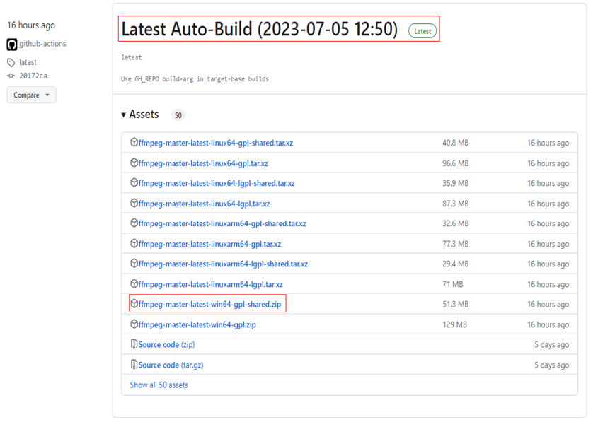

2.  使用FFMPEG程序转换视频。

    将视频裁剪成方的（比例1：1），原视频：1920×816，裁剪后：816×816；

    将mov格式转成mp4格式，在“ffmpeg-master-latest-win64-gpl-shared\\bin”目录，shift+鼠标右键打开PowerShell终端，在终端中输入ffmpeg命令。

    ffmpeg命令如下：.\\ffmpeg.exe -i .\\14\_AVC\_Main@L4.0\_9517Kbps\_1920x816\_29.970fps\_8bits\_AAC\_96.0Kbps\_2ch.mov -vf crop=816:816 -threads 4 -preset ultrafast -strict -2 .\\816x816.mp4

    命令里面的参数命令都是ffmpeg的标准命令，可自行查询。

    > **说明：** 
    >裁剪会损失部分视频内容，请据实际视频内容划定crop区域（例子是居中裁剪）。

3.  将视频缩放到454×454，同时调整量化因子，保证画质。

    ffmpeg命令如下：.\\ffmpeg.exe -i .\\816x816.mp4 -vf scale=454:454,setdar=1:1 -c:v mjpeg -b:v 0 -q:v 9 -qmin 6 -qmax 15 454x454.mp4

    > **说明：** 
    >1.  量化因子根据实际画质调整，理论上量化因子参数越小画质越好。
    >2.  由于量化因子调整会涉及码率变化，量化因子越小码率越高。
    >综上：画面和码率需要客户调整，可能存在取舍。

4.  去除视频的音频流：

    ffmpeg命令如下**：**.\\ffmpeg.exe -i input.mp4 -c copy -an output.mp4

    其中：

    -   -i：输入视频路径
    -   -c：copy使用原视频的视频流编码格式
    -   -an：去掉音频流

5.  修改mp4文件里面的视频流的帧率：

    ffmpeg命令如下：.\\ffmpeg.exe -i input\_video.mp4 -r 25 output\_video.mp4

    其中：

    -   -i：输入视频路径
    -   -r：修改帧率

6.  按照原始视频文件时长截取视频：

    ffmpeg命令如下：.\\ffmpeg.exe -i .\\454x454.mp4 -vcodec copy -acodec copy -ss 00:00 -to 00:57 .\\454x454\_57s.mp4

    原始视频文件时长查看方法，将文件直接拖到“ffmpeg-master-latest-win64-gpl-shared\\bin\\ffplay.exe”上面，查看“Duration: ”字段。

    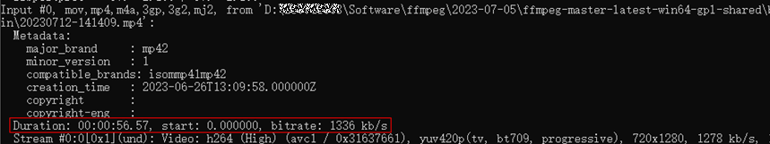

## 媒体sample限制说明<a name="ZH-CN_TOPIC_0000002518438125"></a>

-   音频播放sample

    路径：middleware\\services\\media\\foundation\\sample\\wrapper\\player\_sample\_wrapper.cpp

    对外接口：

    -   PlayerSample：用于播放本地音乐，包含本地蓝牙音乐。
    -   TonePlayerSampleTest：用于播放本地系统提示音。

    > **说明：** 
    >-   PlayerSample和TonePlayerSampleTest目前退出模式也是同步的，也就是传入stop指令以后会等待资源销毁完全再返回，同步就要求start指令和stop指令需要在同一个线程被调用，否则stop指令会被卡住。
    >-   PlayerSample和TonePlayerSampleTest可被同时调用，每个接口里面就会创建两个线程，需要注意资源、空间的消耗。
    >-   目前播放器支持的音频文件格式为：AAC、mp3、FLAC、OGG、WAV、SBC。

-   视频播放sample

    路径：middleware\\services\\media\\foundation\\sample\\wrapper\\video\_play\_wrapper.cpp

    对外接口：

    -   int32\_t StartVideoPlay\(void\)：开始播放视频。
    -   int32\_t StopVideoPlay\(void\)：停止播放视频。
    -   int32\_t PauseVideoPlay\(void\)：暂停播放视频。
    -   int32\_t ResumeVideoPlay\(void\)：继续播放视频。
    -   void SetVideoPlayLoop\(bool isLoop\)：设置视频循环播放，此接口需要在StartVideoPlay之前调用才会生效。
    -   void SetSyncExitMode\(bool isSyncExitMode\)：设置视频退出的模式。
    -   bool IsExitCompletely\(void\)：获取是否是完全退出的状态。

    > **说明：** 
    >-   因资源的限制目前最多支持一路视频，所以MediaVideoPlay的对象，最好只有一个，必须要先StopVideoPlay退出视频播放，再StartVideoPlay开始播放。
    >-   默认是循环播放视频，可通过接口SetVideoPlayLoop修改，可在StartVideoPlay以后设置。
    >-   默认视频退出模式是同步的，也就是调用StopVideoPlay接口会等待所有的视频播放资源销毁再返回，这里有一个限制就是StartVideoPlay和StopVideoPlay必须在同一个线程被调用，否则会被卡住，如果使用接口SetSyncExitMode改成不同步的，则无此限制，但是需要保证时序，因为StopVideoPlay销毁资源是异步的会有一定的耗时。

-   音频录制sample说明

    路径：middleware\\services\\media\\foundation\\sample\\wrapper\\audio\_capture\_wrapper.cpp

    对外接口：

    int32\_t AudioCaptureSample\(int32\_t argc, const char \*argv\[\]\)：此接口是AT命令的入口，包含了所有的相关指令。

    > **说明：** 
    >-   音频录制，目前只支持mp3、pcm、silk这个3种格式的录制。
    >-   音频录制过程中可以下发stop指令停止。
    >-   音频录制目前录制1000帧，完成后自动结束，暂时无法设置录制时长，可自行修改代码适配。
    >-   音频录制过程中原则上不允许再播放音频。

## 媒体常见问题定位解答<a name="ZH-CN_TOPIC_0000002486398228"></a>

目前版本是没有打开媒体的日志，要定位媒体的问题最好先打开媒体日志。

打开方式：

1.  找到日志文件：middleware\\services\\media\\foundation\\utils\\src\\media\_log.cpp。
2.  找到“g\_enabledLevel”变量并修改其值为MEDIA\_LOG\_INFO。
3.  重新编译生成。

**问题一：文件错误导致的异常**

-   文件路径错误

    在媒体日志中查找“Realpath input file failed”，如果有则说明文件路径错误，需要排查文件路径是否正确，文件是否存在。

-   IO相关的报错：

    一般是文件有问题导致，可以在其他播放器上面试一下，也有可能是文件系统出了问题，如果确认文件没问题，可以排查下文件系统。

-   需要做视频表盘的时候，播放带音频的视频文件导致的异常：

    目前对纯视频播放做了限制，如果创建的是纯视频的MediaVideoPlay的对象，但是视频文件是带音频的就会出现报错，所以如果是做视频表盘一定要注意排查视频是否是带音频流的。

-   播放不支持的格式导致的错误：

    需要提前去确认此格式的音视频是否都支持，不支持的格式也会有相应的报错。

**问题二：场景的限制导致的异常**

媒体这里所有的音频流之间都是有策略的。

举例：通话会打断所有的音乐，提示音和音乐可以混音。

不同的场景之间媒体配置了不同策略。

具体场景策略请参考《多媒体软件 开发指南》的“音频中断策略管理”章节的详细说明。

# 缩略语<a name="ZH-CN_TOPIC_0000002466383372"></a>

<a name="zh-cn_topic_0000002451085933_table8373125235611"></a>
<table><tbody><tr id="zh-cn_topic_0000002451085933_row743917528569"><td class="nocellnorowborder" style="border:none" valign="top" width="17.981798179817982%"><p id="zh-cn_topic_0000002451085933_p174391852145611"><a name="zh-cn_topic_0000002451085933_p174391852145611"></a><a name="zh-cn_topic_0000002451085933_p174391852145611"></a><strong id="zh-cn_topic_0000002451085933_b243935220567"><a name="zh-cn_topic_0000002451085933_b243935220567"></a><a name="zh-cn_topic_0000002451085933_b243935220567"></a>A</strong></p>
</td>
<td class="nocellnorowborder" style="border:none" valign="top" width="48.684868486848686%">&nbsp;&nbsp;</td>
<td class="cell-norowborder" style="border:none" valign="top" width="33.33333333333333%">&nbsp;&nbsp;</td>
</tr>
<tr id="zh-cn_topic_0000002451085933_row5121124853520"><td class="cellrowborder" style="border:none" valign="top" width="17.981798179817982%"><p id="zh-cn_topic_0000002451085933_p2012274853515"><a name="zh-cn_topic_0000002451085933_p2012274853515"></a><a name="zh-cn_topic_0000002451085933_p2012274853515"></a><strong id="zh-cn_topic_0000002451085933_b693123043620"><a name="zh-cn_topic_0000002451085933_b693123043620"></a><a name="zh-cn_topic_0000002451085933_b693123043620"></a>A2DP</strong></p>
</td>
<td class="cellrowborder" style="border:none" valign="top" width="48.684868486848686%"><p id="zh-cn_topic_0000002451085933_p8122948183510"><a name="zh-cn_topic_0000002451085933_p8122948183510"></a><a name="zh-cn_topic_0000002451085933_p8122948183510"></a>Advanced Audio Distribution Profile</p>
</td>
<td class="cellrowborder" style="border:none" valign="top" width="33.33333333333333%"><p id="zh-cn_topic_0000002451085933_p13122124815350"><a name="zh-cn_topic_0000002451085933_p13122124815350"></a><a name="zh-cn_topic_0000002451085933_p13122124815350"></a>高级音频分发协议</p>
</td>
</tr>
<tr id="zh-cn_topic_0000002451085933_row1943965210560"><td class="nocellnorowborder" style="border:none" valign="top" width="17.981798179817982%"><p id="zh-cn_topic_0000002451085933_p6439155214566"><a name="zh-cn_topic_0000002451085933_p6439155214566"></a><a name="zh-cn_topic_0000002451085933_p6439155214566"></a><strong id="zh-cn_topic_0000002451085933_b134391528562"><a name="zh-cn_topic_0000002451085933_b134391528562"></a><a name="zh-cn_topic_0000002451085933_b134391528562"></a>AAC</strong></p>
</td>
<td class="nocellnorowborder" style="border:none" valign="top" width="48.684868486848686%"><p id="zh-cn_topic_0000002451085933_p74396527566"><a name="zh-cn_topic_0000002451085933_p74396527566"></a><a name="zh-cn_topic_0000002451085933_p74396527566"></a>Advanced Audio Coding</p>
</td>
<td class="cell-norowborder" style="border:none" valign="top" width="33.33333333333333%"><p id="zh-cn_topic_0000002451085933_p104391252175619"><a name="zh-cn_topic_0000002451085933_p104391252175619"></a><a name="zh-cn_topic_0000002451085933_p104391252175619"></a>高级音频编码</p>
</td>
</tr>
<tr id="zh-cn_topic_0000002451085933_row773113354911"><td class="cellrowborder" style="border:none" valign="top" width="17.981798179817982%"><p id="zh-cn_topic_0000002451085933_p17316324918"><a name="zh-cn_topic_0000002451085933_p17316324918"></a><a name="zh-cn_topic_0000002451085933_p17316324918"></a><strong id="zh-cn_topic_0000002451085933_b1672894491"><a name="zh-cn_topic_0000002451085933_b1672894491"></a><a name="zh-cn_topic_0000002451085933_b1672894491"></a>AACLC</strong></p>
</td>
<td class="cellrowborder" style="border:none" valign="top" width="48.684868486848686%"><p id="zh-cn_topic_0000002451085933_p16731537494"><a name="zh-cn_topic_0000002451085933_p16731537494"></a><a name="zh-cn_topic_0000002451085933_p16731537494"></a>Advanced Audio Coding Low Complexity</p>
</td>
<td class="cellrowborder" style="border:none" valign="top" width="33.33333333333333%"><p id="zh-cn_topic_0000002451085933_p1731193164916"><a name="zh-cn_topic_0000002451085933_p1731193164916"></a><a name="zh-cn_topic_0000002451085933_p1731193164916"></a>低复杂度AAC</p>
</td>
</tr>
<tr id="zh-cn_topic_0000002451085933_row16439852165613"><td class="nocellnorowborder" style="border:none" valign="top" width="17.981798179817982%"><p id="zh-cn_topic_0000002451085933_p0439352165616"><a name="zh-cn_topic_0000002451085933_p0439352165616"></a><a name="zh-cn_topic_0000002451085933_p0439352165616"></a><strong id="zh-cn_topic_0000002451085933_b18439115255620"><a name="zh-cn_topic_0000002451085933_b18439115255620"></a><a name="zh-cn_topic_0000002451085933_b18439115255620"></a>AEF</strong></p>
</td>
<td class="nocellnorowborder" style="border:none" valign="top" width="48.684868486848686%"><p id="zh-cn_topic_0000002451085933_p17439125212569"><a name="zh-cn_topic_0000002451085933_p17439125212569"></a><a name="zh-cn_topic_0000002451085933_p17439125212569"></a>Audio Effect</p>
</td>
<td class="cell-norowborder" style="border:none" valign="top" width="33.33333333333333%"><p id="zh-cn_topic_0000002451085933_p74391552125617"><a name="zh-cn_topic_0000002451085933_p74391552125617"></a><a name="zh-cn_topic_0000002451085933_p74391552125617"></a>音效算法</p>
</td>
</tr>
<tr id="zh-cn_topic_0000002451085933_row164391752175612"><td class="nocellnorowborder" style="border:none" valign="top" width="17.981798179817982%"><p id="zh-cn_topic_0000002451085933_p12439352195611"><a name="zh-cn_topic_0000002451085933_p12439352195611"></a><a name="zh-cn_topic_0000002451085933_p12439352195611"></a><strong id="zh-cn_topic_0000002451085933_b94394521562"><a name="zh-cn_topic_0000002451085933_b94394521562"></a><a name="zh-cn_topic_0000002451085933_b94394521562"></a>API</strong></p>
</td>
<td class="nocellnorowborder" style="border:none" valign="top" width="48.684868486848686%"><p id="zh-cn_topic_0000002451085933_p1143920526562"><a name="zh-cn_topic_0000002451085933_p1143920526562"></a><a name="zh-cn_topic_0000002451085933_p1143920526562"></a>Application Programming Interface</p>
</td>
<td class="cell-norowborder" style="border:none" valign="top" width="33.33333333333333%"><p id="zh-cn_topic_0000002451085933_p104394524561"><a name="zh-cn_topic_0000002451085933_p104394524561"></a><a name="zh-cn_topic_0000002451085933_p104394524561"></a>应用编程接口</p>
</td>
</tr>
<tr id="zh-cn_topic_0000002451085933_row2349712101312"><td class="cellrowborder" style="border:none" valign="top" width="17.981798179817982%"><p id="zh-cn_topic_0000002451085933_p334914126136"><a name="zh-cn_topic_0000002451085933_p334914126136"></a><a name="zh-cn_topic_0000002451085933_p334914126136"></a><strong id="zh-cn_topic_0000002451085933_b345634010214"><a name="zh-cn_topic_0000002451085933_b345634010214"></a><a name="zh-cn_topic_0000002451085933_b345634010214"></a>ASR</strong></p>
</td>
<td class="cellrowborder" style="border:none" valign="top" width="48.684868486848686%"><p id="zh-cn_topic_0000002451085933_p2349171219137"><a name="zh-cn_topic_0000002451085933_p2349171219137"></a><a name="zh-cn_topic_0000002451085933_p2349171219137"></a>Automatic Speech Recognition</p>
</td>
<td class="cellrowborder" style="border:none" valign="top" width="33.33333333333333%"><p id="zh-cn_topic_0000002451085933_p1934918124132"><a name="zh-cn_topic_0000002451085933_p1934918124132"></a><a name="zh-cn_topic_0000002451085933_p1934918124132"></a>自动语音识别</p>
</td>
</tr>
<tr id="zh-cn_topic_0000002451085933_row13193842119"><td class="cellrowborder" style="border:none" valign="top" width="17.981798179817982%">&nbsp;&nbsp;</td>
<td class="cellrowborder" style="border:none" valign="top" width="48.684868486848686%">&nbsp;&nbsp;</td>
<td class="cellrowborder" style="border:none" valign="top" width="33.33333333333333%">&nbsp;&nbsp;</td>
</tr>
<tr id="zh-cn_topic_0000002451085933_row44391052135618"><td class="nocellnorowborder" style="border:none" valign="top" width="17.981798179817982%"><p id="zh-cn_topic_0000002451085933_p843915520567"><a name="zh-cn_topic_0000002451085933_p843915520567"></a><a name="zh-cn_topic_0000002451085933_p843915520567"></a><strong id="zh-cn_topic_0000002451085933_b122673511317"><a name="zh-cn_topic_0000002451085933_b122673511317"></a><a name="zh-cn_topic_0000002451085933_b122673511317"></a>C</strong></p>
</td>
<td class="nocellnorowborder" style="border:none" valign="top" width="48.684868486848686%">&nbsp;&nbsp;</td>
<td class="cell-norowborder" style="border:none" valign="top" width="33.33333333333333%">&nbsp;&nbsp;</td>
</tr>
<tr id="zh-cn_topic_0000002451085933_row562910203136"><td class="cellrowborder" style="border:none" valign="top" width="17.981798179817982%"><p id="zh-cn_topic_0000002451085933_p15630102011318"><a name="zh-cn_topic_0000002451085933_p15630102011318"></a><a name="zh-cn_topic_0000002451085933_p15630102011318"></a><strong id="zh-cn_topic_0000002451085933_b4855103417264"><a name="zh-cn_topic_0000002451085933_b4855103417264"></a><a name="zh-cn_topic_0000002451085933_b4855103417264"></a>CHR</strong></p>
</td>
<td class="cellrowborder" style="border:none" valign="top" width="48.684868486848686%"><p id="zh-cn_topic_0000002451085933_p1463072014137"><a name="zh-cn_topic_0000002451085933_p1463072014137"></a><a name="zh-cn_topic_0000002451085933_p1463072014137"></a>Change Report</p>
</td>
<td class="cellrowborder" style="border:none" valign="top" width="33.33333333333333%"><p id="zh-cn_topic_0000002451085933_p263052021311"><a name="zh-cn_topic_0000002451085933_p263052021311"></a><a name="zh-cn_topic_0000002451085933_p263052021311"></a>事件打点</p>
</td>
</tr>
<tr id="zh-cn_topic_0000002451085933_row14440752145614"><td class="nocellnorowborder" style="border:none" valign="top" width="17.981798179817982%"><p id="zh-cn_topic_0000002451085933_p185406428146"><a name="zh-cn_topic_0000002451085933_p185406428146"></a><a name="zh-cn_topic_0000002451085933_p185406428146"></a></p>
<p id="zh-cn_topic_0000002451085933_p64407524563"><a name="zh-cn_topic_0000002451085933_p64407524563"></a><a name="zh-cn_topic_0000002451085933_p64407524563"></a><strong id="zh-cn_topic_0000002451085933_b444019528569"><a name="zh-cn_topic_0000002451085933_b444019528569"></a><a name="zh-cn_topic_0000002451085933_b444019528569"></a>D</strong></p>
</td>
<td class="nocellnorowborder" style="border:none" valign="top" width="48.684868486848686%">&nbsp;&nbsp;</td>
<td class="cell-norowborder" style="border:none" valign="top" width="33.33333333333333%">&nbsp;&nbsp;</td>
</tr>
<tr id="zh-cn_topic_0000002451085933_row16440155235619"><td class="nocellnorowborder" style="border:none" valign="top" width="17.981798179817982%"><p id="zh-cn_topic_0000002451085933_p20440752185613"><a name="zh-cn_topic_0000002451085933_p20440752185613"></a><a name="zh-cn_topic_0000002451085933_p20440752185613"></a><strong id="zh-cn_topic_0000002451085933_b17440105255619"><a name="zh-cn_topic_0000002451085933_b17440105255619"></a><a name="zh-cn_topic_0000002451085933_b17440105255619"></a>DFX</strong></p>
</td>
<td class="nocellnorowborder" style="border:none" valign="top" width="48.684868486848686%"><p id="zh-cn_topic_0000002451085933_p17440115217565"><a name="zh-cn_topic_0000002451085933_p17440115217565"></a><a name="zh-cn_topic_0000002451085933_p17440115217565"></a>Design For X</p>
</td>
<td class="cell-norowborder" style="border:none" valign="top" width="33.33333333333333%"><p id="zh-cn_topic_0000002451085933_p744013520564"><a name="zh-cn_topic_0000002451085933_p744013520564"></a><a name="zh-cn_topic_0000002451085933_p744013520564"></a>面向X的设计（可测试性、可制造性、可服务性等）</p>
</td>
</tr>
<tr id="zh-cn_topic_0000002451085933_row144402052165614"><td class="nocellnorowborder" style="border:none" valign="top" width="17.981798179817982%">&nbsp;&nbsp;</td>
<td class="nocellnorowborder" style="border:none" valign="top" width="48.684868486848686%">&nbsp;&nbsp;</td>
<td class="cell-norowborder" style="border:none" valign="top" width="33.33333333333333%">&nbsp;&nbsp;</td>
</tr>
<tr id="zh-cn_topic_0000002451085933_row6440135216567"><td class="nocellnorowborder" style="border:none" valign="top" width="17.981798179817982%"><p id="zh-cn_topic_0000002451085933_p1244035214568"><a name="zh-cn_topic_0000002451085933_p1244035214568"></a><a name="zh-cn_topic_0000002451085933_p1244035214568"></a><strong id="zh-cn_topic_0000002451085933_b204401352165613"><a name="zh-cn_topic_0000002451085933_b204401352165613"></a><a name="zh-cn_topic_0000002451085933_b204401352165613"></a>E</strong></p>
</td>
<td class="nocellnorowborder" style="border:none" valign="top" width="48.684868486848686%">&nbsp;&nbsp;</td>
<td class="cell-norowborder" style="border:none" valign="top" width="33.33333333333333%">&nbsp;&nbsp;</td>
</tr>
<tr id="zh-cn_topic_0000002451085933_row12490265478"><td class="cellrowborder" style="border:none" valign="top" width="17.981798179817982%"><p id="zh-cn_topic_0000002451085933_p72491826124712"><a name="zh-cn_topic_0000002451085933_p72491826124712"></a><a name="zh-cn_topic_0000002451085933_p72491826124712"></a><strong id="zh-cn_topic_0000002451085933_b18634115818471"><a name="zh-cn_topic_0000002451085933_b18634115818471"></a><a name="zh-cn_topic_0000002451085933_b18634115818471"></a>ES</strong></p>
</td>
<td class="cellrowborder" style="border:none" valign="top" width="48.684868486848686%"><p id="zh-cn_topic_0000002451085933_p72495268479"><a name="zh-cn_topic_0000002451085933_p72495268479"></a><a name="zh-cn_topic_0000002451085933_p72495268479"></a>Elementary Stream</p>
</td>
<td class="cellrowborder" style="border:none" valign="top" width="33.33333333333333%"><p id="zh-cn_topic_0000002451085933_p11249142614479"><a name="zh-cn_topic_0000002451085933_p11249142614479"></a><a name="zh-cn_topic_0000002451085933_p11249142614479"></a>基本码流</p>
</td>
</tr>
<tr id="zh-cn_topic_0000002451085933_row14407525568"><td class="nocellnorowborder" style="border:none" valign="top" width="17.981798179817982%">&nbsp;&nbsp;</td>
<td class="nocellnorowborder" style="border:none" valign="top" width="48.684868486848686%">&nbsp;&nbsp;</td>
<td class="cell-norowborder" style="border:none" valign="top" width="33.33333333333333%">&nbsp;&nbsp;</td>
</tr>
<tr id="zh-cn_topic_0000002451085933_row5440115212568"><td class="nocellnorowborder" style="border:none" valign="top" width="17.981798179817982%"><p id="zh-cn_topic_0000002451085933_p1744025225610"><a name="zh-cn_topic_0000002451085933_p1744025225610"></a><a name="zh-cn_topic_0000002451085933_p1744025225610"></a><strong id="zh-cn_topic_0000002451085933_b644085219562"><a name="zh-cn_topic_0000002451085933_b644085219562"></a><a name="zh-cn_topic_0000002451085933_b644085219562"></a>F</strong></p>
</td>
<td class="nocellnorowborder" style="border:none" valign="top" width="48.684868486848686%">&nbsp;&nbsp;</td>
<td class="cell-norowborder" style="border:none" valign="top" width="33.33333333333333%">&nbsp;&nbsp;</td>
</tr>
<tr id="zh-cn_topic_0000002451085933_row1440195210568"><td class="nocellnorowborder" style="border:none" valign="top" width="17.981798179817982%"><p id="zh-cn_topic_0000002451085933_p194403528565"><a name="zh-cn_topic_0000002451085933_p194403528565"></a><a name="zh-cn_topic_0000002451085933_p194403528565"></a><strong id="zh-cn_topic_0000002451085933_b9440115212563"><a name="zh-cn_topic_0000002451085933_b9440115212563"></a><a name="zh-cn_topic_0000002451085933_b9440115212563"></a>FLAC</strong></p>
</td>
<td class="nocellnorowborder" style="border:none" valign="top" width="48.684868486848686%"><p id="zh-cn_topic_0000002451085933_p1744095285611"><a name="zh-cn_topic_0000002451085933_p1744095285611"></a><a name="zh-cn_topic_0000002451085933_p1744095285611"></a>Free Lossless Audio Codec</p>
</td>
<td class="cell-norowborder" style="border:none" valign="top" width="33.33333333333333%"><p id="zh-cn_topic_0000002451085933_p34404527563"><a name="zh-cn_topic_0000002451085933_p34404527563"></a><a name="zh-cn_topic_0000002451085933_p34404527563"></a>无损音频压缩编码</p>
</td>
</tr>
<tr id="zh-cn_topic_0000002451085933_row7969201716216"><td class="cellrowborder" style="border:none" valign="top" width="17.981798179817982%"><p id="zh-cn_topic_0000002451085933_p9970151716220"><a name="zh-cn_topic_0000002451085933_p9970151716220"></a><a name="zh-cn_topic_0000002451085933_p9970151716220"></a><strong id="zh-cn_topic_0000002451085933_b15068221528"><a name="zh-cn_topic_0000002451085933_b15068221528"></a><a name="zh-cn_topic_0000002451085933_b15068221528"></a>FS</strong></p>
</td>
<td class="cellrowborder" style="border:none" valign="top" width="48.684868486848686%"><p id="zh-cn_topic_0000002451085933_p7970717321"><a name="zh-cn_topic_0000002451085933_p7970717321"></a><a name="zh-cn_topic_0000002451085933_p7970717321"></a>Frame Sync</p>
</td>
<td class="cellrowborder" style="border:none" valign="top" width="33.33333333333333%"><p id="zh-cn_topic_0000002451085933_p1997017179220"><a name="zh-cn_topic_0000002451085933_p1997017179220"></a><a name="zh-cn_topic_0000002451085933_p1997017179220"></a>帧同步信号</p>
</td>
</tr>
<tr id="zh-cn_topic_0000002451085933_row6440115214561"><td class="nocellnorowborder" style="border:none" valign="top" width="17.981798179817982%">&nbsp;&nbsp;</td>
<td class="nocellnorowborder" style="border:none" valign="top" width="48.684868486848686%">&nbsp;&nbsp;</td>
<td class="cell-norowborder" style="border:none" valign="top" width="33.33333333333333%">&nbsp;&nbsp;</td>
</tr>
<tr id="zh-cn_topic_0000002451085933_row1944115215562"><td class="nocellnorowborder" style="border:none" valign="top" width="17.981798179817982%"><p id="zh-cn_topic_0000002451085933_p1844116522562"><a name="zh-cn_topic_0000002451085933_p1844116522562"></a><a name="zh-cn_topic_0000002451085933_p1844116522562"></a><strong id="zh-cn_topic_0000002451085933_b1144135295611"><a name="zh-cn_topic_0000002451085933_b1144135295611"></a><a name="zh-cn_topic_0000002451085933_b1144135295611"></a>H</strong></p>
</td>
<td class="nocellnorowborder" style="border:none" valign="top" width="48.684868486848686%">&nbsp;&nbsp;</td>
<td class="cell-norowborder" style="border:none" valign="top" width="33.33333333333333%">&nbsp;&nbsp;</td>
</tr>
<tr id="zh-cn_topic_0000002451085933_row1244110526565"><td class="nocellnorowborder" style="border:none" valign="top" width="17.981798179817982%"><p id="zh-cn_topic_0000002451085933_p5441175285616"><a name="zh-cn_topic_0000002451085933_p5441175285616"></a><a name="zh-cn_topic_0000002451085933_p5441175285616"></a><strong id="zh-cn_topic_0000002451085933_b1944155218562"><a name="zh-cn_topic_0000002451085933_b1944155218562"></a><a name="zh-cn_topic_0000002451085933_b1944155218562"></a>HAL</strong></p>
</td>
<td class="nocellnorowborder" style="border:none" valign="top" width="48.684868486848686%"><p id="zh-cn_topic_0000002451085933_p144411252155618"><a name="zh-cn_topic_0000002451085933_p144411252155618"></a><a name="zh-cn_topic_0000002451085933_p144411252155618"></a>Hardware Abstract Layer</p>
</td>
<td class="cell-norowborder" style="border:none" valign="top" width="33.33333333333333%"><p id="zh-cn_topic_0000002451085933_p0441452205618"><a name="zh-cn_topic_0000002451085933_p0441452205618"></a><a name="zh-cn_topic_0000002451085933_p0441452205618"></a>硬件抽象层</p>
</td>
</tr>
<tr id="zh-cn_topic_0000002451085933_row15441175295620"><td class="nocellnorowborder" style="border:none" valign="top" width="17.981798179817982%"><p id="zh-cn_topic_0000002451085933_p15441252175614"><a name="zh-cn_topic_0000002451085933_p15441252175614"></a><a name="zh-cn_topic_0000002451085933_p15441252175614"></a><strong id="zh-cn_topic_0000002451085933_b34411852135616"><a name="zh-cn_topic_0000002451085933_b34411852135616"></a><a name="zh-cn_topic_0000002451085933_b34411852135616"></a>HDI</strong></p>
</td>
<td class="nocellnorowborder" style="border:none" valign="top" width="48.684868486848686%"><p id="zh-cn_topic_0000002451085933_p844114528569"><a name="zh-cn_topic_0000002451085933_p844114528569"></a><a name="zh-cn_topic_0000002451085933_p844114528569"></a>Hardware Device Interface</p>
</td>
<td class="cell-norowborder" style="border:none" valign="top" width="33.33333333333333%"><p id="zh-cn_topic_0000002451085933_p244113522569"><a name="zh-cn_topic_0000002451085933_p244113522569"></a><a name="zh-cn_topic_0000002451085933_p244113522569"></a>硬件设备接口</p>
</td>
</tr>
<tr id="zh-cn_topic_0000002451085933_row2067295513507"><td class="cellrowborder" style="border:none" valign="top" width="17.981798179817982%"><p id="zh-cn_topic_0000002451085933_p667217558501"><a name="zh-cn_topic_0000002451085933_p667217558501"></a><a name="zh-cn_topic_0000002451085933_p667217558501"></a><strong id="zh-cn_topic_0000002451085933_b11435236546"><a name="zh-cn_topic_0000002451085933_b11435236546"></a><a name="zh-cn_topic_0000002451085933_b11435236546"></a>H264</strong></p>
</td>
<td class="cellrowborder" style="border:none" valign="top" width="48.684868486848686%"><p id="zh-cn_topic_0000002451085933_p667215554506"><a name="zh-cn_topic_0000002451085933_p667215554506"></a><a name="zh-cn_topic_0000002451085933_p667215554506"></a>MPEG-4 Part 10, Advanced Video Coding</p>
</td>
<td class="cellrowborder" style="border:none" valign="top" width="33.33333333333333%"><p id="zh-cn_topic_0000002451085933_p567235514506"><a name="zh-cn_topic_0000002451085933_p567235514506"></a><a name="zh-cn_topic_0000002451085933_p567235514506"></a>MPEG-4第10部分，高级视频编码</p>
</td>
</tr>
<tr id="zh-cn_topic_0000002451085933_row56337572506"><td class="cellrowborder" style="border:none" valign="top" width="17.981798179817982%"><p id="zh-cn_topic_0000002451085933_p6136856174517"><a name="zh-cn_topic_0000002451085933_p6136856174517"></a><a name="zh-cn_topic_0000002451085933_p6136856174517"></a></p>
<p id="zh-cn_topic_0000002451085933_p12633145715506"><a name="zh-cn_topic_0000002451085933_p12633145715506"></a><a name="zh-cn_topic_0000002451085933_p12633145715506"></a><strong id="zh-cn_topic_0000002451085933_b15180196185118"><a name="zh-cn_topic_0000002451085933_b15180196185118"></a><a name="zh-cn_topic_0000002451085933_b15180196185118"></a>I</strong></p>
</td>
<td class="cellrowborder" style="border:none" valign="top" width="48.684868486848686%">&nbsp;&nbsp;</td>
<td class="cellrowborder" style="border:none" valign="top" width="33.33333333333333%">&nbsp;&nbsp;</td>
</tr>
<tr id="zh-cn_topic_0000002451085933_row665317339116"><td class="cellrowborder" style="border:none" valign="top" width="17.981798179817982%"><p id="zh-cn_topic_0000002451085933_p665453319117"><a name="zh-cn_topic_0000002451085933_p665453319117"></a><a name="zh-cn_topic_0000002451085933_p665453319117"></a><strong id="zh-cn_topic_0000002451085933_b153202039915"><a name="zh-cn_topic_0000002451085933_b153202039915"></a><a name="zh-cn_topic_0000002451085933_b153202039915"></a>I2S</strong></p>
</td>
<td class="cellrowborder" style="border:none" valign="top" width="48.684868486848686%"><p id="zh-cn_topic_0000002451085933_p1017019557117"><a name="zh-cn_topic_0000002451085933_p1017019557117"></a><a name="zh-cn_topic_0000002451085933_p1017019557117"></a>Inter-IC Sound</p>
</td>
<td class="cellrowborder" style="border:none" valign="top" width="33.33333333333333%"><p id="zh-cn_topic_0000002451085933_p717045514112"><a name="zh-cn_topic_0000002451085933_p717045514112"></a><a name="zh-cn_topic_0000002451085933_p717045514112"></a>I2S总线</p>
</td>
</tr>
<tr id="zh-cn_topic_0000002451085933_row4405195355012"><td class="cellrowborder" style="border:none" valign="top" width="17.981798179817982%"><p id="zh-cn_topic_0000002451085933_p1405125315016"><a name="zh-cn_topic_0000002451085933_p1405125315016"></a><a name="zh-cn_topic_0000002451085933_p1405125315016"></a><strong id="zh-cn_topic_0000002451085933_b1918066105116"><a name="zh-cn_topic_0000002451085933_b1918066105116"></a><a name="zh-cn_topic_0000002451085933_b1918066105116"></a>IDR</strong></p>
</td>
<td class="cellrowborder" style="border:none" valign="top" width="48.684868486848686%"><p id="zh-cn_topic_0000002451085933_p1640518532504"><a name="zh-cn_topic_0000002451085933_p1640518532504"></a><a name="zh-cn_topic_0000002451085933_p1640518532504"></a>Instantaneous Decoder Refresh frame</p>
</td>
<td class="cellrowborder" style="border:none" valign="top" width="33.33333333333333%"><p id="zh-cn_topic_0000002451085933_p3406185312503"><a name="zh-cn_topic_0000002451085933_p3406185312503"></a><a name="zh-cn_topic_0000002451085933_p3406185312503"></a>即时解码刷新帧</p>
</td>
</tr>
<tr id="zh-cn_topic_0000002451085933_row101435511318"><td class="cellrowborder" style="border:none" valign="top" width="17.981798179817982%">&nbsp;&nbsp;</td>
<td class="cellrowborder" style="border:none" valign="top" width="48.684868486848686%">&nbsp;&nbsp;</td>
<td class="cellrowborder" style="border:none" valign="top" width="33.33333333333333%">&nbsp;&nbsp;</td>
</tr>
<tr id="zh-cn_topic_0000002451085933_row1514155510313"><td class="cellrowborder" style="border:none" valign="top" width="17.981798179817982%"><p id="zh-cn_topic_0000002451085933_p63941563312"><a name="zh-cn_topic_0000002451085933_p63941563312"></a><a name="zh-cn_topic_0000002451085933_p63941563312"></a><strong id="zh-cn_topic_0000002451085933_b83941356532"><a name="zh-cn_topic_0000002451085933_b83941356532"></a><a name="zh-cn_topic_0000002451085933_b83941356532"></a>J</strong></p>
</td>
<td class="cellrowborder" style="border:none" valign="top" width="48.684868486848686%">&nbsp;&nbsp;</td>
<td class="cellrowborder" style="border:none" valign="top" width="33.33333333333333%">&nbsp;&nbsp;</td>
</tr>
<tr id="zh-cn_topic_0000002451085933_row10144556317"><td class="cellrowborder" style="border:none" valign="top" width="17.981798179817982%"><p id="zh-cn_topic_0000002451085933_p1639410561634"><a name="zh-cn_topic_0000002451085933_p1639410561634"></a><a name="zh-cn_topic_0000002451085933_p1639410561634"></a><strong id="zh-cn_topic_0000002451085933_b1739410561330"><a name="zh-cn_topic_0000002451085933_b1739410561330"></a><a name="zh-cn_topic_0000002451085933_b1739410561330"></a>JPEG</strong></p>
</td>
<td class="cellrowborder" style="border:none" valign="top" width="48.684868486848686%"><p id="zh-cn_topic_0000002451085933_p03941856034"><a name="zh-cn_topic_0000002451085933_p03941856034"></a><a name="zh-cn_topic_0000002451085933_p03941856034"></a>Joint Photographic Experts Group</p>
</td>
<td class="cellrowborder" style="border:none" valign="top" width="33.33333333333333%"><p id="zh-cn_topic_0000002451085933_p1539415561133"><a name="zh-cn_topic_0000002451085933_p1539415561133"></a><a name="zh-cn_topic_0000002451085933_p1539415561133"></a>联合图像专家组</p>
</td>
</tr>
<tr id="zh-cn_topic_0000002451085933_row5441135285613"><td class="nocellnorowborder" style="border:none" valign="top" width="17.981798179817982%">&nbsp;&nbsp;</td>
<td class="nocellnorowborder" style="border:none" valign="top" width="48.684868486848686%">&nbsp;&nbsp;</td>
<td class="cell-norowborder" style="border:none" valign="top" width="33.33333333333333%">&nbsp;&nbsp;</td>
</tr>
<tr id="zh-cn_topic_0000002451085933_row14421529568"><td class="nocellnorowborder" style="border:none" valign="top" width="17.981798179817982%"><p id="zh-cn_topic_0000002451085933_p2044215214564"><a name="zh-cn_topic_0000002451085933_p2044215214564"></a><a name="zh-cn_topic_0000002451085933_p2044215214564"></a><strong id="zh-cn_topic_0000002451085933_b15442252115620"><a name="zh-cn_topic_0000002451085933_b15442252115620"></a><a name="zh-cn_topic_0000002451085933_b15442252115620"></a>M</strong></p>
</td>
<td class="nocellnorowborder" style="border:none" valign="top" width="48.684868486848686%">&nbsp;&nbsp;</td>
<td class="cell-norowborder" style="border:none" valign="top" width="33.33333333333333%">&nbsp;&nbsp;</td>
</tr>
<tr id="zh-cn_topic_0000002451085933_row760654915464"><td class="cellrowborder" style="border:none" valign="top" width="17.981798179817982%"><p id="zh-cn_topic_0000002451085933_p116061949184610"><a name="zh-cn_topic_0000002451085933_p116061949184610"></a><a name="zh-cn_topic_0000002451085933_p116061949184610"></a><strong id="zh-cn_topic_0000002451085933_b11647115713466"><a name="zh-cn_topic_0000002451085933_b11647115713466"></a><a name="zh-cn_topic_0000002451085933_b11647115713466"></a>M4A</strong></p>
</td>
<td class="cellrowborder" style="border:none" valign="top" width="48.684868486848686%"><p id="zh-cn_topic_0000002451085933_p19607144916462"><a name="zh-cn_topic_0000002451085933_p19607144916462"></a><a name="zh-cn_topic_0000002451085933_p19607144916462"></a>MPEG-4 Audio</p>
</td>
<td class="cellrowborder" style="border:none" valign="top" width="33.33333333333333%"><p id="zh-cn_topic_0000002451085933_p06070493464"><a name="zh-cn_topic_0000002451085933_p06070493464"></a><a name="zh-cn_topic_0000002451085933_p06070493464"></a>M4A音频封装格式</p>
</td>
</tr>
<tr id="zh-cn_topic_0000002451085933_row616411226411"><td class="cellrowborder" style="border:none" valign="top" width="17.981798179817982%"><p id="zh-cn_topic_0000002451085933_p716492212416"><a name="zh-cn_topic_0000002451085933_p716492212416"></a><a name="zh-cn_topic_0000002451085933_p716492212416"></a><strong id="zh-cn_topic_0000002451085933_b1926214351743"><a name="zh-cn_topic_0000002451085933_b1926214351743"></a><a name="zh-cn_topic_0000002451085933_b1926214351743"></a>MJPEG</strong></p>
</td>
<td class="cellrowborder" style="border:none" valign="top" width="48.684868486848686%"><p id="zh-cn_topic_0000002451085933_p1416417220410"><a name="zh-cn_topic_0000002451085933_p1416417220410"></a><a name="zh-cn_topic_0000002451085933_p1416417220410"></a>Motion Joint Photographic Experts Group</p>
</td>
<td class="cellrowborder" style="border:none" valign="top" width="33.33333333333333%"><p id="zh-cn_topic_0000002451085933_p111643224419"><a name="zh-cn_topic_0000002451085933_p111643224419"></a><a name="zh-cn_topic_0000002451085933_p111643224419"></a>运动联合图像专家组</p>
</td>
</tr>
<tr id="zh-cn_topic_0000002451085933_row144217523565"><td class="nocellnorowborder" style="border:none" valign="top" width="17.981798179817982%"><p id="zh-cn_topic_0000002451085933_p1442175211563"><a name="zh-cn_topic_0000002451085933_p1442175211563"></a><a name="zh-cn_topic_0000002451085933_p1442175211563"></a><strong id="zh-cn_topic_0000002451085933_b1644213527563"><a name="zh-cn_topic_0000002451085933_b1644213527563"></a><a name="zh-cn_topic_0000002451085933_b1644213527563"></a>MP3</strong></p>
</td>
<td class="nocellnorowborder" style="border:none" valign="top" width="48.684868486848686%"><p id="zh-cn_topic_0000002451085933_p1544295225615"><a name="zh-cn_topic_0000002451085933_p1544295225615"></a><a name="zh-cn_topic_0000002451085933_p1544295225615"></a>MPEG Audio Layer-3</p>
</td>
<td class="cell-norowborder" style="border:none" valign="top" width="33.33333333333333%"><p id="zh-cn_topic_0000002451085933_p6442125213565"><a name="zh-cn_topic_0000002451085933_p6442125213565"></a><a name="zh-cn_topic_0000002451085933_p6442125213565"></a>MP3音频压缩格式</p>
</td>
</tr>
<tr id="zh-cn_topic_0000002451085933_row1993917231460"><td class="cellrowborder" style="border:none" valign="top" width="17.981798179817982%"><p id="zh-cn_topic_0000002451085933_p119391323144620"><a name="zh-cn_topic_0000002451085933_p119391323144620"></a><a name="zh-cn_topic_0000002451085933_p119391323144620"></a><strong id="zh-cn_topic_0000002451085933_b32321231154614"><a name="zh-cn_topic_0000002451085933_b32321231154614"></a><a name="zh-cn_topic_0000002451085933_b32321231154614"></a>MP4</strong></p>
</td>
<td class="cellrowborder" style="border:none" valign="top" width="48.684868486848686%"><p id="zh-cn_topic_0000002451085933_p1893902374615"><a name="zh-cn_topic_0000002451085933_p1893902374615"></a><a name="zh-cn_topic_0000002451085933_p1893902374615"></a>MPEG-4</p>
</td>
<td class="cellrowborder" style="border:none" valign="top" width="33.33333333333333%"><p id="zh-cn_topic_0000002451085933_p1493912236464"><a name="zh-cn_topic_0000002451085933_p1493912236464"></a><a name="zh-cn_topic_0000002451085933_p1493912236464"></a>MP4视频</p>
</td>
</tr>
<tr id="zh-cn_topic_0000002451085933_row8230124318589"><td class="cellrowborder" style="border:none" valign="top" width="17.981798179817982%">&nbsp;&nbsp;</td>
<td class="cellrowborder" style="border:none" valign="top" width="48.684868486848686%">&nbsp;&nbsp;</td>
<td class="cellrowborder" style="border:none" valign="top" width="33.33333333333333%">&nbsp;&nbsp;</td>
</tr>
<tr id="zh-cn_topic_0000002451085933_row0442195213564"><td class="nocellnorowborder" style="border:none" valign="top" width="17.981798179817982%"><p id="zh-cn_topic_0000002451085933_p14442752105616"><a name="zh-cn_topic_0000002451085933_p14442752105616"></a><a name="zh-cn_topic_0000002451085933_p14442752105616"></a><strong id="zh-cn_topic_0000002451085933_b1442052165614"><a name="zh-cn_topic_0000002451085933_b1442052165614"></a><a name="zh-cn_topic_0000002451085933_b1442052165614"></a>O</strong></p>
</td>
<td class="nocellnorowborder" style="border:none" valign="top" width="48.684868486848686%">&nbsp;&nbsp;</td>
<td class="cell-norowborder" style="border:none" valign="top" width="33.33333333333333%">&nbsp;&nbsp;</td>
</tr>
<tr id="zh-cn_topic_0000002451085933_row1967174754213"><td class="cellrowborder" style="border:none" valign="top" width="17.981798179817982%"><p id="zh-cn_topic_0000002451085933_p1767220473428"><a name="zh-cn_topic_0000002451085933_p1767220473428"></a><a name="zh-cn_topic_0000002451085933_p1767220473428"></a><strong id="zh-cn_topic_0000002451085933_b8358105684213"><a name="zh-cn_topic_0000002451085933_b8358105684213"></a><a name="zh-cn_topic_0000002451085933_b8358105684213"></a>OPUS</strong></p>
</td>
<td class="cellrowborder" style="border:none" valign="top" width="48.684868486848686%"><p id="zh-cn_topic_0000002451085933_p66721347144216"><a name="zh-cn_topic_0000002451085933_p66721347144216"></a><a name="zh-cn_topic_0000002451085933_p66721347144216"></a>OPUS</p>
</td>
<td class="cellrowborder" style="border:none" valign="top" width="33.33333333333333%"><p id="zh-cn_topic_0000002451085933_p5672174724219"><a name="zh-cn_topic_0000002451085933_p5672174724219"></a><a name="zh-cn_topic_0000002451085933_p5672174724219"></a>OPUS音频压缩格式</p>
</td>
</tr>
<tr id="zh-cn_topic_0000002451085933_row124421552185618"><td class="nocellnorowborder" style="border:none" valign="top" width="17.981798179817982%"><p id="zh-cn_topic_0000002451085933_p1444295285611"><a name="zh-cn_topic_0000002451085933_p1444295285611"></a><a name="zh-cn_topic_0000002451085933_p1444295285611"></a><strong id="zh-cn_topic_0000002451085933_b144215521561"><a name="zh-cn_topic_0000002451085933_b144215521561"></a><a name="zh-cn_topic_0000002451085933_b144215521561"></a>OGG</strong></p>
</td>
<td class="nocellnorowborder" style="border:none" valign="top" width="48.684868486848686%"><p id="zh-cn_topic_0000002451085933_p1844285225616"><a name="zh-cn_topic_0000002451085933_p1844285225616"></a><a name="zh-cn_topic_0000002451085933_p1844285225616"></a>OGG-Vorbis</p>
</td>
<td class="cell-norowborder" style="border:none" valign="top" width="33.33333333333333%"><p id="zh-cn_topic_0000002451085933_p244245211567"><a name="zh-cn_topic_0000002451085933_p244245211567"></a><a name="zh-cn_topic_0000002451085933_p244245211567"></a>OGG音频压缩格式</p>
</td>
</tr>
<tr id="zh-cn_topic_0000002451085933_row644225275620"><td class="nocellnorowborder" style="border:none" valign="top" width="17.981798179817982%">&nbsp;&nbsp;</td>
<td class="nocellnorowborder" style="border:none" valign="top" width="48.684868486848686%">&nbsp;&nbsp;</td>
<td class="cell-norowborder" style="border:none" valign="top" width="33.33333333333333%">&nbsp;&nbsp;</td>
</tr>
<tr id="zh-cn_topic_0000002451085933_row84431452155619"><td class="nocellnorowborder" style="border:none" valign="top" width="17.981798179817982%"><p id="zh-cn_topic_0000002451085933_p7443252125614"><a name="zh-cn_topic_0000002451085933_p7443252125614"></a><a name="zh-cn_topic_0000002451085933_p7443252125614"></a><strong id="zh-cn_topic_0000002451085933_b174431852115615"><a name="zh-cn_topic_0000002451085933_b174431852115615"></a><a name="zh-cn_topic_0000002451085933_b174431852115615"></a>P</strong></p>
</td>
<td class="nocellnorowborder" style="border:none" valign="top" width="48.684868486848686%">&nbsp;&nbsp;</td>
<td class="cell-norowborder" style="border:none" valign="top" width="33.33333333333333%">&nbsp;&nbsp;</td>
</tr>
<tr id="zh-cn_topic_0000002451085933_row16443115212565"><td class="nocellnorowborder" style="border:none" valign="top" width="17.981798179817982%"><p id="zh-cn_topic_0000002451085933_p5443175213560"><a name="zh-cn_topic_0000002451085933_p5443175213560"></a><a name="zh-cn_topic_0000002451085933_p5443175213560"></a><strong id="zh-cn_topic_0000002451085933_b74431452185613"><a name="zh-cn_topic_0000002451085933_b74431452185613"></a><a name="zh-cn_topic_0000002451085933_b74431452185613"></a>PCM</strong></p>
</td>
<td class="nocellnorowborder" style="border:none" valign="top" width="48.684868486848686%"><p id="zh-cn_topic_0000002451085933_p64431552185610"><a name="zh-cn_topic_0000002451085933_p64431552185610"></a><a name="zh-cn_topic_0000002451085933_p64431552185610"></a>Pulse Code Modulation</p>
</td>
<td class="cell-norowborder" style="border:none" valign="top" width="33.33333333333333%"><p id="zh-cn_topic_0000002451085933_p5443175265617"><a name="zh-cn_topic_0000002451085933_p5443175265617"></a><a name="zh-cn_topic_0000002451085933_p5443175265617"></a>脉冲编码调制</p>
</td>
</tr>
<tr id="zh-cn_topic_0000002451085933_row147893119532"><td class="cellrowborder" style="border:none" valign="top" width="17.981798179817982%"><p id="zh-cn_topic_0000002451085933_p0478153120530"><a name="zh-cn_topic_0000002451085933_p0478153120530"></a><a name="zh-cn_topic_0000002451085933_p0478153120530"></a><strong id="zh-cn_topic_0000002451085933_b5696174719555"><a name="zh-cn_topic_0000002451085933_b5696174719555"></a><a name="zh-cn_topic_0000002451085933_b5696174719555"></a>PPS</strong></p>
</td>
<td class="cellrowborder" style="border:none" valign="top" width="48.684868486848686%"><p id="zh-cn_topic_0000002451085933_p347820314533"><a name="zh-cn_topic_0000002451085933_p347820314533"></a><a name="zh-cn_topic_0000002451085933_p347820314533"></a>Picture Parameter Set</p>
</td>
<td class="cellrowborder" style="border:none" valign="top" width="33.33333333333333%"><p id="zh-cn_topic_0000002451085933_p1847863195313"><a name="zh-cn_topic_0000002451085933_p1847863195313"></a><a name="zh-cn_topic_0000002451085933_p1847863195313"></a>图像参数集</p>
</td>
</tr>
<tr id="zh-cn_topic_0000002451085933_row1644315526565"><td class="nocellnorowborder" style="border:none" valign="top" width="17.981798179817982%">&nbsp;&nbsp;</td>
<td class="nocellnorowborder" style="border:none" valign="top" width="48.684868486848686%">&nbsp;&nbsp;</td>
<td class="cell-norowborder" style="border:none" valign="top" width="33.33333333333333%">&nbsp;&nbsp;</td>
</tr>
<tr id="zh-cn_topic_0000002451085933_row5443105295617"><td class="nocellnorowborder" style="border:none" valign="top" width="17.981798179817982%"><p id="zh-cn_topic_0000002451085933_p1444312521565"><a name="zh-cn_topic_0000002451085933_p1444312521565"></a><a name="zh-cn_topic_0000002451085933_p1444312521565"></a><strong id="zh-cn_topic_0000002451085933_b184431552125610"><a name="zh-cn_topic_0000002451085933_b184431552125610"></a><a name="zh-cn_topic_0000002451085933_b184431552125610"></a>S</strong></p>
</td>
<td class="nocellnorowborder" style="border:none" valign="top" width="48.684868486848686%">&nbsp;&nbsp;</td>
<td class="cell-norowborder" style="border:none" valign="top" width="33.33333333333333%">&nbsp;&nbsp;</td>
</tr>
<tr id="zh-cn_topic_0000002451085933_row2443145210565"><td class="nocellnorowborder" style="border:none" valign="top" width="17.981798179817982%"><p id="zh-cn_topic_0000002451085933_p64437523568"><a name="zh-cn_topic_0000002451085933_p64437523568"></a><a name="zh-cn_topic_0000002451085933_p64437523568"></a><strong id="zh-cn_topic_0000002451085933_b8443165211566"><a name="zh-cn_topic_0000002451085933_b8443165211566"></a><a name="zh-cn_topic_0000002451085933_b8443165211566"></a>SBC</strong></p>
</td>
<td class="nocellnorowborder" style="border:none" valign="top" width="48.684868486848686%"><p id="zh-cn_topic_0000002451085933_p844355211567"><a name="zh-cn_topic_0000002451085933_p844355211567"></a><a name="zh-cn_topic_0000002451085933_p844355211567"></a>Sub-Band Coding</p>
</td>
<td class="cell-norowborder" style="border:none" valign="top" width="33.33333333333333%"><p id="zh-cn_topic_0000002451085933_p744312527564"><a name="zh-cn_topic_0000002451085933_p744312527564"></a><a name="zh-cn_topic_0000002451085933_p744312527564"></a>子带编码</p>
</td>
</tr>
<tr id="zh-cn_topic_0000002451085933_row1841201613618"><td class="cellrowborder" style="border:none" valign="top" width="17.981798179817982%"><p id="zh-cn_topic_0000002451085933_p8841141643615"><a name="zh-cn_topic_0000002451085933_p8841141643615"></a><a name="zh-cn_topic_0000002451085933_p8841141643615"></a><strong id="zh-cn_topic_0000002451085933_b125541727183611"><a name="zh-cn_topic_0000002451085933_b125541727183611"></a><a name="zh-cn_topic_0000002451085933_b125541727183611"></a>SCO</strong></p>
</td>
<td class="cellrowborder" style="border:none" valign="top" width="48.684868486848686%"><p id="zh-cn_topic_0000002451085933_p78411816133619"><a name="zh-cn_topic_0000002451085933_p78411816133619"></a><a name="zh-cn_topic_0000002451085933_p78411816133619"></a>Synchronous Connection-Oriented</p>
</td>
<td class="cellrowborder" style="border:none" valign="top" width="33.33333333333333%"><p id="zh-cn_topic_0000002451085933_p1184171653619"><a name="zh-cn_topic_0000002451085933_p1184171653619"></a><a name="zh-cn_topic_0000002451085933_p1184171653619"></a>面向连接的同步链路</p>
</td>
</tr>
<tr id="zh-cn_topic_0000002451085933_row194433523569"><td class="nocellnorowborder" style="border:none" valign="top" width="17.981798179817982%"><p id="zh-cn_topic_0000002451085933_p17443145285611"><a name="zh-cn_topic_0000002451085933_p17443145285611"></a><a name="zh-cn_topic_0000002451085933_p17443145285611"></a><strong id="zh-cn_topic_0000002451085933_b1844319521569"><a name="zh-cn_topic_0000002451085933_b1844319521569"></a><a name="zh-cn_topic_0000002451085933_b1844319521569"></a>SDK</strong></p>
</td>
<td class="nocellnorowborder" style="border:none" valign="top" width="48.684868486848686%"><p id="zh-cn_topic_0000002451085933_p2443352125610"><a name="zh-cn_topic_0000002451085933_p2443352125610"></a><a name="zh-cn_topic_0000002451085933_p2443352125610"></a>Software Development Kit</p>
</td>
<td class="cell-norowborder" style="border:none" valign="top" width="33.33333333333333%"><p id="zh-cn_topic_0000002451085933_p14443952105619"><a name="zh-cn_topic_0000002451085933_p14443952105619"></a><a name="zh-cn_topic_0000002451085933_p14443952105619"></a>软件开发工具包</p>
</td>
</tr>
<tr id="zh-cn_topic_0000002451085933_row25291149434"><td class="cellrowborder" style="border:none" valign="top" width="17.981798179817982%"><p id="zh-cn_topic_0000002451085933_p152914142439"><a name="zh-cn_topic_0000002451085933_p152914142439"></a><a name="zh-cn_topic_0000002451085933_p152914142439"></a><strong id="zh-cn_topic_0000002451085933_b734217213438"><a name="zh-cn_topic_0000002451085933_b734217213438"></a><a name="zh-cn_topic_0000002451085933_b734217213438"></a>SILK</strong></p>
</td>
<td class="cellrowborder" style="border:none" valign="top" width="48.684868486848686%"><p id="zh-cn_topic_0000002451085933_p10530121420434"><a name="zh-cn_topic_0000002451085933_p10530121420434"></a><a name="zh-cn_topic_0000002451085933_p10530121420434"></a>Speech Interface for Low-rate Kbit/s coding</p>
</td>
<td class="cellrowborder" style="border:none" valign="top" width="33.33333333333333%"><p id="zh-cn_topic_0000002451085933_p753091484317"><a name="zh-cn_topic_0000002451085933_p753091484317"></a><a name="zh-cn_topic_0000002451085933_p753091484317"></a>SILK语音编码格式</p>
</td>
</tr>
<tr id="zh-cn_topic_0000002451085933_row10495131135313"><td class="cellrowborder" style="border:none" valign="top" width="17.981798179817982%"><p id="zh-cn_topic_0000002451085933_p174951011205315"><a name="zh-cn_topic_0000002451085933_p174951011205315"></a><a name="zh-cn_topic_0000002451085933_p174951011205315"></a><strong id="zh-cn_topic_0000002451085933_b13778151765314"><a name="zh-cn_topic_0000002451085933_b13778151765314"></a><a name="zh-cn_topic_0000002451085933_b13778151765314"></a>SPS</strong></p>
</td>
<td class="cellrowborder" style="border:none" valign="top" width="48.684868486848686%"><p id="zh-cn_topic_0000002451085933_p144954114538"><a name="zh-cn_topic_0000002451085933_p144954114538"></a><a name="zh-cn_topic_0000002451085933_p144954114538"></a>Sequence Parameter Set</p>
</td>
<td class="cellrowborder" style="border:none" valign="top" width="33.33333333333333%"><p id="zh-cn_topic_0000002451085933_p949520112532"><a name="zh-cn_topic_0000002451085933_p949520112532"></a><a name="zh-cn_topic_0000002451085933_p949520112532"></a>序列参数集</p>
</td>
</tr>
<tr id="zh-cn_topic_0000002451085933_row13210952182110"><td class="cellrowborder" style="border:none" valign="top" width="17.981798179817982%">&nbsp;&nbsp;</td>
<td class="cellrowborder" style="border:none" valign="top" width="48.684868486848686%">&nbsp;&nbsp;</td>
<td class="cellrowborder" style="border:none" valign="top" width="33.33333333333333%">&nbsp;&nbsp;</td>
</tr>
<tr id="zh-cn_topic_0000002451085933_row19211145216219"><td class="cellrowborder" style="border:none" valign="top" width="17.981798179817982%"><p id="zh-cn_topic_0000002451085933_p1521275211210"><a name="zh-cn_topic_0000002451085933_p1521275211210"></a><a name="zh-cn_topic_0000002451085933_p1521275211210"></a><strong id="zh-cn_topic_0000002451085933_b14845199102218"><a name="zh-cn_topic_0000002451085933_b14845199102218"></a><a name="zh-cn_topic_0000002451085933_b14845199102218"></a>T</strong></p>
</td>
<td class="cellrowborder" style="border:none" valign="top" width="48.684868486848686%">&nbsp;&nbsp;</td>
<td class="cellrowborder" style="border:none" valign="top" width="33.33333333333333%">&nbsp;&nbsp;</td>
</tr>
<tr id="zh-cn_topic_0000002451085933_row1721255242118"><td class="cellrowborder" style="border:none" valign="top" width="17.981798179817982%"><p id="zh-cn_topic_0000002451085933_p1721205219215"><a name="zh-cn_topic_0000002451085933_p1721205219215"></a><a name="zh-cn_topic_0000002451085933_p1721205219215"></a><strong id="zh-cn_topic_0000002451085933_b1384709202218"><a name="zh-cn_topic_0000002451085933_b1384709202218"></a><a name="zh-cn_topic_0000002451085933_b1384709202218"></a>TTS</strong></p>
</td>
<td class="cellrowborder" style="border:none" valign="top" width="48.684868486848686%"><p id="zh-cn_topic_0000002451085933_p122121952132118"><a name="zh-cn_topic_0000002451085933_p122121952132118"></a><a name="zh-cn_topic_0000002451085933_p122121952132118"></a>Text-to-Speech</p>
</td>
<td class="cellrowborder" style="border:none" valign="top" width="33.33333333333333%"><p id="zh-cn_topic_0000002451085933_p321235292113"><a name="zh-cn_topic_0000002451085933_p321235292113"></a><a name="zh-cn_topic_0000002451085933_p321235292113"></a>文本转语音</p>
</td>
</tr>
<tr id="zh-cn_topic_0000002451085933_row644345213569"><td class="nocellnorowborder" style="border:none" valign="top" width="17.981798179817982%">&nbsp;&nbsp;</td>
<td class="nocellnorowborder" style="border:none" valign="top" width="48.684868486848686%">&nbsp;&nbsp;</td>
<td class="cell-norowborder" style="border:none" valign="top" width="33.33333333333333%">&nbsp;&nbsp;</td>
</tr>
<tr id="zh-cn_topic_0000002451085933_row10444852115614"><td class="nocellnorowborder" style="border:none" valign="top" width="17.981798179817982%"><p id="zh-cn_topic_0000002451085933_p444413526565"><a name="zh-cn_topic_0000002451085933_p444413526565"></a><a name="zh-cn_topic_0000002451085933_p444413526565"></a><strong id="zh-cn_topic_0000002451085933_b744425265618"><a name="zh-cn_topic_0000002451085933_b744425265618"></a><a name="zh-cn_topic_0000002451085933_b744425265618"></a>U</strong></p>
</td>
<td class="nocellnorowborder" style="border:none" valign="top" width="48.684868486848686%">&nbsp;&nbsp;</td>
<td class="cell-norowborder" style="border:none" valign="top" width="33.33333333333333%">&nbsp;&nbsp;</td>
</tr>
<tr id="zh-cn_topic_0000002451085933_row15767134514020"><td class="cellrowborder" style="border:none" valign="top" width="17.981798179817982%"><p id="zh-cn_topic_0000002451085933_p1476715451009"><a name="zh-cn_topic_0000002451085933_p1476715451009"></a><a name="zh-cn_topic_0000002451085933_p1476715451009"></a><strong id="zh-cn_topic_0000002451085933_b102624612589"><a name="zh-cn_topic_0000002451085933_b102624612589"></a><a name="zh-cn_topic_0000002451085933_b102624612589"></a>URI</strong></p>
</td>
<td class="cellrowborder" style="border:none" valign="top" width="48.684868486848686%"><p id="zh-cn_topic_0000002451085933_p97671345307"><a name="zh-cn_topic_0000002451085933_p97671345307"></a><a name="zh-cn_topic_0000002451085933_p97671345307"></a>Uniform Resource Identifier</p>
</td>
<td class="cellrowborder" style="border:none" valign="top" width="33.33333333333333%"><p id="zh-cn_topic_0000002451085933_p1076710453016"><a name="zh-cn_topic_0000002451085933_p1076710453016"></a><a name="zh-cn_topic_0000002451085933_p1076710453016"></a>统一资源标识符</p>
</td>
</tr>
<tr id="zh-cn_topic_0000002451085933_row54551211185813"><td class="cellrowborder" style="border:none" valign="top" width="17.981798179817982%"><p id="zh-cn_topic_0000002451085933_p9455111114583"><a name="zh-cn_topic_0000002451085933_p9455111114583"></a><a name="zh-cn_topic_0000002451085933_p9455111114583"></a><strong id="zh-cn_topic_0000002451085933_b132754645814"><a name="zh-cn_topic_0000002451085933_b132754645814"></a><a name="zh-cn_topic_0000002451085933_b132754645814"></a>URL</strong></p>
</td>
<td class="cellrowborder" style="border:none" valign="top" width="48.684868486848686%"><p id="zh-cn_topic_0000002451085933_p34557113586"><a name="zh-cn_topic_0000002451085933_p34557113586"></a><a name="zh-cn_topic_0000002451085933_p34557113586"></a>Uniform Resource Locator</p>
</td>
<td class="cellrowborder" style="border:none" valign="top" width="33.33333333333333%"><p id="zh-cn_topic_0000002451085933_p174551311185819"><a name="zh-cn_topic_0000002451085933_p174551311185819"></a><a name="zh-cn_topic_0000002451085933_p174551311185819"></a>统一资源定位符</p>
</td>
</tr>
<tr id="zh-cn_topic_0000002451085933_row1244465225612"><td class="nocellnorowborder" style="border:none" valign="top" width="17.981798179817982%"><p id="zh-cn_topic_0000002451085933_p12444152175611"><a name="zh-cn_topic_0000002451085933_p12444152175611"></a><a name="zh-cn_topic_0000002451085933_p12444152175611"></a><strong id="zh-cn_topic_0000002451085933_b11444125245613"><a name="zh-cn_topic_0000002451085933_b11444125245613"></a><a name="zh-cn_topic_0000002451085933_b11444125245613"></a>USB</strong></p>
</td>
<td class="nocellnorowborder" style="border:none" valign="top" width="48.684868486848686%"><p id="zh-cn_topic_0000002451085933_p1444405210564"><a name="zh-cn_topic_0000002451085933_p1444405210564"></a><a name="zh-cn_topic_0000002451085933_p1444405210564"></a>Universal Serial Bus</p>
</td>
<td class="cell-norowborder" style="border:none" valign="top" width="33.33333333333333%"><p id="zh-cn_topic_0000002451085933_p944485295616"><a name="zh-cn_topic_0000002451085933_p944485295616"></a><a name="zh-cn_topic_0000002451085933_p944485295616"></a>通用串行总线</p>
</td>
</tr>
<tr id="zh-cn_topic_0000002451085933_row1528810478212"><td class="cellrowborder" style="border:none" valign="top" width="17.981798179817982%">&nbsp;&nbsp;</td>
<td class="cellrowborder" style="border:none" valign="top" width="48.684868486848686%">&nbsp;&nbsp;</td>
<td class="cellrowborder" style="border:none" valign="top" width="33.33333333333333%">&nbsp;&nbsp;</td>
</tr>
<tr id="zh-cn_topic_0000002451085933_row15247114519211"><td class="cellrowborder" style="border:none" valign="top" width="17.981798179817982%"><p id="zh-cn_topic_0000002451085933_p0248145624"><a name="zh-cn_topic_0000002451085933_p0248145624"></a><a name="zh-cn_topic_0000002451085933_p0248145624"></a><strong id="zh-cn_topic_0000002451085933_b421718918353"><a name="zh-cn_topic_0000002451085933_b421718918353"></a><a name="zh-cn_topic_0000002451085933_b421718918353"></a>V</strong></p>
</td>
<td class="cellrowborder" style="border:none" valign="top" width="48.684868486848686%">&nbsp;&nbsp;</td>
<td class="cellrowborder" style="border:none" valign="top" width="33.33333333333333%">&nbsp;&nbsp;</td>
</tr>
<tr id="zh-cn_topic_0000002451085933_row8101205320397"><td class="cellrowborder" style="border:none" valign="top" width="17.981798179817982%"><p id="zh-cn_topic_0000002451085933_p9101145353910"><a name="zh-cn_topic_0000002451085933_p9101145353910"></a><a name="zh-cn_topic_0000002451085933_p9101145353910"></a><strong id="zh-cn_topic_0000002451085933_b63071206403"><a name="zh-cn_topic_0000002451085933_b63071206403"></a><a name="zh-cn_topic_0000002451085933_b63071206403"></a>VOIP</strong></p>
</td>
<td class="cellrowborder" style="border:none" valign="top" width="48.684868486848686%"><p id="zh-cn_topic_0000002451085933_p61021153173910"><a name="zh-cn_topic_0000002451085933_p61021153173910"></a><a name="zh-cn_topic_0000002451085933_p61021153173910"></a>Voice over Internet Protocol</p>
</td>
<td class="cellrowborder" style="border:none" valign="top" width="33.33333333333333%"><p id="zh-cn_topic_0000002451085933_p6102135314394"><a name="zh-cn_topic_0000002451085933_p6102135314394"></a><a name="zh-cn_topic_0000002451085933_p6102135314394"></a>基于IP的语音传输</p>
</td>
</tr>
<tr id="zh-cn_topic_0000002451085933_row125477421128"><td class="cellrowborder" style="border:none" valign="top" width="17.981798179817982%"><p id="zh-cn_topic_0000002451085933_p654814426212"><a name="zh-cn_topic_0000002451085933_p654814426212"></a><a name="zh-cn_topic_0000002451085933_p654814426212"></a><strong id="zh-cn_topic_0000002451085933_b42211911352"><a name="zh-cn_topic_0000002451085933_b42211911352"></a><a name="zh-cn_topic_0000002451085933_b42211911352"></a>VOLTE</strong></p>
</td>
<td class="cellrowborder" style="border:none" valign="top" width="48.684868486848686%"><p id="zh-cn_topic_0000002451085933_p135485429211"><a name="zh-cn_topic_0000002451085933_p135485429211"></a><a name="zh-cn_topic_0000002451085933_p135485429211"></a>Voice over LTE</p>
</td>
<td class="cellrowborder" style="border:none" valign="top" width="33.33333333333333%"><p id="zh-cn_topic_0000002451085933_p1554816421328"><a name="zh-cn_topic_0000002451085933_p1554816421328"></a><a name="zh-cn_topic_0000002451085933_p1554816421328"></a>长期演进语音承载</p>
</td>
</tr>
<tr id="zh-cn_topic_0000002451085933_row11778131255419"><td class="cellrowborder" style="border:none" valign="top" width="17.981798179817982%"><p id="zh-cn_topic_0000002451085933_p19778191217545"><a name="zh-cn_topic_0000002451085933_p19778191217545"></a><a name="zh-cn_topic_0000002451085933_p19778191217545"></a><strong id="zh-cn_topic_0000002451085933_b1122693445413"><a name="zh-cn_topic_0000002451085933_b1122693445413"></a><a name="zh-cn_topic_0000002451085933_b1122693445413"></a>VPS</strong></p>
</td>
<td class="cellrowborder" style="border:none" valign="top" width="48.684868486848686%"><p id="zh-cn_topic_0000002451085933_p1777811211540"><a name="zh-cn_topic_0000002451085933_p1777811211540"></a><a name="zh-cn_topic_0000002451085933_p1777811211540"></a>Video Parameter Set</p>
</td>
<td class="cellrowborder" style="border:none" valign="top" width="33.33333333333333%"><p id="zh-cn_topic_0000002451085933_p777851212543"><a name="zh-cn_topic_0000002451085933_p777851212543"></a><a name="zh-cn_topic_0000002451085933_p777851212543"></a>视频参数集</p>
</td>
</tr>
<tr id="zh-cn_topic_0000002451085933_row144455215567"><td class="nocellnorowborder" style="border:none" valign="top" width="17.981798179817982%">&nbsp;&nbsp;</td>
<td class="nocellnorowborder" style="border:none" valign="top" width="48.684868486848686%">&nbsp;&nbsp;</td>
<td class="cell-norowborder" style="border:none" valign="top" width="33.33333333333333%">&nbsp;&nbsp;</td>
</tr>
<tr id="zh-cn_topic_0000002451085933_row1044445213561"><td class="nocellnorowborder" style="border:none" valign="top" width="17.981798179817982%"><p id="zh-cn_topic_0000002451085933_p16444652155620"><a name="zh-cn_topic_0000002451085933_p16444652155620"></a><a name="zh-cn_topic_0000002451085933_p16444652155620"></a><strong id="zh-cn_topic_0000002451085933_b15444752195619"><a name="zh-cn_topic_0000002451085933_b15444752195619"></a><a name="zh-cn_topic_0000002451085933_b15444752195619"></a>W</strong></p>
</td>
<td class="nocellnorowborder" style="border:none" valign="top" width="48.684868486848686%">&nbsp;&nbsp;</td>
<td class="cell-norowborder" style="border:none" valign="top" width="33.33333333333333%">&nbsp;&nbsp;</td>
</tr>
<tr id="zh-cn_topic_0000002451085933_row134441452185617"><td class="row-nocellborder" style="border:none" valign="top" width="17.981798179817982%"><p id="zh-cn_topic_0000002451085933_p1044405245610"><a name="zh-cn_topic_0000002451085933_p1044405245610"></a><a name="zh-cn_topic_0000002451085933_p1044405245610"></a><strong id="zh-cn_topic_0000002451085933_b84447528560"><a name="zh-cn_topic_0000002451085933_b84447528560"></a><a name="zh-cn_topic_0000002451085933_b84447528560"></a>WAV</strong></p>
</td>
<td class="row-nocellborder" style="border:none" valign="top" width="48.684868486848686%"><p id="zh-cn_topic_0000002451085933_p64446527569"><a name="zh-cn_topic_0000002451085933_p64446527569"></a><a name="zh-cn_topic_0000002451085933_p64446527569"></a>Waveform Audio File Format</p>
</td>
<td class="cellrowborder" style="border:none" valign="top" width="33.33333333333333%"><p id="zh-cn_topic_0000002451085933_p1344475255611"><a name="zh-cn_topic_0000002451085933_p1344475255611"></a><a name="zh-cn_topic_0000002451085933_p1344475255611"></a>WAV声音格式</p>
</td>
</tr>
</tbody>
</table>

