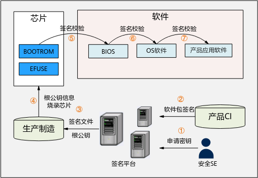
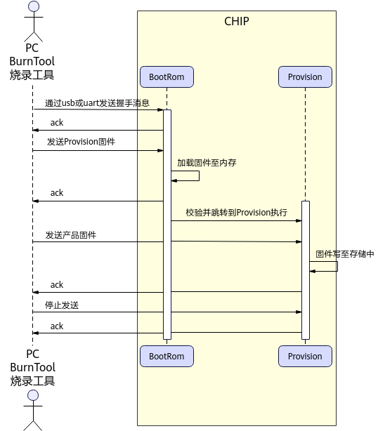
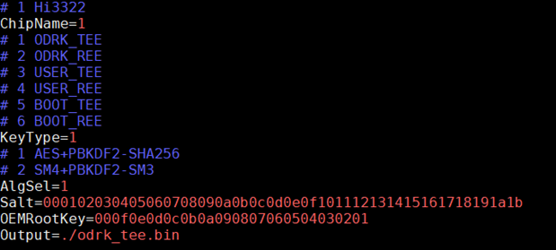
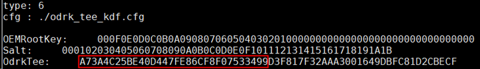
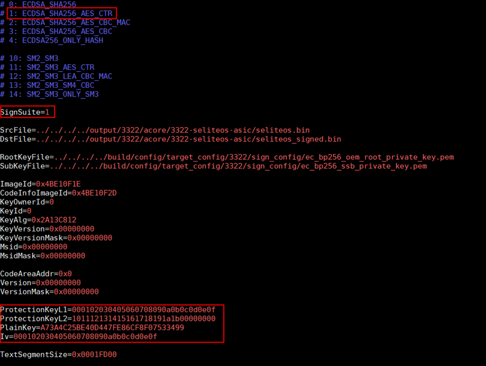
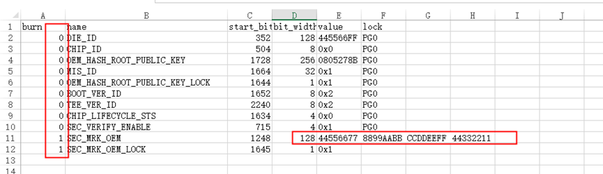
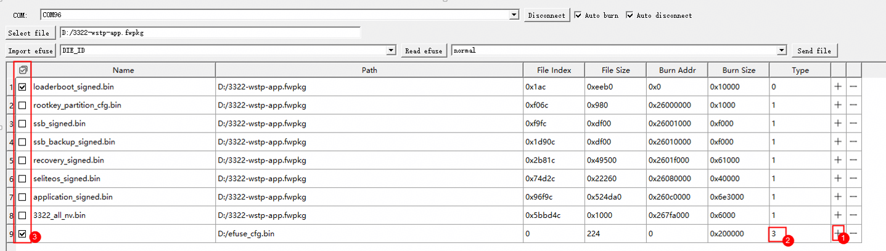

# 前言

**概述**

本文档用于指导客户配置安全启动。

**读者对象**

本文档主要适用于以下工程师：

-   技术支持工程师
-   软件开发工程师

**符号约定**

在本文中可能出现下列标志，它们所代表的含义如下。

<table><thead align="left"><tr id="zh-cn_topic_0000002444727421_row1530720816410"><th class="cellrowborder" valign="top" width="20.580000000000002%" id="mcps1.1.3.1.1">
<strong id="zh-cn_topic_0000002444727421_b2136615816410">符号</strong>

</th>
<th class="cellrowborder" valign="top" width="79.42%" id="mcps1.1.3.1.2">
<strong id="zh-cn_topic_0000002444727421_b5941558116410">说明</strong>

</th>
</tr>
</thead>
<tbody><tr id="zh-cn_topic_0000002444727421_row1372280416410"><td class="cellrowborder" valign="top" width="20.580000000000002%" headers="mcps1.1.3.1.1 ">

</td>
<td class="cellrowborder" valign="top" width="79.42%" headers="mcps1.1.3.1.2 ">
表示如不避免则将会导致死亡或严重伤害的具有高等级风险的危害。

</td>
</tr>
<tr id="zh-cn_topic_0000002444727421_row466863216410"><td class="cellrowborder" valign="top" width="20.580000000000002%" headers="mcps1.1.3.1.1 ">

</td>
<td class="cellrowborder" valign="top" width="79.42%" headers="mcps1.1.3.1.2 ">
表示如不避免则可能导致死亡或严重伤害的具有中等级风险的危害。

</td>
</tr>
<tr id="zh-cn_topic_0000002444727421_row123863216410"><td class="cellrowborder" valign="top" width="20.580000000000002%" headers="mcps1.1.3.1.1 ">

</td>
<td class="cellrowborder" valign="top" width="79.42%" headers="mcps1.1.3.1.2 ">
表示如不避免则可能导致轻微或中度伤害的具有低等级风险的危害。

</td>
</tr>
<tr id="zh-cn_topic_0000002444727421_row5786682116410"><td class="cellrowborder" valign="top" width="20.580000000000002%" headers="mcps1.1.3.1.1 ">

</td>
<td class="cellrowborder" valign="top" width="79.42%" headers="mcps1.1.3.1.2 ">
用于传递设备或环境安全警示信息。如不避免则可能会导致设备损坏、数据丢失、设备性能降低或其它不可预知的结果。

“须知”不涉及人身伤害。

</td>
</tr>
<tr id="zh-cn_topic_0000002444727421_row2856923116410"><td class="cellrowborder" valign="top" width="20.580000000000002%" headers="mcps1.1.3.1.1 ">

</td>
<td class="cellrowborder" valign="top" width="79.42%" headers="mcps1.1.3.1.2 ">
对正文中重点信息的补充说明。

“说明”不是安全警示信息，不涉及人身、设备及环境伤害信息。

</td>
</tr>
</tbody>
</table>

# 概述

当OEM从芯片供应商处接收芯片时，这些芯片已经预设了诸如芯片组ID和生命周期状态等关键eFuse配置。然而，这种默认状态并不安全，OEM需要进一步的配置程序，将最终产品配置为安全状态，然后才能销售给终端用户。

在OEM制造现场的配置包括三个主要任务：固件存储配置、eFuse配置以及配置后的全面测试。

本文档是为OEM供应商提供的指导，旨在帮助他们了解如何执行安全配置。

1.  OEM需要烧录MRK（OEM）eFuse位和固件。具体操作请参考《软件开发指南》“SDK开发指导”章节。
2.  OEM需要测试应用程序的启动和功能。
3.  OEM需要烧录hash\_oem\_root\_pub\_key、SEC\_LOCK\_MRK\_OEM、SEC\_LOCK\_pub\_key、msid、SEC\_LOCK\_msid、swd\_soft\_debug\_en、secure\_boot\_enable。
4.  OEM需要检查安全启动状态。
5.  OEM需要烧录lifecycle\_sts eFuse。
6.  OEM需要检查生命周期状态。

# 安全启动配置

-   **[可信的环境](#ZH-CN_TOPIC_0000002499582649)**  

-   **[eFuse Bits](#ZH-CN_TOPIC_0000002466383656)**  

-   **[安全启动流程](#ZH-CN_TOPIC_0000002466543288)**  

-   **[配置指导](#ZH-CN_TOPIC_0000002466383660)**  

## 可信的环境

可信环境对于安全配置至关重要，它确保了整个配置过程执行得当，不会泄露敏感数据。

OEM供应商有责任构建自己的可信配置环境，在本节中，仅提出了我们认为可信配置环境应具备的机制。

-   应具备人事管理制度或类似机制。
-   应配备7×24小时闭路电视监控和门禁系统。
-   应建立记录系统，记录芯片的任何操作。
-   应具备验证配置模式完整性和真实性的机制。

## eFuse Bits

**表 1**  待配置的eFuse Bits

<table><thead align="left"><tr id="zh-cn_topic_0000002444647337_row1246104810489"><th class="cellrowborder" valign="top" width="25%" id="mcps1.2.5.1.1">
功能

</th>
<th class="cellrowborder" valign="top" width="12.78%" id="mcps1.2.5.1.2">
<strong id="zh-cn_topic_0000002444647337_b15845415161413">起始位</strong>

</th>
<th class="cellrowborder" valign="top" width="14.45%" id="mcps1.2.5.1.3">
<strong id="zh-cn_topic_0000002444647337_b58451115111418">长度（bit）</strong>

</th>
<th class="cellrowborder" valign="top" width="47.77%" id="mcps1.2.5.1.4">
<strong id="zh-cn_topic_0000002444647337_b384651519141">描述</strong>

</th>
</tr>
</thead>
<tbody><tr id="zh-cn_topic_0000002444647337_row14644844816"><td class="cellrowborder" valign="top" width="25%" headers="mcps1.2.5.1.1 ">
hash_oem_root_pub_key

</td>
<td class="cellrowborder" valign="top" width="12.78%" headers="mcps1.2.5.1.2 ">
1728

</td>
<td class="cellrowborder" valign="top" width="14.45%" headers="mcps1.2.5.1.3 ">
256

</td>
<td class="cellrowborder" valign="top" width="47.77%" headers="mcps1.2.5.1.4 ">
根公钥的哈希值。

</td>
</tr>
<tr id="zh-cn_topic_0000002444647337_row1645858105114"><td class="cellrowborder" valign="top" width="25%" headers="mcps1.2.5.1.1 ">
MRK (OEM)

</td>
<td class="cellrowborder" valign="top" width="12.78%" headers="mcps1.2.5.1.2 ">
1248

</td>
<td class="cellrowborder" valign="top" width="14.45%" headers="mcps1.2.5.1.3 ">
128

</td>
<td class="cellrowborder" valign="top" width="47.77%" headers="mcps1.2.5.1.4 ">
由OEM厂商管理的根密钥，用于生成SE LiteOS固件加密密钥。

</td>
</tr>
<tr id="zh-cn_topic_0000002444647337_row11889946552"><td class="cellrowborder" valign="top" width="25%" headers="mcps1.2.5.1.1 ">
SEC_LOCK_MRK_OEM

</td>
<td class="cellrowborder" valign="top" width="12.78%" headers="mcps1.2.5.1.2 ">
1645

</td>
<td class="cellrowborder" valign="top" width="14.45%" headers="mcps1.2.5.1.3 ">
1

</td>
<td class="cellrowborder" valign="top" width="47.77%" headers="mcps1.2.5.1.4 ">
MRK（OEM）写保护启用。

0：MRK（OEM）可写；

1：MRK（OEM）不可写入。

</td>
</tr>
<tr id="zh-cn_topic_0000002444647337_row205111038195612"><td class="cellrowborder" valign="top" width="25%" headers="mcps1.2.5.1.1 ">
SEC_LOCK_pub_key

</td>
<td class="cellrowborder" valign="top" width="12.78%" headers="mcps1.2.5.1.2 ">
1644

</td>
<td class="cellrowborder" valign="top" width="14.45%" headers="mcps1.2.5.1.3 ">
1

</td>
<td class="cellrowborder" valign="top" width="47.77%" headers="mcps1.2.5.1.4 ">
启用哈希OEM根公钥写保护。

</td>
</tr>
<tr id="zh-cn_topic_0000002444647337_row1647222395819"><td class="cellrowborder" valign="top" width="25%" headers="mcps1.2.5.1.1 ">
msid

</td>
<td class="cellrowborder" valign="top" width="12.78%" headers="mcps1.2.5.1.2 ">
1664

</td>
<td class="cellrowborder" valign="top" width="14.45%" headers="mcps1.2.5.1.3 ">
32

</td>
<td class="cellrowborder" valign="top" width="47.77%" headers="mcps1.2.5.1.4 ">
市场ID。

</td>
</tr>
<tr id="zh-cn_topic_0000002444647337_row16832165445918"><td class="cellrowborder" valign="top" width="25%" headers="mcps1.2.5.1.1 ">
SEC_LOCK_msid

</td>
<td class="cellrowborder" valign="top" width="12.78%" headers="mcps1.2.5.1.2 ">
1643

</td>
<td class="cellrowborder" valign="top" width="14.45%" headers="mcps1.2.5.1.3 ">
1

</td>
<td class="cellrowborder" valign="top" width="47.77%" headers="mcps1.2.5.1.4 ">
启用MSID写保护。

</td>
</tr>
<tr id="zh-cn_topic_0000002444647337_row1770464019118"><td class="cellrowborder" valign="top" width="25%" headers="mcps1.2.5.1.1 ">
swd_soft_debug_en

</td>
<td class="cellrowborder" valign="top" width="12.78%" headers="mcps1.2.5.1.2 ">
298

</td>
<td class="cellrowborder" valign="top" width="14.45%" headers="mcps1.2.5.1.3 ">
1

</td>
<td class="cellrowborder" valign="top" width="47.77%" headers="mcps1.2.5.1.4 ">
SWD开关配置启用：

0：SWD调试端口默认启用；

1：通过配置开关启用SWD调试端口。

</td>
</tr>
<tr id="zh-cn_topic_0000002444647337_row118721557621"><td class="cellrowborder" valign="top" width="25%" headers="mcps1.2.5.1.1 ">
secure_boot_enable

</td>
<td class="cellrowborder" valign="top" width="12.78%" headers="mcps1.2.5.1.2 ">
715

</td>
<td class="cellrowborder" valign="top" width="14.45%" headers="mcps1.2.5.1.3 ">
4

</td>
<td class="cellrowborder" valign="top" width="47.77%" headers="mcps1.2.5.1.4 ">
0xA：未启用安全启动（出厂默认值）；

其他：已启用安全启动。

</td>
</tr>
<tr id="zh-cn_topic_0000002444647337_row537112101752"><td class="cellrowborder" valign="top" width="25%" headers="mcps1.2.5.1.1 ">
lifecycle_sts

</td>
<td class="cellrowborder" valign="top" width="12.78%" headers="mcps1.2.5.1.2 ">
1634

</td>
<td class="cellrowborder" valign="top" width="14.45%" headers="mcps1.2.5.1.3 ">
4

</td>
<td class="cellrowborder" valign="top" width="47.77%" headers="mcps1.2.5.1.4 ">
0x0000：空白状态；

0x001x：OEM配置状态；

0x01xx：最终用户状态；

0x1xxx：退役状态。

</td>
</tr>
</tbody>
</table>

## 安全启动流程

[图1](#zh-cn_topic_0000002411048296_fig1142113534241)为安全启动校验流程图，[图2](#zh-cn_topic_0000002411048296_fig18555192574718)介绍了PC烧录工具与芯片的通信流程和时序。

**图 1**  安全启动签名校验流程  

**图 2**  PC烧录工具与芯片组的通信过程  

## 配置指导

-   **[选择正确的固件版本](#ZH-CN_TOPIC_0000002466543292)**  

-   **[使能安全启动特性](#ZH-CN_TOPIC_0000002466383652)**  

-   **[配置生命周期](#ZH-CN_TOPIC_0000002499502605)**  

-   **[安全启动验证](#ZH-CN_TOPIC_0000002499502609)**  

### 选择正确的固件版本

在配置芯片之前，OEM需要选择正确的固件版本，以确保所有预期的功能和配置都已集成。

选择固件后，OEM可以使用烧录工具将固件加载到存储中，此部分请参考“[使能安全启动特性](#ZH-CN_TOPIC_0000002466383652)”。

### 使能安全启动特性

1.  生成密钥对，OEM需要安全地管理这些密钥。
2.  加密SE LiteOS固件并离线签署所有固件。

    > **说明：** 
    >强烈建议安排可信的人员/用户负责敏感活动，如密钥生成与管理、固件签名及固件加密等。

    当前的SDK提供了一个签名和加密工具，可以自动加密SE LiteOS固件，填充镜像头信息，并在编译后签署所有固件。

    如果用户需要使用SDK内置的签名工具，只需替换“build/config/target\_config/3322/sign\_config/”目录下的“ec\_bp256\_oem\_root\_private\_key.pem”和“ec\_bp256\_ssb\_private\_key.pem”文件。可以使用openssl生成标准的pem密钥文件，具体命令如下："openssl ecparam -name brainpoolP256r1 -genkey -noout -out ec\_bp256\_oem\_root\_private\_key.pem"。

    用户在加密SE LiteOS镜像时需要设置SELiteOS加密密钥和IV。当新的SELiteOS镜像被加密时，强烈建议更改SELiteOS加密密钥和IV：可以使用签名加密工具生成一个名为ODRK\_TEE的密钥，并利用该密钥对SELiteOS镜像进行加密。具体步骤如下：

    1.  根据以下模板填写密钥派生配置文件（odrk\_tee\_kdf.cfg）。

        

        客户必须修改Salt和OEMRootKey，其中Salt是一个28字节的十六进制字符串，OEMROOTKey是一个16字节的十六进制字符串。

    2.  执行命令：$sign\_tool 6 /odrk\_tee\_kdf.cfg，可以得到派生的密钥ODRK\_TEE。

        

        只需要截取前16个字节作为ODRK\_TEE。

    3.  使用上述ODRK\_TEE和Salt填写sign\_config文件（build/config/target\_config/3322/sign\_config/3322\_seliteos\_asic.cfg）。

        

        > **说明：** 
        >在“SignSuite”中填写“1”。使用Salt前16字节的十六进制字符串填充“ProtectionKeyL1”。使用Salt最后12字节的十六进制字符串和4字节的零十六进制字符串填充“ProtectionKeyL2”。用16字节的ODRK\_TEE十六进制字符串填充“PplainKey”。用一个随机的16字节的十六进制字符串填充“Iv”。

    4.  步使用命令“./build.py -c 3322”编译整个SDK或单独的SELiteOS，生成的输出镜像（output/3322/acore/3322-seliteos-release/seliteos\_signed.bin）是一个签名并加密的镜像。

3.  使用 BurnTool工具下载固件到Flash并烧写MRK\(OEM\) efuse bit以支持SE LiteOS固件和加密NV的即时解密。

    烧写镜像的步骤请参考 《HiDiTingV100 BurnTool工具 使用指南 》“操作指南”章节烧写操作。

    下面主要描述MRK \(OEM\) efuse bit的烧写流程。

    1.  使用提供的“efuse\_cfg\_gen.py”脚本和“efuse.csv”生成eFuse镜像文件。
        1.  配置csv文件：

            根据“drivers/chip/3322/porting/security/efuse/efuse\_proting.c”中g\_efuse\_cfg枚举的eFuse ID填充csv文件。

            csv文件按照“burn, name, start\_bit, bit\_width, value, lock”记录一条eFuse ID；注意“burn”为0不生成到“efuse\_cfg.bin”中，“burn”为1表示生成到“efuse\_cfg.bin”中。

            value值以32bit一组，组间使用空格；一组数据内高地址在前，低地址在后；组间数据低地址在前，高地址在后。

            

            SEC\_MRK\_OEM为sec mrk oem要烧写efuse bit的值；

            SEC\_MRK\_OEM\_LOCK为lock位，置1后，SEC\_MRK\_OEM将不能被修改，且不可读取。

        2.  执行“python3 efuse\_cfg\_gen.py”，在同级目录生成“efuse\_cfg.bin”。

    2.  eFuse烧写：

        在BurnTool界面点击“+”导入“efuse\_cfg.bin”，修改“type”为 3，勾选“loaderboot\_signed.bin”以及“efuse\_cfg.bin”，单击“connect”，复位单板，开始烧写efuse bit。

        

4.  发送“AT+SECUREBOOT”命令以启用安全启动。

    “AT+SECUREBOOT”命令将设置hash\_oem\_root\_pub\_key、SEC\_LOCK\_pub\_key、msid、SEC\_LOCK\_msid、SEC\_LOCK\_MRK\_OEM efuse值，并将secure\_boot\_enable efuse位值更改为0xF。

5.  发送“AT+REBOOT”以触发重启。

    重启后安全启动将被启用。

### 配置生命周期

发送“AT+EFUSEBITWRITE=204,4”命令，将生命周期状态更改为最终用户产品状态。

### 安全启动验证

1.  芯片重启后，若系统无法正常启动，则表明配置过程存在问题。OEM需对芯片进行调试。
2.  若系统能正常启动，OEM可发送“AT+GETSECURESTATE”命令以获取安全启动及生命周期状态。预期的安全启动状态应为“启用”，生命周期状态应为“最终产品用户状态”。

# 缩略语

<table><tbody><tr id="zh-cn_topic_0000002436574602_row114816271815"><td class="nocellnorowborder" style="border:none" valign="top" width="21.76217621762176%">
<strong id="zh-cn_topic_0000002436574602_b20432323193819">M</strong>

</td>
<td class="nocellnorowborder" style="border:none" valign="top" width="44.90449044904491%">&nbsp;&nbsp;</td>
<td class="cell-norowborder" style="border:none" valign="top" width="33.33333333333333%">&nbsp;&nbsp;</td>
</tr>
<tr id="zh-cn_topic_0000002436574602_row7481192713117"><td class="nocellnorowborder" style="border:none" valign="top" width="21.76217621762176%">
<strong id="zh-cn_topic_0000002436574602_b543652318388">MRK</strong>

</td>
<td class="nocellnorowborder" style="border:none" valign="top" width="44.90449044904491%">
Market

</td>
<td class="cell-norowborder" style="border:none" valign="top" width="33.33333333333333%">
市场

</td>
</tr>
<tr id="zh-cn_topic_0000002436574602_row348120271618"><td class="nocellnorowborder" style="border:none" valign="top" width="21.76217621762176%">
<strong id="zh-cn_topic_0000002436574602_b843752312389">MSID</strong>

</td>
<td class="nocellnorowborder" style="border:none" valign="top" width="44.90449044904491%">
Market Segment ID

</td>
<td class="cell-norowborder" style="border:none" valign="top" width="33.33333333333333%">
市场ID

</td>
</tr>
<tr id="zh-cn_topic_0000002436574602_row348142711110"><td class="nocellnorowborder" style="border:none" valign="top" width="21.76217621762176%">&nbsp;&nbsp;</td>
<td class="nocellnorowborder" style="border:none" valign="top" width="44.90449044904491%">&nbsp;&nbsp;</td>
<td class="cell-norowborder" style="border:none" valign="top" width="33.33333333333333%">&nbsp;&nbsp;</td>
</tr>
<tr id="zh-cn_topic_0000002436574602_row124820276114"><td class="nocellnorowborder" style="border:none" valign="top" width="21.76217621762176%">
<strong id="zh-cn_topic_0000002436574602_b1543910233382">O</strong>

</td>
<td class="nocellnorowborder" style="border:none" valign="top" width="44.90449044904491%">&nbsp;&nbsp;</td>
<td class="cell-norowborder" style="border:none" valign="top" width="33.33333333333333%">&nbsp;&nbsp;</td>
</tr>
<tr id="zh-cn_topic_0000002436574602_row3482427110"><td class="nocellnorowborder" style="border:none" valign="top" width="21.76217621762176%">
<strong id="zh-cn_topic_0000002436574602_b84401823163819">OEM</strong>

</td>
<td class="nocellnorowborder" style="border:none" valign="top" width="44.90449044904491%">
Original Equipment Manufacturer

</td>
<td class="cell-norowborder" style="border:none" valign="top" width="33.33333333333333%">
原始设备制造商

</td>
</tr>
<tr id="zh-cn_topic_0000002436574602_row14482427412"><td class="nocellnorowborder" style="border:none" valign="top" width="21.76217621762176%">&nbsp;&nbsp;</td>
<td class="nocellnorowborder" style="border:none" valign="top" width="44.90449044904491%">&nbsp;&nbsp;</td>
<td class="cell-norowborder" style="border:none" valign="top" width="33.33333333333333%">&nbsp;&nbsp;</td>
</tr>
<tr id="zh-cn_topic_0000002436574602_row7482123517210"><td class="nocellnorowborder" style="border:none" valign="top" width="21.76217621762176%">
<strong id="zh-cn_topic_0000002436574602_b15441182310383">S</strong>

</td>
<td class="nocellnorowborder" style="border:none" valign="top" width="44.90449044904491%">&nbsp;&nbsp;</td>
<td class="cell-norowborder" style="border:none" valign="top" width="33.33333333333333%">&nbsp;&nbsp;</td>
</tr>
<tr id="zh-cn_topic_0000002436574602_row1248214273115"><td class="row-nocellborder" style="border:none" valign="top" width="21.76217621762176%">
<strong id="zh-cn_topic_0000002436574602_b74411923133816">SWD</strong>

</td>
<td class="row-nocellborder" style="border:none" valign="top" width="44.90449044904491%">
Serial Wire Debug

</td>
<td class="cellrowborder" style="border:none" valign="top" width="33.33333333333333%">
串行线调试

</td>
</tr>
</tbody>
</table>

