# 前言<a name="ZH-CN_TOPIC_0000002499582525"></a>

**概述<a name="zh-cn_topic_0000002454437385_title656mcpsimp"></a>**

本文档主要介绍HiDiTingV100的文件系统相关内容，包括接口实现机制与使用说明。

**读者对象<a name="zh-cn_topic_0000002454437385_title680mcpsimp"></a>**

本文档主要适用于以下工程师：

-   技术支持工程师
-   软件开发工程师

**符号约定<a name="zh-cn_topic_0000002454437385_section133020216410"></a>**

在本文中可能出现下列标志，它们所代表的含义如下。

<a name="zh-cn_topic_0000002454437385_table2622507016410"></a>
<table><thead align="left"><tr id="zh-cn_topic_0000002454437385_row1530720816410"><th class="cellrowborder" valign="top" width="20.580000000000002%" id="mcps1.1.3.1.1"><p id="zh-cn_topic_0000002454437385_p6450074116410"><a name="zh-cn_topic_0000002454437385_p6450074116410"></a><a name="zh-cn_topic_0000002454437385_p6450074116410"></a><strong id="zh-cn_topic_0000002454437385_b2136615816410"><a name="zh-cn_topic_0000002454437385_b2136615816410"></a><a name="zh-cn_topic_0000002454437385_b2136615816410"></a>符号</strong></p>
</th>
<th class="cellrowborder" valign="top" width="79.42%" id="mcps1.1.3.1.2"><p id="zh-cn_topic_0000002454437385_p5435366816410"><a name="zh-cn_topic_0000002454437385_p5435366816410"></a><a name="zh-cn_topic_0000002454437385_p5435366816410"></a><strong id="zh-cn_topic_0000002454437385_b5941558116410"><a name="zh-cn_topic_0000002454437385_b5941558116410"></a><a name="zh-cn_topic_0000002454437385_b5941558116410"></a>说明</strong></p>
</th>
</tr>
</thead>
<tbody><tr id="zh-cn_topic_0000002454437385_row1372280416410"><td class="cellrowborder" valign="top" width="20.580000000000002%" headers="mcps1.1.3.1.1 "><p id="zh-cn_topic_0000002454437385_p3734547016410"><a name="zh-cn_topic_0000002454437385_p3734547016410"></a><a name="zh-cn_topic_0000002454437385_p3734547016410"></a><a name="zh-cn_topic_0000002454437385_image2670064316410"></a><a name="zh-cn_topic_0000002454437385_image2670064316410"></a><span></span></p>
</td>
<td class="cellrowborder" valign="top" width="79.42%" headers="mcps1.1.3.1.2 "><p id="zh-cn_topic_0000002454437385_p1757432116410"><a name="zh-cn_topic_0000002454437385_p1757432116410"></a><a name="zh-cn_topic_0000002454437385_p1757432116410"></a>表示如不避免则将会导致死亡或严重伤害的具有高等级风险的危害。</p>
</td>
</tr>
<tr id="zh-cn_topic_0000002454437385_row466863216410"><td class="cellrowborder" valign="top" width="20.580000000000002%" headers="mcps1.1.3.1.1 "><p id="zh-cn_topic_0000002454437385_p1432579516410"><a name="zh-cn_topic_0000002454437385_p1432579516410"></a><a name="zh-cn_topic_0000002454437385_p1432579516410"></a><a name="zh-cn_topic_0000002454437385_image4895582316410"></a><a name="zh-cn_topic_0000002454437385_image4895582316410"></a><span></span></p>
</td>
<td class="cellrowborder" valign="top" width="79.42%" headers="mcps1.1.3.1.2 "><p id="zh-cn_topic_0000002454437385_p959197916410"><a name="zh-cn_topic_0000002454437385_p959197916410"></a><a name="zh-cn_topic_0000002454437385_p959197916410"></a>表示如不避免则可能导致死亡或严重伤害的具有中等级风险的危害。</p>
</td>
</tr>
<tr id="zh-cn_topic_0000002454437385_row123863216410"><td class="cellrowborder" valign="top" width="20.580000000000002%" headers="mcps1.1.3.1.1 "><p id="zh-cn_topic_0000002454437385_p1232579516410"><a name="zh-cn_topic_0000002454437385_p1232579516410"></a><a name="zh-cn_topic_0000002454437385_p1232579516410"></a><a name="zh-cn_topic_0000002454437385_image1235582316410"></a><a name="zh-cn_topic_0000002454437385_image1235582316410"></a><span></span></p>
</td>
<td class="cellrowborder" valign="top" width="79.42%" headers="mcps1.1.3.1.2 "><p id="zh-cn_topic_0000002454437385_p123197916410"><a name="zh-cn_topic_0000002454437385_p123197916410"></a><a name="zh-cn_topic_0000002454437385_p123197916410"></a>表示如不避免则可能导致轻微或中度伤害的具有低等级风险的危害。</p>
</td>
</tr>
<tr id="zh-cn_topic_0000002454437385_row5786682116410"><td class="cellrowborder" valign="top" width="20.580000000000002%" headers="mcps1.1.3.1.1 "><p id="zh-cn_topic_0000002454437385_p2204984716410"><a name="zh-cn_topic_0000002454437385_p2204984716410"></a><a name="zh-cn_topic_0000002454437385_p2204984716410"></a><a name="zh-cn_topic_0000002454437385_image4504446716410"></a><a name="zh-cn_topic_0000002454437385_image4504446716410"></a><span></span></p>
</td>
<td class="cellrowborder" valign="top" width="79.42%" headers="mcps1.1.3.1.2 "><p id="zh-cn_topic_0000002454437385_p4388861916410"><a name="zh-cn_topic_0000002454437385_p4388861916410"></a><a name="zh-cn_topic_0000002454437385_p4388861916410"></a>用于传递设备或环境安全警示信息。如不避免则可能会导致设备损坏、数据丢失、设备性能降低或其它不可预知的结果。</p>
<p id="zh-cn_topic_0000002454437385_p1238861916410"><a name="zh-cn_topic_0000002454437385_p1238861916410"></a><a name="zh-cn_topic_0000002454437385_p1238861916410"></a>“须知”不涉及人身伤害。</p>
</td>
</tr>
<tr id="zh-cn_topic_0000002454437385_row2856923116410"><td class="cellrowborder" valign="top" width="20.580000000000002%" headers="mcps1.1.3.1.1 "><p id="zh-cn_topic_0000002454437385_p5555360116410"><a name="zh-cn_topic_0000002454437385_p5555360116410"></a><a name="zh-cn_topic_0000002454437385_p5555360116410"></a><a name="zh-cn_topic_0000002454437385_image799324016410"></a><a name="zh-cn_topic_0000002454437385_image799324016410"></a><span></span></p>
</td>
<td class="cellrowborder" valign="top" width="79.42%" headers="mcps1.1.3.1.2 "><p id="zh-cn_topic_0000002454437385_p4612588116410"><a name="zh-cn_topic_0000002454437385_p4612588116410"></a><a name="zh-cn_topic_0000002454437385_p4612588116410"></a>对正文中重点信息的补充说明。</p>
<p id="zh-cn_topic_0000002454437385_p1232588116410"><a name="zh-cn_topic_0000002454437385_p1232588116410"></a><a name="zh-cn_topic_0000002454437385_p1232588116410"></a>“说明”不是安全警示信息，不涉及人身、设备及环境伤害信息。</p>
</td>
</tr>
</tbody>
</table>

# 概述<a name="ZH-CN_TOPIC_0000002499502497"></a>

文件系统架构如[图1](#zh-cn_topic_0000002420554264__fig1499119555118)所示。

**图 1**  文件系统架构<a name="zh-cn_topic_0000002420554264__fig1499119555118"></a>  
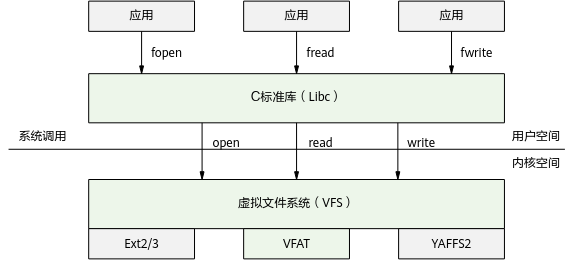

文件系统包括Libc、VFS、VFAT，用户应用可以通过Libc层文件接口使用文件系统。

虚拟文件系统VFS（Virtual File System）采用标准的Unix系统调用读写位于不同物理介质上的不同文件系统，为各类文件系统提供统一的操作界面和应用编程接口。VFS向下兼容各底层存储介质和文件系统类型，实现对open\(\)、read\(\)、write\(\)等系统调用的直接调度而不用关心底层物理存储介质的差异。

虚拟文件分配表VFAT（Virtual File Allocation Table）采用32位的文件分配表，支持最大分区容量128GB，最大文件4GB，该文件系统提供了文件打开、关闭、读取、写入、删除等接口，用户可通过使用这些接口，对eMMC数据进行各类操作。

YAFFS（Yet Another Flash File System）是一种专门针对闪存的文件系统，它是专为NAND类型的闪存存储器设计的。该文件系统提供了文件打开、关闭、读取、写入、删除等接口，用户可通过使用这些接口，对NAND Flash数据进行各类操作。

# 系统接口<a name="ZH-CN_TOPIC_0000002466543152"></a>

-   **[VFS](#ZH-CN_TOPIC_0000002499582533)**  

-   **[VFAT文件系统](#ZH-CN_TOPIC_0000002466543184)**  

-   **[YAFFS文件系统](#ZH-CN_TOPIC_0000002466543176)**  

## VFS<a name="ZH-CN_TOPIC_0000002499582533"></a>

-   **[概述](#ZH-CN_TOPIC_0000002466383568)**  

-   **[开发流程](#ZH-CN_TOPIC_0000002466543168)**  

### 概述<a name="ZH-CN_TOPIC_0000002466383568"></a>

虚拟文件系统VFS也可称为虚拟文件转换系统，是一个内核软件层。

VFS有如下两个作用：

-   处理与Unix标准文件系统相关的所有系统调用。
-   为各种文件系统提供一个通用的接口。

### 开发流程<a name="ZH-CN_TOPIC_0000002466543168"></a>

-   **[VFS结构](#ZH-CN_TOPIC_0000002499582553)**  

-   **[VFS介绍](#ZH-CN_TOPIC_0000002466383564)**  

-   **[功能](#ZH-CN_TOPIC_0000002499582521)**  

#### VFS结构<a name="ZH-CN_TOPIC_0000002499582553"></a>

虚拟文件系统VFS中的目录和文件按照目录树的方式组织。

**图 1**  VFS文件目录结构<a name="zh-cn_topic_0000002420394420_fig652mcpsimp"></a>  


#### VFS介绍<a name="ZH-CN_TOPIC_0000002466383564"></a>

VFS主要的四个对象如下：

-   超级块对象：代表一个特定的已挂接的文件系统。
-   索引节点对象：代表一个特定的文件项。
-   目录对象：代表一个特定的目录项。
-   文件对象：代表一个与进程相关的打开的文件。

**图 1**  VFS对象之间的关系<a name="zh-cn_topic_0000002454113273_fig148mcpsimp"></a>  
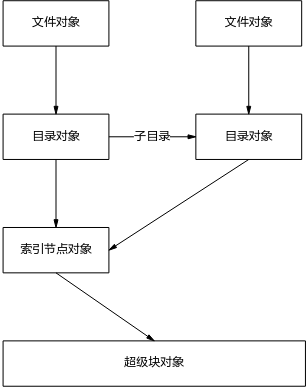

**超级块对象<a name="zh-cn_topic_0000002454113273_title151mcpsimp"></a>**

超级块对象（super\_block）存储了描述特定文件系统的信息。通常超级块对象对应位于磁盘上特定扇区的文件系统超级块或文件系统控制块。

超级块对象由许多数据项组成，如下所示：

-   该文件系统所挂接的设备。
-   文件系统的基本块大小。
-   脏标志，表示超级块已经修改过，但还没有写回到磁盘。
-   文件系统类型。
-   标志，如只读标志。
-   指向文件系统根目录的指针。
-   打开文件的列表。
-   控制访问该文件系统的信号量。
-   操作超级块的函数指针数组的指针。

**索引节点对象<a name="zh-cn_topic_0000002454113273_title165mcpsimp"></a>**

一个索引节点对象（inode）与一个文件相关联。索引节点对象包含一个命名文件除该文件的文件名和该文件的实际数据内容外的所有信息，例如所有者、组、权限、文件的访问时间、数据长度和链接数等信息。

**目录对象<a name="zh-cn_topic_0000002454113273_title168mcpsimp"></a>**

目录对象（directory entry）是一个路径上的一个特定的组成。该组成是一个目录名或者是文件名，目录项对象为访问文件和目录提供了方便。

目录对象包括一个指向索引节点的指针和超级块，还包括一个指向父目录的指针和指向子目录的指针。

**文件对象<a name="zh-cn_topic_0000002454113273_title172mcpsimp"></a>**

文件对象（file）代表由进程打开的文件，存放打开文件与进程之间进行交互的有关信息，这些信息仅当进程访问文件期间存放在内核中。

文件对象由相应的open\(\)系统调用创建，由close\(\)系统调用撤销。

#### 功能<a name="ZH-CN_TOPIC_0000002499582521"></a>

标准Posix接口函数如[表1](#zh-cn_topic_0000002453993185__table63405533420)所示。

**表 1**  posix接口函数列表

<a name="zh-cn_topic_0000002453993185__table63405533420"></a>
<table><thead align="left"><tr id="zh-cn_topic_0000002453993185_row496mcpsimp"><th class="cellrowborder" valign="top" width="38%" id="mcps1.2.3.1.1"><p id="zh-cn_topic_0000002453993185_p498mcpsimp"><a name="zh-cn_topic_0000002453993185_p498mcpsimp"></a><a name="zh-cn_topic_0000002453993185_p498mcpsimp"></a>接口名称</p>
</th>
<th class="cellrowborder" valign="top" width="62%" id="mcps1.2.3.1.2"><p id="zh-cn_topic_0000002453993185_p500mcpsimp"><a name="zh-cn_topic_0000002453993185_p500mcpsimp"></a><a name="zh-cn_topic_0000002453993185_p500mcpsimp"></a>接口描述</p>
</th>
</tr>
</thead>
<tbody><tr id="zh-cn_topic_0000002453993185_row502mcpsimp"><td class="cellrowborder" valign="top" width="38%" headers="mcps1.2.3.1.1 "><p id="zh-cn_topic_0000002453993185_p504mcpsimp"><a name="zh-cn_topic_0000002453993185_p504mcpsimp"></a><a name="zh-cn_topic_0000002453993185_p504mcpsimp"></a>open</p>
</td>
<td class="cellrowborder" valign="top" width="62%" headers="mcps1.2.3.1.2 "><p id="zh-cn_topic_0000002453993185_p506mcpsimp"><a name="zh-cn_topic_0000002453993185_p506mcpsimp"></a><a name="zh-cn_topic_0000002453993185_p506mcpsimp"></a>打开文件。</p>
</td>
</tr>
<tr id="zh-cn_topic_0000002453993185_row507mcpsimp"><td class="cellrowborder" valign="top" width="38%" headers="mcps1.2.3.1.1 "><p id="zh-cn_topic_0000002453993185_p509mcpsimp"><a name="zh-cn_topic_0000002453993185_p509mcpsimp"></a><a name="zh-cn_topic_0000002453993185_p509mcpsimp"></a>read</p>
</td>
<td class="cellrowborder" valign="top" width="62%" headers="mcps1.2.3.1.2 "><p id="zh-cn_topic_0000002453993185_p511mcpsimp"><a name="zh-cn_topic_0000002453993185_p511mcpsimp"></a><a name="zh-cn_topic_0000002453993185_p511mcpsimp"></a>读取文件。</p>
</td>
</tr>
<tr id="zh-cn_topic_0000002453993185_row512mcpsimp"><td class="cellrowborder" valign="top" width="38%" headers="mcps1.2.3.1.1 "><p id="zh-cn_topic_0000002453993185_p514mcpsimp"><a name="zh-cn_topic_0000002453993185_p514mcpsimp"></a><a name="zh-cn_topic_0000002453993185_p514mcpsimp"></a>write</p>
</td>
<td class="cellrowborder" valign="top" width="62%" headers="mcps1.2.3.1.2 "><p id="zh-cn_topic_0000002453993185_p516mcpsimp"><a name="zh-cn_topic_0000002453993185_p516mcpsimp"></a><a name="zh-cn_topic_0000002453993185_p516mcpsimp"></a>写入文件。</p>
</td>
</tr>
<tr id="zh-cn_topic_0000002453993185_row517mcpsimp"><td class="cellrowborder" valign="top" width="38%" headers="mcps1.2.3.1.1 "><p id="zh-cn_topic_0000002453993185_p519mcpsimp"><a name="zh-cn_topic_0000002453993185_p519mcpsimp"></a><a name="zh-cn_topic_0000002453993185_p519mcpsimp"></a>seek</p>
</td>
<td class="cellrowborder" valign="top" width="62%" headers="mcps1.2.3.1.2 "><p id="zh-cn_topic_0000002453993185_p521mcpsimp"><a name="zh-cn_topic_0000002453993185_p521mcpsimp"></a><a name="zh-cn_topic_0000002453993185_p521mcpsimp"></a>移动文件读取位置。</p>
</td>
</tr>
<tr id="zh-cn_topic_0000002453993185_row522mcpsimp"><td class="cellrowborder" valign="top" width="38%" headers="mcps1.2.3.1.1 "><p id="zh-cn_topic_0000002453993185_p524mcpsimp"><a name="zh-cn_topic_0000002453993185_p524mcpsimp"></a><a name="zh-cn_topic_0000002453993185_p524mcpsimp"></a>stat</p>
</td>
<td class="cellrowborder" valign="top" width="62%" headers="mcps1.2.3.1.2 "><p id="zh-cn_topic_0000002453993185_p526mcpsimp"><a name="zh-cn_topic_0000002453993185_p526mcpsimp"></a><a name="zh-cn_topic_0000002453993185_p526mcpsimp"></a>获取文件属性。</p>
</td>
</tr>
<tr id="zh-cn_topic_0000002453993185_row527mcpsimp"><td class="cellrowborder" valign="top" width="38%" headers="mcps1.2.3.1.1 "><p id="zh-cn_topic_0000002453993185_p529mcpsimp"><a name="zh-cn_topic_0000002453993185_p529mcpsimp"></a><a name="zh-cn_topic_0000002453993185_p529mcpsimp"></a>close</p>
</td>
<td class="cellrowborder" valign="top" width="62%" headers="mcps1.2.3.1.2 "><p id="zh-cn_topic_0000002453993185_p531mcpsimp"><a name="zh-cn_topic_0000002453993185_p531mcpsimp"></a><a name="zh-cn_topic_0000002453993185_p531mcpsimp"></a>关闭打开的文件。</p>
</td>
</tr>
<tr id="zh-cn_topic_0000002453993185_row532mcpsimp"><td class="cellrowborder" valign="top" width="38%" headers="mcps1.2.3.1.1 "><p id="zh-cn_topic_0000002453993185_p534mcpsimp"><a name="zh-cn_topic_0000002453993185_p534mcpsimp"></a><a name="zh-cn_topic_0000002453993185_p534mcpsimp"></a>unlink</p>
</td>
<td class="cellrowborder" valign="top" width="62%" headers="mcps1.2.3.1.2 "><p id="zh-cn_topic_0000002453993185_p536mcpsimp"><a name="zh-cn_topic_0000002453993185_p536mcpsimp"></a><a name="zh-cn_topic_0000002453993185_p536mcpsimp"></a>删除文件。</p>
</td>
</tr>
</tbody>
</table>

> **说明：** 
>close接口说明：
>目前vfs的close接口还可以同时用于网络句柄（socket句柄）的关闭，举例如下：
>在文件“kernel/liteos/LiteOS/Huawei\_LiteOS/self\_src/tools/build/config/3322.config”中，添加代码“LOSCFG\_NET\_LWIP\_SACK=y”即可。这样就打开了“close接口支持文件系统句柄和网络句柄”的功能。
>功能说明：
>目前系统中，文件句柄的取值范围为0～128（不包含128），而网络句柄的取值范围为128～（128+配置的可连接网络句柄数量），LOSCFG\_NET\_LWIP\_SACK=y时，close接口将根据句柄的取值选择调用文件系统的接口或者网络系统的接口。

## VFAT文件系统<a name="ZH-CN_TOPIC_0000002466543184"></a>

-   **[概述](#ZH-CN_TOPIC_0000002499582549)**  

-   **[开发指导](#ZH-CN_TOPIC_0000002499582545)**  

-   **[注意事项](#ZH-CN_TOPIC_0000002466383556)**  

### 概述<a name="ZH-CN_TOPIC_0000002499582549"></a>

VFAT是文件系统的一种，用于嵌入式目标上的eMMC设备。具有很好的稳定性及兼容性，可充分兼容Windows、Linux、LiteOS系统，并且维护方便。

> **说明：** 
>VFAT是FAT（File Allocation Table）文件系统的扩展，最早是在Windows 95中引入的。VFAT保持与FAT的向后兼容性，但放宽了一些限制规则。例如，VFAT文件名最多可包含255个字符，VFAT在FAT的基础上保留了文件名的大小写，但使用时并不区分文件名大小写。

-   **[VFAT文件系统结构](#ZH-CN_TOPIC_0000002499582537)**  

-   **[VFAT文件系统介绍](#ZH-CN_TOPIC_0000002466383560)**  

#### VFAT文件系统结构<a name="ZH-CN_TOPIC_0000002499582537"></a>

扇区是eMMC中最基本的数据存储单元。每个扇区通常包含512Byte的数据。当操作系统或应用程序需要从eMMC读取或写入数据时，它会以一个或多个连续的扇区为单位进行操作。

簇是一组连续的扇区，它是文件分配表（FAT）中分配存储空间的基本单位。

VFAT文件系统由DBR（DOS Boot Report）及其保留扇区、FAT和DATA三个部分组成，其结构如[图1](#zh-cn_topic_0000002465558629_fig10332202892918)所示。

**图 1**  VFAT文件系统结构<a name="zh-cn_topic_0000002465558629_fig10332202892918"></a>  


此结构是在分区被格式化时所创建的，各部分含义如下：

-   DBR及其保留扇区：DBR的含义是DOS（Disk Operating System）引导记录，也称为操作系统引导记录，在DBR之后往往会有一些保留扇区。
-   FAT：FAT表是用于管理文件存储的关键数据结构。它记录了文件在存储设备上的簇（cluster）分配情况，通过链式结构将文件的各个数据块连接起来，从而实现对文件的组织和访问。
-   DATA：数据区，是FAT32文件系统的主要区域，其中包含目录区域。

#### VFAT文件系统介绍<a name="ZH-CN_TOPIC_0000002466383560"></a>

-   VFAT的主要作用是标明分区的存储介质以及簇的使用情况。
-   VFAT表由VFAT表项构成，VFAT表项简称VFAT项，每个VFAT项占用4Byte，每个VFAT项都有一个固定的编号，编号从0开始。
-   VFAT表项的前两个VFAT项为文件系统保留使用，0号簇VFAT为介质类型，1号簇VFAT为文件系统错误标志。
-   分区格式化后，用户文件以簇为单位存放在数据区中，一个文件至少占用一个簇。
-   分区的数据区中的每个簇都会映射到VFAT表中的唯一一个VFAT项，0号VFAT和1号VFAT被系统占用，用户的数据则从2号VFAT开始记录。
-   如果某个文件占用多个簇，则第一个VFAT项记录下一个VFAT项的编号（即簇号），如果这个文件结束，则用“0x0F FF FF FF”表示簇结束。
-   VFAT1跟在DBR之后，其具体地址由DBR的BPB（BIOS Parameter Block）参数中指定，VFAT2跟在VFAT1之后。

### 开发指导<a name="ZH-CN_TOPIC_0000002499582545"></a>

FAT32文件系统的读写接口对上层业务开发人员是不可见的。在使用文件系统接口时，上层业务开发人员无需关注FAT32文件系统的具体实现，只需要调用VFS层文件系统接口进行文件读写操作即可。具体的文件系统读写接口可在“[功能](#ZH-CN_TOPIC_0000002499582521)”中查看。

-   **[接口说明](#ZH-CN_TOPIC_0000002466383536)**  

-   **[开发流程](#ZH-CN_TOPIC_0000002499502481)**  

#### 接口说明<a name="ZH-CN_TOPIC_0000002466383536"></a>

以下[表1](#zh-cn_topic_0000002453993189_table1588105711113)、[表2](#zh-cn_topic_0000002453993189_table65901557171119)所示接口上层业务开发人员无需关注，仅供底层FAT32文件系统集成人员参考使用。

**表 1**  添加分区接口说明

<a name="zh-cn_topic_0000002453993189_table1588105711113"></a>
<table><thead align="left"><tr id="zh-cn_topic_0000002453993189_row961820576111"><th class="cellrowborder" valign="top" width="19.39%" id="mcps1.2.4.1.1"><p id="zh-cn_topic_0000002453993189_p16181057121110"><a name="zh-cn_topic_0000002453993189_p16181057121110"></a><a name="zh-cn_topic_0000002453993189_p16181057121110"></a>头文件</p>
</th>
<th class="cellrowborder" valign="top" width="31.630000000000003%" id="mcps1.2.4.1.2"><p id="zh-cn_topic_0000002453993189_p106181957141120"><a name="zh-cn_topic_0000002453993189_p106181957141120"></a><a name="zh-cn_topic_0000002453993189_p106181957141120"></a>接口名</p>
</th>
<th class="cellrowborder" valign="top" width="48.980000000000004%" id="mcps1.2.4.1.3"><p id="zh-cn_topic_0000002453993189_p106181857141111"><a name="zh-cn_topic_0000002453993189_p106181857141111"></a><a name="zh-cn_topic_0000002453993189_p106181857141111"></a>描述</p>
</th>
</tr>
</thead>
<tbody><tr id="zh-cn_topic_0000002453993189_row106181657121111"><td class="cellrowborder" valign="top" width="19.39%" headers="mcps1.2.4.1.1 "><p id="zh-cn_topic_0000002453993189_p12618957111116"><a name="zh-cn_topic_0000002453993189_p12618957111116"></a><a name="zh-cn_topic_0000002453993189_p12618957111116"></a>disk.h</p>
</td>
<td class="cellrowborder" valign="top" width="31.630000000000003%" headers="mcps1.2.4.1.2 "><p id="zh-cn_topic_0000002453993189_p1961820570114"><a name="zh-cn_topic_0000002453993189_p1961820570114"></a><a name="zh-cn_topic_0000002453993189_p1961820570114"></a>add_mmc_partition</p>
</td>
<td class="cellrowborder" valign="top" width="48.980000000000004%" headers="mcps1.2.4.1.3 "><p id="zh-cn_topic_0000002453993189_p2061885716117"><a name="zh-cn_topic_0000002453993189_p2061885716117"></a><a name="zh-cn_topic_0000002453993189_p2061885716117"></a>添加eMMC分区，用户可以设置新分区的起始扇区和大小。</p>
</td>
</tr>
</tbody>
</table>

-   add\_mmc\_partition函数有三个参数：
    -   第一个参数：描述分区信息的结构体。
    -   第二个参数：分区的起始扇区，必须要在磁盘的有效范围内，且不与现有的分区重叠。
    -   第三个参数：表示分区大小，以扇区为单位，分区大小应小于等于剩余的eMMC存储空间。

**表 2**  挂载与卸载分区接口说明

<a name="zh-cn_topic_0000002453993189_table65901557171119"></a>
<table><thead align="left"><tr id="zh-cn_topic_0000002453993189_row18618125711112"><th class="cellrowborder" valign="top" width="20.072007200720073%" id="mcps1.2.4.1.1"><p id="zh-cn_topic_0000002453993189_p11618125715119"><a name="zh-cn_topic_0000002453993189_p11618125715119"></a><a name="zh-cn_topic_0000002453993189_p11618125715119"></a>头文件</p>
</th>
<th class="cellrowborder" valign="top" width="36.65366536653666%" id="mcps1.2.4.1.2"><p id="zh-cn_topic_0000002453993189_p136182577115"><a name="zh-cn_topic_0000002453993189_p136182577115"></a><a name="zh-cn_topic_0000002453993189_p136182577115"></a>接口名</p>
</th>
<th class="cellrowborder" valign="top" width="43.27432743274328%" id="mcps1.2.4.1.3"><p id="zh-cn_topic_0000002453993189_p261819576110"><a name="zh-cn_topic_0000002453993189_p261819576110"></a><a name="zh-cn_topic_0000002453993189_p261819576110"></a>描述</p>
</th>
</tr>
</thead>
<tbody><tr id="zh-cn_topic_0000002453993189_row15618135712119"><td class="cellrowborder" rowspan="2" valign="top" width="20.072007200720073%" headers="mcps1.2.4.1.1 "><p id="zh-cn_topic_0000002453993189_p8618175791115"><a name="zh-cn_topic_0000002453993189_p8618175791115"></a><a name="zh-cn_topic_0000002453993189_p8618175791115"></a>mount.h</p>
</td>
<td class="cellrowborder" valign="top" width="36.65366536653666%" headers="mcps1.2.4.1.2 "><p id="zh-cn_topic_0000002453993189_p17618125731118"><a name="zh-cn_topic_0000002453993189_p17618125731118"></a><a name="zh-cn_topic_0000002453993189_p17618125731118"></a>mount</p>
</td>
<td class="cellrowborder" valign="top" width="43.27432743274328%" headers="mcps1.2.4.1.3 "><p id="zh-cn_topic_0000002453993189_p16181957181110"><a name="zh-cn_topic_0000002453993189_p16181957181110"></a><a name="zh-cn_topic_0000002453993189_p16181957181110"></a>挂载分区</p>
</td>
</tr>
<tr id="zh-cn_topic_0000002453993189_row961820579115"><td class="cellrowborder" valign="top" headers="mcps1.2.4.1.1 "><p id="zh-cn_topic_0000002453993189_p14618175714119"><a name="zh-cn_topic_0000002453993189_p14618175714119"></a><a name="zh-cn_topic_0000002453993189_p14618175714119"></a>umount</p>
</td>
<td class="cellrowborder" valign="top" headers="mcps1.2.4.1.2 "><p id="zh-cn_topic_0000002453993189_p1661875718117"><a name="zh-cn_topic_0000002453993189_p1661875718117"></a><a name="zh-cn_topic_0000002453993189_p1661875718117"></a>卸载分区</p>
</td>
</tr>
</tbody>
</table>

-   mount\(\)函数有五个参数：
    -   第一个参数：设备节点，该参数需要与add\_mmc\_partition \(\)函数对应起来，设备节点“/dev/mmcblk0p”为固定前缀，后面拼接对应的分区号。
    -   第二个参数：挂载点，挂载点名称可自定义，类似于“/user/”或“/system/”这类根目录都可以。
    -   第三个参数：填写“vfat”。
    -   第四个参数：分区的读写特性，填0可读可写。
    -   第五个参数：最后一个参数填写NULL。

-   umount\(\)函数有1个参数：

    参数对应mount\(\)挂载分区名称。

#### 开发流程<a name="ZH-CN_TOPIC_0000002499502481"></a>

按如下步骤集成FAT32文件系统，上层业务开发人员无需关注。

1.  在“drivers/chips/3322/porting/mmc/mmc\_init.c”中，添加以下代码，使能eMMC。

    ```
    pre_timer_init();  // kernel调度前使用timer, 保证emmc在kernel初始化前正常使用
    ret = emmc_drv_init();
    if (ret != ENOERR) {
        printf("[%s:%d] ret[%d]\n", __FUNCTION__, __LINE__, ret);
        return ret;
    }
    /* 卡时钟门控配置，器件初始化后才能配置 */
    writel(EMMC_BASE_ADDR + CKG_CTRL_AND_STS, 0x2000000);
    ```

2.  调用add\_mmc\_partition创建分区，最多只能建立16个分区，分区号为0～15。

    创建分区的示例代码如下：

    ```
    struct disk_divide_info emmc = {.sector_count = 0xffffffff};
    if (ret = add_mmc_partition(&emmc, 2048, 230000)) {
        dprintf("add mmc partition 0 failed, return %d\n", ret);}
    if (ret = add_mmc_partition(&emmc, 232048, 460000)) {
        dprintf("add mmc partition 1 failed, return %d\n", ret);}
    ```

    “ret”等于0时创建成功。

3.  调用mount函数挂载分区。

    ```
    // 规定时间内多次访问该分区，访问成功则尝试挂载分区
    do {
        ret = los_part_access("/dev/mmcblk0p0", EMMC_PART_MODE);
        ++try_access_num;
        uapi_tcxo_delay_ms(20);
    } while ((ret != ENOERR) && (try_access_num < 20));
    if (ret != ENOERR) {
        return -EACCES;
    }
    ret = mount("/dev/mmcblk0p0",“/system/”," vfat", 0, NULL);
    if (ret) {dprintf("mount FAT32 err %d\n", ret);}
    ```

    “ret”等于0时挂载成功。

4.  调用umount函数卸载分区。

    调用umount\("/system/"\)函数卸载分区。

### 注意事项<a name="ZH-CN_TOPIC_0000002466383556"></a>

-   文件系统目前最大支持4G文件存储，并在磁盘0扇区开始的位置固定为bootrom预留2048个扇区。
-   磁盘默认被划分为5个分区，前四个分区大小固定，最后一个分区使用剩余空间。

如果需要调整分区大小，可以在“product\_evb\_standard.h”文件中修改分区大小。

```
// Emmc一共五个分区，前四个分区大小固定，最后一个user分区使用剩余空间。
#define EMMC_VOLUME_BOOT_SECTOR_COUNT       12000ULL
#define EMMC_VOLUME_SYS_SECTOR_COUNT       3145666ULL
#define EMMC_VOLUME_INNER_SECTOR_COUNT     262144ULL
#define EMMC_VOLUME_SYS_BK_SECTOR_COUNT    524288ULL
```

如果需要调整分区名称，可以在“mmc\_init.c”文件中修改分区名称。

```
#define FF_VOLUMES_NUM              5
#define FF_VOLUME_NAME_BOOT          "/boot/"
#define FF_VOLUME_NAME_SYS          "/system/"
#define FF_VOLUME_NAME_INNER        "/inner/"
#define FF_VOLUME_NAME_SYS_BK       "/systembk/"
#define FF_VOLUME_NAME_USER         "/user/"
struct ff_volume_info {
    const char *name;
    uint64_t sector_count;
};
static struct ff_volume_info g_ff_volume_infos [FF_VOLUMES_NUM] = {
    {FF_VOLUME_NAME_BOOT, EMMC_VOLUME_BOOT_SECTOR_COUNT},
    {FF_VOLUME_NAME_SYS, EMMC_VOLUME_SYS_SECTOR_COUNT},
    {FF_VOLUME_NAME_INNER, EMMC_VOLUME_INNER_SECTOR_COUNT},
    {FF_VOLUME_NAME_SYS_BK, EMMC_VOLUME_SYS_BK_SECTOR_COUNT},
    {FF_VOLUME_NAME_USER, 0xffffffff} // 运行时修正为剩余扇区数
};
```

**表 1**  eMMC内的文件系统默认分区

<a name="zh-cn_topic_0000002420394428_table303mcpsimp"></a>
<table><thead align="left"><tr id="zh-cn_topic_0000002420394428_row310mcpsimp"><th class="cellrowborder" valign="top" width="33.33333333333333%" id="mcps1.2.4.1.1"><p id="zh-cn_topic_0000002420394428_p312mcpsimp"><a name="zh-cn_topic_0000002420394428_p312mcpsimp"></a><a name="zh-cn_topic_0000002420394428_p312mcpsimp"></a>设备节点</p>
</th>
<th class="cellrowborder" valign="top" width="33.33333333333333%" id="mcps1.2.4.1.2"><p id="zh-cn_topic_0000002420394428_p314mcpsimp"><a name="zh-cn_topic_0000002420394428_p314mcpsimp"></a><a name="zh-cn_topic_0000002420394428_p314mcpsimp"></a>分区大小（扇区数量）</p>
</th>
<th class="cellrowborder" valign="top" width="33.33333333333333%" id="mcps1.2.4.1.3"><p id="zh-cn_topic_0000002420394428_p316mcpsimp"><a name="zh-cn_topic_0000002420394428_p316mcpsimp"></a><a name="zh-cn_topic_0000002420394428_p316mcpsimp"></a>挂载目录</p>
</th>
</tr>
</thead>
<tbody><tr id="zh-cn_topic_0000002420394428_row39365122315"><td class="cellrowborder" valign="top" width="33.33333333333333%" headers="mcps1.2.4.1.1 "><p id="zh-cn_topic_0000002420394428_p179362015236"><a name="zh-cn_topic_0000002420394428_p179362015236"></a><a name="zh-cn_topic_0000002420394428_p179362015236"></a>/dev/mmcblk0p0</p>
</td>
<td class="cellrowborder" valign="top" width="33.33333333333333%" headers="mcps1.2.4.1.2 "><p id="zh-cn_topic_0000002420394428_p17936514238"><a name="zh-cn_topic_0000002420394428_p17936514238"></a><a name="zh-cn_topic_0000002420394428_p17936514238"></a>12000</p>
</td>
<td class="cellrowborder" valign="top" width="33.33333333333333%" headers="mcps1.2.4.1.3 "><p id="zh-cn_topic_0000002420394428_p193617112233"><a name="zh-cn_topic_0000002420394428_p193617112233"></a><a name="zh-cn_topic_0000002420394428_p193617112233"></a>/boot</p>
</td>
</tr>
<tr id="zh-cn_topic_0000002420394428_row318mcpsimp"><td class="cellrowborder" valign="top" width="33.33333333333333%" headers="mcps1.2.4.1.1 "><p id="zh-cn_topic_0000002420394428_p320mcpsimp"><a name="zh-cn_topic_0000002420394428_p320mcpsimp"></a><a name="zh-cn_topic_0000002420394428_p320mcpsimp"></a>/dev/mmcblk0p1</p>
</td>
<td class="cellrowborder" valign="top" width="33.33333333333333%" headers="mcps1.2.4.1.2 "><p id="zh-cn_topic_0000002420394428_p322mcpsimp"><a name="zh-cn_topic_0000002420394428_p322mcpsimp"></a><a name="zh-cn_topic_0000002420394428_p322mcpsimp"></a>3145666</p>
</td>
<td class="cellrowborder" valign="top" width="33.33333333333333%" headers="mcps1.2.4.1.3 "><p id="zh-cn_topic_0000002420394428_p324mcpsimp"><a name="zh-cn_topic_0000002420394428_p324mcpsimp"></a><a name="zh-cn_topic_0000002420394428_p324mcpsimp"></a>/system</p>
</td>
</tr>
<tr id="zh-cn_topic_0000002420394428_row325mcpsimp"><td class="cellrowborder" valign="top" width="33.33333333333333%" headers="mcps1.2.4.1.1 "><p id="zh-cn_topic_0000002420394428_p327mcpsimp"><a name="zh-cn_topic_0000002420394428_p327mcpsimp"></a><a name="zh-cn_topic_0000002420394428_p327mcpsimp"></a>/dev/mmcblk0p2</p>
</td>
<td class="cellrowborder" valign="top" width="33.33333333333333%" headers="mcps1.2.4.1.2 "><p id="zh-cn_topic_0000002420394428_p329mcpsimp"><a name="zh-cn_topic_0000002420394428_p329mcpsimp"></a><a name="zh-cn_topic_0000002420394428_p329mcpsimp"></a>262144</p>
</td>
<td class="cellrowborder" valign="top" width="33.33333333333333%" headers="mcps1.2.4.1.3 "><p id="zh-cn_topic_0000002420394428_p331mcpsimp"><a name="zh-cn_topic_0000002420394428_p331mcpsimp"></a><a name="zh-cn_topic_0000002420394428_p331mcpsimp"></a>/inner</p>
</td>
</tr>
<tr id="zh-cn_topic_0000002420394428_row332mcpsimp"><td class="cellrowborder" valign="top" width="33.33333333333333%" headers="mcps1.2.4.1.1 "><p id="zh-cn_topic_0000002420394428_p334mcpsimp"><a name="zh-cn_topic_0000002420394428_p334mcpsimp"></a><a name="zh-cn_topic_0000002420394428_p334mcpsimp"></a>/dev/mmcblk0p3</p>
</td>
<td class="cellrowborder" valign="top" width="33.33333333333333%" headers="mcps1.2.4.1.2 "><p id="zh-cn_topic_0000002420394428_p336mcpsimp"><a name="zh-cn_topic_0000002420394428_p336mcpsimp"></a><a name="zh-cn_topic_0000002420394428_p336mcpsimp"></a>524288</p>
</td>
<td class="cellrowborder" valign="top" width="33.33333333333333%" headers="mcps1.2.4.1.3 "><p id="zh-cn_topic_0000002420394428_p338mcpsimp"><a name="zh-cn_topic_0000002420394428_p338mcpsimp"></a><a name="zh-cn_topic_0000002420394428_p338mcpsimp"></a>/systembk</p>
</td>
</tr>
<tr id="zh-cn_topic_0000002420394428_row339mcpsimp"><td class="cellrowborder" valign="top" width="33.33333333333333%" headers="mcps1.2.4.1.1 "><p id="zh-cn_topic_0000002420394428_p341mcpsimp"><a name="zh-cn_topic_0000002420394428_p341mcpsimp"></a><a name="zh-cn_topic_0000002420394428_p341mcpsimp"></a>/dev/mmcblk0p4</p>
</td>
<td class="cellrowborder" valign="top" width="33.33333333333333%" headers="mcps1.2.4.1.2 "><p id="zh-cn_topic_0000002420394428_p343mcpsimp"><a name="zh-cn_topic_0000002420394428_p343mcpsimp"></a><a name="zh-cn_topic_0000002420394428_p343mcpsimp"></a>剩余空间</p>
</td>
<td class="cellrowborder" valign="top" width="33.33333333333333%" headers="mcps1.2.4.1.3 "><p id="zh-cn_topic_0000002420394428_p345mcpsimp"><a name="zh-cn_topic_0000002420394428_p345mcpsimp"></a><a name="zh-cn_topic_0000002420394428_p345mcpsimp"></a>/user</p>
</td>
</tr>
</tbody>
</table>

> **说明：** 
>第一次挂载之前需要进行eMMC的格式化操作，可以使用AT命令“AT^FSFORMAT”来实现全盘的格式化。后续系统重启，重新烧写镜像，都不应再次格式化eMMC，否则会导致存储的数据丢失。

## YAFFS文件系统<a name="ZH-CN_TOPIC_0000002466543176"></a>

-   **[概述](#ZH-CN_TOPIC_0000002499502489)**  

-   **[开发指导](#ZH-CN_TOPIC_0000002499502493)**  

-   **[注意事项](#ZH-CN_TOPIC_0000002466543172)**  

### 概述<a name="ZH-CN_TOPIC_0000002499502489"></a>

YAFFS（Yet Another Flash File System）是一种适用于嵌入式系统的文件系统，主要用于闪存设备。而NAND Flash是一种闪存类型，也是一种非易失性存储器。YAFFS文件系统用于管理NAND Flash上的数据。它可以在闪存中实现可靠的数据存储和访问，并提高数据存储的效率。YAFFS文件系统提供了文件打开、关闭、读取、写入、删除等接口，用户可通过使用这些接口，对NAND Flash数据进行各类操作。

### 开发指导<a name="ZH-CN_TOPIC_0000002499502493"></a>

YAFFS文件系统的读写接口对上层业务开发人员是不可见的。在使用文件系统接口时，上层业务开发人员无需关注YAFFS文件系统的具体实现，只需要调用VFS层文件系统接口进行文件读写操作即可。具体的文件系统读写接口可在“[功能](#ZH-CN_TOPIC_0000002499582521)”中查看。

YAFFS文件系统的默认分区：

-   文件系统目前最大支持512MB文件存储。并将block0预留给bootrom。
-   磁盘默认被划分为3个分区，分区大小为剩余总容量的5%、25%、70%。如果需要调整分区比例，可以在“nand\_init.c”（SDK代码路径：drivers/chips/3322/fmc/nand/nand\_init.c）文件中修改分区名称或分区大小的比例。分区名称与分区大小比例为一一对应关系，如果需要增删需要修改YF\_VOLUMES\_NUM改成对应的数量。

    ```
    #define YF_VOLUMES_NUM 3
    #define YF_NAME_STRS "boot", "/system/", "/user/"
    uint32_t yf_volume_percent[YF_VOLUMES_NUM] = {5, 25, 70};
    ```

**表 1**  YAFFS文件系统默认分区

<a name="zh-cn_topic_0000002420554280_table376mcpsimp"></a>
<table><thead align="left"><tr id="zh-cn_topic_0000002420554280_row383mcpsimp"><th class="cellrowborder" valign="top" width="33.33333333333333%" id="mcps1.2.4.1.1"><p id="zh-cn_topic_0000002420554280_p385mcpsimp"><a name="zh-cn_topic_0000002420554280_p385mcpsimp"></a><a name="zh-cn_topic_0000002420554280_p385mcpsimp"></a>设备节点</p>
</th>
<th class="cellrowborder" valign="top" width="33.33333333333333%" id="mcps1.2.4.1.2"><p id="zh-cn_topic_0000002420554280_p387mcpsimp"><a name="zh-cn_topic_0000002420554280_p387mcpsimp"></a><a name="zh-cn_topic_0000002420554280_p387mcpsimp"></a>分区大小</p>
</th>
<th class="cellrowborder" valign="top" width="33.33333333333333%" id="mcps1.2.4.1.3"><p id="zh-cn_topic_0000002420554280_p389mcpsimp"><a name="zh-cn_topic_0000002420554280_p389mcpsimp"></a><a name="zh-cn_topic_0000002420554280_p389mcpsimp"></a>挂载目录</p>
</th>
</tr>
</thead>
<tbody><tr id="zh-cn_topic_0000002420554280_row121811106249"><td class="cellrowborder" valign="top" width="33.33333333333333%" headers="mcps1.2.4.1.1 "><p id="zh-cn_topic_0000002420554280_p11596142413243"><a name="zh-cn_topic_0000002420554280_p11596142413243"></a><a name="zh-cn_topic_0000002420554280_p11596142413243"></a>/dev/nandblk0</p>
</td>
<td class="cellrowborder" valign="top" width="33.33333333333333%" headers="mcps1.2.4.1.2 "><p id="zh-cn_topic_0000002420554280_p1181151016246"><a name="zh-cn_topic_0000002420554280_p1181151016246"></a><a name="zh-cn_topic_0000002420554280_p1181151016246"></a>5%</p>
</td>
<td class="cellrowborder" valign="top" width="33.33333333333333%" headers="mcps1.2.4.1.3 "><p id="zh-cn_topic_0000002420554280_p718111002413"><a name="zh-cn_topic_0000002420554280_p718111002413"></a><a name="zh-cn_topic_0000002420554280_p718111002413"></a>/boot</p>
</td>
</tr>
<tr id="zh-cn_topic_0000002420554280_row391mcpsimp"><td class="cellrowborder" valign="top" width="33.33333333333333%" headers="mcps1.2.4.1.1 "><p id="zh-cn_topic_0000002420554280_p393mcpsimp"><a name="zh-cn_topic_0000002420554280_p393mcpsimp"></a><a name="zh-cn_topic_0000002420554280_p393mcpsimp"></a>/dev/nandblk1</p>
</td>
<td class="cellrowborder" valign="top" width="33.33333333333333%" headers="mcps1.2.4.1.2 "><p id="zh-cn_topic_0000002420554280_p395mcpsimp"><a name="zh-cn_topic_0000002420554280_p395mcpsimp"></a><a name="zh-cn_topic_0000002420554280_p395mcpsimp"></a>25%</p>
</td>
<td class="cellrowborder" valign="top" width="33.33333333333333%" headers="mcps1.2.4.1.3 "><p id="zh-cn_topic_0000002420554280_p397mcpsimp"><a name="zh-cn_topic_0000002420554280_p397mcpsimp"></a><a name="zh-cn_topic_0000002420554280_p397mcpsimp"></a>/system</p>
</td>
</tr>
<tr id="zh-cn_topic_0000002420554280_row412mcpsimp"><td class="cellrowborder" valign="top" width="33.33333333333333%" headers="mcps1.2.4.1.1 "><p id="zh-cn_topic_0000002420554280_p414mcpsimp"><a name="zh-cn_topic_0000002420554280_p414mcpsimp"></a><a name="zh-cn_topic_0000002420554280_p414mcpsimp"></a>/dev/nandblk2</p>
</td>
<td class="cellrowborder" valign="top" width="33.33333333333333%" headers="mcps1.2.4.1.2 "><p id="zh-cn_topic_0000002420554280_p416mcpsimp"><a name="zh-cn_topic_0000002420554280_p416mcpsimp"></a><a name="zh-cn_topic_0000002420554280_p416mcpsimp"></a>70%</p>
</td>
<td class="cellrowborder" valign="top" width="33.33333333333333%" headers="mcps1.2.4.1.3 "><p id="zh-cn_topic_0000002420554280_p418mcpsimp"><a name="zh-cn_topic_0000002420554280_p418mcpsimp"></a><a name="zh-cn_topic_0000002420554280_p418mcpsimp"></a>/user</p>
</td>
</tr>
</tbody>
</table>

-   **[接口说明](#ZH-CN_TOPIC_0000002466383552)**  

-   **[开发流程](#ZH-CN_TOPIC_0000002466543160)**  

#### 接口说明<a name="ZH-CN_TOPIC_0000002466383552"></a>

以下接口上层业务开发人员无需关注，仅供底层YAFFS文件系统集成人员参考使用。

**表 1**  接口说明

<a name="zh-cn_topic_0000002420394432_table199mcpsimp"></a>
<table><thead align="left"><tr id="zh-cn_topic_0000002420394432_row206mcpsimp"><th class="cellrowborder" valign="top" width="19.351935193519353%" id="mcps1.2.4.1.1"><p id="zh-cn_topic_0000002420394432_p208mcpsimp"><a name="zh-cn_topic_0000002420394432_p208mcpsimp"></a><a name="zh-cn_topic_0000002420394432_p208mcpsimp"></a>头文件</p>
</th>
<th class="cellrowborder" valign="top" width="31.763176317631764%" id="mcps1.2.4.1.2"><p id="zh-cn_topic_0000002420394432_p210mcpsimp"><a name="zh-cn_topic_0000002420394432_p210mcpsimp"></a><a name="zh-cn_topic_0000002420394432_p210mcpsimp"></a>接口名</p>
</th>
<th class="cellrowborder" valign="top" width="48.88488848884889%" id="mcps1.2.4.1.3"><p id="zh-cn_topic_0000002420394432_p212mcpsimp"><a name="zh-cn_topic_0000002420394432_p212mcpsimp"></a><a name="zh-cn_topic_0000002420394432_p212mcpsimp"></a>描述</p>
</th>
</tr>
</thead>
<tbody><tr id="zh-cn_topic_0000002420394432_row214mcpsimp"><td class="cellrowborder" rowspan="2" valign="top" width="19.351935193519353%" headers="mcps1.2.4.1.1 "><p id="zh-cn_topic_0000002420394432_p216mcpsimp"><a name="zh-cn_topic_0000002420394432_p216mcpsimp"></a><a name="zh-cn_topic_0000002420394432_p216mcpsimp"></a>mtd_partition.h</p>
</td>
<td class="cellrowborder" valign="top" width="31.763176317631764%" headers="mcps1.2.4.1.2 "><p id="zh-cn_topic_0000002420394432_p218mcpsimp"><a name="zh-cn_topic_0000002420394432_p218mcpsimp"></a><a name="zh-cn_topic_0000002420394432_p218mcpsimp"></a>add_mtd_partition</p>
</td>
<td class="cellrowborder" valign="top" width="48.88488848884889%" headers="mcps1.2.4.1.3 "><p id="zh-cn_topic_0000002420394432_p220mcpsimp"><a name="zh-cn_topic_0000002420394432_p220mcpsimp"></a><a name="zh-cn_topic_0000002420394432_p220mcpsimp"></a>添加YAFFS分区，该函数会自动为设备节点命名，对于YAFFS，其命名规则为“/dev/nandblk”加分区号。</p>
</td>
</tr>
<tr id="zh-cn_topic_0000002420394432_row221mcpsimp"><td class="cellrowborder" valign="top" headers="mcps1.2.4.1.1 "><p id="zh-cn_topic_0000002420394432_p223mcpsimp"><a name="zh-cn_topic_0000002420394432_p223mcpsimp"></a><a name="zh-cn_topic_0000002420394432_p223mcpsimp"></a>delete_mtd_partition</p>
</td>
<td class="cellrowborder" valign="top" headers="mcps1.2.4.1.2 "><p id="zh-cn_topic_0000002420394432_p225mcpsimp"><a name="zh-cn_topic_0000002420394432_p225mcpsimp"></a><a name="zh-cn_topic_0000002420394432_p225mcpsimp"></a>删除已经卸载的分区。</p>
</td>
</tr>
</tbody>
</table>

-   add\_mtd\_partition添加YAFFS分区时，系统会自动对起始地址和分区大小根据设备block大小进行对齐。该函数有四个参数：
    -   第一个参数：介质，固定填写“nand”。
    -   第二个参数：分区的起始地址，以16进制的形式传入。起始地址的取值范围由NAND Flash介质的存储空间大小决定。起始地址为0x20000的整数倍，包括地址0。
    -   第三个参数：表示分区大小，以16进制的形式传入，分区大小应小于等于NAND Flash介质存储空间的大小，大小为0x20000的整数倍，例如NAND Flash的存储大小为512MB，配置起始地址为0则配置的分区大小应小于等于0x20000000。
    -   第四个参数：表示分区号，有效值为0～19。

-   delete\_mtd\_partition函数有两个参数：
    -   第一个参数：分区号，与add\_mtd\_partition\(\)函数的第四个参数对应。
    -   第二个参数：介质，固定填写“nand”。

**表 2**  接口说明

<a name="zh-cn_topic_0000002420394432_table237mcpsimp"></a>
<table><thead align="left"><tr id="zh-cn_topic_0000002420394432_row244mcpsimp"><th class="cellrowborder" valign="top" width="33.33333333333333%" id="mcps1.2.4.1.1"><p id="zh-cn_topic_0000002420394432_p246mcpsimp"><a name="zh-cn_topic_0000002420394432_p246mcpsimp"></a><a name="zh-cn_topic_0000002420394432_p246mcpsimp"></a>头文件</p>
</th>
<th class="cellrowborder" valign="top" width="33.33333333333333%" id="mcps1.2.4.1.2"><p id="zh-cn_topic_0000002420394432_p248mcpsimp"><a name="zh-cn_topic_0000002420394432_p248mcpsimp"></a><a name="zh-cn_topic_0000002420394432_p248mcpsimp"></a>接口名</p>
</th>
<th class="cellrowborder" valign="top" width="33.33333333333333%" id="mcps1.2.4.1.3"><p id="zh-cn_topic_0000002420394432_p250mcpsimp"><a name="zh-cn_topic_0000002420394432_p250mcpsimp"></a><a name="zh-cn_topic_0000002420394432_p250mcpsimp"></a>描述</p>
</th>
</tr>
</thead>
<tbody><tr id="zh-cn_topic_0000002420394432_row252mcpsimp"><td class="cellrowborder" rowspan="2" valign="top" width="33.33333333333333%" headers="mcps1.2.4.1.1 "><p id="zh-cn_topic_0000002420394432_p254mcpsimp"><a name="zh-cn_topic_0000002420394432_p254mcpsimp"></a><a name="zh-cn_topic_0000002420394432_p254mcpsimp"></a>mount.h</p>
</td>
<td class="cellrowborder" valign="top" width="33.33333333333333%" headers="mcps1.2.4.1.2 "><p id="zh-cn_topic_0000002420394432_p256mcpsimp"><a name="zh-cn_topic_0000002420394432_p256mcpsimp"></a><a name="zh-cn_topic_0000002420394432_p256mcpsimp"></a>mount</p>
</td>
<td class="cellrowborder" valign="top" width="33.33333333333333%" headers="mcps1.2.4.1.3 "><p id="zh-cn_topic_0000002420394432_p258mcpsimp"><a name="zh-cn_topic_0000002420394432_p258mcpsimp"></a><a name="zh-cn_topic_0000002420394432_p258mcpsimp"></a>挂载分区</p>
</td>
</tr>
<tr id="zh-cn_topic_0000002420394432_row259mcpsimp"><td class="cellrowborder" valign="top" headers="mcps1.2.4.1.1 "><p id="zh-cn_topic_0000002420394432_p263mcpsimp"><a name="zh-cn_topic_0000002420394432_p263mcpsimp"></a><a name="zh-cn_topic_0000002420394432_p263mcpsimp"></a>umount</p>
</td>
<td class="cellrowborder" valign="top" headers="mcps1.2.4.1.2 "><p id="zh-cn_topic_0000002420394432_p265mcpsimp"><a name="zh-cn_topic_0000002420394432_p265mcpsimp"></a><a name="zh-cn_topic_0000002420394432_p265mcpsimp"></a>卸载分区</p>
</td>
</tr>
</tbody>
</table>

-   mount\(\)函数有五个参数：
    -   第一个参数：设备节点，该参数需要与add\_mtd\_partition\(\)函数对应起来，设备节点“/dev/nandblk”为固定前缀，后面拼接add\_mtd\_partition的第四个参数分区号。
    -   第二个参数：挂载点，挂载点名称可自定义，类似于“/user/”或“/system/”这种根目录都可以。
    -   第三个参数：填写“yaffs”。
    -   第四个参数：分区的读写特性，填0可读可写。
    -   第五个参数：最后一个参数填写NULL。

-   umount\(\)函数有1个参数：

    参数与mount\(\)的第二个参数相同。

#### 开发流程<a name="ZH-CN_TOPIC_0000002466543160"></a>

按如下步骤集成YAFFS文件系统，上层业务开发人员无需关注。

1.  在“drivers/chips/3322/fmc/nand/nand\_init.c”添加如下代码，使能NAND Flash。

    ```
    nand_flash_init();
    ```

2.  调用add\_mtd\_partition创建分区，最多只能建立20个分区，分区号为0～19。

    创建分区的示例代码如下：

    ```
    if (ret = add_mtd_partition("nand", 0x0, 0x1400000, 0)) { 
        dprintf("add yaffs partition 0 failed, return %d\n", ret);} 
    if (ret = add_mtd_partition("nand", 0x1400000, 0x2800000, 1)) { 
        dprintf("add yaffs partition 1 failed, return %d\n", ret);} 
    ```

    “ret”等于0时创建成功。

3.  调用mount函数挂载分区。

    ```
    ret = mount("/dev/nandblk0",“/users/”,"yaffs", 0, NULL); 
    if (ret) {dprintf("mount yaffs err %d\n", ret);} 
    ```

    “ret”等于0时挂载成功。

4.  调用umount函数卸载分区。

    调用umount\("/users/"\)函数卸载分区。

5.  调用delete\_mtd\_partition函数删除分区。

    调用delete\_mtd\_partition删除分区前要卸载分区。

    ```
    ret = delete_mtd_partition(0, "nand");if (ret != 0)  
    { printf("delete yaffs error\n");} else { printf("delete yaffs ok\n");}
    ```

### 注意事项<a name="ZH-CN_TOPIC_0000002466543172"></a>

> **须知：** 
>由于NAND Flash器件支持内部ECC（Error Correcting Code）特性，该特性在版本上需要使用宏“ENABLE\_ECC”进行开启或者关闭，当版本上该特性发生切换（开启 -\> 关闭或者关闭 -\> 开启）时，由于NAND Flash内部存储结构发生变化，需要对文件系统进行格式化后再使用。

对于YAFFS的多分区特性，分区起始地址可灵活配置，但分区间地址不能重叠，用户需要根据Flash使用情况合理配置空间，防止与其它文件系统或其它不适合挂载YFFAS文件系统的空间发生冲突。

-   建议添加单个分区的block数量不少于10个block。
-   建议分区使用前先进行擦除操作。
-   建议分区数应该小于等于4个，否则影响系统运行效率和内存占用。

# 镜像制作与烧录<a name="ZH-CN_TOPIC_0000002466383548"></a>

-   **[概述](#ZH-CN_TOPIC_0000002466543164)**  

-   **[FAT文件系统镜像制作与烧录](#ZH-CN_TOPIC_0000002466383544)**  

-   **[YAFFS文件系统镜像制作与烧录](#ZH-CN_TOPIC_0000002499502485)**  

## 概述<a name="ZH-CN_TOPIC_0000002466543164"></a>

eMMC器件对应的文件系统是FAT32，而NAND Flash器件对应的文件系统是YAFFS。根据这两种文件系统的特点，生成file.bin镜像的规则有一些差异：

-   FAT32文件系统，file.bin的镜像大小必须与分区大小一致。这意味着在生成file.bin时，需要确保镜像的大小与分区的大小完全相同。
-   YAFFS文件系统，file.bin的大小无需与分区大小一致，只需要与资源大小一致即可。这意味着在生成file.bin时，只需要保证镜像的大小与需要存储的资源大小相同即可。

因此，根据不同的文件系统类型，生成file.bin的规则会有所不同。对于FAT32，需要保证镜像大小与分区大小一致；而对于YAFFS，只需要保证镜像大小与资源大小一致即可。

-   FAT32的文件系统的镜像大小修改位置为“build/config/target\_config/3322/mk\_emmc\_image/mkfatimgtool.py”。

    需注意：文件系统第一个分区的可用空间大小与这里配置的大小相同

    配置分区信息，请根据实际情况进行配置，添加格式为\[分区路径， 分区大小\]。

    分区大小需要根据按照百分系统分配好后的sector数进行计算，大小＝sector\(对应区域扇区数\) \* cfg\_sector\_size\(单扇区字节数\) / 1024\(KB单位换算\)

    分区大小必须指定，如果分区system大小为1572833KB，并且只需要做system分区的镜像，分区配置如下：

    ```
    partition_list = [
        #[os.path.join(cur_dir, 'fs', 'boot'), "6000", "file_boot.bin"],   # boot, 分区大小不能大于6000KB
        [os.path.join(cur_dir, 'fs', 'system'), "1572833", "file_system.bin"],   # system, 分区大小不能大于1572833KB
        #[os.path.join(cur_dir, 'fs', 'inner'), "131072", "file_inner.bin"],     # inner, 分区大小不能大于131072KB
        #[os.path.join(cur_dir, 'fs', 'systembk'), "262144", "file_systembk.bin"],   # systembk, 分区大小不能大于262144KB
        #[os.path.join(cur_dir, 'fs', 'user'), "263000", "file_user.bin"],       # user, 分区大小不能大于emmc剩余大小
    ]
    ```

-   YAFFS的文件系统的镜像大小修改位置为“build/config/target\_config/3322/mk\_fs\_image/mkyaffs2tool.py”。

    配置分区信息，请根据实际情况进行配置，添加格式为\[分区路径， 分区大小\]。

    分区大小需要根据按照百分系统分配好后的blocks数进行计算，大小=blocks（文件块个数）\*pages\_per\_block（每个文件块包含的页数）\*bytes\_per\_page（每页包含字节数）。

    置成null代表镜像大小根据资源文件大小自适应。

    ```
    partition_list = [
        [os.path.join(cur_dir, 'fs', 'boot'), "0x1980000"],
        [os.path.join(cur_dir, 'fs', 'systerm'), "0x8000000"],
        [os.path.join(cur_dir, 'fs', 'user'), "null"],
    ]
    ```

**图 1**  eMMC与NAND Flash器件镜像对比图<a name="zh-cn_topic_0000002420394436_fig172539275113"></a>  
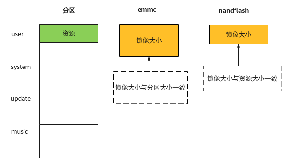

## FAT文件系统镜像制作与烧录<a name="ZH-CN_TOPIC_0000002466383544"></a>

-   **[概述](#ZH-CN_TOPIC_0000002499502477)**  

-   **[开发指导](#ZH-CN_TOPIC_0000002499582541)**  

-   **[编译指导](#ZH-CN_TOPIC_0000002499502505)**  

-   **[烧录指导](#ZH-CN_TOPIC_0000002466383540)**  

### 概述<a name="ZH-CN_TOPIC_0000002499502477"></a>

制作FAT文件系统镜像前，需要确认当前所有分区的大小，这个需要通过A核启动初始化日志中查看，这个数值决定了生成img的大小。当前eMMC默认设定大小为4GB，第一分区默认为boot分区。

### 开发指导<a name="ZH-CN_TOPIC_0000002499582541"></a>

FAT的文件系统镜像相关工具在SDK的“build\\config\\target\_config\\3322\\mk\_emmc\_image”目录下。

制作文件系统镜像前，需要按照实际使用配置修改以下参数，配置参数都位于“mkfatimgtool.py”脚本内头部，如下所示：

-   image\_name：生成镜像的文件名，当前默认为“file”，生成文件名为“file.bin”。
-   cfg\_sector\_size：eMMC器件单扇区字节数，默认为512Byte。
-   partition\_list：FAT文件系统的分区配置，具体配置说明如下：

    ```
    partition_list = [
        [os.path.join(cur_dir, 'fs', 'boot'), "6000", "file_boot.bin"],   # boot, 分区大小不能大于6000KB
        [os.path.join(cur_dir, 'fs', 'system'), "1572833", "file_system.bin"],   # system, 分区大小不能大于1572833KB
        [os.path.join(cur_dir, 'fs', 'inner'), "131072", "file_inner.bin"],     # inner, 分区大小不能大于131072KB
        [os.path.join(cur_dir, 'fs', 'systembk'), "262144", "file_systembk.bin"],   # systembk, 分区大小不能大于262144KB
        [os.path.join(cur_dir, 'fs', 'user'), "263000", "file_user.bin"],       # user, 分区大小不能大于emmc剩余大小
    ]
    ```

    以上参数格式为\[资源文件路径， 分区大小， 生成的镜像文件名\]，其中资源文件路径为装有烧录资源文件的路径，默认为脚本当前目录下的fs目录。

    分区大小为要生成镜像的KB大小。

> **说明：** 
>-   当前支持生成一个文件系统镜像，默认挂载所有分区。分区大小必须根据实际eMMC初始化容量填写，如果填写比实际容量小，则会造成未填写大小的容量无法使用，导致容量浪费。如果填写比实际容量大，则烧录会覆盖下一个分区的FAT头数据，可能导致下一个分区无法读取和使用。
>-   APP核的分区大小配置请参见“[注意事项](#ZH-CN_TOPIC_0000002466383556)”，当前系统默认配置是eMMC按照4GB容量配置，如果资源文件大于分区大小，则需要适配A核分区的大小，提高到适宜值。如果资源文件较少，无需那么大空间，为了降低烧录时间，可以适当降低分区的大小。

### 编译指导<a name="ZH-CN_TOPIC_0000002499502505"></a>

**Windows环境下制作filebin文件方法<a name="zh-cn_topic_0000002420394440_section16957153451413"></a>**

支持烧录FAT文件系统镜像作为loaderboot功能特性，默认不打开。如需打开需要进行编译配置，具体步骤如下：

1.  loaderboot编译配置（当前默认开启），需要在loaderboot target中添加宏：SUPPORT\_EMMC\_LOADERBOOT、PROVISION\_WRITE\_WITH\_INTERFACE，以及添加组件：3322\_loaderboot\_emmc，chip\_boot\_config。

    SDK代码路径：build/config/target\_config/3322/target\_config.py

    **图 1**  在loaderboot target中添加宏<a name="zh-cn_topic_0000002420394440_fig105mcpsimp"></a>  
    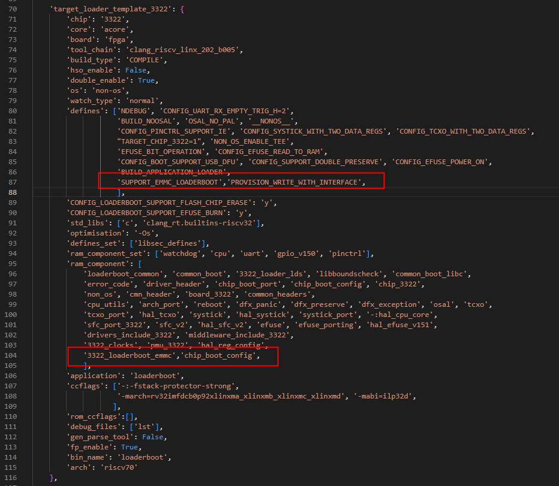

2.  application编译配置，在对应的ACore target（SDK代码路径：build\\config\\target\_config\\3322\\config.py）中将fs\_image的开关置为True，编译后生成的文件系统镜像位于output目录中（SDK代码路径：output/3322），如[图2](#zh-cn_topic_0000002420394440_fig85425351112)所示

    > **须知：** 
    >Linux环境下，制作镜像前需要执行指令：
    >sudo apt-get update
    >sudo apt-get install dosfstools

    **图 2**  将fs\_image设置为true<a name="zh-cn_topic_0000002420394440_fig85425351112"></a>  
    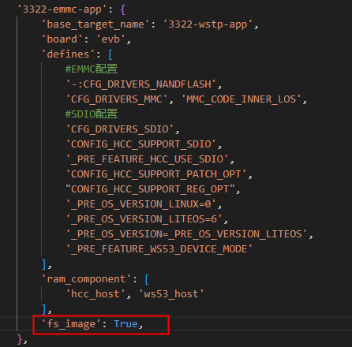

    Windows环境下制作镜像：

    如生成镜像的过程中，有报**拒绝访问**错误，则是FAT文件系统镜像制作工具（mkfatimg.exe）缺失权限导致，需要配置工具权限，方法如下：

    1.  选中mkfatimg.exe程序，右键选中属性，如下属性配置框，选择“安全”标签，在“组或者用户名”选择“everyone”，点击“高级”按钮。

        **图 3**  属性配置框<a name="zh-cn_topic_0000002420394440_fig1443654551417"></a>  
        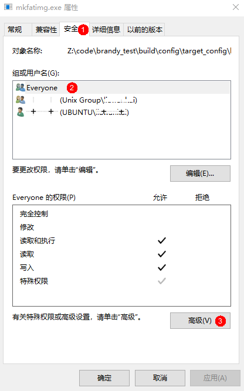

    2.  进入到“高级”按钮对话框后，如下图，双击“权限条目”中的“Everyone”选项，出现配置权限弹窗。

        **图 4**  高级安全设置<a name="zh-cn_topic_0000002420394440_fig15111111118158"></a>  
        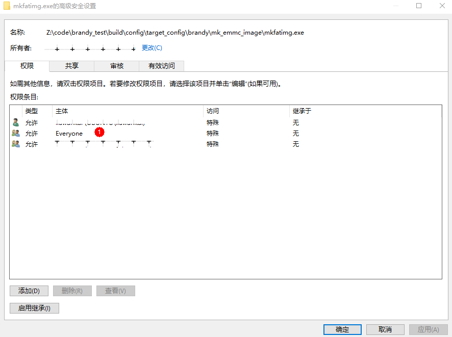

    3.  配置权限弹窗，请确保“读取和执行”有被选中。

        **图 5**  配置权限弹窗<a name="zh-cn_topic_0000002420394440_fig369282416153"></a>  
        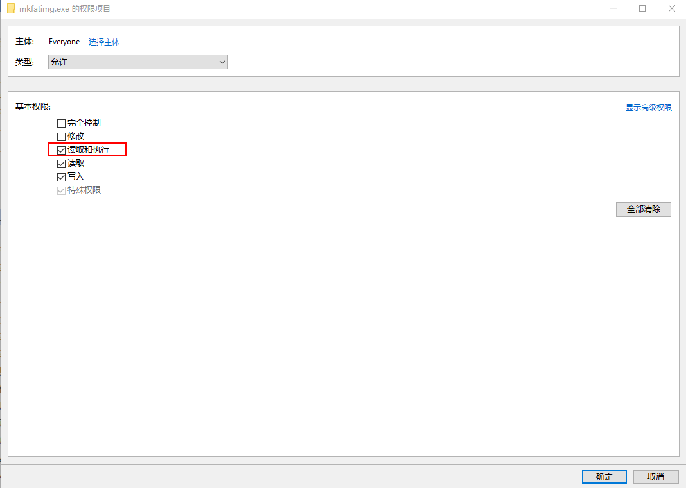

    4.  配置完成后，点击所有窗口“确定”按钮，完成权限配置。

3.  执行对应target的pack命令，生成对应版本包。

### 烧录指导<a name="ZH-CN_TOPIC_0000002466383540"></a>

> **说明：** 
>1.  由于FAT文件系统镜像较大，建议使用USB烧录的方式进行烧录，减少烧录耗时。
>2.  eMMC烧录时的地址单位不是字节而是扇区（512Byte），例如烧录地址为0x76000800，代表烧录的起始地址为eMMC的第2048（即0x800）个扇区，其中0x76000000为偏移量。

选择上述loaderboot和application编译后生成的PKG包，即可使用BurnTool工具进行版本整包烧录，其中“file.bin”为制作的文件系统镜像，默认勾选即可烧录。由于文件系统镜像“file.bin”实现在loaderboot阶段烧录进eMMC器件，所以文件系统镜像“file.bin”需要与编译的loaderboot同时烧录。

**图 1**  烧录示意图<a name="zh-cn_topic_0000002454113293_fig1355781614147"></a>  
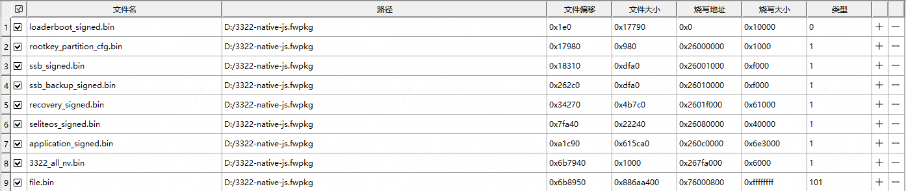

## YAFFS文件系统镜像制作与烧录<a name="ZH-CN_TOPIC_0000002499502485"></a>

> **说明：** 
>由于YAFFS文件系统镜像制作工具（mkyaffs2image）只有Linux版本，所以本文下述章节约束说明，YAFFS文件系统镜像制作需要在Linux环境进行。

-   **[概述](#ZH-CN_TOPIC_0000002499502509)**  

-   **[开发指导](#ZH-CN_TOPIC_0000002499502513)**  

-   **[编译指导](#ZH-CN_TOPIC_0000002466543180)**  

-   **[烧录指导](#ZH-CN_TOPIC_0000002466543156)**  

### 概述<a name="ZH-CN_TOPIC_0000002499502509"></a>

制作YAFFS文件系统镜像前，需要确认以下两点：

1.  使用的NAND Flash器件参数，具体参数如下：
    -   blocks（文件块个数）
    -   pages\_per\_block（每个文件块包含的页数）
    -   bytes\_per\_page（每页包含的字节数）
    -   bytes\_per\_oob（每个oob包含的字节数）

        例：NAND Flash的容量大小为512MB，该器件有4096个block，每个block有64个页，每页有2048个字节，每个oob区包含64个字节。

2.  当前版本的文件系统分区大小。

    例：文件系统默认分三个区，boot分区，大小占5%；system分区，大小占25%；user分区，大小占70%。

    其中分区百分比主要用于计算block大小，system分区大小占比25%，即表示它占用的block数为4096×25%=1024，system分区实际占用的字节数=1024×64×2048=134217728yte=0x8000000Byte，其他分区也使用同样方式进行计算，可以得出分区字节大小。

> **须知：** 
>上述配置参数（blocks、pages\_per\_block、bytes\_per\_page和bytes\_per\_obb）必须和当前使用的NAND Flash器件参数相同，否则制作的文件系统镜像会出现读写异常。
>相关参数可查阅使用的NAND Flash器件手册或咨询厂家获取。

### 开发指导<a name="ZH-CN_TOPIC_0000002499502513"></a>

编译YAFFS文件系统镜像的脚本为Python3脚本，路径：build/config/target\_config/3322/mk\_fs\_image/mkyaffs2tool.py。

制作文件系统镜像前，需要按照实际使用配置修改以下参数，配置参数都位于“mkyaffs2tool.py”脚本内头部，如下所示：

1.  image\_name：生成镜像的文件名，当前默认为“file”，生成文件名为“file.bin”。
2.  cfg\_page\_size：NAND Flash器件的bytes\_per\_page值，以实际器件为准。
3.  cfg\_oob\_size：NAND Flash器件的bytes\_per\_oob值，以实际器件为准。
4.  partition\_list：YAFFS文件系统的分区配置，具体配置说明如下：

    ```
    partition_list = [
        [os.path.join(cur_dir, 'fs', 'boot'), "0x1980000"],
        [os.path.join(cur_dir, 'fs', 'systerm'), "0x8000000"],
        [os.path.join(cur_dir, 'fs', 'user'), "null"],
    ]
    ```

每个分区都是partition\_list中的一个元素，而每个分区元素要包含制作的文件路径和分区大小信息，文件路径为相对于“mkyaffs2tool.py”脚本所在位置的相对路径，分区大小信息为十六进制。

如上示例配置，文件系统镜像包含三个分区目录，分别包含当前目录fs下的boot，system和user三个子目录，大小分别为0x1980000，0x8000000和剩余空间。这样做出来的文件系统镜像是包含boot、system和user分区的。如果只需要单分区的镜像，只保留该分区的配置即可。

需要注意的是文件系统的最后一个分区的大小可不指定，直接置成null即可，默认使用剩余空间。文件系统单分区时，请直接置为null即可，无需设置大小。

最后将需要制作的资源文件放到fs目录下对应的文件夹中即可。

> **说明：** 
>当前生成的文件系统镜像大小是由YAFFS文件系统的分区配置和资源文件的大小决定的，如果放在除最后一个分区的其他分区内的资源文件不足以填满这个分区，那剩下空间将填充0xFF数据，保证镜像文件内包含分区数据。只有最后一个分区只填充资源文件，不会填充0xFF数据。所以，如果想降低生成镜像大小，首先除最后分区以外的其他分区的大小尽量缩小，其次将资源文件都放在除最后分区的其他分区内。

举例：

1.  当前使用情况，前面一个分区占30%，最后一个分区占70%。

    资源文件放在前一个分区内，则最终镜像大小＝总空间×30%。

    资源文件放在最后分区，则最终镜像大小＝总空间×30%＋资源文件大小。

2.  如果将前一个分区的大小修改为20%，最后一个分区大小占80%

    资源文件放在前面分区内，则最终镜像大小＝总空间×20%。

    资源文件放在最后分区，则最终镜像大小＝总空间×20%＋资源文件大小。

3.  如果将4个分区修改成一个分区

    则最终镜像大小＝资源文件大小。

### 编译指导<a name="ZH-CN_TOPIC_0000002466543180"></a>

支持烧录YAFFS文件系统镜像作为loaderboot功能特性，默认不打开。如需打开需要进行编译配置。

1.  loaderboot编译配置（当前默认开启），需要在loaderboot target中添加宏：SUPPORT\_FMC\_NAND，PROVISION\_WRITE\_WITH\_INTERFACE；以及添加组件：3322\_loaderboot\_fmc，chip\_boot\_config。

    SDK代码路径：build/config/target\_config/3322/target\_config.py

    **图 1**  在loaderboot target中添加宏<a name="zh-cn_topic_0000002454113297_fig578mcpsimp"></a>  
    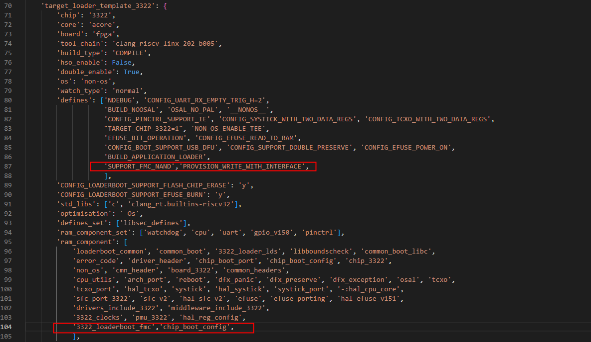

2.  application编译配置，在对应的ACore target（SDK代码路径：build\\config\\target\_config\\3322\\config.py）中将fs\_image的开关置成True，编译后生成的文件系统镜像位于output目录中（SDK代码路径：output/3322）。

    **图 2**  fs\_image的开关置为True<a name="zh-cn_topic_0000002454113297_fig1987417288212"></a>  
    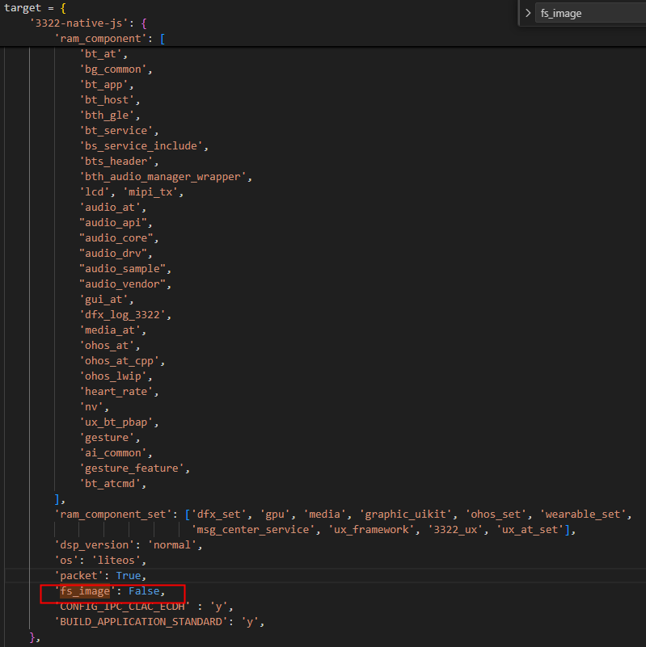

> **说明：** 
>编译补充：
>由于YAFFS文件系统镜像制作工具（mkyaffs2image）只支持在Linux系统上使用，所以给出在Window系统上编译带有镜像的版本包方法：
>1.  镜像依旧需要在Linux系统上生成，跳转到“build/config/target\_config/3322/mk\_fs\_image/mkyaffs2tool.py”目录下，然后执行“python3 mkyaffs2tool.py”指令。
>2.  将生成在“build/config/target\_config/3322/mk\_fs\_image/mkyaffs2tool.py”目录中的“file.bin”文件复制到Window系统上相同路径的目录中。
>3.  按照上述编译指导配置相关参数，然后进行编译，即可将“file.bin”镜像打包到版本包中。

### 烧录指导<a name="ZH-CN_TOPIC_0000002466543156"></a>

> **说明：** 
>1.  由于YAFFS文件系统镜像较大，建议使用USB烧录的方式进行烧录，减少烧录耗时。
>2.  NandFlash烧录的地址单位为字节，例如烧录起始地址为0x36020000，指的是烧录起始位置从NandFlash的0x20000字节开始，其中0x36000000为偏移量。

1.  选择上述loaderboot和application编译后生成的PKG包，即可使用BurnTool工具进行版本整包烧录，其中“file.bin”为制作的文件系统镜像，默认勾选即可烧录。

    **图 1**  烧录示意图<a name="zh-cn_topic_0000002453993209_fig353mcpsimp"></a>  
    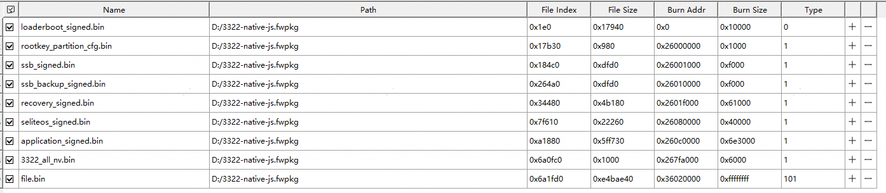

2.  由于文件系统镜像“file.bin”实现在loaderboot阶段烧录进NandFlash器件，所以文件系统镜像“file.bin”需要与编译的loaderboot同时烧录。

# 缩略语<a name="ZH-CN_TOPIC_0000002499502501"></a>

<a name="zh-cn_topic_0000002442033498_table47305185214"></a>
<table><tbody><tr id="zh-cn_topic_0000002442033498_row1179842116318"><td class="nocellnorowborder" style="border:none" valign="top" width="24.112411241124114%"><p id="zh-cn_topic_0000002442033498_p16798192117315"><a name="zh-cn_topic_0000002442033498_p16798192117315"></a><a name="zh-cn_topic_0000002442033498_p16798192117315"></a><strong id="zh-cn_topic_0000002442033498_b14641542173"><a name="zh-cn_topic_0000002442033498_b14641542173"></a><a name="zh-cn_topic_0000002442033498_b14641542173"></a>B</strong></p>
</td>
<td class="nocellnorowborder" style="border:none" valign="top" width="42.55425542554255%">&nbsp;&nbsp;</td>
<td class="cell-norowborder" style="border:none" valign="top" width="33.33333333333333%">&nbsp;&nbsp;</td>
</tr>
<tr id="zh-cn_topic_0000002442033498_row7650145411611"><td class="nocellnorowborder" style="border:none" valign="top" width="24.112411241124114%"><p id="zh-cn_topic_0000002442033498_p13650185421616"><a name="zh-cn_topic_0000002442033498_p13650185421616"></a><a name="zh-cn_topic_0000002442033498_p13650185421616"></a><strong id="zh-cn_topic_0000002442033498_b144651645170"><a name="zh-cn_topic_0000002442033498_b144651645170"></a><a name="zh-cn_topic_0000002442033498_b144651645170"></a>BIOS</strong></p>
</td>
<td class="nocellnorowborder" style="border:none" valign="top" width="42.55425542554255%"><p id="zh-cn_topic_0000002442033498_p18650145411164"><a name="zh-cn_topic_0000002442033498_p18650145411164"></a><a name="zh-cn_topic_0000002442033498_p18650145411164"></a>Basic Input/Output System</p>
</td>
<td class="cell-norowborder" style="border:none" valign="top" width="33.33333333333333%"><p id="zh-cn_topic_0000002442033498_p4650155417167"><a name="zh-cn_topic_0000002442033498_p4650155417167"></a><a name="zh-cn_topic_0000002442033498_p4650155417167"></a>基本输入输出系统</p>
</td>
</tr>
<tr id="zh-cn_topic_0000002442033498_row107981921834"><td class="nocellnorowborder" style="border:none" valign="top" width="24.112411241124114%"><p id="zh-cn_topic_0000002442033498_p1779832110312"><a name="zh-cn_topic_0000002442033498_p1779832110312"></a><a name="zh-cn_topic_0000002442033498_p1779832110312"></a><strong id="zh-cn_topic_0000002442033498_b3466440176"><a name="zh-cn_topic_0000002442033498_b3466440176"></a><a name="zh-cn_topic_0000002442033498_b3466440176"></a>BPB</strong></p>
</td>
<td class="nocellnorowborder" style="border:none" valign="top" width="42.55425542554255%"><p id="zh-cn_topic_0000002442033498_p16798182114310"><a name="zh-cn_topic_0000002442033498_p16798182114310"></a><a name="zh-cn_topic_0000002442033498_p16798182114310"></a>BIOS Parameter Block</p>
</td>
<td class="cell-norowborder" style="border:none" valign="top" width="33.33333333333333%"><p id="zh-cn_topic_0000002442033498_p179171317171612"><a name="zh-cn_topic_0000002442033498_p179171317171612"></a><a name="zh-cn_topic_0000002442033498_p179171317171612"></a>BIOS参数块</p>
</td>
</tr>
<tr id="zh-cn_topic_0000002442033498_row13742051165216"><td class="nocellnorowborder" style="border:none" valign="top" width="24.112411241124114%">&nbsp;&nbsp;</td>
<td class="nocellnorowborder" style="border:none" valign="top" width="42.55425542554255%">&nbsp;&nbsp;</td>
<td class="cell-norowborder" style="border:none" valign="top" width="33.33333333333333%">&nbsp;&nbsp;</td>
</tr>
<tr id="zh-cn_topic_0000002442033498_row174155113525"><td class="nocellnorowborder" style="border:none" valign="top" width="24.112411241124114%"><p id="zh-cn_topic_0000002442033498_p0741251145217"><a name="zh-cn_topic_0000002442033498_p0741251145217"></a><a name="zh-cn_topic_0000002442033498_p0741251145217"></a><strong id="zh-cn_topic_0000002442033498_b174671421719"><a name="zh-cn_topic_0000002442033498_b174671421719"></a><a name="zh-cn_topic_0000002442033498_b174671421719"></a>D</strong></p>
</td>
<td class="nocellnorowborder" style="border:none" valign="top" width="42.55425542554255%">&nbsp;&nbsp;</td>
<td class="cell-norowborder" style="border:none" valign="top" width="33.33333333333333%">&nbsp;&nbsp;</td>
</tr>
<tr id="zh-cn_topic_0000002442033498_row12741519529"><td class="nocellnorowborder" style="border:none" valign="top" width="24.112411241124114%"><p id="zh-cn_topic_0000002442033498_p6748518520"><a name="zh-cn_topic_0000002442033498_p6748518520"></a><a name="zh-cn_topic_0000002442033498_p6748518520"></a><strong id="zh-cn_topic_0000002442033498_b74676471716"><a name="zh-cn_topic_0000002442033498_b74676471716"></a><a name="zh-cn_topic_0000002442033498_b74676471716"></a>DBR</strong></p>
</td>
<td class="nocellnorowborder" style="border:none" valign="top" width="42.55425542554255%"><p id="zh-cn_topic_0000002442033498_p147445135220"><a name="zh-cn_topic_0000002442033498_p147445135220"></a><a name="zh-cn_topic_0000002442033498_p147445135220"></a>DOS Boot Report</p>
</td>
<td class="cell-norowborder" style="border:none" valign="top" width="33.33333333333333%"><p id="zh-cn_topic_0000002442033498_p1674351145215"><a name="zh-cn_topic_0000002442033498_p1674351145215"></a><a name="zh-cn_topic_0000002442033498_p1674351145215"></a>DOS引导记录</p>
</td>
</tr>
<tr id="zh-cn_topic_0000002442033498_row1064912181023"><td class="nocellnorowborder" style="border:none" valign="top" width="24.112411241124114%"><p id="zh-cn_topic_0000002442033498_p16491118123"><a name="zh-cn_topic_0000002442033498_p16491118123"></a><a name="zh-cn_topic_0000002442033498_p16491118123"></a><strong id="zh-cn_topic_0000002442033498_b134683418172"><a name="zh-cn_topic_0000002442033498_b134683418172"></a><a name="zh-cn_topic_0000002442033498_b134683418172"></a>DOS</strong></p>
</td>
<td class="nocellnorowborder" style="border:none" valign="top" width="42.55425542554255%"><p id="zh-cn_topic_0000002442033498_p1164910181026"><a name="zh-cn_topic_0000002442033498_p1164910181026"></a><a name="zh-cn_topic_0000002442033498_p1164910181026"></a>Disk Operating System</p>
</td>
<td class="cell-norowborder" style="border:none" valign="top" width="33.33333333333333%"><p id="zh-cn_topic_0000002442033498_p264991820213"><a name="zh-cn_topic_0000002442033498_p264991820213"></a><a name="zh-cn_topic_0000002442033498_p264991820213"></a>磁盘操作系统</p>
</td>
</tr>
<tr id="zh-cn_topic_0000002442033498_row3741551165219"><td class="nocellnorowborder" style="border:none" valign="top" width="24.112411241124114%">&nbsp;&nbsp;</td>
<td class="nocellnorowborder" style="border:none" valign="top" width="42.55425542554255%">&nbsp;&nbsp;</td>
<td class="cell-norowborder" style="border:none" valign="top" width="33.33333333333333%">&nbsp;&nbsp;</td>
</tr>
<tr id="zh-cn_topic_0000002442033498_row147435115527"><td class="nocellnorowborder" style="border:none" valign="top" width="24.112411241124114%"><p id="zh-cn_topic_0000002442033498_p137485145212"><a name="zh-cn_topic_0000002442033498_p137485145212"></a><a name="zh-cn_topic_0000002442033498_p137485145212"></a><strong id="zh-cn_topic_0000002442033498_b34698481718"><a name="zh-cn_topic_0000002442033498_b34698481718"></a><a name="zh-cn_topic_0000002442033498_b34698481718"></a>E</strong></p>
</td>
<td class="nocellnorowborder" style="border:none" valign="top" width="42.55425542554255%">&nbsp;&nbsp;</td>
<td class="cell-norowborder" style="border:none" valign="top" width="33.33333333333333%">&nbsp;&nbsp;</td>
</tr>
<tr id="zh-cn_topic_0000002442033498_row25820461545"><td class="nocellnorowborder" style="border:none" valign="top" width="24.112411241124114%"><p id="zh-cn_topic_0000002442033498_p658213461941"><a name="zh-cn_topic_0000002442033498_p658213461941"></a><a name="zh-cn_topic_0000002442033498_p658213461941"></a><strong id="zh-cn_topic_0000002442033498_b1047010401712"><a name="zh-cn_topic_0000002442033498_b1047010401712"></a><a name="zh-cn_topic_0000002442033498_b1047010401712"></a>ECC</strong></p>
</td>
<td class="nocellnorowborder" style="border:none" valign="top" width="42.55425542554255%"><p id="zh-cn_topic_0000002442033498_p175823462411"><a name="zh-cn_topic_0000002442033498_p175823462411"></a><a name="zh-cn_topic_0000002442033498_p175823462411"></a>Error Correcting Code</p>
</td>
<td class="cell-norowborder" style="border:none" valign="top" width="33.33333333333333%"><p id="zh-cn_topic_0000002442033498_p95822461416"><a name="zh-cn_topic_0000002442033498_p95822461416"></a><a name="zh-cn_topic_0000002442033498_p95822461416"></a>纠错码</p>
</td>
</tr>
<tr id="zh-cn_topic_0000002442033498_row5746515521"><td class="nocellnorowborder" style="border:none" valign="top" width="24.112411241124114%"><p id="zh-cn_topic_0000002442033498_p2974192735519"><a name="zh-cn_topic_0000002442033498_p2974192735519"></a><a name="zh-cn_topic_0000002442033498_p2974192735519"></a><strong id="zh-cn_topic_0000002442033498_b12974162755511"><a name="zh-cn_topic_0000002442033498_b12974162755511"></a><a name="zh-cn_topic_0000002442033498_b12974162755511"></a>eMMC</strong></p>
</td>
<td class="nocellnorowborder" style="border:none" valign="top" width="42.55425542554255%"><p id="zh-cn_topic_0000002442033498_p3974122745518"><a name="zh-cn_topic_0000002442033498_p3974122745518"></a><a name="zh-cn_topic_0000002442033498_p3974122745518"></a>Embedded Multimedia Controller</p>
</td>
<td class="cell-norowborder" style="border:none" valign="top" width="33.33333333333333%"><p id="zh-cn_topic_0000002442033498_p13974112795516"><a name="zh-cn_topic_0000002442033498_p13974112795516"></a><a name="zh-cn_topic_0000002442033498_p13974112795516"></a>嵌入式多媒体控制器</p>
</td>
</tr>
<tr id="zh-cn_topic_0000002442033498_row67485125219"><td class="nocellnorowborder" style="border:none" valign="top" width="24.112411241124114%">&nbsp;&nbsp;</td>
<td class="nocellnorowborder" style="border:none" valign="top" width="42.55425542554255%">&nbsp;&nbsp;</td>
<td class="cell-norowborder" style="border:none" valign="top" width="33.33333333333333%">&nbsp;&nbsp;</td>
</tr>
<tr id="zh-cn_topic_0000002442033498_row167519519523"><td class="nocellnorowborder" style="border:none" valign="top" width="24.112411241124114%"><p id="zh-cn_topic_0000002442033498_p187535119523"><a name="zh-cn_topic_0000002442033498_p187535119523"></a><a name="zh-cn_topic_0000002442033498_p187535119523"></a><strong id="zh-cn_topic_0000002442033498_b1147218413174"><a name="zh-cn_topic_0000002442033498_b1147218413174"></a><a name="zh-cn_topic_0000002442033498_b1147218413174"></a>F</strong></p>
</td>
<td class="nocellnorowborder" style="border:none" valign="top" width="42.55425542554255%">&nbsp;&nbsp;</td>
<td class="cell-norowborder" style="border:none" valign="top" width="33.33333333333333%">&nbsp;&nbsp;</td>
</tr>
<tr id="zh-cn_topic_0000002442033498_row1475165110529"><td class="nocellnorowborder" style="border:none" valign="top" width="24.112411241124114%"><p id="zh-cn_topic_0000002442033498_p175125115218"><a name="zh-cn_topic_0000002442033498_p175125115218"></a><a name="zh-cn_topic_0000002442033498_p175125115218"></a><strong id="zh-cn_topic_0000002442033498_b747311420176"><a name="zh-cn_topic_0000002442033498_b747311420176"></a><a name="zh-cn_topic_0000002442033498_b747311420176"></a>FAT</strong></p>
</td>
<td class="nocellnorowborder" style="border:none" valign="top" width="42.55425542554255%"><p id="zh-cn_topic_0000002442033498_p107514515528"><a name="zh-cn_topic_0000002442033498_p107514515528"></a><a name="zh-cn_topic_0000002442033498_p107514515528"></a>File Allocation Table</p>
</td>
<td class="cell-norowborder" style="border:none" valign="top" width="33.33333333333333%"><p id="zh-cn_topic_0000002442033498_p27575145210"><a name="zh-cn_topic_0000002442033498_p27575145210"></a><a name="zh-cn_topic_0000002442033498_p27575145210"></a>文件分配表</p>
</td>
</tr>
<tr id="zh-cn_topic_0000002442033498_row4751351115210"><td class="nocellnorowborder" style="border:none" valign="top" width="24.112411241124114%">&nbsp;&nbsp;</td>
<td class="nocellnorowborder" style="border:none" valign="top" width="42.55425542554255%">&nbsp;&nbsp;</td>
<td class="cell-norowborder" style="border:none" valign="top" width="33.33333333333333%">&nbsp;&nbsp;</td>
</tr>
<tr id="zh-cn_topic_0000002442033498_row148721401161"><td class="nocellnorowborder" style="border:none" valign="top" width="24.112411241124114%"><p id="zh-cn_topic_0000002442033498_p11872200611"><a name="zh-cn_topic_0000002442033498_p11872200611"></a><a name="zh-cn_topic_0000002442033498_p11872200611"></a><strong id="zh-cn_topic_0000002442033498_b247564101712"><a name="zh-cn_topic_0000002442033498_b247564101712"></a><a name="zh-cn_topic_0000002442033498_b247564101712"></a>U</strong></p>
</td>
<td class="nocellnorowborder" style="border:none" valign="top" width="42.55425542554255%">&nbsp;&nbsp;</td>
<td class="cell-norowborder" style="border:none" valign="top" width="33.33333333333333%">&nbsp;&nbsp;</td>
</tr>
<tr id="zh-cn_topic_0000002442033498_row1187270662"><td class="nocellnorowborder" style="border:none" valign="top" width="24.112411241124114%"><p id="zh-cn_topic_0000002442033498_p27099261866"><a name="zh-cn_topic_0000002442033498_p27099261866"></a><a name="zh-cn_topic_0000002442033498_p27099261866"></a><strong id="zh-cn_topic_0000002442033498_b07098261163"><a name="zh-cn_topic_0000002442033498_b07098261163"></a><a name="zh-cn_topic_0000002442033498_b07098261163"></a>UART</strong></p>
</td>
<td class="nocellnorowborder" style="border:none" valign="top" width="42.55425542554255%"><p id="zh-cn_topic_0000002442033498_p670917261068"><a name="zh-cn_topic_0000002442033498_p670917261068"></a><a name="zh-cn_topic_0000002442033498_p670917261068"></a>Universal Asynchronous Receiver/Transmitter</p>
</td>
<td class="cell-norowborder" style="border:none" valign="top" width="33.33333333333333%"><p id="zh-cn_topic_0000002442033498_p7709152620619"><a name="zh-cn_topic_0000002442033498_p7709152620619"></a><a name="zh-cn_topic_0000002442033498_p7709152620619"></a>通用异步收发传输器</p>
</td>
</tr>
<tr id="zh-cn_topic_0000002442033498_row1987311019620"><td class="nocellnorowborder" style="border:none" valign="top" width="24.112411241124114%">&nbsp;&nbsp;</td>
<td class="nocellnorowborder" style="border:none" valign="top" width="42.55425542554255%">&nbsp;&nbsp;</td>
<td class="cell-norowborder" style="border:none" valign="top" width="33.33333333333333%">&nbsp;&nbsp;</td>
</tr>
<tr id="zh-cn_topic_0000002442033498_row5761851175218"><td class="nocellnorowborder" style="border:none" valign="top" width="24.112411241124114%"><p id="zh-cn_topic_0000002442033498_p9762519529"><a name="zh-cn_topic_0000002442033498_p9762519529"></a><a name="zh-cn_topic_0000002442033498_p9762519529"></a><strong id="zh-cn_topic_0000002442033498_b947618471715"><a name="zh-cn_topic_0000002442033498_b947618471715"></a><a name="zh-cn_topic_0000002442033498_b947618471715"></a>V</strong></p>
</td>
<td class="nocellnorowborder" style="border:none" valign="top" width="42.55425542554255%">&nbsp;&nbsp;</td>
<td class="cell-norowborder" style="border:none" valign="top" width="33.33333333333333%">&nbsp;&nbsp;</td>
</tr>
<tr id="zh-cn_topic_0000002442033498_row1876105165212"><td class="nocellnorowborder" style="border:none" valign="top" width="24.112411241124114%"><p id="zh-cn_topic_0000002442033498_p0761251155218"><a name="zh-cn_topic_0000002442033498_p0761251155218"></a><a name="zh-cn_topic_0000002442033498_p0761251155218"></a><strong id="zh-cn_topic_0000002442033498_b147710471716"><a name="zh-cn_topic_0000002442033498_b147710471716"></a><a name="zh-cn_topic_0000002442033498_b147710471716"></a>VFAT</strong></p>
</td>
<td class="nocellnorowborder" style="border:none" valign="top" width="42.55425542554255%"><p id="zh-cn_topic_0000002442033498_p1576115195215"><a name="zh-cn_topic_0000002442033498_p1576115195215"></a><a name="zh-cn_topic_0000002442033498_p1576115195215"></a>Virtual File Allocation Table</p>
</td>
<td class="cell-norowborder" style="border:none" valign="top" width="33.33333333333333%"><p id="zh-cn_topic_0000002442033498_p476175175218"><a name="zh-cn_topic_0000002442033498_p476175175218"></a><a name="zh-cn_topic_0000002442033498_p476175175218"></a>虚拟文件分配表</p>
</td>
</tr>
<tr id="zh-cn_topic_0000002442033498_row876125114521"><td class="nocellnorowborder" style="border:none" valign="top" width="24.112411241124114%"><p id="zh-cn_topic_0000002442033498_p127655115524"><a name="zh-cn_topic_0000002442033498_p127655115524"></a><a name="zh-cn_topic_0000002442033498_p127655115524"></a><strong id="zh-cn_topic_0000002442033498_b164783418174"><a name="zh-cn_topic_0000002442033498_b164783418174"></a><a name="zh-cn_topic_0000002442033498_b164783418174"></a>VFS</strong></p>
</td>
<td class="nocellnorowborder" style="border:none" valign="top" width="42.55425542554255%"><p id="zh-cn_topic_0000002442033498_p576175165212"><a name="zh-cn_topic_0000002442033498_p576175165212"></a><a name="zh-cn_topic_0000002442033498_p576175165212"></a>Virtual File System</p>
</td>
<td class="cell-norowborder" style="border:none" valign="top" width="33.33333333333333%"><p id="zh-cn_topic_0000002442033498_p1876145112526"><a name="zh-cn_topic_0000002442033498_p1876145112526"></a><a name="zh-cn_topic_0000002442033498_p1876145112526"></a>虚拟文件系统</p>
</td>
</tr>
<tr id="zh-cn_topic_0000002442033498_row97721851125513"><td class="cellrowborder" style="border:none" valign="top" width="24.112411241124114%">&nbsp;&nbsp;</td>
<td class="cellrowborder" style="border:none" valign="top" width="42.55425542554255%">&nbsp;&nbsp;</td>
<td class="cellrowborder" style="border:none" valign="top" width="33.33333333333333%">&nbsp;&nbsp;</td>
</tr>
<tr id="zh-cn_topic_0000002442033498_row1252873732616"><td class="cellrowborder" style="border:none" valign="top" width="24.112411241124114%"><p id="zh-cn_topic_0000002442033498_p18169163902619"><a name="zh-cn_topic_0000002442033498_p18169163902619"></a><a name="zh-cn_topic_0000002442033498_p18169163902619"></a><strong id="zh-cn_topic_0000002442033498_b15169439112614"><a name="zh-cn_topic_0000002442033498_b15169439112614"></a><a name="zh-cn_topic_0000002442033498_b15169439112614"></a>Y</strong></p>
</td>
<td class="cellrowborder" style="border:none" valign="top" width="42.55425542554255%">&nbsp;&nbsp;</td>
<td class="cellrowborder" style="border:none" valign="top" width="33.33333333333333%">&nbsp;&nbsp;</td>
</tr>
<tr id="zh-cn_topic_0000002442033498_row145291237132613"><td class="cellrowborder" style="border:none" valign="top" width="24.112411241124114%"><p id="zh-cn_topic_0000002442033498_p1316983914267"><a name="zh-cn_topic_0000002442033498_p1316983914267"></a><a name="zh-cn_topic_0000002442033498_p1316983914267"></a><strong id="zh-cn_topic_0000002442033498_b1416923910269"><a name="zh-cn_topic_0000002442033498_b1416923910269"></a><a name="zh-cn_topic_0000002442033498_b1416923910269"></a>YAFFS</strong></p>
</td>
<td class="cellrowborder" style="border:none" valign="top" width="42.55425542554255%"><p id="zh-cn_topic_0000002442033498_p71691539122616"><a name="zh-cn_topic_0000002442033498_p71691539122616"></a><a name="zh-cn_topic_0000002442033498_p71691539122616"></a>Yet Another Flash File System</p>
</td>
<td class="cellrowborder" style="border:none" valign="top" width="33.33333333333333%"><p id="zh-cn_topic_0000002442033498_p1416933919267"><a name="zh-cn_topic_0000002442033498_p1416933919267"></a><a name="zh-cn_topic_0000002442033498_p1416933919267"></a>适用于嵌入式系统的文件系统</p>
</td>
</tr>
</tbody>
</table>

