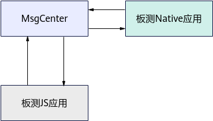
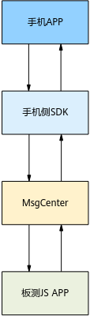
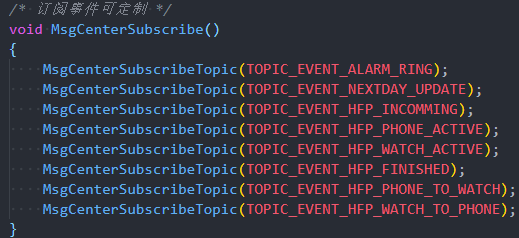
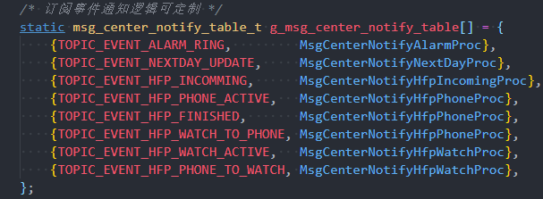
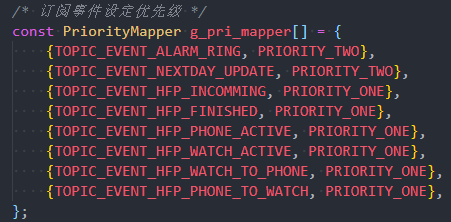
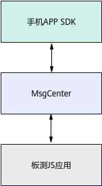
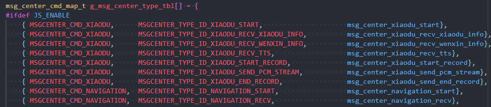

# 前言

**概述**

本文档主要介绍消息中心的实现机制，用于指导客户使用消息中心进行Native应用开发、JS应用开发。

**读者对象**

本文档主要适用于以下工程师：

-   技术支持工程师
-   软件开发工程师

**符号约定**

在本文中可能出现下列标志，它们所代表的含义如下。

<table><thead align="left"><tr id="zh-cn_topic_0000002468969310_row1530720816410"><th class="cellrowborder" valign="top" width="20.580000000000002%" id="mcps1.1.3.1.1">
<strong id="zh-cn_topic_0000002468969310_b2136615816410">符号</strong>

</th>
<th class="cellrowborder" valign="top" width="79.42%" id="mcps1.1.3.1.2">
<strong id="zh-cn_topic_0000002468969310_b5941558116410">说明</strong>

</th>
</tr>
</thead>
<tbody><tr id="zh-cn_topic_0000002468969310_row1372280416410"><td class="cellrowborder" valign="top" width="20.580000000000002%" headers="mcps1.1.3.1.1 ">

</td>
<td class="cellrowborder" valign="top" width="79.42%" headers="mcps1.1.3.1.2 ">
表示如不避免则将会导致死亡或严重伤害的具有高等级风险的危害。

</td>
</tr>
<tr id="zh-cn_topic_0000002468969310_row466863216410"><td class="cellrowborder" valign="top" width="20.580000000000002%" headers="mcps1.1.3.1.1 ">

</td>
<td class="cellrowborder" valign="top" width="79.42%" headers="mcps1.1.3.1.2 ">
表示如不避免则可能导致死亡或严重伤害的具有中等级风险的危害。

</td>
</tr>
<tr id="zh-cn_topic_0000002468969310_row123863216410"><td class="cellrowborder" valign="top" width="20.580000000000002%" headers="mcps1.1.3.1.1 ">

</td>
<td class="cellrowborder" valign="top" width="79.42%" headers="mcps1.1.3.1.2 ">
表示如不避免则可能导致轻微或中度伤害的具有低等级风险的危害。

</td>
</tr>
<tr id="zh-cn_topic_0000002468969310_row5786682116410"><td class="cellrowborder" valign="top" width="20.580000000000002%" headers="mcps1.1.3.1.1 ">

</td>
<td class="cellrowborder" valign="top" width="79.42%" headers="mcps1.1.3.1.2 ">
用于传递设备或环境安全警示信息。如不避免则可能会导致设备损坏、数据丢失、设备性能降低或其它不可预知的结果。

“须知”不涉及人身伤害。

</td>
</tr>
<tr id="zh-cn_topic_0000002468969310_row2856923116410"><td class="cellrowborder" valign="top" width="20.580000000000002%" headers="mcps1.1.3.1.1 ">

</td>
<td class="cellrowborder" valign="top" width="79.42%" headers="mcps1.1.3.1.2 ">
对正文中重点信息的补充说明。

“说明”不是安全警示信息，不涉及人身、设备及环境伤害信息。

</td>
</tr>
</tbody>
</table>

# 概述

MsgCenter被设计成鸿蒙的一个常驻线程，此线程将作为消息二次分发引擎，主要负责将手机APP的消息分发给对应的板侧JS应用、将板侧JS应用消息分发给对应的手机侧APP、处理Native应用消息等。

其中，处理Native应用消息使用机制是鸿蒙服务提供的发布、订阅、通知，处理JS应用消息使用机制是穿戴对外交互协议（请参见《穿戴类产品对外交互协议》）。

**图 1**  MsgCenter交互图  

# 手机侧SDK

厂商APP SDK必须使用穿戴对外交互协议，发送的消息才能被板侧识别；即下行消息做封装协议动作，上行消息做解析协议动作。

当前HiDiTingV100集成了百度导航SDK、小度语音SDK等APP，请参见“[JS应用开发示例](#ZH-CN_TOPIC_0000002516021463)”。架构示意图如[图1](#zh-cn_topic_0000002502009287_fig163475625416)所示。

**图 1**  整体架构示意图  

如[图1](#zh-cn_topic_0000002502009287_fig163475625416)所示，手机侧SDK是很薄的一层，主要用来封装协议头、解析协议头。

# MsgCenter

MsgCenter做闭源发布，将事件订阅、消息通知、事件优先级开放给客户，使客户可以根据自身需要进行定制开发。

代码位置：application/wearable/service/msg\_center

代码参考如下：

-   定制事件订阅：application/wearable/service/msg\_center/src/msg\_center\_customer.cpp

    

-   定制订阅通知：application/wearable/service/msg\_center/src/msg\_center\_customer.cpp

    

-   定制事件优先级：application/wearable/service/msg\_center/src/msg\_center\_customer.cpp

    

-   事件资源释放：在UI界面时调用RegisterNotifyCleanupFunction注册清理函数，当主动调用StopNotify\(\)接口时会执行注册的清理函数进行资源的释放。

    参考代码路径：application/wearable/service/msg\_center/src/notify/alarm\_notification.cpp

# Native应用开发示例

本章节均以Alarm应用为例进行说明。

-   **[新增Topic事件](#ZH-CN_TOPIC_0000002516021455)**  

-   **[删除Topic事件](#ZH-CN_TOPIC_0000002483741530)**  

-   **[修改Topic事件](#ZH-CN_TOPIC_0000002516021475)**  

## 新增Topic事件

1.  新增Topic定义：

    在“application/wearable/service/broadcast/include/broadcast\_feature.h”文件中添加新事件枚举TopicNum。

    在“application/wearable/service/broadcast/src/broadcast\_implement.c的topicToCoreArray”文件添加事件。

2.  发布Alarm事件，参考函数AlarmTimerEventPublish。
3.  在MsgCenter中定制事件、定制事件的通知逻辑、定制事件的优先级，请参见“[MsgCenter](#ZH-CN_TOPIC_0000002483901498)”中的代码。
4.  在“notification\_manager\_customer.cpp”文件中适配事件资源释放。

## 删除Topic事件

只需要取消Alarm订阅即可。

## 修改Topic事件

只需要修改订阅通知逻辑，即MsgCenterNotifyAlarmProc。

# JS应用开发示例

HiDiTingV100支持三方JS的开发，可以简单归纳为三个层次的交互如[图1](#zh-cn_topic_0000002501889309_fig171369267246)所示。其中，手机侧APP SDK需要集成穿戴对外交互协议，MsgCenter负责处理来自手机APP的JS应用请求或响应手机APP的JS应用请求，板侧JS应用需要客户自开发或者APP厂商提供。

**图 1**  JS应用交互图  

本章节以百度导航为例，进行说明。

百度导航提供的交互只有两条：

-   MSGCENTER\_CMD\_ID\_START\_NAVIGATION：手机侧发送拉起百度导航的消息。
-   MSGCENTER\_CMD\_ID\_RECV\_NAVIGATION：手机侧发送导航数据流。

1.  注册事件与接口：

    在“application/wearable/service/msg\_center/src/msg\_center\_cmd.cpp”文件中注册与JS APP交互的消息接口。

    MSGCENTER\_CMD\_ID\_START\_NAVIGATION：手机侧APP发起拉起板侧百度导航的消息。

    MSGCENTER\_CMD\_ID\_RECV\_NAVIGATION：板侧百度导航收到手机侧APP的导航实时数据。

    

2.  实现消息处理逻辑：

    在“application/wearable/service/msg\_center/src/vendor\_app/baidu/baidu\_app.cpp”文件中适配对应的消息处理逻辑。

    参考函数：msg\_center\_recv\_navigation，通过DMS组件接口DmsLiteSendMsgToJS将消息发送到JS应用。

3.  开发板侧 JS应用：

    开发板侧百度导航JS应用（SDK包已经提供）。

