# 前言

**概述**

本文档详细的描述了蓝牙BQB和PTS认证流程以及具体的操作指导。

本文档描述蓝牙芯片认证测试流程和认证测试方案，目前进行的测试只能覆盖特性点测试，蓝牙机构BQB认证不管应用层是否实现此功能，都会对所有蓝牙Profile和Protocol进行全面检测。

**读者对象**

本文档主要适用于以下工程师：

-   技术支持工程师
-   产品测试工程师
-   产品开发工程师

**符号约定**

在本文中可能出现下列标志，它们所代表的含义如下。

<table><thead align="left"><tr id="zh-cn_topic_0000002518337606_row1530720816410"><th class="cellrowborder" valign="top" width="20.580000000000002%" id="mcps1.1.3.1.1">
<strong id="zh-cn_topic_0000002518337606_b2136615816410">符号</strong>

</th>
<th class="cellrowborder" valign="top" width="79.42%" id="mcps1.1.3.1.2">
<strong id="zh-cn_topic_0000002518337606_b5941558116410">说明</strong>

</th>
</tr>
</thead>
<tbody><tr id="zh-cn_topic_0000002518337606_row1372280416410"><td class="cellrowborder" valign="top" width="20.580000000000002%" headers="mcps1.1.3.1.1 ">

</td>
<td class="cellrowborder" valign="top" width="79.42%" headers="mcps1.1.3.1.2 ">
表示如不避免则将会导致死亡或严重伤害的具有高等级风险的危害。

</td>
</tr>
<tr id="zh-cn_topic_0000002518337606_row466863216410"><td class="cellrowborder" valign="top" width="20.580000000000002%" headers="mcps1.1.3.1.1 ">

</td>
<td class="cellrowborder" valign="top" width="79.42%" headers="mcps1.1.3.1.2 ">
表示如不避免则可能导致死亡或严重伤害的具有中等级风险的危害。

</td>
</tr>
<tr id="zh-cn_topic_0000002518337606_row123863216410"><td class="cellrowborder" valign="top" width="20.580000000000002%" headers="mcps1.1.3.1.1 ">

</td>
<td class="cellrowborder" valign="top" width="79.42%" headers="mcps1.1.3.1.2 ">
表示如不避免则可能导致轻微或中度伤害的具有低等级风险的危害。

</td>
</tr>
<tr id="zh-cn_topic_0000002518337606_row5786682116410"><td class="cellrowborder" valign="top" width="20.580000000000002%" headers="mcps1.1.3.1.1 ">

</td>
<td class="cellrowborder" valign="top" width="79.42%" headers="mcps1.1.3.1.2 ">
用于传递设备或环境安全警示信息。如不避免则可能会导致设备损坏、数据丢失、设备性能降低或其它不可预知的结果。

“须知”不涉及人身伤害。

</td>
</tr>
<tr id="zh-cn_topic_0000002518337606_row2856923116410"><td class="cellrowborder" valign="top" width="20.580000000000002%" headers="mcps1.1.3.1.1 ">

</td>
<td class="cellrowborder" valign="top" width="79.42%" headers="mcps1.1.3.1.2 ">
对正文中重点信息的补充说明。

“说明”不是安全警示信息，不涉及人身、设备及环境伤害信息。

</td>
</tr>
</tbody>
</table>

# 蓝牙认证

-   **[认证分析](#ZH-CN_TOPIC_0000002522510502)**  

-   **[BQB协议认证](#ZH-CN_TOPIC_0000002522350516)**  

-   **[BQB RF认证](#ZH-CN_TOPIC_0000002522510506)**  

-   **[PTS认证](#ZH-CN_TOPIC_0000002553310445)**  

## 认证分析

蓝牙系列芯片或产品，需要通过以下认证：

-   蓝牙BQB（包括协议和RF）
-   蓝牙PTS

完成蓝牙BQB和PTS认证测试项后，提供测试LOG给BQE审核，审核通过后BQE出具测试报告，向SIG提交申请，等待申请通过后，此款芯片在SIG上Listing成功，可以合法使用蓝牙标志和相关的权利。

芯片厂商的正式认证流程如[图1](#zh-cn_topic_0000002517941232_fig1264171083917)所示。

**图 1**  芯片厂商的正式认证流程  
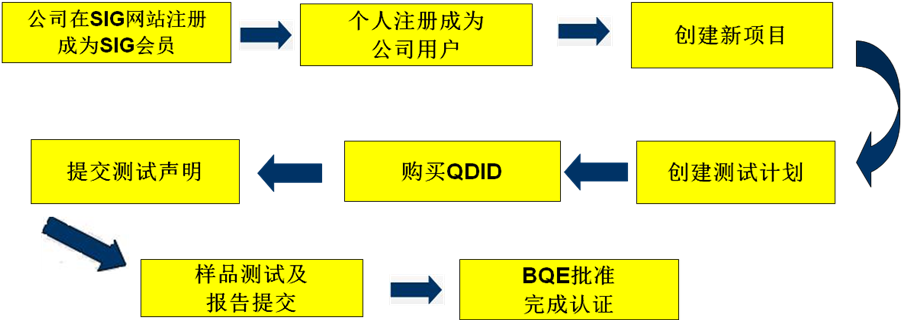

预认证测试我们只需要搭建测试环境，在实验室进行测试即可。RF测试采用R&D的CBT进行RF测试。

**图 2**  认证流程图  
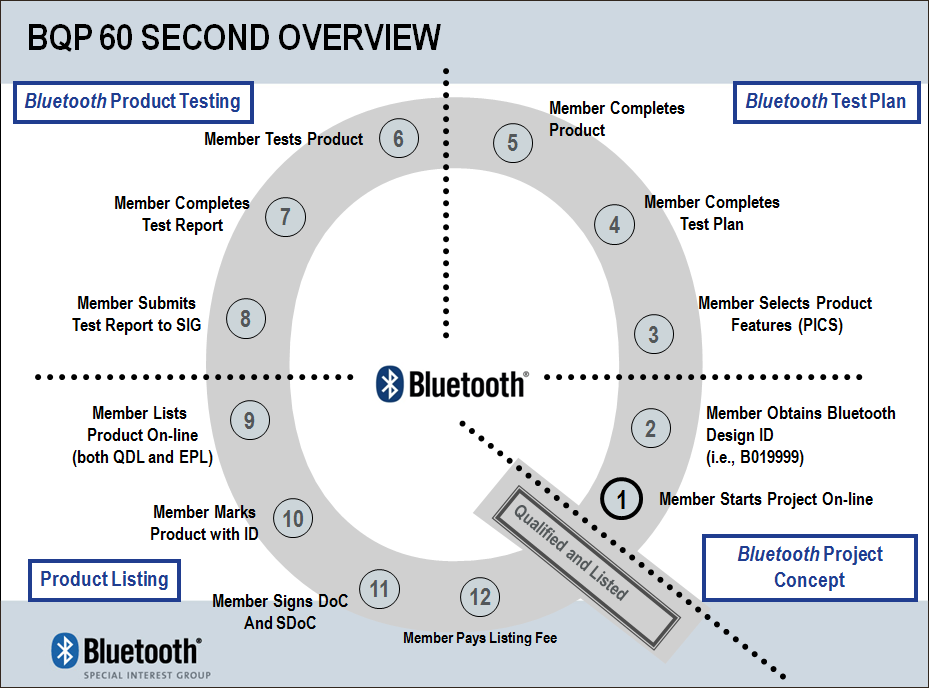

蓝牙产品/芯片整体正式认证流程：首先需要在SIG官网上创建蓝牙产品工程，同时购买QDID。然后根据需要支持的特性生成Testplan。在专门的认证机构进行产品测试，所有的测试项都通过后，完成产品列名。

## BQB协议认证

-   **[BQB协议认证环境](#ZH-CN_TOPIC_0000002553470405)**  

-   **[认证前的测试准备](#ZH-CN_TOPIC_0000002522350500)**  

-   **[参数设置1](#ZH-CN_TOPIC_0000002553310459)**  

-   **[参数设置2](#ZH-CN_TOPIC_0000002522350510)**  

-   **[测试LOG](#ZH-CN_TOPIC_0000002553310443)**  

### BQB协议认证环境

如[图1](#zh-cn_topic_0000002549621003_fig7576134993813)所示，蓝牙BQB认证环境由BQB认证仪、Bluetooth Ellisys analyzer、测试单板、PC组成。认证仪与测试单板之间可以通过增加衰减来调节功率。BQB认证仪主要是认证BT相关的用例，包括HCI/LMP/BB 3个方面的用例，为了保证认证环境，尽量在屏蔽房的环境下进行。

EllisysBluetoothQualifierInstaller认证仪由Ellisys认证仪和Ellisys空口分析仪两个设备组成。

**图 1**  蓝牙BQB认证环境  
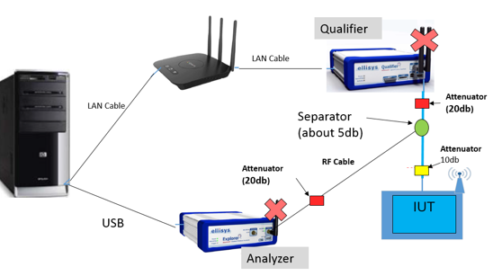

[图1](#zh-cn_topic_0000002549621003_fig7576134993813)的居中为EllisysBluetoothQualifierInstaller，其中左方的为空口分析仪，空口分析仪详情图如[图2](#zh-cn_topic_0000002549621003_fig9516155917381)所示。

**图 2**  空口分析仪详情图  
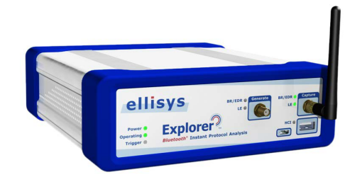

现在SIG要求BT5.0及其以上版本必须同时检测并提供空口log，因此整套认证环境需要强制绑定一个空口分析仪。空口分析仪、认证仪和IUT设备三个设备之间通过功分器连接。

需要注意的是空口分析仪抓到的RSSI如果比较高，需要修改功率或者增加衰减，否则认证仪或空口分析仪任何一方收不到包，都会导致认证失败，所以认证仪配合的20dBm的衰减器。BQB认证步骤如下面章节所述。

### 认证前的测试准备

1.  将蓝牙测试板运行起来，并下载好软件，使其能正常工作。
2.  根据实际情况使用串口线将认证仪与便携机连接起来。

### 参数设置1

1.  打开BQB软件EllisysBluetoothQualifierInstaller ，NEW新建测试工程；或者Open打开已有工程。
2.  导入当前认证计划的ICS和配置文件。

    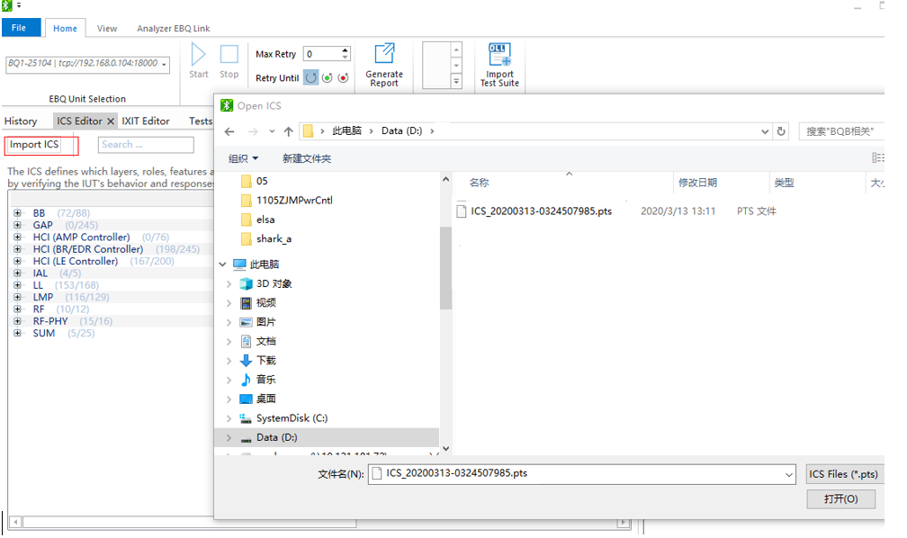

    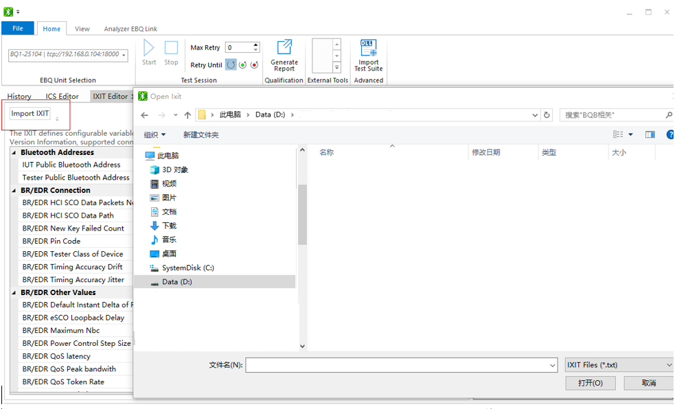

3.  勾选需要认证的认证用例：如HCI、LMP、BB、LL层。

    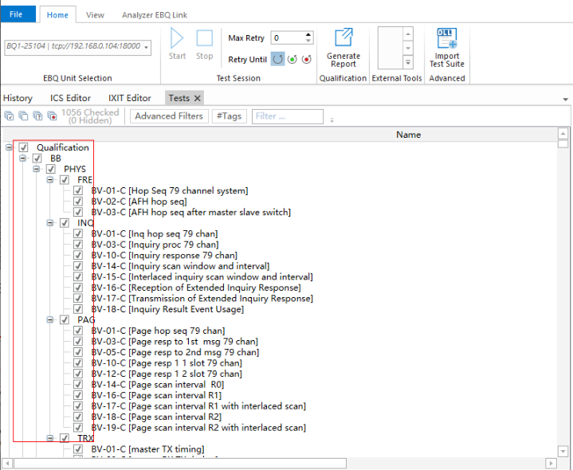

4.  连接认证仪，单击“Start”，开始执行认证用例。

    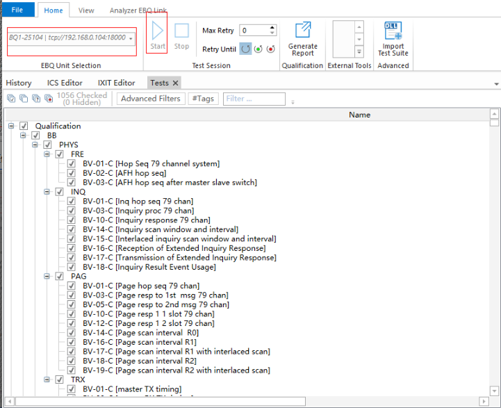

### 参数设置2

参数设置1中已导入需要的参数了，之后若认证需要修改参数，则产生新的ics和ixit文件。

用例复测次数选择：

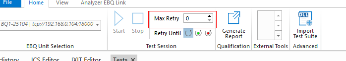

Retry次数代表当前用例自动复测次数。

### 测试LOG

BT协议认证测试结果和测试LOG是自动保存的，等到测试结束，单击“Generate Report”即可看到测试结果。

如下图框选位置可选择需要的执行结果导出。

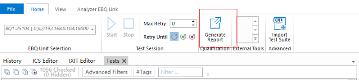

如下图框选位置可以选择导入哪几条用例的执行结果以及导出路径。

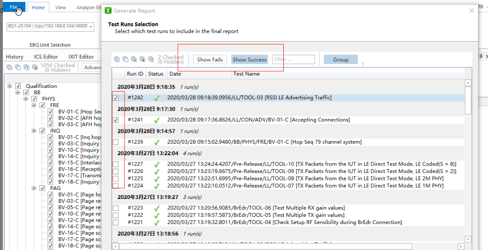

导出结果如下：

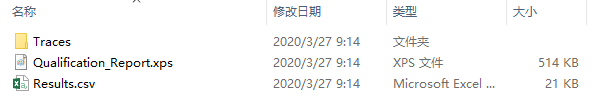

在“Results.csv”文件中重点关注以下内容：

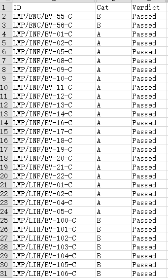

在“Traces”文件中是所有的认证用例与空口信息：

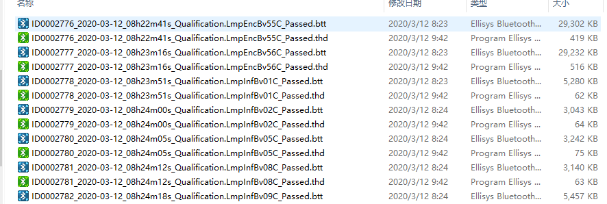

## BQB RF认证

Bluetooth SIG认证测试中的RF测试包括如下三个项目测试用例：

-   基本速率（BR： Basic Rate）
-   增强速率（EDR： Enhanced Data Rate）
-   低功耗（LE： Low Energy）

-   **[测试条件](#ZH-CN_TOPIC_0000002553310455)**  

-   **[RF认证环境](#ZH-CN_TOPIC_0000002522350504)**  

-   **[准备DUT环境-可执行脚本](#ZH-CN_TOPIC_0000002522510492)**  

-   **[RF认证用例](#ZH-CN_TOPIC_0000002553470407)**  

### 测试条件

-   **[BR/EDR正常测试条件](#ZH-CN_TOPIC_0000002553310447)**  

-   **[LE测试条件](#ZH-CN_TOPIC_0000002553470423)**  

#### BR/EDR正常测试条件

-   正常测试条件：
    -   室温：+15℃～+35℃。
    -   湿度：20%～75%。
    -   供电电压：lead-acid电池（1.1×厂商定义标准电压），其余类电源由厂商定义。

-   极端测试条件（BT5.0认证中不再需要做LE的极限环境测试）：
    -   温度：0℃～+35℃以及厂商定义温度取大值。
    -   湿度：厂商定义。
    -   供电范围：

        
        <table><thead align="left"><tr id="zh-cn_topic_0000002549621009_row273mcpsimp"><th class="cellrowborder" valign="top" width="31%" id="mcps1.1.4.1.1">
-

        </th>
        <th class="cellrowborder" valign="top" width="37%" id="mcps1.1.4.1.2">
Min

        </th>
        <th class="cellrowborder" valign="top" width="32%" id="mcps1.1.4.1.3">
Max

        </th>
        </tr>
        </thead>
        <tbody><tr id="zh-cn_topic_0000002549621009_row281mcpsimp"><td class="cellrowborder" valign="top" width="31%" headers="mcps1.1.4.1.1 ">
市电

        </td>
        <td class="cellrowborder" valign="top" width="37%" headers="mcps1.1.4.1.2 ">
≤0.9×220V

        </td>
        <td class="cellrowborder" valign="top" width="32%" headers="mcps1.1.4.1.3 ">
≥1.1×220V

        </td>
        </tr>
        <tr id="zh-cn_topic_0000002549621009_row288mcpsimp"><td class="cellrowborder" valign="top" width="31%" headers="mcps1.1.4.1.1 ">
lead-acid电池

        </td>
        <td class="cellrowborder" valign="top" width="37%" headers="mcps1.1.4.1.2 ">
≤0.9×电池电压

        </td>
        <td class="cellrowborder" valign="top" width="32%" headers="mcps1.1.4.1.3 ">
≥1.3×电池电压

        </td>
        </tr>
        <tr id="zh-cn_topic_0000002549621009_row295mcpsimp"><td class="cellrowborder" valign="top" width="31%" headers="mcps1.1.4.1.1 ">
Leclanch&eacute;、碱性、锂电池

        </td>
        <td class="cellrowborder" valign="top" width="37%" headers="mcps1.1.4.1.2 ">
≤0.85×电池电压

        </td>
        <td class="cellrowborder" valign="top" width="32%" headers="mcps1.1.4.1.3 ">
1.15×电池电压

        </td>
        </tr>
        <tr id="zh-cn_topic_0000002549621009_row302mcpsimp"><td class="cellrowborder" valign="top" width="31%" headers="mcps1.1.4.1.1 ">
汞、镍镉电池

        </td>
        <td class="cellrowborder" valign="top" width="37%" headers="mcps1.1.4.1.2 ">
最小值≤0.9×电池电压

        </td>
        <td class="cellrowborder" valign="top" width="32%" headers="mcps1.1.4.1.3 ">
最大值≥1.15×电池电压

        </td>
        </tr>
        <tr id="zh-cn_topic_0000002549621009_row309mcpsimp"><td class="cellrowborder" valign="top" width="31%" headers="mcps1.1.4.1.1 ">
其余类电源

        </td>
        <td class="cellrowborder" valign="top" width="37%" headers="mcps1.1.4.1.2 ">
厂商定义

        </td>
        <td class="cellrowborder" valign="top" width="32%" headers="mcps1.1.4.1.3 ">
厂商定义

        </td>
        </tr>
        </tbody>
        </table>

> **说明：** 
>这里的温湿度是法规的强制要求，一般厂商自定义的都会大于这个范围。

#### LE测试条件

-   正常测试条件
    -   温度：厂商定义标准温度的±10℃温度区间。
    -   湿度：厂商定义。
    -   电压：厂商定义。

-   极端测试条件（BT5.0认证中不再需要做LE的极限环境测试）
-   温湿度：厂商定义。
-   电压：参见BLE测试协议RF-PHY.TS.4.0.1的7.4.2章节：

    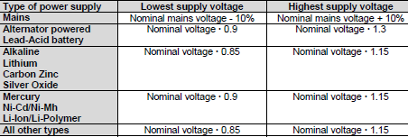

### RF认证环境

蓝牙射频测试系统是7layers Group独立开发的一套Bluetooth SIG指定测试平台，由主控系统和专用蓝牙信令单元CMW、信令分析仪SA、高低频信号源SG、射频信号分配器SU和射频功率计PM等设备连接组成。设备连接图如[图1](#zh-cn_topic_0000002517941240_fig851516146119)、[图2](#zh-cn_topic_0000002517941240_fig107536284115)所示。

**图 1**  设备连接示意图1  
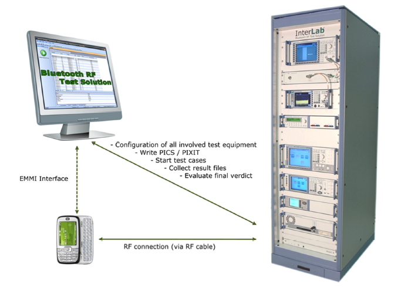

**图 2**  设备连接示意图2  
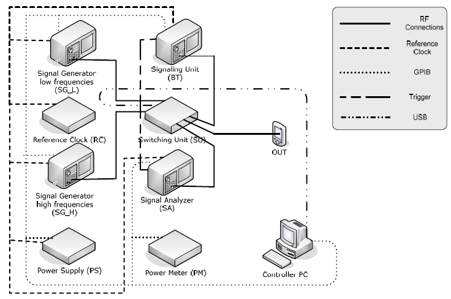

### 准备DUT环境-可执行脚本

-   **[信令测试模式](#ZH-CN_TOPIC_0000002522510498)**  

-   **[非信令测试模式](#ZH-CN_TOPIC_0000002553470415)**  

#### 信令测试模式

1.  执行脚本“app\_push.bat”，在命令框中看到文件正确push进DUT，并关闭此命令窗口。

    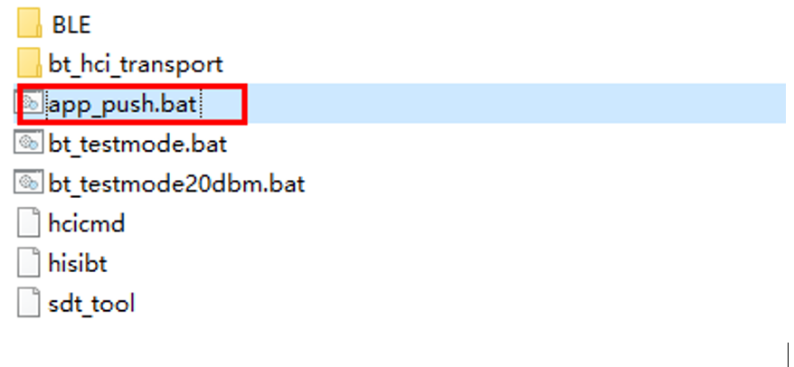

2.  执行脚本“bt\_testmode.bat”。

    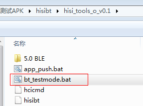

    当看到“step.2:press ENTER to end the test”不要按回车键，并保持命令窗口打开，不要关闭。

    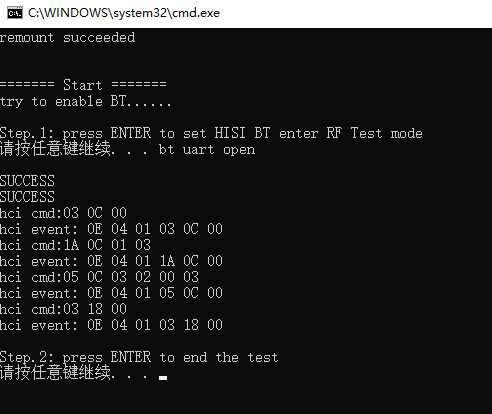

    现在DUT已经进入信令测试模式，等待仪器的扫描连接，即可开始测试。当结束测试时，可以在命令框再执行ENTER关闭BT测试模式，或者直接重启DUT。

#### 非信令测试模式

**图 1**  非信令测试脚本  
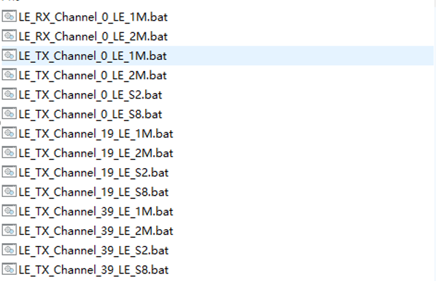

[图1](#zh-cn_topic_0000002549621013_fig35543363)所示脚本分别对应高中低信道的非信令测试。以LE\_TX\_channel\_0\_LE\_1M为例进行操作说明。

1.  执行脚本“LE\_TX\_Channel\_0\_LE\_1M.bat”。
2.  当看到命令框提示“step.2:press ENTER to end the test”，不要点击回车。

    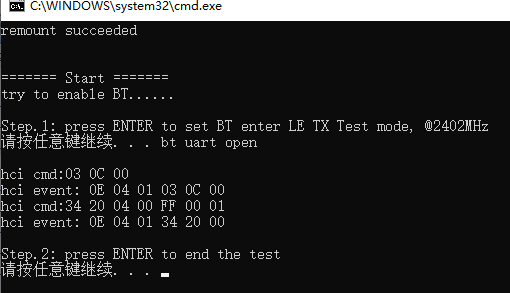

    现在，DUT已经在CH0发射LE\_1M信号。可以用仪器直接测试。当结束测试时，可以在命令框再执行ENTER关闭BT测试模式，或者直接重启DUT。

    如上图，如果需要测试其他信道，可执行对应的脚本实现。

### RF认证用例

-   **[BR/EDR测试用例](#ZH-CN_TOPIC_0000002553470413)**  

-   **[LE测试用例](#ZH-CN_TOPIC_0000002553470421)**  

#### BR/EDR测试用例

RFPHY/TRM/BV-01-C \[Output power, 1 Ms/s\]

RFPHY/TRM/BV-03-C \[In-band emissions, uncoded data at 1 Ms/s\]

RFPHY/TRM/BV-05-C \[Modulation Characteristics, uncoded data at 1 Ms/s\]

RFPHY/TRM/BV-06-C \[Carrier frequency offset and drift, uncoded data at 1 Ms/s\]

RFPHY/TRM/BV-08-C \[In-band emissions at 2 Ms/s\]

RFPHY/TRM/BV-09-C \[Stable Modulation Characteristics, uncoded data at 1 Ms/s\]

RFPHY/TRM/BV-10-C \[Modulation Characteristics at 2 Ms/s\]

RFPHY/TRM/BV-11-C \[Stable Modulation Characteristics at 2 Ms/s\]

RFPHY/TRM/BV-12-C \[Carrier frequency offset and drift at 2 Ms/s\]

RFPHY/TRM/BV-13-C \[Modulation Characteristics, LE Coded \(S=8\)\]

RFPHY/TRM/BV-14-C \[Carrier frequency offset and drift, LE Coded \(S=8\)\]

RFPHY/TRM/BV-18-C \[Output power, Class 1, 1 Ms/s\]

RFPHY/TRM/BV-19-C \[Output power, 2 Ms/s\]

RFPHY/TRM/BV-20-C \[Output power, Class 1, 2 Ms/s\]

RFPHY/RCV/BV-01-C \[Receiver sensitivity, uncoded data at 1 Ms/s\]

RFPHY/RCV/BV-03-C \[C/I and Receiver Selectivity Performance, uncoded data at 1 Ms/s\]

RFPHY/RCV/BV-04-C \[Blocking Performance, uncoded data at 1 Ms/s\]

RFPHY/RCV/BV-05-C \[Intermodulation Performance, uncoded data at 1 Ms/s\]

RFPHY/RCV/BV-06-C \[Maximum input signal level, uncoded data at 1 Ms/s\]

RFPHY/RCV/BV-07-C \[PER Report Integrity, uncoded data at 1 Ms/s\]

RFPHY/RCV/BV-08-C \[Receiver sensitivity at 2 Ms/s\]

RFPHY/RCV/BV-09-C \[C/I and Receiver Selectivity Performance at 2 Ms/s\]

RFPHY/RCV/BV-10-C \[Blocking performance at 2 Ms/s\]

RFPHY/RCV/BV-11-C \[Intermodulation performance at 2 Ms/s\]

RFPHY/RCV/BV-12-C \[Maximum input signal level at 2 Ms/s\]

RFPHY/RCV/BV-13-C \[PER Report Integrity at 2 Ms/s\]

RFPHY/RCV/BV-14-C \[Receiver Sensitivity, uncoded data at 1 Ms/s, Stable Modulation Index\]

RFPHY/RCV/BV-15-C \[C/I and Receiver Selectivity Performance, uncoded data at 1 Ms/s, Stable Modulation Index\]

RFPHY/RCV/BV-16-C \[Blocking Performance, uncoded data at 1 Ms/s, Stable Modulation Index\]

RFPHY/RCV/BV-17-C \[Intermodulation Performance, uncoded data at 1 Ms/s, Stable Modulation Index\]

RFPHY/RCV/BV-18-C \[Maximum input signal level, uncoded data at 1 Ms/s, Stable Modulation Index\]

RFPHY/RCV/BV-19-C \[PER Report Integrity, uncoded data at 1 Ms/s, Stable Modulation Index\]

RFPHY/RCV/BV-20-C \[Receiver sensitivity at 2 Ms/s, Stable Modulation Index\]

RFPHY/RCV/BV-21-C \[C/I and Receiver Selectivity Performance at 2 Ms/s, Stable Modulation Index\]

RFPHY/RCV/BV-22-C \[Blocking performance at 2 Ms/s, Stable Modulation Index\]

RFPHY/RCV/BV-23-C \[Intermodulation performance at 2 Ms/s, Stable Modulation Index\]

RFPHY/RCV/BV-24-C \[Maximum input signal level at 2 Ms/s, Stable Modulation Index\]

RFPHY/RCV/BV-25-C \[PER Report Integrity at 2 Ms/s, Stable Modulation Index\]

RFPHY/RCV/BV-26-C \[Receiver sensitivity, LE Coded \(S=2\)\]

RFPHY/RCV/BV-27-C \[Receiver sensitivity, LE Coded \(S=8\)\]

RFPHY/RCV/BV-28-C \[C/I and Receiver Selectivity Performance, LE Coded \(S=2\)\]

RFPHY/RCV/BV-29-C \[C/I and Receiver Selectivity Performance, LE Coded \(S=8\)\]

RFPHY/RCV/BV-30-C \[PER Report Integrity, LE Coded \(S=2\)\]

RFPHY/RCV/BV-31-C \[PER Report Integrity, LE Coded \(S=8\)\]

RFPHY/RCV/BV-32-C \[Receiver sensitivity, LE Coded \(S=2\), Stable Modulation Index\]

RFPHY/RCV/BV-33-C \[Receiver sensitivity, LE Coded \(S=8\), Stable Modulation Index\]

RFPHY/RCV/BV-34-C \[C/I and Receiver Selectivity Performance, LE Coded \(S=2\), Stable Modulation Index\]

RFPHY/RCV/BV-35-C \[C/I and Receiver Selectivity Performance, LE Coded \(S=8\), Stable Modulation Index\]

RFPHY/RCV/BV-36-C \[PER Report Integrity, LE Coded \(S=2\), Stable Modulation Index\]

RFPHY/RCV/BV-37-C \[PER Report Integrity, LE Coded \(S=8\), Stable Modulation Index\]

RF/TRM/CA/BV-01-C \(Output Power\)。

RF/TRM/CA/BV-02-C \(Power Density\)。

RF/TRM/CA/BV-03-C \(Power Control\)。

RF/TRM/CA/BV-04-C \(TX Output Spectrum – Frequency range\)。

RF/TRM/CA/BV-05-C \(TX Output Spectrum – 20 dB Bandwidth。

RF/TRM/CA/BV-06-C \(TX Output Spectrum – Adjacent channel power\)。

RF/TRM/CA/BV-07-C \(Modulation Characteristics\)。

RF/TRM/CA/BV-08-C \(Initial Carrier Frequency Tolerance\)。

RF/TRM/CA/BV-09-C \(Carrier Frequency Drift\)。

RF/TRM/CA/BV-10-C \(EDR Relative Transmit Power\)。

RF/TRM/CA/BV-11-C \(EDR Carrier Frequency Stability and Modulation Accuracy\)。

RF/TRM/CA/BV-12-C \(EDR Differential Phase Encoding\)。

RF/TRM/CA/BV-13-C \(EDR In-band Spurious Emissions\)。

RF/TRM/CA/BV-14-C \(Enhanced power control\)。

RF/TRM/CA/BV-15-C \(EDR Guard Time\)

RF/TRM/CA/BV-16-C \(EDR Synchronization Sequence and Trailer\)

RF/RCV/CA/BV-01-C \(Sensitivity – single slot packets\)。

RF/RCV/CA/BV-02-C \(Sensitivity - multi-slot packets\)。

RF/RCV/CA/BV-03-C \(C/I performance\)。

RF/RCV/CA/BV-04-C \(Blocking performance\)。

RF/RCV/CA/BV-05-C \(Intermodulation Performance\) 。

RF/RCV/CA/BV-06-C \(Maximum Input Level\)。

RF/RCV/CA/BV-07-C \(EDR Sensitivity\)。

RF/RCV/CA/BV-08-C \(EDR BER Floor Performance\)。

RF/RCV/CA/BV-09-C \(EDR C/I Performance\)。

RF/RCV/CA/BV-10-C \(EDR Maximum Input Level\)

#### LE测试用例

TRM-LE/CA/BV-01-C \[Output power\]

TRM-LE/CA/BV-03-C \[In-band emissions, uncoded data at 1Ms/s\]

TRM-LE/CA/BV-05-C \[Modulation Characteristics, uncoded data at 1 Ms/s\]

TRM-LE/CA/BV-06-C \[Carrier frequency offset and drift,uncoded data at 1 Ms/s\]

TRM-LE/CA/BV-08-C \[In-band emissions at 2 Ms/s\]

TRM-LE/CA/BV-09-C \[Stable Modulation Characteristics,uncoded data at 1 Ms/s\]

TRM-LE/CA/BV-10-C \[Modulation Characteristics at 2 Ms/s\]

TRM-LE/CA/BV-11-C \[Stable Modulation Characteristics at 2Ms/s\]

TRM-LE/CA/BV-12-C \[Carrier frequency offset and drift at 2Ms/s\]

TRM-LE/CA/BV-13-C \[Modulation Characteristics, LE Coded \(S=8\)\]

TRM-LE/CA/BV-14-C \[Carrier frequency offset and drift, LE Coded \(S=8\)\]

RCV-LE/CA/BV-01-C \[Receiver sensitivity, uncoded data at 1Ms/s\]

RCV-LE/CA/BV-03-C \[C/I and Receiver Selectivity Performance,uncoded data at 1 Ms/s\]

RCV-LE/CA/BV-04-C \[Blocking Performance, uncoded data at 1Ms/s\]

RCV-LE/CA/BV-05-C \[Intermodulation Performance, uncoded data at 1 Ms/s\]

RCV-LE/CA/BV-06-C \[Maximum input signal level, uncoded data at 1 Ms/s\]

RCV-LE/CA/BV-07-C \[PER Report Integrity, uncoded data at 1Ms/s\]

RCV-LE/CA/BV-08-C \[Receiver sensitivity at 2 Ms/s\]

RCV-LE/CA/BV-09-C \[C/I and Receiver Selectivity Performance at 2 Ms/s\]

RCV-LE/CA/BV-10-C \[Blocking performance at 2 Ms/s\]

RCV-LE/CA/BV-11-C \[Intermodulation performance at 2 Ms/s\]

RCV-LE/CA/BV-12-C \[Maximum input signal level at 2 Ms/s\]

RCV-LE/CA/BV-13-C \[PER Report Integrity at 2 Ms/s\]

RCV-LE/CA/BV-14-C \[Receiver Sensitivity, uncoded data at 1Ms/s, Stable Modulation Index\]

RCV-LE/CA/BV-15-C \[C/I and Receiver Selectivity Performance,uncoded data at 1 Ms/s, Stable Modulation Index\]

RCV-LE/CA/BV-16-C \[Blocking Performance, uncoded data at 1Ms/s, Stable Modulation Index\]

RCV-LE/CA/BV-17-C \[Intermodulation Performance, uncoded data at 1 Ms/s, Stable Modulation Index\]

RCV-LE/CA/BV-18-C \[Maximum input signal level, uncoded data at 1 Ms/s, Stable Modulation Index\]

RCV-LE/CA/BV-19-C \[PER Report Integrity, uncoded data at 1Ms/s, Stable Modulation Index\]

RCV-LE/CA/BV-20-C \[Receiver sensitivity at 2 Ms/s, Stable Modulation Index\]

RCV-LE/CA/BV-21-C \[C/I and Receiver Selectivity Performance at 2 Ms/s, Stable Modulation Index\]

RCV-LE/CA/BV-22-C \[Blocking performance at 2 Ms/s, Stable Modulation Index\]

RCV-LE/CA/BV-23-C \[Intermodulation performance at 2 Ms/s,Stable Modulation Index\]

RCV-LE/CA/BV-24-C \[Maximum input signal level at 2 Ms/s,Stable Modulation Index\]

RCV-LE/CA/BV-25-C \[PER Report Integrity at 2 Ms/s, Stable Modulation Index\]

RCV-BV-26-C \[Receiver sensitivity, LE Coded \(S=2\)\]

RCV-BV-27-C \[Receiver sensitivity, LE Coded \(S=8\)\]

RCV-BV-28-C \[C/I and Receiver Selectivity Performance, LE Coded \(S=2\)\]

RCV-BV-29-C \[C/I and Receiver Selectivity Performance, LE Coded \(S=8\)\]

RCV/BV-30-C \[PER Report Integrity, LE Coded \(S=2\)\]

RCV/BV-31-C \[PER Report Integrity, LE Coded \(S=8\)\]

RCV-BV-32-C \[Receiver sensitivity, LE Coded \(S=2\), Stable Modulation Index\]

RCV-BV-33-C \[Receiver sensitivity, LE Coded \(S=8\), Stable Modulation Index\]

RCV/BV-34-C \[C/I and Receiver Selectivity Performance, LE Coded \(S=2\), Stable Modulation Index\]

RCV-BV-35-C \[C/I and Receiver Selectivity Performance, LE Coded \(S=8\), Stable Modulation Index\]

RCV-BV-36-C \[PER Report Integrity, LE Coded \(S=2\), Stable Modulation Index\]

RCV-BV-37-C \[PER Report Integrity, LE Coded \(S=8\), Stable Modulation Index\]

## PTS认证

-   **[PTS协议认证环境](#ZH-CN_TOPIC_0000002522510490)**  

-   **[认证测试前的准备](#ZH-CN_TOPIC_0000002522350506)**  

-   **[开始测试](#ZH-CN_TOPIC_0000002553470409)**  

-   **[测试LOG](#ZH-CN_TOPIC_0000002553310463)**  

### PTS协议认证环境

如[图1](#zh-cn_topic_0000002518101166_fig12132192914210)所示，蓝牙PTS认证环境由PC（安装PTS软件工具）、PTS射频模块和被测对象组成。。

**图 1**  PTS认证环境  
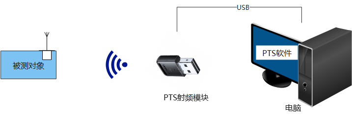

### 认证测试前的准备

1.  登陆[https://qualification.bluetooth.com/](https://qualification.bluetooth.com/)创建项目。

    

    登陆后，单击“Start the Buletooth Qualification Process”创建一个项目，在“Product Details”页面填写项目信息。

2.  选择TCRL Package版本。

    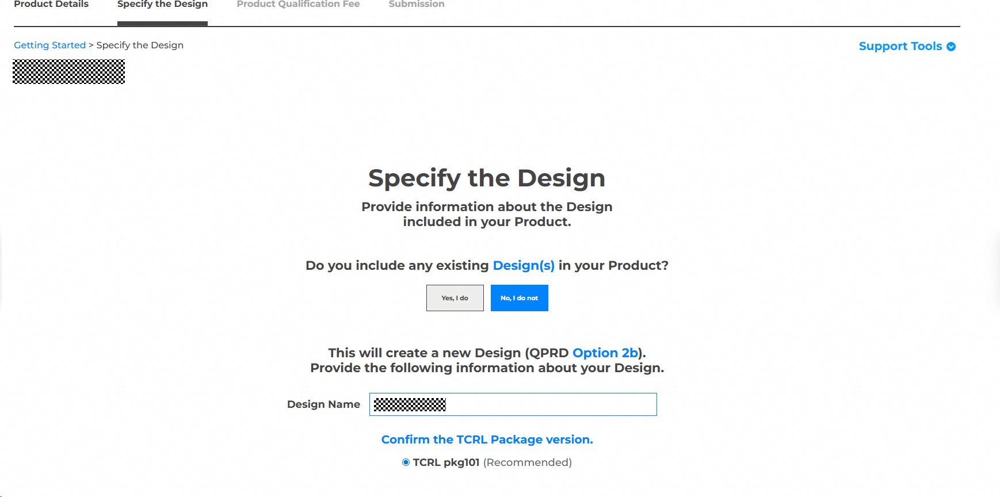

3.  填写对应Profiles支持选项。

    选择产品/芯片支持的Profiles，包括L2CAP、GAP、SDP、SM等；

    这一步由开发人员填写，其中涉及很多蓝牙协议的问题，PICS需争取一次性填写正确，如果要修改PICS，就要重新生成testplan进行测试。

    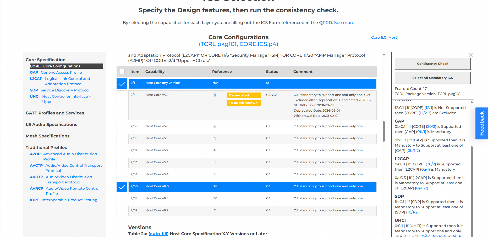

4.  生成Test Plan。

    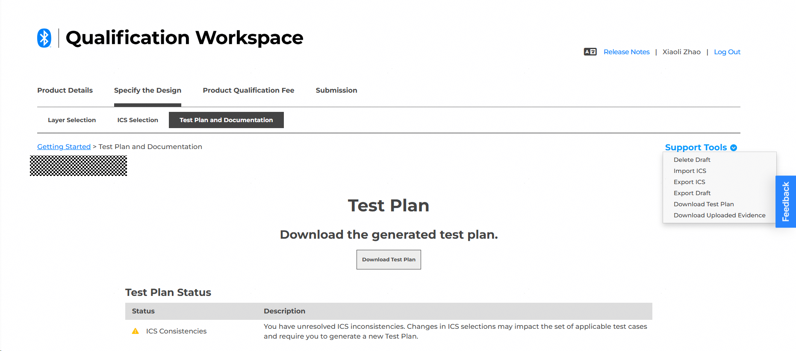

    Test Plan是一个自动生成的excel表格，里面列出了要测的case（并不是PTS上的每一个case都是要测试的，有的case是互斥的，要测哪些cese是根据这一步生成的testplan来决定的）。

### 开始测试

本地PTS测试工具中新建Workspace，导入网站生成的ICS文件。

按照Test Paln上面列出来的testcase进行逐个测试。

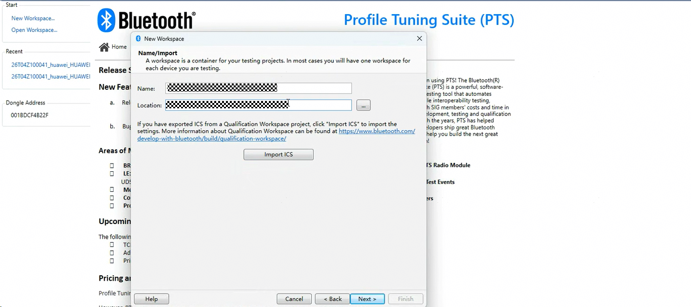

### 测试LOG

测试结束后，单击“Generate Report”即可看到测试结果。

如下图鼠标位置可选择需要的执行结果导出。

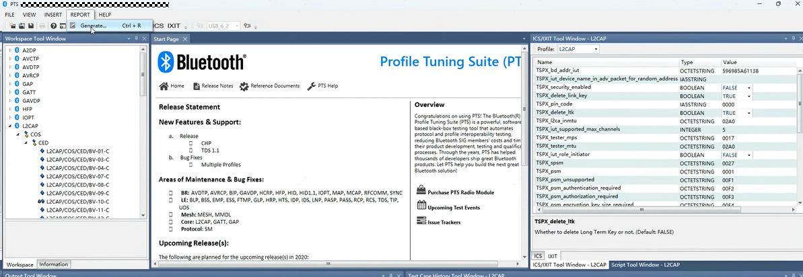

如下图框选位置可以选择导出哪几条用例的执行结果。

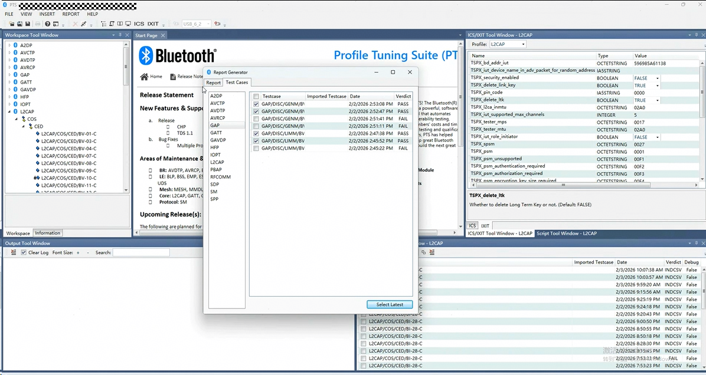

