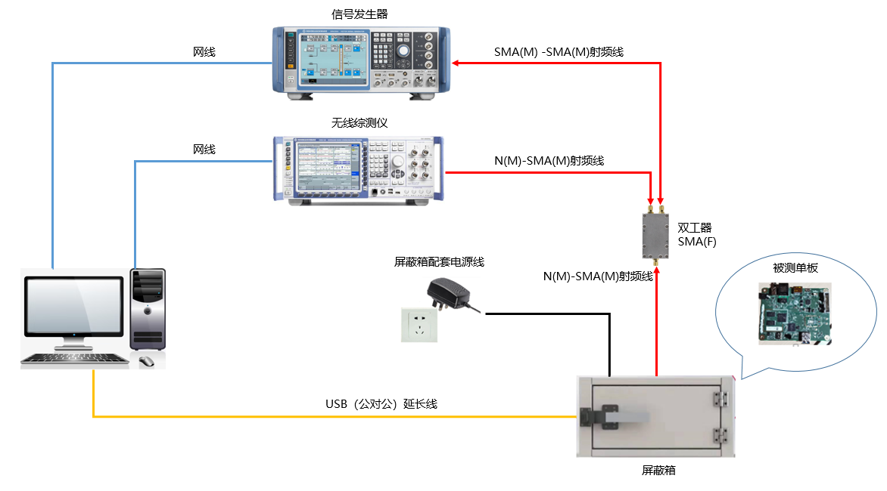
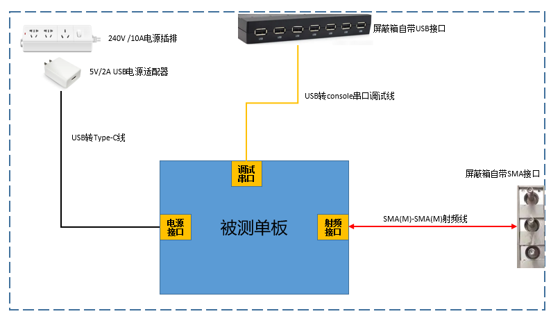
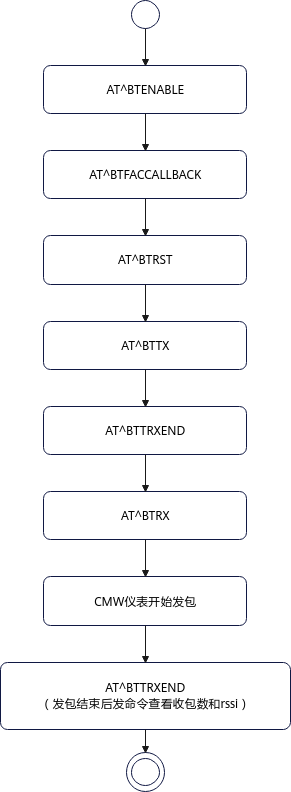
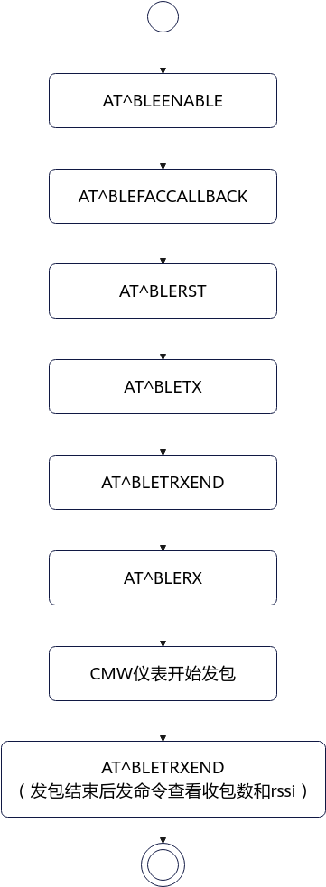
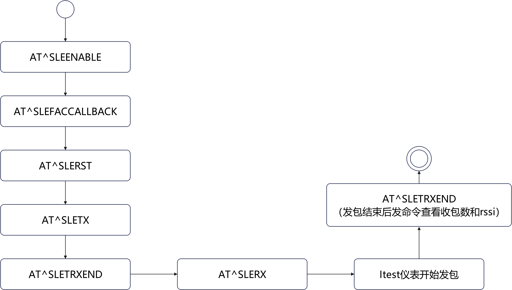
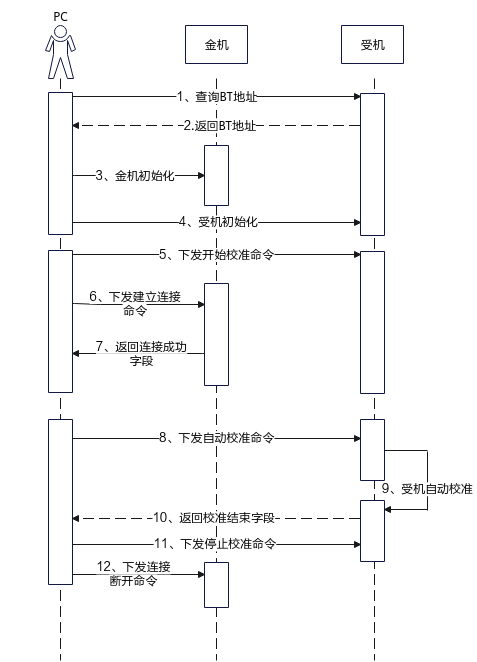
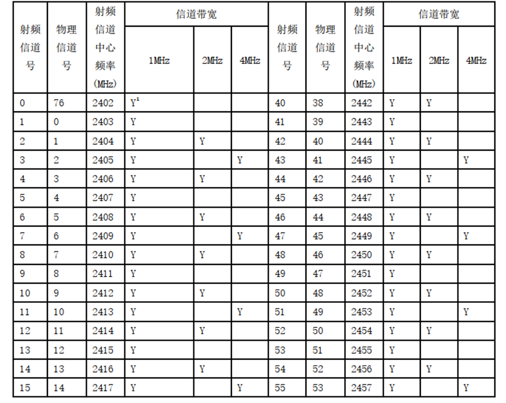
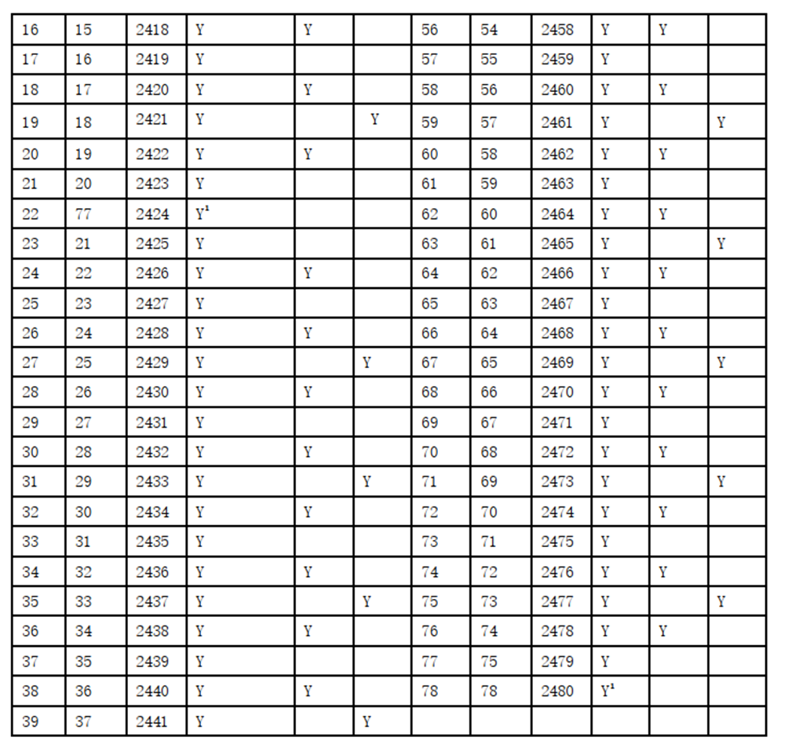

# 前言

**概述**

本文档主要介绍HiDiTingV100的射频非信令相关的测试指令和指令的组包示例，测试前务必阅读注意事项。

**读者对象**

本文档主要适用于以下工程师：

-   技术支持工程师。
-   软件开发工程师。

**符号约定**

在本文中可能出现下列标志,它们所代表的含义如下。

<table><thead align="left"><tr id="zh-cn_topic_0000002512316477_row1530720816410"><th class="cellrowborder" valign="top" width="20.580000000000002%" id="mcps1.1.3.1.1">
<strong id="zh-cn_topic_0000002512316477_b2136615816410">符号</strong>

</th>
<th class="cellrowborder" valign="top" width="79.42%" id="mcps1.1.3.1.2">
<strong id="zh-cn_topic_0000002512316477_b5941558116410">说明</strong>

</th>
</tr>
</thead>
<tbody><tr id="zh-cn_topic_0000002512316477_row1372280416410"><td class="cellrowborder" valign="top" width="20.580000000000002%" headers="mcps1.1.3.1.1 ">

</td>
<td class="cellrowborder" valign="top" width="79.42%" headers="mcps1.1.3.1.2 ">
表示如不避免则将会导致死亡或严重伤害的具有高等级风险的危害。

</td>
</tr>
<tr id="zh-cn_topic_0000002512316477_row466863216410"><td class="cellrowborder" valign="top" width="20.580000000000002%" headers="mcps1.1.3.1.1 ">

</td>
<td class="cellrowborder" valign="top" width="79.42%" headers="mcps1.1.3.1.2 ">
表示如不避免则可能导致死亡或严重伤害的具有中等级风险的危害。

</td>
</tr>
<tr id="zh-cn_topic_0000002512316477_row123863216410"><td class="cellrowborder" valign="top" width="20.580000000000002%" headers="mcps1.1.3.1.1 ">

</td>
<td class="cellrowborder" valign="top" width="79.42%" headers="mcps1.1.3.1.2 ">
表示如不避免则可能导致轻微或中度伤害的具有低等级风险的危害。

</td>
</tr>
<tr id="zh-cn_topic_0000002512316477_row5786682116410"><td class="cellrowborder" valign="top" width="20.580000000000002%" headers="mcps1.1.3.1.1 ">

</td>
<td class="cellrowborder" valign="top" width="79.42%" headers="mcps1.1.3.1.2 ">
用于传递设备或环境安全警示信息。如不避免则可能会导致设备损坏、数据丢失、设备性能降低或其它不可预知的结果。

“须知”不涉及人身伤害。

</td>
</tr>
<tr id="zh-cn_topic_0000002512316477_row2856923116410"><td class="cellrowborder" valign="top" width="20.580000000000002%" headers="mcps1.1.3.1.1 ">

</td>
<td class="cellrowborder" valign="top" width="79.42%" headers="mcps1.1.3.1.2 ">
对正文中重点信息的补充说明。

“说明”不是安全警示信息,不涉及人身、设备及环境伤害信息。

</td>
</tr>
</tbody>
</table>

# 测试准备

-   **[测试仪器及辅助器件](#ZH-CN_TOPIC_0000002483741582)**  

-   **[测试硬件连接图](#ZH-CN_TOPIC_0000002483901582)**  

## 测试仪器及辅助器件

测试仪器及辅助器材：

-   计算机（PC）1台。
-   无线综测仪1台（需支持非信令测试，建议同时支持信令测试）。
-   信号发生器1台（需支持最高频率12.75GHz）。
-   HiDiTing系列单板1块。
-   SMA\(M\)-SMA\(M\)射频线缆2条，N\(M\)- SMA\(M\)射频线缆2条（需至少支持2GHz～12.75GHz的频率）。
-   双工器SMA\(F\) 1个。
-   USB转Type-C线、USB（公对公）延长线和USB转console串口线各1条。
-   5V/2A USB电源适配器1个。
-   屏蔽房或屏蔽箱1个（屏蔽箱需支持对内部提供110V～240V /10A电源插排、SMA接头、USB接口各一个，隔离度≥80dB）以及其配套电源线1条。
-   网线2条。

## 测试硬件连接图

射频测试硬件连接组网图如[图1](#zh-cn_topic_0000002512356519_fig182541853155019)所示，屏蔽箱内部硬件连线图如[图2](#zh-cn_topic_0000002512356519_fig181659412518)所示。

**图 1**  射频测试硬件连接组网图  

**图 2**  屏蔽箱内硬件连接组网图  

硬件连接的具体操作如下：

1.  通过网线将PC机与无线综测仪和信号发生器进行连接。在PC机综测仪器和信号发生器的控制软件或控制页面上，输入无线综测仪和信号发生器的IP地址，将PC机与无线综测仪器和信号发生器连接，实现PC机对无线综测仪和信号发生器的控制。
2.  将屏蔽箱与其配套电源线连接，并将被测单板放至屏蔽箱内。在屏蔽箱中，采用5V/2A USB电源适配器和USB转Type-C线，将电源插排与被测单板电源端口连接，同时采用USB延长线缆，将屏蔽箱与PC机连接。在屏蔽箱中，采用USB转console串口线，USB端与屏蔽箱USB端口连接，console端与单板的命令下发串口连接。
3.  在无线综测仪的端口上采用N\(M\)-SMA\(M\)同轴线缆，信号发生器的端口采用SMA\(M\)-SMA\(M\)同轴线缆，将无线综测仪端口和信号发生器的端口连接到双工器同一端的端口上，并在另一端与屏蔽箱通过N\(M\)-SMA\(M\)同轴线缆连接。
4.  在屏蔽箱中，采用SMA\(M\)-SMA\(M\)同轴线缆，将屏蔽箱内侧对应的射频端口与被测单板的天线座子连接。
5.  完成以上操作后，测试环境搭建完毕。

> **说明：** 
>-   本文中所提到的射频线缆类型可能和用户实际使用的存在差异，具体以实际使用仪表要求为准。
>-   本文中提到的信号发生器，只有当抗干扰测试时才会用到，大部分测试只需要无线综测仪一台仪器就可完成。如果没有信号发生器，可以暂且将双工器去掉，使无线综测仪和屏蔽箱直接通过N\(M\)- SMA\(M\)射频线缆连接。

# 射频测试AT指令

-   **[射频测试相关AT指令一览表](#ZH-CN_TOPIC_0000002516021525)**  

-   **[BT射频测试相关AT指令描述](#ZH-CN_TOPIC_0000002483741596)**  

-   **[BLE射频测试相关AT指令描述](#ZH-CN_TOPIC_0000002483901568)**  

-   **[SLE射频测试相关AT指令描述](#ZH-CN_TOPIC_0000002483741568)**  

-   **[BT进入信令模式指令](#ZH-CN_TOPIC_0000002516141467)**  

-   **[射频单音](#ZH-CN_TOPIC_0000002516021467)**  

-   **[XO 32M校准 执行CTRIM校准指令](#ZH-CN_TOPIC_0000002483741558)**  

-   **[XO 32M校准 自动校准指令](#ZH-CN_TOPIC_0000002483901508)**  

-   **[AT指令status状态对应表](#ZH-CN_TOPIC_0000002516021505)**  

## 射频测试相关AT指令一览表

**表 1**  射频测试相关AT指令一览表

<table><thead align="left"><tr id="zh-cn_topic_0000002480356616_row929mcpsimp"><th class="cellrowborder" valign="top" width="37.54%" id="mcps1.2.3.1.1">
指令

</th>
<th class="cellrowborder" valign="top" width="62.46000000000001%" id="mcps1.2.3.1.2">
描述

</th>
</tr>
</thead>
<tbody><tr id="zh-cn_topic_0000002480356616_row62124430577"><td class="cellrowborder" valign="top" width="37.54%" headers="mcps1.2.3.1.1 ">
AT^BTENABLE

</td>
<td class="cellrowborder" valign="top" width="62.46000000000001%" headers="mcps1.2.3.1.2 ">
BT使能指令（没有相应退出操作）。

</td>
</tr>
<tr id="zh-cn_topic_0000002480356616_row8198182553811"><td class="cellrowborder" valign="top" width="37.54%" headers="mcps1.2.3.1.1 ">
AT^BTFACCALLBACK

</td>
<td class="cellrowborder" valign="top" width="62.46000000000001%" headers="mcps1.2.3.1.2 ">
注册BT命令上报回调（没有相应退出操作）。

</td>
</tr>
<tr id="zh-cn_topic_0000002480356616_row1764463389"><td class="cellrowborder" valign="top" width="37.54%" headers="mcps1.2.3.1.1 ">
AT^BTTX

</td>
<td class="cellrowborder" valign="top" width="62.46000000000001%" headers="mcps1.2.3.1.2 ">
BT常发指令。

</td>
</tr>
<tr id="zh-cn_topic_0000002480356616_row153504492381"><td class="cellrowborder" valign="top" width="37.54%" headers="mcps1.2.3.1.1 ">
AT^BTRX

</td>
<td class="cellrowborder" valign="top" width="62.46000000000001%" headers="mcps1.2.3.1.2 ">
BT常收指令。

</td>
</tr>
<tr id="zh-cn_topic_0000002480356616_row101421152193813"><td class="cellrowborder" valign="top" width="37.54%" headers="mcps1.2.3.1.1 ">
AT^BTTRXEND

</td>
<td class="cellrowborder" valign="top" width="62.46000000000001%" headers="mcps1.2.3.1.2 ">
BT常发、常收停止指令。

</td>
</tr>
<tr id="zh-cn_topic_0000002480356616_row5861155623812"><td class="cellrowborder" valign="top" width="37.54%" headers="mcps1.2.3.1.1 ">
AT^BTRST

</td>
<td class="cellrowborder" valign="top" width="62.46000000000001%" headers="mcps1.2.3.1.2 ">
BT软件复位指令。

</td>
</tr>
<tr id="zh-cn_topic_0000002480356616_row88931655133815"><td class="cellrowborder" valign="top" width="37.54%" headers="mcps1.2.3.1.1 ">
AT^BLEENABLE

</td>
<td class="cellrowborder" valign="top" width="62.46000000000001%" headers="mcps1.2.3.1.2 ">
BLE使能指令（没有相应退出操作）。

</td>
</tr>
<tr id="zh-cn_topic_0000002480356616_row1695745417388"><td class="cellrowborder" valign="top" width="37.54%" headers="mcps1.2.3.1.1 ">
AT^BLEFACCALLBACK

</td>
<td class="cellrowborder" valign="top" width="62.46000000000001%" headers="mcps1.2.3.1.2 ">
注册BLE命令上报回调（没有相应退出操作）。

</td>
</tr>
<tr id="zh-cn_topic_0000002480356616_row1478135373817"><td class="cellrowborder" valign="top" width="37.54%" headers="mcps1.2.3.1.1 ">
AT^BLETX

</td>
<td class="cellrowborder" valign="top" width="62.46000000000001%" headers="mcps1.2.3.1.2 ">
BLE常发指令。

</td>
</tr>
<tr id="zh-cn_topic_0000002480356616_row11902175012383"><td class="cellrowborder" valign="top" width="37.54%" headers="mcps1.2.3.1.1 ">
AT^BLERX

</td>
<td class="cellrowborder" valign="top" width="62.46000000000001%" headers="mcps1.2.3.1.2 ">
BLE常收指令。

</td>
</tr>
<tr id="zh-cn_topic_0000002480356616_row5317131593814"><td class="cellrowborder" valign="top" width="37.54%" headers="mcps1.2.3.1.1 ">
AT^BLETRXEND

</td>
<td class="cellrowborder" valign="top" width="62.46000000000001%" headers="mcps1.2.3.1.2 ">
BLE常发、常收停止指令。

</td>
</tr>
<tr id="zh-cn_topic_0000002480356616_row1645464353817"><td class="cellrowborder" valign="top" width="37.54%" headers="mcps1.2.3.1.1 ">
AT^BLERST

</td>
<td class="cellrowborder" valign="top" width="62.46000000000001%" headers="mcps1.2.3.1.2 ">
BLE软件复位指令。

</td>
</tr>
<tr id="zh-cn_topic_0000002480356616_row106370376445"><td class="cellrowborder" valign="top" width="37.54%" headers="mcps1.2.3.1.1 ">
AT^SLEENABLE

</td>
<td class="cellrowborder" valign="top" width="62.46000000000001%" headers="mcps1.2.3.1.2 ">
SLE使能指令（没有相应退出操作）。

</td>
</tr>
<tr id="zh-cn_topic_0000002480356616_row148978381669"><td class="cellrowborder" valign="top" width="37.54%" headers="mcps1.2.3.1.1 ">
AT^SLEFACCALLBACK

</td>
<td class="cellrowborder" valign="top" width="62.46000000000001%" headers="mcps1.2.3.1.2 ">
注册SLE命令上报回调（没有相应退出操作）。

</td>
</tr>
<tr id="zh-cn_topic_0000002480356616_row958mcpsimp"><td class="cellrowborder" valign="top" width="37.54%" headers="mcps1.2.3.1.1 ">
AT^SLETX

</td>
<td class="cellrowborder" valign="top" width="62.46000000000001%" headers="mcps1.2.3.1.2 ">
SLE常发指令。

</td>
</tr>
<tr id="zh-cn_topic_0000002480356616_row964mcpsimp"><td class="cellrowborder" valign="top" width="37.54%" headers="mcps1.2.3.1.1 ">
AT^SLERX

</td>
<td class="cellrowborder" valign="top" width="62.46000000000001%" headers="mcps1.2.3.1.2 ">
SLE常收指令。

</td>
</tr>
<tr id="zh-cn_topic_0000002480356616_row970mcpsimp"><td class="cellrowborder" valign="top" width="37.54%" headers="mcps1.2.3.1.1 ">
AT^SLETRXEND

</td>
<td class="cellrowborder" valign="top" width="62.46000000000001%" headers="mcps1.2.3.1.2 ">
SLE常发、常收停止指令。

</td>
</tr>
<tr id="zh-cn_topic_0000002480356616_row976mcpsimp"><td class="cellrowborder" valign="top" width="37.54%" headers="mcps1.2.3.1.1 ">
AT^SLERST

</td>
<td class="cellrowborder" valign="top" width="62.46000000000001%" headers="mcps1.2.3.1.2 ">
SLE软件复位指令。

</td>
</tr>
<tr id="zh-cn_topic_0000002480356616_row550171118411"><td class="cellrowborder" valign="top" width="37.54%" headers="mcps1.2.3.1.1 ">
AT^BTSIGNAL

</td>
<td class="cellrowborder" valign="top" width="62.46000000000001%" headers="mcps1.2.3.1.2 ">
BT进入信令模式指令。

</td>
</tr>
<tr id="zh-cn_topic_0000002480356616_row988mcpsimp"><td class="cellrowborder" valign="top" width="37.54%" headers="mcps1.2.3.1.1 ">
AT^BTTXLO（暂未支持）

</td>
<td class="cellrowborder" valign="top" width="62.46000000000001%" headers="mcps1.2.3.1.2 ">
射频单音指令。

</td>
</tr>
<tr id="zh-cn_topic_0000002480356616_row1000mcpsimp"><td class="cellrowborder" valign="top" width="37.54%" headers="mcps1.2.3.1.1 ">
AT^XOCALI（暂未支持）

</td>
<td class="cellrowborder" valign="top" width="62.46000000000001%" headers="mcps1.2.3.1.2 ">
晶体频偏校准指令。

</td>
</tr>
<tr id="zh-cn_topic_0000002480356616_row9588191717108"><td class="cellrowborder" valign="top" width="37.54%" headers="mcps1.2.3.1.1 ">
AT^BTAUTOCALI（暂未支持）

</td>
<td class="cellrowborder" valign="top" width="62.46000000000001%" headers="mcps1.2.3.1.2 ">
晶体自动频偏校准指令。

</td>
</tr>
</tbody>
</table>

## BT射频测试相关AT指令描述

-   **[BT测试建议流程](#ZH-CN_TOPIC_0000002516021513)**  

-   **[BT使能指令](#ZH-CN_TOPIC_0000002516021547)**  

-   **[BT注册回调](#ZH-CN_TOPIC_0000002516141545)**  

-   **[常发指令](#ZH-CN_TOPIC_0000002483901494)**  

-   **[常收指令](#ZH-CN_TOPIC_0000002516141525)**  

-   **[常发常收停止指令](#ZH-CN_TOPIC_0000002483901518)**  

-   **[BT复位指令](#ZH-CN_TOPIC_0000002516021533)**  

### BT测试建议流程

**图 1**  BT产测AT测试流程  

> **说明：** 
>“AT^BTENABLE”与“AT^BTFACCALLBACK”在上电之后只需要执行一次，若想重复执行该指令，需要复位系统。常用的复位方式为重新上下电。

### BT使能指令

<table><tbody><tr id="zh-cn_topic_0000002480196634_row175mcpsimp"><th class="firstcol" valign="top" width="18.43%" id="mcps1.1.3.1.1">
格式

</th>
<td class="cellrowborder" valign="top" width="81.57%" headers="mcps1.1.3.1.1 ">
AT^BTENABLE

</td>
</tr>
<tr id="zh-cn_topic_0000002480196634_row181mcpsimp"><th class="firstcol" valign="top" width="18.43%" id="mcps1.1.3.2.1">
响应

</th>
<td class="cellrowborder" valign="top" width="81.57%" headers="mcps1.1.3.2.1 "><ul id="zh-cn_topic_0000002480196634_ul1315815292311"><li>成功：OK</li><li>失败：ERROR</li></ul>
</td>
</tr>
<tr id="zh-cn_topic_0000002480196634_row188mcpsimp"><th class="firstcol" valign="top" width="18.43%" id="mcps1.1.3.3.1">
示例

</th>
<td class="cellrowborder" valign="top" width="81.57%" headers="mcps1.1.3.3.1 ">
AT^BTENABLE

回复：

OK

</td>
</tr>
<tr id="zh-cn_topic_0000002480196634_row194mcpsimp"><th class="firstcol" valign="top" width="18.43%" id="mcps1.1.3.4.1">
注意

</th>
<td class="cellrowborder" valign="top" width="81.57%" headers="mcps1.1.3.4.1 ">
在进行BT所有指令前，必须先执行BT使能指令，使能BT相关业务接口。

本使能指令是测试BT指令的前置条件之一，没有相应退出操作。

上电后发一次即可。

</td>
</tr>
</tbody>
</table>

### BT注册回调

<table><tbody><tr id="zh-cn_topic_0000002512356517_row175mcpsimp"><th class="firstcol" valign="top" width="18.41%" id="mcps1.1.3.1.1">
格式

</th>
<td class="cellrowborder" valign="top" width="81.58999999999999%" headers="mcps1.1.3.1.1 ">
AT^BTFACCALLBACK

</td>
</tr>
<tr id="zh-cn_topic_0000002512356517_row181mcpsimp"><th class="firstcol" valign="top" width="18.41%" id="mcps1.1.3.2.1">
响应

</th>
<td class="cellrowborder" valign="top" width="81.58999999999999%" headers="mcps1.1.3.2.1 "><ul id="zh-cn_topic_0000002512356517_ul1315815292311"><li>成功：OK</li><li>失败：ERROR</li></ul>
</td>
</tr>
<tr id="zh-cn_topic_0000002512356517_row188mcpsimp"><th class="firstcol" valign="top" width="18.41%" id="mcps1.1.3.3.1">
示例

</th>
<td class="cellrowborder" valign="top" width="81.58999999999999%" headers="mcps1.1.3.3.1 ">
AT^BTFACCALLBACK

回复：

OK

</td>
</tr>
<tr id="zh-cn_topic_0000002512356517_row194mcpsimp"><th class="firstcol" valign="top" width="18.41%" id="mcps1.1.3.4.1">
注意

</th>
<td class="cellrowborder" valign="top" width="81.58999999999999%" headers="mcps1.1.3.4.1 ">
BT测试前先注册上报回调，否则业务指令没有上报状态打印。

本指令是测试BT指令的前置条件，没有相应退出操作。

上电后发一次即可。

</td>
</tr>
</tbody>
</table>

### 常发指令

<table><tbody><tr id="zh-cn_topic_0000002480356600_row841mcpsimp"><th class="firstcol" valign="top" width="17.96%" id="mcps1.1.3.1.1">
格式

</th>
<td class="cellrowborder" valign="top" width="82.04%" headers="mcps1.1.3.1.1 ">
AT^BTTX=&lt;payload_len&gt;,&lt;addr&gt;,&lt;freq&gt;,&lt;module_type&gt;,&lt;code_type&gt;,&lt;payload_type&gt;,&lt;pwr&gt;,&lt;chnnl&gt;

</td>
</tr>
<tr id="zh-cn_topic_0000002480356600_row847mcpsimp"><th class="firstcol" valign="top" width="17.96%" id="mcps1.1.3.2.1">
响应

</th>
<td class="cellrowborder" valign="top" width="82.04%" headers="mcps1.1.3.2.1 "><ul id="zh-cn_topic_0000002480356600_ul557114134252"><li>成功：OK
status：0

注意：status为非0值表示该指令执行出错。

</li><li>失败：ERROR</li></ul>

ERROR原因：指令不支持或格式错误。

</td>
</tr>
<tr id="zh-cn_topic_0000002480356600_row854mcpsimp"><th class="firstcol" valign="top" width="17.96%" id="mcps1.1.3.3.1">
参数说明

</th>
<td class="cellrowborder" valign="top" width="82.04%" headers="mcps1.1.3.3.1 "><ul id="zh-cn_topic_0000002480356600_ul5234101317310"><li>&lt;payload_len&gt;：包长度
根据标准蓝牙协议，包长最大值范围是27Byte～1021Byte，不同包类型下包长最大值不同。

</li><li>&lt;addr&gt;：对端设备地址</li><li>&lt;freq&gt;：发送频点
0～78：射频信道号依次对应对应2402MHz～2480MHz。

254：顺序频点发送，在2402MHz～2480MHz逐个遍历发送。

255：随机频点发送，在2402MHz～2480MHz随机跳频发送。

</li><li>&lt;module_type&gt;: 调制类型
0：1M BR GFSK

3：1M EDR QPSK

6：1M EDR 8PSK

</li><li>&lt;code_type&gt;：包类型（同样的码字在BR和EDR下含义不同，前者为BR下包类型，后者为EDR下包类型）
3：DM1

4：DH1/2DH1

8：3DH1

10：2DH3

11：DH3/3DH3

14：2DH5

15：DH5/3DH5

</li><li>&lt;payload_type&gt;：发包模式
0：PRBS9

1：11110000

2：10101010

3：PRBS15

4：11111111

5：00000000

6：00001111

7：01010101

</li><li>&lt;pwr&gt;: 发送功率（最高档位5档，最低0档，每档依次降低4dB）<ul id="zh-cn_topic_0000002480356600_ul11870527173711"><li>GFSK：
5档：14dBm

</li><li>BPSK/QPSK/8PSK：
5档：10dBm

</li></ul>
</li><li>&lt;chnnl&gt;：通道选择（本芯片只有通道1）
1：通道1

</li></ul>
</td>
</tr>
<tr id="zh-cn_topic_0000002480356600_row912mcpsimp"><th class="firstcol" valign="top" width="17.96%" id="mcps1.1.3.4.1">
示例

</th>
<td class="cellrowborder" valign="top" width="82.04%" headers="mcps1.1.3.4.1 ">
如配置定频信道0：AT^BTTX=12,1122332211,0,0,4,0,5,1

上述命令修改为顺序频点发送：AT^BTTX=12,1122332211,254,0,4,0,5,1

上述命令修改为随机跳频发送：AT^BTTX=12,1122332211,255,0,4,0,5,1

</td>
</tr>
<tr id="zh-cn_topic_0000002480356600_row918mcpsimp"><th class="firstcol" valign="top" width="17.96%" id="mcps1.1.3.5.1">
注意

</th>
<td class="cellrowborder" valign="top" width="82.04%" headers="mcps1.1.3.5.1 ">
地址参数为十六进制字符串，其余参数均为十进制，中间“,”不可省略。

参数需要根据蓝牙协议规定进行配置，否则会出现错误。

</td>
</tr>
</tbody>
</table>

### 常收指令

<table><tbody><tr id="zh-cn_topic_0000002512356511_row613mcpsimp"><th class="firstcol" valign="top" width="18%" id="mcps1.1.3.1.1">
格式

</th>
<td class="cellrowborder" valign="top" width="82%" headers="mcps1.1.3.1.1 ">
AT^BTRX=&lt;payload_len&gt;,&lt;addr&gt;,&lt;freq&gt;,&lt;module_type&gt;,&lt;code_type&gt;,&lt;chnnl&gt;

</td>
</tr>
<tr id="zh-cn_topic_0000002512356511_row619mcpsimp"><th class="firstcol" valign="top" width="18%" id="mcps1.1.3.2.1">
响应

</th>
<td class="cellrowborder" valign="top" width="82%" headers="mcps1.1.3.2.1 "><ul id="zh-cn_topic_0000002512356511_ul169551831172513"><li>成功：OK
status：0

注意：status为非0值表示该指令执行出错。

</li><li>失败：ERROR</li></ul>

ERROR原因：指令不支持或格式错误。

</td>
</tr>
<tr id="zh-cn_topic_0000002512356511_row626mcpsimp"><th class="firstcol" valign="top" width="18%" id="mcps1.1.3.3.1">
参数说明

</th>
<td class="cellrowborder" valign="top" width="82%" headers="mcps1.1.3.3.1 "><ul id="zh-cn_topic_0000002512356511_ul5234101317310"><li>&lt;payload_len&gt;：包长度
根据标准蓝牙协议，包长最大值范围是27Byte～1021Byte，不同包类型下包长最大值不同。

</li><li>&lt;addr&gt;：对端设备地址</li><li>&lt;freq&gt;：发送频点
0～78：射频信道号依次对应对应2402MHz～2480MHz。

</li><li>&lt;module_type&gt;: 调制类型
0：1M BR GFSK

3：1M EDR QPSK

6：1M EDR 8PSK

</li><li>&lt;code_type&gt;：包类型（同样的码字在BR和EDR下含义不同，前者为BR下包类型，后者为EDR下包类型）
3：DM1

4：DH1/2DH1

8：3DH1

10：2DH3

11：DH3/3DH3

14：2DH5

15：DH5/3DH5

</li><li>&lt;chnnl&gt;：通道选择
1：通道1

</li></ul>
</td>
</tr>
<tr id="zh-cn_topic_0000002512356511_row652mcpsimp"><th class="firstcol" valign="top" width="18%" id="mcps1.1.3.4.1">
示例

</th>
<td class="cellrowborder" valign="top" width="82%" headers="mcps1.1.3.4.1 ">
AT^BTRX=12,1122332211,0,0,4,1

</td>
</tr>
<tr id="zh-cn_topic_0000002512356511_row658mcpsimp"><th class="firstcol" valign="top" width="18%" id="mcps1.1.3.5.1">
注意

</th>
<td class="cellrowborder" valign="top" width="82%" headers="mcps1.1.3.5.1 ">
地址参数为十六进制字符串，其余参数均为十进制，中间“,”不可省略。

参数需要根据蓝牙协议规定进行配置，否则会出现错误。

</td>
</tr>
</tbody>
</table>

### 常发常收停止指令

<table><tbody><tr id="zh-cn_topic_0000002512316493_row801mcpsimp"><th class="firstcol" valign="top" width="18.029999999999998%" id="mcps1.1.3.1.1">
格式

</th>
<td class="cellrowborder" valign="top" width="81.97%" headers="mcps1.1.3.1.1 ">
AT^BTTRXEND

</td>
</tr>
<tr id="zh-cn_topic_0000002512316493_row807mcpsimp"><th class="firstcol" valign="top" width="18.029999999999998%" id="mcps1.1.3.2.1">
响应

</th>
<td class="cellrowborder" valign="top" width="81.97%" headers="mcps1.1.3.2.1 "><ul id="zh-cn_topic_0000002512316493_ul243013532612"><li>成功：OK
status：0,num_packet:3e8,rssi:-127

注意：status为非0值表示该指令执行出错。

</li><li>失败：ERROR</li></ul>

ERROR原因：格式错误。

</td>
</tr>
<tr id="zh-cn_topic_0000002512316493_row824mcpsimp"><th class="firstcol" valign="top" width="18.029999999999998%" id="mcps1.1.3.3.1">
示例

</th>
<td class="cellrowborder" valign="top" width="81.97%" headers="mcps1.1.3.3.1 ">
AT^BTTRXEND

回复：

OK

status:0x0,num_packet:0x3e8,rssi:-127

说明：如仪表发1000包后发结束指令，测试RX的收报数为1000包（0x3E8），测试RX的接收能量rssi为-127dBm。

如果发TX后执行结束指令，则num_packet指代发射包数，rssi指代发射档位。

</td>
</tr>
<tr id="zh-cn_topic_0000002512316493_row830mcpsimp"><th class="firstcol" valign="top" width="18.029999999999998%" id="mcps1.1.3.4.1">
注意

</th>
<td class="cellrowborder" valign="top" width="81.97%" headers="mcps1.1.3.4.1 ">
此指令在执行BT RF TX、RX后需要停止时执行。

rssi和num_packet在RX结束后关注。

<ul id="zh-cn_topic_0000002512316493_ul19293817552"><li>rssi：接收能量值。</li><li>num_packet：收包数。</li></ul>

为避免丢包，停止RX指令发送前要保证仪表已经完成发包。

</td>
</tr>
</tbody>
</table>

### BT复位指令

<table><tbody><tr id="zh-cn_topic_0000002480356618_row142mcpsimp"><th class="firstcol" valign="top" width="16.150000000000002%" id="mcps1.1.3.1.1">
格式

</th>
<td class="cellrowborder" valign="top" width="83.85000000000001%" headers="mcps1.1.3.1.1 ">
AT^BTRST

</td>
</tr>
<tr id="zh-cn_topic_0000002480356618_row148mcpsimp"><th class="firstcol" valign="top" width="16.150000000000002%" id="mcps1.1.3.2.1">
响应

</th>
<td class="cellrowborder" valign="top" width="83.85000000000001%" headers="mcps1.1.3.2.1 "><ul id="zh-cn_topic_0000002480356618_ul104486224265"><li>成功：OK
status:0

</li><li>失败：ERROR</li></ul>

ERROR原因：格式错误。

</td>
</tr>
<tr id="zh-cn_topic_0000002480356618_row155mcpsimp"><th class="firstcol" valign="top" width="16.150000000000002%" id="mcps1.1.3.3.1">
示例

</th>
<td class="cellrowborder" valign="top" width="83.85000000000001%" headers="mcps1.1.3.3.1 ">
AT^BTRST

</td>
</tr>
<tr id="zh-cn_topic_0000002480356618_row161mcpsimp"><th class="firstcol" valign="top" width="16.150000000000002%" id="mcps1.1.3.4.1">
注意

</th>
<td class="cellrowborder" valign="top" width="83.85000000000001%" headers="mcps1.1.3.4.1 ">
BT软件复位指令，在进行BT RF测试前先发BT复位指令恢复软件状态。 只复位BT TX与RX状态，不代表复位整个系统。

</td>
</tr>
</tbody>
</table>

## BLE射频测试相关AT指令描述

-   **[BLE测试建议流程](#ZH-CN_TOPIC_0000002483901576)**  

-   **[BLE使能指令](#ZH-CN_TOPIC_0000002483741610)**  

-   **[BLE注册回调](#ZH-CN_TOPIC_0000002483901530)**  

-   **[常发指令](#ZH-CN_TOPIC_0000002516021539)**  

-   **[常收指令](#ZH-CN_TOPIC_0000002483901540)**  

-   **[常发常收停止指令](#ZH-CN_TOPIC_0000002516141539)**  

-   **[BLE复位指令](#ZH-CN_TOPIC_0000002483901554)**  

### BLE测试建议流程

**图 1**  BLE产测AT测试流程  

> **说明：** 
>“AT^BLEENABLE”与“AT^BLEFACCALLBACK”在上电之后只需要执行一次，若想重复执行该指令，需要复位系统。常用的复位方式为重新上下电。

### BLE使能指令

<table><tbody><tr id="zh-cn_topic_0000002480196618_row175mcpsimp"><th class="firstcol" valign="top" width="18.43%" id="mcps1.1.3.1.1">
格式

</th>
<td class="cellrowborder" valign="top" width="81.57%" headers="mcps1.1.3.1.1 ">
AT^BLEENABLE

</td>
</tr>
<tr id="zh-cn_topic_0000002480196618_row181mcpsimp"><th class="firstcol" valign="top" width="18.43%" id="mcps1.1.3.2.1">
响应

</th>
<td class="cellrowborder" valign="top" width="81.57%" headers="mcps1.1.3.2.1 "><ul id="zh-cn_topic_0000002480196618_ul1315815292311"><li>成功：OK</li><li>失败：ERROR</li></ul>
</td>
</tr>
<tr id="zh-cn_topic_0000002480196618_row188mcpsimp"><th class="firstcol" valign="top" width="18.43%" id="mcps1.1.3.3.1">
示例

</th>
<td class="cellrowborder" valign="top" width="81.57%" headers="mcps1.1.3.3.1 ">
AT^BLEENABLE

回复：

OK

</td>
</tr>
<tr id="zh-cn_topic_0000002480196618_row194mcpsimp"><th class="firstcol" valign="top" width="18.43%" id="mcps1.1.3.4.1">
注意

</th>
<td class="cellrowborder" valign="top" width="81.57%" headers="mcps1.1.3.4.1 ">
在进行BLE所有指令前，必须先执行BLE使能指令，使能BLE相关业务接口。

本使能指令是测试BLE指令的前置条件之一，没有相应退出操作。

上电后发一次即可。

</td>
</tr>
</tbody>
</table>

### BLE注册回调

<table><tbody><tr id="zh-cn_topic_0000002480196622_row175mcpsimp"><th class="firstcol" valign="top" width="18.41%" id="mcps1.1.3.1.1">
格式

</th>
<td class="cellrowborder" valign="top" width="81.58999999999999%" headers="mcps1.1.3.1.1 ">
AT^BLEFACCALLBACK

</td>
</tr>
<tr id="zh-cn_topic_0000002480196622_row181mcpsimp"><th class="firstcol" valign="top" width="18.41%" id="mcps1.1.3.2.1">
响应

</th>
<td class="cellrowborder" valign="top" width="81.58999999999999%" headers="mcps1.1.3.2.1 "><ul id="zh-cn_topic_0000002480196622_ul1315815292311"><li>成功：OK</li><li>失败：ERROR</li></ul>
</td>
</tr>
<tr id="zh-cn_topic_0000002480196622_row188mcpsimp"><th class="firstcol" valign="top" width="18.41%" id="mcps1.1.3.3.1">
示例

</th>
<td class="cellrowborder" valign="top" width="81.58999999999999%" headers="mcps1.1.3.3.1 ">
AT^BLEFACCALLBACK

回复：

OK

</td>
</tr>
<tr id="zh-cn_topic_0000002480196622_row194mcpsimp"><th class="firstcol" valign="top" width="18.41%" id="mcps1.1.3.4.1">
注意

</th>
<td class="cellrowborder" valign="top" width="81.58999999999999%" headers="mcps1.1.3.4.1 ">
BLE测试前先注册上报回调，否则业务指令没有上报状态打印。

本指令是测试BLE指令的前置条件，没有相应退出操作。

上电后发一次即可。

</td>
</tr>
</tbody>
</table>

### 常发指令

<table><tbody><tr id="zh-cn_topic_0000002512316495_row841mcpsimp"><th class="firstcol" valign="top" width="18%" id="mcps1.1.3.1.1">
格式

</th>
<td class="cellrowborder" valign="top" width="82%" headers="mcps1.1.3.1.1 ">
AT^BLETX=&lt;freq&gt;,&lt;payload_len&gt;,&lt;payload_type&gt;,&lt;phy&gt;

</td>
</tr>
<tr id="zh-cn_topic_0000002512316495_row847mcpsimp"><th class="firstcol" valign="top" width="18%" id="mcps1.1.3.2.1">
响应

</th>
<td class="cellrowborder" valign="top" width="82%" headers="mcps1.1.3.2.1 "><ul id="zh-cn_topic_0000002512316495_ul557114134252"><li>成功：OK
status：0

注意：status为非0值表示该指令执行出错。

</li><li>失败：ERROR</li></ul>

ERROR原因：指令不支持或格式错误。

</td>
</tr>
<tr id="zh-cn_topic_0000002512316495_row854mcpsimp"><th class="firstcol" valign="top" width="18%" id="mcps1.1.3.3.1">
参数说明

</th>
<td class="cellrowborder" valign="top" width="82%" headers="mcps1.1.3.3.1 "><ul id="zh-cn_topic_0000002512316495_ul5234101317310"><li>&lt;freq&gt;：发送频点
发送频率范围是（2N+2402）MHz，其中N即freq，范围0～39，频率有效范围为2402MHz～2480MHz。

</li><li>&lt;payload_len&gt;：包长度
根据BLE协议，包长范围是37Byte～255Byte

</li><li>&lt;payload_type&gt;：发包模式
0：PRBS9

1：11110000

2：10101010

3：PRBS15

4：11111111

5：00000000

6：00001111

7：01010101

</li><li>&lt;phy&gt;：PHY类型
1：1M PHY

2：2M PHY

3：Coded PHY with S=8 data coding

4：Coded PHY with S=2 data coding

</li></ul>
</td>
</tr>
<tr id="zh-cn_topic_0000002512316495_row912mcpsimp"><th class="firstcol" valign="top" width="18%" id="mcps1.1.3.4.1">
示例

</th>
<td class="cellrowborder" valign="top" width="82%" headers="mcps1.1.3.4.1 ">
AT^BLETX=0,255,0,1

</td>
</tr>
<tr id="zh-cn_topic_0000002512316495_row918mcpsimp"><th class="firstcol" valign="top" width="18%" id="mcps1.1.3.5.1">
注意

</th>
<td class="cellrowborder" valign="top" width="82%" headers="mcps1.1.3.5.1 ">
参数均为十进制，中间“,”不可省略。

参数需要根据BLE协议规定进行配置，否则会出现错误。

</td>
</tr>
</tbody>
</table>

### 常收指令

> **须知：** 
>1.  测试BT常收功能时，务必将仪表波形文件中的蓝牙地址设置为NAP=1122、UAP=33、LAP=332211。如果不按照此设置，测试将无法正确查询到收包数。
>2.  使能BT常收功能后，如果需要发送其他命令，请先参照“[常发常收停止指令](#ZH-CN_TOPIC_0000002516141539)”小节，关闭BT常收功能。

<table><tbody><tr id="zh-cn_topic_0000002480196624_row613mcpsimp"><th class="firstcol" valign="top" width="18%" id="mcps1.1.3.1.1">
格式

</th>
<td class="cellrowborder" valign="top" width="82%" headers="mcps1.1.3.1.1 ">
AT^BLERX=&lt;freq&gt;,&lt;phy&gt;,&lt;modulation_index&gt;

</td>
</tr>
<tr id="zh-cn_topic_0000002480196624_row619mcpsimp"><th class="firstcol" valign="top" width="18%" id="mcps1.1.3.2.1">
响应

</th>
<td class="cellrowborder" valign="top" width="82%" headers="mcps1.1.3.2.1 "><ul id="zh-cn_topic_0000002480196624_ul169551831172513"><li>成功：OK
status：0

注意：status为非0值表示该指令执行出错。

</li><li>失败：ERROR</li></ul>

ERROR原因：指令不支持或格式错误。

</td>
</tr>
<tr id="zh-cn_topic_0000002480196624_row626mcpsimp"><th class="firstcol" valign="top" width="18%" id="mcps1.1.3.3.1">
参数说明

</th>
<td class="cellrowborder" valign="top" width="82%" headers="mcps1.1.3.3.1 "><ul id="zh-cn_topic_0000002480196624_ul2073045574113"><li>&lt;freq&gt;：发送频点
发送频率范围是（2N+2402）MHz，其中N即freq，范围0～39，频率有效范围为2402MHz～2480MHz。

</li><li>&lt;phy&gt;：PHY类型
1：1M PHY

2：2M PHY

3：Coded PHY with S=8 data coding

4：Coded PHY with S=2 data coding

</li><li>&lt;modulation_index&gt;：调制指数
0：发射机以标准调制指数发送

1：发射机以稳定调制指数发送

2～256：Reserved

</li></ul>
</td>
</tr>
<tr id="zh-cn_topic_0000002480196624_row652mcpsimp"><th class="firstcol" valign="top" width="18%" id="mcps1.1.3.4.1">
示例

</th>
<td class="cellrowborder" valign="top" width="82%" headers="mcps1.1.3.4.1 ">
AT^BLERX=0,1,0

</td>
</tr>
<tr id="zh-cn_topic_0000002480196624_row658mcpsimp"><th class="firstcol" valign="top" width="18%" id="mcps1.1.3.5.1">
注意

</th>
<td class="cellrowborder" valign="top" width="82%" headers="mcps1.1.3.5.1 ">
参数为十进制，中间“,”不可省略。

参数需要根据BLE协议规定进行配置，否则会出现错误。

</td>
</tr>
</tbody>
</table>

### 常发常收停止指令

<table><tbody><tr id="zh-cn_topic_0000002480196630_row801mcpsimp"><th class="firstcol" valign="top" width="18.029999999999998%" id="mcps1.1.3.1.1">
格式

</th>
<td class="cellrowborder" valign="top" width="81.97%" headers="mcps1.1.3.1.1 ">
AT^BLETRXEND

</td>
</tr>
<tr id="zh-cn_topic_0000002480196630_row807mcpsimp"><th class="firstcol" valign="top" width="18.029999999999998%" id="mcps1.1.3.2.1">
响应

</th>
<td class="cellrowborder" valign="top" width="81.97%" headers="mcps1.1.3.2.1 "><ul id="zh-cn_topic_0000002480196630_ul243013532612"><li>成功：OK
status：0,num_packets:3e8

注意：status为非0值表示该指令执行出错。

</li><li>失败：ERROR</li></ul>

ERROR原因：格式错误。

</td>
</tr>
<tr id="zh-cn_topic_0000002480196630_row824mcpsimp"><th class="firstcol" valign="top" width="18.029999999999998%" id="mcps1.1.3.3.1">
示例

</th>
<td class="cellrowborder" valign="top" width="81.97%" headers="mcps1.1.3.3.1 ">
AT^BLETRXEND

回复：

OK

status:0x0,num_packets:0x3e8

说明：如仪表发1000包后发结束指令，测试RX的收报数为1000包（0x3E8）。

如果发TX后执行结束指令，则num_packets指代发射包数。

</td>
</tr>
<tr id="zh-cn_topic_0000002480196630_row830mcpsimp"><th class="firstcol" valign="top" width="18.029999999999998%" id="mcps1.1.3.4.1">
注意

</th>
<td class="cellrowborder" valign="top" width="81.97%" headers="mcps1.1.3.4.1 ">
此指令在执行BLE RF TX、RX后需要停止时执行。

num_packets在RX结束后关注。

<ul id="zh-cn_topic_0000002480196630_ul19293817552"><li>num_packets：收包数</li></ul>

为避免丢包，停止RX指令发送前要保证仪表已经完成发包。

</td>
</tr>
</tbody>
</table>

### BLE复位指令

<table><tbody><tr id="zh-cn_topic_0000002480356610_row142mcpsimp"><th class="firstcol" valign="top" width="16.150000000000002%" id="mcps1.1.3.1.1">
格式

</th>
<td class="cellrowborder" valign="top" width="83.85000000000001%" headers="mcps1.1.3.1.1 ">
AT^BLERST

</td>
</tr>
<tr id="zh-cn_topic_0000002480356610_row148mcpsimp"><th class="firstcol" valign="top" width="16.150000000000002%" id="mcps1.1.3.2.1">
响应

</th>
<td class="cellrowborder" valign="top" width="83.85000000000001%" headers="mcps1.1.3.2.1 "><ul id="zh-cn_topic_0000002480356610_ul104486224265"><li>成功：OK
status:0

</li><li>失败：ERROR</li></ul>

ERROR原因：格式错误。

</td>
</tr>
<tr id="zh-cn_topic_0000002480356610_row155mcpsimp"><th class="firstcol" valign="top" width="16.150000000000002%" id="mcps1.1.3.3.1">
示例

</th>
<td class="cellrowborder" valign="top" width="83.85000000000001%" headers="mcps1.1.3.3.1 ">
AT^BLERST

</td>
</tr>
<tr id="zh-cn_topic_0000002480356610_row161mcpsimp"><th class="firstcol" valign="top" width="16.150000000000002%" id="mcps1.1.3.4.1">
注意

</th>
<td class="cellrowborder" valign="top" width="83.85000000000001%" headers="mcps1.1.3.4.1 ">
BLE软件复位指令，在进行BLE RF测试前先发BLE复位指令恢复软件状态。 只复位BLE TX与RX状态，不代表复位整个系统。

</td>
</tr>
</tbody>
</table>

## SLE射频测试相关AT指令描述

-   **[SLE测试建议流程](#ZH-CN_TOPIC_0000002516021519)**  

-   **[SLE使能指令](#ZH-CN_TOPIC_0000002483741534)**  

-   **[SLE注册回调](#ZH-CN_TOPIC_0000002516021553)**  

-   **[常发指令](#ZH-CN_TOPIC_0000002483741574)**  

-   **[常收指令](#ZH-CN_TOPIC_0000002483741588)**  

-   **[常发常收停止指令](#ZH-CN_TOPIC_0000002483901548)**  

-   **[SL复位指令](#ZH-CN_TOPIC_0000002516021485)**  

### SLE测试建议流程

**图 1**  SLE产测AT测试流程  

> **说明：** 
>“AT^SLEENABLE”与“AT^SLEFACCALLBACK”在上电之后只需要执行一次，若想重复执行该指令，需要复位系统。常用的复位方式为重新上下电。“AT^SLERST”复位命令只复位SLE下的TRX状态，不能当做复位系统。

### SLE使能指令

<table><tbody><tr id="zh-cn_topic_0000002512356521_row175mcpsimp"><th class="firstcol" valign="top" width="18%" id="mcps1.1.3.1.1">
格式

</th>
<td class="cellrowborder" valign="top" width="82%" headers="mcps1.1.3.1.1 ">
AT^SLEENABLE

</td>
</tr>
<tr id="zh-cn_topic_0000002512356521_row181mcpsimp"><th class="firstcol" valign="top" width="18%" id="mcps1.1.3.2.1">
响应

</th>
<td class="cellrowborder" valign="top" width="82%" headers="mcps1.1.3.2.1 ">
enter saf_at_common_registerOK

<ul id="zh-cn_topic_0000002512356521_ul122864642510"><li>成功：OK</li><li>失败：ERROR</li></ul>
</td>
</tr>
<tr id="zh-cn_topic_0000002512356521_row188mcpsimp"><th class="firstcol" valign="top" width="18%" id="mcps1.1.3.3.1">
示例

</th>
<td class="cellrowborder" valign="top" width="82%" headers="mcps1.1.3.3.1 ">
AT^SLEENABLE

回复：

OK

</td>
</tr>
<tr id="zh-cn_topic_0000002512356521_row194mcpsimp"><th class="firstcol" valign="top" width="18%" id="mcps1.1.3.4.1">
注意

</th>
<td class="cellrowborder" valign="top" width="82%" headers="mcps1.1.3.4.1 ">
在进行SLE所有指令前，必须先执行SLE使能指令。

本使能指令是测试SLE指令的前置条件之一，没有相应退出操作。

上电后发一次即可。

</td>
</tr>
</tbody>
</table>

### SLE注册回调

<table><tbody><tr id="zh-cn_topic_0000002480196638_row715mcpsimp"><th class="firstcol" valign="top" width="18%" id="mcps1.1.3.1.1">
格式

</th>
<td class="cellrowborder" valign="top" width="82%" headers="mcps1.1.3.1.1 ">
AT^SLEFACCALLBACK

</td>
</tr>
<tr id="zh-cn_topic_0000002480196638_row721mcpsimp"><th class="firstcol" valign="top" width="18%" id="mcps1.1.3.2.1">
响应

</th>
<td class="cellrowborder" valign="top" width="82%" headers="mcps1.1.3.2.1 ">
[AT] sle factory register cbks.

<ul id="zh-cn_topic_0000002480196638_ul1814913916254"><li>成功：OK</li><li>失败：ERROR</li></ul>
</td>
</tr>
<tr id="zh-cn_topic_0000002480196638_row754mcpsimp"><th class="firstcol" valign="top" width="18%" id="mcps1.1.3.3.1">
示例

</th>
<td class="cellrowborder" valign="top" width="82%" headers="mcps1.1.3.3.1 ">
AT^SLEFACCALLBACK

</td>
</tr>
<tr id="zh-cn_topic_0000002480196638_row760mcpsimp"><th class="firstcol" valign="top" width="18%" id="mcps1.1.3.4.1">
注意

</th>
<td class="cellrowborder" valign="top" width="82%" headers="mcps1.1.3.4.1 ">
SLE测试前先注册回调。

本指令是测试SLE指令的前置条件之一，没有相应退出操作。

上电后发一次即可。

</td>
</tr>
</tbody>
</table>

### 常发指令

<table><tbody><tr id="zh-cn_topic_0000002480196628_row841mcpsimp"><th class="firstcol" valign="top" width="18%" id="mcps1.1.3.1.1">
格式

</th>
<td class="cellrowborder" valign="top" width="82%" headers="mcps1.1.3.1.1 ">
AT^SLETX=&lt;freq&gt;,&lt;pwr&gt;,&lt;payload_len&gt;,&lt;payload_type&gt;,&lt;phy&gt;,&lt;format&gt;,&lt;TX_rate&gt;,&lt;pilot&gt;,&lt;polar&gt;,&lt;interval&gt;

</td>
</tr>
<tr id="zh-cn_topic_0000002480196628_row847mcpsimp"><th class="firstcol" valign="top" width="18%" id="mcps1.1.3.2.1">
响应

</th>
<td class="cellrowborder" valign="top" width="82%" headers="mcps1.1.3.2.1 "><ul id="zh-cn_topic_0000002480196628_ul557114134252"><li>成功：OK
status：0

注意：status为非0值表示该指令执行出错。

</li><li>失败：ERROR</li></ul>

ERROR原因：指令不支持或格式错误。

</td>
</tr>
<tr id="zh-cn_topic_0000002480196628_row854mcpsimp"><th class="firstcol" valign="top" width="18%" id="mcps1.1.3.3.1">
参数说明

</th>
<td class="cellrowborder" valign="top" width="82%" headers="mcps1.1.3.3.1 "><ul id="zh-cn_topic_0000002480196628_ul5234101317310"><li>&lt;freq&gt;：发送频点
0～78：射频信道号依次对应对应2402MHz～2480MHz，详见<a href="#zh-cn_topic_0000002512316475_fig12728841183211">图1</a>和<a href="#zh-cn_topic_0000002512316475_fig3784926143510">图2</a>。

发送频点为16bit非负整数，当bit9置为1时，表示开启跳频功能。

</li><li>&lt;pwr&gt;: 发送功率（最高档位5档，最低0档，每档依次降低4dB）<ul id="zh-cn_topic_0000002480196628_ul11870527173711"><li>GFSK：
5档：14dBm

</li><li>BPSK/QPSK/8PSK：
5档：10dBm

</li><li>16QAM：
5档：8dBm

</li></ul>
</li><li>&lt;payload_len&gt;：包长度
根据星闪协议，包长范围是0～255Byte

</li><li>&lt;payload_type&gt;：发包模式
0：PRBS9

1：11110000

2：10101010

</li><li>&lt;phy&gt;：PHY类型
0: 1M

1: 2M

4: 4M

</li><li>&lt;format&gt;：帧类型
0：无线帧类型1

1：无线帧类型4

2：无线帧类型2

说明：无线帧类型1对应GFSK速率，无线帧类型2对应PSK速率

</li><li>&lt;TX_rate&gt;：速率
0：GFSK/BPSK

1：16QAM

2：QPSK

3：8PSK

</li><li>&lt;pilot&gt;：导频
0：无导频

1：1:1（私有定义下）/8:1（标准定义下）

2：4:1

3：16:1

</li><li>&lt;polar&gt;：编码
0：无编码

2：1/4

3：3/8

4：1/2

5：5/8

6：3/4

7：7/8

</li><li>&lt;interval&gt;：间隔
经验证间隔需要[6,255] （单位125μs）, payload length为255Byte时，建议interval设置为50。

</li></ul>
</td>
</tr>
<tr id="zh-cn_topic_0000002480196628_row912mcpsimp"><th class="firstcol" valign="top" width="18%" id="mcps1.1.3.4.1">
示例

</th>
<td class="cellrowborder" valign="top" width="82%" headers="mcps1.1.3.4.1 ">
AT^SLETX=0,5,255,0,1,2,2,0,0,50

如改为跳频，则配置为：AT^SLETX=512,5,255,0,1,2,2,0,0,50

</td>
</tr>
<tr id="zh-cn_topic_0000002480196628_row918mcpsimp"><th class="firstcol" valign="top" width="18%" id="mcps1.1.3.5.1">
注意

</th>
<td class="cellrowborder" valign="top" width="82%" headers="mcps1.1.3.5.1 ">
参数均为十进制，中间“,”不可省略。

参数需要根据星闪协议规定进行配置，否则会出现错误。

</td>
</tr>
</tbody>
</table>

### 常收指令

<table><tbody><tr id="zh-cn_topic_0000002480356614_row613mcpsimp"><th class="firstcol" valign="top" width="18%" id="mcps1.1.3.1.1">
格式

</th>
<td class="cellrowborder" valign="top" width="82%" headers="mcps1.1.3.1.1 ">
AT^SLERX=&lt;freq&gt;,&lt;phy&gt;,&lt;format&gt;,&lt;pilot&gt;,&lt;interval&gt;

</td>
</tr>
<tr id="zh-cn_topic_0000002480356614_row619mcpsimp"><th class="firstcol" valign="top" width="18%" id="mcps1.1.3.2.1">
响应

</th>
<td class="cellrowborder" valign="top" width="82%" headers="mcps1.1.3.2.1 "><ul id="zh-cn_topic_0000002480356614_ul169551831172513"><li>成功：OK
status：0

注意：status为非0值表示该指令执行出错。

</li><li>失败：ERROR</li></ul>

ERROR原因：指令不支持或格式错误。

</td>
</tr>
<tr id="zh-cn_topic_0000002480356614_row626mcpsimp"><th class="firstcol" valign="top" width="18%" id="mcps1.1.3.3.1">
参数说明

</th>
<td class="cellrowborder" valign="top" width="82%" headers="mcps1.1.3.3.1 "><ul id="zh-cn_topic_0000002480356614_ul2073045574113"><li>&lt;freq&gt;：发送频点
0～78：射频信道号依次对应对应2402MHz～2480MHz，详见<a href="#zh-cn_topic_0000002512316475_fig12728841183211">图1</a>和<a href="#zh-cn_topic_0000002512316475_fig3784926143510">图2</a>

</li><li>&lt;phy&gt;：PHY类型
0：1M

1：2M

4：4M

</li><li>&lt;format&gt;：帧类型
0：无线帧类型1

1：无线帧类型4

2：无线帧类型2

说明：无线帧类型1对应GFSK速率，无线帧类型2对应PSK速率

</li><li>&lt;pilot&gt;：导频
0：无导频

1：1:1

2：4:1

3：16:1

</li><li>&lt;interval&gt;：间隔
经验证间隔需要[6,255] （单位125μs）, payload length为255Byte时，建议interval设置为50。

</li></ul>
</td>
</tr>
<tr id="zh-cn_topic_0000002480356614_row652mcpsimp"><th class="firstcol" valign="top" width="18%" id="mcps1.1.3.4.1">
示例

</th>
<td class="cellrowborder" valign="top" width="82%" headers="mcps1.1.3.4.1 ">
AT^SLERX=0,0,0,0,50

</td>
</tr>
<tr id="zh-cn_topic_0000002480356614_row658mcpsimp"><th class="firstcol" valign="top" width="18%" id="mcps1.1.3.5.1">
注意

</th>
<td class="cellrowborder" valign="top" width="82%" headers="mcps1.1.3.5.1 ">
参数为十进制，中间“,”不可省略。

参数需要根据星闪协议规定进行配置。否则会出现错误。

</td>
</tr>
</tbody>
</table>

### 常发常收停止指令

<table><tbody><tr id="zh-cn_topic_0000002512356509_row801mcpsimp"><th class="firstcol" valign="top" width="18.029999999999998%" id="mcps1.1.3.1.1">
格式

</th>
<td class="cellrowborder" valign="top" width="81.97%" headers="mcps1.1.3.1.1 ">
AT^SLETRXEND

</td>
</tr>
<tr id="zh-cn_topic_0000002512356509_row807mcpsimp"><th class="firstcol" valign="top" width="18.029999999999998%" id="mcps1.1.3.2.1">
响应

</th>
<td class="cellrowborder" valign="top" width="81.97%" headers="mcps1.1.3.2.1 "><ul id="zh-cn_topic_0000002512356509_ul243013532612"><li>成功：OK
status：0,num_packet:3e8,rssi:-127

注意：status为非0值表示该指令执行出错。

</li><li>失败：ERROR</li></ul>

ERROR原因：格式错误。

</td>
</tr>
<tr id="zh-cn_topic_0000002512356509_row824mcpsimp"><th class="firstcol" valign="top" width="18.029999999999998%" id="mcps1.1.3.3.1">
示例

</th>
<td class="cellrowborder" valign="top" width="81.97%" headers="mcps1.1.3.3.1 ">
AT^SLETRXEND

回复：

OK

status:0x0,num_packet:0x3e8,rssi:-127

说明：如仪表发1000包后发结束指令，测试RX的收报数为1000包（0x3E8），测试RX的接收能量rssi为-127dBm

如果发TX后执行结束指令，则收包数为0，rssi为0。

</td>
</tr>
<tr id="zh-cn_topic_0000002512356509_row830mcpsimp"><th class="firstcol" valign="top" width="18.029999999999998%" id="mcps1.1.3.4.1">
注意

</th>
<td class="cellrowborder" valign="top" width="81.97%" headers="mcps1.1.3.4.1 ">
此指令在执行SLE RF TX、RX后需要停止时执行。

rssi和num_packet在RX结束后关注。

<ul id="zh-cn_topic_0000002512356509_ul19293817552"><li>rssi：接收能量值</li><li>num_packet：收包数</li></ul>

为避免丢包，停止RX指令发送前要保证仪表已经完成发包。

</td>
</tr>
</tbody>
</table>

### SL复位指令

<table><tbody><tr id="zh-cn_topic_0000002512356523_row142mcpsimp"><th class="firstcol" valign="top" width="16.17%" id="mcps1.1.3.1.1">
格式

</th>
<td class="cellrowborder" valign="top" width="83.83%" headers="mcps1.1.3.1.1 ">
AT^SLERST

</td>
</tr>
<tr id="zh-cn_topic_0000002512356523_row148mcpsimp"><th class="firstcol" valign="top" width="16.17%" id="mcps1.1.3.2.1">
响应

</th>
<td class="cellrowborder" valign="top" width="83.83%" headers="mcps1.1.3.2.1 "><ul id="zh-cn_topic_0000002512356523_ul104486224265"><li>成功：OK
status:0

</li><li>失败：ERROR</li></ul>

ERROR原因：格式错误。

</td>
</tr>
<tr id="zh-cn_topic_0000002512356523_row155mcpsimp"><th class="firstcol" valign="top" width="16.17%" id="mcps1.1.3.3.1">
示例

</th>
<td class="cellrowborder" valign="top" width="83.83%" headers="mcps1.1.3.3.1 ">
AT^SLERST

</td>
</tr>
<tr id="zh-cn_topic_0000002512356523_row161mcpsimp"><th class="firstcol" valign="top" width="16.17%" id="mcps1.1.3.4.1">
注意

</th>
<td class="cellrowborder" valign="top" width="83.83%" headers="mcps1.1.3.4.1 ">
软件复位指令。只复位SLE TX与RX状态，不代表复位整个系统。

</td>
</tr>
</tbody>
</table>

## BT进入信令模式指令

<table><tbody><tr id="zh-cn_topic_0000002480356606_row205mcpsimp"><th class="firstcol" valign="top" width="16.439999999999998%" id="mcps1.1.3.1.1">
格式

</th>
<td class="cellrowborder" valign="top" width="83.56%" headers="mcps1.1.3.1.1 ">
AT^BTSIGNAL=&lt;enable&gt;

</td>
</tr>
<tr id="zh-cn_topic_0000002480356606_row211mcpsimp"><th class="firstcol" valign="top" width="16.439999999999998%" id="mcps1.1.3.2.1">
响应

</th>
<td class="cellrowborder" valign="top" width="83.56%" headers="mcps1.1.3.2.1 "><ul id="zh-cn_topic_0000002480356606_ul1626613812261"><li>成功：OK</li><li>失败：ERROR
ERROR原因：指令不支持或格式错误。

</li></ul>
</td>
</tr>
<tr id="zh-cn_topic_0000002480356606_row218mcpsimp"><th class="firstcol" valign="top" width="16.439999999999998%" id="mcps1.1.3.3.1">
参数说明

</th>
<td class="cellrowborder" valign="top" width="83.56%" headers="mcps1.1.3.3.1 ">
&lt;enable&gt;：开关

0：退出BT信令模式

1：进入BT信令模式

其他值无效

</td>
</tr>
<tr id="zh-cn_topic_0000002480356606_row230mcpsimp"><th class="firstcol" valign="top" width="16.439999999999998%" id="mcps1.1.3.4.1">
示例

</th>
<td class="cellrowborder" valign="top" width="83.56%" headers="mcps1.1.3.4.1 "><ul id="zh-cn_topic_0000002480356606_ul528816452518"><li>AT^BTSIGNAL=1
说明：进入BT信令模式。

</li><li>AT^BTSIGNAL=0
说明：退出BT信令模式。

</li></ul>
</td>
</tr>
<tr id="zh-cn_topic_0000002480356606_row236mcpsimp"><th class="firstcol" valign="top" width="16.439999999999998%" id="mcps1.1.3.5.1">
注意

</th>
<td class="cellrowborder" valign="top" width="83.56%" headers="mcps1.1.3.5.1 ">
发进入信令模式指令前需要先发BT业务使能信号。

</td>
</tr>
</tbody>
</table>

## 射频单音

<table><tbody><tr id="zh-cn_topic_0000002512356505_row205mcpsimp"><th class="firstcol" valign="top" width="16.439999999999998%" id="mcps1.1.3.1.1">
格式

</th>
<td class="cellrowborder" valign="top" width="83.56%" headers="mcps1.1.3.1.1 ">
AT^BTTXLO=&lt;freq&gt;,&lt;mode&gt;

</td>
</tr>
<tr id="zh-cn_topic_0000002512356505_row211mcpsimp"><th class="firstcol" valign="top" width="16.439999999999998%" id="mcps1.1.3.2.1">
响应

</th>
<td class="cellrowborder" valign="top" width="83.56%" headers="mcps1.1.3.2.1 "><ul id="zh-cn_topic_0000002512356505_ul1626613812261"><li>成功：OK</li><li>失败：ERROR
ERROR原因：指令不支持或格式错误。

</li></ul>
</td>
</tr>
<tr id="zh-cn_topic_0000002512356505_row218mcpsimp"><th class="firstcol" valign="top" width="16.439999999999998%" id="mcps1.1.3.3.1">
参数说明

</th>
<td class="cellrowborder" valign="top" width="83.56%" headers="mcps1.1.3.3.1 "><ul id="zh-cn_topic_0000002512356505_ul14483426194314"><li>&lt;freq&gt;：频点
0～78：射频信道号依次对应对应2402～2480 MHz

</li><li>&lt;mode&gt;：开关
0：停止单音

1：发单音

其他值无效

</li></ul>
</td>
</tr>
<tr id="zh-cn_topic_0000002512356505_row230mcpsimp"><th class="firstcol" valign="top" width="16.439999999999998%" id="mcps1.1.3.4.1">
示例

</th>
<td class="cellrowborder" valign="top" width="83.56%" headers="mcps1.1.3.4.1 "><ul id="zh-cn_topic_0000002512356505_ul528816452518"><li>AT^BTTXLO=4,1
说明：在（2402+4）MHz发单音。

</li><li>AT^BTTXLO=4,0
说明：在（2402+4）MHz停止单音。

</li></ul>
</td>
</tr>
<tr id="zh-cn_topic_0000002512356505_row236mcpsimp"><th class="firstcol" valign="top" width="16.439999999999998%" id="mcps1.1.3.5.1">
注意

</th>
<td class="cellrowborder" valign="top" width="83.56%" headers="mcps1.1.3.5.1 "><ol id="zh-cn_topic_0000002512356505_ol215510331415"><li>发单音前需要先发BT/BLE/SLE业务使能信号。</li><li>发单音后不会自动停止，测试TRX性能前需要发指令“AT^BTTXLO=0,0”停止单音，避免影响。</li><li>BT/SLE发单音均使用本条指令，发单音前先发“AT^BTENABLE”。</li></ol>
</td>
</tr>
</tbody>
</table>

## XO 32M校准 执行CTRIM校准指令

<table><tbody><tr id="zh-cn_topic_0000002512316483_row427mcpsimp"><th class="firstcol" valign="top" width="17.549999999999997%" id="mcps1.1.3.1.1">
格式

</th>
<td class="cellrowborder" valign="top" width="82.45%" headers="mcps1.1.3.1.1 ">
AT^XOCALI=&lt;increase&gt;,&lt;step_num&gt;

</td>
</tr>
<tr id="zh-cn_topic_0000002512316483_row434mcpsimp"><th class="firstcol" valign="top" width="17.549999999999997%" id="mcps1.1.3.2.1">
响应

</th>
<td class="cellrowborder" valign="top" width="82.45%" headers="mcps1.1.3.2.1 ">
xo_ctrim_reg_val:0x0

<ul id="zh-cn_topic_0000002512316483_ul185881851172219"><li>成功：OK</li><li>失败：ERROR
ERROR原因：指令不支持或格式错误。

</li></ul>
</td>
</tr>
<tr id="zh-cn_topic_0000002512316483_row441mcpsimp"><th class="firstcol" valign="top" width="17.549999999999997%" id="mcps1.1.3.3.1">
参数说明

</th>
<td class="cellrowborder" valign="top" width="82.45%" headers="mcps1.1.3.3.1 "><ul id="zh-cn_topic_0000002512316483_ul1226823164815"><li>&lt; increase &gt;：增加或减小电容值
0：减小

1：增加

</li><li>&lt; step_num &gt;：电容值调整步进
取值范围[0,255]，默认0（十进制）

</li></ul>
</td>
</tr>
<tr id="zh-cn_topic_0000002512316483_row460mcpsimp"><th class="firstcol" valign="top" width="17.549999999999997%" id="mcps1.1.3.4.1">
示例

</th>
<td class="cellrowborder" valign="top" width="82.45%" headers="mcps1.1.3.4.1 ">
以初始电容码字为0x6为例：

<ul id="zh-cn_topic_0000002512316483_ul623313239496"><li>AT^XOCALI=1,10
返回值：

xo_ctrim_reg_val:0x10

OK

说明：电容增加10steps后，码字从0x6变为0x10。具体效果通过发送单音或调制信号观测。

</li><li>AT^XOCALI=0,20
返回值：

xo_ctrim_reg_val:0x0

OK

说明：电容在第一步增加10后减少20，超出范围，默认减为最小值0。

</li></ul>
</td>
</tr>
<tr id="zh-cn_topic_0000002512316483_row476mcpsimp"><th class="firstcol" valign="top" width="17.549999999999997%" id="mcps1.1.3.5.1">
注意

</th>
<td class="cellrowborder" valign="top" width="82.45%" headers="mcps1.1.3.5.1 ">
超出[0,255]的步进无效，默认按照最大/最小配置寄存器，校准时无特殊环境约束。

步进和电容变化非严格线性变化，需要上位机程序使用二分法调整步进，通常常温频偏门限为&plusmn;24kHz。

</td>
</tr>
</tbody>
</table>

## XO 32M校准 自动校准指令

<table><tbody><tr id="zh-cn_topic_0000002480356604_row427mcpsimp"><th class="firstcol" valign="top" width="17.549999999999997%" id="mcps1.1.3.1.1">
格式

</th>
<td class="cellrowborder" valign="top" width="82.45%" headers="mcps1.1.3.1.1 ">
AT^BTAUTOCALI=&lt;opera&gt;,&lt;addr&gt;

</td>
</tr>
<tr id="zh-cn_topic_0000002480356604_row434mcpsimp"><th class="firstcol" valign="top" width="17.549999999999997%" id="mcps1.1.3.2.1">
响应

</th>
<td class="cellrowborder" valign="top" width="82.45%" headers="mcps1.1.3.2.1 "><ul id="zh-cn_topic_0000002480356604_ul185881851172219"><li>成功：OK</li><li>失败：ERROR
ERROR原因：指令不支持或格式错误。

</li></ul>
</td>
</tr>
<tr id="zh-cn_topic_0000002480356604_row441mcpsimp"><th class="firstcol" valign="top" width="17.549999999999997%" id="mcps1.1.3.3.1">
参数说明

</th>
<td class="cellrowborder" valign="top" width="82.45%" headers="mcps1.1.3.3.1 "><ul id="zh-cn_topic_0000002480356604_ul1226823164815"><li>&lt; opera&gt;：操作指令
操作指令分金机指令和受机指令：

<strong id="zh-cn_topic_0000002480356604_b44921023134317">金机指令：</strong>

GOLDEN：金机初始化指令，金机在开机后下发该指令使金机进入自动频偏校准测试模式，同时保存&lt;addr&gt;参数下待测受机的蓝牙地址。

CONNECT：金机建立连接指令。金机接收该指令后与指定蓝牙地址的受机建立连接。

DISCONNECT：金机断开连接指令，当测试结束或受机异常PC端长时间无法获取校准数据时，PC端主动发起给金机，金机断开与受机的连接。

<strong id="zh-cn_topic_0000002480356604_b7531195154310">受机指令：</strong>

TEST：受机初始化指令，受机接收该指令后保存&lt;addr&gt;参数下金机的蓝牙地址。

OPEN：受机启动指令，受机接收该指令后进入自动频偏校准测试模式。

CLOSE：受机停止指令，受机接收该指令后退出自动频偏校准测试模式。

START：受机自动频偏校准指令，受机收到该指令后会获取BTC频偏值并自动进行频偏校准。

</li><li>&lt; addr&gt;：金机/受机地址
该参数仅在&lt;opera&gt;为GOLDEN和TEST时生效，在&lt;opera&gt;为GOLDEN时，该地址指示受机地址，在&lt;opera&gt;为TEST时，该地址指示金机地址。

</li></ul>
</td>
</tr>
<tr id="zh-cn_topic_0000002480356604_row460mcpsimp"><th class="firstcol" valign="top" width="17.549999999999997%" id="mcps1.1.3.4.1">
示例

</th>
<td class="cellrowborder" valign="top" width="82.45%" headers="mcps1.1.3.4.1 ">
参考<a href="#zh-cn_topic_0000002480356604_fig62612916313">图1</a>，自动校准整体流程如下：

<ol id="zh-cn_topic_0000002480356604_ol3955121214515"><li>PC端发起，下发AT命令“AT^BTCFG?=btaddr”到受机，查询受机1的蓝牙地址。</li><li id="zh-cn_topic_0000002480356604_li1395571275113">PC端接收，收到受机1 AT串口回显蓝牙地址，PC端读取并保存。</li><li>PC端发起，下发AT命令“AT^BTAUTOCALI=GOLDEN,1122332211”到金机，1122332211为<a href="#zh-cn_topic_0000002480356604_li1395571275113">2.</a>回显的受机1地址，金机获得受机1的蓝牙地址。</li><li>PC端发起，下发AT命令“AT^BTAUTOCALI=TEST,AABBCCDDEEFF”到受机1，AABBCCDDEEFF为金机开机时配置的蓝牙地址，受机1获得金机的蓝牙地址。</li><li>PC端发起，下发AT命令“AT^BTAUTOCALI=OPEN”到受机1，令受机1进入自动校准模式。</li><li>PC端发起，下发AT命令“AT^BTAUTOCALI=CONNECT”到金机，令金机与受机1建立连接。</li><li>PC端接收，收到金机的AT串口回显连接成功“AUTO CALI CONNECTED”字样。如未收到该字段或超时，则连接失败。</li></ol>
<ol id="zh-cn_topic_0000002480356604_ol5103192675116"><li>PC端发起，下发AT命令“AT^BTAUTOCALI=START”到受机1，令受机1开启自动校准。</li><li>受机1获取校准值并进行调整，直到校准值满足条件。</li><li>PC端接收，收到受机1的AT串口回显校准成功“AUTO CALI SUCCESS”字样。如收到“AUTO CALI FAILED”字样或超期未收到字段，则校准失败。</li><li>PC端发起，下发AT命令“AT^BTAUTOCALI=STOP”到受机1，令受机1退出自动校准模式。</li><li>PC端发起，下发AT命令“AT^BTAUTOCALI=DISCONNECT”到金机，断开金机与受机1的连接。</li></ol>
</td>
</tr>
<tr id="zh-cn_topic_0000002480356604_row476mcpsimp"><th class="firstcol" valign="top" width="17.549999999999997%" id="mcps1.1.3.5.1">
注意

</th>
<td class="cellrowborder" valign="top" width="82.45%" headers="mcps1.1.3.5.1 "><ol id="zh-cn_topic_0000002480356604_ol9165131414529"><li>金机被PC下发建立连接命令后，1s内金机未成功返回连接成功字段，则判定连接失败，该受机无法进行自动频偏校准，对下一个受机发起自动频偏校准请求。</li><li>受机被PC下发查询BT地址命令后，1s内受机未成功返回BT地址，则判定受机异常，该受机无法进行自动频偏校准，对下一个受机发起自动频偏校准请求。</li><li>受机被PC下发自动校准命令后，5s内未返回校准结束字段，则判断受机异常，PC需主动发送“AT^BTAUTOCALI=DISCONNECT”命令到金机，令金机断开与该受机的连接，再对下一个受机发起自动频偏校准请求。</li><li>受机自动校准完成后返回“AUTO CALI FAILED”字样，则判断该芯片不符合规格，无法进行校准。</li></ol>
</td>
</tr>
</tbody>
</table>

**图 1**  自动频偏校准流程  

> **须知：** 
>自动校准基于两板的信号连接，板间可以通过射频线进行连接，也可以使用天线通过空口进行连接。需要注意的是，使用射频线连接可以有效避免干扰，提高信号接收质量，同时减少校准误差。我们推荐实际进行频偏校准时使用射频线进行连接。如果实在没有条件，采用空口连接时，应尽量选择较好的天线，或在信号屏蔽环境中进行校准，避免出现其他蓝牙/星闪信号干扰，减少校准失败的可能性。

## AT指令status状态对应表

<table><thead align="left"><tr id="zh-cn_topic_0000002512316485_row1259615103143"><th class="cellrowborder" valign="top" width="29.509999999999998%" id="mcps1.1.3.1.1">
状态码

</th>
<th class="cellrowborder" valign="top" width="70.49%" id="mcps1.1.3.1.2">
状态含义

</th>
</tr>
</thead>
<tbody><tr id="zh-cn_topic_0000002512316485_row43371150145820"><td class="cellrowborder" valign="top" width="29.509999999999998%" headers="mcps1.1.3.1.1 ">
0x00

</td>
<td class="cellrowborder" valign="top" width="70.49%" headers="mcps1.1.3.1.2 ">
成功

</td>
</tr>
<tr id="zh-cn_topic_0000002512316485_row113370500581"><td class="cellrowborder" valign="top" width="29.509999999999998%" headers="mcps1.1.3.1.1 ">
0x01

</td>
<td class="cellrowborder" valign="top" width="70.49%" headers="mcps1.1.3.1.2 ">
未知命令

</td>
</tr>
<tr id="zh-cn_topic_0000002512316485_row1133725045811"><td class="cellrowborder" valign="top" width="29.509999999999998%" headers="mcps1.1.3.1.1 ">
0x03

</td>
<td class="cellrowborder" valign="top" width="70.49%" headers="mcps1.1.3.1.2 ">
硬件问题

</td>
</tr>
<tr id="zh-cn_topic_0000002512316485_row533765015582"><td class="cellrowborder" valign="top" width="29.509999999999998%" headers="mcps1.1.3.1.1 ">
0x06

</td>
<td class="cellrowborder" valign="top" width="70.49%" headers="mcps1.1.3.1.2 ">
内存受限

</td>
</tr>
<tr id="zh-cn_topic_0000002512316485_row1533716501581"><td class="cellrowborder" valign="top" width="29.509999999999998%" headers="mcps1.1.3.1.1 ">
0x07

</td>
<td class="cellrowborder" valign="top" width="70.49%" headers="mcps1.1.3.1.2 ">
连接超时

</td>
</tr>
<tr id="zh-cn_topic_0000002512316485_row93376502585"><td class="cellrowborder" valign="top" width="29.509999999999998%" headers="mcps1.1.3.1.1 ">
0x0B

</td>
<td class="cellrowborder" valign="top" width="70.49%" headers="mcps1.1.3.1.2 ">
指令不允许

</td>
</tr>
<tr id="zh-cn_topic_0000002512316485_row19456131183911"><td class="cellrowborder" valign="top" width="29.509999999999998%" headers="mcps1.1.3.1.1 ">
0X0C

</td>
<td class="cellrowborder" valign="top" width="70.49%" headers="mcps1.1.3.1.2 ">
地址不合法

</td>
</tr>
<tr id="zh-cn_topic_0000002512316485_row1273582117394"><td class="cellrowborder" valign="top" width="29.509999999999998%" headers="mcps1.1.3.1.1 ">
0X0D

</td>
<td class="cellrowborder" valign="top" width="70.49%" headers="mcps1.1.3.1.2 ">
指令超时

</td>
</tr>
<tr id="zh-cn_topic_0000002512316485_row163981525153917"><td class="cellrowborder" valign="top" width="29.509999999999998%" headers="mcps1.1.3.1.1 ">
0X0F

</td>
<td class="cellrowborder" valign="top" width="70.49%" headers="mcps1.1.3.1.2 ">
无效的指令参数

</td>
</tr>
<tr id="zh-cn_topic_0000002512316485_row109901831163913"><td class="cellrowborder" valign="top" width="29.509999999999998%" headers="mcps1.1.3.1.1 ">
0X1F

</td>
<td class="cellrowborder" valign="top" width="70.49%" headers="mcps1.1.3.1.2 ">
包太长出错

</td>
</tr>
<tr id="zh-cn_topic_0000002512316485_row3646111254210"><td class="cellrowborder" valign="top" width="29.509999999999998%" headers="mcps1.1.3.1.1 ">
0X20

</td>
<td class="cellrowborder" valign="top" width="70.49%" headers="mcps1.1.3.1.2 ">
未定义错误

</td>
</tr>
</tbody>
</table>

# AT指令组包示例

以下为AT常发常收指令的组包示例。

**表 1**  BT TX组包

<table><thead align="left"><tr id="zh-cn_topic_0000002480356602_row1762831755310"><th class="cellrowborder" valign="top" width="24.822482248224823%" id="mcps1.2.4.1.1">
调制速率

</th>
<th class="cellrowborder" valign="top" width="22.182218221822183%" id="mcps1.2.4.1.2">
信道

</th>
<th class="cellrowborder" valign="top" width="52.995299529953%" id="mcps1.2.4.1.3">
指令组包

</th>
</tr>
</thead>
<tbody><tr id="zh-cn_topic_0000002480356602_row36289178534"><td class="cellrowborder" rowspan="3" valign="top" width="24.822482248224823%" headers="mcps1.2.4.1.1 ">
1M BR DH1

</td>
<td class="cellrowborder" valign="top" width="22.182218221822183%" headers="mcps1.2.4.1.2 ">
2402

</td>
<td class="cellrowborder" valign="top" width="52.995299529953%" headers="mcps1.2.4.1.3 ">
AT^BTTX=27,11223322111122332211,0,0,4,0,5,1

</td>
</tr>
<tr id="zh-cn_topic_0000002480356602_row8628121785318"><td class="cellrowborder" valign="top" headers="mcps1.2.4.1.1 ">
2440

</td>
<td class="cellrowborder" valign="top" headers="mcps1.2.4.1.2 ">
AT^BTTX=27,1122332211,38,0,4,0,5,1

</td>
</tr>
<tr id="zh-cn_topic_0000002480356602_row86283177539"><td class="cellrowborder" valign="top" headers="mcps1.2.4.1.1 ">
2480

</td>
<td class="cellrowborder" valign="top" headers="mcps1.2.4.1.2 ">
AT^BTTX=27,1122332211,78,0,4,0,5,1

</td>
</tr>
<tr id="zh-cn_topic_0000002480356602_row126299173533"><td class="cellrowborder" rowspan="3" valign="top" width="24.822482248224823%" headers="mcps1.2.4.1.1 ">
1M BR DH3

</td>
<td class="cellrowborder" valign="top" width="22.182218221822183%" headers="mcps1.2.4.1.2 ">
2402

</td>
<td class="cellrowborder" valign="top" width="52.995299529953%" headers="mcps1.2.4.1.3 ">
AT^BTTX=183,1122332211,0,0,11,0,5,1

</td>
</tr>
<tr id="zh-cn_topic_0000002480356602_row16629161711534"><td class="cellrowborder" valign="top" headers="mcps1.2.4.1.1 ">
2440

</td>
<td class="cellrowborder" valign="top" headers="mcps1.2.4.1.2 ">
AT^BTTX=183,1122332211,38,0,11,0,5,1

</td>
</tr>
<tr id="zh-cn_topic_0000002480356602_row962913178530"><td class="cellrowborder" valign="top" headers="mcps1.2.4.1.1 ">
2480

</td>
<td class="cellrowborder" valign="top" headers="mcps1.2.4.1.2 ">
AT^BTTX=183,1122332211,78,0,11,0,5,1

</td>
</tr>
<tr id="zh-cn_topic_0000002480356602_row1862921711539"><td class="cellrowborder" rowspan="3" valign="top" width="24.822482248224823%" headers="mcps1.2.4.1.1 ">
1M BR DH5

</td>
<td class="cellrowborder" valign="top" width="22.182218221822183%" headers="mcps1.2.4.1.2 ">
2402

</td>
<td class="cellrowborder" valign="top" width="52.995299529953%" headers="mcps1.2.4.1.3 ">
AT^BTTX=339,1122332211,0,0,15,0,5,1

</td>
</tr>
<tr id="zh-cn_topic_0000002480356602_row7629217115313"><td class="cellrowborder" valign="top" headers="mcps1.2.4.1.1 ">
2440

</td>
<td class="cellrowborder" valign="top" headers="mcps1.2.4.1.2 ">
AT^BTTX=339,1122332211,38,0,15,0,5,1

</td>
</tr>
<tr id="zh-cn_topic_0000002480356602_row9629121714534"><td class="cellrowborder" valign="top" headers="mcps1.2.4.1.1 ">
2480

</td>
<td class="cellrowborder" valign="top" headers="mcps1.2.4.1.2 ">
AT^BTTX=339,1122332211,78,0,15,0,5,1

</td>
</tr>
<tr id="zh-cn_topic_0000002480356602_row166304172535"><td class="cellrowborder" rowspan="3" valign="top" width="24.822482248224823%" headers="mcps1.2.4.1.1 ">
1M EDR 2DH1

</td>
<td class="cellrowborder" valign="top" width="22.182218221822183%" headers="mcps1.2.4.1.2 ">
2402

</td>
<td class="cellrowborder" valign="top" width="52.995299529953%" headers="mcps1.2.4.1.3 ">
AT^BTTX=54,1122332211,0,3,4,0,5,1

</td>
</tr>
<tr id="zh-cn_topic_0000002480356602_row1363061715315"><td class="cellrowborder" valign="top" headers="mcps1.2.4.1.1 ">
2440

</td>
<td class="cellrowborder" valign="top" headers="mcps1.2.4.1.2 ">
AT^BTTX=54,1122332211,38,3,4,0,5,1

</td>
</tr>
<tr id="zh-cn_topic_0000002480356602_row8630141765319"><td class="cellrowborder" valign="top" headers="mcps1.2.4.1.1 ">
2480

</td>
<td class="cellrowborder" valign="top" headers="mcps1.2.4.1.2 ">
AT^BTTX=54,1122332211,78,3,4,0,5,1

</td>
</tr>
<tr id="zh-cn_topic_0000002480356602_row10630917125310"><td class="cellrowborder" rowspan="3" valign="top" width="24.822482248224823%" headers="mcps1.2.4.1.1 ">
1M EDR 3DH1

</td>
<td class="cellrowborder" valign="top" width="22.182218221822183%" headers="mcps1.2.4.1.2 ">
2402

</td>
<td class="cellrowborder" valign="top" width="52.995299529953%" headers="mcps1.2.4.1.3 ">
AT^BTTX=83,1122332211,0,6,8,0,5,1

</td>
</tr>
<tr id="zh-cn_topic_0000002480356602_row166301917105318"><td class="cellrowborder" valign="top" headers="mcps1.2.4.1.1 ">
2440

</td>
<td class="cellrowborder" valign="top" headers="mcps1.2.4.1.2 ">
AT^BTTX=83,1122332211,38,6,8,0,5,1

</td>
</tr>
<tr id="zh-cn_topic_0000002480356602_row863116171535"><td class="cellrowborder" valign="top" headers="mcps1.2.4.1.1 ">
2480

</td>
<td class="cellrowborder" valign="top" headers="mcps1.2.4.1.2 ">
AT^BTTX=83,1122332211,78,6,8,0,5,1

</td>
</tr>
<tr id="zh-cn_topic_0000002480356602_row263117171533"><td class="cellrowborder" rowspan="3" valign="top" width="24.822482248224823%" headers="mcps1.2.4.1.1 ">
1M EDR 2DH3

</td>
<td class="cellrowborder" valign="top" width="22.182218221822183%" headers="mcps1.2.4.1.2 ">
2402

</td>
<td class="cellrowborder" valign="top" width="52.995299529953%" headers="mcps1.2.4.1.3 ">
AT^BTTX=367,1122332211,0,3,10,0,5,1

</td>
</tr>
<tr id="zh-cn_topic_0000002480356602_row36311217155315"><td class="cellrowborder" valign="top" headers="mcps1.2.4.1.1 ">
2440

</td>
<td class="cellrowborder" valign="top" headers="mcps1.2.4.1.2 ">
AT^BTTX=367,1122332211,38,3,10,0,5,1

</td>
</tr>
<tr id="zh-cn_topic_0000002480356602_row36310176533"><td class="cellrowborder" valign="top" headers="mcps1.2.4.1.1 ">
2480

</td>
<td class="cellrowborder" valign="top" headers="mcps1.2.4.1.2 ">
AT^BTTX=367,1122332211,78,3,10,0,5,1

</td>
</tr>
<tr id="zh-cn_topic_0000002480356602_row20631151795311"><td class="cellrowborder" rowspan="3" valign="top" width="24.822482248224823%" headers="mcps1.2.4.1.1 ">
1M EDR 3DH3

</td>
<td class="cellrowborder" valign="top" width="22.182218221822183%" headers="mcps1.2.4.1.2 ">
2402

</td>
<td class="cellrowborder" valign="top" width="52.995299529953%" headers="mcps1.2.4.1.3 ">
AT^BTTX=552,1122332211,0,6,11,0,5,1

</td>
</tr>
<tr id="zh-cn_topic_0000002480356602_row86311317195317"><td class="cellrowborder" valign="top" headers="mcps1.2.4.1.1 ">
2440

</td>
<td class="cellrowborder" valign="top" headers="mcps1.2.4.1.2 ">
AT^BTTX=552,1122332211,38,6,11,0,5,1

</td>
</tr>
<tr id="zh-cn_topic_0000002480356602_row1263220174532"><td class="cellrowborder" valign="top" headers="mcps1.2.4.1.1 ">
2480

</td>
<td class="cellrowborder" valign="top" headers="mcps1.2.4.1.2 ">
AT^BTTX=552,1122332211,78,6,11,0,5,1

</td>
</tr>
<tr id="zh-cn_topic_0000002480356602_row1683711364561"><td class="cellrowborder" rowspan="3" valign="top" width="24.822482248224823%" headers="mcps1.2.4.1.1 ">
1M EDR 2DH5

</td>
<td class="cellrowborder" valign="top" width="22.182218221822183%" headers="mcps1.2.4.1.2 ">
2402

</td>
<td class="cellrowborder" valign="top" width="52.995299529953%" headers="mcps1.2.4.1.3 ">
AT^BTTX=679,1122332211,0,3,14,0,5,1

</td>
</tr>
<tr id="zh-cn_topic_0000002480356602_row18371436135616"><td class="cellrowborder" valign="top" headers="mcps1.2.4.1.1 ">
2440

</td>
<td class="cellrowborder" valign="top" headers="mcps1.2.4.1.2 ">
AT^BTTX=679,1122332211,38,3,14,0,5,1

</td>
</tr>
<tr id="zh-cn_topic_0000002480356602_row1783703635619"><td class="cellrowborder" valign="top" headers="mcps1.2.4.1.1 ">
2480

</td>
<td class="cellrowborder" valign="top" headers="mcps1.2.4.1.2 ">
AT^BTTX=679,1122332211,78,3,14,0,5,1

</td>
</tr>
<tr id="zh-cn_topic_0000002480356602_row283713625610"><td class="cellrowborder" rowspan="3" valign="top" width="24.822482248224823%" headers="mcps1.2.4.1.1 ">
1M EDR 3DH5

</td>
<td class="cellrowborder" valign="top" width="22.182218221822183%" headers="mcps1.2.4.1.2 ">
2402

</td>
<td class="cellrowborder" valign="top" width="52.995299529953%" headers="mcps1.2.4.1.3 ">
AT^BTTX=1021,1122332211,0,6,15,0,5,1

</td>
</tr>
<tr id="zh-cn_topic_0000002480356602_row8836436195611"><td class="cellrowborder" valign="top" headers="mcps1.2.4.1.1 ">
2440

</td>
<td class="cellrowborder" valign="top" headers="mcps1.2.4.1.2 ">
AT^BTTX=1021,1122332211,38,6,15,0,5,1

</td>
</tr>
<tr id="zh-cn_topic_0000002480356602_row383613610563"><td class="cellrowborder" valign="top" headers="mcps1.2.4.1.1 ">
2480

</td>
<td class="cellrowborder" valign="top" headers="mcps1.2.4.1.2 ">
AT^BTTX=1021,1122332211,78,6,15,0,5,1

</td>
</tr>
</tbody>
</table>

**表 2**  BT RX组包

<table><thead align="left"><tr id="zh-cn_topic_0000002480356602_row14491316201115"><th class="cellrowborder" valign="top" width="24.822482248224823%" id="mcps1.2.4.1.1">
调制速率

</th>
<th class="cellrowborder" valign="top" width="22.182218221822183%" id="mcps1.2.4.1.2">
信道

</th>
<th class="cellrowborder" valign="top" width="52.995299529953%" id="mcps1.2.4.1.3">
指令组包

</th>
</tr>
</thead>
<tbody><tr id="zh-cn_topic_0000002480356602_row134911613117"><td class="cellrowborder" rowspan="3" valign="top" width="24.822482248224823%" headers="mcps1.2.4.1.1 ">
1M BR DH1

</td>
<td class="cellrowborder" valign="top" width="22.182218221822183%" headers="mcps1.2.4.1.2 ">
2402

</td>
<td class="cellrowborder" valign="top" width="52.995299529953%" headers="mcps1.2.4.1.3 ">
AT^BTRX=27,1122332211,0,0,4,1

</td>
</tr>
<tr id="zh-cn_topic_0000002480356602_row184981615118"><td class="cellrowborder" valign="top" headers="mcps1.2.4.1.1 ">
2440

</td>
<td class="cellrowborder" valign="top" headers="mcps1.2.4.1.2 ">
AT^BTRX=27,1122332211,38,0,4,1

</td>
</tr>
<tr id="zh-cn_topic_0000002480356602_row1849181601118"><td class="cellrowborder" valign="top" headers="mcps1.2.4.1.1 ">
2480

</td>
<td class="cellrowborder" valign="top" headers="mcps1.2.4.1.2 ">
AT^BTRX=27,1122332211,78,0,4,1

</td>
</tr>
<tr id="zh-cn_topic_0000002480356602_row54951631113"><td class="cellrowborder" rowspan="3" valign="top" width="24.822482248224823%" headers="mcps1.2.4.1.1 ">
1M BR DH3

</td>
<td class="cellrowborder" valign="top" width="22.182218221822183%" headers="mcps1.2.4.1.2 ">
2402

</td>
<td class="cellrowborder" valign="top" width="52.995299529953%" headers="mcps1.2.4.1.3 ">
AT^BTRX=183,1122332211,0,0,11,1

</td>
</tr>
<tr id="zh-cn_topic_0000002480356602_row17491416171118"><td class="cellrowborder" valign="top" headers="mcps1.2.4.1.1 ">
2440

</td>
<td class="cellrowborder" valign="top" headers="mcps1.2.4.1.2 ">
AT^BTRX=183,1122332211,38,0,11,1

</td>
</tr>
<tr id="zh-cn_topic_0000002480356602_row1949141611114"><td class="cellrowborder" valign="top" headers="mcps1.2.4.1.1 ">
2480

</td>
<td class="cellrowborder" valign="top" headers="mcps1.2.4.1.2 ">
AT^BTRX=183,1122332211,78,0,11,1

</td>
</tr>
<tr id="zh-cn_topic_0000002480356602_row549161671115"><td class="cellrowborder" rowspan="3" valign="top" width="24.822482248224823%" headers="mcps1.2.4.1.1 ">
1M BR DH5

</td>
<td class="cellrowborder" valign="top" width="22.182218221822183%" headers="mcps1.2.4.1.2 ">
2402

</td>
<td class="cellrowborder" valign="top" width="52.995299529953%" headers="mcps1.2.4.1.3 ">
AT^BTRX=339,1122332211,0,0,15,1

</td>
</tr>
<tr id="zh-cn_topic_0000002480356602_row450111651118"><td class="cellrowborder" valign="top" headers="mcps1.2.4.1.1 ">
2440

</td>
<td class="cellrowborder" valign="top" headers="mcps1.2.4.1.2 ">
AT^BTRX=339,1122332211,38,0,15,1

</td>
</tr>
<tr id="zh-cn_topic_0000002480356602_row2050131631115"><td class="cellrowborder" valign="top" headers="mcps1.2.4.1.1 ">
2480

</td>
<td class="cellrowborder" valign="top" headers="mcps1.2.4.1.2 ">
AT^BTRX=339,1122332211,78,0,15,1

</td>
</tr>
<tr id="zh-cn_topic_0000002480356602_row3501316111114"><td class="cellrowborder" rowspan="3" valign="top" width="24.822482248224823%" headers="mcps1.2.4.1.1 ">
1M EDR 2DH1

</td>
<td class="cellrowborder" valign="top" width="22.182218221822183%" headers="mcps1.2.4.1.2 ">
2402

</td>
<td class="cellrowborder" valign="top" width="52.995299529953%" headers="mcps1.2.4.1.3 ">
AT^BTRX=54,1122332211,0,3,4,1

</td>
</tr>
<tr id="zh-cn_topic_0000002480356602_row850191671120"><td class="cellrowborder" valign="top" headers="mcps1.2.4.1.1 ">
2440

</td>
<td class="cellrowborder" valign="top" headers="mcps1.2.4.1.2 ">
AT^BTRX=54,1122332211,38,3,4,1

</td>
</tr>
<tr id="zh-cn_topic_0000002480356602_row3507163113"><td class="cellrowborder" valign="top" headers="mcps1.2.4.1.1 ">
2480

</td>
<td class="cellrowborder" valign="top" headers="mcps1.2.4.1.2 ">
AT^BTRX=54,1122332211,78,3,4,1

</td>
</tr>
<tr id="zh-cn_topic_0000002480356602_row650141612116"><td class="cellrowborder" rowspan="3" valign="top" width="24.822482248224823%" headers="mcps1.2.4.1.1 ">
1M EDR 3DH1

</td>
<td class="cellrowborder" valign="top" width="22.182218221822183%" headers="mcps1.2.4.1.2 ">
2402

</td>
<td class="cellrowborder" valign="top" width="52.995299529953%" headers="mcps1.2.4.1.3 ">
AT^BTRX=83,1122332211,0,6,8,1

</td>
</tr>
<tr id="zh-cn_topic_0000002480356602_row12517166119"><td class="cellrowborder" valign="top" headers="mcps1.2.4.1.1 ">
2440

</td>
<td class="cellrowborder" valign="top" headers="mcps1.2.4.1.2 ">
AT^BTRX=83,1122332211,38,6,8,1

</td>
</tr>
<tr id="zh-cn_topic_0000002480356602_row45151614113"><td class="cellrowborder" valign="top" headers="mcps1.2.4.1.1 ">
2480

</td>
<td class="cellrowborder" valign="top" headers="mcps1.2.4.1.2 ">
AT^BTRX=83,1122332211,78,6,8,1

</td>
</tr>
<tr id="zh-cn_topic_0000002480356602_row451416191111"><td class="cellrowborder" rowspan="3" valign="top" width="24.822482248224823%" headers="mcps1.2.4.1.1 ">
1M EDR 2DH3

</td>
<td class="cellrowborder" valign="top" width="22.182218221822183%" headers="mcps1.2.4.1.2 ">
2402

</td>
<td class="cellrowborder" valign="top" width="52.995299529953%" headers="mcps1.2.4.1.3 ">
AT^BTRX=367,1122332211,0,3,10,1

</td>
</tr>
<tr id="zh-cn_topic_0000002480356602_row135131651115"><td class="cellrowborder" valign="top" headers="mcps1.2.4.1.1 ">
2440

</td>
<td class="cellrowborder" valign="top" headers="mcps1.2.4.1.2 ">
AT^BTRX=367,1122332211,38,3,10,1

</td>
</tr>
<tr id="zh-cn_topic_0000002480356602_row55191661112"><td class="cellrowborder" valign="top" headers="mcps1.2.4.1.1 ">
2480

</td>
<td class="cellrowborder" valign="top" headers="mcps1.2.4.1.2 ">
AT^BTRX=367,1122332211,78,3,10,1

</td>
</tr>
<tr id="zh-cn_topic_0000002480356602_row45111631114"><td class="cellrowborder" rowspan="3" valign="top" width="24.822482248224823%" headers="mcps1.2.4.1.1 ">
1M EDR 3DH3

</td>
<td class="cellrowborder" valign="top" width="22.182218221822183%" headers="mcps1.2.4.1.2 ">
2402

</td>
<td class="cellrowborder" valign="top" width="52.995299529953%" headers="mcps1.2.4.1.3 ">
AT^BTRX=552,1122332211,0,6,11,1

</td>
</tr>
<tr id="zh-cn_topic_0000002480356602_row1551216131119"><td class="cellrowborder" valign="top" headers="mcps1.2.4.1.1 ">
2440

</td>
<td class="cellrowborder" valign="top" headers="mcps1.2.4.1.2 ">
AT^BTRX=552,1122332211,38,6,11,1

</td>
</tr>
<tr id="zh-cn_topic_0000002480356602_row18511716131118"><td class="cellrowborder" valign="top" headers="mcps1.2.4.1.1 ">
2480

</td>
<td class="cellrowborder" valign="top" headers="mcps1.2.4.1.2 ">
AT^BTRX=552,1122332211,78,6,11,1

</td>
</tr>
<tr id="zh-cn_topic_0000002480356602_row20512016171119"><td class="cellrowborder" rowspan="3" valign="top" width="24.822482248224823%" headers="mcps1.2.4.1.1 ">
1M EDR 2DH5

</td>
<td class="cellrowborder" valign="top" width="22.182218221822183%" headers="mcps1.2.4.1.2 ">
2402

</td>
<td class="cellrowborder" valign="top" width="52.995299529953%" headers="mcps1.2.4.1.3 ">
AT^BTRX=679,1122332211,0,3,14,1

</td>
</tr>
<tr id="zh-cn_topic_0000002480356602_row155110169116"><td class="cellrowborder" valign="top" headers="mcps1.2.4.1.1 ">
2440

</td>
<td class="cellrowborder" valign="top" headers="mcps1.2.4.1.2 ">
AT^BTRX=679,1122332211,38,3,14,1

</td>
</tr>
<tr id="zh-cn_topic_0000002480356602_row451141613119"><td class="cellrowborder" valign="top" headers="mcps1.2.4.1.1 ">
2480

</td>
<td class="cellrowborder" valign="top" headers="mcps1.2.4.1.2 ">
AT^BTRX=679,1122332211,78,3,14,1

</td>
</tr>
<tr id="zh-cn_topic_0000002480356602_row152216161120"><td class="cellrowborder" rowspan="3" valign="top" width="24.822482248224823%" headers="mcps1.2.4.1.1 ">
1M EDR 3DH5

</td>
<td class="cellrowborder" valign="top" width="22.182218221822183%" headers="mcps1.2.4.1.2 ">
2402

</td>
<td class="cellrowborder" valign="top" width="52.995299529953%" headers="mcps1.2.4.1.3 ">
AT^BTRX=1021,1122332211,0,6,15,1

</td>
</tr>
<tr id="zh-cn_topic_0000002480356602_row25281615118"><td class="cellrowborder" valign="top" headers="mcps1.2.4.1.1 ">
2440

</td>
<td class="cellrowborder" valign="top" headers="mcps1.2.4.1.2 ">
AT^BTRX=1021,1122332211,38,6,15,1

</td>
</tr>
<tr id="zh-cn_topic_0000002480356602_row1152191651113"><td class="cellrowborder" valign="top" headers="mcps1.2.4.1.1 ">
2480

</td>
<td class="cellrowborder" valign="top" headers="mcps1.2.4.1.2 ">
AT^BTRX=1021,1122332211,78,6,15,1

</td>
</tr>
</tbody>
</table>

**表 3**  BLE TX组包

<table><thead align="left"><tr id="zh-cn_topic_0000002480356602_row6173512195316"><th class="cellrowborder" valign="top" width="24.822482248224823%" id="mcps1.2.4.1.1">
调制速率

</th>
<th class="cellrowborder" valign="top" width="22.182218221822183%" id="mcps1.2.4.1.2">
信道

</th>
<th class="cellrowborder" valign="top" width="52.995299529953%" id="mcps1.2.4.1.3">
指令组包

</th>
</tr>
</thead>
<tbody><tr id="zh-cn_topic_0000002480356602_row21731012115312"><td class="cellrowborder" rowspan="3" valign="top" width="24.822482248224823%" headers="mcps1.2.4.1.1 ">
BLE 1M

</td>
<td class="cellrowborder" valign="top" width="22.182218221822183%" headers="mcps1.2.4.1.2 ">
2402

</td>
<td class="cellrowborder" valign="top" width="52.995299529953%" headers="mcps1.2.4.1.3 ">
AT^BLETX=0,255,0,1

</td>
</tr>
<tr id="zh-cn_topic_0000002480356602_row217311216533"><td class="cellrowborder" valign="top" headers="mcps1.2.4.1.1 ">
2440

</td>
<td class="cellrowborder" valign="top" headers="mcps1.2.4.1.2 ">
AT^BLETX=19,255,0,1

</td>
</tr>
<tr id="zh-cn_topic_0000002480356602_row121731312135319"><td class="cellrowborder" valign="top" headers="mcps1.2.4.1.1 ">
2480

</td>
<td class="cellrowborder" valign="top" headers="mcps1.2.4.1.2 ">
AT^BLETX=39,255,0,1

</td>
</tr>
<tr id="zh-cn_topic_0000002480356602_row1717311225318"><td class="cellrowborder" rowspan="3" valign="top" width="24.822482248224823%" headers="mcps1.2.4.1.1 ">
BLE 2M

</td>
<td class="cellrowborder" valign="top" width="22.182218221822183%" headers="mcps1.2.4.1.2 ">
2402

</td>
<td class="cellrowborder" valign="top" width="52.995299529953%" headers="mcps1.2.4.1.3 ">
AT^BLETX=0,255,0,2

</td>
</tr>
<tr id="zh-cn_topic_0000002480356602_row1617311122537"><td class="cellrowborder" valign="top" headers="mcps1.2.4.1.1 ">
2440

</td>
<td class="cellrowborder" valign="top" headers="mcps1.2.4.1.2 ">
AT^BLETX=19,255,0,2

</td>
</tr>
<tr id="zh-cn_topic_0000002480356602_row51741129539"><td class="cellrowborder" valign="top" headers="mcps1.2.4.1.1 ">
2480

</td>
<td class="cellrowborder" valign="top" headers="mcps1.2.4.1.2 ">
AT^BLETX=39,255,0,2

</td>
</tr>
<tr id="zh-cn_topic_0000002480356602_row81741012105312"><td class="cellrowborder" rowspan="3" valign="top" width="24.822482248224823%" headers="mcps1.2.4.1.1 ">
BLE S8

</td>
<td class="cellrowborder" valign="top" width="22.182218221822183%" headers="mcps1.2.4.1.2 ">
2402

</td>
<td class="cellrowborder" valign="top" width="52.995299529953%" headers="mcps1.2.4.1.3 ">
AT^BLETX=0,255,0,3

</td>
</tr>
<tr id="zh-cn_topic_0000002480356602_row17174191275311"><td class="cellrowborder" valign="top" headers="mcps1.2.4.1.1 ">
2440

</td>
<td class="cellrowborder" valign="top" headers="mcps1.2.4.1.2 ">
AT^BLETX=19,255,0,3

</td>
</tr>
<tr id="zh-cn_topic_0000002480356602_row1174101215538"><td class="cellrowborder" valign="top" headers="mcps1.2.4.1.1 ">
2480

</td>
<td class="cellrowborder" valign="top" headers="mcps1.2.4.1.2 ">
AT^BLETX=39,255,0,3

</td>
</tr>
<tr id="zh-cn_topic_0000002480356602_row41741812195319"><td class="cellrowborder" rowspan="3" valign="top" width="24.822482248224823%" headers="mcps1.2.4.1.1 ">
BLE S2

</td>
<td class="cellrowborder" valign="top" width="22.182218221822183%" headers="mcps1.2.4.1.2 ">
2402

</td>
<td class="cellrowborder" valign="top" width="52.995299529953%" headers="mcps1.2.4.1.3 ">
AT^BLETX=0,255,0,4

</td>
</tr>
<tr id="zh-cn_topic_0000002480356602_row41741712175313"><td class="cellrowborder" valign="top" headers="mcps1.2.4.1.1 ">
2440

</td>
<td class="cellrowborder" valign="top" headers="mcps1.2.4.1.2 ">
AT^BLETX=19,255,0,4

</td>
</tr>
<tr id="zh-cn_topic_0000002480356602_row217491275311"><td class="cellrowborder" valign="top" headers="mcps1.2.4.1.1 ">
2480

</td>
<td class="cellrowborder" valign="top" headers="mcps1.2.4.1.2 ">
AT^BLETX=39,255,0,4

</td>
</tr>
</tbody>
</table>

**表 4**  BLE RX组包

<table><thead align="left"><tr id="zh-cn_topic_0000002480356602_row1817617123534"><th class="cellrowborder" valign="top" width="24.832483248324834%" id="mcps1.2.4.1.1">
调制速率

</th>
<th class="cellrowborder" valign="top" width="22.922292229222922%" id="mcps1.2.4.1.2">
信道

</th>
<th class="cellrowborder" valign="top" width="52.24522452245224%" id="mcps1.2.4.1.3">
指令组包

</th>
</tr>
</thead>
<tbody><tr id="zh-cn_topic_0000002480356602_row0176101210537"><td class="cellrowborder" rowspan="3" valign="top" width="24.832483248324834%" headers="mcps1.2.4.1.1 ">
BLE 1M

</td>
<td class="cellrowborder" valign="top" width="22.922292229222922%" headers="mcps1.2.4.1.2 ">
2402

</td>
<td class="cellrowborder" valign="top" width="52.24522452245224%" headers="mcps1.2.4.1.3 ">
AT^BLERX=0,1,0

</td>
</tr>
<tr id="zh-cn_topic_0000002480356602_row201761126534"><td class="cellrowborder" valign="top" headers="mcps1.2.4.1.1 ">
2440

</td>
<td class="cellrowborder" valign="top" headers="mcps1.2.4.1.2 ">
AT^BLERX=19,1,0

</td>
</tr>
<tr id="zh-cn_topic_0000002480356602_row1717620128532"><td class="cellrowborder" valign="top" headers="mcps1.2.4.1.1 ">
2480

</td>
<td class="cellrowborder" valign="top" headers="mcps1.2.4.1.2 ">
AAT^BLERX=39,1,0

</td>
</tr>
<tr id="zh-cn_topic_0000002480356602_row1517671215318"><td class="cellrowborder" rowspan="3" valign="top" width="24.832483248324834%" headers="mcps1.2.4.1.1 ">
BLE 2M

</td>
<td class="cellrowborder" valign="top" width="22.922292229222922%" headers="mcps1.2.4.1.2 ">
2402

</td>
<td class="cellrowborder" valign="top" width="52.24522452245224%" headers="mcps1.2.4.1.3 ">
AT^BLERX=0,2,0

</td>
</tr>
<tr id="zh-cn_topic_0000002480356602_row51761412165313"><td class="cellrowborder" valign="top" headers="mcps1.2.4.1.1 ">
2440

</td>
<td class="cellrowborder" valign="top" headers="mcps1.2.4.1.2 ">
AT^BLERX=19,2,0

</td>
</tr>
<tr id="zh-cn_topic_0000002480356602_row2176171216535"><td class="cellrowborder" valign="top" headers="mcps1.2.4.1.1 ">
2480

</td>
<td class="cellrowborder" valign="top" headers="mcps1.2.4.1.2 ">
AAT^BLERX=39,2,0

</td>
</tr>
<tr id="zh-cn_topic_0000002480356602_row12176191295316"><td class="cellrowborder" rowspan="3" valign="top" width="24.832483248324834%" headers="mcps1.2.4.1.1 ">
BLE S8

</td>
<td class="cellrowborder" valign="top" width="22.922292229222922%" headers="mcps1.2.4.1.2 ">
2402

</td>
<td class="cellrowborder" valign="top" width="52.24522452245224%" headers="mcps1.2.4.1.3 ">
AT^BLERX=0,3,0

</td>
</tr>
<tr id="zh-cn_topic_0000002480356602_row1017751211530"><td class="cellrowborder" valign="top" headers="mcps1.2.4.1.1 ">
2440

</td>
<td class="cellrowborder" valign="top" headers="mcps1.2.4.1.2 ">
AT^BLERX=19,3,0

</td>
</tr>
<tr id="zh-cn_topic_0000002480356602_row717712126539"><td class="cellrowborder" valign="top" headers="mcps1.2.4.1.1 ">
2480

</td>
<td class="cellrowborder" valign="top" headers="mcps1.2.4.1.2 ">
AAT^BLERX=39,3,0

</td>
</tr>
<tr id="zh-cn_topic_0000002480356602_row8177111215318"><td class="cellrowborder" rowspan="3" valign="top" width="24.832483248324834%" headers="mcps1.2.4.1.1 ">
BLE S2

</td>
<td class="cellrowborder" valign="top" width="22.922292229222922%" headers="mcps1.2.4.1.2 ">
2402

</td>
<td class="cellrowborder" valign="top" width="52.24522452245224%" headers="mcps1.2.4.1.3 ">
AT^BLERX=0,4,0

</td>
</tr>
<tr id="zh-cn_topic_0000002480356602_row6177212175316"><td class="cellrowborder" valign="top" headers="mcps1.2.4.1.1 ">
2440

</td>
<td class="cellrowborder" valign="top" headers="mcps1.2.4.1.2 ">
AT^BLERX=19,4,0

</td>
</tr>
<tr id="zh-cn_topic_0000002480356602_row9177201214536"><td class="cellrowborder" valign="top" headers="mcps1.2.4.1.1 ">
2480

</td>
<td class="cellrowborder" valign="top" headers="mcps1.2.4.1.2 ">
AAT^BLERX=39,4,0

</td>
</tr>
</tbody>
</table>

**表 5**  SLE TX组包

<table><thead align="left"><tr id="zh-cn_topic_0000002480356602_row1259615103143"><th class="cellrowborder" valign="top" width="24.822482248224823%" id="mcps1.2.4.1.1">
调制速率

</th>
<th class="cellrowborder" valign="top" width="22.182218221822183%" id="mcps1.2.4.1.2">
信道

</th>
<th class="cellrowborder" valign="top" width="52.995299529953%" id="mcps1.2.4.1.3">
指令组包

</th>
</tr>
</thead>
<tbody><tr id="zh-cn_topic_0000002480356602_row43371150145820"><td class="cellrowborder" rowspan="3" valign="top" width="24.822482248224823%" headers="mcps1.2.4.1.1 ">
1M GFSK

</td>
<td class="cellrowborder" valign="top" width="22.182218221822183%" headers="mcps1.2.4.1.2 ">
2402

</td>
<td class="cellrowborder" valign="top" width="52.995299529953%" headers="mcps1.2.4.1.3 ">
AT^SLETX=0,5,255,0,0,0,0,0,0,50

</td>
</tr>
<tr id="zh-cn_topic_0000002480356602_row113370500581"><td class="cellrowborder" valign="top" headers="mcps1.2.4.1.1 ">
2440

</td>
<td class="cellrowborder" valign="top" headers="mcps1.2.4.1.2 ">
AT^SLETX=38,5,255,0,0,0,0,0,0,50

</td>
</tr>
<tr id="zh-cn_topic_0000002480356602_row1133725045811"><td class="cellrowborder" valign="top" headers="mcps1.2.4.1.1 ">
2480

</td>
<td class="cellrowborder" valign="top" headers="mcps1.2.4.1.2 ">
AT^SLETX=78,5,255,0,0,0,0,0,0,50

</td>
</tr>
<tr id="zh-cn_topic_0000002480356602_row533765015582"><td class="cellrowborder" rowspan="3" valign="top" width="24.822482248224823%" headers="mcps1.2.4.1.1 ">
2M GFSK

</td>
<td class="cellrowborder" valign="top" width="22.182218221822183%" headers="mcps1.2.4.1.2 ">
2404

</td>
<td class="cellrowborder" valign="top" width="52.995299529953%" headers="mcps1.2.4.1.3 ">
AT^SLETX=2,5,255,0,1,0,0,0,0,50

</td>
</tr>
<tr id="zh-cn_topic_0000002480356602_row1533716501581"><td class="cellrowborder" valign="top" headers="mcps1.2.4.1.1 ">
2440

</td>
<td class="cellrowborder" valign="top" headers="mcps1.2.4.1.2 ">
AT^SLETX=38,5,255,0,1,0,0,0,0,50

</td>
</tr>
<tr id="zh-cn_topic_0000002480356602_row93376502585"><td class="cellrowborder" valign="top" headers="mcps1.2.4.1.1 ">
2478

</td>
<td class="cellrowborder" valign="top" headers="mcps1.2.4.1.2 ">
AT^SLETX=76,5,255,0,1,0,0,0,0,50

</td>
</tr>
<tr id="zh-cn_topic_0000002480356602_row3337195019589"><td class="cellrowborder" rowspan="3" valign="top" width="24.822482248224823%" headers="mcps1.2.4.1.1 ">
4M GFSK

</td>
<td class="cellrowborder" valign="top" width="22.182218221822183%" headers="mcps1.2.4.1.2 ">
2405

</td>
<td class="cellrowborder" valign="top" width="52.995299529953%" headers="mcps1.2.4.1.3 ">
AT^SLETX=3,5,255,0,4,0,0,0,0,50

</td>
</tr>
<tr id="zh-cn_topic_0000002480356602_row333716500585"><td class="cellrowborder" valign="top" headers="mcps1.2.4.1.1 ">
2441

</td>
<td class="cellrowborder" valign="top" headers="mcps1.2.4.1.2 ">
AT^SLETX=39,5,255,0,4,0,0,0,0,50

</td>
</tr>
<tr id="zh-cn_topic_0000002480356602_row16337195015585"><td class="cellrowborder" valign="top" headers="mcps1.2.4.1.1 ">
2477

</td>
<td class="cellrowborder" valign="top" headers="mcps1.2.4.1.2 ">
AT^SLETX=75,5,255,0,4,0,0,0,0,50

</td>
</tr>
<tr id="zh-cn_topic_0000002480356602_row18337155013582"><td class="cellrowborder" rowspan="3" valign="top" width="24.822482248224823%" headers="mcps1.2.4.1.1 ">
1M QPSK

</td>
<td class="cellrowborder" valign="top" width="22.182218221822183%" headers="mcps1.2.4.1.2 ">
2402

</td>
<td class="cellrowborder" valign="top" width="52.995299529953%" headers="mcps1.2.4.1.3 ">
AT^SLETX=0,5,255,0,0,2,2,3,2,50

</td>
</tr>
<tr id="zh-cn_topic_0000002480356602_row1433725025811"><td class="cellrowborder" valign="top" headers="mcps1.2.4.1.1 ">
2440

</td>
<td class="cellrowborder" valign="top" headers="mcps1.2.4.1.2 ">
AT^SLETX=38,5,255,0,0,2,2,3,2,50

</td>
</tr>
<tr id="zh-cn_topic_0000002480356602_row533735095816"><td class="cellrowborder" valign="top" headers="mcps1.2.4.1.1 ">
2480

</td>
<td class="cellrowborder" valign="top" headers="mcps1.2.4.1.2 ">
AT^SLETX=78,5,255,0,0,2,2,3,2,50

</td>
</tr>
<tr id="zh-cn_topic_0000002480356602_row23377509588"><td class="cellrowborder" rowspan="3" valign="top" width="24.822482248224823%" headers="mcps1.2.4.1.1 ">
2M QPSK

</td>
<td class="cellrowborder" valign="top" width="22.182218221822183%" headers="mcps1.2.4.1.2 ">
2404

</td>
<td class="cellrowborder" valign="top" width="52.995299529953%" headers="mcps1.2.4.1.3 ">
AT^SLETX=2,5,255,0,1,2,2,3,2,50

</td>
</tr>
<tr id="zh-cn_topic_0000002480356602_row5337135020583"><td class="cellrowborder" valign="top" headers="mcps1.2.4.1.1 ">
2440

</td>
<td class="cellrowborder" valign="top" headers="mcps1.2.4.1.2 ">
AT^SLETX=38,5,255,0,1,2,2,3,2,50

</td>
</tr>
<tr id="zh-cn_topic_0000002480356602_row93371450105817"><td class="cellrowborder" valign="top" headers="mcps1.2.4.1.1 ">
2478

</td>
<td class="cellrowborder" valign="top" headers="mcps1.2.4.1.2 ">
AT^SLETX=76,5,255,0,1,2,2,3,2,50

</td>
</tr>
<tr id="zh-cn_topic_0000002480356602_row103378505588"><td class="cellrowborder" rowspan="3" valign="top" width="24.822482248224823%" headers="mcps1.2.4.1.1 ">
4M QPSK

</td>
<td class="cellrowborder" valign="top" width="22.182218221822183%" headers="mcps1.2.4.1.2 ">
2405

</td>
<td class="cellrowborder" valign="top" width="52.995299529953%" headers="mcps1.2.4.1.3 ">
AT^SLETX=3,5,255,0,4,2,2,3,2,50

</td>
</tr>
<tr id="zh-cn_topic_0000002480356602_row23375506588"><td class="cellrowborder" valign="top" headers="mcps1.2.4.1.1 ">
2441

</td>
<td class="cellrowborder" valign="top" headers="mcps1.2.4.1.2 ">
AT^SLETX=38,5,255,0,4,2,2,3,2,50

</td>
</tr>
<tr id="zh-cn_topic_0000002480356602_row15338250195812"><td class="cellrowborder" valign="top" headers="mcps1.2.4.1.1 ">
2477

</td>
<td class="cellrowborder" valign="top" headers="mcps1.2.4.1.2 ">
AT^SLETX=75,5,255,0,4,2,2,3,2,50

</td>
</tr>
<tr id="zh-cn_topic_0000002480356602_row5338650175811"><td class="cellrowborder" rowspan="3" valign="top" width="24.822482248224823%" headers="mcps1.2.4.1.1 ">
1M 8PSK

</td>
<td class="cellrowborder" valign="top" width="22.182218221822183%" headers="mcps1.2.4.1.2 ">
2402

</td>
<td class="cellrowborder" valign="top" width="52.995299529953%" headers="mcps1.2.4.1.3 ">
AT^SLETX=0,5,255,0,0,2,3,3,2,50

</td>
</tr>
<tr id="zh-cn_topic_0000002480356602_row153381350195818"><td class="cellrowborder" valign="top" headers="mcps1.2.4.1.1 ">
2440

</td>
<td class="cellrowborder" valign="top" headers="mcps1.2.4.1.2 ">
AT^SLETX=38,5,255,0,0,2,3,3,2,50

</td>
</tr>
<tr id="zh-cn_topic_0000002480356602_row2338350195815"><td class="cellrowborder" valign="top" headers="mcps1.2.4.1.1 ">
2480

</td>
<td class="cellrowborder" valign="top" headers="mcps1.2.4.1.2 ">
AT^SLETX=78,5,255,0,0,2,3,3,2,50

</td>
</tr>
<tr id="zh-cn_topic_0000002480356602_row163385502585"><td class="cellrowborder" rowspan="3" valign="top" width="24.822482248224823%" headers="mcps1.2.4.1.1 ">
2M 8PSK

</td>
<td class="cellrowborder" valign="top" width="22.182218221822183%" headers="mcps1.2.4.1.2 ">
2404

</td>
<td class="cellrowborder" valign="top" width="52.995299529953%" headers="mcps1.2.4.1.3 ">
AT^SLETX=2,5,255,0,1,2,3,3,2,50

</td>
</tr>
<tr id="zh-cn_topic_0000002480356602_row533819503584"><td class="cellrowborder" valign="top" headers="mcps1.2.4.1.1 ">
2440

</td>
<td class="cellrowborder" valign="top" headers="mcps1.2.4.1.2 ">
AT^SLETX=38,5,255,0,1,2,3,3,2,50

</td>
</tr>
<tr id="zh-cn_topic_0000002480356602_row83384503581"><td class="cellrowborder" valign="top" headers="mcps1.2.4.1.1 ">
2478

</td>
<td class="cellrowborder" valign="top" headers="mcps1.2.4.1.2 ">
AT^SLETX=76,5,255,0,1,2,3,3,2,50

</td>
</tr>
<tr id="zh-cn_topic_0000002480356602_row123381750105811"><td class="cellrowborder" rowspan="3" valign="top" width="24.822482248224823%" headers="mcps1.2.4.1.1 ">
4M 8PSK

</td>
<td class="cellrowborder" valign="top" width="22.182218221822183%" headers="mcps1.2.4.1.2 ">
2405

</td>
<td class="cellrowborder" valign="top" width="52.995299529953%" headers="mcps1.2.4.1.3 ">
AT^SLETX=3,5,255,0,4,2,3,3,2,50

</td>
</tr>
<tr id="zh-cn_topic_0000002480356602_row8339105018584"><td class="cellrowborder" valign="top" headers="mcps1.2.4.1.1 ">
2441

</td>
<td class="cellrowborder" valign="top" headers="mcps1.2.4.1.2 ">
AT^SLETX=39,5,255,0,4,2,3,3,2,50

</td>
</tr>
<tr id="zh-cn_topic_0000002480356602_row23391050145813"><td class="cellrowborder" valign="top" headers="mcps1.2.4.1.1 ">
2477

</td>
<td class="cellrowborder" valign="top" headers="mcps1.2.4.1.2 ">
AT^SLETX=75,5,255,0,4,2,3,3,2,50

</td>
</tr>
</tbody>
</table>

**表 6**  SLE RX组包

<table><thead align="left"><tr id="zh-cn_topic_0000002480356602_row1110821314352"><th class="cellrowborder" valign="top" width="24.832483248324834%" id="mcps1.2.4.1.1">
调制速率

</th>
<th class="cellrowborder" valign="top" width="22.922292229222922%" id="mcps1.2.4.1.2">
信道

</th>
<th class="cellrowborder" valign="top" width="52.24522452245224%" id="mcps1.2.4.1.3">
指令组包

</th>
</tr>
</thead>
<tbody><tr id="zh-cn_topic_0000002480356602_row177419817451"><td class="cellrowborder" rowspan="3" valign="top" width="24.832483248324834%" headers="mcps1.2.4.1.1 ">
1M GFSK

</td>
<td class="cellrowborder" valign="top" width="22.922292229222922%" headers="mcps1.2.4.1.2 ">
2402

</td>
<td class="cellrowborder" valign="top" width="52.24522452245224%" headers="mcps1.2.4.1.3 ">
AT^SLERX=0,0,0,0,19

</td>
</tr>
<tr id="zh-cn_topic_0000002480356602_row1974888452"><td class="cellrowborder" valign="top" headers="mcps1.2.4.1.1 ">
2440

</td>
<td class="cellrowborder" valign="top" headers="mcps1.2.4.1.2 ">
AT^SLERX=38,0,0,0,19

</td>
</tr>
<tr id="zh-cn_topic_0000002480356602_row375118154510"><td class="cellrowborder" valign="top" headers="mcps1.2.4.1.1 ">
2480

</td>
<td class="cellrowborder" valign="top" headers="mcps1.2.4.1.2 ">
AT^SLERX=78,0,0,0,19

</td>
</tr>
<tr id="zh-cn_topic_0000002480356602_row3750814512"><td class="cellrowborder" rowspan="3" valign="top" width="24.832483248324834%" headers="mcps1.2.4.1.1 ">
2M GFSK

</td>
<td class="cellrowborder" valign="top" width="22.922292229222922%" headers="mcps1.2.4.1.2 ">
2404

</td>
<td class="cellrowborder" valign="top" width="52.24522452245224%" headers="mcps1.2.4.1.3 ">
AT^SLERX=2,1,0,0,10

</td>
</tr>
<tr id="zh-cn_topic_0000002480356602_row117508124512"><td class="cellrowborder" valign="top" headers="mcps1.2.4.1.1 ">
2440

</td>
<td class="cellrowborder" valign="top" headers="mcps1.2.4.1.2 ">
AT^SLERX=38,0,0,0,10

</td>
</tr>
<tr id="zh-cn_topic_0000002480356602_row187528144517"><td class="cellrowborder" valign="top" headers="mcps1.2.4.1.1 ">
2478

</td>
<td class="cellrowborder" valign="top" headers="mcps1.2.4.1.2 ">
AT^SLERX=76,1,0,0,10

</td>
</tr>
<tr id="zh-cn_topic_0000002480356602_row197519812458"><td class="cellrowborder" rowspan="3" valign="top" width="24.832483248324834%" headers="mcps1.2.4.1.1 ">
4M GFSK

</td>
<td class="cellrowborder" valign="top" width="22.922292229222922%" headers="mcps1.2.4.1.2 ">
2405

</td>
<td class="cellrowborder" valign="top" width="52.24522452245224%" headers="mcps1.2.4.1.3 ">
AT^SLERX=3,4,0,0,6

</td>
</tr>
<tr id="zh-cn_topic_0000002480356602_row6752819456"><td class="cellrowborder" valign="top" headers="mcps1.2.4.1.1 ">
2441

</td>
<td class="cellrowborder" valign="top" headers="mcps1.2.4.1.2 ">
AT^SLERX=39,4,0,0,6

</td>
</tr>
<tr id="zh-cn_topic_0000002480356602_row157538164511"><td class="cellrowborder" valign="top" headers="mcps1.2.4.1.1 ">
2477

</td>
<td class="cellrowborder" valign="top" headers="mcps1.2.4.1.2 ">
AT^SLERX=75,4,0,0,6

</td>
</tr>
<tr id="zh-cn_topic_0000002480356602_row47519812453"><td class="cellrowborder" rowspan="3" valign="top" width="24.832483248324834%" headers="mcps1.2.4.1.1 ">
1M QPSK

</td>
<td class="cellrowborder" valign="top" width="22.922292229222922%" headers="mcps1.2.4.1.2 ">
2402

</td>
<td class="cellrowborder" valign="top" width="52.24522452245224%" headers="mcps1.2.4.1.3 ">
AT^SLERX=0,0,2,3,14

</td>
</tr>
<tr id="zh-cn_topic_0000002480356602_row17516814515"><td class="cellrowborder" valign="top" headers="mcps1.2.4.1.1 ">
2440

</td>
<td class="cellrowborder" valign="top" headers="mcps1.2.4.1.2 ">
AT^SLERX=38,0,2,3,14

</td>
</tr>
<tr id="zh-cn_topic_0000002480356602_row17510854515"><td class="cellrowborder" valign="top" headers="mcps1.2.4.1.1 ">
2480

</td>
<td class="cellrowborder" valign="top" headers="mcps1.2.4.1.2 ">
AT^SLERX=78,0,2,3,14

</td>
</tr>
<tr id="zh-cn_topic_0000002480356602_row57558194511"><td class="cellrowborder" rowspan="3" valign="top" width="24.832483248324834%" headers="mcps1.2.4.1.1 ">
2M QPSK

</td>
<td class="cellrowborder" valign="top" width="22.922292229222922%" headers="mcps1.2.4.1.2 ">
2404

</td>
<td class="cellrowborder" valign="top" width="52.24522452245224%" headers="mcps1.2.4.1.3 ">
AT^SLERX=2,1,2,3,8

</td>
</tr>
<tr id="zh-cn_topic_0000002480356602_row4751811459"><td class="cellrowborder" valign="top" headers="mcps1.2.4.1.1 ">
2440

</td>
<td class="cellrowborder" valign="top" headers="mcps1.2.4.1.2 ">
AT^SLERX=38,1,2,3,8

</td>
</tr>
<tr id="zh-cn_topic_0000002480356602_row1075281451"><td class="cellrowborder" valign="top" headers="mcps1.2.4.1.1 ">
2478

</td>
<td class="cellrowborder" valign="top" headers="mcps1.2.4.1.2 ">
AT^SLERX=76,1,2,3,8

</td>
</tr>
<tr id="zh-cn_topic_0000002480356602_row97519844514"><td class="cellrowborder" rowspan="3" valign="top" width="24.832483248324834%" headers="mcps1.2.4.1.1 ">
4M QPSK

</td>
<td class="cellrowborder" valign="top" width="22.922292229222922%" headers="mcps1.2.4.1.2 ">
2405

</td>
<td class="cellrowborder" valign="top" width="52.24522452245224%" headers="mcps1.2.4.1.3 ">
AT^SLERX=3,4,2,3,6

</td>
</tr>
<tr id="zh-cn_topic_0000002480356602_row1675788455"><td class="cellrowborder" valign="top" headers="mcps1.2.4.1.1 ">
2441

</td>
<td class="cellrowborder" valign="top" headers="mcps1.2.4.1.2 ">
AT^SLERX=39,4,2,3,6

</td>
</tr>
<tr id="zh-cn_topic_0000002480356602_row187512820451"><td class="cellrowborder" valign="top" headers="mcps1.2.4.1.1 ">
2477

</td>
<td class="cellrowborder" valign="top" headers="mcps1.2.4.1.2 ">
AT^SLERX=75,4,2,3,6

</td>
</tr>
<tr id="zh-cn_topic_0000002480356602_row1075886457"><td class="cellrowborder" rowspan="3" valign="top" width="24.832483248324834%" headers="mcps1.2.4.1.1 ">
1M 8PSK

</td>
<td class="cellrowborder" valign="top" width="22.922292229222922%" headers="mcps1.2.4.1.2 ">
2402

</td>
<td class="cellrowborder" valign="top" width="52.24522452245224%" headers="mcps1.2.4.1.3 ">
AT^SLERX=0,0,2,3,10

</td>
</tr>
<tr id="zh-cn_topic_0000002480356602_row975986457"><td class="cellrowborder" valign="top" headers="mcps1.2.4.1.1 ">
2440

</td>
<td class="cellrowborder" valign="top" headers="mcps1.2.4.1.2 ">
AT^SLERX=38,0,2,3,10

</td>
</tr>
<tr id="zh-cn_topic_0000002480356602_row176188134516"><td class="cellrowborder" valign="top" headers="mcps1.2.4.1.1 ">
2480

</td>
<td class="cellrowborder" valign="top" headers="mcps1.2.4.1.2 ">
AT^SLERX=78,0,2,3,10

</td>
</tr>
<tr id="zh-cn_topic_0000002480356602_row137618884514"><td class="cellrowborder" rowspan="3" valign="top" width="24.832483248324834%" headers="mcps1.2.4.1.1 ">
2M 8PSK

</td>
<td class="cellrowborder" valign="top" width="22.922292229222922%" headers="mcps1.2.4.1.2 ">
2404

</td>
<td class="cellrowborder" valign="top" width="52.24522452245224%" headers="mcps1.2.4.1.3 ">
AT^SLERX=2,1,2,3,6

</td>
</tr>
<tr id="zh-cn_topic_0000002480356602_row187617884510"><td class="cellrowborder" valign="top" headers="mcps1.2.4.1.1 ">
2440

</td>
<td class="cellrowborder" valign="top" headers="mcps1.2.4.1.2 ">
AT^SLERX=38,1,2,3,6

</td>
</tr>
<tr id="zh-cn_topic_0000002480356602_row11765814511"><td class="cellrowborder" valign="top" headers="mcps1.2.4.1.1 ">
2478

</td>
<td class="cellrowborder" valign="top" headers="mcps1.2.4.1.2 ">
AT^SLERX=76,1,2,3,6

</td>
</tr>
<tr id="zh-cn_topic_0000002480356602_row137613854519"><td class="cellrowborder" rowspan="3" valign="top" width="24.832483248324834%" headers="mcps1.2.4.1.1 ">
4M 8PSK

</td>
<td class="cellrowborder" valign="top" width="22.922292229222922%" headers="mcps1.2.4.1.2 ">
2405

</td>
<td class="cellrowborder" valign="top" width="52.24522452245224%" headers="mcps1.2.4.1.3 ">
AT^SLERX=3,4,2,3,6

</td>
</tr>
<tr id="zh-cn_topic_0000002480356602_row117612816452"><td class="cellrowborder" valign="top" headers="mcps1.2.4.1.1 ">
2441

</td>
<td class="cellrowborder" valign="top" headers="mcps1.2.4.1.2 ">
AT^SLERX=39,4,2,3,6

</td>
</tr>
<tr id="zh-cn_topic_0000002480356602_row3761782453"><td class="cellrowborder" valign="top" headers="mcps1.2.4.1.1 ">
2477

</td>
<td class="cellrowborder" valign="top" headers="mcps1.2.4.1.2 ">
AT^SLERX=75,4,2,3,6

</td>
</tr>
</tbody>
</table>

# 注意事项

-   **[除地址参数外，所有指令的参数输入格式必须为十进制](#ZH-CN_TOPIC_0000002483741546)**  

-   **[部分指令返回值为十六进制](#ZH-CN_TOPIC_0000002483901562)**  

-   **[所有参数的间隔符逗号为英文字符","](#ZH-CN_TOPIC_0000002516141513)**  

-   **[串口回复说明](#ZH-CN_TOPIC_0000002516141519)**  

-   **[星闪协议频点表](#ZH-CN_TOPIC_0000002483741604)**  

## 除地址参数外，所有指令的参数输入格式必须为十进制

例如当包长0xFF需输入255时：

-   正确示例： AT^SLETX=0,5,255,0,1,2,2,0,0,50
-   错误示例： AT^SLETX=0,5,FF,0,1,2,2,0,0,50

> **说明：** 
>除地址参数外，其余参数必须是十进制。

## 部分指令返回值为十六进制

-   发送：

    AT^SLETRXEND

-   回复：

    OK

    status:0x0, num\_packet:0x3e8, rssi:-127

> **说明：** 
>测试RX的收报数为1000包（0x3E8\)，RX的当前接收RSSI为-127dBm。

## 所有参数的间隔符逗号为英文字符","

示例如下：

-   正确示例：AT^SLETX=0,5,255,0,1,2,2,0,0,50
-   错误示例：AT^SLETX=0，5，55,0,1,2,2,0,0,50

    > **说明：** 
    >不识别中文字符逗号。

## 串口回复说明

-   TRX射频指令测试时，串口回复重点关注“status:0“、“num\_packets:3e8“、“rssi:-127“等字样。
-   由于指令执行时序异步，“OK”和其他业务上报打印的先后顺序不是固定的，且涉及BT/BLE/SLE TRX业务的指令，回复“OK”不代表指令正常执行。

## 星闪协议频点表

星闪协议频点如[图1](#zh-cn_topic_0000002512316475_fig12728841183211)和[图2](#zh-cn_topic_0000002512316475_fig3784926143510)所示。

**图 1**  2400MHz频段不同带宽信道对应的射频信道中心频率和射频信道号1  

**图 2**  2400MHz频段不同带宽信道对应的射频信道中心频率和射频信道号2  

> **说明：** 
>不同带宽的射频测试项需要测的频点不同，例如SLE 4M GFSK指令，测试低频的频点为2405MHz，而不是2402MHz。

