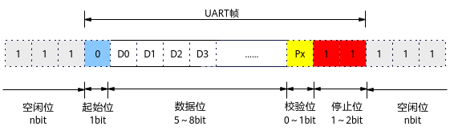

# 前言<a name="ZH-CN_TOPIC_0000002499501925"></a>

**概述<a name="zh-cn_topic_0000002454605641_title253mcpsimp"></a>**

本文档主要介绍HiDiTingV100设备驱动开发的相关内容，主要包括工作原理、按场景描述接口使用方法和注意事项。用于指导用户快速使用设备驱动接口。

**读者对象<a name="zh-cn_topic_0000002454605641_title277mcpsimp"></a>**

本文档主要适用于以下工程师：

-   技术支持工程师
-   软件开发工程师

**符号约定<a name="zh-cn_topic_0000002454605641_section133020216410"></a>**

在本文中可能出现下列标志，它们所代表的含义如下。

<a name="zh-cn_topic_0000002454605641_table2622507016410"></a>
<table><thead align="left"><tr id="zh-cn_topic_0000002454605641_row1530720816410"><th class="cellrowborder" valign="top" width="20.580000000000002%" id="mcps1.1.3.1.1"><p id="zh-cn_topic_0000002454605641_p6450074116410"><a name="zh-cn_topic_0000002454605641_p6450074116410"></a><a name="zh-cn_topic_0000002454605641_p6450074116410"></a><strong id="zh-cn_topic_0000002454605641_b2136615816410"><a name="zh-cn_topic_0000002454605641_b2136615816410"></a><a name="zh-cn_topic_0000002454605641_b2136615816410"></a>符号</strong></p>
</th>
<th class="cellrowborder" valign="top" width="79.42%" id="mcps1.1.3.1.2"><p id="zh-cn_topic_0000002454605641_p5435366816410"><a name="zh-cn_topic_0000002454605641_p5435366816410"></a><a name="zh-cn_topic_0000002454605641_p5435366816410"></a><strong id="zh-cn_topic_0000002454605641_b5941558116410"><a name="zh-cn_topic_0000002454605641_b5941558116410"></a><a name="zh-cn_topic_0000002454605641_b5941558116410"></a>说明</strong></p>
</th>
</tr>
</thead>
<tbody><tr id="zh-cn_topic_0000002454605641_row1372280416410"><td class="cellrowborder" valign="top" width="20.580000000000002%" headers="mcps1.1.3.1.1 "><p id="zh-cn_topic_0000002454605641_p3734547016410"><a name="zh-cn_topic_0000002454605641_p3734547016410"></a><a name="zh-cn_topic_0000002454605641_p3734547016410"></a><a name="zh-cn_topic_0000002454605641_image2670064316410"></a><a name="zh-cn_topic_0000002454605641_image2670064316410"></a><span></span></p>
</td>
<td class="cellrowborder" valign="top" width="79.42%" headers="mcps1.1.3.1.2 "><p id="zh-cn_topic_0000002454605641_p1757432116410"><a name="zh-cn_topic_0000002454605641_p1757432116410"></a><a name="zh-cn_topic_0000002454605641_p1757432116410"></a>表示如不避免则将会导致死亡或严重伤害的具有高等级风险的危害。</p>
</td>
</tr>
<tr id="zh-cn_topic_0000002454605641_row466863216410"><td class="cellrowborder" valign="top" width="20.580000000000002%" headers="mcps1.1.3.1.1 "><p id="zh-cn_topic_0000002454605641_p1432579516410"><a name="zh-cn_topic_0000002454605641_p1432579516410"></a><a name="zh-cn_topic_0000002454605641_p1432579516410"></a><a name="zh-cn_topic_0000002454605641_image4895582316410"></a><a name="zh-cn_topic_0000002454605641_image4895582316410"></a><span></span></p>
</td>
<td class="cellrowborder" valign="top" width="79.42%" headers="mcps1.1.3.1.2 "><p id="zh-cn_topic_0000002454605641_p959197916410"><a name="zh-cn_topic_0000002454605641_p959197916410"></a><a name="zh-cn_topic_0000002454605641_p959197916410"></a>表示如不避免则可能导致死亡或严重伤害的具有中等级风险的危害。</p>
</td>
</tr>
<tr id="zh-cn_topic_0000002454605641_row123863216410"><td class="cellrowborder" valign="top" width="20.580000000000002%" headers="mcps1.1.3.1.1 "><p id="zh-cn_topic_0000002454605641_p1232579516410"><a name="zh-cn_topic_0000002454605641_p1232579516410"></a><a name="zh-cn_topic_0000002454605641_p1232579516410"></a><a name="zh-cn_topic_0000002454605641_image1235582316410"></a><a name="zh-cn_topic_0000002454605641_image1235582316410"></a><span></span></p>
</td>
<td class="cellrowborder" valign="top" width="79.42%" headers="mcps1.1.3.1.2 "><p id="zh-cn_topic_0000002454605641_p123197916410"><a name="zh-cn_topic_0000002454605641_p123197916410"></a><a name="zh-cn_topic_0000002454605641_p123197916410"></a>表示如不避免则可能导致轻微或中度伤害的具有低等级风险的危害。</p>
</td>
</tr>
<tr id="zh-cn_topic_0000002454605641_row5786682116410"><td class="cellrowborder" valign="top" width="20.580000000000002%" headers="mcps1.1.3.1.1 "><p id="zh-cn_topic_0000002454605641_p2204984716410"><a name="zh-cn_topic_0000002454605641_p2204984716410"></a><a name="zh-cn_topic_0000002454605641_p2204984716410"></a><a name="zh-cn_topic_0000002454605641_image4504446716410"></a><a name="zh-cn_topic_0000002454605641_image4504446716410"></a><span></span></p>
</td>
<td class="cellrowborder" valign="top" width="79.42%" headers="mcps1.1.3.1.2 "><p id="zh-cn_topic_0000002454605641_p4388861916410"><a name="zh-cn_topic_0000002454605641_p4388861916410"></a><a name="zh-cn_topic_0000002454605641_p4388861916410"></a>用于传递设备或环境安全警示信息。如不避免则可能会导致设备损坏、数据丢失、设备性能降低或其它不可预知的结果。</p>
<p id="zh-cn_topic_0000002454605641_p1238861916410"><a name="zh-cn_topic_0000002454605641_p1238861916410"></a><a name="zh-cn_topic_0000002454605641_p1238861916410"></a>“须知”不涉及人身伤害。</p>
</td>
</tr>
<tr id="zh-cn_topic_0000002454605641_row2856923116410"><td class="cellrowborder" valign="top" width="20.580000000000002%" headers="mcps1.1.3.1.1 "><p id="zh-cn_topic_0000002454605641_p5555360116410"><a name="zh-cn_topic_0000002454605641_p5555360116410"></a><a name="zh-cn_topic_0000002454605641_p5555360116410"></a><a name="zh-cn_topic_0000002454605641_image799324016410"></a><a name="zh-cn_topic_0000002454605641_image799324016410"></a><span></span></p>
</td>
<td class="cellrowborder" valign="top" width="79.42%" headers="mcps1.1.3.1.2 "><p id="zh-cn_topic_0000002454605641_p4612588116410"><a name="zh-cn_topic_0000002454605641_p4612588116410"></a><a name="zh-cn_topic_0000002454605641_p4612588116410"></a>对正文中重点信息的补充说明。</p>
<p id="zh-cn_topic_0000002454605641_p1232588116410"><a name="zh-cn_topic_0000002454605641_p1232588116410"></a><a name="zh-cn_topic_0000002454605641_p1232588116410"></a>“说明”不是安全警示信息，不涉及人身、设备及环境伤害信息。</p>
</td>
</tr>
</tbody>
</table>

# UART<a name="ZH-CN_TOPIC_0000002499502001"></a>

-   **[概述](#ZH-CN_TOPIC_0000002466542632)**  

-   **[功能描述](#ZH-CN_TOPIC_0000002466542700)**  

-   **[开发指引](#ZH-CN_TOPIC_0000002466542716)**  

-   **[注意事项](#ZH-CN_TOPIC_0000002466383080)**  

## 概述<a name="ZH-CN_TOPIC_0000002466542632"></a>

UART（Universal Asynchronous Receiver/Transmitter，通用异步收发传输器），是一种通用串行数据总线，用于异步通信。该总线双向通信，可以实现全双工传输和接收。

-   串行：指在计算机总线或其他数据通道上，每次传输一个位元数据，并连续进行以上单次过程的通信方式。
-   异步：无时钟信号，收发双方需要约定使用相同的时钟频率，需要起始位和停止位。
-   全双工：通信允许数据在两个方向上同时传输，它在能力上相当于两个单工通信方式的结合。全双工可以同时进行信号的双向传输。

芯片提供5个UART单元：UART2（用于镜像资源的烧录，A核串口日志打印与AT命令）、UART3（用于与电脑上的debugkits上交互），UART0与UART1（用于对接外部芯片），UART4（bt wvt uart）。

在target\_config.py对应的编译的target里面添加宏FT\_SINGE\_UART，那么UART3的功能将复用到UART2上，UART0可以用来对接其他外设比如GPS芯片、CAT1芯片。

UART协议帧格式如[图1](#zh-cn_topic_0000002454113349__fig2521921641)所示。

**图 1**  UART协议帧格式<a name="zh-cn_topic_0000002454113349__fig2521921641"></a>  


-   空闲位：处于逻辑1状态，表示当前线路上没有资料传送。
-   起始位：先发出一个逻辑0信号，表示传输数据的开始。
-   数据位：可以是5～8位逻辑0或1。如ASCII码（7位），扩展BCD码（8位）小端传输。
-   奇偶校验位：

    数据位传送完成后，可以选择是否进行奇偶校验（收发双方约定），串口校验分以下几种方式：

    -   无校验（no parity）。
    -   奇校验（odd parity）：如果数据位中“1”的数目是偶数，则校验位为“1”；如果“1”的数目是奇数，校验位为“0”。
    -   偶校验（even parity）：如果数据位中“1”的数目是偶数，则校验位为“0”；如果“1”的数目是奇数，，校验位为“1”。
    -   mark parity：校验位始终为1。
    -   space parity：校验位始终为0。

-   停止位：数据结束标志，可以是1位、1.5位、2位的高电平，芯片默认使用是1位的。

**波特率计算公式**

UART的波特率=内部总线频率/\(16×分频系数\)

假设：UART\_FBRD=0x1E、UART\_IBRD=0x01，则表示分频系数的整数部分为30，小数部分为0.015625，整个分频系数为30.015625。

则有：UART的波特率=内部总线频率/\(16×分频系数\)=内部总线频率/\(16×30.015625\)

如：UART3内部总线时钟为81M，分频系数最小为1，所以波特率最高可以配置为：81M/\(16×1\)=5.06M。（恰好满足规格要求的5M）

**UART流控制**

当接收端的数据缓冲区已满，无法处理数据时，就发出“不再接收”的信号，发送端则停止发送，直到发送端收到“可以继续发送”的信号再发送数据。

计算机中常用的两种流控制分别是硬件流控制（RTS/CTS、DTR/DSR等）和软件流控制（XON/XOFF）。

**硬件流控制原理**

UART支持4线模式（4线模式即TX、RX、CTS、RTS）。

在4线工作模式下，UART RX FIFO达到设定的中断阈值，则把RTS管脚电平拉高，相当于输出“不再接收”的信号。

在4线工作模式下，UART CTS管脚被拉高，则UART无法通过TX发送数据，相当于输入“不可继续发送”的信号。

## 功能描述<a name="ZH-CN_TOPIC_0000002466542700"></a>

> **说明：** 
>若UART驱动需要支持DMA数据收发，需确保DMA驱动已完成初始化。

UART模块提供的接口：

-   uapi\_uart\_init：初始化UART。
-   uapi\_uart\_deinit：去初始化UART。
-   uapi\_uart\_set\_attr：设置UART配置参数。
-   uapi\_uart\_get\_attr：获取UART配置参数。
-   uapi\_uart\_has\_pending\_transmissions：查询UART是否正在传输数据。
-   uapi\_uart\_rx\_fifo\_is\_empty：判断RX FIFO是否为空。
-   uapi\_uart\_tx\_fifo\_is\_empty：判断TX FIFO是否为空。
-   uapi\_uart\_register\_rx\_callback：注册接收回调函数，此回调函数会根据触发条件和Size触发。
-   uapi\_uart\_unregister\_rx\_callback：去注册接收回调函数。
-   uapi\_uart\_register\_parity\_error\_callback：注册奇偶校验错误处理的回调函数。
-   uapi\_uart\_register\_frame\_error\_callback：注册帧错误处理回调函数。
-   uapi\_uart\_register\_overrun\_error\_callback：注册溢出错误处理回调函数。
-   uapi\_uart\_write：写数据。
-   uapi\_uart\_write\_nolock：通过直接发送，不会锁中断的方式写数据。
-   uapi\_uart\_write\_single：使用直接发送的方式将数据发送到单线UART上。
-   uapi\_uart\_write\_int：使用中断模式将数据发送到已打开的UART上，当数据发送完成，会调用回调函数。
-   uapi\_uart\_write\_by\_dma：通过DMA发送数据。
-   uapi\_uart\_read\_by\_dma：通过DMA读数据。
-   uapi\_uart\_register\_read\_by\_dma\_callback：注册中断触发DMA搬运的回调。
-   uapi\_uart\_unregister\_read\_by\_dma\_callback：去注册中断触发DMA搬运的回调。
-   uapi\_uart\_update\_dma\_recv\_buff：更新接收UART DMA数据的buffer。
-   uapi\_uart\_dma\_lli\_continue\_recv：UART判断状态后继续接收数据的接口。
-   uapi\_uart\_dma\_recv\_register：注册接收UART DMA数据的buffer信息和处理函数。
-   uapi\_uart\_dma\_send：通过DMA数据链表发送数据。
-   uapi\_uart\_dma\_recv\_end\_transfer：结束接收UART DMA数据。
-   uapi\_uart\_dma\_send\_end\_transfer：结束发送UART DMA数据。
-   uapi\_uart\_recv\_raw\_data\_end\_transfer：结束UART不定长数据接收。
-   uapi\_uart\_dma\_recv\_raw\_data：UART DMA不定长数据接收接口。
-   uapi\_uart\_read：读数据。
-   uapi\_uart\_flush\_rx\_data：刷新UART接收Buffer中的数据。
-   uapi\_uart\_update\_rx\_buff：更新UART接收Buffer的地址和长度。
-   uapi\_uart\_register\_write\_by\_dma\_callback：注册在DMA完成后直接调用DMA写的的回调函数。
-   uapi\_uart\_pin\_cfg\_get：获取一个通道的管脚配置的接口。

## 开发指引<a name="ZH-CN_TOPIC_0000002466542716"></a>

以应用UART0为例，数据收发流程如下：

1.  UART初始化。配置UART的波特率、数据位等属性，并使能UART。

    ```
    unsigned char g_uart_rx_buff[TEST_UART_RX_BUFF_SIZE] = { 0 }; 
    uart_buffer_config_t g_uart_buffer_config = { 
        .rx_buffer = g_uart_rx_buff, 
        .rx_buffer_size = TEST_UART_RX_BUFF_SIZE 
    }; 
    errcode_t usr_uart_init_config() 
    { 
        errcode_t errcode; 
        uart_attr_t attr = { 
            .baud_rate = 115200, /* 波特率 */ 
            .data_bits = UART_DATA_BIT_8,      /* 数据位 */ 
            .stop_bits = UART_STOP_BIT_1,      /* 停止位 */ 
            .parity = UART_PARITY_NONE,          /* 校验位 */ 
        }; 
        uart_pin_config_t pin_config = { 
            .tx_pin = S_MGPIO19, /* uart0 tx 配置IO复用 */ 
            .rx_pin = S_MGPIO20, /* uart0 rx 配置IO复用*/ 
            .cts_pin = PIN_NONE, /* 流控功能，可选,不建议使用 */ 
            .rts_pin = PIN_NONE  /* 流控功能，可选，不建议使用*/ 
        }; 
        uart_extra_attr_t extra_attr = { 
            .tx_dma_enable = tx_dma_enable, 
            .tx_int_threshold = 0, 
            .rx_dma_enable = rx_dma_enable, 
            .rx_int_threshold = 0 
        }; 
        errcode_t errcode = uapi_uart_init(UART_BUS_1, &pin_config, &attr, &extra_attr, &g_uart_buffer_config); 
        if (errcode != ERRCODE_SUCC) { 
            printf("uart init fail\r\n"); 
        } 
        return errcode; 
    }
    ```

2.  UART数据收发。调用UART读写数据接口，进行数据收发。

    ```
    // 最常用的读取数据方式，注册rx中断回调，在回调中读取数据 
    void callback(const void *buffer,uint16_t length,bool error){ 
        //*buffer为rx接受到的数据，length为RX接收到的数据长度，error接收到的数据是否正确，当error为1时代表数据波形错误，无效无数 
    }; 
    uapi_uart_register_rx_callback(UART_BUS_1, UART_RX_CONDITION_FULL_OR_IDLE,1024, callback); 
    void usr_uart_read_data() 
    {  
        // 基本不会使用这个方式读取RX数据 
        int len; 
        unsigned char g_test_uart_rx_buffer[64]; 
        len = uapi_uart_read(UART_BUS_0, g_test_uart_rx_buffer, 64, 0); 
        if(len > 0) { 
            /* process */ 
        } 
    } 
    int usr_uart_write_data(unsigned int size, char* buff) 
    {  
        // 通过UART的TX写数据 
        unsigned char tx_buff[TEST_UART_TX_BUFF_SIZE] = { 0 }; 
        if (memcpy_s(tx_buff, TEST_UART_TX_BUFF_SIZE, buff, size) != OK) { 
            return ERROR; 
        } 
        int ret = uapi_uart_write(UART_BUS_0, tx_buff, size, 0); 
        if(ret == -1) { 
            return ERROR; 
        } 
        return OK; 
    }
    ```

UART DMA模式发送数据流程如下。

1.  DMA和UART初始化。配置UART的波特率、数据位等属性，并使能UART。

    ```
    uapi_dma_init(); 
    uapi_dma_open(); 
    errcode_t usr_uart_init_config() 
    { 
        errcode_t errcode; 
        uart_attr_t attr = { 
            .baud_rate = 115200, /* 波特率 */ 
            .data_bits = UART_DATA_BIT_8,      /* 数据位 */ 
            .stop_bits = UART_STOP_BIT_1,      /* 停止位 */ 
            .parity = UART_PARITY_NONE,          /* 校验位 */ 
        }; 
        uart_pin_config_t pin_config = { 
            .tx_pin = S_MGPIO19, /* uart0 tx 配置IO复用 */↵ 
            .rx_pin = S_MGPIO20, /* uart0 rx 配置IO复用*/↵ 
            .cts_pin = PIN_NONE, /* 流控功能，可选,不建议使用 */↵ 
            .rts_pin = PIN_NONE  /* 流控功能，可选，不建议使用*/↵ 
        }; 
        errcode_t errcode = uapi_uart_init(UART_BUS_0, &pin_config, &attr, NULL, &g_uart_buffer_config); 
        if (errcode != ERRCODE_SUCC) { 
            printf("uart init fail\r\n"); 
        } 
        return errcode; 
    }
    ```

2.  UART DMA数据发。

    ```
    #define TEST_UART_DMA_SEND_BUFF_SIZE 1024 
    #define HAL_DMA_TRANSFER_WIDTH_8 0 
    #define HAL_DMA_BURST_TRANSACTION_LENGTH_4 1 
    static errcode_t test_uart_write_by_dma() 
    { 
        uint8_t dma_buff[TEST_UART_DMA_SEND_BUFF_SIZE] = { 0 }; 
        if (memset_s(dma_buff, TEST_UART_DMA_SEND_BUFF_SIZE, 0XA5, TEST_UART_DMA_SEND_BUFF_SIZE) != 0) { 
            return ERRCODE_FAIL; 
        } 
        uart_write_dma_config_t dma_cfg = { 
            .src_width = HAL_DMA_TRANSFER_WIDTH_8,              /* 0代表8bit */ 
            .dest_width = HAL_DMA_TRANSFER_WIDTH_8,             /* 0代表8bit */ 
            .burst_length = HAL_DMA_BURST_TRANSACTION_LENGTH_4, /* 代表4字节 */ 
            .priority = 0                                       /* 优先级0 */ 
        }; 
        if (uapi_uart_write_by_dma(UART_BUS_0, dma_buff, len, &dma_cfg) != len) { 
            printf("[UART] *** memory to uart fail!\r\n"); 
            return ERRCODE_FAIL; 
        } 
        return ERRCODE_SUCC; 
    }
    ```

3.  UART DMA数据收。

    ```
    #define TEST_UART_DMA_SEND_BUFF_SIZE 1024 
    #define HAL_DMA_TRANSFER_WIDTH_8 0 
    #define HAL_DMA_BURST_TRANSACTION_LENGTH_4 1 
    static errcode_t test_uart_read_by_dma() 
    { 
        uint8_t dma_buff[TEST_UART_DMA_SEND_BUFF_SIZE] = { 0 }; 
        if (memset_s(dma_buff, TEST_UART_DMA_SEND_BUFF_SIZE, 0XA5, TEST_UART_DMA_SEND_BUFF_SIZE) != 0) { 
            return ERRCODE_FAIL; 
        } 
        uart_read_dma_config_t dma_cfg = { 
            .src_width = HAL_DMA_TRANSFER_WIDTH_8,              /* 0代表8bit */ 
            .dest_width = HAL_DMA_TRANSFER_WIDTH_8,             /* 0代表8bit */ 
            .burst_length = HAL_DMA_BURST_TRANSACTION_LENGTH_4, /* 代表4字节 */ 
            .priority = 0                                       /* 优先级0 */ 
        }; 
        if (uapi_uart_read_by_dma(UART_BUS_0, dma_buff, len, &dma_cfg) != len) { 
            printf("[UART] *** memory to uart fail!\r\n"); 
            return ERRCODE_FAIL; 
        } 
        return ERRCODE_SUCC; 
    }
    ```

## 注意事项<a name="ZH-CN_TOPIC_0000002466383080"></a>

-   UART0与UART1用于对接外部芯片。
-   UART2默认用于镜像资源的烧录，A核串口日志打印与AT命令。
-   UART3用于与电脑上的debugkits上交互。
-   UART4是bt wvt uart。

# SPI<a name="ZH-CN_TOPIC_0000002499582025"></a>

-   **[概述](#ZH-CN_TOPIC_0000002499582053)**  

-   **[功能描述](#ZH-CN_TOPIC_0000002466542732)**  

-   **[开发指引](#ZH-CN_TOPIC_0000002466542752)**  

-   **[注意事项](#ZH-CN_TOPIC_0000002466542680)**  

## 概述<a name="ZH-CN_TOPIC_0000002499582053"></a>

SPI（Serial Peripheral Interface）可作为Master或Slave与外部设备进行同步串行通信（外围设备必须支持SPI帧格式）。每个SPI具有收发分开的位宽为8bit×32的FIFO。

## 功能描述<a name="ZH-CN_TOPIC_0000002466542732"></a>

> **说明：** 
>SPI主模式支持轮询模式读写、中断模式读写以及DMA模式读写；从模式也支持轮询模式读写、支持中断模式读写和DMA模式读写。
>如果SPI驱动想配置DMA模式读写数据，需要确保DMA驱动已经初始化。DMA初始化请参见“[DMA](#ZH-CN_TOPIC_0000002499501917)”进行配置。
>SPI 支持手动模式和自动模式。
>-   手动模式：支持轮询模式读写、中断模式读写以及DMA模式读写。
>    CONFIG\_SPI\_SUPPORT\_DMA：支持DMA。
>    CONFIG\_SPI\_SUPPORT\_INTERRUPT：支持中断。
>-   自动模式：支持DMA模式和轮询模式自动切换。SPI自动模式配置宏定义后，按照轮询的读写方式即可。
>    CONFIG\_SPI\_SUPPORT\_DMA：支持DMA。
>    CONFIG\_SPI\_SUPPORT\_POLL\_AND\_DMA\_AUTO\_SWITCH：支持自动识别传输模式。
>    CONFIG\_SPI\_AUTO\_SWITCH\_DMA\_THRESHOLD=0x8：自动识别传输阈值，大于阈值使用DMA模式，小于等于阈值使用轮询模式，阈值大小可调。

SPI模块提供的接口：

-   uapi\_spi\_init：初始化SPI（包括：主从设备、极性、相性、帧协议、传输频率、传输位宽等设定）。
-   uapi\_spi\_deinit：去初始化SPI（关闭相应的SPI单元，释放资源）。
-   uapi\_spi\_set\_tmod：设置SPI的传输模式。
-   uapi\_spi\_set\_attr：设置SPI的基础配置参数。
-   uapi\_spi\_get\_attr:  获取SPI的基础配置参数（主从模式、时钟极性、时钟相位、时钟分频系数、SPI工作频率、串行传输协议、SPI帧格式、SPI帧长度、SPI传输模式等）。
-   uapi\_spi\_set\_interrupt\_mask：设置SPI中断掩码。
-   uapi\_spi\_clear\_all\_interrupt：清除SPI中断。
-   uapi\_spi\_set\_extra\_attr：设置SPI的高级配置参数。
-   uapi\_spi\_get\_extra\_attr：获取SPI的高级配置参数（SPI是否使用DMA发送数据、SPI是否使用DMA接收数据、QSPI参数等）。
-   uapi\_spi\_select\_slave：片选。
-   uapi\_spi\_master\_write：SPI主机半双工发送数据。
-   uapi\_spi\_master\_read：SPI主机半双工接收数据。
-   uapi\_spi\_master\_writeread：SPI主机写入和读取数据。
-   uapi\_spi\_master\_txrx\_transfer：SPI主机全双工读写数据。
-   uapi\_spi\_slave\_read：SPI从机半双工接收数据。
-   uapi\_spi\_slave\_write：SPI从机半双工发送数据。
-   uapi\_spi\_slave\_writeread：SPI从机写入和读取数据。
-   uapi\_spi\_set\_dma\_mode：SPI设置为手动DMA模式。
-   uapi\_spi\_set\_irq\_mode： SPI设置为手动中断模式。

## 开发指引<a name="ZH-CN_TOPIC_0000002466542752"></a>

SPI用于对接支持SPI协议的设备，SPI单元可以作为主设备或从设备。以SPI单元作为主设备为例，写数据操作如下：

1.  通过IO复用，复用SPI功能用到的管脚为SPI功能。

    管脚复用各个功能请参考“platform\_core.h”中各个管脚功能的定义。

2.  调用uapi\_spi\_init，初始化SPI资源，选择SPI功能单元以及配置SPI参数。

    ```
    errcode_t usr_spi_init() 
    { 
        errcode_t ret; 
        spi_bus_t bus_id = SPI_BUS_0; 
        spi_attr_t attr; 
        spi_extra_attr_t extra_attr; 
        /* IO 复用 */ 
        uapi_pin_set_mode(S_MGPIO12, PIN_MODE_1);
        uapi_pin_set_mode(S_MGPIO13, PIN_MODE_1);
        uapi_pin_set_mode(S_MGPIO14, PIN_MODE_1);
        uapi_pin_set_mode(S_MGPIO15, PIN_MODE_1);
        uapi_pin_set_mode(S_MGPIO23, PIN_MODE_1);
        uapi_pin_set_mode(S_MGPIO24, PIN_MODE_1);
        uapi_pin_set_mode(S_MGPIO25, PIN_MODE_1);
        uapi_pin_set_mode(S_MGPIO26, PIN_MODE_1);     /* 主模式参数设置 */ 
        spi_attr_t attr = { 
            .is_slave = false, 
            .salve_num = 1, 
            .bus_clk = 32000000, 
            .freq_mhz = 2,  /* Min freq in standard spi is 1, max is 48 */ 
            .clk_polarity = (uint32_t)SPI_CFG_CLK_CPOL_0, 
            .clk_phase = (uint32_t)SPI_CFG_CLK_CPHA_0, 
            .frame_format = SPI_CFG_FRAME_FORMAT_MOTOROLA_SPI, 
            .spi_frame_format = (uint32_t)HAL_SPI_FRAME_FORMAT_STANDARD, 
            .frame_size = (uint32_t)HAL_SPI_FRAME_SIZE_8, 
            .tmod = HAL_SPI_TRANS_MODE_TX, 
        }; 
        spi_extra_attr_t extra_attr = { 
            .tx_use_dma = false, 
            .rx_use_dma = false 
        }; 
        ret = uapi_spi_init(bus_id, &attr, &extra_attr); 
        if (ret != ERRCODE_SUCC) { 
            return ret; 
        } 
        return ERRCODE_SUCC; 
    }
    ```

3.  调用uapi\_spi\_master\_write，进行SPI主设备写操作，初始化时的tmod参数建议配置为HAL\_SPI\_TRANS\_MODE\_TX。

    以主设备发送数据为例：

    ```
    errcode_t demo_spi_master_write() 
    {   
        errcode_t ret; 
        uint32_t timeout = 100; // 当前传输的超时时间 
        uint8_t data[100] = { 0 }; 
        spi_xfer_data_t xfer_data = { 
            .tx_buff = data, 
            .tx_bytes = sizeof(data) 
        }; 
        /* 主模式参数设置 */ 
        spi_attr_t attr = { 
            .is_slave = false, 
            .salve_num = 1, 
            .bus_clk = 32000000, 
            .freq_mhz = 2,  /* Min freq in standard spi is 1, max is 48 */ 
            .clk_polarity = (uint32_t)SPI_CFG_CLK_CPOL_0, 
            .clk_phase = (uint32_t)SPI_CFG_CLK_CPHA_0, 
            .frame_format = SPI_CFG_FRAME_FORMAT_MOTOROLA_SPI, 
            .spi_frame_format = (uint32_t)HAL_SPI_FRAME_FORMAT_STANDARD, 
            .frame_size = (uint32_t)HAL_SPI_FRAME_SIZE_8, 
            .tmod = HAL_SPI_TRANS_MODE_TX, 
        }; 
        uapi_spi_set_attr(SPI_BUS_0, &attr) 
        ret = uapi_spi_master_write(SPI_BUS_0, &xfer_data, timeout); 
        if (ret != ERRCODE_SUCC) { 
            return ret; 
        } 
        return ERRCODE_SUCC; 
    }
    ```

4.  调用uapi\_spi\_master\_read，进行SPI主设备读操作，初始化时的tmod参数建议配置为HAL\_SPI\_TRANS\_MODE\_RX。

    以主设备读数据为例：

    ```
    errcode_t demo_spi_master_read() 
    { 
        errcode_t ret; 
        uint32_t timeout = 100; // 当前传输的超时时间 
        uint8_t data[100] = { 0 }; 
        spi_xfer_data_t xfer_data = { 
            .rx_buff = data, 
            .rx_bytes = sizeof(data) 
        }; 
        /* 主模式参数设置 */ 
        spi_attr_t attr = { 
            .is_slave = false, 
            .salve_num = 1, 
            .bus_clk = 32000000, 
            .freq_mhz = 2,  /* Min freq in standard spi is 1, max is 48 */ 
            .clk_polarity = (uint32_t)SPI_CFG_CLK_CPOL_0, 
            .clk_phase = (uint32_t)SPI_CFG_CLK_CPHA_0, 
            .frame_format = SPI_CFG_FRAME_FORMAT_MOTOROLA_SPI, 
            .spi_frame_format = (uint32_t)HAL_SPI_FRAME_FORMAT_STANDARD, 
            .frame_size = (uint32_t)HAL_SPI_FRAME_SIZE_8, 
            .tmod = HAL_SPI_TRANS_MODE_RX, 
        }; 
        uapi_spi_set_attr(SPI_BUS_0, &attr) 
        ret = uapi_spi_master_read(SPI_BUS_0, &xfer_data, timeout); 
        if (ret != ERRCODE_SUCC) { 
            return ret; 
        } 
        return ERRCODE_SUCC; 
    }
    ```

5.  调用uapi\_spi\_master\_writeread，进行SPI主设备先写后读操作，初始化时的tmod参数建议配置为HAL\_SPI\_TRANS\_MODE\_TXRX。

    ```
    errcode_t demo_spi_master_writeread() 
    { 
        errcode_t ret; 
        uint32_t timeout = 100; // 当前传输的超时时间 
        uint8_t r_data[100] = { 0 }; 
        uint8_t w_data[100] = { 0 }; 
        spi_xfer_data_t xfer_data = { 
            .tx_buff = w_data, 
            .tx_bytes = sizeof(w_data), 
            .rx_buff = r_data, 
            .rx_bytes = sizeof(r_data) 
        }; 
        /* 主模式参数设置 */ 
        spi_attr_t attr = { 
            .is_slave = false, 
            .salve_num = 1, 
            .bus_clk = 32000000, 
            .freq_mhz = 2,  /* Min freq in standard spi is 1, max is 48 */ 
            .clk_polarity = (uint32_t)SPI_CFG_CLK_CPOL_0, 
            .clk_phase = (uint32_t)SPI_CFG_CLK_CPHA_0, 
            .frame_format = SPI_CFG_FRAME_FORMAT_MOTOROLA_SPI, 
            .spi_frame_format = (uint32_t)HAL_SPI_FRAME_FORMAT_STANDARD, 
            .frame_size = (uint32_t)HAL_SPI_FRAME_SIZE_8, 
            .tmod = HAL_SPI_TRANS_MODE_TXRX, 
        }; 
        uapi_spi_set_attr(SPI_BUS_0, &attr)； 
        ret = uapi_spi_master_writeread(SPI_BUS_0, &xfer_data, timeout); 
        if (ret != ERRCODE_SUCC) { 
            return ret; 
        } 
        return ERRCODE_SUCC; 
    }
    ```

6.  调用uapi\_spi\_select\_slave，进行从设备选择操作。

    ```
    errcode_t demo_spi_slave_select() 
    { 
        errcode_t ret; 
        spi_slave_t slave = SPI_SLAVE0; 
        ret = uapi_spi_select_slave(SPI_BUS_0, slave); 
        if (ret != ERRCODE_SUCC) { 
            return ret; 
        } 
        return ERRCODE_SUCC; 
    }
    ```

SPI手动DMA模式配置方式，SPI初始化后，配置传输模式，再进行读写操作。

1.  配置手动模式宏定义，请参考“target\_config.py”文件。
2.  调用uapi\_spi\_set\_dma\_mode接口，配置是否使用手动DMA模式。

    ```
    errcode_t demo_spi_set_dma_mode(spi_bus_t bus, bool en) 
    { 
        errcode_t ret; 
        spi_dma_config_t dma_cfg = { 
            .src_width = demo_width, 
            .dest_width = demo_width, 
            .burst_length = demo_burst_length, 
            .priority = demo_priority 
        }; 
        ret = uapi_spi_set_dma_mode(bus, en, &dma_cfg); 
        if (ret != ERRCODE_SUCC) { 
            return ret; 
        } 
        return ERRCODE_SUCC; 
    }
    ```

SPI手动中断模式配置方式，SPI初始化后，配置传输模式，再进行读写操作。

1.  配置手动模式宏定义，请参考“target\_config.py”文件。
2.  调用uapi\_spi\_set\_irq\_mode接口，配置是否使用手动中断模式。

    ```
    errcode_t demo_spi_set_int_mode(spi_bus_t bus, bool en) 
    { 
        errcode_t ret; 
        ret = uapi_spi_set_irq_mode(bus, en, spi_rx_callback, test_spi_write_int_handler); 
        if (ret != ERRCODE_SUCC) { 
            return ret; 
        } 
        return ERRCODE_SUCC; 
    }
    ```

## 注意事项<a name="ZH-CN_TOPIC_0000002466542680"></a>

-   当不再使用SPI时，必须调用uapi\_spi\_deinit进行资源释放，否则再进行初始化时将返回错误。
-   使用microwire帧协议时，由于microwire帧协议限制，主设备只能发送8bit位宽数据。
-   SPI使用约束，做从机时会独占总线，不适用于一主多从做为从机的场景。
-   手动中断模式和自动切换模式互斥。

# I2C<a name="ZH-CN_TOPIC_0000002466383020"></a>

-   **[概述](#ZH-CN_TOPIC_0000002499582033)**  

-   **[功能描述](#ZH-CN_TOPIC_0000002499502061)**  

-   **[开发指引](#ZH-CN_TOPIC_0000002499582085)**  

-   **[注意事项](#ZH-CN_TOPIC_0000002466542640)**  

## 概述<a name="ZH-CN_TOPIC_0000002499582033"></a>

I2C模块是APB总线上的设备，是I2C总线上的主设备，支持多主设备时的总线仲裁。该模块内部包含8bit×8发送和接收FIFO各一个，用于主从设备之间的通信和数据传输。

## 功能描述<a name="ZH-CN_TOPIC_0000002499502061"></a>

> **说明：** 
>I2C支持手动模式和自动模式。
>-   手动模式：支持轮询模式读写、中断模式读写以及DMA模式读写。
>    CONFIG\_I2C\_SUPPORT\_DMA：支持DMA。
>    CONFIG\_I2C\_SUPPORT\_INT：支持中断。
>-   自动模式：支持DMA模式和轮询模式自动切换。I2C自动模式配置宏定义后，按照轮询的读写方式即可。
>    CONFIG\_I2C\_SUPPORT\_DMA：支持DMA。
>    CONFIG\_I2C\_SUPPORT\_POLL\_AND\_DMA\_AUTO\_SWITCH：支持自动识别传输模式。
>    CONFIG\_I2C\_POLL\_AND\_DMA\_AUTO\_SWITCH\_THRESHOLD=0x8：自动识别传输阈值，大于阈值使用DMA模式，小于等于阈值使用轮询模式，阈值大小可调。

I2C模块提供的接口：

-   uapi\_i2c\_master\_init：初始化该I2C设备为主机，需要传入的参数有：总线号、波特率、高速模式主机码（只有高速模式需要配置，范围0～7）。
-   uapi\_i2c\_master\_write：I2C主机将数据发送到目标从机上。
-   uapi\_i2c\_master\_read：主机接收来自目标I2C从机的数据。
-   uapi\_i2c\_master\_writeread：主机发送数据到目标I2C从机，并接收来自此从机的数据。
-   uapi\_i2c\_master\_writeread\_restart：主机发送数据到目标I2C从机，发送数据时有restart，无stop，并接收来自此从机的数据。
-   uapi\_i2c\_slave\_init：初始化该I2C设备为从机，需要传入的参数有：总线号、波特率、从机地址（支持7地址寻址地址、10地址寻址地址）。
-   uapi\_i2c\_slave\_write：从机将数据发送给主机。
-   uapi\_i2c\_slave\_read：从机接收来自主机的数据。
-   uapi\_i2c\_set\_irq\_mode：设置是否使用中断模式传输数据。
-   uapi\_i2c\_register\_irq\_callback：注册I2C中断事件回调函数。
-   uapi\_i2c\_unregister\_irq\_callback：取消注册I2C中断事件回调函数。
-   uapi\_i2c\_set\_dma\_mode：设置DMA读写模式。
-   uapi\_i2c\_deinit：去初始化I2C设备，支持主从机。
-   uapi\_i2c\_set\_baudrate：对已初始化的I2C重置波特率，支持主从机。

## 开发指引<a name="ZH-CN_TOPIC_0000002499582085"></a>

I2C用于对接支持I2C协议的设备，I2C单元可以作为主设备或从设备。以I2C单元作为主设备为例：

1.  通过IO复用，将用到的管脚复用为I2C功能。
2.  调用uapi\_i2c\_init接口，初始化I2C资源，此处以初始化I2C主机为例：

    ```
    errcode_t sample_i2c_init(uint32_t bus_id, uint32_t baudrate, uint8_t hscode) 
    { 
        errcode_t ret; 
        /* IO 复用 */ 
        uapi_pin_set_mode(S_MGPIO4, PIN_MODE_1);
        uapi_pin_set_mode(S_MGPIO5, PIN_MODE_1);
        uapi_pin_set_mode(S_MGPIO6, PIN_MODE_1);
        uapi_pin_set_mode(S_MGPIO7, PIN_MODE_1);
        uapi_pin_set_mode(S_MGPIO8, PIN_MODE_1);
        uapi_pin_set_mode(S_MGPIO9, PIN_MODE_1);
        ret = uapi_i2c_master_init(bus_id, baudrate, hscode); 
        if (ret != ERRCODE_SUCC) { 
            return ret; 
        } 
        return ERRCODE_SUCC; 
     }
    ```

3.  调用uapi\_i2c\_master\_write接口，实现主机发送数据。

    ```
    errcode_t sample_i2c_write(uint32_t bus_id, uint16_t dev_addr, uint8_t *send_buf, uint32_t send_len) 
    { 
        errcode_t ret; 
        i2c_data_t data = { 0 }; 
        data.send_buf = send_buf; 
        data.send_len = send_len; 
        ret = uapi_i2c_master_write(bus_id, dev_addr, &data); 
        if (ret != ERRCODE_SUCC) { 
            return ret; 
        } 
        return ERRCODE_SUCC; 
    }
    ```

4.  调用uapi\_i2c\_master\_read接口，实现主机读数据。

    ```
    errcode_t sample_i2c_read(uint32_t bus_id, uint16_t dev_addr, uint8_t *recv_buf, uint32_t recv_len) 
    { 
        errcode_t ret; 
        i2c_data_t data = { 0 }; 
        data.receive_buf = recv_buf; 
        data.receive_len = recv_len; 
        ret = uapi_i2c_master_read(bus_id, dev_addr, &data); 
        if (ret != ERRCODE_SUCC) { 
            return ret; 
        } 
        return ERRCODE_SUCC; 
    }
    ```

I2C手动DMA模式配置方式，I2C初始化后，配置传输模式，再进行读写操作。

1.  配置手动模式宏定义，请参考“target\_config.py”文件。
2.  调用uapi\_i2c\_set\_dma\_mode接口，配置是否使用手动DMA模式。

    ```
    errcode_t demo_i2c_set_dma_mode(i2c_bus_t bus, bool en) 
    { 
        errcode_t ret; 
        ret = uapi_i2c_set_dma_mode(bus, en); 
        if (ret != ERRCODE_SUCC) { 
            return ret; 
        } 
        return ERRCODE_SUCC; 
    }
    ```

I2C手动中断模式配置方式，I2C初始化后，配置传输模式，再进行读写操作。

1.  配置手动模式宏定义，请参考“target\_config.py”文件。
2.  调用uapi\_i2c\_set\_irq\_mode接口，配置是否使用手动中断模式。

    ```
    errcode_t demo_i2c_set_int_mode(i2c_bus_t bus, bool en) 
    { 
        errcode_t ret; 
        ret = uapi_i2c_set_irq_mode(bus, en); 
        if (ret != ERRCODE_SUCC) { 
            return ret; 
        } 
        return ERRCODE_SUCC; 
    }
    ```

## 注意事项<a name="ZH-CN_TOPIC_0000002466542640"></a>

-   函数uapi\_i2c\_set\_baudrate需要先初始化，再调用，方便修改波特率。如果I2C未经过初始化，直接调用uapi\_i2c\_set\_baudrate函数，会返回错误码ERRCODE\_I2C\_NOT\_INIT。
-   需要主动确保数据发送指针send\_buf和数据接收指针receive\_buf不可传入空指针。
-   当发送的数据大于对接设备的可接受范围时，会发送失败；如果发送数据失败，再切换另一个I2C设备继续发送时，会造成总线挂死，所有I2C设备都无法正确发送数据。
-   uapi\_i2c\_master\_init不能多次初始化，使用完成后需要调用uapi\_i2c\_deinit进行去初始化。
-   手动中断模式和自动切换模式互斥。

# ADC<a name="ZH-CN_TOPIC_0000002499582009"></a>

-   **[概述](#ZH-CN_TOPIC_0000002499502089)**  

-   **[功能描述](#ZH-CN_TOPIC_0000002466383088)**  

-   **[开发指引](#ZH-CN_TOPIC_0000002499501977)**  

-   **[注意事项](#ZH-CN_TOPIC_0000002466383104)**  

## 概述<a name="ZH-CN_TOPIC_0000002499502089"></a>

ADC（Analog-to-Digital Converter）实现对外部模拟信号转换成一定比例的数字值，从而实现对模拟信号的测量，可应用于电量检测、按键检测等。

## 功能描述<a name="ZH-CN_TOPIC_0000002466383088"></a>

ADC模块提供的接口：

-   uapi\_adc\_init：初始化ADC。
-   uapi\_adc\_deinit：去初始化ADC。
-   uapi\_adc\_power\_en：上下电并启用或关闭ADC。
-   uapi\_adc\_is\_using：检查ADC是否正在使用。
-   uapi\_adc\_open\_channel：开启一个ADC通道。
-   uapi\_adc\_close\_channel：关闭一个ADC通道。
-   uapi\_adc\_open\_differential\_channel：开启ADC差分通道。
-   uapi\_adc\_close\_differential\_channel：关闭ADC差分通道。
-   uapi\_adc\_manual\_sample：ADC手动采样。
-   uapi\_adc\_auto\_scan\_ch\_enable：ADC开始自动采样接口。
-   uapi\_adc\_auto\_scan\_ch\_disable：ADC停止自动采样接口。

## 开发指引<a name="ZH-CN_TOPIC_0000002499501977"></a>

-   **[ADC手动采样开发指引](#ZH-CN_TOPIC_0000002499501953)**  

-   **[ADC自动采样开发指引](#ZH-CN_TOPIC_0000002499581957)**  

### ADC手动采样开发指引<a name="ZH-CN_TOPIC_0000002499501953"></a>

芯片提供1个ADC、7个独立通道。可以选择采样次数、丢弃次数（可选）来调用uapi\_adc\_manul\_sample接口获取采样值，可通过转换获得电压。

示例：

```
/* 采样次数 */ 
#define TESTADC_SAMPLE_NUMS 10 
/* 采样值转换为电压 */ 
  
  
#define adc_trans_sytick_to_voltage_without_auto_scan(x) ((float)(((float)(x) * 18) / 40960)) 

/* 采样数转为电压值 */ 
static float test_adc_stick_transfer_voltage(uint16_t stick) 
{ 
    return adc_trans_sytick_to_voltage_without_auto_scan(stick); 
} 
/* 手动 */
#define ADC_SAMPLE_TIMES 10 
#define ADC_SAMPLE_DATA_LEN 10010 
uint32_t g_adc_sample_times = 0; 
uint32_t g_save_adc_index = 0; 
uint32_t *g_save_adc_data = NULL; 
static uint32_t adc_auto_sample_show_data(uint8_t *para, uint32_t para_len) 
{ 
    wstp_print("g_save_adc_index = %d\r\n", g_save_adc_index); 
    for (uint32_t i = 0; i < g_save_adc_index; i++) { 
        wstp_print("%d\r\n", g_save_adc_data[i]); 
    } 

    g_save_adc_index = 0; 
    g_adc_sample_times = 0; 
    free(g_save_adc_data); 
    g_save_adc_data = NULL; 
    return ERRCODE_SUCC; 
} 
 
static void adc_autosample_callback(uint8_t channel, uint32_t *buffer, uint32_t length, bool *next) 
{ 
    unused(next); 
    if (g_adc_sample_times >= ADC_SAMPLE_TIMES) { 
        wstp_print("g_adc_sample_times = %d\r\n", g_adc_sample_times); 
        uapi_adc_auto_scan_ch_disable(channel); 
        return; 
    } 

    memcpy_s(g_save_adc_data + g_save_adc_index, length * sizeof(uint32_t), buffer, length * sizeof(uint32_t)); 
    g_save_adc_index += length; 
    g_adc_sample_times++; 
    wstp_print("length = %d\r\n", length); 
    return; 
} 

static uint32_t adc_auto_sample_by_diag(uint8_t *para, uint32_t para_len) 
{ 
    char *ptr = (char *)para; 
    char *token = NULL; 
    char *next_token = NULL; 
    uint32_t channel = 0; 
    uint32_t freq = 0; 
    uint32_t sample_time = 0; 
    uint32_t idx = 0; 
    uint32_t tmp[ADC_AUTODATA_PRT_INDEX3] = {0}; 
    token = strtok_s((char*)ptr, ",", &next_token); 
    while (token != NULL) { 
        tmp[idx++] = strtoul(token, NULL, 10); // 10: 十进制
        token = strtok_s(NULL, ",", &next_token); 
    } 
    channel = tmp[0]; 
    freq = tmp[ADC_AUTODATA_PRT_INDEX1]; 
    sample_time = tmp[ADC_AUTODATA_PRT_INDEX2]; 

    adc_scan_config_t config = {0}; 
    config.freq = (uint8_t)freq; 
    config.long_sample_time = sample_time; 

    g_save_adc_data = (uint32_t *)malloc(sizeof(uint32_t) * ADC_SAMPLE_DATA_LEN); 
    if (g_save_adc_data == NULL) { 
        wstp_print("malloc g_save_adc_data fail!\r\n"); 
        return ERRCODE_FAIL; 
    } 
    (void)uapi_adc_init(ADC_CLOCK_500KHZ); 
    (void)uapi_adc_power_en(AFE_SCAN_MODE_MAX_NUM, true); 
    return(uapi_adc_auto_scan_ch_enable((uint8_t)channel, config, adc_autosample_callback)); 
} 

static uint32_t adc_auto_sample_disable(uint8_t *para, uint32_t para_len) 
{ 
    char *ptr = (char *)para; 
    uint32_t ret = 0; 
    uint32_t channel = strtoul(ptr, NULL, 10); // 10: 十进制
    wstp_print("disable adc auto sample , channel = %x\r\n", channel); 

    return(uapi_adc_auto_scan_ch_disable(channel)); 
} 
/* 采样 */ 
static bool test_adc_get_sample_result(float *voltage, uint8_t channel) 
{ 
    unsigned int sample_number = TESTADC_SAMPLE_NUMS; 
    unsigned int stick = 0; 
    unsigned int sample_zero_count = 0; 
    /* 遍历采样 */ 
    for (unsigned int i = 0; i < sample_number; i++) { 
        osal_irq_lock(); 
        unsigned int sample_result = uapi_adc_manual_sample(); 
        if (sample_result == 0) { 
            sample_zero_count++; 
        } 
        stick += sample_result; 
        osal_irq_unlock(); 
    } 
    sample_number -= sample_zero_count; 
    if (sample_number > 0) { 
        stick = (stick / sample_number); 
    } else { 
        *voltage = 0; 
        return false; 
    } 
    /* 采样数转为电压值 */ 
    *voltage = test_adc_stick_transfer_voltage((uint16_t)stick); 
    return true; 
}
```

### ADC自动采样开发指引<a name="ZH-CN_TOPIC_0000002499581957"></a>

自动采样开发示例：

```
#define ADC_SAMPLE_TIMES 10 
#define ADC_SAMPLE_DATA_LEN 10010 
uint32_t g_adc_sample_times = 0; 
uint32_t g_save_adc_index = 0; 
uint32_t *g_save_adc_data = NULL; 
static uint32_t adc_auto_sample_show_data(uint8_t *para, uint32_t para_len) 
{ 
    wstp_print("g_save_adc_index = %d\r\n", g_save_adc_index); 
    for (uint32_t i = 0; i < g_save_adc_index; i++) { 
        wstp_print("%d\r\n", g_save_adc_data[i]); 
    } 
 
    g_save_adc_index = 0; 
    g_adc_sample_times = 0; 
    free(g_save_adc_data); 
    g_save_adc_data = NULL; 
    return ERRCODE_SUCC; 
} 
/* 自动采样ADC数据回调函数 */ 
static void adc_autosample_callback(uint8_t channel, uint32_t *buffer, uint32_t length, bool *next) 
{ 
    unused(next); 
    if (g_adc_sample_times >= ADC_SAMPLE_TIMES) { 
        wstp_print("g_adc_sample_times = %d\r\n", g_adc_sample_times); 
        uapi_adc_auto_scan_ch_disable(channel); 
        return; 
    } 
 
    memcpy_s(g_save_adc_data + g_save_adc_index, length * sizeof(uint32_t), buffer, length * sizeof(uint32_t)); 
    g_save_adc_index += length; 
    g_adc_sample_times++; 
    wstp_print("length = %d\r\n", length); 
    return; 
} 
 
static uint32_t adc_auto_sample_by_diag(uint8_t *para, uint32_t para_len) 
{ 
    char *ptr = (char *)para; 
    char *token = NULL; 
    char *next_token = NULL; 
    uint32_t channel = 0; 
    uint32_t freq = 0; 
    uint32_t sample_time = 0; 
    uint32_t idx = 0; 
    uint32_t tmp[ADC_AUTODATA_PRT_INDEX3] = {0}; 
    token = strtok_s((char*)ptr, ",", &next_token); 
    while (token != NULL) { 
        tmp[idx++] = strtoul(token, NULL, 10); // 10: 十进制 
        token = strtok_s(NULL, ",", &next_token); 
    } 
    channel = tmp[0]; 
    freq = tmp[ADC_AUTODATA_PRT_INDEX1]; 
    sample_time = tmp[ADC_AUTODATA_PRT_INDEX2]; 
 
    adc_scan_config_t config = {0}; 
    config.freq = (uint8_t)freq; 
    config.long_sample_time = sample_time; 
 
    g_save_adc_data = (uint32_t *)malloc(sizeof(uint32_t) * ADC_SAMPLE_DATA_LEN); 
    if (g_save_adc_data == NULL) { 
        wstp_print("malloc g_save_adc_data fail!\r\n"); 
        return ERRCODE_FAIL; 
    } 
    (void)uapi_adc_init(ADC_CLOCK_500KHZ); 
    (void)uapi_adc_power_en(AFE_SCAN_MODE_MAX_NUM, true); 
    return(uapi_adc_auto_scan_ch_enable((uint8_t)channel, config, adc_autosample_callback)); 
} 
 
static uint32_t adc_auto_sample_disable(uint8_t *para, uint32_t para_len) 
{ 
    char *ptr = (char *)para; 
    uint32_t ret = 0; 
    uint32_t channel = strtoul(ptr, NULL, 10); // 10: 十进制 
    wstp_print("disable adc auto sample , channel = %x\r\n", channel); 
 
    return(uapi_adc_auto_scan_ch_disable(channel)); 
}
```

## 注意事项<a name="ZH-CN_TOPIC_0000002466383104"></a>

ADC自动采样与手动采样互斥。自动采样需要开启宏：'CONFIG\_ADC\_SUPPORT\_AUTO\_SCAN'、'CONFIG\_ADC\_SUPPORT\_LONG\_SAMPLE'，手动采样需要关闭这两个宏。具体设置方法请参见《软件开发指南》。

ADC自动采样支持的采样频率有100Hz、200Hz、250Hz、500Hz、1000Hz。

# Pinctrl/GPIO<a name="ZH-CN_TOPIC_0000002466542596"></a>

-   **[概述](#ZH-CN_TOPIC_0000002499581985)**  

-   **[功能描述](#ZH-CN_TOPIC_0000002466542588)**  

-   **[开发指引](#ZH-CN_TOPIC_0000002466383140)**  

-   **[注意事项](#ZH-CN_TOPIC_0000002466382960)**  

## 概述<a name="ZH-CN_TOPIC_0000002499581985"></a>

Pinctrl驱动支持配置IO驱动能力、复用IO为外设管脚、设置上下拉状态等功能。

GPIO驱动支持设置GPIO管脚方向、设置输出电平状态、中断上报等功能。

## 功能描述<a name="ZH-CN_TOPIC_0000002466542588"></a>

Pinctrl模块提供的接口：

-   uapi\_pin\_init：初始化Pinctrl。
-   uapi\_pin\_deinit：去初始化Pinctrl。
-   uapi\_pin\_set\_mode：设置指定IO复用模式。
-   uapi\_pin\_get\_mode：获取指定IO的复用模式。
-   uapi\_pin\_set\_ds：设置指定IO驱动能力。
-   uapi\_pin\_get\_ds：获取指定IO驱动能力。
-   uapi\_pin\_set\_pull：设置指定IO的上拉/下拉功能。
-   uapi\_pin\_get\_pull：获取指定IO的上拉/下拉状态。
-   uapi\_pin\_set\_ie：设置pin脚的输入使能。
-   uapi\_pin\_get\_ie：获取pin脚的输入使能状态。
-   uapi\_pin\_set\_slp\_ie：设置CPU深睡时的pin脚输入使能。
-   uapi\_pin\_get\_slp\_ie：获取CPU深睡时的pin输入使能状态。
-   uapi\_pin\_set\_sl：设置引脚压摆率控制状态。
-   uapi\_pin\_get\_sl：获取引脚压摆率控制状态。

GPIO模块提供的接口：

-   uapi\_gpio\_init：初始化GPIO。
-   uapi\_gpio\_deinit：去初始化GPIO。
-   uapi\_gpio\_set\_dir：设置指定GPIO方向（输入/输出）。
-   uapi\_gpio\_set\_val：设置指定GPIO电平状态。
-   uapi\_gpio\_get\_val：获取指定GPIO电平状态。
-   uapi\_gpio\_register\_isr\_func：注册指定GPIO中断。
-   uapi\_gpio\_unregister\_isr\_func：去注册指定GPIO中断。
-   uapi\_gpio\_disable\_interrupt：关闭GPIO中断。
-   uapi\_gpio\_enable\_interrupt：使能GPIO中断。
-   uapi\_gpio\_clear\_interrupt：清除GPIO中断。
-   uapi\_gpio\_toggle：GPIO输出电平状态翻转。
-   uapi\_gpio\_select\_core：GPIO选择核心。

## 开发指引<a name="ZH-CN_TOPIC_0000002466383140"></a>

Pinctrl接口使用遵循如下操作步骤（以下步骤根据实际需要可选）：

1.  调用uapi\_pin\_set\_mode、uapi\_pin\_get\_mode接口，设置/查看指定IO的复用模式。
2.  调用uapi\_pin\_set\_ds、uapi\_pin\_get\_ds接口，设置/查看指定IO的驱动能力。
3.  调用uapi\_pin\_set\_pull、uapi\_pin\_get\_pull接口，设置/查看指定IO的上拉/下拉状态。

Pinctrl接口和GPIO接口独立使用，GPIO接口使用遵循如下操作步骤：

1.  调用uapi\_pin\_set\_mode接口，将PIN复用为GPIO功能。
2.  根据用户开发需求，可设置GPIO接口为输出、输入和中断模式。
    -   **输出：**
        1.  调用uapi\_gpio\_set\_dir接口，设置GPIO方向为OUT。
        2.  调用uapi\_gpio\_set\_val接口，设置GPIO输出电平状态（高/低）。

    -   **输入：**
        1.  调用uapi\_gpio\_set\_dir接口，设置GPIO方向为IN。
        2.  调用uapi\_gpio\_get\_val接口，获取GPIO输入电平状态。

    -   **中断：**
        1.  调用uapi\_gpio\_set\_dir接口，设置GPIO方向为IN。
        2.  调用uapi\_gpio\_register\_isr\_func接口，注册GPIO中断回调函数。
        3.  调用uapi\_gpio\_unregister\_isr\_func接口，注销GPIO中断回调函数（去注册中断时调用）。

示例：

```
void gpio_callback_func(pin_t pin, uintptr_t param) 
{ 
    unused(param); 
    printf("PIN:%d interrupt success. \r\n", pin); 
} 
errcode_t test_gpio_isr(pin_t pin) 
{ 
    uapi_pin_init(); 
    uapi_gpio_init(); 
    uapi_pin_set_mode(pin,HAL_PIO_FUNC_GPIO); /* 设置指定IO复用模式 */ 
    uapi_gpio_set_dir(pin, GPIO_DIRECTION_INPUT); /* 设置指定GPIO为输入模式*/ 
    /* 注册指定GPIO上升沿中断，回调函数为gpio_callback_func */ 
    if (uapi_gpio_register_isr_func(pin, GPIO_INTERRUPT_RISING_EDGE, gpio_callback_func)) {  
        uapi_gpio_unregister_isr_func(pin); /* 清理残留 */ 
        return ERRCODE_FAIL; 
    } 
    return ERRCODE_SUCCESS; 
 }
```

## 注意事项<a name="ZH-CN_TOPIC_0000002466382960"></a>

-   配置IO复用功能时，应关注此IO是否已经被复用为其他功能，避免影响既有功能， IO复用请参考发布SDK中platform\_core.h中的定义。SFC（Serial Flash Controller）相关的IO复用和配置，仅供SDK内部使用，切勿复用为其它功能，否则将导致系统异常。
-   在使用GPIO电平中断时，需要在回调函数中添加中断处理或控制输入电平触发中断时间，否则会导致系统一直处于中断处理中，无法执行其他功能。
-   触发方式（trigger）在没有明确需求场景时，推荐使用默认配置。

# DMA<a name="ZH-CN_TOPIC_0000002499501917"></a>

-   **[概述](#ZH-CN_TOPIC_0000002466542656)**  

-   **[功能描述](#ZH-CN_TOPIC_0000002466542768)**  

-   **[开发指引](#ZH-CN_TOPIC_0000002466382996)**  

-   **[注意事项](#ZH-CN_TOPIC_0000002466383156)**  

## 概述<a name="ZH-CN_TOPIC_0000002466542656"></a>

直接存储器访问DMA（Direct Memory Access）方式是一种完全由硬件执行I/O交换的工作方式。在这种方式中，DMAC（Direct Memory Access Controller，直接存储器访问控制器）直接在存储器和外设、外设和外设、存储器和存储器之间进行数据传输，减少处理器的干涉和开销。

DMA方式一般用于高速传输成组的数据。DMAC在收到DMA传输请求后根据CPU对通道的配置启动总线主控制器，向存储器和外设发出地址和控制信号，对传输数据的个数计数，并且以中断方式向CPU报告传输操作的结束或错误。

## 功能描述<a name="ZH-CN_TOPIC_0000002466542768"></a>

> **说明：** 
>如果需要在SPI/UART/I2C中使用DMA传输数据，需要在系统启动时进行DMA初始化。

DMA模块提供的接口：

-   uapi\_dma\_init：初始化DMA。
-   uapi\_dma\_deinit：去初始化DMA。
-   uapi\_dma\_open：打开DMA。
-   uapi\_dma\_close：关闭DMA。
-   uapi\_dma\_start\_transfer：启动指定通道的DMA传输。
-   uapi\_dma\_end\_transfer：停止指定通道的DMA传输。
-   uapi\_dma\_transfer\_memory\_single：通过DMA通道传输类型为内存到内存的数据。
-   uapi\_dma\_configure\_peripheral\_transfer\_single：通过DMA通道传输类型为内存到外设或外设到内存的数据。
-   uapi\_dma\_enable\_lli：启用DMA链表传输。
-   uapi\_dma\_transfer\_memory\_lli：通过DMA通道以链表模式传输类型为内存到内存的数据。
-   uapi\_dma\_configure\_peripheral\_transfer\_lli：通过DMA通道以链表模式传输类型为内存到外设或外设到内存的数据。

## 开发指引<a name="ZH-CN_TOPIC_0000002466382996"></a>

DMA接口仅对外提供存储器到存储器的拷贝功能（其他拷贝方式可参考外设驱动），操作步骤如下：.

1.  调用uapi\_dma\_init接口，初始化DMA模块。
2.  调用uapi\_dma\_open\_ch接口，打开DMA通道。
3.  调用uapi\_dma\_transfer接口，DMA开始传输，通过参数block可以设置是否为阻塞模式。

示例：

```
#define TEST_DMA_TRF_WORD_NUM 500 
static unsigned int g_dma_src_data[TEST_DMA_TRF_WORD_NUM]; 
static unsigned int g_dma_desc_data[TEST_DMA_TRF_WORD_NUM]; 
 
/* 传输完成后回调函数处理 */ 
static void test_dma_trans_done_callback(hal_dma_interrupt_t int_type) 
{ 
    switch (int_type) { 
        case HAL_DMA_INTERRUPT_TFR: 
            g_dma_trans_done = true; 
            g_dma_trans_succ = true; 
            break; 
        case HAL_DMA_INTERRUPT_BLOCK: 
            g_dma_trans_done = true; 
            g_dma_trans_succ = true; 
            break; 
        case HAL_DMA_INTERRUPT_ERR: 
            g_dma_trans_done = true; 
            g_dma_trans_succ = false; 
            break; 
        default: 
            break; 
    } 
    printf("[DMA] int_type is %d. \r\n", int_type); 
} 
static void test_fill_test_buffer(void *data, unsigned int length) 
{ 
    for (unsigned int i = 0; i < length; i++) { 
        *((unsigned char *)data + i) = (unsigned char)i; 
    } 
} 
static void test_clear_test_buffer(void *data, unsigned int length) 
{ 
    memset_s(data, length, 0, length); 
} 
errcode_t test_dma_mem_to_mem_single() 
{ 
    dma_ch_user_memory_config_t transfer_config; 
    /* 填充源地址要发送的数据 */ 
    test_fill_test_buffer((void *)(uintptr_t)g_dma_src_data, sizeof(g_dma_src_data)); 
    /* 清空目的地址的数据 */ 
    test_clear_test_buffer((void *)(uintptr_t)g_dma_desc_data, sizeof(g_dma_desc_data)); 
    /* 初始化dma */ 
    uapi_dma_init(); 
    /* 开启DMA模块 */ 
    uapi_dma_open(); 
    /* 源地址 */   
    transfer_config.src = ((uint32_t)(uintptr_t)g_dma_src_data); 
    /* 目的地址 */     
    transfer_config.dest = ((uint32_t)(uintptr_t)g_dma_desc_data); 
    /* 传输数目 */     
    transfer_config.transfer_num = 100; 
    /* 优先级 0-3, 0最低 */ 
    transfer_config.priority = 0; 
    /* 传输宽度 0:1字节 1:2字节 2:4字节 */ 
    transfer_config.width = 0;  
    /* 调用接口按块发送函数，并注册回调函数 */ 
    if (uapi_dma_transfer_memory_single(&transfer_config, test_dma_trans_done_callback) != ERRCODE_SUCC) { 
        return ERRCODE_FAIL; 
    } 
    /* 等待发送完成 */ 
    while (!g_dma_trans_done) { } 
    if (!g_dma_trans_succ) { 
        return ERRCODE_FAIL; 
    } 
    return ERRCODE_SUCC; 
}
```

## 注意事项<a name="ZH-CN_TOPIC_0000002466383156"></a>

-   建议仅在需要非阻塞进行数据拷贝的场景下使用DMA，这样可让出CPU，传输完成之后CPU会上报中断，可以在回调函数中根据事件类型判断传输成功与失败。传输阻塞场景下，仍建议使用memcpy\_s进行数据拷贝。
-   由于地址映射限制，通用外设（I2C、UART等）使用DMA搬运时，如果数据源涉及内存申请，请使用osal\_malloc接口申请。

# PWM<a name="ZH-CN_TOPIC_0000002499501961"></a>

-   **[概述](#ZH-CN_TOPIC_0000002466383132)**  

-   **[功能描述](#ZH-CN_TOPIC_0000002499582121)**  

-   **[开发指引](#ZH-CN_TOPIC_0000002466542776)**  

-   **[注意事项](#ZH-CN_TOPIC_0000002499501993)**  

## 概述<a name="ZH-CN_TOPIC_0000002466383132"></a>

PWM（Pulse Width Modulation）模块通过对一系列脉冲的宽度进行调制，等效出所需要的波形。即对模拟信号电平进行数字编码，通过调节频率、占空比的变化来调节信号的变化。主要用于输出波形，共有4个端口，调用PWM端口时需要进行IO复用。

## 功能描述<a name="ZH-CN_TOPIC_0000002499582121"></a>

PWM模块提供的接口：

-   uapi\_pwm\_init：初始化PWM。
-   uapi\_pwm\_deinit：去初始化PWM。
-   uapi\_pwm\_open：打开PWM通道。
-   uapi\_pwm\_close：关闭PWM通道。
-   uapi\_pwm\_register\_interrupt：为PWM注册中断回调。
-   uapi\_pwm\_unregister\_interrupt：去注册中断回调。
-   uapi\_pwm\_start：启动PWM信号输出。
-   uapi\_pwm\_stop：停止PWM信号输出。

## 开发指引<a name="ZH-CN_TOPIC_0000002466542776"></a>

PWM利用微处理器的数字输出对模拟电路进行控制，操作步骤如下：

1.  将IO复用为PWM功能。
2.  调用uapi\_pwm\_init对PWM进行初始化。
3.  调用uapi\_pwm\_open，配置PWM参数，打开指定通道。
4.  调用uapi\_pwm\_register\_interrupt接口，注册PWM中断的回调函数。
5.  调用uapi\_pwm\_start接口，开启指定ID的PWM信号输出。
6.  调用uapi\_pwm\_close接口，停止指定ID的PWM信号输出。
7.  调用uapi\_pwm\_deinit接口，去初始化指定ID的PWM。

示例：

```
#define TEST_MAX_TIMES 10 
#define TEST_TCXO_DELAY_MS 1000 
/* pwm注册中断回调函数 */ 
static errcode_t pwm_test_callback(pwm_channel_t channel) 
{ 
    printf("PWM channel number is %d, func of interrupt start. \r\n", channel); 
    uapi_pwm_isr(channel); 
    return ERRCODE_SUCC; 
} 
void test_pwm_sample(pin_t pin, pin_mode_t mode, pwm_channel_t channel) 
{ 
    pwm_channel_t channel; 
    /* 设置循环次数 */ 
    unsigned int test_times; 
    /* 配置 low_time, high_time, cycles, repeat. 当repeat为true时候，cycles无效 */ 
    pwm_config_t cfg_repeat = { 100, 100, 0, 0xFF, true }; 
    /* 设置可作为pwm io的模式 */ 
    uapi_pin_set_mode(pin, mode); 
    uapi_pwm_init(); 
    /* 打开指定channel的pwm */ 
    uapi_pwm_open(channel, &cfg_repeat); 
    /* 注册回调函数 */ 
    uapi_pwm_register_interrupt(channel, pwm_test_callback); 
    /* 启动指定channel pwm输出 */ 
    uapi_pwm_start(channel); 
    /* 当前设置为循环输出，循环TEST_MAX_TIMES次，每次delay TEST_TCXO_DELAY_MS,后关闭pwm输出 */ 
    for (test_times = 0; test_times <= TEST_MAX_TIMES; test_times++) { 
        if (test_times == TEST_MAX_TIMES) { 
            uapi_pwm_close(channel); 
            printf("now close the pwm output and trigger interrupt \r\n"); 
        } 
        uapi_tcxo_delay_ms(TEST_TCXO_DELAY_MS); 
    } 
    uapi_pwm_deinit(); 
    return; 
}
```

## 注意事项<a name="ZH-CN_TOPIC_0000002499501993"></a>

-   在调用uapi\_pwm\_deinit接口之前，需要先调用uapi\_pwm\_close接口。
-   PWM调用uapi\_pwm\_stop/uapi\_pwm\_close时不支持在中断中调用。
-   PWM不支持占空比为0。
-   PWM不支持多路互补输出。
-   深睡唤醒之后需要先配置复用关系，再调用uapi\_pwm\_deinit接口去初始化，之后调用uapi\_pwm\_init接口初始化。
-   PWM分为M\_PWM和A\_PWM两种。M\_PWM的使用请参考“[开发指引](#ZH-CN_TOPIC_0000002466542776)”；A\_PWM通过调用“drivers/chips/3322/pwm\_aon/drivers/pwm\_aon.h”文件中的接口实现，虽命名存在差异，但用法相同。

# Watchdog<a name="ZH-CN_TOPIC_0000002499501937"></a>

-   **[概述](#ZH-CN_TOPIC_0000002499582113)**  

-   **[功能描述](#ZH-CN_TOPIC_0000002499502073)**  

-   **[开发指引](#ZH-CN_TOPIC_0000002466383072)**  

-   **[注意事项](#ZH-CN_TOPIC_0000002499581973)**  

## 概述<a name="ZH-CN_TOPIC_0000002499582113"></a>

Watchdog用于系统异常情况下，一定时间内（产品默认8s，可配置）未得到及时踢狗（也称喂狗）从而主动发出复位信号以复位整个系统使系统恢复正常状态。

该模块实现对看门狗的使能/关闭、喂狗、设置超时时间及获取看门狗剩余时间等功能。

## 功能描述<a name="ZH-CN_TOPIC_0000002499502073"></a>

Watchdog模块提供的接口：

-   uapi\_watchdog\_init：初始化Watchdog功能，设置看门狗超时时间，单位s。
-   uapi\_watchdog\_deinit：去初始化Watchdog功能。
-   uapi\_watchdog\_set\_time：设置看门狗超时时间，单位s；如不设置，默认时间是8s。
-   uapi\_watchdog\_enable：使能看门狗。
-   uapi\_watchdog\_kick：喂狗，重新启动计数器，即踢狗。
-   uapi\_watchdog\_disable：关闭看门狗。
-   uapi\_watchdog\_get\_left\_time：获取看门狗剩余时间，单位ms。

## 开发指引<a name="ZH-CN_TOPIC_0000002466383072"></a>

Watchdog一般用于检测是否死机，如果超过踢狗等待的时间没有进行踢狗操作，根据Watchdog配置的使能模式产生一个系统复位或者上报狗中断。在需要踢狗的任务场景下按照以下步骤操作：

1.  调用uapi\_watchdog\_init初始化并设置看门狗超时时间。
2.  调用uapi\_watchdog\_enable，使能看门狗模块，可配置复位模式和中断模式。
3.  调用uapi\_watchdog\_kick，进行踢狗操作，目前在idle任务中已实现了踢狗操作。
4.  调用uapi\_watchdog\_get\_left\_time，获取看门狗定时器剩余时间（可选）。
5.  调用uapi\_watchdog\_disable，关闭看门狗（正常情况下不建议关闭看门狗）。

示例：

```
void test_wdg() 
{ 
    /* 设置开门狗超时时间 */ 
    uapi_watchdog_init(32);/* 设置超时时间 */ 
    uapi_watchdog_enable(WDT_MODE_RESET);/* 使能看门狗 */ 
    uapi_tcxo_delay_ms(5000); /* delay 5000 ms */ 
    uapi_watchdog_kick(); /* 踢狗 */ 
    sample_remain_ms = uapi_watchdog_get_left_time(); /* 获取剩余超时时间 */ 
    uapi_watchdog_disable();/* 关闭看门狗 */ 
}
```

## 注意事项<a name="ZH-CN_TOPIC_0000002499581973"></a>

-   如果获取时间为0xFFFFFFFF，说明看门狗处于未使能状态。
-   看门狗在SDK中已经使能且已存在喂狗动作，在特殊场景下，如需长时间占用CPU，可将看门狗去使能或在业务代码中增加喂狗操作，避免正常业务场景引起看门狗复位。
-   看门狗默认超时时间为8s，二次触发将引起复位。一般情况下，不建议修改超时时间。

# Timer<a name="ZH-CN_TOPIC_0000002466383148"></a>

-   **[概述](#ZH-CN_TOPIC_0000002466542740)**  

-   **[功能描述](#ZH-CN_TOPIC_0000002466542692)**  

-   **[开发指引](#ZH-CN_TOPIC_0000002499501985)**  

-   **[注意事项](#ZH-CN_TOPIC_0000002499502021)**  

## 概述<a name="ZH-CN_TOPIC_0000002466542740"></a>

Timer主要实现软件定时器、高精度的硬件定时器（μs级）及计数功能，该模块提供了定时器的创建、删除、开启和停止功能。

需要设定小于500μs定时器时，请使用高精度硬件定时器。

Timer是基于外部32MHz晶体为系统提供高精度定时器的功能。

## 功能描述<a name="ZH-CN_TOPIC_0000002466542692"></a>

Timer模块提供的接口：

-   uapi\_timer\_adapter：适配定时器配置。
-   uapi\_timer\_init：初始化Timer。
-   uapi\_timer\_deinit：去初始化Timer。
-   uapi\_timer\_create：创建定时器。
-   uapi\_timer\_delete：删除指定定时器。
-   uapi\_timer\_start：开启指定定时器，开始计时。
-   uapi\_timer\_stop：停止当前定时器计时。
-   uapi\_timer\_get\_current\_time\_us：获取当前计时值。
-   uapi\_timer\_start\_high\_precision：启动高精度定时器。
-   uapi\_timer\_reset\_high\_precision：重置高精度定时器。
-   uapi\_timer\_stop\_high\_precision：停止指定高精度定时器。

## 开发指引<a name="ZH-CN_TOPIC_0000002499501985"></a>

1.  调用uapi\_timer\_adapter接口，配置定时器索引、定时器中断号和中断优先级。
2.  调用uapi\_timer\_init接口，初始化定时器功能。
3.  调用uapi\_timer\_create接口，创建一个高精度定时器，函数参数句柄为唯一定时器标识。
4.  调用uapi\_timer\_start接口，设置超时时间、超时回调函数、回调函数入参以及启动定时器。
5.  调用uapi\_timer\_stop接口，停止当前定时器计时。
6.  调用uapi\_timer\_delete接口，删除当前定时器。
7.  调用uapi\_timer\_start\_high\_precision接口，设置定时器硬件index、上报类型、超时时间、中断信息、超时回调函数用以启动定时器。
8.  调用uapi\_timer\_reset\_high\_precision接口，设置定时器硬件index、上报类型、超时时间用以重置定时器超时时间。
9.  调用uapi\_timer\_stop\_high\_precision接口，设置定时器硬件index用以停止定时器。

## 注意事项<a name="ZH-CN_TOPIC_0000002499502021"></a>

-   Timer创建的定时器超时时间单位为μs。
-   默认最多可同时创建8个高精度定时器。
-   在非低功耗模式下，Timer可配置的最大超时时间约为134s。
-   确定不需要使用当前高精度定时器后，需要调用uapi\_timer\_delete接口，释放该定时器资源。
-   禁止在Timer的回调函数中调用uapi\_timer\_stop、uapi\_timer\_delete等接口。
-   支持4路Timer，其中用户可用的通路是TIMER\_INDEX\_0/TIMER\_INDEX\_1/TIMER\_INDEX\_2。
-   高精度定时器的接口，index参数必须传入空闲的硬件Timer。

# RTC<a name="ZH-CN_TOPIC_0000002499582093"></a>

-   **[概述](#ZH-CN_TOPIC_0000002466542724)**  

-   **[功能描述](#ZH-CN_TOPIC_0000002466542664)**  

-   **[开发指引](#ZH-CN_TOPIC_0000002466383096)**  

-   **[注意事项](#ZH-CN_TOPIC_0000002499582041)**  

## 概述<a name="ZH-CN_TOPIC_0000002466542724"></a>

RTC主要实现定时器（ms级）功能，该模块提供了定时器的创建、删除、开启和停止功能。

RTC是基于外部32.768kHz晶振或内部32kHz时钟为系统提供定时器功能。

## 功能描述<a name="ZH-CN_TOPIC_0000002466542664"></a>

RTC模块提供的接口：

-   uapi\_rtc\_adapter：适配定时器配置。
-   uapi\_rtc\_init：初始化RTC。
-   uapi\_rtc\_deinit：去初始化RTC。
-   uapi\_rtc\_create：创建定时器。
-   uapi\_rtc\_delete：删除指定定时器。
-   uapi\_rtc\_start：开启指定定时器，开始计时。
-   uapi\_rtc\_stop：停止当前定时器计时。

## 开发指引<a name="ZH-CN_TOPIC_0000002466383096"></a>

1.  调用uapi\_rtc\_adapter接口，配置定时器索引、定时器中断号和中断优先级。
2.  调用uapi\_rtc\_init接口，初始化定时器功能。
3.  调用uapi\_rtc\_create接口，创建一个定时器，函数参数句柄为唯一定时器标识。
4.  调用uapi\_rtc\_start接口，设置超时时间、超时回调函数、回调函数入参以及启动定时器。
5.  调用uapi\_rtc\_stop接口，停止当前定时器计时。
6.  调用uapi\_rtc\_delete接口，删除当前定时器。

## 注意事项<a name="ZH-CN_TOPIC_0000002499582041"></a>

-   RTC创建的定时器超时时间单位为ms。
-   默认最多可同时创建16个RTC软件定时器。
-   RTC定时器可以在低功耗睡眠后唤醒使用。
-   确定不需要使用当前定时器后，需要调用uapi\_rtc\_delete接口，释放该定时器资源。
-   禁止在RTC的回调函数中调用uapi\_rtc\_stop、uapi\_rtc\_delete等接口。

# Systick<a name="ZH-CN_TOPIC_0000002466383124"></a>

-   **[概述](#ZH-CN_TOPIC_0000002499582101)**  

-   **[功能描述](#ZH-CN_TOPIC_0000002499501969)**  

-   **[开发指引](#ZH-CN_TOPIC_0000002466542672)**  

-   **[注意事项](#ZH-CN_TOPIC_0000002499501909)**  

## 概述<a name="ZH-CN_TOPIC_0000002499582101"></a>

SYSTEM TICK是基于外部32.768kHz晶振或内部32kHz时钟为系统提供计数的功能。

## 功能描述<a name="ZH-CN_TOPIC_0000002499501969"></a>

Systick模块提供的接口：

-   uapi\_systick\_init：初始化Systick。
-   uapi\_systick\_deinit：去初始化Systick。
-   uapi\_systick\_count\_clear：清除Systick计数。
-   uapi\_systick\_get\_count：获取Systick计数值。
-   uapi\_systick\_get\_s：获取Systick计数秒值。
-   uapi\_systick\_get\_ms：获取Systick计数毫秒值。
-   uapi\_systick\_get\_us：获取Systick计数微秒值。
-   uapi\_systick\_delay\_count：按count计数延时。
-   uapi\_systick\_delay\_s：按秒数延时。
-   uapi\_systick\_delay\_ms：按毫秒数延时。
-   uapi\_systick\_delay\_us：按微秒数延时。

## 开发指引<a name="ZH-CN_TOPIC_0000002466542672"></a>

1.  调用uapi\_systick\_init接口，初始化Systick模块。
2.  调用uapi\_systick\_get\_count接口，获取当前Systick计数值。
3.  调用uapi\_systick\_delay\_ms接口，延迟入参传入的时间。

示例：

```
void test_systick_delayms(void) 
{ 
    uint64_t count_before_delay_count; 
    uint64_t count_after_delay_count; 
    /* systick模块初始化 */ 
    uapi_systick_init(); 
    /* 通过count数差值验证延迟时间 */ 
    count_before_delay_count= uapi_systick_get_count(); 
    uapi_systick_delay_ms(1000); 
    count_after_delay_count = uapi_systick_get_count(); 
    printf("test case delay count %lu.\r\n",count_before_delay_count - count_after_delay_count); 
    return; 
}
```

## 注意事项<a name="ZH-CN_TOPIC_0000002499501909"></a>

无。

# TCXO<a name="ZH-CN_TOPIC_0000002499502045"></a>

-   **[概述](#ZH-CN_TOPIC_0000002466383012)**  

-   **[功能描述](#ZH-CN_TOPIC_0000002466542648)**  

-   **[开发指引](#ZH-CN_TOPIC_0000002466542604)**  

-   **[注意事项](#ZH-CN_TOPIC_0000002499582061)**  

## 概述<a name="ZH-CN_TOPIC_0000002466383012"></a>

TCXO（Temperature Compensated Crystal Oscillator，温度补偿晶体振荡器）是通过附加的温度补偿电路使由周围温度变化产生的振荡频率变化量削减的一种有源石英晶体振荡器，SDK可以外接XO来为系统提供高精度的计数和延时功能。

TCXO是基于外部32MHz晶体为系统提供高精度计数的功能。

## 功能描述<a name="ZH-CN_TOPIC_0000002466542648"></a>

TCXO模块提供的接口：

-   uapi\_tcxo\_init：初始化TCXO。
-   uapi\_tcxo\_deinit：去初始化TCXO。
-   uapi\_tcxo\_get\_count：获取TCXO计数值。
-   uapi\_tcxo\_get\_ms：获取TCXO计数毫秒值。
-   uapi\_tcxo\_get\_us：获取TCXO计数微秒值。
-   uapi\_tcxo\_delay\_ms：设置延迟毫秒数。
-   uapi\_tcxo\_delay\_us：设置延迟微秒数。

## 开发指引<a name="ZH-CN_TOPIC_0000002466542604"></a>

1.  调用uapi\_tcxo\_init接口，初始化TCXO模块。
2.  调用uapi\_tcxo\_get\_count接口，获取当前TCXO计数值。
3.  调用uapi\_tcxo\_delay\_ms接口，延迟入参传入的时间。

示例：

```
void test_tcxo_dealyms(void) 
{ 
    uint64_t count_before_delay_count; 
    uint64_t count_after_delay_count; 
    /* TCXO模块初始化 */ 
    uapi_tcxo_init(); 
    /* 通过count差值验证延迟时间 */ 
    count_before_delay_count = uapi_tcxo_get_count(); 
    uapi_tcxo_delay_ms(1000); 
    count_after_delay_count= uapi_tcxo_get_count(); 
    printf("test case delay count %lu.\r\n",count_before_delay_count - count_after_delay_count); 
    return; 
}
```

## 注意事项<a name="ZH-CN_TOPIC_0000002499582061"></a>

无。

# 系统时间<a name="ZH-CN_TOPIC_0000002466383044"></a>

-   **[概述](#ZH-CN_TOPIC_0000002499581993)**  

-   **[功能描述](#ZH-CN_TOPIC_0000002499581965)**  

-   **[开发指引](#ZH-CN_TOPIC_0000002466542784)**  

-   **[注意事项](#ZH-CN_TOPIC_0000002466382968)**  

## 概述<a name="ZH-CN_TOPIC_0000002499581993"></a>

通过LiteOs接口操作系统时间。

## 功能描述<a name="ZH-CN_TOPIC_0000002499581965"></a>

LiteOs提供的接口：

-   settimeofday64：在32位系统中设置时间和时区。
-   gettimeofday64：在32位系统中获取时间和时区。

## 开发指引<a name="ZH-CN_TOPIC_0000002466542784"></a>

示例1：调用接口获取时间。

```
struct timeval64 nowTime = {0};
if (gettimeofday64(&nowTime, NULL)) {
     PRINTK("settime failed...\n");
     return DATE_ERR;
}  
```

示例2：设置当前时间。

```
struct timeval64 tv = {0};
struct timezone tz;
tv.tv_sec = 1700000000;
tv.tv_usec = 0;
tz.tz_minuteswest = 0;
tz.tz_dsttime = 0;
if (settimeofday64(&tv, &tz)) {
     PRINTK("settime failed...\n");
     return DATE_ERR;
}
```

## 注意事项<a name="ZH-CN_TOPIC_0000002466382968"></a>

无。

# NORFlash<a name="ZH-CN_TOPIC_0000002466542624"></a>

-   **[概述](#ZH-CN_TOPIC_0000002499582001)**  

-   **[功能描述](#ZH-CN_TOPIC_0000002499582137)**  

-   **[开发指引](#ZH-CN_TOPIC_0000002466383112)**  

-   **[注意事项](#ZH-CN_TOPIC_0000002499582129)**  

## 概述<a name="ZH-CN_TOPIC_0000002499582001"></a>

Flash是一种非易失快闪记忆体技术，又称为闪存，支持SPI协议。

Flash可以通过SPI协议实现读、写和擦除等多种命令，CPU通过SFC控制NORFlash。

## 功能描述<a name="ZH-CN_TOPIC_0000002499582137"></a>

Flash模块提供的接口：

-   uapi\_sfc\_init：SFC初始化。
-   uapi\_sfc\_deinit：去初始化SFC。
-   uapi\_sfc\_read：寄存器模式读，不允许在中断中调用。
-   uapi\_sfc\_write：寄存器模式写，不允许在中断中调用。
-   uapi\_sfc\_erase：寄存器模式擦，不允许在中断中调用。
-   uapi\_sfc\_erase\_chip：寄存器模式全擦，不允许在中断中调用。
-   uapi\_sfc\_other\_flash\_opt：根据输入的指令，通过寄存器模式对Flash进行读写，不允许在中断中调用。
-   uapi\_sfc\_get\_flash\_info：获取Flash信息。
-   uapi\_sfc\_dma\_read：DMA模式读，不允许在中断中调用。
-   uapi\_sfc\_dma\_write：DMA模式写，不允许在中断中调用。
-   uapi\_sfc\_enable\_continue\_read：使能连续读模式，使能后只能总线读，不允许有其他Flash操作。
-   uapi\_sfc\_disable\_continue\_read：去使能连续读模式。
-   uapi\_sfc\_read\_unique\_id：读取Flash的unique id。

## 开发指引<a name="ZH-CN_TOPIC_0000002466383112"></a>

1.  初始化驱动：调用uapi\_sfc\_init接口。

    ```
    static int test_sfc_init(void)
    {
        sfc_flash_config_t sfc_cfg = {0};
        sfc_cfg.mapping_addr = FLASH_START;
        sfc_cfg.mapping_size = FLASH_LENGTH;
        sfc_cfg.read_type = FAST_READ_QUAD_OUTPUT;
        sfc_cfg.write_type = PAGE_PROGRAM;
     
        errcode_t ret = uapi_sfc_init(SFC_ID_0, &sfc_cfg);
        if (ret != ERRCODE_SUCC) {
            PRINT("flash err = 0x%x \r\n", ret);
            return ERRCODE_FAIL;
        }
     
        PRINT("sfc init success\r\n");
        return ERRCODE_SUCC;
    }
    ```

2.  调用uapi\_sfc\_erase接口擦除指定的区域，或调用uapi\_sfc\_erase\_chip全擦。

    ```
    //擦除指定的区域
    uapi_sfc_erase(SFC_ID_0, flash_addr, erase_size);
    //擦除整个flash
    uapi_sfc_erase_chip(SFC_ID_0);
    ```

3.  调用接口写入数据。

    ```
    static uint8_t *g_test_sfc_write_buff;
    static uint32_t g_test_sfc_buff_len = TEST_SFC_DATA_BUFF_LEN;
    //总线方式写
    memcpy_s((uint8_t *)(uintptr_t)(flash_addr + FLASH_START), g_test_sfc_buff_len, g_test_sfc_write_buff, g_test_sfc_buff_len); 
    //使用接口写
    uapi_sfc_write(SFC_ID_0, flash_addr, g_test_sfc_write_buff, g_test_sfc_buff_len);
    //通过DMA写
    uapi_sfc_dma_write (flash_addr, g_test_sfc_write_buff, g_test_sfc_buff_len);
    ```

4.  调用接口读取数据。

    ```
    static uint8_t *g_test_sfc_read_buff;
    static uint32_t g_test_sfc_buff_len = TEST_SFC_DATA_BUFF_LEN;
    //总线方式读
    memcpy_s(g_test_sfc_read_buff, g_test_sfc_buff_len,(uint8_t *)(uintptr_t)(flash_addr + FLASH_START), g_test_sfc_buff_len); 
    //使用接口读
    uapi_sfc_read(SFC_ID_0, flash_addr, g_test_sfc_read_buff, g_test_sfc_buff_len);
    //通过DMA读
    uapi_sfc_dma_read(flash_addr, g_test_sfc_read_buff, g_test_sfc_buff_len);
    ```

## 注意事项<a name="ZH-CN_TOPIC_0000002499582129"></a>

无。

# Key<a name="ZH-CN_TOPIC_0000002466383028"></a>

-   **[概述](#ZH-CN_TOPIC_0000002466542612)**  

-   **[功能描述](#ZH-CN_TOPIC_0000002499502081)**  

-   **[开发指引](#ZH-CN_TOPIC_0000002499502105)**  

-   **[注意事项](#ZH-CN_TOPIC_0000002466383064)**  

## 概述<a name="ZH-CN_TOPIC_0000002466542612"></a>

Key即按键，分为两种类型：

-   Power Key按键，默认支持。
-   Function Key按键，可通过GPIO外接按键实现，最多可扩展7个Function按键。

两种按键可以同时支持使用，目前按键支持上报单击、双击、短按、长按四种按键事件。

## 功能描述<a name="ZH-CN_TOPIC_0000002499502081"></a>

button模块提供的接口：

-   uapi\_button\_init：初始化按键。
-   uapi\_button\_deinit：去初始化按键。
-   uapi\_button\_register：注册按键。
-   uapi\_button\_deregister：去注册按键。
-   uapi\_button\_gpio\_register：注册按键回调。
-   uapi\_button\_send\_msg\_register：发送函数注册接口。
-   uapi\_power\_set\_mode：配置Power Key按键事件类型（重启/关机）。
-   uapi\_power\_time\_mode：配置Power Key按键事件（重启/关机）的触发时间。

## 开发指引<a name="ZH-CN_TOPIC_0000002499502105"></a>

示例：

1.  按键初始化。

    ```
    errcode_t uapi_button_init(void) 
    { 
        errcode_t ret = 0; 
        ret = uapi_timer_init(); 
        ret |= uapi_timer_adapter(1, TIMER_1_IRQN, irq_prio(TIMER_1_IRQN)); /* 1: using timer1 */ 
        if (ret != ERRCODE_SUCC) { 
            PRINT("uapi_timer_init FAILED 0x%x", ret); 
            return ret; 
        } 
        ret = uapi_timer_create(1, &g_button_timer); /* 1: using timer1 */ 
        if (ret != ERRCODE_SUCC) { 
            PRINT("uapi_timer_create FAILED 0x%x", ret); 
            return ret; 
        } 
        return ERRCODE_SUCC; 
    }
    ```

2.  注册按键引脚映射。

    ```
    errcode_t uapi_button_register(button_map_t* button_map) 
    { 
        errcode_t ret = 0; 
        if (button_map == NULL) { 
            return ERRCODE_FAIL; 
        } 
        button_peripheral_api *button_api = button_port_get_api(); 
        for (uint8_t i = 0; i < BUTTON_PIN_MAP_MAX; i++) { 
            g_button_pin_map[i].pin = button_map[i].pin; 
            g_button_pin_map[i].button = button_map[i].button; 
            if (button_map[i].pin != PIN_NONE && button_map[i].button != BUTTON_MAX) { 
                if (button_map[i].button == BUTTON_PWR) { 
                    button_api->button_pmu_pwr_cfg(true); 
                } 
                ret |= uapi_button_gpio_register(g_button_pin_map[i].pin); 
            } else if (button_map[i].pin == PIN_NONE && button_map[i].button == BUTTON_PWR) { 
                ret = button_api->button_register_callback(g_button_pin_map[i].pin, (osal_irq_handler)button_irq_callback); 
                if (ret != ERRCODE_SUCC) { 
                    PRINT("button register failed\r\n"); 
                    return ret; 
                } 
                continue; 
            } 
        } 
        return ret; 
    }
    ```

3.  注册发送函数。

    ```
    void uapi_button_send_msg_register(msg_send_callback_t cb) 
    { 
        if (cb != NULL) { 
            g_msg_send_cb = cb; 
        } 
    }
    ```

## 注意事项<a name="ZH-CN_TOPIC_0000002466383064"></a>

-   uapi\_power\_set\_mode接口支持设置Power Key强制触发事件，目前支持重启和关机两种事件可配置，默认为重启。

    参数如下：

    ```
    typedef enum { 
        PDMODE_RE_UP,   // 重启 
        PDMODE_DOWN,  //关机 
        PDMODE_MAX 
    } power_mode_t;
    ```

-   uapi\_power\_time\_mode接口支持设置Power Key强制触发事件的时间阈值，目前支持Level0、Level1、Level2和Level3四档时间设置，默认为Level1。

    参数如下：

    ```
    typedef enum { 
        PDTIME_LEVEL0, 
        PDTIME_LEVEL1, 
        PDTIME_LEVEL2, 
        PDTIME_LEVEL3, 
        PDTIME_LEVELMAX 
    } power_time_t;
    ```

    其中Level0、Level1、Level2和Level3分别代表设置时间阈值为：10s、11s、12s、13s。

    该设置时间因受片内ULP 32K时钟源精度影响，在0℃～55℃温度范围内按键触发时间误差大约为：0%～16%之间。

# SDIO<a name="ZH-CN_TOPIC_0000002466383004"></a>

-   **[概述](#ZH-CN_TOPIC_0000002466542760)**  

-   **[功能描述](#ZH-CN_TOPIC_0000002499502097)**  

-   **[开发指引](#ZH-CN_TOPIC_0000002499502029)**  

-   **[注意事项](#ZH-CN_TOPIC_0000002499501945)**  

## 概述<a name="ZH-CN_TOPIC_0000002466542760"></a>

SDIO（Secure Digital Input and Output，安全数字输入输出）在SD标准上定义了一种外设接口。

## 功能描述<a name="ZH-CN_TOPIC_0000002499502097"></a>

SDIO模块提供的接口：

-   MMC\_HostInitById：SDIO驱动初始化。
-   sdio\_get\_func：获得一个sdio\_func，此sdio\_func在SDIO设备识别后产生，通过func号、厂商ID、设备ID（此三个参数根据SDIO外设获得）唯一标识。
-   sdio\_en\_func：使能SDIO，该接口通过CMD52命令写0x2地址实现。
-   sdio\_dis\_func：禁止指定的sdio\_func，该接口通过CMD52命令写0x2地址实现。
-   sdio\_require\_irq：给指定的sdio\_func注册SDIO中断处理函数，该中断处理函数需要用户自行实现。
-   sdio\_release\_irq：释放指定sdio\_func中注册的SDIO中断处理函数。
-   sdio\_read\_byte：从指定sdio\_func的指定地址addr读取一字节数据，并返回读取的数据。
-   sdio\_read\_incr\_block：从指定sdio\_func的指定地址addr读取指定长度的数据到内存指定地址dst中，读取时设备地址会依次增长（比如设备的内存地址）该接口通过CMD53命令实现。
-   sdio\_read\_fifo\_block：从指定sdio\_func的指定地址addr读取指定长度的数据到内存指定地址dst中，读取时设备地址固定不变（比如设备的FIFO），该接口通过CMD53命令实现。
-   sdio\_write\_incr\_block：将指定地址src中size长度的数据写入指定sdio\_func的指定地址addr中，写入时设备地址会依次增长（比如设备的内存地址），该接口通过CMD53命令实现。
-   sdio\_write\_fifo\_block：将指定地址src中size长度的数据写入指定sdio\_func的指定地址addr中，写入时设备地址固定不变（比如设备的FIFO），该接口通过CMD53命令实现。
-   sdio\_write\_byte：将一字节数据写入指定sdio\_func的指定地址addr，该接口通过CMD52命令实现。
-   sdio\_write\_byte\_raw：将一字节数据写入指定sdio\_func的指定地址addr，写完后读回（设置RAW Flag），该接口通过CMD52命令实现。
-   sdio\_func0\_read\_byte：从设备指定地址addr读取一字节数据，并返回读取的数据，该接口通过CMD52命令读取func0实现。
-   sdio\_func0\_write\_byte：写入一字节数据到设备指定地址addr，该接口通过CMD52命令写入func0实现。
-   sdio\_set\_cur\_blk\_size：配置SDIO当前块大小，此块小大不应大于512Byte。
-   sdio\_rescan：SDIO设备重新识别，实际执行操作为设备卸载和加载。
-   sdio\_reset\_comm：复位SDIO设备。

## 开发指引<a name="ZH-CN_TOPIC_0000002499502029"></a>

1.  管脚复用：配置IO寄存器，配置对应SDIO外围设备的CLK、CMD、DATA0、DATA1、DATA2、DATA3管脚寄存器。
2.  初始化驱动：调用MMC\_HostInitById接口。
3.  设备识别后获取func并使能func。

    ```
    struct sdio_func* func; 
    func = sdio_get_func(func_num,  manf_id, device_id); 
    sdio_en_func(func);
    ```

4.  设置当前block size：调用sdio\_set\_cur\_blk\_size接口。
5.  注册中断处理函数。

    ```
    void handler_sample(struct sdio_func *func) 
    { 
        dprintf(“%s,%d func:0x%x\n”,__FUNCTION__,__LINE__,func); 
        return; 
    } 
    sdio_require_irq(func, handler_sample);
    ```

6.  通过SDIO对外读写接口进行读写等操作。

## 注意事项<a name="ZH-CN_TOPIC_0000002499501945"></a>

无。

# CAN<a name="ZH-CN_TOPIC_0000002499502013"></a>

-   **[概述](#ZH-CN_TOPIC_0000002499502037)**  

-   **[功能描述](#ZH-CN_TOPIC_0000002466542708)**  

-   **[开发指引](#ZH-CN_TOPIC_0000002466383036)**  

-   **[注意事项](#ZH-CN_TOPIC_0000002499582077)**  

## 概述<a name="ZH-CN_TOPIC_0000002499502037"></a>

CAN（Controller Area Network，控制器局域网）是一种用于实时通信的串行总线协议，专为在复杂电磁环境下可靠传输数据而设计。

## 功能描述<a name="ZH-CN_TOPIC_0000002466542708"></a>

CAN模块提供的接口：

-   uapi\_can\_init：CAN初始化。
-   uapi\_can\_deinit：CAN去初始化。
-   uapi\_can\_send\_msg：发送数据。
-   uapi\_can\_receive\_msg：接收数据。
-   uapi\_can\_callback\_register：接收中断回调函数注册。
-   uapi\_can\_callback\_unregister：接收中断回调函数解注册。
-   uapi\_can\_get\_controller\_sts：查询CAN控制器错误状态。
-   uapi\_can\_get\_transmit\_error\_count：查询CAN控制器发送错误计数。
-   uapi\_can\_get\_receive\_error\_count：查询CAN控制器接收错误计数。
-   uapi\_can\_get\_rx\_sts：查询CAN控制器RX脚电平。
-   uapi\_can\_fd\_config\_tdc：配置CAN-FD的发送延迟补偿偏移。

## 开发指引<a name="ZH-CN_TOPIC_0000002466383036"></a>

1.  CAN初始化，配置CAN的参数，注册回调函数。

    ```
    static void can_fd_callback(can_int_sts_t status, can_msg_attr_t *received_msg, uint8_t *data, uint8_t length)
    {
        osal_printk("CAN sts : %x\n", status);
        if (status == CAN_FRAME_RECEIVED_INT) {
            osal_printk("Standard id: %x\n", received_msg->std_id);
            if (received_msg->ide) {
                osal_printk("Extend id: %x\n", received_msg->extend_id);
            }
            if (received_msg->rtr) {
                osal_printk("Remote frame received.");
                return;
            }
            osal_printk("Data frame received.\n");
            for (uint32_t i = 0; i < length; i++) {
                osal_printk("Byte %d : %x\n", i, data[i]);
            }
        }
    }
    static int can_fd_init_config(void)
    {
        can_global_config_t global_config = {
            .std_baud_rate = CAN_BPS_500K,
            .fd_baud_rate = CAN_FD_BPS_2M,
            .point = CAN_SAMPLE_PERCENT_80,
            .can_mode = NORMAL_OPREATION,
        };
        can_filter_t std_filter[2];
        can_filter_t ext_filter[2];
     
        std_filter[0].fid1 = 0x1;
        std_filter[0].fid2 = 0x100;
        std_filter[0].filter_type = RANGE_FILTER;
        std_filter[0].fifo_id = 0;
        std_filter[1].fid1 = 0x101;
        std_filter[1].fid2 = 0x200;
        std_filter[1].filter_type = RANGE_FILTER;
        std_filter[1].fifo_id = 1;
     
        ext_filter[0].fid1 = 0x1;
        ext_filter[0].fid2 = 0x100;
        ext_filter[0].filter_type = RANGE_FILTER;
        ext_filter[0].fifo_id = 0;
        ext_filter[1].fid1 = 0x101;
        ext_filter[1].fid2 = 0x200;
        ext_filter[1].filter_type = RANGE_FILTER;
        ext_filter[1].fifo_id = 1;
     
        can_filter_list_t std_list = {
            .filters = std_filter,
            .filter_num = 2
        };
        can_filter_list_t ext_list = {
            .filters = ext_filter,
            .filter_num = 2
        };
        errcode_t ret = uapi_can_init(CAN_BUS_0, &global_config, &std_list, &ext_list);
        if (ret != ERRCODE_SUCC) {
            osal_printk("CAN init failed. Retval:%x\n", ret);
            return ERRCODE_FAIL;
        }
        osal_printk("CAN init Success.\n");
     
        ret = uapi_can_callback_register(CAN_BUS_0, can_fd_callback);
        if (ret != ERRCODE_SUCC) {
            osal_printk("CAN register failed. Retval:%x\n", ret);
            return ERRCODE_FAIL;
        }
        osal_printk("CAN register Success.\n");
     
        return ERRCODE_SUCC;
    } 
    ```

1.  CAN数据收发，调用CAN读写接口。

    ```
    #define build_can_standard_data_frame(id) { \
        .std_id = (id), \
        .extend_id = 0, \
        .rtr = 0, \
        .ide = 0, \
        .fdf = 0, \
        .brs = 0, \
    }
    #define DATA_LENGTH   8
     
    static uint8_t g_databuffer[8] = {0xFF, 0xEF, 0xFF, 0xFF, 0xFF, 0xFF, 0xFF, 0xFF};
     
    static int can_fd_send_data(void) 
    {
        errcode_t ret = ERRCODE_SUCC;
        can_msg_attr_t msg_attr = build_can_standard_data_frame(0x101);
        ret = uapi_can_send_msg(CAN_BUS_0, &msg_attr, g_databuffer, DATA_LENGTH);
        if (ret != ERRCODE_SUCC) {
            osal_printk("CAN-FD send failed. Retval:%x\n", ret);
            return ERRCODE_FAIL;
        }
        osal_printk("CAN-FD send Success.\n");
        return ERRCODE_SUCC;
    }
    //比较常用的方式是在回调函数中接收数据。
    static int can_fd_receive_data(void) 
    {
        errcode_t ret = ERRCODE_SUCC;
        can_msg_attr_t can_msg = {0};
        uint8_t data[DATA_LENGTH] = {0};
        uint32_t length = 0;
        ret = uapi_can_receive_msg(CAN_BUS_0, 0, &can_msg, data, &length);  
        if (ret != ERRCODE_SUCC) {
            osal_printk("CAN-FD receive failed. Retval:%x\n", ret);
            return ERRCODE_FAIL;
        }
        osal_printk("CAN-FD receive Success.\n");
        return ERRCODE_SUCC;
    }
    ```

## 注意事项<a name="ZH-CN_TOPIC_0000002499582077"></a>

无。

# USB<a name="ZH-CN_TOPIC_0000002466383056"></a>

-   **[概述](#ZH-CN_TOPIC_0000002466382988)**  

-   **[功能描述](#ZH-CN_TOPIC_0000002499582017)**  

-   **[开发指引](#ZH-CN_TOPIC_0000002466382976)**  

-   **[注意事项](#ZH-CN_TOPIC_0000002499582069)**  

## 概述<a name="ZH-CN_TOPIC_0000002466382988"></a>

USB（Universal Serial Bus）为通用串行总线。

## 功能描述<a name="ZH-CN_TOPIC_0000002499582017"></a>

USB模块提供的接口：

-   usb\_init：USB初始化。
-   usb\_deinit：USB去初始化。
-   usb\_is\_devicemode：检查USB设备模式。
-   usbd\_set\_device\_info：设置设备的VID（Vendor ID）、PID（Product ID）和字符串描述符信息。
-   usb\_device\_is\_host\_suspended：检查主机是否已暂停。
-   usb\_device\_remote\_wakeup：USB设备远程唤醒休眠的主机。

## 开发指引<a name="ZH-CN_TOPIC_0000002466382976"></a>

1.  设置USB设备的VID、PID和字符串描述符信息。

    ```
    #define DEV_MASS 5
    static void test_usb_mass(void)
    {
        uint32_t ret;
        const char manufacturer[38] = {
        'H', 0, 'i', 0, 'S', 0, 'i', 0, 'l', 0, 'i', 0, 'c', 0, 'o', 0, 'n', 0,
        '(', 0, 'S', 0, 'h', 0, 'a', 0, 'n', 0, 'g', 0, 'h', 0, 'a', 0, 'i', 0, ')', 0
        };
        struct device_string str_manufacturer = {
            .str = manufacturer,
            .len = 38
        };
        const char product[18] = {
            'U', 0, 'S', 0, 'B', 0, 'D', 0, 'E', 0, 'V', 0, 'I', 0,
            'C', 0, 'E', 0
        };
        struct device_string str_product = {
            .str = product,
            .len = 18
        };
        const char serial[16] = {
            '2', 0, '0', 0, '2', 0, '0', 0, '0', 0, '6', 0, '2', 0,
            '4', 0
        };
        struct device_string str_serial_number = {
            .str = serial,
            .len = 16
        };
        struct device_id dev_id = {
            .vendor_id = 0x3361,
            .product_id = 0x0108,
            .release_num = 0x0318
        };
        ret = usbd_set_device_info(DEV_MASS, &str_manufacturer, &str_product, &str_serial_number, dev_id);
        if (ret != 0) {
            PRINT("set fail!\n");
            return;
        }
    }
    ```

2.  USB初始化。

    ```
    #define DEV_MASS 5
    #define DEVICE 1
    static void test_usb_init(void)
    {
        uint32_t ret;
        // usb_init must after SD_MMC_Host_init
        ret = usb_init(DEVICE, DEV_MASS);
        if (ret != 0) {
            PRINT("usb init failed!\n");
            return;
        }
    }
    ```

3.  调用usb\_deinit函数。

## 注意事项<a name="ZH-CN_TOPIC_0000002499582069"></a>

无。

# 缩略语<a name="ZH-CN_TOPIC_0000002499502053"></a>

<a name="zh-cn_topic_0000002473440673_table811885331910"></a>
<table><tbody><tr id="zh-cn_topic_0000002473440673_row1588082213137"><td class="nocellnorowborder" style="border:none" valign="top" width="20.97209720972097%"><p id="zh-cn_topic_0000002473440673_p1588092216135"><a name="zh-cn_topic_0000002473440673_p1588092216135"></a><a name="zh-cn_topic_0000002473440673_p1588092216135"></a><strong id="zh-cn_topic_0000002473440673_b261875155610"><a name="zh-cn_topic_0000002473440673_b261875155610"></a><a name="zh-cn_topic_0000002473440673_b261875155610"></a>A</strong></p>
</td>
<td class="nocellnorowborder" style="border:none" valign="top" width="45.69456945694569%">&nbsp;&nbsp;</td>
<td class="cell-norowborder" style="border:none" valign="top" width="33.33333333333333%">&nbsp;&nbsp;</td>
</tr>
<tr id="zh-cn_topic_0000002473440673_row1997911216324"><td class="nocellnorowborder" style="border:none" valign="top" width="20.97209720972097%"><p id="zh-cn_topic_0000002473440673_p197910122326"><a name="zh-cn_topic_0000002473440673_p197910122326"></a><a name="zh-cn_topic_0000002473440673_p197910122326"></a><strong id="zh-cn_topic_0000002473440673_b17619145145613"><a name="zh-cn_topic_0000002473440673_b17619145145613"></a><a name="zh-cn_topic_0000002473440673_b17619145145613"></a>ADC</strong></p>
</td>
<td class="nocellnorowborder" style="border:none" valign="top" width="45.69456945694569%"><p id="zh-cn_topic_0000002473440673_p89791712143218"><a name="zh-cn_topic_0000002473440673_p89791712143218"></a><a name="zh-cn_topic_0000002473440673_p89791712143218"></a>Analog-to-Digital Converter</p>
</td>
<td class="cell-norowborder" style="border:none" valign="top" width="33.33333333333333%"><p id="zh-cn_topic_0000002473440673_p14979101212322"><a name="zh-cn_topic_0000002473440673_p14979101212322"></a><a name="zh-cn_topic_0000002473440673_p14979101212322"></a>模数转换器</p>
</td>
</tr>
<tr id="zh-cn_topic_0000002473440673_row193715207313"><td class="nocellnorowborder" style="border:none" valign="top" width="20.97209720972097%"><p id="zh-cn_topic_0000002473440673_p2376202313"><a name="zh-cn_topic_0000002473440673_p2376202313"></a><a name="zh-cn_topic_0000002473440673_p2376202313"></a><strong id="zh-cn_topic_0000002473440673_b8620185111569"><a name="zh-cn_topic_0000002473440673_b8620185111569"></a><a name="zh-cn_topic_0000002473440673_b8620185111569"></a>APB</strong></p>
</td>
<td class="nocellnorowborder" style="border:none" valign="top" width="45.69456945694569%"><p id="zh-cn_topic_0000002473440673_p16426143112316"><a name="zh-cn_topic_0000002473440673_p16426143112316"></a><a name="zh-cn_topic_0000002473440673_p16426143112316"></a>Advanced Peripheral Bus</p>
</td>
<td class="cell-norowborder" style="border:none" valign="top" width="33.33333333333333%"><p id="zh-cn_topic_0000002473440673_p10426163103114"><a name="zh-cn_topic_0000002473440673_p10426163103114"></a><a name="zh-cn_topic_0000002473440673_p10426163103114"></a>高级外围总线</p>
</td>
</tr>
<tr id="zh-cn_topic_0000002473440673_row4880142211132"><td class="nocellnorowborder" style="border:none" valign="top" width="20.97209720972097%"><p id="zh-cn_topic_0000002473440673_p1288092219136"><a name="zh-cn_topic_0000002473440673_p1288092219136"></a><a name="zh-cn_topic_0000002473440673_p1288092219136"></a><strong id="zh-cn_topic_0000002473440673_b862055115561"><a name="zh-cn_topic_0000002473440673_b862055115561"></a><a name="zh-cn_topic_0000002473440673_b862055115561"></a>ASCII</strong></p>
</td>
<td class="nocellnorowborder" style="border:none" valign="top" width="45.69456945694569%"><p id="zh-cn_topic_0000002473440673_p288013225134"><a name="zh-cn_topic_0000002473440673_p288013225134"></a><a name="zh-cn_topic_0000002473440673_p288013225134"></a>American Standard Code for Information Interchange</p>
</td>
<td class="cell-norowborder" style="border:none" valign="top" width="33.33333333333333%"><p id="zh-cn_topic_0000002473440673_p0880122181312"><a name="zh-cn_topic_0000002473440673_p0880122181312"></a><a name="zh-cn_topic_0000002473440673_p0880122181312"></a>美国信息交换标准码</p>
</td>
</tr>
<tr id="zh-cn_topic_0000002473440673_row16880122210138"><td class="nocellnorowborder" style="border:none" valign="top" width="20.97209720972097%">&nbsp;&nbsp;</td>
<td class="nocellnorowborder" style="border:none" valign="top" width="45.69456945694569%">&nbsp;&nbsp;</td>
<td class="cell-norowborder" style="border:none" valign="top" width="33.33333333333333%">&nbsp;&nbsp;</td>
</tr>
<tr id="zh-cn_topic_0000002473440673_row073551919137"><td class="nocellnorowborder" style="border:none" valign="top" width="20.97209720972097%"><p id="zh-cn_topic_0000002473440673_p207351519141311"><a name="zh-cn_topic_0000002473440673_p207351519141311"></a><a name="zh-cn_topic_0000002473440673_p207351519141311"></a><strong id="zh-cn_topic_0000002473440673_b16211451105619"><a name="zh-cn_topic_0000002473440673_b16211451105619"></a><a name="zh-cn_topic_0000002473440673_b16211451105619"></a>B</strong></p>
</td>
<td class="nocellnorowborder" style="border:none" valign="top" width="45.69456945694569%">&nbsp;&nbsp;</td>
<td class="cell-norowborder" style="border:none" valign="top" width="33.33333333333333%">&nbsp;&nbsp;</td>
</tr>
<tr id="zh-cn_topic_0000002473440673_row197351819181314"><td class="nocellnorowborder" style="border:none" valign="top" width="20.97209720972097%"><p id="zh-cn_topic_0000002473440673_p1473513193138"><a name="zh-cn_topic_0000002473440673_p1473513193138"></a><a name="zh-cn_topic_0000002473440673_p1473513193138"></a><strong id="zh-cn_topic_0000002473440673_b18622135110566"><a name="zh-cn_topic_0000002473440673_b18622135110566"></a><a name="zh-cn_topic_0000002473440673_b18622135110566"></a>BCD</strong></p>
</td>
<td class="nocellnorowborder" style="border:none" valign="top" width="45.69456945694569%"><p id="zh-cn_topic_0000002473440673_p1173591971318"><a name="zh-cn_topic_0000002473440673_p1173591971318"></a><a name="zh-cn_topic_0000002473440673_p1173591971318"></a>Binary Coded Decimal</p>
</td>
<td class="cell-norowborder" style="border:none" valign="top" width="33.33333333333333%"><p id="zh-cn_topic_0000002473440673_p18736151981313"><a name="zh-cn_topic_0000002473440673_p18736151981313"></a><a name="zh-cn_topic_0000002473440673_p18736151981313"></a>二进制编码十进制数</p>
</td>
</tr>
<tr id="zh-cn_topic_0000002473440673_row1973611919133"><td class="nocellnorowborder" style="border:none" valign="top" width="20.97209720972097%">&nbsp;&nbsp;</td>
<td class="nocellnorowborder" style="border:none" valign="top" width="45.69456945694569%">&nbsp;&nbsp;</td>
<td class="cell-norowborder" style="border:none" valign="top" width="33.33333333333333%">&nbsp;&nbsp;</td>
</tr>
<tr id="zh-cn_topic_0000002473440673_row61187535191"><td class="nocellnorowborder" style="border:none" valign="top" width="20.97209720972097%"><p id="zh-cn_topic_0000002473440673_p0119135311911"><a name="zh-cn_topic_0000002473440673_p0119135311911"></a><a name="zh-cn_topic_0000002473440673_p0119135311911"></a><strong id="zh-cn_topic_0000002473440673_b12623135110563"><a name="zh-cn_topic_0000002473440673_b12623135110563"></a><a name="zh-cn_topic_0000002473440673_b12623135110563"></a>C</strong></p>
</td>
<td class="nocellnorowborder" style="border:none" valign="top" width="45.69456945694569%">&nbsp;&nbsp;</td>
<td class="cell-norowborder" style="border:none" valign="top" width="33.33333333333333%">&nbsp;&nbsp;</td>
</tr>
<tr id="zh-cn_topic_0000002473440673_row146921411105419"><td class="nocellnorowborder" style="border:none" valign="top" width="20.97209720972097%"><p id="zh-cn_topic_0000002473440673_p20692011145413"><a name="zh-cn_topic_0000002473440673_p20692011145413"></a><a name="zh-cn_topic_0000002473440673_p20692011145413"></a><strong id="zh-cn_topic_0000002473440673_b16231651165611"><a name="zh-cn_topic_0000002473440673_b16231651165611"></a><a name="zh-cn_topic_0000002473440673_b16231651165611"></a>CAN</strong></p>
</td>
<td class="nocellnorowborder" style="border:none" valign="top" width="45.69456945694569%"><p id="zh-cn_topic_0000002473440673_p669211117542"><a name="zh-cn_topic_0000002473440673_p669211117542"></a><a name="zh-cn_topic_0000002473440673_p669211117542"></a>Controller Area Network</p>
</td>
<td class="cell-norowborder" style="border:none" valign="top" width="33.33333333333333%"><p id="zh-cn_topic_0000002473440673_p18692411115416"><a name="zh-cn_topic_0000002473440673_p18692411115416"></a><a name="zh-cn_topic_0000002473440673_p18692411115416"></a>控制器局域网</p>
</td>
</tr>
<tr id="zh-cn_topic_0000002473440673_row181190532190"><td class="nocellnorowborder" style="border:none" valign="top" width="20.97209720972097%"><p id="zh-cn_topic_0000002473440673_p189141717202412"><a name="zh-cn_topic_0000002473440673_p189141717202412"></a><a name="zh-cn_topic_0000002473440673_p189141717202412"></a><strong id="zh-cn_topic_0000002473440673_b662495116565"><a name="zh-cn_topic_0000002473440673_b662495116565"></a><a name="zh-cn_topic_0000002473440673_b662495116565"></a>CAT1</strong></p>
</td>
<td class="nocellnorowborder" style="border:none" valign="top" width="45.69456945694569%"><p id="zh-cn_topic_0000002473440673_p811925361913"><a name="zh-cn_topic_0000002473440673_p811925361913"></a><a name="zh-cn_topic_0000002473440673_p811925361913"></a>Category 1</p>
</td>
<td class="cell-norowborder" style="border:none" valign="top" width="33.33333333333333%"><p id="zh-cn_topic_0000002473440673_p311915361913"><a name="zh-cn_topic_0000002473440673_p311915361913"></a><a name="zh-cn_topic_0000002473440673_p311915361913"></a>符合“Category 1”标准的蜂窝通信芯片</p>
</td>
</tr>
<tr id="zh-cn_topic_0000002473440673_row945718312382"><td class="nocellnorowborder" style="border:none" valign="top" width="20.97209720972097%"><p id="zh-cn_topic_0000002473440673_p1012923273816"><a name="zh-cn_topic_0000002473440673_p1012923273816"></a><a name="zh-cn_topic_0000002473440673_p1012923273816"></a><strong id="zh-cn_topic_0000002473440673_b9129732153815"><a name="zh-cn_topic_0000002473440673_b9129732153815"></a><a name="zh-cn_topic_0000002473440673_b9129732153815"></a>CPU</strong></p>
</td>
<td class="nocellnorowborder" style="border:none" valign="top" width="45.69456945694569%"><p id="zh-cn_topic_0000002473440673_p15129183263817"><a name="zh-cn_topic_0000002473440673_p15129183263817"></a><a name="zh-cn_topic_0000002473440673_p15129183263817"></a>Central Processing Unit</p>
</td>
<td class="cell-norowborder" style="border:none" valign="top" width="33.33333333333333%"><p id="zh-cn_topic_0000002473440673_p5129183211389"><a name="zh-cn_topic_0000002473440673_p5129183211389"></a><a name="zh-cn_topic_0000002473440673_p5129183211389"></a>中央处理单元</p>
</td>
</tr>
<tr id="zh-cn_topic_0000002473440673_row101341914202"><td class="nocellnorowborder" style="border:none" valign="top" width="20.97209720972097%"><p id="zh-cn_topic_0000002473440673_p1113141912010"><a name="zh-cn_topic_0000002473440673_p1113141912010"></a><a name="zh-cn_topic_0000002473440673_p1113141912010"></a><strong id="zh-cn_topic_0000002473440673_b146259514564"><a name="zh-cn_topic_0000002473440673_b146259514564"></a><a name="zh-cn_topic_0000002473440673_b146259514564"></a>CTS</strong></p>
</td>
<td class="nocellnorowborder" style="border:none" valign="top" width="45.69456945694569%"><p id="zh-cn_topic_0000002473440673_p1313131919203"><a name="zh-cn_topic_0000002473440673_p1313131919203"></a><a name="zh-cn_topic_0000002473440673_p1313131919203"></a>Clear To Send</p>
</td>
<td class="cell-norowborder" style="border:none" valign="top" width="33.33333333333333%"><p id="zh-cn_topic_0000002473440673_p413191942018"><a name="zh-cn_topic_0000002473440673_p413191942018"></a><a name="zh-cn_topic_0000002473440673_p413191942018"></a>允许发出信号</p>
</td>
</tr>
<tr id="zh-cn_topic_0000002473440673_row1160239142219"><td class="nocellnorowborder" style="border:none" valign="top" width="20.97209720972097%">&nbsp;&nbsp;</td>
<td class="nocellnorowborder" style="border:none" valign="top" width="45.69456945694569%">&nbsp;&nbsp;</td>
<td class="cell-norowborder" style="border:none" valign="top" width="33.33333333333333%">&nbsp;&nbsp;</td>
</tr>
<tr id="zh-cn_topic_0000002473440673_row186014392226"><td class="nocellnorowborder" style="border:none" valign="top" width="20.97209720972097%"><p id="zh-cn_topic_0000002473440673_p19603397229"><a name="zh-cn_topic_0000002473440673_p19603397229"></a><a name="zh-cn_topic_0000002473440673_p19603397229"></a><strong id="zh-cn_topic_0000002473440673_b1862614517567"><a name="zh-cn_topic_0000002473440673_b1862614517567"></a><a name="zh-cn_topic_0000002473440673_b1862614517567"></a>D</strong></p>
</td>
<td class="nocellnorowborder" style="border:none" valign="top" width="45.69456945694569%">&nbsp;&nbsp;</td>
<td class="cell-norowborder" style="border:none" valign="top" width="33.33333333333333%">&nbsp;&nbsp;</td>
</tr>
<tr id="zh-cn_topic_0000002473440673_row11611539142210"><td class="nocellnorowborder" style="border:none" valign="top" width="20.97209720972097%"><p id="zh-cn_topic_0000002473440673_p3786115416229"><a name="zh-cn_topic_0000002473440673_p3786115416229"></a><a name="zh-cn_topic_0000002473440673_p3786115416229"></a><strong id="zh-cn_topic_0000002473440673_b1178625416229"><a name="zh-cn_topic_0000002473440673_b1178625416229"></a><a name="zh-cn_topic_0000002473440673_b1178625416229"></a>DMA</strong></p>
</td>
<td class="nocellnorowborder" style="border:none" valign="top" width="45.69456945694569%"><p id="zh-cn_topic_0000002473440673_p12786145462218"><a name="zh-cn_topic_0000002473440673_p12786145462218"></a><a name="zh-cn_topic_0000002473440673_p12786145462218"></a>Direct Memory Access</p>
</td>
<td class="cell-norowborder" style="border:none" valign="top" width="33.33333333333333%"><p id="zh-cn_topic_0000002473440673_p278605472213"><a name="zh-cn_topic_0000002473440673_p278605472213"></a><a name="zh-cn_topic_0000002473440673_p278605472213"></a>直接内存访问</p>
</td>
</tr>
<tr id="zh-cn_topic_0000002473440673_row133101073913"><td class="nocellnorowborder" style="border:none" valign="top" width="20.97209720972097%"><p id="zh-cn_topic_0000002473440673_p33107017394"><a name="zh-cn_topic_0000002473440673_p33107017394"></a><a name="zh-cn_topic_0000002473440673_p33107017394"></a><strong id="zh-cn_topic_0000002473440673_b56273514564"><a name="zh-cn_topic_0000002473440673_b56273514564"></a><a name="zh-cn_topic_0000002473440673_b56273514564"></a>DMAC</strong></p>
</td>
<td class="nocellnorowborder" style="border:none" valign="top" width="45.69456945694569%"><p id="zh-cn_topic_0000002473440673_p12310200113916"><a name="zh-cn_topic_0000002473440673_p12310200113916"></a><a name="zh-cn_topic_0000002473440673_p12310200113916"></a>Direct Memory Access Controller</p>
</td>
<td class="cell-norowborder" style="border:none" valign="top" width="33.33333333333333%"><p id="zh-cn_topic_0000002473440673_p831111019397"><a name="zh-cn_topic_0000002473440673_p831111019397"></a><a name="zh-cn_topic_0000002473440673_p831111019397"></a>直接存储器访问控制器</p>
</td>
</tr>
<tr id="zh-cn_topic_0000002473440673_row4959144892520"><td class="nocellnorowborder" style="border:none" valign="top" width="20.97209720972097%"><p id="zh-cn_topic_0000002473440673_p149591484256"><a name="zh-cn_topic_0000002473440673_p149591484256"></a><a name="zh-cn_topic_0000002473440673_p149591484256"></a><strong id="zh-cn_topic_0000002473440673_b86281651185618"><a name="zh-cn_topic_0000002473440673_b86281651185618"></a><a name="zh-cn_topic_0000002473440673_b86281651185618"></a>DSR</strong></p>
</td>
<td class="nocellnorowborder" style="border:none" valign="top" width="45.69456945694569%"><p id="zh-cn_topic_0000002473440673_p695904817259"><a name="zh-cn_topic_0000002473440673_p695904817259"></a><a name="zh-cn_topic_0000002473440673_p695904817259"></a>Data Set Ready</p>
</td>
<td class="cell-norowborder" style="border:none" valign="top" width="33.33333333333333%"><p id="zh-cn_topic_0000002473440673_p295913481254"><a name="zh-cn_topic_0000002473440673_p295913481254"></a><a name="zh-cn_topic_0000002473440673_p295913481254"></a>数据集准备就绪</p>
</td>
</tr>
<tr id="zh-cn_topic_0000002473440673_row943593510252"><td class="nocellnorowborder" style="border:none" valign="top" width="20.97209720972097%"><p id="zh-cn_topic_0000002473440673_p1043573520252"><a name="zh-cn_topic_0000002473440673_p1043573520252"></a><a name="zh-cn_topic_0000002473440673_p1043573520252"></a><strong id="zh-cn_topic_0000002473440673_b862910511567"><a name="zh-cn_topic_0000002473440673_b862910511567"></a><a name="zh-cn_topic_0000002473440673_b862910511567"></a>DTR</strong></p>
</td>
<td class="nocellnorowborder" style="border:none" valign="top" width="45.69456945694569%"><p id="zh-cn_topic_0000002473440673_p3435133562512"><a name="zh-cn_topic_0000002473440673_p3435133562512"></a><a name="zh-cn_topic_0000002473440673_p3435133562512"></a>Data Terminal Ready</p>
</td>
<td class="cell-norowborder" style="border:none" valign="top" width="33.33333333333333%"><p id="zh-cn_topic_0000002473440673_p144351335112520"><a name="zh-cn_topic_0000002473440673_p144351335112520"></a><a name="zh-cn_topic_0000002473440673_p144351335112520"></a>数据终端就绪</p>
</td>
</tr>
<tr id="zh-cn_topic_0000002473440673_row18395102552217"><td class="nocellnorowborder" style="border:none" valign="top" width="20.97209720972097%">&nbsp;&nbsp;</td>
<td class="nocellnorowborder" style="border:none" valign="top" width="45.69456945694569%">&nbsp;&nbsp;</td>
<td class="cell-norowborder" style="border:none" valign="top" width="33.33333333333333%">&nbsp;&nbsp;</td>
</tr>
<tr id="zh-cn_topic_0000002473440673_row639610257221"><td class="nocellnorowborder" style="border:none" valign="top" width="20.97209720972097%"><p id="zh-cn_topic_0000002473440673_p18396162514222"><a name="zh-cn_topic_0000002473440673_p18396162514222"></a><a name="zh-cn_topic_0000002473440673_p18396162514222"></a><strong id="zh-cn_topic_0000002473440673_b563005145616"><a name="zh-cn_topic_0000002473440673_b563005145616"></a><a name="zh-cn_topic_0000002473440673_b563005145616"></a>F</strong></p>
</td>
<td class="nocellnorowborder" style="border:none" valign="top" width="45.69456945694569%">&nbsp;&nbsp;</td>
<td class="cell-norowborder" style="border:none" valign="top" width="33.33333333333333%">&nbsp;&nbsp;</td>
</tr>
<tr id="zh-cn_topic_0000002473440673_row103961025142217"><td class="nocellnorowborder" style="border:none" valign="top" width="20.97209720972097%"><p id="zh-cn_topic_0000002473440673_p04519273222"><a name="zh-cn_topic_0000002473440673_p04519273222"></a><a name="zh-cn_topic_0000002473440673_p04519273222"></a><strong id="zh-cn_topic_0000002473440673_b345102712221"><a name="zh-cn_topic_0000002473440673_b345102712221"></a><a name="zh-cn_topic_0000002473440673_b345102712221"></a>FIFO</strong></p>
</td>
<td class="nocellnorowborder" style="border:none" valign="top" width="45.69456945694569%"><p id="zh-cn_topic_0000002473440673_p1545182772216"><a name="zh-cn_topic_0000002473440673_p1545182772216"></a><a name="zh-cn_topic_0000002473440673_p1545182772216"></a>First In First Out</p>
</td>
<td class="cell-norowborder" style="border:none" valign="top" width="33.33333333333333%"><p id="zh-cn_topic_0000002473440673_p1145118275227"><a name="zh-cn_topic_0000002473440673_p1145118275227"></a><a name="zh-cn_topic_0000002473440673_p1145118275227"></a>先进先出</p>
</td>
</tr>
<tr id="zh-cn_topic_0000002473440673_row111195536196"><td class="nocellnorowborder" style="border:none" valign="top" width="20.97209720972097%">&nbsp;&nbsp;</td>
<td class="nocellnorowborder" style="border:none" valign="top" width="45.69456945694569%">&nbsp;&nbsp;</td>
<td class="cell-norowborder" style="border:none" valign="top" width="33.33333333333333%">&nbsp;&nbsp;</td>
</tr>
<tr id="zh-cn_topic_0000002473440673_row1511985319192"><td class="nocellnorowborder" style="border:none" valign="top" width="20.97209720972097%"><p id="zh-cn_topic_0000002473440673_p13119195310196"><a name="zh-cn_topic_0000002473440673_p13119195310196"></a><a name="zh-cn_topic_0000002473440673_p13119195310196"></a><strong id="zh-cn_topic_0000002473440673_b56311451145613"><a name="zh-cn_topic_0000002473440673_b56311451145613"></a><a name="zh-cn_topic_0000002473440673_b56311451145613"></a>G</strong></p>
</td>
<td class="nocellnorowborder" style="border:none" valign="top" width="45.69456945694569%">&nbsp;&nbsp;</td>
<td class="cell-norowborder" style="border:none" valign="top" width="33.33333333333333%">&nbsp;&nbsp;</td>
</tr>
<tr id="zh-cn_topic_0000002473440673_row1692171216332"><td class="nocellnorowborder" style="border:none" valign="top" width="20.97209720972097%"><p id="zh-cn_topic_0000002473440673_p11491101316333"><a name="zh-cn_topic_0000002473440673_p11491101316333"></a><a name="zh-cn_topic_0000002473440673_p11491101316333"></a><strong id="zh-cn_topic_0000002473440673_b5491201315333"><a name="zh-cn_topic_0000002473440673_b5491201315333"></a><a name="zh-cn_topic_0000002473440673_b5491201315333"></a>GPIO</strong></p>
</td>
<td class="nocellnorowborder" style="border:none" valign="top" width="45.69456945694569%"><p id="zh-cn_topic_0000002473440673_p2491141333319"><a name="zh-cn_topic_0000002473440673_p2491141333319"></a><a name="zh-cn_topic_0000002473440673_p2491141333319"></a>General Purpose Input/Output</p>
</td>
<td class="cell-norowborder" style="border:none" valign="top" width="33.33333333333333%"><p id="zh-cn_topic_0000002473440673_p1649119132331"><a name="zh-cn_topic_0000002473440673_p1649119132331"></a><a name="zh-cn_topic_0000002473440673_p1649119132331"></a>通用输入输出</p>
</td>
</tr>
<tr id="zh-cn_topic_0000002473440673_row1611945311919"><td class="nocellnorowborder" style="border:none" valign="top" width="20.97209720972097%"><p id="zh-cn_topic_0000002473440673_p911935351920"><a name="zh-cn_topic_0000002473440673_p911935351920"></a><a name="zh-cn_topic_0000002473440673_p911935351920"></a><strong id="zh-cn_topic_0000002473440673_b146321251105610"><a name="zh-cn_topic_0000002473440673_b146321251105610"></a><a name="zh-cn_topic_0000002473440673_b146321251105610"></a>GPS</strong></p>
</td>
<td class="nocellnorowborder" style="border:none" valign="top" width="45.69456945694569%"><p id="zh-cn_topic_0000002473440673_p101191853181914"><a name="zh-cn_topic_0000002473440673_p101191853181914"></a><a name="zh-cn_topic_0000002473440673_p101191853181914"></a>Global Positioning System</p>
</td>
<td class="cell-norowborder" style="border:none" valign="top" width="33.33333333333333%"><p id="zh-cn_topic_0000002473440673_p12119105316193"><a name="zh-cn_topic_0000002473440673_p12119105316193"></a><a name="zh-cn_topic_0000002473440673_p12119105316193"></a>全球定位系统</p>
</td>
</tr>
<tr id="zh-cn_topic_0000002473440673_row512045315194"><td class="nocellnorowborder" style="border:none" valign="top" width="20.97209720972097%">&nbsp;&nbsp;</td>
<td class="nocellnorowborder" style="border:none" valign="top" width="45.69456945694569%">&nbsp;&nbsp;</td>
<td class="cell-norowborder" style="border:none" valign="top" width="33.33333333333333%">&nbsp;&nbsp;</td>
</tr>
<tr id="zh-cn_topic_0000002473440673_row9120185317199"><td class="nocellnorowborder" style="border:none" valign="top" width="20.97209720972097%"><p id="zh-cn_topic_0000002473440673_p51201653101915"><a name="zh-cn_topic_0000002473440673_p51201653101915"></a><a name="zh-cn_topic_0000002473440673_p51201653101915"></a><strong id="zh-cn_topic_0000002473440673_b13633105120566"><a name="zh-cn_topic_0000002473440673_b13633105120566"></a><a name="zh-cn_topic_0000002473440673_b13633105120566"></a>P</strong></p>
</td>
<td class="nocellnorowborder" style="border:none" valign="top" width="45.69456945694569%">&nbsp;&nbsp;</td>
<td class="cell-norowborder" style="border:none" valign="top" width="33.33333333333333%">&nbsp;&nbsp;</td>
</tr>
<tr id="zh-cn_topic_0000002473440673_row8166313145518"><td class="nocellnorowborder" style="border:none" valign="top" width="20.97209720972097%"><p id="zh-cn_topic_0000002473440673_p111661138557"><a name="zh-cn_topic_0000002473440673_p111661138557"></a><a name="zh-cn_topic_0000002473440673_p111661138557"></a><strong id="zh-cn_topic_0000002473440673_b1063445165613"><a name="zh-cn_topic_0000002473440673_b1063445165613"></a><a name="zh-cn_topic_0000002473440673_b1063445165613"></a>PID</strong></p>
</td>
<td class="nocellnorowborder" style="border:none" valign="top" width="45.69456945694569%"><p id="zh-cn_topic_0000002473440673_p1582516320556"><a name="zh-cn_topic_0000002473440673_p1582516320556"></a><a name="zh-cn_topic_0000002473440673_p1582516320556"></a>Product ID</p>
</td>
<td class="cell-norowborder" style="border:none" valign="top" width="33.33333333333333%"><p id="zh-cn_topic_0000002473440673_p1294823155513"><a name="zh-cn_topic_0000002473440673_p1294823155513"></a><a name="zh-cn_topic_0000002473440673_p1294823155513"></a>产品识别码</p>
</td>
</tr>
<tr id="zh-cn_topic_0000002473440673_row1912085318192"><td class="nocellnorowborder" style="border:none" valign="top" width="20.97209720972097%"><p id="zh-cn_topic_0000002473440673_p18120195310192"><a name="zh-cn_topic_0000002473440673_p18120195310192"></a><a name="zh-cn_topic_0000002473440673_p18120195310192"></a><strong id="zh-cn_topic_0000002473440673_b563525155611"><a name="zh-cn_topic_0000002473440673_b563525155611"></a><a name="zh-cn_topic_0000002473440673_b563525155611"></a>PWM</strong></p>
</td>
<td class="nocellnorowborder" style="border:none" valign="top" width="45.69456945694569%"><p id="zh-cn_topic_0000002473440673_p201208537194"><a name="zh-cn_topic_0000002473440673_p201208537194"></a><a name="zh-cn_topic_0000002473440673_p201208537194"></a>Pulse Width Modulation</p>
</td>
<td class="cell-norowborder" style="border:none" valign="top" width="33.33333333333333%"><p id="zh-cn_topic_0000002473440673_p19120125391914"><a name="zh-cn_topic_0000002473440673_p19120125391914"></a><a name="zh-cn_topic_0000002473440673_p19120125391914"></a>脉冲宽度调制</p>
</td>
</tr>
<tr id="zh-cn_topic_0000002473440673_row71206538196"><td class="nocellnorowborder" style="border:none" valign="top" width="20.97209720972097%">&nbsp;&nbsp;</td>
<td class="nocellnorowborder" style="border:none" valign="top" width="45.69456945694569%">&nbsp;&nbsp;</td>
<td class="cell-norowborder" style="border:none" valign="top" width="33.33333333333333%">&nbsp;&nbsp;</td>
</tr>
<tr id="zh-cn_topic_0000002473440673_row19120115312190"><td class="nocellnorowborder" style="border:none" valign="top" width="20.97209720972097%"><p id="zh-cn_topic_0000002473440673_p17120853151919"><a name="zh-cn_topic_0000002473440673_p17120853151919"></a><a name="zh-cn_topic_0000002473440673_p17120853151919"></a><strong id="zh-cn_topic_0000002473440673_b186353519561"><a name="zh-cn_topic_0000002473440673_b186353519561"></a><a name="zh-cn_topic_0000002473440673_b186353519561"></a>Q</strong></p>
</td>
<td class="nocellnorowborder" style="border:none" valign="top" width="45.69456945694569%">&nbsp;&nbsp;</td>
<td class="cell-norowborder" style="border:none" valign="top" width="33.33333333333333%">&nbsp;&nbsp;</td>
</tr>
<tr id="zh-cn_topic_0000002473440673_row11201153151916"><td class="nocellnorowborder" style="border:none" valign="top" width="20.97209720972097%"><p id="zh-cn_topic_0000002473440673_p41201853121918"><a name="zh-cn_topic_0000002473440673_p41201853121918"></a><a name="zh-cn_topic_0000002473440673_p41201853121918"></a><strong id="zh-cn_topic_0000002473440673_b1063695195614"><a name="zh-cn_topic_0000002473440673_b1063695195614"></a><a name="zh-cn_topic_0000002473440673_b1063695195614"></a>QSPI</strong></p>
</td>
<td class="nocellnorowborder" style="border:none" valign="top" width="45.69456945694569%"><p id="zh-cn_topic_0000002473440673_p2399238163013"><a name="zh-cn_topic_0000002473440673_p2399238163013"></a><a name="zh-cn_topic_0000002473440673_p2399238163013"></a>Queued SPI</p>
</td>
<td class="cell-norowborder" style="border:none" valign="top" width="33.33333333333333%"><p id="zh-cn_topic_0000002473440673_p113992381308"><a name="zh-cn_topic_0000002473440673_p113992381308"></a><a name="zh-cn_topic_0000002473440673_p113992381308"></a>队列串行外设接口</p>
</td>
</tr>
<tr id="zh-cn_topic_0000002473440673_row181202531193"><td class="nocellnorowborder" style="border:none" valign="top" width="20.97209720972097%">&nbsp;&nbsp;</td>
<td class="nocellnorowborder" style="border:none" valign="top" width="45.69456945694569%">&nbsp;&nbsp;</td>
<td class="cell-norowborder" style="border:none" valign="top" width="33.33333333333333%">&nbsp;&nbsp;</td>
</tr>
<tr id="zh-cn_topic_0000002473440673_row9120165311192"><td class="nocellnorowborder" style="border:none" valign="top" width="20.97209720972097%"><p id="zh-cn_topic_0000002473440673_p8120115317193"><a name="zh-cn_topic_0000002473440673_p8120115317193"></a><a name="zh-cn_topic_0000002473440673_p8120115317193"></a><strong id="zh-cn_topic_0000002473440673_b13637251145617"><a name="zh-cn_topic_0000002473440673_b13637251145617"></a><a name="zh-cn_topic_0000002473440673_b13637251145617"></a>R</strong></p>
</td>
<td class="nocellnorowborder" style="border:none" valign="top" width="45.69456945694569%">&nbsp;&nbsp;</td>
<td class="cell-norowborder" style="border:none" valign="top" width="33.33333333333333%">&nbsp;&nbsp;</td>
</tr>
<tr id="zh-cn_topic_0000002473440673_row12122953141918"><td class="nocellnorowborder" style="border:none" valign="top" width="20.97209720972097%"><p id="zh-cn_topic_0000002473440673_p81221153151915"><a name="zh-cn_topic_0000002473440673_p81221153151915"></a><a name="zh-cn_topic_0000002473440673_p81221153151915"></a><strong id="zh-cn_topic_0000002473440673_b1663845110561"><a name="zh-cn_topic_0000002473440673_b1663845110561"></a><a name="zh-cn_topic_0000002473440673_b1663845110561"></a>RTS</strong></p>
</td>
<td class="nocellnorowborder" style="border:none" valign="top" width="45.69456945694569%"><p id="zh-cn_topic_0000002473440673_p512219535196"><a name="zh-cn_topic_0000002473440673_p512219535196"></a><a name="zh-cn_topic_0000002473440673_p512219535196"></a>Request To Send</p>
</td>
<td class="cell-norowborder" style="border:none" valign="top" width="33.33333333333333%"><p id="zh-cn_topic_0000002473440673_p11122185381911"><a name="zh-cn_topic_0000002473440673_p11122185381911"></a><a name="zh-cn_topic_0000002473440673_p11122185381911"></a>请求发送信号</p>
</td>
</tr>
<tr id="zh-cn_topic_0000002473440673_row512235331917"><td class="nocellnorowborder" style="border:none" valign="top" width="20.97209720972097%">&nbsp;&nbsp;</td>
<td class="nocellnorowborder" style="border:none" valign="top" width="45.69456945694569%">&nbsp;&nbsp;</td>
<td class="cell-norowborder" style="border:none" valign="top" width="33.33333333333333%">&nbsp;&nbsp;</td>
</tr>
<tr id="zh-cn_topic_0000002473440673_row337481062910"><td class="nocellnorowborder" style="border:none" valign="top" width="20.97209720972097%"><p id="zh-cn_topic_0000002473440673_p3375111019293"><a name="zh-cn_topic_0000002473440673_p3375111019293"></a><a name="zh-cn_topic_0000002473440673_p3375111019293"></a><strong id="zh-cn_topic_0000002473440673_b463814513567"><a name="zh-cn_topic_0000002473440673_b463814513567"></a><a name="zh-cn_topic_0000002473440673_b463814513567"></a>S</strong></p>
</td>
<td class="nocellnorowborder" style="border:none" valign="top" width="45.69456945694569%">&nbsp;&nbsp;</td>
<td class="cell-norowborder" style="border:none" valign="top" width="33.33333333333333%">&nbsp;&nbsp;</td>
</tr>
<tr id="zh-cn_topic_0000002473440673_row12333319105213"><td class="nocellnorowborder" style="border:none" valign="top" width="20.97209720972097%"><p id="zh-cn_topic_0000002473440673_p1533371916526"><a name="zh-cn_topic_0000002473440673_p1533371916526"></a><a name="zh-cn_topic_0000002473440673_p1533371916526"></a><strong id="zh-cn_topic_0000002473440673_b10639051135614"><a name="zh-cn_topic_0000002473440673_b10639051135614"></a><a name="zh-cn_topic_0000002473440673_b10639051135614"></a>SD</strong></p>
</td>
<td class="nocellnorowborder" style="border:none" valign="top" width="45.69456945694569%"><p id="zh-cn_topic_0000002473440673_p43331519165216"><a name="zh-cn_topic_0000002473440673_p43331519165216"></a><a name="zh-cn_topic_0000002473440673_p43331519165216"></a>Secure Digital</p>
</td>
<td class="cell-norowborder" style="border:none" valign="top" width="33.33333333333333%"><p id="zh-cn_topic_0000002473440673_p15333019175220"><a name="zh-cn_topic_0000002473440673_p15333019175220"></a><a name="zh-cn_topic_0000002473440673_p15333019175220"></a>安全数字存储卡技术规范</p>
</td>
</tr>
<tr id="zh-cn_topic_0000002473440673_row14548162619517"><td class="nocellnorowborder" style="border:none" valign="top" width="20.97209720972097%"><p id="zh-cn_topic_0000002473440673_p2548726105112"><a name="zh-cn_topic_0000002473440673_p2548726105112"></a><a name="zh-cn_topic_0000002473440673_p2548726105112"></a><strong id="zh-cn_topic_0000002473440673_b166401451195611"><a name="zh-cn_topic_0000002473440673_b166401451195611"></a><a name="zh-cn_topic_0000002473440673_b166401451195611"></a>SDIO</strong></p>
</td>
<td class="nocellnorowborder" style="border:none" valign="top" width="45.69456945694569%"><p id="zh-cn_topic_0000002473440673_p1054862610515"><a name="zh-cn_topic_0000002473440673_p1054862610515"></a><a name="zh-cn_topic_0000002473440673_p1054862610515"></a>Secure Digital Input and Output</p>
</td>
<td class="cell-norowborder" style="border:none" valign="top" width="33.33333333333333%"><p id="zh-cn_topic_0000002473440673_p15487261516"><a name="zh-cn_topic_0000002473440673_p15487261516"></a><a name="zh-cn_topic_0000002473440673_p15487261516"></a>安全数字输入输出</p>
</td>
</tr>
<tr id="zh-cn_topic_0000002473440673_row1141425117507"><td class="nocellnorowborder" style="border:none" valign="top" width="20.97209720972097%"><p id="zh-cn_topic_0000002473440673_p0414951105011"><a name="zh-cn_topic_0000002473440673_p0414951105011"></a><a name="zh-cn_topic_0000002473440673_p0414951105011"></a><strong id="zh-cn_topic_0000002473440673_b1164095145614"><a name="zh-cn_topic_0000002473440673_b1164095145614"></a><a name="zh-cn_topic_0000002473440673_b1164095145614"></a>SFC</strong></p>
</td>
<td class="nocellnorowborder" style="border:none" valign="top" width="45.69456945694569%"><p id="zh-cn_topic_0000002473440673_p3415175115013"><a name="zh-cn_topic_0000002473440673_p3415175115013"></a><a name="zh-cn_topic_0000002473440673_p3415175115013"></a>Serial Flash Controller</p>
</td>
<td class="cell-norowborder" style="border:none" valign="top" width="33.33333333333333%"><p id="zh-cn_topic_0000002473440673_p1415135145019"><a name="zh-cn_topic_0000002473440673_p1415135145019"></a><a name="zh-cn_topic_0000002473440673_p1415135145019"></a>串行闪存控制器</p>
</td>
</tr>
<tr id="zh-cn_topic_0000002473440673_row143751410112913"><td class="nocellnorowborder" style="border:none" valign="top" width="20.97209720972097%"><p id="zh-cn_topic_0000002473440673_p1737511019290"><a name="zh-cn_topic_0000002473440673_p1737511019290"></a><a name="zh-cn_topic_0000002473440673_p1737511019290"></a><strong id="zh-cn_topic_0000002473440673_b664135195613"><a name="zh-cn_topic_0000002473440673_b664135195613"></a><a name="zh-cn_topic_0000002473440673_b664135195613"></a>SPI</strong></p>
</td>
<td class="nocellnorowborder" style="border:none" valign="top" width="45.69456945694569%"><p id="zh-cn_topic_0000002473440673_p6375210122919"><a name="zh-cn_topic_0000002473440673_p6375210122919"></a><a name="zh-cn_topic_0000002473440673_p6375210122919"></a>Serial Peripheral Interface</p>
</td>
<td class="cell-norowborder" style="border:none" valign="top" width="33.33333333333333%"><p id="zh-cn_topic_0000002473440673_p17375121016297"><a name="zh-cn_topic_0000002473440673_p17375121016297"></a><a name="zh-cn_topic_0000002473440673_p17375121016297"></a>串行外设接口</p>
</td>
</tr>
<tr id="zh-cn_topic_0000002473440673_row20375810112913"><td class="nocellnorowborder" style="border:none" valign="top" width="20.97209720972097%">&nbsp;&nbsp;</td>
<td class="nocellnorowborder" style="border:none" valign="top" width="45.69456945694569%">&nbsp;&nbsp;</td>
<td class="cell-norowborder" style="border:none" valign="top" width="33.33333333333333%">&nbsp;&nbsp;</td>
</tr>
<tr id="zh-cn_topic_0000002473440673_row1250316910507"><td class="nocellnorowborder" style="border:none" valign="top" width="20.97209720972097%"><p id="zh-cn_topic_0000002473440673_p250309195015"><a name="zh-cn_topic_0000002473440673_p250309195015"></a><a name="zh-cn_topic_0000002473440673_p250309195015"></a><strong id="zh-cn_topic_0000002473440673_b15642155110562"><a name="zh-cn_topic_0000002473440673_b15642155110562"></a><a name="zh-cn_topic_0000002473440673_b15642155110562"></a>T</strong></p>
</td>
<td class="nocellnorowborder" style="border:none" valign="top" width="45.69456945694569%">&nbsp;&nbsp;</td>
<td class="cell-norowborder" style="border:none" valign="top" width="33.33333333333333%">&nbsp;&nbsp;</td>
</tr>
<tr id="zh-cn_topic_0000002473440673_row4503149175015"><td class="nocellnorowborder" style="border:none" valign="top" width="20.97209720972097%"><p id="zh-cn_topic_0000002473440673_p1650314945014"><a name="zh-cn_topic_0000002473440673_p1650314945014"></a><a name="zh-cn_topic_0000002473440673_p1650314945014"></a><strong id="zh-cn_topic_0000002473440673_b176421751185616"><a name="zh-cn_topic_0000002473440673_b176421751185616"></a><a name="zh-cn_topic_0000002473440673_b176421751185616"></a>TCXO</strong></p>
</td>
<td class="nocellnorowborder" style="border:none" valign="top" width="45.69456945694569%"><p id="zh-cn_topic_0000002473440673_p19503292503"><a name="zh-cn_topic_0000002473440673_p19503292503"></a><a name="zh-cn_topic_0000002473440673_p19503292503"></a>Temperature Compensated Crystal Oscillator</p>
</td>
<td class="cell-norowborder" style="border:none" valign="top" width="33.33333333333333%"><p id="zh-cn_topic_0000002473440673_p18503139145016"><a name="zh-cn_topic_0000002473440673_p18503139145016"></a><a name="zh-cn_topic_0000002473440673_p18503139145016"></a>温度补偿晶体振荡器</p>
</td>
</tr>
<tr id="zh-cn_topic_0000002473440673_row1250319205013"><td class="nocellnorowborder" style="border:none" valign="top" width="20.97209720972097%">&nbsp;&nbsp;</td>
<td class="nocellnorowborder" style="border:none" valign="top" width="45.69456945694569%">&nbsp;&nbsp;</td>
<td class="cell-norowborder" style="border:none" valign="top" width="33.33333333333333%">&nbsp;&nbsp;</td>
</tr>
<tr id="zh-cn_topic_0000002473440673_row412310533194"><td class="nocellnorowborder" style="border:none" valign="top" width="20.97209720972097%"><p id="zh-cn_topic_0000002473440673_p51231553171918"><a name="zh-cn_topic_0000002473440673_p51231553171918"></a><a name="zh-cn_topic_0000002473440673_p51231553171918"></a><strong id="zh-cn_topic_0000002473440673_b564375175616"><a name="zh-cn_topic_0000002473440673_b564375175616"></a><a name="zh-cn_topic_0000002473440673_b564375175616"></a>U</strong></p>
</td>
<td class="nocellnorowborder" style="border:none" valign="top" width="45.69456945694569%">&nbsp;&nbsp;</td>
<td class="cell-norowborder" style="border:none" valign="top" width="33.33333333333333%">&nbsp;&nbsp;</td>
</tr>
<tr id="zh-cn_topic_0000002473440673_row2123153121911"><td class="nocellnorowborder" style="border:none" valign="top" width="20.97209720972097%"><p id="zh-cn_topic_0000002473440673_p11123853161911"><a name="zh-cn_topic_0000002473440673_p11123853161911"></a><a name="zh-cn_topic_0000002473440673_p11123853161911"></a><strong id="zh-cn_topic_0000002473440673_b8644451145614"><a name="zh-cn_topic_0000002473440673_b8644451145614"></a><a name="zh-cn_topic_0000002473440673_b8644451145614"></a>UART</strong></p>
</td>
<td class="nocellnorowborder" style="border:none" valign="top" width="45.69456945694569%"><p id="zh-cn_topic_0000002473440673_p91234530198"><a name="zh-cn_topic_0000002473440673_p91234530198"></a><a name="zh-cn_topic_0000002473440673_p91234530198"></a>Universal Asynchronous Receiver/Transmitter</p>
</td>
<td class="cell-norowborder" style="border:none" valign="top" width="33.33333333333333%"><p id="zh-cn_topic_0000002473440673_p151234539193"><a name="zh-cn_topic_0000002473440673_p151234539193"></a><a name="zh-cn_topic_0000002473440673_p151234539193"></a>通用异步收发传输器</p>
</td>
</tr>
<tr id="zh-cn_topic_0000002473440673_row1493961815111"><td class="nocellnorowborder" style="border:none" valign="top" width="20.97209720972097%"><p id="zh-cn_topic_0000002473440673_p3940191813512"><a name="zh-cn_topic_0000002473440673_p3940191813512"></a><a name="zh-cn_topic_0000002473440673_p3940191813512"></a><strong id="zh-cn_topic_0000002473440673_b664555145620"><a name="zh-cn_topic_0000002473440673_b664555145620"></a><a name="zh-cn_topic_0000002473440673_b664555145620"></a>ULP</strong></p>
</td>
<td class="nocellnorowborder" style="border:none" valign="top" width="45.69456945694569%"><p id="zh-cn_topic_0000002473440673_p10940191815110"><a name="zh-cn_topic_0000002473440673_p10940191815110"></a><a name="zh-cn_topic_0000002473440673_p10940191815110"></a>Ultra-Low Power Coprocessor</p>
</td>
<td class="cell-norowborder" style="border:none" valign="top" width="33.33333333333333%"><p id="zh-cn_topic_0000002473440673_p094061805114"><a name="zh-cn_topic_0000002473440673_p094061805114"></a><a name="zh-cn_topic_0000002473440673_p094061805114"></a>超低功耗协处理器</p>
</td>
</tr>
<tr id="zh-cn_topic_0000002473440673_row13692104014543"><td class="nocellnorowborder" style="border:none" valign="top" width="20.97209720972097%"><p id="zh-cn_topic_0000002473440673_p11692114018547"><a name="zh-cn_topic_0000002473440673_p11692114018547"></a><a name="zh-cn_topic_0000002473440673_p11692114018547"></a><strong id="zh-cn_topic_0000002473440673_b116461351195610"><a name="zh-cn_topic_0000002473440673_b116461351195610"></a><a name="zh-cn_topic_0000002473440673_b116461351195610"></a>USB</strong></p>
</td>
<td class="nocellnorowborder" style="border:none" valign="top" width="45.69456945694569%"><p id="zh-cn_topic_0000002473440673_p1969224075412"><a name="zh-cn_topic_0000002473440673_p1969224075412"></a><a name="zh-cn_topic_0000002473440673_p1969224075412"></a>Universal Serial Bus</p>
</td>
<td class="cell-norowborder" style="border:none" valign="top" width="33.33333333333333%"><p id="zh-cn_topic_0000002473440673_p13692104012542"><a name="zh-cn_topic_0000002473440673_p13692104012542"></a><a name="zh-cn_topic_0000002473440673_p13692104012542"></a>通用串行总线</p>
</td>
</tr>
<tr id="zh-cn_topic_0000002473440673_row1633282792519"><td class="cellrowborder" style="border:none" valign="top" width="20.97209720972097%">&nbsp;&nbsp;</td>
<td class="cellrowborder" style="border:none" valign="top" width="45.69456945694569%">&nbsp;&nbsp;</td>
<td class="cellrowborder" style="border:none" valign="top" width="33.33333333333333%">&nbsp;&nbsp;</td>
</tr>
<tr id="zh-cn_topic_0000002473440673_row20738631192518"><td class="cellrowborder" style="border:none" valign="top" width="20.97209720972097%"><p id="zh-cn_topic_0000002473440673_p4739153122510"><a name="zh-cn_topic_0000002473440673_p4739153122510"></a><a name="zh-cn_topic_0000002473440673_p4739153122510"></a><strong id="zh-cn_topic_0000002473440673_b1760844519252"><a name="zh-cn_topic_0000002473440673_b1760844519252"></a><a name="zh-cn_topic_0000002473440673_b1760844519252"></a>V</strong></p>
</td>
<td class="cellrowborder" style="border:none" valign="top" width="45.69456945694569%">&nbsp;&nbsp;</td>
<td class="cellrowborder" style="border:none" valign="top" width="33.33333333333333%">&nbsp;&nbsp;</td>
</tr>
<tr id="zh-cn_topic_0000002473440673_row7848193719252"><td class="cellrowborder" style="border:none" valign="top" width="20.97209720972097%"><p id="zh-cn_topic_0000002473440673_p2084812372256"><a name="zh-cn_topic_0000002473440673_p2084812372256"></a><a name="zh-cn_topic_0000002473440673_p2084812372256"></a><strong id="zh-cn_topic_0000002473440673_b1960954572515"><a name="zh-cn_topic_0000002473440673_b1960954572515"></a><a name="zh-cn_topic_0000002473440673_b1960954572515"></a>VID</strong></p>
</td>
<td class="cellrowborder" style="border:none" valign="top" width="45.69456945694569%"><p id="zh-cn_topic_0000002473440673_p12848183717258"><a name="zh-cn_topic_0000002473440673_p12848183717258"></a><a name="zh-cn_topic_0000002473440673_p12848183717258"></a>Vendor ID</p>
</td>
<td class="cellrowborder" style="border:none" valign="top" width="33.33333333333333%"><p id="zh-cn_topic_0000002473440673_p68481137102516"><a name="zh-cn_topic_0000002473440673_p68481137102516"></a><a name="zh-cn_topic_0000002473440673_p68481137102516"></a>厂商ID</p>
</td>
</tr>
</tbody>
</table>

