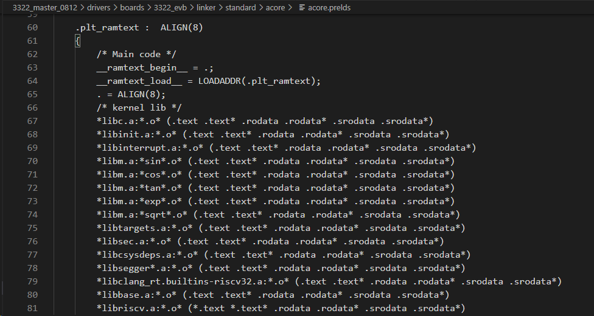
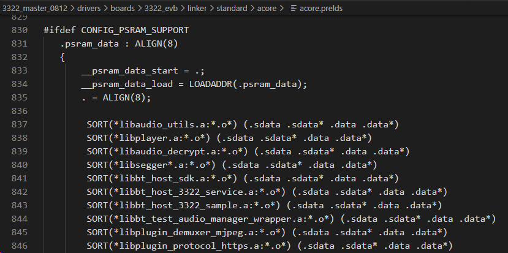
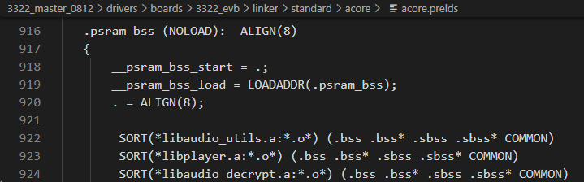
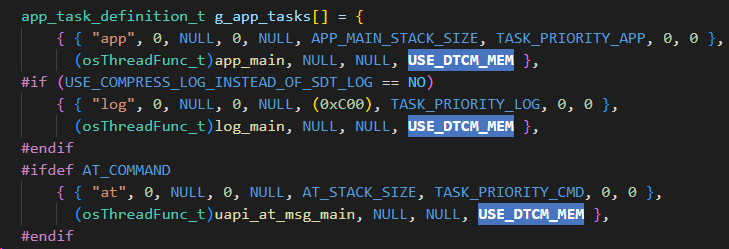

# 前言

**概述**

本文档详细描述了HiDiTing的资源部署方案，包括镜像、内存等，并给出内存分析工具及调优方法，供用户参考进行产品适配。

**读者对象**

本文档主要适用于以下工程师：

-   技术支持工程师
-   软件开发工程师

**符号约定**

在本文中可能出现下列标志，它们所代表的含义如下。

<table><thead align="left"><tr id="zh-cn_topic_0000002444645769_row1530720816410"><th class="cellrowborder" valign="top" width="20.580000000000002%" id="mcps1.1.3.1.1">
<strong id="zh-cn_topic_0000002444645769_b2136615816410">符号</strong>

</th>
<th class="cellrowborder" valign="top" width="79.42%" id="mcps1.1.3.1.2">
<strong id="zh-cn_topic_0000002444645769_b5941558116410">说明</strong>

</th>
</tr>
</thead>
<tbody><tr id="zh-cn_topic_0000002444645769_row1372280416410"><td class="cellrowborder" valign="top" width="20.580000000000002%" headers="mcps1.1.3.1.1 ">

</td>
<td class="cellrowborder" valign="top" width="79.42%" headers="mcps1.1.3.1.2 ">
表示如不避免则将会导致死亡或严重伤害的具有高等级风险的危害。

</td>
</tr>
<tr id="zh-cn_topic_0000002444645769_row466863216410"><td class="cellrowborder" valign="top" width="20.580000000000002%" headers="mcps1.1.3.1.1 ">

</td>
<td class="cellrowborder" valign="top" width="79.42%" headers="mcps1.1.3.1.2 ">
表示如不避免则可能导致死亡或严重伤害的具有中等级风险的危害。

</td>
</tr>
<tr id="zh-cn_topic_0000002444645769_row123863216410"><td class="cellrowborder" valign="top" width="20.580000000000002%" headers="mcps1.1.3.1.1 ">

</td>
<td class="cellrowborder" valign="top" width="79.42%" headers="mcps1.1.3.1.2 ">
表示如不避免则可能导致轻微或中度伤害的具有低等级风险的危害。

</td>
</tr>
<tr id="zh-cn_topic_0000002444645769_row5786682116410"><td class="cellrowborder" valign="top" width="20.580000000000002%" headers="mcps1.1.3.1.1 ">

</td>
<td class="cellrowborder" valign="top" width="79.42%" headers="mcps1.1.3.1.2 ">
用于传递设备或环境安全警示信息。如不避免则可能会导致设备损坏、数据丢失、设备性能降低或其它不可预知的结果。

“须知”不涉及人身伤害。

</td>
</tr>
<tr id="zh-cn_topic_0000002444645769_row2856923116410"><td class="cellrowborder" valign="top" width="20.580000000000002%" headers="mcps1.1.3.1.1 ">

</td>
<td class="cellrowborder" valign="top" width="79.42%" headers="mcps1.1.3.1.2 ">
对正文中重点信息的补充说明。

“说明”不是安全警示信息，不涉及人身、设备及环境伤害信息。

</td>
</tr>
</tbody>
</table>

# 镜像分区表

当前镜像默认存储在外部NorFlash上，并按照8M NorFlash容量进行镜像地址划分。EVB（Evaluate Verification Board）单板上镜像地址信息请参考文件“drivers\\boards\\3322\_evb\\memory\_config\\include\\memory\_config\_flash.h”。镜像分区表如[表1](#zh-cn_topic_0000002411046716_table060811521594)所示。

**表 1**  镜像分区表

<table><thead align="left"><tr id="zh-cn_topic_0000002411046716_row6608135235910"><th class="cellrowborder" valign="top" width="25%" id="mcps1.2.5.1.1">
名称

</th>
<th class="cellrowborder" valign="top" width="24.97%" id="mcps1.2.5.1.2">
存储设备

</th>
<th class="cellrowborder" valign="top" width="24.91%" id="mcps1.2.5.1.3">
地址

</th>
<th class="cellrowborder" valign="top" width="25.119999999999997%" id="mcps1.2.5.1.4">
长度

</th>
</tr>
</thead>
<tbody><tr id="zh-cn_topic_0000002411046716_row1360885216593"><td class="cellrowborder" valign="top" width="25%" headers="mcps1.2.5.1.1 ">
loaderboot_signed.bin

</td>
<td class="cellrowborder" valign="top" width="24.97%" headers="mcps1.2.5.1.2 ">
norflash

</td>
<td class="cellrowborder" valign="top" width="24.91%" headers="mcps1.2.5.1.3 ">
0x00000000

</td>
<td class="cellrowborder" valign="top" width="25.119999999999997%" headers="mcps1.2.5.1.4 ">
0x00010000

</td>
</tr>
<tr id="zh-cn_topic_0000002411046716_row0608052135914"><td class="cellrowborder" valign="top" width="25%" headers="mcps1.2.5.1.1 ">
rootkey_partition_cfg.bin

</td>
<td class="cellrowborder" valign="top" width="24.97%" headers="mcps1.2.5.1.2 ">
norflash

</td>
<td class="cellrowborder" valign="top" width="24.91%" headers="mcps1.2.5.1.3 ">
0x26000000

</td>
<td class="cellrowborder" valign="top" width="25.119999999999997%" headers="mcps1.2.5.1.4 ">
0x00001000

</td>
</tr>
<tr id="zh-cn_topic_0000002411046716_row760985235915"><td class="cellrowborder" valign="top" width="25%" headers="mcps1.2.5.1.1 ">
ssb_signed.bin

</td>
<td class="cellrowborder" valign="top" width="24.97%" headers="mcps1.2.5.1.2 ">
norflash

</td>
<td class="cellrowborder" valign="top" width="24.91%" headers="mcps1.2.5.1.3 ">
0x26001000

</td>
<td class="cellrowborder" valign="top" width="25.119999999999997%" headers="mcps1.2.5.1.4 ">
0x0000F000

</td>
</tr>
<tr id="zh-cn_topic_0000002411046716_row1660985295919"><td class="cellrowborder" valign="top" width="25%" headers="mcps1.2.5.1.1 ">
ssb_backup_signed.bin

</td>
<td class="cellrowborder" valign="top" width="24.97%" headers="mcps1.2.5.1.2 ">
norflash

</td>
<td class="cellrowborder" valign="top" width="24.91%" headers="mcps1.2.5.1.3 ">
0x26010000

</td>
<td class="cellrowborder" valign="top" width="25.119999999999997%" headers="mcps1.2.5.1.4 ">
0x0000f000

</td>
</tr>
<tr id="zh-cn_topic_0000002411046716_row860911523598"><td class="cellrowborder" valign="top" width="25%" headers="mcps1.2.5.1.1 ">
recovery_signed.bin

</td>
<td class="cellrowborder" valign="top" width="24.97%" headers="mcps1.2.5.1.2 ">
norflash

</td>
<td class="cellrowborder" valign="top" width="24.91%" headers="mcps1.2.5.1.3 ">
0x2601F000

</td>
<td class="cellrowborder" valign="top" width="25.119999999999997%" headers="mcps1.2.5.1.4 ">
0x00061000

</td>
</tr>
<tr id="zh-cn_topic_0000002411046716_row66092052125919"><td class="cellrowborder" valign="top" width="25%" headers="mcps1.2.5.1.1 ">
seliteos_signed.bin

</td>
<td class="cellrowborder" valign="top" width="24.97%" headers="mcps1.2.5.1.2 ">
norflash

</td>
<td class="cellrowborder" valign="top" width="24.91%" headers="mcps1.2.5.1.3 ">
0x26080000

</td>
<td class="cellrowborder" valign="top" width="25.119999999999997%" headers="mcps1.2.5.1.4 ">
0x00040000

</td>
</tr>
<tr id="zh-cn_topic_0000002411046716_row14609352135915"><td class="cellrowborder" valign="top" width="25%" headers="mcps1.2.5.1.1 ">
application_signed.bin

</td>
<td class="cellrowborder" valign="top" width="24.97%" headers="mcps1.2.5.1.2 ">
norflash

</td>
<td class="cellrowborder" valign="top" width="24.91%" headers="mcps1.2.5.1.3 ">
0x260C0000

</td>
<td class="cellrowborder" valign="top" width="25.119999999999997%" headers="mcps1.2.5.1.4 ">
0x6E3000

</td>
</tr>
<tr id="zh-cn_topic_0000002411046716_row3609135295916"><td class="cellrowborder" valign="top" width="25%" headers="mcps1.2.5.1.1 ">
3322_all_nv.bin

</td>
<td class="cellrowborder" valign="top" width="24.97%" headers="mcps1.2.5.1.2 ">
norflash

</td>
<td class="cellrowborder" valign="top" width="24.91%" headers="mcps1.2.5.1.3 ">
0x267FA000

</td>
<td class="cellrowborder" valign="top" width="25.119999999999997%" headers="mcps1.2.5.1.4 ">
0x00006000

</td>
</tr>
</tbody>
</table>

> **须知：** 
>-   由于BT、DSP镜像对外闭源交付，起始地址固定，因此除application镜像外，不建议用户自行修改其余地址划分，需要修改时请告知FAE。
>-   分区表无法通过OTA（Over the Air）升级更改，因此要注意，分区表的划分需要在产品出货前确定。

# 内存部署

芯片可使用内存可具体分为ITCM/DTCM、L2MEM、PSRAM三部分，其中TCM由MCU和DSP共享，L2MEM（Level-2-Memory）与DSP、GPU共享。各类内存属性如下，访问性能 ITCM/DTCM＞L2MEM＞PSRAM，读写功耗 ITCM/DTCM＜L2MEM＜PSRAM，大小ITCM/DTCM＜L2MEM＜PSRAM，实际综合性能、功耗、大小进行内存部署。

内存部署具体信息可参考链接脚本“drivers\\boards\\3322\_evb\\linker\\standard\\acore\\acore.prelds”。

-   代码段部署

    代码部署在Flash中，芯片启动时将代码搬到PSRAM（Pseudostatic RAM）和ITCM（Instruction Tightly-Coupled Memory）中运行，包括Flash驱动代码、低功耗相关代码以及部分基础库。

    如需配置代码到芯片ITCM上运行，可在“.plt\_ramtext”段中增加对应静态库即可，具体可参考[图1](#zh-cn_topic_0000002411046696_fig166417919594)。

    **图 1**  代码段部署至ITCM  
    

-   静态数据段部署，静态数据段包括data段和bss段：

    -   bss段指初始化为0或者未初始化的全局变量。
    -   data段指初始化非0的全局变量。

    bss段默认部署至内部DTCM（Data Tightly-Coupled Memory）上，data段默认部署在PSRAM上具体可参考[图2](#zh-cn_topic_0000002411046696_fig574783510599)、[图3](#zh-cn_topic_0000002411046696_fig1546854217225)。

    > **说明：** 
    >外部PSRAM内存更大，但是访问性能低于SRAM（Static Random Access Memory），功耗也高于SRAM，因此考虑系统低功耗，适合将访问频次低或亮屏执行的部分放至PSRAM上。

    **图 2**  psram\_data段部署  
    

    **图 3**  psram\_bss段部署  
    

-   栈空间

    系统中断栈、异常栈默认部署在DTCM，不支持修改；任务栈支持部署在DTCM或者PSRAM上（\\application\\3322\\3322\_app\_standard\\thread\_init.c），具体示例如[图4](#zh-cn_topic_0000002411046696_fig447441719017)所示。

    **图 4**  任务栈支持DTCM/PSRAM部署  
    

-   堆空间

    堆空间分为两部分，一部分为kernel OS内部使用的系统堆空间，默认部署至内部DTCM上；另一部分为各个任务使用的内存堆空间，如各个任务malloc申请空间，默认部署至外部PSRAM上，具体可参考“drivers/boards/3322\_evb/memory\_config/psram/normal/psram.h”头文件。

    此外，堆空间支持自定义内存池使用，调用osal接口“osal\_pool\_mem\_init”、“osal\_pool\_mem\_alloc”（/kernel/osal/src/liteos/osal\_addr.c）实现。

# 内存分析工具

-   **[静态内存](#ZH-CN_TOPIC_0000002499582161)**  

-   **[动态内存](#ZH-CN_TOPIC_0000002466542796)**  

## 静态内存

IDE工具提供了镜像分析功能，可以方便分析数据段、代码段等静态内存占用情况。具体使用方法请参见《HiSpark Studio for VS Code 使用指南》“镜像分析”章节。

其中镜像分析功能中默认按照模块进行数据统计，如graphic、media、driver等模块。

## 动态内存

支持AT命令查看堆、栈内存信息，具体命令如[表1](#zh-cn_topic_0000002444725853_table181208297502)所示。

**表 1**  堆栈内存信息查看命令

<table><thead align="left"><tr id="zh-cn_topic_0000002444725853_row191201429105016"><th class="cellrowborder" valign="top" width="34.71%" id="mcps1.2.3.1.1">
AT命令

</th>
<th class="cellrowborder" valign="top" width="65.29%" id="mcps1.2.3.1.2">
描述

</th>
</tr>
</thead>
<tbody><tr id="zh-cn_topic_0000002444725853_row212042914507"><td class="cellrowborder" valign="top" width="34.71%" headers="mcps1.2.3.1.1 ">
AT+HEAPINFO

</td>
<td class="cellrowborder" valign="top" width="65.29%" headers="mcps1.2.3.1.2 ">
系统堆内存信息查看。

</td>
</tr>
<tr id="zh-cn_topic_0000002444725853_row18120929135015"><td class="cellrowborder" valign="top" width="34.71%" headers="mcps1.2.3.1.1 ">
AT+STACKINFO

</td>
<td class="cellrowborder" valign="top" width="65.29%" headers="mcps1.2.3.1.2 ">
系统任务栈内存信息查看，包括任务栈名称、大小、峰值、使用情况等。

</td>
</tr>
</tbody>
</table>

# 常见内存优化方法

-   SDK组件裁剪

    SDK当前除功能代码外，默认包含大量测试代码、维测代码以及Sample示例代码，实际用户集成SDK时，不需要该部分功能，因此可直接裁剪。具体可裁剪组件如[表1](#zh-cn_topic_0000002411206560_table1374450141518)所示。

    **表 1**  SDK可裁剪组件

    
    <table><thead align="left"><tr id="zh-cn_topic_0000002411206560_row57441204159"><th class="cellrowborder" valign="top" width="29.212921292129213%" id="mcps1.2.4.1.1">
组件名

    </th>
    <th class="cellrowborder" valign="top" width="37.453745374537455%" id="mcps1.2.4.1.2">
对应功能宏

    </th>
    <th class="cellrowborder" valign="top" width="33.33333333333333%" id="mcps1.2.4.1.3">
功能描述

    </th>
    </tr>
    </thead>
    <tbody><tr id="zh-cn_topic_0000002411206560_row674480141510"><td class="cellrowborder" valign="top" width="29.212921292129213%" headers="mcps1.2.4.1.1 ">
'graphic_at_service'

    </td>
    <td class="cellrowborder" valign="top" width="37.453745374537455%" headers="mcps1.2.4.1.2 ">
-

    </td>
    <td class="cellrowborder" valign="top" width="33.33333333333333%" headers="mcps1.2.4.1.3 ">
图形测试组件。

    </td>
    </tr>
    <tr id="zh-cn_topic_0000002411206560_row07441402151"><td class="cellrowborder" valign="top" width="29.212921292129213%" headers="mcps1.2.4.1.1 ">
'app_at_service'

    </td>
    <td class="cellrowborder" valign="top" width="37.453745374537455%" headers="mcps1.2.4.1.2 ">
-

    </td>
    <td class="cellrowborder" valign="top" width="33.33333333333333%" headers="mcps1.2.4.1.3 ">
系统BSP测试组件。

    </td>
    </tr>
    <tr id="zh-cn_topic_0000002411206560_row147441014155"><td class="cellrowborder" valign="top" width="29.212921292129213%" headers="mcps1.2.4.1.1 ">
'audio_at_service'

    </td>
    <td class="cellrowborder" valign="top" width="37.453745374537455%" headers="mcps1.2.4.1.2 ">
-

    </td>
    <td class="cellrowborder" valign="top" width="33.33333333333333%" headers="mcps1.2.4.1.3 ">
音频测试组件。

    </td>
    </tr>
    <tr id="zh-cn_topic_0000002411206560_row174490181517"><td class="cellrowborder" valign="top" width="29.212921292129213%" headers="mcps1.2.4.1.1 ">
'media_at_service'

    </td>
    <td class="cellrowborder" valign="top" width="37.453745374537455%" headers="mcps1.2.4.1.2 ">
-

    </td>
    <td class="cellrowborder" valign="top" width="33.33333333333333%" headers="mcps1.2.4.1.3 ">
媒体测试组件。

    </td>
    </tr>
    <tr id="zh-cn_topic_0000002411206560_row193411448121515"><td class="cellrowborder" valign="top" width="29.212921292129213%" headers="mcps1.2.4.1.1 ">
'bt_manager_at_service'

    </td>
    <td class="cellrowborder" valign="top" width="37.453745374537455%" headers="mcps1.2.4.1.2 ">
-

    </td>
    <td class="cellrowborder" valign="top" width="33.33333333333333%" headers="mcps1.2.4.1.3 ">
蓝牙测试组件。

    </td>
    </tr>
    <tr id="zh-cn_topic_0000002411206560_row75419496155"><td class="cellrowborder" valign="top" width="29.212921292129213%" headers="mcps1.2.4.1.1 ">
'audio_proc'

    </td>
    <td class="cellrowborder" valign="top" width="37.453745374537455%" headers="mcps1.2.4.1.2 ">
‘CONFIG_ZDIAG_AUDIO_PROC_SUPPORT’

    </td>
    <td class="cellrowborder" valign="top" width="33.33333333333333%" headers="mcps1.2.4.1.3 ">
音频维测相关组件。

    </td>
    </tr>
    <tr id="zh-cn_topic_0000002411206560_row1099154910152"><td class="cellrowborder" valign="top" width="29.212921292129213%" headers="mcps1.2.4.1.1 ">
'audio_dump'

    </td>
    <td class="cellrowborder" valign="top" width="37.453745374537455%" headers="mcps1.2.4.1.2 ">
‘CONFIG_ZDIAG_AUDIO_DUMP_SUPPORT’

    </td>
    <td class="cellrowborder" valign="top" width="33.33333333333333%" headers="mcps1.2.4.1.3 ">
音频维测相关组件。

    </td>
    </tr>
    <tr id="zh-cn_topic_0000002411206560_row17646152051616"><td class="cellrowborder" rowspan="3" valign="top" width="29.212921292129213%" headers="mcps1.2.4.1.1 ">
'audio_probe'

    </td>
    <td class="cellrowborder" valign="top" width="37.453745374537455%" headers="mcps1.2.4.1.2 ">
‘CONFIG_ZDIAG_AUDIO_PROBE_SUPPORT’

    </td>
    <td class="cellrowborder" valign="top" width="33.33333333333333%" headers="mcps1.2.4.1.3 ">
音频维测相关组件。

    </td>
    </tr>
    <tr id="zh-cn_topic_0000002411206560_row13457155785612"><td class="cellrowborder" valign="top" headers="mcps1.2.4.1.1 ">
‘SUPPORT_GPU_OPENVG’

    </td>
    <td class="cellrowborder" valign="top" headers="mcps1.2.4.1.2 ">
GPU（Graphical Processing Unit）支持OpenVG接口。

    </td>
    </tr>
    <tr id="zh-cn_topic_0000002411206560_row1948322318583"><td class="cellrowborder" valign="top" headers="mcps1.2.4.1.1 ">
‘SW_UART_DEBUG’

    </td>
    <td class="cellrowborder" valign="top" headers="mcps1.2.4.1.2 ">
支持串口直接打印。

    </td>
    </tr>
    </tbody>
    </table>

-   内部部署调整

    内部TCM空间不足时，可以将部分数据段、任务栈部署至外部PSRAM。

-   代码优化

    结合内存分析工具，排查当前哪一个模块占用内存较大，结合代码进行优化。代码优化手段较多，此处列出常见的几种优化手段帮助用户优化内存。

    -   局部变量不应过大，会撑大栈空间，可考虑使用动态malloc的形式申请内存。
    -   超大全局变量数组，需要考虑合理性，可考虑修改为链表的形式进行动态申请。
    -   根据栈峰值使用情况，合理规划栈大小，根据经验，中等复杂程度任务一般栈空间3KB左右即可。
    -   正常的printf接口无法对打印字符串进行压缩，会导致CodeSize迅速膨胀，因此可使用Diag压缩日志接口打印。
    -   将不变的数据段尽量修改为const类型，即由data段转变为rodata段，内存部署也从内部SRAM转变为NorFlash。

# 缩略语

<table><tbody><tr id="zh-cn_topic_0000002458194889_row9766111812369"><td class="cellrowborder" style="border:none" valign="top" width="24.772477247724773%">
<strong id="zh-cn_topic_0000002458194889_b183805107810">B</strong>

</td>
<td class="cellrowborder" style="border:none" valign="top" width="41.89418941894189%">&nbsp;&nbsp;</td>
<td class="cellrowborder" style="border:none" valign="top" width="33.33333333333333%">&nbsp;&nbsp;</td>
</tr>
<tr id="zh-cn_topic_0000002458194889_row276671814366"><td class="cellrowborder" style="border:none" valign="top" width="24.772477247724773%">
<strong id="zh-cn_topic_0000002458194889_b13383131011812">BT</strong>

</td>
<td class="cellrowborder" style="border:none" valign="top" width="41.89418941894189%">
Bluetooth

</td>
<td class="cellrowborder" style="border:none" valign="top" width="33.33333333333333%">
蓝牙

</td>
</tr>
<tr id="zh-cn_topic_0000002458194889_row14766141817366"><td class="cellrowborder" style="border:none" valign="top" width="24.772477247724773%">&nbsp;&nbsp;</td>
<td class="cellrowborder" style="border:none" valign="top" width="41.89418941894189%">&nbsp;&nbsp;</td>
<td class="cellrowborder" style="border:none" valign="top" width="33.33333333333333%">&nbsp;&nbsp;</td>
</tr>
<tr id="zh-cn_topic_0000002458194889_row12767118143620"><td class="cellrowborder" style="border:none" valign="top" width="24.772477247724773%">
<strong id="zh-cn_topic_0000002458194889_b18384310685">D</strong>

</td>
<td class="cellrowborder" style="border:none" valign="top" width="41.89418941894189%">&nbsp;&nbsp;</td>
<td class="cellrowborder" style="border:none" valign="top" width="33.33333333333333%">&nbsp;&nbsp;</td>
</tr>
<tr id="zh-cn_topic_0000002458194889_row187671618203618"><td class="cellrowborder" style="border:none" valign="top" width="24.772477247724773%">
<strong id="zh-cn_topic_0000002458194889_b6385310786">DSP</strong>

</td>
<td class="cellrowborder" style="border:none" valign="top" width="41.89418941894189%">
Digital signal processor

</td>
<td class="cellrowborder" style="border:none" valign="top" width="33.33333333333333%">
数字信号处理器

</td>
</tr>
<tr id="zh-cn_topic_0000002458194889_row1584812192518"><td class="cellrowborder" style="border:none" valign="top" width="24.772477247724773%">
<strong id="zh-cn_topic_0000002458194889_b738561020813">DTCM</strong>

</td>
<td class="cellrowborder" style="border:none" valign="top" width="41.89418941894189%">
Data Tightly-Coupled Memory

</td>
<td class="cellrowborder" style="border:none" valign="top" width="33.33333333333333%">
数据紧耦合内存

</td>
</tr>
<tr id="zh-cn_topic_0000002458194889_row579343523617"><td class="cellrowborder" style="border:none" valign="top" width="24.772477247724773%">&nbsp;&nbsp;</td>
<td class="cellrowborder" style="border:none" valign="top" width="41.89418941894189%">&nbsp;&nbsp;</td>
<td class="cellrowborder" style="border:none" valign="top" width="33.33333333333333%">&nbsp;&nbsp;</td>
</tr>
<tr id="zh-cn_topic_0000002458194889_row1675310135355"><td class="nocellnorowborder" style="border:none" valign="top" width="24.772477247724773%">
<strong id="zh-cn_topic_0000002458194889_b2386510789">E</strong>

</td>
<td class="nocellnorowborder" style="border:none" valign="top" width="41.89418941894189%">&nbsp;&nbsp;</td>
<td class="cell-norowborder" style="border:none" valign="top" width="33.33333333333333%">&nbsp;&nbsp;</td>
</tr>
<tr id="zh-cn_topic_0000002458194889_row3754141343516"><td class="nocellnorowborder" style="border:none" valign="top" width="24.772477247724773%">
<strong id="zh-cn_topic_0000002458194889_b638713101787">EVB</strong>

</td>
<td class="nocellnorowborder" style="border:none" valign="top" width="41.89418941894189%">
Evaluate Verification Board

</td>
<td class="cell-norowborder" style="border:none" valign="top" width="33.33333333333333%">
评估验证板

</td>
</tr>
<tr id="zh-cn_topic_0000002458194889_row5746125614287"><td class="cellrowborder" style="border:none" valign="top" width="24.772477247724773%">&nbsp;&nbsp;</td>
<td class="cellrowborder" style="border:none" valign="top" width="41.89418941894189%">&nbsp;&nbsp;</td>
<td class="cellrowborder" style="border:none" valign="top" width="33.33333333333333%">&nbsp;&nbsp;</td>
</tr>
<tr id="zh-cn_topic_0000002458194889_row47465565289"><td class="cellrowborder" style="border:none" valign="top" width="24.772477247724773%">
<strong id="zh-cn_topic_0000002458194889_b238819101589">G</strong>

</td>
<td class="cellrowborder" style="border:none" valign="top" width="41.89418941894189%">&nbsp;&nbsp;</td>
<td class="cellrowborder" style="border:none" valign="top" width="33.33333333333333%">&nbsp;&nbsp;</td>
</tr>
<tr id="zh-cn_topic_0000002458194889_row1974614562284"><td class="cellrowborder" style="border:none" valign="top" width="24.772477247724773%">
<strong id="zh-cn_topic_0000002458194889_b138914100820">GPU</strong>

</td>
<td class="cellrowborder" style="border:none" valign="top" width="41.89418941894189%">
Graphical Processing Unit

</td>
<td class="cellrowborder" style="border:none" valign="top" width="33.33333333333333%">
图形处理单元

</td>
</tr>
<tr id="zh-cn_topic_0000002458194889_row1928220259255"><td class="cellrowborder" style="border:none" valign="top" width="24.772477247724773%">&nbsp;&nbsp;</td>
<td class="cellrowborder" style="border:none" valign="top" width="41.89418941894189%">&nbsp;&nbsp;</td>
<td class="cellrowborder" style="border:none" valign="top" width="33.33333333333333%">&nbsp;&nbsp;</td>
</tr>
<tr id="zh-cn_topic_0000002458194889_row3282202511251"><td class="cellrowborder" style="border:none" valign="top" width="24.772477247724773%">
<strong id="zh-cn_topic_0000002458194889_b6390181014815">I</strong>

</td>
<td class="cellrowborder" style="border:none" valign="top" width="41.89418941894189%">&nbsp;&nbsp;</td>
<td class="cellrowborder" style="border:none" valign="top" width="33.33333333333333%">&nbsp;&nbsp;</td>
</tr>
<tr id="zh-cn_topic_0000002458194889_row728210250255"><td class="cellrowborder" style="border:none" valign="top" width="24.772477247724773%">
<strong id="zh-cn_topic_0000002458194889_b5390151013814">ITCM</strong>

</td>
<td class="cellrowborder" style="border:none" valign="top" width="41.89418941894189%">
Instruction Tightly-Coupled Memory

</td>
<td class="cellrowborder" style="border:none" valign="top" width="33.33333333333333%">
指令紧密耦合内存

</td>
</tr>
<tr id="zh-cn_topic_0000002458194889_row875431315358"><td class="nocellnorowborder" style="border:none" valign="top" width="24.772477247724773%">&nbsp;&nbsp;</td>
<td class="nocellnorowborder" style="border:none" valign="top" width="41.89418941894189%">&nbsp;&nbsp;</td>
<td class="cell-norowborder" style="border:none" valign="top" width="33.33333333333333%">&nbsp;&nbsp;</td>
</tr>
<tr id="zh-cn_topic_0000002458194889_row11805643182516"><td class="cellrowborder" style="border:none" valign="top" width="24.772477247724773%">
<strong id="zh-cn_topic_0000002458194889_b1439161016815">L</strong>

</td>
<td class="cellrowborder" style="border:none" valign="top" width="41.89418941894189%">&nbsp;&nbsp;</td>
<td class="cellrowborder" style="border:none" valign="top" width="33.33333333333333%">&nbsp;&nbsp;</td>
</tr>
<tr id="zh-cn_topic_0000002458194889_row12805124315258"><td class="cellrowborder" style="border:none" valign="top" width="24.772477247724773%">
<strong id="zh-cn_topic_0000002458194889_b13922101082">L2MEM</strong>

</td>
<td class="cellrowborder" style="border:none" valign="top" width="41.89418941894189%">
Level-2-Memory

</td>
<td class="cellrowborder" style="border:none" valign="top" width="33.33333333333333%">
二级存储器

</td>
</tr>
<tr id="zh-cn_topic_0000002458194889_row2805443112510"><td class="cellrowborder" style="border:none" valign="top" width="24.772477247724773%">&nbsp;&nbsp;</td>
<td class="cellrowborder" style="border:none" valign="top" width="41.89418941894189%">&nbsp;&nbsp;</td>
<td class="cellrowborder" style="border:none" valign="top" width="33.33333333333333%">&nbsp;&nbsp;</td>
</tr>
<tr id="zh-cn_topic_0000002458194889_row137557406396"><td class="cellrowborder" style="border:none" valign="top" width="24.772477247724773%">
<strong id="zh-cn_topic_0000002458194889_b23931103817">O</strong>

</td>
<td class="cellrowborder" style="border:none" valign="top" width="41.89418941894189%">&nbsp;&nbsp;</td>
<td class="cellrowborder" style="border:none" valign="top" width="33.33333333333333%">&nbsp;&nbsp;</td>
</tr>
<tr id="zh-cn_topic_0000002458194889_row117541413203520"><td class="nocellnorowborder" style="border:none" valign="top" width="24.772477247724773%">
<strong id="zh-cn_topic_0000002458194889_b439418105810">OTA</strong>

</td>
<td class="nocellnorowborder" style="border:none" valign="top" width="41.89418941894189%">
Over the Air

</td>
<td class="cell-norowborder" style="border:none" valign="top" width="33.33333333333333%">
空中下载

</td>
</tr>
<tr id="zh-cn_topic_0000002458194889_row1575471313356"><td class="nocellnorowborder" style="border:none" valign="top" width="24.772477247724773%">&nbsp;&nbsp;</td>
<td class="nocellnorowborder" style="border:none" valign="top" width="41.89418941894189%">&nbsp;&nbsp;</td>
<td class="cell-norowborder" style="border:none" valign="top" width="33.33333333333333%">&nbsp;&nbsp;</td>
</tr>
<tr id="zh-cn_topic_0000002458194889_row16754101363513"><td class="nocellnorowborder" style="border:none" valign="top" width="24.772477247724773%">
<strong id="zh-cn_topic_0000002458194889_b43941010187">P</strong>

</td>
<td class="nocellnorowborder" style="border:none" valign="top" width="41.89418941894189%">&nbsp;&nbsp;</td>
<td class="cell-norowborder" style="border:none" valign="top" width="33.33333333333333%">&nbsp;&nbsp;</td>
</tr>
<tr id="zh-cn_topic_0000002458194889_row1775418131353"><td class="nocellnorowborder" style="border:none" valign="top" width="24.772477247724773%">
<strong id="zh-cn_topic_0000002458194889_b183957101882">PSRAM</strong>

</td>
<td class="nocellnorowborder" style="border:none" valign="top" width="41.89418941894189%">
Pseudostatic RAM

</td>
<td class="cell-norowborder" style="border:none" valign="top" width="33.33333333333333%">
伪静态随机存储器

</td>
</tr>
<tr id="zh-cn_topic_0000002458194889_row1275581373515"><td class="nocellnorowborder" style="border:none" valign="top" width="24.772477247724773%">&nbsp;&nbsp;</td>
<td class="nocellnorowborder" style="border:none" valign="top" width="41.89418941894189%">&nbsp;&nbsp;</td>
<td class="cell-norowborder" style="border:none" valign="top" width="33.33333333333333%">&nbsp;&nbsp;</td>
</tr>
<tr id="zh-cn_topic_0000002458194889_row8533143118266"><td class="cellrowborder" style="border:none" valign="top" width="24.772477247724773%">
<strong id="zh-cn_topic_0000002458194889_b63968108817">S</strong>

</td>
<td class="cellrowborder" style="border:none" valign="top" width="41.89418941894189%">&nbsp;&nbsp;</td>
<td class="cellrowborder" style="border:none" valign="top" width="33.33333333333333%">&nbsp;&nbsp;</td>
</tr>
<tr id="zh-cn_topic_0000002458194889_row1453373152619"><td class="cellrowborder" style="border:none" valign="top" width="24.772477247724773%">
<strong id="zh-cn_topic_0000002458194889_b2397201011820">SRAM</strong>

</td>
<td class="cellrowborder" style="border:none" valign="top" width="41.89418941894189%">
Static Random Access Memory

</td>
<td class="cellrowborder" style="border:none" valign="top" width="33.33333333333333%">
静态随机存取存储器

</td>
</tr>
</tbody>
</table>

