# 前言<a name="ZH-CN_TOPIC_0000002466382236"></a>

**概述<a name="zh-cn_topic_0000002411208072_section4537382116410"></a>**

本文档系统性描述HiDiTing芯片解决方案SDK的所有发布组件，方便开发者基于SDK发布包进行开发调试。

**读者对象<a name="zh-cn_topic_0000002411208072_section4378592816410"></a>**

本文档主要适用于以下工程师：

-   技术支持工程师
-   软件开发工程师

**符号约定<a name="zh-cn_topic_0000002411208072_section133020216410"></a>**

在本文中可能出现下列标志，它们所代表的含义如下。

<a name="zh-cn_topic_0000002411208072_table2622507016410"></a>
<table><thead align="left"><tr id="zh-cn_topic_0000002411208072_row1530720816410"><th class="cellrowborder" valign="top" width="20.580000000000002%" id="mcps1.1.3.1.1"><p id="zh-cn_topic_0000002411208072_p6450074116410"><a name="zh-cn_topic_0000002411208072_p6450074116410"></a><a name="zh-cn_topic_0000002411208072_p6450074116410"></a><strong id="zh-cn_topic_0000002411208072_b2136615816410"><a name="zh-cn_topic_0000002411208072_b2136615816410"></a><a name="zh-cn_topic_0000002411208072_b2136615816410"></a>符号</strong></p>
</th>
<th class="cellrowborder" valign="top" width="79.42%" id="mcps1.1.3.1.2"><p id="zh-cn_topic_0000002411208072_p5435366816410"><a name="zh-cn_topic_0000002411208072_p5435366816410"></a><a name="zh-cn_topic_0000002411208072_p5435366816410"></a><strong id="zh-cn_topic_0000002411208072_b5941558116410"><a name="zh-cn_topic_0000002411208072_b5941558116410"></a><a name="zh-cn_topic_0000002411208072_b5941558116410"></a>说明</strong></p>
</th>
</tr>
</thead>
<tbody><tr id="zh-cn_topic_0000002411208072_row1372280416410"><td class="cellrowborder" valign="top" width="20.580000000000002%" headers="mcps1.1.3.1.1 "><p id="zh-cn_topic_0000002411208072_p3734547016410"><a name="zh-cn_topic_0000002411208072_p3734547016410"></a><a name="zh-cn_topic_0000002411208072_p3734547016410"></a><a name="zh-cn_topic_0000002411208072_image2670064316410"></a><a name="zh-cn_topic_0000002411208072_image2670064316410"></a><span></span></p>
</td>
<td class="cellrowborder" valign="top" width="79.42%" headers="mcps1.1.3.1.2 "><p id="zh-cn_topic_0000002411208072_p1757432116410"><a name="zh-cn_topic_0000002411208072_p1757432116410"></a><a name="zh-cn_topic_0000002411208072_p1757432116410"></a>表示如不避免则将会导致死亡或严重伤害的具有高等级风险的危害。</p>
</td>
</tr>
<tr id="zh-cn_topic_0000002411208072_row466863216410"><td class="cellrowborder" valign="top" width="20.580000000000002%" headers="mcps1.1.3.1.1 "><p id="zh-cn_topic_0000002411208072_p1432579516410"><a name="zh-cn_topic_0000002411208072_p1432579516410"></a><a name="zh-cn_topic_0000002411208072_p1432579516410"></a><a name="zh-cn_topic_0000002411208072_image4895582316410"></a><a name="zh-cn_topic_0000002411208072_image4895582316410"></a><span></span></p>
</td>
<td class="cellrowborder" valign="top" width="79.42%" headers="mcps1.1.3.1.2 "><p id="zh-cn_topic_0000002411208072_p959197916410"><a name="zh-cn_topic_0000002411208072_p959197916410"></a><a name="zh-cn_topic_0000002411208072_p959197916410"></a>表示如不避免则可能导致死亡或严重伤害的具有中等级风险的危害。</p>
</td>
</tr>
<tr id="zh-cn_topic_0000002411208072_row123863216410"><td class="cellrowborder" valign="top" width="20.580000000000002%" headers="mcps1.1.3.1.1 "><p id="zh-cn_topic_0000002411208072_p1232579516410"><a name="zh-cn_topic_0000002411208072_p1232579516410"></a><a name="zh-cn_topic_0000002411208072_p1232579516410"></a><a name="zh-cn_topic_0000002411208072_image1235582316410"></a><a name="zh-cn_topic_0000002411208072_image1235582316410"></a><span></span></p>
</td>
<td class="cellrowborder" valign="top" width="79.42%" headers="mcps1.1.3.1.2 "><p id="zh-cn_topic_0000002411208072_p123197916410"><a name="zh-cn_topic_0000002411208072_p123197916410"></a><a name="zh-cn_topic_0000002411208072_p123197916410"></a>表示如不避免则可能导致轻微或中度伤害的具有低等级风险的危害。</p>
</td>
</tr>
<tr id="zh-cn_topic_0000002411208072_row5786682116410"><td class="cellrowborder" valign="top" width="20.580000000000002%" headers="mcps1.1.3.1.1 "><p id="zh-cn_topic_0000002411208072_p2204984716410"><a name="zh-cn_topic_0000002411208072_p2204984716410"></a><a name="zh-cn_topic_0000002411208072_p2204984716410"></a><a name="zh-cn_topic_0000002411208072_image4504446716410"></a><a name="zh-cn_topic_0000002411208072_image4504446716410"></a><span></span></p>
</td>
<td class="cellrowborder" valign="top" width="79.42%" headers="mcps1.1.3.1.2 "><p id="zh-cn_topic_0000002411208072_p4388861916410"><a name="zh-cn_topic_0000002411208072_p4388861916410"></a><a name="zh-cn_topic_0000002411208072_p4388861916410"></a>用于传递设备或环境安全警示信息。如不避免则可能会导致设备损坏、数据丢失、设备性能降低或其它不可预知的结果。</p>
<p id="zh-cn_topic_0000002411208072_p1238861916410"><a name="zh-cn_topic_0000002411208072_p1238861916410"></a><a name="zh-cn_topic_0000002411208072_p1238861916410"></a>“须知”不涉及人身伤害。</p>
</td>
</tr>
<tr id="zh-cn_topic_0000002411208072_row2856923116410"><td class="cellrowborder" valign="top" width="20.580000000000002%" headers="mcps1.1.3.1.1 "><p id="zh-cn_topic_0000002411208072_p5555360116410"><a name="zh-cn_topic_0000002411208072_p5555360116410"></a><a name="zh-cn_topic_0000002411208072_p5555360116410"></a><a name="zh-cn_topic_0000002411208072_image799324016410"></a><a name="zh-cn_topic_0000002411208072_image799324016410"></a><span></span></p>
</td>
<td class="cellrowborder" valign="top" width="79.42%" headers="mcps1.1.3.1.2 "><p id="zh-cn_topic_0000002411208072_p4612588116410"><a name="zh-cn_topic_0000002411208072_p4612588116410"></a><a name="zh-cn_topic_0000002411208072_p4612588116410"></a>对正文中重点信息的补充说明。</p>
<p id="zh-cn_topic_0000002411208072_p1232588116410"><a name="zh-cn_topic_0000002411208072_p1232588116410"></a><a name="zh-cn_topic_0000002411208072_p1232588116410"></a>“说明”不是安全警示信息，不涉及人身、设备及环境伤害信息。</p>
</td>
</tr>
</tbody>
</table>

# SDK发布概述<a name="ZH-CN_TOPIC_0000002499581097"></a>

HiDiTingV100芯片解决方案SDK包含doc目录、src目录以及tools目录。

-   doc目录下存放系统软件各子系统开发指南、说明文档以及API手册。
-   src，存放SDK发布代码。
-   tools目录用于存放系统编译、开发、调试、资源压缩、维测、产测等环节所用到的工具。

-   **[doc目录概述](#ZH-CN_TOPIC_0000002499501037)**  

-   **[src目录概述](#ZH-CN_TOPIC_0000002499501105)**  

-   **[tools目录概述](#ZH-CN_TOPIC_0000002499581117)**  

## doc目录概述<a name="ZH-CN_TOPIC_0000002499501037"></a>

doc目录用于存放系统软件各子系统的开发指南以及API手册，涉及软件、芯片、硬件等资料。

开发指南主要包含如下大类以及内容，通过pdf或者word格式分别提供：

-   业务领域开发指南：UIKit开发指南、多媒体软件开发指南、BT/BLE软件开发指南、OpenHarmony Native组件开发\\JS应用开发用户指南。
-   系统功能领域开发指南：FOTA开发指南、低功耗软件开发指南、安全软件开发指南、文件系统使用指南、NV存储用户指南。
-   驱动开发指南：设备驱动开发指南、音频驱动开发指南、图形视频驱动开发指南。
-   工具使用指南：DebugKits工具使用指南、BurnTool工具使用指南、图形工具使用指南、HiSpark Studio for VS Code使用指南。

API手册为各业务、驱动、系统、工具等领域的API集合，用于API功能查询以及参数查询。全量子系统的标准API手册。

## src目录概述<a name="ZH-CN_TOPIC_0000002499501105"></a>

src目录主要存放SDK软件代码、工程以及系统A核、bt核、dsp核分别启动所需要的二进制版本文件。其中bt核以及dsp核版本为固定发布，不支持基于发布的SDK代码进行增量开发以及修改。用户可以基于A核版本进行增量开发。

“src”，src目录用于存放SDK发布的软件代码。

src目录包含如[表1](#zh-cn_topic_0000002411048216_table181954185584)所示子目录。

**表 1**  src目录

<a name="zh-cn_topic_0000002411048216_table181954185584"></a>
<table><tbody><tr id="zh-cn_topic_0000002411048216_row6195171835818"><th class="firstcol" valign="top" width="22.16%" id="mcps1.2.3.1.1"><p id="zh-cn_topic_0000002411048216_p119520189585"><a name="zh-cn_topic_0000002411048216_p119520189585"></a><a name="zh-cn_topic_0000002411048216_p119520189585"></a>application</p>
</th>
<td class="cellrowborder" valign="top" width="77.84%" headers="mcps1.2.3.1.1 "><p id="zh-cn_topic_0000002411048216_p13195818115814"><a name="zh-cn_topic_0000002411048216_p13195818115814"></a><a name="zh-cn_topic_0000002411048216_p13195818115814"></a>应用目录，支持用户在此目录下增量开发上层系统内容以及应用内容。全系统启动的代码也在此目录下。当前SDK会在此目录下提供部分sample代码用于客户开发参考。</p>
</td>
</tr>
<tr id="zh-cn_topic_0000002411048216_row20195131816583"><th class="firstcol" valign="top" width="22.16%" id="mcps1.2.3.2.1"><p id="zh-cn_topic_0000002411048216_p14195418125811"><a name="zh-cn_topic_0000002411048216_p14195418125811"></a><a name="zh-cn_topic_0000002411048216_p14195418125811"></a>bootloader</p>
</th>
<td class="cellrowborder" valign="top" width="77.84%" headers="mcps1.2.3.2.1 "><p id="zh-cn_topic_0000002411048216_p19195218105811"><a name="zh-cn_topic_0000002411048216_p19195218105811"></a><a name="zh-cn_topic_0000002411048216_p19195218105811"></a>用于存放系统启动过程中二进制文件加载流程的代码。</p>
</td>
</tr>
<tr id="zh-cn_topic_0000002411048216_row17195121816586"><th class="firstcol" valign="top" width="22.16%" id="mcps1.2.3.3.1"><p id="zh-cn_topic_0000002411048216_p01951318115815"><a name="zh-cn_topic_0000002411048216_p01951318115815"></a><a name="zh-cn_topic_0000002411048216_p01951318115815"></a>build</p>
</th>
<td class="cellrowborder" valign="top" width="77.84%" headers="mcps1.2.3.3.1 "><p id="zh-cn_topic_0000002411048216_p2019519187582"><a name="zh-cn_topic_0000002411048216_p2019519187582"></a><a name="zh-cn_topic_0000002411048216_p2019519187582"></a>编译构建工程代码。</p>
</td>
</tr>
<tr id="zh-cn_topic_0000002411048216_row1719521813589"><th class="firstcol" valign="top" width="22.16%" id="mcps1.2.3.4.1"><p id="zh-cn_topic_0000002411048216_p21951918115810"><a name="zh-cn_topic_0000002411048216_p21951918115810"></a><a name="zh-cn_topic_0000002411048216_p21951918115810"></a>drivers</p>
</th>
<td class="cellrowborder" valign="top" width="77.84%" headers="mcps1.2.3.4.1 "><p id="zh-cn_topic_0000002411048216_p8195118165817"><a name="zh-cn_topic_0000002411048216_p8195118165817"></a><a name="zh-cn_topic_0000002411048216_p8195118165817"></a>设备驱动代码，提供BSP驱动代码。</p>
</td>
</tr>
<tr id="zh-cn_topic_0000002411048216_row919551811581"><th class="firstcol" valign="top" width="22.16%" id="mcps1.2.3.5.1"><p id="zh-cn_topic_0000002411048216_p1195201816589"><a name="zh-cn_topic_0000002411048216_p1195201816589"></a><a name="zh-cn_topic_0000002411048216_p1195201816589"></a>include</p>
</th>
<td class="cellrowborder" valign="top" width="77.84%" headers="mcps1.2.3.5.1 "><p id="zh-cn_topic_0000002411048216_p1519519183584"><a name="zh-cn_topic_0000002411048216_p1519519183584"></a><a name="zh-cn_topic_0000002411048216_p1519519183584"></a>公共头文件。</p>
</td>
</tr>
<tr id="zh-cn_topic_0000002411048216_row19195181819586"><th class="firstcol" valign="top" width="22.16%" id="mcps1.2.3.6.1"><p id="zh-cn_topic_0000002411048216_p119561835811"><a name="zh-cn_topic_0000002411048216_p119561835811"></a><a name="zh-cn_topic_0000002411048216_p119561835811"></a>interim_binary</p>
</th>
<td class="cellrowborder" valign="top" width="77.84%" headers="mcps1.2.3.6.1 "><p id="zh-cn_topic_0000002411048216_p119513188588"><a name="zh-cn_topic_0000002411048216_p119513188588"></a><a name="zh-cn_topic_0000002411048216_p119513188588"></a>软件库、二进制文件存放目录。</p>
</td>
</tr>
<tr id="zh-cn_topic_0000002411048216_row7195818135819"><th class="firstcol" valign="top" width="22.16%" id="mcps1.2.3.7.1"><p id="zh-cn_topic_0000002411048216_p171951318155812"><a name="zh-cn_topic_0000002411048216_p171951318155812"></a><a name="zh-cn_topic_0000002411048216_p171951318155812"></a>kernel</p>
</th>
<td class="cellrowborder" valign="top" width="77.84%" headers="mcps1.2.3.7.1 "><p id="zh-cn_topic_0000002411048216_p9196141895818"><a name="zh-cn_topic_0000002411048216_p9196141895818"></a><a name="zh-cn_topic_0000002411048216_p9196141895818"></a>操作系统以及操作系统功能封装代码。</p>
</td>
</tr>
<tr id="zh-cn_topic_0000002411048216_row106331415435"><th class="firstcol" valign="top" width="22.16%" id="mcps1.2.3.8.1"><p id="zh-cn_topic_0000002411048216_p156331145439"><a name="zh-cn_topic_0000002411048216_p156331145439"></a><a name="zh-cn_topic_0000002411048216_p156331145439"></a>libs_url</p>
</th>
<td class="cellrowborder" valign="top" width="77.84%" headers="mcps1.2.3.8.1 "><p id="zh-cn_topic_0000002411048216_p146331540437"><a name="zh-cn_topic_0000002411048216_p146331540437"></a><a name="zh-cn_topic_0000002411048216_p146331540437"></a>存放部分编译脚本。</p>
</td>
</tr>
<tr id="zh-cn_topic_0000002411048216_row419671813588"><th class="firstcol" valign="top" width="22.16%" id="mcps1.2.3.9.1"><p id="zh-cn_topic_0000002411048216_p141969188588"><a name="zh-cn_topic_0000002411048216_p141969188588"></a><a name="zh-cn_topic_0000002411048216_p141969188588"></a>middleware</p>
</th>
<td class="cellrowborder" valign="top" width="77.84%" headers="mcps1.2.3.9.1 "><p id="zh-cn_topic_0000002411048216_p1219611181581"><a name="zh-cn_topic_0000002411048216_p1219611181581"></a><a name="zh-cn_topic_0000002411048216_p1219611181581"></a>中间件代码，提供系统框架代码。</p>
</td>
</tr>
<tr id="zh-cn_topic_0000002411048216_row1746832514513"><th class="firstcol" valign="top" width="22.16%" id="mcps1.2.3.10.1"><p id="zh-cn_topic_0000002411048216_p1946811257519"><a name="zh-cn_topic_0000002411048216_p1946811257519"></a><a name="zh-cn_topic_0000002411048216_p1946811257519"></a>ohos</p>
</th>
<td class="cellrowborder" valign="top" width="77.84%" headers="mcps1.2.3.10.1 "><p id="zh-cn_topic_0000002411048216_p184683255519"><a name="zh-cn_topic_0000002411048216_p184683255519"></a><a name="zh-cn_topic_0000002411048216_p184683255519"></a>开源相关组件代码。</p>
</td>
</tr>
<tr id="zh-cn_topic_0000002411048216_row15196161810580"><th class="firstcol" valign="top" width="22.16%" id="mcps1.2.3.11.1"><p id="zh-cn_topic_0000002411048216_p171961518155814"><a name="zh-cn_topic_0000002411048216_p171961518155814"></a><a name="zh-cn_topic_0000002411048216_p171961518155814"></a>open_source</p>
</th>
<td class="cellrowborder" valign="top" width="77.84%" headers="mcps1.2.3.11.1 "><p id="zh-cn_topic_0000002411048216_p191961318165814"><a name="zh-cn_topic_0000002411048216_p191961318165814"></a><a name="zh-cn_topic_0000002411048216_p191961318165814"></a>开源相关组件代码。</p>
</td>
</tr>
<tr id="zh-cn_topic_0000002411048216_row710191734413"><th class="firstcol" valign="top" width="22.16%" id="mcps1.2.3.12.1"><p id="zh-cn_topic_0000002411048216_p16102173447"><a name="zh-cn_topic_0000002411048216_p16102173447"></a><a name="zh-cn_topic_0000002411048216_p16102173447"></a>protocol</p>
</th>
<td class="cellrowborder" valign="top" width="77.84%" headers="mcps1.2.3.12.1 "><p id="zh-cn_topic_0000002411048216_p1510121734413"><a name="zh-cn_topic_0000002411048216_p1510121734413"></a><a name="zh-cn_topic_0000002411048216_p1510121734413"></a>协议相关组件代码。</p>
</td>
</tr>
<tr id="zh-cn_topic_0000002411048216_row1219614184588"><th class="firstcol" valign="top" width="22.16%" id="mcps1.2.3.14.1"><p id="zh-cn_topic_0000002411048216_p719621835817"><a name="zh-cn_topic_0000002411048216_p719621835817"></a><a name="zh-cn_topic_0000002411048216_p719621835817"></a>output</p>
</th>
<td class="cellrowborder" valign="top" width="77.84%" headers="mcps1.2.3.14.1 "><p id="zh-cn_topic_0000002411048216_p10196181816587"><a name="zh-cn_topic_0000002411048216_p10196181816587"></a><a name="zh-cn_topic_0000002411048216_p10196181816587"></a>编译构建版本生成目录（发布的SDK下无此目录，用户构建后生成）。</p>
</td>
</tr>
<tr id="zh-cn_topic_0000002411048216_row1919621855816"><th class="firstcol" valign="top" width="22.16%" id="mcps1.2.3.15.1"><p id="zh-cn_topic_0000002411048216_p919661885810"><a name="zh-cn_topic_0000002411048216_p919661885810"></a><a name="zh-cn_topic_0000002411048216_p919661885810"></a>tools</p>
</th>
<td class="cellrowborder" valign="top" width="77.84%" headers="mcps1.2.3.15.1 "><p id="zh-cn_topic_0000002411048216_p1019610189587"><a name="zh-cn_topic_0000002411048216_p1019610189587"></a><a name="zh-cn_topic_0000002411048216_p1019610189587"></a>编译工具链。</p>
</td>
</tr>
<tr id="zh-cn_topic_0000002411048216_row1022741513451"><th class="firstcol" valign="top" width="22.16%" id="mcps1.2.3.16.1"><p id="zh-cn_topic_0000002411048216_p1722791574511"><a name="zh-cn_topic_0000002411048216_p1722791574511"></a><a name="zh-cn_topic_0000002411048216_p1722791574511"></a>vendor</p>
</th>
<td class="cellrowborder" valign="top" width="77.84%" headers="mcps1.2.3.16.1 "><p id="zh-cn_topic_0000002411048216_p52277156453"><a name="zh-cn_topic_0000002411048216_p52277156453"></a><a name="zh-cn_topic_0000002411048216_p52277156453"></a>三方应用相关内容。</p>
</td>
</tr>
<tr id="zh-cn_topic_0000002411048216_row1253916415563"><th class="firstcol" valign="top" width="22.16%" id="mcps1.2.3.17.1"><p id="zh-cn_topic_0000002411048216_p135392412562"><a name="zh-cn_topic_0000002411048216_p135392412562"></a><a name="zh-cn_topic_0000002411048216_p135392412562"></a>build.py</p>
</th>
<td class="cellrowborder" valign="top" width="77.84%" headers="mcps1.2.3.17.1 "><p id="zh-cn_topic_0000002411048216_p0539184135613"><a name="zh-cn_topic_0000002411048216_p0539184135613"></a><a name="zh-cn_topic_0000002411048216_p0539184135613"></a>编译入口脚本。</p>
</td>
</tr>
<tr id="zh-cn_topic_0000002411048216_row1523918264339"><th class="firstcol" valign="top" width="22.16%" id="mcps1.2.3.18.1"><p id="zh-cn_topic_0000002411048216_p7239826123318"><a name="zh-cn_topic_0000002411048216_p7239826123318"></a><a name="zh-cn_topic_0000002411048216_p7239826123318"></a>CMakeLists.txt</p>
</th>
<td class="cellrowborder" valign="top" width="77.84%" headers="mcps1.2.3.18.1 "><p id="zh-cn_topic_0000002411048216_p182394262334"><a name="zh-cn_topic_0000002411048216_p182394262334"></a><a name="zh-cn_topic_0000002411048216_p182394262334"></a>cmake编译公共文件。</p>
</td>
</tr>
<tr id="zh-cn_topic_0000002411048216_row4461838144612"><th class="firstcol" valign="top" width="22.16%" id="mcps1.2.3.19.1"><p id="zh-cn_topic_0000002411048216_p11461103824618"><a name="zh-cn_topic_0000002411048216_p11461103824618"></a><a name="zh-cn_topic_0000002411048216_p11461103824618"></a>config.in</p>
</th>
<td class="cellrowborder" valign="top" width="77.84%" headers="mcps1.2.3.19.1 "><p id="zh-cn_topic_0000002411048216_p446214388468"><a name="zh-cn_topic_0000002411048216_p446214388468"></a><a name="zh-cn_topic_0000002411048216_p446214388468"></a>Kconfig公共配置文件。</p>
</td>
</tr>
</tbody>
</table>

## tools目录概述<a name="ZH-CN_TOPIC_0000002499581117"></a>

tools目录用于存放开发、调试以及版本烧录的多个工具链，当前提供如[表1](#zh-cn_topic_0000002411048252_table188169128220)所示四种工具内容。

**表 1**  tools目录

<a name="zh-cn_topic_0000002411048252_table188169128220"></a>
<table><tbody><tr id="zh-cn_topic_0000002411048252_row1181681216221"><th class="firstcol" valign="top" width="27.54%" id="mcps1.2.3.1.1"><p id="zh-cn_topic_0000002411048252_p1816111218222"><a name="zh-cn_topic_0000002411048252_p1816111218222"></a><a name="zh-cn_topic_0000002411048252_p1816111218222"></a>DebugKits</p>
</th>
<td class="cellrowborder" valign="top" width="72.46000000000001%" headers="mcps1.2.3.1.1 "><p id="zh-cn_topic_0000002411048252_p2816181262215"><a name="zh-cn_topic_0000002411048252_p2816181262215"></a><a name="zh-cn_topic_0000002411048252_p2816181262215"></a>提供日志打印解析、定制命令输入、内存导出解析等功能。</p>
</td>
</tr>
<tr id="zh-cn_topic_0000002411048252_row15816141212229"><th class="firstcol" valign="top" width="27.54%" id="mcps1.2.3.2.1"><p id="zh-cn_topic_0000002411048252_p10816111214225"><a name="zh-cn_topic_0000002411048252_p10816111214225"></a><a name="zh-cn_topic_0000002411048252_p10816111214225"></a>BurnTool</p>
</th>
<td class="cellrowborder" valign="top" width="72.46000000000001%" headers="mcps1.2.3.2.1 "><p id="zh-cn_topic_0000002411048252_p1681661210225"><a name="zh-cn_topic_0000002411048252_p1681661210225"></a><a name="zh-cn_topic_0000002411048252_p1681661210225"></a>提供版本烧录功能。</p>
</td>
</tr>
<tr id="zh-cn_topic_0000002411048252_row4671171424711"><th class="firstcol" valign="top" width="27.54%" id="mcps1.2.3.3.1"><p id="zh-cn_topic_0000002411048252_p1767181464718"><a name="zh-cn_topic_0000002411048252_p1767181464718"></a><a name="zh-cn_topic_0000002411048252_p1767181464718"></a>graphic_tools</p>
</th>
<td class="cellrowborder" valign="top" width="72.46000000000001%" headers="mcps1.2.3.3.1 "><p id="zh-cn_topic_0000002411048252_p1967171417476"><a name="zh-cn_topic_0000002411048252_p1967171417476"></a><a name="zh-cn_topic_0000002411048252_p1967171417476"></a>图形相关工具。</p>
</td>
</tr>
</tbody>
</table>

更多详细工具使用、安装功能请参考对应工具使用指南文档。

# 编译构建环境<a name="ZH-CN_TOPIC_0000002466382252"></a>

HiDiTingV100 SDK按照不同的交付模式，分为两种编译构建系统：

-   对接型编译系统：

    即HiDiTingV100 SDK整体作为芯片解决方案提供底层解决方案能力，交付SDK给客户系统，按照用户整体系统编译框架的编译原则进行编译。此种情况下需要支持与用户的系统编译框架进行对接。当前基于此种编译系统，HiDiTingV100支持基于cmake编译框架对接。

-   开发者模式编译系统：

    开发者模式编译系统主要通过HiDiTingV100 SDK提供全套的编译框架和编译系统，用户通过HiSpark Studio添加文件或通过适配修改自身编译系统的方式，来适配HiDiTingV100 SDK的编译系统。

两种编译构建系统分别对接两类不同模式的用户群体。后续会根据这两种不同的编译系统类型进行编译系统的开发指导介绍。

-   **[编译构建环境](#ZH-CN_TOPIC_0000002466382268)**  

-   **[编译系统注意事项](#ZH-CN_TOPIC_0000002499581253)**  

## 编译构建环境<a name="ZH-CN_TOPIC_0000002466382268"></a>

-   **[操作系统](#ZH-CN_TOPIC_0000002499501205)**  

-   **[依赖软件](#ZH-CN_TOPIC_0000002466541800)**  

-   **[编译工具链](#ZH-CN_TOPIC_0000002466541716)**  

### 操作系统<a name="ZH-CN_TOPIC_0000002499501205"></a>

支持Linux环境下以及Windows环境下进行编译环境部署以及版本编译。对应操作系统版本支持见[表1](#zh-cn_topic_0000002411048156_table10292821124711)。

**表 1**  编译环境操作系统

<a name="zh-cn_topic_0000002411048156_table10292821124711"></a>
<table><thead align="left"><tr id="zh-cn_topic_0000002411048156_row0293152117478"><th class="cellrowborder" valign="top" width="22.759999999999998%" id="mcps1.2.3.1.1"><p id="zh-cn_topic_0000002411048156_p162931221124720"><a name="zh-cn_topic_0000002411048156_p162931221124720"></a><a name="zh-cn_topic_0000002411048156_p162931221124720"></a>操作系统</p>
</th>
<th class="cellrowborder" valign="top" width="77.24%"  id="mcps1.2.3.1.2"><p id="zh-cn_topic_0000002411048156_p1829372144713"><a name="zh-cn_topic_0000002411048156_p1829372144713"></a><a name="zh-cn_topic_0000002411048156_p1829372144713"></a>操作系统版本</p>
</th>
</tr>
</thead>
<tbody><tr id="zh-cn_topic_0000002411048156_row429312104719"><td class="cellrowborder" valign="top" width="22.759999999999998%" headers="mcps1.2.3.1.1 "><p id="zh-cn_topic_0000002411048156_p1929342144716"><a name="zh-cn_topic_0000002411048156_p1929342144716"></a><a name="zh-cn_topic_0000002411048156_p1929342144716"></a>Linux</p>
</td>
<td class="cellrowborder" valign="top" width="77.24%" headers="mcps1.2.3.1.2 "><p id="zh-cn_topic_0000002411048156_p52931721164710"><a name="zh-cn_topic_0000002411048156_p52931721164710"></a><a name="zh-cn_topic_0000002411048156_p52931721164710"></a>Ubuntu 20.04</p>
</td>
</tr>
<tr id="zh-cn_topic_0000002411048156_row92933213471"><td class="cellrowborder" valign="top" width="22.759999999999998%" headers="mcps1.2.3.1.1 "><p id="zh-cn_topic_0000002411048156_p1229302118470"><a name="zh-cn_topic_0000002411048156_p1229302118470"></a><a name="zh-cn_topic_0000002411048156_p1229302118470"></a>Windows</p>
</td>
<td class="cellrowborder" valign="top" width="77.24%" headers="mcps1.2.3.1.2 "><p id="zh-cn_topic_0000002411048156_p152931921144716"><a name="zh-cn_topic_0000002411048156_p152931921144716"></a><a name="zh-cn_topic_0000002411048156_p152931921144716"></a>Windows 10</p>
</td>
</tr>
</tbody>
</table>

### 依赖软件<a name="ZH-CN_TOPIC_0000002466541800"></a>

**表 1**  软件依赖列表

<a name="zh-cn_topic_0000002411208104_table72361158417"></a>
<table><thead align="left"><tr id="zh-cn_topic_0000002411208104_row18237458618"><th class="cellrowborder" valign="top" width="23.93%" id="mcps1.2.3.1.1"><p id="zh-cn_topic_0000002411208104_p2237175816118"><a name="zh-cn_topic_0000002411208104_p2237175816118"></a><a name="zh-cn_topic_0000002411208104_p2237175816118"></a>软件名称</p>
</th>
<th class="cellrowborder" valign="top" width="76.07000000000001%" id="mcps1.2.3.1.2"><p id="zh-cn_topic_0000002411208104_p1223713581817"><a name="zh-cn_topic_0000002411208104_p1223713581817"></a><a name="zh-cn_topic_0000002411208104_p1223713581817"></a>版本信息</p>
</th>
</tr>
</thead>
<tbody><tr id="zh-cn_topic_0000002411208104_row023712581319"><td class="cellrowborder" valign="top" width="23.93%" headers="mcps1.2.3.1.1 "><p id="zh-cn_topic_0000002411208104_p42377586110"><a name="zh-cn_topic_0000002411208104_p42377586110"></a><a name="zh-cn_topic_0000002411208104_p42377586110"></a>python</p>
</td>
<td class="cellrowborder" valign="top" width="76.07000000000001%" headers="mcps1.2.3.1.2 "><p id="zh-cn_topic_0000002411208104_p72379581715"><a name="zh-cn_topic_0000002411208104_p72379581715"></a><a name="zh-cn_topic_0000002411208104_p72379581715"></a>3.8.0以上，推荐python版本3.11.4。同步需要通过pip安装kconfiglib、pycparser依赖包。</p>
</td>
</tr>
<tr id="zh-cn_topic_0000002411208104_row540651914214"><td class="cellrowborder" valign="top" width="23.93%" headers="mcps1.2.3.1.1 "><p id="zh-cn_topic_0000002411208104_p04075199216"><a name="zh-cn_topic_0000002411208104_p04075199216"></a><a name="zh-cn_topic_0000002411208104_p04075199216"></a>Cmake</p>
</td>
<td class="cellrowborder" valign="top" width="76.07000000000001%" headers="mcps1.2.3.1.2 "><p id="zh-cn_topic_0000002411208104_p104071119429"><a name="zh-cn_topic_0000002411208104_p104071119429"></a><a name="zh-cn_topic_0000002411208104_p104071119429"></a>3.14.1以上。</p>
</td>
</tr>
<tr id="zh-cn_topic_0000002411208104_row1738369575"><td class="cellrowborder" valign="top" width="23.93%" headers="mcps1.2.3.1.1 "><p id="zh-cn_topic_0000002411208104_p157381761579"><a name="zh-cn_topic_0000002411208104_p157381761579"></a><a name="zh-cn_topic_0000002411208104_p157381761579"></a>ninja</p>
</td>
<td class="cellrowborder" valign="top" width="76.07000000000001%" headers="mcps1.2.3.1.2 "><p id="zh-cn_topic_0000002411208104_p97381369571"><a name="zh-cn_topic_0000002411208104_p97381369571"></a><a name="zh-cn_topic_0000002411208104_p97381369571"></a>SDK发布，仅Windows下编译需要对应ninja.exe文件，需要配置环境变量。</p>
</td>
</tr>
</tbody>
</table>

### 编译工具链<a name="ZH-CN_TOPIC_0000002466541716"></a>

系统提供基于Windows以及Linux两套编译工具链，以提供llvm编译能力。

**表 1**  编译工具链

<a name="zh-cn_topic_0000002411048240_table11744143313392"></a>
<table><tbody><tr id="zh-cn_topic_0000002411048240_row1674463343919"><th class="firstcol" valign="top" width="50%" id="mcps1.2.3.1.1"><p id="zh-cn_topic_0000002411048240_p1836411574521"><a name="zh-cn_topic_0000002411048240_p1836411574521"></a><a name="zh-cn_topic_0000002411048240_p1836411574521"></a>BiSheng-llvm-15.0.4-riscv-x86-linux-26.03.1</p>
</th>
<td class="cellrowborder" valign="top" width="50%" headers="mcps1.2.3.1.1 "><p id="zh-cn_topic_0000002411048240_p07443337398"><a name="zh-cn_topic_0000002411048240_p07443337398"></a><a name="zh-cn_topic_0000002411048240_p07443337398"></a>Linux编译工具链。</p>
</td>
</tr>
<tr id="zh-cn_topic_0000002411048240_row1074413320391"><th class="firstcol" valign="top" width="50%" id="mcps1.2.3.2.1"><p id="zh-cn_topic_0000002411048240_p643219418495"><a name="zh-cn_topic_0000002411048240_p643219418495"></a><a name="zh-cn_topic_0000002411048240_p643219418495"></a>BiSheng-llvm-15.0.4-riscv-x86-win-26.03.1</p>
</th>
<td class="cellrowborder" valign="top" width="50%" headers="mcps1.2.3.2.1 "><p id="zh-cn_topic_0000002411048240_p4744433153920"><a name="zh-cn_topic_0000002411048240_p4744433153920"></a><a name="zh-cn_topic_0000002411048240_p4744433153920"></a>Window编译工具链。</p>
</td>
</tr>
</tbody>
</table>

- 路径：src\\tools\\bin\\compiler\\linx
- Window上通过PowerShell或者Git Bash拉取SDK需要“以管理员身份运行”

## 编译系统注意事项<a name="ZH-CN_TOPIC_0000002499581253"></a>

HiDiTingV100芯片解决方案SDK提供基于HiSpark Studio工具的Windows下编译能力，提供基于Windows/Linux系统下的python入口编译能力。全系统编译均使用python+cmake+llvm编译器的编译能力，支持Windows/Linux跨操作系统编译。需要注意的是，Windows下编译需要ninja库支持，对应ninja.exe也会在SDK包中同步提供。

基于Windows环境编译时，需开启特定宏，在“\\src\\build\\config\\target\_config\\3322\\config.py”中，对应target中声明“CONFIG\_PUBLIC\_OPTION\_IN\_FILES”，如[图1](#zh-cn_topic_0000002411208040_fig20990133175)所示。

**图 1**  Windows编译宏声明<a name="zh-cn_topic_0000002411208040_fig20990133175"></a>  
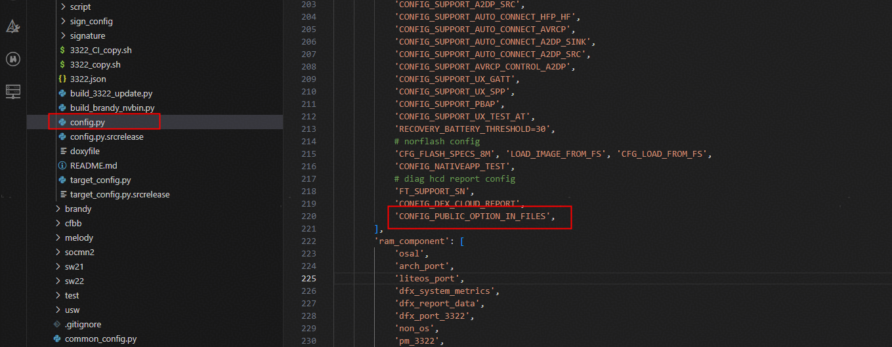

# SDK开发指导<a name="ZH-CN_TOPIC_0000002499501089"></a>

-   **[编译](#ZH-CN_TOPIC_0000002499581173)**  

-   **[系统适配对接](#ZH-CN_TOPIC_0000002466541780)**  

-   **[调试环境](#ZH-CN_TOPIC_0000002466541748)**  

-   **[烧录](#ZH-CN_TOPIC_0000002466541880)**  

-   **[代码部署](#ZH-CN_TOPIC_0000002499581205)**  

## 编译<a name="ZH-CN_TOPIC_0000002499581173"></a>

**CMake编译系统框架描述：**

```
|-- cmake
|   |-- build_component.cmake       // 组件编译相关
|   |-- build_function.cmake        // 编译系统公共函数
|   |-- build_linker.cmake          // 链接脚本处理
|   |-- global_variable.cmake       // 初始化全局变量，避免因为增量编译导致CmakeCache膨胀
|-- config             // 构建及工具配置
|   |-- target_config/3322  // 编译target配置
|       |-- target_config.py        // target模板配置
|       |-- config.py          // 项目具体的配置， 最终的配置为模板配置 + 具体配置
|   |-- common_config.py        //  构建公共参数配置，存放公共宏、公共编译选项、组件集合以及和arch相关的各种配置
|-- script                      // 编译框架公共脚本
|   |-- build_utils.py              // 构建脚本公共函数
|   |-- cmake_builder.py            // 组件构建命令
|   |-- enviroment.py               // 用于接收和解析命令，根据target_name组织各种编译参数
|-- toolchains          // 存放工具链
|   |-- gcc-arm-none-eabi-10-2020-q4.cmake  // 编译工具链配置文件
|   |-- hcc_riscv32_1.2.0.b045.cmake
|-- README.md
```

-   **[启动编译](#ZH-CN_TOPIC_0000002466382176)**  

-   **[特性配置](#ZH-CN_TOPIC_0000002499501073)**  

-   **[各组件编译描述](#ZH-CN_TOPIC_0000002466541848)**  

-   **[编译结果获取](#ZH-CN_TOPIC_0000002466541764)**  

-   **[Bin文件描述](#ZH-CN_TOPIC_0000002466382160)**  

-   **[target简介](#ZH-CN_TOPIC_0000002499501125)**  

-   **[三方库集成编译](#ZH-CN_TOPIC_0000002499501173)**  

### 启动编译<a name="ZH-CN_TOPIC_0000002466382176"></a>

**编译target介绍<a name="zh-cn_topic_0000002411208108_section4758101318417"></a>**

基于HiDiTingV100整体解决方案的对标场景以及组件组合，当前提供了两个编译target供用户使用。此两个target定义于“src\\build\\config\\target\_config\\3322”目录下“config.py”文件中。

**表 1**  编译任务简介

<a name="zh-cn_topic_0000002411208108_table168582712415"></a>
<table><thead align="left"><tr id="zh-cn_topic_0000002411208108_row1285912714413"><th class="cellrowborder" valign="top" width="17.361736173617363%" id="mcps1.2.4.1.1"><p id="zh-cn_topic_0000002411208108_p9859187134110"><a name="zh-cn_topic_0000002411208108_p9859187134110"></a><a name="zh-cn_topic_0000002411208108_p9859187134110"></a>编译任务名称</p>
</th>
<th class="cellrowborder" valign="top" width="43.62436243624362%" id="mcps1.2.4.1.2"><p id="zh-cn_topic_0000002411208108_p118599714415"><a name="zh-cn_topic_0000002411208108_p118599714415"></a><a name="zh-cn_topic_0000002411208108_p118599714415"></a>编译任务介绍</p>
</th>
<th class="cellrowborder" valign="top" width="39.01390139013902%" id="mcps1.2.4.1.3"><p id="zh-cn_topic_0000002411208108_p18591276417"><a name="zh-cn_topic_0000002411208108_p18591276417"></a><a name="zh-cn_topic_0000002411208108_p18591276417"></a>配套组件组成</p>
</th>
</tr>
</thead>
<tbody><tr id="zh-cn_topic_0000002411208108_row158592774110"><td class="cellrowborder" valign="top" width="17.361736173617363%" headers="mcps1.2.4.1.1 "><p id="zh-cn_topic_0000002411208108_p12859671413"><a name="zh-cn_topic_0000002411208108_p12859671413"></a><a name="zh-cn_topic_0000002411208108_p12859671413"></a>diting-community-native-js</p>
</td>
<td class="cellrowborder" valign="top" width="43.62436243624362%" headers="mcps1.2.4.1.2 "><p id="zh-cn_topic_0000002411208108_p1338134703619"><a name="zh-cn_topic_0000002411208108_p1338134703619"></a><a name="zh-cn_topic_0000002411208108_p1338134703619"></a>用于典型合封3322芯片，使用UIKit图形引擎，支持Native应用和JS应用的双系统编译任务</p>
</td>
<td class="cellrowborder" valign="top" width="39.01390139013902%" headers="mcps1.2.4.1.3 "><p id="zh-cn_topic_0000002411208108_p75001934173011"><a name="zh-cn_topic_0000002411208108_p75001934173011"></a><a name="zh-cn_topic_0000002411208108_p75001934173011"></a>liteos＋UIkit＋NandFlash＋MIPI＋psram＋Native-JS应用框架。</p>
</td>
</tr>
<tr id="zh-cn_topic_0000002411208108_row1385915715418"><td class="cellrowborder" valign="top" width="17.361736173617363%" headers="mcps1.2.4.1.1 "><p id="zh-cn_topic_0000002411208108_p16859207154113"><a name="zh-cn_topic_0000002411208108_p16859207154113"></a><a name="zh-cn_topic_0000002411208108_p16859207154113"></a>diting-community-xts</p>
</td>
<td class="cellrowborder" valign="top" width="43.62436243624362%" headers="mcps1.2.4.1.2 "><p id="zh-cn_topic_0000002411208108_p208592754114"><a name="zh-cn_topic_0000002411208108_p208592754114"></a><a name="zh-cn_topic_0000002411208108_p208592754114"></a>用于OpenHarmony XTS认证镜像构建</p>
</td>
<td class="cellrowborder" valign="top" width="39.01390139013902%" headers="mcps1.2.4.1.3 "><p id="zh-cn_topic_0000002411208108_p16859875413"><a name="zh-cn_topic_0000002411208108_p16859875413"></a><a name="zh-cn_topic_0000002411208108_p16859875413"></a>liteos＋UIkit＋NandFlash＋MIPI＋psram＋Native-JS应用框架+XTS测试套。</p>
</td>
</tr>
<tr id="row17853144017559"><td class="cellrowborder" valign="top" width="17.361736173617363%" headers="mcps1.2.4.1.1 "><p id="p68531740135519"><a name="p68531740135519"></a><a name="p68531740135519"></a>diting-community</p>
</td>
<td class="cellrowborder" valign="top" width="43.62436243624362%" headers="mcps1.2.4.1.2 "><p id="p9853144016558"><a name="p9853144016558"></a><a name="p9853144016558"></a>在native-js基础上增加CAT1、GNSS能力</p>
</td>
<td class="cellrowborder" valign="top" width="39.01390139013902%" headers="mcps1.2.4.1.3 "><p id="p585444016559"><a name="p585444016559"></a><a name="p585444016559"></a>liteos＋UIkit＋NandFlash＋MIPI＋psram＋Native-JS应用框架＋CAT1＋GNSS</p>
</td>
</tbody>
</table>

**cmake编译<a name="zh-cn_topic_0000002411208108_section1452818871219"></a>**

基于HiSpark Studio的编译，请参考《HiSpark Studio for VS Code 使用指南》，采取工程式一键编译，本文档中不做赘述。当前描述基于CMake的解决方案SDK编译方式。

Linux下cmake编译，在安装好对应编译依赖软件后，在Linux下运行“build.py”脚本进行编译。整体步骤如下：

1.  在SDK根目录下，通过执行“./build.py”指令，运行“build.py”脚本。
2.  选择对应编译target，输入对应target编号就会成为带签名的安全镜像。

    **图 1**  编译列表示意图<a name="zh-cn_topic_0000002411208108_fig114705114303"></a>  
    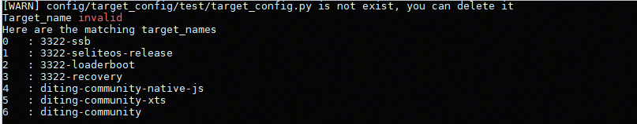

    **图 2**  完整fwpkg包编译列表示意图<a name="zh-cn_topic_0000002411208108_fig983827103013"></a>  
    

    另外，整包所需的“bt\_signed.bin/dsp\_main.bin/dsp\_overlay.bin”为固定版本发布，不支持增量开发，SDK编译时会自动打包其他SDK暂不支持编译的A核镜像由版本包提供，可对应替换fwpkg包中的A核镜像。

    接收参数列表及说明如下：

    ```
    -c:   clean后编译   
    -j:   -j<num>, 以num线程数编译   默认为机器最大线程数   
    -def=:  -def=XXX,YYY,ZZZ=x,...  向本次编译target中添加XXX、YYY、ZZZ=x编译宏   可使用-def=-:XXX 来屏蔽XXX宏   可使用-def=-:ZZZ=x 来添加或者修改ZZZ宏   
    -component=:   -component=XXX,YYY,...  仅编译XXX,YYY组件   
    -ninja:   使用ninja生成中间文件   默认使用Unix makefile   
    -[release/debug]:   debug:     在生成反汇编文件时信息更加全面但也更耗时   release:   在生成反汇编文件时节省时间   默认为debug   
    -dump:   输出target的编译参数   
    -nhso:   不更新HSO数据库   
    -nparse:   不生成全内存解析所需文件   
    -out_libs:   -out_libs=file_path, 不再链接成elf, 转而将所有.a打包成一个大的.a   
    others:   作为匹配编译target_names的关键字
    ```

3.  运行结束后在output目录下获取编译后生成的二进制文件，整体编译完成。

Windows下cmake编译，在安装好对应编译依赖软件后，整体步骤如下：

1.  在命令行指令框内，通过输入Windows的“CD：”命令，将命令行盘符切换至“src”目录，执行“python build.py -c”指令，同样会产生对应编译target列表，输入对应target列表编号即可开始编译，编译列表同Linux下编译列表。
2.  运行结束后在SDK根目录下获取编译后生成的二进制文件，整体编译完成。

### 特性配置<a name="ZH-CN_TOPIC_0000002499501073"></a>

-   **[硬件配置特性](#ZH-CN_TOPIC_0000002499501017)**  

-   **[串口方案特性](#ZH-CN_TOPIC_0000002466541668)**  

-   **[蓝牙相关特性](#ZH-CN_TOPIC_0000002499581137)**  

-   **[媒体相关特性](#ZH-CN_TOPIC_0000002499581153)**  

-   **[音频相关特性](#ZH-CN_TOPIC_0000002499581241)**  

-   **[低功耗相关特性](#ZH-CN_TOPIC_0000002499581189)**  

-   **[驱动相关特性](#ZH-CN_TOPIC_0000002499501157)**  

-   **[32k时钟源相关特性](#ZH-CN_TOPIC_0000002499501189)**  

-   **[Nor Flash部署](#ZH-CN_TOPIC_0000002466541832)**  

#### 硬件配置特性<a name="ZH-CN_TOPIC_0000002499501017"></a>

当前编译系统提供了对应的编译选项以方便用户在不同硬件设备间进行驱动切换。

具体设置编译选项方法：

1.  进入“build/config/target\_config/3322”目录，打开“target_config.py”。
2.  如需切换QSPI显示通路，如[图4](#zh-cn_topic_0000002411208048_fig18741153918116)所示的defines属性内添加‘SUPPORT\_GPU\_QSPI’，且删除MIPI属性编译宏‘MIPI\_ULPS\_SUPPORT’。

    **图 4**  在defines属性内添加宏<a name="zh-cn_topic_0000002411208048_fig18741153918116"></a>  
    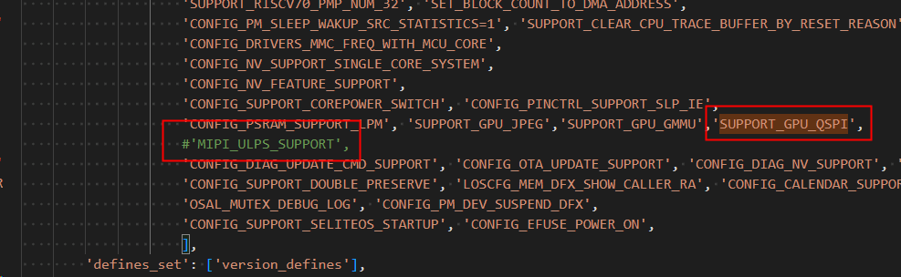

-   用于提供MIPI显示通路以及QSPI显示通路的切换，通过‘SUPPORT\_GPU\_QSPI’控制。
    -   当‘SUPPORT\_GPU\_QSPI’不设置时，则默认提供MIPI显示通路。
    -   当‘SUPPORT\_GPU\_QSPI’设置时，则提供QSPI显示通路。
    -   选择使用QSPI显示通路时，需要关闭MIPI相关宏‘MIPI\_ULPS\_SUPPORT’。

#### 串口方案特性<a name="ZH-CN_TOPIC_0000002466541668"></a>

暂不支持，无需关注。

> **说明：** 
>串口方案特性亦用于产线测试，具体测试项及操作步骤可以参照《产线 测试指南》。

#### 蓝牙相关特性<a name="ZH-CN_TOPIC_0000002499581137"></a>

蓝牙当前版本支持通过编译宏和增删组件的方式来配置单模BLE和双模BLE/BT特性，具体在“src\\build\\config\\target\_config\\3322\\config.py”中的target配置。由于蓝牙接口闭源提供在.a中，以下特性宏不影响蓝牙接口的使用，只影响开源代码中其他模块对于蓝牙接口调用的逻辑，如media、lwip等模块。

**表 1**  蓝牙特性编译宏及方案

<a name="zh-cn_topic_0000002444727373_table650142914245"></a>
<table><thead align="left"><tr id="zh-cn_topic_0000002444727373_row650242916248"><th class="cellrowborder" valign="top" width="33.31666833316668%" id="mcps1.2.4.1.1"><p id="zh-cn_topic_0000002444727373_p153562712479"><a name="zh-cn_topic_0000002444727373_p153562712479"></a><a name="zh-cn_topic_0000002444727373_p153562712479"></a>蓝牙特性方案</p>
</th>
<th class="cellrowborder" valign="top" width="35.096490350964906%" id="mcps1.2.4.1.2"><p id="zh-cn_topic_0000002444727373_p206421388489"><a name="zh-cn_topic_0000002444727373_p206421388489"></a><a name="zh-cn_topic_0000002444727373_p206421388489"></a>宏‘SUPPORT_BLE’</p>
</th>
<th class="cellrowborder" valign="top" width="31.586841315868412%" id="mcps1.2.4.1.3"><p id="zh-cn_topic_0000002444727373_p3204475485"><a name="zh-cn_topic_0000002444727373_p3204475485"></a><a name="zh-cn_topic_0000002444727373_p3204475485"></a>宏‘SUPPORT_BREDR’</p>
</th>
</tr>
</thead>
<tbody><tr id="zh-cn_topic_0000002444727373_row8945238132513"><td class="cellrowborder" valign="top" width="33.31666833316668%" headers="mcps1.2.4.1.1 "><p id="zh-cn_topic_0000002444727373_p138861042164716"><a name="zh-cn_topic_0000002444727373_p138861042164716"></a><a name="zh-cn_topic_0000002444727373_p138861042164716"></a>单BLE特性</p>
</td>
<td class="cellrowborder" valign="top" width="35.096490350964906%" headers="mcps1.2.4.1.2 "><p id="zh-cn_topic_0000002444727373_p18945193802516"><a name="zh-cn_topic_0000002444727373_p18945193802516"></a><a name="zh-cn_topic_0000002444727373_p18945193802516"></a>打开</p>
</td>
<td class="cellrowborder" valign="top" width="31.586841315868412%" headers="mcps1.2.4.1.3 "><p id="zh-cn_topic_0000002444727373_p11945638192511"><a name="zh-cn_topic_0000002444727373_p11945638192511"></a><a name="zh-cn_topic_0000002444727373_p11945638192511"></a>关闭</p>
</td>
</tr>
<tr id="zh-cn_topic_0000002444727373_row13130124162514"><td class="cellrowborder" valign="top" width="33.31666833316668%" headers="mcps1.2.4.1.1 "><p id="zh-cn_topic_0000002444727373_p186857505475"><a name="zh-cn_topic_0000002444727373_p186857505475"></a><a name="zh-cn_topic_0000002444727373_p186857505475"></a>双模BLE/BT特性</p>
</td>
<td class="cellrowborder" valign="top" width="35.096490350964906%" headers="mcps1.2.4.1.2 "><p id="zh-cn_topic_0000002444727373_p10130174118254"><a name="zh-cn_topic_0000002444727373_p10130174118254"></a><a name="zh-cn_topic_0000002444727373_p10130174118254"></a>打开</p>
</td>
<td class="cellrowborder" valign="top" width="31.586841315868412%" headers="mcps1.2.4.1.3 "><p id="zh-cn_topic_0000002444727373_p01307418259"><a name="zh-cn_topic_0000002444727373_p01307418259"></a><a name="zh-cn_topic_0000002444727373_p01307418259"></a>打开</p>
</td>
</tr>
</tbody>
</table>

> **说明：** 
>蓝牙当前版本只支持以上两种特性方案。

#### 媒体相关特性<a name="ZH-CN_TOPIC_0000002499581153"></a>

媒体组件支持配置，相关特性集合为‘media’。

‘media’支持音视频相关特性，具体请参见“src\\build\\config\\target\_config\\common\_config.py”。

可以在“src\\build\\config\\target\_config\\3322\\config.py”文件中target的“ram\_component\_set”中配置媒体相关的特性集合。

例如：diting-community-native-js里面配置为‘media’。

#### 音频相关特性<a name="ZH-CN_TOPIC_0000002499581241"></a>

-   **[3A算法](#ZH-CN_TOPIC_0000002466382140)**  

-   **[SmartPA驱动](#ZH-CN_TOPIC_0000002466382104)**  

-   **[模拟PA使能控制](#ZH-CN_TOPIC_0000002490114368)**  

-   **[音频输入输出硬件端口选择与配置](#ZH-CN_TOPIC_0000002512014732)**  

-   **[音频DSP镜像](#ZH-CN_TOPIC_0000002583402311)**  

##### 3A算法<a name="ZH-CN_TOPIC_0000002466382140"></a>

**3A算法参数配置<a name="zh-cn_topic_0000002444647197_section11341411145111"></a>**

3A算法参数记录在“middleware\\chips\\3322\\nv\\nv\_config\\nv\_default\\cfg\\acore\\app.json”文件中，分为以下两套参数：

-   audio\_vqe\_param：key\_id为0x320C，用于通话场景和录音场景。

    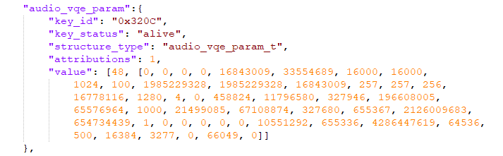

-   audio\_vqe\_kws\_param：key\_id为0x320D，用于语言唤醒场景和命令词识别场景。

    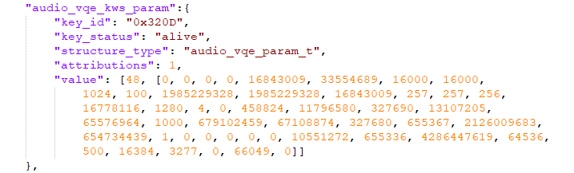

value成员里的数组即为3A算法参数。需要更新时，只需将新参数替换掉旧参数，重新编译即可。

**3A算法bypass<a name="zh-cn_topic_0000002444647197_section1816121365411"></a>**

产线测试时，为了得到麦克风录制的原始数据，此时需要将3A算法bypass，需要在“middleware\\chips\\3322\\nv\\nv\_config\\nv\_default\\cfg\\acore\\app.json”文件中，增加以下代码：

```
        "product_test_mode":{
            "key_id": "0x4109",
            "key_status": "alive",
            "structure_type": "uint8_t",
            "attributions": 1,
            "value": 1
        }
```

value成员里的1表示打开产测模式，此时3A算法会被bypass；如果需要使用3A算法，请将value置为0。

##### SmartPA驱动<a name="ZH-CN_TOPIC_0000002466382104"></a>

**SmartPA适配<a name="zh-cn_topic_0000002444727321_section16234719202714"></a>**

SDK提供外置Codec适配示例，版本提供的示例为SmartPA的适配。

版本默认使用DAC对接模拟PA的低成本方案，不需要适配SmartPA；

如有使用I2S对接SmartPA的需求，可参考该章节。

**SmartPA芯片驱动的适配<a name="zh-cn_topic_0000002444727321_section113186571517"></a>**

-   版本默认提供参考的是EVB板子的AW88262，可以通过宏开关切换。

-   SmartPA驱动初始化入口：application\\3322\\3322\_app\_standard\\thread\_pri\_init.c。
-   SmartPA宏开关选择型号的代码片段如下：需要根据实际情况在“config.py”中打开相应的SmartPA特性宏（比如\[AUDIO\_SMARTPA\_AW88262\]），关闭其他无关型号特性宏（比如默认的模拟PA上下电的宏\[SUPPORT\_AUDIO\_ANAPA\_POWER\_CTRL\]），同时根据对接的I2S端口进行正确配置。

    ```
    #ifdef AUDIO_SMARTPA_AW88262
    /**
    * The sample code of the vendor,
    * which will be implemented by the customer in the future
    */
    /* Audio codec vendor select according to hardware connection:
    * define AUDIO_SMARTPA_AW88262 : macro to init smartpa aw88262, defined in config/target_config/3322/config.py;
    * define AUDIO_SMARTPA_AW88262_I2S_ID UAPI_SND_OUT_PORT_I2S0 : macro to specify i2s id connecting to smartpa aw88262;
    */
    #define AUDIO_SMARTPA_AW88262_I2S_ID UAPI_SND_OUT_PORT_I2S0
    ```

    ```

    ```

-   SmartPA驱动的基本流程（以AW88166的驱动举例说明，实现是基于厂商提供的驱动包裁剪而来，最终需要在开机时将驱动注册到音频驱动）：
    -   驱动对外一共五个接口：具体参考“application\\audio\\vendor\\aw88166\\include\\aw88166.h”。
    -   驱动的init/deinit接口跟随MCU的上电和下电流程调用。
    -   驱动的set\_aef\_profile接口跟随业务的输出音效配置接口回调（uapi\_snd\_set\_aef\_profile）。
    -   驱动的start/stop接口跟随下行通路的创建和销毁调用，通过uapi\_audio\_vendor\_register接口注册个音频下行模块；stop接口会让SmartPA进入低功耗待机状态。

        示例参考代码如下：

        ```
        static uapi_vendor_driver g_aw88166_driver = {
            .out_port = AUDIO_SMARTPA_AW88166_I2S_ID,
            .init = audio_aw88166_start,
            .deinit = audio_aw88166_stop,
            .set_aef_profile = audio_aw88166_set_aef_profile,
        };
        
        static td_s32 audio_aw88166_register_driver(void)
        {
            const uapi_vendor_codec_attr attr = {};
        
            audio_aw88166_init(&attr); /* Init aw88166 once when device power on */
        
            return uapi_audio_vendor_register(&g_aw88166_driver);
        }
        ```

-   将新增的驱动文件增加到“application\\audio\\vendor\\CMakeLists.txt”中，如图所示（需要删去图中默认的aw88262的驱动文件，替换为新增的驱动文件）。

    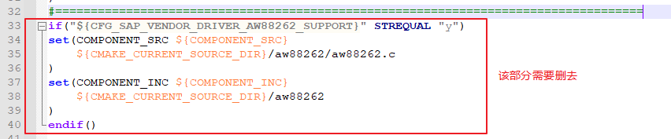

    注意需要把所有新增的源文件及头文件路径都加上，以AW88166为例：

    ```
    set(COMPONENT_SRC ${COMPONENT_SRC}
        ${CMAKE_CURRENT_SOURCE_DIR}/aw88166/aw88166.c
        ${CMAKE_CURRENT_SOURCE_DIR}/aw88166/aw883xx.c
        ${CMAKE_CURRENT_SOURCE_DIR}/aw88166/aw883xx_calib.c
        ${CMAKE_CURRENT_SOURCE_DIR}/aw88166/aw883xx_device.c
        ${CMAKE_CURRENT_SOURCE_DIR}/aw88166/product_init_files/aw88166/aw883xx_pid_2066_init.c
    )
    set(COMPONENT_INC ${COMPONENT_INC}
        ${CMAKE_CURRENT_SOURCE_DIR}/aw88166
        ${CMAKE_CURRENT_SOURCE_DIR}/aw88166/product_init_files/aw88166
        ${CMAKE_CURRENT_SOURCE_DIR}/aw88166/config/aw88166/mono/16bit
    )
    ```

-   适配SmartPA驱动的注意事项：以AW88166为例。
    -   根据硬件连接情况，正确配置SmartPA芯片的上电管脚。
    -   根据硬件连接情况，正确配置SmartPA芯片的I2C通信的序号。
    -   根据硬件连接情况以及芯片手册，正确配置SmartPA芯片的I2C设备地址。

        ```
        application\audio\vendor\aw88166\aw88166.c:21
        #define AW88166_PWR_ON_PIN   S_MGPIO4
        #define AW88166_I2C_BUS_ID   I2C_BUS_0
        #define AW88166_I2C_DEV_ADDR 0x34
        
        ```

**SmartPA音效算法的适配<a name="zh-cn_topic_0000002444727321_section7478617923"></a>**

SmartPA音效算法的适配需要提供整机到SmartPA芯片厂商调音，刷新音效算法和音效参数。

SmartPA有两种：

无DSP型：音效处理由SOC芯片中的DSP完成，例如艾为的AW88262。

带DSP型：音效算法直接在PA内部的DSP上运行，例如艾为的AW88166。

-   对于PA芯片内部不带DSP的型号（如 AW88262），发布版本默认集成了一个艾为提供的音效算法（dsp\_overlay.bin中的aef.bin）。
    -   算法版本：MiniSKTune\_MTK\_DSP\_HIFI3\_AAPI\_Porting，版本号为V0.0.0.19；（需要与艾为确认PA选型与该算法版本是否适配）。
    -   算法版本升级或者更换需要参见《AEF overlay 开发指南》重新刷新“aef.bin”。
    -   PA音效调测：为了获取准确的音效算法参数，需要整机厂商提供最终整机给SmartPA芯片厂商，用于进行音效参数调节。调节完成后进行参数bin的刷新。
        1.  音效参数bin打包在DSP镜像包的“dsp\_overlay.bin”中。
        2.  音效参数bin根据业务场景分为3个：aef\_music.bin、aef\_voip.bin、aef\_ringtone.bin。要求把PA厂商调测好的参数bin重命名成这仨参数bin替换到“dsp\_overlay.bin”中。

            举例：MCU在创建本地音乐通路的时候会在打印log。

            “\[A\]\[ALERT\]\[ao\_get\_aef\_param\_bin\_by\_profile:701\] <aef\_music.bin\>”。

        3.  替换“dsp\_overlay.bin”中音效参数bin的方法：
            1.  解包/打包工具：application/audio/sample\_dsp\_overlay/packet\_tool\_dsp\_overlay.py

                直接执行该脚本，会输出脚本的使用指南/help信息：

                ```
                python3 application/audio/sample_dsp_overlay/packet_tool_dsp_overlay.py
                ```

            2.  音效参数替换简略步骤

                ① 进入路径“application/audio/sample\_dsp\_overlay/”。

                ② dsp\_overlay.bin的解包。

                ```
                ./packet_tool_dsp_overlay.py unpacket max
                ```

                ③ 解包在当前路径的“out/overlay\_bin”目录下。

                ④ 替换“out/overlay\_bin”下面的音效参数bin。

                ⑤ 用脚本重新打包。

                ```
                ./packet_tool_dsp_overlay.py packet max
                ```

                ⑥ 按往常一样编译镜像包烧录“dsp\_overlay.bin”。

-   对于PA芯片内部自带DSP的型号（如AW88166），音效算法跑在SmartPA芯片内部的DSP上，SOC的DSP上的音效算法库需要替换为bypass版本，具体请参见《AEF overlay 开发指南》，使用bypass版本的“aef.bin”替换“dsp\_overlay.bin”中的“aef.bin”。

-   PA的音效参数由PA的MCU驱动下发：PA驱动的适配层set\_aef\_profile接口就是注册给音频模块根据场景切换音效参数使用。

    可以参照audio\_aw88166\_set\_aef\_profile的具体实现，音频模块会根据业务场景配置的profile选择PA的音效场景。

    所以音效参数就在PA供应商的驱动包中：application/audio/vendor/aw88166/config/aw88166/mono/16bit/

##### 模拟PA使能控制<a name="ZH-CN_TOPIC_0000002490114368"></a>

-   SDK默认支持S\_AGPIO30控制模拟PA使能，提供了其适配示例，可以通过‘SUPPORT\_AUDIO\_ANAPA\_POWER\_CTRL’宏开关该功能。
-   使能控制功能的注册入口：application\\3322\\3322\_app\_standard\\thread\_pri\_init.c
-   使能控制功能适配注意点：
    -   需要根据硬件连接配置正确的GPIO管脚，将‘AUDIO\_ANAPA\_POWER\_CTL\_GPIO\_ID’宏设置为实际PA使能管脚所对应的GPIO管脚。
    -   根据对接的DAC端口对‘AUDIO\_ANAPA\_DAC\_ID’宏进行正确配置。

##### 音频输入输出硬件端口选择与配置<a name="ZH-CN_TOPIC_0000002512014732"></a>

具体音频业务的端口切换配置请参考《多媒体软件 开发指南》中的“音频配置”章节。

-   音频输入端口

    本地音频输入端口

    -   模拟输入：支持ADC和LPADC，一般选择LPADC，对接AMIC器件，不需要额外配置管脚复用（pinmux）。
    -   数字输入：支持PDM和I2S，PDM对接DMIC器件，I2S对接I2S接口的器件/模块，需要根据硬件使用的芯片管脚配置管脚复用（pinmux）。

        管脚复用在平台侧的板型配置文件中统一管理，比如EVB板的配置文件：drivers/boards/\*\_evb/board\_config/board\_evb.h

-   音频输出端口：

    本地音频输出端口

    -   模拟输出：支持DAC，对接模拟PA或者喇叭，不需要额外配置管脚复用（pinmux）。
    -   数字输出：支持I2S，对接I2S接口的器件/模块，常见的有数字PA和音频模组，需要根据硬件使用的芯片管脚配置管脚复用（pinmux）。

        管脚复用在平台侧的板型配置文件中统一管理，比如EVB板的配置文件：drivers/boards/\*\_evb/board\_config/board\_evb.h

##### 音频DSP镜像<a name="ZH-CN_TOPIC_0000002583402311"></a>

-   **[音频DSP镜像介绍](#ZH-CN_TOPIC_0000002583322281)**  

-   **[音频DSP镜像解包和打包](#ZH-CN_TOPIC_0000002552922272)**  

###### 音频DSP镜像介绍<a name="ZH-CN_TOPIC_0000002583322281"></a>

音频DSP镜像涉及两个bin：dsp\_main.bin和dsp\_overlay.bin。

-   dsp\_main.bin：基础DSP框架代码，不支持增删改。
-   dsp\_overlay.bin：动态加载的算法/参数bin的合集，bin包，支持按需增删替换。

    dsp\_overlay.bin的bin包介绍如下：

    -   aef.bin：软音效算法，用于本地下行播放通路的音效处理，适用于本地音乐、提示音、通话、蓝牙sink音乐场景，对接喇叭播放的音效算法。
    -   amrwb.bin：AMRWB编解码算法，通过SPI对接CAT1的通话场景的上下行编解码算法。
    -   dsp\_rom.bin：DSP基础框架依赖，作为基础必备组件，不可裁剪。
    -   mp3\_enc.bin：MP3编码算法，用于上行录音的编码，适用于语音备忘录录音场景。
    -   opus\_dec.bin：OPUS格式解码算法，用于下行解码播放，适用于本地音乐和蓝牙source音乐场景，解码本地OPUS格式的音频文件（流）。
    -   pcm\_dec.bin：PCM解码算法，用于下行解码播放，适用于本地音乐、蓝牙source音乐、蓝牙通话（CVSD）场景，用于支持WAV格式的音频解码播放以及CVSD格式的通话下行解码播放。
    -   phs\_gru.bin：本地固定命令词（唤醒词）识别算法，用于语音识别功能的前级离线固定命令词和唤醒词识别场景。
    -   see\_1mic.bin：传统3A算法/AI降噪增强算法，上行录制场景使用，用于本地录音/语音识别/通话上行场景。
    -   silk\_dec.bin：SILK解码算法，用于微信语音播放场景。
    -   silk\_enc.bin：SILK编码算法，用于微信语音录制场景。

当前版本包中提供3个版本的DSP镜像，包含不同的功能特性，供用户选择。

-   镜像路径说明：
    -   normal版本：src\\tools\\pkg\\bin\\3322\\dsp\\normal
    -   mini版本：src\\tools\\pkg\\bin\\3322\\dsp\\mini
    -   nano版本：src\\tools\\pkg\\bin\\3322\\dsp\\nano

-   镜像功能说明：
    1.  normal和mini版本支持传统ANR、增强算法AGC、回声消除算法AEC，nano版本支持AI降噪增强算法，不支持回声消除功能。
    2.  normal和nano版本支持下行通路的软件音效算法，mini版本暂不支持。
    3.  nano版本不支持本地固定命令词（唤醒词）识别算法。

**表 1**  音频DSP镜像bin文件说明

<a name="zh-cn_topic_0000002540916286_table11844161904110"></a>
<table><thead align="left"><tr id="zh-cn_topic_0000002540916286_row6841161918411"><th class="cellrowborder" colspan="2" valign="top" id="mcps1.2.6.1.1"><p id="zh-cn_topic_0000002540916286_p58411219154110"><a name="zh-cn_topic_0000002540916286_p58411219154110"></a><a name="zh-cn_topic_0000002540916286_p58411219154110"></a>bin文件</p>
</th>
<th class="cellrowborder" valign="top" id="mcps1.2.6.1.2"><p id="zh-cn_topic_0000002540916286_p984191954119"><a name="zh-cn_topic_0000002540916286_p984191954119"></a><a name="zh-cn_topic_0000002540916286_p984191954119"></a>normal版本</p>
</th>
<th class="cellrowborder" valign="top" id="mcps1.2.6.1.3"><p id="zh-cn_topic_0000002540916286_p584111914415"><a name="zh-cn_topic_0000002540916286_p584111914415"></a><a name="zh-cn_topic_0000002540916286_p584111914415"></a>mini版本</p>
</th>
<th class="cellrowborder" valign="top" id="mcps1.2.6.1.4"><p id="zh-cn_topic_0000002540916286_p3841111920416"><a name="zh-cn_topic_0000002540916286_p3841111920416"></a><a name="zh-cn_topic_0000002540916286_p3841111920416"></a>nano版本</p>
</th>
</tr>
</thead>
<tbody><tr id="zh-cn_topic_0000002540916286_row38411019114116"><td class="cellrowborder" colspan="2" valign="top" headers="mcps1.2.6.1.1 "><p id="zh-cn_topic_0000002540916286_p9841319154115"><a name="zh-cn_topic_0000002540916286_p9841319154115"></a><a name="zh-cn_topic_0000002540916286_p9841319154115"></a>dsp_main.bin</p>
</td>
<td class="cellrowborder" valign="top" headers="mcps1.2.6.1.2 "><p id="zh-cn_topic_0000002540916286_p084114191419"><a name="zh-cn_topic_0000002540916286_p084114191419"></a><a name="zh-cn_topic_0000002540916286_p084114191419"></a>支持</p>
</td>
<td class="cellrowborder" valign="top" headers="mcps1.2.6.1.3 "><p id="zh-cn_topic_0000002540916286_p2084171974119"><a name="zh-cn_topic_0000002540916286_p2084171974119"></a><a name="zh-cn_topic_0000002540916286_p2084171974119"></a>支持</p>
</td>
<td class="cellrowborder" valign="top" headers="mcps1.2.6.1.4 "><p id="zh-cn_topic_0000002540916286_p16841171954113"><a name="zh-cn_topic_0000002540916286_p16841171954113"></a><a name="zh-cn_topic_0000002540916286_p16841171954113"></a>支持</p>
</td>
</tr>
<tr id="zh-cn_topic_0000002540916286_row78411219164117"><td class="cellrowborder" rowspan="10" valign="top" width="12.80256051210242%" headers="mcps1.2.6.1.1 "><p id="zh-cn_topic_0000002540916286_p4841119164117"><a name="zh-cn_topic_0000002540916286_p4841119164117"></a><a name="zh-cn_topic_0000002540916286_p4841119164117"></a>dsp_overlay</p>
</td>
<td class="cellrowborder" valign="top" width="20.324064812962593%" headers="mcps1.2.6.1.1 "><p id="zh-cn_topic_0000002540916286_p17841919144110"><a name="zh-cn_topic_0000002540916286_p17841919144110"></a><a name="zh-cn_topic_0000002540916286_p17841919144110"></a>aef.bin</p>
</td>
<td class="cellrowborder" valign="top" width="21.484296859371874%" headers="mcps1.2.6.1.2 "><p id="zh-cn_topic_0000002540916286_p128418196412"><a name="zh-cn_topic_0000002540916286_p128418196412"></a><a name="zh-cn_topic_0000002540916286_p128418196412"></a>支持</p>
</td>
<td class="cellrowborder" valign="top" width="20.76415283056611%" headers="mcps1.2.6.1.3 "><p id="zh-cn_topic_0000002540916286_p7841319184117"><a name="zh-cn_topic_0000002540916286_p7841319184117"></a><a name="zh-cn_topic_0000002540916286_p7841319184117"></a>不支持</p>
</td>
<td class="cellrowborder" valign="top" width="24.624924984996998%" headers="mcps1.2.6.1.4 "><p id="zh-cn_topic_0000002540916286_p684113191416"><a name="zh-cn_topic_0000002540916286_p684113191416"></a><a name="zh-cn_topic_0000002540916286_p684113191416"></a>支持</p>
</td>
</tr>
<tr id="zh-cn_topic_0000002540916286_row184291917413"><td class="cellrowborder" valign="top" headers="mcps1.2.6.1.1 "><p id="zh-cn_topic_0000002540916286_p1884112195411"><a name="zh-cn_topic_0000002540916286_p1884112195411"></a><a name="zh-cn_topic_0000002540916286_p1884112195411"></a>amrwb.bin</p>
</td>
<td class="cellrowborder" valign="top" headers="mcps1.2.6.1.1 "><p id="zh-cn_topic_0000002540916286_p1384218195417"><a name="zh-cn_topic_0000002540916286_p1384218195417"></a><a name="zh-cn_topic_0000002540916286_p1384218195417"></a>支持</p>
</td>
<td class="cellrowborder" valign="top" headers="mcps1.2.6.1.2 "><p id="zh-cn_topic_0000002540916286_p9842219144112"><a name="zh-cn_topic_0000002540916286_p9842219144112"></a><a name="zh-cn_topic_0000002540916286_p9842219144112"></a>支持</p>
</td>
<td class="cellrowborder" valign="top" headers="mcps1.2.6.1.3 "><p id="zh-cn_topic_0000002540916286_p984271913419"><a name="zh-cn_topic_0000002540916286_p984271913419"></a><a name="zh-cn_topic_0000002540916286_p984271913419"></a>支持</p>
</td>
</tr>
<tr id="zh-cn_topic_0000002540916286_row2084241904118"><td class="cellrowborder" valign="top" headers="mcps1.2.6.1.1 "><p id="zh-cn_topic_0000002540916286_p88429192412"><a name="zh-cn_topic_0000002540916286_p88429192412"></a><a name="zh-cn_topic_0000002540916286_p88429192412"></a>dsp_rom.bin</p>
</td>
<td class="cellrowborder" valign="top" headers="mcps1.2.6.1.1 "><p id="zh-cn_topic_0000002540916286_p984251954119"><a name="zh-cn_topic_0000002540916286_p984251954119"></a><a name="zh-cn_topic_0000002540916286_p984251954119"></a>支持</p>
</td>
<td class="cellrowborder" valign="top" headers="mcps1.2.6.1.2 "><p id="zh-cn_topic_0000002540916286_p1784212197414"><a name="zh-cn_topic_0000002540916286_p1784212197414"></a><a name="zh-cn_topic_0000002540916286_p1784212197414"></a>支持</p>
</td>
<td class="cellrowborder" valign="top" headers="mcps1.2.6.1.3 "><p id="zh-cn_topic_0000002540916286_p16842101964118"><a name="zh-cn_topic_0000002540916286_p16842101964118"></a><a name="zh-cn_topic_0000002540916286_p16842101964118"></a>支持</p>
</td>
</tr>
<tr id="zh-cn_topic_0000002540916286_row3842121944114"><td class="cellrowborder" valign="top" headers="mcps1.2.6.1.1 "><p id="zh-cn_topic_0000002540916286_p19842151918414"><a name="zh-cn_topic_0000002540916286_p19842151918414"></a><a name="zh-cn_topic_0000002540916286_p19842151918414"></a>mp3_enc.bin</p>
</td>
<td class="cellrowborder" valign="top" headers="mcps1.2.6.1.1 "><p id="zh-cn_topic_0000002540916286_p1784231984113"><a name="zh-cn_topic_0000002540916286_p1784231984113"></a><a name="zh-cn_topic_0000002540916286_p1784231984113"></a>支持</p>
</td>
<td class="cellrowborder" valign="top" headers="mcps1.2.6.1.2 "><p id="zh-cn_topic_0000002540916286_p1684211193417"><a name="zh-cn_topic_0000002540916286_p1684211193417"></a><a name="zh-cn_topic_0000002540916286_p1684211193417"></a>支持</p>
</td>
<td class="cellrowborder" valign="top" headers="mcps1.2.6.1.3 "><p id="zh-cn_topic_0000002540916286_p48429195415"><a name="zh-cn_topic_0000002540916286_p48429195415"></a><a name="zh-cn_topic_0000002540916286_p48429195415"></a>支持</p>
</td>
</tr>
<tr id="zh-cn_topic_0000002540916286_row68427192417"><td class="cellrowborder" valign="top" headers="mcps1.2.6.1.1 "><p id="zh-cn_topic_0000002540916286_p14842181910412"><a name="zh-cn_topic_0000002540916286_p14842181910412"></a><a name="zh-cn_topic_0000002540916286_p14842181910412"></a>opus_dec.bin</p>
</td>
<td class="cellrowborder" valign="top" headers="mcps1.2.6.1.1 "><p id="zh-cn_topic_0000002540916286_p208421019114110"><a name="zh-cn_topic_0000002540916286_p208421019114110"></a><a name="zh-cn_topic_0000002540916286_p208421019114110"></a>支持</p>
</td>
<td class="cellrowborder" valign="top" headers="mcps1.2.6.1.2 "><p id="zh-cn_topic_0000002540916286_p1584212190412"><a name="zh-cn_topic_0000002540916286_p1584212190412"></a><a name="zh-cn_topic_0000002540916286_p1584212190412"></a>支持</p>
</td>
<td class="cellrowborder" valign="top" headers="mcps1.2.6.1.3 "><p id="zh-cn_topic_0000002540916286_p2842161914412"><a name="zh-cn_topic_0000002540916286_p2842161914412"></a><a name="zh-cn_topic_0000002540916286_p2842161914412"></a>支持</p>
</td>
</tr>
<tr id="zh-cn_topic_0000002540916286_row484341954119"><td class="cellrowborder" valign="top" headers="mcps1.2.6.1.1 "><p id="zh-cn_topic_0000002540916286_p11842141914415"><a name="zh-cn_topic_0000002540916286_p11842141914415"></a><a name="zh-cn_topic_0000002540916286_p11842141914415"></a>pcm_dec.bin</p>
</td>
<td class="cellrowborder" valign="top" headers="mcps1.2.6.1.1 "><p id="zh-cn_topic_0000002540916286_p1484241918417"><a name="zh-cn_topic_0000002540916286_p1484241918417"></a><a name="zh-cn_topic_0000002540916286_p1484241918417"></a>支持</p>
</td>
<td class="cellrowborder" valign="top" headers="mcps1.2.6.1.2 "><p id="zh-cn_topic_0000002540916286_p1884220196415"><a name="zh-cn_topic_0000002540916286_p1884220196415"></a><a name="zh-cn_topic_0000002540916286_p1884220196415"></a>支持</p>
</td>
<td class="cellrowborder" valign="top" headers="mcps1.2.6.1.3 "><p id="zh-cn_topic_0000002540916286_p284261918414"><a name="zh-cn_topic_0000002540916286_p284261918414"></a><a name="zh-cn_topic_0000002540916286_p284261918414"></a>支持</p>
</td>
</tr>
<tr id="zh-cn_topic_0000002540916286_row9843819204111"><td class="cellrowborder" valign="top" headers="mcps1.2.6.1.1 "><p id="zh-cn_topic_0000002540916286_p1384321918418"><a name="zh-cn_topic_0000002540916286_p1384321918418"></a><a name="zh-cn_topic_0000002540916286_p1384321918418"></a>phs_gru.bin</p>
</td>
<td class="cellrowborder" valign="top" headers="mcps1.2.6.1.1 "><p id="zh-cn_topic_0000002540916286_p7843819154119"><a name="zh-cn_topic_0000002540916286_p7843819154119"></a><a name="zh-cn_topic_0000002540916286_p7843819154119"></a>支持</p>
</td>
<td class="cellrowborder" valign="top" headers="mcps1.2.6.1.2 "><p id="zh-cn_topic_0000002540916286_p3843131924112"><a name="zh-cn_topic_0000002540916286_p3843131924112"></a><a name="zh-cn_topic_0000002540916286_p3843131924112"></a>支持</p>
</td>
<td class="cellrowborder" valign="top" headers="mcps1.2.6.1.3 "><p id="zh-cn_topic_0000002540916286_p184371934116"><a name="zh-cn_topic_0000002540916286_p184371934116"></a><a name="zh-cn_topic_0000002540916286_p184371934116"></a>不支持</p>
</td>
</tr>
<tr id="zh-cn_topic_0000002540916286_row12843219184119"><td class="cellrowborder" valign="top" headers="mcps1.2.6.1.1 "><p id="zh-cn_topic_0000002540916286_p18431119154118"><a name="zh-cn_topic_0000002540916286_p18431119154118"></a><a name="zh-cn_topic_0000002540916286_p18431119154118"></a>see_1mic.bin</p>
</td>
<td class="cellrowborder" valign="top" headers="mcps1.2.6.1.1 "><p id="zh-cn_topic_0000002540916286_p28431919164113"><a name="zh-cn_topic_0000002540916286_p28431919164113"></a><a name="zh-cn_topic_0000002540916286_p28431919164113"></a>支持</p>
<p id="zh-cn_topic_0000002540916286_p3258125514424"><a name="zh-cn_topic_0000002540916286_p3258125514424"></a><a name="zh-cn_topic_0000002540916286_p3258125514424"></a>传统3A算法</p>
</td>
<td class="cellrowborder" valign="top" headers="mcps1.2.6.1.2 "><p id="zh-cn_topic_0000002540916286_p1584317197412"><a name="zh-cn_topic_0000002540916286_p1584317197412"></a><a name="zh-cn_topic_0000002540916286_p1584317197412"></a>支持</p>
<p id="zh-cn_topic_0000002540916286_p87251956154212"><a name="zh-cn_topic_0000002540916286_p87251956154212"></a><a name="zh-cn_topic_0000002540916286_p87251956154212"></a>传统3A算法</p>
</td>
<td class="cellrowborder" valign="top" headers="mcps1.2.6.1.3 "><p id="zh-cn_topic_0000002540916286_p1884371954114"><a name="zh-cn_topic_0000002540916286_p1884371954114"></a><a name="zh-cn_topic_0000002540916286_p1884371954114"></a>支持</p>
<p id="zh-cn_topic_0000002540916286_p9438758114210"><a name="zh-cn_topic_0000002540916286_p9438758114210"></a><a name="zh-cn_topic_0000002540916286_p9438758114210"></a>AI降噪增强算法</p>
</td>
</tr>
<tr id="zh-cn_topic_0000002540916286_row1284311194416"><td class="cellrowborder" valign="top" headers="mcps1.2.6.1.1 "><p id="zh-cn_topic_0000002540916286_p58438198419"><a name="zh-cn_topic_0000002540916286_p58438198419"></a><a name="zh-cn_topic_0000002540916286_p58438198419"></a>silk_dec.bin</p>
</td>
<td class="cellrowborder" valign="top" headers="mcps1.2.6.1.1 "><p id="zh-cn_topic_0000002540916286_p16843171934118"><a name="zh-cn_topic_0000002540916286_p16843171934118"></a><a name="zh-cn_topic_0000002540916286_p16843171934118"></a>支持</p>
</td>
<td class="cellrowborder" valign="top" headers="mcps1.2.6.1.2 "><p id="zh-cn_topic_0000002540916286_p178431819104112"><a name="zh-cn_topic_0000002540916286_p178431819104112"></a><a name="zh-cn_topic_0000002540916286_p178431819104112"></a>支持</p>
</td>
<td class="cellrowborder" valign="top" headers="mcps1.2.6.1.3 "><p id="zh-cn_topic_0000002540916286_p128432019114114"><a name="zh-cn_topic_0000002540916286_p128432019114114"></a><a name="zh-cn_topic_0000002540916286_p128432019114114"></a>支持</p>
</td>
</tr>
<tr id="zh-cn_topic_0000002540916286_row148441619174112"><td class="cellrowborder" valign="top" headers="mcps1.2.6.1.1 "><p id="zh-cn_topic_0000002540916286_p1784321910415"><a name="zh-cn_topic_0000002540916286_p1784321910415"></a><a name="zh-cn_topic_0000002540916286_p1784321910415"></a>silk_enc.bin</p>
</td>
<td class="cellrowborder" valign="top" headers="mcps1.2.6.1.1 "><p id="zh-cn_topic_0000002540916286_p18843151924117"><a name="zh-cn_topic_0000002540916286_p18843151924117"></a><a name="zh-cn_topic_0000002540916286_p18843151924117"></a>支持</p>
</td>
<td class="cellrowborder" valign="top" headers="mcps1.2.6.1.2 "><p id="zh-cn_topic_0000002540916286_p2844201944119"><a name="zh-cn_topic_0000002540916286_p2844201944119"></a><a name="zh-cn_topic_0000002540916286_p2844201944119"></a>支持</p>
</td>
<td class="cellrowborder" valign="top" headers="mcps1.2.6.1.3 "><p id="zh-cn_topic_0000002540916286_p6844141911419"><a name="zh-cn_topic_0000002540916286_p6844141911419"></a><a name="zh-cn_topic_0000002540916286_p6844141911419"></a>支持</p>
</td>
</tr>
</tbody>
</table>

A核系统版本默认适配dsp的normal版本，当选择使用mini或nano版本时，需要修改“src\\build\\config\\target\_config\\3322\\config.py”文件中target的dsp\_version值mini或nano。例如使用diting-community-native-js的A核系统版本，使用dsp的mini版本，需要做如下修改：

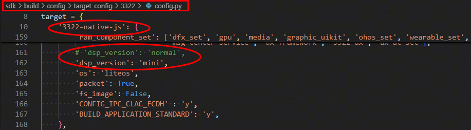

###### 音频DSP镜像解包和打包<a name="ZH-CN_TOPIC_0000002552922272"></a>

音频sample目录提供python脚本，供客户解包dsp\_overlay.bin，按需增删、替换bin，再重新打包成新的dsp\_overlay.bin。

python脚本：application/audio/sample\_dsp\_overlay/packet\_tool\_dsp\_overlay.py；不带参数直接执行会有help信息。

操作步骤/方法如下：

1.  进入工作目录：application/audio/sample\_dsp\_overlay。

1.  解包dsp\_overlay.bin：./packet\_tool\_dsp\_overlay.py unpacket normal 3322。
    -   解包后，在当前路径的“out/overlay\_bin”目录下，会生成dsp\_overlay.bin中包含的所有算法和参数的独立bin文件；
    -   解包操作的dsp\_overlay.bin是从镜像归档目录拷贝过来解包的。

2.  按需增删替换bin文件：到当前路径的“out/overlay\_bin”目录增删替换算法/参数bin文件。
3.  打包dsp\_overlay.bin：./packet\_tool\_dsp\_overlay.py packet normal 3322。

    打包后，“out/overlay\_bin”目录下的所有bin文件会被重新打包成一个总的dsp\_overlay.bin，并拷贝到镜像归档目录，覆盖原先的旧dsp\_overlay.bin。

4.  烧录dsp\_overlay.bin：烧录新打包的dsp\_overlay.bin或者将新打包的dsp\_overlay.bin推送到板端。

#### 低功耗相关特性<a name="ZH-CN_TOPIC_0000002499581189"></a>

具体低功耗相关特性配置请参见《低功耗软件 开发指南》。

#### 驱动相关特性<a name="ZH-CN_TOPIC_0000002499501157"></a>

-   ADC自动采样需要开启宏‘CONFIG\_ADC\_SUPPORT\_AUTO\_SCAN’，手动采样需要关闭该宏。

    如[图1](#zh-cn_topic_0000002411048184_fig4901105118243)所示，通过Kconfig配置开启ADC自动采样。

    **图 1**  ADC自动采样开启示意图<a name="zh-cn_topic_0000002411048184_fig4901105118243"></a>  
    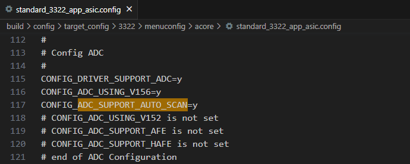

    > **说明：** 
    >ADC自动采样与手动采样互斥。

-   SPI支持轮询模式与DMA模式自动切换功能，需要开启宏‘CONFIG\_SPI\_SUPPORT\_DMA’和‘CONFIG\_SPI\_SUPPORT\_POLL\_AND\_DMA\_AUTO\_SWITCH’，并且设置宏‘CONFIG\_SPI\_AUTO\_SWITCH\_DMA\_THRESHOLD=8’，其中数字8代表自动切换轮询与DMA模式的切换阈值，当传输大于等于8Byte时驱动自动切换为DMA传输，小于8Byte则使用轮询模式传输，该阈值可按照使用场景进行设置。
-   I2C支持轮询模式与DMA模式自动切换功能，需要开启宏‘CONFIG\_I2C\_SUPPORT\_DMA’和‘CONFIG\_I2C\_SUPPORT\_POLL\_AND\_DMA\_AUTO\_SWITCH’，并且设置宏‘CONFIG\_I2C\_POLL\_AND\_DMA\_AUTO\_SWITCH\_THRESHOLD=8’，其中数字8代表自动切换轮询与DMA模式的切换阈值，当传输大于等于8Byte时驱动自动切换为DMA传输，小于8Byte则使用轮询模式传输，该阈值可按照使用场景进行设置。

    > **须知：** 
    >当‘QSPI\_DISPLAY’、‘TPTYPE\_TMA525B’均设置时，即显示为QSPI显示通路时，由于QSPI屏幕侧器件限制，此时建议关闭DMA模式，使用轮询模式，避免QSPI显示出现异常。

#### 32k时钟源相关特性<a name="ZH-CN_TOPIC_0000002499501189"></a>

当前编译系统提供了对应的编译选项以方便用户在不同的32k时钟源之间进行切换。

当前32k时钟源共分为两类：

-   XO 32k：版本默认配置。使用前需要进行时钟精度测量，评估满足时钟要求后可使用。

-   RC 32k：对应编译宏为‘SUPPORT\_RC\_CALIBRATION’。

> **须知：** 
>-   由于内置RC 32k会在蓝牙流程中进行时钟校准，为确保计时准确，需开启蓝牙广播或保持蓝牙连接。
>-   如需使用外置XO 32k，需对外置XO 32k时钟源进行时间精度测量，去掉‘SUPPORT\_RC\_CALIBRATION’编译宏并添加‘SUPPORT\_32K\_MEAS’编译选项开启，串口会周期性打印当前32k时钟源频率值，测量后请及时删除‘SUPPORT\_32K\_MEAS’编译选项，避免对系统调度造成影响。

具体设置编译选项方法：

1.  进入“src\\build\\config\\target\_config\\3322”目录，打开“config.py”。

1.  <a name="zh-cn_topic_0000002411048160_li122819241457"></a>如需切换RC 32k时钟源，按照[图1](#zh-cn_topic_0000002411048160_fig522710321240)所示添加对应编译选项进行编译即可。

    **图 1**  添加编译选项切换RC 32k时钟源<a name="zh-cn_topic_0000002411048160_fig522710321240"></a>  
    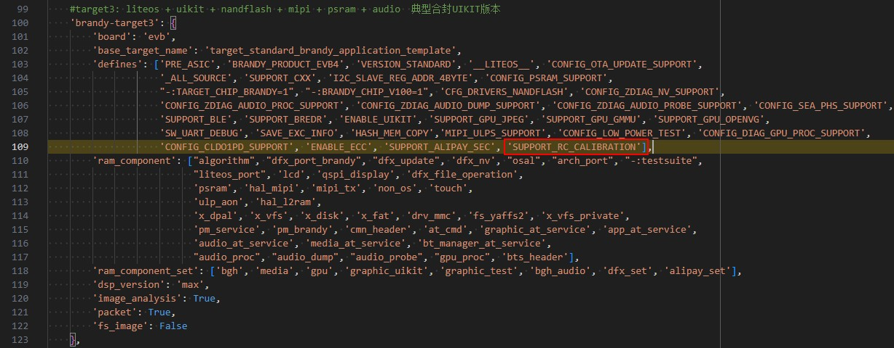

2.  如需切换回XO 32k晶体时钟源，删除上述[2](#zh-cn_topic_0000002411048160_li122819241457)添加的编译选项，重新编译即可。

#### Nor Flash部署<a name="ZH-CN_TOPIC_0000002466541832"></a>

SDK版本提供了8M和16M两种Nor Flash部署方案，若需要使用8M Nor Flash，则在对应target中声明‘CFG\_FLASH\_SPECS\_8M’；若使用16M Nor Flash，则需在对应target中声明‘CFG\_FLASH\_SPECS\_16M’，需要注意的是这两个宏互斥，不能并存。

Nor Flash的分区表可根据需要修改，约束和修改方式如下：

部分组件无法进行修改，包括分区表SSB、SSB backup、recovery、selitos组件为固定大小。

剩余组件可灵活修改，包括app、fota\_data、dfx\_data等组件调整大小和顺序。修改如下所示：

1.  参照下图路径根据所用的target选择合适的配置文件。

    **图 1**  不同的配置文件图示<a name="zh-cn_topic_0000002444647221_fig125421939151514"></a>  
    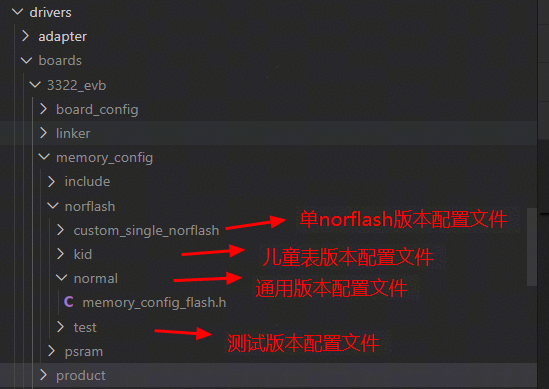

2.  修改分区表配置文件：

    **图 2**  分区表配置文件图示<a name="zh-cn_topic_0000002444647221_fig8536114141512"></a>  
    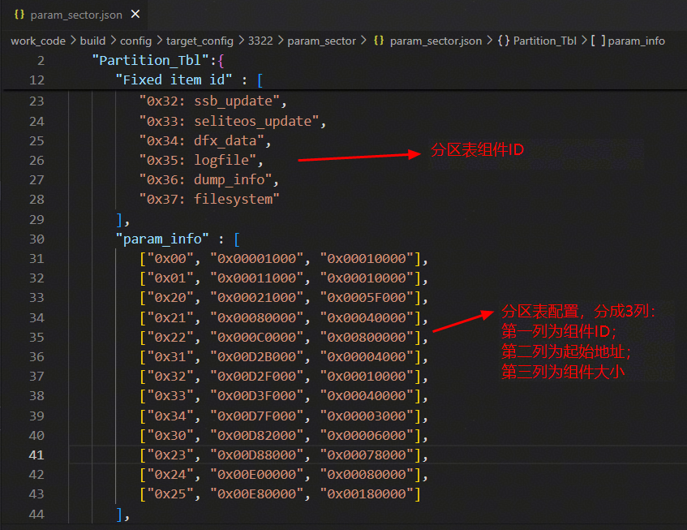

    除固定组件无法修改，其余组件按需修改，可调整顺序和大小，修改后编译脚本会自动解析生成新的分区表。

3.  修改代码中的宏控，保证代码正常运行。

    **图 3**  NORFLASH宏定义配置文件图示<a name="zh-cn_topic_0000002444647221_fig1642794314151"></a>  
    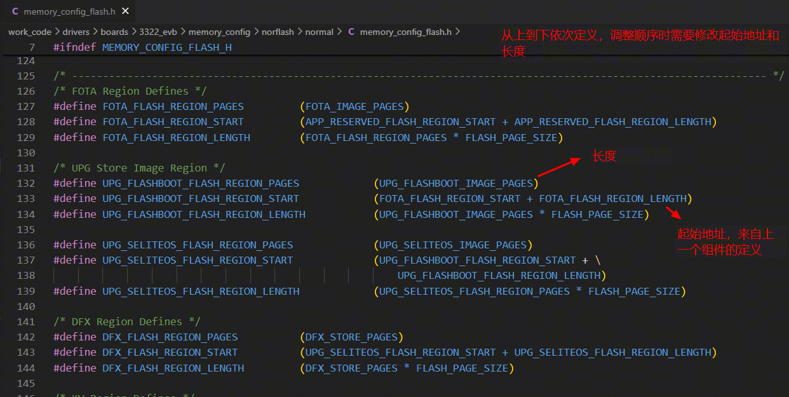

    **图 4**  分区配置组件页配置选项<a name="zh-cn_topic_0000002444647221_fig1538291914162"></a>  
    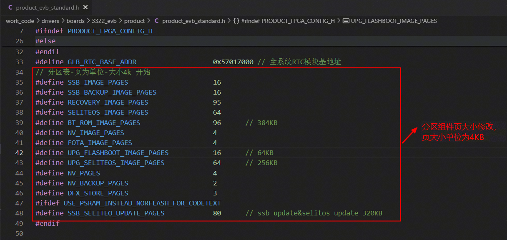

    按照上面图示修改宏定义，页单位为4KB，保证代码正常运行。

### 各组件编译描述<a name="ZH-CN_TOPIC_0000002466541848"></a>

编译target与对应二进制对应关系如[表1](#zh-cn_topic_0000002444727349_table194832014141718)所示。

**表 1**  编译target与bin文件对应关系

<a name="zh-cn_topic_0000002444727349_table194832014141718"></a>
<table><thead align="left"><tr id="zh-cn_topic_0000002444727349_row1765734833517"><th class="cellrowborder" valign="top" width="27.55%" id="mcps1.2.4.1.1"><p id="zh-cn_topic_0000002444727349_p18657144811355"><a name="zh-cn_topic_0000002444727349_p18657144811355"></a><a name="zh-cn_topic_0000002444727349_p18657144811355"></a>编译target</p>
</th>
<th class="cellrowborder" valign="top" width="28.43%" id="mcps1.2.4.1.2"><p id="zh-cn_topic_0000002444727349_p56575488358"><a name="zh-cn_topic_0000002444727349_p56575488358"></a><a name="zh-cn_topic_0000002444727349_p56575488358"></a>bin文件</p>
</th>
<th class="cellrowborder" valign="top" width="44.019999999999996%" id="mcps1.2.4.1.3"><p id="zh-cn_topic_0000002444727349_p12657174853520"><a name="zh-cn_topic_0000002444727349_p12657174853520"></a><a name="zh-cn_topic_0000002444727349_p12657174853520"></a>说明</p>
</th>
</tr>
</thead>
<tbody><tr id="zh-cn_topic_0000002444727349_row34833142173"><td class="cellrowborder" valign="top" width="27.55%" headers="mcps1.2.4.1.1 "><p id="zh-cn_topic_0000002444727349_p54831814151714"><a name="zh-cn_topic_0000002444727349_p54831814151714"></a><a name="zh-cn_topic_0000002444727349_p54831814151714"></a>3322-targetx 和 diting-community-targetx</p>
</td>
<td class="cellrowborder" valign="top" width="28.43%" headers="mcps1.2.4.1.2 "><p id="zh-cn_topic_0000002444727349_p10483121415171"><a name="zh-cn_topic_0000002444727349_p10483121415171"></a><a name="zh-cn_topic_0000002444727349_p10483121415171"></a>application.bin</p>
</td>
<td class="cellrowborder" valign="top" width="44.019999999999996%" headers="mcps1.2.4.1.3 "><p id="zh-cn_topic_0000002444727349_p1647810365177"><a name="zh-cn_topic_0000002444727349_p1647810365177"></a><a name="zh-cn_topic_0000002444727349_p1647810365177"></a>liteos系统的A核版本。</p>
</td>
</tr>
<tr id="zh-cn_topic_0000002444727349_row348341431714"><td class="cellrowborder" valign="top" width="27.55%" headers="mcps1.2.4.1.1 "><p id="zh-cn_topic_0000002444727349_p1483151415179"><a name="zh-cn_topic_0000002444727349_p1483151415179"></a><a name="zh-cn_topic_0000002444727349_p1483151415179"></a>3322-ssb</p>
</td>
<td class="cellrowborder" valign="top" width="28.43%" headers="mcps1.2.4.1.2 "><p id="zh-cn_topic_0000002444727349_p13483121411171"><a name="zh-cn_topic_0000002444727349_p13483121411171"></a><a name="zh-cn_topic_0000002444727349_p13483121411171"></a>ssb.bin</p>
</td>
<td class="cellrowborder" valign="top" width="44.019999999999996%" headers="mcps1.2.4.1.3 "><p id="zh-cn_topic_0000002444727349_p14478836161715"><a name="zh-cn_topic_0000002444727349_p14478836161715"></a><a name="zh-cn_topic_0000002444727349_p14478836161715"></a>用于启动和加载的版本。</p>
</td>
</tr>
</tbody>
</table>

### 编译结果获取<a name="ZH-CN_TOPIC_0000002466541764"></a>

对应二进制获取路径如[表1](#zh-cn_topic_0000002444727297_table356454171913)所示。

**表 1**  二进制获取路径

<a name="zh-cn_topic_0000002444727297_table356454171913"></a>
<table><thead align="left"><tr id="zh-cn_topic_0000002444727297_row1947172823512"><th class="cellrowborder" valign="top" width="47.82%" id="mcps1.2.3.1.1"><p id="zh-cn_topic_0000002444727297_p594719280357"><a name="zh-cn_topic_0000002444727297_p594719280357"></a><a name="zh-cn_topic_0000002444727297_p594719280357"></a>bin文件</p>
</th>
<th class="cellrowborder" valign="top" width="52.18000000000001%" id="mcps1.2.3.1.2"><p id="zh-cn_topic_0000002444727297_p094772820352"><a name="zh-cn_topic_0000002444727297_p094772820352"></a><a name="zh-cn_topic_0000002444727297_p094772820352"></a>路径</p>
</th>
</tr>
</thead>
<tbody><tr id="zh-cn_topic_0000002444727297_row756518411197"><td class="cellrowborder" valign="top" width="47.82%" headers="mcps1.2.3.1.1 "><p id="zh-cn_topic_0000002444727297_p556518414196"><a name="zh-cn_topic_0000002444727297_p556518414196"></a><a name="zh-cn_topic_0000002444727297_p556518414196"></a>ssb.bin（Linux环境下编译）</p>
</td>
<td class="cellrowborder" valign="top" width="52.18000000000001%" headers="mcps1.2.3.1.2 "><p id="zh-cn_topic_0000002444727297_p10565124121910"><a name="zh-cn_topic_0000002444727297_p10565124121910"></a><a name="zh-cn_topic_0000002444727297_p10565124121910"></a>src\output\3322\acore\backup3322-ssb\</p>
</td>
</tr>
<tr id="zh-cn_topic_0000002444727297_row17944194011312"><td class="cellrowborder" valign="top" width="47.82%" headers="mcps1.2.3.1.1 "><p id="zh-cn_topic_0000002444727297_p19448401834"><a name="zh-cn_topic_0000002444727297_p19448401834"></a><a name="zh-cn_topic_0000002444727297_p19448401834"></a>application.bin（Linux环境下编译）</p>
</td>
<td class="cellrowborder" valign="top" width="52.18000000000001%" headers="mcps1.2.3.1.2 "><p id="zh-cn_topic_0000002444727297_p82226322542"><a name="zh-cn_topic_0000002444727297_p82226322542"></a><a name="zh-cn_topic_0000002444727297_p82226322542"></a>src\output\3322\acore\diting-community\</p>
</td>
</tr>
<tr id="zh-cn_topic_0000002444727297_row7492122813244"><td class="cellrowborder" valign="top" width="47.82%" headers="mcps1.2.3.1.1 "><p id="zh-cn_topic_0000002444727297_p15490122813246"><a name="zh-cn_topic_0000002444727297_p15490122813246"></a><a name="zh-cn_topic_0000002444727297_p15490122813246"></a>ssb.bin（Windows环境下编译）</p>
</td>
<td class="cellrowborder" valign="top" width="52.18000000000001%" headers="mcps1.2.3.1.2 "><p id="zh-cn_topic_0000002444727297_p164908284247"><a name="zh-cn_topic_0000002444727297_p164908284247"></a><a name="zh-cn_topic_0000002444727297_p164908284247"></a>src\output\3322\acore\backup3322-ssb\</p>
</td>
</tr>
<tr id="zh-cn_topic_0000002444727297_row1949132817243"><td class="cellrowborder" valign="top" width="47.82%" headers="mcps1.2.3.1.1 "><p id="zh-cn_topic_0000002444727297_p134901228132412"><a name="zh-cn_topic_0000002444727297_p134901228132412"></a><a name="zh-cn_topic_0000002444727297_p134901228132412"></a>application.bin（Windows环境下编译）</p>
</td>
<td class="cellrowborder" valign="top" width="52.18000000000001%" headers="mcps1.2.3.1.2 "><p id="zh-cn_topic_0000002444727297_p349092814242"><a name="zh-cn_topic_0000002444727297_p349092814242"></a><a name="zh-cn_topic_0000002444727297_p349092814242"></a>src\output\3322\acore\diting-community\</p>
</td>
</tr>
</tbody>
</table>

### Bin文件描述<a name="ZH-CN_TOPIC_0000002466382160"></a>

**表 1**  bin文件说明

<a name="zh-cn_topic_0000002411208064_table787685575417"></a>
<table><thead align="left"><tr id="zh-cn_topic_0000002411208064_row193751314163516"><th class="cellrowborder" valign="top" width="33.42%" id="mcps1.2.3.1.1"><p id="zh-cn_topic_0000002411208064_p3375121416350"><a name="zh-cn_topic_0000002411208064_p3375121416350"></a><a name="zh-cn_topic_0000002411208064_p3375121416350"></a>bin文件</p>
</th>
<th class="cellrowborder" valign="top" width="66.58%" id="mcps1.2.3.1.2"><p id="zh-cn_topic_0000002411208064_p237516141350"><a name="zh-cn_topic_0000002411208064_p237516141350"></a><a name="zh-cn_topic_0000002411208064_p237516141350"></a>说明</p>
</th>
</tr>
</thead>
<tbody><tr id="zh-cn_topic_0000002411208064_row10878155515415"><td class="cellrowborder" valign="top" width="33.42%" headers="mcps1.2.3.1.1 "><p id="zh-cn_topic_0000002411208064_p1887895515547"><a name="zh-cn_topic_0000002411208064_p1887895515547"></a><a name="zh-cn_topic_0000002411208064_p1887895515547"></a>ssb_signed.bin</p>
</td>
<td class="cellrowborder" valign="top" width="66.58%" headers="mcps1.2.3.1.2 "><p id="zh-cn_topic_0000002411208064_p787855595415"><a name="zh-cn_topic_0000002411208064_p787855595415"></a><a name="zh-cn_topic_0000002411208064_p787855595415"></a>boot启动加载所需二进制文件。</p>
</td>
</tr>
<tr id="zh-cn_topic_0000002411208064_row1878455135415"><td class="cellrowborder" valign="top" width="33.42%" headers="mcps1.2.3.1.1 "><p id="zh-cn_topic_0000002411208064_p487835505418"><a name="zh-cn_topic_0000002411208064_p487835505418"></a><a name="zh-cn_topic_0000002411208064_p487835505418"></a>application.bin</p>
</td>
<td class="cellrowborder" valign="top" width="66.58%" headers="mcps1.2.3.1.2 "><p id="zh-cn_topic_0000002411208064_p687815550541"><a name="zh-cn_topic_0000002411208064_p687815550541"></a><a name="zh-cn_topic_0000002411208064_p687815550541"></a>A核系统版本二进制文件，可通过code目录SDK版本增量开发后生成。</p>
</td>
</tr>
<tr id="zh-cn_topic_0000002411208064_row387875519542"><td class="cellrowborder" valign="top" width="33.42%" headers="mcps1.2.3.1.1 "><p id="zh-cn_topic_0000002411208064_p118792055105410"><a name="zh-cn_topic_0000002411208064_p118792055105410"></a><a name="zh-cn_topic_0000002411208064_p118792055105410"></a>bt_signen.bin</p>
</td>
<td class="cellrowborder" valign="top" width="66.58%" headers="mcps1.2.3.1.2 "><p id="zh-cn_topic_0000002411208064_p387945516541"><a name="zh-cn_topic_0000002411208064_p387945516541"></a><a name="zh-cn_topic_0000002411208064_p387945516541"></a>bt核系统二进制文件，固定版本发布，不支持增量开发。</p>
</td>
</tr>
<tr id="zh-cn_topic_0000002411208064_row11879555195411"><td class="cellrowborder" valign="top" width="33.42%" headers="mcps1.2.3.1.1 "><p id="zh-cn_topic_0000002411208064_p188792551547"><a name="zh-cn_topic_0000002411208064_p188792551547"></a><a name="zh-cn_topic_0000002411208064_p188792551547"></a>dsp_main.bin/dsp_overlay.bin</p>
</td>
<td class="cellrowborder" valign="top" width="66.58%" headers="mcps1.2.3.1.2 "><p id="zh-cn_topic_0000002411208064_p118791355165416"><a name="zh-cn_topic_0000002411208064_p118791355165416"></a><a name="zh-cn_topic_0000002411208064_p118791355165416"></a>dsp核系统二进制文件，固定版本发布，不支持增量开发。</p>
</td>
</tr>
</tbody>
</table>

### target简介<a name="ZH-CN_TOPIC_0000002499501125"></a>

系统默认适配了多个target，方便用户进行开发和使用，下面对target进行简介：

-   diting-community-native-js：主要组件有liteos＋UIkit＋NandFlash＋MIPI＋psram＋Native-JS应用框架，支持Native应用和JS应用的双系统编译任务，可以快速进行上层应用开发。
-   diting-community-xts：主要组件有liteos＋UIkit＋NandFlash＋MIPI＋psram＋Native-JS应用框架+XTS测试套，用于OpenHarmony XTS认证镜像构建。
-   diting-community：主要组件有liteos＋UIkit＋NandFlash＋MIPI＋psram＋Native-JS应用框架 + gnss + cat1通话，应用diting模组，适用于蜂窝产品（成人蜂窝表/儿童表等）。

### 三方库集成编译<a name="ZH-CN_TOPIC_0000002499501173"></a>

库的引入一般是头文件+库，此处以“libsample\_b.a”为例。分为两步：

1.  在依赖三方库的组件的“CMakeLists.txt”下，添加头文件依赖，示例如下：

    假设将“sample\_b.h”放置在CMakeLists根路径下。

    

2.  在依赖三方库的组件的“CMakeLists.txt”下，添加三方库，示例如下：

    假设将“libsample\_b.a”放置在“CMakeLists.txt”根路径下：

    ```
    find_library(LIB_SAMPLE_B libsample_b.a ${CMAKE_CURRENT_SOURCE_DIR})
    target_link_libraries(${TARGET_NAME} PRIVATE -Wl,--whole-archive ${LIB_SAMPLE_B} PRIVATE -Wl,--whole-archive)
    ```

    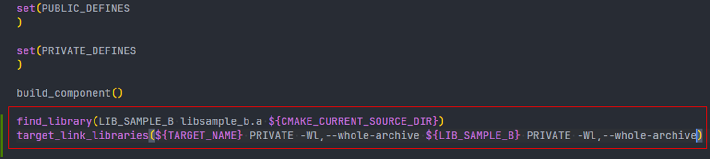

## 系统适配对接<a name="ZH-CN_TOPIC_0000002466541780"></a>

-   **[系统启动适配](#ZH-CN_TOPIC_0000002466382120)**  

### 系统启动适配<a name="ZH-CN_TOPIC_0000002466382120"></a>

系统启动适配，主要是APPLICATION的适配，本小节主要阐述APPLICATION的适配。当前APPLICATION主函数（application/3322/3322\_app\_standard/ main.c）首先完成各类初始化，然后OS开始进行任务调度，具体流程如下：

1.  Kernel init：Os kernel初始化。
2.  Chip init：初始化芯片内部IP模块。
3.  Board init：板极总线、外设初始化。
4.  Service init：服务初始化，包括DFX等。
5.  Thread init：任务初始化，初始化各个任务。
6.  osKernelStart：触发任务调度。

当前系统启动适配，首先需要修改board\_init函数，增加板极器件初始化；然后修改service\_init函数，增加对应服务初始化；最后在thread\_init中，新增相应任务即可正常运行。

## 调试环境<a name="ZH-CN_TOPIC_0000002466541748"></a>

-   **[硬件环境描述](#ZH-CN_TOPIC_0000002499581081)**  

-   **[JLink环境调试](#ZH-CN_TOPIC_0000002499501217)**  

### 硬件环境描述<a name="ZH-CN_TOPIC_0000002499581081"></a>

详情请参考《硬件用户指南》。

### JLink环境调试<a name="ZH-CN_TOPIC_0000002499501217"></a>

详情请参见《Hispark Studio for VS Code 使用指南》中“工程调试”章节。

## 烧录<a name="ZH-CN_TOPIC_0000002466541880"></a>

> **须知：** 
>由于串口时钟与波特率为非整数倍关系时，串口传输存在误差率，一旦发生传输误差将会导致烧录失败。
>因此建议烧录时请按照实际串口支持能力，将波特率设置为2M、1M、500k、250k等与串口时钟（32MHz）整数倍关系的串口波特率，防止传输误差产生。

系统版本准备就绪后，SDK提供两种烧录方式：

-   烧录工具进行烧录。

    SDK包tools目录下提供BurnTool工具，专用于版本烧录，同时支持产测阶段一拖多进行烧写。同时支持基于指令运行的烧写方式。详情请参见《BurnTool工具 使用指南》。

-   HiSpark Studio工具集成烧录。

    SDK包tools目录下提供HiSpark Studio工具包，安装后自动支持烧写功能。支持一键式编译后进行烧写。详情请参见《HiSpark Studio for VS code 使用指南》

两种方式均可独立完成烧录功能，均支持图形化界面对待烧录的二进制文件进行勾选。烧写均基于串口方式进行。

> **说明：** 
>当前版本的bt和dsp组件通过文件系统加载，需通过DebugKits将“\\src\\tools\\pkg\\bin\\3322\\bt\_signed.bin”和“\\src\\tools\\pkg\\bin\\3322\\dsp\\normal\\”下的“dsp\_main.bin”、“dsp\_overlay.bin”上传，具体加载路径为：
>dsp加载路径：/boot/dsp/dsp\_overlay.bin
>dsp加载路径：/boot/dsp/dsp\_main.bin
>bt加载路径：/boot/bt/bt\_signed.bin

-   **[烧录环境说明](#ZH-CN_TOPIC_0000002499501057)**  

-   **[烧录步骤说明](#ZH-CN_TOPIC_0000002466541696)**  

### 烧录环境说明<a name="ZH-CN_TOPIC_0000002499501057"></a>

详情请参见《BurnTool工具 使用指南》、《HiSpark Studio for VS code 使用指南》。

### 烧录步骤说明<a name="ZH-CN_TOPIC_0000002466541696"></a>

详情请参见《BurnTool工具 使用指南》、《HiSpark Studio for VS code 使用指南》。

## 代码部署<a name="ZH-CN_TOPIC_0000002499581205"></a>

基于SDK开发时，客户代码加到SDK框架进行编译，除了正确书写组件式CMake之外，还需规划客户代码存放位置。代码部署通过lD文件进行规划，以A核“/drivers/boards/3322\_evb/linker/standard/acore.prelds”为例进行说明。

客户代码的运行地址和存储地址建议放在Flash中，正则表达式的写法有两种：

-   基于.a维度，参考[图1](#zh-cn_topic_0000002444727341_fig1458663616246)中的1。
-   基于文件路径维度，参考[图1](#zh-cn_topic_0000002444727341_fig1458663616246)中的2。

**图 1**  代码示例<a name="zh-cn_topic_0000002444727341_fig1458663616246"></a>  
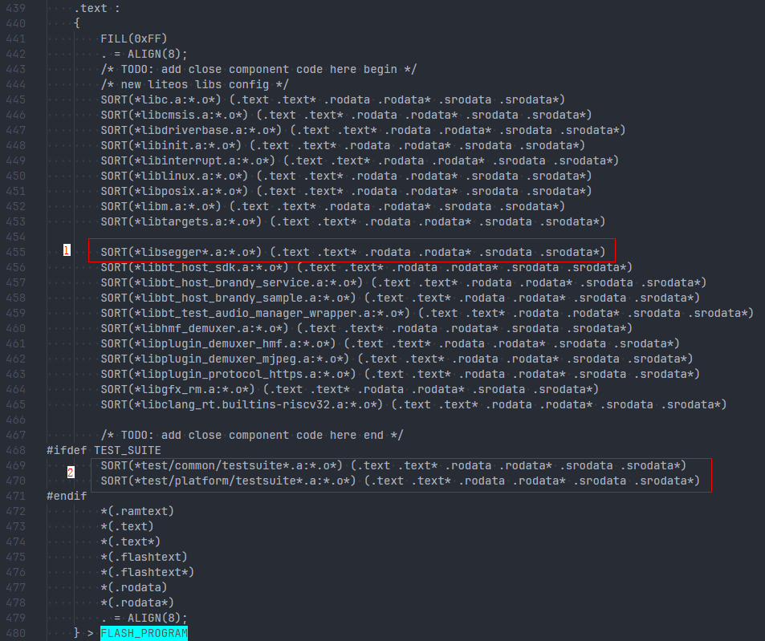

# 开发调试工具应用<a name="ZH-CN_TOPIC_0000002466541864"></a>

本次主要提供三款工具，分别用于系统调试维测、版本烧录、系统工程开发、UIKit开发。

-   DebugKits：提供日志打印解析、定制命令输入、内存导出解析等功能。
-   BurnTool：提供版本烧录功能。
-   HiSpark Studio工具：优化版本IDE，集成一键式编译、烧录，以及提供基于UIKit组件的Windows环境下模拟器功能。

-   **[工具概述](#ZH-CN_TOPIC_0000002466382088)**  

-   **[基础开发工具应用介绍](#ZH-CN_TOPIC_0000002466382068)**  

-   **[基础维测工具应用介绍](#ZH-CN_TOPIC_0000002499501141)**  

-   **[业务应用工具介绍](#ZH-CN_TOPIC_0000002499581045)**  

## 工具概述<a name="ZH-CN_TOPIC_0000002466382088"></a>

**HiSpark Studio南向IDE插件<a name="zh-cn_topic_0000002444647285_section41281311194116"></a>**

当前支持功能如下：

-   支持工程管理。
-   支持常用编辑功能。
-   集成编译烧写。
-   支持一键安装编译环境。

效果图如[图1](#zh-cn_topic_0000002444647285_fig3141175417591)所示。

**图 1**  IDE效果图<a name="zh-cn_topic_0000002444647285_fig3141175417591"></a>  
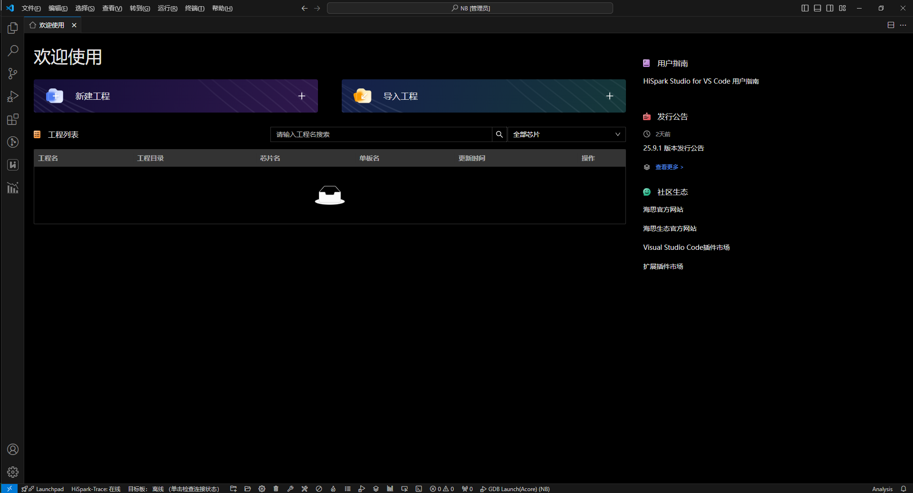

**图 2**  安装步骤<a name="zh-cn_topic_0000002444647285_fig113477147012"></a>  
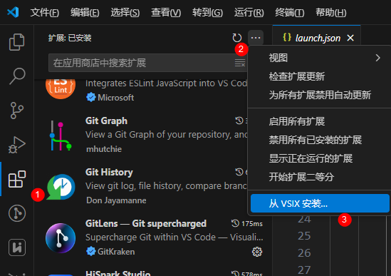

1.  打开VS Code插件市场。
2.  点击图标2所示的位置选择从VSIX安装。
3.  然后本地选择hisparkstudio-xxx.vsix安装即可，其中xxx表示对应的版本号。

**DebugKits<a name="zh-cn_topic_0000002444647285_section19521950174217"></a>**

当前支持功能如下：

-   支持日志查看。
-   支持自定义参数配置。
-   支持自定义维测命令。
-   支持多种数据导入导出。
-   支持寄存器读写。
-   支持死机分析。

效果图如[图3](#zh-cn_topic_0000002444647285_fig2114102313445)所示。

**图 3**  消息插件界面示例<a name="zh-cn_topic_0000002444647285_fig2114102313445"></a>  
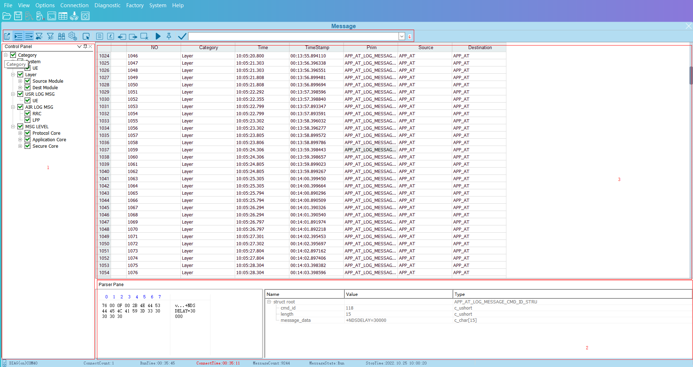

**BurnTool<a name="zh-cn_topic_0000002444647285_section107581657104417"></a>**

当前支持功能如下：

-   支持多种烧写协议（基于脚本集成）。
-   支持eFuse读写。
-   支持Flash导出。
-   支持cmd命令行烧写或者BurnTool GUI烧写。
-   支持一拖多。

效果图如[图4](#zh-cn_topic_0000002444647285_fig65961558895)所示。

**图 4**  烧写完成示意图<a name="zh-cn_topic_0000002444647285_fig65961558895"></a>  

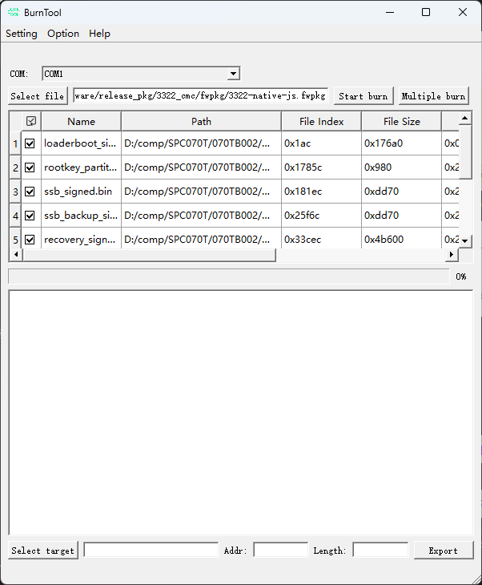

## 基础开发工具应用介绍<a name="ZH-CN_TOPIC_0000002466382068"></a>

HiDiTingV100系统解决方案SDK提供HiSpark Studio工具用于SDK增量功能开发，提供如下功能：

<a name="zh-cn_topic_0000002411208004_table11841328175819"></a>
<table><thead align="left"><tr id="zh-cn_topic_0000002411208004_row16221172845818"><th class="cellrowborder" valign="top" width="29.92%" id="mcps1.1.3.1.1"><p id="zh-cn_topic_0000002411208004_p1222111287583"><a name="zh-cn_topic_0000002411208004_p1222111287583"></a><a name="zh-cn_topic_0000002411208004_p1222111287583"></a><span>工具链</span></p>
</th>
<th class="cellrowborder" valign="top" width="70.08%" id="mcps1.1.3.1.2"><p id="zh-cn_topic_0000002411208004_p52211028155815"><a name="zh-cn_topic_0000002411208004_p52211028155815"></a><a name="zh-cn_topic_0000002411208004_p52211028155815"></a><span>当前支持功能</span></p>
</th>
</tr>
</thead>
<tbody><tr id="zh-cn_topic_0000002411208004_row1122112283588"><td class="cellrowborder" valign="top" width="29.92%" headers="mcps1.1.3.1.1 "><p id="zh-cn_topic_0000002411208004_p142211328105810"><a name="zh-cn_topic_0000002411208004_p142211328105810"></a><a name="zh-cn_topic_0000002411208004_p142211328105810"></a>HiSpark Studio</p>
</td>
<td class="cellrowborder" valign="top" width="70.08%" headers="mcps1.1.3.1.2 "><a name="zh-cn_topic_0000002411208004_ul17878721121615"></a><a name="zh-cn_topic_0000002411208004_ul17878721121615"></a><ul id="zh-cn_topic_0000002411208004_ul17878721121615"><li><span>支持工程管理</span></li><li><span>支持常用编辑功能</span></li><li><span>集成编译烧写调试</span></li><li><span>支持镜像分析、栈估算</span></li><li><span>支持常用调试功能</span></li><li><span>支持一键安装编译环境</span></li></ul>
</td>
</tr>
</tbody>
</table>

详情请参考《HiSpark Studio for VS code 使用指南》。

## 基础维测工具应用介绍<a name="ZH-CN_TOPIC_0000002499501141"></a>

HiDiTingV100系统解决方案SDK提供DebugKits工具用于基础系统维测，提供如下功能：

-   支持日志解析/查看。
-   支持自定义参数配置（需适配板端Diag模块）。
-   支持自定义维测命令（需适配板端Diag模块）。
-   支持多种系统内存数据导入导出。
-   支持板端寄存器读写。
-   支持死机分析。

详情请参考《DebugKits工具 使用指南》。

## 业务应用工具介绍<a name="ZH-CN_TOPIC_0000002499581045"></a>

业务应用当前共提供四种对应工具。

-   音频工具：提供音频源格式转换等功能。

    音频工具主要应用于多媒体业务，针对多媒体业务需要的音频资源进行对应格式转换等处理。当前此工具不单独提供，整体工具集成于DebugKits工具中交付使用。详情请参考《DebugKits工具 使用指南》。

-   图形压缩工具：提供图片资源压缩打包功能。

    图形压缩工具主要应用于UIKIT图形引擎，针对图形引擎所需要的图形资源进行压缩处理。当前此工具提供了独立脚本。详情请参考《图形工具 使用指南》。

-   UIKIT模拟器：提供基于UIKIT的图形模拟效果预览及SDK编译烧录调试功能。详情请参考《HiSpark Studio for VS Code 使用指南》。
-   可视化布局工具：提供基于控件拖曳生成对应UIKIT可识别图形代码的功能。详情请参考《HiSpark Studio for VS Code 使用指南》。

# RTT调试使用指导<a name="ZH-CN_TOPIC_0000002466382200"></a>

RTT（Real-Time Transfer）实时跟踪技术是J-Link的一个功能，它为嵌入式应用程序提供了一种快速、可靠的调试和日志记录方式。RTT允许通过J-Link直接将应用程序的信息传输到主机上进行显示或日志记录，而无需依赖UART或其他串口。

-   **[RTT源码获取](#ZH-CN_TOPIC_0000002466382216)**  

-   **[RTT模块添加](#ZH-CN_TOPIC_0000002499581225)**  

-   **[RTT Viewer设置](#ZH-CN_TOPIC_0000002499581065)**  

## RTT源码获取<a name="ZH-CN_TOPIC_0000002466382216"></a>

RTT源码在SDK中不交付，需要自行获取，如果用户已安装SEGGER的J-Link，则在“SEGGER\\JLink\\Samples\\RTT\\ SEGGER\_RTT\_V698c.zip”获取源码，需要如[图1](#zh-cn_topic_0000002444727381_fig1853814127249)所示文件即可。

**图 1**  文件列表<a name="zh-cn_topic_0000002444727381_fig1853814127249"></a>  
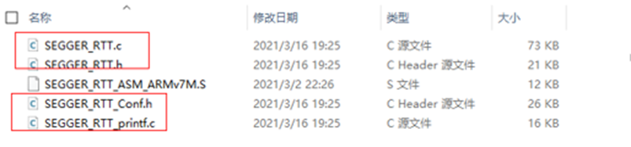

## RTT模块添加<a name="ZH-CN_TOPIC_0000002499581225"></a>

1.  <a name="zh-cn_topic_0000002444727305_li0758174414217"></a>RTT模块添加至“src\\vendor”，新增rtt目录，拷贝RTT源码，并且新增编译文件“CMakeLists.txt”。

    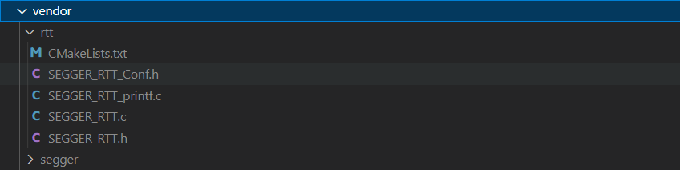

2.  在vendor目录下的“CMakeLists.txt”文件增加编译引用。

    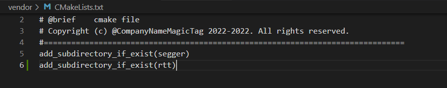

3.  编译配置文件中添加RTT模块。

    在配置文件“src\\build\\config\\target\_config\\3322\\config.py”对应target中的ram\_component中增加“rtt”实现RTT组件添加，并且修改“SW\_UART\_DEBUG”宏为“SW\_RTT\_DEBUG”完成RTT替换UART调试。

    **图 1**  APP target修改<a name="zh-cn_topic_0000002444727305_fig177591144164212"></a>  
    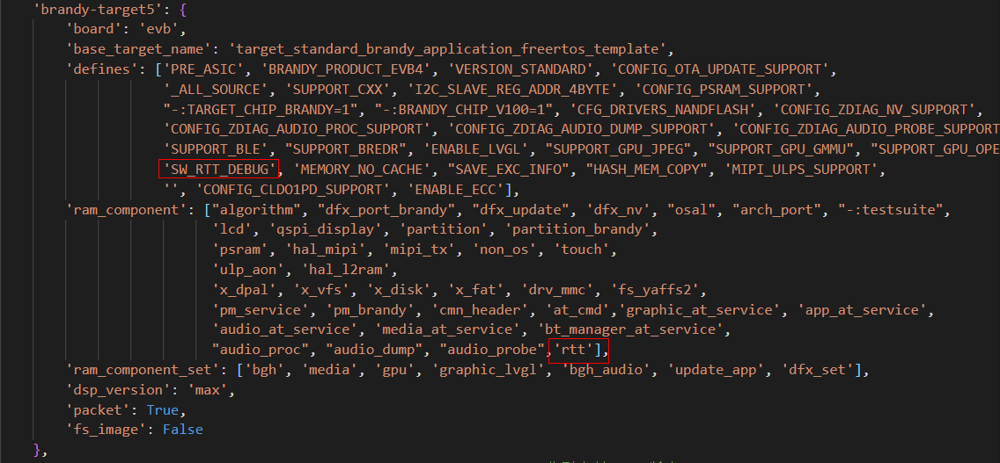

    **图 2**  SSB target修改<a name="zh-cn_topic_0000002444727305_fig8759134464219"></a>  
    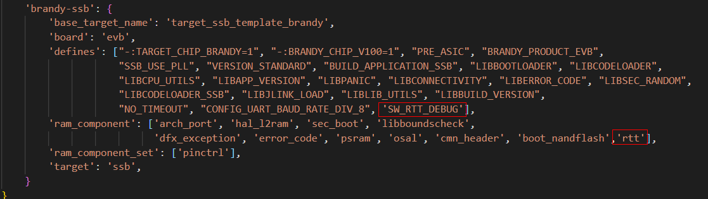

4.  在[1](#zh-cn_topic_0000002444727305_li0758174414217)新增的RTT目录新增编译文件“CMakeLists.txt”，可参考如下代码示例：

    ```
    #===============================================================================
    # @brief    cmake file
    # Copyright (c) CompanyNameMagicTag 2022-2023. All rights reserved.
    #===============================================================================
    set(COMPONENT_NAME "rtt")
    
    set(SOURCES
        ${CMAKE_CURRENT_SOURCE_DIR}/SEGGER_RTT.c
        ${CMAKE_CURRENT_SOURCE_DIR}/SEGGER_RTT_printf.c
    )
    
    set(PUBLIC_HEADER
        ${CMAKE_CURRENT_SOURCE_DIR}/
    )
    
    set(PRIVATE_HEADER
    )
    
    set(PRIVATE_DEFINES
    )
    
    set(PUBLIC_DEFINES
    )
    
    # use this when you want to add ccflags like -include xxx
    set(COMPONENT_PUBLIC_CCFLAGS
    )
    
    set(COMPONENT_CCFLAGS
    )
    
    set(WHOLE_LINK
        true
    )
    
    set(MAIN_COMPONENT
        false
    )
    
    build_component()
    ```

> **说明：** 
>RTT不支持低功耗，在使用RTT作为输入输出时，需要关闭低功耗，具体方法请参见《低功耗软件 开发指南》中的“特性配置”章节。

## RTT Viewer设置<a name="ZH-CN_TOPIC_0000002499581065"></a>

1.  RTT链接配置：

    -   Connection to J-Link：USB
    -   Specify Target Device：RISC-V
    -   Script file：customer\\tools\\DevEco\\DevTools\_CFBB\_V1.0.3\\jlink\_script\\ConnectCore1.JLinkScript
    -   RTT Control block：address 0x2006FF00

    **图 1**  RTT链接配置示意图<a name="zh-cn_topic_0000002411048168_fig5524318204412"></a>  
    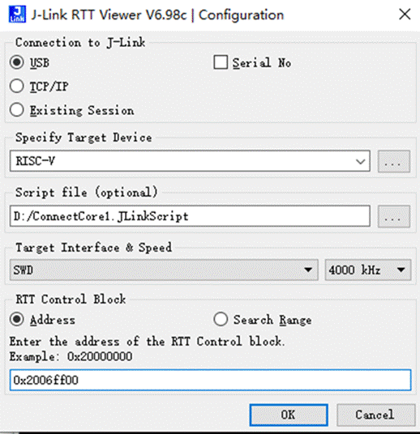

2.  版本运行后，配置RTT Viewer，日志信息会在RTT界面打印。

    **图 2**  RTT界面打印信息<a name="zh-cn_topic_0000002411048168_fig65247189440"></a>  
    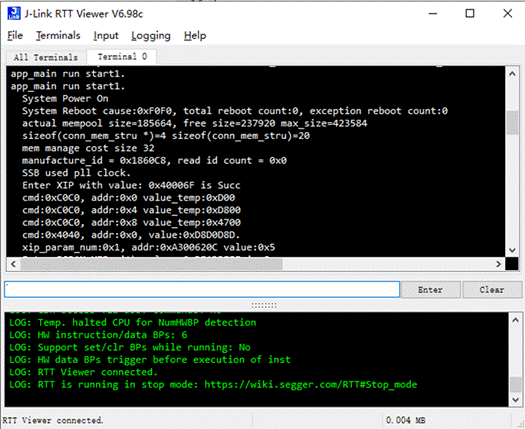

> **说明：** 
>RTT Control block地址固定设置为0x2006FF00。

