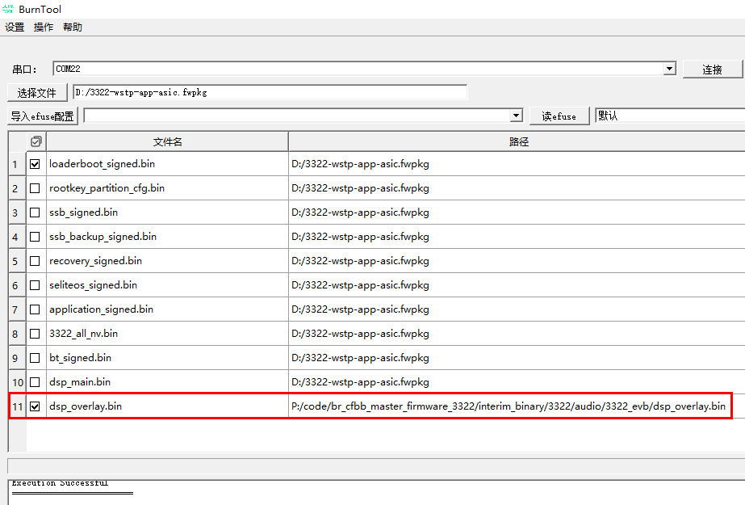

# 前言<a name="ZH-CN_TOPIC_0000002499581877"></a>

**概述<a name="zh-cn_topic_0000002444645801_section4537382116410"></a>**

本文档主要介绍音频算法集成调试相关内容，包括使用方法和注意事项，用于指导客户更换使用第三方SEA算法。

**读者对象<a name="zh-cn_topic_0000002444645801_section4378592816410"></a>**

本文档主要适用于以下工程师：

-   技术支持工程师
-   软件开发工程师

**符号约定<a name="zh-cn_topic_0000002444645801_section133020216410"></a>**

在本文中可能出现下列标志，它们所代表的含义如下。

<a name="zh-cn_topic_0000002444645801_table2622507016410"></a>
<table><thead align="left"><tr id="zh-cn_topic_0000002444645801_row1530720816410"><th class="cellrowborder" valign="top" width="20.580000000000002%" id="mcps1.1.3.1.1"><p id="zh-cn_topic_0000002444645801_p6450074116410"><a name="zh-cn_topic_0000002444645801_p6450074116410"></a><a name="zh-cn_topic_0000002444645801_p6450074116410"></a><strong id="zh-cn_topic_0000002444645801_b2136615816410"><a name="zh-cn_topic_0000002444645801_b2136615816410"></a><a name="zh-cn_topic_0000002444645801_b2136615816410"></a>符号</strong></p>
</th>
<th class="cellrowborder" valign="top" width="79.42%" id="mcps1.1.3.1.2"><p id="zh-cn_topic_0000002444645801_p5435366816410"><a name="zh-cn_topic_0000002444645801_p5435366816410"></a><a name="zh-cn_topic_0000002444645801_p5435366816410"></a><strong id="zh-cn_topic_0000002444645801_b5941558116410"><a name="zh-cn_topic_0000002444645801_b5941558116410"></a><a name="zh-cn_topic_0000002444645801_b5941558116410"></a>说明</strong></p>
</th>
</tr>
</thead>
<tbody><tr id="zh-cn_topic_0000002444645801_row1372280416410"><td class="cellrowborder" valign="top" width="20.580000000000002%" headers="mcps1.1.3.1.1 "><p id="zh-cn_topic_0000002444645801_p3734547016410"><a name="zh-cn_topic_0000002444645801_p3734547016410"></a><a name="zh-cn_topic_0000002444645801_p3734547016410"></a><a name="zh-cn_topic_0000002444645801_image2670064316410"></a><a name="zh-cn_topic_0000002444645801_image2670064316410"></a><span></span></p>
</td>
<td class="cellrowborder" valign="top" width="79.42%" headers="mcps1.1.3.1.2 "><p id="zh-cn_topic_0000002444645801_p1757432116410"><a name="zh-cn_topic_0000002444645801_p1757432116410"></a><a name="zh-cn_topic_0000002444645801_p1757432116410"></a>表示如不避免则将会导致死亡或严重伤害的具有高等级风险的危害。</p>
</td>
</tr>
<tr id="zh-cn_topic_0000002444645801_row466863216410"><td class="cellrowborder" valign="top" width="20.580000000000002%" headers="mcps1.1.3.1.1 "><p id="zh-cn_topic_0000002444645801_p1432579516410"><a name="zh-cn_topic_0000002444645801_p1432579516410"></a><a name="zh-cn_topic_0000002444645801_p1432579516410"></a><a name="zh-cn_topic_0000002444645801_image4895582316410"></a><a name="zh-cn_topic_0000002444645801_image4895582316410"></a><span></span></p>
</td>
<td class="cellrowborder" valign="top" width="79.42%" headers="mcps1.1.3.1.2 "><p id="zh-cn_topic_0000002444645801_p959197916410"><a name="zh-cn_topic_0000002444645801_p959197916410"></a><a name="zh-cn_topic_0000002444645801_p959197916410"></a>表示如不避免则可能导致死亡或严重伤害的具有中等级风险的危害。</p>
</td>
</tr>
<tr id="zh-cn_topic_0000002444645801_row123863216410"><td class="cellrowborder" valign="top" width="20.580000000000002%" headers="mcps1.1.3.1.1 "><p id="zh-cn_topic_0000002444645801_p1232579516410"><a name="zh-cn_topic_0000002444645801_p1232579516410"></a><a name="zh-cn_topic_0000002444645801_p1232579516410"></a><a name="zh-cn_topic_0000002444645801_image1235582316410"></a><a name="zh-cn_topic_0000002444645801_image1235582316410"></a><span></span></p>
</td>
<td class="cellrowborder" valign="top" width="79.42%" headers="mcps1.1.3.1.2 "><p id="zh-cn_topic_0000002444645801_p123197916410"><a name="zh-cn_topic_0000002444645801_p123197916410"></a><a name="zh-cn_topic_0000002444645801_p123197916410"></a>表示如不避免则可能导致轻微或中度伤害的具有低等级风险的危害。</p>
</td>
</tr>
<tr id="zh-cn_topic_0000002444645801_row5786682116410"><td class="cellrowborder" valign="top" width="20.580000000000002%" headers="mcps1.1.3.1.1 "><p id="zh-cn_topic_0000002444645801_p2204984716410"><a name="zh-cn_topic_0000002444645801_p2204984716410"></a><a name="zh-cn_topic_0000002444645801_p2204984716410"></a><a name="zh-cn_topic_0000002444645801_image4504446716410"></a><a name="zh-cn_topic_0000002444645801_image4504446716410"></a><span></span></p>
</td>
<td class="cellrowborder" valign="top" width="79.42%" headers="mcps1.1.3.1.2 "><p id="zh-cn_topic_0000002444645801_p4388861916410"><a name="zh-cn_topic_0000002444645801_p4388861916410"></a><a name="zh-cn_topic_0000002444645801_p4388861916410"></a>用于传递设备或环境安全警示信息。如不避免则可能会导致设备损坏、数据丢失、设备性能降低或其它不可预知的结果。</p>
<p id="zh-cn_topic_0000002444645801_p1238861916410"><a name="zh-cn_topic_0000002444645801_p1238861916410"></a><a name="zh-cn_topic_0000002444645801_p1238861916410"></a>“须知”不涉及人身伤害。</p>
</td>
</tr>
<tr id="zh-cn_topic_0000002444645801_row2856923116410"><td class="cellrowborder" valign="top" width="20.580000000000002%" headers="mcps1.1.3.1.1 "><p id="zh-cn_topic_0000002444645801_p5555360116410"><a name="zh-cn_topic_0000002444645801_p5555360116410"></a><a name="zh-cn_topic_0000002444645801_p5555360116410"></a><a name="zh-cn_topic_0000002444645801_image799324016410"></a><a name="zh-cn_topic_0000002444645801_image799324016410"></a><span></span></p>
</td>
<td class="cellrowborder" valign="top" width="79.42%" headers="mcps1.1.3.1.2 "><p id="zh-cn_topic_0000002444645801_p4612588116410"><a name="zh-cn_topic_0000002444645801_p4612588116410"></a><a name="zh-cn_topic_0000002444645801_p4612588116410"></a>对正文中重点信息的补充说明。</p>
<p id="zh-cn_topic_0000002444645801_p1232588116410"><a name="zh-cn_topic_0000002444645801_p1232588116410"></a><a name="zh-cn_topic_0000002444645801_p1232588116410"></a>“说明”不是安全警示信息，不涉及人身、设备及环境伤害信息。</p>
</td>
</tr>
</tbody>
</table>

# 概述<a name="ZH-CN_TOPIC_0000002499581889"></a>

本文档主要介绍音频算法集成相关内容，重点介绍了创建算法集成工程、开发算法插件、加载和运行算法等。可集成到SAP（Smart Audio Platform）系统中的音频算法分别为SEA算法和AEF算法：

-   SEA（Speech Enhancement and AI）算法是指语音增强及语音AI算法。
-   AEF（Affect or Post process）算法是指音效算法或音频后处理算法。详情请参见《AEF overlay 开发指南》。

# 算法集成开发包<a name="ZH-CN_TOPIC_0000002499501833"></a>

-   **[集成开发包说明](#ZH-CN_TOPIC_0000002466382892)**  

-   **[开发环境配置](#ZH-CN_TOPIC_0000002499581873)**  

-   **[增加或删除C库函数](#ZH-CN_TOPIC_0000002499501813)**  

-   **[Sample插件介绍](#ZH-CN_TOPIC_0000002466542520)**  

-   **[编译命令](#ZH-CN_TOPIC_0000002499501821)**  

## 集成开发包说明<a name="ZH-CN_TOPIC_0000002466382892"></a>

集成开发包所在路径：工程根目录/application/audio/sample\_dsp\_overlay/sea

-   **[build目录](#ZH-CN_TOPIC_0000002499501837)**  

-   **[include目录](#ZH-CN_TOPIC_0000002466542508)**  

-   **[overlay目录](#ZH-CN_TOPIC_0000002466542500)**  

-   **[component目录](#ZH-CN_TOPIC_0000002466542512)**  

### build目录<a name="ZH-CN_TOPIC_0000002499501837"></a>

build目录：

-   xtensa子目录存放DSP相关的配置文件和编译脚本，建议只引用不修改。
    -   hifi\_rules.mak：配置编译规则、overlay打包规则和依赖关系。
    -   hifi\_lsp.mak：配置overlay打包规则，被hifi\_rules.mak调用。
    -   xtensa\_cfg.mak：配置HiFi工具链和overlay打包工具。

-   xtensa/arch目录：各个overlay的memmap配置。
-   xtensa/tool目录：overlay打包工具。

### include目录<a name="ZH-CN_TOPIC_0000002466542508"></a>

include目录：

-   公共头文件，建议在插件源文件中包含。

-   td\_type.h：C语言变量类型重定义。
-   audio\_alg.h：通用算法适配接口头文件。

-   SEA插件头文件，必须在插件源文件中包含。

-   audio\_sea.h：SEA算法适配接口头文件。

### overlay目录<a name="ZH-CN_TOPIC_0000002466542500"></a>

overlay目录：

-   component头文件，必须在插件源文件中包含。

    component.h：通用算法插件注册接口，通过define\_component接口将插件entry地址注册到.component内存段中。

-   core\_overlay模块作为插件统一入口和C库依赖，被编译到各个算法插件的bin文件中。

    core\_overlay.c：重定向C库函数到相应的钩子函数，以及将overlay引导地址.start指向可访问.component内存的接口。

### component目录<a name="ZH-CN_TOPIC_0000002466542512"></a>

component目录：

-   sea/plugins子目录：SEA算法插件工程目录。
    -   sea\_lib0：SEA算法插件示例工程，开发者可参考该工程创建新的SEA算法插件工程。

## 开发环境配置<a name="ZH-CN_TOPIC_0000002499581873"></a>

-   **[工程路径配置](#ZH-CN_TOPIC_0000002466382876)**  

-   **[特性宏配置](#ZH-CN_TOPIC_0000002466542488)**  

-   **[Xtensa编译工具链配置](#ZH-CN_TOPIC_0000002466542492)**  

### 工程路径配置<a name="ZH-CN_TOPIC_0000002466382876"></a>

> **须知：** 
>工程根目录中请不要出现空格。

sap\_idp.mak路径：工程根目录/application/audio/sample\_dsp\_overlay/sea/sap\_idp.mak

修改sap\_idp.mak：

-   IDP\_OUT\_DIR：编译输出目录，可修改到开发者自定义目录，建议使用默认目录。

### 特性宏配置<a name="ZH-CN_TOPIC_0000002466542488"></a>

sap\_idp.mak路径：工程根目录/application/audio/sample\_dsp\_overlay/sea/sap\_idp.mak

修改sap\_idp.mak：

-   CFG\_SAP\_SEA\_LIB0\_SUPPORT：关闭该宏将不编译示例插件到overlay镜像中。
-   SAP\_SEA\_LIB0\_SUPPORT：“CFG\_SAP\_SEA\_LIB0\_SUPPORT”打开时，自动打开。
-   开发者开发新的SEA 插件集成SEA算法，应增加相应的宏开关，宏命名格式如下：

    ```
    CFG_SAP_SEA_XXX_SUPPORT=y
    ifeq ($(CFG_SAP_SEA_XXX_SUPPORT), y)
        SAP_FEATURE_CONFIGS += -DSAP_SEA_XXX_SUPPORT
    endif
    ```

### Xtensa编译工具链配置<a name="ZH-CN_TOPIC_0000002466542492"></a>

修改build/xtensa/xtensa\_cfg.mak：

-   XTENSA\_HOME：配置HiFi编译工具链安装路径。
-   XTENSAD\_LICENSE\_FILE：配置HiFi工具链XTENSA License文件。

## 增加或删除C库函数<a name="ZH-CN_TOPIC_0000002499501813"></a>

> **说明：** 
>如果主镜像未注册相应的C库函数到该新增的“overlay\_func-\>func”函数指针，会导致overlay新增C库函数钩子。开发者可自行实现C库函数，或是知会主镜像发布者发布新的镜像将相应的C库函数注册到“over\_func-\>func”函数指针。

修改集成开发包的overlay目录下的“core\_overlay.h”文件和“core\_overlay.c”文件：

```
/* 在core_overlay.h的overlay_func结构体中，新增一个C库同名函数类型定义 */
typedef struct {
    int (*func)(void);
} overlay_func;
/* 在core_overlay.c源码中，新增一个C库同名函数实现，重定向到主镜像的钩子上 */
int func(void)
{
    return g_overlay_func->func();
}
```

## Sample插件介绍<a name="ZH-CN_TOPIC_0000002466542520"></a>

-   **[插件目录结构](#ZH-CN_TOPIC_0000002466542496)**  

-   **[插件编译脚本配置](#ZH-CN_TOPIC_0000002466382880)**  

### 插件目录结构<a name="ZH-CN_TOPIC_0000002466542496"></a>

component/sea/plugins/sea\_lib0工程目录结构：

-   sea\_lib0/include目录：放置待集成SEA算法的头文件。
-   sea\_lib0/lib目录：放置待集成SEA算法的依赖库文件。
-   sea\_lib0/src目录：放置待集成SEA算法的源码文件。
-   sea\_lib0/xasea\_lib0\_comp.c源文件：将待集成的SEA算法集成到SEA插件中。

### 插件编译脚本配置<a name="ZH-CN_TOPIC_0000002466382880"></a>

-   在“sap\_idp.mak”配置文件中，定义相应的宏开关：

    ```
    CFG_SAP_SEA_LIB0_SUPPORT=y
    ifeq ($(CFG_SAP_SEA_LIB0_SUPPORT), y)
        SAP_FEATURE_CONFIGS += -DSAP_SEA_LIB0_SUPPORT
    endif
    ```

-   在component/sea/plugins/Makefile编译脚本中，增加新增的SEA插件目录：

    ```
    #=========================================================================
    sea_libx_$(CFG_SAP_SEA_LIB0_SUPPORT) += sea_lib0
    #=========================================================================
    ```

-   component/sea/plugins/sea\_lib0/Makefile编译脚本内容如下：

    ```
    CUR_DIR := $(shell if [ "$$PWD" != "" ]; then echo $$PWD; else pwd; fi)
    # 从当前目录回退到集成开发包所在路径
    SAP_CORE_DIR := $(realpath $(CUR_DIR)/../../../..)
    # 包含集成开发包编译环境配置和编译工具链配置文件
    include $(SAP_CORE_DIR)/sap_idp.mak
    include $(XTENSA_BUILD_DIR)/xtensa_cfg.mak
    # 编译待集成的SEA算法源码成静态库 lib_sea_lib0.a
    ifdef BUILD_LIB
    TARGET := libsea_lib0_$(CFG_SAP_DSP_ARCH)
    CFLAGS_EXT :=
    INCLUDES := -Iinclude -I$(SAP_CORE_DIR)/include
    LIB_INSTALL_DIR := lib
    /* 只编译待集成SEA算法的源文件 */
    SRCFILE := $(wildcard src/*.c)
    # 编译待集成的SEA算法插件，并链接算法静态库lib_sea_lib0.a 到 sea_lib0.bin中
    else
    # TARGET命名规则：当前只有4个名字(sea_lib0/ sea_lib1/ sea_lib2/ sea_lib3) 可用，
    # 分别对应soc_uapi_sea.h接口中的UAPI_SEA_LIB_EXT0~3。
    TARGET := sea_lib0
    CFLAGS_EXT :=
    INCLUDES := -Iinclude -I$(SAP_CORE_DIR)/include
    # 链接待集成SEA算法的静态库 lib_sea_libx.a，如还依赖其他静态库也链接进来。
    LIBS := -l:lib/libsea_lib0_$(CFG_SAP_DSP_ARCH).a
    # 只编译待集成SEA算法的插件适配源文件
    SRCFILE := xasea_lib0_comp.c
    endif
    # 包含编译规则和打包规则配置文件
    include ../rules.mak
    ```

## 编译命令<a name="ZH-CN_TOPIC_0000002499501821"></a>

在算法集成开发包所在路径下，执行以下命令：

1.  清除编译结果：make clean
2.  编译待集成算法静态库：make lib
3.  编译算法插件bin文件：make all

    > **须知：** 
    >按照当前代码，编译“make all”会出现编译报错，所以需要在执行“make all”前进行以下修改：
    >1.  在工程目录“/application/audio/sample\_dsp\_overlay/sea/build/xstensa/xtensa\_cfg.mak”中添加“export XTENSA\_LSP\_FILE=lsp\_sea”。
    >2.  在工程目录“/application/audio/sample\_dsp\_overlay/sea/build/xstensa/”中将Makefile文件中的socmn2替换为3322。

# 创建算法工程<a name="ZH-CN_TOPIC_0000002466382900"></a>

-   **[创建SEA插件工程](#ZH-CN_TOPIC_0000002466382904)**  

-   **[创建AEF插件工程](#ZH-CN_TOPIC_0000002499581865)**  

## 创建SEA插件工程<a name="ZH-CN_TOPIC_0000002466382904"></a>

-   **[SEA插件工程命名要求](#ZH-CN_TOPIC_0000002466382884)**  

-   **[新建SEA插件工程目录](#ZH-CN_TOPIC_0000002466382872)**  

-   **[新增SEA算法特性宏开关](#ZH-CN_TOPIC_0000002499501825)**  

-   **[SEA插件编译脚本](#ZH-CN_TOPIC_0000002499581881)**  

### SEA插件工程命名要求<a name="ZH-CN_TOPIC_0000002466382884"></a>

-   SEA算法插件镜像bin文件命名要求：

    当前只有4个名字可用：sea\_lib0、sea\_lib1、sea\_lib2、sea\_lib3。对应“soc\_uapi\_sea.h”中定义的SEA LIB ID：UAPI\_SEA\_LIB\_EXT0、UAPI\_SEA\_LIB\_EXT1、UAPI\_SEA\_LIB\_EXT2、UAPI\_SEA\_LIB\_EXT3。若使用其他命名会导致插件无法通过uapi\_sea\_load\_engine接口加载。

-   SEA插件工程命名建议与插件镜像bin文件名一致。

### 新建SEA插件工程目录<a name="ZH-CN_TOPIC_0000002466382872"></a>

新建工程sea\_lib1到component/sea/plugins目录下，工程目录结构如下：

-   sea\_lib1/include目录：放置待集成SEA算法的头文件。
-   sea\_lib1/lib目录：放置待集成SEA算法的依赖库文件。
-   sea\_lib1/src目录：放置待集成SEA算法的源码文件。
-   sea\_lib1/xasea\_lib1\_comp.c源文件：将待集成的SEA算法集成到SEA插件中。

### 新增SEA算法特性宏开关<a name="ZH-CN_TOPIC_0000002499501825"></a>

在“sap\_idp.mak”配置文件中，定义相应的宏开关：

```
CFG_SAP_SEA_LIB1_SUPPORT=y
ifeq ($(CFG_SAP_SEA_LIB1_SUPPORT), y)
    SAP_FEATURE_CONFIGS += -DSAP_SEA_LIB1_SUPPORT
endif
```

### SEA插件编译脚本<a name="ZH-CN_TOPIC_0000002499581881"></a>

-   在component/sea/plugins/Make编译脚本中，增加新增的SEA插件目录：

    ```
    sea_libx_$(CFG_SAP_SEA_LIB1_SUPPORT) += sea_lib1
    ```

-   component/sea/plugins/sea\_lib1/Makefile编译脚本内容如下：

    ```
    CUR_DIR := $(shell if [ "$$PWD" != "" ]; then echo $$PWD; else pwd; fi)
    SAP_CORE_DIR := $(realpath $(CUR_DIR)/../../../..)
    include $(SAP_CORE_DIR)/sap_idp.mak
    include $(XTENSA_BUILD_DIR)/xtensa_cfg.mak
    ifdef BUILD_LIB
    TARGET := libsea_lib1_$(CFG_SAP_DSP_ARCH)
    CFLAGS_EXT :=
    INCLUDES := -Iinclude -I$(SAP_CORE_DIR)/include
    LIB_INSTALL_DIR := lib
    SRCFILE := $(wildcard src/*.c)
    TARGET := sea_lib1
    CFLAGS_EXT :=
    INCLUDES := -Iinclude -I$(SAP_CORE_DIR)/include
    LIBS := -l:lib/libsea_lib1_$(CFG_SAP_DSP_ARCH).a
    SRCFILE := xasea_lib1_comp.c
    endif
    
    include ../rules.mak
    ```

## 创建AEF插件工程<a name="ZH-CN_TOPIC_0000002499581865"></a>

详细内容请参见《AEF overlay 开发指南》。

# 开发算法插件<a name="ZH-CN_TOPIC_0000002499581885"></a>

-   **[SEA算法插件](#ZH-CN_TOPIC_0000002499581861)**  

-   **[AEF算法插件](#ZH-CN_TOPIC_0000002499581869)**  

## SEA算法插件<a name="ZH-CN_TOPIC_0000002499581861"></a>

-   **[SEA插件接口说明](#ZH-CN_TOPIC_0000002466542504)**  

-   **[SEA插件适配样例](#ZH-CN_TOPIC_0000002499581857)**  

-   **[SEA插件注册方法](#ZH-CN_TOPIC_0000002499501817)**  

### SEA插件接口说明<a name="ZH-CN_TOPIC_0000002466542504"></a>

SEA插件接口说明如下：

-   audio\_sea.h定义结构体aal\_sea\_entry成员变量（即SEA插件属性）：
    -   name：字符串，算法库名称。
    -   sea\_id：SEA插件ID，参考sea\_struct.h中定义的枚举类型sea\_lib\_id（注意：开发者自定义算法只能使用4个ID，即SEA\_LIB\_ID\_EXT0～SEA\_LIB\_ID\_EXT3）。
    -   version：算法版本号，详细定义参考audio\_lib\_version。
    -   description：字符串，描述算法简介及开发者名称等。

-   audio\_sea.h定义结构体aal\_sea\_entry成员接口（即SEA插件适配接口）：
    -   get\_eng\_caps：输出算法能力集合，至少输出一个能力配置。（必备接口）
    -   get\_def\_pcm\_attr：输出算法的默认PCM属性。（必备接口）
    -   create：创建算法实例并输出唯一的实例句柄给SEA模块。（必备接口）
    -   destroy：销毁实例句柄对应的算法实例，并释放相关资源。（必备接口）
    -   proc\_frame：执行实例句柄对应的算法实例来处理输入的PCM数据，通过reg\_data\_output接口注册的数据输出回调接口将处理后的数据输出给调用者，通过reg\_event\_report接口注册的事件上报回调接口将处理后的结果上报给调用者。（必备接口）
    -   set\_enable：使能或停止实例句柄对应的算法实例。（可选接口）
    -   set\_scr\_buf：设置系统分配给算法实例使用的Scratch Buffer（多实例共用的临时缓存，仅在算法实例的运算周期内有效，不可用于缓存运算周期之外的数据）。（必备接口）
    -   get\_eng\_attr：获取实例句柄对应的算法实例的属性，未实现时可以直接返回不支持。（可选接口）
    -   set\_eng\_attr：设置实例句柄对应的算法实例的属性，未实现时可以直接返回不支持。（可选接口）
    -   set\_input\_attr：设置实例句柄对应的算法实例处理前的PCM数据格式，至少支持一种格式设置。（可选接口）
    -   set\_output\_attr：设置实例句柄对应的算法实例处理后的PCM数据格式，至少支持一种格式设置。（可选接口）
    -   get\_item\_sets：获取实例句柄对应的算法实例所支持的条目列表（如命令词列表或VoiceID列表），命令词算法或声纹识别算法必选，其他算法可选。（可选接口）
    -   reg\_data\_output：注册数据输出回调函数指针给实例句柄对应的算法实例。（必备接口）
    -   reg\_event\_report：注册事件上报回调函数指针给实例句柄对应的算法实例。（必备接口）

-   SEA算法能力集合配置项如[表1](#zh-cn_topic_0000002411046668__table1854619302533)所示（最大可配置1个语音增强选项和3个语音AI选项）。

    **表 1**  SEA能力集合配置项

    <a name="zh-cn_topic_0000002411046668__table1854619302533"></a>
    <table><thead align="left"><tr id="zh-cn_topic_0000002411046668_row535mcpsimp"><th class="cellrowborder" valign="top" width="25%" id="mcps1.2.4.1.1"><p id="zh-cn_topic_0000002411046668_p537mcpsimp"><a name="zh-cn_topic_0000002411046668_p537mcpsimp"></a><a name="zh-cn_topic_0000002411046668_p537mcpsimp"></a>配置项</p>
    </th>
    <th class="cellrowborder" valign="top" width="11%" id="mcps1.2.4.1.2"><p id="zh-cn_topic_0000002411046668_p539mcpsimp"><a name="zh-cn_topic_0000002411046668_p539mcpsimp"></a><a name="zh-cn_topic_0000002411046668_p539mcpsimp"></a>默认值</p>
    </th>
    <th class="cellrowborder" valign="top" width="64%" id="mcps1.2.4.1.3"><p id="zh-cn_topic_0000002411046668_p541mcpsimp"><a name="zh-cn_topic_0000002411046668_p541mcpsimp"></a><a name="zh-cn_topic_0000002411046668_p541mcpsimp"></a>说明</p>
    </th>
    </tr>
    </thead>
    <tbody><tr id="zh-cn_topic_0000002411046668_row543mcpsimp"><td class="cellrowborder" valign="top" width="25%" headers="mcps1.2.4.1.1 "><p id="zh-cn_topic_0000002411046668_p545mcpsimp"><a name="zh-cn_topic_0000002411046668_p545mcpsimp"></a><a name="zh-cn_topic_0000002411046668_p545mcpsimp"></a>sea_eng_sel. eng_ind [SEA_ECH_AFE_IND].type</p>
    </td>
    <td class="cellrowborder" valign="top" width="11%" headers="mcps1.2.4.1.2 "><p id="zh-cn_topic_0000002411046668_p547mcpsimp"><a name="zh-cn_topic_0000002411046668_p547mcpsimp"></a><a name="zh-cn_topic_0000002411046668_p547mcpsimp"></a>无</p>
    </td>
    <td class="cellrowborder" valign="top" width="64%" headers="mcps1.2.4.1.3 "><p id="zh-cn_topic_0000002411046668_p549mcpsimp"><a name="zh-cn_topic_0000002411046668_p549mcpsimp"></a><a name="zh-cn_topic_0000002411046668_p549mcpsimp"></a>参考sea_struct.h中定义的枚举类型sea_afe_type及其注释。</p>
    <p id="zh-cn_topic_0000002411046668_p550mcpsimp"><a name="zh-cn_topic_0000002411046668_p550mcpsimp"></a><a name="zh-cn_topic_0000002411046668_p550mcpsimp"></a>必须匹配算法特性。</p>
    </td>
    </tr>
    <tr id="zh-cn_topic_0000002411046668_row551mcpsimp"><td class="cellrowborder" valign="top" width="25%" headers="mcps1.2.4.1.1 "><p id="zh-cn_topic_0000002411046668_p553mcpsimp"><a name="zh-cn_topic_0000002411046668_p553mcpsimp"></a><a name="zh-cn_topic_0000002411046668_p553mcpsimp"></a>sea_eng_sel. eng_ind [SEA_ECH_AFE_IND].type.lib_id</p>
    </td>
    <td class="cellrowborder" valign="top" width="11%" headers="mcps1.2.4.1.2 "><p id="zh-cn_topic_0000002411046668_p555mcpsimp"><a name="zh-cn_topic_0000002411046668_p555mcpsimp"></a><a name="zh-cn_topic_0000002411046668_p555mcpsimp"></a>无</p>
    </td>
    <td class="cellrowborder" valign="top" width="64%" headers="mcps1.2.4.1.3 "><p id="zh-cn_topic_0000002411046668_p557mcpsimp"><a name="zh-cn_topic_0000002411046668_p557mcpsimp"></a><a name="zh-cn_topic_0000002411046668_p557mcpsimp"></a>参考sea_struct.h中定义的枚举类型sea_lib_id及其注释。</p>
    <p id="zh-cn_topic_0000002411046668_p558mcpsimp"><a name="zh-cn_topic_0000002411046668_p558mcpsimp"></a><a name="zh-cn_topic_0000002411046668_p558mcpsimp"></a>开发者自定义算法只能使用SEA_LIB_ID_EXT0～SEA_LIB_ID_EXT3。</p>
    </td>
    </tr>
    <tr id="zh-cn_topic_0000002411046668_row560mcpsimp"><td class="cellrowborder" valign="top" width="25%" headers="mcps1.2.4.1.1 "><p id="zh-cn_topic_0000002411046668_p562mcpsimp"><a name="zh-cn_topic_0000002411046668_p562mcpsimp"></a><a name="zh-cn_topic_0000002411046668_p562mcpsimp"></a>sea_eng_sel. eng_ind [SEA_ECH_AAI_IND].type</p>
    </td>
    <td class="cellrowborder" valign="top" width="11%" headers="mcps1.2.4.1.2 "><p id="zh-cn_topic_0000002411046668_p564mcpsimp"><a name="zh-cn_topic_0000002411046668_p564mcpsimp"></a><a name="zh-cn_topic_0000002411046668_p564mcpsimp"></a>无</p>
    </td>
    <td class="cellrowborder" valign="top" width="64%" headers="mcps1.2.4.1.3 "><p id="zh-cn_topic_0000002411046668_p566mcpsimp"><a name="zh-cn_topic_0000002411046668_p566mcpsimp"></a><a name="zh-cn_topic_0000002411046668_p566mcpsimp"></a>参考sea_struct.h中定义的枚举类型sea_aai_type及其注释。</p>
    <p id="zh-cn_topic_0000002411046668_p567mcpsimp"><a name="zh-cn_topic_0000002411046668_p567mcpsimp"></a><a name="zh-cn_topic_0000002411046668_p567mcpsimp"></a>必须匹配算法特性。</p>
    </td>
    </tr>
    <tr id="zh-cn_topic_0000002411046668_row568mcpsimp"><td class="cellrowborder" valign="top" width="25%" headers="mcps1.2.4.1.1 "><p id="zh-cn_topic_0000002411046668_p570mcpsimp"><a name="zh-cn_topic_0000002411046668_p570mcpsimp"></a><a name="zh-cn_topic_0000002411046668_p570mcpsimp"></a>sea_eng_sel. eng_ind [SEA_ECH_AAI_IND].type.lib_id</p>
    </td>
    <td class="cellrowborder" valign="top" width="11%" headers="mcps1.2.4.1.2 "><p id="zh-cn_topic_0000002411046668_p572mcpsimp"><a name="zh-cn_topic_0000002411046668_p572mcpsimp"></a><a name="zh-cn_topic_0000002411046668_p572mcpsimp"></a>无</p>
    </td>
    <td class="cellrowborder" valign="top" width="64%" headers="mcps1.2.4.1.3 "><p id="zh-cn_topic_0000002411046668_p574mcpsimp"><a name="zh-cn_topic_0000002411046668_p574mcpsimp"></a><a name="zh-cn_topic_0000002411046668_p574mcpsimp"></a>参考sea_struct.h中定义的枚举类型sea_lib_id及其注释。</p>
    <p id="zh-cn_topic_0000002411046668_p575mcpsimp"><a name="zh-cn_topic_0000002411046668_p575mcpsimp"></a><a name="zh-cn_topic_0000002411046668_p575mcpsimp"></a>开发者自定义算法只能使用SEA_LIB_ID_EXT0～SEA_LIB_ID_EXT3。</p>
    </td>
    </tr>
    </tbody>
    </table>

    > **说明：** 
    >语音算法最大可配置1个语音增强选项和3个语音AI选项。大多数算法只支持一个配置选项，但也有语音全栈算法要求配置组合选项的，比如语音增强＋声纹识别＋唤醒词＋命令词组合。

-   SEA算法实例属性主要如[表2](#zh-cn_topic_0000002411046668_table582mcpsimp)所示。

    **表 2**  SEA算法实例PCM属性

    <a name="zh-cn_topic_0000002411046668_table582mcpsimp"></a>
    <table><thead align="left"><tr id="zh-cn_topic_0000002411046668_row589mcpsimp"><th class="cellrowborder" valign="top" width="25%" id="mcps1.2.4.1.1"><p id="zh-cn_topic_0000002411046668_p591mcpsimp"><a name="zh-cn_topic_0000002411046668_p591mcpsimp"></a><a name="zh-cn_topic_0000002411046668_p591mcpsimp"></a>属性项</p>
    </th>
    <th class="cellrowborder" valign="top" width="11%" id="mcps1.2.4.1.2"><p id="zh-cn_topic_0000002411046668_p593mcpsimp"><a name="zh-cn_topic_0000002411046668_p593mcpsimp"></a><a name="zh-cn_topic_0000002411046668_p593mcpsimp"></a>默认值</p>
    </th>
    <th class="cellrowborder" valign="top" width="64%" id="mcps1.2.4.1.3"><p id="zh-cn_topic_0000002411046668_p595mcpsimp"><a name="zh-cn_topic_0000002411046668_p595mcpsimp"></a><a name="zh-cn_topic_0000002411046668_p595mcpsimp"></a>说明</p>
    </th>
    </tr>
    </thead>
    <tbody><tr id="zh-cn_topic_0000002411046668_row597mcpsimp"><td class="cellrowborder" valign="top" width="25%" headers="mcps1.2.4.1.1 "><p id="zh-cn_topic_0000002411046668_p599mcpsimp"><a name="zh-cn_topic_0000002411046668_p599mcpsimp"></a><a name="zh-cn_topic_0000002411046668_p599mcpsimp"></a>sea_pcm_attr.</p>
    <p id="zh-cn_topic_0000002411046668_p600mcpsimp"><a name="zh-cn_topic_0000002411046668_p600mcpsimp"></a><a name="zh-cn_topic_0000002411046668_p600mcpsimp"></a>buf_dur_ms</p>
    </td>
    <td class="cellrowborder" valign="top" width="11%" headers="mcps1.2.4.1.2 "><p id="zh-cn_topic_0000002411046668_p602mcpsimp"><a name="zh-cn_topic_0000002411046668_p602mcpsimp"></a><a name="zh-cn_topic_0000002411046668_p602mcpsimp"></a>无</p>
    </td>
    <td class="cellrowborder" valign="top" width="64%" headers="mcps1.2.4.1.3 "><p id="zh-cn_topic_0000002411046668_p604mcpsimp"><a name="zh-cn_topic_0000002411046668_p604mcpsimp"></a><a name="zh-cn_topic_0000002411046668_p604mcpsimp"></a>输入的PCM缓存时长，单位：ms。（可不处理）</p>
    </td>
    </tr>
    <tr id="zh-cn_topic_0000002411046668_row605mcpsimp"><td class="cellrowborder" valign="top" width="25%" headers="mcps1.2.4.1.1 "><p id="zh-cn_topic_0000002411046668_p607mcpsimp"><a name="zh-cn_topic_0000002411046668_p607mcpsimp"></a><a name="zh-cn_topic_0000002411046668_p607mcpsimp"></a>sea_pcm_attr.in_pcm</p>
    </td>
    <td class="cellrowborder" valign="top" width="11%" headers="mcps1.2.4.1.2 "><p id="zh-cn_topic_0000002411046668_p609mcpsimp"><a name="zh-cn_topic_0000002411046668_p609mcpsimp"></a><a name="zh-cn_topic_0000002411046668_p609mcpsimp"></a>无</p>
    </td>
    <td class="cellrowborder" valign="top" width="64%" headers="mcps1.2.4.1.3 "><p id="zh-cn_topic_0000002411046668_p611mcpsimp"><a name="zh-cn_topic_0000002411046668_p611mcpsimp"></a><a name="zh-cn_topic_0000002411046668_p611mcpsimp"></a>MIC输入的PCM属性：采样率、位宽、通道数及每帧采样点数。</p>
    </td>
    </tr>
    <tr id="zh-cn_topic_0000002411046668_row612mcpsimp"><td class="cellrowborder" valign="top" width="25%" headers="mcps1.2.4.1.1 "><p id="zh-cn_topic_0000002411046668_p614mcpsimp"><a name="zh-cn_topic_0000002411046668_p614mcpsimp"></a><a name="zh-cn_topic_0000002411046668_p614mcpsimp"></a>sea_pcm_attr.ref_pcm</p>
    </td>
    <td class="cellrowborder" valign="top" width="11%" headers="mcps1.2.4.1.2 "><p id="zh-cn_topic_0000002411046668_p616mcpsimp"><a name="zh-cn_topic_0000002411046668_p616mcpsimp"></a><a name="zh-cn_topic_0000002411046668_p616mcpsimp"></a>无</p>
    </td>
    <td class="cellrowborder" valign="top" width="64%" headers="mcps1.2.4.1.3 "><p id="zh-cn_topic_0000002411046668_p618mcpsimp"><a name="zh-cn_topic_0000002411046668_p618mcpsimp"></a><a name="zh-cn_topic_0000002411046668_p618mcpsimp"></a>参考信号的PCM属性：采样率、位宽、通道数及每帧采样点数。</p>
    </td>
    </tr>
    <tr id="zh-cn_topic_0000002411046668_row619mcpsimp"><td class="cellrowborder" valign="top" width="25%" headers="mcps1.2.4.1.1 "><p id="zh-cn_topic_0000002411046668_p621mcpsimp"><a name="zh-cn_topic_0000002411046668_p621mcpsimp"></a><a name="zh-cn_topic_0000002411046668_p621mcpsimp"></a>sea_pcm_attr.</p>
    <p id="zh-cn_topic_0000002411046668_p622mcpsimp"><a name="zh-cn_topic_0000002411046668_p622mcpsimp"></a><a name="zh-cn_topic_0000002411046668_p622mcpsimp"></a>out_pcm[]</p>
    </td>
    <td class="cellrowborder" valign="top" width="11%" headers="mcps1.2.4.1.2 "><p id="zh-cn_topic_0000002411046668_p624mcpsimp"><a name="zh-cn_topic_0000002411046668_p624mcpsimp"></a><a name="zh-cn_topic_0000002411046668_p624mcpsimp"></a>无</p>
    </td>
    <td class="cellrowborder" valign="top" width="64%" headers="mcps1.2.4.1.3 "><p id="zh-cn_topic_0000002411046668_p626mcpsimp"><a name="zh-cn_topic_0000002411046668_p626mcpsimp"></a><a name="zh-cn_topic_0000002411046668_p626mcpsimp"></a>输出处理后的语音信号PCM属性：采样率、位宽、通道数及每帧采样点数。某些算法可能输出多路数据，开发者按需适配即可。</p>
    </td>
    </tr>
    </tbody>
    </table>

-   SEA语音增强算法属性如[表3](#zh-cn_topic_0000002411046668__table157581540589)所示。（高阶适配才需要，必须包含“audio\_sea\_struct.h”头文件）

    **表 3**  SEA语音增强算法属性

    <a name="zh-cn_topic_0000002411046668__table157581540589"></a>
    <table><thead align="left"><tr id="zh-cn_topic_0000002411046668_row635mcpsimp"><th class="cellrowborder" valign="top" width="25%" id="mcps1.2.4.1.1"><p id="zh-cn_topic_0000002411046668_p637mcpsimp"><a name="zh-cn_topic_0000002411046668_p637mcpsimp"></a><a name="zh-cn_topic_0000002411046668_p637mcpsimp"></a>属性项</p>
    </th>
    <th class="cellrowborder" valign="top" width="11%" id="mcps1.2.4.1.2"><p id="zh-cn_topic_0000002411046668_p639mcpsimp"><a name="zh-cn_topic_0000002411046668_p639mcpsimp"></a><a name="zh-cn_topic_0000002411046668_p639mcpsimp"></a>默认值</p>
    </th>
    <th class="cellrowborder" valign="top" width="64%" id="mcps1.2.4.1.3"><p id="zh-cn_topic_0000002411046668_p641mcpsimp"><a name="zh-cn_topic_0000002411046668_p641mcpsimp"></a><a name="zh-cn_topic_0000002411046668_p641mcpsimp"></a>说明</p>
    </th>
    </tr>
    </thead>
    <tbody><tr id="zh-cn_topic_0000002411046668_row643mcpsimp"><td class="cellrowborder" valign="top" width="25%" headers="mcps1.2.4.1.1 "><p id="zh-cn_topic_0000002411046668_p645mcpsimp"><a name="zh-cn_topic_0000002411046668_p645mcpsimp"></a><a name="zh-cn_topic_0000002411046668_p645mcpsimp"></a>sea_afe_attr.type</p>
    </td>
    <td class="cellrowborder" valign="top" width="11%" headers="mcps1.2.4.1.2 "><p id="zh-cn_topic_0000002411046668_p647mcpsimp"><a name="zh-cn_topic_0000002411046668_p647mcpsimp"></a><a name="zh-cn_topic_0000002411046668_p647mcpsimp"></a>无</p>
    </td>
    <td class="cellrowborder" valign="top" width="64%" headers="mcps1.2.4.1.3 "><p id="zh-cn_topic_0000002411046668_p649mcpsimp"><a name="zh-cn_topic_0000002411046668_p649mcpsimp"></a><a name="zh-cn_topic_0000002411046668_p649mcpsimp"></a>语音增强算法类型：语音增强、通话增强、人声增强等。</p>
    <p id="zh-cn_topic_0000002411046668_p650mcpsimp"><a name="zh-cn_topic_0000002411046668_p650mcpsimp"></a><a name="zh-cn_topic_0000002411046668_p650mcpsimp"></a>开发者应根据算法类别配置相应的选项。</p>
    </td>
    </tr>
    <tr id="zh-cn_topic_0000002411046668_row651mcpsimp"><td class="cellrowborder" valign="top" width="25%" headers="mcps1.2.4.1.1 "><p id="zh-cn_topic_0000002411046668_p653mcpsimp"><a name="zh-cn_topic_0000002411046668_p653mcpsimp"></a><a name="zh-cn_topic_0000002411046668_p653mcpsimp"></a>sea_afe_attr.mode</p>
    </td>
    <td class="cellrowborder" valign="top" width="11%" headers="mcps1.2.4.1.2 "><p id="zh-cn_topic_0000002411046668_p655mcpsimp"><a name="zh-cn_topic_0000002411046668_p655mcpsimp"></a><a name="zh-cn_topic_0000002411046668_p655mcpsimp"></a>无</p>
    </td>
    <td class="cellrowborder" valign="top" width="64%" headers="mcps1.2.4.1.3 "><p id="zh-cn_topic_0000002411046668_p657mcpsimp"><a name="zh-cn_topic_0000002411046668_p657mcpsimp"></a><a name="zh-cn_topic_0000002411046668_p657mcpsimp"></a>工作模式：正常模式、低功耗模式、高性能模式。</p>
    </td>
    </tr>
    <tr id="zh-cn_topic_0000002411046668_row658mcpsimp"><td class="cellrowborder" valign="top" width="25%" headers="mcps1.2.4.1.1 "><p id="zh-cn_topic_0000002411046668_p660mcpsimp"><a name="zh-cn_topic_0000002411046668_p660mcpsimp"></a><a name="zh-cn_topic_0000002411046668_p660mcpsimp"></a>sea_afe_attr.u.see</p>
    </td>
    <td class="cellrowborder" valign="top" width="11%" headers="mcps1.2.4.1.2 "><p id="zh-cn_topic_0000002411046668_p662mcpsimp"><a name="zh-cn_topic_0000002411046668_p662mcpsimp"></a><a name="zh-cn_topic_0000002411046668_p662mcpsimp"></a>无</p>
    </td>
    <td class="cellrowborder" valign="top" width="64%" headers="mcps1.2.4.1.3 "><p id="zh-cn_topic_0000002411046668_p664mcpsimp"><a name="zh-cn_topic_0000002411046668_p664mcpsimp"></a><a name="zh-cn_topic_0000002411046668_p664mcpsimp"></a>语音增强属性，提供开关增强算法特性的选项。</p>
    </td>
    </tr>
    <tr id="zh-cn_topic_0000002411046668_row665mcpsimp"><td class="cellrowborder" valign="top" width="25%" headers="mcps1.2.4.1.1 "><p id="zh-cn_topic_0000002411046668_p667mcpsimp"><a name="zh-cn_topic_0000002411046668_p667mcpsimp"></a><a name="zh-cn_topic_0000002411046668_p667mcpsimp"></a>sea_afe_attr.u.vqe</p>
    </td>
    <td class="cellrowborder" valign="top" width="11%" headers="mcps1.2.4.1.2 "><p id="zh-cn_topic_0000002411046668_p669mcpsimp"><a name="zh-cn_topic_0000002411046668_p669mcpsimp"></a><a name="zh-cn_topic_0000002411046668_p669mcpsimp"></a>无</p>
    </td>
    <td class="cellrowborder" valign="top" width="64%" headers="mcps1.2.4.1.3 "><p id="zh-cn_topic_0000002411046668_p671mcpsimp"><a name="zh-cn_topic_0000002411046668_p671mcpsimp"></a><a name="zh-cn_topic_0000002411046668_p671mcpsimp"></a>通话增强属性，提供开关通话算法特性的选项。</p>
    </td>
    </tr>
    <tr id="zh-cn_topic_0000002411046668_row672mcpsimp"><td class="cellrowborder" valign="top" width="25%" headers="mcps1.2.4.1.1 "><p id="zh-cn_topic_0000002411046668_p674mcpsimp"><a name="zh-cn_topic_0000002411046668_p674mcpsimp"></a><a name="zh-cn_topic_0000002411046668_p674mcpsimp"></a>sea_afe_attr.u.ahe</p>
    </td>
    <td class="cellrowborder" valign="top" width="11%" headers="mcps1.2.4.1.2 "><p id="zh-cn_topic_0000002411046668_p676mcpsimp"><a name="zh-cn_topic_0000002411046668_p676mcpsimp"></a><a name="zh-cn_topic_0000002411046668_p676mcpsimp"></a>无</p>
    </td>
    <td class="cellrowborder" valign="top" width="64%" headers="mcps1.2.4.1.3 "><p id="zh-cn_topic_0000002411046668_p678mcpsimp"><a name="zh-cn_topic_0000002411046668_p678mcpsimp"></a><a name="zh-cn_topic_0000002411046668_p678mcpsimp"></a>通话人声属性，提供开关通话算法特性的选项。</p>
    </td>
    </tr>
    </tbody>
    </table>

-   SEA语音AI算法属性如[表4](#zh-cn_topic_0000002411046668__table85281240391)所示。

    **表 4**  SEA语音AI算法属性

    <a name="zh-cn_topic_0000002411046668__table85281240391"></a>
    <table><thead align="left"><tr id="zh-cn_topic_0000002411046668_row687mcpsimp"><th class="cellrowborder" valign="top" width="25%" id="mcps1.2.4.1.1"><p id="zh-cn_topic_0000002411046668_p689mcpsimp"><a name="zh-cn_topic_0000002411046668_p689mcpsimp"></a><a name="zh-cn_topic_0000002411046668_p689mcpsimp"></a>属性项</p>
    </th>
    <th class="cellrowborder" valign="top" width="11%" id="mcps1.2.4.1.2"><p id="zh-cn_topic_0000002411046668_p691mcpsimp"><a name="zh-cn_topic_0000002411046668_p691mcpsimp"></a><a name="zh-cn_topic_0000002411046668_p691mcpsimp"></a>默认值</p>
    </th>
    <th class="cellrowborder" valign="top" width="64%" id="mcps1.2.4.1.3"><p id="zh-cn_topic_0000002411046668_p693mcpsimp"><a name="zh-cn_topic_0000002411046668_p693mcpsimp"></a><a name="zh-cn_topic_0000002411046668_p693mcpsimp"></a>说明</p>
    </th>
    </tr>
    </thead>
    <tbody><tr id="zh-cn_topic_0000002411046668_row695mcpsimp"><td class="cellrowborder" valign="top" width="25%" headers="mcps1.2.4.1.1 "><p id="zh-cn_topic_0000002411046668_p697mcpsimp"><a name="zh-cn_topic_0000002411046668_p697mcpsimp"></a><a name="zh-cn_topic_0000002411046668_p697mcpsimp"></a>sea_aai_attr.type</p>
    </td>
    <td class="cellrowborder" valign="top" width="11%" headers="mcps1.2.4.1.2 "><p id="zh-cn_topic_0000002411046668_p699mcpsimp"><a name="zh-cn_topic_0000002411046668_p699mcpsimp"></a><a name="zh-cn_topic_0000002411046668_p699mcpsimp"></a>无</p>
    </td>
    <td class="cellrowborder" valign="top" width="64%" headers="mcps1.2.4.1.3 "><p id="zh-cn_topic_0000002411046668_p701mcpsimp"><a name="zh-cn_topic_0000002411046668_p701mcpsimp"></a><a name="zh-cn_topic_0000002411046668_p701mcpsimp"></a>语音AI算法类型：唤醒词、语音识别、声纹识别、场景识别等。</p>
    <p id="zh-cn_topic_0000002411046668_p702mcpsimp"><a name="zh-cn_topic_0000002411046668_p702mcpsimp"></a><a name="zh-cn_topic_0000002411046668_p702mcpsimp"></a>开发者应根据算法类别配置相应的选项。</p>
    </td>
    </tr>
    <tr id="zh-cn_topic_0000002411046668_row703mcpsimp"><td class="cellrowborder" valign="top" width="25%" headers="mcps1.2.4.1.1 "><p id="zh-cn_topic_0000002411046668_p705mcpsimp"><a name="zh-cn_topic_0000002411046668_p705mcpsimp"></a><a name="zh-cn_topic_0000002411046668_p705mcpsimp"></a>sea_aai_attr.mode</p>
    </td>
    <td class="cellrowborder" valign="top" width="11%" headers="mcps1.2.4.1.2 "><p id="zh-cn_topic_0000002411046668_p707mcpsimp"><a name="zh-cn_topic_0000002411046668_p707mcpsimp"></a><a name="zh-cn_topic_0000002411046668_p707mcpsimp"></a>无</p>
    </td>
    <td class="cellrowborder" valign="top" width="64%" headers="mcps1.2.4.1.3 "><p id="zh-cn_topic_0000002411046668_p709mcpsimp"><a name="zh-cn_topic_0000002411046668_p709mcpsimp"></a><a name="zh-cn_topic_0000002411046668_p709mcpsimp"></a>工作模式：正常模式、低功耗模式、高性能模式。</p>
    </td>
    </tr>
    <tr id="zh-cn_topic_0000002411046668_row710mcpsimp"><td class="cellrowborder" valign="top" width="25%" headers="mcps1.2.4.1.1 "><p id="zh-cn_topic_0000002411046668_p712mcpsimp"><a name="zh-cn_topic_0000002411046668_p712mcpsimp"></a><a name="zh-cn_topic_0000002411046668_p712mcpsimp"></a>sea_aai_attr.u.kws</p>
    </td>
    <td class="cellrowborder" valign="top" width="11%" headers="mcps1.2.4.1.2 "><p id="zh-cn_topic_0000002411046668_p714mcpsimp"><a name="zh-cn_topic_0000002411046668_p714mcpsimp"></a><a name="zh-cn_topic_0000002411046668_p714mcpsimp"></a>无</p>
    </td>
    <td class="cellrowborder" valign="top" width="64%" headers="mcps1.2.4.1.3 "><p id="zh-cn_topic_0000002411046668_p716mcpsimp"><a name="zh-cn_topic_0000002411046668_p716mcpsimp"></a><a name="zh-cn_topic_0000002411046668_p716mcpsimp"></a>语音唤醒属性：灵敏度、语音最大时长、VAD端点门限。</p>
    </td>
    </tr>
    <tr id="zh-cn_topic_0000002411046668_row717mcpsimp"><td class="cellrowborder" valign="top" width="25%" headers="mcps1.2.4.1.1 "><p id="zh-cn_topic_0000002411046668_p719mcpsimp"><a name="zh-cn_topic_0000002411046668_p719mcpsimp"></a><a name="zh-cn_topic_0000002411046668_p719mcpsimp"></a>sea_aai_attr.u.asr</p>
    </td>
    <td class="cellrowborder" valign="top" width="11%" headers="mcps1.2.4.1.2 "><p id="zh-cn_topic_0000002411046668_p721mcpsimp"><a name="zh-cn_topic_0000002411046668_p721mcpsimp"></a><a name="zh-cn_topic_0000002411046668_p721mcpsimp"></a>无</p>
    </td>
    <td class="cellrowborder" valign="top" width="64%" headers="mcps1.2.4.1.3 "><p id="zh-cn_topic_0000002411046668_p723mcpsimp"><a name="zh-cn_topic_0000002411046668_p723mcpsimp"></a><a name="zh-cn_topic_0000002411046668_p723mcpsimp"></a>语音识别属性：NLP使能、语音最大时长、VAD端点门限。</p>
    </td>
    </tr>
    <tr id="zh-cn_topic_0000002411046668_row724mcpsimp"><td class="cellrowborder" valign="top" width="25%" headers="mcps1.2.4.1.1 "><p id="zh-cn_topic_0000002411046668_p726mcpsimp"><a name="zh-cn_topic_0000002411046668_p726mcpsimp"></a><a name="zh-cn_topic_0000002411046668_p726mcpsimp"></a>sea_aai_attr.u.vid</p>
    </td>
    <td class="cellrowborder" valign="top" width="11%" headers="mcps1.2.4.1.2 "><p id="zh-cn_topic_0000002411046668_p728mcpsimp"><a name="zh-cn_topic_0000002411046668_p728mcpsimp"></a><a name="zh-cn_topic_0000002411046668_p728mcpsimp"></a>无</p>
    </td>
    <td class="cellrowborder" valign="top" width="64%" headers="mcps1.2.4.1.3 "><p id="zh-cn_topic_0000002411046668_p730mcpsimp"><a name="zh-cn_topic_0000002411046668_p730mcpsimp"></a><a name="zh-cn_topic_0000002411046668_p730mcpsimp"></a>声纹识别属性：灵敏度、语音最小时长、最大识别数。</p>
    </td>
    </tr>
    <tr id="zh-cn_topic_0000002411046668_row731mcpsimp"><td class="cellrowborder" valign="top" width="25%" headers="mcps1.2.4.1.1 "><p id="zh-cn_topic_0000002411046668_p733mcpsimp"><a name="zh-cn_topic_0000002411046668_p733mcpsimp"></a><a name="zh-cn_topic_0000002411046668_p733mcpsimp"></a>sea_aai_attr.u.asd</p>
    </td>
    <td class="cellrowborder" valign="top" width="11%" headers="mcps1.2.4.1.2 "><p id="zh-cn_topic_0000002411046668_p735mcpsimp"><a name="zh-cn_topic_0000002411046668_p735mcpsimp"></a><a name="zh-cn_topic_0000002411046668_p735mcpsimp"></a>无</p>
    </td>
    <td class="cellrowborder" valign="top" width="64%" headers="mcps1.2.4.1.3 "><p id="zh-cn_topic_0000002411046668_p737mcpsimp"><a name="zh-cn_topic_0000002411046668_p737mcpsimp"></a><a name="zh-cn_topic_0000002411046668_p737mcpsimp"></a>场景识别属性：时延，单位：ms。</p>
    </td>
    </tr>
    </tbody>
    </table>

### SEA插件适配样例<a name="ZH-CN_TOPIC_0000002499581857"></a>

参考算法集成开发包路径下的适配样例：

工程根目录/application/audio/sample\_dsp\_overlay/sea/component/sea/plugins/sea\_lib0/xasea\_lib0\_comp.c

### SEA插件注册方法<a name="ZH-CN_TOPIC_0000002499501817"></a>

SEA插件注册参考样例及说明如下。

```
/* 定义一个全局的插件 entry结构体 */
static ha_sea_entry ha_sea_lib_entry = {
    .name = (const td_char *)"sea_lib0",
    /* 开发者自定义插件只能使用SEA_LIB_ID_EXT0 ~ SEA_LIB_ID_EXT3 */
    .sea_id = SEA_LIB_ID_EXT0,
    .version.u32 = 0x10000001,
    .description = (const td_char *)"Sea lib0 developed by XXX",
    .create = sea_lib_create,
    .destroy = sea_lib_destroy,
    .proc_frame = sea_lib_proc_frame,
    .set_enable = sea_lib_set_enable,
    .set_scr_buf = sea_lib_set_scr_buf,
    .get_item_sets = TD_NULL,
    .get_eng_caps = sea_lib_get_eng_caps,
    .get_eng_attr = TD_NULL,
    .set_eng_attr = TD_NULL,
    .set_input_attr = TD_NULL,
    .set_output_attr = TD_NULL,
    .get_def_pcm_attr = sea_lib_get_def_pcm_attr,
    .reg_data_output = sea_lib_reg_data_output,
    reg_event_report = sea_lib_reg_event_report
};
/* 将插件 entry地址注册到.component 地址段中 */
define_component(SEA, ha_sea_lib_entry);
```

## AEF算法插件<a name="ZH-CN_TOPIC_0000002499581869"></a>

详细内容请参见《AEF overlay 开发指南》。

# 加载和运行算法<a name="ZH-CN_TOPIC_0000002466382888"></a>

-   **[烧录算法镜像包和Sample程序](#ZH-CN_TOPIC_0000002499501845)**  

-   **[启动Sample程序加载和运行算法](#ZH-CN_TOPIC_0000002466542516)**  

## 烧录算法镜像包和Sample程序<a name="ZH-CN_TOPIC_0000002499501845"></a>

加载dsp\_overlay.bin到单板，当前SEA插件镜像bin文件统一打包到“dsp\_overlay.bin”文件中。开发者编译生成的“dsp\_overlay.bin”的路径：out/bin/dsp\_overlay.bin。

待Flash分区规划完后，SEA插件镜像bin文件将会单独打包。

## 启动Sample程序加载和运行算法<a name="ZH-CN_TOPIC_0000002466542516"></a>

-   **[烧录dsp\_overlay.bin到指定的Flash分区](#ZH-CN_TOPIC_0000002466542524)**  

-   **[执行sample\_sea命令测试插件](#ZH-CN_TOPIC_0000002499501829)**  

### 烧录dsp\_overlay.bin到指定的Flash分区<a name="ZH-CN_TOPIC_0000002466542524"></a>

**图 1**  烧写完成示意图<a name="zh-cn_topic_0000002444645665_fig11299182117552"></a>  



1.  启动BurnTool工具，完成一次整机镜像烧写。具体烧写步骤请参见《BurnTool工具 使用指南》。
2.  点击“dsp\_overlay.bin”对应的Path文本框，选择“[烧录算法镜像包和Sample程序](#ZH-CN_TOPIC_0000002499501845)”中打包生成的“dsp\_overlay.bin”文件的路径application/audio/sample\_lsp/out/bin/dsp\_overlay.bin。
3.  点击“Start burn”启动烧写dsp\_overlay.bin。

### 执行sample\_sea命令测试插件<a name="ZH-CN_TOPIC_0000002499501829"></a>

1.  修改sample\_sea.c文件，以适配AT命令。
    1.  对sample\_sea\_parse\_lib\_type函数进行修改，修改如下：

        ```
        static td_s32 sample_sea_parse_lib_type(td_char *param, sample_sea_context *ctx)
        {
        #if 0
            if (strcmp(param, "kws") == 0) {
                ctx->sea_inst.lib_id = UAPI_SEA_LIB_KWS;
                return EXT_SUCCESS;
            }
        #endif
            if (strcmp(param, "ext0") == 0) {
                ctx->sea_inst.lib_id = UAPI_SEA_LIB_EXT0;
                return EXT_SUCCESS;
            }
            if (strcmp(param, "ext1") == 0) {
                ctx->sea_inst.lib_id = UAPI_SEA_LIB_EXT1;
                return EXT_SUCCESS;
            }
            return EXT_FAILURE;
        }
        ```

    2.  对init\_sea\_eng函数进行修改，修改如下：

        ```
        static td_void init_sea_eng(uapi_sea_eng_sel *sea_eng, const sample_sea_inst *sea_inst)
        {
            (td_void)memset_s(sea_eng, sizeof(*sea_eng), 0, sizeof(*sea_eng));
            sea_eng->afe.type = UAPI_SEA_AFE_SEE;
            sea_eng->afe.lib_id = sea_inst->lib_id;
        #if 0
            sea_eng->afe.lib_id = UAPI_SEA_LIB_SEE;
            sea_eng->aai[0].type = UAPI_SEA_AAI_KWS;
            sea_eng->aai[0].lib_id = sea_inst->lib_id;
        #endif
        }
        ```

    3.  对sample\_sea\_open\_sea函数进行修改，修改如下：

        ```
        static td_s32 sample_sea_open_sea(sample_sea_context *ctx)
        {
            td_s32 ret;
            uapi_sea_eng_sel sea_eng;
            uapi_sea_attr sea_attr;
            sample_sea_inst *sea_inst = &ctx->sea_inst;
            init_sea_eng(&sea_eng, sea_inst);
        #if 0
            ret = uapi_sea_load_engine(UAPI_SEA_LIB_SEE, "imedia_2mic");
            if (ret != EXT_SUCCESS) {
                sap_err_log_fun(uapi_sea_load_engine, ret);
            }
            ret = uapi_sea_load_engine(sea_inst->lib_id, "imedia_keyword");
            if (ret != EXT_SUCCESS) {
                sap_err_log_fun(uapi_sea_load_engine, ret);
            }
        #endif
            ret = uapi_sea_load_engine(sea_inst->lib_id, "sea_lib");
            if (ret != EXT_SUCCESS) {
                sap_err_log_fun(uapi_sea_load_engine, ret);
            }
            ret = uapi_sea_get_default_attr(&sea_eng, &sea_attr);
            if (ret != EXT_SUCCESS) {
                sap_err_log_fun(uapi_sea_get_default_attr, ret);
                goto out0;
            }
            sea_attr.ref_pcm.channels = SEA_AI_REF_CH_NUM;
            ret = uapi_sea_create(&sea_inst->h_sea, &sea_eng, &sea_attr);
            if (ret != EXT_SUCCESS) {
                sap_err_log_fun(uapi_sea_create, ret);
                goto out0;
            }
            /* Register SEA event process callback */
            ret = uapi_sea_register_event_proc(sea_inst->h_sea, sample_sea_event_proc, ctx);
            if (ret != EXT_SUCCESS) {
                sap_err_log_fun(uapi_sea_register_event_proc, ret);
                goto out1;
            }
            (td_void)memset_s(&sea_inst->phs_sets, sizeof(sea_inst->phs_sets), 0, sizeof(sea_inst->phs_sets));
        #if 0
            sea_inst->item_sets.size = SEA_PHRASE_COUNT;
            sea_inst->item_sets.array = sea_inst->phs_sets.phrase;
            ret = uapi_sea_get_phrase_sets(sea_inst->h_sea, &sea_inst->item_sets);
            if (ret != EXT_SUCCESS) {
                sap_err_log_fun(uapi_sea_get_phrase_sets, ret);
                goto out1;
            }
            sea_inst->phs_sets.phs_count = sea_inst->item_sets.count;
        #endif
            return EXT_SUCCESS;
        out1:
            (td_void)uapi_sea_destroy(sea_inst->h_sea);
        out0:
        #if 0
            (td_void)uapi_sea_unload_engine(sea_inst->lib_id, "imedia_keyword");
            (td_void)uapi_sea_unload_engine(UAPI_SEA_LIB_SEE, "imedia_2mic");
        #endif
            (td_void)uapi_sea_unload_engine(sea_inst->lib_id, "sea_lib");
            return ret;
        }
        ```

    4.  对sample\_sea\_close\_sea函数进行修改，修改如下：

        ```
        static td_void sample_sea_close_sea(sample_sea_context *ctx)
        {
            td_s32 ret;
            ret = uapi_sea_destroy(ctx->sea_inst.h_sea);
            if (ret != EXT_SUCCESS) {
                sap_err_log_fun(uapi_sea_destroy, ret);
            }
        #if 0
            ret = uapi_sea_unload_engine(ctx->sea_inst.lib_id, "imedia_keyword");
            if (ret != EXT_SUCCESS) {
                sap_err_log_fun(uapi_sea_unload_engine, ret);
            }
            ret = uapi_sea_unload_engine(UAPI_SEA_LIB_SEE, "imedia_2mic");
            if (ret != EXT_SUCCESS) {
                sap_err_log_fun(uapi_sea_unload_engine, ret);
            }
        #endif
            ret = uapi_sea_unload_engine(ctx->sea_inst.lib_id, "sea_lib");
            if (ret != EXT_SUCCESS) {
                sap_err_log_fun(uapi_sea_unload_engine, ret);
            }
        }
        ```

2.  请参考《软件开发指南》的“编译”章节重新编译“application.bin”并烧录到指定的Flash分区。
3.  执行“sample\_sea”命令测试插件，用于插件测试的AT命令使用方法如下：

    ```
    examples:
    AT^audio=sample_sea 10 null ext0 pdm0
    AT^audio=sample_sea 10 null ext1 pdm0
    ```

4.  测试结果：执行未报错并返回<sample execute succeeded.\>。

# 缩略语<a name="ZH-CN_TOPIC_0000002499501841"></a>

<a name="zh-cn_topic_0000002465986709_table0102163613415"></a>
<table><tbody><tr id="zh-cn_topic_0000002465986709_row81039366414"><td class="nocellnorowborder" style="border:none" valign="top" width="21.64216421642164%"><p id="zh-cn_topic_0000002465986709_p181031736542"><a name="zh-cn_topic_0000002465986709_p181031736542"></a><a name="zh-cn_topic_0000002465986709_p181031736542"></a><strong id="zh-cn_topic_0000002465986709_b1063131834215"><a name="zh-cn_topic_0000002465986709_b1063131834215"></a><a name="zh-cn_topic_0000002465986709_b1063131834215"></a>A</strong></p>
</td>
<td class="nocellnorowborder" style="border:none" valign="top" width="45.02450245024502%">&nbsp;&nbsp;</td>
<td class="cell-norowborder" style="border:none" valign="top" width="33.33333333333333%">&nbsp;&nbsp;</td>
</tr>
<tr id="zh-cn_topic_0000002465986709_row14103736945"><td class="nocellnorowborder" style="border:none" valign="top" width="21.64216421642164%"><p id="zh-cn_topic_0000002465986709_p101030366411"><a name="zh-cn_topic_0000002465986709_p101030366411"></a><a name="zh-cn_topic_0000002465986709_p101030366411"></a><strong id="zh-cn_topic_0000002465986709_b764151814425"><a name="zh-cn_topic_0000002465986709_b764151814425"></a><a name="zh-cn_topic_0000002465986709_b764151814425"></a>AEF</strong></p>
</td>
<td class="nocellnorowborder" style="border:none" valign="top" width="45.02450245024502%"><p id="zh-cn_topic_0000002465986709_p21659167612"><a name="zh-cn_topic_0000002465986709_p21659167612"></a><a name="zh-cn_topic_0000002465986709_p21659167612"></a>Affect or Post process</p>
</td>
<td class="cell-norowborder" style="border:none" valign="top" width="33.33333333333333%"><p id="zh-cn_topic_0000002465986709_p121035368418"><a name="zh-cn_topic_0000002465986709_p121035368418"></a><a name="zh-cn_topic_0000002465986709_p121035368418"></a>音效算法/音频后处理算法</p>
</td>
</tr>
<tr id="zh-cn_topic_0000002465986709_row1510317368417"><td class="nocellnorowborder" style="border:none" valign="top" width="21.64216421642164%">&nbsp;&nbsp;</td>
<td class="nocellnorowborder" style="border:none" valign="top" width="45.02450245024502%">&nbsp;&nbsp;</td>
<td class="cell-norowborder" style="border:none" valign="top" width="33.33333333333333%">&nbsp;&nbsp;</td>
</tr>
<tr id="zh-cn_topic_0000002465986709_row18103736842"><td class="nocellnorowborder" style="border:none" valign="top" width="21.64216421642164%"><p id="zh-cn_topic_0000002465986709_p23967717580"><a name="zh-cn_topic_0000002465986709_p23967717580"></a><a name="zh-cn_topic_0000002465986709_p23967717580"></a><strong id="zh-cn_topic_0000002465986709_b464518174215"><a name="zh-cn_topic_0000002465986709_b464518174215"></a><a name="zh-cn_topic_0000002465986709_b464518174215"></a>D</strong></p>
</td>
<td class="nocellnorowborder" style="border:none" valign="top" width="45.02450245024502%">&nbsp;&nbsp;</td>
<td class="cell-norowborder" style="border:none" valign="top" width="33.33333333333333%">&nbsp;&nbsp;</td>
</tr>
<tr id="zh-cn_topic_0000002465986709_row91031836348"><td class="nocellnorowborder" style="border:none" valign="top" width="21.64216421642164%"><p id="zh-cn_topic_0000002465986709_p10396579582"><a name="zh-cn_topic_0000002465986709_p10396579582"></a><a name="zh-cn_topic_0000002465986709_p10396579582"></a><strong id="zh-cn_topic_0000002465986709_b66571814214"><a name="zh-cn_topic_0000002465986709_b66571814214"></a><a name="zh-cn_topic_0000002465986709_b66571814214"></a>DSP</strong></p>
</td>
<td class="nocellnorowborder" style="border:none" valign="top" width="45.02450245024502%"><p id="zh-cn_topic_0000002465986709_p53961573585"><a name="zh-cn_topic_0000002465986709_p53961573585"></a><a name="zh-cn_topic_0000002465986709_p53961573585"></a>Digital signal processor</p>
</td>
<td class="cell-norowborder" style="border:none" valign="top" width="33.33333333333333%"><p id="zh-cn_topic_0000002465986709_p11396117175820"><a name="zh-cn_topic_0000002465986709_p11396117175820"></a><a name="zh-cn_topic_0000002465986709_p11396117175820"></a>数字信号处理器</p>
</td>
</tr>
<tr id="zh-cn_topic_0000002465986709_row310313366412"><td class="nocellnorowborder" style="border:none" valign="top" width="21.64216421642164%">&nbsp;&nbsp;</td>
<td class="nocellnorowborder" style="border:none" valign="top" width="45.02450245024502%">&nbsp;&nbsp;</td>
<td class="cell-norowborder" style="border:none" valign="top" width="33.33333333333333%">&nbsp;&nbsp;</td>
</tr>
<tr id="zh-cn_topic_0000002465986709_row178735551584"><td class="nocellnorowborder" style="border:none" valign="top" width="21.64216421642164%"><p id="zh-cn_topic_0000002465986709_p188741055089"><a name="zh-cn_topic_0000002465986709_p188741055089"></a><a name="zh-cn_topic_0000002465986709_p188741055089"></a><strong id="zh-cn_topic_0000002465986709_b1166318184219"><a name="zh-cn_topic_0000002465986709_b1166318184219"></a><a name="zh-cn_topic_0000002465986709_b1166318184219"></a>N</strong></p>
</td>
<td class="nocellnorowborder" style="border:none" valign="top" width="45.02450245024502%">&nbsp;&nbsp;</td>
<td class="cell-norowborder" style="border:none" valign="top" width="33.33333333333333%">&nbsp;&nbsp;</td>
</tr>
<tr id="zh-cn_topic_0000002465986709_row587495517817"><td class="nocellnorowborder" style="border:none" valign="top" width="21.64216421642164%"><p id="zh-cn_topic_0000002465986709_p1687411554817"><a name="zh-cn_topic_0000002465986709_p1687411554817"></a><a name="zh-cn_topic_0000002465986709_p1687411554817"></a><strong id="zh-cn_topic_0000002465986709_b16662183425"><a name="zh-cn_topic_0000002465986709_b16662183425"></a><a name="zh-cn_topic_0000002465986709_b16662183425"></a>NLP</strong></p>
</td>
<td class="nocellnorowborder" style="border:none" valign="top" width="45.02450245024502%"><p id="zh-cn_topic_0000002465986709_p88741455480"><a name="zh-cn_topic_0000002465986709_p88741455480"></a><a name="zh-cn_topic_0000002465986709_p88741455480"></a>Natural language processing</p>
</td>
<td class="cell-norowborder" style="border:none" valign="top" width="33.33333333333333%"><p id="zh-cn_topic_0000002465986709_p16874125512814"><a name="zh-cn_topic_0000002465986709_p16874125512814"></a><a name="zh-cn_topic_0000002465986709_p16874125512814"></a>自然语言处理</p>
</td>
</tr>
<tr id="zh-cn_topic_0000002465986709_row787416551281"><td class="nocellnorowborder" style="border:none" valign="top" width="21.64216421642164%">&nbsp;&nbsp;</td>
<td class="nocellnorowborder" style="border:none" valign="top" width="45.02450245024502%">&nbsp;&nbsp;</td>
<td class="cell-norowborder" style="border:none" valign="top" width="33.33333333333333%">&nbsp;&nbsp;</td>
</tr>
<tr id="zh-cn_topic_0000002465986709_row01041936347"><td class="nocellnorowborder" style="border:none" valign="top" width="21.64216421642164%"><p id="zh-cn_topic_0000002465986709_p1039757185816"><a name="zh-cn_topic_0000002465986709_p1039757185816"></a><a name="zh-cn_topic_0000002465986709_p1039757185816"></a><strong id="zh-cn_topic_0000002465986709_b36711810427"><a name="zh-cn_topic_0000002465986709_b36711810427"></a><a name="zh-cn_topic_0000002465986709_b36711810427"></a>P</strong></p>
</td>
<td class="nocellnorowborder" style="border:none" valign="top" width="45.02450245024502%">&nbsp;&nbsp;</td>
<td class="cell-norowborder" style="border:none" valign="top" width="33.33333333333333%">&nbsp;&nbsp;</td>
</tr>
<tr id="zh-cn_topic_0000002465986709_row21041367410"><td class="nocellnorowborder" style="border:none" valign="top" width="21.64216421642164%"><p id="zh-cn_topic_0000002465986709_p5397197135814"><a name="zh-cn_topic_0000002465986709_p5397197135814"></a><a name="zh-cn_topic_0000002465986709_p5397197135814"></a><strong id="zh-cn_topic_0000002465986709_b166891834210"><a name="zh-cn_topic_0000002465986709_b166891834210"></a><a name="zh-cn_topic_0000002465986709_b166891834210"></a>PCM</strong></p>
</td>
<td class="nocellnorowborder" style="border:none" valign="top" width="45.02450245024502%"><p id="zh-cn_topic_0000002465986709_p573112289015"><a name="zh-cn_topic_0000002465986709_p573112289015"></a><a name="zh-cn_topic_0000002465986709_p573112289015"></a>Pulse Code Modulation</p>
</td>
<td class="cell-norowborder" style="border:none" valign="top" width="33.33333333333333%"><p id="zh-cn_topic_0000002465986709_p4731528305"><a name="zh-cn_topic_0000002465986709_p4731528305"></a><a name="zh-cn_topic_0000002465986709_p4731528305"></a>脉冲编码调制</p>
</td>
</tr>
<tr id="zh-cn_topic_0000002465986709_row496714115815"><td class="nocellnorowborder" style="border:none" valign="top" width="21.64216421642164%">&nbsp;&nbsp;</td>
<td class="nocellnorowborder" style="border:none" valign="top" width="45.02450245024502%">&nbsp;&nbsp;</td>
<td class="cell-norowborder" style="border:none" valign="top" width="33.33333333333333%">&nbsp;&nbsp;</td>
</tr>
<tr id="zh-cn_topic_0000002465986709_row1396711111189"><td class="nocellnorowborder" style="border:none" valign="top" width="21.64216421642164%"><p id="zh-cn_topic_0000002465986709_p596719110815"><a name="zh-cn_topic_0000002465986709_p596719110815"></a><a name="zh-cn_topic_0000002465986709_p596719110815"></a><strong id="zh-cn_topic_0000002465986709_b76841864218"><a name="zh-cn_topic_0000002465986709_b76841864218"></a><a name="zh-cn_topic_0000002465986709_b76841864218"></a>S</strong></p>
</td>
<td class="nocellnorowborder" style="border:none" valign="top" width="45.02450245024502%">&nbsp;&nbsp;</td>
<td class="cell-norowborder" style="border:none" valign="top" width="33.33333333333333%">&nbsp;&nbsp;</td>
</tr>
<tr id="zh-cn_topic_0000002465986709_row8967141116817"><td class="nocellnorowborder" style="border:none" valign="top" width="21.64216421642164%"><p id="zh-cn_topic_0000002465986709_p1196720114817"><a name="zh-cn_topic_0000002465986709_p1196720114817"></a><a name="zh-cn_topic_0000002465986709_p1196720114817"></a><strong id="zh-cn_topic_0000002465986709_b1869918134216"><a name="zh-cn_topic_0000002465986709_b1869918134216"></a><a name="zh-cn_topic_0000002465986709_b1869918134216"></a>SAP</strong></p>
</td>
<td class="nocellnorowborder" style="border:none" valign="top" width="45.02450245024502%"><p id="zh-cn_topic_0000002465986709_p29670116812"><a name="zh-cn_topic_0000002465986709_p29670116812"></a><a name="zh-cn_topic_0000002465986709_p29670116812"></a>Smart Audio Platform</p>
</td>
<td class="cell-norowborder" style="border:none" valign="top" width="33.33333333333333%"><p id="zh-cn_topic_0000002465986709_p19967191111815"><a name="zh-cn_topic_0000002465986709_p19967191111815"></a><a name="zh-cn_topic_0000002465986709_p19967191111815"></a>智能音频平台</p>
</td>
</tr>
<tr id="zh-cn_topic_0000002465986709_row596741114816"><td class="nocellnorowborder" style="border:none" valign="top" width="21.64216421642164%"><p id="zh-cn_topic_0000002465986709_p1696861112813"><a name="zh-cn_topic_0000002465986709_p1696861112813"></a><a name="zh-cn_topic_0000002465986709_p1696861112813"></a><strong id="zh-cn_topic_0000002465986709_b169718164215"><a name="zh-cn_topic_0000002465986709_b169718164215"></a><a name="zh-cn_topic_0000002465986709_b169718164215"></a>SEA</strong></p>
</td>
<td class="nocellnorowborder" style="border:none" valign="top" width="45.02450245024502%"><p id="zh-cn_topic_0000002465986709_p12968811184"><a name="zh-cn_topic_0000002465986709_p12968811184"></a><a name="zh-cn_topic_0000002465986709_p12968811184"></a>Speech Enhancement and AI</p>
</td>
<td class="cell-norowborder" style="border:none" valign="top" width="33.33333333333333%"><p id="zh-cn_topic_0000002465986709_p8346161016246"><a name="zh-cn_topic_0000002465986709_p8346161016246"></a><a name="zh-cn_topic_0000002465986709_p8346161016246"></a>语音增强及语音AI算法</p>
</td>
</tr>
<tr id="zh-cn_topic_0000002465986709_row1296814116813"><td class="nocellnorowborder" style="border:none" valign="top" width="21.64216421642164%">&nbsp;&nbsp;</td>
<td class="nocellnorowborder" style="border:none" valign="top" width="45.02450245024502%">&nbsp;&nbsp;</td>
<td class="cell-norowborder" style="border:none" valign="top" width="33.33333333333333%">&nbsp;&nbsp;</td>
</tr>
<tr id="zh-cn_topic_0000002465986709_row134825401183"><td class="nocellnorowborder" style="border:none" valign="top" width="21.64216421642164%"><p id="zh-cn_topic_0000002465986709_p1548394015816"><a name="zh-cn_topic_0000002465986709_p1548394015816"></a><a name="zh-cn_topic_0000002465986709_p1548394015816"></a><strong id="zh-cn_topic_0000002465986709_b13707187429"><a name="zh-cn_topic_0000002465986709_b13707187429"></a><a name="zh-cn_topic_0000002465986709_b13707187429"></a>V</strong></p>
</td>
<td class="nocellnorowborder" style="border:none" valign="top" width="45.02450245024502%">&nbsp;&nbsp;</td>
<td class="cell-norowborder" style="border:none" valign="top" width="33.33333333333333%">&nbsp;&nbsp;</td>
</tr>
<tr id="zh-cn_topic_0000002465986709_row134832040282"><td class="row-nocellborder" style="border:none" valign="top" width="21.64216421642164%"><p id="zh-cn_topic_0000002465986709_p114837402818"><a name="zh-cn_topic_0000002465986709_p114837402818"></a><a name="zh-cn_topic_0000002465986709_p114837402818"></a><strong id="zh-cn_topic_0000002465986709_b1371151854219"><a name="zh-cn_topic_0000002465986709_b1371151854219"></a><a name="zh-cn_topic_0000002465986709_b1371151854219"></a>VAD</strong></p>
</td>
<td class="row-nocellborder" style="border:none" valign="top" width="45.02450245024502%"><p id="zh-cn_topic_0000002465986709_p948310401484"><a name="zh-cn_topic_0000002465986709_p948310401484"></a><a name="zh-cn_topic_0000002465986709_p948310401484"></a>Voice activity detection</p>
</td>
<td class="cellrowborder" style="border:none" valign="top" width="33.33333333333333%"><p id="zh-cn_topic_0000002465986709_p1348311401082"><a name="zh-cn_topic_0000002465986709_p1348311401082"></a><a name="zh-cn_topic_0000002465986709_p1348311401082"></a>语音活动检测</p>
</td>
</tr>
</tbody>
</table>

