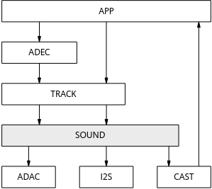
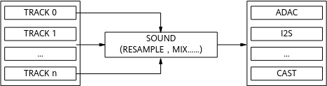
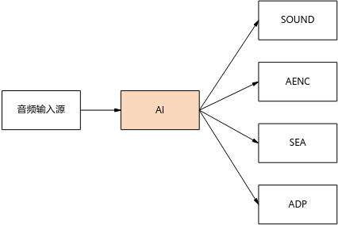

# 前言<a name="ZH-CN_TOPIC_0000002499502573"></a>

**概述<a name="zh-cn_topic_0000002409577236_section4537382116410"></a>**

本文档主要介绍音频驱动开发相关内容，包括工作原理、按场景描述接口使用方法和注意事项，用于指导客户快速熟悉音频接口。


**读者对象<a name="zh-cn_topic_0000002409577236_section4378592816410"></a>**

本文档主要适用于以下工程师：

-   技术支持工程师
-   软件开发工程师

**符号约定<a name="zh-cn_topic_0000002409577236_section133020216410"></a>**

在本文中可能出现下列标志，它们所代表的含义如下。

<a name="zh-cn_topic_0000002409577236_table2622507016410"></a>
<table><thead align="left"><tr id="zh-cn_topic_0000002409577236_row1530720816410"><th class="cellrowborder" valign="top" width="20.580000000000002%" id="mcps1.1.3.1.1"><p id="zh-cn_topic_0000002409577236_p6450074116410"><a name="zh-cn_topic_0000002409577236_p6450074116410"></a><a name="zh-cn_topic_0000002409577236_p6450074116410"></a><strong id="zh-cn_topic_0000002409577236_b2136615816410"><a name="zh-cn_topic_0000002409577236_b2136615816410"></a><a name="zh-cn_topic_0000002409577236_b2136615816410"></a>符号</strong></p>
</th>
<th class="cellrowborder" valign="top" width="79.42%" id="mcps1.1.3.1.2"><p id="zh-cn_topic_0000002409577236_p5435366816410"><a name="zh-cn_topic_0000002409577236_p5435366816410"></a><a name="zh-cn_topic_0000002409577236_p5435366816410"></a><strong id="zh-cn_topic_0000002409577236_b5941558116410"><a name="zh-cn_topic_0000002409577236_b5941558116410"></a><a name="zh-cn_topic_0000002409577236_b5941558116410"></a>说明</strong></p>
</th>
</tr>
</thead>
<tbody><tr id="zh-cn_topic_0000002409577236_row1372280416410"><td class="cellrowborder" valign="top" width="20.580000000000002%" headers="mcps1.1.3.1.1 "><p id="zh-cn_topic_0000002409577236_p3734547016410"><a name="zh-cn_topic_0000002409577236_p3734547016410"></a><a name="zh-cn_topic_0000002409577236_p3734547016410"></a><a name="zh-cn_topic_0000002409577236_image2670064316410"></a><a name="zh-cn_topic_0000002409577236_image2670064316410"></a><span></span></p>
</td>
<td class="cellrowborder" valign="top" width="79.42%" headers="mcps1.1.3.1.2 "><p id="zh-cn_topic_0000002409577236_p1757432116410"><a name="zh-cn_topic_0000002409577236_p1757432116410"></a><a name="zh-cn_topic_0000002409577236_p1757432116410"></a>表示如不避免则将会导致死亡或严重伤害的具有高等级风险的危害。</p>
</td>
</tr>
<tr id="zh-cn_topic_0000002409577236_row466863216410"><td class="cellrowborder" valign="top" width="20.580000000000002%" headers="mcps1.1.3.1.1 "><p id="zh-cn_topic_0000002409577236_p1432579516410"><a name="zh-cn_topic_0000002409577236_p1432579516410"></a><a name="zh-cn_topic_0000002409577236_p1432579516410"></a><a name="zh-cn_topic_0000002409577236_image4895582316410"></a><a name="zh-cn_topic_0000002409577236_image4895582316410"></a><span></span></p>
</td>
<td class="cellrowborder" valign="top" width="79.42%" headers="mcps1.1.3.1.2 "><p id="zh-cn_topic_0000002409577236_p959197916410"><a name="zh-cn_topic_0000002409577236_p959197916410"></a><a name="zh-cn_topic_0000002409577236_p959197916410"></a>表示如不避免则可能导致死亡或严重伤害的具有中等级风险的危害。</p>
</td>
</tr>
<tr id="zh-cn_topic_0000002409577236_row123863216410"><td class="cellrowborder" valign="top" width="20.580000000000002%" headers="mcps1.1.3.1.1 "><p id="zh-cn_topic_0000002409577236_p1232579516410"><a name="zh-cn_topic_0000002409577236_p1232579516410"></a><a name="zh-cn_topic_0000002409577236_p1232579516410"></a><a name="zh-cn_topic_0000002409577236_image1235582316410"></a><a name="zh-cn_topic_0000002409577236_image1235582316410"></a><span></span></p>
</td>
<td class="cellrowborder" valign="top" width="79.42%" headers="mcps1.1.3.1.2 "><p id="zh-cn_topic_0000002409577236_p123197916410"><a name="zh-cn_topic_0000002409577236_p123197916410"></a><a name="zh-cn_topic_0000002409577236_p123197916410"></a>表示如不避免则可能导致轻微或中度伤害的具有低等级风险的危害。</p>
</td>
</tr>
<tr id="zh-cn_topic_0000002409577236_row5786682116410"><td class="cellrowborder" valign="top" width="20.580000000000002%" headers="mcps1.1.3.1.1 "><p id="zh-cn_topic_0000002409577236_p2204984716410"><a name="zh-cn_topic_0000002409577236_p2204984716410"></a><a name="zh-cn_topic_0000002409577236_p2204984716410"></a><a name="zh-cn_topic_0000002409577236_image4504446716410"></a><a name="zh-cn_topic_0000002409577236_image4504446716410"></a><span></span></p>
</td>
<td class="cellrowborder" valign="top" width="79.42%" headers="mcps1.1.3.1.2 "><p id="zh-cn_topic_0000002409577236_p4388861916410"><a name="zh-cn_topic_0000002409577236_p4388861916410"></a><a name="zh-cn_topic_0000002409577236_p4388861916410"></a>用于传递设备或环境安全警示信息。如不避免则可能会导致设备损坏、数据丢失、设备性能降低或其它不可预知的结果。</p>
<p id="zh-cn_topic_0000002409577236_p1238861916410"><a name="zh-cn_topic_0000002409577236_p1238861916410"></a><a name="zh-cn_topic_0000002409577236_p1238861916410"></a>“须知”不涉及人身伤害。</p>
</td>
</tr>
<tr id="zh-cn_topic_0000002409577236_row2856923116410"><td class="cellrowborder" valign="top" width="20.580000000000002%" headers="mcps1.1.3.1.1 "><p id="zh-cn_topic_0000002409577236_p5555360116410"><a name="zh-cn_topic_0000002409577236_p5555360116410"></a><a name="zh-cn_topic_0000002409577236_p5555360116410"></a><a name="zh-cn_topic_0000002409577236_image799324016410"></a><a name="zh-cn_topic_0000002409577236_image799324016410"></a><span></span></p>
</td>
<td class="cellrowborder" valign="top" width="79.42%" headers="mcps1.1.3.1.2 "><p id="zh-cn_topic_0000002409577236_p4612588116410"><a name="zh-cn_topic_0000002409577236_p4612588116410"></a><a name="zh-cn_topic_0000002409577236_p4612588116410"></a>对正文中重点信息的补充说明。</p>
<p id="zh-cn_topic_0000002409577236_p1232588116410"><a name="zh-cn_topic_0000002409577236_p1232588116410"></a><a name="zh-cn_topic_0000002409577236_p1232588116410"></a>“说明”不是安全警示信息，不涉及人身、设备及环境伤害信息。</p>
</td>
</tr>
</tbody>
</table>

# 概述<a name="ZH-CN_TOPIC_0000002499582601"></a>

本文档主要介绍音频驱动开发相关内容，重点介绍了音频驱动各个模块以及对应的开发指引。

# SYS<a name="ZH-CN_TOPIC_0000002466543276"></a>

-   **[概述](#ZH-CN_TOPIC_0000002499582589)**  

-   **[开发指引](#ZH-CN_TOPIC_0000002466543228)**  

## 概述<a name="ZH-CN_TOPIC_0000002499582589"></a>

SYS（System）为音频系统全局管理模块。

## 开发指引<a name="ZH-CN_TOPIC_0000002466543228"></a>

-   **[接口说明](#ZH-CN_TOPIC_0000002466383604)**  

### 接口说明<a name="ZH-CN_TOPIC_0000002466383604"></a>

SYS模块实现了以下功能：

-   音频系统初始化、去初始化功能，该功能模块提供以下API：
    -   uapi\_audio\_init：初始化音频系统 。
    -   uapi\_audio\_deinit：去初始化音频系统 。

-   音频日志管理功能，该功能模块提供以下API：
    -   uapi\_audio\_set\_dsp\_log\_level：设置DSP打印等级。

-   音频系统调试功能，该功能模块提供以下API：
    -   uapi\_audio\_set\_debug\_cfg：设置调试功能配置 。
    -   uapi\_audio\_get\_debug\_cfg：获取调试功能配置。

-   音频场景设置功能，该功能模块提供以下API：
    -   uapi\_audio\_set\_audio\_scene：设置音频场景 。
    -   uapi\_audio\_get\_audio\_scene：获取音频场景。

-   音频二进制文件路径设置功能，该功能模块提供以下API：
    -   uapi\_audio\_set\_dsp\_file\_path：设置音频二进制文件路径。

# ADP<a name="ZH-CN_TOPIC_0000002499502561"></a>

-   **[概述](#ZH-CN_TOPIC_0000002499582597)**  

-   **[开发指引](#ZH-CN_TOPIC_0000002466383600)**  

## 概述<a name="ZH-CN_TOPIC_0000002499582597"></a>

ADP（Audio Data Port）即音频数据的输入输出模块。

-   ADP作为输入时，可以接收外部的数据，将数据输送给后一级模块。
-   ADP作为输出时，可以通过接口向外提供音频数据。

> **说明：** 
>一个ADP实例只能有一种工作模式，即单独作为输入模块或单独作为输出模块。
>同时最多允许打开8个ADP实例。

## 开发指引<a name="ZH-CN_TOPIC_0000002466383600"></a>

-   **[接口说明](#ZH-CN_TOPIC_0000002499582637)**  

-   **[数据结构](#ZH-CN_TOPIC_0000002466383648)**  

### 接口说明<a name="ZH-CN_TOPIC_0000002499582637"></a>

ADP模块实现了以下功能：

-   ADP模块初始化、去初始化功能，该功能模块提供以下API：
    -   uapi\_adp\_init：初始化ADP模块。
    -   uapi\_adp\_deinit：去初始化ADP模块。

-   ADP实例管理，用于创建和销毁ADP实例，该功能模块提供以下API：
    -   uapi\_adp\_get\_def\_attr：获取ADP默认属性。
    -   uapi\_adp\_create：创建一路ADP。
    -   uapi\_adp\_destroy：销毁一路ADP。
    -   uapi\_adp\_map：将ADP映射到当前进程空间，或者将其他业务核心创建的ADP映射到当前业务核心。
    -   uapi\_adp\_unmap：解除ADP在当前进程空间或业务核心的映射。
    -   uapi\_adp\_get\_attr：获取ADP属性。
    -   uapi\_adp\_set\_attr：设置ADP属性。

-   ADP与其他模块级联功能，该功能模块提供以下API：
    -   uapi\_adp\_attach\_output：为ADP绑定一个输出。
    -   uapi\_adp\_detach\_output：解除ADP与输出的绑定关系。

-   ADP事件上报功能，该功能模块提供以下API：
    -   uapi\_adp\_register\_event\_proc：注册ADP事件处理回调函数，事件包括：码流帧信息变化、获取EOS、上报EOS、上报PTS、获取延时。

-   ADP数据输入输出功能，该功能模块提供以下API：
    -   uapi\_adp\_query\_free：查询ADP中剩余空间大小。
    -   uapi\_adp\_query\_busy：查询ADP中已使用空间大小。
    -   uapi\_adp\_get\_buffer：获取一块ADP buffer。
    -   uapi\_adp\_put\_buffer：写完数据后，更新ADP buffer。
    -   uapi\_adp\_send\_stream：向ADP buffer送入音频ES流。
    -   uapi\_adp\_acquire\_stream：从ADP buffer获取音频ES流。
    -   uapi\_adp\_release\_stream：释放ADP buffer中的音频ES流。
    -   uapi\_adp\_send\_frame：向ADP buffer送入音频PCM数据。
    -   uapi\_adp\_acquire\_frame：从ADP buffer获取音频PCM数据。
    -   uapi\_adp\_release\_frame：释放ADP buffer中的PCM数据。

### 数据结构<a name="ZH-CN_TOPIC_0000002466383648"></a>

以下为ADP模块部分数据结构的参数说明和范围限制：

> **说明：** 
>SYS\_SHM\_MAX\_SIZE＝0x10000－0x1000＝0xF000，为DSP共享内存的大小。

-   uapi\_adp\_attr
    -   buf\_size：ADP缓冲区大小。

        参数范围：\[0, SYS\_SHM\_MAX\_SIZE\]

-   uapi\_stream\_buf
    -   data：数据缓冲区地址。
    -   size：数据大小。

        参数范围：\[0, adp\_create时的buf\_size大小-8\]

    -   pts：时间戳（单位：μs）。
    -   eos：流结束标志。

        参数范围：0、1

    -   pkg\_loss：丢包标志。

        参数范围：0、1

-   uapi\_audio\_frame
    -   interleaved：数据是否交织。

        参数范围：0、1

    -   channels：声道数。

        参数范围：1、2、4、6、8、16

    -   bit\_depth：位宽。

        参数范围：16、24、32

    -   sample\_rate：采样率。

        参数范围：\[4000, 768000\]

    -   pts：时间戳（单位：μs）。
    -   pcm\_buffer：PCM数据缓冲指针（该参数未使用）。
    -   bits\_buffer：透传数据缓冲指针。
    -   bits\_bytes：透传数据长度。

        参数范围：\[0, adp\_create时的buf\_size大小-8\]

    -   pcm\_samples：PCM数据采样点数量。
    -   frame\_index：帧序号。
    -   eos：流结束标志。

        参数范围：0、1

    -   pkg\_loss：丢包标志。

        参数范围：0、1

# SOUND<a name="ZH-CN_TOPIC_0000002499502581"></a>

-   **[概述](#ZH-CN_TOPIC_0000002499502577)**  

-   **[开发指引](#ZH-CN_TOPIC_0000002466543232)**  

## 概述<a name="ZH-CN_TOPIC_0000002499502577"></a>

SOUND是虚拟声卡，能将PCM数据输出到ADAC、I2S等物理端口及CAST虚拟端口，并支持多路同时输出，为用户带来丰富的音频应用。

SOUND在系统中的位置如[图1](#zh-cn_topic_0000002409577232_fig310810440216)所示。

**图 1**  SOUND设备关系图<a name="zh-cn_topic_0000002409577232_fig310810440216"></a>  


-   SOUND：虚拟声卡，定义3个SOUND设备（根据需要可打开0～3个，且可任意组合）：

    -   UAPI\_SND\_0
    -   UAPI\_SND\_1
    -   UAPI\_SND\_2

    SOUND设备将各路TRACK输入的数据进行处理（包括重采样、混音等）后，输出到绑定的OUTPORT，如[图2](#zh-cn_topic_0000002409577232_fig1531310593200)所示。

    **图 2**  SOUND设备框图<a name="zh-cn_topic_0000002409577232_fig1531310593200"></a>  
    

-   TRACK：音频数据播放通路。多路TRACK的数据会在SOUND中进行混音后输出。
-   OUTPORT：音频物理输出端口，包括ADAC OUTPORT和I2S OUTPORT等。支持对OUTPORT进行静音、音量、声道模式设置。
-   CAST：通过使能音频CAST功能会虚拟出一个音频CAST OUTPORT，该OUTPORT可投射出系统所有解码输出的音频数据。
-   声道模式：支持对单个OUTPORT或所有OUTPORT进行声道模式设置。
-   音量：支持两级音量设置，即TRACK音量设置和OUTPORT音量设置：

    -   TRACK音量支持对各路TRACK单独进行音量设置。
    -   OUTPORT音量设置支持对单个OUTPORT或所有OUTPORT进行音量设置。

    TRACK和OUTPORT只支持设置绝对音量，音量的设置范围是-81dB～+18dB，步长为0.125dB。

> **说明：** 
>同时最多允许打开2个SOUND设备，4路TRACK通路和4个OUTPORT端口。

## 开发指引<a name="ZH-CN_TOPIC_0000002466543232"></a>

-   **[接口说明](#ZH-CN_TOPIC_0000002499502585)**  

-   **[音频播放场景](#ZH-CN_TOPIC_0000002466543244)**  

### 接口说明<a name="ZH-CN_TOPIC_0000002499502585"></a>

SOUND模块实现了以下功能：

-   SOUND模块初始化、去初始化功能，该功能模块提供以下API：
    -   uapi\_snd\_init：初始化SOUND模块。
    -   uapi\_snd\_deinit：去初始化SOUND模块。

-   SOUND设备管理功能，实现SOUND设备打开、关闭等功能，该功能模块提供以下API：
    -   uapi\_snd\_get\_default\_attr：获取SOUND设备默认属性。
    -   uapi\_snd\_open：打开某个SOUND设备。
    -   uapi\_snd\_close：关闭某个SOUND设备。

-   OUTPORT管理功能，该功能模块提供以下API：
    -   uapi\_snd\_set\_port\_enable：设置OUTPORT的使能状态。
    -   uapi\_snd\_get\_port\_enable：获取OUTPORT的使能状态。
    -   uapi\_snd\_set\_mute：设置OUTPORT的静音状态。
    -   uapi\_snd\_get\_mute：获取OUTPORT的静音状态。
    -   uapi\_snd\_set\_volume：设置OUTPORT音量。
    -   uapi\_snd\_get\_volume：获取OUTPORT的音量值。
    -   uapi\_snd\_set\_track\_mode：设置OUTPORT声道模式。
    -   uapi\_snd\_get\_track\_mode：获取OUTPORT的声道模式。
    -   uapi\_snd\_attach\_output：为指定的OUTPORT绑定一个输出。
    -   uapi\_snd\_detach\_output：解除OUTPORT与输出的绑定关系。

-   音效设置功能，该功能模块提供以下API：
    -   uapi\_snd\_get\_aef\_param：获取算法参数。
    -   uapi\_snd\_set\_aef\_param：设置算法参数。
    -   uapi\_snd\_set\_aef\_profile：设置SOUND的音效模式。

-   TRACK管理功能，该功能模块提供以下API：
    -   uapi\_snd\_get\_track\_default\_attr：获取TRACK默认属性。
    -   uapi\_snd\_create\_track：创建一路TRACK。
    -   uapi\_snd\_destroy\_track：销毁一路TRACK。
    -   uapi\_snd\_get\_track\_state：获取TRACK的运行状态。
    -   uapi\_snd\_track\_start：启动TRACK，开始播放。
    -   uapi\_snd\_track\_stop：停止TRACK，停止播放。
    -   uapi\_snd\_track\_pause：暂停TRACK，暂停播放。
    -   uapi\_snd\_track\_resume：启动TRACK，恢复播放。
    -   uapi\_snd\_get\_track\_delay：获取TRACK的延时。
    -   uapi\_snd\_get\_track\_play\_pts：获取TRACK正在播放的音频的时间戳。
    -   uapi\_snd\_set\_track\_mute：设置一路TRACK的静音状态。
    -   uapi\_snd\_get\_track\_mute：获取一路TRACK的静音状态。
    -   uapi\_snd\_set\_all\_track\_mute：设置所有TRACK的静音状态。
    -   uapi\_snd\_get\_all\_track\_mute：获取所有TRACK的静音状态。
    -   uapi\_snd\_set\_track\_volume：设置TRACK音量。
    -   uapi\_snd\_get\_track\_volume：获取TRACK音量。
    -   uapi\_snd\_attach\_track\_output：为TRACK绑定一路输出。
    -   uapi\_snd\_detach\_track\_output：解除TRACK与输出的绑定关系。

> **说明：** 
>uapi\_snd\_set\_aef\_profile、uapi\_snd\_set\_all\_track\_mute和uapi\_snd\_get\_all\_track\_mute接口暂不支持。
>若使用了内置的88262音效算法，调用uapi\_snd\_open时需将采样率设为48kHz。

### 音频播放场景<a name="ZH-CN_TOPIC_0000002466543244"></a>

音频播放场景是指将PCM数据送至TRACK，接着SOUND对各路TRACK的数据进行重采样、混音等处理后，在SOUND所绑定的物理端口输出。输出过程中可以对OUTPORT进行音量设置、静音设置等操作。

> **说明：** 
>在调用其他SOUND接口之前，必须先将SOUND模块初始化；不再使用SOUND模块时，须将SOUND模块去初始化。

**音频播放初始化步骤<a name="zh-cn_topic_0000002443096529_section18715632171514"></a>**

音频播放初始化步骤如下：

1.  调用uapi\_adp\_init接口初始化ADP模块。

    ```
    uapi_adp_init();
    ```

2.  调用uapi\_snd\_init接口初始化SOUND模块。

    ```
    uapi_snd_init();
    ```

3.  调用uapi\_snd\_get\_default\_attr接口获取SOUND设备默认属性。

    ```
    uapi_snd snd_id;
    uapi_snd_attr snd_attr;
    uapi_snd_get_default_attr(snd_id, &snd_attr);
    ```

4.  修改属性，调用uapi\_snd\_open接口打开音频输出设备。

    ```
    td_handle h_snd = 0;
    snd_attr.port_num = 1;
    snd_attr.port_attr[0].out_port = UAPI_SND_OUT_PORT_I2S0;
    snd_attr.channels = UAPI_AUDIO_CHANNEL_2;
    snd_attr.bit_depth = UAPI_AUDIO_BIT_DEPTH_16;
    snd_attr.sample_rate = UAPI_AUDIO_SAMPLE_RATE_48K;
    uapi_snd_open(&h_snd, snd_id, &snd_attr);
    ```

5.  <a name="zh-cn_topic_0000002443096529_li595952774815"></a>调用uapi\_snd\_get\_track\_default\_attr接口获取TRACK默认属性。

    ```
    uapi_snd_track_attr track_attr;
    uapi_snd_get_track_default_attr(&track_attr);
    ```

6.  修改属性，并调用uapi\_snd\_create\_track接口创建TRACK。

    ```
    td_handle h_track = 0;
    uapi_snd_create_track(&h_track, h_snd, &track_attr);
    ```

7.  调用uapi\_adp\_get\_def\_attr接口获取ADP的默认属性。

    ```
    uapi_adp_attr adp_attr;
    uapi_adp_get_def_attr(&adp_attr);
    ```

8.  调用uapi\_adp\_create接口创建一路ADP。

    ```
    td_handle h_adp = 0;
    uapi_adp_create(&h_adp, &adp_attr);
    ```

9.  调用uapi\_adp\_attach\_output接口将ADP的输出设置为TRACK。

    ```
    uapi_adp_attach_output(h_adp, h_track);
    ```

10. 调用uapi\_snd\_track\_start接口启动TRACK。

    ```
    uapi_snd_track_start(h_track, TD_NULL);
    ```

11. <a name="zh-cn_topic_0000002443096529_li153395310460"></a>创建一个送音频帧线程，反复调用uapi\_adp\_send\_frame接口向ADP送入PCM数据。若要实现多路音频播放，可以重复[5](#zh-cn_topic_0000002443096529_li595952774815)～[11](#zh-cn_topic_0000002443096529_li153395310460)。

    ```
    td_s32 ret;
    td_bool task_active = TD_TRUE;
    uapi_audio_frame frame;
    while (task_active) {
        read_frame(&frame); /* read_frame需用户自行开发，用于获取音频帧 */
        while (task_active) {
            ret = uapi_adp_send_frame(h_adp, &frame);
            if (ret != EXT_SUCCESS) {
                continue;
            }
            break;
        }
    }
    ```

> **说明：** 
>TRACK没有音频数据接口，需要创建一路ADP，并且将TRACK绑定到ADP的输出。

**音频播放去初始化步骤<a name="zh-cn_topic_0000002443096529_section033115221518"></a>**

音频播放去初始化步骤如下：

1.  <a name="zh-cn_topic_0000002443096529_li9110491169"></a>销毁发送音频帧线程。
2.  调用uapi\_snd\_track\_stop停止TRACK。

    ```
    uapi_snd_track_stop(h_track);
    ```

3.  调用uapi\_adp\_detach\_output接口解除ADP与TRACK的绑定关系。

    ```
    uapi_adp_detach_output(h_adp, h_track);
    ```

4.  调用uapi\_adp\_destroy接口销毁ADP通路。

    ```
    uapi_adp_destroy(h_adp);
    ```

5.  <a name="zh-cn_topic_0000002443096529_li1232020528538"></a>调用uapi\_snd\_destroy\_track接口销毁TRACK。如果创建了多路音频播放，则需要为每一路执行[1](#zh-cn_topic_0000002443096529_li9110491169)～[5](#zh-cn_topic_0000002443096529_li1232020528538)。

    ```
    uapi_snd_destroy_track(h_track);
    ```

6.  调用uapi\_snd\_close接口关闭SOUND。

    ```
    uapi_snd_close(h_snd);
    ```

7.  调用uapi\_snd\_deinit接口去初始化SOUND模块。

    ```
    uapi_snd_deinit();
    ```

8.  调用uapi\_adp\_deinit接口去初始化ADP模块。

    ```
    uapi_adp_deinit();
    ```

# ADEC<a name="ZH-CN_TOPIC_0000002466383616"></a>

-   **[概述](#ZH-CN_TOPIC_0000002499502553)**  

-   **[开发指引](#ZH-CN_TOPIC_0000002466543260)**  

-   **[注意事项](#ZH-CN_TOPIC_0000002466383636)**  

## 概述<a name="ZH-CN_TOPIC_0000002499502553"></a>

ADEC（Audio Decoder）即音频解码模块。ADEC是解码框架，支持的音频解码协议如[表1](#zh-cn_topic_0000002409417428_table15602143414473)所示，ADEC都可以完成解码工作。

ADEC模块接收前级模块发送的码流数据，根据码流格式调用对应格式的解码库，解码出PCM数据发送到后端模块。例如，SOUND模块。

**表 1**  音频解码协议说明

<a name="zh-cn_topic_0000002409417428_table15602143414473"></a>
<table><thead align="left"><tr id="zh-cn_topic_0000002409417428_row1260317349479"><th class="cellrowborder" valign="top" width="14.06%" id="mcps1.2.6.1.1"><p id="zh-cn_topic_0000002409417428_p1860319342476"><a name="zh-cn_topic_0000002409417428_p1860319342476"></a><a name="zh-cn_topic_0000002409417428_p1860319342476"></a>协议</p>
</th>
<th class="cellrowborder" valign="top" width="14.96%" id="mcps1.2.6.1.2"><p id="zh-cn_topic_0000002409417428_p1560312345476"><a name="zh-cn_topic_0000002409417428_p1560312345476"></a><a name="zh-cn_topic_0000002409417428_p1560312345476"></a>通道数</p>
</th>
<th class="cellrowborder" valign="top" width="40.72%" id="mcps1.2.6.1.3"><p id="zh-cn_topic_0000002409417428_p1603534174720"><a name="zh-cn_topic_0000002409417428_p1603534174720"></a><a name="zh-cn_topic_0000002409417428_p1603534174720"></a>采样率（kHz）</p>
</th>
<th class="cellrowborder" valign="top" width="15.78%" id="mcps1.2.6.1.4"><p id="zh-cn_topic_0000002409417428_p196037346476"><a name="zh-cn_topic_0000002409417428_p196037346476"></a><a name="zh-cn_topic_0000002409417428_p196037346476"></a>位宽（bit）</p>
</th>
<th class="cellrowborder" valign="top" width="14.48%" id="mcps1.2.6.1.5"><p id="zh-cn_topic_0000002409417428_p20603234184716"><a name="zh-cn_topic_0000002409417428_p20603234184716"></a><a name="zh-cn_topic_0000002409417428_p20603234184716"></a>备注</p>
</th>
</tr>
</thead>
<tbody><tr id="zh-cn_topic_0000002409417428_row1160320346474"><td class="cellrowborder" valign="top" width="14.06%" headers="mcps1.2.6.1.1 "><p id="zh-cn_topic_0000002409417428_p7603113419474"><a name="zh-cn_topic_0000002409417428_p7603113419474"></a><a name="zh-cn_topic_0000002409417428_p7603113419474"></a>MP3</p>
</td>
<td class="cellrowborder" valign="top" width="14.96%" headers="mcps1.2.6.1.2 "><p id="zh-cn_topic_0000002409417428_p166031434204713"><a name="zh-cn_topic_0000002409417428_p166031434204713"></a><a name="zh-cn_topic_0000002409417428_p166031434204713"></a>1/2</p>
</td>
<td class="cellrowborder" valign="top" width="40.72%" headers="mcps1.2.6.1.3 "><p id="zh-cn_topic_0000002409417428_p560353464718"><a name="zh-cn_topic_0000002409417428_p560353464718"></a><a name="zh-cn_topic_0000002409417428_p560353464718"></a>8/11.025/12/16/22.05/24/32/44.1/48</p>
</td>
<td class="cellrowborder" valign="top" width="15.78%" headers="mcps1.2.6.1.4 "><p id="zh-cn_topic_0000002409417428_p36037342472"><a name="zh-cn_topic_0000002409417428_p36037342472"></a><a name="zh-cn_topic_0000002409417428_p36037342472"></a>16</p>
</td>
<td class="cellrowborder" valign="top" width="14.48%" headers="mcps1.2.6.1.5 "><p id="zh-cn_topic_0000002409417428_p560353417471"><a name="zh-cn_topic_0000002409417428_p560353417471"></a><a name="zh-cn_topic_0000002409417428_p560353417471"></a>-</p>
</td>
</tr>
<tr id="zh-cn_topic_0000002409417428_row6603734104712"><td class="cellrowborder" valign="top" width="14.06%" headers="mcps1.2.6.1.1 "><p id="zh-cn_topic_0000002409417428_p11603193420471"><a name="zh-cn_topic_0000002409417428_p11603193420471"></a><a name="zh-cn_topic_0000002409417428_p11603193420471"></a>FLAC</p>
</td>
<td class="cellrowborder" valign="top" width="14.96%" headers="mcps1.2.6.1.2 "><p id="zh-cn_topic_0000002409417428_p3603434174718"><a name="zh-cn_topic_0000002409417428_p3603434174718"></a><a name="zh-cn_topic_0000002409417428_p3603434174718"></a>1/2</p>
</td>
<td class="cellrowborder" valign="top" width="40.72%" headers="mcps1.2.6.1.3 "><p id="zh-cn_topic_0000002409417428_p166037348478"><a name="zh-cn_topic_0000002409417428_p166037348478"></a><a name="zh-cn_topic_0000002409417428_p166037348478"></a>8/16/32/44.1/48/96</p>
</td>
<td class="cellrowborder" valign="top" width="15.78%" headers="mcps1.2.6.1.4 "><p id="zh-cn_topic_0000002409417428_p56031234154710"><a name="zh-cn_topic_0000002409417428_p56031234154710"></a><a name="zh-cn_topic_0000002409417428_p56031234154710"></a>16/24</p>
</td>
<td class="cellrowborder" valign="top" width="14.48%" headers="mcps1.2.6.1.5 "><p id="zh-cn_topic_0000002409417428_p16603034114713"><a name="zh-cn_topic_0000002409417428_p16603034114713"></a><a name="zh-cn_topic_0000002409417428_p16603034114713"></a>最大帧长16KB</p>
</td>
</tr>
<tr id="zh-cn_topic_0000002409417428_row860353416477"><td class="cellrowborder" valign="top" width="14.06%" headers="mcps1.2.6.1.1 "><p id="zh-cn_topic_0000002409417428_p160383434714"><a name="zh-cn_topic_0000002409417428_p160383434714"></a><a name="zh-cn_topic_0000002409417428_p160383434714"></a>AAC-LC</p>
</td>
<td class="cellrowborder" valign="top" width="14.96%" headers="mcps1.2.6.1.2 "><p id="zh-cn_topic_0000002409417428_p560393434710"><a name="zh-cn_topic_0000002409417428_p560393434710"></a><a name="zh-cn_topic_0000002409417428_p560393434710"></a>1/2</p>
</td>
<td class="cellrowborder" valign="top" width="40.72%" headers="mcps1.2.6.1.3 "><p id="zh-cn_topic_0000002409417428_p11603534134712"><a name="zh-cn_topic_0000002409417428_p11603534134712"></a><a name="zh-cn_topic_0000002409417428_p11603534134712"></a>8/11.025/12/16/22.05/24/32/44.1/48/64/88.2/96</p>
</td>
<td class="cellrowborder" valign="top" width="15.78%" headers="mcps1.2.6.1.4 "><p id="zh-cn_topic_0000002409417428_p96032034134716"><a name="zh-cn_topic_0000002409417428_p96032034134716"></a><a name="zh-cn_topic_0000002409417428_p96032034134716"></a>16</p>
</td>
<td class="cellrowborder" valign="top" width="14.48%" headers="mcps1.2.6.1.5 "><p id="zh-cn_topic_0000002409417428_p186047346472"><a name="zh-cn_topic_0000002409417428_p186047346472"></a><a name="zh-cn_topic_0000002409417428_p186047346472"></a>-</p>
</td>
</tr>
<tr id="zh-cn_topic_0000002409417428_row1160433444711"><td class="cellrowborder" valign="top" width="14.06%" headers="mcps1.2.6.1.1 "><p id="zh-cn_topic_0000002409417428_p760417341471"><a name="zh-cn_topic_0000002409417428_p760417341471"></a><a name="zh-cn_topic_0000002409417428_p760417341471"></a>HE-AAC V1</p>
</td>
<td class="cellrowborder" valign="top" width="14.96%" headers="mcps1.2.6.1.2 "><p id="zh-cn_topic_0000002409417428_p1460423415474"><a name="zh-cn_topic_0000002409417428_p1460423415474"></a><a name="zh-cn_topic_0000002409417428_p1460423415474"></a>1/2</p>
</td>
<td class="cellrowborder" valign="top" width="40.72%" headers="mcps1.2.6.1.3 "><p id="zh-cn_topic_0000002409417428_p1460413494710"><a name="zh-cn_topic_0000002409417428_p1460413494710"></a><a name="zh-cn_topic_0000002409417428_p1460413494710"></a>8/11.025/12/16/22.05/24/32/44.1/48/64/88.2/96</p>
</td>
<td class="cellrowborder" valign="top" width="15.78%" headers="mcps1.2.6.1.4 "><p id="zh-cn_topic_0000002409417428_p4604163454712"><a name="zh-cn_topic_0000002409417428_p4604163454712"></a><a name="zh-cn_topic_0000002409417428_p4604163454712"></a>16</p>
</td>
<td class="cellrowborder" valign="top" width="14.48%" headers="mcps1.2.6.1.5 "><p id="zh-cn_topic_0000002409417428_p0604234164714"><a name="zh-cn_topic_0000002409417428_p0604234164714"></a><a name="zh-cn_topic_0000002409417428_p0604234164714"></a>-</p>
</td>
</tr>
<tr id="zh-cn_topic_0000002409417428_row0604134144718"><td class="cellrowborder" valign="top" width="14.06%" headers="mcps1.2.6.1.1 "><p id="zh-cn_topic_0000002409417428_p6604113415470"><a name="zh-cn_topic_0000002409417428_p6604113415470"></a><a name="zh-cn_topic_0000002409417428_p6604113415470"></a>AMR-NB</p>
</td>
<td class="cellrowborder" valign="top" width="14.96%" headers="mcps1.2.6.1.2 "><p id="zh-cn_topic_0000002409417428_p1560410340473"><a name="zh-cn_topic_0000002409417428_p1560410340473"></a><a name="zh-cn_topic_0000002409417428_p1560410340473"></a>1</p>
</td>
<td class="cellrowborder" valign="top" width="40.72%" headers="mcps1.2.6.1.3 "><p id="zh-cn_topic_0000002409417428_p260483484716"><a name="zh-cn_topic_0000002409417428_p260483484716"></a><a name="zh-cn_topic_0000002409417428_p260483484716"></a>8</p>
</td>
<td class="cellrowborder" valign="top" width="15.78%" headers="mcps1.2.6.1.4 "><p id="zh-cn_topic_0000002409417428_p5604203411478"><a name="zh-cn_topic_0000002409417428_p5604203411478"></a><a name="zh-cn_topic_0000002409417428_p5604203411478"></a>16</p>
</td>
<td class="cellrowborder" valign="top" width="14.48%" headers="mcps1.2.6.1.5 "><p id="zh-cn_topic_0000002409417428_p17604193420473"><a name="zh-cn_topic_0000002409417428_p17604193420473"></a><a name="zh-cn_topic_0000002409417428_p17604193420473"></a>-</p>
</td>
</tr>
<tr id="zh-cn_topic_0000002409417428_row7604203444710"><td class="cellrowborder" valign="top" width="14.06%" headers="mcps1.2.6.1.1 "><p id="zh-cn_topic_0000002409417428_p660416348474"><a name="zh-cn_topic_0000002409417428_p660416348474"></a><a name="zh-cn_topic_0000002409417428_p660416348474"></a>AMR-WB</p>
</td>
<td class="cellrowborder" valign="top" width="14.96%" headers="mcps1.2.6.1.2 "><p id="zh-cn_topic_0000002409417428_p760433417470"><a name="zh-cn_topic_0000002409417428_p760433417470"></a><a name="zh-cn_topic_0000002409417428_p760433417470"></a>1</p>
</td>
<td class="cellrowborder" valign="top" width="40.72%" headers="mcps1.2.6.1.3 "><p id="zh-cn_topic_0000002409417428_p1860403413475"><a name="zh-cn_topic_0000002409417428_p1860403413475"></a><a name="zh-cn_topic_0000002409417428_p1860403413475"></a>16</p>
</td>
<td class="cellrowborder" valign="top" width="15.78%" headers="mcps1.2.6.1.4 "><p id="zh-cn_topic_0000002409417428_p106041034144711"><a name="zh-cn_topic_0000002409417428_p106041034144711"></a><a name="zh-cn_topic_0000002409417428_p106041034144711"></a>16</p>
</td>
<td class="cellrowborder" valign="top" width="14.48%" headers="mcps1.2.6.1.5 "><p id="zh-cn_topic_0000002409417428_p10604193418476"><a name="zh-cn_topic_0000002409417428_p10604193418476"></a><a name="zh-cn_topic_0000002409417428_p10604193418476"></a>-</p>
</td>
</tr>
<tr id="zh-cn_topic_0000002409417428_row176043345474"><td class="cellrowborder" valign="top" width="14.06%" headers="mcps1.2.6.1.1 "><p id="zh-cn_topic_0000002409417428_p12604203454718"><a name="zh-cn_topic_0000002409417428_p12604203454718"></a><a name="zh-cn_topic_0000002409417428_p12604203454718"></a>SILK</p>
</td>
<td class="cellrowborder" valign="top" width="14.96%" headers="mcps1.2.6.1.2 "><p id="zh-cn_topic_0000002409417428_p1560423412474"><a name="zh-cn_topic_0000002409417428_p1560423412474"></a><a name="zh-cn_topic_0000002409417428_p1560423412474"></a>1</p>
</td>
<td class="cellrowborder" valign="top" width="40.72%" headers="mcps1.2.6.1.3 "><p id="zh-cn_topic_0000002409417428_p126041334164711"><a name="zh-cn_topic_0000002409417428_p126041334164711"></a><a name="zh-cn_topic_0000002409417428_p126041334164711"></a>16</p>
</td>
<td class="cellrowborder" valign="top" width="15.78%" headers="mcps1.2.6.1.4 "><p id="zh-cn_topic_0000002409417428_p1560413494719"><a name="zh-cn_topic_0000002409417428_p1560413494719"></a><a name="zh-cn_topic_0000002409417428_p1560413494719"></a>16</p>
</td>
<td class="cellrowborder" valign="top" width="14.48%" headers="mcps1.2.6.1.5 "><p id="zh-cn_topic_0000002409417428_p1060410343477"><a name="zh-cn_topic_0000002409417428_p1060410343477"></a><a name="zh-cn_topic_0000002409417428_p1060410343477"></a>-</p>
</td>
</tr>
<tr id="zh-cn_topic_0000002409417428_row688814189103"><td class="cellrowborder" valign="top" width="14.06%" headers="mcps1.2.6.1.1 "><p id="zh-cn_topic_0000002409417428_p4888191821013"><a name="zh-cn_topic_0000002409417428_p4888191821013"></a><a name="zh-cn_topic_0000002409417428_p4888191821013"></a>SBC</p>
</td>
<td class="cellrowborder" valign="top" width="14.96%" headers="mcps1.2.6.1.2 "><p id="zh-cn_topic_0000002409417428_p68881218121019"><a name="zh-cn_topic_0000002409417428_p68881218121019"></a><a name="zh-cn_topic_0000002409417428_p68881218121019"></a>1/2</p>
</td>
<td class="cellrowborder" valign="top" width="40.72%" headers="mcps1.2.6.1.3 "><p id="zh-cn_topic_0000002409417428_p4888181816104"><a name="zh-cn_topic_0000002409417428_p4888181816104"></a><a name="zh-cn_topic_0000002409417428_p4888181816104"></a>16/32/44.1/48</p>
</td>
<td class="cellrowborder" valign="top" width="15.78%" headers="mcps1.2.6.1.4 "><p id="zh-cn_topic_0000002409417428_p688841891012"><a name="zh-cn_topic_0000002409417428_p688841891012"></a><a name="zh-cn_topic_0000002409417428_p688841891012"></a>16</p>
</td>
<td class="cellrowborder" valign="top" width="14.48%" headers="mcps1.2.6.1.5 "><p id="zh-cn_topic_0000002409417428_p1488891881016"><a name="zh-cn_topic_0000002409417428_p1488891881016"></a><a name="zh-cn_topic_0000002409417428_p1488891881016"></a>-</p>
</td>
</tr>
<tr id="zh-cn_topic_0000002409417428_row1060513105128"><td class="cellrowborder" valign="top" width="14.06%" headers="mcps1.2.6.1.1 "><p id="zh-cn_topic_0000002409417428_p26051107125"><a name="zh-cn_topic_0000002409417428_p26051107125"></a><a name="zh-cn_topic_0000002409417428_p26051107125"></a>MSBC</p>
</td>
<td class="cellrowborder" valign="top" width="14.96%" headers="mcps1.2.6.1.2 "><p id="zh-cn_topic_0000002409417428_p66051510171216"><a name="zh-cn_topic_0000002409417428_p66051510171216"></a><a name="zh-cn_topic_0000002409417428_p66051510171216"></a>1</p>
</td>
<td class="cellrowborder" valign="top" width="40.72%" headers="mcps1.2.6.1.3 "><p id="zh-cn_topic_0000002409417428_p1460541012124"><a name="zh-cn_topic_0000002409417428_p1460541012124"></a><a name="zh-cn_topic_0000002409417428_p1460541012124"></a>16</p>
</td>
<td class="cellrowborder" valign="top" width="15.78%" headers="mcps1.2.6.1.4 "><p id="zh-cn_topic_0000002409417428_p9605910121214"><a name="zh-cn_topic_0000002409417428_p9605910121214"></a><a name="zh-cn_topic_0000002409417428_p9605910121214"></a>16</p>
</td>
<td class="cellrowborder" valign="top" width="14.48%" headers="mcps1.2.6.1.5 "><p id="zh-cn_topic_0000002409417428_p2060571017120"><a name="zh-cn_topic_0000002409417428_p2060571017120"></a><a name="zh-cn_topic_0000002409417428_p2060571017120"></a>-</p>
</td>
</tr>
<tr id="zh-cn_topic_0000002409417428_row13324154205517"><td class="cellrowborder" valign="top" width="14.06%" headers="mcps1.2.6.1.1 "><p id="zh-cn_topic_0000002409417428_p153241542105511"><a name="zh-cn_topic_0000002409417428_p153241542105511"></a><a name="zh-cn_topic_0000002409417428_p153241542105511"></a>L2HC</p>
</td>
<td class="cellrowborder" valign="top" width="14.96%" headers="mcps1.2.6.1.2 "><p id="zh-cn_topic_0000002409417428_p12324134225517"><a name="zh-cn_topic_0000002409417428_p12324134225517"></a><a name="zh-cn_topic_0000002409417428_p12324134225517"></a>1/2</p>
</td>
<td class="cellrowborder" valign="top" width="40.72%" headers="mcps1.2.6.1.3 "><p id="zh-cn_topic_0000002409417428_p73245428550"><a name="zh-cn_topic_0000002409417428_p73245428550"></a><a name="zh-cn_topic_0000002409417428_p73245428550"></a>44.1/48/88.2/96</p>
</td>
<td class="cellrowborder" valign="top" width="15.78%" headers="mcps1.2.6.1.4 "><p id="zh-cn_topic_0000002409417428_p16324164225518"><a name="zh-cn_topic_0000002409417428_p16324164225518"></a><a name="zh-cn_topic_0000002409417428_p16324164225518"></a>16/32</p>
</td>
<td class="cellrowborder" valign="top" width="14.48%" headers="mcps1.2.6.1.5 "><p id="zh-cn_topic_0000002409417428_p133242426556"><a name="zh-cn_topic_0000002409417428_p133242426556"></a><a name="zh-cn_topic_0000002409417428_p133242426556"></a>-</p>
</td>
</tr>
<tr id="zh-cn_topic_0000002409417428_row1718319556554"><td class="cellrowborder" valign="top" width="14.06%" headers="mcps1.2.6.1.1 "><p id="zh-cn_topic_0000002409417428_p7184175515520"><a name="zh-cn_topic_0000002409417428_p7184175515520"></a><a name="zh-cn_topic_0000002409417428_p7184175515520"></a>OPUS</p>
</td>
<td class="cellrowborder" valign="top" width="14.96%" headers="mcps1.2.6.1.2 "><p id="zh-cn_topic_0000002409417428_p918445510554"><a name="zh-cn_topic_0000002409417428_p918445510554"></a><a name="zh-cn_topic_0000002409417428_p918445510554"></a>1/2</p>
</td>
<td class="cellrowborder" valign="top" width="40.72%" headers="mcps1.2.6.1.3 "><p id="zh-cn_topic_0000002409417428_p7184145515518"><a name="zh-cn_topic_0000002409417428_p7184145515518"></a><a name="zh-cn_topic_0000002409417428_p7184145515518"></a>8/12/16/24/48</p>
</td>
<td class="cellrowborder" valign="top" width="15.78%" headers="mcps1.2.6.1.4 "><p id="zh-cn_topic_0000002409417428_p1418410550557"><a name="zh-cn_topic_0000002409417428_p1418410550557"></a><a name="zh-cn_topic_0000002409417428_p1418410550557"></a>16</p>
</td>
<td class="cellrowborder" valign="top" width="14.48%" headers="mcps1.2.6.1.5 "><p id="zh-cn_topic_0000002409417428_p6184145514557"><a name="zh-cn_topic_0000002409417428_p6184145514557"></a><a name="zh-cn_topic_0000002409417428_p6184145514557"></a>-</p>
</td>
</tr>
<tr id="zh-cn_topic_0000002409417428_row1245722615108"><td class="cellrowborder" valign="top" width="14.06%" headers="mcps1.2.6.1.1 "><p id="zh-cn_topic_0000002409417428_p045711266106"><a name="zh-cn_topic_0000002409417428_p045711266106"></a><a name="zh-cn_topic_0000002409417428_p045711266106"></a>PCM</p>
</td>
<td class="cellrowborder" valign="top" width="14.96%" headers="mcps1.2.6.1.2 "><p id="zh-cn_topic_0000002409417428_p2457926181018"><a name="zh-cn_topic_0000002409417428_p2457926181018"></a><a name="zh-cn_topic_0000002409417428_p2457926181018"></a>1/2</p>
</td>
<td class="cellrowborder" valign="top" width="40.72%" headers="mcps1.2.6.1.3 "><p id="zh-cn_topic_0000002409417428_p1457162661016"><a name="zh-cn_topic_0000002409417428_p1457162661016"></a><a name="zh-cn_topic_0000002409417428_p1457162661016"></a>8/16/32/44.1/48</p>
</td>
<td class="cellrowborder" valign="top" width="15.78%" headers="mcps1.2.6.1.4 "><p id="zh-cn_topic_0000002409417428_p13457726131014"><a name="zh-cn_topic_0000002409417428_p13457726131014"></a><a name="zh-cn_topic_0000002409417428_p13457726131014"></a>16/32</p>
</td>
<td class="cellrowborder" valign="top" width="14.48%" headers="mcps1.2.6.1.5 "><p id="zh-cn_topic_0000002409417428_p1745762610105"><a name="zh-cn_topic_0000002409417428_p1745762610105"></a><a name="zh-cn_topic_0000002409417428_p1745762610105"></a>-</p>
</td>
</tr>
</tbody>
</table>

> **说明：** 
>ADEC模块支持MP3、AAC、SBC等音频类型。
>sample\_decode不支持FLAC。
>同时最多允许打开2个ADEC实例。

## 开发指引<a name="ZH-CN_TOPIC_0000002466543260"></a>

-   **[接口说明](#ZH-CN_TOPIC_0000002499502549)**  

-   **[解码播放场景](#ZH-CN_TOPIC_0000002499502557)**  

### 接口说明<a name="ZH-CN_TOPIC_0000002499502549"></a>

ADEC模块实现了以下功能：

-   ADEC模块系统管理功能，实现初始化、去初始化等功能，该功能模块提供以下API：
    -   uapi\_adec\_init：初始化ADEC模块。
    -   uapi\_adec\_deinit：去初始化ADEC模块。

-   ADEC模块实例管理功能，该功能模块提供以下API：
    -   uapi\_adec\_create：创建一路音频解码实例。
    -   uapi\_adec\_destroy：销毁一路音频解码实例。
    -   uapi\_adec\_get\_attr：获取音频解码实例的属性。
    -   uapi\_adec\_set\_attr：设置音频解码实例的属性。
    -   uapi\_adec\_start：启动音频解码实例。
    -   uapi\_adec\_stop：停止音频解码实例。

-   ADEC与其他模块级联功能，该功能模块提供以下API：
    -   uapi\_adec\_attach\_output：为音频解码实例绑定一个输出。
    -   uapi\_adec\_detach\_output：为音频解码实例解绑一个输出。

-   ADEC事件上报功能，该功能模块提供以下API：
    -   uapi\_adec\_register\_event\_proc：注册ADEC事件处理回调函数。

-   ADEC配置解码器参数功能，该功能模块提供以下API：
    -   uapi\_adec\_set\_param：设置音频解码器参数功能，例如profile支持范围等。

解码器实例属性如下：

-   codec\_id：每种音频格式都对应唯一ID。
-   frame\_mode\_input：帧输入模式，默认关闭。开启后，解码器要求按帧送数据，解码器也会按帧解码输入数据。
-   buf\_dur\_ms：解码输出帧大小对应的时间。
-   param：其他参数，主要包括声道数、位宽、采样率、私有数据地址以及长度。

> **说明：** 
>uapi\_adec\_register\_event\_proc接口暂不支持。

### 解码播放场景<a name="ZH-CN_TOPIC_0000002499502557"></a>

用户根据自己的实际需求，将需要解码播放的码流通过ADP实例送到ADEC模块进行解码，并通过SOUND模块播放。

> **说明：** 
>在调用其他ADEC接口之前，必须先对ADEC模块初始化；不再使用ADEC模块时，须将ADEC模块去初始化。

**解码播放初始化步骤<a name="zh-cn_topic_0000002409417432_section26401418175215"></a>**

解码播放初始化步骤如下：

1.  <a name="zh-cn_topic_0000002409417432_li1587612204557"></a>调用uapi\_adp\_init接口初始化ADP模块。

    ```
    uapi_adp_init();
    ```

2.  调用uapi\_snd\_init接口初始化SOUND模块。

    ```
    uapi_snd_init();
    ```

3.  调用uapi\_adec\_init接口初始化ADEC模块。

    ```
    uapi_adec_init();
    ```

4.  调用uapi\_snd\_get\_default\_attr接口获取SOUND设备默认属性。

    ```
    uapi_snd snd_id;
    uapi_snd_attr snd_attr;
    uapi_snd_get_default_attr(snd_id, &snd_attr);
    ```

5.  修改属性，调用uapi\_snd\_open接口打开音频输出设备。

    ```
    td_handle h_snd = 0;
    snd_attr.port_num = 1;
    snd_attr.port_attr[0].out_port = UAPI_SND_OUT_PORT_I2S0;
    snd_attr.channels = UAPI_AUDIO_CHANNEL_2;
    snd_attr.bit_depth = UAPI_AUDIO_BIT_DEPTH_16;
    snd_attr.sample_rate = UAPI_AUDIO_SAMPLE_RATE_48K;
    uapi_snd_open(&h_snd, snd_id, &snd_attr);
    ```

6.  <a name="zh-cn_topic_0000002409417432_li7320144115426"></a>调用uapi\_snd\_get\_track\_default\_attr接口获取TRACK默认属性。

    ```
    uapi_snd_track_attr track_attr;
    uapi_snd_get_track_default_attr(&track_attr);
    ```

7.  修改属性，并调用uapi\_snd\_create\_track接口创建TRACK。

    ```
    td_handle h_track = 0;
    uapi_snd_create_track(&h_track, h_snd, &track_attr);
    ```

8.  <a name="zh-cn_topic_0000002409417432_li33231254144319"></a>调用uapi\_adec\_create接口创建一路ADEC，用于音频帧的解码。

    ```
    td_handle h_adec = 0;
    uapi_adec_create(&h_adec);
    ```

9.  调用uapi\_adec\_get\_attr接口获取ADEC的属性。

    ```
    uapi_adec_attr adec_attr;
    uapi_adec_get_attr(h_adec, &adec_attr);
    ```

10. 修改属性，指定使用codec\_id，调用uapi\_adec\_set\_attr接口设置新属性。

    ```
    adec_attr.codec_id = UAPI_ACODEC_ID_MSBC;
    adec_attr.param.sample_rate = UAPI_AUDIO_SAMPLE_RATE_16K;
    adec_attr.param.channels = UAPI_AUDIO_CHANNEL_1;
    adec_attr.param.bit_depth = UAPI_AUDIO_BIT_DEPTH_16;
    uapi_adec_set_attr(h_adec, &adec_attr);
    ```

11. 调用uapi\_adec\_attach\_output接口将ADEC的输出设置为TRACK。

    ```
    uapi_adec_attach_output(h_adec, h_track);
    ```

12. 调用uapi\_adp\_get\_default\_attr接口获取输入ADP的默认属性。

    ```
    uapi_adp_attr adp_attr;
    uapi_adp_get_def_attr(&adp_attr);
    ```

13. 调用uapi\_adp\_create接口创建一路输入ADP，用于给ADEC送码流数据。

    ```
    td_handle h_adp = 0;
    uapi_adp_create(&h_adp, &adp_attr);
    ```

14. 调用uapi\_adp\_attach\_output接口将输入ADP的输出设置为ADEC。

    ```
    uapi_adp_attach_output(h_adp, h_adec);
    ```

15. 调用uapi\_snd\_track\_start启动TRACK。

    ```
    uapi_snd_track_start(h_track, TD_NULL);
    ```

16. 调用uapi\_adec\_start接口启动ADEC进行编码。

    ```
    uapi_adec_start(h_adec);
    ```

17. <a name="zh-cn_topic_0000002409417432_li587662016555"></a>创建一个送音频帧线程，反复调用uapi\_adp\_send\_stream向ADP送入码流数据。若要实现多路音频解码，可以重复[6](#zh-cn_topic_0000002409417432_li7320144115426)～[17](#zh-cn_topic_0000002409417432_li587662016555)。

    ```
    td_s32 ret;
    td_bool task_active = TD_TRUE;
    uapi_stream_buf stream;
    while (task_active) {
        read_stream(&stream); /* read_stream需用户自行开发，用于获取码流数据 */
        while (task_active) {
            ret = uapi_adp_send_stream(h_adp, &stream);
            if (ret != EXT_SUCCESS) {
                continue;
            }
            break;
        }
    }
    ```

**解码播放去初始化步骤<a name="zh-cn_topic_0000002409417432_section11750143910526"></a>**

解码播放去初始化步骤如下：

1.  销毁发送音频帧线程。
2.  调用uapi\_adec\_stop接口停止ADEC。

    ```
    uapi_adec_stop(h_adec);
    ```

3.  调用uapi\_snd\_track\_stop接口停止TRACK。

    ```
    uapi_snd_track_stop(h_track);
    ```

4.  调用uapi\_adp\_detach\_output接口解除输入ADP与ADEC的绑定关系。

    ```
    uapi_adp_detach_output(h_adp, h_adec);
    ```

5.  调用uapi\_adp\_destroy接口销毁输入ADP通路。

    ```
    uapi_adp_destroy(h_adp);
    ```

6.  调用uapi\_adec\_detach\_output接口解除ADEC与TRACK的绑定关系。

    ```
    uapi_adec_detach_output(h_adec, h_track);
    ```

7.  调用uapi\_adec\_destroy接口销毁ADEC。

    ```
    uapi_adec_destroy(h_adec);
    ```

8.  调用uapi\_snd\_destroy\_track接口销毁TRACK。如果创建了多路音频解码，则需要为每一路执行[1](#zh-cn_topic_0000002409417432_li1587612204557)～[8](#zh-cn_topic_0000002409417432_li33231254144319)。

    ```
    uapi_snd_destroy_track(h_track);
    ```

9.  调用uapi\_snd\_close接口关闭SOUND。

    ```
    uapi_snd_close(h_snd);
    ```

10. 调用uapi\_adec\_deinit接口去初始化ADEC模块。

    ```
    uapi_adec_deinit();
    ```

11. 调用uapi\_snd\_deinit接口去初始化SOUND模块。

    ```
    uapi_snd_deinit();
    ```

12. 调用uapi\_adp\_deinit接口去初始化ADP模块。

    ```
    uapi_adp_deinit();
    ```

## 注意事项<a name="ZH-CN_TOPIC_0000002466383636"></a>

请严格按照“[解码播放场景](#ZH-CN_TOPIC_0000002499502557)”中描述的步骤顺序进行接口调用。

# AENC<a name="ZH-CN_TOPIC_0000002499582641"></a>

-   **[概述](#ZH-CN_TOPIC_0000002466383624)**  

-   **[开发指引](#ZH-CN_TOPIC_0000002466543252)**  

-   **[注意事项](#ZH-CN_TOPIC_0000002466543264)**  

## 概述<a name="ZH-CN_TOPIC_0000002466383624"></a>

AENC（Audio Encoder）即音频编码模块。AENC模块接收前级模块或用户发送的音频数据，根据用户选择的编码器生成不同格式的码流。生成的码流数据返回给用户使用，例如通过网络发送到远端解码播放。支持的音频编码协议见[表1](#zh-cn_topic_0000002409417400_table129792031118)。

AENC模块的数据来源主要有音频输入（AI）、音频SEA、音频蓝牙输出（BT）以及上层应用。AENC对输入数据进行编码后输送给后级模块。

**表 1**  音频编码协议说明

<a name="zh-cn_topic_0000002409417400_table129792031118"></a>
<table><thead align="left"><tr id="zh-cn_topic_0000002409417400_row39762041113"><th class="cellrowborder" valign="top" width="19.650000000000002%" id="mcps1.2.6.1.1"><p id="zh-cn_topic_0000002409417400_p1497620131111"><a name="zh-cn_topic_0000002409417400_p1497620131111"></a><a name="zh-cn_topic_0000002409417400_p1497620131111"></a>协议</p>
</th>
<th class="cellrowborder" valign="top" width="14.879999999999999%" id="mcps1.2.6.1.2"><p id="zh-cn_topic_0000002409417400_p597122081114"><a name="zh-cn_topic_0000002409417400_p597122081114"></a><a name="zh-cn_topic_0000002409417400_p597122081114"></a>通道数</p>
</th>
<th class="cellrowborder" valign="top" width="27.71%" id="mcps1.2.6.1.3"><p id="zh-cn_topic_0000002409417400_p19752020113"><a name="zh-cn_topic_0000002409417400_p19752020113"></a><a name="zh-cn_topic_0000002409417400_p19752020113"></a>采样率（kHz）</p>
</th>
<th class="cellrowborder" valign="top" width="21.58%" id="mcps1.2.6.1.4"><p id="zh-cn_topic_0000002409417400_p097152010111"><a name="zh-cn_topic_0000002409417400_p097152010111"></a><a name="zh-cn_topic_0000002409417400_p097152010111"></a>位宽（bit）</p>
</th>
<th class="cellrowborder" valign="top" width="16.18%" id="mcps1.2.6.1.5"><p id="zh-cn_topic_0000002409417400_p19822012111"><a name="zh-cn_topic_0000002409417400_p19822012111"></a><a name="zh-cn_topic_0000002409417400_p19822012111"></a>备注</p>
</th>
</tr>
</thead>
<tbody><tr id="zh-cn_topic_0000002409417400_row1098132091111"><td class="cellrowborder" valign="top" width="19.650000000000002%" headers="mcps1.2.6.1.1 "><p id="zh-cn_topic_0000002409417400_p199892013119"><a name="zh-cn_topic_0000002409417400_p199892013119"></a><a name="zh-cn_topic_0000002409417400_p199892013119"></a>SBC</p>
</td>
<td class="cellrowborder" valign="top" width="14.879999999999999%" headers="mcps1.2.6.1.2 "><p id="zh-cn_topic_0000002409417400_p15981820161119"><a name="zh-cn_topic_0000002409417400_p15981820161119"></a><a name="zh-cn_topic_0000002409417400_p15981820161119"></a>1/2</p>
</td>
<td class="cellrowborder" valign="top" width="27.71%" headers="mcps1.2.6.1.3 "><p id="zh-cn_topic_0000002409417400_p698020121111"><a name="zh-cn_topic_0000002409417400_p698020121111"></a><a name="zh-cn_topic_0000002409417400_p698020121111"></a>16/32/44.1/48</p>
</td>
<td class="cellrowborder" valign="top" width="21.58%" headers="mcps1.2.6.1.4 "><p id="zh-cn_topic_0000002409417400_p1198720161115"><a name="zh-cn_topic_0000002409417400_p1198720161115"></a><a name="zh-cn_topic_0000002409417400_p1198720161115"></a>16</p>
</td>
<td class="cellrowborder" valign="top" width="16.18%" headers="mcps1.2.6.1.5 "><p id="zh-cn_topic_0000002409417400_p119882019116"><a name="zh-cn_topic_0000002409417400_p119882019116"></a><a name="zh-cn_topic_0000002409417400_p119882019116"></a>-</p>
</td>
</tr>
<tr id="zh-cn_topic_0000002409417400_row3981920131118"><td class="cellrowborder" valign="top" width="19.650000000000002%" headers="mcps1.2.6.1.1 "><p id="zh-cn_topic_0000002409417400_p1998102021117"><a name="zh-cn_topic_0000002409417400_p1998102021117"></a><a name="zh-cn_topic_0000002409417400_p1998102021117"></a>MSBC</p>
</td>
<td class="cellrowborder" valign="top" width="14.879999999999999%" headers="mcps1.2.6.1.2 "><p id="zh-cn_topic_0000002409417400_p18981620131115"><a name="zh-cn_topic_0000002409417400_p18981620131115"></a><a name="zh-cn_topic_0000002409417400_p18981620131115"></a>1</p>
</td>
<td class="cellrowborder" valign="top" width="27.71%" headers="mcps1.2.6.1.3 "><p id="zh-cn_topic_0000002409417400_p69802012113"><a name="zh-cn_topic_0000002409417400_p69802012113"></a><a name="zh-cn_topic_0000002409417400_p69802012113"></a>16</p>
</td>
<td class="cellrowborder" valign="top" width="21.58%" headers="mcps1.2.6.1.4 "><p id="zh-cn_topic_0000002409417400_p7988208116"><a name="zh-cn_topic_0000002409417400_p7988208116"></a><a name="zh-cn_topic_0000002409417400_p7988208116"></a>16</p>
</td>
<td class="cellrowborder" valign="top" width="16.18%" headers="mcps1.2.6.1.5 "><p id="zh-cn_topic_0000002409417400_p12988206115"><a name="zh-cn_topic_0000002409417400_p12988206115"></a><a name="zh-cn_topic_0000002409417400_p12988206115"></a>-</p>
</td>
</tr>
<tr id="zh-cn_topic_0000002409417400_row1298120131115"><td class="cellrowborder" valign="top" width="19.650000000000002%" headers="mcps1.2.6.1.1 "><p id="zh-cn_topic_0000002409417400_p298162015114"><a name="zh-cn_topic_0000002409417400_p298162015114"></a><a name="zh-cn_topic_0000002409417400_p298162015114"></a>OPUS</p>
</td>
<td class="cellrowborder" valign="top" width="14.879999999999999%" headers="mcps1.2.6.1.2 "><p id="zh-cn_topic_0000002409417400_p5981320101113"><a name="zh-cn_topic_0000002409417400_p5981320101113"></a><a name="zh-cn_topic_0000002409417400_p5981320101113"></a>1</p>
</td>
<td class="cellrowborder" valign="top" width="27.71%" headers="mcps1.2.6.1.3 "><p id="zh-cn_topic_0000002409417400_p89817201118"><a name="zh-cn_topic_0000002409417400_p89817201118"></a><a name="zh-cn_topic_0000002409417400_p89817201118"></a>16</p>
</td>
<td class="cellrowborder" valign="top" width="21.58%" headers="mcps1.2.6.1.4 "><p id="zh-cn_topic_0000002409417400_p149818204119"><a name="zh-cn_topic_0000002409417400_p149818204119"></a><a name="zh-cn_topic_0000002409417400_p149818204119"></a>16</p>
</td>
<td class="cellrowborder" valign="top" width="16.18%" headers="mcps1.2.6.1.5 "><p id="zh-cn_topic_0000002409417400_p89892041111"><a name="zh-cn_topic_0000002409417400_p89892041111"></a><a name="zh-cn_topic_0000002409417400_p89892041111"></a>-</p>
</td>
</tr>
<tr id="zh-cn_topic_0000002409417400_row112701132117"><td class="cellrowborder" valign="top" width="19.650000000000002%" headers="mcps1.2.6.1.1 "><p id="zh-cn_topic_0000002409417400_p17270133019"><a name="zh-cn_topic_0000002409417400_p17270133019"></a><a name="zh-cn_topic_0000002409417400_p17270133019"></a>MP3</p>
</td>
<td class="cellrowborder" valign="top" width="14.879999999999999%" headers="mcps1.2.6.1.2 "><p id="zh-cn_topic_0000002409417400_p112701320110"><a name="zh-cn_topic_0000002409417400_p112701320110"></a><a name="zh-cn_topic_0000002409417400_p112701320110"></a>1</p>
</td>
<td class="cellrowborder" valign="top" width="27.71%" headers="mcps1.2.6.1.3 "><p id="zh-cn_topic_0000002409417400_p32701832016"><a name="zh-cn_topic_0000002409417400_p32701832016"></a><a name="zh-cn_topic_0000002409417400_p32701832016"></a>16</p>
</td>
<td class="cellrowborder" valign="top" width="21.58%" headers="mcps1.2.6.1.4 "><p id="zh-cn_topic_0000002409417400_p11270831815"><a name="zh-cn_topic_0000002409417400_p11270831815"></a><a name="zh-cn_topic_0000002409417400_p11270831815"></a>16</p>
</td>
<td class="cellrowborder" valign="top" width="16.18%" headers="mcps1.2.6.1.5 "><p id="zh-cn_topic_0000002409417400_p6270131417"><a name="zh-cn_topic_0000002409417400_p6270131417"></a><a name="zh-cn_topic_0000002409417400_p6270131417"></a>-</p>
</td>
</tr>
<tr id="zh-cn_topic_0000002409417400_row1198020101117"><td class="cellrowborder" valign="top" width="19.650000000000002%" headers="mcps1.2.6.1.1 "><p id="zh-cn_topic_0000002409417400_p298220141118"><a name="zh-cn_topic_0000002409417400_p298220141118"></a><a name="zh-cn_topic_0000002409417400_p298220141118"></a>L2HC</p>
</td>
<td class="cellrowborder" valign="top" width="14.879999999999999%" headers="mcps1.2.6.1.2 "><p id="zh-cn_topic_0000002409417400_p159910208116"><a name="zh-cn_topic_0000002409417400_p159910208116"></a><a name="zh-cn_topic_0000002409417400_p159910208116"></a>1/2</p>
</td>
<td class="cellrowborder" valign="top" width="27.71%" headers="mcps1.2.6.1.3 "><p id="zh-cn_topic_0000002409417400_p1599220141117"><a name="zh-cn_topic_0000002409417400_p1599220141117"></a><a name="zh-cn_topic_0000002409417400_p1599220141117"></a>44.1/48/88.2/96</p>
</td>
<td class="cellrowborder" valign="top" width="21.58%" headers="mcps1.2.6.1.4 "><p id="zh-cn_topic_0000002409417400_p189942018119"><a name="zh-cn_topic_0000002409417400_p189942018119"></a><a name="zh-cn_topic_0000002409417400_p189942018119"></a>16/32</p>
</td>
<td class="cellrowborder" valign="top" width="16.18%" headers="mcps1.2.6.1.5 "><p id="zh-cn_topic_0000002409417400_p169914209119"><a name="zh-cn_topic_0000002409417400_p169914209119"></a><a name="zh-cn_topic_0000002409417400_p169914209119"></a>-</p>
</td>
</tr>
<tr id="zh-cn_topic_0000002409417400_row19992001115"><td class="cellrowborder" valign="top" width="19.650000000000002%" headers="mcps1.2.6.1.1 "><p id="zh-cn_topic_0000002409417400_p29942001114"><a name="zh-cn_topic_0000002409417400_p29942001114"></a><a name="zh-cn_topic_0000002409417400_p29942001114"></a>SILK</p>
</td>
<td class="cellrowborder" valign="top" width="14.879999999999999%" headers="mcps1.2.6.1.2 "><p id="zh-cn_topic_0000002409417400_p69911206110"><a name="zh-cn_topic_0000002409417400_p69911206110"></a><a name="zh-cn_topic_0000002409417400_p69911206110"></a>1</p>
</td>
<td class="cellrowborder" valign="top" width="27.71%" headers="mcps1.2.6.1.3 "><p id="zh-cn_topic_0000002409417400_p1399520141116"><a name="zh-cn_topic_0000002409417400_p1399520141116"></a><a name="zh-cn_topic_0000002409417400_p1399520141116"></a>16</p>
</td>
<td class="cellrowborder" valign="top" width="21.58%" headers="mcps1.2.6.1.4 "><p id="zh-cn_topic_0000002409417400_p9991120191110"><a name="zh-cn_topic_0000002409417400_p9991120191110"></a><a name="zh-cn_topic_0000002409417400_p9991120191110"></a>16</p>
</td>
<td class="cellrowborder" valign="top" width="16.18%" headers="mcps1.2.6.1.5 "><p id="zh-cn_topic_0000002409417400_p4997209112"><a name="zh-cn_topic_0000002409417400_p4997209112"></a><a name="zh-cn_topic_0000002409417400_p4997209112"></a>-</p>
</td>
</tr>
<tr id="zh-cn_topic_0000002409417400_row399172011116"><td class="cellrowborder" valign="top" width="19.650000000000002%" headers="mcps1.2.6.1.1 "><p id="zh-cn_topic_0000002409417400_p1499112016119"><a name="zh-cn_topic_0000002409417400_p1499112016119"></a><a name="zh-cn_topic_0000002409417400_p1499112016119"></a>AMR-NB</p>
</td>
<td class="cellrowborder" valign="top" width="14.879999999999999%" headers="mcps1.2.6.1.2 "><p id="zh-cn_topic_0000002409417400_p14991220191116"><a name="zh-cn_topic_0000002409417400_p14991220191116"></a><a name="zh-cn_topic_0000002409417400_p14991220191116"></a>1</p>
</td>
<td class="cellrowborder" valign="top" width="27.71%" headers="mcps1.2.6.1.3 "><p id="zh-cn_topic_0000002409417400_p7992020151115"><a name="zh-cn_topic_0000002409417400_p7992020151115"></a><a name="zh-cn_topic_0000002409417400_p7992020151115"></a>8</p>
</td>
<td class="cellrowborder" valign="top" width="21.58%" headers="mcps1.2.6.1.4 "><p id="zh-cn_topic_0000002409417400_p99942021115"><a name="zh-cn_topic_0000002409417400_p99942021115"></a><a name="zh-cn_topic_0000002409417400_p99942021115"></a>16</p>
</td>
<td class="cellrowborder" valign="top" width="16.18%" headers="mcps1.2.6.1.5 "><p id="zh-cn_topic_0000002409417400_p899320191119"><a name="zh-cn_topic_0000002409417400_p899320191119"></a><a name="zh-cn_topic_0000002409417400_p899320191119"></a>-</p>
</td>
</tr>
<tr id="zh-cn_topic_0000002409417400_row899172010115"><td class="cellrowborder" valign="top" width="19.650000000000002%" headers="mcps1.2.6.1.1 "><p id="zh-cn_topic_0000002409417400_p299202010118"><a name="zh-cn_topic_0000002409417400_p299202010118"></a><a name="zh-cn_topic_0000002409417400_p299202010118"></a>AMR-WB</p>
</td>
<td class="cellrowborder" valign="top" width="14.879999999999999%" headers="mcps1.2.6.1.2 "><p id="zh-cn_topic_0000002409417400_p79972017118"><a name="zh-cn_topic_0000002409417400_p79972017118"></a><a name="zh-cn_topic_0000002409417400_p79972017118"></a>1</p>
</td>
<td class="cellrowborder" valign="top" width="27.71%" headers="mcps1.2.6.1.3 "><p id="zh-cn_topic_0000002409417400_p15100102021114"><a name="zh-cn_topic_0000002409417400_p15100102021114"></a><a name="zh-cn_topic_0000002409417400_p15100102021114"></a>16</p>
</td>
<td class="cellrowborder" valign="top" width="21.58%" headers="mcps1.2.6.1.4 "><p id="zh-cn_topic_0000002409417400_p1310062031114"><a name="zh-cn_topic_0000002409417400_p1310062031114"></a><a name="zh-cn_topic_0000002409417400_p1310062031114"></a>16</p>
</td>
<td class="cellrowborder" valign="top" width="16.18%" headers="mcps1.2.6.1.5 "><p id="zh-cn_topic_0000002409417400_p5100122021119"><a name="zh-cn_topic_0000002409417400_p5100122021119"></a><a name="zh-cn_topic_0000002409417400_p5100122021119"></a>-</p>
</td>
</tr>
<tr id="zh-cn_topic_0000002409417400_row682773220175"><td class="cellrowborder" valign="top" width="19.650000000000002%" headers="mcps1.2.6.1.1 "><p id="zh-cn_topic_0000002409417400_p1827932101718"><a name="zh-cn_topic_0000002409417400_p1827932101718"></a><a name="zh-cn_topic_0000002409417400_p1827932101718"></a>PCM</p>
</td>
<td class="cellrowborder" valign="top" width="14.879999999999999%" headers="mcps1.2.6.1.2 "><p id="zh-cn_topic_0000002409417400_p1282753251719"><a name="zh-cn_topic_0000002409417400_p1282753251719"></a><a name="zh-cn_topic_0000002409417400_p1282753251719"></a>1/2</p>
</td>
<td class="cellrowborder" valign="top" width="27.71%" headers="mcps1.2.6.1.3 "><p id="zh-cn_topic_0000002409417400_p0827123241710"><a name="zh-cn_topic_0000002409417400_p0827123241710"></a><a name="zh-cn_topic_0000002409417400_p0827123241710"></a>8/16/32/44.1/48</p>
</td>
<td class="cellrowborder" valign="top" width="21.58%" headers="mcps1.2.6.1.4 "><p id="zh-cn_topic_0000002409417400_p38271932121719"><a name="zh-cn_topic_0000002409417400_p38271932121719"></a><a name="zh-cn_topic_0000002409417400_p38271932121719"></a>16/32</p>
</td>
<td class="cellrowborder" valign="top" width="16.18%" headers="mcps1.2.6.1.5 "><p id="zh-cn_topic_0000002409417400_p28276324179"><a name="zh-cn_topic_0000002409417400_p28276324179"></a><a name="zh-cn_topic_0000002409417400_p28276324179"></a>-</p>
</td>
</tr>
</tbody>
</table>

> **说明：** 
>AENC模块支持MP3、SBC、MSBC、PCM等编码类型。
>同时最多允许打开1个AENC实例。

## 开发指引<a name="ZH-CN_TOPIC_0000002466543252"></a>

-   **[接口说明](#ZH-CN_TOPIC_0000002466543268)**  

-   **[用户送帧场景](#ZH-CN_TOPIC_0000002466383612)**  

### 接口说明<a name="ZH-CN_TOPIC_0000002466543268"></a>

AENC模块实现了以下功能：

-   AENC模块系统管理功能，实现初始化、去初始化等功能，该功能模块提供以下API：
    -   uapi\_aenc\_init：初始化AENC模块。
    -   uapi\_aenc\_deinit：去初始化AENC模块。

-   AENC模块实例管理功能，该功能模块提供以下API：
    -   uapi\_aenc\_create：创建一路音频编码实例。
    -   uapi\_aenc\_destroy：销毁一路音频编码实例。
    -   uapi\_aenc\_get\_attr：获取音频编码实例的属性。
    -   uapi\_aenc\_set\_attr：设置音频编码实例的属性。
    -   uapi\_aenc\_start：启动音频编码实例。
    -   uapi\_aenc\_stop：停止音频编码实例。

-   AENC与其他模块级联功能，该功能模块提供以下API：
    -   uapi\_aenc\_attach\_output：为音频编码实例绑定一个输出。
    -   uapi\_aenc\_detach\_output：为音频编码实例解绑一个输出。

-   AENC事件上报功能，该功能模块提供以下API：
    -   uapi\_aenc\_register\_event\_proc：注册AENC事件处理回调函数，事件包括编码处理和获取时延。

-   AENC配置编码器参数功能，该功能模块提供以下API：
    -   uapi\_aenc\_set\_param：设置音频编码器参数功能，例如码率等。

编码器实例属性如下：

-   codec\_id：每种音频格式都唯一对应的ID。
-   frame\_mode\_output：帧输出模式，默认关闭。开启后，编码器会按帧输出编码后的数据。
-   max\_trans\_unit\_size：最大帧长。
-   param：其他参数，主要包括声道数、位宽、采样率、私有数据地址以及长度。

> **说明：** 
>uapi\_aenc\_register\_event\_proc暂不支持。

### 用户送帧场景<a name="ZH-CN_TOPIC_0000002466383612"></a>

用户根据自己的实际需求，将需要编码的音频帧通过ADP实例送到AENC模块进行编码，并通过另一个ADP实例获取编码后的码流。

> **说明：** 
>在调用其他AENC接口之前，必须先对AENC模块初始化；不再使用AENC模块时，须将AENC模块去初始化。

**用户送帧初始化步骤<a name="zh-cn_topic_0000002409417396_section136261638253"></a>**

用户送帧初始化步骤如下：

1.  调用uapi\_adp\_init接口初始化ADP模块。

    ```
    uapi_adp_init();
    ```

2.  调用uapi\_aenc\_init接口初始化AENC模块。

    ```
    uapi_aenc_init();
    ```

3.  调用uapi\_adp\_get\_default\_attr接口获取输出ADP的默认属性。

    ```
    uapi_adp_attr adp_attr;
    uapi_adp_get_def_attr(&adp_attr);
    ```

4.  调用uapi\_adp\_create接口创建一路输出ADP，用于获取AENC的输出。

    ```
    td_handle h_adp_out = 0;
    uapi_adp_create(&h_adp_out, &adp_attr);
    ```

5.  调用uapi\_aenc\_create接口创建一路AENC，用于音频帧的编码。

    ```
    td_handle h_aenc = 0;
    uapi_aenc_create(&h_aenc);
    ```

6.  调用uapi\_aenc\_get\_attr接口获取AENC的属性。

    ```
    uapi_aenc_attr aenc_attr;
    uapi_aenc_get_attr(h_aenc, &aenc_attr);
    ```

7.  修改属性，调用uapi\_aenc\_set\_attr接口设置新属性。

    ```
    aenc_attr.codec_id = UAPI_ACODEC_ID_MSBC;
    aenc_attr.param.interleaved = TD_TRUE;
    aenc_attr.param.sample_rate = UAPI_AUDIO_SAMPLE_RATE_16K;
    aenc_attr.param.channels = UAPI_AUDIO_CHANNEL_1;
    aenc_attr.param.bit_depth = UAPI_AUDIO_BIT_DEPTH_16;
    aenc_attr.param.samples_per_frame = aenc_attr.param.sample_rate / 100; /* 10ms */
    aenc_attr.param.private_data = TD_NULL;
    aenc_attr.param.private_data_size = 0;
    uapi_aenc_set_attr(h_aenc, &aenc_attr);
    ```

8.  调用uapi\_aenc\_attach\_output接口将AENC的输出设置为输出ADP。

    ```
    uapi_aenc_attach_output(h_aenc, h_adp_out);
    ```

9.  调用uapi\_adp\_get\_default\_attr接口获取输入ADP的默认属性。

    ```
    uapi_adp_get_def_attr(&adp_attr);
    ```

10. 调用uapi\_adp\_create接口创建一路输入ADP，用于给AENC送入音频数据。

    ```
    td_handle h_adp_in = 0;
    uapi_adp_create(&h_adp_in, &adp_attr);
    ```

11. 调用uapi\_adp\_attach\_output接口将输入ADP的输出设置为AENC。

    ```
    uapi_adp_attach_output(h_adp_in, h_aenc);
    ```

12. 调用uapi\_aenc\_start接口启动AENC进行编码。

    ```
    uapi_aenc_start(h_aenc);
    ```

13. 创建一个送音频帧线程，反复调用uapi\_adp\_send\_frame接口向输入ADP送入PCM数据。

    ```
    td_s32 ret;
    td_bool task_active = TD_TRUE;
    uapi_audio_frame input_frame;
    while (task_active) {
        read_frame(&input_frame); /* read_frame需用户自行开发，用于获取音频帧 */
        while (task_active) {
            ret = uapi_adp_send_frame(h_adp, &frame);
            if (ret != EXT_SUCCESS) {
                continue;
            }
            break;
        }
    }
    ```

14. 创建一个接收码流线程，调用uapi\_adp\_acquire\_stream接口从输出ADP获取编码后的码流，使用完之后调用uapi\_adp\_release\_stream接口释放该码流。

    ```
    td_s32 ret;
    td_bool task_active = TD_TRUE;
    uapi_stream_buf output_stream;
    while (task_active) {
        while (task_active) {
            ret = uapi_adp_acquire_stream(h_adp, &output_stream);
            if (ret != EXT_SUCCESS) {
                continue;
            }
            process_stream(output_stream); /* process_stream需用户自行开发，用于处理编码后的码流 */
            ret = uapi_adp_release_stream(h_adp, &output_stream);
            if (ret != EXT_SUCCESS) {
                continue;
            }
            break;
        }
    }
    ```

> **说明：** 
>AENC没有音频数据接口，需要创建一路输入ADP和一路输出ADP，并且将AENC绑定到输入ADP的后级，同时将输出ADP绑定到AENC的后级。

**用户送帧去初始化步骤<a name="zh-cn_topic_0000002409417396_section1378144514714"></a>**

用户送帧去初始化步骤如下：

1.  销毁接收码流线程。
2.  销毁送音频帧线程。
3.  调用uapi\_aenc\_stop接口停止AENC。

    ```
    uapi_aenc_stop(h_aenc);
    ```

4.  调用uapi\_adp\_detach\_output接口解除输入ADP与AENC的绑定关系。

    ```
    uapi_adp_detach_output(h_adp_in, h_aenc);
    ```

5.  调用uapi\_adp\_destroy接口销毁输入ADP通路。

    ```
    uapi_adp_destroy(h_adp_in);
    ```

6.  调用uapi\_aenc\_detach\_output接口解除AENC与输出ADP的绑定关系。

    ```
    uapi_aenc_detach_output(h_aenc, h_adp_out);
    ```

7.  调用uapi\_aenc\_destroy接口销毁AENC。

    ```
    uapi_aenc_destroy(h_aenc);
    ```

8.  调用uapi\_adp\_destroy接口销毁输出ADP通路。

    ```
    uapi_adp_destroy(h_adp_out);
    ```

9.  调用uapi\_aenc\_deinit接口去初始化AENC模块。

    ```
    uapi_aenc_deinit();
    ```

10. 调用uapi\_adp\_deinit接口去初始化ADP模块。

    ```
    uapi_adp_deinit();
    ```

## 注意事项<a name="ZH-CN_TOPIC_0000002466543264"></a>

-   绑定输入源/输出源需要在编码启动之前，取消绑定关系需要在停止编码之后进行。
-   在调用uapi\_aenc\_set\_attr接口设置编码属性前必须先停止编码。配置好编码属性之后，再启动编码。
-   在调用uapi\_aenc\_set\_attr接口动态配置编码属性时要注意传入属性的合法性。合法性包括：各个参数在规定的取值范围内；非动态配置的属性不能予以更改。建议在调用uapi\_aenc\_set\_attr接口前先调用uapi\_aenc\_get\_attr接口获取到当前编码器属性，再针对要修改的属性值进行修改。

# AI<a name="ZH-CN_TOPIC_0000002466543236"></a>

-   **[概述](#ZH-CN_TOPIC_0000002499502545)**  

-   **[开发指引](#ZH-CN_TOPIC_0000002466383640)**  

## 概述<a name="ZH-CN_TOPIC_0000002499502545"></a>

AI（Audio Input）模块提供音频采集功能。AI采集来自前级模块的音频，连接后级模块进行音频编码或者保存数据用作其他用途。AI的数据流如[图1](#zh-cn_topic_0000002409417424_fig21855416257)所示。

**图 1**  AI的数据流处理过程<a name="zh-cn_topic_0000002409417424_fig21855416257"></a>  


AI可以通过I2S接口接收音频数据存入指定的缓冲区，而后推送给SEA或AENC或SOUND；或者保存数据，进行后级处理。AI向应用提供基本的音频采集接口。

重要概念：

-   AI\_PORT：音频物理输入端口，包括ADC、DMIC、I2S等。支持对PORT进行静音、音量、声道模式设置。
-   音量：支持音量设置，即硬件端口的音量设置。AI音量设置是直接设置逻辑寄存器，反映了逻辑的音量处理能力。
    -   音量设置范围是-120dB \~ +30dB，步长为0.125dB。

-   VAD（Voice Activity Detection）：支持语音检测，按检测方法分为模拟语音检测模块（AVAD）和数字语音检测模块（DVAD/MAD）。
-   回声参考：支持回声拼接，输出端口的音频数据内环回到输入端口与原始数据拼接，作为参考信号同步录制。

> **说明：** 
>同时最多允许打开2个AI实例。

## 开发指引<a name="ZH-CN_TOPIC_0000002466383640"></a>

-   **[接口说明](#ZH-CN_TOPIC_0000002499582629)**  

-   **[音频录制场景](#ZH-CN_TOPIC_0000002499502569)**  

### 接口说明<a name="ZH-CN_TOPIC_0000002499582629"></a>

AI模块实现了以下功能：

-   音频采集初始化和去初始化功能，该功能模块提供以下API：
    -   uapi\_ai\_init：AI初始化。
    -   uapi\_ai\_deinit：AI去初始化。

-   音频采集管理功能，包括AI模块的创建、销毁、属性获取和设置，该功能模块提供以下API：
    -   uapi\_ai\_get\_default\_attr：获取AI默认属性。
    -   uapi\_ai\_open：打开指定的输入端口，并创建一路AI实例。
    -   uapi\_ai\_close：销毁一路AI实例，若AI实例所在输入端口没有任何其他AI实例时，关闭该输入端口。
    -   uapi\_ai\_get\_attr：获取AI属性。
    -   uapi\_ai\_set\_attr：设置AI属性，设置前需停止AI。不同的AI实例可能会设置同一个输入端口，同个输入端口的所有AI实例中，任一实例最近一次设置生效的属性，会自动同步到其他所有AI实例。
    -   uapi\_ai\_get\_mute：获取AI静音状态。
    -   uapi\_ai\_set\_mute：设置AI静音状态，设置前需停止AI。
    -   uapi\_ai\_get\_volume：获取AI音量。
    -   uapi\_ai\_set\_volume：设置AI音量，设置前需停止AI。

-   音频语音检测功能，该功能模块提供以下API：
    -   uapi\_ai\_reset\_vad：复位VAD，进入下一个检测周期。

-   音频采集事件处理功能，该功能模块提供以下API：
    -   uapi\_ai\_register\_event\_proc：注册事件处理函数，处理语音检测成功、语音检测超时、数据传输完成等事件。

-   音频采集控制功能，包括AI模块的启动、停止，该功能模块提供以下API：
    -   uapi\_ai\_start：启动AI实例。如果AI实例所在的输入端口未使能时，将自动使能输入端口。
    -   uapi\_ai\_stop：停止AI实例。如果AI实例所在的输入端口上没有其他AI实例或者所有AI实例都停止时，输入端口将自动停止（不使能）。

-   AI与其他模块级联功能，该功能模块提供以下API：
    -   uapi\_ai\_attach\_output：为AI绑定一个输出。
    -   uapi\_ai\_detach\_output：解除AI与输出的绑定关系。

AI的属性参数及其默认配置如[表1](#zh-cn_topic_0000002409417416_table38570169917)所示。

**表 1**  AI属性参数说明

<a name="zh-cn_topic_0000002409417416_table38570169917"></a>
<table><thead align="left"><tr id="zh-cn_topic_0000002409417416_row2956616791"><th class="cellrowborder" valign="top" width="24.84%" id="mcps1.2.4.1.1"><p id="zh-cn_topic_0000002409417416_p1695613161197"><a name="zh-cn_topic_0000002409417416_p1695613161197"></a><a name="zh-cn_topic_0000002409417416_p1695613161197"></a>属性名称</p>
</th>
<th class="cellrowborder" valign="top" width="28.4%" id="mcps1.2.4.1.2"><p id="zh-cn_topic_0000002409417416_p10956191619914"><a name="zh-cn_topic_0000002409417416_p10956191619914"></a><a name="zh-cn_topic_0000002409417416_p10956191619914"></a>默认配置</p>
</th>
<th class="cellrowborder" valign="top" width="46.760000000000005%" id="mcps1.2.4.1.3"><p id="zh-cn_topic_0000002409417416_p19956111619915"><a name="zh-cn_topic_0000002409417416_p19956111619915"></a><a name="zh-cn_topic_0000002409417416_p19956111619915"></a>说明</p>
</th>
</tr>
</thead>
<tbody><tr id="zh-cn_topic_0000002409417416_row69561165915"><td class="cellrowborder" valign="top" width="24.84%" headers="mcps1.2.4.1.1 "><p id="zh-cn_topic_0000002409417416_p5956216893"><a name="zh-cn_topic_0000002409417416_p5956216893"></a><a name="zh-cn_topic_0000002409417416_p5956216893"></a>uapi_ai_port</p>
</td>
<td class="cellrowborder" valign="top" width="28.4%" headers="mcps1.2.4.1.2 "><p id="zh-cn_topic_0000002409417416_p49566161590"><a name="zh-cn_topic_0000002409417416_p49566161590"></a><a name="zh-cn_topic_0000002409417416_p49566161590"></a>无（用户设置）</p>
</td>
<td class="cellrowborder" valign="top" width="46.760000000000005%" headers="mcps1.2.4.1.3 "><p id="zh-cn_topic_0000002409417416_p795615161293"><a name="zh-cn_topic_0000002409417416_p795615161293"></a><a name="zh-cn_topic_0000002409417416_p795615161293"></a>音频输入端口。支持I2S0/ I2S1/ I2S2、ADC0/LPADC0（AMIC）、PDM0（DMIC），其他接口不支持。</p>
</td>
</tr>
<tr id="zh-cn_topic_0000002409417416_row195616161095"><td class="cellrowborder" valign="top" width="24.84%" headers="mcps1.2.4.1.1 "><p id="zh-cn_topic_0000002409417416_p19567161913"><a name="zh-cn_topic_0000002409417416_p19567161913"></a><a name="zh-cn_topic_0000002409417416_p19567161913"></a>uapi_ai_gain</p>
</td>
<td class="cellrowborder" valign="top" width="28.4%" headers="mcps1.2.4.1.2 "><p id="zh-cn_topic_0000002409417416_p3956916893"><a name="zh-cn_topic_0000002409417416_p3956916893"></a><a name="zh-cn_topic_0000002409417416_p3956916893"></a>无（端口有差异）</p>
</td>
<td class="cellrowborder" valign="top" width="46.760000000000005%" headers="mcps1.2.4.1.3 "><p id="zh-cn_topic_0000002409417416_p45271319352"><a name="zh-cn_topic_0000002409417416_p45271319352"></a><a name="zh-cn_topic_0000002409417416_p45271319352"></a>音频输入端口音量配置。</p>
<a name="zh-cn_topic_0000002409417416_ul10771114941317"></a><a name="zh-cn_topic_0000002409417416_ul10771114941317"></a><ul id="zh-cn_topic_0000002409417416_ul10771114941317"><li>内置ADC/LPADC：0～+50</li><li>PDM：-120～+60</li><li>integer:  ~ +30（integer小于等于-81时直接静音）</li><li>decimal：-999 ~ +999且decimal % 125 == 0</li><li>integer和decimal不可异号，且decimal &gt; 0时， integer &lt; +30。</li></ul>
</td>
</tr>
<tr id="zh-cn_topic_0000002409417416_row3956131616910"><td class="cellrowborder" valign="top" width="24.84%" headers="mcps1.2.4.1.1 "><p id="zh-cn_topic_0000002409417416_p119563163918"><a name="zh-cn_topic_0000002409417416_p119563163918"></a><a name="zh-cn_topic_0000002409417416_p119563163918"></a>uapi_ai_vad_type</p>
</td>
<td class="cellrowborder" valign="top" width="28.4%" headers="mcps1.2.4.1.2 "><p id="zh-cn_topic_0000002409417416_p18956116598"><a name="zh-cn_topic_0000002409417416_p18956116598"></a><a name="zh-cn_topic_0000002409417416_p18956116598"></a>UAPI_AI_VAD_MAD</p>
</td>
<td class="cellrowborder" valign="top" width="46.760000000000005%" headers="mcps1.2.4.1.3 "><p id="zh-cn_topic_0000002409417416_p1895611160916"><a name="zh-cn_topic_0000002409417416_p1895611160916"></a><a name="zh-cn_topic_0000002409417416_p1895611160916"></a>音频输入端口语音检测模块类型（模拟语音检测模块（AVAD）/数字语音检测模块（DVAD/MAD））。</p>
</td>
</tr>
<tr id="zh-cn_topic_0000002409417416_row995671620915"><td class="cellrowborder" valign="top" width="24.84%" headers="mcps1.2.4.1.1 "><p id="zh-cn_topic_0000002409417416_p29563161893"><a name="zh-cn_topic_0000002409417416_p29563161893"></a><a name="zh-cn_topic_0000002409417416_p29563161893"></a>uapi_ai_attr. pcm_attr. channels</p>
</td>
<td class="cellrowborder" valign="top" width="28.4%" headers="mcps1.2.4.1.2 "><p id="zh-cn_topic_0000002409417416_p12956161616912"><a name="zh-cn_topic_0000002409417416_p12956161616912"></a><a name="zh-cn_topic_0000002409417416_p12956161616912"></a>UAPI_AUDIO_CHANNEL_2</p>
</td>
<td class="cellrowborder" valign="top" width="46.760000000000005%" headers="mcps1.2.4.1.3 "><p id="zh-cn_topic_0000002409417416_p395617163919"><a name="zh-cn_topic_0000002409417416_p395617163919"></a><a name="zh-cn_topic_0000002409417416_p395617163919"></a>音频输入声道数。</p>
</td>
</tr>
<tr id="zh-cn_topic_0000002409417416_row295617168910"><td class="cellrowborder" valign="top" width="24.84%" headers="mcps1.2.4.1.1 "><p id="zh-cn_topic_0000002409417416_p095615161891"><a name="zh-cn_topic_0000002409417416_p095615161891"></a><a name="zh-cn_topic_0000002409417416_p095615161891"></a>uapi_ai_attr. pcm_attr. bit_depth</p>
</td>
<td class="cellrowborder" valign="top" width="28.4%" headers="mcps1.2.4.1.2 "><p id="zh-cn_topic_0000002409417416_p3956016797"><a name="zh-cn_topic_0000002409417416_p3956016797"></a><a name="zh-cn_topic_0000002409417416_p3956016797"></a>UAPI_AUDIO_BIT_DEPTH_16</p>
</td>
<td class="cellrowborder" valign="top" width="46.760000000000005%" headers="mcps1.2.4.1.3 "><p id="zh-cn_topic_0000002409417416_p2095618162099"><a name="zh-cn_topic_0000002409417416_p2095618162099"></a><a name="zh-cn_topic_0000002409417416_p2095618162099"></a>音频输入位宽。</p>
</td>
</tr>
<tr id="zh-cn_topic_0000002409417416_row295616161397"><td class="cellrowborder" valign="top" width="24.84%" headers="mcps1.2.4.1.1 "><p id="zh-cn_topic_0000002409417416_p795751619915"><a name="zh-cn_topic_0000002409417416_p795751619915"></a><a name="zh-cn_topic_0000002409417416_p795751619915"></a>uapi_ai_attr. pcm_attr. sample_rate</p>
</td>
<td class="cellrowborder" valign="top" width="28.4%" headers="mcps1.2.4.1.2 "><p id="zh-cn_topic_0000002409417416_p1595716162096"><a name="zh-cn_topic_0000002409417416_p1595716162096"></a><a name="zh-cn_topic_0000002409417416_p1595716162096"></a>UAPI_AUDIO_SAMPLE_RATE_16K</p>
</td>
<td class="cellrowborder" valign="top" width="46.760000000000005%" headers="mcps1.2.4.1.3 "><p id="zh-cn_topic_0000002409417416_p15957116498"><a name="zh-cn_topic_0000002409417416_p15957116498"></a><a name="zh-cn_topic_0000002409417416_p15957116498"></a>音频输入采样率。</p>
</td>
</tr>
<tr id="zh-cn_topic_0000002409417416_row139578161497"><td class="cellrowborder" valign="top" width="24.84%" headers="mcps1.2.4.1.1 "><p id="zh-cn_topic_0000002409417416_p5957191612913"><a name="zh-cn_topic_0000002409417416_p5957191612913"></a><a name="zh-cn_topic_0000002409417416_p5957191612913"></a>uapi_ai_attr. pcm_attr. sample_per_frame</p>
</td>
<td class="cellrowborder" valign="top" width="28.4%" headers="mcps1.2.4.1.2 "><p id="zh-cn_topic_0000002409417416_p8957216391"><a name="zh-cn_topic_0000002409417416_p8957216391"></a><a name="zh-cn_topic_0000002409417416_p8957216391"></a>10ms的采样点数</p>
</td>
<td class="cellrowborder" valign="top" width="46.760000000000005%" headers="mcps1.2.4.1.3 "><p id="zh-cn_topic_0000002409417416_p119571516793"><a name="zh-cn_topic_0000002409417416_p119571516793"></a><a name="zh-cn_topic_0000002409417416_p119571516793"></a>数据上报/处理帧长。</p>
</td>
</tr>
<tr id="zh-cn_topic_0000002409417416_row6957816697"><td class="cellrowborder" valign="top" width="24.84%" headers="mcps1.2.4.1.1 "><p id="zh-cn_topic_0000002409417416_p3957161611915"><a name="zh-cn_topic_0000002409417416_p3957161611915"></a><a name="zh-cn_topic_0000002409417416_p3957161611915"></a>uapi_ai_attr. ref_attr. enable</p>
</td>
<td class="cellrowborder" valign="top" width="28.4%" headers="mcps1.2.4.1.2 "><p id="zh-cn_topic_0000002409417416_p29571016593"><a name="zh-cn_topic_0000002409417416_p29571016593"></a><a name="zh-cn_topic_0000002409417416_p29571016593"></a>TD_FALSE</p>
</td>
<td class="cellrowborder" valign="top" width="46.760000000000005%" headers="mcps1.2.4.1.3 "><p id="zh-cn_topic_0000002409417416_p1695741611913"><a name="zh-cn_topic_0000002409417416_p1695741611913"></a><a name="zh-cn_topic_0000002409417416_p1695741611913"></a>回声参考通道开关。</p>
</td>
</tr>
<tr id="zh-cn_topic_0000002409417416_row139572161491"><td class="cellrowborder" valign="top" width="24.84%" headers="mcps1.2.4.1.1 "><p id="zh-cn_topic_0000002409417416_p15957316096"><a name="zh-cn_topic_0000002409417416_p15957316096"></a><a name="zh-cn_topic_0000002409417416_p15957316096"></a>uapi_ai_attr. ref_attr. port</p>
</td>
<td class="cellrowborder" valign="top" width="28.4%" headers="mcps1.2.4.1.2 "><p id="zh-cn_topic_0000002409417416_p19957181610919"><a name="zh-cn_topic_0000002409417416_p19957181610919"></a><a name="zh-cn_topic_0000002409417416_p19957181610919"></a>UAPI_SND_OUT_PORT_DAC0</p>
</td>
<td class="cellrowborder" valign="top" width="46.760000000000005%" headers="mcps1.2.4.1.3 "><p id="zh-cn_topic_0000002409417416_p1995751619912"><a name="zh-cn_topic_0000002409417416_p1995751619912"></a><a name="zh-cn_topic_0000002409417416_p1995751619912"></a>回声参考通道数据来源。</p>
</td>
</tr>
<tr id="zh-cn_topic_0000002409417416_row149571816297"><td class="cellrowborder" valign="top" width="24.84%" headers="mcps1.2.4.1.1 "><p id="zh-cn_topic_0000002409417416_p4957161612912"><a name="zh-cn_topic_0000002409417416_p4957161612912"></a><a name="zh-cn_topic_0000002409417416_p4957161612912"></a>uapi_ai_attr.vad_attr.enable</p>
</td>
<td class="cellrowborder" valign="top" width="28.4%" headers="mcps1.2.4.1.2 "><p id="zh-cn_topic_0000002409417416_p4957116796"><a name="zh-cn_topic_0000002409417416_p4957116796"></a><a name="zh-cn_topic_0000002409417416_p4957116796"></a>TD_FALSE</p>
</td>
<td class="cellrowborder" valign="top" width="46.760000000000005%" headers="mcps1.2.4.1.3 "><p id="zh-cn_topic_0000002409417416_p179572169915"><a name="zh-cn_topic_0000002409417416_p179572169915"></a><a name="zh-cn_topic_0000002409417416_p179572169915"></a>AI VAD功能开关。</p>
</td>
</tr>
<tr id="zh-cn_topic_0000002409417416_row3957181619910"><td class="cellrowborder" valign="top" width="24.84%" headers="mcps1.2.4.1.1 "><p id="zh-cn_topic_0000002409417416_p1195719169912"><a name="zh-cn_topic_0000002409417416_p1195719169912"></a><a name="zh-cn_topic_0000002409417416_p1195719169912"></a>uapi_ai_attr.vad_attr.attr</p>
</td>
<td class="cellrowborder" valign="top" width="28.4%" headers="mcps1.2.4.1.2 "><p id="zh-cn_topic_0000002409417416_p139571161895"><a name="zh-cn_topic_0000002409417416_p139571161895"></a><a name="zh-cn_topic_0000002409417416_p139571161895"></a>无（用户设置）</p>
</td>
<td class="cellrowborder" valign="top" width="46.760000000000005%" headers="mcps1.2.4.1.3 "><p id="zh-cn_topic_0000002409417416_p1295719169918"><a name="zh-cn_topic_0000002409417416_p1295719169918"></a><a name="zh-cn_topic_0000002409417416_p1295719169918"></a>AI VAD配置。</p>
</td>
</tr>
<tr id="zh-cn_topic_0000002409417416_row1440833713329"><td class="cellrowborder" valign="top" width="24.84%" headers="mcps1.2.4.1.1 "><p id="zh-cn_topic_0000002409417416_p6408037183216"><a name="zh-cn_topic_0000002409417416_p6408037183216"></a><a name="zh-cn_topic_0000002409417416_p6408037183216"></a>uapi_ai_attr. port_attr.adc.rx_type</p>
</td>
<td class="cellrowborder" valign="top" width="28.4%" headers="mcps1.2.4.1.2 "><p id="zh-cn_topic_0000002409417416_p2408113712322"><a name="zh-cn_topic_0000002409417416_p2408113712322"></a><a name="zh-cn_topic_0000002409417416_p2408113712322"></a>UAPI_AI_RX_DEFAULT（AIAO_RX）</p>
</td>
<td class="cellrowborder" valign="top" width="46.760000000000005%" headers="mcps1.2.4.1.3 "><p id="zh-cn_topic_0000002409417416_p20408103715324"><a name="zh-cn_topic_0000002409417416_p20408103715324"></a><a name="zh-cn_topic_0000002409417416_p20408103715324"></a>AI ADC端口的接收通道类型 （AIAO_RX/MAD_RX）。</p>
</td>
</tr>
<tr id="zh-cn_topic_0000002409417416_row1995719161895"><td class="cellrowborder" valign="top" width="24.84%" headers="mcps1.2.4.1.1 "><p id="zh-cn_topic_0000002409417416_p1095719161893"><a name="zh-cn_topic_0000002409417416_p1095719161893"></a><a name="zh-cn_topic_0000002409417416_p1095719161893"></a>uapi_ai_attr. port_attr.adc. mode</p>
</td>
<td class="cellrowborder" valign="top" width="28.4%" headers="mcps1.2.4.1.2 "><p id="zh-cn_topic_0000002409417416_p139574161892"><a name="zh-cn_topic_0000002409417416_p139574161892"></a><a name="zh-cn_topic_0000002409417416_p139574161892"></a>UAPI_AI_ADC_NORM_MODE</p>
</td>
<td class="cellrowborder" valign="top" width="46.760000000000005%" headers="mcps1.2.4.1.3 "><p id="zh-cn_topic_0000002409417416_p5957316393"><a name="zh-cn_topic_0000002409417416_p5957316393"></a><a name="zh-cn_topic_0000002409417416_p5957316393"></a>AI ADC端口的工作模式（暂不支持设置）。</p>
</td>
</tr>
<tr id="zh-cn_topic_0000002409417416_row1095716161295"><td class="cellrowborder" valign="top" width="24.84%" headers="mcps1.2.4.1.1 "><p id="zh-cn_topic_0000002409417416_p995715167912"><a name="zh-cn_topic_0000002409417416_p995715167912"></a><a name="zh-cn_topic_0000002409417416_p995715167912"></a>uapi_ai_attr. port_attr.pdm.rx_type</p>
</td>
<td class="cellrowborder" valign="top" width="28.4%" headers="mcps1.2.4.1.2 "><p id="zh-cn_topic_0000002409417416_p995771611918"><a name="zh-cn_topic_0000002409417416_p995771611918"></a><a name="zh-cn_topic_0000002409417416_p995771611918"></a>UAPI_AI_RX_DEFAULT（AIAO_RX）</p>
</td>
<td class="cellrowborder" valign="top" width="46.760000000000005%" headers="mcps1.2.4.1.3 "><p id="zh-cn_topic_0000002409417416_p395771616917"><a name="zh-cn_topic_0000002409417416_p395771616917"></a><a name="zh-cn_topic_0000002409417416_p395771616917"></a>AI PDM端口的接收通道类型（AIAO_RX/MAD_RX）。</p>
</td>
</tr>
<tr id="zh-cn_topic_0000002409417416_row1895718161095"><td class="cellrowborder" valign="top" width="24.84%" headers="mcps1.2.4.1.1 "><p id="zh-cn_topic_0000002409417416_p79577161799"><a name="zh-cn_topic_0000002409417416_p79577161799"></a><a name="zh-cn_topic_0000002409417416_p79577161799"></a>uapi_ai_attr. port_attr.pdm. i2s_attr</p>
</td>
<td class="cellrowborder" valign="top" width="28.4%" headers="mcps1.2.4.1.2 "><p id="zh-cn_topic_0000002409417416_p18957516298"><a name="zh-cn_topic_0000002409417416_p18957516298"></a><a name="zh-cn_topic_0000002409417416_p18957516298"></a>无（用户设置）</p>
</td>
<td class="cellrowborder" valign="top" width="46.760000000000005%" headers="mcps1.2.4.1.3 "><p id="zh-cn_topic_0000002409417416_p1957816293"><a name="zh-cn_topic_0000002409417416_p1957816293"></a><a name="zh-cn_topic_0000002409417416_p1957816293"></a>AI PDM端口的I2S配置（同下I2S配置）。</p>
</td>
</tr>
<tr id="zh-cn_topic_0000002409417416_row69578164917"><td class="cellrowborder" valign="top" width="24.84%" headers="mcps1.2.4.1.1 "><p id="zh-cn_topic_0000002409417416_p20957181615916"><a name="zh-cn_topic_0000002409417416_p20957181615916"></a><a name="zh-cn_topic_0000002409417416_p20957181615916"></a>uapi_ai_attr. port_attr.i2s. i2s_attr</p>
</td>
<td class="cellrowborder" valign="top" width="28.4%" headers="mcps1.2.4.1.2 "><p id="zh-cn_topic_0000002409417416_p49581916899"><a name="zh-cn_topic_0000002409417416_p49581916899"></a><a name="zh-cn_topic_0000002409417416_p49581916899"></a>无（用户设置）</p>
</td>
<td class="cellrowborder" valign="top" width="46.760000000000005%" headers="mcps1.2.4.1.3 "><p id="zh-cn_topic_0000002409417416_p17958181612914"><a name="zh-cn_topic_0000002409417416_p17958181612914"></a><a name="zh-cn_topic_0000002409417416_p17958181612914"></a>AI I2S端口的I2S配置。</p>
</td>
</tr>
<tr id="zh-cn_topic_0000002409417416_row1995810161912"><td class="cellrowborder" valign="top" width="24.84%" headers="mcps1.2.4.1.1 "><p id="zh-cn_topic_0000002409417416_p189582161293"><a name="zh-cn_topic_0000002409417416_p189582161293"></a><a name="zh-cn_topic_0000002409417416_p189582161293"></a>uapi_ai_attr. port_attr.i2s. i2s_attr.master</p>
</td>
<td class="cellrowborder" valign="top" width="28.4%" headers="mcps1.2.4.1.2 "><p id="zh-cn_topic_0000002409417416_p39589167912"><a name="zh-cn_topic_0000002409417416_p39589167912"></a><a name="zh-cn_topic_0000002409417416_p39589167912"></a>TD_TRUE</p>
</td>
<td class="cellrowborder" valign="top" width="46.760000000000005%" headers="mcps1.2.4.1.3 "><p id="zh-cn_topic_0000002409417416_p0958141617917"><a name="zh-cn_topic_0000002409417416_p0958141617917"></a><a name="zh-cn_topic_0000002409417416_p0958141617917"></a>AI I2S端口的主从模式配置。</p>
</td>
</tr>
<tr id="zh-cn_topic_0000002409417416_row12958316296"><td class="cellrowborder" valign="top" width="24.84%" headers="mcps1.2.4.1.1 "><p id="zh-cn_topic_0000002409417416_p395819162091"><a name="zh-cn_topic_0000002409417416_p395819162091"></a><a name="zh-cn_topic_0000002409417416_p395819162091"></a>uapi_ai_attr. port_attr.i2s. i2s_attr.i2s_mode</p>
</td>
<td class="cellrowborder" valign="top" width="28.4%" headers="mcps1.2.4.1.2 "><p id="zh-cn_topic_0000002409417416_p1195813164916"><a name="zh-cn_topic_0000002409417416_p1195813164916"></a><a name="zh-cn_topic_0000002409417416_p1195813164916"></a>UAPI_AUDIO_I2S_STD_MODE</p>
</td>
<td class="cellrowborder" valign="top" width="46.760000000000005%" headers="mcps1.2.4.1.3 "><p id="zh-cn_topic_0000002409417416_p18958101617914"><a name="zh-cn_topic_0000002409417416_p18958101617914"></a><a name="zh-cn_topic_0000002409417416_p18958101617914"></a>AI I2S端口的接口模式（暂不支持设置）。</p>
</td>
</tr>
<tr id="zh-cn_topic_0000002409417416_row15958131613918"><td class="cellrowborder" valign="top" width="24.84%" headers="mcps1.2.4.1.1 "><p id="zh-cn_topic_0000002409417416_p095811614917"><a name="zh-cn_topic_0000002409417416_p095811614917"></a><a name="zh-cn_topic_0000002409417416_p095811614917"></a>uapi_ai_attr. port_attr.i2s. i2s_attr.mclk</p>
</td>
<td class="cellrowborder" valign="top" width="28.4%" headers="mcps1.2.4.1.2 "><p id="zh-cn_topic_0000002409417416_p17958111610915"><a name="zh-cn_topic_0000002409417416_p17958111610915"></a><a name="zh-cn_topic_0000002409417416_p17958111610915"></a>UAPI_AUDIO_I2S_MCLK_768_FS</p>
</td>
<td class="cellrowborder" valign="top" width="46.760000000000005%" headers="mcps1.2.4.1.3 "><p id="zh-cn_topic_0000002409417416_p295816161491"><a name="zh-cn_topic_0000002409417416_p295816161491"></a><a name="zh-cn_topic_0000002409417416_p295816161491"></a>AI I2S端口的采样率分频系数，mclk固定为12.288MHz。</p>
</td>
</tr>
<tr id="zh-cn_topic_0000002409417416_row5958161612915"><td class="cellrowborder" valign="top" width="24.84%" headers="mcps1.2.4.1.1 "><p id="zh-cn_topic_0000002409417416_p209585161390"><a name="zh-cn_topic_0000002409417416_p209585161390"></a><a name="zh-cn_topic_0000002409417416_p209585161390"></a>uapi_ai_attr. port_attr.i2s. i2s_attr.bclk</p>
</td>
<td class="cellrowborder" valign="top" width="28.4%" headers="mcps1.2.4.1.2 "><p id="zh-cn_topic_0000002409417416_p13958216992"><a name="zh-cn_topic_0000002409417416_p13958216992"></a><a name="zh-cn_topic_0000002409417416_p13958216992"></a>UAPI_AUDIO_I2S_BCLK_12_DIV</p>
</td>
<td class="cellrowborder" valign="top" width="46.760000000000005%" headers="mcps1.2.4.1.3 "><p id="zh-cn_topic_0000002409417416_p149581016697"><a name="zh-cn_topic_0000002409417416_p149581016697"></a><a name="zh-cn_topic_0000002409417416_p149581016697"></a>AI I2S端口的位时钟分频系数，mclk固定为12.288MHz。</p>
</td>
</tr>
<tr id="zh-cn_topic_0000002409417416_row695813167914"><td class="cellrowborder" valign="top" width="24.84%" headers="mcps1.2.4.1.1 "><p id="zh-cn_topic_0000002409417416_p295811161793"><a name="zh-cn_topic_0000002409417416_p295811161793"></a><a name="zh-cn_topic_0000002409417416_p295811161793"></a>uapi_ai_attr. port_attr.i2s. i2s_attr.bit_depth</p>
</td>
<td class="cellrowborder" valign="top" width="28.4%" headers="mcps1.2.4.1.2 "><p id="zh-cn_topic_0000002409417416_p18958191617918"><a name="zh-cn_topic_0000002409417416_p18958191617918"></a><a name="zh-cn_topic_0000002409417416_p18958191617918"></a>UAPI_AUDIO_BIT_DEPTH_16</p>
</td>
<td class="cellrowborder" valign="top" width="46.760000000000005%" headers="mcps1.2.4.1.3 "><p id="zh-cn_topic_0000002409417416_p695815161694"><a name="zh-cn_topic_0000002409417416_p695815161694"></a><a name="zh-cn_topic_0000002409417416_p695815161694"></a>AI I2S端口的输入位宽。</p>
</td>
</tr>
<tr id="zh-cn_topic_0000002409417416_row4958181610913"><td class="cellrowborder" valign="top" width="24.84%" headers="mcps1.2.4.1.1 "><p id="zh-cn_topic_0000002409417416_p19958161617911"><a name="zh-cn_topic_0000002409417416_p19958161617911"></a><a name="zh-cn_topic_0000002409417416_p19958161617911"></a>uapi_ai_attr. port_attr.i2s. i2s_attr.channels</p>
</td>
<td class="cellrowborder" valign="top" width="28.4%" headers="mcps1.2.4.1.2 "><p id="zh-cn_topic_0000002409417416_p895811161492"><a name="zh-cn_topic_0000002409417416_p895811161492"></a><a name="zh-cn_topic_0000002409417416_p895811161492"></a>UAPI_AUDIO_CHANNEL_2</p>
</td>
<td class="cellrowborder" valign="top" width="46.760000000000005%" headers="mcps1.2.4.1.3 "><p id="zh-cn_topic_0000002409417416_p19958416898"><a name="zh-cn_topic_0000002409417416_p19958416898"></a><a name="zh-cn_topic_0000002409417416_p19958416898"></a>AI I2S端口的输入声道数。</p>
</td>
</tr>
<tr id="zh-cn_topic_0000002409417416_row5958616293"><td class="cellrowborder" valign="top" width="24.84%" headers="mcps1.2.4.1.1 "><p id="zh-cn_topic_0000002409417416_p1195851614918"><a name="zh-cn_topic_0000002409417416_p1195851614918"></a><a name="zh-cn_topic_0000002409417416_p1195851614918"></a>uapi_ai_attr. port_attr.i2s. i2s_attr.pcm_sample_rise_edge</p>
</td>
<td class="cellrowborder" valign="top" width="28.4%" headers="mcps1.2.4.1.2 "><p id="zh-cn_topic_0000002409417416_p1995811618911"><a name="zh-cn_topic_0000002409417416_p1995811618911"></a><a name="zh-cn_topic_0000002409417416_p1995811618911"></a>TD_TRUE</p>
</td>
<td class="cellrowborder" valign="top" width="46.760000000000005%" headers="mcps1.2.4.1.3 "><p id="zh-cn_topic_0000002409417416_p169589162919"><a name="zh-cn_topic_0000002409417416_p169589162919"></a><a name="zh-cn_topic_0000002409417416_p169589162919"></a>AI I2S端口的采样沿的极性，仅PCM模式有效。</p>
</td>
</tr>
<tr id="zh-cn_topic_0000002409417416_row495816161498"><td class="cellrowborder" valign="top" width="24.84%" headers="mcps1.2.4.1.1 "><p id="zh-cn_topic_0000002409417416_p39583161794"><a name="zh-cn_topic_0000002409417416_p39583161794"></a><a name="zh-cn_topic_0000002409417416_p39583161794"></a>uapi_ai_attr. port_attr.i2s. i2s_attr.pcm_delay_cycle</p>
</td>
<td class="cellrowborder" valign="top" width="28.4%" headers="mcps1.2.4.1.2 "><p id="zh-cn_topic_0000002409417416_p1895811612911"><a name="zh-cn_topic_0000002409417416_p1895811612911"></a><a name="zh-cn_topic_0000002409417416_p1895811612911"></a>UAPI_AUDIO_I2S_PCM_0_DELAY</p>
</td>
<td class="cellrowborder" valign="top" width="46.760000000000005%" headers="mcps1.2.4.1.3 "><p id="zh-cn_topic_0000002409417416_p1495871611911"><a name="zh-cn_topic_0000002409417416_p1495871611911"></a><a name="zh-cn_topic_0000002409417416_p1495871611911"></a>AI I2S端口的数据有效延迟周期，仅PCM模式有效。</p>
</td>
</tr>
</tbody>
</table>

### 音频录制场景<a name="ZH-CN_TOPIC_0000002499502569"></a>

音频录制场景是指将MIC数据通过接收通道送至AI模块，然后AI模块对来自MIC的PCM数据进行编码存储。录制过程中可以对录制端口进行音量设置、静音设置等。

> **说明：** 
>在调用其他AI接口之前，必须先对AI模块初始化；不再使用AI模块时，须将AI模块去初始化。

**音频录制初始化步骤<a name="zh-cn_topic_0000002409417404_section1682117531381"></a>**

音频录制初始化步骤如下：

1.  调用uapi\_adp\_init接口初始化ADP模块。

    ```
    uapi_adp_init();
    ```

2.  调用uapi\_ai\_init接口初始化AI模块。

    ```
    uapi_ai_init();
    ```

3.  调用uapi\_adp\_get\_def\_attr接口获取ADP的默认属性。

    ```
    uapi_adp_attr adp_attr;
    uapi_adp_get_def_attr(&adp_attr);
    ```

4.  调用uapi\_adp\_create接口创建一路ADP。

    ```
    td_handle h_adp = 0;
    uapi_adp_create(&h_adp, &adp_attr);
    ```

5.  设置默认AI端口，调用uapi\_ai\_get\_default\_attr接口获取AI端口默认属性。

    ```
    uapi_ai_port ai_port = UAPI_AI_PORT_PDM0;
    uapi_ai_attr ai_attr;
    uapi_ai_get_default_attr(ai_port, &ai_attr);
    ```

6.  按照需要修改AI端口属性。

    ```
    ai_attr.pcm_attr.sample_rate = UAPI_AUDIO_SAMPLE_RATE_16K;
    ai_attr.pcm_attr.channels = UAPI_AUDIO_CHANNEL_1;
    ai_attr.pcm_attr.bit_depth = UAPI_AUDIO_BIT_DEPTH_16;
    ai_attr.pcm_attr.samples_per_frame = ai_attr.pcm_attr.sample_rate / 100; /* 10ms */
    ai_attr.port_attr.pdm.rx_type = UAPI_AI_RX_DEFAULT;
    ai_attr.port_attr.pdm.i2s_attr.channels = UAPI_AUDIO_CHANNEL_1;
    ai_attr.port_attr.pdm.i2s_attr.bit_depth = UAPI_AUDIO_BIT_DEPTH_16;
    
    ```

7.  调用uapi\_ai\_open接口打开音频输入设备。

    ```
    td_handle h_ai= 0;
    uapi_ai_open(&h_ai, ai_port, &ai_attr);
    ```

8.  调用uapi\_ai\_register\_event\_proc接口注册AI事件处理函数（VAD事件等）。

    ```
    td_void *context;
    uapi_ai_register_event_proc(h_ai, ai_event_proc, context); /* ai_event_proc 为用户自行注册的事件处理函数 */
    ```

9.  调用uapi\_ai\_attach\_output接口将AI的输出设置为ADP。

    ```
    uapi_ai_attach_output(h_ai, h_adp);
    ```

10. 调用uapi\_ai\_start接口启动AI录制。

    ```
    uapi_ai_start(h_ai);
    ```

11. 创建一个接收音频帧线程，反复调用uapi\_adp\_acquire\_frame接口从ADP获取来自MIC的PCM数据，保存后再调用uapi\_adp\_release\_frame接口释放数据。

    ```
    td_s32 ret;
    td_bool task_active = TD_TRUE;
    uapi_audio_frame frame;
    while (task_active) {
        while (task_active) {
            ret = uapi_adp_acquire_frame(h_adp, &frame);
            if (ret != EXT_SUCCESS) {
                continue;
            }
            save_frame(frame); /* save_frame需用户自行开发，用于保存音频帧 */
            ret = uapi_adp_release_frame(h_adp, &frame);
            if (ret != EXT_SUCCESS) {
                continue;
            }
            break;
        }
    }
    ```

> **说明：** 
>AI没有音频数据出口，需要创建一路ADP，并且将ADP绑定到AI的输出，获取PCM数据。

**音频录制去初始化步骤<a name="zh-cn_topic_0000002409417404_section1663213131190"></a>**

音频录制去初始化步骤如下：

1.  销毁接收音频帧线程。
2.  调用uapi\_ai\_stop接口停止AI。

    ```
    uapi_ai_stop(h_ai);
    ```

3.  调用uapi\_ai\_detach\_output接口解除AI与ADP的绑定关系。

    ```
    uapi_ai_detach_output(h_ai, h_adp);
    ```

4.  调用uapi\_ai\_close接口关闭AI。

    ```
    uapi_ai_close(h_ai);
    ```

5.  调用uapi\_adp\_destroy接口销毁ADP通路。

    ```
    uapi_adp_destroy(h_adp);
    ```

6.  调用uapi\_ai\_deinit接口去初始化AI模块。

    ```
    uapi_ai_deinit();
    ```

7.  调用uapi\_adp\_deinit接口去初始化ADP模块。

    ```
    uapi_adp_deinit();
    ```

# SEA<a name="ZH-CN_TOPIC_0000002466543256"></a>

-   **[概述](#ZH-CN_TOPIC_0000002466383644)**  

-   **[开发指引](#ZH-CN_TOPIC_0000002466383632)**  

-   **[注意事项](#ZH-CN_TOPIC_0000002466383628)**  

## 概述<a name="ZH-CN_TOPIC_0000002466383644"></a>

SEA（Speech Enhancement and Artificial Intelligence）即语音增强与智能。SEA是一个功能强大的智能语音框架，整合了各种类型的语音增强和语音智能算法，还支持集成第三方的智能语音解决方案；向开发者提供统一的UAPI接口，创建满足各种语音业务场景的实例。

-   开发者可以通过UAPI接口创建满足语音唤醒、语音识别、语音通话或人声增强等业务场景的单一实例。
-   开发者可以通过UAPI接口创建多个功能单一的实例，并通过级联方式搭建链路来满足各种不同的语音业务场景。
-   算法提供方可以基于SEA算法插件接口集成特性算法到框架给开发者使用。SEA算法插件接口描述请参见《音频算法插件 开发指南》。

> **说明：** 
>SEA当前只提供近场的语音唤醒、命令词和语音通话业务所需算法，其他场景业务（如远场语音、语音识别、声纹识别和人声增强等）所需算法或解决方案将在后续迭代版本中支持。
>同时最多允许打开2个SEA实例。

## 开发指引<a name="ZH-CN_TOPIC_0000002466383632"></a>

-   **[接口说明](#ZH-CN_TOPIC_0000002499502565)**  

-   **[数据结构](#ZH-CN_TOPIC_0000002499582609)**  

-   **[语音识别场景](#ZH-CN_TOPIC_0000002466543224)**  

-   **[语音通话场景](#ZH-CN_TOPIC_0000002466543248)**  

### 接口说明<a name="ZH-CN_TOPIC_0000002499502565"></a>

SEA模块实现了以下功能：

-   SEA模块系统管理功能，实现初始化、去初始化等功能，该功能模块提供以下API：
    -   uapi\_sea\_init：初始化SEA模块。
    -   uapi\_sea\_deinit：去初始化SEA模块。

-   SEA模块引擎管理功能，实现引擎库动态加载、卸载等功能，该功能模块提供以下API：
    -   uapi\_sea\_load\_engine：加载指定的引擎库。
    -   uapi\_sea\_unload\_engine：卸载指定的引擎库（该接口暂不支持）。
    -   uapi\_sea\_get\_engine\_caps：获取指定引擎库的能力集合。

-   SEA模块实例管理功能，该功能模块提供以下API：
    -   uapi\_sea\_get\_default\_attr：基于指定的能力组合获取默认属性。
    -   uapi\_sea\_create：创建一个指定能力的语音处理实例。
    -   uapi\_sea\_destroy：销毁指定的语音处理实例。
    -   uapi\_sea\_get\_attr：获取语音处理实例的属性。
    -   uapi\_sea\_set\_attr：设置语音处理实例的属性（该接口暂不支持）。
    -   uapi\_sea\_start：启动语音处理实例。
    -   uapi\_sea\_stop：停止语音处理实例。
    -   uapi\_sea\_get\_afe\_attr：获取语音增强引擎的属性（语音实例配置语音增强能力时，该接口才有效）。
    -   uapi\_sea\_set\_afe\_attr：设置语音增强引擎的属性（语音实例配置语音增强能力时，该接口才有效）。
    -   uapi\_sea\_get\_aai\_attr：获取语音AI引擎的属性（语音实例配置语音AI能力时，该接口才有效）。
    -   uapi\_sea\_set\_aai\_attr：设置语音AI引擎的属性（语音实例配置语音AI能力时，该接口才有效）。
    -   uapi\_sea\_get\_param：获取算法参数。
    -   uapi\_sea\_set\_param：设置算法参数。
    -   uapi\_sea\_get\_phrase\_count：获取可识别的短语数量（语音实例配置命令词能力时，该接口才有效）。
    -   uapi\_sea\_get\_phrase\_sets：获取可识别的短语集合（语音实例配置命令词能力时，该接口才有效）。
    -   uapi\_sea\_get\_entity\_count：获取可识别的实体数量（语音特征识别能力接口，该接口暂不支持）。
    -   uapi\_sea\_get\_entity\_sets：获取可识别的实体集合（语音特征识别能力接口，该接口暂不支持）。
    -   uapi\_sea\_start\_vid\_enroll：启动语音ID注册（声纹识别能力接口，该接口暂不支持）。
    -   uapi\_sea\_stop\_vid\_enroll：停止语音ID注册（声纹识别能力接口，该接口暂不支持）。
    -   uapi\_sea\_add\_vid\_entity：新增语音ID（声纹识别能力接口，该接口暂不支持）。
    -   uapi\_sea\_remove\_vid\_entity：删除语音ID（声纹识别能力接口，该接口暂不支持）。

-   SEA与其他模块级联功能，该功能模块提供以下API：
    -   uapi\_sea\_attach\_output：为语音处理实例绑定一个输出。
    -   uapi\_sea\_detach\_output：为语音处理实例解除一个输出。

-   SEA事件上报回调注册功能，该功能模块提供以下API：
    -   uapi\_sea\_register\_event\_proc：注册SEA事件处理回调函数（主要支持语音处理状态、VAD起止、识别结果等事件上报）。

-   SEA能力集合配置项如[表1](#zh-cn_topic_0000002443096525_table1854619302533)所示（单个实例最大可配置1个语音增强引擎和3个语音AI引擎）。

    **表 1**  SEA能力集合配置项

    <a name="zh-cn_topic_0000002443096525_table1854619302533"></a>
    <table><thead align="left"><tr id="zh-cn_topic_0000002443096525_row1854643016534"><th class="cellrowborder" valign="top" width="28.93289328932893%" id="mcps1.2.4.1.1"><p id="zh-cn_topic_0000002443096525_p6546173035314"><a name="zh-cn_topic_0000002443096525_p6546173035314"></a><a name="zh-cn_topic_0000002443096525_p6546173035314"></a>配置项</p>
    </th>
    <th class="cellrowborder" valign="top" width="12.401240124012402%" id="mcps1.2.4.1.2"><p id="zh-cn_topic_0000002443096525_p354633055310"><a name="zh-cn_topic_0000002443096525_p354633055310"></a><a name="zh-cn_topic_0000002443096525_p354633055310"></a>默认值</p>
    </th>
    <th class="cellrowborder" valign="top" width="58.665866586658666%" id="mcps1.2.4.1.3"><p id="zh-cn_topic_0000002443096525_p654683015531"><a name="zh-cn_topic_0000002443096525_p654683015531"></a><a name="zh-cn_topic_0000002443096525_p654683015531"></a>说明</p>
    </th>
    </tr>
    </thead>
    <tbody><tr id="zh-cn_topic_0000002443096525_row1546183020538"><td class="cellrowborder" valign="top" width="28.93289328932893%" headers="mcps1.2.4.1.1 "><p id="zh-cn_topic_0000002443096525_p20546193065316"><a name="zh-cn_topic_0000002443096525_p20546193065316"></a><a name="zh-cn_topic_0000002443096525_p20546193065316"></a>uapi_sea_eng_sel.afe.type</p>
    </td>
    <td class="cellrowborder" valign="top" width="12.401240124012402%" headers="mcps1.2.4.1.2 "><p id="zh-cn_topic_0000002443096525_p1354683010531"><a name="zh-cn_topic_0000002443096525_p1354683010531"></a><a name="zh-cn_topic_0000002443096525_p1354683010531"></a>无</p>
    </td>
    <td class="cellrowborder" valign="top" width="58.665866586658666%" headers="mcps1.2.4.1.3 "><p id="zh-cn_topic_0000002443096525_p1254643012532"><a name="zh-cn_topic_0000002443096525_p1254643012532"></a><a name="zh-cn_topic_0000002443096525_p1254643012532"></a>语音增强类型：语音增强、通话增强、人声增强（耳机）等。</p>
    </td>
    </tr>
    <tr id="zh-cn_topic_0000002443096525_row155461230195313"><td class="cellrowborder" valign="top" width="28.93289328932893%" headers="mcps1.2.4.1.1 "><p id="zh-cn_topic_0000002443096525_p63471652115815"><a name="zh-cn_topic_0000002443096525_p63471652115815"></a><a name="zh-cn_topic_0000002443096525_p63471652115815"></a>uapi_sea_eng_sel.afe.lib_id</p>
    </td>
    <td class="cellrowborder" valign="top" width="12.401240124012402%" headers="mcps1.2.4.1.2 "><p id="zh-cn_topic_0000002443096525_p254615304535"><a name="zh-cn_topic_0000002443096525_p254615304535"></a><a name="zh-cn_topic_0000002443096525_p254615304535"></a>无</p>
    </td>
    <td class="cellrowborder" valign="top" width="58.665866586658666%" headers="mcps1.2.4.1.3 "><p id="zh-cn_topic_0000002443096525_p2546173065315"><a name="zh-cn_topic_0000002443096525_p2546173065315"></a><a name="zh-cn_topic_0000002443096525_p2546173065315"></a>语音增强引擎ID：提供语音增强能力的引擎ID，有系统内置的引擎ID和预留给开发者集成第三方的引擎ID。</p>
    </td>
    </tr>
    <tr id="zh-cn_topic_0000002443096525_row20564122312595"><td class="cellrowborder" valign="top" width="28.93289328932893%" headers="mcps1.2.4.1.1 "><p id="zh-cn_topic_0000002443096525_p2056512234590"><a name="zh-cn_topic_0000002443096525_p2056512234590"></a><a name="zh-cn_topic_0000002443096525_p2056512234590"></a>uapi_sea_eng_sel.aai.type</p>
    </td>
    <td class="cellrowborder" valign="top" width="12.401240124012402%" headers="mcps1.2.4.1.2 "><p id="zh-cn_topic_0000002443096525_p356562318598"><a name="zh-cn_topic_0000002443096525_p356562318598"></a><a name="zh-cn_topic_0000002443096525_p356562318598"></a>无</p>
    </td>
    <td class="cellrowborder" valign="top" width="58.665866586658666%" headers="mcps1.2.4.1.3 "><p id="zh-cn_topic_0000002443096525_p9565823135914"><a name="zh-cn_topic_0000002443096525_p9565823135914"></a><a name="zh-cn_topic_0000002443096525_p9565823135914"></a>语音AI类型：唤醒词（KWS）、语音识别（ASR）、声纹识别（VID）、场景识别（ASD）等。</p>
    </td>
    </tr>
    <tr id="zh-cn_topic_0000002443096525_row2270172875919"><td class="cellrowborder" valign="top" width="28.93289328932893%" headers="mcps1.2.4.1.1 "><p id="zh-cn_topic_0000002443096525_p990934575910"><a name="zh-cn_topic_0000002443096525_p990934575910"></a><a name="zh-cn_topic_0000002443096525_p990934575910"></a>uapi_sea_eng_sel.aai.lib_id</p>
    </td>
    <td class="cellrowborder" valign="top" width="12.401240124012402%" headers="mcps1.2.4.1.2 "><p id="zh-cn_topic_0000002443096525_p16270172825916"><a name="zh-cn_topic_0000002443096525_p16270172825916"></a><a name="zh-cn_topic_0000002443096525_p16270172825916"></a>无</p>
    </td>
    <td class="cellrowborder" valign="top" width="58.665866586658666%" headers="mcps1.2.4.1.3 "><p id="zh-cn_topic_0000002443096525_p4899751007"><a name="zh-cn_topic_0000002443096525_p4899751007"></a><a name="zh-cn_topic_0000002443096525_p4899751007"></a>语音AI引擎ID：提供语音AI能力的引擎ID，有系统自动的引擎ID和预留给开发者集成第三方的引擎ID。</p>
    </td>
    </tr>
    </tbody>
    </table>

    > **说明：** 
    >单个语音处理实例最大可配置1个语音增强引擎和3个语音AI引擎。若使用场景超过该能力集时，可创建多个语音处理实例，并通过级联多个语音处理实例来满足场景需求。

-   SEA实例属性主要如[表2](#zh-cn_topic_0000002443096525_table144841081487)所示。

    **表 2**  SEA实例属性

    <a name="zh-cn_topic_0000002443096525_table144841081487"></a>
    <table><thead align="left"><tr id="zh-cn_topic_0000002443096525_row194841381885"><th class="cellrowborder" valign="top" width="28.272827282728276%" id="mcps1.2.4.1.1"><p id="zh-cn_topic_0000002443096525_p1148417815812"><a name="zh-cn_topic_0000002443096525_p1148417815812"></a><a name="zh-cn_topic_0000002443096525_p1148417815812"></a>属性项</p>
    </th>
    <th class="cellrowborder" valign="top" width="19.09190919091909%" id="mcps1.2.4.1.2"><p id="zh-cn_topic_0000002443096525_p124845819811"><a name="zh-cn_topic_0000002443096525_p124845819811"></a><a name="zh-cn_topic_0000002443096525_p124845819811"></a>默认值</p>
    </th>
    <th class="cellrowborder" valign="top" width="52.63526352635264%" id="mcps1.2.4.1.3"><p id="zh-cn_topic_0000002443096525_p10484881180"><a name="zh-cn_topic_0000002443096525_p10484881180"></a><a name="zh-cn_topic_0000002443096525_p10484881180"></a>说明</p>
    </th>
    </tr>
    </thead>
    <tbody><tr id="zh-cn_topic_0000002443096525_row248412815819"><td class="cellrowborder" valign="top" width="28.272827282728276%" headers="mcps1.2.4.1.1 "><p id="zh-cn_topic_0000002443096525_p155645134"><a name="zh-cn_topic_0000002443096525_p155645134"></a><a name="zh-cn_topic_0000002443096525_p155645134"></a>uapi_sea_attr.</p>
    <p id="zh-cn_topic_0000002443096525_p9484080818"><a name="zh-cn_topic_0000002443096525_p9484080818"></a><a name="zh-cn_topic_0000002443096525_p9484080818"></a>in_buf_dur_ms</p>
    </td>
    <td class="cellrowborder" valign="top" width="19.09190919091909%" headers="mcps1.2.4.1.2 "><p id="zh-cn_topic_0000002443096525_p19484088812"><a name="zh-cn_topic_0000002443096525_p19484088812"></a><a name="zh-cn_topic_0000002443096525_p19484088812"></a>与具体的引擎相关</p>
    </td>
    <td class="cellrowborder" valign="top" width="52.63526352635264%" headers="mcps1.2.4.1.3 "><p id="zh-cn_topic_0000002443096525_p19484281483"><a name="zh-cn_topic_0000002443096525_p19484281483"></a><a name="zh-cn_topic_0000002443096525_p19484281483"></a>输入的语音数据缓存时长，单位：ms。</p>
    </td>
    </tr>
    <tr id="zh-cn_topic_0000002443096525_row84841487817"><td class="cellrowborder" valign="top" width="28.272827282728276%" headers="mcps1.2.4.1.1 "><p id="zh-cn_topic_0000002443096525_p7484158981"><a name="zh-cn_topic_0000002443096525_p7484158981"></a><a name="zh-cn_topic_0000002443096525_p7484158981"></a>uapi_sea_attr.in_pcm</p>
    </td>
    <td class="cellrowborder" valign="top" width="19.09190919091909%" headers="mcps1.2.4.1.2 "><p id="zh-cn_topic_0000002443096525_p184841288817"><a name="zh-cn_topic_0000002443096525_p184841288817"></a><a name="zh-cn_topic_0000002443096525_p184841288817"></a>与具体的引擎相关</p>
    </td>
    <td class="cellrowborder" valign="top" width="52.63526352635264%" headers="mcps1.2.4.1.3 "><p id="zh-cn_topic_0000002443096525_p124841588814"><a name="zh-cn_topic_0000002443096525_p124841588814"></a><a name="zh-cn_topic_0000002443096525_p124841588814"></a>输入的语音信号PCM格式：采样率、位宽、声道数及每帧采样点数。</p>
    </td>
    </tr>
    <tr id="zh-cn_topic_0000002443096525_row15484138884"><td class="cellrowborder" valign="top" width="28.272827282728276%" headers="mcps1.2.4.1.1 "><p id="zh-cn_topic_0000002443096525_p194841781083"><a name="zh-cn_topic_0000002443096525_p194841781083"></a><a name="zh-cn_topic_0000002443096525_p194841781083"></a>uapi_sea_attr.ref_pcm</p>
    </td>
    <td class="cellrowborder" valign="top" width="19.09190919091909%" headers="mcps1.2.4.1.2 "><p id="zh-cn_topic_0000002443096525_p948428782"><a name="zh-cn_topic_0000002443096525_p948428782"></a><a name="zh-cn_topic_0000002443096525_p948428782"></a>与具体的引擎相关</p>
    </td>
    <td class="cellrowborder" valign="top" width="52.63526352635264%" headers="mcps1.2.4.1.3 "><p id="zh-cn_topic_0000002443096525_p348416815811"><a name="zh-cn_topic_0000002443096525_p348416815811"></a><a name="zh-cn_topic_0000002443096525_p348416815811"></a>输入的参考信号PCM格式：采样率、位宽、声道数及每帧采样点数。</p>
    </td>
    </tr>
    <tr id="zh-cn_topic_0000002443096525_row1048448189"><td class="cellrowborder" valign="top" width="28.272827282728276%" headers="mcps1.2.4.1.1 "><p id="zh-cn_topic_0000002443096525_p7484082810"><a name="zh-cn_topic_0000002443096525_p7484082810"></a><a name="zh-cn_topic_0000002443096525_p7484082810"></a>uapi_sea_attr.out_pcm</p>
    </td>
    <td class="cellrowborder" valign="top" width="19.09190919091909%" headers="mcps1.2.4.1.2 "><p id="zh-cn_topic_0000002443096525_p1362112412154"><a name="zh-cn_topic_0000002443096525_p1362112412154"></a><a name="zh-cn_topic_0000002443096525_p1362112412154"></a>与具体的引擎相关</p>
    </td>
    <td class="cellrowborder" valign="top" width="52.63526352635264%" headers="mcps1.2.4.1.3 "><p id="zh-cn_topic_0000002443096525_p140182612176"><a name="zh-cn_topic_0000002443096525_p140182612176"></a><a name="zh-cn_topic_0000002443096525_p140182612176"></a>输出处理后的语音信号PCM格式：采样率、位宽、声道数及每帧采样点数。</p>
    <p id="zh-cn_topic_0000002443096525_p12591123813177"><a name="zh-cn_topic_0000002443096525_p12591123813177"></a><a name="zh-cn_topic_0000002443096525_p12591123813177"></a>单个引擎可能输出多路数据，开发者按需配置即可。</p>
    </td>
    </tr>
    </tbody>
    </table>

-   SEA语音增强引擎属性如[表3](#zh-cn_topic_0000002443096525_table157581540589)所示。

    **表 3**  SEA语音增强引擎属性

    <a name="zh-cn_topic_0000002443096525_table157581540589"></a>
    <table><thead align="left"><tr id="zh-cn_topic_0000002443096525_row57584401281"><th class="cellrowborder" valign="top" width="28.172817281728175%" id="mcps1.2.4.1.1"><p id="zh-cn_topic_0000002443096525_p67572409815"><a name="zh-cn_topic_0000002443096525_p67572409815"></a><a name="zh-cn_topic_0000002443096525_p67572409815"></a>属性项</p>
    </th>
    <th class="cellrowborder" valign="top" width="18.751875187518753%" id="mcps1.2.4.1.2"><p id="zh-cn_topic_0000002443096525_p875774015815"><a name="zh-cn_topic_0000002443096525_p875774015815"></a><a name="zh-cn_topic_0000002443096525_p875774015815"></a>默认值</p>
    </th>
    <th class="cellrowborder" valign="top" width="53.075307530753065%" id="mcps1.2.4.1.3"><p id="zh-cn_topic_0000002443096525_p0758840584"><a name="zh-cn_topic_0000002443096525_p0758840584"></a><a name="zh-cn_topic_0000002443096525_p0758840584"></a>说明</p>
    </th>
    </tr>
    </thead>
    <tbody><tr id="zh-cn_topic_0000002443096525_row27584405817"><td class="cellrowborder" valign="top" width="28.172817281728175%" headers="mcps1.2.4.1.1 "><p id="zh-cn_topic_0000002443096525_p117583409813"><a name="zh-cn_topic_0000002443096525_p117583409813"></a><a name="zh-cn_topic_0000002443096525_p117583409813"></a>uapi_sea_afe_attr.type</p>
    </td>
    <td class="cellrowborder" valign="top" width="18.751875187518753%" headers="mcps1.2.4.1.2 "><p id="zh-cn_topic_0000002443096525_p1775813401185"><a name="zh-cn_topic_0000002443096525_p1775813401185"></a><a name="zh-cn_topic_0000002443096525_p1775813401185"></a>无</p>
    </td>
    <td class="cellrowborder" valign="top" width="53.075307530753065%" headers="mcps1.2.4.1.3 "><p id="zh-cn_topic_0000002443096525_p37581540389"><a name="zh-cn_topic_0000002443096525_p37581540389"></a><a name="zh-cn_topic_0000002443096525_p37581540389"></a>语音增强类型：语音增强、通话增强、人声增强（耳机）等。</p>
    </td>
    </tr>
    <tr id="zh-cn_topic_0000002443096525_row97582405810"><td class="cellrowborder" valign="top" width="28.172817281728175%" headers="mcps1.2.4.1.1 "><p id="zh-cn_topic_0000002443096525_p4758134017813"><a name="zh-cn_topic_0000002443096525_p4758134017813"></a><a name="zh-cn_topic_0000002443096525_p4758134017813"></a>uapi_sea_afe_attr.mode</p>
    </td>
    <td class="cellrowborder" valign="top" width="18.751875187518753%" headers="mcps1.2.4.1.2 "><p id="zh-cn_topic_0000002443096525_p167581940482"><a name="zh-cn_topic_0000002443096525_p167581940482"></a><a name="zh-cn_topic_0000002443096525_p167581940482"></a>无</p>
    </td>
    <td class="cellrowborder" valign="top" width="53.075307530753065%" headers="mcps1.2.4.1.3 "><p id="zh-cn_topic_0000002443096525_p1758174018816"><a name="zh-cn_topic_0000002443096525_p1758174018816"></a><a name="zh-cn_topic_0000002443096525_p1758174018816"></a>工作模式：正常模式、低功耗模式、高性能模式。</p>
    </td>
    </tr>
    <tr id="zh-cn_topic_0000002443096525_row875815402815"><td class="cellrowborder" valign="top" width="28.172817281728175%" headers="mcps1.2.4.1.1 "><p id="zh-cn_topic_0000002443096525_p1775810407817"><a name="zh-cn_topic_0000002443096525_p1775810407817"></a><a name="zh-cn_topic_0000002443096525_p1775810407817"></a>uapi_sea_afe_attr.u.see</p>
    </td>
    <td class="cellrowborder" valign="top" width="18.751875187518753%" headers="mcps1.2.4.1.2 "><p id="zh-cn_topic_0000002443096525_p57584407818"><a name="zh-cn_topic_0000002443096525_p57584407818"></a><a name="zh-cn_topic_0000002443096525_p57584407818"></a>与具体的引擎相关</p>
    </td>
    <td class="cellrowborder" valign="top" width="53.075307530753065%" headers="mcps1.2.4.1.3 "><p id="zh-cn_topic_0000002443096525_p17758640682"><a name="zh-cn_topic_0000002443096525_p17758640682"></a><a name="zh-cn_topic_0000002443096525_p17758640682"></a>语音增强属性配置，提供开关增强算法特性的选项。</p>
    </td>
    </tr>
    <tr id="zh-cn_topic_0000002443096525_row07589401481"><td class="cellrowborder" valign="top" width="28.172817281728175%" headers="mcps1.2.4.1.1 "><p id="zh-cn_topic_0000002443096525_p147584401583"><a name="zh-cn_topic_0000002443096525_p147584401583"></a><a name="zh-cn_topic_0000002443096525_p147584401583"></a>uapi_sea_afe_attr.u.vqe</p>
    </td>
    <td class="cellrowborder" valign="top" width="18.751875187518753%" headers="mcps1.2.4.1.2 "><p id="zh-cn_topic_0000002443096525_p97581140289"><a name="zh-cn_topic_0000002443096525_p97581140289"></a><a name="zh-cn_topic_0000002443096525_p97581140289"></a>与具体的引擎相关</p>
    </td>
    <td class="cellrowborder" valign="top" width="53.075307530753065%" headers="mcps1.2.4.1.3 "><p id="zh-cn_topic_0000002443096525_p19758840581"><a name="zh-cn_topic_0000002443096525_p19758840581"></a><a name="zh-cn_topic_0000002443096525_p19758840581"></a>通话增强属性配置，提供开关通话算法特性的选项。</p>
    </td>
    </tr>
    <tr id="zh-cn_topic_0000002443096525_row10265154412010"><td class="cellrowborder" valign="top" width="28.172817281728175%" headers="mcps1.2.4.1.1 "><p id="zh-cn_topic_0000002443096525_p4265344172016"><a name="zh-cn_topic_0000002443096525_p4265344172016"></a><a name="zh-cn_topic_0000002443096525_p4265344172016"></a>uapi_sea_afe_attr.u.ahe</p>
    </td>
    <td class="cellrowborder" valign="top" width="18.751875187518753%" headers="mcps1.2.4.1.2 "><p id="zh-cn_topic_0000002443096525_p142658448201"><a name="zh-cn_topic_0000002443096525_p142658448201"></a><a name="zh-cn_topic_0000002443096525_p142658448201"></a>与具体的引擎相关</p>
    </td>
    <td class="cellrowborder" valign="top" width="53.075307530753065%" headers="mcps1.2.4.1.3 "><p id="zh-cn_topic_0000002443096525_p1326584412207"><a name="zh-cn_topic_0000002443096525_p1326584412207"></a><a name="zh-cn_topic_0000002443096525_p1326584412207"></a>通话人声属性配置，提供开关通话算法特性的选项。</p>
    </td>
    </tr>
    </tbody>
    </table>

-   SEA语音AI引擎属性如[表4](#zh-cn_topic_0000002443096525_table85281240391)所示。

    **表 4**  SEA语音AI引擎属性

    <a name="zh-cn_topic_0000002443096525_table85281240391"></a>
    <table><thead align="left"><tr id="zh-cn_topic_0000002443096525_row65271740297"><th class="cellrowborder" valign="top" width="27.94279427942794%" id="mcps1.2.4.1.1"><p id="zh-cn_topic_0000002443096525_p18527140699"><a name="zh-cn_topic_0000002443096525_p18527140699"></a><a name="zh-cn_topic_0000002443096525_p18527140699"></a>属性项</p>
    </th>
    <th class="cellrowborder" valign="top" width="18.971897189718973%" id="mcps1.2.4.1.2"><p id="zh-cn_topic_0000002443096525_p452744018919"><a name="zh-cn_topic_0000002443096525_p452744018919"></a><a name="zh-cn_topic_0000002443096525_p452744018919"></a>默认值</p>
    </th>
    <th class="cellrowborder" valign="top" width="53.08530853085309%" id="mcps1.2.4.1.3"><p id="zh-cn_topic_0000002443096525_p135278405917"><a name="zh-cn_topic_0000002443096525_p135278405917"></a><a name="zh-cn_topic_0000002443096525_p135278405917"></a>说明</p>
    </th>
    </tr>
    </thead>
    <tbody><tr id="zh-cn_topic_0000002443096525_row75289402916"><td class="cellrowborder" valign="top" width="27.94279427942794%" headers="mcps1.2.4.1.1 "><p id="zh-cn_topic_0000002443096525_p17528204019914"><a name="zh-cn_topic_0000002443096525_p17528204019914"></a><a name="zh-cn_topic_0000002443096525_p17528204019914"></a>uapi_sea_aai_attr.type</p>
    </td>
    <td class="cellrowborder" valign="top" width="18.971897189718973%" headers="mcps1.2.4.1.2 "><p id="zh-cn_topic_0000002443096525_p1952854019918"><a name="zh-cn_topic_0000002443096525_p1952854019918"></a><a name="zh-cn_topic_0000002443096525_p1952854019918"></a>无</p>
    </td>
    <td class="cellrowborder" valign="top" width="53.08530853085309%" headers="mcps1.2.4.1.3 "><p id="zh-cn_topic_0000002443096525_p10528194020919"><a name="zh-cn_topic_0000002443096525_p10528194020919"></a><a name="zh-cn_topic_0000002443096525_p10528194020919"></a>语音AI类型：唤醒词（KWS）、语音识别（ASR）、声纹识别（VID）、场景识别（ASD）等。</p>
    </td>
    </tr>
    <tr id="zh-cn_topic_0000002443096525_row12528104013910"><td class="cellrowborder" valign="top" width="27.94279427942794%" headers="mcps1.2.4.1.1 "><p id="zh-cn_topic_0000002443096525_p125286407912"><a name="zh-cn_topic_0000002443096525_p125286407912"></a><a name="zh-cn_topic_0000002443096525_p125286407912"></a>uapi_sea_aai_attr.mode</p>
    </td>
    <td class="cellrowborder" valign="top" width="18.971897189718973%" headers="mcps1.2.4.1.2 "><p id="zh-cn_topic_0000002443096525_p13528134010910"><a name="zh-cn_topic_0000002443096525_p13528134010910"></a><a name="zh-cn_topic_0000002443096525_p13528134010910"></a>无</p>
    </td>
    <td class="cellrowborder" valign="top" width="53.08530853085309%" headers="mcps1.2.4.1.3 "><p id="zh-cn_topic_0000002443096525_p164101617287"><a name="zh-cn_topic_0000002443096525_p164101617287"></a><a name="zh-cn_topic_0000002443096525_p164101617287"></a>工作模式：正常模式、低功耗模式、高性能模式。</p>
    </td>
    </tr>
    <tr id="zh-cn_topic_0000002443096525_row2528440193"><td class="cellrowborder" valign="top" width="27.94279427942794%" headers="mcps1.2.4.1.1 "><p id="zh-cn_topic_0000002443096525_p1552811401191"><a name="zh-cn_topic_0000002443096525_p1552811401191"></a><a name="zh-cn_topic_0000002443096525_p1552811401191"></a>uapi_sea_aai_attr.u.kws</p>
    </td>
    <td class="cellrowborder" valign="top" width="18.971897189718973%" headers="mcps1.2.4.1.2 "><p id="zh-cn_topic_0000002443096525_p75281040594"><a name="zh-cn_topic_0000002443096525_p75281040594"></a><a name="zh-cn_topic_0000002443096525_p75281040594"></a>与具体的引擎相关</p>
    </td>
    <td class="cellrowborder" valign="top" width="53.08530853085309%" headers="mcps1.2.4.1.3 "><p id="zh-cn_topic_0000002443096525_p14528194019918"><a name="zh-cn_topic_0000002443096525_p14528194019918"></a><a name="zh-cn_topic_0000002443096525_p14528194019918"></a>语音唤醒属性配置：灵敏度、语音最大时长、VAD端点门限。</p>
    </td>
    </tr>
    <tr id="zh-cn_topic_0000002443096525_row135289401695"><td class="cellrowborder" valign="top" width="27.94279427942794%" headers="mcps1.2.4.1.1 "><p id="zh-cn_topic_0000002443096525_p115281840596"><a name="zh-cn_topic_0000002443096525_p115281840596"></a><a name="zh-cn_topic_0000002443096525_p115281840596"></a>uapi_sea_aai_attr.u.asr</p>
    </td>
    <td class="cellrowborder" valign="top" width="18.971897189718973%" headers="mcps1.2.4.1.2 "><p id="zh-cn_topic_0000002443096525_p145287401999"><a name="zh-cn_topic_0000002443096525_p145287401999"></a><a name="zh-cn_topic_0000002443096525_p145287401999"></a>与具体的引擎相关</p>
    </td>
    <td class="cellrowborder" valign="top" width="53.08530853085309%" headers="mcps1.2.4.1.3 "><p id="zh-cn_topic_0000002443096525_p4528134020918"><a name="zh-cn_topic_0000002443096525_p4528134020918"></a><a name="zh-cn_topic_0000002443096525_p4528134020918"></a>语音识别属性配置：NLP使能、语音最大时长、VAD端点门限。</p>
    </td>
    </tr>
    <tr id="zh-cn_topic_0000002443096525_row380275018226"><td class="cellrowborder" valign="top" width="27.94279427942794%" headers="mcps1.2.4.1.1 "><p id="zh-cn_topic_0000002443096525_p38025503228"><a name="zh-cn_topic_0000002443096525_p38025503228"></a><a name="zh-cn_topic_0000002443096525_p38025503228"></a>uapi_sea_aai_attr.u.vid</p>
    </td>
    <td class="cellrowborder" valign="top" width="18.971897189718973%" headers="mcps1.2.4.1.2 "><p id="zh-cn_topic_0000002443096525_p9802115020229"><a name="zh-cn_topic_0000002443096525_p9802115020229"></a><a name="zh-cn_topic_0000002443096525_p9802115020229"></a>与具体的引擎相关</p>
    </td>
    <td class="cellrowborder" valign="top" width="53.08530853085309%" headers="mcps1.2.4.1.3 "><p id="zh-cn_topic_0000002443096525_p1802115020226"><a name="zh-cn_topic_0000002443096525_p1802115020226"></a><a name="zh-cn_topic_0000002443096525_p1802115020226"></a>声纹识别属性配置：灵敏度、语音最小时长、最大识别数。</p>
    </td>
    </tr>
    <tr id="zh-cn_topic_0000002443096525_row98781554112210"><td class="cellrowborder" valign="top" width="27.94279427942794%" headers="mcps1.2.4.1.1 "><p id="zh-cn_topic_0000002443096525_p1087813547223"><a name="zh-cn_topic_0000002443096525_p1087813547223"></a><a name="zh-cn_topic_0000002443096525_p1087813547223"></a>uapi_sea_aai_attr.u.asd</p>
    </td>
    <td class="cellrowborder" valign="top" width="18.971897189718973%" headers="mcps1.2.4.1.2 "><p id="zh-cn_topic_0000002443096525_p58786547224"><a name="zh-cn_topic_0000002443096525_p58786547224"></a><a name="zh-cn_topic_0000002443096525_p58786547224"></a>与具体的引擎相关</p>
    </td>
    <td class="cellrowborder" valign="top" width="53.08530853085309%" headers="mcps1.2.4.1.3 "><p id="zh-cn_topic_0000002443096525_p18789546225"><a name="zh-cn_topic_0000002443096525_p18789546225"></a><a name="zh-cn_topic_0000002443096525_p18789546225"></a>场景识别属性配置：时延。单位：ms。</p>
    </td>
    </tr>
    </tbody>
    </table>

> **说明：** 
>调用uapi\_sea\_create时需要对参数范围进行如下限制：
>-   in\_buf\_dur\_ms：未使用，无需限制。
>-   当设置1mic算法库功能时：
>    -   in\_pcm：
>        channels：1
>        bit\_depth：16
>        sample\_rate：16k
>        samples\_per\_frame：10ms/20ms的采样点数。
>    -   ref\_pcm：
>        channels：0,1
>        bit\_depth：16
>        sample\_rate：16k
>        samples\_per\_frame：320
>    -   out\_pcm：只支持SEA\_OUTPUT\_ASR\_SRC和SEA\_OUTPUT\_KWS\_SRC通道。
>        SEA\_OUTPUT\_ASR\_SRC
>        channels：0,1
>        bit\_depth：16
>        sample\_rate：16k
>        samples\_per\_frame：320
>        SEA\_OUTPUT\_KWS\_SRC
>        channels：0,1
>        bit\_depth：16
>        sample\_rate：16k
>        samples\_per\_frame：320
>-   当设置phs算法库功能时：
>    -   in\_pcm：
>        channels：1
>        bit\_depth：16
>        sample\_rate：16k
>        samples\_per\_frame：10ms/20ms的采样点数
>    -   ref\_pcm：未使用，无需限制。
>    -   out\_pcm：未使用，无需限制。

### 数据结构<a name="ZH-CN_TOPIC_0000002499582609"></a>

以下为SEA模块部分数据结构的参数说明和范围限制：

-   uapi\_sea\_lib\_id
    -   UAPI\_SEA\_LIB\_NULL：无效的引擎库。
    -   UAPI\_SEA\_LIB\_SEE：语音增强引擎库。
    -   UAPI\_SEA\_LIB\_VQE：语音通话引擎库。
    -   UAPI\_SEA\_LIB\_AHE：人声增强引擎库。
    -   UAPI\_SEA\_LIB\_KWS：唤醒词或短语库。
    -   UAPI\_SEA\_LIB\_ASR：语音识别库。
    -   UAPI\_SEA\_LIB\_VID：声纹识别库（暂不支持）。
    -   UAPI\_SEA\_LIB\_ASD：环境声检测库（暂不支持）。
    -   UAPI\_SEA\_LIB\_HAID：助辅听算法库（暂不支持）。
    -   UAPI\_SEA\_LIB\_EXT0：外部扩展库。
    -   UAPI\_SEA\_LIB\_EXT1：外部扩展库。
    -   UAPI\_SEA\_LIB\_EXT2：外部扩展库。
    -   UAPI\_SEA\_LIB\_EXT3：外部扩展库。

-   uapi\_sea\_afe\_attr
    -   type：语音前处理类型（该参数未使用）。
    -   mode：工作模式。
    -   u.see.options：对应“soc\_uapi\_sea.h”中uapi\_sea\_afe\_option枚举，当前项目默认的3A算法版本（see\_1mic\_v2）仅支持以下枚举值的任意组合：UAPI\_SEA\_AFE\_OPT\_NULL、UPAI\_SEA\_AFE\_OPT\_ANR、UAPI\_SEA\_AFE\_OPT\_AGC、UAPI\_SEA\_AFE\_OPT\_AEC、UAPI\_SEA\_AFE\_OPT\_WNR、UAPI\_SEA\_AFE\_OPT\_PEQ。
    -   u.vqe.options：（算法库不支持配置）。
    -   u.ahe.volume：（算法库不支持配置）。

-   uapi\_sea\_aai\_attr
    -   type：语音智能类型（该参数未使用）。
    -   mode：工作模式。
    -   u.kws：唤醒词或短语属性。
        -   sensitivity：灵敏度

            参数范围：\[0, 100\]

        -   max\_dura\_ms：命令词或短语最大时长（算法库不支持配置）。
        -   vad\_bgn\_thres：VAD起始门限（算法库不支持配置）。
        -   vad\_end\_thres：VAD结束门限（算法库不支持配置）。
        -   keyword：唤醒词或短语列表（算法库不支持配置）。

    -   u.asr：语音识别属性（算法库不支持配置）。
    -   u.vid：声纹识别属性（算法库不支持配置）。
    -   u.asd：环境声检测属性（算法库不支持配置）。

### 语音识别场景<a name="ZH-CN_TOPIC_0000002466543224"></a>

> **说明：** 
>创建一个语音处理实例，用于处理从音频输入设备采集到的语音数据，并将识别结果上报给应用。
>当前支持的命令词有以下20个：
>\{ 1, "打开运动"\},
>\{ 2, "接听电话"\},
>\{ 3, "拒接电话"\},
>\{ 4, "上一首"\},
>\{ 5, "下一首"\},
>\{ 6, "调大音量"\},
>\{ 7, "调小音量"\},
>\{ 8, "开始播放"\},
>\{ 9, "停止播放"\},
>\{10, "打开天气"\},
>\{11, "打开手电筒"\},
>\{12, "打开血氧"\},
>\{13, "打开闹钟"\},
>\{14, "支付宝支付"\},
>\{15, "微信支付"\},
>\{16, "打开心率"\},
>\{17, "打开遥控拍照"\},
>\{18, "打开导航"\},
>\{19, "导航回家"\},
>\{20, "导航去公司"\}

**语音识别初始化步骤<a name="zh-cn_topic_0000002442976597_section126621791739"></a>**

语音识别初始化步骤如下：

1.  调用uapi\_ai\_init接口初始化音频输入设备。

    ```
    uapi_ai_init();
    ```

2.  调用uapi\_sea\_init接口初始化SEA模块。

    ```
    uapi_sea_init();
    ```

3.  设置默认AI端口，调用uapi\_ai\_get\_default\_attr接口获取音频输入设备默认属性。

    ```
    uapi_ai_port ai_port = UAPI_AI_PORT_PDM0;
    uapi_ai_attr ai_attr;
    uapi_ai_get_default_attr(ai_port, &ai_attr);
    ```

4.  修改属性，调用uapi\_ai\_open接口打开音频输入设备。

    ```
    ai_attr.pcm_attr.sample_rate = UAPI_AUDIO_SAMPLE_RATE_16K;
    ai_attr.pcm_attr.channels = UAPI_AUDIO_CHANNEL_1;
    ai_attr.pcm_attr.bit_depth = UAPI_AUDIO_BIT_DEPTH_16;
    ai_attr.pcm_attr.samples_per_frame = ai_attr.pcm_attr.sample_rate / 100; /* 10ms */
    ai_attr.port_attr.pdm.rx_type = UAPI_AI_RX_DEFAULT;
    ai_attr.port_attr.pdm.i2s_attr.channels = UAPI_AUDIO_CHANNEL_1;
    ai_attr.port_attr.pdm.i2s_attr.bit_depth = UAPI_AUDIO_BIT_DEPTH_16;
    td_handle h_ai= 0;
    uapi_ai_open(&h_ai, ai_port, &ai_attr);
    ```

5.  调用uapi\_sea\_eng\_sel配置语音增强和语音识别选项。

    ```
    uapi_sea_eng_sel sea_eng;
    (td_void)memset_s(&sea_eng, sizeof(sea_eng), 0, sizeof(sea_eng));
    sea_eng.afe.type = UAPI_SEA_AFE_SEE;
    sea_eng.afe.lib_id = UAPI_SEA_LIB_SEE;
    sea_eng.aai[0].type = UAPI_SEA_AAI_KWS;
    sea_eng.aai[0].lib_id = UAPI_SEA_LIB_KWS;
    ```

6.  调用uapi\_sea\_load\_engine接口加载SEA模块语音增强引擎库。

    ```
    uapi_sea_load_engine(UAPI_SEA_LIB_SEE, "imedia_2mic");
    ```

7.  调用uapi\_sea\_load\_engine接口加载SEA模块语音识别引擎库。

    ```
    uapi_sea_load_engine(UAPI_SEA_LIB_KWS, "imedia_keyword");
    ```

8.  调用uapi\_sea\_get\_default\_attr接口获取SEA默认属性。

    ```
    uapi_sea_attr sea_attr;
    uapi_sea_get_default_attr(&sea_eng, &sea_attr);
    ```

9.  调用uapi\_sea\_create接口创建一个语音处理实例，用于语音识别。

    ```
    td_handle h_sea= 0;
    uapi_sea_create(&h_sea, &sea_eng, &sea_attr);
    ```

10. 调用uapi\_sea\_register\_event\_proc接口注册一个事件上报回调接口，用于获取识别结果。

    ```
    td_void *context;
    uapi_sea_register_event_proc(h_sea, sea_event_proc, context); /* sea_event_proc为用户自行注册的事件处理函数 */
    ```

11. 调用uapi\_ai\_attach\_output接口将语音处理实例绑定到音频输入设备。

    ```
    uapi_ai_attach_output(h_ai, h_sea);
    ```

12. 调用uapi\_ai\_start接口启动音频输入设备。

    ```
    uapi_ai_start(h_ai);
    ```

13. 调用uapi\_sea\_start接口启动语音处理实例。

    ```
    uapi_sea_start(h_sea);
    ```

**语音识别去初始化步骤<a name="zh-cn_topic_0000002442976597_section12225261931"></a>**

语音识别去初始化步骤如下：

1.  调用uapi\_sea\_stop接口停止语音处理实例。

    ```
    uapi_sea_stop(h_sea);
    ```

2.  调用uapi\_ai\_stop接口停止音频输入设备。

    ```
    uapi_ai_stop(h_ai);
    ```

3.  调用uapi\_ai\_detach\_output接口解除音频输入设备绑定语音处理实例。

    ```
    uapi_ai_detach_output(h_ai, h_sea);
    ```

4.  调用uapi\_sea\_destroy接口销毁语音处理实例。

    ```
    uapi_sea_destroy(h_sea);
    ```

5.  调用uapi\_ai\_close接口关闭音频输入设备。

    ```
    uapi_ai_close(h_ai);
    ```

6.  调用uapi\_sea\_unload\_engine接口卸载语音识别引擎。

    ```
    uapi_sea_unload_engine(UAPI_SEA_LIB_KWS, "imedia_keyword");
    ```

7.  调用uapi\_sea\_unload\_engine接口卸载语音增强引擎。

    ```
    uapi_sea_unload_engine(UAPI_SEA_LIB_SEE, "imedia_2mic");
    ```

8.  调用uapi\_sea\_deinit接口去初始化SEA模块。

    ```
    uapi_sea_deinit();
    ```

9.  调用uapi\_ai\_deinit接口去初始化音频输入设备。

    ```
    uapi_ai_deinit();
    ```

### 语音通话场景<a name="ZH-CN_TOPIC_0000002466543248"></a>

> **说明：** 
>创建一个语音处理实例，用于处理从音频输入设备采集到的语音数据，并将处理后的语音数据输出给应用。

**语音通话初始化步骤<a name="zh-cn_topic_0000002442976613_section19181191347"></a>**

语音通话初始化步骤如下：

1.  调用uapi\_adp\_init接口初始化ADP模块。

    ```
    uapi_adp_init();
    ```

2.  调用uapi\_ai\_init接口初始化音频输入设备。

    ```
    uapi_ai_init();
    ```

3.  调用uapi\_sea\_init接口初始化SEA模块。

    ```
    uapi_sea_init();
    ```

4.  调用uapi\_sea\_load\_engine接口加载SEA模块语音增强引擎库。

    ```
    uapi_sea_load_engine(UAPI_SEA_LIB_SEE, "imedia_2mic");
    ```

5.  调用uapi\_aenc\_init接口初始化AENC模块。

    ```
    uapi_aenc_init();
    ```

6.  调用uapi\_adp\_get\_def\_attr接口获取ADP的默认属性。

    ```
    uapi_adp_attr adp_attr;
    uapi_adp_get_def_attr(&adp_attr);
    ```

7.  调用uapi\_adp\_create接口创建一路ADP。

    ```
    td_handle h_adp = 0;
    uapi_adp_create(&h_adp, &adp_attr);
    ```

8.  调用uapi\_aenc\_create接口创建一路AENC，用于音频帧的编码。

    ```
    td_handle h_aenc = 0;
    uapi_aenc_create(&h_aenc);
    ```

9.  调用uapi\_aenc\_get\_attr接口获取AENC的属性。

    ```
    uapi_aenc_attr aenc_attr;
    uapi_aenc_get_attr(h_aenc, &aenc_attr);
    ```

10. 修改属性，调用uapi\_aenc\_set\_attr接口设置新属性。

    ```
    aenc_attr.codec_id = UAPI_ACODEC_ID_MSBC;
    aenc_attr.param.interleaved = TD_TRUE;
    aenc_attr.param.sample_rate = UAPI_AUDIO_SAMPLE_RATE_16K;
    aenc_attr.param.channels = UAPI_AUDIO_CHANNEL_1;
    aenc_attr.param.bit_depth = UAPI_AUDIO_BIT_DEPTH_16;
    aenc_attr.param.samples_per_frame = aenc_attr.param.sample_rate / 100; /* 10ms */
    aenc_attr.param.private_data = TD_NULL;
    aenc_attr.param.private_data_size = 0;
    uapi_aenc_set_attr(h_aenc, &aenc_attr);
    ```

11. 调用uapi\_aenc\_attach\_output接口将AENC的输出设置为ADP。

    ```
    uapi_aenc_attach_output(h_aenc, h_adp);
    ```

12. 调用uapi\_sea\_eng\_sel配置语音增强选项。

    ```
    uapi_sea_eng_sel sea_eng;
    (td_void)memset_s(&sea_eng, sizeof(sea_eng), 0, sizeof(sea_eng));
    sea_eng.afe.type = UAPI_SEA_AFE_SEE;
    sea_eng.afe.lib_id = UAPI_SEA_LIB_SEE;
    ```

13. 调用uapi\_sea\_get\_default\_attr接口获取SEA默认属性。

    ```
    uapi_sea_attr sea_attr;
    uapi_sea_get_default_attr(&sea_eng, &sea_attr);
    ```

14. 修改属性，调用uapi\_sea\_create接口创建一个语音处理实例，用于语音增强。

    ```
    sea_attr.in_pcm.bit_depth = UAPI_AUDIO_BIT_DEPTH_16;
    sea_attr.in_pcm.channels = UAPI_AUDIO_CHANNEL_1;
    sea_attr.in_pcm.sample_rate = UAPI_AUDIO_SAMPLE_RATE_16K;
    sea_attr.in_pcm.sample_per_frame = sea_attr.in_pcm.sample_rate / 100; /* 10ms */
    sea_attr.ref_pcm.channels = UAPI_AUDIO_CHANNEL_1;
    td_handle h_sea= 0;
    uapi_sea_create(&h_sea, &sea_eng, &sea_attr);
    ```

15. 调用uapi\_sea\_attach\_output接口将SEA的输出设置为AENC。

    ```
    uapi_sea_attach_output(h_sea, UAPI_SEA_OUTPUT_ASR_SRC, h_aenc);
    ```

16. 设置默认AI端口，调用uapi\_ai\_get\_default\_attr接口获取音频输入设备默认属性。

    ```
    uapi_ai_port ai_port = UAPI_AI_PORT_PDM1;
    uapi_ai_attr ai_attr;
    uapi_ai_get_default_attr(ai_port, &ai_attr);
    ```

17. 修改属性，调用uapi\_ai\_open接口打开音频输入设备。

    ```
    ai_attr.pcm_attr.sample_rate = UAPI_AUDIO_SAMPLE_RATE_16K;
    ai_attr.pcm_attr.channels = UAPI_AUDIO_CHANNEL_1;
    ai_attr.pcm_attr.bit_depth = UAPI_AUDIO_BIT_DEPTH_16;
    ai_attr.pcm_attr.samples_per_frame = ai_attr.pcm_attr.sample_rate / 100; /* 10ms */
    ai_attr.port_attr.pdm.i2s_attr.channels = UAPI_AUDIO_CHANNEL_1;
    ai_attr.port_attr.pdm.i2s_attr.bit_depth = UAPI_AUDIO_BIT_DEPTH_16;
    ai_attr.ref_attr.enable = TD_TRUE;
    ai_attr.ref_attr.port = UAPI_SND_OUT_PORT_DAC0;
    td_handle h_ai= 0;
    uapi_ai_open(&h_ai, ai_port, &ai_attr);
    ```

18. 调用uapi\_ai\_attach\_output接口将将AI的输出设置为SEA。

    ```
    uapi_ai_attach_output(h_ai, h_sea);
    ```

19. 创建一个解码播放器用于处理ADP中的PCM编码数据，可参考[音频播放场景](#ZH-CN_TOPIC_0000002466543244)。
20. 调用uapi\_ai\_start接口启动音频输入设备。

    ```
    uapi_ai_start(h_ai);
    ```

21. 调用uapi\_sea\_start接口启动语音处理实例。

    ```
    uapi_sea_start(h_sea);
    ```

22. 调用uapi\_aenc\_start接口启动AENC进行编码。

    ```
    uapi_aenc_start(h_aenc);
    ```

**语音通话去初始化步骤<a name="zh-cn_topic_0000002442976613_section1514710306418"></a>**

语音通话去初始化步骤如下：

1.  调用uapi\_aenc\_stop接口停止AENC。

    ```
    uapi_aenc_stop(h_aenc);
    ```

2.  调用uapi\_sea\_stop接口停止语音处理实例。

    ```
    uapi_sea_stop(h_sea);
    ```

3.  调用uapi\_ai\_stop接口停止音频输入设备。

    ```
    uapi_ai_stop(h_ai);
    ```

4.  调用uapi\_ai\_detach\_output接口解除AI与SEA的绑定关系。

    ```
    uapi_ai_detach_output(h_ai, h_sea);
    ```

5.  调用uapi\_ai\_close接口关闭音频输入设备。

    ```
    uapi_ai_close(h_ai);
    ```

6.  调用uapi\_sea\_detach\_output接口解除SEA与AENC的绑定关系。

    ```
    uapi_sea_detach_output(h_sea, UAPI_SEA_OUTPUT_ASR_SRC, h_aenc);
    ```

7.  调用uapi\_sea\_destroy接口销毁语音处理实例。

    ```
    uapi_sea_destroy(h_sea);
    ```

8.  调用uapi\_aenc\_detach\_output接口解除AENC与ADP的绑定关系。

    ```
    uapi_aenc_detach_output(h_aenc, h_adp);
    ```

9.  调用uapi\_aenc\_destroy接口销毁AENC模块。

    ```
    uapi_aenc_destroy(h_aenc);
    ```

10. 调用uapi\_adp\_destroy接口销毁数据接收端口。

    ```
    uapi_adp_destroy(h_adp);
    ```

11. 调用uapi\_aenc\_deinit接口去初始化AENC模块。

    ```
    uapi_aenc_deinit();
    ```

12. 调用uapi\_sea\_deinit接口去初始化SEA模块。

    ```
    uapi_sea_deinit();
    ```

13. 调用uapi\_ai\_deinit接口去初始化AI模块。

    ```
    uapi_ai_deinit();
    ```

14. 调用uapi\_adp\_deinit接口去初始化ADP模块。

    ```
    uapi_adp_deinit();
    ```

## 注意事项<a name="ZH-CN_TOPIC_0000002466383628"></a>

请严格按照“[语音识别场景](#ZH-CN_TOPIC_0000002466543224)、[语音通话场景](#ZH-CN_TOPIC_0000002466543248)”描述的步骤进行接口调用。

> **说明：** 
>uapi\_sea\_load\_engine接口调用需在uapi\_sea\_get\_attr接口调用之前。

# VAD<a name="ZH-CN_TOPIC_0000002499582593"></a>

-   **[概述](#ZH-CN_TOPIC_0000002466543272)**  

-   **[开发指引](#ZH-CN_TOPIC_0000002466383620)**  

-   **[注意事项](#ZH-CN_TOPIC_0000002466383608)**  

## 概述<a name="ZH-CN_TOPIC_0000002466543272"></a>

VAD（Voice Activity Detection）即语音活动检测。VAD分为模拟VAD和数字VAD，模拟VAD是在时域进行语音能量检测，数字VAD是在频域进行语音能量检测。模拟VAD工作时，只需将模拟MIC和模拟VAD模块打开，其他电路和处理器可以下电，因此可获得极低的语音待机功耗。数字VAD支持数字MIC或ADC两种通路，工作时要将相应的模块上电。模拟VAD相比数字VAD可获得更低的待机功耗，但由于时域电路算法简单，存在易激活的问题。

> **说明：** 
>VAD当前只支持数字VAD，需要先打开AI模块。

## 开发指引<a name="ZH-CN_TOPIC_0000002466383620"></a>

-   **[接口说明](#ZH-CN_TOPIC_0000002499502589)**  

-   **[语音活动检测场景](#ZH-CN_TOPIC_0000002499582613)**  

### 接口说明<a name="ZH-CN_TOPIC_0000002499502589"></a>

暂不提供对外接口。

### 语音活动检测场景<a name="ZH-CN_TOPIC_0000002499582613"></a>

> **说明：** 
>打开语音活动检测功能，用于检测数字MIC是否有语音信号输入。

**语音活动检测初始化步骤<a name="zh-cn_topic_0000002443096497_section39088222113"></a>**

语音活动检测初始化步骤如下：

1.  调用uapi\_ai\_init接口初始化AI模块。

    ```
    uapi_ai_init();
    ```

2.  设置默认AI端口，调用uapi\_ai\_get\_default\_attr接口获取AI端口默认属性。

    ```
    uapi_ai_port ai_port = UAPI_AI_PORT_PDM0;
    uapi_ai_attr ai_attr;
    uapi_ai_get_default_attr(ai_port, &ai_attr);
    ```

3.  修改AI端口属性，调用uapi\_ai\_open接口打开音频输入设备。

    ```
    ai_attr.pcm_attr.channels = UAPI_AUDIO_CHANNEL_1;
    ai_attr.pcm_attr.bit_depth = UAPI_AUDIO_BIT_DEPTH_16;
    ai_attr.pcm_attr.sample_rate = UAPI_AUDIO_SAMPLE_RATE_16K;
    ai_attr.pcm_attr.sample_per_frame = ai_attr.pcm_attr.sample_rate / 100; /* 10ms */
    ai_attr.port_attr.pdm.rx_type = UAPI_AI_RX_MAD;
    ai_attr.port_attr.pdm.i2s_attr.channels = UAPI_AUDIO_CHANNEL_1;
    ai_attr.port_attr.pdm.i2s_attr.bit_depth = UAPI_AUDIO_BIT_DEPTH_16;
    td_handle h_ai= 0;
    uapi_ai_open(&h_ai, ai_port, &ai_attr);
    ```

4.  调用uapi\_ai\_register\_event\_proc接口注册AI事件处理函数（VAD事件等）。

    ```
    td_void *context;
    uapi_ai_register_event_proc(h_ai, ai_event_proc, context); /* ai_event_proc 为用户自行注册的事件处理函数 */
    ```

5.  调用uapi\_ai\_reset\_vad接口启动一次语音活动检测。

    ```
    uapi_ai_reset_vad(h_ai);
    ```

**语音活动检测去初始化步骤<a name="zh-cn_topic_0000002443096497_section032617508251"></a>**

语音活动检测去初始化步骤如下：

1.  调用uapi\_ai\_close接口关闭AI。

    ```
    uapi_ai_close(h_ai);
    ```

2.  调用uapi\_ai\_deinit接口去初始化AI模块。

    ```
    uapi_ai_deinit();
    ```

## 注意事项<a name="ZH-CN_TOPIC_0000002466383608"></a>

请严格按照“[语音活动检测场景](#ZH-CN_TOPIC_0000002499582613)”描述的步骤进行接口调用。

# VENDOR<a name="ZH-CN_TOPIC_0000002499582625"></a>

-   **[概述](#ZH-CN_TOPIC_0000002499582617)**  

-   **[开发指引](#ZH-CN_TOPIC_0000002499502593)**  

## 概述<a name="ZH-CN_TOPIC_0000002499582617"></a>

VENDOR的作用是对接外置DAC或SmartPA，提供驱动注册函数，方便对其驱动进行初始化。

## 开发指引<a name="ZH-CN_TOPIC_0000002499502593"></a>

-   **[接口说明](#ZH-CN_TOPIC_0000002499502597)**  

### 接口说明<a name="ZH-CN_TOPIC_0000002499502597"></a>

VENDOR模块实现了以下功能：外置DAC或SmartPA驱动初始化接口注册功能，该功能模块提供以下API：

-   uapi\_audio\_vendor\_register：注册初始化接口。

# ANC<a name="ZH-CN_TOPIC_0000002499582633"></a>

> **说明：** 
>当前版本暂不支持ANC。

# HAID<a name="ZH-CN_TOPIC_0000002499582605"></a>

> **说明：** 
>当前版本暂不支持HAID。

# 缩略语<a name="ZH-CN_TOPIC_0000002466543240"></a>

<a name="zh-cn_topic_0000002433006102_table155021117473"></a>
<table><tbody><tr id="zh-cn_topic_0000002433006102_row175025134711"><td class="nocellnorowborder" style="border:none" valign="top" width="19.761976197619763%"><p id="zh-cn_topic_0000002433006102_p150212115473"><a name="zh-cn_topic_0000002433006102_p150212115473"></a><a name="zh-cn_topic_0000002433006102_p150212115473"></a><strong id="zh-cn_topic_0000002433006102_b17991630134310"><a name="zh-cn_topic_0000002433006102_b17991630134310"></a><a name="zh-cn_topic_0000002433006102_b17991630134310"></a>A</strong></p>
</td>
<td class="nocellnorowborder" style="border:none" valign="top" width="46.9046904690469%">&nbsp;&nbsp;</td>
<td class="cell-norowborder" style="border:none" valign="top" width="33.33333333333333%">&nbsp;&nbsp;</td>
</tr>
<tr id="zh-cn_topic_0000002433006102_row1619614595501"><td class="nocellnorowborder" style="border:none" valign="top" width="19.761976197619763%"><p id="zh-cn_topic_0000002433006102_p131972599502"><a name="zh-cn_topic_0000002433006102_p131972599502"></a><a name="zh-cn_topic_0000002433006102_p131972599502"></a><strong id="zh-cn_topic_0000002433006102_b780163094310"><a name="zh-cn_topic_0000002433006102_b780163094310"></a><a name="zh-cn_topic_0000002433006102_b780163094310"></a>AAC</strong></p>
</td>
<td class="nocellnorowborder" style="border:none" valign="top" width="46.9046904690469%"><p id="zh-cn_topic_0000002433006102_p7197659115013"><a name="zh-cn_topic_0000002433006102_p7197659115013"></a><a name="zh-cn_topic_0000002433006102_p7197659115013"></a>Advanced Audio Coding</p>
</td>
<td class="cell-norowborder" style="border:none" valign="top" width="33.33333333333333%"><p id="zh-cn_topic_0000002433006102_p1719712594507"><a name="zh-cn_topic_0000002433006102_p1719712594507"></a><a name="zh-cn_topic_0000002433006102_p1719712594507"></a>高级音频编码</p>
</td>
</tr>
<tr id="zh-cn_topic_0000002433006102_row457253413490"><td class="nocellnorowborder" style="border:none" valign="top" width="19.761976197619763%"><p id="zh-cn_topic_0000002433006102_p19572934174917"><a name="zh-cn_topic_0000002433006102_p19572934174917"></a><a name="zh-cn_topic_0000002433006102_p19572934174917"></a><strong id="zh-cn_topic_0000002433006102_b680163094310"><a name="zh-cn_topic_0000002433006102_b680163094310"></a><a name="zh-cn_topic_0000002433006102_b680163094310"></a>ADAC</strong></p>
</td>
<td class="nocellnorowborder" style="border:none" valign="top" width="46.9046904690469%"><p id="zh-cn_topic_0000002433006102_p857243414918"><a name="zh-cn_topic_0000002433006102_p857243414918"></a><a name="zh-cn_topic_0000002433006102_p857243414918"></a>Audio Digital-to-Analog Converter</p>
</td>
<td class="cell-norowborder" style="border:none" valign="top" width="33.33333333333333%"><p id="zh-cn_topic_0000002433006102_p18572193494913"><a name="zh-cn_topic_0000002433006102_p18572193494913"></a><a name="zh-cn_topic_0000002433006102_p18572193494913"></a>音频数模转换器</p>
</td>
</tr>
<tr id="zh-cn_topic_0000002433006102_row044114568546"><td class="nocellnorowborder" style="border:none" valign="top" width="19.761976197619763%"><p id="zh-cn_topic_0000002433006102_p1244135618543"><a name="zh-cn_topic_0000002433006102_p1244135618543"></a><a name="zh-cn_topic_0000002433006102_p1244135618543"></a><strong id="zh-cn_topic_0000002433006102_b78021830134312"><a name="zh-cn_topic_0000002433006102_b78021830134312"></a><a name="zh-cn_topic_0000002433006102_b78021830134312"></a>ADC</strong></p>
</td>
<td class="nocellnorowborder" style="border:none" valign="top" width="46.9046904690469%"><p id="zh-cn_topic_0000002433006102_p1441185695419"><a name="zh-cn_topic_0000002433006102_p1441185695419"></a><a name="zh-cn_topic_0000002433006102_p1441185695419"></a>Analog-to-Digital Converter</p>
</td>
<td class="cell-norowborder" style="border:none" valign="top" width="33.33333333333333%"><p id="zh-cn_topic_0000002433006102_p18441956205415"><a name="zh-cn_topic_0000002433006102_p18441956205415"></a><a name="zh-cn_topic_0000002433006102_p18441956205415"></a>模数转换器</p>
</td>
</tr>
<tr id="zh-cn_topic_0000002433006102_row11752132916507"><td class="nocellnorowborder" style="border:none" valign="top" width="19.761976197619763%"><p id="zh-cn_topic_0000002433006102_p775362955017"><a name="zh-cn_topic_0000002433006102_p775362955017"></a><a name="zh-cn_topic_0000002433006102_p775362955017"></a><strong id="zh-cn_topic_0000002433006102_b10803530144314"><a name="zh-cn_topic_0000002433006102_b10803530144314"></a><a name="zh-cn_topic_0000002433006102_b10803530144314"></a>ADEC</strong></p>
</td>
<td class="nocellnorowborder" style="border:none" valign="top" width="46.9046904690469%"><p id="zh-cn_topic_0000002433006102_p1975392910504"><a name="zh-cn_topic_0000002433006102_p1975392910504"></a><a name="zh-cn_topic_0000002433006102_p1975392910504"></a>Audio Decoder</p>
</td>
<td class="cell-norowborder" style="border:none" valign="top" width="33.33333333333333%"><p id="zh-cn_topic_0000002433006102_p13124431102112"><a name="zh-cn_topic_0000002433006102_p13124431102112"></a><a name="zh-cn_topic_0000002433006102_p13124431102112"></a>音频解码</p>
</td>
</tr>
<tr id="zh-cn_topic_0000002433006102_row2063149124716"><td class="nocellnorowborder" style="border:none" valign="top" width="19.761976197619763%"><p id="zh-cn_topic_0000002433006102_p20631249174712"><a name="zh-cn_topic_0000002433006102_p20631249174712"></a><a name="zh-cn_topic_0000002433006102_p20631249174712"></a><strong id="zh-cn_topic_0000002433006102_b1780343064316"><a name="zh-cn_topic_0000002433006102_b1780343064316"></a><a name="zh-cn_topic_0000002433006102_b1780343064316"></a>ADP</strong></p>
</td>
<td class="nocellnorowborder" style="border:none" valign="top" width="46.9046904690469%"><p id="zh-cn_topic_0000002433006102_p66316492477"><a name="zh-cn_topic_0000002433006102_p66316492477"></a><a name="zh-cn_topic_0000002433006102_p66316492477"></a>Audio Data Port</p>
</td>
<td class="cell-norowborder" style="border:none" valign="top" width="33.33333333333333%"><p id="zh-cn_topic_0000002433006102_p1012483172110"><a name="zh-cn_topic_0000002433006102_p1012483172110"></a><a name="zh-cn_topic_0000002433006102_p1012483172110"></a>音频数据端口</p>
</td>
</tr>
<tr id="zh-cn_topic_0000002433006102_row2416175105215"><td class="nocellnorowborder" style="border:none" valign="top" width="19.761976197619763%"><p id="zh-cn_topic_0000002433006102_p341616595211"><a name="zh-cn_topic_0000002433006102_p341616595211"></a><a name="zh-cn_topic_0000002433006102_p341616595211"></a><strong id="zh-cn_topic_0000002433006102_b14804130114315"><a name="zh-cn_topic_0000002433006102_b14804130114315"></a><a name="zh-cn_topic_0000002433006102_b14804130114315"></a>AENC</strong></p>
</td>
<td class="nocellnorowborder" style="border:none" valign="top" width="46.9046904690469%"><p id="zh-cn_topic_0000002433006102_p1641695115216"><a name="zh-cn_topic_0000002433006102_p1641695115216"></a><a name="zh-cn_topic_0000002433006102_p1641695115216"></a>Audio Encoder</p>
</td>
<td class="cell-norowborder" style="border:none" valign="top" width="33.33333333333333%"><p id="zh-cn_topic_0000002433006102_p1124133113213"><a name="zh-cn_topic_0000002433006102_p1124133113213"></a><a name="zh-cn_topic_0000002433006102_p1124133113213"></a>音频编码</p>
</td>
</tr>
<tr id="zh-cn_topic_0000002433006102_row14814181017546"><td class="nocellnorowborder" style="border:none" valign="top" width="19.761976197619763%"><p id="zh-cn_topic_0000002433006102_p181551015546"><a name="zh-cn_topic_0000002433006102_p181551015546"></a><a name="zh-cn_topic_0000002433006102_p181551015546"></a><strong id="zh-cn_topic_0000002433006102_b11805430134310"><a name="zh-cn_topic_0000002433006102_b11805430134310"></a><a name="zh-cn_topic_0000002433006102_b11805430134310"></a>AI</strong></p>
</td>
<td class="nocellnorowborder" style="border:none" valign="top" width="46.9046904690469%"><p id="zh-cn_topic_0000002433006102_p48152010105414"><a name="zh-cn_topic_0000002433006102_p48152010105414"></a><a name="zh-cn_topic_0000002433006102_p48152010105414"></a>Audio Input</p>
</td>
<td class="cell-norowborder" style="border:none" valign="top" width="33.33333333333333%"><p id="zh-cn_topic_0000002433006102_p98156104547"><a name="zh-cn_topic_0000002433006102_p98156104547"></a><a name="zh-cn_topic_0000002433006102_p98156104547"></a>音频输入</p>
</td>
</tr>
<tr id="zh-cn_topic_0000002433006102_row1250210194718"><td class="nocellnorowborder" style="border:none" valign="top" width="19.761976197619763%"><p id="zh-cn_topic_0000002433006102_p3502191134711"><a name="zh-cn_topic_0000002433006102_p3502191134711"></a><a name="zh-cn_topic_0000002433006102_p3502191134711"></a><strong id="zh-cn_topic_0000002433006102_b5806930104315"><a name="zh-cn_topic_0000002433006102_b5806930104315"></a><a name="zh-cn_topic_0000002433006102_b5806930104315"></a>API</strong></p>
</td>
<td class="nocellnorowborder" style="border:none" valign="top" width="46.9046904690469%"><p id="zh-cn_topic_0000002433006102_p1650271154713"><a name="zh-cn_topic_0000002433006102_p1650271154713"></a><a name="zh-cn_topic_0000002433006102_p1650271154713"></a>Application Programming Interface</p>
</td>
<td class="cell-norowborder" style="border:none" valign="top" width="33.33333333333333%"><p id="zh-cn_topic_0000002433006102_p1750210119475"><a name="zh-cn_topic_0000002433006102_p1750210119475"></a><a name="zh-cn_topic_0000002433006102_p1750210119475"></a>应用编程接口</p>
</td>
</tr>
<tr id="zh-cn_topic_0000002433006102_row20856204115617"><td class="nocellnorowborder" style="border:none" valign="top" width="19.761976197619763%"><p id="zh-cn_topic_0000002433006102_p158565418561"><a name="zh-cn_topic_0000002433006102_p158565418561"></a><a name="zh-cn_topic_0000002433006102_p158565418561"></a><strong id="zh-cn_topic_0000002433006102_b1980620306430"><a name="zh-cn_topic_0000002433006102_b1980620306430"></a><a name="zh-cn_topic_0000002433006102_b1980620306430"></a>AVAD</strong></p>
</td>
<td class="nocellnorowborder" style="border:none" valign="top" width="46.9046904690469%"><p id="zh-cn_topic_0000002433006102_p118561645566"><a name="zh-cn_topic_0000002433006102_p118561645566"></a><a name="zh-cn_topic_0000002433006102_p118561645566"></a>Analog Voice Activity Detection</p>
</td>
<td class="cell-norowborder" style="border:none" valign="top" width="33.33333333333333%"><p id="zh-cn_topic_0000002433006102_p18561848561"><a name="zh-cn_topic_0000002433006102_p18561848561"></a><a name="zh-cn_topic_0000002433006102_p18561848561"></a>模拟语音检测模块</p>
</td>
</tr>
<tr id="zh-cn_topic_0000002433006102_row122907115497"><td class="nocellnorowborder" style="border:none" valign="top" width="19.761976197619763%">&nbsp;&nbsp;</td>
<td class="nocellnorowborder" style="border:none" valign="top" width="46.9046904690469%">&nbsp;&nbsp;</td>
<td class="cell-norowborder" style="border:none" valign="top" width="33.33333333333333%">&nbsp;&nbsp;</td>
</tr>
<tr id="zh-cn_topic_0000002433006102_row3290161184919"><td class="nocellnorowborder" style="border:none" valign="top" width="19.761976197619763%"><p id="zh-cn_topic_0000002433006102_p10290611154915"><a name="zh-cn_topic_0000002433006102_p10290611154915"></a><a name="zh-cn_topic_0000002433006102_p10290611154915"></a><strong id="zh-cn_topic_0000002433006102_b0807930164314"><a name="zh-cn_topic_0000002433006102_b0807930164314"></a><a name="zh-cn_topic_0000002433006102_b0807930164314"></a>D</strong></p>
</td>
<td class="nocellnorowborder" style="border:none" valign="top" width="46.9046904690469%">&nbsp;&nbsp;</td>
<td class="cell-norowborder" style="border:none" valign="top" width="33.33333333333333%">&nbsp;&nbsp;</td>
</tr>
<tr id="zh-cn_topic_0000002433006102_row83322215516"><td class="nocellnorowborder" style="border:none" valign="top" width="19.761976197619763%"><p id="zh-cn_topic_0000002433006102_p113324235514"><a name="zh-cn_topic_0000002433006102_p113324235514"></a><a name="zh-cn_topic_0000002433006102_p113324235514"></a><strong id="zh-cn_topic_0000002433006102_b15808153054315"><a name="zh-cn_topic_0000002433006102_b15808153054315"></a><a name="zh-cn_topic_0000002433006102_b15808153054315"></a>DMIC</strong></p>
</td>
<td class="nocellnorowborder" style="border:none" valign="top" width="46.9046904690469%"><p id="zh-cn_topic_0000002433006102_p113335217552"><a name="zh-cn_topic_0000002433006102_p113335217552"></a><a name="zh-cn_topic_0000002433006102_p113335217552"></a>Digital Microphone</p>
</td>
<td class="cell-norowborder" style="border:none" valign="top" width="33.33333333333333%"><p id="zh-cn_topic_0000002433006102_p123331727556"><a name="zh-cn_topic_0000002433006102_p123331727556"></a><a name="zh-cn_topic_0000002433006102_p123331727556"></a>数字麦克风</p>
</td>
</tr>
<tr id="zh-cn_topic_0000002433006102_row17290171117498"><td class="nocellnorowborder" style="border:none" valign="top" width="19.761976197619763%"><p id="zh-cn_topic_0000002433006102_p329071114496"><a name="zh-cn_topic_0000002433006102_p329071114496"></a><a name="zh-cn_topic_0000002433006102_p329071114496"></a><strong id="zh-cn_topic_0000002433006102_b20809430164316"><a name="zh-cn_topic_0000002433006102_b20809430164316"></a><a name="zh-cn_topic_0000002433006102_b20809430164316"></a>DSP</strong></p>
</td>
<td class="nocellnorowborder" style="border:none" valign="top" width="46.9046904690469%"><p id="zh-cn_topic_0000002433006102_p5290141114496"><a name="zh-cn_topic_0000002433006102_p5290141114496"></a><a name="zh-cn_topic_0000002433006102_p5290141114496"></a>Digital signal processor</p>
</td>
<td class="cell-norowborder" style="border:none" valign="top" width="33.33333333333333%"><p id="zh-cn_topic_0000002433006102_p3290311204914"><a name="zh-cn_topic_0000002433006102_p3290311204914"></a><a name="zh-cn_topic_0000002433006102_p3290311204914"></a>数字信号处理器</p>
</td>
</tr>
<tr id="zh-cn_topic_0000002433006102_row12273122275616"><td class="nocellnorowborder" style="border:none" valign="top" width="19.761976197619763%"><p id="zh-cn_topic_0000002433006102_p927462285618"><a name="zh-cn_topic_0000002433006102_p927462285618"></a><a name="zh-cn_topic_0000002433006102_p927462285618"></a><strong id="zh-cn_topic_0000002433006102_b16809173034311"><a name="zh-cn_topic_0000002433006102_b16809173034311"></a><a name="zh-cn_topic_0000002433006102_b16809173034311"></a>DVAD</strong></p>
</td>
<td class="nocellnorowborder" style="border:none" valign="top" width="46.9046904690469%"><p id="zh-cn_topic_0000002433006102_p62747226561"><a name="zh-cn_topic_0000002433006102_p62747226561"></a><a name="zh-cn_topic_0000002433006102_p62747226561"></a>Digital Voice Activity Detection</p>
</td>
<td class="cell-norowborder" style="border:none" valign="top" width="33.33333333333333%"><p id="zh-cn_topic_0000002433006102_p15274142275616"><a name="zh-cn_topic_0000002433006102_p15274142275616"></a><a name="zh-cn_topic_0000002433006102_p15274142275616"></a>数字语音检测模块（DVAD/MAD）</p>
</td>
</tr>
<tr id="zh-cn_topic_0000002433006102_row45025110473"><td class="nocellnorowborder" style="border:none" valign="top" width="19.761976197619763%">&nbsp;&nbsp;</td>
<td class="nocellnorowborder" style="border:none" valign="top" width="46.9046904690469%">&nbsp;&nbsp;</td>
<td class="cell-norowborder" style="border:none" valign="top" width="33.33333333333333%">&nbsp;&nbsp;</td>
</tr>
<tr id="zh-cn_topic_0000002433006102_row125021016479"><td class="nocellnorowborder" style="border:none" valign="top" width="19.761976197619763%"><p id="zh-cn_topic_0000002433006102_p2502617477"><a name="zh-cn_topic_0000002433006102_p2502617477"></a><a name="zh-cn_topic_0000002433006102_p2502617477"></a><strong id="zh-cn_topic_0000002433006102_b1281010306432"><a name="zh-cn_topic_0000002433006102_b1281010306432"></a><a name="zh-cn_topic_0000002433006102_b1281010306432"></a>E</strong></p>
</td>
<td class="nocellnorowborder" style="border:none" valign="top" width="46.9046904690469%">&nbsp;&nbsp;</td>
<td class="cell-norowborder" style="border:none" valign="top" width="33.33333333333333%">&nbsp;&nbsp;</td>
</tr>
<tr id="zh-cn_topic_0000002433006102_row1050291164715"><td class="nocellnorowborder" style="border:none" valign="top" width="19.761976197619763%"><p id="zh-cn_topic_0000002433006102_p85020112471"><a name="zh-cn_topic_0000002433006102_p85020112471"></a><a name="zh-cn_topic_0000002433006102_p85020112471"></a><strong id="zh-cn_topic_0000002433006102_b081123017436"><a name="zh-cn_topic_0000002433006102_b081123017436"></a><a name="zh-cn_topic_0000002433006102_b081123017436"></a>EOS</strong></p>
</td>
<td class="nocellnorowborder" style="border:none" valign="top" width="46.9046904690469%"><p id="zh-cn_topic_0000002433006102_p145022013474"><a name="zh-cn_topic_0000002433006102_p145022013474"></a><a name="zh-cn_topic_0000002433006102_p145022013474"></a>End Of Stream</p>
</td>
<td class="cell-norowborder" style="border:none" valign="top" width="33.33333333333333%"><p id="zh-cn_topic_0000002433006102_p15502611479"><a name="zh-cn_topic_0000002433006102_p15502611479"></a><a name="zh-cn_topic_0000002433006102_p15502611479"></a>码流结束</p>
</td>
</tr>
<tr id="zh-cn_topic_0000002433006102_row10472185917488"><td class="nocellnorowborder" style="border:none" valign="top" width="19.761976197619763%"><p id="zh-cn_topic_0000002433006102_p3472195924813"><a name="zh-cn_topic_0000002433006102_p3472195924813"></a><a name="zh-cn_topic_0000002433006102_p3472195924813"></a><strong id="zh-cn_topic_0000002433006102_b118112303436"><a name="zh-cn_topic_0000002433006102_b118112303436"></a><a name="zh-cn_topic_0000002433006102_b118112303436"></a>ES</strong></p>
</td>
<td class="nocellnorowborder" style="border:none" valign="top" width="46.9046904690469%"><p id="zh-cn_topic_0000002433006102_p15472155954814"><a name="zh-cn_topic_0000002433006102_p15472155954814"></a><a name="zh-cn_topic_0000002433006102_p15472155954814"></a>Elementary Stream</p>
</td>
<td class="cell-norowborder" style="border:none" valign="top" width="33.33333333333333%"><p id="zh-cn_topic_0000002433006102_p147220591487"><a name="zh-cn_topic_0000002433006102_p147220591487"></a><a name="zh-cn_topic_0000002433006102_p147220591487"></a>基本码流</p>
</td>
</tr>
<tr id="zh-cn_topic_0000002433006102_row6529229115116"><td class="nocellnorowborder" style="border:none" valign="top" width="19.761976197619763%">&nbsp;&nbsp;</td>
<td class="nocellnorowborder" style="border:none" valign="top" width="46.9046904690469%">&nbsp;&nbsp;</td>
<td class="cell-norowborder" style="border:none" valign="top" width="33.33333333333333%">&nbsp;&nbsp;</td>
</tr>
<tr id="zh-cn_topic_0000002433006102_row552962917516"><td class="nocellnorowborder" style="border:none" valign="top" width="19.761976197619763%"><p id="zh-cn_topic_0000002433006102_p1052982965119"><a name="zh-cn_topic_0000002433006102_p1052982965119"></a><a name="zh-cn_topic_0000002433006102_p1052982965119"></a><strong id="zh-cn_topic_0000002433006102_b18131030104310"><a name="zh-cn_topic_0000002433006102_b18131030104310"></a><a name="zh-cn_topic_0000002433006102_b18131030104310"></a>F</strong></p>
</td>
<td class="nocellnorowborder" style="border:none" valign="top" width="46.9046904690469%">&nbsp;&nbsp;</td>
<td class="cell-norowborder" style="border:none" valign="top" width="33.33333333333333%">&nbsp;&nbsp;</td>
</tr>
<tr id="zh-cn_topic_0000002433006102_row19529142920514"><td class="nocellnorowborder" style="border:none" valign="top" width="19.761976197619763%"><p id="zh-cn_topic_0000002433006102_p7529132918519"><a name="zh-cn_topic_0000002433006102_p7529132918519"></a><a name="zh-cn_topic_0000002433006102_p7529132918519"></a><strong id="zh-cn_topic_0000002433006102_b78141230114319"><a name="zh-cn_topic_0000002433006102_b78141230114319"></a><a name="zh-cn_topic_0000002433006102_b78141230114319"></a>FLAC</strong></p>
</td>
<td class="nocellnorowborder" style="border:none" valign="top" width="46.9046904690469%"><p id="zh-cn_topic_0000002433006102_p0529629135113"><a name="zh-cn_topic_0000002433006102_p0529629135113"></a><a name="zh-cn_topic_0000002433006102_p0529629135113"></a>Free Lossless Audio Codec</p>
</td>
<td class="cell-norowborder" style="border:none" valign="top" width="33.33333333333333%"><p id="zh-cn_topic_0000002433006102_p18529142905119"><a name="zh-cn_topic_0000002433006102_p18529142905119"></a><a name="zh-cn_topic_0000002433006102_p18529142905119"></a>无损音频压缩编码</p>
</td>
</tr>
<tr id="zh-cn_topic_0000002433006102_row05024111475"><td class="nocellnorowborder" style="border:none" valign="top" width="19.761976197619763%">&nbsp;&nbsp;</td>
<td class="nocellnorowborder" style="border:none" valign="top" width="46.9046904690469%">&nbsp;&nbsp;</td>
<td class="cell-norowborder" style="border:none" valign="top" width="33.33333333333333%">&nbsp;&nbsp;</td>
</tr>
<tr id="zh-cn_topic_0000002433006102_row17360112916532"><td class="nocellnorowborder" style="border:none" valign="top" width="19.761976197619763%"><p id="zh-cn_topic_0000002433006102_p7360629165317"><a name="zh-cn_topic_0000002433006102_p7360629165317"></a><a name="zh-cn_topic_0000002433006102_p7360629165317"></a><strong id="zh-cn_topic_0000002433006102_b881413011435"><a name="zh-cn_topic_0000002433006102_b881413011435"></a><a name="zh-cn_topic_0000002433006102_b881413011435"></a>L</strong></p>
</td>
<td class="nocellnorowborder" style="border:none" valign="top" width="46.9046904690469%">&nbsp;&nbsp;</td>
<td class="cell-norowborder" style="border:none" valign="top" width="33.33333333333333%">&nbsp;&nbsp;</td>
</tr>
<tr id="zh-cn_topic_0000002433006102_row1136015295532"><td class="nocellnorowborder" style="border:none" valign="top" width="19.761976197619763%"><p id="zh-cn_topic_0000002433006102_p336012955314"><a name="zh-cn_topic_0000002433006102_p336012955314"></a><a name="zh-cn_topic_0000002433006102_p336012955314"></a><strong id="zh-cn_topic_0000002433006102_b18815930114315"><a name="zh-cn_topic_0000002433006102_b18815930114315"></a><a name="zh-cn_topic_0000002433006102_b18815930114315"></a>LC3</strong></p>
</td>
<td class="nocellnorowborder" style="border:none" valign="top" width="46.9046904690469%"><p id="zh-cn_topic_0000002433006102_p536082913531"><a name="zh-cn_topic_0000002433006102_p536082913531"></a><a name="zh-cn_topic_0000002433006102_p536082913531"></a>Low Complexity Communication Codec</p>
</td>
<td class="cell-norowborder" style="border:none" valign="top" width="33.33333333333333%"><p id="zh-cn_topic_0000002433006102_p736019294537"><a name="zh-cn_topic_0000002433006102_p736019294537"></a><a name="zh-cn_topic_0000002433006102_p736019294537"></a>低复杂度编解码器</p>
</td>
</tr>
<tr id="zh-cn_topic_0000002433006102_row1936072905312"><td class="nocellnorowborder" style="border:none" valign="top" width="19.761976197619763%">&nbsp;&nbsp;</td>
<td class="nocellnorowborder" style="border:none" valign="top" width="46.9046904690469%">&nbsp;&nbsp;</td>
<td class="cell-norowborder" style="border:none" valign="top" width="33.33333333333333%">&nbsp;&nbsp;</td>
</tr>
<tr id="zh-cn_topic_0000002433006102_row1320117563528"><td class="nocellnorowborder" style="border:none" valign="top" width="19.761976197619763%"><p id="zh-cn_topic_0000002433006102_p3794136185311"><a name="zh-cn_topic_0000002433006102_p3794136185311"></a><a name="zh-cn_topic_0000002433006102_p3794136185311"></a><strong id="zh-cn_topic_0000002433006102_b281693011434"><a name="zh-cn_topic_0000002433006102_b281693011434"></a><a name="zh-cn_topic_0000002433006102_b281693011434"></a>M</strong></p>
</td>
<td class="nocellnorowborder" style="border:none" valign="top" width="46.9046904690469%">&nbsp;&nbsp;</td>
<td class="cell-norowborder" style="border:none" valign="top" width="33.33333333333333%">&nbsp;&nbsp;</td>
</tr>
<tr id="zh-cn_topic_0000002433006102_row7711122075317"><td class="nocellnorowborder" style="border:none" valign="top" width="19.761976197619763%"><p id="zh-cn_topic_0000002433006102_p16711132015315"><a name="zh-cn_topic_0000002433006102_p16711132015315"></a><a name="zh-cn_topic_0000002433006102_p16711132015315"></a><strong id="zh-cn_topic_0000002433006102_b98176307433"><a name="zh-cn_topic_0000002433006102_b98176307433"></a><a name="zh-cn_topic_0000002433006102_b98176307433"></a>MSBC</strong></p>
</td>
<td class="nocellnorowborder" style="border:none" valign="top" width="46.9046904690469%"><p id="zh-cn_topic_0000002433006102_p18711172010535"><a name="zh-cn_topic_0000002433006102_p18711172010535"></a><a name="zh-cn_topic_0000002433006102_p18711172010535"></a>Modified Sub-Band Coding</p>
</td>
<td class="cell-norowborder" style="border:none" valign="top" width="33.33333333333333%"><p id="zh-cn_topic_0000002433006102_p8711192065314"><a name="zh-cn_topic_0000002433006102_p8711192065314"></a><a name="zh-cn_topic_0000002433006102_p8711192065314"></a>改进型子带编码</p>
</td>
</tr>
<tr id="zh-cn_topic_0000002433006102_row1820111564521"><td class="nocellnorowborder" style="border:none" valign="top" width="19.761976197619763%">&nbsp;&nbsp;</td>
<td class="nocellnorowborder" style="border:none" valign="top" width="46.9046904690469%">&nbsp;&nbsp;</td>
<td class="cell-norowborder" style="border:none" valign="top" width="33.33333333333333%">&nbsp;&nbsp;</td>
</tr>
<tr id="zh-cn_topic_0000002433006102_row45037113475"><td class="nocellnorowborder" style="border:none" valign="top" width="19.761976197619763%"><p id="zh-cn_topic_0000002433006102_p15035116474"><a name="zh-cn_topic_0000002433006102_p15035116474"></a><a name="zh-cn_topic_0000002433006102_p15035116474"></a><strong id="zh-cn_topic_0000002433006102_b1681713020433"><a name="zh-cn_topic_0000002433006102_b1681713020433"></a><a name="zh-cn_topic_0000002433006102_b1681713020433"></a>P</strong></p>
</td>
<td class="nocellnorowborder" style="border:none" valign="top" width="46.9046904690469%">&nbsp;&nbsp;</td>
<td class="cell-norowborder" style="border:none" valign="top" width="33.33333333333333%">&nbsp;&nbsp;</td>
</tr>
<tr id="zh-cn_topic_0000002433006102_row14503141194713"><td class="nocellnorowborder" style="border:none" valign="top" width="19.761976197619763%"><p id="zh-cn_topic_0000002433006102_p13503131114715"><a name="zh-cn_topic_0000002433006102_p13503131114715"></a><a name="zh-cn_topic_0000002433006102_p13503131114715"></a><strong id="zh-cn_topic_0000002433006102_b1681843044313"><a name="zh-cn_topic_0000002433006102_b1681843044313"></a><a name="zh-cn_topic_0000002433006102_b1681843044313"></a>PCM</strong></p>
</td>
<td class="nocellnorowborder" style="border:none" valign="top" width="46.9046904690469%"><p id="zh-cn_topic_0000002433006102_p573112289015"><a name="zh-cn_topic_0000002433006102_p573112289015"></a><a name="zh-cn_topic_0000002433006102_p573112289015"></a>Pulse Code Modulation</p>
</td>
<td class="cell-norowborder" style="border:none" valign="top" width="33.33333333333333%"><p id="zh-cn_topic_0000002433006102_p4731528305"><a name="zh-cn_topic_0000002433006102_p4731528305"></a><a name="zh-cn_topic_0000002433006102_p4731528305"></a>脉冲编码调制</p>
</td>
</tr>
<tr id="zh-cn_topic_0000002433006102_row2985186185719"><td class="nocellnorowborder" style="border:none" valign="top" width="19.761976197619763%"><p id="zh-cn_topic_0000002433006102_p29857685715"><a name="zh-cn_topic_0000002433006102_p29857685715"></a><a name="zh-cn_topic_0000002433006102_p29857685715"></a><strong id="zh-cn_topic_0000002433006102_b118191630104313"><a name="zh-cn_topic_0000002433006102_b118191630104313"></a><a name="zh-cn_topic_0000002433006102_b118191630104313"></a>PDM</strong></p>
</td>
<td class="nocellnorowborder" style="border:none" valign="top" width="46.9046904690469%"><p id="zh-cn_topic_0000002433006102_p49851866576"><a name="zh-cn_topic_0000002433006102_p49851866576"></a><a name="zh-cn_topic_0000002433006102_p49851866576"></a>Pulse Density Modulation</p>
</td>
<td class="cell-norowborder" style="border:none" valign="top" width="33.33333333333333%"><p id="zh-cn_topic_0000002433006102_p69851467572"><a name="zh-cn_topic_0000002433006102_p69851467572"></a><a name="zh-cn_topic_0000002433006102_p69851467572"></a>脉冲密度调制</p>
</td>
</tr>
<tr id="zh-cn_topic_0000002433006102_row9671203318474"><td class="nocellnorowborder" style="border:none" valign="top" width="19.761976197619763%"><p id="zh-cn_topic_0000002433006102_p19672173315479"><a name="zh-cn_topic_0000002433006102_p19672173315479"></a><a name="zh-cn_topic_0000002433006102_p19672173315479"></a><strong id="zh-cn_topic_0000002433006102_b1381993018432"><a name="zh-cn_topic_0000002433006102_b1381993018432"></a><a name="zh-cn_topic_0000002433006102_b1381993018432"></a>PTS</strong></p>
</td>
<td class="nocellnorowborder" style="border:none" valign="top" width="46.9046904690469%"><p id="zh-cn_topic_0000002433006102_p1067217337471"><a name="zh-cn_topic_0000002433006102_p1067217337471"></a><a name="zh-cn_topic_0000002433006102_p1067217337471"></a>Presentation Time Stamp</p>
</td>
<td class="cell-norowborder" style="border:none" valign="top" width="33.33333333333333%"><p id="zh-cn_topic_0000002433006102_p1867263315470"><a name="zh-cn_topic_0000002433006102_p1867263315470"></a><a name="zh-cn_topic_0000002433006102_p1867263315470"></a>播放时间标记</p>
</td>
</tr>
<tr id="zh-cn_topic_0000002433006102_row136721633194715"><td class="nocellnorowborder" style="border:none" valign="top" width="19.761976197619763%">&nbsp;&nbsp;</td>
<td class="nocellnorowborder" style="border:none" valign="top" width="46.9046904690469%">&nbsp;&nbsp;</td>
<td class="cell-norowborder" style="border:none" valign="top" width="33.33333333333333%">&nbsp;&nbsp;</td>
</tr>
<tr id="zh-cn_topic_0000002433006102_row176721733104720"><td class="nocellnorowborder" style="border:none" valign="top" width="19.761976197619763%"><p id="zh-cn_topic_0000002433006102_p15672033124710"><a name="zh-cn_topic_0000002433006102_p15672033124710"></a><a name="zh-cn_topic_0000002433006102_p15672033124710"></a><strong id="zh-cn_topic_0000002433006102_b4820163020434"><a name="zh-cn_topic_0000002433006102_b4820163020434"></a><a name="zh-cn_topic_0000002433006102_b4820163020434"></a>S</strong></p>
</td>
<td class="nocellnorowborder" style="border:none" valign="top" width="46.9046904690469%">&nbsp;&nbsp;</td>
<td class="cell-norowborder" style="border:none" valign="top" width="33.33333333333333%">&nbsp;&nbsp;</td>
</tr>
<tr id="zh-cn_topic_0000002433006102_row395017412516"><td class="nocellnorowborder" style="border:none" valign="top" width="19.761976197619763%"><p id="zh-cn_topic_0000002433006102_p18950840511"><a name="zh-cn_topic_0000002433006102_p18950840511"></a><a name="zh-cn_topic_0000002433006102_p18950840511"></a><strong id="zh-cn_topic_0000002433006102_b1082163017439"><a name="zh-cn_topic_0000002433006102_b1082163017439"></a><a name="zh-cn_topic_0000002433006102_b1082163017439"></a>SBC</strong></p>
</td>
<td class="nocellnorowborder" style="border:none" valign="top" width="46.9046904690469%"><p id="zh-cn_topic_0000002433006102_p2095018475116"><a name="zh-cn_topic_0000002433006102_p2095018475116"></a><a name="zh-cn_topic_0000002433006102_p2095018475116"></a>Sub-Band Coding</p>
</td>
<td class="cell-norowborder" style="border:none" valign="top" width="33.33333333333333%"><p id="zh-cn_topic_0000002433006102_p169502417519"><a name="zh-cn_topic_0000002433006102_p169502417519"></a><a name="zh-cn_topic_0000002433006102_p169502417519"></a>子带编码</p>
</td>
</tr>
<tr id="zh-cn_topic_0000002433006102_row544142835210"><td class="nocellnorowborder" style="border:none" valign="top" width="19.761976197619763%"><p id="zh-cn_topic_0000002433006102_p544182816525"><a name="zh-cn_topic_0000002433006102_p544182816525"></a><a name="zh-cn_topic_0000002433006102_p544182816525"></a><strong id="zh-cn_topic_0000002433006102_b18821143024316"><a name="zh-cn_topic_0000002433006102_b18821143024316"></a><a name="zh-cn_topic_0000002433006102_b18821143024316"></a>SEA</strong></p>
</td>
<td class="nocellnorowborder" style="border:none" valign="top" width="46.9046904690469%"><p id="zh-cn_topic_0000002433006102_p744142816528"><a name="zh-cn_topic_0000002433006102_p744142816528"></a><a name="zh-cn_topic_0000002433006102_p744142816528"></a>Speech Enhancement and Artificial Intelligence</p>
</td>
<td class="cell-norowborder" style="border:none" valign="top" width="33.33333333333333%"><p id="zh-cn_topic_0000002433006102_p1812843192117"><a name="zh-cn_topic_0000002433006102_p1812843192117"></a><a name="zh-cn_topic_0000002433006102_p1812843192117"></a>语音增强及语音AI</p>
</td>
</tr>
<tr id="zh-cn_topic_0000002433006102_row667343313473"><td class="nocellnorowborder" style="border:none" valign="top" width="19.761976197619763%"><p id="zh-cn_topic_0000002433006102_p136731433194712"><a name="zh-cn_topic_0000002433006102_p136731433194712"></a><a name="zh-cn_topic_0000002433006102_p136731433194712"></a><strong id="zh-cn_topic_0000002433006102_b158222307436"><a name="zh-cn_topic_0000002433006102_b158222307436"></a><a name="zh-cn_topic_0000002433006102_b158222307436"></a>SYS</strong></p>
</td>
<td class="nocellnorowborder" style="border:none" valign="top" width="46.9046904690469%"><p id="zh-cn_topic_0000002433006102_p0128173112219"><a name="zh-cn_topic_0000002433006102_p0128173112219"></a><a name="zh-cn_topic_0000002433006102_p0128173112219"></a>System</p>
</td>
<td class="cell-norowborder" style="border:none" valign="top" width="33.33333333333333%"><p id="zh-cn_topic_0000002433006102_p1612823119217"><a name="zh-cn_topic_0000002433006102_p1612823119217"></a><a name="zh-cn_topic_0000002433006102_p1612823119217"></a>系统</p>
</td>
</tr>
<tr id="zh-cn_topic_0000002433006102_row11673103354714"><td class="nocellnorowborder" style="border:none" valign="top" width="19.761976197619763%">&nbsp;&nbsp;</td>
<td class="nocellnorowborder" style="border:none" valign="top" width="46.9046904690469%">&nbsp;&nbsp;</td>
<td class="cell-norowborder" style="border:none" valign="top" width="33.33333333333333%">&nbsp;&nbsp;</td>
</tr>
<tr id="zh-cn_topic_0000002433006102_row147511727125810"><td class="nocellnorowborder" style="border:none" valign="top" width="19.761976197619763%"><p id="zh-cn_topic_0000002433006102_p12751142710585"><a name="zh-cn_topic_0000002433006102_p12751142710585"></a><a name="zh-cn_topic_0000002433006102_p12751142710585"></a><strong id="zh-cn_topic_0000002433006102_b88231230204317"><a name="zh-cn_topic_0000002433006102_b88231230204317"></a><a name="zh-cn_topic_0000002433006102_b88231230204317"></a>U</strong></p>
</td>
<td class="nocellnorowborder" style="border:none" valign="top" width="46.9046904690469%">&nbsp;&nbsp;</td>
<td class="cell-norowborder" style="border:none" valign="top" width="33.33333333333333%">&nbsp;&nbsp;</td>
</tr>
<tr id="zh-cn_topic_0000002433006102_row197511827125813"><td class="nocellnorowborder" style="border:none" valign="top" width="19.761976197619763%"><p id="zh-cn_topic_0000002433006102_p475113271582"><a name="zh-cn_topic_0000002433006102_p475113271582"></a><a name="zh-cn_topic_0000002433006102_p475113271582"></a><strong id="zh-cn_topic_0000002433006102_b882453064317"><a name="zh-cn_topic_0000002433006102_b882453064317"></a><a name="zh-cn_topic_0000002433006102_b882453064317"></a>UAPI</strong></p>
</td>
<td class="nocellnorowborder" style="border:none" valign="top" width="46.9046904690469%"><p id="zh-cn_topic_0000002433006102_p1975242719586"><a name="zh-cn_topic_0000002433006102_p1975242719586"></a><a name="zh-cn_topic_0000002433006102_p1975242719586"></a>User-space API</p>
</td>
<td class="cell-norowborder" style="border:none" valign="top" width="33.33333333333333%"><p id="zh-cn_topic_0000002433006102_p775252755818"><a name="zh-cn_topic_0000002433006102_p775252755818"></a><a name="zh-cn_topic_0000002433006102_p775252755818"></a>用户应用接口</p>
</td>
</tr>
<tr id="zh-cn_topic_0000002433006102_row7752162713588"><td class="nocellnorowborder" style="border:none" valign="top" width="19.761976197619763%">&nbsp;&nbsp;</td>
<td class="nocellnorowborder" style="border:none" valign="top" width="46.9046904690469%">&nbsp;&nbsp;</td>
<td class="cell-norowborder" style="border:none" valign="top" width="33.33333333333333%">&nbsp;&nbsp;</td>
</tr>
<tr id="zh-cn_topic_0000002433006102_row1721363618556"><td class="nocellnorowborder" style="border:none" valign="top" width="19.761976197619763%"><p id="zh-cn_topic_0000002433006102_p15213173611558"><a name="zh-cn_topic_0000002433006102_p15213173611558"></a><a name="zh-cn_topic_0000002433006102_p15213173611558"></a><strong id="zh-cn_topic_0000002433006102_b12824113094319"><a name="zh-cn_topic_0000002433006102_b12824113094319"></a><a name="zh-cn_topic_0000002433006102_b12824113094319"></a>V</strong></p>
</td>
<td class="nocellnorowborder" style="border:none" valign="top" width="46.9046904690469%">&nbsp;&nbsp;</td>
<td class="cell-norowborder" style="border:none" valign="top" width="33.33333333333333%">&nbsp;&nbsp;</td>
</tr>
<tr id="zh-cn_topic_0000002433006102_row12213133615515"><td class="row-nocellborder" style="border:none" valign="top" width="19.761976197619763%"><p id="zh-cn_topic_0000002433006102_p17213103645515"><a name="zh-cn_topic_0000002433006102_p17213103645515"></a><a name="zh-cn_topic_0000002433006102_p17213103645515"></a><strong id="zh-cn_topic_0000002433006102_b108251730144316"><a name="zh-cn_topic_0000002433006102_b108251730144316"></a><a name="zh-cn_topic_0000002433006102_b108251730144316"></a>VAD</strong></p>
</td>
<td class="row-nocellborder" style="border:none" valign="top" width="46.9046904690469%"><p id="zh-cn_topic_0000002433006102_p821314366558"><a name="zh-cn_topic_0000002433006102_p821314366558"></a><a name="zh-cn_topic_0000002433006102_p821314366558"></a>Voice Activity Detection</p>
</td>
<td class="cellrowborder" style="border:none" valign="top" width="33.33333333333333%"><p id="zh-cn_topic_0000002433006102_p62132036135517"><a name="zh-cn_topic_0000002433006102_p62132036135517"></a><a name="zh-cn_topic_0000002433006102_p62132036135517"></a>语音活动检测</p>
</td>
</tr>
</tbody>
</table>

