# 前言<a name="ZH-CN_TOPIC_0000002466541784"></a>

**概述<a name="zh-cn_topic_0000002409418172_section4537382116410"></a>**

本文档主要介绍音频驱动调试相关内容，包括工作原理、使用方法和注意事项，用于指导客户快速抓取需要的调试信息。

**读者对象<a name="zh-cn_topic_0000002409418172_section4378592816410"></a>**

本文档主要适用于以下工程师：

-   技术支持工程师
-   软件开发工程师

**符号约定<a name="zh-cn_topic_0000002409418172_section133020216410"></a>**

在本文中可能出现下列标志，它们所代表的含义如下。

<a name="zh-cn_topic_0000002409418172_table2622507016410"></a>
<table><thead align="left"><tr id="zh-cn_topic_0000002409418172_row1530720816410"><th class="cellrowborder" valign="top" width="20.580000000000002%" id="mcps1.1.3.1.1"><p id="zh-cn_topic_0000002409418172_p6450074116410"><a name="zh-cn_topic_0000002409418172_p6450074116410"></a><a name="zh-cn_topic_0000002409418172_p6450074116410"></a><strong id="zh-cn_topic_0000002409418172_b2136615816410"><a name="zh-cn_topic_0000002409418172_b2136615816410"></a><a name="zh-cn_topic_0000002409418172_b2136615816410"></a>符号</strong></p>
</th>
<th class="cellrowborder" valign="top" width="79.42%" id="mcps1.1.3.1.2"><p id="zh-cn_topic_0000002409418172_p5435366816410"><a name="zh-cn_topic_0000002409418172_p5435366816410"></a><a name="zh-cn_topic_0000002409418172_p5435366816410"></a><strong id="zh-cn_topic_0000002409418172_b5941558116410"><a name="zh-cn_topic_0000002409418172_b5941558116410"></a><a name="zh-cn_topic_0000002409418172_b5941558116410"></a>说明</strong></p>
</th>
</tr>
</thead>
<tbody><tr id="zh-cn_topic_0000002409418172_row1372280416410"><td class="cellrowborder" valign="top" width="20.580000000000002%" headers="mcps1.1.3.1.1 "><p id="zh-cn_topic_0000002409418172_p3734547016410"><a name="zh-cn_topic_0000002409418172_p3734547016410"></a><a name="zh-cn_topic_0000002409418172_p3734547016410"></a><a name="zh-cn_topic_0000002409418172_image2670064316410"></a><a name="zh-cn_topic_0000002409418172_image2670064316410"></a><span></span></p>
</td>
<td class="cellrowborder" valign="top" width="79.42%" headers="mcps1.1.3.1.2 "><p id="zh-cn_topic_0000002409418172_p1757432116410"><a name="zh-cn_topic_0000002409418172_p1757432116410"></a><a name="zh-cn_topic_0000002409418172_p1757432116410"></a>表示如不避免则将会导致死亡或严重伤害的具有高等级风险的危害。</p>
</td>
</tr>
<tr id="zh-cn_topic_0000002409418172_row466863216410"><td class="cellrowborder" valign="top" width="20.580000000000002%" headers="mcps1.1.3.1.1 "><p id="zh-cn_topic_0000002409418172_p1432579516410"><a name="zh-cn_topic_0000002409418172_p1432579516410"></a><a name="zh-cn_topic_0000002409418172_p1432579516410"></a><a name="zh-cn_topic_0000002409418172_image4895582316410"></a><a name="zh-cn_topic_0000002409418172_image4895582316410"></a><span></span></p>
</td>
<td class="cellrowborder" valign="top" width="79.42%" headers="mcps1.1.3.1.2 "><p id="zh-cn_topic_0000002409418172_p959197916410"><a name="zh-cn_topic_0000002409418172_p959197916410"></a><a name="zh-cn_topic_0000002409418172_p959197916410"></a>表示如不避免则可能导致死亡或严重伤害的具有中等级风险的危害。</p>
</td>
</tr>
<tr id="zh-cn_topic_0000002409418172_row123863216410"><td class="cellrowborder" valign="top" width="20.580000000000002%" headers="mcps1.1.3.1.1 "><p id="zh-cn_topic_0000002409418172_p1232579516410"><a name="zh-cn_topic_0000002409418172_p1232579516410"></a><a name="zh-cn_topic_0000002409418172_p1232579516410"></a><a name="zh-cn_topic_0000002409418172_image1235582316410"></a><a name="zh-cn_topic_0000002409418172_image1235582316410"></a><span></span></p>
</td>
<td class="cellrowborder" valign="top" width="79.42%" headers="mcps1.1.3.1.2 "><p id="zh-cn_topic_0000002409418172_p123197916410"><a name="zh-cn_topic_0000002409418172_p123197916410"></a><a name="zh-cn_topic_0000002409418172_p123197916410"></a>表示如不避免则可能导致轻微或中度伤害的具有低等级风险的危害。</p>
</td>
</tr>
<tr id="zh-cn_topic_0000002409418172_row5786682116410"><td class="cellrowborder" valign="top" width="20.580000000000002%" headers="mcps1.1.3.1.1 "><p id="zh-cn_topic_0000002409418172_p2204984716410"><a name="zh-cn_topic_0000002409418172_p2204984716410"></a><a name="zh-cn_topic_0000002409418172_p2204984716410"></a><a name="zh-cn_topic_0000002409418172_image4504446716410"></a><a name="zh-cn_topic_0000002409418172_image4504446716410"></a><span></span></p>
</td>
<td class="cellrowborder" valign="top" width="79.42%" headers="mcps1.1.3.1.2 "><p id="zh-cn_topic_0000002409418172_p4388861916410"><a name="zh-cn_topic_0000002409418172_p4388861916410"></a><a name="zh-cn_topic_0000002409418172_p4388861916410"></a>用于传递设备或环境安全警示信息。如不避免则可能会导致设备损坏、数据丢失、设备性能降低或其它不可预知的结果。</p>
<p id="zh-cn_topic_0000002409418172_p1238861916410"><a name="zh-cn_topic_0000002409418172_p1238861916410"></a><a name="zh-cn_topic_0000002409418172_p1238861916410"></a>“须知”不涉及人身伤害。</p>
</td>
</tr>
<tr id="zh-cn_topic_0000002409418172_row2856923116410"><td class="cellrowborder" valign="top" width="20.580000000000002%" headers="mcps1.1.3.1.1 "><p id="zh-cn_topic_0000002409418172_p5555360116410"><a name="zh-cn_topic_0000002409418172_p5555360116410"></a><a name="zh-cn_topic_0000002409418172_p5555360116410"></a><a name="zh-cn_topic_0000002409418172_image799324016410"></a><a name="zh-cn_topic_0000002409418172_image799324016410"></a><span></span></p>
</td>
<td class="cellrowborder" valign="top" width="79.42%" headers="mcps1.1.3.1.2 "><p id="zh-cn_topic_0000002409418172_p4612588116410"><a name="zh-cn_topic_0000002409418172_p4612588116410"></a><a name="zh-cn_topic_0000002409418172_p4612588116410"></a>对正文中重点信息的补充说明。</p>
<p id="zh-cn_topic_0000002409418172_p1232588116410"><a name="zh-cn_topic_0000002409418172_p1232588116410"></a><a name="zh-cn_topic_0000002409418172_p1232588116410"></a>“说明”不是安全警示信息，不涉及人身、设备及环境伤害信息。</p>
</td>
</tr>
</tbody>
</table>

# 概述<a name="ZH-CN_TOPIC_0000002499581237"></a>

本文档主要介绍音频驱动调试相关内容，重点介绍了音频驱动各个模块的调试指引。

# 音频PROC工具<a name="ZH-CN_TOPIC_0000002466382220"></a>

-   **[概述](#ZH-CN_TOPIC_0000002499581113)**  

-   **[AB模块](#ZH-CN_TOPIC_0000002466382136)**  

-   **[SYS模块](#ZH-CN_TOPIC_0000002499581177)**  

-   **[ADP模块](#ZH-CN_TOPIC_0000002499581125)**  

-   **[AI模块](#ZH-CN_TOPIC_0000002499501197)**  

-   **[SEA模块](#ZH-CN_TOPIC_0000002466382188)**  

-   **[AENC模块](#ZH-CN_TOPIC_0000002499501093)**  

-   **[ADEC模块](#ZH-CN_TOPIC_0000002499581089)**  

-   **[AO模块](#ZH-CN_TOPIC_0000002466382152)**  

## 概述<a name="ZH-CN_TOPIC_0000002499581113"></a>

通过下发命令查询音频驱动各模块基本信息、状态、数据轮转情况、级联关系。

只有在有对应音频业务的时候，抓取的proc信息才有实际内容，否则为空。

## AB模块<a name="ZH-CN_TOPIC_0000002466382136"></a>

-   **[proc简介](#ZH-CN_TOPIC_0000002499581209)**  

-   **[proc信息](#ZH-CN_TOPIC_0000002466382124)**  

-   **[proc详解](#ZH-CN_TOPIC_0000002466382244)**  

### proc简介<a name="ZH-CN_TOPIC_0000002499581209"></a>

-   查询DSP的基本状态信息：包括DSP版本号、DSP主频、DSP版本编译时间。
-   查询DSP内部模块间的级联状态。

### proc信息<a name="ZH-CN_TOPIC_0000002466382124"></a>

AT串口命令：AT^audio=sample\_proc ab

DebugKits虚拟串口命令：audio\_proc\_ab

AB模块的proc信息：

```
========================================ab==============================================================================
----------------------------------------base info-----------------------------------------------------------------------
dsp_version     : B500       |dsp_freq(MHz)   : 294        |dsp_clk         : pll        |                :            |
build_day       : Aug 15     |build_year      : 2023       |build_time      : 11:36:59   |                :            |
----------------------------------------attach status-------------------------------------------------------------------
index  src_handle  src_mod  src_id  data_type  dest_handle  dest_mod  dest_id  
0      0x6d000009  ao       0       112        0x6d000007   aenc      0        
1      0x6d000007  aenc     0       0          0x6d000001   adp       0        
2      0x6d000101  adp      1       0          0x6d000006   adec      0        
3      0x6d000006  adec     0       0          0x6d000008   track     0        
= = = = = = = = = = = = = = = = = = = = = = = = = = = = = = = = = = = = = = = = = = = = = = = = = = = = = = = = = = = =
```

### proc详解<a name="ZH-CN_TOPIC_0000002466382244"></a>

-   base info：DSP核的转测/发布版本号、工作频率、时钟源及镜像的编译时间。
-   attach status：根据数据流向，枚举每一对级联模块的数据源头模块和数据目的模块的句柄和编号。

## SYS模块<a name="ZH-CN_TOPIC_0000002499581177"></a>

-   **[proc简介](#ZH-CN_TOPIC_0000002466382060)**  

-   **[proc信息](#ZH-CN_TOPIC_0000002466541700)**  

-   **[proc详解](#ZH-CN_TOPIC_0000002499501109)**  

### proc简介<a name="ZH-CN_TOPIC_0000002466382060"></a>

-   查询音频系统的基本状态信息：dump开启情况、proc开启情况、性能统计、内存统计。
-   查询音频系统的性能和内存消耗情况。

### proc信息<a name="ZH-CN_TOPIC_0000002466541700"></a>

AT串口命令：AT^audio=sample\_proc sys

DebugKits虚拟串口命令：audio\_proc\_sys

SYS模块的proc信息：

```
========================================sys=============================================================================
----------------------------------------dump mask-----------------------------------------------------------------------
dump : yes      |ai   : no   |sea  : no       |aenc : no   |adec : no       |track: no   |ao   : no       |dpm  : no   |
----------------------------------------proc mask-----------------------------------------------------------------------
proc_support    : yes        |output_uart     : yes        |output_diag     : yes        |                :            |
----------------------------------------sync_status---------------------------------------------------------------------
irq_count       : 0          |                :            |                :            |                :            |
cur_tog_bias    : 0          |max_tog_bias    : 0          |min_tog_bias    : -1         |avg_tog_bias    : 0          |
----------------------------------------profile summary-----------------------------------------------------------------
total(kcps)     : 0          |idle(kcps)      : 0          |msg(kcps)       : 0          |driver(kcps)    : 0          |
----------------------------------------memory summary------------------------------------------------------------------
share_mem_total : 73728      |share_mem_used  : 7168       |mem_total       : 1572864    |mem_used        : 1210208    |
heap_ptr        : 0xc819f000 |heap_cached     : 11400      |malloc_used     : 0          |malloc_cnt      : 0          |
----------------------------------------profile detail------------------------------------------------------------------
handle      avg(kcps)   peak(kcps)  
----------------------------------------share mem detail----------------------------------------------------------------
buf_addr    data_size   info_size   
0x0401010c  3072        0           
0x0104010c  3072        0           
----------------------------------------static segment detail-----------------------------------------------------------
name        size        used        free        
main        610304      274432      335872      
iram        49152       47480       1672        
dram        163840      138728      25112       
aef         98304       98304       0           
codec       155648      155648      0           
sea         434176      434176      0           
share       61440       61440       0           
total       1572864     1210208     362656      
----------------------------------------dynamic segment detail----------------------------------------------------------
name        size        used        free        
----------------------------------------malloc detail-------------------------------------------------------------------
start       end         size        
= = = = = = = = = = = = = = = = = = = = = = = = = = = = = = = = = = = = = = = = = = = = = = = = = = = = = = = = = = = =
```

### proc详解<a name="ZH-CN_TOPIC_0000002499501109"></a>

-   dump mask：各模块是否开启dump。
-   proc mask：proc信息输出支持情况、proc信息输出路径开启情况。
-   sync status：edma中断数、DSP时钟与BT Toggle当前的差值、差值的最大值、差值的最小值、差值的平均值。
-   profile summary：总性能消耗（KCPS）、DSP休眠消耗（KCPS）、消息性能消耗（KCPS）、驱动性能消耗（KCPS）。
-   memory summary：共享内存使用情况、运行内存使用情况、堆内存使用情况、内存申请次数。
-   profile detail：各模块性能消耗统计情况。
-   share mem detail：核间共享内存的地址、大小和帧信息缓存大小。
-   static segment detail：运行空间的各分区静态内存的使用情况。
-   dynamic segment detail：运行空间的各分区动态内存的使用情况。
-   malloc detail：通过malloc申请的堆内存的情况。

> **须知：** 
>性能统计（profile summary）在当前发布版本中不开启。

## ADP模块<a name="ZH-CN_TOPIC_0000002499581125"></a>

-   **[proc简介](#ZH-CN_TOPIC_0000002499501181)**  

-   **[proc信息](#ZH-CN_TOPIC_0000002499501165)**  

-   **[proc详解](#ZH-CN_TOPIC_0000002499501049)**  

### proc简介<a name="ZH-CN_TOPIC_0000002499501181"></a>

查询ADP模块的基本状态信息、模块缓冲区属性、send frame状态、send stream状态、get frame状态、get stream状态、get buf状态。

### proc信息<a name="ZH-CN_TOPIC_0000002499501165"></a>

AT串口命令：AT^audio=sample\_proc adp

ADP模块的proc信息：

```
========================================adp0============================================================================
----------------------------------------basic status--------------------------------------------------------------------
handle          : 0x6d000001 |adp_type        : unknown    |busy_size       : 3520       |free_size       : 312        |
----------------------------------------attr----------------------------------------------------------------------------
data_buf_size   : 3840       |data_tail_size  : 0          |info_buf_size   : 768        |                :            |
----------------------------------------send frame status---------------------------------------------------------------
send_success    : 2393       |send_fail       : 2348       |                :            |                :            |
cur_interval    : 3812       |max_interval    : 19859      |min_interval    : 154        |avg_interval    : 9941       |
----------------------------------------send stream status--------------------------------------------------------------
send_success    : 0          |send_fail       : 0          |                :            |                :            |
cur_interval    : 0          |max_interval    : 0          |min_interval    : -1         |avg_interval    : 0          |
----------------------------------------get frame status----------------------------------------------------------------
get_success     : 0          |get_fail        : 0          |release_success : 0          |release_fail    : 0          |
cur_interval    : 0          |max_interval    : 0          |min_interval    : -1         |avg_interval    : 0          |
----------------------------------------get stream status---------------------------------------------------------------
get_success     : 0          |get_fail        : 0          |release_success : 0          |release_fail    : 0          |
cur_interval    : 0          |max_interval    : 0          |min_interval    : -1         |avg_interval    : 0          |
----------------------------------------get buf status------------------------------------------------------------------
get_success     : 0          |get_fail        : 0          |release_success : 0          |release_fail    : 0          |
cur_interval    : 0          |max_interval    : 0          |min_interval    : -1         |avg_interval    : 0          |
= = = = = = = = = = = = = = = = = = = = = = = = = = = = = = = = = = = = = = = = = = = = = = = = = = = = = = = = = = = = 
```

### proc详解<a name="ZH-CN_TOPIC_0000002499501049"></a>

-   basic status：句柄、类型、使用大小、空闲大小。
-   attr：data\_buf、info\_buf的大小。
-   send frame status：成功次数、失败次数、最近两次发送的时间间隔、最大时间间隔、最小时间间隔、平均时间间隔。
-   send stream status：成功次数、失败次数、最近两次发送的时间间隔、最大时间间隔、最小时间间隔、平均时间间隔。
-   get frame status：成功次数、失败次数、最近两次获取的时间间隔、最大时间间隔、最小时间间隔、平均时间间隔。
-   get stream status：成功次数、失败次数、最近两次获取的时间间隔、最大时间间隔、最小时间间隔、平均时间间隔。
-   get buf status：成功次数、失败次数、最近两次获取的时间间隔、最大时间间隔、最小时间间隔、平均时间间隔。

## AI模块<a name="ZH-CN_TOPIC_0000002499501197"></a>

-   **[proc简介](#ZH-CN_TOPIC_0000002466541768)**  

-   **[proc信息](#ZH-CN_TOPIC_0000002499581073)**  

-   **[proc详解](#ZH-CN_TOPIC_0000002466382256)**  

### proc简介<a name="ZH-CN_TOPIC_0000002466541768"></a>

查询AI模块的基本状态信息、模块输出缓冲区属性、输入端口数据格式、输入端口DMA缓冲区属性、硬件端口的异常状态统计。

### proc信息<a name="ZH-CN_TOPIC_0000002499581073"></a>

AT串口命令：AT^audio=sample\_proc ai

DebugKits虚拟串口命令：audio\_proc\_ai

AI模块的proc信息：

```
========================================ai0=============================================================================
----------------------------------------basic status--------------------------------------------------------------------
handle          : 0x6d000003 |ai_enable       : yes        |port_enable     : yes        |frame_index     : 205        |
chan_num        : 1          |mute            : no         |gain_integer    : 24         |gain_decimal    : 0          |
ref_enable      : yes        |                :            |                :            |                :            |
----------------------------------------port attr - pdm0----------------------------------------------------------------
channels        : 1          |bit_depth       : 16         |sample_rate     : 16000      |pcm_samples     : 160        |
master          : yes        |i2s_mode        : i2s_pdm    |mclk            : 768*fs     |bclk            : 24         |
bit_depth       : 16         |channels        : 1          |pcm_rise_edge   : positive   |pcm_delay_cycle : 1          |
----------------------------------------port dma status - pdm0----------------------------------------------------------
dma_cnt         : 205        |bus_time_out    : 0          |total_byte_read : 131200     |buf_full_cnt    : 0          |
buf_full_warn   : 0          |bus_fifo_full   : 0          |inf_fifo_full   : 0          |try_read_cnt    : 0          |
----------------------------------------port run status - pdm0----------------------------------------------------------
xrun_stage_cnt  : 0          |                :            |                :            |                :            |
max_xrun_1_cnt  : 0          |max_xrun_2_cnt  : 0          |max_xrun_3_cnt  : 0          |max_xrun_4_cnt  : 0          |
max_xrun_1_pos  : 0          |max_xrun_2_pos  : 0          |max_xrun_3_pos  : 0          |max_xrun_4_pos  : 0          |
last_xrun_1_cnt : 0          |last_xrun_2_cnt : 0          |last_xrun_3_cnt : 0          |last_xrun_4_cnt : 0          |
last_xrun_1_pos : 0          |last_xrun_2_pos : 0          |last_xrun_3_pos : 0          |last_xrun_4_pos : 0          |
----------------------------------------port buf - pdm0-----------------------------------------------------------------
buf_addr        : 0xc819e680 |buf_size        : 5120       |buf_wptr        : 3200       |buf_rptr        : 3200       |
period_buf_size : 640        |threshold_size  : 640        |data_size       : 0          |data_ratio      : 0          |
data_ms         : 0          |                :            |                :            |                :            |
----------------------------------------out pcm attr--------------------------------------------------------------------
channels        : 2          |bit_depth       : 16         |sample_rate     : 16000      |pcm_samples     : 160        |
----------------------------------------out buf[0]----------------------------------------------------------------------
buf_addr        : 0xc81b8c80 |buf_size        : 3840       |read_pos        : 0          |write_pos       : 640        |
tail_size       : 640        |data_size       : 640        |data_ratio      : 16         |data_ms         : 20         |
overrun         : 0          |info_addr       : 0x00000000 |info_num        : 0          |info_used       : 0          |
= = = = = = = = = = = = = = = = = = = = = = = = = = = = = = = = = = = = = = = = = = = = = = = = = = = = = = = = = = = =
```

### proc详解<a name="ZH-CN_TOPIC_0000002466382256"></a>

-   basic status：句柄、使能、端口使能、数据帧计数、端口实例数、静音、增益、回声参考使能。
-   port attr：音频三要素（声道数/位宽/采样率）、帧长、I2S主从、I2S模式、I2S时钟、位宽、声道数、采样时钟沿、采样时钟偏移。
-   port dma status：端口DMA缓冲区基本状态（地址/大小/读写指针/帧长/阈值/数据量）。
-   port run status：端口运行正常和异常的计数统计信息。
-   port buf：端口缓冲区基本状态（地址/大小/读写指针/数据量/过载统计）。
-   out pcm attr：音频三要素（声道数/位宽/采样率）、帧长。
-   out buf：输出缓冲区基本状态（地址/大小/读写指针/数据量/过载统计）。

## SEA模块<a name="ZH-CN_TOPIC_0000002466382188"></a>

-   **[proc简介](#ZH-CN_TOPIC_0000002499501077)**  

-   **[proc信息](#ZH-CN_TOPIC_0000002466541812)**  

-   **[proc详解](#ZH-CN_TOPIC_0000002499581141)**  

### proc简介<a name="ZH-CN_TOPIC_0000002499501077"></a>

查询SEA模块各项基本信息，包括基本状态、语音前处理算法参数、自动增益控制参数、算法输入数据格式、参考信号数据格式、算法输出数据格式、模块输入缓冲区、模块输出缓冲区。

### proc信息<a name="ZH-CN_TOPIC_0000002466541812"></a>

AT串口命令：AT^audio=sample\_proc sea

DebugKits虚拟串口命令：audio\_proc\_sea

SEA模块的proc信息：

```
========================================sea0============================================================================
----------------------------------------sea version---------------------------------------------------------------------
kws             : 1.0.0.16   |see             : 2.0.0.16   |                :            |                :            |
----------------------------------------basic status--------------------------------------------------------------------
handle          : 0x6d000005 |enable          : yes        |event_proc      : yes        |send_try        : 6889       |
send_empty      : 6523       |send_fail       : 0          |send_ok         : 366        |org_match       : 0          |
user_match      : 0          |                :            |                :            |                :            |
----------------------------------------afe attr [129]------------------------------------------------------------------
type            : see        |mode            : normal     |                :            |                :            |
anr  : yes      |aec  : yes  |agc  : yes      |wnr  : yes  |bfm  : no       |bss  : no   |drb  : no       |limit: no   |
eq   : no       |drc  : no   |     :          |     :      |     :          |     :      |     :          |     :      |
----------------------------------------anr cfg-------------------------------------------------------------------------
enable          : no         |type            : scnr       |                :            |                :            |
----------------------------------------aec cfg-------------------------------------------------------------------------
enable          : no         |type            : mono       |ref_type        : tx_dac     |latency         : 0          |
----------------------------------------agc cfg-------------------------------------------------------------------------
enable          : no         |type            : rx         |                :            |                :            |
----------------------------------------in pcm format-------------------------------------------------------------------
channels        : 1          |bit_depth       : 16         |sample_rate     : 16000      |pcm_samples     : 320        |
----------------------------------------ref pcm format------------------------------------------------------------------
channels        : 1          |bit_depth       : 16         |sample_rate     : 16000      |pcm_samples     : 320        |
----------------------------------------input buf-----------------------------------------------------------------------
buf_addr        : 0xc81d5680 |buf_size        : 3840       |read_pos        : 0          |write_pos       : 1280       |
tail_size       : 640        |data_size       : 1280       |data_ratio      : 33         |data_ms         : 20         |
info_addr       : 0x00000000 |info_num        : 0          |info_used       : 0          |                :            |
----------------------------------------out pcm format [record]---------------------------------------------------------
channels        : 0          |bit_depth       : 0          |sample_rate     : 0          |pcm_samples     : 0          |
----------------------------------------out pcm format [asr]------------------------------------------------------------
channels        : 1          |bit_depth       : 16         |sample_rate     : 16000      |pcm_samples     : 320        |
----------------------------------------output buf [asr][0]-------------------------------------------------------------
buf_addr        : 0xc81ce300 |buf_size        : 2944       |read_pos        : 1920       |write_pos       : 1536       |
tail_size       : 640        |data_size       : 2560       |data_ratio      : 86         |data_ms         : 80         |
overrun         : 359        |info_addr       : 0x00000000 |info_num        : 0          |info_used       : 0          |
----------------------------------------out pcm format [vc]-------------------------------------------------------------
channels        : 0          |bit_depth       : 0          |sample_rate     : 0          |pcm_samples     : 0          |
----------------------------------------out pcm format [ah]-------------------------------------------------------------
channels        : 0          |bit_depth       : 0          |sample_rate     : 0          |pcm_samples     : 0          |
----------------------------------------out pcm format [kws]------------------------------------------------------------
channels        : 1          |bit_depth       : 16         |sample_rate     : 16000      |pcm_samples     : 320        |
= = = = = = = = = = = = = = = = = = = = = = = = = = = = = = = = = = = = = = = = = = = = = = = = = = = = = = = = = = = =
```

### proc详解<a name="ZH-CN_TOPIC_0000002499581141"></a>

-   sea version：各个算法的名称及版本。
-   basic status：句柄、使能、事件回调、送数据行为统计。
-   afe attr：算法类别、模式、3A算法基本功能模块开关状态。
-   anr cfg：ANR算法使能状态和类型。
-   aec cfg：AEC算法使能状态、类型、回声参考类型和时延。
-   agc cfg：AGC算法使能状态和类型。
-   in pcm format：音频三要素（声道数/位宽/采样率）、帧长。
-   ref pcm format：音频三要素（声道数/位宽/采样率）、帧长。
-   input buf：输入缓冲区基本状态（地址/大小/读写指针/数据量）。
-   out pcm format：音频三要素（声道数/位宽/采样率）、帧长；支持多输出的算法会输出对应不同场景（录制/识别/通话/AH/唤醒）的输出数据。
-   output buf：输出缓冲区基本状态（地址/大小/读写指针/数据量/过载统计）。

## AENC模块<a name="ZH-CN_TOPIC_0000002499501093"></a>

-   **[proc简介](#ZH-CN_TOPIC_0000002466541752)**  

-   **[proc信息](#ZH-CN_TOPIC_0000002499501001)**  

-   **[proc详解](#ZH-CN_TOPIC_0000002499581041)**  

### proc简介<a name="ZH-CN_TOPIC_0000002466541752"></a>

查询编码模块各项基本信息，包括编码器基本属性、编码器数据格式、基本状态统计、编码器输入缓冲区、编码器输出缓冲区。

### proc信息<a name="ZH-CN_TOPIC_0000002499501001"></a>

AT串口命令：AT^audio=sample\_proc aenc

DebugKits虚拟串口命令：audio\_proc\_aenc

AENC模块的proc信息：

```
========================================aenc0===========================================================================
----------------------------------------attr----------------------------------------------------------------------------
acodec name     : msbc       |in_buf_dur_ms   : 0          |out_buf_dur_ms  : 0          |max_bit_out_size: 4096       |
----------------------------------------basic status--------------------------------------------------------------------
handle          : 0x6d000007 |state           : run        |bypass          : no         |eos             : no         |
frame_pms       : 32         |frame_size      : 60         |proc_data_size  : 787200     |underrun_cnt    : 0          |
----------------------------------------in pcm format-------------------------------------------------------------------
channels        : 1          |bit_depth       : 16         |sample_rate     : 16000      |pcm_samples     : 160        |
----------------------------------------in buf--------------------------------------------------------------------------
buf_addr        : 0x8700b19c |buf_size        : 2304       |read_pos        : 1536       |write_pos       : 808        |
tail_size       : 256        |data_size       : 1576       |data_ratio      : 68         |data_ms         : 49         |
info_addr       : 0x8700bb9c |info_num        : 16         |info_used       : 5          |                :            |
----------------------------------------out buf[0]----------------------------------------------------------------------
buf_addr        : 0x87000578 |buf_size        : 512        |read_pos        : 12         |write_pos       : 192        |
tail_size       : 256        |data_size       : 180        |data_ratio      : 35         |overrun         : 0          |
= = = = = = = = = = = = = = = = = = = = = = = = = = = = = = = = = = = = = = = = = = = = = = = = = = = = = = = = = = = =
```

### proc详解<a name="ZH-CN_TOPIC_0000002499581041"></a>

-   attr：格式、输入缓冲区需求、输出缓冲区需求、编码器最大出帧大小。
-   basic status：句柄、运行状态、旁路状态、流结束标志、帧长、处理数据累计、欠载统计。
-   in pcm format：音频三要素（声道数/位宽/采样率）、帧长。
-   in buf：输入缓冲区基本状态（地址/大小/读写指针/数据量）。
-   out buf：输出缓冲区基本状态（地址/大小/读写指针/数据量/过载统计）。

## ADEC模块<a name="ZH-CN_TOPIC_0000002499581089"></a>

-   **[proc简介](#ZH-CN_TOPIC_0000002499581101)**  

-   **[proc信息](#ZH-CN_TOPIC_0000002466541728)**  

-   **[proc详解](#ZH-CN_TOPIC_0000002499581161)**  

### proc简介<a name="ZH-CN_TOPIC_0000002499581101"></a>

查询解码模块各项基本信息，包括解码器基本属性、解码器数据格式、基本状态统计、解码器输入缓冲区、解码器输出缓冲区。

### proc信息<a name="ZH-CN_TOPIC_0000002466541728"></a>

AT串口命令：AT^audio=sample\_proc adec

DebugKits虚拟串口命令：audio\_proc\_adec

ADEC模块的proc信息：

```
========================================adec0===========================================================================
----------------------------------------attr----------------------------------------------------------------------------
acodec name     : aac        |in_buf_dur_ms   : 0          |out_buf_dur_ms  : 0          |plc_off_thresh  : 0          |
----------------------------------------basic status--------------------------------------------------------------------
handle          : 0x6d000006 |state           : run        |bypass          : no         |eos             : no         |
frame_pms       : 384        |frame_size      : 4096       |max_pcm_out_size: 8192       |frame_ms        : 10         |
----------------------------------------run status----------------------------------------------------------------------
frame_cnt       : 531        |proc_data_size  : 88424      |underrun_cnt    : 0          |pkg_loss_cnt    : 0          |
underflow_cnt   : 5          |acquire_fail_cnt: 1          |dec_fail_cnt    : 0          |dec_success_cnt : 531        |
release_fail_cnt: 0          |output_fail_cnt : 0          |info_change_cnt : 1          |change_fail_cnt : 0          |
eos_fail_cnt    : 0          |eos_success_cnt : 0          |packet_decode   : no         |                :            |
----------------------------------------spend status--------------------------------------------------------------------
cur_dec_interval: 10032      |max_dec_interval: 19842      |min_dec_interval: 728        |avg_dec_interval: 10602      |
cur_dec_consume : 308        |max_dec_consume : 698        |min_dec_consume : 281        |avg_dec_consume : 357        |
----------------------------------------in buf--------------------------------------------------------------------------
buf_addr        : 0x8700b19c |buf_size        : 10240      |read_pos        : 6504       |write_pos       : 5890       |
tail_size       : 8192       |data_size       : 9626       |data_ratio      : 94         |                :            |
info_addr       : 0x8700f99c |info_num        : 16         |info_used       : 15         |                :            |
----------------------------------------out pcm format------------------------------------------------------------------
channels        : 2          |bit_depth       : 16         |sample_rate     : 96000      |pcm_samples     : 960        |
----------------------------------------out buf[0]----------------------------------------------------------------------
buf_addr        : 0xc81bde00 |buf_size        : 12032      |read_pos        : 1024       |write_pos       : 9216       |
tail_size       : 0          |data_size       : 8192       |data_ratio      : 68         |data_ms         : 21         |
overrun         : 0          |info_addr       : 0x00000000 |info_num        : 0          |info_used       : 0          |
= = = = = = = = = = = = = = = = = = = = = = = = = = = = = = = = = = = = = = = = = = = = = = = = = = = = = = = = = = = =
```

### proc详解<a name="ZH-CN_TOPIC_0000002499581161"></a>

-   attr：格式、输入缓冲区需求、输出缓冲区需求、解码器最大出帧大小。
-   basic status：句柄、运行状态、旁路状态、流结束标志、帧长、处理数据统计（帧数/最大帧长/调用计数/欠载/丢帧）。
-   run status：帧计数、已处理数据量、异常状态统计、按帧解码模式开关。
-   spend status：当前解码间隔情况、当前解码消耗情况。
-   in buf：输入缓冲区基本状态（地址/大小/读写指针/数据量）。
-   out pcm format：音频三要素（声道数/位宽/采样率）、帧长。
-   out buf：输出缓冲区基本状态（地址/大小/读写指针/数据量/过载统计）。

## AO模块<a name="ZH-CN_TOPIC_0000002466382152"></a>

-   **[proc简介](#ZH-CN_TOPIC_0000002466541676)**  

-   **[proc信息](#ZH-CN_TOPIC_0000002499501065)**  

-   **[proc详解](#ZH-CN_TOPIC_0000002499501149)**  

### proc简介<a name="ZH-CN_TOPIC_0000002466541676"></a>

查询输出模块的各项信息，包括输出端口属性、输出端口DMA缓冲区、输出端口基本状态、engine基本状态、engine数据格式、AIP基本状态、AIP输入数据格式、AIP输出数据格式、AIP输入缓冲区、AIP输出缓冲区、AOP基本状态、AOP输出数据格式。

### proc信息<a name="ZH-CN_TOPIC_0000002499501065"></a>

AT串口命令：AT^audio=sample\_proc ao

DebugKits虚拟串口命令：audio\_proc\_ao

AO模块的proc信息：

```
========================================sound0==========================================================================
----------------------------------------aip[0] status-------------------------------------------------------------------
handle          : 0x6d000008 |state           : run        |bypass          : no         |eos             : no         |
input_pts       : 12440      |play_pts        : 12310      |volume_integer  : 0          |volume_decimal  : 0          |
----------------------------------------aip[0] in pcm format------------------------------------------------------------
channels        : 1          |bit_depth       : 16         |sample_rate     : 16000      |pcm_samples     : 160        |
----------------------------------------aip[0] in buf-------------------------------------------------------------------
buf_addr        : 0xc81a7400 |buf_size        : 7936       |read_pos        : 7616       |write_pos       : 1280       |
info_addr       : 0x00000000 |info_num        : 0          |info_used       : 0          |                :            |
----------------------------------------aip[0] out pcm format-----------------------------------------------------------
channels        : 2          |bit_depth       : 16         |sample_rate     : 48000      |pcm_samples     : 480        |
----------------------------------------aip[0] out buf[0]---------------------------------------------------------------
buf_addr        : 0xc81a6380 |buf_size        : 3968       |read_pos        : 2176       |write_pos       : 2048       |
overrun         : 0          |info_addr       : 0x00000000 |info_num        : 0          |info_used       : 0          |
----------------------------------------engine basic status-------------------------------------------------------------
handle          : 0x6d000009 |frame_size      : 1920       |aip_num         : 1          |aop_num         : 1          |
----------------------------------------engine pcm format---------------------------------------------------------------
channels        : 2          |bit_depth       : 16         |sample_rate     : 48000      |pcm_samples     : 480        |
----------------------------------------port[0] status------------------------------------------------------------------
port_name       : I2S2       |state           : run        |bypass          : no         |port_enable     : yes        |
mute            : no         |volume_integer  : 0          |volume_decimal  : 0          |track_mode      : stereo     |
----------------------------------------port[0] aef status--------------------------------------------------------------
effect_type     : none       |effect_profile  : none       |effect_bypass   : yes        |effect_fail     : 0          |
----------------------------------------port[0] attr--------------------------------------------------------------------
master          : yes        |i2s_mode        : i2s_std    |mclk            : 256*fs     |bclk            : 8          |
bit_depth       : 16         |channels        : 2          |pcm_rise_edge   : positive   |pcm_delay_cycle : 1          |
----------------------------------------port[0] dma status--------------------------------------------------------------
dma_cnt         : 1244       |bus_time_out    : 0          |total_byte_write: 4776960    |buf_empty_cnt   : 10         |
buf_empty_warn  : 0          |bus_fifo_empty  : 0          |inf_fifo_empty  : 0          |inf_empty_real  : 0          |
----------------------------------------port[0] run status--------------------------------------------------------------
xrun_stage_cnt  : 1          |                :            |                :            |                :            |
max_xrun_1_cnt  : 10         |max_xrun_2_cnt  : 0          |max_xrun_3_cnt  : 0          |max_xrun_4_cnt  : 0          |
max_xrun_1_pos  : 0          |max_xrun_2_pos  : 0          |max_xrun_3_pos  : 0          |max_xrun_4_pos  : 0          |
last_xrun_1_cnt : 10         |last_xrun_2_cnt : 0          |last_xrun_3_cnt : 0          |last_xrun_4_cnt : 0          |
last_xrun_1_pos : 0          |last_xrun_2_pos : 0          |last_xrun_3_pos : 0          |last_xrun_4_pos : 0          |
----------------------------------------port[0] out pcm format----------------------------------------------------------
channels        : 2          |bit_depth       : 32         |sample_rate     : 48000      |pcm_samples     : 480        |
----------------------------------------port[0] buf---------------------------------------------------------------------
buf_addr        : 0xc81a0480 |buf_size        : 15360      |buf_wptr        : 3840       |buf_rptr        : 7680       |
data_ms         : 30         |                :            |                :            |                :            |
= = = = = = = = = = = = = = = = = = = = = = = = = = = = = = = = = = = = = = = = = = = = = = = = = = = = = = = = = = = = 
```

### proc详解<a name="ZH-CN_TOPIC_0000002499501149"></a>

-   aip status：句柄、运行状态、旁路状态、流结束标志、输入pts、输出pts、增益。
-   aip in pcm format：音频三要素（声道数/位宽/采样率）、帧长。
-   aip in buf：AIP输入缓冲区基本状态（地址/大小/读写指针/数据量）。
-   aip out pcm format：音频三要素（声道数/位宽/采样率）、帧长。
-   aip out buf：AIP输出缓冲区基本状态（地址/大小/读写指针/数据量/过载统计）。
-   engine basic status：句柄、帧长、输入通路数、输出通路数。
-   engine pcm format：音频三要素（声道数/位宽/采样率）、帧长。
-   port status：输出端口号、运行状态、旁路状态、端口使能状态、静音状态、增益、声道模式、音效状态。
-   port aef status：端口音效类型、音效场景、旁路状态、失败计数。
-   port attr：I2S主从、I2S模式、I2S时钟、位宽、声道数、采样时钟沿、采样时钟偏移。
-   port dma status：端口DMA缓冲区基本状态（地址/大小/读写指针/帧长/阈值/数据量）。
-   port run status：端口运行正常和异常的计数统计信息。
-   port out pcm format：音频三要素（声道数/位宽/采样率）、帧长。
-   port buf：端口缓冲区基本状态（地址/大小/读写指针/帧长/阈值/数据量）。

# 音频DUMP工具<a name="ZH-CN_TOPIC_0000002466541844"></a>

-   **[概述](#ZH-CN_TOPIC_0000002466382232)**  

-   **[使用方法](#ZH-CN_TOPIC_0000002466541736)**  

-   **[起播DUMP](#ZH-CN_TOPIC_0000002499501021)**  

## 概述<a name="ZH-CN_TOPIC_0000002466382232"></a>

> **须知：** 
>使用sample\_dump抓取数据时，请勿在dump过程中停止业务！

通过下发命令获取音频内部各模块输出数据并保存，AT串口抓数据和DebugKits虚拟串口抓数据只能二选一。

-   AT命令最多支持同时抓取两个模块的输出数据。
-   DebugKits虚拟串口只支持抓取单个模块的输出数据。
-   可以抓取AI、SEA、AENC、ADEC、TRACK、AO模块的输出数据。

> **说明：** 
>由于内存限制：
>不支持flac及opus格式的ADEC模块输出数据抓取。
>AO模块的输出数据抓取仅支持CAST0及BT端口。

## 使用方法<a name="ZH-CN_TOPIC_0000002466541736"></a>

音频DUMP工具使用方法如下：

1.  根据“[音频PROC工具](#ZH-CN_TOPIC_0000002466382220)”章节的对应模块proc信息，获取想要抓取数据的模块的handle。
2.  如果抓取模块是AO/SEA模块的输出数据：需要根据proc信息确认输出类型，结合头文件确认类型对应数值。
3.  在AT串口执行抓取命令：

    -   抓取单个模块的输出数据：

        ```
        AT^audio=sample_dump file_name file_size mod_name mod_handle mod_output
        ```

    -   抓取两个模块的输出数据：

        ```
        AT^audio=sample_dump file1_name file1_size mod1_name mod1_handle mod1_output file2_name file2_size mod2_name mod2_handle mod2_output
        ```

    -   命令参数说明：
        -   file\_name：保存数据的文件名，需要带上全路径且保证对应的文件夹存在，否则会导致保存失败。
        -   file\_size：保存数据的文件大小，单位为KB。
        -   mod\_name：从AI、SEA、ADEC、AENC、TRACK、SOUND中选择。
        -   mod\_handle：模块句柄，用十六进制的32位无符号整数表示。
        -   mod\_output：模块的输出端口，用十六进制的32位无符号整数表示，只有SEA和SOUND模块需要指定，其他模块填0。

    -   示例：
        1.  想抓取SEA模块的输出数据，当proc ab抓取的信息如下时：

            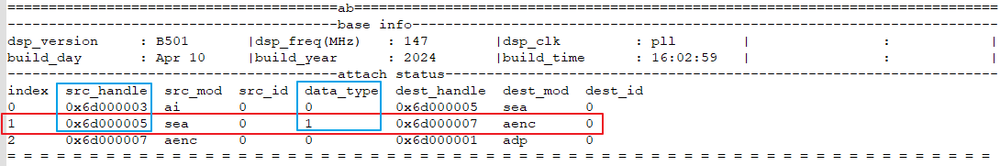

            注意到“attach status”中index为1的行，SEA模块的src\_handle，即需要的mod\_handle为0x6d000005，SEA模块的data\_type，即我们需要的mod\_output为1，所以抓取dump数据的命令为“AT^audio=sample\_dump /user/sea\_dump.pcm 1024 sea 0x6d000005 1”。

        2.  想抓取SOUND模块的输出数据，当proc ao抓取的数据如下时：

            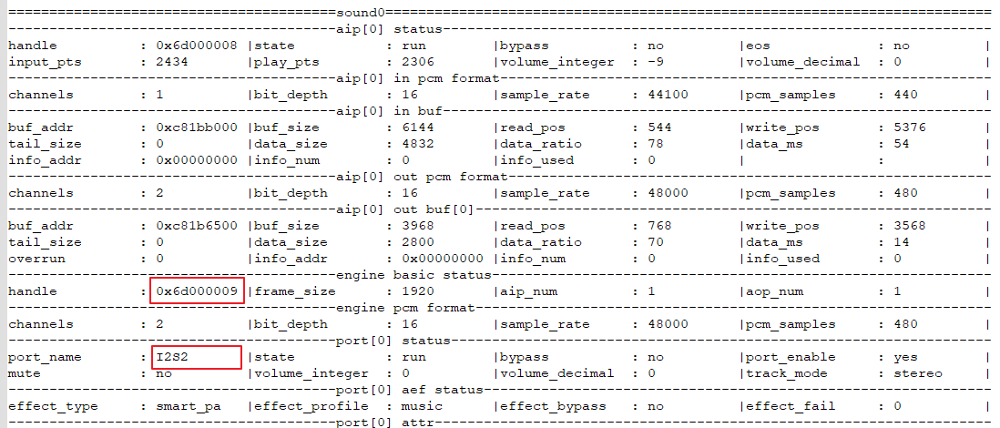

            注意到“engine basic status”中的handle，即需要的mod\_handle为0x6d000009，另外“port\[0\] status”中的port\_name为I2S2，通过查询“drivers\\drivers\\driver\\audio\\include\\soc\_uapi\_sound.h”中的uapi\_snd\_out\_port枚举，可以看到UAPI\_SND\_OUT\_PORT\_I2S2的值为0x12，故我们需要的mod\_output为0x12，所以抓取dump数据的命令为“AT^audio=sample\_dump /user/sound\_dump.pcm 1024 sound 0x6d000009 0x12”。

    在DebugKits虚拟串口执行抓取命令：

    -   抓取单个模块的输出数据：

        ```
        audio_dump file_size,mod_handle,mod_output
        ```

    -   不支持同时抓取两个模块的输出数据。
    -   文件存储：

        文件路径固定为“/user”，文件名为“dump\_%module%\_%handle%\_%out%.%fmt%”。

        例如抓取AI模块的输出数据，句柄为0x6d000003，输出端口为0，格式为pcm时，抓取到的文件名为“dump\_ai\_0x6d000003\_0x0.pcm”。

    -   命令参数取值范围：

        file\_size：dump文件大小。

        mod\_handle：模块句柄，用十六进制的32位无符号整数表示。

        mod\_output：模块的输出端口，用十六进制的32位无符号整数表示，只有SEA和SOUND模块需要指定，其他模块填0。

## 起播DUMP<a name="ZH-CN_TOPIC_0000002499501021"></a>

> **须知：** 
>需要在音频业务开始前打开起播DUMP，在音频业务结束后关闭DUMP，否则会造成ADP资源泄露。

AT串口命令：AT^audio=sample\_set\_config dump\_mask N

其中，AI＝1；SEA＝2；AENC＝4；ADEC＝8；TRACK＝16；AO＝32。把需要抓的模块对应的数字相加，即为N的值。

示例：

抓取蓝牙音乐中AENC、ADEC、TRACK、AO的起播dump数据，则需要计算：4＋8＋16＋32＝60，所以需要发送的指令为：AT^audio=sample\_set\_config dump\_mask 60。

1.  需要保证“/user/stream/”目录存在，若不存在可用DebugKits工具向该目录传任意文件，即可创建目录。
2.  看到显示“/user/stream/xxxx\_dump.pcm is saving.”才表示DUMP抓取成功。
3.  关闭起播dump的命令为：AT^audio=sample\_set\_config dump\_mask 0。

# 音频PROBE工具<a name="ZH-CN_TOPIC_0000002499581057"></a>

-   **[概述](#ZH-CN_TOPIC_0000002499581193)**  

-   **[使用方法](#ZH-CN_TOPIC_0000002466382044)**  

-   **[probe详解](#ZH-CN_TOPIC_0000002466541860)**  

## 概述<a name="ZH-CN_TOPIC_0000002499581193"></a>

通过下发命令查询音频模块心跳、系统、日志、消息状态。

-   仅支持从DebugKits虚拟串口抓取。

## 使用方法<a name="ZH-CN_TOPIC_0000002466382044"></a>

音频PROBE工具使用方法如下：

在DebugKits虚拟串口执行命令：audio\_probe

结果如下：

```
[DSP] core_id = 0.
heartbeat = 75891, run_step = sys_deinit.
sys_state = deep_standby, active = 2, active_standby = 0, deep_standby = 4.
log_success = 2, busy = 0, total_len = 38, cur_len = 19.
msg_success = 39, illegal_param = 0, ack_timeout = 0, underflow = 0, crc_fail = 0.
msg_int_fail = 0, msg_int_retrigger = 0.
```

## probe详解<a name="ZH-CN_TOPIC_0000002466541860"></a>

-   core\_id：DSP序号。
-   heartbeat：心跳，正常工作时应持续增长。
-   run\_step：上一步运行的函数。
-   sys\_state行：当前状态，以及进入各个状态的次数。
-   log\_success行：IPC log发送成功的次数，以及发送时busy的次数、发送的总长度、上一次发送的长度。
-   msg\_success行：msg成功的次数，以及遇到各种失败（非法参数、超时、欠载、CRC校验失败）的次数。
-   msg\_int\_fail行：msg中断触发失败的次数，以及重新触发的次数。

# 音频基础调试方法<a name="ZH-CN_TOPIC_0000002466541828"></a>

-   **[音频输入调测](#ZH-CN_TOPIC_0000002499501121)**  

-   **[音频输出调测](#ZH-CN_TOPIC_0000002499581221)**  

-   **[回声耦合调测](#ZH-CN_TOPIC_0000002466541712)**  

-   **[AEC效果调测](#ZH-CN_TOPIC_0000002466382100)**  

## 音频输入调测<a name="ZH-CN_TOPIC_0000002499501121"></a>

音频输入（Audio Input，简称AI）调测的基本步骤如下：

1.  使用标准音箱播放测试序列Input\_Sin，从声压计读取到分贝值为80dB。
2.  客户运行能保存音频输入数据的测试用例，进行录音。
3.  产生文件Rec\_Sout，分析该文件。

    具体调测项包括AI增益、电路干扰、AI底噪、Mic频率响应曲线（选测）。

音频输入调测所需环境如[图1](#zh-cn_topic_0000002409418180_fig1129195133718)所示。

**图 1**  音频输入调测示意图<a name="zh-cn_topic_0000002409418180_fig1129195133718"></a>  
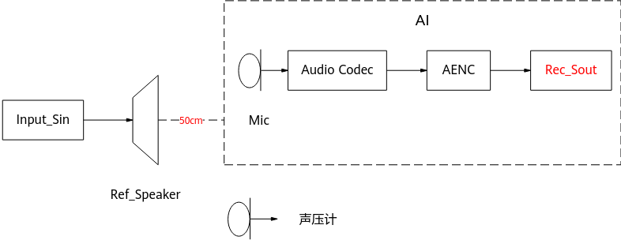

在音频输入调测过程中，需要注意以下几点要求：

-   测试环境尽量选择安静环境。
-   Input\_Sin使用软件生成的正弦波码流即可，若要测试频率响应曲线，可替换为扫频音。
-   标准音箱尽量选择频率响应平直的音箱，如真力Genelec G One。
-   声压计和测试设备水平放置，与标准音箱相隔距离50cm。

-   **[调测项-AI增益](#ZH-CN_TOPIC_0000002466541876)**  

-   **[调测项-AI电路干扰](#ZH-CN_TOPIC_0000002499501133)**  

-   **[调测项-AI底噪](#ZH-CN_TOPIC_0000002466382204)**  

### 调测项-AI增益<a name="ZH-CN_TOPIC_0000002466541876"></a>

> **说明：** 
>在AI增益调测过程中，涉及到的术语如下：
>削波：AD转换时，如果能量过大，会导致数字域超出负载，此时即为削波，表现为大量数字域幅度为0dB。

AI增益调测的具体方法如下：

1.  测试序列Input\_Sin可选用平均最大增益接近0dB的人声序列。
2.  将Rec\_Sout导入Audition软件中，选择“显示波形”。

    分析Rec\_Sout，如果整体能量低于-1dB，往大调整AI增益；如果已经出现削波问题，如[图1](#zh-cn_topic_0000002442977381__fig13509173362410)所示，往小调整AI增益（uapi\_ai\_set\_volume）。

    **图 1**  削波示意图<a name="zh-cn_topic_0000002442977381__fig13509173362410"></a>  
    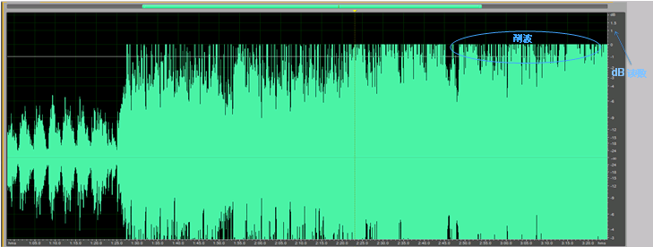

### 调测项-AI电路干扰<a name="ZH-CN_TOPIC_0000002499501133"></a>

> **说明：** 
>在AI电路干扰调测过程中，涉及到的术语如下：
>-   频域：从频域上分析音频信号，以确定其音频信号的频域组成。
>-   电路干扰：由于电路设计失误，导致音频模拟信号耦合进了其他电路信号，一般常见于WiFi电路干扰等。

AI电路干扰调测的具体方法如下：

1.  标准音箱不播放序列。
2.  将Rec\_Sout导入Audition软件中，选择“显示频谱”。

    正常情况下，频域上不会有非常明显的亮色条纹，表明其不存在电路干扰，如[图1](#zh-cn_topic_0000002409578048__fig1727713252615)所示；如果频域上存在明显亮色条纹，则代表存在电路干扰，如[图2](#zh-cn_topic_0000002409578048__fig52351348102619)所示。

    **图 1**  正常底噪<a name="zh-cn_topic_0000002409578048__fig1727713252615"></a>  
    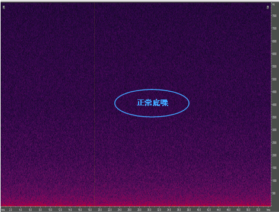

    **图 2**  电路干扰<a name="zh-cn_topic_0000002409578048__fig52351348102619"></a>  
    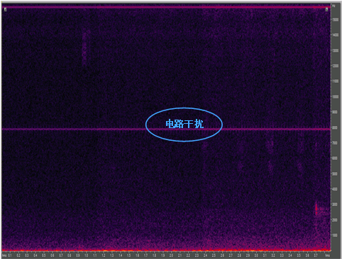

### 调测项-AI底噪<a name="ZH-CN_TOPIC_0000002466382204"></a>

AI底噪调测的具体方法如下：

1.  标准音箱不播放序列。
2.  将Rec\_Sout导入Audition软件中，选择“显示波形”。
3.  读取底噪的分贝值，如果底噪过大，需要检查对应Mic的信噪比并替换为性能更好的Mic。

    底噪分贝值读取的方法，如[图1](#zh-cn_topic_0000002443097305_fig451mcpsimp)所示。

    **图 1**  底噪分贝值读取方法<a name="zh-cn_topic_0000002443097305_fig451mcpsimp"></a>  
    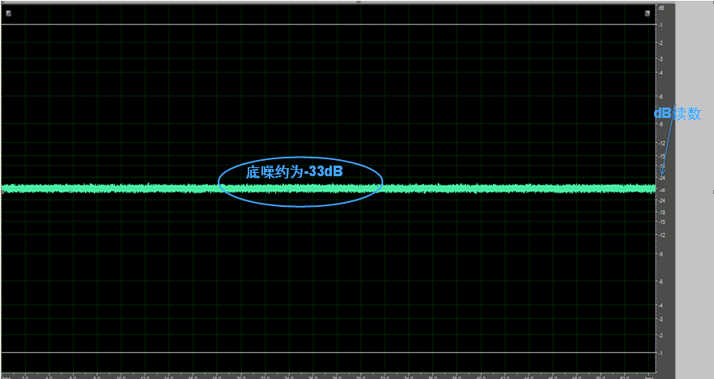

    > **说明：** 
    >AI底噪调测时需要确保已经配置合适增益，并不存在电路干扰问题。

## 音频输出调测<a name="ZH-CN_TOPIC_0000002499581221"></a>

音频输出（Audio Output，简称AO）调测的基本步骤如下：

1.  将参考Mic贴近设备的Speaker。
2.  客户运行能播放指定音频文件的测试用例，进行AudioFile的播放。
3.  参考Mic产生文件Spk\_Out，分析该文件。

    具体调测项包括AO增益，Speaker频响曲线（选测）。

音频输出调测的所需环境，如[图1](#zh-cn_topic_0000002409418140_fig1273925519429)所示。

**图 1**  音频输出调测示意图<a name="zh-cn_topic_0000002409418140_fig1273925519429"></a>  
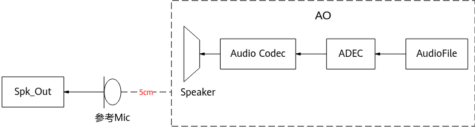

在音频输出调测过程中，需要注意以下几点要求：

-   测试环境尽量选择安静环境。
-   参考Mic需要尽量选择平滑曲线的Mic，如百灵达ECM 8000。
-   参考Mic尽量贴近设备的Speaker，距离为5cm。

-   **[调测项-AO增益](#ZH-CN_TOPIC_0000002466541796)**  

### 调测项-AO增益<a name="ZH-CN_TOPIC_0000002466541796"></a>

AO增益（track音量）调测的具体方法为：

1.  AudioFile可选用平均音量接近0dB的人声序列，如[图1](#zh-cn_topic_0000002409578000__fig65241059133017)所示。
2.  逐渐调大AO增益，直至Speaker出现破音现象。
3.  调整AO增益，直至无破音现象，固定此时AO增益。

    **图 1**  平均音量接近0dB的人声序列<a name="zh-cn_topic_0000002409578000__fig65241059133017"></a>  
    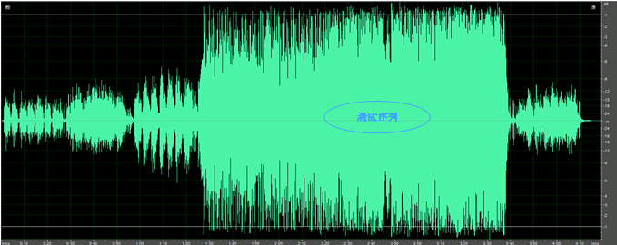

## 回声耦合调测<a name="ZH-CN_TOPIC_0000002466541712"></a>

回声耦合调测的基本步骤如下：

1.  将设备单独摆放在安静环境下。
2.  客户运行能播放指定音频文件和保存音频输入数据的测试用例，进行AudioFile的播放并录音。
3.  配置适当的AI/AO增益。
4.  调测项包括Loop增益、回波失真（选测）。

    回声耦合调测的所需环境，如[图1](#zh-cn_topic_0000002442977377_fig116895407817)所示：图中Speaker到Mic的虚线Echo表示Mic录到来自Speaker的回声。

    **图 1**  回声耦合调测示意图<a name="zh-cn_topic_0000002442977377_fig116895407817"></a>  
    

-   **[调测项-Loop增益](#ZH-CN_TOPIC_0000002466382116)**  

### 调测项-Loop增益<a name="ZH-CN_TOPIC_0000002466382116"></a>

Loop增益调测的具体方法如下：

1.  AudioFile可选用平均音量接近0dB的人声序列，如[图1](#zh-cn_topic_0000002409578000__fig65241059133017)所示。
2.  分析AI输出文件TestSout，如果存在削波现象，下调AI增益或者AO增益，直至无削波现象。

    > **说明：** 
    >在Loop增益调测过程中，需要注意：TestSout削波时，可以下调AI增益或者AO增益，依客户实际需求调整（如客户希望Speaker声音大，则下调AI增益）。

## AEC效果调测<a name="ZH-CN_TOPIC_0000002466382100"></a>

AEC效果调测的基本步骤如下：

1.  将设备单独摆放在安静环境下。
2.  AudioFile可选用平均音量接近-15dB的人声序列。
3.  客户运行能播放指定音频文件和保存音频输入数据的测试用例，进行AudioFile的播放并录音。
4.  配置适当的AI/AO增益。
5.  分析TestSout文件，当该文件中未出现明显漏回声现象时，即结构方面已无问题。

AEC效果调测的所需环境，如[图1](#zh-cn_topic_0000002442977373_fig7838121861416)所示。

**图 1**  AEC效果调测示意图<a name="zh-cn_topic_0000002442977373_fig7838121861416"></a>  
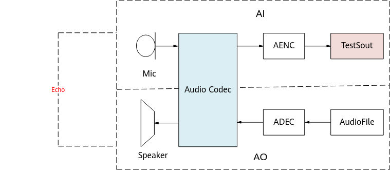

# 音频算法参数调试方法<a name="ZH-CN_TOPIC_0000002504105842"></a>

-   **[3A算法调试方法](#ZH-CN_TOPIC_0000002504265686)**  

-   **[音效调试方法](#ZH-CN_TOPIC_0000002535905665)**  

## 3A算法调试方法<a name="ZH-CN_TOPIC_0000002504265686"></a>

通话过程中音频3A参数可以通过DebugKits工具调试，工具界面和打开调试面板的操作步骤如下：

**图 1**  DebugKits工具界面示意图<a name="zh-cn_topic_0000002501483278_fig78551016513"></a>  
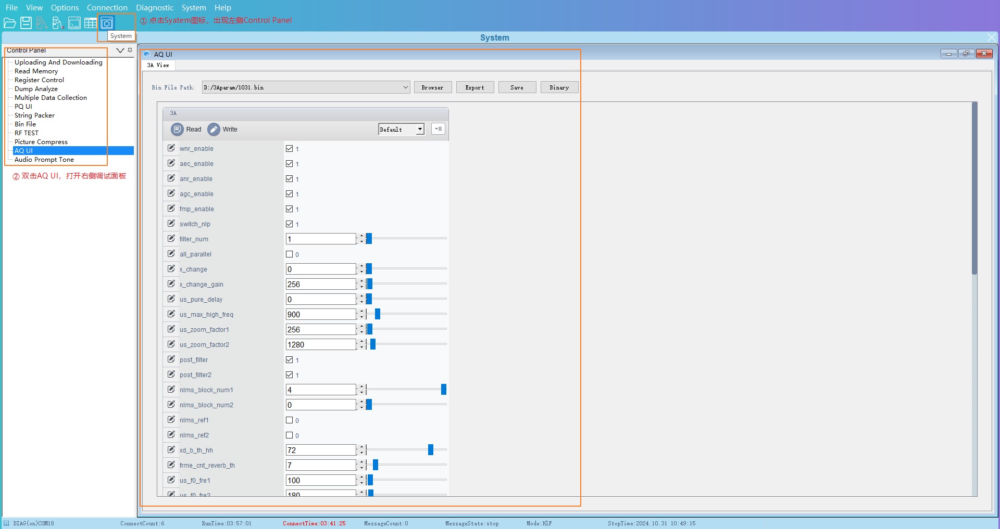

1.  点击System图标，出现左侧Control Panel。
2.  双击“AQ UI”，打开右侧调试面板。

**图 2**  3A参数配置流程及工具按钮功能示意图<a name="zh-cn_topic_0000002501483278_fig35538542052"></a>  
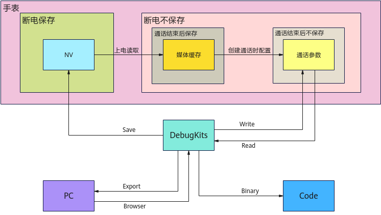

如[图2](#zh-cn_topic_0000002501483278_fig35538542052)所示，在手表中，共有三处会用到3A参数：

-   NV：用于保存3A参数，手表断电后不会丢失。
-   媒体缓存：在手表上电时从NV中读取3A参数并缓存，每次创建通话时配置到通话参数，手表断电后会丢失。
-   通话参数：实际生效并影响本次通话效果的参数，每次创建通话时由媒体配置，通话结束后不保存。

工具上的按钮功能介绍：

-   Browser：打开PC上的一个参数文件并解析其中的参数到工具中。
-   Export：将工具中的参数导出到PC上的参数文件中（需要先使用Browser打开一个文件）。
-   Save：将工具中的参数保存到手表上的NV中。
-   Binary：将工具中的参数转换成二进制格式，用于替换代码中的参数（替换代码中的参数请参考《软件开发指南》“音频相关特性”中“3A算法参数配置”小节）。
-   Read：读取本次通话的参数到工具中。
-   Write：将工具中的参数配置到本次通话的参数中。

> **说明：** 
>在需要反复接通挂断通话，又要求每次通话开始时就要使用新参数的场景（例如调试回声收敛时间），可以通过添加以下代码段来避免反复重启手表。

在“middleware\\services\\media\\hal\\audio\\plugins\\brandy\\common\\src\\plugin\_common.c”中的SetSeaExtraParam函数开头添加以下代码段：

```
    uint16_t len = 0;
    errcode_t nvRet = uapi_nv_read(NV_ID_AUDIO_VQE_PARAM, (uint16_t)sizeof(audio_vqe_param_t), &len, (uint8_t *)&g_vqeParam);
    if (nvRet != MEDIA_HAL_OK) {
        MEDIA_HAL_LOGW(MODULE_NAME, "nv read sea param faild!");
    }
```

## 音效调试方法<a name="ZH-CN_TOPIC_0000002535905665"></a>

音乐播放过程中音效参数可以通过DebugKits工具调试，工具界面和打开调试面板的操作步骤如下：

**图 1**  DebugKits工具界面示意图<a name="zh-cn_topic_0000002501485140_fig16273151992118"></a>  

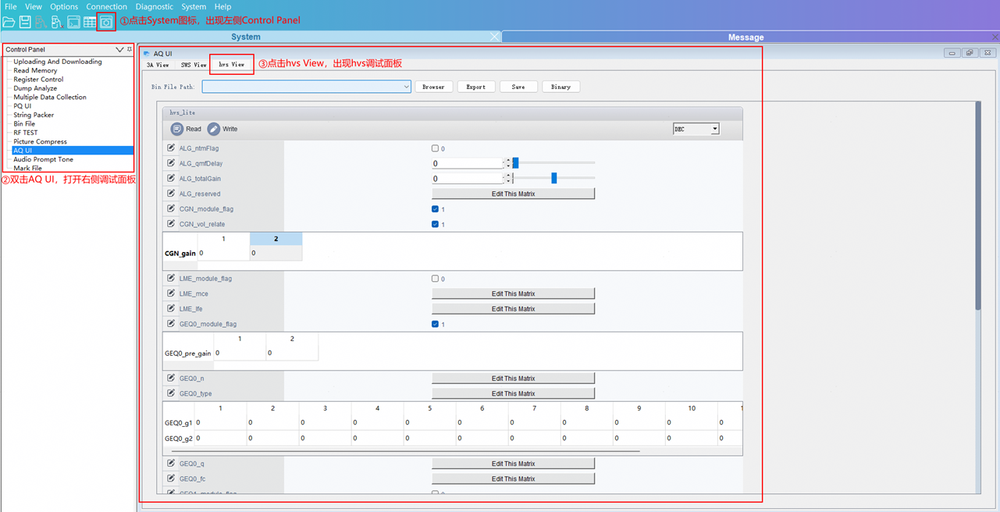

1.  点击System图标，出现左侧Control Panel。
2.  双击“AQ UI”，打开右侧调试面板。

工具上的按钮功能介绍：

-   Browser：打开PC上的一个参数文件并解析其中的参数到工具中。
-   Export：将工具中的参数导出到PC上的参数文件中（需要先使用Browser打开一个文件）。
-   Save：将工具中的参数保存到手表上的NV中。
-   Binary：将工具中的参数转换成二进制格式，用于替换代码中的参数。
-   Read：读取本次通话的参数到工具中。
-   Write：将工具中的参数配置到音效算法的参数中。

**表 1**  算法参数说明

<a name="zh-cn_topic_0000002501485140_table7311217123810"></a>
<table><thead align="left"><tr id="zh-cn_topic_0000002501485140_row101251617163818"><th class="cellrowborder" valign="top" width="7.170717071707171%" id="mcps1.2.7.1.1"><p id="zh-cn_topic_0000002501485140_p18125161763812"><a name="zh-cn_topic_0000002501485140_p18125161763812"></a><a name="zh-cn_topic_0000002501485140_p18125161763812"></a>模块</p>
</th>
<th class="cellrowborder" valign="top" width="14.5014501450145%" id="mcps1.2.7.1.2"><p id="zh-cn_topic_0000002501485140_p1712561711384"><a name="zh-cn_topic_0000002501485140_p1712561711384"></a><a name="zh-cn_topic_0000002501485140_p1712561711384"></a>参数名</p>
</th>
<th class="cellrowborder" valign="top" width="10.061006100610062%" id="mcps1.2.7.1.3"><p id="zh-cn_topic_0000002501485140_p9125181715382"><a name="zh-cn_topic_0000002501485140_p9125181715382"></a><a name="zh-cn_topic_0000002501485140_p9125181715382"></a>数据类型</p>
</th>
<th class="cellrowborder" valign="top" width="12.91129112911291%" id="mcps1.2.7.1.4"><p id="zh-cn_topic_0000002501485140_p1912511719389"><a name="zh-cn_topic_0000002501485140_p1912511719389"></a><a name="zh-cn_topic_0000002501485140_p1912511719389"></a>参数范围</p>
</th>
<th class="cellrowborder" valign="top" width="9.470947094709471%" id="mcps1.2.7.1.5"><p id="zh-cn_topic_0000002501485140_p612511783820"><a name="zh-cn_topic_0000002501485140_p612511783820"></a><a name="zh-cn_topic_0000002501485140_p612511783820"></a>默认值</p>
</th>
<th class="cellrowborder" valign="top" width="45.88458845884588%" id="mcps1.2.7.1.6"><p id="zh-cn_topic_0000002501485140_p21259177382"><a name="zh-cn_topic_0000002501485140_p21259177382"></a><a name="zh-cn_topic_0000002501485140_p21259177382"></a>参数说明</p>
</th>
</tr>
</thead>
<tbody><tr id="zh-cn_topic_0000002501485140_row11125161763817"><td class="cellrowborder" rowspan="4" valign="top" width="7.170717071707171%" headers="mcps1.2.7.1.1 "><p id="zh-cn_topic_0000002501485140_p91251117173818"><a name="zh-cn_topic_0000002501485140_p91251117173818"></a><a name="zh-cn_topic_0000002501485140_p91251117173818"></a>ALG</p>
</td>
<td class="cellrowborder" valign="top" width="14.5014501450145%" headers="mcps1.2.7.1.2 "><p id="zh-cn_topic_0000002501485140_p8125101703812"><a name="zh-cn_topic_0000002501485140_p8125101703812"></a><a name="zh-cn_topic_0000002501485140_p8125101703812"></a>ntmFlag</p>
</td>
<td class="cellrowborder" valign="top" width="10.061006100610062%" headers="mcps1.2.7.1.3 "><p id="zh-cn_topic_0000002501485140_p9125171773818"><a name="zh-cn_topic_0000002501485140_p9125171773818"></a><a name="zh-cn_topic_0000002501485140_p9125171773818"></a>short</p>
</td>
<td class="cellrowborder" valign="top" width="12.91129112911291%" headers="mcps1.2.7.1.4 "><p id="zh-cn_topic_0000002501485140_p161250173384"><a name="zh-cn_topic_0000002501485140_p161250173384"></a><a name="zh-cn_topic_0000002501485140_p161250173384"></a>0或1</p>
</td>
<td class="cellrowborder" valign="top" width="9.470947094709471%" headers="mcps1.2.7.1.5 "><p id="zh-cn_topic_0000002501485140_p141251217203816"><a name="zh-cn_topic_0000002501485140_p141251217203816"></a><a name="zh-cn_topic_0000002501485140_p141251217203816"></a>0</p>
</td>
<td class="cellrowborder" valign="top" width="45.88458845884588%" headers="mcps1.2.7.1.6 "><p id="zh-cn_topic_0000002501485140_p71251717173820"><a name="zh-cn_topic_0000002501485140_p71251717173820"></a><a name="zh-cn_topic_0000002501485140_p71251717173820"></a>模式开关，暂不涉及。</p>
</td>
</tr>
<tr id="zh-cn_topic_0000002501485140_row121251517133810"><td class="cellrowborder" valign="top" headers="mcps1.2.7.1.1 "><p id="zh-cn_topic_0000002501485140_p3125181715388"><a name="zh-cn_topic_0000002501485140_p3125181715388"></a><a name="zh-cn_topic_0000002501485140_p3125181715388"></a>qmfDelay</p>
</td>
<td class="cellrowborder" valign="top" headers="mcps1.2.7.1.2 "><p id="zh-cn_topic_0000002501485140_p12125101763813"><a name="zh-cn_topic_0000002501485140_p12125101763813"></a><a name="zh-cn_topic_0000002501485140_p12125101763813"></a>short</p>
</td>
<td class="cellrowborder" valign="top" headers="mcps1.2.7.1.3 "><p id="zh-cn_topic_0000002501485140_p111251517173814"><a name="zh-cn_topic_0000002501485140_p111251517173814"></a><a name="zh-cn_topic_0000002501485140_p111251517173814"></a>[2,2048]</p>
</td>
<td class="cellrowborder" valign="top" headers="mcps1.2.7.1.4 "><p id="zh-cn_topic_0000002501485140_p112551763818"><a name="zh-cn_topic_0000002501485140_p112551763818"></a><a name="zh-cn_topic_0000002501485140_p112551763818"></a>0</p>
</td>
<td class="cellrowborder" valign="top" headers="mcps1.2.7.1.5 "><p id="zh-cn_topic_0000002501485140_p0125817143812"><a name="zh-cn_topic_0000002501485140_p0125817143812"></a><a name="zh-cn_topic_0000002501485140_p0125817143812"></a>正交滤波器时延，暂不涉及。</p>
</td>
</tr>
<tr id="zh-cn_topic_0000002501485140_row212516171382"><td class="cellrowborder" valign="top" headers="mcps1.2.7.1.1 "><p id="zh-cn_topic_0000002501485140_p3125617133813"><a name="zh-cn_topic_0000002501485140_p3125617133813"></a><a name="zh-cn_topic_0000002501485140_p3125617133813"></a>totalGain</p>
</td>
<td class="cellrowborder" valign="top" headers="mcps1.2.7.1.2 "><p id="zh-cn_topic_0000002501485140_p17125121783812"><a name="zh-cn_topic_0000002501485140_p17125121783812"></a><a name="zh-cn_topic_0000002501485140_p17125121783812"></a>short</p>
</td>
<td class="cellrowborder" valign="top" headers="mcps1.2.7.1.3 "><p id="zh-cn_topic_0000002501485140_p212512179384"><a name="zh-cn_topic_0000002501485140_p212512179384"></a><a name="zh-cn_topic_0000002501485140_p212512179384"></a>[-60,60]</p>
</td>
<td class="cellrowborder" valign="top" headers="mcps1.2.7.1.4 "><p id="zh-cn_topic_0000002501485140_p51251217193817"><a name="zh-cn_topic_0000002501485140_p51251217193817"></a><a name="zh-cn_topic_0000002501485140_p51251217193817"></a>0</p>
</td>
<td class="cellrowborder" valign="top" headers="mcps1.2.7.1.5 "><p id="zh-cn_topic_0000002501485140_p41251617143819"><a name="zh-cn_topic_0000002501485140_p41251617143819"></a><a name="zh-cn_topic_0000002501485140_p41251617143819"></a>总体增益，暂不涉及。</p>
</td>
</tr>
<tr id="zh-cn_topic_0000002501485140_row111251917153813"><td class="cellrowborder" valign="top" headers="mcps1.2.7.1.1 "><p id="zh-cn_topic_0000002501485140_p7125101753813"><a name="zh-cn_topic_0000002501485140_p7125101753813"></a><a name="zh-cn_topic_0000002501485140_p7125101753813"></a>reserve0[5]</p>
</td>
<td class="cellrowborder" valign="top" headers="mcps1.2.7.1.2 "><p id="zh-cn_topic_0000002501485140_p1212571773812"><a name="zh-cn_topic_0000002501485140_p1212571773812"></a><a name="zh-cn_topic_0000002501485140_p1212571773812"></a>short</p>
</td>
<td class="cellrowborder" valign="top" headers="mcps1.2.7.1.3 "><p id="zh-cn_topic_0000002501485140_p0125141718386"><a name="zh-cn_topic_0000002501485140_p0125141718386"></a><a name="zh-cn_topic_0000002501485140_p0125141718386"></a>0或1</p>
</td>
<td class="cellrowborder" valign="top" headers="mcps1.2.7.1.4 "><p id="zh-cn_topic_0000002501485140_p1125217123820"><a name="zh-cn_topic_0000002501485140_p1125217123820"></a><a name="zh-cn_topic_0000002501485140_p1125217123820"></a>0</p>
</td>
<td class="cellrowborder" valign="top" headers="mcps1.2.7.1.5 "><p id="zh-cn_topic_0000002501485140_p101253172384"><a name="zh-cn_topic_0000002501485140_p101253172384"></a><a name="zh-cn_topic_0000002501485140_p101253172384"></a>保留位，暂不涉及。</p>
</td>
</tr>
<tr id="zh-cn_topic_0000002501485140_row11125101710388"><td class="cellrowborder" rowspan="3" valign="top" width="7.170717071707171%" headers="mcps1.2.7.1.1 "><p id="zh-cn_topic_0000002501485140_p151264172388"><a name="zh-cn_topic_0000002501485140_p151264172388"></a><a name="zh-cn_topic_0000002501485140_p151264172388"></a>CGN</p>
</td>
<td class="cellrowborder" valign="top" width="14.5014501450145%" headers="mcps1.2.7.1.2 "><p id="zh-cn_topic_0000002501485140_p171262175388"><a name="zh-cn_topic_0000002501485140_p171262175388"></a><a name="zh-cn_topic_0000002501485140_p171262175388"></a>module_flag</p>
</td>
<td class="cellrowborder" valign="top" width="10.061006100610062%" headers="mcps1.2.7.1.3 "><p id="zh-cn_topic_0000002501485140_p1312691763816"><a name="zh-cn_topic_0000002501485140_p1312691763816"></a><a name="zh-cn_topic_0000002501485140_p1312691763816"></a>short</p>
</td>
<td class="cellrowborder" valign="top" width="12.91129112911291%" headers="mcps1.2.7.1.4 "><p id="zh-cn_topic_0000002501485140_p51261817123819"><a name="zh-cn_topic_0000002501485140_p51261817123819"></a><a name="zh-cn_topic_0000002501485140_p51261817123819"></a>0或1</p>
</td>
<td class="cellrowborder" valign="top" width="9.470947094709471%" headers="mcps1.2.7.1.5 "><p id="zh-cn_topic_0000002501485140_p1126121743818"><a name="zh-cn_topic_0000002501485140_p1126121743818"></a><a name="zh-cn_topic_0000002501485140_p1126121743818"></a>1</p>
</td>
<td class="cellrowborder" valign="top" width="45.88458845884588%" headers="mcps1.2.7.1.6 "><p id="zh-cn_topic_0000002501485140_p612616173385"><a name="zh-cn_topic_0000002501485140_p612616173385"></a><a name="zh-cn_topic_0000002501485140_p612616173385"></a>增益模块开关，0：关闭；1：开启。</p>
</td>
</tr>
<tr id="zh-cn_topic_0000002501485140_row1212651753810"><td class="cellrowborder" valign="top" headers="mcps1.2.7.1.1 "><p id="zh-cn_topic_0000002501485140_p19126121723812"><a name="zh-cn_topic_0000002501485140_p19126121723812"></a><a name="zh-cn_topic_0000002501485140_p19126121723812"></a>vol_relate</p>
</td>
<td class="cellrowborder" valign="top" headers="mcps1.2.7.1.2 "><p id="zh-cn_topic_0000002501485140_p1012651763813"><a name="zh-cn_topic_0000002501485140_p1012651763813"></a><a name="zh-cn_topic_0000002501485140_p1012651763813"></a>short</p>
</td>
<td class="cellrowborder" valign="top" headers="mcps1.2.7.1.3 "><p id="zh-cn_topic_0000002501485140_p17126141783810"><a name="zh-cn_topic_0000002501485140_p17126141783810"></a><a name="zh-cn_topic_0000002501485140_p17126141783810"></a>0或1</p>
</td>
<td class="cellrowborder" valign="top" headers="mcps1.2.7.1.4 "><p id="zh-cn_topic_0000002501485140_p8126181793816"><a name="zh-cn_topic_0000002501485140_p8126181793816"></a><a name="zh-cn_topic_0000002501485140_p8126181793816"></a>1</p>
</td>
<td class="cellrowborder" valign="top" headers="mcps1.2.7.1.5 "><p id="zh-cn_topic_0000002501485140_p16126181733813"><a name="zh-cn_topic_0000002501485140_p16126181733813"></a><a name="zh-cn_topic_0000002501485140_p16126181733813"></a>捆绑系统音量开关，0：关闭；1：开启。</p>
</td>
</tr>
<tr id="zh-cn_topic_0000002501485140_row712611713815"><td class="cellrowborder" valign="top" headers="mcps1.2.7.1.1 "><p id="zh-cn_topic_0000002501485140_p18126101713387"><a name="zh-cn_topic_0000002501485140_p18126101713387"></a><a name="zh-cn_topic_0000002501485140_p18126101713387"></a>gain[2]</p>
</td>
<td class="cellrowborder" valign="top" headers="mcps1.2.7.1.2 "><p id="zh-cn_topic_0000002501485140_p11126171720387"><a name="zh-cn_topic_0000002501485140_p11126171720387"></a><a name="zh-cn_topic_0000002501485140_p11126171720387"></a>float</p>
</td>
<td class="cellrowborder" valign="top" headers="mcps1.2.7.1.3 "><p id="zh-cn_topic_0000002501485140_p412621723816"><a name="zh-cn_topic_0000002501485140_p412621723816"></a><a name="zh-cn_topic_0000002501485140_p412621723816"></a>[-10.0,10.0]</p>
</td>
<td class="cellrowborder" valign="top" headers="mcps1.2.7.1.4 "><p id="zh-cn_topic_0000002501485140_p71262017163814"><a name="zh-cn_topic_0000002501485140_p71262017163814"></a><a name="zh-cn_topic_0000002501485140_p71262017163814"></a>0</p>
</td>
<td class="cellrowborder" valign="top" headers="mcps1.2.7.1.5 "><p id="zh-cn_topic_0000002501485140_p5126161712383"><a name="zh-cn_topic_0000002501485140_p5126161712383"></a><a name="zh-cn_topic_0000002501485140_p5126161712383"></a>CGN增益，范围&plusmn;10dB。</p>
</td>
</tr>
<tr id="zh-cn_topic_0000002501485140_row20126121712381"><td class="cellrowborder" rowspan="6" valign="top" width="7.170717071707171%" headers="mcps1.2.7.1.1 "><p id="zh-cn_topic_0000002501485140_p131269179383"><a name="zh-cn_topic_0000002501485140_p131269179383"></a><a name="zh-cn_topic_0000002501485140_p131269179383"></a>LME</p>
</td>
<td class="cellrowborder" valign="top" width="14.5014501450145%" headers="mcps1.2.7.1.2 "><p id="zh-cn_topic_0000002501485140_p51261317123817"><a name="zh-cn_topic_0000002501485140_p51261317123817"></a><a name="zh-cn_topic_0000002501485140_p51261317123817"></a>module_flag</p>
</td>
<td class="cellrowborder" valign="top" width="10.061006100610062%" headers="mcps1.2.7.1.3 "><p id="zh-cn_topic_0000002501485140_p412641733815"><a name="zh-cn_topic_0000002501485140_p412641733815"></a><a name="zh-cn_topic_0000002501485140_p412641733815"></a>short</p>
</td>
<td class="cellrowborder" valign="top" width="12.91129112911291%" headers="mcps1.2.7.1.4 "><p id="zh-cn_topic_0000002501485140_p16126121733816"><a name="zh-cn_topic_0000002501485140_p16126121733816"></a><a name="zh-cn_topic_0000002501485140_p16126121733816"></a>0或1</p>
</td>
<td class="cellrowborder" valign="top" width="9.470947094709471%" headers="mcps1.2.7.1.5 "><p id="zh-cn_topic_0000002501485140_p71261717113814"><a name="zh-cn_topic_0000002501485140_p71261717113814"></a><a name="zh-cn_topic_0000002501485140_p71261717113814"></a>1</p>
</td>
<td class="cellrowborder" valign="top" width="45.88458845884588%" headers="mcps1.2.7.1.6 "><p id="zh-cn_topic_0000002501485140_p712618175386"><a name="zh-cn_topic_0000002501485140_p712618175386"></a><a name="zh-cn_topic_0000002501485140_p712618175386"></a>人声增强和低频增强开关  0：关闭；1：开启</p>
</td>
</tr>
<tr id="zh-cn_topic_0000002501485140_row1612651717384"><td class="cellrowborder" valign="top" headers="mcps1.2.7.1.1 "><p id="zh-cn_topic_0000002501485140_p1512601793810"><a name="zh-cn_topic_0000002501485140_p1512601793810"></a><a name="zh-cn_topic_0000002501485140_p1512601793810"></a>mce0</p>
</td>
<td class="cellrowborder" valign="top" headers="mcps1.2.7.1.2 "><p id="zh-cn_topic_0000002501485140_p1212619176387"><a name="zh-cn_topic_0000002501485140_p1212619176387"></a><a name="zh-cn_topic_0000002501485140_p1212619176387"></a>short</p>
</td>
<td class="cellrowborder" valign="top" headers="mcps1.2.7.1.3 "><p id="zh-cn_topic_0000002501485140_p21261917133819"><a name="zh-cn_topic_0000002501485140_p21261917133819"></a><a name="zh-cn_topic_0000002501485140_p21261917133819"></a>[0,1000]</p>
</td>
<td class="cellrowborder" valign="top" headers="mcps1.2.7.1.4 "><p id="zh-cn_topic_0000002501485140_p17126171763816"><a name="zh-cn_topic_0000002501485140_p17126171763816"></a><a name="zh-cn_topic_0000002501485140_p17126171763816"></a>200</p>
</td>
<td class="cellrowborder" valign="top" headers="mcps1.2.7.1.5 "><p id="zh-cn_topic_0000002501485140_p912611723814"><a name="zh-cn_topic_0000002501485140_p912611723814"></a><a name="zh-cn_topic_0000002501485140_p912611723814"></a>氛围声增益，调节提取人声的干净程度。</p>
</td>
</tr>
<tr id="zh-cn_topic_0000002501485140_row10126191720386"><td class="cellrowborder" valign="top" headers="mcps1.2.7.1.1 "><p id="zh-cn_topic_0000002501485140_p1912621712380"><a name="zh-cn_topic_0000002501485140_p1912621712380"></a><a name="zh-cn_topic_0000002501485140_p1912621712380"></a>mce1</p>
</td>
<td class="cellrowborder" valign="top" headers="mcps1.2.7.1.2 "><p id="zh-cn_topic_0000002501485140_p141272017103810"><a name="zh-cn_topic_0000002501485140_p141272017103810"></a><a name="zh-cn_topic_0000002501485140_p141272017103810"></a>short</p>
</td>
<td class="cellrowborder" valign="top" headers="mcps1.2.7.1.3 "><p id="zh-cn_topic_0000002501485140_p17127101723815"><a name="zh-cn_topic_0000002501485140_p17127101723815"></a><a name="zh-cn_topic_0000002501485140_p17127101723815"></a>[0,1000]</p>
</td>
<td class="cellrowborder" valign="top" headers="mcps1.2.7.1.4 "><p id="zh-cn_topic_0000002501485140_p81271617193813"><a name="zh-cn_topic_0000002501485140_p81271617193813"></a><a name="zh-cn_topic_0000002501485140_p81271617193813"></a>80</p>
</td>
<td class="cellrowborder" valign="top" headers="mcps1.2.7.1.5 "><p id="zh-cn_topic_0000002501485140_p16127117113819"><a name="zh-cn_topic_0000002501485140_p16127117113819"></a><a name="zh-cn_topic_0000002501485140_p16127117113819"></a>氛围声整体均值对应的增益，调节提取人声的干净程度。</p>
</td>
</tr>
<tr id="zh-cn_topic_0000002501485140_row712720172385"><td class="cellrowborder" valign="top" headers="mcps1.2.7.1.1 "><p id="zh-cn_topic_0000002501485140_p19127917143810"><a name="zh-cn_topic_0000002501485140_p19127917143810"></a><a name="zh-cn_topic_0000002501485140_p19127917143810"></a>mce2</p>
</td>
<td class="cellrowborder" valign="top" headers="mcps1.2.7.1.2 "><p id="zh-cn_topic_0000002501485140_p5127917133811"><a name="zh-cn_topic_0000002501485140_p5127917133811"></a><a name="zh-cn_topic_0000002501485140_p5127917133811"></a>short</p>
</td>
<td class="cellrowborder" valign="top" headers="mcps1.2.7.1.3 "><p id="zh-cn_topic_0000002501485140_p1912771714380"><a name="zh-cn_topic_0000002501485140_p1912771714380"></a><a name="zh-cn_topic_0000002501485140_p1912771714380"></a>[0,1000]</p>
</td>
<td class="cellrowborder" valign="top" headers="mcps1.2.7.1.4 "><p id="zh-cn_topic_0000002501485140_p61271517173815"><a name="zh-cn_topic_0000002501485140_p61271517173815"></a><a name="zh-cn_topic_0000002501485140_p61271517173815"></a>15</p>
</td>
<td class="cellrowborder" valign="top" headers="mcps1.2.7.1.5 "><p id="zh-cn_topic_0000002501485140_p11272017153812"><a name="zh-cn_topic_0000002501485140_p11272017153812"></a><a name="zh-cn_topic_0000002501485140_p11272017153812"></a>人声估计增益下限。</p>
</td>
</tr>
<tr id="zh-cn_topic_0000002501485140_row912751712386"><td class="cellrowborder" valign="top" headers="mcps1.2.7.1.1 "><p id="zh-cn_topic_0000002501485140_p4127181710387"><a name="zh-cn_topic_0000002501485140_p4127181710387"></a><a name="zh-cn_topic_0000002501485140_p4127181710387"></a>mce3</p>
</td>
<td class="cellrowborder" valign="top" headers="mcps1.2.7.1.2 "><p id="zh-cn_topic_0000002501485140_p11127217143813"><a name="zh-cn_topic_0000002501485140_p11127217143813"></a><a name="zh-cn_topic_0000002501485140_p11127217143813"></a>short</p>
</td>
<td class="cellrowborder" valign="top" headers="mcps1.2.7.1.3 "><p id="zh-cn_topic_0000002501485140_p19127111712389"><a name="zh-cn_topic_0000002501485140_p19127111712389"></a><a name="zh-cn_topic_0000002501485140_p19127111712389"></a>[0,1000]</p>
</td>
<td class="cellrowborder" valign="top" headers="mcps1.2.7.1.4 "><p id="zh-cn_topic_0000002501485140_p11127191718387"><a name="zh-cn_topic_0000002501485140_p11127191718387"></a><a name="zh-cn_topic_0000002501485140_p11127191718387"></a>30</p>
</td>
<td class="cellrowborder" valign="top" headers="mcps1.2.7.1.5 "><p id="zh-cn_topic_0000002501485140_p1212721717389"><a name="zh-cn_topic_0000002501485140_p1212721717389"></a><a name="zh-cn_topic_0000002501485140_p1212721717389"></a>估计出的人声频域平滑系数。</p>
</td>
</tr>
<tr id="zh-cn_topic_0000002501485140_row1912718174383"><td class="cellrowborder" valign="top" headers="mcps1.2.7.1.1 "><p id="zh-cn_topic_0000002501485140_p101271717193815"><a name="zh-cn_topic_0000002501485140_p101271717193815"></a><a name="zh-cn_topic_0000002501485140_p101271717193815"></a>lfe[10]</p>
</td>
<td class="cellrowborder" valign="top" headers="mcps1.2.7.1.2 "><p id="zh-cn_topic_0000002501485140_p1912781773812"><a name="zh-cn_topic_0000002501485140_p1912781773812"></a><a name="zh-cn_topic_0000002501485140_p1912781773812"></a>short</p>
</td>
<td class="cellrowborder" valign="top" headers="mcps1.2.7.1.3 "><p id="zh-cn_topic_0000002501485140_p5127111753813"><a name="zh-cn_topic_0000002501485140_p5127111753813"></a><a name="zh-cn_topic_0000002501485140_p5127111753813"></a>[0,10000]</p>
</td>
<td class="cellrowborder" valign="top" headers="mcps1.2.7.1.4 "><p id="zh-cn_topic_0000002501485140_p1312791713819"><a name="zh-cn_topic_0000002501485140_p1312791713819"></a><a name="zh-cn_topic_0000002501485140_p1312791713819"></a>{9900,9900,9900,9800,9000,0,0,0,0,0}</p>
</td>
<td class="cellrowborder" valign="top" headers="mcps1.2.7.1.5 "><p id="zh-cn_topic_0000002501485140_p812751723818"><a name="zh-cn_topic_0000002501485140_p812751723818"></a><a name="zh-cn_topic_0000002501485140_p812751723818"></a>低音增强平滑系数，值越大低音增强程度越大，,1代表0.0001，系数对应频点[31.25,62.5,125,250, 500,1000,2000,4000,8000,16000]。</p>
</td>
</tr>
<tr id="zh-cn_topic_0000002501485140_row41273178386"><td class="cellrowborder" rowspan="6" valign="top" width="7.170717071707171%" headers="mcps1.2.7.1.1 "><p id="zh-cn_topic_0000002501485140_p6127101719382"><a name="zh-cn_topic_0000002501485140_p6127101719382"></a><a name="zh-cn_topic_0000002501485140_p6127101719382"></a>GEQ0</p>
</td>
<td class="cellrowborder" valign="top" width="14.5014501450145%" headers="mcps1.2.7.1.2 "><p id="zh-cn_topic_0000002501485140_p9127417133812"><a name="zh-cn_topic_0000002501485140_p9127417133812"></a><a name="zh-cn_topic_0000002501485140_p9127417133812"></a>module_flag</p>
</td>
<td class="cellrowborder" valign="top" width="10.061006100610062%" headers="mcps1.2.7.1.3 "><p id="zh-cn_topic_0000002501485140_p11278177389"><a name="zh-cn_topic_0000002501485140_p11278177389"></a><a name="zh-cn_topic_0000002501485140_p11278177389"></a>short</p>
</td>
<td class="cellrowborder" valign="top" width="12.91129112911291%" headers="mcps1.2.7.1.4 "><p id="zh-cn_topic_0000002501485140_p71271217163817"><a name="zh-cn_topic_0000002501485140_p71271217163817"></a><a name="zh-cn_topic_0000002501485140_p71271217163817"></a>0或1</p>
</td>
<td class="cellrowborder" valign="top" width="9.470947094709471%" headers="mcps1.2.7.1.5 "><p id="zh-cn_topic_0000002501485140_p181275178389"><a name="zh-cn_topic_0000002501485140_p181275178389"></a><a name="zh-cn_topic_0000002501485140_p181275178389"></a>1</p>
</td>
<td class="cellrowborder" valign="top" width="45.88458845884588%" headers="mcps1.2.7.1.6 "><p id="zh-cn_topic_0000002501485140_p14127121733811"><a name="zh-cn_topic_0000002501485140_p14127121733811"></a><a name="zh-cn_topic_0000002501485140_p14127121733811"></a>GEQ0模块开关，0：关闭；1：开启。</p>
</td>
</tr>
<tr id="zh-cn_topic_0000002501485140_row12127717133815"><td class="cellrowborder" valign="top" headers="mcps1.2.7.1.1 "><p id="zh-cn_topic_0000002501485140_p61271917183812"><a name="zh-cn_topic_0000002501485140_p61271917183812"></a><a name="zh-cn_topic_0000002501485140_p61271917183812"></a>pre_gain[2]</p>
</td>
<td class="cellrowborder" valign="top" headers="mcps1.2.7.1.2 "><p id="zh-cn_topic_0000002501485140_p112713177385"><a name="zh-cn_topic_0000002501485140_p112713177385"></a><a name="zh-cn_topic_0000002501485140_p112713177385"></a>short</p>
</td>
<td class="cellrowborder" valign="top" headers="mcps1.2.7.1.3 "><p id="zh-cn_topic_0000002501485140_p212741712381"><a name="zh-cn_topic_0000002501485140_p212741712381"></a><a name="zh-cn_topic_0000002501485140_p212741712381"></a>[-10.0,10.0]</p>
</td>
<td class="cellrowborder" valign="top" headers="mcps1.2.7.1.4 "><p id="zh-cn_topic_0000002501485140_p12127917193817"><a name="zh-cn_topic_0000002501485140_p12127917193817"></a><a name="zh-cn_topic_0000002501485140_p12127917193817"></a>0</p>
</td>
<td class="cellrowborder" valign="top" headers="mcps1.2.7.1.5 "><p id="zh-cn_topic_0000002501485140_p1127017133810"><a name="zh-cn_topic_0000002501485140_p1127017133810"></a><a name="zh-cn_topic_0000002501485140_p1127017133810"></a>GEQ0模块整体增益。</p>
</td>
</tr>
<tr id="zh-cn_topic_0000002501485140_row2127201763811"><td class="cellrowborder" valign="top" headers="mcps1.2.7.1.1 "><p id="zh-cn_topic_0000002501485140_p91271173385"><a name="zh-cn_topic_0000002501485140_p91271173385"></a><a name="zh-cn_topic_0000002501485140_p91271173385"></a>n[2]</p>
</td>
<td class="cellrowborder" valign="top" headers="mcps1.2.7.1.2 "><p id="zh-cn_topic_0000002501485140_p212701773817"><a name="zh-cn_topic_0000002501485140_p212701773817"></a><a name="zh-cn_topic_0000002501485140_p212701773817"></a>short</p>
</td>
<td class="cellrowborder" valign="top" headers="mcps1.2.7.1.3 "><p id="zh-cn_topic_0000002501485140_p912712170386"><a name="zh-cn_topic_0000002501485140_p912712170386"></a><a name="zh-cn_topic_0000002501485140_p912712170386"></a>[0,12]</p>
</td>
<td class="cellrowborder" valign="top" headers="mcps1.2.7.1.4 "><p id="zh-cn_topic_0000002501485140_p31272017143814"><a name="zh-cn_topic_0000002501485140_p31272017143814"></a><a name="zh-cn_topic_0000002501485140_p31272017143814"></a>12</p>
</td>
<td class="cellrowborder" valign="top" headers="mcps1.2.7.1.5 "><p id="zh-cn_topic_0000002501485140_p111275175389"><a name="zh-cn_topic_0000002501485140_p111275175389"></a><a name="zh-cn_topic_0000002501485140_p111275175389"></a>GEQ0模块滤波器段数。</p>
</td>
</tr>
<tr id="zh-cn_topic_0000002501485140_row4128117113819"><td class="cellrowborder" valign="top" headers="mcps1.2.7.1.1 "><p id="zh-cn_topic_0000002501485140_p1412810171382"><a name="zh-cn_topic_0000002501485140_p1412810171382"></a><a name="zh-cn_topic_0000002501485140_p1412810171382"></a>type[2][12]</p>
</td>
<td class="cellrowborder" valign="top" headers="mcps1.2.7.1.2 "><p id="zh-cn_topic_0000002501485140_p312891711381"><a name="zh-cn_topic_0000002501485140_p312891711381"></a><a name="zh-cn_topic_0000002501485140_p312891711381"></a>short</p>
</td>
<td class="cellrowborder" valign="top" headers="mcps1.2.7.1.3 "><p id="zh-cn_topic_0000002501485140_p712813170380"><a name="zh-cn_topic_0000002501485140_p712813170380"></a><a name="zh-cn_topic_0000002501485140_p712813170380"></a>[0,6]</p>
</td>
<td class="cellrowborder" valign="top" headers="mcps1.2.7.1.4 "><p id="zh-cn_topic_0000002501485140_p16128117173820"><a name="zh-cn_topic_0000002501485140_p16128117173820"></a><a name="zh-cn_topic_0000002501485140_p16128117173820"></a>0</p>
</td>
<td class="cellrowborder" valign="top" headers="mcps1.2.7.1.5 "><p id="zh-cn_topic_0000002501485140_p17128161723811"><a name="zh-cn_topic_0000002501485140_p17128161723811"></a><a name="zh-cn_topic_0000002501485140_p17128161723811"></a>GEQ0模块滤波器类型，0是peak，1是low shelf，2是high shelf，3是lowpass，4是highpass，5是二阶low shelf，6是二阶high shelf。</p>
</td>
</tr>
<tr id="zh-cn_topic_0000002501485140_row121281917183812"><td class="cellrowborder" valign="top" headers="mcps1.2.7.1.1 "><p id="zh-cn_topic_0000002501485140_p612817174385"><a name="zh-cn_topic_0000002501485140_p612817174385"></a><a name="zh-cn_topic_0000002501485140_p612817174385"></a>q[2][12]</p>
</td>
<td class="cellrowborder" valign="top" headers="mcps1.2.7.1.2 "><p id="zh-cn_topic_0000002501485140_p112811171382"><a name="zh-cn_topic_0000002501485140_p112811171382"></a><a name="zh-cn_topic_0000002501485140_p112811171382"></a>short</p>
</td>
<td class="cellrowborder" valign="top" headers="mcps1.2.7.1.3 "><p id="zh-cn_topic_0000002501485140_p1612821712386"><a name="zh-cn_topic_0000002501485140_p1612821712386"></a><a name="zh-cn_topic_0000002501485140_p1612821712386"></a>[100,10000]</p>
</td>
<td class="cellrowborder" valign="top" headers="mcps1.2.7.1.4 "><p id="zh-cn_topic_0000002501485140_p1112881763811"><a name="zh-cn_topic_0000002501485140_p1112881763811"></a><a name="zh-cn_topic_0000002501485140_p1112881763811"></a>707</p>
</td>
<td class="cellrowborder" valign="top" headers="mcps1.2.7.1.5 "><p id="zh-cn_topic_0000002501485140_p1128817153811"><a name="zh-cn_topic_0000002501485140_p1128817153811"></a><a name="zh-cn_topic_0000002501485140_p1128817153811"></a>GEQ0模块滤波器品质因子，对于类型3、4无影响，对于其他类型值越大滤波器过渡带越窄。</p>
</td>
</tr>
<tr id="zh-cn_topic_0000002501485140_row91281317173810"><td class="cellrowborder" valign="top" headers="mcps1.2.7.1.1 "><p id="zh-cn_topic_0000002501485140_p19128191743820"><a name="zh-cn_topic_0000002501485140_p19128191743820"></a><a name="zh-cn_topic_0000002501485140_p19128191743820"></a>fc[2][12]</p>
</td>
<td class="cellrowborder" valign="top" headers="mcps1.2.7.1.2 "><p id="zh-cn_topic_0000002501485140_p191286174389"><a name="zh-cn_topic_0000002501485140_p191286174389"></a><a name="zh-cn_topic_0000002501485140_p191286174389"></a>short</p>
</td>
<td class="cellrowborder" valign="top" headers="mcps1.2.7.1.3 "><p id="zh-cn_topic_0000002501485140_p1912820174380"><a name="zh-cn_topic_0000002501485140_p1912820174380"></a><a name="zh-cn_topic_0000002501485140_p1912820174380"></a>[20,20000]</p>
</td>
<td class="cellrowborder" valign="top" headers="mcps1.2.7.1.4 "><p id="zh-cn_topic_0000002501485140_p8128151719385"><a name="zh-cn_topic_0000002501485140_p8128151719385"></a><a name="zh-cn_topic_0000002501485140_p8128151719385"></a>250</p>
</td>
<td class="cellrowborder" valign="top" headers="mcps1.2.7.1.5 "><p id="zh-cn_topic_0000002501485140_p2128111718381"><a name="zh-cn_topic_0000002501485140_p2128111718381"></a><a name="zh-cn_topic_0000002501485140_p2128111718381"></a>GEQ0模块滤波器中心频率。</p>
</td>
</tr>
<tr id="zh-cn_topic_0000002501485140_row17128171713386"><td class="cellrowborder" rowspan="6" valign="top" width="7.170717071707171%" headers="mcps1.2.7.1.1 "><p id="zh-cn_topic_0000002501485140_p412871763811"><a name="zh-cn_topic_0000002501485140_p412871763811"></a><a name="zh-cn_topic_0000002501485140_p412871763811"></a>GEQ1</p>
</td>
<td class="cellrowborder" valign="top" width="14.5014501450145%" headers="mcps1.2.7.1.2 "><p id="zh-cn_topic_0000002501485140_p51285174386"><a name="zh-cn_topic_0000002501485140_p51285174386"></a><a name="zh-cn_topic_0000002501485140_p51285174386"></a>module_flag</p>
</td>
<td class="cellrowborder" valign="top" width="10.061006100610062%" headers="mcps1.2.7.1.3 "><p id="zh-cn_topic_0000002501485140_p7128151710384"><a name="zh-cn_topic_0000002501485140_p7128151710384"></a><a name="zh-cn_topic_0000002501485140_p7128151710384"></a>short</p>
</td>
<td class="cellrowborder" valign="top" width="12.91129112911291%" headers="mcps1.2.7.1.4 "><p id="zh-cn_topic_0000002501485140_p81281217163818"><a name="zh-cn_topic_0000002501485140_p81281217163818"></a><a name="zh-cn_topic_0000002501485140_p81281217163818"></a>0或1</p>
</td>
<td class="cellrowborder" valign="top" width="9.470947094709471%" headers="mcps1.2.7.1.5 "><p id="zh-cn_topic_0000002501485140_p712871717389"><a name="zh-cn_topic_0000002501485140_p712871717389"></a><a name="zh-cn_topic_0000002501485140_p712871717389"></a>1</p>
</td>
<td class="cellrowborder" valign="top" width="45.88458845884588%" headers="mcps1.2.7.1.6 "><p id="zh-cn_topic_0000002501485140_p1212871773813"><a name="zh-cn_topic_0000002501485140_p1212871773813"></a><a name="zh-cn_topic_0000002501485140_p1212871773813"></a>GEQ1模块开关，0：关闭；1：开启。</p>
</td>
</tr>
<tr id="zh-cn_topic_0000002501485140_row1128171714388"><td class="cellrowborder" valign="top" headers="mcps1.2.7.1.1 "><p id="zh-cn_topic_0000002501485140_p612861723817"><a name="zh-cn_topic_0000002501485140_p612861723817"></a><a name="zh-cn_topic_0000002501485140_p612861723817"></a>pre_gain[2]</p>
</td>
<td class="cellrowborder" valign="top" headers="mcps1.2.7.1.2 "><p id="zh-cn_topic_0000002501485140_p131289172383"><a name="zh-cn_topic_0000002501485140_p131289172383"></a><a name="zh-cn_topic_0000002501485140_p131289172383"></a>short</p>
</td>
<td class="cellrowborder" valign="top" headers="mcps1.2.7.1.3 "><p id="zh-cn_topic_0000002501485140_p2128161723816"><a name="zh-cn_topic_0000002501485140_p2128161723816"></a><a name="zh-cn_topic_0000002501485140_p2128161723816"></a>[-10.0,10.0]</p>
</td>
<td class="cellrowborder" valign="top" headers="mcps1.2.7.1.4 "><p id="zh-cn_topic_0000002501485140_p1012821743812"><a name="zh-cn_topic_0000002501485140_p1012821743812"></a><a name="zh-cn_topic_0000002501485140_p1012821743812"></a>0</p>
</td>
<td class="cellrowborder" valign="top" headers="mcps1.2.7.1.5 "><p id="zh-cn_topic_0000002501485140_p912821763814"><a name="zh-cn_topic_0000002501485140_p912821763814"></a><a name="zh-cn_topic_0000002501485140_p912821763814"></a>GEQ1模块整体增益。</p>
</td>
</tr>
<tr id="zh-cn_topic_0000002501485140_row112861733818"><td class="cellrowborder" valign="top" headers="mcps1.2.7.1.1 "><p id="zh-cn_topic_0000002501485140_p1012891719384"><a name="zh-cn_topic_0000002501485140_p1012891719384"></a><a name="zh-cn_topic_0000002501485140_p1012891719384"></a>n[2]</p>
</td>
<td class="cellrowborder" valign="top" headers="mcps1.2.7.1.2 "><p id="zh-cn_topic_0000002501485140_p81281917133811"><a name="zh-cn_topic_0000002501485140_p81281917133811"></a><a name="zh-cn_topic_0000002501485140_p81281917133811"></a>short</p>
</td>
<td class="cellrowborder" valign="top" headers="mcps1.2.7.1.3 "><p id="zh-cn_topic_0000002501485140_p20128111718388"><a name="zh-cn_topic_0000002501485140_p20128111718388"></a><a name="zh-cn_topic_0000002501485140_p20128111718388"></a>[0,12]</p>
</td>
<td class="cellrowborder" valign="top" headers="mcps1.2.7.1.4 "><p id="zh-cn_topic_0000002501485140_p11281317133819"><a name="zh-cn_topic_0000002501485140_p11281317133819"></a><a name="zh-cn_topic_0000002501485140_p11281317133819"></a>12</p>
</td>
<td class="cellrowborder" valign="top" headers="mcps1.2.7.1.5 "><p id="zh-cn_topic_0000002501485140_p13128151723810"><a name="zh-cn_topic_0000002501485140_p13128151723810"></a><a name="zh-cn_topic_0000002501485140_p13128151723810"></a>GEQ1模块滤波器段数。</p>
</td>
</tr>
<tr id="zh-cn_topic_0000002501485140_row412811714385"><td class="cellrowborder" valign="top" headers="mcps1.2.7.1.1 "><p id="zh-cn_topic_0000002501485140_p16128717113814"><a name="zh-cn_topic_0000002501485140_p16128717113814"></a><a name="zh-cn_topic_0000002501485140_p16128717113814"></a>type[2][12]</p>
</td>
<td class="cellrowborder" valign="top" headers="mcps1.2.7.1.2 "><p id="zh-cn_topic_0000002501485140_p1128017163819"><a name="zh-cn_topic_0000002501485140_p1128017163819"></a><a name="zh-cn_topic_0000002501485140_p1128017163819"></a>short</p>
</td>
<td class="cellrowborder" valign="top" headers="mcps1.2.7.1.3 "><p id="zh-cn_topic_0000002501485140_p71282178386"><a name="zh-cn_topic_0000002501485140_p71282178386"></a><a name="zh-cn_topic_0000002501485140_p71282178386"></a>[0,6]</p>
</td>
<td class="cellrowborder" valign="top" headers="mcps1.2.7.1.4 "><p id="zh-cn_topic_0000002501485140_p171291517193812"><a name="zh-cn_topic_0000002501485140_p171291517193812"></a><a name="zh-cn_topic_0000002501485140_p171291517193812"></a>0</p>
</td>
<td class="cellrowborder" valign="top" headers="mcps1.2.7.1.5 "><p id="zh-cn_topic_0000002501485140_p171298172387"><a name="zh-cn_topic_0000002501485140_p171298172387"></a><a name="zh-cn_topic_0000002501485140_p171298172387"></a>GEQ1模块滤波器类型，0是peak，1是low shelf，2是high shelf，3是lowpass，4是highpass，5是二阶low shelf，6是二阶high shelf。</p>
</td>
</tr>
<tr id="zh-cn_topic_0000002501485140_row7129181715380"><td class="cellrowborder" valign="top" headers="mcps1.2.7.1.1 "><p id="zh-cn_topic_0000002501485140_p10129151711383"><a name="zh-cn_topic_0000002501485140_p10129151711383"></a><a name="zh-cn_topic_0000002501485140_p10129151711383"></a>q[2][12]</p>
</td>
<td class="cellrowborder" valign="top" headers="mcps1.2.7.1.2 "><p id="zh-cn_topic_0000002501485140_p612921753813"><a name="zh-cn_topic_0000002501485140_p612921753813"></a><a name="zh-cn_topic_0000002501485140_p612921753813"></a>short</p>
</td>
<td class="cellrowborder" valign="top" headers="mcps1.2.7.1.3 "><p id="zh-cn_topic_0000002501485140_p312901717389"><a name="zh-cn_topic_0000002501485140_p312901717389"></a><a name="zh-cn_topic_0000002501485140_p312901717389"></a>[100,10000]</p>
</td>
<td class="cellrowborder" valign="top" headers="mcps1.2.7.1.4 "><p id="zh-cn_topic_0000002501485140_p7129717203810"><a name="zh-cn_topic_0000002501485140_p7129717203810"></a><a name="zh-cn_topic_0000002501485140_p7129717203810"></a>707</p>
</td>
<td class="cellrowborder" valign="top" headers="mcps1.2.7.1.5 "><p id="zh-cn_topic_0000002501485140_p41291317113812"><a name="zh-cn_topic_0000002501485140_p41291317113812"></a><a name="zh-cn_topic_0000002501485140_p41291317113812"></a>GEQ1模块滤波器品质因子，对于类型3、4无影响，对于其他类型值越大滤波器过渡带越窄。</p>
</td>
</tr>
<tr id="zh-cn_topic_0000002501485140_row14129151793819"><td class="cellrowborder" valign="top" headers="mcps1.2.7.1.1 "><p id="zh-cn_topic_0000002501485140_p1112921719387"><a name="zh-cn_topic_0000002501485140_p1112921719387"></a><a name="zh-cn_topic_0000002501485140_p1112921719387"></a>fc[2][12]</p>
</td>
<td class="cellrowborder" valign="top" headers="mcps1.2.7.1.2 "><p id="zh-cn_topic_0000002501485140_p512911733818"><a name="zh-cn_topic_0000002501485140_p512911733818"></a><a name="zh-cn_topic_0000002501485140_p512911733818"></a>short</p>
</td>
<td class="cellrowborder" valign="top" headers="mcps1.2.7.1.3 "><p id="zh-cn_topic_0000002501485140_p11291217143814"><a name="zh-cn_topic_0000002501485140_p11291217143814"></a><a name="zh-cn_topic_0000002501485140_p11291217143814"></a>[20,20000]</p>
</td>
<td class="cellrowborder" valign="top" headers="mcps1.2.7.1.4 "><p id="zh-cn_topic_0000002501485140_p17129171719382"><a name="zh-cn_topic_0000002501485140_p17129171719382"></a><a name="zh-cn_topic_0000002501485140_p17129171719382"></a>250</p>
</td>
<td class="cellrowborder" valign="top" headers="mcps1.2.7.1.5 "><p id="zh-cn_topic_0000002501485140_p1912941713814"><a name="zh-cn_topic_0000002501485140_p1912941713814"></a><a name="zh-cn_topic_0000002501485140_p1912941713814"></a>GEQ1模块滤波器中心频率。</p>
</td>
</tr>
<tr id="zh-cn_topic_0000002501485140_row1712981719384"><td class="cellrowborder" rowspan="12" valign="top" width="7.170717071707171%" headers="mcps1.2.7.1.1 "><p id="zh-cn_topic_0000002501485140_p4129117173817"><a name="zh-cn_topic_0000002501485140_p4129117173817"></a><a name="zh-cn_topic_0000002501485140_p4129117173817"></a>LSP</p>
</td>
<td class="cellrowborder" valign="top" width="14.5014501450145%" headers="mcps1.2.7.1.2 "><p id="zh-cn_topic_0000002501485140_p16129121703818"><a name="zh-cn_topic_0000002501485140_p16129121703818"></a><a name="zh-cn_topic_0000002501485140_p16129121703818"></a>module_flag</p>
</td>
<td class="cellrowborder" valign="top" width="10.061006100610062%" headers="mcps1.2.7.1.3 "><p id="zh-cn_topic_0000002501485140_p51291717113814"><a name="zh-cn_topic_0000002501485140_p51291717113814"></a><a name="zh-cn_topic_0000002501485140_p51291717113814"></a>short</p>
</td>
<td class="cellrowborder" valign="top" width="12.91129112911291%" headers="mcps1.2.7.1.4 "><p id="zh-cn_topic_0000002501485140_p10129717163817"><a name="zh-cn_topic_0000002501485140_p10129717163817"></a><a name="zh-cn_topic_0000002501485140_p10129717163817"></a>0或1</p>
</td>
<td class="cellrowborder" valign="top" width="9.470947094709471%" headers="mcps1.2.7.1.5 "><p id="zh-cn_topic_0000002501485140_p18129121718388"><a name="zh-cn_topic_0000002501485140_p18129121718388"></a><a name="zh-cn_topic_0000002501485140_p18129121718388"></a>1</p>
</td>
<td class="cellrowborder" valign="top" width="45.88458845884588%" headers="mcps1.2.7.1.6 "><p id="zh-cn_topic_0000002501485140_p1512901719386"><a name="zh-cn_topic_0000002501485140_p1512901719386"></a><a name="zh-cn_topic_0000002501485140_p1512901719386"></a>保护模块总开关。</p>
</td>
</tr>
<tr id="zh-cn_topic_0000002501485140_row131296179380"><td class="cellrowborder" valign="top" headers="mcps1.2.7.1.1 "><p id="zh-cn_topic_0000002501485140_p1012971763815"><a name="zh-cn_topic_0000002501485140_p1012971763815"></a><a name="zh-cn_topic_0000002501485140_p1012971763815"></a>sub_module_flag[6]</p>
</td>
<td class="cellrowborder" valign="top" headers="mcps1.2.7.1.2 "><p id="zh-cn_topic_0000002501485140_p4129111733813"><a name="zh-cn_topic_0000002501485140_p4129111733813"></a><a name="zh-cn_topic_0000002501485140_p4129111733813"></a>short</p>
</td>
<td class="cellrowborder" valign="top" headers="mcps1.2.7.1.3 "><p id="zh-cn_topic_0000002501485140_p1212915177387"><a name="zh-cn_topic_0000002501485140_p1212915177387"></a><a name="zh-cn_topic_0000002501485140_p1212915177387"></a>0或1</p>
</td>
<td class="cellrowborder" valign="top" headers="mcps1.2.7.1.4 "><p id="zh-cn_topic_0000002501485140_p13129517143811"><a name="zh-cn_topic_0000002501485140_p13129517143811"></a><a name="zh-cn_topic_0000002501485140_p13129517143811"></a>0</p>
</td>
<td class="cellrowborder" valign="top" headers="mcps1.2.7.1.5 "><p id="zh-cn_topic_0000002501485140_p01291717143816"><a name="zh-cn_topic_0000002501485140_p01291717143816"></a><a name="zh-cn_topic_0000002501485140_p01291717143816"></a>保护模块子开关，0是电压DRC，1是功率DRC，2是位移DRC，3是位移limiter，4是功率limiter，5是电压limiter。</p>
</td>
</tr>
<tr id="zh-cn_topic_0000002501485140_row171291917173810"><td class="cellrowborder" valign="top" headers="mcps1.2.7.1.1 "><p id="zh-cn_topic_0000002501485140_p1612910173383"><a name="zh-cn_topic_0000002501485140_p1612910173383"></a><a name="zh-cn_topic_0000002501485140_p1612910173383"></a>makeup_gain[6]</p>
</td>
<td class="cellrowborder" valign="top" headers="mcps1.2.7.1.2 "><p id="zh-cn_topic_0000002501485140_p16129131773817"><a name="zh-cn_topic_0000002501485140_p16129131773817"></a><a name="zh-cn_topic_0000002501485140_p16129131773817"></a>short</p>
</td>
<td class="cellrowborder" valign="top" headers="mcps1.2.7.1.3 "><p id="zh-cn_topic_0000002501485140_p10129141710385"><a name="zh-cn_topic_0000002501485140_p10129141710385"></a><a name="zh-cn_topic_0000002501485140_p10129141710385"></a>[0,200]</p>
</td>
<td class="cellrowborder" valign="top" headers="mcps1.2.7.1.4 "><p id="zh-cn_topic_0000002501485140_p171291317103810"><a name="zh-cn_topic_0000002501485140_p171291317103810"></a><a name="zh-cn_topic_0000002501485140_p171291317103810"></a>10</p>
</td>
<td class="cellrowborder" valign="top" headers="mcps1.2.7.1.5 "><p id="zh-cn_topic_0000002501485140_p1712941717383"><a name="zh-cn_topic_0000002501485140_p1712941717383"></a><a name="zh-cn_topic_0000002501485140_p1712941717383"></a>数组0～5元素分别对应功率DRC、功率LMT、位移DRC、位移LMT、电压DRC、电压LMT的补偿增益，0代表0dB，步长1增加0.2dB。</p>
</td>
</tr>
<tr id="zh-cn_topic_0000002501485140_row912920177384"><td class="cellrowborder" valign="top" headers="mcps1.2.7.1.1 "><p id="zh-cn_topic_0000002501485140_p10129161753812"><a name="zh-cn_topic_0000002501485140_p10129161753812"></a><a name="zh-cn_topic_0000002501485140_p10129161753812"></a>attack[6]</p>
</td>
<td class="cellrowborder" valign="top" headers="mcps1.2.7.1.2 "><p id="zh-cn_topic_0000002501485140_p6129317123810"><a name="zh-cn_topic_0000002501485140_p6129317123810"></a><a name="zh-cn_topic_0000002501485140_p6129317123810"></a>short</p>
</td>
<td class="cellrowborder" valign="top" headers="mcps1.2.7.1.3 "><p id="zh-cn_topic_0000002501485140_p712911171384"><a name="zh-cn_topic_0000002501485140_p712911171384"></a><a name="zh-cn_topic_0000002501485140_p712911171384"></a>[0,10000]</p>
</td>
<td class="cellrowborder" valign="top" headers="mcps1.2.7.1.4 "><p id="zh-cn_topic_0000002501485140_p15129111711382"><a name="zh-cn_topic_0000002501485140_p15129111711382"></a><a name="zh-cn_topic_0000002501485140_p15129111711382"></a>100</p>
</td>
<td class="cellrowborder" valign="top" headers="mcps1.2.7.1.5 "><p id="zh-cn_topic_0000002501485140_p71291217113819"><a name="zh-cn_topic_0000002501485140_p71291217113819"></a><a name="zh-cn_topic_0000002501485140_p71291217113819"></a>数组0～5元素分别对应功率DRC、功率LMT、位移DRC、位移LMT、电压DRC、电压LMT的攻击时间。</p>
</td>
</tr>
<tr id="zh-cn_topic_0000002501485140_row151298171381"><td class="cellrowborder" valign="top" headers="mcps1.2.7.1.1 "><p id="zh-cn_topic_0000002501485140_p1112920171383"><a name="zh-cn_topic_0000002501485140_p1112920171383"></a><a name="zh-cn_topic_0000002501485140_p1112920171383"></a>release[6]</p>
</td>
<td class="cellrowborder" valign="top" headers="mcps1.2.7.1.2 "><p id="zh-cn_topic_0000002501485140_p112916177385"><a name="zh-cn_topic_0000002501485140_p112916177385"></a><a name="zh-cn_topic_0000002501485140_p112916177385"></a>short</p>
</td>
<td class="cellrowborder" valign="top" headers="mcps1.2.7.1.3 "><p id="zh-cn_topic_0000002501485140_p161301017173813"><a name="zh-cn_topic_0000002501485140_p161301017173813"></a><a name="zh-cn_topic_0000002501485140_p161301017173813"></a>[0,10000]</p>
</td>
<td class="cellrowborder" valign="top" headers="mcps1.2.7.1.4 "><p id="zh-cn_topic_0000002501485140_p10130217173817"><a name="zh-cn_topic_0000002501485140_p10130217173817"></a><a name="zh-cn_topic_0000002501485140_p10130217173817"></a>200</p>
</td>
<td class="cellrowborder" valign="top" headers="mcps1.2.7.1.5 "><p id="zh-cn_topic_0000002501485140_p15130131713385"><a name="zh-cn_topic_0000002501485140_p15130131713385"></a><a name="zh-cn_topic_0000002501485140_p15130131713385"></a>数组0～5元素分别对应功率DRC、功率LMT、位移DRC、位移LMT、电压DRC、电压LMT的释放时间。</p>
</td>
</tr>
<tr id="zh-cn_topic_0000002501485140_row13130121711385"><td class="cellrowborder" valign="top" headers="mcps1.2.7.1.1 "><p id="zh-cn_topic_0000002501485140_p1513021714383"><a name="zh-cn_topic_0000002501485140_p1513021714383"></a><a name="zh-cn_topic_0000002501485140_p1513021714383"></a>thr[6]</p>
</td>
<td class="cellrowborder" valign="top" headers="mcps1.2.7.1.2 "><p id="zh-cn_topic_0000002501485140_p8130171773812"><a name="zh-cn_topic_0000002501485140_p8130171773812"></a><a name="zh-cn_topic_0000002501485140_p8130171773812"></a>short</p>
</td>
<td class="cellrowborder" valign="top" headers="mcps1.2.7.1.3 "><p id="zh-cn_topic_0000002501485140_p9130101713811"><a name="zh-cn_topic_0000002501485140_p9130101713811"></a><a name="zh-cn_topic_0000002501485140_p9130101713811"></a>[-80,10]</p>
</td>
<td class="cellrowborder" valign="top" headers="mcps1.2.7.1.4 "><p id="zh-cn_topic_0000002501485140_p7130101783818"><a name="zh-cn_topic_0000002501485140_p7130101783818"></a><a name="zh-cn_topic_0000002501485140_p7130101783818"></a>-15</p>
</td>
<td class="cellrowborder" valign="top" headers="mcps1.2.7.1.5 "><p id="zh-cn_topic_0000002501485140_p913015173381"><a name="zh-cn_topic_0000002501485140_p913015173381"></a><a name="zh-cn_topic_0000002501485140_p913015173381"></a>数组0～5元素分别对应功率DRC、功率LMT、位移DRC、位移LMT、电压DRC、电压LMT的压制阈值。</p>
</td>
</tr>
<tr id="zh-cn_topic_0000002501485140_row713091711387"><td class="cellrowborder" valign="top" headers="mcps1.2.7.1.1 "><p id="zh-cn_topic_0000002501485140_p2013071753816"><a name="zh-cn_topic_0000002501485140_p2013071753816"></a><a name="zh-cn_topic_0000002501485140_p2013071753816"></a>ratio[6]</p>
</td>
<td class="cellrowborder" valign="top" headers="mcps1.2.7.1.2 "><p id="zh-cn_topic_0000002501485140_p20130317173812"><a name="zh-cn_topic_0000002501485140_p20130317173812"></a><a name="zh-cn_topic_0000002501485140_p20130317173812"></a>short</p>
</td>
<td class="cellrowborder" valign="top" headers="mcps1.2.7.1.3 "><p id="zh-cn_topic_0000002501485140_p11308175386"><a name="zh-cn_topic_0000002501485140_p11308175386"></a><a name="zh-cn_topic_0000002501485140_p11308175386"></a>[2,200]</p>
</td>
<td class="cellrowborder" valign="top" headers="mcps1.2.7.1.4 "><p id="zh-cn_topic_0000002501485140_p10130141793814"><a name="zh-cn_topic_0000002501485140_p10130141793814"></a><a name="zh-cn_topic_0000002501485140_p10130141793814"></a>6</p>
</td>
<td class="cellrowborder" valign="top" headers="mcps1.2.7.1.5 "><p id="zh-cn_topic_0000002501485140_p131301017133817"><a name="zh-cn_topic_0000002501485140_p131301017133817"></a><a name="zh-cn_topic_0000002501485140_p131301017133817"></a>数组0～5元素分别对应功率DRC、功率LMT、位移DRC、位移LMT、电压DRC、电压LMT的压制比率。</p>
</td>
</tr>
<tr id="zh-cn_topic_0000002501485140_row17130161783818"><td class="cellrowborder" valign="top" headers="mcps1.2.7.1.1 "><p id="zh-cn_topic_0000002501485140_p4130121723812"><a name="zh-cn_topic_0000002501485140_p4130121723812"></a><a name="zh-cn_topic_0000002501485140_p4130121723812"></a>softknee[6]</p>
</td>
<td class="cellrowborder" valign="top" headers="mcps1.2.7.1.2 "><p id="zh-cn_topic_0000002501485140_p61301817143818"><a name="zh-cn_topic_0000002501485140_p61301817143818"></a><a name="zh-cn_topic_0000002501485140_p61301817143818"></a>short</p>
</td>
<td class="cellrowborder" valign="top" headers="mcps1.2.7.1.3 "><p id="zh-cn_topic_0000002501485140_p5130517143814"><a name="zh-cn_topic_0000002501485140_p5130517143814"></a><a name="zh-cn_topic_0000002501485140_p5130517143814"></a>[0,40]</p>
</td>
<td class="cellrowborder" valign="top" headers="mcps1.2.7.1.4 "><p id="zh-cn_topic_0000002501485140_p3130131712380"><a name="zh-cn_topic_0000002501485140_p3130131712380"></a><a name="zh-cn_topic_0000002501485140_p3130131712380"></a>5</p>
</td>
<td class="cellrowborder" valign="top" headers="mcps1.2.7.1.5 "><p id="zh-cn_topic_0000002501485140_p213021793813"><a name="zh-cn_topic_0000002501485140_p213021793813"></a><a name="zh-cn_topic_0000002501485140_p213021793813"></a>数组0～5元素分别对应功率DRC、功率LMT、位移DRC、位移LMT、电压DRC、电压LMT的softknee。</p>
</td>
</tr>
<tr id="zh-cn_topic_0000002501485140_row713041733813"><td class="cellrowborder" valign="top" headers="mcps1.2.7.1.1 "><p id="zh-cn_topic_0000002501485140_p5130117143814"><a name="zh-cn_topic_0000002501485140_p5130117143814"></a><a name="zh-cn_topic_0000002501485140_p5130117143814"></a>p_sm_coeff[2]</p>
</td>
<td class="cellrowborder" valign="top" headers="mcps1.2.7.1.2 "><p id="zh-cn_topic_0000002501485140_p21309176387"><a name="zh-cn_topic_0000002501485140_p21309176387"></a><a name="zh-cn_topic_0000002501485140_p21309176387"></a>short</p>
</td>
<td class="cellrowborder" valign="top" headers="mcps1.2.7.1.3 "><p id="zh-cn_topic_0000002501485140_p1213091703816"><a name="zh-cn_topic_0000002501485140_p1213091703816"></a><a name="zh-cn_topic_0000002501485140_p1213091703816"></a>[-32768,32767]</p>
</td>
<td class="cellrowborder" valign="top" headers="mcps1.2.7.1.4 "><p id="zh-cn_topic_0000002501485140_p141301171385"><a name="zh-cn_topic_0000002501485140_p141301171385"></a><a name="zh-cn_topic_0000002501485140_p141301171385"></a>0</p>
</td>
<td class="cellrowborder" valign="top" headers="mcps1.2.7.1.5 "><p id="zh-cn_topic_0000002501485140_p4130151710386"><a name="zh-cn_topic_0000002501485140_p4130151710386"></a><a name="zh-cn_topic_0000002501485140_p4130151710386"></a>数组0～1元素分别对应功率DRC、功率LMT的功率平滑系数。</p>
</td>
</tr>
<tr id="zh-cn_topic_0000002501485140_row17130151723810"><td class="cellrowborder" valign="top" headers="mcps1.2.7.1.1 "><p id="zh-cn_topic_0000002501485140_p15130417203820"><a name="zh-cn_topic_0000002501485140_p15130417203820"></a><a name="zh-cn_topic_0000002501485140_p15130417203820"></a>pmax[2]</p>
</td>
<td class="cellrowborder" valign="top" headers="mcps1.2.7.1.2 "><p id="zh-cn_topic_0000002501485140_p11301117183810"><a name="zh-cn_topic_0000002501485140_p11301117183810"></a><a name="zh-cn_topic_0000002501485140_p11301117183810"></a>short</p>
</td>
<td class="cellrowborder" valign="top" headers="mcps1.2.7.1.3 "><p id="zh-cn_topic_0000002501485140_p8130517123817"><a name="zh-cn_topic_0000002501485140_p8130517123817"></a><a name="zh-cn_topic_0000002501485140_p8130517123817"></a>[-32768,32767]</p>
</td>
<td class="cellrowborder" valign="top" headers="mcps1.2.7.1.4 "><p id="zh-cn_topic_0000002501485140_p913016173384"><a name="zh-cn_topic_0000002501485140_p913016173384"></a><a name="zh-cn_topic_0000002501485140_p913016173384"></a>0</p>
</td>
<td class="cellrowborder" valign="top" headers="mcps1.2.7.1.5 "><p id="zh-cn_topic_0000002501485140_p1113010173388"><a name="zh-cn_topic_0000002501485140_p1113010173388"></a><a name="zh-cn_topic_0000002501485140_p1113010173388"></a>数组0～1元素分别对应功率DRC、功率LMT的功率最大值。</p>
</td>
</tr>
<tr id="zh-cn_topic_0000002501485140_row131302017123810"><td class="cellrowborder" valign="top" headers="mcps1.2.7.1.1 "><p id="zh-cn_topic_0000002501485140_p1113071719382"><a name="zh-cn_topic_0000002501485140_p1113071719382"></a><a name="zh-cn_topic_0000002501485140_p1113071719382"></a>x_u2x_params[2][11]</p>
</td>
<td class="cellrowborder" valign="top" headers="mcps1.2.7.1.2 "><p id="zh-cn_topic_0000002501485140_p1313081717387"><a name="zh-cn_topic_0000002501485140_p1313081717387"></a><a name="zh-cn_topic_0000002501485140_p1313081717387"></a>short</p>
</td>
<td class="cellrowborder" valign="top" headers="mcps1.2.7.1.3 "><p id="zh-cn_topic_0000002501485140_p12130517173810"><a name="zh-cn_topic_0000002501485140_p12130517173810"></a><a name="zh-cn_topic_0000002501485140_p12130517173810"></a>[-32768,32767]</p>
</td>
<td class="cellrowborder" valign="top" headers="mcps1.2.7.1.4 "><p id="zh-cn_topic_0000002501485140_p1213001713814"><a name="zh-cn_topic_0000002501485140_p1213001713814"></a><a name="zh-cn_topic_0000002501485140_p1213001713814"></a>0</p>
</td>
<td class="cellrowborder" valign="top" headers="mcps1.2.7.1.5 "><p id="zh-cn_topic_0000002501485140_p1213010171383"><a name="zh-cn_topic_0000002501485140_p1213010171383"></a><a name="zh-cn_topic_0000002501485140_p1213010171383"></a>数组0行、1行分别对应位移DRC、位移LMT转换所用的滤波器系数。</p>
</td>
</tr>
<tr id="zh-cn_topic_0000002501485140_row171301617173814"><td class="cellrowborder" valign="top" headers="mcps1.2.7.1.1 "><p id="zh-cn_topic_0000002501485140_p613041793814"><a name="zh-cn_topic_0000002501485140_p613041793814"></a><a name="zh-cn_topic_0000002501485140_p613041793814"></a>x_delay[4]</p>
</td>
<td class="cellrowborder" valign="top" headers="mcps1.2.7.1.2 "><p id="zh-cn_topic_0000002501485140_p113151733815"><a name="zh-cn_topic_0000002501485140_p113151733815"></a><a name="zh-cn_topic_0000002501485140_p113151733815"></a>short</p>
</td>
<td class="cellrowborder" valign="top" headers="mcps1.2.7.1.3 "><p id="zh-cn_topic_0000002501485140_p3131017123812"><a name="zh-cn_topic_0000002501485140_p3131017123812"></a><a name="zh-cn_topic_0000002501485140_p3131017123812"></a>[0,1024]</p>
</td>
<td class="cellrowborder" valign="top" headers="mcps1.2.7.1.4 "><p id="zh-cn_topic_0000002501485140_p113161753819"><a name="zh-cn_topic_0000002501485140_p113161753819"></a><a name="zh-cn_topic_0000002501485140_p113161753819"></a>0</p>
</td>
<td class="cellrowborder" valign="top" headers="mcps1.2.7.1.5 "><p id="zh-cn_topic_0000002501485140_p5131201710389"><a name="zh-cn_topic_0000002501485140_p5131201710389"></a><a name="zh-cn_topic_0000002501485140_p5131201710389"></a>数组0～3元素分别对应功率DRC、功率LMT、位移DRC、位移LMT的时延值。</p>
</td>
</tr>
</tbody>
</table>

# 缩略语<a name="ZH-CN_TOPIC_0000002466382172"></a>

<a name="zh-cn_topic_0000002466513413_table126833111211"></a>
<table><tbody><tr id="zh-cn_topic_0000002466513413_row6123153182112"><td class="nocellnorowborder" style="border:none" valign="top" width="24.050505050505052%"><p id="zh-cn_topic_0000002466513413_p14124183102118"><a name="zh-cn_topic_0000002466513413_p14124183102118"></a><a name="zh-cn_topic_0000002466513413_p14124183102118"></a><strong id="zh-cn_topic_0000002466513413_b11124153117215"><a name="zh-cn_topic_0000002466513413_b11124153117215"></a><a name="zh-cn_topic_0000002466513413_b11124153117215"></a>A</strong></p>
</td>
<td class="nocellnorowborder" style="border:none" valign="top" width="43.484848484848484%">&nbsp;&nbsp;</td>
<td class="cell-norowborder" style="border:none" valign="top" width="32.46464646464647%">&nbsp;&nbsp;</td>
</tr>
<tr id="zh-cn_topic_0000002466513413_row10124131132117"><td class="nocellnorowborder" style="border:none" valign="top" width="24.050505050505052%"><p id="zh-cn_topic_0000002466513413_p101242310215"><a name="zh-cn_topic_0000002466513413_p101242310215"></a><a name="zh-cn_topic_0000002466513413_p101242310215"></a><strong id="zh-cn_topic_0000002466513413_b121241531182113"><a name="zh-cn_topic_0000002466513413_b121241531182113"></a><a name="zh-cn_topic_0000002466513413_b121241531182113"></a>AB</strong></p>
</td>
<td class="nocellnorowborder" style="border:none" valign="top" width="43.484848484848484%"><p id="zh-cn_topic_0000002466513413_p111241131112111"><a name="zh-cn_topic_0000002466513413_p111241131112111"></a><a name="zh-cn_topic_0000002466513413_p111241131112111"></a>Audio Base</p>
</td>
<td class="cell-norowborder" style="border:none" valign="top" width="32.46464646464647%"><p id="zh-cn_topic_0000002466513413_p31241731142110"><a name="zh-cn_topic_0000002466513413_p31241731142110"></a><a name="zh-cn_topic_0000002466513413_p31241731142110"></a>音频基础</p>
</td>
</tr>
<tr id="zh-cn_topic_0000002466513413_row10124203182110"><td class="nocellnorowborder" style="border:none" valign="top" width="24.050505050505052%"><p id="zh-cn_topic_0000002466513413_p19124183119216"><a name="zh-cn_topic_0000002466513413_p19124183119216"></a><a name="zh-cn_topic_0000002466513413_p19124183119216"></a><strong id="zh-cn_topic_0000002466513413_b1512418311218"><a name="zh-cn_topic_0000002466513413_b1512418311218"></a><a name="zh-cn_topic_0000002466513413_b1512418311218"></a>ADEC</strong></p>
</td>
<td class="nocellnorowborder" style="border:none" valign="top" width="43.484848484848484%"><p id="zh-cn_topic_0000002466513413_p2012411317211"><a name="zh-cn_topic_0000002466513413_p2012411317211"></a><a name="zh-cn_topic_0000002466513413_p2012411317211"></a>Audio Decode</p>
</td>
<td class="cell-norowborder" style="border:none" valign="top" width="32.46464646464647%"><p id="zh-cn_topic_0000002466513413_p13124431102112"><a name="zh-cn_topic_0000002466513413_p13124431102112"></a><a name="zh-cn_topic_0000002466513413_p13124431102112"></a>音频解码</p>
</td>
</tr>
<tr id="zh-cn_topic_0000002466513413_row11124163119218"><td class="nocellnorowborder" style="border:none" valign="top" width="24.050505050505052%"><p id="zh-cn_topic_0000002466513413_p17124143112216"><a name="zh-cn_topic_0000002466513413_p17124143112216"></a><a name="zh-cn_topic_0000002466513413_p17124143112216"></a><strong id="zh-cn_topic_0000002466513413_b1912413117216"><a name="zh-cn_topic_0000002466513413_b1912413117216"></a><a name="zh-cn_topic_0000002466513413_b1912413117216"></a>ADP</strong></p>
</td>
<td class="nocellnorowborder" style="border:none" valign="top" width="43.484848484848484%"><p id="zh-cn_topic_0000002466513413_p15124123152117"><a name="zh-cn_topic_0000002466513413_p15124123152117"></a><a name="zh-cn_topic_0000002466513413_p15124123152117"></a>Audio Data Port</p>
</td>
<td class="cell-norowborder" style="border:none" valign="top" width="32.46464646464647%"><p id="zh-cn_topic_0000002466513413_p1012483172110"><a name="zh-cn_topic_0000002466513413_p1012483172110"></a><a name="zh-cn_topic_0000002466513413_p1012483172110"></a>音频数据端口</p>
</td>
</tr>
<tr id="zh-cn_topic_0000002466513413_row1124631192117"><td class="nocellnorowborder" style="border:none" valign="top" width="24.050505050505052%"><p id="zh-cn_topic_0000002466513413_p612403132110"><a name="zh-cn_topic_0000002466513413_p612403132110"></a><a name="zh-cn_topic_0000002466513413_p612403132110"></a><strong id="zh-cn_topic_0000002466513413_b11124163122115"><a name="zh-cn_topic_0000002466513413_b11124163122115"></a><a name="zh-cn_topic_0000002466513413_b11124163122115"></a>AEC</strong></p>
</td>
<td class="nocellnorowborder" style="border:none" valign="top" width="43.484848484848484%"><p id="zh-cn_topic_0000002466513413_p5124731132114"><a name="zh-cn_topic_0000002466513413_p5124731132114"></a><a name="zh-cn_topic_0000002466513413_p5124731132114"></a>Acoustic Echo Cancellation</p>
</td>
<td class="cell-norowborder" style="border:none" valign="top" width="32.46464646464647%"><p id="zh-cn_topic_0000002466513413_p18124183118217"><a name="zh-cn_topic_0000002466513413_p18124183118217"></a><a name="zh-cn_topic_0000002466513413_p18124183118217"></a>回音消除</p>
</td>
</tr>
<tr id="zh-cn_topic_0000002466513413_row111241731152119"><td class="nocellnorowborder" style="border:none" valign="top" width="24.050505050505052%"><p id="zh-cn_topic_0000002466513413_p4124143116211"><a name="zh-cn_topic_0000002466513413_p4124143116211"></a><a name="zh-cn_topic_0000002466513413_p4124143116211"></a><strong id="zh-cn_topic_0000002466513413_b812413112112"><a name="zh-cn_topic_0000002466513413_b812413112112"></a><a name="zh-cn_topic_0000002466513413_b812413112112"></a>AENC</strong></p>
</td>
<td class="nocellnorowborder" style="border:none" valign="top" width="43.484848484848484%"><p id="zh-cn_topic_0000002466513413_p16124153114215"><a name="zh-cn_topic_0000002466513413_p16124153114215"></a><a name="zh-cn_topic_0000002466513413_p16124153114215"></a>Audio Encode</p>
</td>
<td class="cell-norowborder" style="border:none" valign="top" width="32.46464646464647%"><p id="zh-cn_topic_0000002466513413_p1124133113213"><a name="zh-cn_topic_0000002466513413_p1124133113213"></a><a name="zh-cn_topic_0000002466513413_p1124133113213"></a>音频编码</p>
</td>
</tr>
<tr id="zh-cn_topic_0000002466513413_row2124163119216"><td class="nocellnorowborder" style="border:none" valign="top" width="24.050505050505052%"><p id="zh-cn_topic_0000002466513413_p141251631102112"><a name="zh-cn_topic_0000002466513413_p141251631102112"></a><a name="zh-cn_topic_0000002466513413_p141251631102112"></a><strong id="zh-cn_topic_0000002466513413_b13125183111211"><a name="zh-cn_topic_0000002466513413_b13125183111211"></a><a name="zh-cn_topic_0000002466513413_b13125183111211"></a>AGC</strong></p>
</td>
<td class="nocellnorowborder" style="border:none" valign="top" width="43.484848484848484%"><p id="zh-cn_topic_0000002466513413_p91259319212"><a name="zh-cn_topic_0000002466513413_p91259319212"></a><a name="zh-cn_topic_0000002466513413_p91259319212"></a>Automatic Gain Control</p>
</td>
<td class="cell-norowborder" style="border:none" valign="top" width="32.46464646464647%"><p id="zh-cn_topic_0000002466513413_p5125123112117"><a name="zh-cn_topic_0000002466513413_p5125123112117"></a><a name="zh-cn_topic_0000002466513413_p5125123112117"></a>自动增益控制</p>
</td>
</tr>
<tr id="zh-cn_topic_0000002466513413_row1125103120217"><td class="nocellnorowborder" style="border:none" valign="top" width="24.050505050505052%"><p id="zh-cn_topic_0000002466513413_p612503118214"><a name="zh-cn_topic_0000002466513413_p612503118214"></a><a name="zh-cn_topic_0000002466513413_p612503118214"></a><strong id="zh-cn_topic_0000002466513413_b712583162111"><a name="zh-cn_topic_0000002466513413_b712583162111"></a><a name="zh-cn_topic_0000002466513413_b712583162111"></a>AI</strong></p>
</td>
<td class="nocellnorowborder" style="border:none" valign="top" width="43.484848484848484%"><p id="zh-cn_topic_0000002466513413_p111251631162110"><a name="zh-cn_topic_0000002466513413_p111251631162110"></a><a name="zh-cn_topic_0000002466513413_p111251631162110"></a>Audio Input</p>
</td>
<td class="cell-norowborder" style="border:none" valign="top" width="32.46464646464647%"><p id="zh-cn_topic_0000002466513413_p3125103115218"><a name="zh-cn_topic_0000002466513413_p3125103115218"></a><a name="zh-cn_topic_0000002466513413_p3125103115218"></a>音频输入</p>
</td>
</tr>
<tr id="zh-cn_topic_0000002466513413_row1112553192113"><td class="nocellnorowborder" style="border:none" valign="top" width="24.050505050505052%"><p id="zh-cn_topic_0000002466513413_p7125531132114"><a name="zh-cn_topic_0000002466513413_p7125531132114"></a><a name="zh-cn_topic_0000002466513413_p7125531132114"></a><strong id="zh-cn_topic_0000002466513413_b1112513319212"><a name="zh-cn_topic_0000002466513413_b1112513319212"></a><a name="zh-cn_topic_0000002466513413_b1112513319212"></a>AIP</strong></p>
</td>
<td class="nocellnorowborder" style="border:none" valign="top" width="43.484848484848484%"><p id="zh-cn_topic_0000002466513413_p1512593116216"><a name="zh-cn_topic_0000002466513413_p1512593116216"></a><a name="zh-cn_topic_0000002466513413_p1512593116216"></a>Audio Input Port</p>
</td>
<td class="cell-norowborder" style="border:none" valign="top" width="32.46464646464647%"><p id="zh-cn_topic_0000002466513413_p1512511317215"><a name="zh-cn_topic_0000002466513413_p1512511317215"></a><a name="zh-cn_topic_0000002466513413_p1512511317215"></a>音频输入端口</p>
</td>
</tr>
<tr id="zh-cn_topic_0000002466513413_row6350202516457"><td class="cellrowborder" style="border:none" valign="top" width="24.050505050505052%"><p id="zh-cn_topic_0000002466513413_p1135014257451"><a name="zh-cn_topic_0000002466513413_p1135014257451"></a><a name="zh-cn_topic_0000002466513413_p1135014257451"></a><strong id="zh-cn_topic_0000002466513413_b10905133214450"><a name="zh-cn_topic_0000002466513413_b10905133214450"></a><a name="zh-cn_topic_0000002466513413_b10905133214450"></a>ALG</strong></p>
</td>
<td class="cellrowborder" style="border:none" valign="top" width="43.484848484848484%"><p id="zh-cn_topic_0000002466513413_p7350025154510"><a name="zh-cn_topic_0000002466513413_p7350025154510"></a><a name="zh-cn_topic_0000002466513413_p7350025154510"></a>Algorithm Parameter</p>
</td>
<td class="cellrowborder" style="border:none" valign="top" width="32.46464646464647%"><p id="zh-cn_topic_0000002466513413_p1735022516453"><a name="zh-cn_topic_0000002466513413_p1735022516453"></a><a name="zh-cn_topic_0000002466513413_p1735022516453"></a>算法参数</p>
</td>
</tr>
<tr id="zh-cn_topic_0000002466513413_row1012543115211"><td class="nocellnorowborder" style="border:none" valign="top" width="24.050505050505052%"><p id="zh-cn_topic_0000002466513413_p1412513316210"><a name="zh-cn_topic_0000002466513413_p1412513316210"></a><a name="zh-cn_topic_0000002466513413_p1412513316210"></a><strong id="zh-cn_topic_0000002466513413_b31251431152112"><a name="zh-cn_topic_0000002466513413_b31251431152112"></a><a name="zh-cn_topic_0000002466513413_b31251431152112"></a>ANR</strong></p>
</td>
<td class="nocellnorowborder" style="border:none" valign="top" width="43.484848484848484%"><p id="zh-cn_topic_0000002466513413_p1512511310218"><a name="zh-cn_topic_0000002466513413_p1512511310218"></a><a name="zh-cn_topic_0000002466513413_p1512511310218"></a>Automatic Noise Restraint</p>
</td>
<td class="cell-norowborder" style="border:none" valign="top" width="32.46464646464647%"><p id="zh-cn_topic_0000002466513413_p161252031112111"><a name="zh-cn_topic_0000002466513413_p161252031112111"></a><a name="zh-cn_topic_0000002466513413_p161252031112111"></a>自动噪声抑制</p>
</td>
</tr>
<tr id="zh-cn_topic_0000002466513413_row812593110218"><td class="nocellnorowborder" style="border:none" valign="top" width="24.050505050505052%"><p id="zh-cn_topic_0000002466513413_p1612510311216"><a name="zh-cn_topic_0000002466513413_p1612510311216"></a><a name="zh-cn_topic_0000002466513413_p1612510311216"></a><strong id="zh-cn_topic_0000002466513413_b512553112218"><a name="zh-cn_topic_0000002466513413_b512553112218"></a><a name="zh-cn_topic_0000002466513413_b512553112218"></a>AO</strong></p>
</td>
<td class="nocellnorowborder" style="border:none" valign="top" width="43.484848484848484%"><p id="zh-cn_topic_0000002466513413_p812519318215"><a name="zh-cn_topic_0000002466513413_p812519318215"></a><a name="zh-cn_topic_0000002466513413_p812519318215"></a>Audio Output</p>
</td>
<td class="cell-norowborder" style="border:none" valign="top" width="32.46464646464647%"><p id="zh-cn_topic_0000002466513413_p1012543142110"><a name="zh-cn_topic_0000002466513413_p1012543142110"></a><a name="zh-cn_topic_0000002466513413_p1012543142110"></a>音频输出</p>
</td>
</tr>
<tr id="zh-cn_topic_0000002466513413_row156217316243"><td class="nocellnorowborder" style="border:none" valign="top" width="24.050505050505052%"><p id="zh-cn_topic_0000002466513413_p1638312243"><a name="zh-cn_topic_0000002466513413_p1638312243"></a><a name="zh-cn_topic_0000002466513413_p1638312243"></a><strong id="zh-cn_topic_0000002466513413_b25997578578"><a name="zh-cn_topic_0000002466513413_b25997578578"></a><a name="zh-cn_topic_0000002466513413_b25997578578"></a>AOP</strong></p>
</td>
<td class="nocellnorowborder" style="border:none" valign="top" width="43.484848484848484%"><p id="zh-cn_topic_0000002466513413_p16949195519442"><a name="zh-cn_topic_0000002466513413_p16949195519442"></a><a name="zh-cn_topic_0000002466513413_p16949195519442"></a>Audio Output Port</p>
</td>
<td class="cell-norowborder" style="border:none" valign="top" width="32.46464646464647%"><p id="zh-cn_topic_0000002466513413_p12949165519447"><a name="zh-cn_topic_0000002466513413_p12949165519447"></a><a name="zh-cn_topic_0000002466513413_p12949165519447"></a>音频输出端口</p>
</td>
</tr>
<tr id="zh-cn_topic_0000002466513413_row8216134318257"><td class="nocellnorowborder" style="border:none" valign="top" width="24.050505050505052%">&nbsp;&nbsp;</td>
<td class="nocellnorowborder" style="border:none" valign="top" width="43.484848484848484%">&nbsp;&nbsp;</td>
<td class="cell-norowborder" style="border:none" valign="top" width="32.46464646464647%">&nbsp;&nbsp;</td>
</tr>
<tr id="zh-cn_topic_0000002466513413_row15216114352518"><td class="nocellnorowborder" style="border:none" valign="top" width="24.050505050505052%"><p id="zh-cn_topic_0000002466513413_p1321718436258"><a name="zh-cn_topic_0000002466513413_p1321718436258"></a><a name="zh-cn_topic_0000002466513413_p1321718436258"></a><strong id="zh-cn_topic_0000002466513413_b116400112917"><a name="zh-cn_topic_0000002466513413_b116400112917"></a><a name="zh-cn_topic_0000002466513413_b116400112917"></a>C</strong></p>
</td>
<td class="nocellnorowborder" style="border:none" valign="top" width="43.484848484848484%">&nbsp;&nbsp;</td>
<td class="cell-norowborder" style="border:none" valign="top" width="32.46464646464647%">&nbsp;&nbsp;</td>
</tr>
<tr id="zh-cn_topic_0000002466513413_row9599037114420"><td class="cellrowborder" style="border:none" valign="top" width="24.050505050505052%"><p id="zh-cn_topic_0000002466513413_p125995371446"><a name="zh-cn_topic_0000002466513413_p125995371446"></a><a name="zh-cn_topic_0000002466513413_p125995371446"></a><strong id="zh-cn_topic_0000002466513413_b139066221465"><a name="zh-cn_topic_0000002466513413_b139066221465"></a><a name="zh-cn_topic_0000002466513413_b139066221465"></a>CGN</strong></p>
</td>
<td class="cellrowborder" style="border:none" valign="top" width="43.484848484848484%"><p id="zh-cn_topic_0000002466513413_p1059933719443"><a name="zh-cn_topic_0000002466513413_p1059933719443"></a><a name="zh-cn_topic_0000002466513413_p1059933719443"></a>Channel Gain</p>
</td>
<td class="cellrowborder" style="border:none" valign="top" width="32.46464646464647%"><p id="zh-cn_topic_0000002466513413_p75994373442"><a name="zh-cn_topic_0000002466513413_p75994373442"></a><a name="zh-cn_topic_0000002466513413_p75994373442"></a>通道增益</p>
</td>
</tr>
<tr id="zh-cn_topic_0000002466513413_row20217343122515"><td class="nocellnorowborder" style="border:none" valign="top" width="24.050505050505052%"><p id="zh-cn_topic_0000002466513413_p421794362514"><a name="zh-cn_topic_0000002466513413_p421794362514"></a><a name="zh-cn_topic_0000002466513413_p421794362514"></a><strong id="zh-cn_topic_0000002466513413_b11165190152911"><a name="zh-cn_topic_0000002466513413_b11165190152911"></a><a name="zh-cn_topic_0000002466513413_b11165190152911"></a>CRC</strong></p>
</td>
<td class="nocellnorowborder" style="border:none" valign="top" width="43.484848484848484%"><p id="zh-cn_topic_0000002466513413_p112172043192516"><a name="zh-cn_topic_0000002466513413_p112172043192516"></a><a name="zh-cn_topic_0000002466513413_p112172043192516"></a>Cyclic Redundancy Check</p>
</td>
<td class="cell-norowborder" style="border:none" valign="top" width="32.46464646464647%"><p id="zh-cn_topic_0000002466513413_p16217443132518"><a name="zh-cn_topic_0000002466513413_p16217443132518"></a><a name="zh-cn_topic_0000002466513413_p16217443132518"></a>循环冗余码校验</p>
</td>
</tr>
<tr id="zh-cn_topic_0000002466513413_row141251631132111"><td class="nocellnorowborder" style="border:none" valign="top" width="24.050505050505052%">&nbsp;&nbsp;</td>
<td class="nocellnorowborder" style="border:none" valign="top" width="43.484848484848484%">&nbsp;&nbsp;</td>
<td class="cell-norowborder" style="border:none" valign="top" width="32.46464646464647%">&nbsp;&nbsp;</td>
</tr>
<tr id="zh-cn_topic_0000002466513413_row1312563132119"><td class="nocellnorowborder" style="border:none" valign="top" width="24.050505050505052%"><p id="zh-cn_topic_0000002466513413_p91251231172113"><a name="zh-cn_topic_0000002466513413_p91251231172113"></a><a name="zh-cn_topic_0000002466513413_p91251231172113"></a><strong id="zh-cn_topic_0000002466513413_b9125163142113"><a name="zh-cn_topic_0000002466513413_b9125163142113"></a><a name="zh-cn_topic_0000002466513413_b9125163142113"></a>D</strong></p>
</td>
<td class="nocellnorowborder" style="border:none" valign="top" width="43.484848484848484%">&nbsp;&nbsp;</td>
<td class="cell-norowborder" style="border:none" valign="top" width="32.46464646464647%">&nbsp;&nbsp;</td>
</tr>
<tr id="zh-cn_topic_0000002466513413_row412563122116"><td class="nocellnorowborder" style="border:none" valign="top" width="24.050505050505052%"><p id="zh-cn_topic_0000002466513413_p1312663114210"><a name="zh-cn_topic_0000002466513413_p1312663114210"></a><a name="zh-cn_topic_0000002466513413_p1312663114210"></a><strong id="zh-cn_topic_0000002466513413_b512653172120"><a name="zh-cn_topic_0000002466513413_b512653172120"></a><a name="zh-cn_topic_0000002466513413_b512653172120"></a>DMA</strong></p>
</td>
<td class="nocellnorowborder" style="border:none" valign="top" width="43.484848484848484%"><p id="zh-cn_topic_0000002466513413_p17126931172120"><a name="zh-cn_topic_0000002466513413_p17126931172120"></a><a name="zh-cn_topic_0000002466513413_p17126931172120"></a>Direct Memory Access</p>
</td>
<td class="cell-norowborder" style="border:none" valign="top" width="32.46464646464647%"><p id="zh-cn_topic_0000002466513413_p51266318216"><a name="zh-cn_topic_0000002466513413_p51266318216"></a><a name="zh-cn_topic_0000002466513413_p51266318216"></a>直接内存访问</p>
</td>
</tr>
<tr id="zh-cn_topic_0000002466513413_row12424208280"><td class="cellrowborder" style="border:none" valign="top" width="24.050505050505052%"><p id="zh-cn_topic_0000002466513413_p624217207283"><a name="zh-cn_topic_0000002466513413_p624217207283"></a><a name="zh-cn_topic_0000002466513413_p624217207283"></a><strong id="zh-cn_topic_0000002466513413_b188954344293"><a name="zh-cn_topic_0000002466513413_b188954344293"></a><a name="zh-cn_topic_0000002466513413_b188954344293"></a>DRC</strong></p>
</td>
<td class="cellrowborder" style="border:none" valign="top" width="43.484848484848484%"><p id="zh-cn_topic_0000002466513413_p17242132015283"><a name="zh-cn_topic_0000002466513413_p17242132015283"></a><a name="zh-cn_topic_0000002466513413_p17242132015283"></a>Dynamic Range Compression</p>
</td>
<td class="cellrowborder" style="border:none" valign="top" width="32.46464646464647%"><p id="zh-cn_topic_0000002466513413_p14242202016289"><a name="zh-cn_topic_0000002466513413_p14242202016289"></a><a name="zh-cn_topic_0000002466513413_p14242202016289"></a>动态范围压缩</p>
</td>
</tr>
<tr id="zh-cn_topic_0000002466513413_row171261531192118"><td class="nocellnorowborder" style="border:none" valign="top" width="24.050505050505052%"><p id="zh-cn_topic_0000002466513413_p201265315215"><a name="zh-cn_topic_0000002466513413_p201265315215"></a><a name="zh-cn_topic_0000002466513413_p201265315215"></a><strong id="zh-cn_topic_0000002466513413_b1212653115215"><a name="zh-cn_topic_0000002466513413_b1212653115215"></a><a name="zh-cn_topic_0000002466513413_b1212653115215"></a>DSP</strong></p>
</td>
<td class="nocellnorowborder" style="border:none" valign="top" width="43.484848484848484%"><p id="zh-cn_topic_0000002466513413_p11126193132113"><a name="zh-cn_topic_0000002466513413_p11126193132113"></a><a name="zh-cn_topic_0000002466513413_p11126193132113"></a>Digital signal processor</p>
</td>
<td class="cell-norowborder" style="border:none" valign="top" width="32.46464646464647%"><p id="zh-cn_topic_0000002466513413_p112633117218"><a name="zh-cn_topic_0000002466513413_p112633117218"></a><a name="zh-cn_topic_0000002466513413_p112633117218"></a>数字信号处理器</p>
</td>
</tr>
<tr id="zh-cn_topic_0000002466513413_row115471447133711"><td class="cellrowborder" style="border:none" valign="top" width="24.050505050505052%">&nbsp;&nbsp;</td>
<td class="cellrowborder" style="border:none" valign="top" width="43.484848484848484%">&nbsp;&nbsp;</td>
<td class="cellrowborder" style="border:none" valign="top" width="32.46464646464647%">&nbsp;&nbsp;</td>
</tr>
<tr id="zh-cn_topic_0000002466513413_row14126113142118"><td class="nocellnorowborder" style="border:none" valign="top" width="24.050505050505052%"><p id="zh-cn_topic_0000002466513413_p101261731172111"><a name="zh-cn_topic_0000002466513413_p101261731172111"></a><a name="zh-cn_topic_0000002466513413_p101261731172111"></a><strong id="zh-cn_topic_0000002466513413_b61261631112112"><a name="zh-cn_topic_0000002466513413_b61261631112112"></a><a name="zh-cn_topic_0000002466513413_b61261631112112"></a>E</strong></p>
</td>
<td class="nocellnorowborder" style="border:none" valign="top" width="43.484848484848484%">&nbsp;&nbsp;</td>
<td class="cell-norowborder" style="border:none" valign="top" width="32.46464646464647%">&nbsp;&nbsp;</td>
</tr>
<tr id="zh-cn_topic_0000002466513413_row0126131142110"><td class="nocellnorowborder" style="border:none" valign="top" width="24.050505050505052%"><p id="zh-cn_topic_0000002466513413_p81267318218"><a name="zh-cn_topic_0000002466513413_p81267318218"></a><a name="zh-cn_topic_0000002466513413_p81267318218"></a><strong id="zh-cn_topic_0000002466513413_b12126203113214"><a name="zh-cn_topic_0000002466513413_b12126203113214"></a><a name="zh-cn_topic_0000002466513413_b12126203113214"></a>EDMA</strong></p>
</td>
<td class="nocellnorowborder" style="border:none" valign="top" width="43.484848484848484%"><p id="zh-cn_topic_0000002466513413_p4126231142111"><a name="zh-cn_topic_0000002466513413_p4126231142111"></a><a name="zh-cn_topic_0000002466513413_p4126231142111"></a>Enhanced Direct Memory Access</p>
</td>
<td class="cell-norowborder" style="border:none" valign="top" width="32.46464646464647%"><p id="zh-cn_topic_0000002466513413_p191267316211"><a name="zh-cn_topic_0000002466513413_p191267316211"></a><a name="zh-cn_topic_0000002466513413_p191267316211"></a>增强型直接内存访问</p>
</td>
</tr>
<tr id="zh-cn_topic_0000002466513413_row3968152415293"><td class="cellrowborder" style="border:none" valign="top" width="24.050505050505052%"><p id="zh-cn_topic_0000002466513413_p1896892462916"><a name="zh-cn_topic_0000002466513413_p1896892462916"></a><a name="zh-cn_topic_0000002466513413_p1896892462916"></a><strong id="zh-cn_topic_0000002466513413_b1226623092911"><a name="zh-cn_topic_0000002466513413_b1226623092911"></a><a name="zh-cn_topic_0000002466513413_b1226623092911"></a>EQ</strong></p>
</td>
<td class="cellrowborder" style="border:none" valign="top" width="43.484848484848484%"><p id="zh-cn_topic_0000002466513413_p7971174814342"><a name="zh-cn_topic_0000002466513413_p7971174814342"></a><a name="zh-cn_topic_0000002466513413_p7971174814342"></a>Equalizer</p>
</td>
<td class="cellrowborder" style="border:none" valign="top" width="32.46464646464647%"><p id="zh-cn_topic_0000002466513413_p4971134823411"><a name="zh-cn_topic_0000002466513413_p4971134823411"></a><a name="zh-cn_topic_0000002466513413_p4971134823411"></a>均衡器</p>
</td>
</tr>
<tr id="zh-cn_topic_0000002466513413_row6946175217370"><td class="cellrowborder" style="border:none" valign="top" width="24.050505050505052%">&nbsp;&nbsp;</td>
<td class="cellrowborder" style="border:none" valign="top" width="43.484848484848484%">&nbsp;&nbsp;</td>
<td class="cellrowborder" style="border:none" valign="top" width="32.46464646464647%">&nbsp;&nbsp;</td>
</tr>
<tr id="zh-cn_topic_0000002466513413_row206511246172811"><td class="cellrowborder" style="border:none" valign="top" width="24.050505050505052%"><p id="zh-cn_topic_0000002466513413_p1965184652818"><a name="zh-cn_topic_0000002466513413_p1965184652818"></a><a name="zh-cn_topic_0000002466513413_p1965184652818"></a><strong id="zh-cn_topic_0000002466513413_b81402032142919"><a name="zh-cn_topic_0000002466513413_b81402032142919"></a><a name="zh-cn_topic_0000002466513413_b81402032142919"></a>G</strong></p>
</td>
<td class="cellrowborder" style="border:none" valign="top" width="43.484848484848484%">&nbsp;&nbsp;</td>
<td class="cellrowborder" style="border:none" valign="top" width="32.46464646464647%">&nbsp;&nbsp;</td>
</tr>
<tr id="zh-cn_topic_0000002466513413_row56517463288"><td class="cellrowborder" style="border:none" valign="top" width="24.050505050505052%"><p id="zh-cn_topic_0000002466513413_p146511646112817"><a name="zh-cn_topic_0000002466513413_p146511646112817"></a><a name="zh-cn_topic_0000002466513413_p146511646112817"></a><strong id="zh-cn_topic_0000002466513413_b171411332172912"><a name="zh-cn_topic_0000002466513413_b171411332172912"></a><a name="zh-cn_topic_0000002466513413_b171411332172912"></a>GEQ</strong></p>
</td>
<td class="cellrowborder" style="border:none" valign="top" width="43.484848484848484%"><p id="zh-cn_topic_0000002466513413_p96516468285"><a name="zh-cn_topic_0000002466513413_p96516468285"></a><a name="zh-cn_topic_0000002466513413_p96516468285"></a>Graphic Equalizer</p>
</td>
<td class="cellrowborder" style="border:none" valign="top" width="32.46464646464647%"><p id="zh-cn_topic_0000002466513413_p46511446122815"><a name="zh-cn_topic_0000002466513413_p46511446122815"></a><a name="zh-cn_topic_0000002466513413_p46511446122815"></a>图示均衡器</p>
</td>
</tr>
<tr id="zh-cn_topic_0000002466513413_row412643112212"><td class="nocellnorowborder" style="border:none" valign="top" width="24.050505050505052%">&nbsp;&nbsp;</td>
<td class="nocellnorowborder" style="border:none" valign="top" width="43.484848484848484%">&nbsp;&nbsp;</td>
<td class="cell-norowborder" style="border:none" valign="top" width="32.46464646464647%">&nbsp;&nbsp;</td>
</tr>
<tr id="zh-cn_topic_0000002466513413_row13126103119215"><td class="nocellnorowborder" style="border:none" valign="top" width="24.050505050505052%"><p id="zh-cn_topic_0000002466513413_p101269316216"><a name="zh-cn_topic_0000002466513413_p101269316216"></a><a name="zh-cn_topic_0000002466513413_p101269316216"></a><strong id="zh-cn_topic_0000002466513413_b112617313216"><a name="zh-cn_topic_0000002466513413_b112617313216"></a><a name="zh-cn_topic_0000002466513413_b112617313216"></a>H</strong></p>
</td>
<td class="nocellnorowborder" style="border:none" valign="top" width="43.484848484848484%">&nbsp;&nbsp;</td>
<td class="cell-norowborder" style="border:none" valign="top" width="32.46464646464647%">&nbsp;&nbsp;</td>
</tr>
<tr id="zh-cn_topic_0000002466513413_row17126113132114"><td class="nocellnorowborder" style="border:none" valign="top" width="24.050505050505052%"><p id="zh-cn_topic_0000002466513413_p171261313212"><a name="zh-cn_topic_0000002466513413_p171261313212"></a><a name="zh-cn_topic_0000002466513413_p171261313212"></a><strong id="zh-cn_topic_0000002466513413_b11126183122116"><a name="zh-cn_topic_0000002466513413_b11126183122116"></a><a name="zh-cn_topic_0000002466513413_b11126183122116"></a>HAID</strong></p>
</td>
<td class="nocellnorowborder" style="border:none" valign="top" width="43.484848484848484%"><p id="zh-cn_topic_0000002466513413_p161261131142116"><a name="zh-cn_topic_0000002466513413_p161261131142116"></a><a name="zh-cn_topic_0000002466513413_p161261131142116"></a>Hearing Aid</p>
</td>
<td class="cell-norowborder" style="border:none" valign="top" width="32.46464646464647%"><p id="zh-cn_topic_0000002466513413_p5127103118219"><a name="zh-cn_topic_0000002466513413_p5127103118219"></a><a name="zh-cn_topic_0000002466513413_p5127103118219"></a>助听</p>
</td>
</tr>
<tr id="zh-cn_topic_0000002466513413_row17127183172110"><td class="nocellnorowborder" style="border:none" valign="top" width="24.050505050505052%">&nbsp;&nbsp;</td>
<td class="nocellnorowborder" style="border:none" valign="top" width="43.484848484848484%">&nbsp;&nbsp;</td>
<td class="cell-norowborder" style="border:none" valign="top" width="32.46464646464647%">&nbsp;&nbsp;</td>
</tr>
<tr id="zh-cn_topic_0000002466513413_row8127731182111"><td class="nocellnorowborder" style="border:none" valign="top" width="24.050505050505052%"><p id="zh-cn_topic_0000002466513413_p51271318214"><a name="zh-cn_topic_0000002466513413_p51271318214"></a><a name="zh-cn_topic_0000002466513413_p51271318214"></a><strong id="zh-cn_topic_0000002466513413_b17127931152120"><a name="zh-cn_topic_0000002466513413_b17127931152120"></a><a name="zh-cn_topic_0000002466513413_b17127931152120"></a>K</strong></p>
</td>
<td class="nocellnorowborder" style="border:none" valign="top" width="43.484848484848484%">&nbsp;&nbsp;</td>
<td class="cell-norowborder" style="border:none" valign="top" width="32.46464646464647%">&nbsp;&nbsp;</td>
</tr>
<tr id="zh-cn_topic_0000002466513413_row812720315218"><td class="nocellnorowborder" style="border:none" valign="top" width="24.050505050505052%"><p id="zh-cn_topic_0000002466513413_p7127231182110"><a name="zh-cn_topic_0000002466513413_p7127231182110"></a><a name="zh-cn_topic_0000002466513413_p7127231182110"></a><strong id="zh-cn_topic_0000002466513413_b1127031112110"><a name="zh-cn_topic_0000002466513413_b1127031112110"></a><a name="zh-cn_topic_0000002466513413_b1127031112110"></a>KCPS</strong></p>
</td>
<td class="nocellnorowborder" style="border:none" valign="top" width="43.484848484848484%"><p id="zh-cn_topic_0000002466513413_p4127133111219"><a name="zh-cn_topic_0000002466513413_p4127133111219"></a><a name="zh-cn_topic_0000002466513413_p4127133111219"></a>Kilocycles Per Second</p>
</td>
<td class="cell-norowborder" style="border:none" valign="top" width="32.46464646464647%"><p id="zh-cn_topic_0000002466513413_p1212733113214"><a name="zh-cn_topic_0000002466513413_p1212733113214"></a><a name="zh-cn_topic_0000002466513413_p1212733113214"></a>千周/秒</p>
</td>
</tr>
<tr id="zh-cn_topic_0000002466513413_row4127193182118"><td class="nocellnorowborder" style="border:none" valign="top" width="24.050505050505052%">&nbsp;&nbsp;</td>
<td class="nocellnorowborder" style="border:none" valign="top" width="43.484848484848484%">&nbsp;&nbsp;</td>
<td class="cell-norowborder" style="border:none" valign="top" width="32.46464646464647%">&nbsp;&nbsp;</td>
</tr>
<tr id="zh-cn_topic_0000002466513413_row186301913102914"><td class="cellrowborder" style="border:none" valign="top" width="24.050505050505052%"><p id="zh-cn_topic_0000002466513413_p86300132296"><a name="zh-cn_topic_0000002466513413_p86300132296"></a><a name="zh-cn_topic_0000002466513413_p86300132296"></a><strong id="zh-cn_topic_0000002466513413_b18494173802916"><a name="zh-cn_topic_0000002466513413_b18494173802916"></a><a name="zh-cn_topic_0000002466513413_b18494173802916"></a>L</strong></p>
</td>
<td class="cellrowborder" style="border:none" valign="top" width="43.484848484848484%">&nbsp;&nbsp;</td>
<td class="cellrowborder" style="border:none" valign="top" width="32.46464646464647%">&nbsp;&nbsp;</td>
</tr>
<tr id="zh-cn_topic_0000002466513413_row7636447124517"><td class="cellrowborder" style="border:none" valign="top" width="24.050505050505052%"><p id="zh-cn_topic_0000002466513413_p2636154754519"><a name="zh-cn_topic_0000002466513413_p2636154754519"></a><a name="zh-cn_topic_0000002466513413_p2636154754519"></a><strong id="zh-cn_topic_0000002466513413_b1249518550459"><a name="zh-cn_topic_0000002466513413_b1249518550459"></a><a name="zh-cn_topic_0000002466513413_b1249518550459"></a>LME</strong></p>
</td>
<td class="cellrowborder" style="border:none" valign="top" width="43.484848484848484%"><p id="zh-cn_topic_0000002466513413_p19637547194513"><a name="zh-cn_topic_0000002466513413_p19637547194513"></a><a name="zh-cn_topic_0000002466513413_p19637547194513"></a>Low-Frequency And Mid Channel Enhance</p>
</td>
<td class="cellrowborder" style="border:none" valign="top" width="32.46464646464647%"><p id="zh-cn_topic_0000002466513413_p0637144764515"><a name="zh-cn_topic_0000002466513413_p0637144764515"></a><a name="zh-cn_topic_0000002466513413_p0637144764515"></a>低频和中置增强</p>
</td>
</tr>
<tr id="zh-cn_topic_0000002466513413_row49515554719"><td class="cellrowborder" style="border:none" valign="top" width="24.050505050505052%"><p id="zh-cn_topic_0000002466513413_p20951155124717"><a name="zh-cn_topic_0000002466513413_p20951155124717"></a><a name="zh-cn_topic_0000002466513413_p20951155124717"></a><strong id="zh-cn_topic_0000002466513413_b9218111217475"><a name="zh-cn_topic_0000002466513413_b9218111217475"></a><a name="zh-cn_topic_0000002466513413_b9218111217475"></a>LMT</strong></p>
</td>
<td class="cellrowborder" style="border:none" valign="top" width="43.484848484848484%"><p id="zh-cn_topic_0000002466513413_p11951159479"><a name="zh-cn_topic_0000002466513413_p11951159479"></a><a name="zh-cn_topic_0000002466513413_p11951159479"></a>Limiter</p>
</td>
<td class="cellrowborder" style="border:none" valign="top" width="32.46464646464647%"><p id="zh-cn_topic_0000002466513413_p17952358476"><a name="zh-cn_topic_0000002466513413_p17952358476"></a><a name="zh-cn_topic_0000002466513413_p17952358476"></a>限幅器</p>
</td>
</tr>
<tr id="zh-cn_topic_0000002466513413_row430336194617"><td class="cellrowborder" style="border:none" valign="top" width="24.050505050505052%"><p id="zh-cn_topic_0000002466513413_p23031764460"><a name="zh-cn_topic_0000002466513413_p23031764460"></a><a name="zh-cn_topic_0000002466513413_p23031764460"></a><strong id="zh-cn_topic_0000002466513413_b1256921124614"><a name="zh-cn_topic_0000002466513413_b1256921124614"></a><a name="zh-cn_topic_0000002466513413_b1256921124614"></a>LSP</strong></p>
</td>
<td class="cellrowborder" style="border:none" valign="top" width="43.484848484848484%"><p id="zh-cn_topic_0000002466513413_p230315616465"><a name="zh-cn_topic_0000002466513413_p230315616465"></a><a name="zh-cn_topic_0000002466513413_p230315616465"></a>Loudspeaker Protect</p>
</td>
<td class="cellrowborder" style="border:none" valign="top" width="32.46464646464647%"><p id="zh-cn_topic_0000002466513413_p730318620469"><a name="zh-cn_topic_0000002466513413_p730318620469"></a><a name="zh-cn_topic_0000002466513413_p730318620469"></a>扬声器保护</p>
</td>
</tr>
<tr id="zh-cn_topic_0000002466513413_row10630713192919"><td class="cellrowborder" style="border:none" valign="top" width="24.050505050505052%"><p id="zh-cn_topic_0000002466513413_p7630201362917"><a name="zh-cn_topic_0000002466513413_p7630201362917"></a><a name="zh-cn_topic_0000002466513413_p7630201362917"></a><strong id="zh-cn_topic_0000002466513413_b19495038162911"><a name="zh-cn_topic_0000002466513413_b19495038162911"></a><a name="zh-cn_topic_0000002466513413_b19495038162911"></a>LTM</strong></p>
</td>
<td class="cellrowborder" style="border:none" valign="top" width="43.484848484848484%"><p id="zh-cn_topic_0000002466513413_p163031302920"><a name="zh-cn_topic_0000002466513413_p163031302920"></a><a name="zh-cn_topic_0000002466513413_p163031302920"></a>Limiter Threshold Mode</p>
</td>
<td class="cellrowborder" style="border:none" valign="top" width="32.46464646464647%"><p id="zh-cn_topic_0000002466513413_p6630141322914"><a name="zh-cn_topic_0000002466513413_p6630141322914"></a><a name="zh-cn_topic_0000002466513413_p6630141322914"></a>限幅器阈值</p>
</td>
</tr>
<tr id="zh-cn_topic_0000002466513413_row8630111382911"><td class="cellrowborder" style="border:none" valign="top" width="24.050505050505052%">&nbsp;&nbsp;</td>
<td class="cellrowborder" style="border:none" valign="top" width="43.484848484848484%">&nbsp;&nbsp;</td>
<td class="cellrowborder" style="border:none" valign="top" width="32.46464646464647%">&nbsp;&nbsp;</td>
</tr>
<tr id="zh-cn_topic_0000002466513413_row312743162118"><td class="nocellnorowborder" style="border:none" valign="top" width="24.050505050505052%"><p id="zh-cn_topic_0000002466513413_p10127031152110"><a name="zh-cn_topic_0000002466513413_p10127031152110"></a><a name="zh-cn_topic_0000002466513413_p10127031152110"></a><strong id="zh-cn_topic_0000002466513413_b13127143152119"><a name="zh-cn_topic_0000002466513413_b13127143152119"></a><a name="zh-cn_topic_0000002466513413_b13127143152119"></a>P</strong></p>
</td>
<td class="nocellnorowborder" style="border:none" valign="top" width="43.484848484848484%">&nbsp;&nbsp;</td>
<td class="cell-norowborder" style="border:none" valign="top" width="32.46464646464647%">&nbsp;&nbsp;</td>
</tr>
<tr id="zh-cn_topic_0000002466513413_row61271831102119"><td class="nocellnorowborder" style="border:none" valign="top" width="24.050505050505052%"><p id="zh-cn_topic_0000002466513413_p7127143116215"><a name="zh-cn_topic_0000002466513413_p7127143116215"></a><a name="zh-cn_topic_0000002466513413_p7127143116215"></a><strong id="zh-cn_topic_0000002466513413_b101274317216"><a name="zh-cn_topic_0000002466513413_b101274317216"></a><a name="zh-cn_topic_0000002466513413_b101274317216"></a>PTS</strong></p>
</td>
<td class="nocellnorowborder" style="border:none" valign="top" width="43.484848484848484%"><p id="zh-cn_topic_0000002466513413_p1912743110219"><a name="zh-cn_topic_0000002466513413_p1912743110219"></a><a name="zh-cn_topic_0000002466513413_p1912743110219"></a>Presentation Time Stamp</p>
</td>
<td class="cell-norowborder" style="border:none" valign="top" width="32.46464646464647%"><p id="zh-cn_topic_0000002466513413_p10127103117214"><a name="zh-cn_topic_0000002466513413_p10127103117214"></a><a name="zh-cn_topic_0000002466513413_p10127103117214"></a>播放时间标记</p>
</td>
</tr>
<tr id="zh-cn_topic_0000002466513413_row512723112115"><td class="nocellnorowborder" style="border:none" valign="top" width="24.050505050505052%">&nbsp;&nbsp;</td>
<td class="nocellnorowborder" style="border:none" valign="top" width="43.484848484848484%">&nbsp;&nbsp;</td>
<td class="cell-norowborder" style="border:none" valign="top" width="32.46464646464647%">&nbsp;&nbsp;</td>
</tr>
<tr id="zh-cn_topic_0000002466513413_row181271231162112"><td class="nocellnorowborder" style="border:none" valign="top" width="24.050505050505052%"><p id="zh-cn_topic_0000002466513413_p1112783132112"><a name="zh-cn_topic_0000002466513413_p1112783132112"></a><a name="zh-cn_topic_0000002466513413_p1112783132112"></a><strong id="zh-cn_topic_0000002466513413_b1612753112112"><a name="zh-cn_topic_0000002466513413_b1612753112112"></a><a name="zh-cn_topic_0000002466513413_b1612753112112"></a>S</strong></p>
</td>
<td class="nocellnorowborder" style="border:none" valign="top" width="43.484848484848484%">&nbsp;&nbsp;</td>
<td class="cell-norowborder" style="border:none" valign="top" width="32.46464646464647%">&nbsp;&nbsp;</td>
</tr>
<tr id="zh-cn_topic_0000002466513413_row512817312217"><td class="nocellnorowborder" style="border:none" valign="top" width="24.050505050505052%"><p id="zh-cn_topic_0000002466513413_p212873152113"><a name="zh-cn_topic_0000002466513413_p212873152113"></a><a name="zh-cn_topic_0000002466513413_p212873152113"></a><strong id="zh-cn_topic_0000002466513413_b11128113152117"><a name="zh-cn_topic_0000002466513413_b11128113152117"></a><a name="zh-cn_topic_0000002466513413_b11128113152117"></a>SEA</strong></p>
</td>
<td class="nocellnorowborder" style="border:none" valign="top" width="43.484848484848484%"><p id="zh-cn_topic_0000002466513413_p1812833162112"><a name="zh-cn_topic_0000002466513413_p1812833162112"></a><a name="zh-cn_topic_0000002466513413_p1812833162112"></a>Speech Enhancement and AI</p>
</td>
<td class="cell-norowborder" style="border:none" valign="top" width="32.46464646464647%"><p id="zh-cn_topic_0000002466513413_p1812843192117"><a name="zh-cn_topic_0000002466513413_p1812843192117"></a><a name="zh-cn_topic_0000002466513413_p1812843192117"></a>语音增强及语音AI</p>
</td>
</tr>
<tr id="zh-cn_topic_0000002466513413_row1412818317216"><td class="row-nocellborder" style="border:none" valign="top" width="24.050505050505052%"><p id="zh-cn_topic_0000002466513413_p5128183162119"><a name="zh-cn_topic_0000002466513413_p5128183162119"></a><a name="zh-cn_topic_0000002466513413_p5128183162119"></a><strong id="zh-cn_topic_0000002466513413_b31282315215"><a name="zh-cn_topic_0000002466513413_b31282315215"></a><a name="zh-cn_topic_0000002466513413_b31282315215"></a>SYS</strong></p>
</td>
<td class="row-nocellborder" style="border:none" valign="top" width="43.484848484848484%"><p id="zh-cn_topic_0000002466513413_p0128173112219"><a name="zh-cn_topic_0000002466513413_p0128173112219"></a><a name="zh-cn_topic_0000002466513413_p0128173112219"></a>System</p>
</td>
<td class="cellrowborder" style="border:none" valign="top" width="32.46464646464647%"><p id="zh-cn_topic_0000002466513413_p1612823119217"><a name="zh-cn_topic_0000002466513413_p1612823119217"></a><a name="zh-cn_topic_0000002466513413_p1612823119217"></a>系统</p>
</td>
</tr>
</tbody>
</table>

