# 前言<a name="ZH-CN_TOPIC_0000001466740074"></a>

**概述<a name="section4537382116410"></a>**

本文详细描述了穿戴类产品和外部程序进行交互的具体协议及其格式。

**读者对象<a name="section4378592816410"></a>**

本文档主要适用以下工程师：

-   系统设计工程师
-   单板软件开发工程师
-   手机应用开发工程师
-   技术支持工程师

**符号约定<a name="section133020216410"></a>**

在本文中可能出现下列标志，它们所代表的含义如下。

<a name="table2622507016410"></a>
<table><thead align="left"><tr id="row1530720816410"><th class="cellrowborder" valign="top" width="20.580000000000002%" id="mcps1.1.3.1.1"><p id="p6450074116410"><a name="p6450074116410"></a><a name="p6450074116410"></a><strong id="b2136615816410"><a name="b2136615816410"></a><a name="b2136615816410"></a>符号</strong></p>
</th>
<th class="cellrowborder" valign="top" width="79.42%" id="mcps1.1.3.1.2"><p id="p5435366816410"><a name="p5435366816410"></a><a name="p5435366816410"></a><strong id="b5941558116410"><a name="b5941558116410"></a><a name="b5941558116410"></a>说明</strong></p>
</th>
</tr>
</thead>
<tbody><tr id="row1372280416410"><td class="cellrowborder" valign="top" width="20.580000000000002%" headers="mcps1.1.3.1.1 "><p id="p3734547016410"><a name="p3734547016410"></a><a name="p3734547016410"></a><a name="image2670064316410"></a><a name="image2670064316410"></a><span></span></p>
</td>
<td class="cellrowborder" valign="top" width="79.42%" headers="mcps1.1.3.1.2 "><p id="p1757432116410"><a name="p1757432116410"></a><a name="p1757432116410"></a>表示如不避免则将会导致死亡或严重伤害的具有高等级风险的危害。</p>
</td>
</tr>
<tr id="row466863216410"><td class="cellrowborder" valign="top" width="20.580000000000002%" headers="mcps1.1.3.1.1 "><p id="p1432579516410"><a name="p1432579516410"></a><a name="p1432579516410"></a><a name="image4895582316410"></a><a name="image4895582316410"></a><span></span></p>
</td>
<td class="cellrowborder" valign="top" width="79.42%" headers="mcps1.1.3.1.2 "><p id="p959197916410"><a name="p959197916410"></a><a name="p959197916410"></a>表示如不避免则可能导致死亡或严重伤害的具有中等级风险的危害。</p>
</td>
</tr>
<tr id="row123863216410"><td class="cellrowborder" valign="top" width="20.580000000000002%" headers="mcps1.1.3.1.1 "><p id="p1232579516410"><a name="p1232579516410"></a><a name="p1232579516410"></a><a name="image1235582316410"></a><a name="image1235582316410"></a><span></span></p>
</td>
<td class="cellrowborder" valign="top" width="79.42%" headers="mcps1.1.3.1.2 "><p id="p123197916410"><a name="p123197916410"></a><a name="p123197916410"></a>表示如不避免则可能导致轻微或中度伤害的具有低等级风险的危害。</p>
</td>
</tr>
<tr id="row5786682116410"><td class="cellrowborder" valign="top" width="20.580000000000002%" headers="mcps1.1.3.1.1 "><p id="p2204984716410"><a name="p2204984716410"></a><a name="p2204984716410"></a><a name="image4504446716410"></a><a name="image4504446716410"></a><span></span></p>
</td>
<td class="cellrowborder" valign="top" width="79.42%" headers="mcps1.1.3.1.2 "><p id="p4388861916410"><a name="p4388861916410"></a><a name="p4388861916410"></a>用于传递设备或环境安全警示信息。如不避免则可能会导致设备损坏、数据丢失、设备性能降低或其它不可预知的结果。</p>
<p id="p1238861916410"><a name="p1238861916410"></a><a name="p1238861916410"></a>“须知”不涉及人身伤害。</p>
</td>
</tr>
<tr id="row2856923116410"><td class="cellrowborder" valign="top" width="20.580000000000002%" headers="mcps1.1.3.1.1 "><p id="p5555360116410"><a name="p5555360116410"></a><a name="p5555360116410"></a><a name="image799324016410"></a><a name="image799324016410"></a><span></span></p>
</td>
<td class="cellrowborder" valign="top" width="79.42%" headers="mcps1.1.3.1.2 "><p id="p4612588116410"><a name="p4612588116410"></a><a name="p4612588116410"></a>对正文中重点信息的补充说明。</p>
<p id="p1232588116410"><a name="p1232588116410"></a><a name="p1232588116410"></a>“说明”不是安全警示信息，不涉及人身、设备及环境伤害信息。</p>
</td>
</tr>
</tbody>
</table>

# 概述<a name="ZH-CN_TOPIC_0000001517739145"></a>

此文档是穿戴解决方案级产品对外交互的接口系列规范定义文档。

文档定义了解决方案软件对外的数据格式通用定义和要求。

穿戴系列产品对外的数据和命令交互一共可以分为三层：业务层、链路层和物理层。

**图 1**  协议上下文<a name="fig11322114453713"></a>  
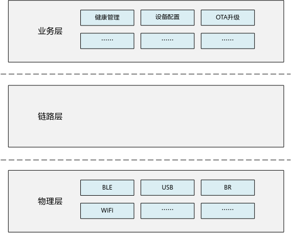

-   业务层：由各个业务模块组成，对外信息交互的主要实体，包括数据打包、解析、命令处理、结果响应以及处理链路层的状态。
-   链路层：链路的连接管理、能力同步、业务层数据包的分割、重组及安全性检查等。
-   物理层：连接状态同步、收发的接口、MTU等。

# 链路层介绍<a name="ZH-CN_TOPIC_0000001517340141"></a>

-   **[链路层简介](#ZH-CN_TOPIC_0000001466739442)**  

-   **[链路层功能](#ZH-CN_TOPIC_0000001466579794)**  

-   **[链路层通用帧格式定义](#ZH-CN_TOPIC_0000001518018617)**  

## 链路层简介<a name="ZH-CN_TOPIC_0000001466739442"></a>

数据链路层的传输单元是帧（Frame），每个Frame的最大传输能力由MFS（Max Frame Size）决定。MFS通过应用层命令进行协商。当一个应用层数据包的长度超过MFS时，数据链路层需要对数据包进行拆分，以满足Frame长度不超过MFS。由于驱动层承载能力的限制，Frame在驱动层传输时可能被物理层以MTU（Maximum Transmission Unit）为单位进一步拆分。

## 链路层功能<a name="ZH-CN_TOPIC_0000001466579794"></a>

链路层主要提供如下功能：

-   从物理层（如：蓝牙协议栈）的字节流中摘出数据帧（Frame），即成帧动作。
-   承载业务层，对业务层数据包进行封装，并视需要进行拆分。
-   通过校验和对常规帧的基础安全性进行检查。

## 链路层通用帧格式定义<a name="ZH-CN_TOPIC_0000001518018617"></a>

**图 1**  链路层通用帧格式<a name="fig110994864210"></a>  
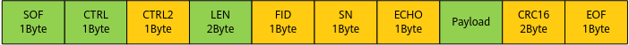

详细字段的描述如[表1](#table254mcpsimp)所示。

**表 1**  数据帧格式

<a name="table254mcpsimp"></a>
<table><thead align="left"><tr id="row262mcpsimp"><th class="cellrowborder" valign="top" width="12.33%" id="mcps1.2.6.1.1"><p id="p264mcpsimp"><a name="p264mcpsimp"></a><a name="p264mcpsimp"></a>区域</p>
</th>
<th class="cellrowborder" valign="top" width="15.909999999999998%" id="mcps1.2.6.1.2"><p id="p267mcpsimp"><a name="p267mcpsimp"></a><a name="p267mcpsimp"></a>字段名称</p>
</th>
<th class="cellrowborder" valign="top" width="11.78%" id="mcps1.2.6.1.3"><p id="p270mcpsimp"><a name="p270mcpsimp"></a><a name="p270mcpsimp"></a>字节数</p>
</th>
<th class="cellrowborder" valign="top" width="8.55%" id="mcps1.2.6.1.4"><p id="p273mcpsimp"><a name="p273mcpsimp"></a><a name="p273mcpsimp"></a>M/O</p>
</th>
<th class="cellrowborder" valign="top" width="51.43%" id="mcps1.2.6.1.5"><p id="p276mcpsimp"><a name="p276mcpsimp"></a><a name="p276mcpsimp"></a>字段描述</p>
</th>
</tr>
</thead>
<tbody><tr id="row278mcpsimp"><td class="cellrowborder" rowspan="7" valign="top" width="12.33%" headers="mcps1.2.6.1.1 "><p id="p280mcpsimp"><a name="p280mcpsimp"></a><a name="p280mcpsimp"></a>Header</p>
</td>
<td class="cellrowborder" valign="top" width="15.909999999999998%" headers="mcps1.2.6.1.2 "><p id="p282mcpsimp"><a name="p282mcpsimp"></a><a name="p282mcpsimp"></a>SOF</p>
</td>
<td class="cellrowborder" valign="top" width="11.78%" headers="mcps1.2.6.1.3 "><p id="p284mcpsimp"><a name="p284mcpsimp"></a><a name="p284mcpsimp"></a>1</p>
</td>
<td class="cellrowborder" valign="top" width="8.55%" headers="mcps1.2.6.1.4 "><p id="p286mcpsimp"><a name="p286mcpsimp"></a><a name="p286mcpsimp"></a>M</p>
</td>
<td class="cellrowborder" valign="top" width="51.43%" headers="mcps1.2.6.1.5 "><p id="p288mcpsimp"><a name="p288mcpsimp"></a><a name="p288mcpsimp"></a>Start Of Frame，标识数据帧的开始，当前版本固定值为0xAF。</p>
</td>
</tr>
<tr id="row289mcpsimp"><td class="cellrowborder" valign="top" headers="mcps1.2.6.1.1 "><p id="p291mcpsimp"><a name="p291mcpsimp"></a><a name="p291mcpsimp"></a>CTRL</p>
</td>
<td class="cellrowborder" valign="top" headers="mcps1.2.6.1.2 "><p id="p293mcpsimp"><a name="p293mcpsimp"></a><a name="p293mcpsimp"></a>1</p>
</td>
<td class="cellrowborder" valign="top" headers="mcps1.2.6.1.3 "><p id="p295mcpsimp"><a name="p295mcpsimp"></a><a name="p295mcpsimp"></a>M</p>
</td>
<td class="cellrowborder" valign="top" headers="mcps1.2.6.1.4 "><p id="p297mcpsimp"><a name="p297mcpsimp"></a><a name="p297mcpsimp"></a>数据链路层控制选项，详细定义请参见“<a href="#ZH-CN_TOPIC_0000001466899070">控制域CTRL</a>”。</p>
</td>
</tr>
<tr id="row427133319177"><td class="cellrowborder" valign="top" headers="mcps1.2.6.1.1 "><p id="p5272133351713"><a name="p5272133351713"></a><a name="p5272133351713"></a>CTRL2</p>
</td>
<td class="cellrowborder" valign="top" headers="mcps1.2.6.1.2 "><p id="p14272133131715"><a name="p14272133131715"></a><a name="p14272133131715"></a>1</p>
</td>
<td class="cellrowborder" valign="top" headers="mcps1.2.6.1.3 "><p id="p127233381720"><a name="p127233381720"></a><a name="p127233381720"></a>O</p>
</td>
<td class="cellrowborder" valign="top" headers="mcps1.2.6.1.4 "><p id="p827273311178"><a name="p827273311178"></a><a name="p827273311178"></a>数据链路层控制选项扩展字段，在CTRL字段最高位为1时生效。详细定义请参见“<a href="#ZH-CN_TOPIC_0000001466899070">控制域CTRL</a>”。</p>
</td>
</tr>
<tr id="row298mcpsimp"><td class="cellrowborder" valign="top" headers="mcps1.2.6.1.1 "><p id="p300mcpsimp"><a name="p300mcpsimp"></a><a name="p300mcpsimp"></a>LEN</p>
</td>
<td class="cellrowborder" valign="top" headers="mcps1.2.6.1.2 "><p id="p302mcpsimp"><a name="p302mcpsimp"></a><a name="p302mcpsimp"></a>2</p>
</td>
<td class="cellrowborder" valign="top" headers="mcps1.2.6.1.3 "><p id="p304mcpsimp"><a name="p304mcpsimp"></a><a name="p304mcpsimp"></a>M</p>
</td>
<td class="cellrowborder" valign="top" headers="mcps1.2.6.1.4 "><p id="p306mcpsimp"><a name="p306mcpsimp"></a><a name="p306mcpsimp"></a>标识从FID字段到帧尾字段的长度，覆盖CRC和EOF字段。</p>
</td>
</tr>
<tr id="row307mcpsimp"><td class="cellrowborder" valign="top" headers="mcps1.2.6.1.1 "><p id="p309mcpsimp"><a name="p309mcpsimp"></a><a name="p309mcpsimp"></a>FID</p>
</td>
<td class="cellrowborder" valign="top" headers="mcps1.2.6.1.2 "><p id="p311mcpsimp"><a name="p311mcpsimp"></a><a name="p311mcpsimp"></a>1</p>
</td>
<td class="cellrowborder" valign="top" headers="mcps1.2.6.1.3 "><p id="p313mcpsimp"><a name="p313mcpsimp"></a><a name="p313mcpsimp"></a>O</p>
</td>
<td class="cellrowborder" valign="top" headers="mcps1.2.6.1.4 "><p id="p315mcpsimp"><a name="p315mcpsimp"></a><a name="p315mcpsimp"></a>领域ID：标记目的领域和源领域（高4bits为目的领域，低4bits为源领域），详细定义请参见“<a href="#ZH-CN_TOPIC_0000001467058926">领域FID</a>”。</p>
</td>
</tr>
<tr id="row316mcpsimp"><td class="cellrowborder" valign="top" headers="mcps1.2.6.1.1 "><p id="p318mcpsimp"><a name="p318mcpsimp"></a><a name="p318mcpsimp"></a>SN</p>
</td>
<td class="cellrowborder" valign="top" headers="mcps1.2.6.1.2 "><p id="p320mcpsimp"><a name="p320mcpsimp"></a><a name="p320mcpsimp"></a>1</p>
</td>
<td class="cellrowborder" valign="top" headers="mcps1.2.6.1.3 "><p id="p322mcpsimp"><a name="p322mcpsimp"></a><a name="p322mcpsimp"></a>O</p>
</td>
<td class="cellrowborder" valign="top" headers="mcps1.2.6.1.4 "><p id="p324mcpsimp"><a name="p324mcpsimp"></a><a name="p324mcpsimp"></a>如果CTRL字段中设置了分帧标志，则在Header中必须携带SN（Sequence Number）字段，用以标识帧序列号。SN取值范围为[0,255]。</p>
</td>
</tr>
<tr id="row325mcpsimp"><td class="cellrowborder" valign="top" headers="mcps1.2.6.1.1 "><p id="p327mcpsimp"><a name="p327mcpsimp"></a><a name="p327mcpsimp"></a>ECHO</p>
</td>
<td class="cellrowborder" valign="top" headers="mcps1.2.6.1.2 "><p id="p329mcpsimp"><a name="p329mcpsimp"></a><a name="p329mcpsimp"></a>1</p>
</td>
<td class="cellrowborder" valign="top" headers="mcps1.2.6.1.3 "><p id="p331mcpsimp"><a name="p331mcpsimp"></a><a name="p331mcpsimp"></a>O</p>
</td>
<td class="cellrowborder" valign="top" headers="mcps1.2.6.1.4 "><p id="p333mcpsimp"><a name="p333mcpsimp"></a><a name="p333mcpsimp"></a>向发送端回复响应。详细定义请参见“<a href="#ZH-CN_TOPIC_0000001517898713">回复响应ECHO</a>”。</p>
</td>
</tr>
<tr id="row334mcpsimp"><td class="cellrowborder" valign="top" headers="mcps1.2.6.1.1 "><p id="p336mcpsimp"><a name="p336mcpsimp"></a><a name="p336mcpsimp"></a>Payload</p>
</td>
<td class="cellrowborder" colspan="4" valign="top" headers="mcps1.2.6.1.2 mcps1.2.6.1.3 mcps1.2.6.1.4 mcps1.2.6.1.5 "><p id="p338mcpsimp"><a name="p338mcpsimp"></a><a name="p338mcpsimp"></a>业务层数据载荷</p>
</td>
</tr>
<tr id="row339mcpsimp"><td class="cellrowborder" rowspan="2" valign="top" width="12.33%" headers="mcps1.2.6.1.1 "><p id="p341mcpsimp"><a name="p341mcpsimp"></a><a name="p341mcpsimp"></a>Footer</p>
</td>
<td class="cellrowborder" valign="top" width="15.909999999999998%" headers="mcps1.2.6.1.2 "><p id="p343mcpsimp"><a name="p343mcpsimp"></a><a name="p343mcpsimp"></a>CRC16</p>
</td>
<td class="cellrowborder" valign="top" width="11.78%" headers="mcps1.2.6.1.3 "><p id="p345mcpsimp"><a name="p345mcpsimp"></a><a name="p345mcpsimp"></a>2</p>
</td>
<td class="cellrowborder" valign="top" width="8.55%" headers="mcps1.2.6.1.4 "><p id="p347mcpsimp"><a name="p347mcpsimp"></a><a name="p347mcpsimp"></a>O</p>
</td>
<td class="cellrowborder" valign="top" width="51.43%" headers="mcps1.2.6.1.5 "><p id="p349mcpsimp"><a name="p349mcpsimp"></a><a name="p349mcpsimp"></a>CRC16字段，详细定义请参见“<a href="#ZH-CN_TOPIC_0000001517739149">校验和CRC16</a>”。</p>
</td>
</tr>
<tr id="row29011919167"><td class="cellrowborder" valign="top" headers="mcps1.2.6.1.1 "><p id="p18901189141619"><a name="p18901189141619"></a><a name="p18901189141619"></a>EOF</p>
</td>
<td class="cellrowborder" valign="top" headers="mcps1.2.6.1.2 "><p id="p129016951614"><a name="p129016951614"></a><a name="p129016951614"></a>1</p>
</td>
<td class="cellrowborder" valign="top" headers="mcps1.2.6.1.3 "><p id="p18901391161"><a name="p18901391161"></a><a name="p18901391161"></a>O</p>
</td>
<td class="cellrowborder" valign="top" headers="mcps1.2.6.1.4 "><p id="p8902498165"><a name="p8902498165"></a><a name="p8902498165"></a>End Of Frame，标识数据帧的结束，当前版本固定值为0xFA。</p>
</td>
</tr>
</tbody>
</table>

-   **[控制域CTRL](#ZH-CN_TOPIC_0000001466899070)**  

-   **[领域FID](#ZH-CN_TOPIC_0000001467058926)**  

-   **[回复响应ECHO](#ZH-CN_TOPIC_0000001517898713)**  

-   **[校验和CRC16](#ZH-CN_TOPIC_0000001517739149)**  

### 控制域CTRL<a name="ZH-CN_TOPIC_0000001466899070"></a>

**表 1**  控制域CTRL字段说明

<a name="table352mcpsimp"></a>
<table><thead align="left"><tr id="row358mcpsimp"><th class="cellrowborder" valign="top" width="16.16%" id="mcps1.2.4.1.1"><p id="p360mcpsimp"><a name="p360mcpsimp"></a><a name="p360mcpsimp"></a>Bit</p>
</th>
<th class="cellrowborder" valign="top" width="18.82%" id="mcps1.2.4.1.2"><p id="p363mcpsimp"><a name="p363mcpsimp"></a><a name="p363mcpsimp"></a>Name</p>
</th>
<th class="cellrowborder" valign="top" width="65.02%" id="mcps1.2.4.1.3"><p id="p366mcpsimp"><a name="p366mcpsimp"></a><a name="p366mcpsimp"></a>说明</p>
</th>
</tr>
</thead>
<tbody><tr id="row368mcpsimp"><td class="cellrowborder" valign="top" width="16.16%" headers="mcps1.2.4.1.1 "><p id="p370mcpsimp"><a name="p370mcpsimp"></a><a name="p370mcpsimp"></a>bit 7</p>
</td>
<td class="cellrowborder" valign="top" width="18.82%" headers="mcps1.2.4.1.2 "><p id="p141741427293"><a name="p141741427293"></a><a name="p141741427293"></a>EN_EXTEND</p>
</td>
<td class="cellrowborder" valign="top" width="65.02%" headers="mcps1.2.4.1.3 "><a name="ul53751822123015"></a><a name="ul53751822123015"></a><ul id="ul53751822123015"><li>置1，可选项中使能CTRL2字段。</li><li>置0，可选项中不使能CTRL2字段。</li></ul>
</td>
</tr>
<tr id="row375mcpsimp"><td class="cellrowborder" valign="top" width="16.16%" headers="mcps1.2.4.1.1 "><p id="p377mcpsimp"><a name="p377mcpsimp"></a><a name="p377mcpsimp"></a>bit 6</p>
</td>
<td class="cellrowborder" valign="top" width="18.82%" headers="mcps1.2.4.1.2 "><p id="p124812337225"><a name="p124812337225"></a><a name="p124812337225"></a>EN_CRYPTO</p>
</td>
<td class="cellrowborder" valign="top" width="65.02%" headers="mcps1.2.4.1.3 "><a name="ul18583856122418"></a><a name="ul18583856122418"></a><ul id="ul18583856122418"><li>置1，Payload为加密数据。</li><li>置0，Payload为不加密数据。</li></ul>
</td>
</tr>
<tr id="row77276421276"><td class="cellrowborder" valign="top" width="16.16%" headers="mcps1.2.4.1.1 "><p id="p1572717421271"><a name="p1572717421271"></a><a name="p1572717421271"></a>bit 5</p>
</td>
<td class="cellrowborder" valign="top" width="18.82%" headers="mcps1.2.4.1.2 "><p id="p1072713420275"><a name="p1072713420275"></a><a name="p1072713420275"></a>EN_FULL_CRC</p>
</td>
<td class="cellrowborder" valign="top" width="65.02%" headers="mcps1.2.4.1.3 "><a name="ul4282141223118"></a><a name="ul4282141223118"></a><ul id="ul4282141223118"><li>置1，CRC16覆盖从SOF到Payload域结束的空间。</li><li>置0，CRC16覆盖LEN之后（不含LEN）到Payload域结束的空间。</li><li>如果EN_CRC置0，本字段无效。</li></ul>
</td>
</tr>
<tr id="row96685198260"><td class="cellrowborder" valign="top" width="16.16%" headers="mcps1.2.4.1.1 "><p id="p8668919112613"><a name="p8668919112613"></a><a name="p8668919112613"></a>bit 4</p>
</td>
<td class="cellrowborder" valign="top" width="18.82%" headers="mcps1.2.4.1.2 "><p id="p1066891914261"><a name="p1066891914261"></a><a name="p1066891914261"></a>EN_EOF</p>
</td>
<td class="cellrowborder" valign="top" width="65.02%" headers="mcps1.2.4.1.3 "><a name="ul3203185282618"></a><a name="ul3203185282618"></a><ul id="ul3203185282618"><li>置1，可选项中使能EOF字段。</li><li>置0，可选项中不使能EOF字段。</li></ul>
</td>
</tr>
<tr id="row393mcpsimp"><td class="cellrowborder" valign="top" width="16.16%" headers="mcps1.2.4.1.1 "><p id="p395mcpsimp"><a name="p395mcpsimp"></a><a name="p395mcpsimp"></a>bit[3:2]</p>
</td>
<td class="cellrowborder" valign="top" width="18.82%" headers="mcps1.2.4.1.2 "><p id="p397mcpsimp"><a name="p397mcpsimp"></a><a name="p397mcpsimp"></a>EN_SN</p>
</td>
<td class="cellrowborder" valign="top" width="65.02%" headers="mcps1.2.4.1.3 "><p id="p399mcpsimp"><a name="p399mcpsimp"></a><a name="p399mcpsimp"></a>分帧标志位域：</p>
<a name="ul14401235844"></a><a name="ul14401235844"></a><ul id="ul14401235844"><li>00，表示本数据帧对应一个完整的业务层数据包，Header中不携带SN字段。</li><li>01，表示本数据帧对应一个业务层数据包的起始分帧，Header中携带SN字段对该帧进行编号。</li><li>10，表示本数据帧对应一个业务层数据包的过程分帧，Header中携带SN字段对该帧进行编号。</li><li>11，表示本数据帧对应一个业务层数据包的结束分帧，Header中携带SN字段对该帧进行编号。</li></ul>
</td>
</tr>
<tr id="row404mcpsimp"><td class="cellrowborder" valign="top" width="16.16%" headers="mcps1.2.4.1.1 "><p id="p406mcpsimp"><a name="p406mcpsimp"></a><a name="p406mcpsimp"></a>bit 1</p>
</td>
<td class="cellrowborder" valign="top" width="18.82%" headers="mcps1.2.4.1.2 "><p id="p408mcpsimp"><a name="p408mcpsimp"></a><a name="p408mcpsimp"></a>EN_FID</p>
</td>
<td class="cellrowborder" valign="top" width="65.02%" headers="mcps1.2.4.1.3 "><a name="ul164541418744"></a><a name="ul164541418744"></a><ul id="ul164541418744"><li>置1，可选项中使能FID字段。</li><li>置0，可选项中不使能FID字段。</li></ul>
</td>
</tr>
<tr id="row412mcpsimp"><td class="cellrowborder" valign="top" width="16.16%" headers="mcps1.2.4.1.1 "><p id="p414mcpsimp"><a name="p414mcpsimp"></a><a name="p414mcpsimp"></a>bit 0</p>
</td>
<td class="cellrowborder" valign="top" width="18.82%" headers="mcps1.2.4.1.2 "><p id="p416mcpsimp"><a name="p416mcpsimp"></a><a name="p416mcpsimp"></a>EN_CRC</p>
</td>
<td class="cellrowborder" valign="top" width="65.02%" headers="mcps1.2.4.1.3 "><a name="ul51101124344"></a><a name="ul51101124344"></a><ul id="ul51101124344"><li>置1，可选项中使能CRC16字段。</li><li>置0，可选项中不使能CRC16字段。</li></ul>
</td>
</tr>
</tbody>
</table>

**表 2**  控制域CTRL2字段说明

<a name="table1641019812204"></a>
<table><thead align="left"><tr id="row741068122013"><th class="cellrowborder" valign="top" width="16.16%" id="mcps1.2.4.1.1"><p id="p16410189208"><a name="p16410189208"></a><a name="p16410189208"></a>Bit</p>
</th>
<th class="cellrowborder" valign="top" width="18.82%" id="mcps1.2.4.1.2"><p id="p2410084205"><a name="p2410084205"></a><a name="p2410084205"></a>Name</p>
</th>
<th class="cellrowborder" valign="top" width="65.02%" id="mcps1.2.4.1.3"><p id="p114105815204"><a name="p114105815204"></a><a name="p114105815204"></a>说明</p>
</th>
</tr>
</thead>
<tbody><tr id="row3410168182019"><td class="cellrowborder" valign="top" width="16.16%" headers="mcps1.2.4.1.1 "><p id="p17411128102016"><a name="p17411128102016"></a><a name="p17411128102016"></a>bit[7:2]</p>
</td>
<td class="cellrowborder" valign="top" width="18.82%" headers="mcps1.2.4.1.2 "><p id="p94118813204"><a name="p94118813204"></a><a name="p94118813204"></a>Reserved</p>
</td>
<td class="cellrowborder" valign="top" width="65.02%" headers="mcps1.2.4.1.3 "><p id="p1141114810202"><a name="p1141114810202"></a><a name="p1141114810202"></a>预留后续扩展使用，默认置0。</p>
</td>
</tr>
<tr id="row2411483204"><td class="cellrowborder" valign="top" width="16.16%" headers="mcps1.2.4.1.1 "><p id="p10411885203"><a name="p10411885203"></a><a name="p10411885203"></a>bit[1:0]</p>
</td>
<td class="cellrowborder" valign="top" width="18.82%" headers="mcps1.2.4.1.2 "><p id="p34115842020"><a name="p34115842020"></a><a name="p34115842020"></a>ACK_TYPE</p>
</td>
<td class="cellrowborder" valign="top" width="65.02%" headers="mcps1.2.4.1.3 "><p id="p19411118132020"><a name="p19411118132020"></a><a name="p19411118132020"></a>链路层请求对端确认标志位。</p>
<a name="ul841112862010"></a><a name="ul841112862010"></a><ul id="ul841112862010"><li>00：对端不需要回复链路层的响应对该帧进行确认。</li><li>01：对端需要回复一个链路层的响应对该帧进行确认。</li><li>11：该帧是一个链路层响应ECHO帧，用于向对端进行链路层的确认或者告知CRC校验错误。</li></ul>
<p id="p1541116872018"><a name="p1541116872018"></a><a name="p1541116872018"></a>注：如没有特殊理由不建议在链路层进行确认，因此默认置00。</p>
</td>
</tr>
</tbody>
</table>

### 领域FID<a name="ZH-CN_TOPIC_0000001467058926"></a>

Field ID：占1个字节，标识帧的目标和源领域，用于帧在目标和源领域之间传输。

bit\[7:4\]：高4bit用于标记帧的目标领域。

bit\[3:0\]：低4bit用于标记帧的源领域。

为了避免各个领域和产品型态的Field ID冲突，对将要使用的Field ID进行划分如[表1](#table445mcpsimp)所示。

**表 1**  Field ID字段说明

<a name="table445mcpsimp"></a>
<table><thead align="left"><tr id="row451mcpsimp"><th class="cellrowborder" valign="top" width="11.28%" id="mcps1.2.4.1.1"><p id="p453mcpsimp"><a name="p453mcpsimp"></a><a name="p453mcpsimp"></a>Value</p>
</th>
<th class="cellrowborder" valign="top" width="22.42%" id="mcps1.2.4.1.2"><p id="p456mcpsimp"><a name="p456mcpsimp"></a><a name="p456mcpsimp"></a>Name</p>
</th>
<th class="cellrowborder" valign="top" width="66.3%" id="mcps1.2.4.1.3"><p id="p459mcpsimp"><a name="p459mcpsimp"></a><a name="p459mcpsimp"></a>说明</p>
</th>
</tr>
</thead>
<tbody><tr id="row461mcpsimp"><td class="cellrowborder" valign="top" width="11.28%" headers="mcps1.2.4.1.1 "><p id="p463mcpsimp"><a name="p463mcpsimp"></a><a name="p463mcpsimp"></a>0x00</p>
</td>
<td class="cellrowborder" valign="top" width="22.42%" headers="mcps1.2.4.1.2 "><p id="p465mcpsimp"><a name="p465mcpsimp"></a><a name="p465mcpsimp"></a>本地预留</p>
</td>
<td class="cellrowborder" valign="top" width="66.3%" headers="mcps1.2.4.1.3 "><p id="p467mcpsimp"><a name="p467mcpsimp"></a><a name="p467mcpsimp"></a>内部处理预留。</p>
</td>
</tr>
<tr id="row468mcpsimp"><td class="cellrowborder" valign="top" width="11.28%" headers="mcps1.2.4.1.1 "><p id="p470mcpsimp"><a name="p470mcpsimp"></a><a name="p470mcpsimp"></a>0x01</p>
</td>
<td class="cellrowborder" valign="top" width="22.42%" headers="mcps1.2.4.1.2 "><p id="p472mcpsimp"><a name="p472mcpsimp"></a><a name="p472mcpsimp"></a>UART设备</p>
</td>
<td class="cellrowborder" valign="top" width="66.3%" headers="mcps1.2.4.1.3 "><p id="p474mcpsimp"><a name="p474mcpsimp"></a><a name="p474mcpsimp"></a>用于UART通道的帧。</p>
</td>
</tr>
<tr id="row475mcpsimp"><td class="cellrowborder" valign="top" width="11.28%" headers="mcps1.2.4.1.1 "><p id="p477mcpsimp"><a name="p477mcpsimp"></a><a name="p477mcpsimp"></a>0x02</p>
</td>
<td class="cellrowborder" valign="top" width="22.42%" headers="mcps1.2.4.1.2 "><p id="p479mcpsimp"><a name="p479mcpsimp"></a><a name="p479mcpsimp"></a>MCU主控设备</p>
</td>
<td class="cellrowborder" valign="top" width="66.3%" headers="mcps1.2.4.1.3 "><p id="p481mcpsimp"><a name="p481mcpsimp"></a><a name="p481mcpsimp"></a>用于标记MCU主控设备，如果是耳机目标领域本值则表示对耳设备。</p>
</td>
</tr>
<tr id="row482mcpsimp"><td class="cellrowborder" valign="top" width="11.28%" headers="mcps1.2.4.1.1 "><p id="p484mcpsimp"><a name="p484mcpsimp"></a><a name="p484mcpsimp"></a>0x03</p>
</td>
<td class="cellrowborder" valign="top" width="22.42%" headers="mcps1.2.4.1.2 "><p id="p486mcpsimp"><a name="p486mcpsimp"></a><a name="p486mcpsimp"></a>GATT设备</p>
</td>
<td class="cellrowborder" valign="top" width="66.3%" headers="mcps1.2.4.1.3 "><p id="p488mcpsimp"><a name="p488mcpsimp"></a><a name="p488mcpsimp"></a>用于标记蓝牙GATT设备。</p>
</td>
</tr>
<tr id="row489mcpsimp"><td class="cellrowborder" valign="top" width="11.28%" headers="mcps1.2.4.1.1 "><p id="p491mcpsimp"><a name="p491mcpsimp"></a><a name="p491mcpsimp"></a>0x04</p>
</td>
<td class="cellrowborder" valign="top" width="22.42%" headers="mcps1.2.4.1.2 "><p id="p493mcpsimp"><a name="p493mcpsimp"></a><a name="p493mcpsimp"></a>SPP设备</p>
</td>
<td class="cellrowborder" valign="top" width="66.3%" headers="mcps1.2.4.1.3 "><p id="p495mcpsimp"><a name="p495mcpsimp"></a><a name="p495mcpsimp"></a>用于标记蓝牙SPP设备。</p>
</td>
</tr>
<tr id="row510mcpsimp"><td class="cellrowborder" valign="top" width="11.28%" headers="mcps1.2.4.1.1 "><p id="p512mcpsimp"><a name="p512mcpsimp"></a><a name="p512mcpsimp"></a>…..</p>
</td>
<td class="cellrowborder" valign="top" width="22.42%" headers="mcps1.2.4.1.2 "><p id="p514mcpsimp"><a name="p514mcpsimp"></a><a name="p514mcpsimp"></a>Reserved</p>
</td>
<td class="cellrowborder" valign="top" width="66.3%" headers="mcps1.2.4.1.3 "><p id="p516mcpsimp"><a name="p516mcpsimp"></a><a name="p516mcpsimp"></a>预留后续扩展使用，最大0x0F，使用时再申请。</p>
</td>
</tr>
</tbody>
</table>

### 回复响应ECHO<a name="ZH-CN_TOPIC_0000001517898713"></a>

> **须知：** 
>因为在链路层上对帧进行响应会降低传输效率，因此，请慎用！

当发送端将CTRL2字段中的ACK\_TYPE值设置为01时，接收端在收到该帧后，需要向发送端回复一个链路层的响应帧进行确认，响应帧的CTRL2字段中ACK\_TYPE值为11，并附带Echo字段，Echo字段值定义如[表1](#table519mcpsimp)所示。

**表 1**  Echo字段定义

<a name="table519mcpsimp"></a>
<table><thead align="left"><tr id="row524mcpsimp"><th class="cellrowborder" valign="top" width="42%" id="mcps1.2.3.1.1"><p id="p526mcpsimp"><a name="p526mcpsimp"></a><a name="p526mcpsimp"></a>Echo</p>
</th>
<th class="cellrowborder" valign="top" width="57.99999999999999%" id="mcps1.2.3.1.2"><p id="p528mcpsimp"><a name="p528mcpsimp"></a><a name="p528mcpsimp"></a>说明</p>
</th>
</tr>
</thead>
<tbody><tr id="row529mcpsimp"><td class="cellrowborder" valign="top" width="42%" headers="mcps1.2.3.1.1 "><p id="p531mcpsimp"><a name="p531mcpsimp"></a><a name="p531mcpsimp"></a>0</p>
</td>
<td class="cellrowborder" valign="top" width="57.99999999999999%" headers="mcps1.2.3.1.2 "><p id="p533mcpsimp"><a name="p533mcpsimp"></a><a name="p533mcpsimp"></a>CRC校验成功</p>
</td>
</tr>
<tr id="row534mcpsimp"><td class="cellrowborder" valign="top" width="42%" headers="mcps1.2.3.1.1 "><p id="p536mcpsimp"><a name="p536mcpsimp"></a><a name="p536mcpsimp"></a>1</p>
</td>
<td class="cellrowborder" valign="top" width="57.99999999999999%" headers="mcps1.2.3.1.2 "><p id="p538mcpsimp"><a name="p538mcpsimp"></a><a name="p538mcpsimp"></a>CRC校验失败</p>
</td>
</tr>
<tr id="row539mcpsimp"><td class="cellrowborder" valign="top" width="42%" headers="mcps1.2.3.1.1 "><p id="p541mcpsimp"><a name="p541mcpsimp"></a><a name="p541mcpsimp"></a>….</p>
</td>
<td class="cellrowborder" valign="top" width="57.99999999999999%" headers="mcps1.2.3.1.2 "><p id="p543mcpsimp"><a name="p543mcpsimp"></a><a name="p543mcpsimp"></a>待定</p>
</td>
</tr>
</tbody>
</table>

-   示例1：需对端回复ACK响应的发送报文

    数据流：AF83010400015A8EC8

    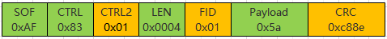

-   示例2：校验失败时的ACK报文

    数据流：AF81030300012110

    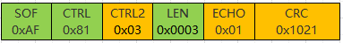

### 校验和CRC16<a name="ZH-CN_TOPIC_0000001517739149"></a>

CRC覆盖的覆盖范围与CTRL字段中的EN\_FULL\_CRC值有关。

-   当EN\_FULL\_CRC置1时，CRC覆盖EOF开始（包含EOF）到Payload域结束的空间。
-   当EN\_FULL\_CRC置0时，CRC覆盖LEN之后（不含LEN）到Payload域结束的空间。

CRC算法均采用CRC-16-XMODEM：多项式公式x16+x12+x5+1，多项式POLY 0x1021**。**

> **说明：** 
>为确保设置、查询、主动上报等命令报文传输正确，命令报文必须使用CRC校验。

# 业务层介绍<a name="ZH-CN_TOPIC_0000001517340145"></a>

-   **[业务层简介](#ZH-CN_TOPIC_0000001466739446)**  

-   **[业务层功能](#ZH-CN_TOPIC_0000001466579798)**  

## 业务层简介<a name="ZH-CN_TOPIC_0000001466739446"></a>

业务层是接口的最上层，使用链路层提供的服务能力进行数据收发。

## 业务层功能<a name="ZH-CN_TOPIC_0000001466579798"></a>

业务层承载各业务特性的功能，可以通过扩展业务类型加入新的业务。

主要提供如下功能：

-   业务层数据的分发。
-   各业务数据的解析、处理、响应。

# 业务层通用帧格式定义<a name="ZH-CN_TOPIC_0000001518018621"></a>

-   **[Frame格式定义](#ZH-CN_TOPIC_0000001466899074)**  

-   **[Data域的定义格式约束](#ZH-CN_TOPIC_0000001466739450)**  

-   **[字节大小头约束](#ZH-CN_TOPIC_0000001466579802)**  

-   **[索引字段说明](#ZH-CN_TOPIC_0000001518018625)**  

-   **[边界条件限制](#ZH-CN_TOPIC_0000001466899078)**  

## Frame格式定义<a name="ZH-CN_TOPIC_0000001466899074"></a>

**图 1**  Frame格式定义<a name="fig883032614311"></a>  


-   所有业务层的报文都是以Model ID/Command ID作为起始。
-   Model ID是每个报文所属的业务模块，如：设备管理、消息通知、闹钟等。
-   Command ID是每个业务对应的命令类型，如：设置日期时间、获取设备版本相关信息等。
-   TLV为封装消息中的具体信息。

> **说明：** 
>根据经验，对于BLE设备，单帧的长度尽量控制在20Byte以内，总长度不得超过512Byte。

-   **[Model ID](#ZH-CN_TOPIC_0000001467058930)**  

-   **[Command ID](#ZH-CN_TOPIC_0000001517898717)**  

-   **[TLV](#ZH-CN_TOPIC_0000001517739153)**  

-   **[通用错误码](#ZH-CN_TOPIC_0000001542444181)**  

### Model ID<a name="ZH-CN_TOPIC_0000001467058930"></a>

Model ID：占1字节，用于标识模块类型。Model ID定义如[表1](#table575mcpsimp)所示。

**表 1**  Model ID表

<a name="table575mcpsimp"></a>
<table><thead align="left"><tr id="row583mcpsimp"><th class="cellrowborder" valign="top" width="16.31%" id="mcps1.2.6.1.1"><p id="p585mcpsimp"><a name="p585mcpsimp"></a><a name="p585mcpsimp"></a>Model ID</p>
</th>
<th class="cellrowborder" valign="top" width="29.79%" id="mcps1.2.6.1.2"><p id="p587mcpsimp"><a name="p587mcpsimp"></a><a name="p587mcpsimp"></a>Model Name</p>
</th>
<th class="cellrowborder" valign="top" width="22.900000000000002%" id="mcps1.2.6.1.3"><p id="p589mcpsimp"><a name="p589mcpsimp"></a><a name="p589mcpsimp"></a>说明</p>
</th>
<th class="cellrowborder" valign="top" width="17%" id="mcps1.2.6.1.4"><p id="p591mcpsimp"><a name="p591mcpsimp"></a><a name="p591mcpsimp"></a>必选/可选（M/O）</p>
</th>
<th class="cellrowborder" valign="top" width="14.000000000000002%" id="mcps1.2.6.1.5"><p id="p593mcpsimp"><a name="p593mcpsimp"></a><a name="p593mcpsimp"></a>Version</p>
</th>
</tr>
</thead>
<tbody><tr id="row594mcpsimp"><td class="cellrowborder" valign="top" width="16.31%" headers="mcps1.2.6.1.1 "><p id="p596mcpsimp"><a name="p596mcpsimp"></a><a name="p596mcpsimp"></a>1</p>
</td>
<td class="cellrowborder" valign="top" width="29.79%" headers="mcps1.2.6.1.2 "><p id="p20510162319382"><a name="p20510162319382"></a><a name="p20510162319382"></a>Device Status</p>
</td>
<td class="cellrowborder" valign="top" width="22.900000000000002%" headers="mcps1.2.6.1.3 "><p id="p195101623133815"><a name="p195101623133815"></a><a name="p195101623133815"></a>设备状态查询</p>
</td>
<td class="cellrowborder" valign="top" width="17%" headers="mcps1.2.6.1.4 "><p id="p603mcpsimp"><a name="p603mcpsimp"></a><a name="p603mcpsimp"></a>M</p>
</td>
<td class="cellrowborder" valign="top" width="14.000000000000002%" headers="mcps1.2.6.1.5 "><p id="p605mcpsimp"><a name="p605mcpsimp"></a><a name="p605mcpsimp"></a>1.0</p>
</td>
</tr>
<tr id="row606mcpsimp"><td class="cellrowborder" valign="top" width="16.31%" headers="mcps1.2.6.1.1 "><p id="p608mcpsimp"><a name="p608mcpsimp"></a><a name="p608mcpsimp"></a>2</p>
</td>
<td class="cellrowborder" valign="top" width="29.79%" headers="mcps1.2.6.1.2 "><p id="p1651022320382"><a name="p1651022320382"></a><a name="p1651022320382"></a>OTA Model</p>
</td>
<td class="cellrowborder" valign="top" width="22.900000000000002%" headers="mcps1.2.6.1.3 "><p id="p651018235385"><a name="p651018235385"></a><a name="p651018235385"></a>OTA</p>
</td>
<td class="cellrowborder" valign="top" width="17%" headers="mcps1.2.6.1.4 "><p id="p614mcpsimp"><a name="p614mcpsimp"></a><a name="p614mcpsimp"></a>M</p>
</td>
<td class="cellrowborder" valign="top" width="14.000000000000002%" headers="mcps1.2.6.1.5 "><p id="p616mcpsimp"><a name="p616mcpsimp"></a><a name="p616mcpsimp"></a>1.0</p>
</td>
</tr>
<tr id="row617mcpsimp"><td class="cellrowborder" valign="top" width="16.31%" headers="mcps1.2.6.1.1 "><p id="p619mcpsimp"><a name="p619mcpsimp"></a><a name="p619mcpsimp"></a>3</p>
</td>
<td class="cellrowborder" valign="top" width="29.79%" headers="mcps1.2.6.1.2 "><p id="p851013236389"><a name="p851013236389"></a><a name="p851013236389"></a>HearingAid Business</p>
</td>
<td class="cellrowborder" valign="top" width="22.900000000000002%" headers="mcps1.2.6.1.3 "><p id="p75101231385"><a name="p75101231385"></a><a name="p75101231385"></a>助听业务配置</p>
</td>
<td class="cellrowborder" valign="top" width="17%" headers="mcps1.2.6.1.4 "><p id="p626mcpsimp"><a name="p626mcpsimp"></a><a name="p626mcpsimp"></a>O</p>
</td>
<td class="cellrowborder" valign="top" width="14.000000000000002%" headers="mcps1.2.6.1.5 "><p id="p628mcpsimp"><a name="p628mcpsimp"></a><a name="p628mcpsimp"></a>1.0</p>
</td>
</tr>
<tr id="row629mcpsimp"><td class="cellrowborder" valign="top" width="16.31%" headers="mcps1.2.6.1.1 "><p id="p631mcpsimp"><a name="p631mcpsimp"></a><a name="p631mcpsimp"></a>4</p>
</td>
<td class="cellrowborder" valign="top" width="29.79%" headers="mcps1.2.6.1.2 "><p id="p145106237385"><a name="p145106237385"></a><a name="p145106237385"></a>HearingAid Parameter</p>
</td>
<td class="cellrowborder" valign="top" width="22.900000000000002%" headers="mcps1.2.6.1.3 "><p id="p6510623163819"><a name="p6510623163819"></a><a name="p6510623163819"></a>助听参数配置</p>
</td>
<td class="cellrowborder" valign="top" width="17%" headers="mcps1.2.6.1.4 "><p id="p638mcpsimp"><a name="p638mcpsimp"></a><a name="p638mcpsimp"></a>O</p>
</td>
<td class="cellrowborder" valign="top" width="14.000000000000002%" headers="mcps1.2.6.1.5 "><p id="p640mcpsimp"><a name="p640mcpsimp"></a><a name="p640mcpsimp"></a>1.0</p>
</td>
</tr>
<tr id="row641mcpsimp"><td class="cellrowborder" valign="top" width="16.31%" headers="mcps1.2.6.1.1 "><p id="p643mcpsimp"><a name="p643mcpsimp"></a><a name="p643mcpsimp"></a>5</p>
</td>
<td class="cellrowborder" valign="top" width="29.79%" headers="mcps1.2.6.1.2 "><p id="p12510132333810"><a name="p12510132333810"></a><a name="p12510132333810"></a>Maintenance Model</p>
</td>
<td class="cellrowborder" valign="top" width="22.900000000000002%" headers="mcps1.2.6.1.3 "><p id="p9510192333813"><a name="p9510192333813"></a><a name="p9510192333813"></a>可维可测</p>
</td>
<td class="cellrowborder" valign="top" width="17%" headers="mcps1.2.6.1.4 "><p id="p649mcpsimp"><a name="p649mcpsimp"></a><a name="p649mcpsimp"></a>O</p>
</td>
<td class="cellrowborder" valign="top" width="14.000000000000002%" headers="mcps1.2.6.1.5 "><p id="p651mcpsimp"><a name="p651mcpsimp"></a><a name="p651mcpsimp"></a>1.0</p>
</td>
</tr>
<tr id="row652mcpsimp"><td class="cellrowborder" valign="top" width="16.31%" headers="mcps1.2.6.1.1 "><p id="p654mcpsimp"><a name="p654mcpsimp"></a><a name="p654mcpsimp"></a>6</p>
</td>
<td class="cellrowborder" valign="top" width="29.79%" headers="mcps1.2.6.1.2 "><p id="p1751052353818"><a name="p1751052353818"></a><a name="p1751052353818"></a>File Tranfer Model</p>
</td>
<td class="cellrowborder" valign="top" width="22.900000000000002%" headers="mcps1.2.6.1.3 "><p id="p10510102315383"><a name="p10510102315383"></a><a name="p10510102315383"></a>文件传输</p>
</td>
<td class="cellrowborder" valign="top" width="17%" headers="mcps1.2.6.1.4 "><p id="p660mcpsimp"><a name="p660mcpsimp"></a><a name="p660mcpsimp"></a>O</p>
</td>
<td class="cellrowborder" valign="top" width="14.000000000000002%" headers="mcps1.2.6.1.5 "><p id="p662mcpsimp"><a name="p662mcpsimp"></a><a name="p662mcpsimp"></a>1.0</p>
</td>
</tr>
<tr id="row663mcpsimp"><td class="cellrowborder" valign="top" width="16.31%" headers="mcps1.2.6.1.1 "><p id="p665mcpsimp"><a name="p665mcpsimp"></a><a name="p665mcpsimp"></a>7</p>
</td>
<td class="cellrowborder" valign="top" width="29.79%" headers="mcps1.2.6.1.2 "><p id="p3510122318387"><a name="p3510122318387"></a><a name="p3510122318387"></a>Device Config</p>
</td>
<td class="cellrowborder" valign="top" width="22.900000000000002%" headers="mcps1.2.6.1.3 "><p id="p451032318389"><a name="p451032318389"></a><a name="p451032318389"></a>设备设置</p>
</td>
<td class="cellrowborder" valign="top" width="17%" headers="mcps1.2.6.1.4 "><p id="p671mcpsimp"><a name="p671mcpsimp"></a><a name="p671mcpsimp"></a>O</p>
</td>
<td class="cellrowborder" valign="top" width="14.000000000000002%" headers="mcps1.2.6.1.5 "><p id="p673mcpsimp"><a name="p673mcpsimp"></a><a name="p673mcpsimp"></a>1.0</p>
</td>
</tr>
<tr id="row674mcpsimp"><td class="cellrowborder" valign="top" width="16.31%" headers="mcps1.2.6.1.1 "><p id="p676mcpsimp"><a name="p676mcpsimp"></a><a name="p676mcpsimp"></a>8</p>
</td>
<td class="cellrowborder" valign="top" width="29.79%" headers="mcps1.2.6.1.2 "><p id="p751052343816"><a name="p751052343816"></a><a name="p751052343816"></a>APP Service Test</p>
</td>
<td class="cellrowborder" valign="top" width="22.900000000000002%" headers="mcps1.2.6.1.3 "><p id="p55102235388"><a name="p55102235388"></a><a name="p55102235388"></a>MCU业务维测</p>
</td>
<td class="cellrowborder" valign="top" width="17%" headers="mcps1.2.6.1.4 "><p id="p682mcpsimp"><a name="p682mcpsimp"></a><a name="p682mcpsimp"></a>O</p>
</td>
<td class="cellrowborder" valign="top" width="14.000000000000002%" headers="mcps1.2.6.1.5 "><p id="p684mcpsimp"><a name="p684mcpsimp"></a><a name="p684mcpsimp"></a>1.0</p>
</td>
</tr>
<tr id="row685mcpsimp"><td class="cellrowborder" valign="top" width="16.31%" headers="mcps1.2.6.1.1 "><p id="p687mcpsimp"><a name="p687mcpsimp"></a><a name="p687mcpsimp"></a>9</p>
</td>
<td class="cellrowborder" valign="top" width="29.79%" headers="mcps1.2.6.1.2 "><p id="p351032363813"><a name="p351032363813"></a><a name="p351032363813"></a>BT Service Test</p>
</td>
<td class="cellrowborder" valign="top" width="22.900000000000002%" headers="mcps1.2.6.1.3 "><p id="p16510172333810"><a name="p16510172333810"></a><a name="p16510172333810"></a>BT业务维测</p>
</td>
<td class="cellrowborder" valign="top" width="17%" headers="mcps1.2.6.1.4 "><p id="p693mcpsimp"><a name="p693mcpsimp"></a><a name="p693mcpsimp"></a>O</p>
</td>
<td class="cellrowborder" valign="top" width="14.000000000000002%" headers="mcps1.2.6.1.5 "><p id="p695mcpsimp"><a name="p695mcpsimp"></a><a name="p695mcpsimp"></a>1.0</p>
</td>
</tr>
<tr id="row696mcpsimp"><td class="cellrowborder" valign="top" width="16.31%" headers="mcps1.2.6.1.1 "><p id="p698mcpsimp"><a name="p698mcpsimp"></a><a name="p698mcpsimp"></a>10</p>
</td>
<td class="cellrowborder" valign="top" width="29.79%" headers="mcps1.2.6.1.2 "><p id="p13510152320382"><a name="p13510152320382"></a><a name="p13510152320382"></a>Media Service Test</p>
</td>
<td class="cellrowborder" valign="top" width="22.900000000000002%" headers="mcps1.2.6.1.3 "><p id="p185101623143817"><a name="p185101623143817"></a><a name="p185101623143817"></a>Media业务维测</p>
</td>
<td class="cellrowborder" valign="top" width="17%" headers="mcps1.2.6.1.4 "><p id="p704mcpsimp"><a name="p704mcpsimp"></a><a name="p704mcpsimp"></a>O</p>
</td>
<td class="cellrowborder" valign="top" width="14.000000000000002%" headers="mcps1.2.6.1.5 "><p id="p706mcpsimp"><a name="p706mcpsimp"></a><a name="p706mcpsimp"></a>1.0</p>
</td>
</tr>
<tr id="row707mcpsimp"><td class="cellrowborder" valign="top" width="16.31%" headers="mcps1.2.6.1.1 "><p id="p709mcpsimp"><a name="p709mcpsimp"></a><a name="p709mcpsimp"></a>11</p>
</td>
<td class="cellrowborder" valign="top" width="29.79%" headers="mcps1.2.6.1.2 "><p id="p9510152315385"><a name="p9510152315385"></a><a name="p9510152315385"></a>Graphic Service Test</p>
</td>
<td class="cellrowborder" valign="top" width="22.900000000000002%" headers="mcps1.2.6.1.3 "><p id="p5510523193814"><a name="p5510523193814"></a><a name="p5510523193814"></a>Graphic业务维测</p>
</td>
<td class="cellrowborder" valign="top" width="17%" headers="mcps1.2.6.1.4 "><p id="p715mcpsimp"><a name="p715mcpsimp"></a><a name="p715mcpsimp"></a>O</p>
</td>
<td class="cellrowborder" valign="top" width="14.000000000000002%" headers="mcps1.2.6.1.5 "><p id="p717mcpsimp"><a name="p717mcpsimp"></a><a name="p717mcpsimp"></a>1.0</p>
</td>
</tr>
<tr id="row65651847774"><td class="cellrowborder" valign="top" width="16.31%" headers="mcps1.2.6.1.1 "><p id="p15667471719"><a name="p15667471719"></a><a name="p15667471719"></a>12</p>
</td>
<td class="cellrowborder" valign="top" width="29.79%" headers="mcps1.2.6.1.2 "><p id="p13566124712716"><a name="p13566124712716"></a><a name="p13566124712716"></a>Audio Service Test</p>
</td>
<td class="cellrowborder" valign="top" width="22.900000000000002%" headers="mcps1.2.6.1.3 "><p id="p156615478720"><a name="p156615478720"></a><a name="p156615478720"></a>音频业务测试</p>
</td>
<td class="cellrowborder" valign="top" width="17%" headers="mcps1.2.6.1.4 "><p id="p7566174713718"><a name="p7566174713718"></a><a name="p7566174713718"></a>O</p>
</td>
<td class="cellrowborder" valign="top" width="14.000000000000002%" headers="mcps1.2.6.1.5 "><p id="p65668471277"><a name="p65668471277"></a><a name="p65668471277"></a>1.0</p>
</td>
</tr>
<tr id="row5235959201619"><td class="cellrowborder" valign="top" width="16.31%" headers="mcps1.2.6.1.1 "><p id="p0236259201614"><a name="p0236259201614"></a><a name="p0236259201614"></a>13</p>
</td>
<td class="cellrowborder" valign="top" width="29.79%" headers="mcps1.2.6.1.2 "><p id="p8236175991616"><a name="p8236175991616"></a><a name="p8236175991616"></a>MsgCenter Service</p>
</td>
<td class="cellrowborder" valign="top" width="22.900000000000002%" headers="mcps1.2.6.1.3 "><p id="p112361159141620"><a name="p112361159141620"></a><a name="p112361159141620"></a>消息中心业务</p>
</td>
<td class="cellrowborder" valign="top" width="17%" headers="mcps1.2.6.1.4 "><p id="p18236155911613"><a name="p18236155911613"></a><a name="p18236155911613"></a>O</p>
</td>
<td class="cellrowborder" valign="top" width="14.000000000000002%" headers="mcps1.2.6.1.5 "><p id="p15236115941613"><a name="p15236115941613"></a><a name="p15236115941613"></a>1.0</p>
</td>
</tr>
<tr id="row111351521152216"><td class="cellrowborder" valign="top" width="16.31%" headers="mcps1.2.6.1.1 "><p id="p81362021172215"><a name="p81362021172215"></a><a name="p81362021172215"></a>14</p>
</td>
<td class="cellrowborder" valign="top" width="29.79%" headers="mcps1.2.6.1.2 "><p id="p013682122215"><a name="p013682122215"></a><a name="p013682122215"></a>MeshDev Service</p>
</td>
<td class="cellrowborder" valign="top" width="22.900000000000002%" headers="mcps1.2.6.1.3 "><p id="p713672110221"><a name="p713672110221"></a><a name="p713672110221"></a>组网设备业务</p>
</td>
<td class="cellrowborder" valign="top" width="17%" headers="mcps1.2.6.1.4 "><p id="p713622172212"><a name="p713622172212"></a><a name="p713622172212"></a>O</p>
</td>
<td class="cellrowborder" valign="top" width="14.000000000000002%" headers="mcps1.2.6.1.5 "><p id="p15136102118224"><a name="p15136102118224"></a><a name="p15136102118224"></a>1.0</p>
</td>
</tr>
<tr id="row828032915210"><td class="cellrowborder" valign="top" width="16.31%" headers="mcps1.2.6.1.1 "><p id="p928011293521"><a name="p928011293521"></a><a name="p928011293521"></a>127</p>
</td>
<td class="cellrowborder" valign="top" width="29.79%" headers="mcps1.2.6.1.2 "><p id="p112801329165216"><a name="p112801329165216"></a><a name="p112801329165216"></a>Customization Service</p>
</td>
<td class="cellrowborder" valign="top" width="22.900000000000002%" headers="mcps1.2.6.1.3 "><p id="p92805298520"><a name="p92805298520"></a><a name="p92805298520"></a>客户定制化业务</p>
</td>
<td class="cellrowborder" valign="top" width="17%" headers="mcps1.2.6.1.4 "><p id="p10280162915212"><a name="p10280162915212"></a><a name="p10280162915212"></a>O</p>
</td>
<td class="cellrowborder" valign="top" width="14.000000000000002%" headers="mcps1.2.6.1.5 "><p id="p102806294520"><a name="p102806294520"></a><a name="p102806294520"></a>1.0</p>
</td>
</tr>
</tbody>
</table>

> **说明：** 
>为避免各个领域和产品型态的Model ID冲突，将Model ID进行统一划分。
>Model ID为127保留给客户定制自己的服务和业务。

**表 2**  Model ID保留表

<a name="table754mcpsimp"></a>
<table><thead align="left"><tr id="row761mcpsimp"><th class="cellrowborder" valign="top" width="18%" id="mcps1.2.5.1.1"><p id="p763mcpsimp"><a name="p763mcpsimp"></a><a name="p763mcpsimp"></a>Model ID</p>
</th>
<th class="cellrowborder" valign="top" width="19%" id="mcps1.2.5.1.2"><p id="p765mcpsimp"><a name="p765mcpsimp"></a><a name="p765mcpsimp"></a>所属领域</p>
</th>
<th class="cellrowborder" valign="top" width="51%" id="mcps1.2.5.1.3"><p id="p767mcpsimp"><a name="p767mcpsimp"></a><a name="p767mcpsimp"></a>说明</p>
</th>
<th class="cellrowborder" valign="top" width="12%" id="mcps1.2.5.1.4"><p id="p769mcpsimp"><a name="p769mcpsimp"></a><a name="p769mcpsimp"></a>Version</p>
</th>
</tr>
</thead>
<tbody><tr id="row770mcpsimp"><td class="cellrowborder" valign="top" width="18%" headers="mcps1.2.5.1.1 "><p id="p772mcpsimp"><a name="p772mcpsimp"></a><a name="p772mcpsimp"></a>0x01～0x7F</p>
</td>
<td class="cellrowborder" valign="top" width="19%" headers="mcps1.2.5.1.2 "><p id="p774mcpsimp"><a name="p774mcpsimp"></a><a name="p774mcpsimp"></a>MCU</p>
</td>
<td class="cellrowborder" valign="top" width="51%" headers="mcps1.2.5.1.3 "><p id="p776mcpsimp"><a name="p776mcpsimp"></a><a name="p776mcpsimp"></a>手机APP和MCU之间的蓝牙接口使用</p>
</td>
<td class="cellrowborder" valign="top" width="12%" headers="mcps1.2.5.1.4 "><p id="p778mcpsimp"><a name="p778mcpsimp"></a><a name="p778mcpsimp"></a>1.0</p>
</td>
</tr>
<tr id="row779mcpsimp"><td class="cellrowborder" valign="top" width="18%" headers="mcps1.2.5.1.1 "><p id="p781mcpsimp"><a name="p781mcpsimp"></a><a name="p781mcpsimp"></a>0x80～0xFF</p>
</td>
<td class="cellrowborder" valign="top" width="19%" headers="mcps1.2.5.1.2 "><p id="p783mcpsimp"><a name="p783mcpsimp"></a><a name="p783mcpsimp"></a>预留</p>
</td>
<td class="cellrowborder" valign="top" width="51%" headers="mcps1.2.5.1.3 "><p id="p785mcpsimp"><a name="p785mcpsimp"></a><a name="p785mcpsimp"></a>预留</p>
</td>
<td class="cellrowborder" valign="top" width="12%" headers="mcps1.2.5.1.4 "><p id="p787mcpsimp"><a name="p787mcpsimp"></a><a name="p787mcpsimp"></a>1.0</p>
</td>
</tr>
</tbody>
</table>

### Command ID<a name="ZH-CN_TOPIC_0000001517898717"></a>

Command ID：占1字节，用于标识具体命令类型。每个Command ID表示一个独立的命令，每个Model ID对应的Command ID都从1开始，表明真实的逻辑行为，具体的Command ID说明在“[Model ID命令定义](#ZH-CN_TOPIC_0000001467058934)”中详细介绍。

### TLV<a name="ZH-CN_TOPIC_0000001517739153"></a>

Type/Length/Value对应每条报文的具体内容。内容仅允许为TLV和TL形式，其中TL可在下挂子节点时使用，TL的L可以为下挂所有节点的总长度。

**Type类型说明<a name="section13951713202314"></a>**

Type占用1个字节：

-   bit7表示该类型是否有子节点：1表示无子节点，0表示有子节点。其中有子节点的Type不能包含Value，仅为TL格式，Length表示其子节点的总长度。此外，对于可扩展子节点的类型，如果Length字段为0，Type字段的bit7位取值为0或1均可。
-   bit\[6:0\]表示Type的值，取值范围0～127，每个Command ID对应的Type都从1开始代表不同的内容类型，在对应Type类型的说明中会体现否包含子节点。

    其中127为通用错误码类型。

**图 1**  Type类型说明<a name="fig151631054144318"></a>  


含有子节点的Type格式说明：

**图 2**  含有子节点的Type格式说明<a name="fig355480104418"></a>  
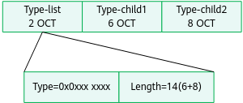

**Length类型说明<a name="section184371044192312"></a>**

Length表示Value的长度，Length占用的字节数可变，用第一个字节的bit7来区分标识Length的字节：

-   bit7为1时，表示Length在此字节结束，此字节的bit\[6:0\]为Length长度。
-   bit7为0时，表示此字节后面的7bit，标识了后面几个字节为Length长度。
-   bit7为1时，Length占用1个字节可以表示0～127的长度，示意图如下：

    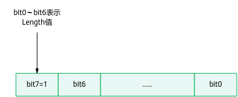

    例如：报文03 01 81 8F XX XX XX...

    -   Model ID＝03
    -   Command ID＝01
    -   Type＝81（二进制为1000 0001，无子节点，Type为1）
    -   Length＝8F（二进制为1000 1111，所以Length为15Byte）

-   bit7为0时，bit\[6:0\]表示了后续几个字节为Length值：

    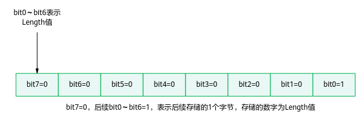

    例如：报文03 01 81 01 F3 XX XX XX...

    -   Model ID＝03
    -   Command ID＝01
    -   Type＝81（二进制为1000 0001，无子节点，Type为1）
    -   Length＝F3（Type后字节为01 F3，01二进制为0000 0001，bit7为0，后面7bit为1，表示后续一个字节的数为Length，所以Length为0xF3）

> **说明：** 
>查询和获取数据时，通常发送TL格式且L=0，回复方填充数据、补充完整的TLV格式回复请参考 “[连接参数查询](#ZH-CN_TOPIC_0000001542452609)”。

### 通用错误码<a name="ZH-CN_TOPIC_0000001542444181"></a>

通用错误码Type值为255（最高位为1），格式如下：

-   6位十进制数。
-   最高1位为1，保留后续扩展位。
-   次高2位表示模块。
-   最低3位表示模块中的错误类型。

如：101001，表示01模块中的第001个错误码。

**表 1**  通用错误码字段描述

<a name="table1836053914502"></a>
<table><thead align="left"><tr id="row5432173905015"><th class="cellrowborder" valign="top" width="15.988401159884011%" id="mcps1.2.7.1.1"><p id="p144321539105018"><a name="p144321539105018"></a><a name="p144321539105018"></a>字段名称</p>
</th>
<th class="cellrowborder" valign="top" width="12.55874412558744%" id="mcps1.2.7.1.2"><p id="p24322395506"><a name="p24322395506"></a><a name="p24322395506"></a>Type ID</p>
</th>
<th class="cellrowborder" valign="top" width="16.67833216678332%" id="mcps1.2.7.1.3"><p id="p12432103975011"><a name="p12432103975011"></a><a name="p12432103975011"></a>Length Size(Oct)</p>
</th>
<th class="cellrowborder" valign="top" width="14.83851614838516%" id="mcps1.2.7.1.4"><p id="p1343243975015"><a name="p1343243975015"></a><a name="p1343243975015"></a>Value数据类型</p>
</th>
<th class="cellrowborder" valign="top" width="23.767623237676233%" id="mcps1.2.7.1.5"><p id="p8432239185011"><a name="p8432239185011"></a><a name="p8432239185011"></a>说明</p>
</th>
<th class="cellrowborder" valign="top" width="16.168383161683835%" id="mcps1.2.7.1.6"><p id="p6432133917503"><a name="p6432133917503"></a><a name="p6432133917503"></a>必选/可选（M/O）</p>
</th>
</tr>
</thead>
<tbody><tr id="row543273915503"><td class="cellrowborder" valign="top" width="15.988401159884011%" headers="mcps1.2.7.1.1 "><p id="p3432839135014"><a name="p3432839135014"></a><a name="p3432839135014"></a>error_code</p>
</td>
<td class="cellrowborder" valign="top" width="12.55874412558744%" headers="mcps1.2.7.1.2 "><p id="p8432939135011"><a name="p8432939135011"></a><a name="p8432939135011"></a>255</p>
</td>
<td class="cellrowborder" valign="top" width="16.67833216678332%" headers="mcps1.2.7.1.3 "><p id="p1643218396505"><a name="p1643218396505"></a><a name="p1643218396505"></a>1</p>
</td>
<td class="cellrowborder" valign="top" width="14.83851614838516%" headers="mcps1.2.7.1.4 "><p id="p194321239135017"><a name="p194321239135017"></a><a name="p194321239135017"></a>uint32</p>
</td>
<td class="cellrowborder" valign="top" width="23.767623237676233%" headers="mcps1.2.7.1.5 "><p id="p1043217399503"><a name="p1043217399503"></a><a name="p1043217399503"></a>通用错误类型，具体值请参见<a href="#table0369163918502">表2</a>。</p>
</td>
<td class="cellrowborder" valign="top" width="16.168383161683835%" headers="mcps1.2.7.1.6 "><p id="p443216394501"><a name="p443216394501"></a><a name="p443216394501"></a>M</p>
</td>
</tr>
</tbody>
</table>

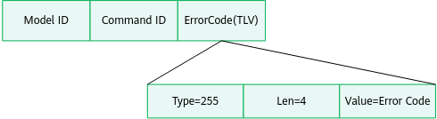

**表 2**  Error Code表

<a name="table0369163918502"></a>
<table><thead align="left"><tr id="row1443353911502"><th class="cellrowborder" valign="top" width="16.168383161683835%" id="mcps1.2.5.1.1"><p id="p154338398508"><a name="p154338398508"></a><a name="p154338398508"></a>Error Code</p>
</th>
<th class="cellrowborder" valign="top" width="23.617638236176383%" id="mcps1.2.5.1.2"><p id="p1143373975016"><a name="p1143373975016"></a><a name="p1143373975016"></a>类别</p>
</th>
<th class="cellrowborder" valign="top" width="49.31506849315069%" id="mcps1.2.5.1.3"><p id="p5433163911509"><a name="p5433163911509"></a><a name="p5433163911509"></a>说明</p>
</th>
<th class="cellrowborder" valign="top" width="10.898910108989101%" id="mcps1.2.5.1.4"><p id="p11433103913502"><a name="p11433103913502"></a><a name="p11433103913502"></a>版本</p>
</th>
</tr>
</thead>
<tbody><tr id="row74331639145012"><td class="cellrowborder" valign="top" width="16.168383161683835%" headers="mcps1.2.5.1.1 "><p id="p6433193916502"><a name="p6433193916502"></a><a name="p6433193916502"></a>100000</p>
</td>
<td class="cellrowborder" rowspan="13" valign="top" width="23.617638236176383%" headers="mcps1.2.5.1.2 "><p id="p84331399508"><a name="p84331399508"></a><a name="p84331399508"></a>通用码</p>
<p id="p15418692157"><a name="p15418692157"></a><a name="p15418692157"></a></p>
</td>
<td class="cellrowborder" valign="top" width="49.31506849315069%" headers="mcps1.2.5.1.3 "><p id="p2433339205013"><a name="p2433339205013"></a><a name="p2433339205013"></a>成功</p>
</td>
<td class="cellrowborder" valign="top" width="10.898910108989101%" headers="mcps1.2.5.1.4 ">&nbsp;&nbsp;</td>
</tr>
<tr id="row1343353913505"><td class="cellrowborder" valign="top" headers="mcps1.2.5.1.1 "><p id="p043353935014"><a name="p043353935014"></a><a name="p043353935014"></a>100001</p>
</td>
<td class="cellrowborder" valign="top" headers="mcps1.2.5.1.2 "><p id="p14330396503"><a name="p14330396503"></a><a name="p14330396503"></a>未知Error类型</p>
</td>
<td class="cellrowborder" valign="top" headers="mcps1.2.5.1.3 ">&nbsp;&nbsp;</td>
</tr>
<tr id="row843373965010"><td class="cellrowborder" valign="top" headers="mcps1.2.5.1.1 "><p id="p144335397506"><a name="p144335397506"></a><a name="p144335397506"></a>100002</p>
</td>
<td class="cellrowborder" valign="top" headers="mcps1.2.5.1.2 "><p id="p54331139145015"><a name="p54331139145015"></a><a name="p54331139145015"></a>不支持该Service的请求</p>
</td>
<td class="cellrowborder" valign="top" headers="mcps1.2.5.1.3 ">&nbsp;&nbsp;</td>
</tr>
<tr id="row243393985013"><td class="cellrowborder" valign="top" headers="mcps1.2.5.1.1 "><p id="p124331239105012"><a name="p124331239105012"></a><a name="p124331239105012"></a>100003</p>
</td>
<td class="cellrowborder" valign="top" headers="mcps1.2.5.1.2 "><p id="p15433139145014"><a name="p15433139145014"></a><a name="p15433139145014"></a>不支持该Command的请求</p>
</td>
<td class="cellrowborder" valign="top" headers="mcps1.2.5.1.3 ">&nbsp;&nbsp;</td>
</tr>
<tr id="row17433439165018"><td class="cellrowborder" valign="top" headers="mcps1.2.5.1.1 "><p id="p184335398504"><a name="p184335398504"></a><a name="p184335398504"></a>100004</p>
</td>
<td class="cellrowborder" valign="top" headers="mcps1.2.5.1.2 "><p id="p164331339195019"><a name="p164331339195019"></a><a name="p164331339195019"></a>无权限</p>
</td>
<td class="cellrowborder" valign="top" headers="mcps1.2.5.1.3 ">&nbsp;&nbsp;</td>
</tr>
<tr id="row174331539175016"><td class="cellrowborder" valign="top" headers="mcps1.2.5.1.1 "><p id="p15433173914501"><a name="p15433173914501"></a><a name="p15433173914501"></a>100005</p>
</td>
<td class="cellrowborder" valign="top" headers="mcps1.2.5.1.2 "><p id="p44331539145010"><a name="p44331539145010"></a><a name="p44331539145010"></a>系统忙</p>
</td>
<td class="cellrowborder" valign="top" headers="mcps1.2.5.1.3 ">&nbsp;&nbsp;</td>
</tr>
<tr id="row94331039105012"><td class="cellrowborder" valign="top" headers="mcps1.2.5.1.1 "><p id="p16433539145017"><a name="p16433539145017"></a><a name="p16433539145017"></a>100006</p>
</td>
<td class="cellrowborder" valign="top" headers="mcps1.2.5.1.2 "><p id="p1143311395502"><a name="p1143311395502"></a><a name="p1143311395502"></a>请求格式错误</p>
</td>
<td class="cellrowborder" valign="top" headers="mcps1.2.5.1.3 ">&nbsp;&nbsp;</td>
</tr>
<tr id="row1433123945010"><td class="cellrowborder" valign="top" headers="mcps1.2.5.1.1 "><p id="p343319399503"><a name="p343319399503"></a><a name="p343319399503"></a>100007</p>
</td>
<td class="cellrowborder" valign="top" headers="mcps1.2.5.1.2 "><p id="p3433339125016"><a name="p3433339125016"></a><a name="p3433339125016"></a>参数错误</p>
</td>
<td class="cellrowborder" valign="top" headers="mcps1.2.5.1.3 ">&nbsp;&nbsp;</td>
</tr>
<tr id="row154334395502"><td class="cellrowborder" valign="top" headers="mcps1.2.5.1.1 "><p id="p15433139125015"><a name="p15433139125015"></a><a name="p15433139125015"></a>100008</p>
</td>
<td class="cellrowborder" valign="top" headers="mcps1.2.5.1.2 "><p id="p12433103955013"><a name="p12433103955013"></a><a name="p12433103955013"></a>申请内存失败</p>
</td>
<td class="cellrowborder" valign="top" headers="mcps1.2.5.1.3 ">&nbsp;&nbsp;</td>
</tr>
<tr id="row12433133916507"><td class="cellrowborder" valign="top" headers="mcps1.2.5.1.1 "><p id="p543383905018"><a name="p543383905018"></a><a name="p543383905018"></a>100009</p>
</td>
<td class="cellrowborder" valign="top" headers="mcps1.2.5.1.2 "><p id="p114331439175014"><a name="p114331439175014"></a><a name="p114331439175014"></a>响应超时</p>
</td>
<td class="cellrowborder" valign="top" headers="mcps1.2.5.1.3 ">&nbsp;&nbsp;</td>
</tr>
<tr id="row154331539135017"><td class="cellrowborder" valign="top" headers="mcps1.2.5.1.1 "><p id="p34331939135012"><a name="p34331939135012"></a><a name="p34331939135012"></a>100010</p>
</td>
<td class="cellrowborder" valign="top" headers="mcps1.2.5.1.2 "><p id="p1343363910505"><a name="p1343363910505"></a><a name="p1343363910505"></a>设备电池电量低（无法进行业务）</p>
</td>
<td class="cellrowborder" valign="top" headers="mcps1.2.5.1.3 ">&nbsp;&nbsp;</td>
</tr>
<tr id="row1143343913508"><td class="cellrowborder" valign="top" headers="mcps1.2.5.1.1 "><p id="p1343303918505"><a name="p1343303918505"></a><a name="p1343303918505"></a>100011</p>
</td>
<td class="cellrowborder" valign="top" headers="mcps1.2.5.1.2 "><p id="p74331392506"><a name="p74331392506"></a><a name="p74331392506"></a>设备不可用</p>
</td>
<td class="cellrowborder" valign="top" headers="mcps1.2.5.1.3 ">&nbsp;&nbsp;</td>
</tr>
<tr id="row11418397154"><td class="cellrowborder" valign="top" headers="mcps1.2.5.1.1 "><p id="p154187916150"><a name="p154187916150"></a><a name="p154187916150"></a>100012</p>
</td>
<td class="cellrowborder" valign="top" headers="mcps1.2.5.1.2 "><p id="p14418159111513"><a name="p14418159111513"></a><a name="p14418159111513"></a>助听耳机业务未启动</p>
</td>
<td class="cellrowborder" valign="top" headers="mcps1.2.5.1.3 ">&nbsp;&nbsp;</td>
</tr>
<tr id="row543463945015"><td class="cellrowborder" valign="top" width="16.168383161683835%" headers="mcps1.2.5.1.1 "><p id="p14434123905010"><a name="p14434123905010"></a><a name="p14434123905010"></a>103001</p>
</td>
<td class="cellrowborder" rowspan="2" valign="top" width="23.617638236176383%" headers="mcps1.2.5.1.2 "><p id="p14434103915502"><a name="p14434103915502"></a><a name="p14434103915502"></a>HearingAid Config model</p>
</td>
<td class="cellrowborder" valign="top" width="49.31506849315069%" headers="mcps1.2.5.1.3 "><p id="p1943417392509"><a name="p1943417392509"></a><a name="p1943417392509"></a>入参为空/数据非法</p>
</td>
<td class="cellrowborder" valign="top" width="10.898910108989101%" headers="mcps1.2.5.1.4 ">&nbsp;&nbsp;</td>
</tr>
<tr id="row1343420399505"><td class="cellrowborder" valign="top" headers="mcps1.2.5.1.1 "><p id="p8434173910503"><a name="p8434173910503"></a><a name="p8434173910503"></a>103002</p>
</td>
<td class="cellrowborder" valign="top" headers="mcps1.2.5.1.2 "><p id="p743410390503"><a name="p743410390503"></a><a name="p743410390503"></a>数据过长</p>
</td>
<td class="cellrowborder" valign="top" headers="mcps1.2.5.1.3 ">&nbsp;&nbsp;</td>
</tr>
</tbody>
</table>

> **说明：** 
>对于单板不支持的Model ID，单板返回100002（不支持该Model请求），对于单板不支持的Command ID，单板返回100003（不支持该Command请求）。

## Data域的定义格式约束<a name="ZH-CN_TOPIC_0000001466739450"></a>

各业务内的定义通用要求如下：

-   业务数据定义考虑扩展性，预留扩展能力。
-   业务内部按照功能进行合理的子类划分。

## 字节大小头约束<a name="ZH-CN_TOPIC_0000001466579802"></a>

对于多字节传输的字段类型，均按照小端字节（LSB）序格式传输。

## 索引字段说明<a name="ZH-CN_TOPIC_0000001518018625"></a>

对于本文档中描述到的所有索引，如果没有特殊说明，均是从1开始，并且进行递增。如果有特殊场景，需明确描述在接口字段定义中。

## 边界条件限制<a name="ZH-CN_TOPIC_0000001466899078"></a>

-   APP和穿戴设备间应用层协议最大包长定为2048Byte。
-   新增APP和穿戴设备间的TLV命令嵌套深度不超过5层。

# Model ID命令定义<a name="ZH-CN_TOPIC_0000001467058934"></a>

-   **[设备状态查询](#ZH-CN_TOPIC_0000001492012672)**  

-   **[升级业务处理](#ZH-CN_TOPIC_0000001491692852)**  

-   **[助听业务处理](#ZH-CN_TOPIC_0000001542652789)**  

-   **[助听参数配置](#ZH-CN_TOPIC_0000001542666893)**  

-   **[可维可测](#ZH-CN_TOPIC_0000001542572821)**  

-   **[文件传输](#ZH-CN_TOPIC_0000001491533000)**  

-   **[设备设置](#ZH-CN_TOPIC_0000001491692864)**  

-   **[MCU业务维测](#ZH-CN_TOPIC_0000001606811725)**  

-   **[BT业务维测](#ZH-CN_TOPIC_0000001556172512)**  

-   **[Media业务维测](#ZH-CN_TOPIC_0000001556331780)**  

-   **[Graphic业务维测](#ZH-CN_TOPIC_0000001606731265)**  

-   **[Audio业务维测](#ZH-CN_TOPIC_0000001650807840)**  

-   **[MsgCenter业务](#ZH-CN_TOPIC_0000001674891025)**  

-   **[组网设备业务](#ZH-CN_TOPIC_0000002362593397)**  

## 设备状态查询<a name="ZH-CN_TOPIC_0000001492012672"></a>

-   **[连接参数查询](#ZH-CN_TOPIC_0000001542452609)**  

-   **[设备电池电量百分比查询](#ZH-CN_TOPIC_0000001542572809)**  

-   **[耳机连接方式查询](#ZH-CN_TOPIC_0000001491532988)**  

-   **[耳机佩戴状态查询](#ZH-CN_TOPIC_0000001547536933)**  

-   **[设备音量查询](#ZH-CN_TOPIC_0000001511141332)**  

-   **[设备状态变化上报](#ZH-CN_TOPIC_0000001566110569)**  

-   **[获取日期时间](#ZH-CN_TOPIC_0000001618432514)**  

### 连接参数查询<a name="ZH-CN_TOPIC_0000001542452609"></a>

**表 1**  连接参数查询字段描述

<a name="table16979103316160"></a>
<table><thead align="left"><tr id="row17141734191614"><th class="cellrowborder" valign="top" width="13.33%" id="mcps1.2.8.1.1"><p id="p1814123410164"><a name="p1814123410164"></a><a name="p1814123410164"></a>字段名称</p>
</th>
<th class="cellrowborder" valign="top" width="10.42%" id="mcps1.2.8.1.2"><p id="p914163411160"><a name="p914163411160"></a><a name="p914163411160"></a>Type(bit0～bit6)</p>
</th>
<th class="cellrowborder" valign="top" width="14.32%" id="mcps1.2.8.1.3"><p id="p814934131610"><a name="p814934131610"></a><a name="p814934131610"></a>Length Size(Oct)</p>
</th>
<th class="cellrowborder" valign="top" width="12.479999999999999%" id="mcps1.2.8.1.4"><p id="p5149341164"><a name="p5149341164"></a><a name="p5149341164"></a>Value数据类型</p>
</th>
<th class="cellrowborder" valign="top" width="22.79%" id="mcps1.2.8.1.5"><p id="p614534131618"><a name="p614534131618"></a><a name="p614534131618"></a>说明</p>
</th>
<th class="cellrowborder" valign="top" width="14.610000000000001%" id="mcps1.2.8.1.6"><p id="p1314173421611"><a name="p1314173421611"></a><a name="p1314173421611"></a>必选/可选（M/O）</p>
</th>
<th class="cellrowborder" valign="top" width="12.049999999999999%" id="mcps1.2.8.1.7"><p id="p1814133410166"><a name="p1814133410166"></a><a name="p1814133410166"></a>版本</p>
</th>
</tr>
</thead>
<tbody><tr id="row1614234101616"><td class="cellrowborder" valign="top" width="13.33%" headers="mcps1.2.8.1.1 "><p id="p21483451617"><a name="p21483451617"></a><a name="p21483451617"></a>protocal_version</p>
</td>
<td class="cellrowborder" valign="top" width="10.42%" headers="mcps1.2.8.1.2 "><p id="p12141534151616"><a name="p12141534151616"></a><a name="p12141534151616"></a>0x01</p>
</td>
<td class="cellrowborder" valign="top" width="14.32%" headers="mcps1.2.8.1.3 "><p id="p2141734171612"><a name="p2141734171612"></a><a name="p2141734171612"></a>1</p>
</td>
<td class="cellrowborder" valign="top" width="12.479999999999999%" headers="mcps1.2.8.1.4 "><p id="p191483410169"><a name="p191483410169"></a><a name="p191483410169"></a>uint8</p>
</td>
<td class="cellrowborder" valign="top" width="22.79%" headers="mcps1.2.8.1.5 "><a name="ul847393615910"></a><a name="ul847393615910"></a><ul id="ul847393615910"><li>0x01：协议版本1.0</li><li>0x02：协议版本2.0</li></ul>
</td>
<td class="cellrowborder" valign="top" width="14.610000000000001%" headers="mcps1.2.8.1.6 "><p id="p1314153431610"><a name="p1314153431610"></a><a name="p1314153431610"></a>O</p>
</td>
<td class="cellrowborder" valign="top" width="12.049999999999999%" headers="mcps1.2.8.1.7 "><p id="p61403461613"><a name="p61403461613"></a><a name="p61403461613"></a>1.0/1.0</p>
</td>
</tr>
<tr id="row1496093811320"><td class="cellrowborder" valign="top" width="13.33%" headers="mcps1.2.8.1.1 "><p id="p153508561231"><a name="p153508561231"></a><a name="p153508561231"></a>SN_get</p>
</td>
<td class="cellrowborder" valign="top" width="10.42%" headers="mcps1.2.8.1.2 "><p id="p12350856536"><a name="p12350856536"></a><a name="p12350856536"></a>0x02</p>
</td>
<td class="cellrowborder" valign="top" width="14.32%" headers="mcps1.2.8.1.3 "><p id="p3350145616312"><a name="p3350145616312"></a><a name="p3350145616312"></a>64</p>
</td>
<td class="cellrowborder" valign="top" width="12.479999999999999%" headers="mcps1.2.8.1.4 "><p id="p3350145612310"><a name="p3350145612310"></a><a name="p3350145612310"></a>uint8</p>
</td>
<td class="cellrowborder" valign="top" width="22.79%" headers="mcps1.2.8.1.5 "><p id="p7350145616313"><a name="p7350145616313"></a><a name="p7350145616313"></a>SN：字符串，最大64Byte，使用时根据具体的SN号长度封包。</p>
</td>
<td class="cellrowborder" valign="top" width="14.610000000000001%" headers="mcps1.2.8.1.6 "><p id="p8350105613318"><a name="p8350105613318"></a><a name="p8350105613318"></a>O</p>
</td>
<td class="cellrowborder" valign="top" width="12.049999999999999%" headers="mcps1.2.8.1.7 "><p id="p20350856538"><a name="p20350856538"></a><a name="p20350856538"></a>1.0/1.0</p>
</td>
</tr>
<tr id="row1973194619316"><td class="cellrowborder" valign="top" width="13.33%" headers="mcps1.2.8.1.1 "><p id="p835013562317"><a name="p835013562317"></a><a name="p835013562317"></a>BT_MAC_get</p>
</td>
<td class="cellrowborder" valign="top" width="10.42%" headers="mcps1.2.8.1.2 "><p id="p435014561535"><a name="p435014561535"></a><a name="p435014561535"></a>0x03</p>
</td>
<td class="cellrowborder" valign="top" width="14.32%" headers="mcps1.2.8.1.3 "><p id="p143502562035"><a name="p143502562035"></a><a name="p143502562035"></a>6</p>
</td>
<td class="cellrowborder" valign="top" width="12.479999999999999%" headers="mcps1.2.8.1.4 "><p id="p11350456737"><a name="p11350456737"></a><a name="p11350456737"></a>uint8</p>
</td>
<td class="cellrowborder" valign="top" width="22.79%" headers="mcps1.2.8.1.5 "><p id="p1435055616316"><a name="p1435055616316"></a><a name="p1435055616316"></a>BT的MAC地址。</p>
</td>
<td class="cellrowborder" valign="top" width="14.610000000000001%" headers="mcps1.2.8.1.6 "><p id="p123505566316"><a name="p123505566316"></a><a name="p123505566316"></a>O</p>
</td>
<td class="cellrowborder" valign="top" width="12.049999999999999%" headers="mcps1.2.8.1.7 "><p id="p7350156839"><a name="p7350156839"></a><a name="p7350156839"></a>1.0/1.0</p>
</td>
</tr>
<tr id="row19705655294"><td class="cellrowborder" valign="top" width="13.33%" headers="mcps1.2.8.1.1 "><p id="p1897374017295"><a name="p1897374017295"></a><a name="p1897374017295"></a>max_frame_unit</p>
</td>
<td class="cellrowborder" valign="top" width="10.42%" headers="mcps1.2.8.1.2 "><p id="p49731840112912"><a name="p49731840112912"></a><a name="p49731840112912"></a>0x04</p>
</td>
<td class="cellrowborder" valign="top" width="14.32%" headers="mcps1.2.8.1.3 "><p id="p097314019294"><a name="p097314019294"></a><a name="p097314019294"></a>2</p>
</td>
<td class="cellrowborder" valign="top" width="12.479999999999999%" headers="mcps1.2.8.1.4 "><p id="p1297334019291"><a name="p1297334019291"></a><a name="p1297334019291"></a>uint16</p>
</td>
<td class="cellrowborder" valign="top" width="22.79%" headers="mcps1.2.8.1.5 "><p id="p149739403293"><a name="p149739403293"></a><a name="p149739403293"></a>链路层最大帧长度。</p>
</td>
<td class="cellrowborder" valign="top" width="14.610000000000001%" headers="mcps1.2.8.1.6 "><p id="p1997354032918"><a name="p1997354032918"></a><a name="p1997354032918"></a>O</p>
</td>
<td class="cellrowborder" valign="top" width="12.049999999999999%" headers="mcps1.2.8.1.7 "><p id="p129731840172911"><a name="p129731840172911"></a><a name="p129731840172911"></a>1.0/1.0</p>
</td>
</tr>
<tr id="row11688910162918"><td class="cellrowborder" valign="top" width="13.33%" headers="mcps1.2.8.1.1 "><p id="p16973134052915"><a name="p16973134052915"></a><a name="p16973134052915"></a>interval</p>
</td>
<td class="cellrowborder" valign="top" width="10.42%" headers="mcps1.2.8.1.2 "><p id="p39731940102915"><a name="p39731940102915"></a><a name="p39731940102915"></a>0x05</p>
</td>
<td class="cellrowborder" valign="top" width="14.32%" headers="mcps1.2.8.1.3 "><p id="p19973114072916"><a name="p19973114072916"></a><a name="p19973114072916"></a>2</p>
</td>
<td class="cellrowborder" valign="top" width="12.479999999999999%" headers="mcps1.2.8.1.4 "><p id="p797313400293"><a name="p797313400293"></a><a name="p797313400293"></a>uint16</p>
</td>
<td class="cellrowborder" valign="top" width="22.79%" headers="mcps1.2.8.1.5 "><p id="p1097320408292"><a name="p1097320408292"></a><a name="p1097320408292"></a>数据包发送最小间隔时间，单位：ms。</p>
</td>
<td class="cellrowborder" valign="top" width="14.610000000000001%" headers="mcps1.2.8.1.6 "><p id="p1097344012291"><a name="p1097344012291"></a><a name="p1097344012291"></a>O</p>
</td>
<td class="cellrowborder" valign="top" width="12.049999999999999%" headers="mcps1.2.8.1.7 "><p id="p16973174012911"><a name="p16973174012911"></a><a name="p16973174012911"></a>1.0/1.0</p>
</td>
</tr>
<tr id="row1495463051417"><td class="cellrowborder" valign="top" width="13.33%" headers="mcps1.2.8.1.1 "><p id="p79545306145"><a name="p79545306145"></a><a name="p79545306145"></a>Device_version</p>
</td>
<td class="cellrowborder" valign="top" width="10.42%" headers="mcps1.2.8.1.2 "><p id="p1636774882911"><a name="p1636774882911"></a><a name="p1636774882911"></a>0x06</p>
</td>
<td class="cellrowborder" valign="top" width="14.32%" headers="mcps1.2.8.1.3 "><p id="p17954193015148"><a name="p17954193015148"></a><a name="p17954193015148"></a>32</p>
</td>
<td class="cellrowborder" valign="top" width="12.479999999999999%" headers="mcps1.2.8.1.4 "><p id="p895483001419"><a name="p895483001419"></a><a name="p895483001419"></a>uint8</p>
</td>
<td class="cellrowborder" valign="top" width="22.79%" headers="mcps1.2.8.1.5 "><p id="p695433001416"><a name="p695433001416"></a><a name="p695433001416"></a>设备软件版本号：最大32Byte字符串，使用时根据具体的版本号长度封包。</p>
</td>
<td class="cellrowborder" valign="top" width="14.610000000000001%" headers="mcps1.2.8.1.6 "><p id="p1695416305145"><a name="p1695416305145"></a><a name="p1695416305145"></a>O</p>
</td>
<td class="cellrowborder" valign="top" width="12.049999999999999%" headers="mcps1.2.8.1.7 "><p id="p7954330101415"><a name="p7954330101415"></a><a name="p7954330101415"></a>1.0/1.0</p>
</td>
</tr>
<tr id="row429373721419"><td class="cellrowborder" valign="top" width="13.33%" headers="mcps1.2.8.1.1 "><p id="p5293637151414"><a name="p5293637151414"></a><a name="p5293637151414"></a>Earphone_role</p>
</td>
<td class="cellrowborder" valign="top" width="10.42%" headers="mcps1.2.8.1.2 "><p id="p17367148182918"><a name="p17367148182918"></a><a name="p17367148182918"></a>0x07</p>
</td>
<td class="cellrowborder" valign="top" width="14.32%" headers="mcps1.2.8.1.3 "><p id="p5293737161412"><a name="p5293737161412"></a><a name="p5293737161412"></a>1</p>
</td>
<td class="cellrowborder" valign="top" width="12.479999999999999%" headers="mcps1.2.8.1.4 "><p id="p629363761417"><a name="p629363761417"></a><a name="p629363761417"></a>uint8</p>
</td>
<td class="cellrowborder" valign="top" width="22.79%" headers="mcps1.2.8.1.5 "><p id="p1829312377146"><a name="p1829312377146"></a><a name="p1829312377146"></a>双耳耳机主副信息查询：</p>
<p id="p5958653111412"><a name="p5958653111412"></a><a name="p5958653111412"></a>1：主耳耳机</p>
<p id="p199581053171418"><a name="p199581053171418"></a><a name="p199581053171418"></a>2：副耳耳机</p>
</td>
<td class="cellrowborder" valign="top" width="14.610000000000001%" headers="mcps1.2.8.1.6 "><p id="p029363761414"><a name="p029363761414"></a><a name="p029363761414"></a>O</p>
</td>
<td class="cellrowborder" valign="top" width="12.049999999999999%" headers="mcps1.2.8.1.7 "><p id="p32935375147"><a name="p32935375147"></a><a name="p32935375147"></a>1.0/1.0</p>
</td>
</tr>
<tr id="row172224411413"><td class="cellrowborder" valign="top" width="13.33%" headers="mcps1.2.8.1.1 "><p id="p52218446144"><a name="p52218446144"></a><a name="p52218446144"></a>Earphone_pos</p>
</td>
<td class="cellrowborder" valign="top" width="10.42%" headers="mcps1.2.8.1.2 "><p id="p1367204812915"><a name="p1367204812915"></a><a name="p1367204812915"></a>0x08</p>
</td>
<td class="cellrowborder" valign="top" width="14.32%" headers="mcps1.2.8.1.3 "><p id="p2223446142"><a name="p2223446142"></a><a name="p2223446142"></a>1</p>
</td>
<td class="cellrowborder" valign="top" width="12.479999999999999%" headers="mcps1.2.8.1.4 "><p id="p1222104417142"><a name="p1222104417142"></a><a name="p1222104417142"></a>uint8</p>
</td>
<td class="cellrowborder" valign="top" width="22.79%" headers="mcps1.2.8.1.5 "><p id="p222344121411"><a name="p222344121411"></a><a name="p222344121411"></a>双耳耳机左右信息查询：</p>
<p id="p189581653121415"><a name="p189581653121415"></a><a name="p189581653121415"></a>1：左耳耳机</p>
<p id="p695835315149"><a name="p695835315149"></a><a name="p695835315149"></a>2：右耳耳机</p>
</td>
<td class="cellrowborder" valign="top" width="14.610000000000001%" headers="mcps1.2.8.1.6 "><p id="p1422194411410"><a name="p1422194411410"></a><a name="p1422194411410"></a>O</p>
</td>
<td class="cellrowborder" valign="top" width="12.049999999999999%" headers="mcps1.2.8.1.7 "><p id="p11231444181413"><a name="p11231444181413"></a><a name="p11231444181413"></a>1.0/1.0</p>
</td>
</tr>
<tr id="row1647617341465"><td class="cellrowborder" valign="top" width="13.33%" headers="mcps1.2.8.1.1 "><p id="p947643417616"><a name="p947643417616"></a><a name="p947643417616"></a>Name</p>
</td>
<td class="cellrowborder" valign="top" width="10.42%" headers="mcps1.2.8.1.2 "><p id="p1947620341069"><a name="p1947620341069"></a><a name="p1947620341069"></a>0x09</p>
</td>
<td class="cellrowborder" valign="top" width="14.32%" headers="mcps1.2.8.1.3 "><p id="p1847616341368"><a name="p1847616341368"></a><a name="p1847616341368"></a>32</p>
</td>
<td class="cellrowborder" valign="top" width="12.479999999999999%" headers="mcps1.2.8.1.4 "><p id="p1047610341613"><a name="p1047610341613"></a><a name="p1047610341613"></a>uint8</p>
</td>
<td class="cellrowborder" valign="top" width="22.79%" headers="mcps1.2.8.1.5 "><p id="p154768345611"><a name="p154768345611"></a><a name="p154768345611"></a>产品名称：字符串，最大32Byte，使用时根据具体的长度封包。</p>
</td>
<td class="cellrowborder" valign="top" width="14.610000000000001%" headers="mcps1.2.8.1.6 "><p id="p647615344616"><a name="p647615344616"></a><a name="p647615344616"></a>O</p>
</td>
<td class="cellrowborder" valign="top" width="12.049999999999999%" headers="mcps1.2.8.1.7 "><p id="p54767342620"><a name="p54767342620"></a><a name="p54767342620"></a>1.0/1.0</p>
</td>
</tr>
<tr id="row1612612419615"><td class="cellrowborder" valign="top" width="13.33%" headers="mcps1.2.8.1.1 "><p id="p14126184118618"><a name="p14126184118618"></a><a name="p14126184118618"></a>Model</p>
</td>
<td class="cellrowborder" valign="top" width="10.42%" headers="mcps1.2.8.1.2 "><p id="p812616411161"><a name="p812616411161"></a><a name="p812616411161"></a>0x0a</p>
</td>
<td class="cellrowborder" valign="top" width="14.32%" headers="mcps1.2.8.1.3 "><p id="p14126441863"><a name="p14126441863"></a><a name="p14126441863"></a>32</p>
</td>
<td class="cellrowborder" valign="top" width="12.479999999999999%" headers="mcps1.2.8.1.4 "><p id="p1112612411468"><a name="p1112612411468"></a><a name="p1112612411468"></a>uint8</p>
</td>
<td class="cellrowborder" valign="top" width="22.79%" headers="mcps1.2.8.1.5 "><p id="p1912654118615"><a name="p1912654118615"></a><a name="p1912654118615"></a>产品型号：字符串，最大32Byte，使用时根据具体的长度封包。</p>
</td>
<td class="cellrowborder" valign="top" width="14.610000000000001%" headers="mcps1.2.8.1.6 "><p id="p161272411668"><a name="p161272411668"></a><a name="p161272411668"></a>O</p>
</td>
<td class="cellrowborder" valign="top" width="12.049999999999999%" headers="mcps1.2.8.1.7 "><p id="p412715411468"><a name="p412715411468"></a><a name="p412715411468"></a>1.0/1.0</p>
</td>
</tr>
<tr id="row08631139114315"><td class="cellrowborder" valign="top" width="13.33%" headers="mcps1.2.8.1.1 "><p id="p98401456164312"><a name="p98401456164312"></a><a name="p98401456164312"></a>Hardware_id</p>
</td>
<td class="cellrowborder" valign="top" width="10.42%" headers="mcps1.2.8.1.2 "><p id="p12840205694313"><a name="p12840205694313"></a><a name="p12840205694313"></a>0x0b</p>
</td>
<td class="cellrowborder" valign="top" width="14.32%" headers="mcps1.2.8.1.3 "><p id="p184015654312"><a name="p184015654312"></a><a name="p184015654312"></a>4</p>
</td>
<td class="cellrowborder" valign="top" width="12.479999999999999%" headers="mcps1.2.8.1.4 "><p id="p1584085694318"><a name="p1584085694318"></a><a name="p1584085694318"></a>uint32</p>
</td>
<td class="cellrowborder" valign="top" width="22.79%" headers="mcps1.2.8.1.5 "><p id="p1084085674313"><a name="p1084085674313"></a><a name="p1084085674313"></a>设备硬件版本号。</p>
</td>
<td class="cellrowborder" valign="top" width="14.610000000000001%" headers="mcps1.2.8.1.6 "><p id="p1784020565432"><a name="p1784020565432"></a><a name="p1784020565432"></a>O</p>
</td>
<td class="cellrowborder" valign="top" width="12.049999999999999%" headers="mcps1.2.8.1.7 "><p id="p168404564431"><a name="p168404564431"></a><a name="p168404564431"></a>1.0/1.0</p>
</td>
</tr>
<tr id="row6601181742017"><td class="cellrowborder" valign="top" width="13.33%" headers="mcps1.2.8.1.1 "><p id="p26024174207"><a name="p26024174207"></a><a name="p26024174207"></a>Country</p>
</td>
<td class="cellrowborder" valign="top" width="10.42%" headers="mcps1.2.8.1.2 "><p id="p56029174208"><a name="p56029174208"></a><a name="p56029174208"></a>0x0c</p>
</td>
<td class="cellrowborder" valign="top" width="14.32%" headers="mcps1.2.8.1.3 "><p id="p260291717202"><a name="p260291717202"></a><a name="p260291717202"></a>1</p>
</td>
<td class="cellrowborder" valign="top" width="12.479999999999999%" headers="mcps1.2.8.1.4 "><p id="p146021417122012"><a name="p146021417122012"></a><a name="p146021417122012"></a>uint8</p>
</td>
<td class="cellrowborder" valign="top" width="22.79%" headers="mcps1.2.8.1.5 "><p id="p176021617102017"><a name="p176021617102017"></a><a name="p176021617102017"></a>国家码查询：</p>
<p id="p15634113131612"><a name="p15634113131612"></a><a name="p15634113131612"></a>0：中文</p>
<p id="p61531826151617"><a name="p61531826151617"></a><a name="p61531826151617"></a>1：英文</p>
<p id="p99131309512"><a name="p99131309512"></a><a name="p99131309512"></a>国家码值由nv中的值定义。取值与“<a href="#ZH-CN_TOPIC_0000001711636865">设备国家设置</a>”保持一致。</p>
</td>
<td class="cellrowborder" valign="top" width="14.610000000000001%" headers="mcps1.2.8.1.6 "><p id="p5602201710202"><a name="p5602201710202"></a><a name="p5602201710202"></a>O</p>
</td>
<td class="cellrowborder" valign="top" width="12.049999999999999%" headers="mcps1.2.8.1.7 "><p id="p560201712207"><a name="p560201712207"></a><a name="p560201712207"></a>1.0/1.0</p>
</td>
</tr>
</tbody>
</table>

-   发送帧结构：（查询时，仅为TL格式，Length=0）

    

-   接收帧结构：
    -   返回成功：

        

    -   返回失败：

        

### 设备电池电量百分比查询<a name="ZH-CN_TOPIC_0000001542572809"></a>

**表 1**  设备电池电量百分比查询字段描述

<a name="table166201652112413"></a>
<table><thead align="left"><tr id="row86861352102415"><th class="cellrowborder" valign="top" width="13.33%" id="mcps1.2.8.1.1"><p id="p8687115210243"><a name="p8687115210243"></a><a name="p8687115210243"></a>字段名称</p>
</th>
<th class="cellrowborder" valign="top" width="10.42%" id="mcps1.2.8.1.2"><p id="p26871752192413"><a name="p26871752192413"></a><a name="p26871752192413"></a>Type(bit0～bit6)</p>
</th>
<th class="cellrowborder" valign="top" width="14.32%" id="mcps1.2.8.1.3"><p id="p166872526245"><a name="p166872526245"></a><a name="p166872526245"></a>Length Size(Oct)</p>
</th>
<th class="cellrowborder" valign="top" width="12.479999999999999%" id="mcps1.2.8.1.4"><p id="p1687195211246"><a name="p1687195211246"></a><a name="p1687195211246"></a>Value数据类型</p>
</th>
<th class="cellrowborder" valign="top" width="22.79%" id="mcps1.2.8.1.5"><p id="p26871552142418"><a name="p26871552142418"></a><a name="p26871552142418"></a>说明</p>
</th>
<th class="cellrowborder" valign="top" width="14.610000000000001%" id="mcps1.2.8.1.6"><p id="p668795232411"><a name="p668795232411"></a><a name="p668795232411"></a>必选/可选（M/O）</p>
</th>
<th class="cellrowborder" valign="top" width="12.049999999999999%" id="mcps1.2.8.1.7"><p id="p10687452112414"><a name="p10687452112414"></a><a name="p10687452112414"></a>版本</p>
</th>
</tr>
</thead>
<tbody><tr id="row06871752182410"><td class="cellrowborder" valign="top" width="13.33%" headers="mcps1.2.8.1.1 "><p id="p13687155262416"><a name="p13687155262416"></a><a name="p13687155262416"></a>only_battery_percent</p>
</td>
<td class="cellrowborder" valign="top" width="10.42%" headers="mcps1.2.8.1.2 "><p id="p06875520249"><a name="p06875520249"></a><a name="p06875520249"></a>0x01</p>
</td>
<td class="cellrowborder" valign="top" width="14.32%" headers="mcps1.2.8.1.3 "><p id="p968755262420"><a name="p968755262420"></a><a name="p968755262420"></a>1</p>
</td>
<td class="cellrowborder" valign="top" width="12.479999999999999%" headers="mcps1.2.8.1.4 "><p id="p15687115272414"><a name="p15687115272414"></a><a name="p15687115272414"></a>uint8</p>
</td>
<td class="cellrowborder" valign="top" width="22.79%" headers="mcps1.2.8.1.5 "><p id="p868745272410"><a name="p868745272410"></a><a name="p868745272410"></a>设备电池电量百分比。取值范围[0,100]。</p>
<p id="p1968710523241"><a name="p1968710523241"></a><a name="p1968710523241"></a>设备只需上报一个电量表示时使用，如：手表电池电量。</p>
</td>
<td class="cellrowborder" valign="top" width="14.610000000000001%" headers="mcps1.2.8.1.6 "><p id="p76872052142415"><a name="p76872052142415"></a><a name="p76872052142415"></a>O</p>
</td>
<td class="cellrowborder" valign="top" width="12.049999999999999%" headers="mcps1.2.8.1.7 "><p id="p868711528248"><a name="p868711528248"></a><a name="p868711528248"></a>1.0/1.0</p>
</td>
</tr>
<tr id="row468712526245"><td class="cellrowborder" valign="top" width="13.33%" headers="mcps1.2.8.1.1 "><p id="p126871752132419"><a name="p126871752132419"></a><a name="p126871752132419"></a>left_battery_percent</p>
</td>
<td class="cellrowborder" valign="top" width="10.42%" headers="mcps1.2.8.1.2 "><p id="p2068715528243"><a name="p2068715528243"></a><a name="p2068715528243"></a>0x02</p>
</td>
<td class="cellrowborder" valign="top" width="14.32%" headers="mcps1.2.8.1.3 "><p id="p1868755214245"><a name="p1868755214245"></a><a name="p1868755214245"></a>1</p>
</td>
<td class="cellrowborder" valign="top" width="12.479999999999999%" headers="mcps1.2.8.1.4 "><p id="p13687952102415"><a name="p13687952102415"></a><a name="p13687952102415"></a>uint8</p>
</td>
<td class="cellrowborder" valign="top" width="22.79%" headers="mcps1.2.8.1.5 "><p id="p15687052182418"><a name="p15687052182418"></a><a name="p15687052182418"></a>设备电池不止一个时使用，对于TWS耳机来说，表示左耳机电量百分比，其它品类的设备需求明确后补充。取值范围[0,100]。</p>
</td>
<td class="cellrowborder" valign="top" width="14.610000000000001%" headers="mcps1.2.8.1.6 "><p id="p2687155219242"><a name="p2687155219242"></a><a name="p2687155219242"></a>O</p>
</td>
<td class="cellrowborder" valign="top" width="12.049999999999999%" headers="mcps1.2.8.1.7 "><p id="p1868712527248"><a name="p1868712527248"></a><a name="p1868712527248"></a>1.0/1.0</p>
</td>
</tr>
<tr id="row26871752102413"><td class="cellrowborder" valign="top" width="13.33%" headers="mcps1.2.8.1.1 "><p id="p10687852202414"><a name="p10687852202414"></a><a name="p10687852202414"></a>right_battery_percent</p>
</td>
<td class="cellrowborder" valign="top" width="10.42%" headers="mcps1.2.8.1.2 "><p id="p17687152152413"><a name="p17687152152413"></a><a name="p17687152152413"></a>0x03</p>
</td>
<td class="cellrowborder" valign="top" width="14.32%" headers="mcps1.2.8.1.3 "><p id="p768713522241"><a name="p768713522241"></a><a name="p768713522241"></a>1</p>
</td>
<td class="cellrowborder" valign="top" width="12.479999999999999%" headers="mcps1.2.8.1.4 "><p id="p268785215242"><a name="p268785215242"></a><a name="p268785215242"></a>uint8</p>
</td>
<td class="cellrowborder" valign="top" width="22.79%" headers="mcps1.2.8.1.5 "><p id="p1468765215249"><a name="p1468765215249"></a><a name="p1468765215249"></a>设备电池不止一个时使用，对于TWS耳机来说，表示右耳机电量百分比，其它品类的设备需求明确后补充。取值范围[0,100]。</p>
</td>
<td class="cellrowborder" valign="top" width="14.610000000000001%" headers="mcps1.2.8.1.6 "><p id="p116871852112412"><a name="p116871852112412"></a><a name="p116871852112412"></a>O</p>
</td>
<td class="cellrowborder" valign="top" width="12.049999999999999%" headers="mcps1.2.8.1.7 "><p id="p6687352152410"><a name="p6687352152410"></a><a name="p6687352152410"></a>1.0/1.0</p>
</td>
</tr>
<tr id="row76871852122412"><td class="cellrowborder" valign="top" width="13.33%" headers="mcps1.2.8.1.1 "><p id="p1168725214242"><a name="p1168725214242"></a><a name="p1168725214242"></a>box_battery_percent</p>
</td>
<td class="cellrowborder" valign="top" width="10.42%" headers="mcps1.2.8.1.2 "><p id="p1568735272415"><a name="p1568735272415"></a><a name="p1568735272415"></a>0x04</p>
</td>
<td class="cellrowborder" valign="top" width="14.32%" headers="mcps1.2.8.1.3 "><p id="p1868715218248"><a name="p1868715218248"></a><a name="p1868715218248"></a>1</p>
</td>
<td class="cellrowborder" valign="top" width="12.479999999999999%" headers="mcps1.2.8.1.4 "><p id="p8687552102418"><a name="p8687552102418"></a><a name="p8687552102418"></a>uint8</p>
</td>
<td class="cellrowborder" valign="top" width="22.79%" headers="mcps1.2.8.1.5 "><p id="p26871752152416"><a name="p26871752152416"></a><a name="p26871752152416"></a>设备电池不止一个时使用，对于TWS耳机来说，表示充电盒电量百分比，其它品类的设备需求明确后补充。取值范围[0,100]。</p>
</td>
<td class="cellrowborder" valign="top" width="14.610000000000001%" headers="mcps1.2.8.1.6 "><p id="p16687752202410"><a name="p16687752202410"></a><a name="p16687752202410"></a>O</p>
</td>
<td class="cellrowborder" valign="top" width="12.049999999999999%" headers="mcps1.2.8.1.7 "><p id="p668725210249"><a name="p668725210249"></a><a name="p668725210249"></a>1.0/1.0</p>
</td>
</tr>
<tr id="row19687352142411"><td class="cellrowborder" valign="top" width="13.33%" headers="mcps1.2.8.1.1 "><p id="p968717527249"><a name="p968717527249"></a><a name="p968717527249"></a>battery_ charging_state</p>
</td>
<td class="cellrowborder" valign="top" width="10.42%" headers="mcps1.2.8.1.2 "><p id="p17687352142418"><a name="p17687352142418"></a><a name="p17687352142418"></a>0x05</p>
</td>
<td class="cellrowborder" valign="top" width="14.32%" headers="mcps1.2.8.1.3 "><p id="p5687652102413"><a name="p5687652102413"></a><a name="p5687652102413"></a>1</p>
</td>
<td class="cellrowborder" valign="top" width="12.479999999999999%" headers="mcps1.2.8.1.4 "><p id="p968735282411"><a name="p968735282411"></a><a name="p968735282411"></a>uint8</p>
</td>
<td class="cellrowborder" valign="top" width="22.79%" headers="mcps1.2.8.1.5 "><p id="p1068795218243"><a name="p1068795218243"></a><a name="p1068795218243"></a>充电状态，包括左耳、右耳、充电盒充电状态返回，取值范围：</p>
<a name="ul494951118275"></a><a name="ul494951118275"></a><ul id="ul494951118275"><li>0：未充电</li><li>1：充电中</li><li>2：已充满</li></ul>
<p id="p176874521243"><a name="p176874521243"></a><a name="p176874521243"></a>注意：充电状态与电池电量百分比配套使用，表示前面对应的电池充电状态。</p>
</td>
<td class="cellrowborder" valign="top" width="14.610000000000001%" headers="mcps1.2.8.1.6 "><p id="p46877520244"><a name="p46877520244"></a><a name="p46877520244"></a>O</p>
</td>
<td class="cellrowborder" valign="top" width="12.049999999999999%" headers="mcps1.2.8.1.7 "><p id="p18687852102413"><a name="p18687852102413"></a><a name="p18687852102413"></a>1.0/1.0</p>
</td>
</tr>
</tbody>
</table>

-   请求帧结构：

    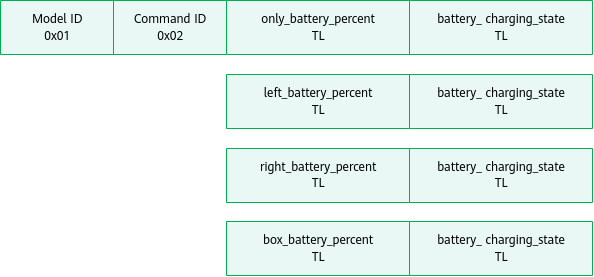

-   应答帧结构：
    -   返回成功：

        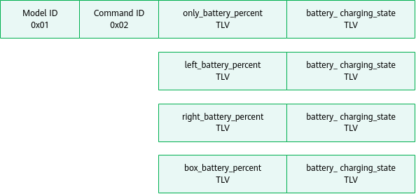

    -   返回失败：

        

### 耳机连接方式查询<a name="ZH-CN_TOPIC_0000001491532988"></a>

**表 1**  耳机连接方式查询字段描述

<a name="table996110103515"></a>
<table><thead align="left"><tr id="row3123710173514"><th class="cellrowborder" valign="top" width="13.33%" id="mcps1.2.8.1.1"><p id="p21230103357"><a name="p21230103357"></a><a name="p21230103357"></a>字段名称</p>
</th>
<th class="cellrowborder" valign="top" width="10.42%" id="mcps1.2.8.1.2"><p id="p191234107351"><a name="p191234107351"></a><a name="p191234107351"></a>Type(bit0～bit6)</p>
</th>
<th class="cellrowborder" valign="top" width="14.32%" id="mcps1.2.8.1.3"><p id="p312391043520"><a name="p312391043520"></a><a name="p312391043520"></a>Length Size(Oct)</p>
</th>
<th class="cellrowborder" valign="top" width="12.479999999999999%" id="mcps1.2.8.1.4"><p id="p1012317100354"><a name="p1012317100354"></a><a name="p1012317100354"></a>Value数据类型</p>
</th>
<th class="cellrowborder" valign="top" width="22.79%" id="mcps1.2.8.1.5"><p id="p1612316104353"><a name="p1612316104353"></a><a name="p1612316104353"></a>说明</p>
</th>
<th class="cellrowborder" valign="top" width="14.610000000000001%" id="mcps1.2.8.1.6"><p id="p17123161063518"><a name="p17123161063518"></a><a name="p17123161063518"></a>必选/可选（M/O）</p>
</th>
<th class="cellrowborder" valign="top" width="12.049999999999999%" id="mcps1.2.8.1.7"><p id="p3123410203518"><a name="p3123410203518"></a><a name="p3123410203518"></a>版本</p>
</th>
</tr>
</thead>
<tbody><tr id="row17123510173517"><td class="cellrowborder" valign="top" width="13.33%" headers="mcps1.2.8.1.1 "><p id="p012321053519"><a name="p012321053519"></a><a name="p012321053519"></a>Earphone_num_get</p>
</td>
<td class="cellrowborder" valign="top" width="10.42%" headers="mcps1.2.8.1.2 "><p id="p17123110113519"><a name="p17123110113519"></a><a name="p17123110113519"></a>0x01</p>
</td>
<td class="cellrowborder" valign="top" width="14.32%" headers="mcps1.2.8.1.3 "><p id="p16123181053519"><a name="p16123181053519"></a><a name="p16123181053519"></a>1</p>
</td>
<td class="cellrowborder" valign="top" width="12.479999999999999%" headers="mcps1.2.8.1.4 "><p id="p812381053515"><a name="p812381053515"></a><a name="p812381053515"></a>uint8</p>
</td>
<td class="cellrowborder" valign="top" width="22.79%" headers="mcps1.2.8.1.5 "><p id="p11236101353"><a name="p11236101353"></a><a name="p11236101353"></a>表示当前连接的耳机：</p>
<a name="ul7110184219361"></a><a name="ul7110184219361"></a><ul id="ul7110184219361"><li>1：单左耳连接</li><li>2：单右耳连接</li><li>3：双耳连接（TWS形态，主耳连接设置APP）</li></ul>
</td>
<td class="cellrowborder" valign="top" width="14.610000000000001%" headers="mcps1.2.8.1.6 "><p id="p1412351093510"><a name="p1412351093510"></a><a name="p1412351093510"></a>O</p>
</td>
<td class="cellrowborder" valign="top" width="12.049999999999999%" headers="mcps1.2.8.1.7 "><p id="p11231910123512"><a name="p11231910123512"></a><a name="p11231910123512"></a>1.0/1.0</p>
</td>
</tr>
</tbody>
</table>

-   请求帧结构：****

    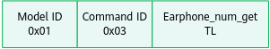

-   应答帧结构：
    -   返回成功：

        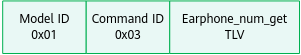

    -   返回失败：

        

### 耳机佩戴状态查询<a name="ZH-CN_TOPIC_0000001547536933"></a>

**表 1**  耳机佩戴状态查询字段描述

<a name="table44755371928"></a>
<table><thead align="left"><tr id="row9507337328"><th class="cellrowborder" valign="top" width="13.33%" id="mcps1.2.8.1.1"><p id="p165071137721"><a name="p165071137721"></a><a name="p165071137721"></a>字段名称</p>
</th>
<th class="cellrowborder" valign="top" width="10.42%" id="mcps1.2.8.1.2"><p id="p75075373212"><a name="p75075373212"></a><a name="p75075373212"></a>Type(bit0～bit6)</p>
</th>
<th class="cellrowborder" valign="top" width="14.32%" id="mcps1.2.8.1.3"><p id="p1450715377217"><a name="p1450715377217"></a><a name="p1450715377217"></a>Length Size(Oct)</p>
</th>
<th class="cellrowborder" valign="top" width="12.479999999999999%" id="mcps1.2.8.1.4"><p id="p15071737325"><a name="p15071737325"></a><a name="p15071737325"></a>Value数据类型</p>
</th>
<th class="cellrowborder" valign="top" width="22.79%" id="mcps1.2.8.1.5"><p id="p16507103718210"><a name="p16507103718210"></a><a name="p16507103718210"></a>说明</p>
</th>
<th class="cellrowborder" valign="top" width="14.610000000000001%" id="mcps1.2.8.1.6"><p id="p1250723715213"><a name="p1250723715213"></a><a name="p1250723715213"></a>必选/可选（M/O）</p>
</th>
<th class="cellrowborder" valign="top" width="12.049999999999999%" id="mcps1.2.8.1.7"><p id="p1050716377212"><a name="p1050716377212"></a><a name="p1050716377212"></a>版本</p>
</th>
</tr>
</thead>
<tbody><tr id="row050719371021"><td class="cellrowborder" valign="top" width="13.33%" headers="mcps1.2.8.1.1 "><p id="p1750717371724"><a name="p1750717371724"></a><a name="p1750717371724"></a>wearing_status_get</p>
</td>
<td class="cellrowborder" valign="top" width="10.42%" headers="mcps1.2.8.1.2 "><p id="p13507173714218"><a name="p13507173714218"></a><a name="p13507173714218"></a>0x01</p>
</td>
<td class="cellrowborder" valign="top" width="14.32%" headers="mcps1.2.8.1.3 "><p id="p12507153718210"><a name="p12507153718210"></a><a name="p12507153718210"></a>1</p>
</td>
<td class="cellrowborder" valign="top" width="12.479999999999999%" headers="mcps1.2.8.1.4 "><p id="p0507123714213"><a name="p0507123714213"></a><a name="p0507123714213"></a>uint8</p>
</td>
<td class="cellrowborder" valign="top" width="22.79%" headers="mcps1.2.8.1.5 "><p id="p250710371023"><a name="p250710371023"></a><a name="p250710371023"></a>表示当前耳机佩戴状态：</p>
<a name="ul13848112511431"></a><a name="ul13848112511431"></a><ul id="ul13848112511431"><li>1：耳机不支持入耳检测和耳机佩戴检测功能。</li><li>2：入耳状态。</li><li>3：出耳状态。</li></ul>
</td>
<td class="cellrowborder" valign="top" width="14.610000000000001%" headers="mcps1.2.8.1.6 "><p id="p1508173712212"><a name="p1508173712212"></a><a name="p1508173712212"></a>O</p>
</td>
<td class="cellrowborder" valign="top" width="12.049999999999999%" headers="mcps1.2.8.1.7 "><p id="p550815371029"><a name="p550815371029"></a><a name="p550815371029"></a>1.0/1.0</p>
</td>
</tr>
<tr id="row5401256184213"><td class="cellrowborder" valign="top" width="13.33%" headers="mcps1.2.8.1.1 "><p id="p107372369424"><a name="p107372369424"></a><a name="p107372369424"></a>control_wearing_status_get</p>
</td>
<td class="cellrowborder" valign="top" width="10.42%" headers="mcps1.2.8.1.2 "><p id="p20737163624215"><a name="p20737163624215"></a><a name="p20737163624215"></a>0x02</p>
</td>
<td class="cellrowborder" valign="top" width="14.32%" headers="mcps1.2.8.1.3 "><p id="p47371436104216"><a name="p47371436104216"></a><a name="p47371436104216"></a>1</p>
</td>
<td class="cellrowborder" valign="top" width="12.479999999999999%" headers="mcps1.2.8.1.4 "><p id="p18932042104518"><a name="p18932042104518"></a><a name="p18932042104518"></a>uint8</p>
</td>
<td class="cellrowborder" valign="top" width="22.79%" headers="mcps1.2.8.1.5 "><p id="p1073713644211"><a name="p1073713644211"></a><a name="p1073713644211"></a>查询是否设置了强制入耳状态：</p>
<a name="ul1226059154613"></a><a name="ul1226059154613"></a><ul id="ul1226059154613"><li>1：强制设置了耳机持续在入耳状态。</li><li>2：强制设置了耳机持续不在入耳状态。</li><li>3：没有强制设置耳机状态，由设备自身的Sensor和算法检测入耳状态。</li></ul>
</td>
<td class="cellrowborder" valign="top" width="14.610000000000001%" headers="mcps1.2.8.1.6 "><p id="p973714361424"><a name="p973714361424"></a><a name="p973714361424"></a>O</p>
</td>
<td class="cellrowborder" valign="top" width="12.049999999999999%" headers="mcps1.2.8.1.7 "><p id="p373753615423"><a name="p373753615423"></a><a name="p373753615423"></a>1.0/1.0</p>
</td>
</tr>
</tbody>
</table>

-   请求帧结构：****

    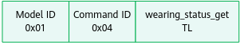

-   应答帧结构：
    -   返回成功：

        

    -   返回失败：

        

### 设备音量查询<a name="ZH-CN_TOPIC_0000001511141332"></a>

**表 1**  设备音量查询字段描述

<a name="table14626144655311"></a>
<table><thead align="left"><tr id="row206661646185313"><th class="cellrowborder" valign="top" width="13.33%" id="mcps1.2.8.1.1"><p id="p466604616536"><a name="p466604616536"></a><a name="p466604616536"></a>字段名称</p>
</th>
<th class="cellrowborder" valign="top" width="10.42%" id="mcps1.2.8.1.2"><p id="p76661646145311"><a name="p76661646145311"></a><a name="p76661646145311"></a>Type(bit0～bit6)</p>
</th>
<th class="cellrowborder" valign="top" width="14.32%" id="mcps1.2.8.1.3"><p id="p1166615468538"><a name="p1166615468538"></a><a name="p1166615468538"></a>Length Size(Oct)</p>
</th>
<th class="cellrowborder" valign="top" width="12.479999999999999%" id="mcps1.2.8.1.4"><p id="p16666346175318"><a name="p16666346175318"></a><a name="p16666346175318"></a>Value数据类型</p>
</th>
<th class="cellrowborder" valign="top" width="22.79%" id="mcps1.2.8.1.5"><p id="p8666174615532"><a name="p8666174615532"></a><a name="p8666174615532"></a>说明</p>
</th>
<th class="cellrowborder" valign="top" width="14.610000000000001%" id="mcps1.2.8.1.6"><p id="p36660462537"><a name="p36660462537"></a><a name="p36660462537"></a>必选/可选（M/O）</p>
</th>
<th class="cellrowborder" valign="top" width="12.049999999999999%" id="mcps1.2.8.1.7"><p id="p8666164685317"><a name="p8666164685317"></a><a name="p8666164685317"></a>版本</p>
</th>
</tr>
</thead>
<tbody><tr id="row166661746165312"><td class="cellrowborder" valign="top" width="13.33%" headers="mcps1.2.8.1.1 "><p id="p1266664685310"><a name="p1266664685310"></a><a name="p1266664685310"></a>hearingaid_volume_get</p>
</td>
<td class="cellrowborder" valign="top" width="10.42%" headers="mcps1.2.8.1.2 "><p id="p16661546165320"><a name="p16661546165320"></a><a name="p16661546165320"></a>0x01</p>
</td>
<td class="cellrowborder" valign="top" width="14.32%" headers="mcps1.2.8.1.3 "><p id="p1666624612531"><a name="p1666624612531"></a><a name="p1666624612531"></a>4</p>
</td>
<td class="cellrowborder" valign="top" width="12.479999999999999%" headers="mcps1.2.8.1.4 "><p id="p1666619464531"><a name="p1666619464531"></a><a name="p1666619464531"></a>int32</p>
</td>
<td class="cellrowborder" valign="top" width="22.79%" headers="mcps1.2.8.1.5 "><p id="p3666174685310"><a name="p3666174685310"></a><a name="p3666174685310"></a>获取助听音量（单位为0.001dB，如：以设置音量为2.13dB为例，下发的参数为2130）。</p>
</td>
<td class="cellrowborder" valign="top" width="14.610000000000001%" headers="mcps1.2.8.1.6 "><p id="p1266654675318"><a name="p1266654675318"></a><a name="p1266654675318"></a>O</p>
</td>
<td class="cellrowborder" valign="top" width="12.049999999999999%" headers="mcps1.2.8.1.7 "><p id="p11666104619533"><a name="p11666104619533"></a><a name="p11666104619533"></a>1.0/1.0</p>
</td>
</tr>
<tr id="row1066604635313"><td class="cellrowborder" valign="top" width="13.33%" headers="mcps1.2.8.1.1 "><p id="p166661846145311"><a name="p166661846145311"></a><a name="p166661846145311"></a>music_volume_get</p>
</td>
<td class="cellrowborder" valign="top" width="10.42%" headers="mcps1.2.8.1.2 "><p id="p19666134665317"><a name="p19666134665317"></a><a name="p19666134665317"></a>0x02</p>
</td>
<td class="cellrowborder" valign="top" width="14.32%" headers="mcps1.2.8.1.3 "><p id="p176665467536"><a name="p176665467536"></a><a name="p176665467536"></a>4</p>
</td>
<td class="cellrowborder" valign="top" width="12.479999999999999%" headers="mcps1.2.8.1.4 "><p id="p566619462538"><a name="p566619462538"></a><a name="p566619462538"></a>int32</p>
</td>
<td class="cellrowborder" valign="top" width="22.79%" headers="mcps1.2.8.1.5 "><p id="p186664469533"><a name="p186664469533"></a><a name="p186664469533"></a>获取音乐音量（单位为0.001dB，如：以设置音量为2.13dB为例，下发的参数为2130）。</p>
</td>
<td class="cellrowborder" valign="top" width="14.610000000000001%" headers="mcps1.2.8.1.6 "><p id="p1966634615312"><a name="p1966634615312"></a><a name="p1966634615312"></a>O</p>
</td>
<td class="cellrowborder" valign="top" width="12.049999999999999%" headers="mcps1.2.8.1.7 "><p id="p9666346135313"><a name="p9666346135313"></a><a name="p9666346135313"></a>1.0/1.0</p>
</td>
</tr>
<tr id="row2066664615537"><td class="cellrowborder" valign="top" width="13.33%" headers="mcps1.2.8.1.1 "><p id="p116663468539"><a name="p116663468539"></a><a name="p116663468539"></a>phone_volume_get</p>
</td>
<td class="cellrowborder" valign="top" width="10.42%" headers="mcps1.2.8.1.2 "><p id="p1966634612538"><a name="p1966634612538"></a><a name="p1966634612538"></a>0x03</p>
</td>
<td class="cellrowborder" valign="top" width="14.32%" headers="mcps1.2.8.1.3 "><p id="p1066611464532"><a name="p1066611464532"></a><a name="p1066611464532"></a>4</p>
</td>
<td class="cellrowborder" valign="top" width="12.479999999999999%" headers="mcps1.2.8.1.4 "><p id="p14666346135313"><a name="p14666346135313"></a><a name="p14666346135313"></a>int32</p>
</td>
<td class="cellrowborder" valign="top" width="22.79%" headers="mcps1.2.8.1.5 "><p id="p2666204655315"><a name="p2666204655315"></a><a name="p2666204655315"></a>获取通话音量（单位为0.001dB，如：以设置音量为2.13dB为例，下发的参数为2130）。</p>
</td>
<td class="cellrowborder" valign="top" width="14.610000000000001%" headers="mcps1.2.8.1.6 "><p id="p3666104605312"><a name="p3666104605312"></a><a name="p3666104605312"></a>O</p>
</td>
<td class="cellrowborder" valign="top" width="12.049999999999999%" headers="mcps1.2.8.1.7 "><p id="p1766654611535"><a name="p1766654611535"></a><a name="p1766654611535"></a>1.0/1.0</p>
</td>
</tr>
<tr id="row666616466531"><td class="cellrowborder" valign="top" width="13.33%" headers="mcps1.2.8.1.1 "><p id="p166669462532"><a name="p166669462532"></a><a name="p166669462532"></a>message_volume_get</p>
</td>
<td class="cellrowborder" valign="top" width="10.42%" headers="mcps1.2.8.1.2 "><p id="p13666164617532"><a name="p13666164617532"></a><a name="p13666164617532"></a>0x04</p>
</td>
<td class="cellrowborder" valign="top" width="14.32%" headers="mcps1.2.8.1.3 "><p id="p13666174612531"><a name="p13666174612531"></a><a name="p13666174612531"></a>4</p>
</td>
<td class="cellrowborder" valign="top" width="12.479999999999999%" headers="mcps1.2.8.1.4 "><p id="p1866634655313"><a name="p1866634655313"></a><a name="p1866634655313"></a>int32</p>
</td>
<td class="cellrowborder" valign="top" width="22.79%" headers="mcps1.2.8.1.5 "><p id="p1566644615318"><a name="p1566644615318"></a><a name="p1566644615318"></a>获取信息提醒音量（单位为0.001dB，如：以设置音量为2.13dB为例，下发的参数为2130）。</p>
</td>
<td class="cellrowborder" valign="top" width="14.610000000000001%" headers="mcps1.2.8.1.6 "><p id="p1366613464537"><a name="p1366613464537"></a><a name="p1366613464537"></a>O</p>
</td>
<td class="cellrowborder" valign="top" width="12.049999999999999%" headers="mcps1.2.8.1.7 "><p id="p1366664615539"><a name="p1366664615539"></a><a name="p1366664615539"></a>1.0/1.0</p>
</td>
</tr>
<tr id="row186661146155314"><td class="cellrowborder" valign="top" width="13.33%" headers="mcps1.2.8.1.1 "><p id="p166634635310"><a name="p166634635310"></a><a name="p166634635310"></a>ring_volume_get</p>
</td>
<td class="cellrowborder" valign="top" width="10.42%" headers="mcps1.2.8.1.2 "><p id="p12666246195312"><a name="p12666246195312"></a><a name="p12666246195312"></a>0x05</p>
</td>
<td class="cellrowborder" valign="top" width="14.32%" headers="mcps1.2.8.1.3 "><p id="p866619467537"><a name="p866619467537"></a><a name="p866619467537"></a>4</p>
</td>
<td class="cellrowborder" valign="top" width="12.479999999999999%" headers="mcps1.2.8.1.4 "><p id="p266624675316"><a name="p266624675316"></a><a name="p266624675316"></a>int32</p>
</td>
<td class="cellrowborder" valign="top" width="22.79%" headers="mcps1.2.8.1.5 "><p id="p116661246185311"><a name="p116661246185311"></a><a name="p116661246185311"></a>获取提示音音量（单位为0.001dB，如：以设置音量为2.13dB为例，下发的参数为2130）。</p>
</td>
<td class="cellrowborder" valign="top" width="14.610000000000001%" headers="mcps1.2.8.1.6 "><p id="p9666174685311"><a name="p9666174685311"></a><a name="p9666174685311"></a>O</p>
</td>
<td class="cellrowborder" valign="top" width="12.049999999999999%" headers="mcps1.2.8.1.7 "><p id="p1766634665313"><a name="p1766634665313"></a><a name="p1766634665313"></a>1.0/1.0</p>
</td>
</tr>
</tbody>
</table>

> **说明：** 
>获取实时音量。
>“message\_volume\_get”用于获取信息提醒音量，如：屏类产品中短信或者其他信息提醒的音量。
>“ring\_volume\_get”用于获取提示音音量，如：耳机等小产品中只有一种提示音音量，使用此命令获取。

-   请求帧结构：

    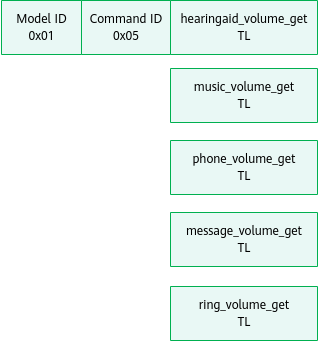

-   应答帧结构：
    -   返回成功：

        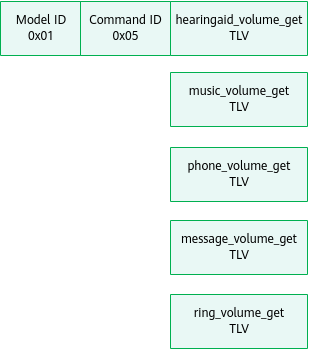

    -   返回失败：

        

### 设备状态变化上报<a name="ZH-CN_TOPIC_0000001566110569"></a>

**表 1**  设备状态变化上报字段描述

<a name="table20722191715118"></a>
<table><thead align="left"><tr id="row5753141714114"><th class="cellrowborder" valign="top" width="13.33%" id="mcps1.2.8.1.1"><p id="p37531717101114"><a name="p37531717101114"></a><a name="p37531717101114"></a>字段名称</p>
</th>
<th class="cellrowborder" valign="top" width="10.42%" id="mcps1.2.8.1.2"><p id="p5753161715112"><a name="p5753161715112"></a><a name="p5753161715112"></a>Type(bit0～bit6)</p>
</th>
<th class="cellrowborder" valign="top" width="14.32%" id="mcps1.2.8.1.3"><p id="p197532017101110"><a name="p197532017101110"></a><a name="p197532017101110"></a>Length Size(Oct)</p>
</th>
<th class="cellrowborder" valign="top" width="12.479999999999999%" id="mcps1.2.8.1.4"><p id="p11753111715118"><a name="p11753111715118"></a><a name="p11753111715118"></a>Value数据类型</p>
</th>
<th class="cellrowborder" valign="top" width="22.79%" id="mcps1.2.8.1.5"><p id="p18753101711117"><a name="p18753101711117"></a><a name="p18753101711117"></a>说明</p>
</th>
<th class="cellrowborder" valign="top" width="14.610000000000001%" id="mcps1.2.8.1.6"><p id="p7753101701110"><a name="p7753101701110"></a><a name="p7753101701110"></a>必选/可选（M/O）</p>
</th>
<th class="cellrowborder" valign="top" width="12.049999999999999%" id="mcps1.2.8.1.7"><p id="p177531179113"><a name="p177531179113"></a><a name="p177531179113"></a>版本</p>
</th>
</tr>
</thead>
<tbody><tr id="row15754121710118"><td class="cellrowborder" valign="top" width="13.33%" headers="mcps1.2.8.1.1 "><p id="p575418175119"><a name="p575418175119"></a><a name="p575418175119"></a>hearingaid_volume_report</p>
</td>
<td class="cellrowborder" valign="top" width="10.42%" headers="mcps1.2.8.1.2 "><p id="p2754191721111"><a name="p2754191721111"></a><a name="p2754191721111"></a>0x01</p>
</td>
<td class="cellrowborder" valign="top" width="14.32%" headers="mcps1.2.8.1.3 "><p id="p5754141719117"><a name="p5754141719117"></a><a name="p5754141719117"></a>4</p>
</td>
<td class="cellrowborder" valign="top" width="12.479999999999999%" headers="mcps1.2.8.1.4 "><p id="p1975415174113"><a name="p1975415174113"></a><a name="p1975415174113"></a>int32</p>
</td>
<td class="cellrowborder" valign="top" width="22.79%" headers="mcps1.2.8.1.5 "><p id="p875441701114"><a name="p875441701114"></a><a name="p875441701114"></a>助听音量变化上报（单位为0.001dB，如：以设置音量为2.13dB为例，下发的参数为2130）。</p>
</td>
<td class="cellrowborder" valign="top" width="14.610000000000001%" headers="mcps1.2.8.1.6 "><p id="p147541176119"><a name="p147541176119"></a><a name="p147541176119"></a>O</p>
</td>
<td class="cellrowborder" valign="top" width="12.049999999999999%" headers="mcps1.2.8.1.7 "><p id="p117541617141119"><a name="p117541617141119"></a><a name="p117541617141119"></a>1.0/1.0</p>
</td>
</tr>
<tr id="row475471701114"><td class="cellrowborder" valign="top" width="13.33%" headers="mcps1.2.8.1.1 "><p id="p177543171115"><a name="p177543171115"></a><a name="p177543171115"></a>wearing_status_report</p>
</td>
<td class="cellrowborder" valign="top" width="10.42%" headers="mcps1.2.8.1.2 "><p id="p4754171771110"><a name="p4754171771110"></a><a name="p4754171771110"></a>0x02</p>
</td>
<td class="cellrowborder" valign="top" width="14.32%" headers="mcps1.2.8.1.3 "><p id="p87548171110"><a name="p87548171110"></a><a name="p87548171110"></a>1</p>
</td>
<td class="cellrowborder" valign="top" width="12.479999999999999%" headers="mcps1.2.8.1.4 "><p id="p1675481710111"><a name="p1675481710111"></a><a name="p1675481710111"></a>uint8</p>
</td>
<td class="cellrowborder" valign="top" width="22.79%" headers="mcps1.2.8.1.5 "><p id="p8754817201114"><a name="p8754817201114"></a><a name="p8754817201114"></a>耳机佩戴状态上报：</p>
<a name="ul173271814154617"></a><a name="ul173271814154617"></a><ul id="ul173271814154617"><li>1：耳机不支持入耳检测和耳机佩戴检测功能</li><li>2：入耳状态</li><li>3：出耳状态</li></ul>
</td>
<td class="cellrowborder" valign="top" width="14.610000000000001%" headers="mcps1.2.8.1.6 "><p id="p137541917141116"><a name="p137541917141116"></a><a name="p137541917141116"></a>O</p>
</td>
<td class="cellrowborder" valign="top" width="12.049999999999999%" headers="mcps1.2.8.1.7 "><p id="p19754517161114"><a name="p19754517161114"></a><a name="p19754517161114"></a>1.0/1.0</p>
</td>
</tr>
<tr id="row37542017171117"><td class="cellrowborder" valign="top" width="13.33%" headers="mcps1.2.8.1.1 "><p id="p47541617151111"><a name="p47541617151111"></a><a name="p47541617151111"></a>hearingaid_mode_report</p>
</td>
<td class="cellrowborder" valign="top" width="10.42%" headers="mcps1.2.8.1.2 "><p id="p1754161741114"><a name="p1754161741114"></a><a name="p1754161741114"></a>0x03</p>
</td>
<td class="cellrowborder" valign="top" width="14.32%" headers="mcps1.2.8.1.3 "><p id="p16754161781117"><a name="p16754161781117"></a><a name="p16754161781117"></a>1</p>
</td>
<td class="cellrowborder" valign="top" width="12.479999999999999%" headers="mcps1.2.8.1.4 "><p id="p37541017171116"><a name="p37541017171116"></a><a name="p37541017171116"></a>uint8</p>
</td>
<td class="cellrowborder" valign="top" width="22.79%" headers="mcps1.2.8.1.5 "><p id="p175441716110"><a name="p175441716110"></a><a name="p175441716110"></a>助听模式变化上报，算法和产品确定不同的模式参数，此命令可以查询对应的模式序列号。</p>
<a name="ul1019861084613"></a><a name="ul1019861084613"></a><ul id="ul1019861084613"><li>0：自动检测模式</li><li>1：模式1</li><li>2：模式2</li><li>3：模式3</li><li>4：模式4</li><li>5：模式5</li><li>6～10：模式6～模式10</li></ul>
</td>
<td class="cellrowborder" valign="top" width="14.610000000000001%" headers="mcps1.2.8.1.6 "><p id="p4754201701113"><a name="p4754201701113"></a><a name="p4754201701113"></a>O</p>
</td>
<td class="cellrowborder" valign="top" width="12.049999999999999%" headers="mcps1.2.8.1.7 "><p id="p875481713115"><a name="p875481713115"></a><a name="p875481713115"></a>1.0/1.0</p>
</td>
</tr>
</tbody>
</table>

> **说明：** 
>为满足实时获取设备状态，设备某些状态信息变化时使用此命令主动上报。

-   请求帧结构：

    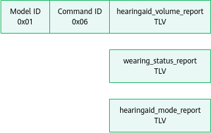

-   应答帧结构：
    -   返回成功：

        

    -   返回失败：

        

### 获取日期时间<a name="ZH-CN_TOPIC_0000001618432514"></a>

**表 1**  获取日期时间字段描述

<a name="table32671291501"></a>
<table><thead align="left"><tr id="row132912915016"><th class="cellrowborder" valign="top" width="13.33%" id="mcps1.2.8.1.1"><p id="p37531717101114"><a name="p37531717101114"></a><a name="p37531717101114"></a>字段名称</p>
</th>
<th class="cellrowborder" valign="top" width="10.42%" id="mcps1.2.8.1.2"><p id="p5753161715112"><a name="p5753161715112"></a><a name="p5753161715112"></a>Type(bit0～bit6)</p>
</th>
<th class="cellrowborder" valign="top" width="14.32%" id="mcps1.2.8.1.3"><p id="p197532017101110"><a name="p197532017101110"></a><a name="p197532017101110"></a>Length Size(Oct)</p>
</th>
<th class="cellrowborder" valign="top" width="12.479999999999999%" id="mcps1.2.8.1.4"><p id="p11753111715118"><a name="p11753111715118"></a><a name="p11753111715118"></a>Value数据类型</p>
</th>
<th class="cellrowborder" valign="top" width="22.79%" id="mcps1.2.8.1.5"><p id="p18753101711117"><a name="p18753101711117"></a><a name="p18753101711117"></a>说明</p>
</th>
<th class="cellrowborder" valign="top" width="14.610000000000001%" id="mcps1.2.8.1.6"><p id="p7753101701110"><a name="p7753101701110"></a><a name="p7753101701110"></a>必选/可选（M/O）</p>
</th>
<th class="cellrowborder" valign="top" width="12.049999999999999%" id="mcps1.2.8.1.7"><p id="p177531179113"><a name="p177531179113"></a><a name="p177531179113"></a>版本</p>
</th>
</tr>
</thead>
<tbody><tr id="row142911092502"><td class="cellrowborder" valign="top" width="13.33%" headers="mcps1.2.8.1.1 "><p id="p829110914508"><a name="p829110914508"></a><a name="p829110914508"></a>time</p>
</td>
<td class="cellrowborder" valign="top" width="10.42%" headers="mcps1.2.8.1.2 "><p id="p429110919501"><a name="p429110919501"></a><a name="p429110919501"></a>0x01</p>
</td>
<td class="cellrowborder" valign="top" width="14.32%" headers="mcps1.2.8.1.3 "><p id="p1029113911506"><a name="p1029113911506"></a><a name="p1029113911506"></a>20</p>
</td>
<td class="cellrowborder" valign="top" width="12.479999999999999%" headers="mcps1.2.8.1.4 "><p id="p5291189125016"><a name="p5291189125016"></a><a name="p5291189125016"></a>uint8</p>
</td>
<td class="cellrowborder" valign="top" width="22.79%" headers="mcps1.2.8.1.5 "><p id="p122915965013"><a name="p122915965013"></a><a name="p122915965013"></a>日期时间以北京时间为准，字符串格式为：年-月-日 时:分:秒。</p>
<p id="p10291189105010"><a name="p10291189105010"></a><a name="p10291189105010"></a>如：2023-06-07 14:09:03</p>
<p id="p142911994504"><a name="p142911994504"></a><a name="p142911994504"></a>时钟取24小时制。</p>
</td>
<td class="cellrowborder" valign="top" width="14.610000000000001%" headers="mcps1.2.8.1.6 "><p id="p1729149135013"><a name="p1729149135013"></a><a name="p1729149135013"></a>O</p>
</td>
<td class="cellrowborder" valign="top" width="12.049999999999999%" headers="mcps1.2.8.1.7 "><p id="p529119175019"><a name="p529119175019"></a><a name="p529119175019"></a>1.0/1.0</p>
</td>
</tr>
</tbody>
</table>

> **说明：** 
>用于设备端获取服务端的日期时间。

-   请求帧结构：

    

-   应答帧结构：
    -   返回成功：

        

    -   返回失败

        

## 升级业务处理<a name="ZH-CN_TOPIC_0000001491692852"></a>

升级全业务流程如[图1](#fig105940513304)所示。

**图 1**  升级全业务流程<a name="fig105940513304"></a>  
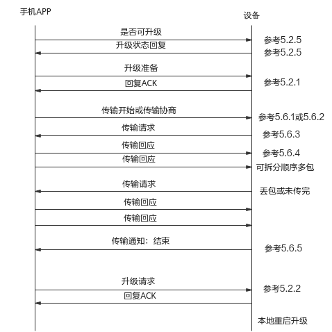

-   **[升级准备](#ZH-CN_TOPIC_0000001507152034)**  

-   **[升级请求](#ZH-CN_TOPIC_0000001507311910)**  

-   **[升级开始](#ZH-CN_TOPIC_0000001557711693)**  

-   **[升级停止](#ZH-CN_TOPIC_0000001557591745)**  

-   **[获取升级状态](#ZH-CN_TOPIC_0000001557471845)**  

### 升级准备<a name="ZH-CN_TOPIC_0000001507152034"></a>

**表 1**  升级准备字段描述

<a name="table184004175322"></a>
<table><thead align="left"><tr id="row342521703216"><th class="cellrowborder" valign="top" width="13.33%" id="mcps1.2.8.1.1"><p id="p104251717203212"><a name="p104251717203212"></a><a name="p104251717203212"></a>字段名称</p>
</th>
<th class="cellrowborder" valign="top" width="10.42%" id="mcps1.2.8.1.2"><p id="p742610177321"><a name="p742610177321"></a><a name="p742610177321"></a>Type(bit0～bit6)</p>
</th>
<th class="cellrowborder" valign="top" width="14.32%" id="mcps1.2.8.1.3"><p id="p19426111783215"><a name="p19426111783215"></a><a name="p19426111783215"></a>Length Size(Oct)</p>
</th>
<th class="cellrowborder" valign="top" width="12.479999999999999%" id="mcps1.2.8.1.4"><p id="p15426171718328"><a name="p15426171718328"></a><a name="p15426171718328"></a>Value数据类型</p>
</th>
<th class="cellrowborder" valign="top" width="22.79%" id="mcps1.2.8.1.5"><p id="p9426181719326"><a name="p9426181719326"></a><a name="p9426181719326"></a>说明</p>
</th>
<th class="cellrowborder" valign="top" width="14.610000000000001%" id="mcps1.2.8.1.6"><p id="p1426181717324"><a name="p1426181717324"></a><a name="p1426181717324"></a>必选/可选（M/O）</p>
</th>
<th class="cellrowborder" valign="top" width="12.049999999999999%" id="mcps1.2.8.1.7"><p id="p14261117193213"><a name="p14261117193213"></a><a name="p14261117193213"></a>版本</p>
</th>
</tr>
</thead>
<tbody><tr id="row2426517193210"><td class="cellrowborder" valign="top" width="13.33%" headers="mcps1.2.8.1.1 "><p id="p1877312248269"><a name="p1877312248269"></a><a name="p1877312248269"></a>upg_prepare</p>
</td>
<td class="cellrowborder" valign="top" width="10.42%" headers="mcps1.2.8.1.2 "><p id="p17426131714321"><a name="p17426131714321"></a><a name="p17426131714321"></a>0x01</p>
</td>
<td class="cellrowborder" valign="top" width="14.32%" headers="mcps1.2.8.1.3 "><p id="p9426121717329"><a name="p9426121717329"></a><a name="p9426121717329"></a>4</p>
</td>
<td class="cellrowborder" valign="top" width="12.479999999999999%" headers="mcps1.2.8.1.4 "><p id="p1442618174329"><a name="p1442618174329"></a><a name="p1442618174329"></a>uint32</p>
</td>
<td class="cellrowborder" valign="top" width="22.79%" headers="mcps1.2.8.1.5 "><p id="p31381519438"><a name="p31381519438"></a><a name="p31381519438"></a>文件大小，单位：Byte</p>
</td>
<td class="cellrowborder" valign="top" width="14.610000000000001%" headers="mcps1.2.8.1.6 "><p id="p1342661783214"><a name="p1342661783214"></a><a name="p1342661783214"></a>O</p>
</td>
<td class="cellrowborder" valign="top" width="12.049999999999999%" headers="mcps1.2.8.1.7 "><p id="p17426101723213"><a name="p17426101723213"></a><a name="p17426101723213"></a>1.0/1.0</p>
</td>
</tr>
</tbody>
</table>

-   请求帧结构：

    

-   应答帧结构：
    -   返回成功：

        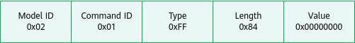

    -   返回失败：

        

> **说明：** 
>本小节应答帧返回失败中涉及到的value中的ret为“include/errcode.h”中定义的错误码，共4Byte，具体错误码对应的意义请参照“include/errcode.h”。
>如：
>应答帧中“ret\(value\)”的值为40-30-00-80，转为四字节错误码为0x80003040，则对应“errcode.h”中的ERRCODE\_UPG\_NOT\_INIT，意为升级模块未进行初始化。

### 升级请求<a name="ZH-CN_TOPIC_0000001507311910"></a>

**表 1**  升级请求字段描述

<a name="table161314253910"></a>
<table><thead align="left"><tr id="row1714042173912"><th class="cellrowborder" valign="top" width="13.33%" id="mcps1.2.8.1.1"><p id="p10147429399"><a name="p10147429399"></a><a name="p10147429399"></a>字段名称</p>
</th>
<th class="cellrowborder" valign="top" width="10.42%" id="mcps1.2.8.1.2"><p id="p1714184216398"><a name="p1714184216398"></a><a name="p1714184216398"></a>Type(bit0～bit6)</p>
</th>
<th class="cellrowborder" valign="top" width="14.32%" id="mcps1.2.8.1.3"><p id="p121410425396"><a name="p121410425396"></a><a name="p121410425396"></a>Length Size(Oct)</p>
</th>
<th class="cellrowborder" valign="top" width="12.479999999999999%" id="mcps1.2.8.1.4"><p id="p914104215395"><a name="p914104215395"></a><a name="p914104215395"></a>Value数据类型</p>
</th>
<th class="cellrowborder" valign="top" width="22.79%" id="mcps1.2.8.1.5"><p id="p161417423393"><a name="p161417423393"></a><a name="p161417423393"></a>说明</p>
</th>
<th class="cellrowborder" valign="top" width="14.610000000000001%" id="mcps1.2.8.1.6"><p id="p614194214396"><a name="p614194214396"></a><a name="p614194214396"></a>必选/可选（M/O）</p>
</th>
<th class="cellrowborder" valign="top" width="12.049999999999999%" id="mcps1.2.8.1.7"><p id="p1014104213919"><a name="p1014104213919"></a><a name="p1014104213919"></a>版本</p>
</th>
</tr>
</thead>
<tbody><tr id="row7141442113911"><td class="cellrowborder" valign="top" width="13.33%" headers="mcps1.2.8.1.1 "><p id="p71419422393"><a name="p71419422393"></a><a name="p71419422393"></a>upg_request</p>
</td>
<td class="cellrowborder" valign="top" width="10.42%" headers="mcps1.2.8.1.2 "><p id="p1014174263917"><a name="p1014174263917"></a><a name="p1014174263917"></a>0x01</p>
</td>
<td class="cellrowborder" valign="top" width="14.32%" headers="mcps1.2.8.1.3 "><p id="p1114164216391"><a name="p1114164216391"></a><a name="p1114164216391"></a>2</p>
</td>
<td class="cellrowborder" valign="top" width="12.479999999999999%" headers="mcps1.2.8.1.4 "><p id="p131414211398"><a name="p131414211398"></a><a name="p131414211398"></a>bool</p>
</td>
<td class="cellrowborder" valign="top" width="22.79%" headers="mcps1.2.8.1.5 "><p id="p322414594486"><a name="p322414594486"></a><a name="p322414594486"></a>升级请求信息。</p>
<a name="ul166801173207"></a><a name="ul166801173207"></a><ul id="ul166801173207"><li>0x00：升级不重启</li><li>0x01：升级重启</li></ul>
</td>
<td class="cellrowborder" valign="top" width="14.610000000000001%" headers="mcps1.2.8.1.6 "><p id="p171454263911"><a name="p171454263911"></a><a name="p171454263911"></a>O</p>
</td>
<td class="cellrowborder" valign="top" width="12.049999999999999%" headers="mcps1.2.8.1.7 "><p id="p1614154283916"><a name="p1614154283916"></a><a name="p1614154283916"></a>1.0/1.0</p>
</td>
</tr>
</tbody>
</table>

-   请求帧结构：

    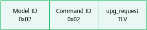

-   应答帧结构：
    -   返回成功：

        

    -   返回失败：

        

> **说明：** 
>本小节应答帧返回失败中涉及到的value中的ret为“include/errcode.h”中定义的错误码，共4Byte，具体错误码对应的意义请参照“include/errcode.h”。

### 升级开始<a name="ZH-CN_TOPIC_0000001557711693"></a>

> **说明：** 
>Melody不涉及。

**表 1**  升级开始字段描述

<a name="table161314253910"></a>
<table><thead align="left"><tr id="row1714042173912"><th class="cellrowborder" valign="top" width="13.33%" id="mcps1.2.8.1.1"><p id="p10147429399"><a name="p10147429399"></a><a name="p10147429399"></a>字段名称</p>
</th>
<th class="cellrowborder" valign="top" width="10.42%" id="mcps1.2.8.1.2"><p id="p1714184216398"><a name="p1714184216398"></a><a name="p1714184216398"></a>Type(bit0～bit6)</p>
</th>
<th class="cellrowborder" valign="top" width="14.32%" id="mcps1.2.8.1.3"><p id="p121410425396"><a name="p121410425396"></a><a name="p121410425396"></a>Length Size(Oct)</p>
</th>
<th class="cellrowborder" valign="top" width="12.479999999999999%" id="mcps1.2.8.1.4"><p id="p914104215395"><a name="p914104215395"></a><a name="p914104215395"></a>Value数据类型</p>
</th>
<th class="cellrowborder" valign="top" width="22.79%" id="mcps1.2.8.1.5"><p id="p161417423393"><a name="p161417423393"></a><a name="p161417423393"></a>说明</p>
</th>
<th class="cellrowborder" valign="top" width="14.610000000000001%" id="mcps1.2.8.1.6"><p id="p614194214396"><a name="p614194214396"></a><a name="p614194214396"></a>必选/可选（M/O）</p>
</th>
<th class="cellrowborder" valign="top" width="12.049999999999999%" id="mcps1.2.8.1.7"><p id="p1014104213919"><a name="p1014104213919"></a><a name="p1014104213919"></a>版本</p>
</th>
</tr>
</thead>
<tbody><tr id="row7141442113911"><td class="cellrowborder" valign="top" width="13.33%" headers="mcps1.2.8.1.1 "><p id="p71419422393"><a name="p71419422393"></a><a name="p71419422393"></a>upg_start</p>
</td>
<td class="cellrowborder" valign="top" width="10.42%" headers="mcps1.2.8.1.2 "><p id="p1014174263917"><a name="p1014174263917"></a><a name="p1014174263917"></a>0x01</p>
</td>
<td class="cellrowborder" valign="top" width="14.32%" headers="mcps1.2.8.1.3 "><p id="p1114164216391"><a name="p1114164216391"></a><a name="p1114164216391"></a>0</p>
</td>
<td class="cellrowborder" valign="top" width="12.479999999999999%" headers="mcps1.2.8.1.4 "><p id="p131414211398"><a name="p131414211398"></a><a name="p131414211398"></a>NA</p>
</td>
<td class="cellrowborder" valign="top" width="22.79%" headers="mcps1.2.8.1.5 "><p id="p72031732143511"><a name="p72031732143511"></a><a name="p72031732143511"></a>NA</p>
</td>
<td class="cellrowborder" valign="top" width="14.610000000000001%" headers="mcps1.2.8.1.6 "><p id="p171454263911"><a name="p171454263911"></a><a name="p171454263911"></a>O</p>
</td>
<td class="cellrowborder" valign="top" width="12.049999999999999%" headers="mcps1.2.8.1.7 "><p id="p1614154283916"><a name="p1614154283916"></a><a name="p1614154283916"></a>1.0/1.0</p>
</td>
</tr>
</tbody>
</table>

-   请求帧结构：

    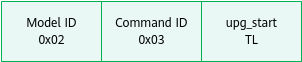

-   应答帧结构：
    -   返回成功：

        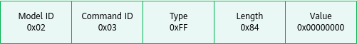

    -   返回失败

        

> **说明：** 
>本小节应答帧返回失败中涉及到的value中的ret为“include/errcode.h”中定义的错误码，共4Byte，具体错误码对应的意义请参照“include/errcode.h”。

### 升级停止<a name="ZH-CN_TOPIC_0000001557591745"></a>

**表 1**  升级停止字段描述

<a name="table482392413151"></a>
<table><thead align="left"><tr id="row0823172411150"><th class="cellrowborder" valign="top" width="13.33%" id="mcps1.2.8.1.1"><p id="p18233243151"><a name="p18233243151"></a><a name="p18233243151"></a>字段名称</p>
</th>
<th class="cellrowborder" valign="top" width="10.42%" id="mcps1.2.8.1.2"><p id="p282302411156"><a name="p282302411156"></a><a name="p282302411156"></a>Type(bit0～bit6)</p>
</th>
<th class="cellrowborder" valign="top" width="14.32%" id="mcps1.2.8.1.3"><p id="p482322414157"><a name="p482322414157"></a><a name="p482322414157"></a>Length Size(Oct)</p>
</th>
<th class="cellrowborder" valign="top" width="12.479999999999999%" id="mcps1.2.8.1.4"><p id="p38231024181512"><a name="p38231024181512"></a><a name="p38231024181512"></a>Value数据类型</p>
</th>
<th class="cellrowborder" valign="top" width="22.79%" id="mcps1.2.8.1.5"><p id="p082317248159"><a name="p082317248159"></a><a name="p082317248159"></a>说明</p>
</th>
<th class="cellrowborder" valign="top" width="14.610000000000001%" id="mcps1.2.8.1.6"><p id="p8823924151513"><a name="p8823924151513"></a><a name="p8823924151513"></a>必选/可选（M/O）</p>
</th>
<th class="cellrowborder" valign="top" width="12.049999999999999%" id="mcps1.2.8.1.7"><p id="p158231424141515"><a name="p158231424141515"></a><a name="p158231424141515"></a>版本</p>
</th>
</tr>
</thead>
<tbody><tr id="row15823924181511"><td class="cellrowborder" valign="top" width="13.33%" headers="mcps1.2.8.1.1 "><p id="p1082332414153"><a name="p1082332414153"></a><a name="p1082332414153"></a>upg_stop</p>
</td>
<td class="cellrowborder" valign="top" width="10.42%" headers="mcps1.2.8.1.2 "><p id="p382462421516"><a name="p382462421516"></a><a name="p382462421516"></a>0x01</p>
</td>
<td class="cellrowborder" valign="top" width="14.32%" headers="mcps1.2.8.1.3 "><p id="p2824132412155"><a name="p2824132412155"></a><a name="p2824132412155"></a>0</p>
</td>
<td class="cellrowborder" valign="top" width="12.479999999999999%" headers="mcps1.2.8.1.4 "><p id="p108247249155"><a name="p108247249155"></a><a name="p108247249155"></a>NA</p>
</td>
<td class="cellrowborder" valign="top" width="22.79%" headers="mcps1.2.8.1.5 "><p id="p78241624111513"><a name="p78241624111513"></a><a name="p78241624111513"></a>NA</p>
</td>
<td class="cellrowborder" valign="top" width="14.610000000000001%" headers="mcps1.2.8.1.6 "><p id="p138241224151512"><a name="p138241224151512"></a><a name="p138241224151512"></a>O</p>
</td>
<td class="cellrowborder" valign="top" width="12.049999999999999%" headers="mcps1.2.8.1.7 "><p id="p78241724161519"><a name="p78241724161519"></a><a name="p78241724161519"></a>1.0/1.0</p>
</td>
</tr>
</tbody>
</table>

-   请求帧结构：（请求帧仅需TL结构，Length为0（填写0x80））

    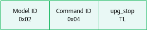

-   应答帧结构：

    

> **说明：** 
>本小节应答帧返回失败中涉及到的value中的ret为“include/errcode.h”中定义的错误码，共4Byte，具体错误码对应的意义请参照“include/errcode.h”。

### 获取升级状态<a name="ZH-CN_TOPIC_0000001557471845"></a>

**表 1**  获取升级状态字段描述

<a name="table351114719396"></a>
<table><thead align="left"><tr id="row95144720394"><th class="cellrowborder" valign="top" width="13.33%" id="mcps1.2.8.1.1"><p id="p25111477395"><a name="p25111477395"></a><a name="p25111477395"></a>字段名称</p>
</th>
<th class="cellrowborder" valign="top" width="10.42%" id="mcps1.2.8.1.2"><p id="p1551154718395"><a name="p1551154718395"></a><a name="p1551154718395"></a>Type(bit0～bit6)</p>
</th>
<th class="cellrowborder" valign="top" width="14.32%" id="mcps1.2.8.1.3"><p id="p6510470396"><a name="p6510470396"></a><a name="p6510470396"></a>Length Size(Oct)</p>
</th>
<th class="cellrowborder" valign="top" width="12.479999999999999%" id="mcps1.2.8.1.4"><p id="p155174773911"><a name="p155174773911"></a><a name="p155174773911"></a>Value数据类型</p>
</th>
<th class="cellrowborder" valign="top" width="22.79%" id="mcps1.2.8.1.5"><p id="p1051047153916"><a name="p1051047153916"></a><a name="p1051047153916"></a>说明</p>
</th>
<th class="cellrowborder" valign="top" width="14.610000000000001%" id="mcps1.2.8.1.6"><p id="p1751147183912"><a name="p1751147183912"></a><a name="p1751147183912"></a>必选/可选（M/O）</p>
</th>
<th class="cellrowborder" valign="top" width="12.049999999999999%" id="mcps1.2.8.1.7"><p id="p9511247133913"><a name="p9511247133913"></a><a name="p9511247133913"></a>版本</p>
</th>
</tr>
</thead>
<tbody><tr id="row95117479394"><td class="cellrowborder" valign="top" width="13.33%" headers="mcps1.2.8.1.1 "><p id="p1251847173916"><a name="p1251847173916"></a><a name="p1251847173916"></a>upg_getinfo</p>
</td>
<td class="cellrowborder" valign="top" width="10.42%" headers="mcps1.2.8.1.2 "><p id="p12523477392"><a name="p12523477392"></a><a name="p12523477392"></a>0x01</p>
</td>
<td class="cellrowborder" valign="top" width="14.32%" headers="mcps1.2.8.1.3 "><p id="p1452184720391"><a name="p1452184720391"></a><a name="p1452184720391"></a>2</p>
</td>
<td class="cellrowborder" valign="top" width="12.479999999999999%" headers="mcps1.2.8.1.4 "><p id="p10528477395"><a name="p10528477395"></a><a name="p10528477395"></a>uint16</p>
</td>
<td class="cellrowborder" valign="top" width="22.79%" headers="mcps1.2.8.1.5 "><p id="p191014743416"><a name="p191014743416"></a><a name="p191014743416"></a>参考枚举upgrade_type_t，版本号，是否可升级等信息。</p>
</td>
<td class="cellrowborder" valign="top" width="14.610000000000001%" headers="mcps1.2.8.1.6 "><p id="p1952147143915"><a name="p1952147143915"></a><a name="p1952147143915"></a>M</p>
</td>
<td class="cellrowborder" valign="top" width="12.049999999999999%" headers="mcps1.2.8.1.7 "><p id="p1952247183919"><a name="p1952247183919"></a><a name="p1952247183919"></a>1.0/1.0</p>
</td>
</tr>
<tr id="row12269135073615"><td class="cellrowborder" valign="top" width="13.33%" headers="mcps1.2.8.1.1 "><p id="p12691750183615"><a name="p12691750183615"></a><a name="p12691750183615"></a>upg_info_ack</p>
</td>
<td class="cellrowborder" valign="top" width="10.42%" headers="mcps1.2.8.1.2 "><p id="p526910500364"><a name="p526910500364"></a><a name="p526910500364"></a>0x02</p>
</td>
<td class="cellrowborder" valign="top" width="14.32%" headers="mcps1.2.8.1.3 "><p id="p967792310108"><a name="p967792310108"></a><a name="p967792310108"></a>sizeof(info_ack_t)</p>
</td>
<td class="cellrowborder" valign="top" width="12.479999999999999%" headers="mcps1.2.8.1.4 "><p id="p9269205023610"><a name="p9269205023610"></a><a name="p9269205023610"></a>struct</p>
</td>
<td class="cellrowborder" valign="top" width="22.79%" headers="mcps1.2.8.1.5 "><a name="ul1175771910317"></a><a name="ul1175771910317"></a><ul id="ul1175771910317"><li>info_type：信息类型</li><li>info_size：信息长度</li><li>info：信息值</li></ul>
</td>
<td class="cellrowborder" valign="top" width="14.610000000000001%" headers="mcps1.2.8.1.6 "><p id="p226925020361"><a name="p226925020361"></a><a name="p226925020361"></a>M</p>
</td>
<td class="cellrowborder" valign="top" width="12.049999999999999%" headers="mcps1.2.8.1.7 "><p id="p026935011366"><a name="p026935011366"></a><a name="p026935011366"></a>1.0/1.0</p>
</td>
</tr>
</tbody>
</table>

**表 2**  upgrade\_type\_t枚举描述

<a name="table142912207150"></a>
<table><thead align="left"><tr id="row52902012159"><th class="cellrowborder" valign="top" width="46.54%" id="mcps1.2.3.1.1"><p id="p19291820191516"><a name="p19291820191516"></a><a name="p19291820191516"></a>枚举值描述</p>
</th>
<th class="cellrowborder" valign="top" width="53.459999999999994%" id="mcps1.2.3.1.2"><p id="p82992012157"><a name="p82992012157"></a><a name="p82992012157"></a>说明</p>
</th>
</tr>
</thead>
<tbody><tr id="row132962020157"><td class="cellrowborder" valign="top" width="46.54%" headers="mcps1.2.3.1.1 "><p id="p133042010150"><a name="p133042010150"></a><a name="p133042010150"></a>UPG_INFO_TYPE_VER</p>
</td>
<td class="cellrowborder" valign="top" width="53.459999999999994%" headers="mcps1.2.3.1.2 "><p id="p1530112016158"><a name="p1530112016158"></a><a name="p1530112016158"></a>升级版本号。</p>
</td>
</tr>
<tr id="row73012201154"><td class="cellrowborder" valign="top" width="46.54%" headers="mcps1.2.3.1.1 "><p id="p330192001511"><a name="p330192001511"></a><a name="p330192001511"></a>UPG_INFO_TYPE_PERMIT</p>
</td>
<td class="cellrowborder" valign="top" width="53.459999999999994%" headers="mcps1.2.3.1.2 "><p id="p1630102041512"><a name="p1630102041512"></a><a name="p1630102041512"></a>是否可升级。</p>
</td>
</tr>
<tr id="row23062061511"><td class="cellrowborder" valign="top" width="46.54%" headers="mcps1.2.3.1.1 "><p id="p1030132091518"><a name="p1030132091518"></a><a name="p1030132091518"></a>UPG_INFO_TYPE_RESEND</p>
</td>
<td class="cellrowborder" valign="top" width="53.459999999999994%" headers="mcps1.2.3.1.2 "><p id="p13062010153"><a name="p13062010153"></a><a name="p13062010153"></a>是否可断点续传（携带镜像hash值）。（Melody不涉及）</p>
</td>
</tr>
<tr id="row030182016156"><td class="cellrowborder" valign="top" width="46.54%" headers="mcps1.2.3.1.1 "><p id="p3713942161715"><a name="p3713942161715"></a><a name="p3713942161715"></a>UPG_INFO_TYPE_IMAGE_FLAG</p>
</td>
<td class="cellrowborder" valign="top" width="53.459999999999994%" headers="mcps1.2.3.1.2 "><p id="p3301520181511"><a name="p3301520181511"></a><a name="p3301520181511"></a>升级镜像的唯一标识。（Melody不涉及）</p>
</td>
</tr>
<tr id="row18300209151"><td class="cellrowborder" valign="top" width="46.54%" headers="mcps1.2.3.1.1 "><p id="p1430620131512"><a name="p1430620131512"></a><a name="p1430620131512"></a>UPG_INFO_TYPE_ONE_EAR</p>
</td>
<td class="cellrowborder" valign="top" width="53.459999999999994%" headers="mcps1.2.3.1.2 "><p id="p73022051515"><a name="p73022051515"></a><a name="p73022051515"></a>是否单耳升级。</p>
</td>
</tr>
</tbody>
</table>

-   请求帧结构：

    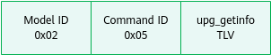

-   应答帧结构：

    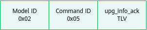

例如：查询是否可以升级。

请求帧：

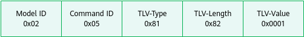

应答帧：

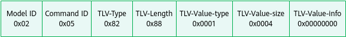

> **说明：** 
>get info的应答桢中，info\_ack\_t结构体中的info有以下几种情况：
>-   在查询版本号时，耳机应答工具。info的值是一四段式版本号的字符串（包含'\\0'），字符串的具体size，填充在了info\_ack\_t结构体中的size成员中（包含'\\0'）。
>-   在查询是否可升级时，耳机应答工具。info的值是4Byte的错误码（错误码为0时为可进行升级，其他错误码详情请参考“include/errcode.h”）。
>-   在询问是否单耳升级时，工具应答耳机。info使用1Byte的0（否）或1（是）即可。

## 助听业务处理<a name="ZH-CN_TOPIC_0000001542652789"></a>

-   **[助听验配开启](#ZH-CN_TOPIC_0000001542772665)**  

-   **[获取环境噪声](#ZH-CN_TOPIC_0000001491852772)**  

-   **[耳机频点测试](#ZH-CN_TOPIC_0000001492012676)**  

-   **[助听模式设置](#ZH-CN_TOPIC_0000001542452613)**  

-   **[混音模式设置](#ZH-CN_TOPIC_0000001542572813)**  

-   **[助听切换时间设置](#ZH-CN_TOPIC_0000001491532996)**  

-   **[助听启动延时设置](#ZH-CN_TOPIC_0000001491692856)**  

-   **[助听模式自动检测设置](#ZH-CN_TOPIC_0000001542652797)**  

-   **[助听参数保存](#ZH-CN_TOPIC_0000001542772673)**  

-   **[助听音量调节参数设置](#ZH-CN_TOPIC_0000001491852776)**  

-   **[获取耳机统计数据](#ZH-CN_TOPIC_0000001492012680)**  

-   **[获取助听模式统计数据](#ZH-CN_TOPIC_0000001542452617)**  

-   **[助听模式可设置](#ZH-CN_TOPIC_0000001499656764)**  

-   **[设备调节参数可保存](#ZH-CN_TOPIC_0000001550296649)**  

-   **[助听验配过程事件上报](#ZH-CN_TOPIC_0000001554623873)**  

-   **[助听业务查询](#ZH-CN_TOPIC_0000001510938232)**  

-   **[音频调节设置查询](#ZH-CN_TOPIC_0000001608182877)**  

-   **[生产测试业务](#ZH-CN_TOPIC_0000001760267769)**  

-   **[助听业务设置](#ZH-CN_TOPIC_0000001818601285)**  

-   **[助听业务上报](#ZH-CN_TOPIC_0000001854932317)**  

### 助听验配开启<a name="ZH-CN_TOPIC_0000001542772665"></a>

**表 1**  助听验配开启字段描述

<a name="table184004175322"></a>
<table><thead align="left"><tr id="row342521703216"><th class="cellrowborder" valign="top" width="13.33%" id="mcps1.2.8.1.1"><p id="p104251717203212"><a name="p104251717203212"></a><a name="p104251717203212"></a>字段名称</p>
</th>
<th class="cellrowborder" valign="top" width="10.42%" id="mcps1.2.8.1.2"><p id="p742610177321"><a name="p742610177321"></a><a name="p742610177321"></a>Type(bit0～bit6)</p>
</th>
<th class="cellrowborder" valign="top" width="14.32%" id="mcps1.2.8.1.3"><p id="p19426111783215"><a name="p19426111783215"></a><a name="p19426111783215"></a>Length Size(Oct)</p>
</th>
<th class="cellrowborder" valign="top" width="12.479999999999999%" id="mcps1.2.8.1.4"><p id="p15426171718328"><a name="p15426171718328"></a><a name="p15426171718328"></a>Value数据类型</p>
</th>
<th class="cellrowborder" valign="top" width="22.79%" id="mcps1.2.8.1.5"><p id="p9426181719326"><a name="p9426181719326"></a><a name="p9426181719326"></a>说明</p>
</th>
<th class="cellrowborder" valign="top" width="14.610000000000001%" id="mcps1.2.8.1.6"><p id="p1426181717324"><a name="p1426181717324"></a><a name="p1426181717324"></a>必选/可选（M/O）</p>
</th>
<th class="cellrowborder" valign="top" width="12.049999999999999%" id="mcps1.2.8.1.7"><p id="p14261117193213"><a name="p14261117193213"></a><a name="p14261117193213"></a>版本</p>
</th>
</tr>
</thead>
<tbody><tr id="row2426517193210"><td class="cellrowborder" valign="top" width="13.33%" headers="mcps1.2.8.1.1 "><p id="p24268176322"><a name="p24268176322"></a><a name="p24268176322"></a>hearing_config_start</p>
</td>
<td class="cellrowborder" valign="top" width="10.42%" headers="mcps1.2.8.1.2 "><p id="p17426131714321"><a name="p17426131714321"></a><a name="p17426131714321"></a>0x01</p>
</td>
<td class="cellrowborder" valign="top" width="14.32%" headers="mcps1.2.8.1.3 "><p id="p9426121717329"><a name="p9426121717329"></a><a name="p9426121717329"></a>1</p>
</td>
<td class="cellrowborder" valign="top" width="12.479999999999999%" headers="mcps1.2.8.1.4 "><p id="p1442618174329"><a name="p1442618174329"></a><a name="p1442618174329"></a>uint8</p>
</td>
<td class="cellrowborder" valign="top" width="22.79%" headers="mcps1.2.8.1.5 "><a name="ul379814915326"></a><a name="ul379814915326"></a><ul id="ul379814915326"><li>0x01：助听验配开始</li><li>0x02：助听验配结束</li></ul>
</td>
<td class="cellrowborder" valign="top" width="14.610000000000001%" headers="mcps1.2.8.1.6 "><p id="p1342661783214"><a name="p1342661783214"></a><a name="p1342661783214"></a>O</p>
</td>
<td class="cellrowborder" valign="top" width="12.049999999999999%" headers="mcps1.2.8.1.7 "><p id="p17426101723213"><a name="p17426101723213"></a><a name="p17426101723213"></a>1.0/1.0</p>
</td>
</tr>
</tbody>
</table>

-   请求帧结构：****

    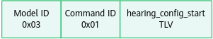

-   应答帧结构：
    -   返回成功：

        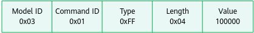

    -   返回失败：

        

### 获取环境噪声<a name="ZH-CN_TOPIC_0000001491852772"></a>

### 耳机频点测试<a name="ZH-CN_TOPIC_0000001492012676"></a>

**表 1**  耳机频点测试字段描述

<a name="table13676938183719"></a>
<table><thead align="left"><tr id="row67082038113711"><th class="cellrowborder" valign="top" width="13.309999999999999%" id="mcps1.2.8.1.1"><p id="p1470883853718"><a name="p1470883853718"></a><a name="p1470883853718"></a>字段名称</p>
</th>
<th class="cellrowborder" valign="top" width="10.440000000000001%" id="mcps1.2.8.1.2"><p id="p97081338183713"><a name="p97081338183713"></a><a name="p97081338183713"></a>Type(bit0～bit6)</p>
</th>
<th class="cellrowborder" valign="top" width="14.32%" id="mcps1.2.8.1.3"><p id="p2708173883712"><a name="p2708173883712"></a><a name="p2708173883712"></a>Length Size(Oct)</p>
</th>
<th class="cellrowborder" valign="top" width="12.479999999999999%" id="mcps1.2.8.1.4"><p id="p207081838173719"><a name="p207081838173719"></a><a name="p207081838173719"></a>Value数据类型</p>
</th>
<th class="cellrowborder" valign="top" width="22.79%" id="mcps1.2.8.1.5"><p id="p197081938193713"><a name="p197081938193713"></a><a name="p197081938193713"></a>说明</p>
</th>
<th class="cellrowborder" valign="top" width="14.610000000000001%" id="mcps1.2.8.1.6"><p id="p0708238113716"><a name="p0708238113716"></a><a name="p0708238113716"></a>必选/可选（M/O）</p>
</th>
<th class="cellrowborder" valign="top" width="12.049999999999999%" id="mcps1.2.8.1.7"><p id="p7708103893712"><a name="p7708103893712"></a><a name="p7708103893712"></a>版本</p>
</th>
</tr>
</thead>
<tbody><tr id="row27081638183711"><td class="cellrowborder" valign="top" width="13.309999999999999%" headers="mcps1.2.8.1.1 "><p id="p1870812385379"><a name="p1870812385379"></a><a name="p1870812385379"></a>left_ear_channel</p>
</td>
<td class="cellrowborder" valign="top" width="10.440000000000001%" headers="mcps1.2.8.1.2 "><p id="p20708203812372"><a name="p20708203812372"></a><a name="p20708203812372"></a>0x01</p>
</td>
<td class="cellrowborder" valign="top" width="14.32%" headers="mcps1.2.8.1.3 "><p id="p6708138123720"><a name="p6708138123720"></a><a name="p6708138123720"></a>2</p>
</td>
<td class="cellrowborder" valign="top" width="12.479999999999999%" headers="mcps1.2.8.1.4 "><p id="p17088385379"><a name="p17088385379"></a><a name="p17088385379"></a>uint16</p>
</td>
<td class="cellrowborder" valign="top" width="22.79%" headers="mcps1.2.8.1.5 "><p id="p117080381375"><a name="p117080381375"></a><a name="p117080381375"></a>Value表示左耳需要测试的对应频点（具体支持的频点需要算法和APP厂家确定）（单位：Hz）。</p>
</td>
<td class="cellrowborder" valign="top" width="14.610000000000001%" headers="mcps1.2.8.1.6 "><p id="p570810384372"><a name="p570810384372"></a><a name="p570810384372"></a>O</p>
</td>
<td class="cellrowborder" valign="top" width="12.049999999999999%" headers="mcps1.2.8.1.7 "><p id="p15708203816377"><a name="p15708203816377"></a><a name="p15708203816377"></a>1.0/1.0</p>
</td>
</tr>
<tr id="row16708738163716"><td class="cellrowborder" valign="top" width="13.309999999999999%" headers="mcps1.2.8.1.1 "><p id="p670814384376"><a name="p670814384376"></a><a name="p670814384376"></a>right_ear_channe</p>
</td>
<td class="cellrowborder" valign="top" width="10.440000000000001%" headers="mcps1.2.8.1.2 "><p id="p170833818376"><a name="p170833818376"></a><a name="p170833818376"></a>0x02</p>
</td>
<td class="cellrowborder" valign="top" width="14.32%" headers="mcps1.2.8.1.3 "><p id="p14708143811379"><a name="p14708143811379"></a><a name="p14708143811379"></a>2</p>
</td>
<td class="cellrowborder" valign="top" width="12.479999999999999%" headers="mcps1.2.8.1.4 "><p id="p107089389375"><a name="p107089389375"></a><a name="p107089389375"></a>uint16</p>
</td>
<td class="cellrowborder" valign="top" width="22.79%" headers="mcps1.2.8.1.5 "><p id="p187081738173717"><a name="p187081738173717"></a><a name="p187081738173717"></a>Value表示右耳需要测试的对应频点（具体支持的频点需要算法和APP厂家确定） （单位：Hz）。</p>
</td>
<td class="cellrowborder" valign="top" width="14.610000000000001%" headers="mcps1.2.8.1.6 "><p id="p1870813817379"><a name="p1870813817379"></a><a name="p1870813817379"></a>O</p>
</td>
<td class="cellrowborder" valign="top" width="12.049999999999999%" headers="mcps1.2.8.1.7 "><p id="p177091238123718"><a name="p177091238123718"></a><a name="p177091238123718"></a>1.0/1.0</p>
</td>
</tr>
<tr id="row77091238203713"><td class="cellrowborder" valign="top" width="13.309999999999999%" headers="mcps1.2.8.1.1 "><p id="p3709038143710"><a name="p3709038143710"></a><a name="p3709038143710"></a>Test_volume</p>
</td>
<td class="cellrowborder" valign="top" width="10.440000000000001%" headers="mcps1.2.8.1.2 "><p id="p87091338113710"><a name="p87091338113710"></a><a name="p87091338113710"></a>0x03</p>
</td>
<td class="cellrowborder" valign="top" width="14.32%" headers="mcps1.2.8.1.3 "><p id="p1709938103711"><a name="p1709938103711"></a><a name="p1709938103711"></a>4</p>
</td>
<td class="cellrowborder" valign="top" width="12.479999999999999%" headers="mcps1.2.8.1.4 "><p id="p7709133810372"><a name="p7709133810372"></a><a name="p7709133810372"></a>Int32</p>
</td>
<td class="cellrowborder" valign="top" width="22.79%" headers="mcps1.2.8.1.5 "><p id="p9709103853712"><a name="p9709103853712"></a><a name="p9709103853712"></a>表示对应频点需要播放的数字音量，与左/右耳频点组合使用（单位：0.001dB，如：以设置音量为2.13dB为例，下发的参数为2130）。</p>
</td>
<td class="cellrowborder" valign="top" width="14.610000000000001%" headers="mcps1.2.8.1.6 "><p id="p8709193843717"><a name="p8709193843717"></a><a name="p8709193843717"></a>O</p>
</td>
<td class="cellrowborder" valign="top" width="12.049999999999999%" headers="mcps1.2.8.1.7 "><p id="p570913813714"><a name="p570913813714"></a><a name="p570913813714"></a>1.0/1.0</p>
</td>
</tr>
<tr id="row37090385374"><td class="cellrowborder" valign="top" width="13.309999999999999%" headers="mcps1.2.8.1.1 "><p id="p157091438193717"><a name="p157091438193717"></a><a name="p157091438193717"></a>Test_time</p>
</td>
<td class="cellrowborder" valign="top" width="10.440000000000001%" headers="mcps1.2.8.1.2 "><p id="p8709103873715"><a name="p8709103873715"></a><a name="p8709103873715"></a>0x04</p>
</td>
<td class="cellrowborder" valign="top" width="14.32%" headers="mcps1.2.8.1.3 "><p id="p19709153823720"><a name="p19709153823720"></a><a name="p19709153823720"></a>2</p>
</td>
<td class="cellrowborder" valign="top" width="12.479999999999999%" headers="mcps1.2.8.1.4 "><p id="p137091938163719"><a name="p137091938163719"></a><a name="p137091938163719"></a>uint16</p>
</td>
<td class="cellrowborder" valign="top" width="22.79%" headers="mcps1.2.8.1.5 "><p id="p137095384373"><a name="p137095384373"></a><a name="p137095384373"></a>表示对应频点需要播放的时间，与左/右耳频点和音量一起组合使用（单位：ms）。</p>
</td>
<td class="cellrowborder" valign="top" width="14.610000000000001%" headers="mcps1.2.8.1.6 "><p id="p17091138113718"><a name="p17091138113718"></a><a name="p17091138113718"></a>M</p>
</td>
<td class="cellrowborder" valign="top" width="12.049999999999999%" headers="mcps1.2.8.1.7 "><p id="p1870993810375"><a name="p1870993810375"></a><a name="p1870993810375"></a>1.0/1.0</p>
</td>
</tr>
<tr id="row2654208112615"><td class="cellrowborder" valign="top" width="13.309999999999999%" headers="mcps1.2.8.1.1 "><p id="p516340135412"><a name="p516340135412"></a><a name="p516340135412"></a>Hearing_loss_level</p>
</td>
<td class="cellrowborder" valign="top" width="10.440000000000001%" headers="mcps1.2.8.1.2 "><p id="p1816311012548"><a name="p1816311012548"></a><a name="p1816311012548"></a>0x05</p>
</td>
<td class="cellrowborder" valign="top" width="14.32%" headers="mcps1.2.8.1.3 "><p id="p6163120145411"><a name="p6163120145411"></a><a name="p6163120145411"></a>4</p>
</td>
<td class="cellrowborder" valign="top" width="12.479999999999999%" headers="mcps1.2.8.1.4 "><p id="p111639035414"><a name="p111639035414"></a><a name="p111639035414"></a>Int32</p>
</td>
<td class="cellrowborder" valign="top" width="22.79%" headers="mcps1.2.8.1.5 "><p id="p41635019542"><a name="p41635019542"></a><a name="p41635019542"></a>表示目标听损等级，范围[0,80]。（单位：dB HL)</p>
</td>
<td class="cellrowborder" valign="top" width="14.610000000000001%" headers="mcps1.2.8.1.6 "><p id="p116314075415"><a name="p116314075415"></a><a name="p116314075415"></a>O</p>
</td>
<td class="cellrowborder" valign="top" width="12.049999999999999%" headers="mcps1.2.8.1.7 "><p id="p41637095416"><a name="p41637095416"></a><a name="p41637095416"></a>1.0/1.0</p>
</td>
</tr>
</tbody>
</table>

> **说明：** 
>-   需要通过“[助听验配开启](#ZH-CN_TOPIC_0000001542772665)”章节，开启助听验配，才能进行耳机频点测试。耳机频点测试完成后，需要参考“[助听验配开启](#ZH-CN_TOPIC_0000001542772665)”章节结束助听验配。
>-   为确保设备处理的一致性，左耳测试频点/右耳测试频点＋测试音量/听损等级＋播放时间三个Type必须一次下发，不能分开下发。
>-   Test\_volume和Hearing\_loss\_level互斥，且二者必须传其中一个。
>-   Test\_volume范围\[-120, 60\]， 单位：dB。建议音量不要大于-3dB，否则可能会失真。
>-   因为产品使用的器件不一致，导致能接收的最大和最小音量也不同，所以，请先与产品确定播放音量范围，再设定播放的音量大小，否则会导致设置错误。
>-   仅支持如下频点：125，250，500，750，1000，1500，2000，3000，4000，6000，8000（单位：Hz）。

-   请求帧结构：****

    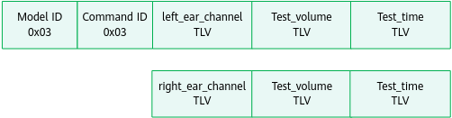

-   应答帧结构：
    -   返回成功：

        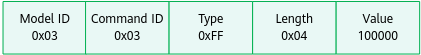

    -   返回失败：

        

### 助听模式设置<a name="ZH-CN_TOPIC_0000001542452613"></a>

**表 1**  助听模式设置字段描述

<a name="table184004175322"></a>
<table><thead align="left"><tr id="row342521703216"><th class="cellrowborder" valign="top" width="13.33%" id="mcps1.2.8.1.1"><p id="p104251717203212"><a name="p104251717203212"></a><a name="p104251717203212"></a>字段名称</p>
</th>
<th class="cellrowborder" valign="top" width="10.41%" id="mcps1.2.8.1.2"><p id="p742610177321"><a name="p742610177321"></a><a name="p742610177321"></a>Type(bit0～bit6)</p>
</th>
<th class="cellrowborder" valign="top" width="14.330000000000002%" id="mcps1.2.8.1.3"><p id="p19426111783215"><a name="p19426111783215"></a><a name="p19426111783215"></a>Length Size(Oct)</p>
</th>
<th class="cellrowborder" valign="top" width="12.479999999999999%" id="mcps1.2.8.1.4"><p id="p15426171718328"><a name="p15426171718328"></a><a name="p15426171718328"></a>Value数据类型</p>
</th>
<th class="cellrowborder" valign="top" width="22.770000000000003%" id="mcps1.2.8.1.5"><p id="p9426181719326"><a name="p9426181719326"></a><a name="p9426181719326"></a>说明</p>
</th>
<th class="cellrowborder" valign="top" width="14.63%" id="mcps1.2.8.1.6"><p id="p1426181717324"><a name="p1426181717324"></a><a name="p1426181717324"></a>必选/可选（M/O）</p>
</th>
<th class="cellrowborder" valign="top" width="12.049999999999999%" id="mcps1.2.8.1.7"><p id="p14261117193213"><a name="p14261117193213"></a><a name="p14261117193213"></a>版本</p>
</th>
</tr>
</thead>
<tbody><tr id="row2426517193210"><td class="cellrowborder" valign="top" width="13.33%" headers="mcps1.2.8.1.1 "><p id="p1540742314333"><a name="p1540742314333"></a><a name="p1540742314333"></a>Hearingaid_mode</p>
</td>
<td class="cellrowborder" valign="top" width="10.41%" headers="mcps1.2.8.1.2 "><p id="p17426131714321"><a name="p17426131714321"></a><a name="p17426131714321"></a>0x01</p>
</td>
<td class="cellrowborder" valign="top" width="14.330000000000002%" headers="mcps1.2.8.1.3 "><p id="p9426121717329"><a name="p9426121717329"></a><a name="p9426121717329"></a>1</p>
</td>
<td class="cellrowborder" valign="top" width="12.479999999999999%" headers="mcps1.2.8.1.4 "><p id="p1015816157440"><a name="p1015816157440"></a><a name="p1015816157440"></a>uint8</p>
</td>
<td class="cellrowborder" valign="top" width="22.770000000000003%" headers="mcps1.2.8.1.5 "><p id="p13957172434417"><a name="p13957172434417"></a><a name="p13957172434417"></a>助听模式，算法和产品确定不同的模式参数，APP下发对应的模式序列号。</p>
<a name="ul968814350449"></a><a name="ul968814350449"></a><ul id="ul968814350449"><li>0：自动检测模式</li><li>1：模式1</li><li>2：模式2</li><li>3：模式3</li><li>4：模式4</li><li>5：模式5:</li><li>6～10：模式6～模式10</li></ul>
</td>
<td class="cellrowborder" valign="top" width="14.63%" headers="mcps1.2.8.1.6 "><p id="p1342661783214"><a name="p1342661783214"></a><a name="p1342661783214"></a>O</p>
</td>
<td class="cellrowborder" valign="top" width="12.049999999999999%" headers="mcps1.2.8.1.7 "><p id="p17426101723213"><a name="p17426101723213"></a><a name="p17426101723213"></a>1.0/1.0</p>
</td>
</tr>
<tr id="row14515154310355"><td class="cellrowborder" valign="top" width="13.33%" headers="mcps1.2.8.1.1 "><p id="p05908285010"><a name="p05908285010"></a><a name="p05908285010"></a>Hearingaid_mode_mask</p>
</td>
<td class="cellrowborder" valign="top" width="10.41%" headers="mcps1.2.8.1.2 "><p id="p85918282014"><a name="p85918282014"></a><a name="p85918282014"></a>0x02</p>
</td>
<td class="cellrowborder" valign="top" width="14.330000000000002%" headers="mcps1.2.8.1.3 "><p id="p15912287016"><a name="p15912287016"></a><a name="p15912287016"></a>2</p>
</td>
<td class="cellrowborder" valign="top" width="12.479999999999999%" headers="mcps1.2.8.1.4 "><p id="p3591182812013"><a name="p3591182812013"></a><a name="p3591182812013"></a>uint16</p>
</td>
<td class="cellrowborder" valign="top" width="22.770000000000003%" headers="mcps1.2.8.1.5 "><p id="p18591202813018"><a name="p18591202813018"></a><a name="p18591202813018"></a>使用掩码设置助听模式的有效性，从低到高位每bit代表一个助听模式（最低位为“自动检测模式”），每bit位的值表示该模式的有效性：</p>
<a name="ul1669583871916"></a><a name="ul1669583871916"></a><ul id="ul1669583871916"><li>每bit值＝0：代表该模式不生效，用户无法设置耳机到该模式。</li><li>每bit值＝1：代表该模式生效，用户可以设置耳机到该模式。</li></ul>
</td>
<td class="cellrowborder" valign="top" width="14.63%" headers="mcps1.2.8.1.6 "><p id="p11591028303"><a name="p11591028303"></a><a name="p11591028303"></a>O</p>
</td>
<td class="cellrowborder" valign="top" width="12.049999999999999%" headers="mcps1.2.8.1.7 "><p id="p2591112812018"><a name="p2591112812018"></a><a name="p2591112812018"></a>1.0/1.0</p>
</td>
</tr>
</tbody>
</table>

> **说明：** 
>-   每个产品支持的具体助听模式，需要根据算法和产品规划定义，定义完成后，可以对接到Hearingaid\_mode的模式序列号中。
>    如某产品定义了：自动模式、交通模式、社交模式、聚会模式、安静模式五种模式。那么产品可以跟算法约定每种模式的序列号和对应的模式参数，然后可以在Hearingaid\_mode中，默认：0＝自动模式，1＝交通模式，2＝社交模式，3＝聚会模式，4＝安静模式等。
>-   在产品使用过程中，如果某种模式对一些用户不友好，可以通过使用Hearingaid\_mode\_mask来限制或者开启某些模式的使用。Hearingaid\_mode\_mask的每bit表示一个助听模式，从最低位bit开始向高位，依次代表“自动检测模式”“模式1”“模式2”......
>    如：某产品按照上例支持5种模式，设置Hearingaid\_mode\_mask＝0000 0000 0001 1111表示自动模式和模式1～模式4，用户都可以设置生效，Hearingaid\_mode\_mask＝0000 0000 0001 1110表示自动模式不生效，用户无法设置自动模式，但是用户可以通过APP设置或者按键循环设置模式1～模式4。

-   请求帧结构：****

    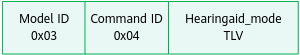

-   应答帧结构：
    -   返回成功：

        

    -   返回失败：

        

### 混音模式设置<a name="ZH-CN_TOPIC_0000001542572813"></a>

**表 1**  混音模式设置字段描述

<a name="table184004175322"></a>
<table><thead align="left"><tr id="row342521703216"><th class="cellrowborder" valign="top" width="13.33%" id="mcps1.2.8.1.1"><p id="p104251717203212"><a name="p104251717203212"></a><a name="p104251717203212"></a>字段名称</p>
</th>
<th class="cellrowborder" valign="top" width="10.42%" id="mcps1.2.8.1.2"><p id="p742610177321"><a name="p742610177321"></a><a name="p742610177321"></a>Type(bit0～bit6)</p>
</th>
<th class="cellrowborder" valign="top" width="14.299999999999999%" id="mcps1.2.8.1.3"><p id="p19426111783215"><a name="p19426111783215"></a><a name="p19426111783215"></a>Length Size(Oct)</p>
</th>
<th class="cellrowborder" valign="top" width="12.479999999999999%" id="mcps1.2.8.1.4"><p id="p15426171718328"><a name="p15426171718328"></a><a name="p15426171718328"></a>Value数据类型</p>
</th>
<th class="cellrowborder" valign="top" width="22.81%" id="mcps1.2.8.1.5"><p id="p9426181719326"><a name="p9426181719326"></a><a name="p9426181719326"></a>说明</p>
</th>
<th class="cellrowborder" valign="top" width="14.610000000000001%" id="mcps1.2.8.1.6"><p id="p1426181717324"><a name="p1426181717324"></a><a name="p1426181717324"></a>必选/可选（M/O）</p>
</th>
<th class="cellrowborder" valign="top" width="12.049999999999999%" id="mcps1.2.8.1.7"><p id="p14261117193213"><a name="p14261117193213"></a><a name="p14261117193213"></a>版本</p>
</th>
</tr>
</thead>
<tbody><tr id="row2426517193210"><td class="cellrowborder" valign="top" width="13.33%" headers="mcps1.2.8.1.1 "><p id="p1540742314333"><a name="p1540742314333"></a><a name="p1540742314333"></a>Audio_aid_mix</p>
</td>
<td class="cellrowborder" valign="top" width="10.42%" headers="mcps1.2.8.1.2 "><p id="p17426131714321"><a name="p17426131714321"></a><a name="p17426131714321"></a>0x01</p>
</td>
<td class="cellrowborder" valign="top" width="14.299999999999999%" headers="mcps1.2.8.1.3 "><p id="p9426121717329"><a name="p9426121717329"></a><a name="p9426121717329"></a>1</p>
</td>
<td class="cellrowborder" valign="top" width="12.479999999999999%" headers="mcps1.2.8.1.4 "><p id="p1015816157440"><a name="p1015816157440"></a><a name="p1015816157440"></a>uint8</p>
</td>
<td class="cellrowborder" valign="top" width="22.81%" headers="mcps1.2.8.1.5 "><p id="p97525180452"><a name="p97525180452"></a><a name="p97525180452"></a>音频和助听混音设置：</p>
<a name="ul78421321184515"></a><a name="ul78421321184515"></a><ul id="ul78421321184515"><li>1：蓝牙音频（蓝牙通话和音乐）和助听模式混音。</li><li>2：蓝牙音频（蓝牙通话和音乐）和助听模式互斥。</li><li>3：蓝牙通话和助听模式混音，音乐和助听模式互斥。</li><li>4：蓝牙音乐和助听模式混音，蓝牙通话和助听模式互斥。</li></ul>
</td>
<td class="cellrowborder" valign="top" width="14.610000000000001%" headers="mcps1.2.8.1.6 "><p id="p1342661783214"><a name="p1342661783214"></a><a name="p1342661783214"></a>O</p>
</td>
<td class="cellrowborder" valign="top" width="12.049999999999999%" headers="mcps1.2.8.1.7 "><p id="p17426101723213"><a name="p17426101723213"></a><a name="p17426101723213"></a>1.0/1.0</p>
</td>
</tr>
</tbody>
</table>

> **说明：** 
>根据芯片和产品不同，混音模式设置后，可能需要重启设备后生效（依据各产品设置而定），可以调用“[设备重启](#ZH-CN_TOPIC_0000001688900589)”的命令或者手动重启设备。

-   请求帧结构：****

    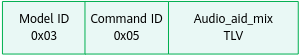

-   应答帧结构：
    -   返回成功：

        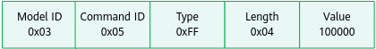

    -   返回失败：

        

### 助听切换时间设置<a name="ZH-CN_TOPIC_0000001491532996"></a>

**表 1**  助听切换时间设置字段描述

<a name="table184004175322"></a>
<table><thead align="left"><tr id="row342521703216"><th class="cellrowborder" valign="top" width="13.33%" id="mcps1.2.8.1.1"><p id="p104251717203212"><a name="p104251717203212"></a><a name="p104251717203212"></a>字段名称</p>
</th>
<th class="cellrowborder" valign="top" width="10.42%" id="mcps1.2.8.1.2"><p id="p742610177321"><a name="p742610177321"></a><a name="p742610177321"></a>Type(bit0～bit6)</p>
</th>
<th class="cellrowborder" valign="top" width="14.32%" id="mcps1.2.8.1.3"><p id="p19426111783215"><a name="p19426111783215"></a><a name="p19426111783215"></a>Length Size(Oct)</p>
</th>
<th class="cellrowborder" valign="top" width="12.479999999999999%" id="mcps1.2.8.1.4"><p id="p15426171718328"><a name="p15426171718328"></a><a name="p15426171718328"></a>Value数据类型</p>
</th>
<th class="cellrowborder" valign="top" width="22.79%" id="mcps1.2.8.1.5"><p id="p9426181719326"><a name="p9426181719326"></a><a name="p9426181719326"></a>说明</p>
</th>
<th class="cellrowborder" valign="top" width="14.610000000000001%" id="mcps1.2.8.1.6"><p id="p1426181717324"><a name="p1426181717324"></a><a name="p1426181717324"></a>必选/可选（M/O）</p>
</th>
<th class="cellrowborder" valign="top" width="12.049999999999999%" id="mcps1.2.8.1.7"><p id="p14261117193213"><a name="p14261117193213"></a><a name="p14261117193213"></a>版本</p>
</th>
</tr>
</thead>
<tbody><tr id="row2426517193210"><td class="cellrowborder" valign="top" width="13.33%" headers="mcps1.2.8.1.1 "><p id="p1540742314333"><a name="p1540742314333"></a><a name="p1540742314333"></a>Time_switch_aidmode</p>
</td>
<td class="cellrowborder" valign="top" width="10.42%" headers="mcps1.2.8.1.2 "><p id="p17426131714321"><a name="p17426131714321"></a><a name="p17426131714321"></a>0x01</p>
</td>
<td class="cellrowborder" valign="top" width="14.32%" headers="mcps1.2.8.1.3 "><p id="p9426121717329"><a name="p9426121717329"></a><a name="p9426121717329"></a>2</p>
</td>
<td class="cellrowborder" valign="top" width="12.479999999999999%" headers="mcps1.2.8.1.4 "><p id="p1015816157440"><a name="p1015816157440"></a><a name="p1015816157440"></a>uint16</p>
</td>
<td class="cellrowborder" valign="top" width="22.79%" headers="mcps1.2.8.1.5 "><p id="p1932831094614"><a name="p1932831094614"></a><a name="p1932831094614"></a>蓝牙模式切换到助听模式后响应时间设置（单位：ms）。</p>
</td>
<td class="cellrowborder" valign="top" width="14.610000000000001%" headers="mcps1.2.8.1.6 "><p id="p1342661783214"><a name="p1342661783214"></a><a name="p1342661783214"></a>O</p>
</td>
<td class="cellrowborder" valign="top" width="12.049999999999999%" headers="mcps1.2.8.1.7 "><p id="p17426101723213"><a name="p17426101723213"></a><a name="p17426101723213"></a>1.0/1.0</p>
</td>
</tr>
</tbody>
</table>

-   请求帧结构：****

    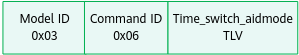

-   应答帧结构：
    -   返回成功：

        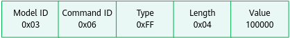

    -   返回失败：

        

### 助听启动延时设置<a name="ZH-CN_TOPIC_0000001491692856"></a>

**表 1**  助听启动延时设置字段描述

<a name="table184004175322"></a>
<table><thead align="left"><tr id="row342521703216"><th class="cellrowborder" valign="top" width="13.33%" id="mcps1.2.8.1.1"><p id="p104251717203212"><a name="p104251717203212"></a><a name="p104251717203212"></a>字段名称</p>
</th>
<th class="cellrowborder" valign="top" width="10.42%" id="mcps1.2.8.1.2"><p id="p742610177321"><a name="p742610177321"></a><a name="p742610177321"></a>Type(bit0～bit6)</p>
</th>
<th class="cellrowborder" valign="top" width="14.32%" id="mcps1.2.8.1.3"><p id="p19426111783215"><a name="p19426111783215"></a><a name="p19426111783215"></a>Length Size(Oct)</p>
</th>
<th class="cellrowborder" valign="top" width="12.479999999999999%" id="mcps1.2.8.1.4"><p id="p15426171718328"><a name="p15426171718328"></a><a name="p15426171718328"></a>Value数据类型</p>
</th>
<th class="cellrowborder" valign="top" width="22.79%" id="mcps1.2.8.1.5"><p id="p9426181719326"><a name="p9426181719326"></a><a name="p9426181719326"></a>说明</p>
</th>
<th class="cellrowborder" valign="top" width="14.610000000000001%" id="mcps1.2.8.1.6"><p id="p1426181717324"><a name="p1426181717324"></a><a name="p1426181717324"></a>必选/可选（M/O）</p>
</th>
<th class="cellrowborder" valign="top" width="12.049999999999999%" id="mcps1.2.8.1.7"><p id="p14261117193213"><a name="p14261117193213"></a><a name="p14261117193213"></a>版本</p>
</th>
</tr>
</thead>
<tbody><tr id="row2426517193210"><td class="cellrowborder" valign="top" width="13.33%" headers="mcps1.2.8.1.1 "><p id="p176931432174610"><a name="p176931432174610"></a><a name="p176931432174610"></a>delay_open_aidmode</p>
</td>
<td class="cellrowborder" valign="top" width="10.42%" headers="mcps1.2.8.1.2 "><p id="p17426131714321"><a name="p17426131714321"></a><a name="p17426131714321"></a>0x01</p>
</td>
<td class="cellrowborder" valign="top" width="14.32%" headers="mcps1.2.8.1.3 "><p id="p9426121717329"><a name="p9426121717329"></a><a name="p9426121717329"></a>2</p>
</td>
<td class="cellrowborder" valign="top" width="12.479999999999999%" headers="mcps1.2.8.1.4 "><p id="p1015816157440"><a name="p1015816157440"></a><a name="p1015816157440"></a>uint16</p>
</td>
<td class="cellrowborder" valign="top" width="22.79%" headers="mcps1.2.8.1.5 "><p id="p6779432463"><a name="p6779432463"></a><a name="p6779432463"></a>耳机开机后，开启助听模式延迟时间设置（单位：ms）。</p>
</td>
<td class="cellrowborder" valign="top" width="14.610000000000001%" headers="mcps1.2.8.1.6 "><p id="p1342661783214"><a name="p1342661783214"></a><a name="p1342661783214"></a>O</p>
</td>
<td class="cellrowborder" valign="top" width="12.049999999999999%" headers="mcps1.2.8.1.7 "><p id="p17426101723213"><a name="p17426101723213"></a><a name="p17426101723213"></a>1.0/1.0</p>
</td>
</tr>
</tbody>
</table>

> **说明：** 
>请根据具体产品的设置来配置对应的值。
>例如，部分未配置入耳检测功能的产品中，将“出盒”设定为“强制入耳”状态，“入盒”设定为“强制出耳”状态。

-   请求帧结构：****

    

-   应答帧结构：
    -   返回成功：

        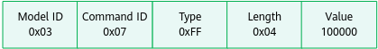

    -   返回失败：

        

### 助听模式自动检测设置<a name="ZH-CN_TOPIC_0000001542652797"></a>

**表 1**  助听模式自动检测设置字段描述

<a name="table184004175322"></a>
<table><thead align="left"><tr id="row342521703216"><th class="cellrowborder" valign="top" width="13.33%" id="mcps1.2.8.1.1"><p id="p104251717203212"><a name="p104251717203212"></a><a name="p104251717203212"></a>字段名称</p>
</th>
<th class="cellrowborder" valign="top" width="10.42%" id="mcps1.2.8.1.2"><p id="p742610177321"><a name="p742610177321"></a><a name="p742610177321"></a>Type(bit0～bit6)</p>
</th>
<th class="cellrowborder" valign="top" width="14.32%" id="mcps1.2.8.1.3"><p id="p19426111783215"><a name="p19426111783215"></a><a name="p19426111783215"></a>Length Size(Oct)</p>
</th>
<th class="cellrowborder" valign="top" width="12.479999999999999%" id="mcps1.2.8.1.4"><p id="p15426171718328"><a name="p15426171718328"></a><a name="p15426171718328"></a>Value数据类型</p>
</th>
<th class="cellrowborder" valign="top" width="22.79%" id="mcps1.2.8.1.5"><p id="p9426181719326"><a name="p9426181719326"></a><a name="p9426181719326"></a>说明</p>
</th>
<th class="cellrowborder" valign="top" width="14.610000000000001%" id="mcps1.2.8.1.6"><p id="p1426181717324"><a name="p1426181717324"></a><a name="p1426181717324"></a>必选/可选（M/O）</p>
</th>
<th class="cellrowborder" valign="top" width="12.049999999999999%" id="mcps1.2.8.1.7"><p id="p14261117193213"><a name="p14261117193213"></a><a name="p14261117193213"></a>版本</p>
</th>
</tr>
</thead>
<tbody><tr id="row2426517193210"><td class="cellrowborder" valign="top" width="13.33%" headers="mcps1.2.8.1.1 "><p id="p1572415519476"><a name="p1572415519476"></a><a name="p1572415519476"></a>Hearingaid_module_autoset</p>
</td>
<td class="cellrowborder" valign="top" width="10.42%" headers="mcps1.2.8.1.2 "><p id="p17426131714321"><a name="p17426131714321"></a><a name="p17426131714321"></a>0x01</p>
</td>
<td class="cellrowborder" valign="top" width="14.32%" headers="mcps1.2.8.1.3 "><p id="p9426121717329"><a name="p9426121717329"></a><a name="p9426121717329"></a>1</p>
</td>
<td class="cellrowborder" valign="top" width="12.479999999999999%" headers="mcps1.2.8.1.4 "><p id="p1015816157440"><a name="p1015816157440"></a><a name="p1015816157440"></a>uint8</p>
</td>
<td class="cellrowborder" valign="top" width="22.79%" headers="mcps1.2.8.1.5 "><p id="p17345102313474"><a name="p17345102313474"></a><a name="p17345102313474"></a>助听模式自动检测：</p>
<a name="ul230011255477"></a><a name="ul230011255477"></a><ul id="ul230011255477"><li>1：开启</li><li>2：关闭</li></ul>
</td>
<td class="cellrowborder" valign="top" width="14.610000000000001%" headers="mcps1.2.8.1.6 "><p id="p1342661783214"><a name="p1342661783214"></a><a name="p1342661783214"></a>O</p>
</td>
<td class="cellrowborder" valign="top" width="12.049999999999999%" headers="mcps1.2.8.1.7 "><p id="p17426101723213"><a name="p17426101723213"></a><a name="p17426101723213"></a>1.0/1.0</p>
</td>
</tr>
</tbody>
</table>

-   请求帧结构：****

    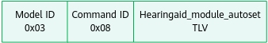

-   应答帧结构：
    -   返回成功：

        

    -   返回失败：

        

### 助听参数保存<a name="ZH-CN_TOPIC_0000001542772673"></a>

**表 1**  助听参数保存字段描述

<a name="table184004175322"></a>
<table><thead align="left"><tr id="row342521703216"><th class="cellrowborder" valign="top" width="13.33%" id="mcps1.2.8.1.1"><p id="p104251717203212"><a name="p104251717203212"></a><a name="p104251717203212"></a>字段名称</p>
</th>
<th class="cellrowborder" valign="top" width="10.42%" id="mcps1.2.8.1.2"><p id="p742610177321"><a name="p742610177321"></a><a name="p742610177321"></a>Type(bit0～bit6)</p>
</th>
<th class="cellrowborder" valign="top" width="14.32%" id="mcps1.2.8.1.3"><p id="p19426111783215"><a name="p19426111783215"></a><a name="p19426111783215"></a>Length Size(Oct)</p>
</th>
<th class="cellrowborder" valign="top" width="12.479999999999999%" id="mcps1.2.8.1.4"><p id="p15426171718328"><a name="p15426171718328"></a><a name="p15426171718328"></a>Value数据类型</p>
</th>
<th class="cellrowborder" valign="top" width="22.79%" id="mcps1.2.8.1.5"><p id="p9426181719326"><a name="p9426181719326"></a><a name="p9426181719326"></a>说明</p>
</th>
<th class="cellrowborder" valign="top" width="14.610000000000001%" id="mcps1.2.8.1.6"><p id="p1426181717324"><a name="p1426181717324"></a><a name="p1426181717324"></a>必选/可选（M/O）</p>
</th>
<th class="cellrowborder" valign="top" width="12.049999999999999%" id="mcps1.2.8.1.7"><p id="p14261117193213"><a name="p14261117193213"></a><a name="p14261117193213"></a>版本</p>
</th>
</tr>
</thead>
<tbody><tr id="row2426517193210"><td class="cellrowborder" valign="top" width="13.33%" headers="mcps1.2.8.1.1 "><p id="p1572415519476"><a name="p1572415519476"></a><a name="p1572415519476"></a>Hearingaid_para_save</p>
</td>
<td class="cellrowborder" valign="top" width="10.42%" headers="mcps1.2.8.1.2 "><p id="p17426131714321"><a name="p17426131714321"></a><a name="p17426131714321"></a>0x01</p>
</td>
<td class="cellrowborder" valign="top" width="14.32%" headers="mcps1.2.8.1.3 "><p id="p9426121717329"><a name="p9426121717329"></a><a name="p9426121717329"></a>1</p>
</td>
<td class="cellrowborder" valign="top" width="12.479999999999999%" headers="mcps1.2.8.1.4 "><p id="p1015816157440"><a name="p1015816157440"></a><a name="p1015816157440"></a>uint8</p>
</td>
<td class="cellrowborder" valign="top" width="22.79%" headers="mcps1.2.8.1.5 "><p id="p12297185204712"><a name="p12297185204712"></a><a name="p12297185204712"></a>助听参数保存命令。</p>
<p id="p1229795284714"><a name="p1229795284714"></a><a name="p1229795284714"></a>1：表示需要保存助听参数</p>
</td>
<td class="cellrowborder" valign="top" width="14.610000000000001%" headers="mcps1.2.8.1.6 "><p id="p1342661783214"><a name="p1342661783214"></a><a name="p1342661783214"></a>O</p>
</td>
<td class="cellrowborder" valign="top" width="12.049999999999999%" headers="mcps1.2.8.1.7 "><p id="p17426101723213"><a name="p17426101723213"></a><a name="p17426101723213"></a>1.0/1.0</p>
</td>
</tr>
</tbody>
</table>

> **说明：** 
>此命令用于把验配参数块从内存中统一保存到Flash中。
>助听验配完成后，必须调用此命令保存验配数据，以确保数据关机不丢失。

-   请求帧结构：****

    

-   应答帧结构：
    -   返回成功：

        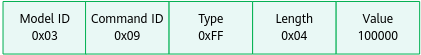

    -   返回失败：

        

### 助听音量调节参数设置<a name="ZH-CN_TOPIC_0000001491852776"></a>

**表 1**  助听音量调节参数设置字段描述

<a name="table184004175322"></a>
<table><thead align="left"><tr id="row342521703216"><th class="cellrowborder" valign="top" width="13.33%" id="mcps1.2.8.1.1"><p id="p104251717203212"><a name="p104251717203212"></a><a name="p104251717203212"></a>字段名称</p>
</th>
<th class="cellrowborder" valign="top" width="10.42%" id="mcps1.2.8.1.2"><p id="p742610177321"><a name="p742610177321"></a><a name="p742610177321"></a>Type(bit0～bit6)</p>
</th>
<th class="cellrowborder" valign="top" width="14.299999999999999%" id="mcps1.2.8.1.3"><p id="p19426111783215"><a name="p19426111783215"></a><a name="p19426111783215"></a>Length Size(Oct)</p>
</th>
<th class="cellrowborder" valign="top" width="12.5%" id="mcps1.2.8.1.4"><p id="p15426171718328"><a name="p15426171718328"></a><a name="p15426171718328"></a>Value数据类型</p>
</th>
<th class="cellrowborder" valign="top" width="22.79%" id="mcps1.2.8.1.5"><p id="p9426181719326"><a name="p9426181719326"></a><a name="p9426181719326"></a>说明</p>
</th>
<th class="cellrowborder" valign="top" width="14.610000000000001%" id="mcps1.2.8.1.6"><p id="p1426181717324"><a name="p1426181717324"></a><a name="p1426181717324"></a>必选/可选（M/O）</p>
</th>
<th class="cellrowborder" valign="top" width="12.049999999999999%" id="mcps1.2.8.1.7"><p id="p14261117193213"><a name="p14261117193213"></a><a name="p14261117193213"></a>版本</p>
</th>
</tr>
</thead>
<tbody><tr id="row2426517193210"><td class="cellrowborder" valign="top" width="13.33%" headers="mcps1.2.8.1.1 "><p id="p1572415519476"><a name="p1572415519476"></a><a name="p1572415519476"></a>Hearingaid_volume_count</p>
</td>
<td class="cellrowborder" valign="top" width="10.42%" headers="mcps1.2.8.1.2 "><p id="p17426131714321"><a name="p17426131714321"></a><a name="p17426131714321"></a>0x01</p>
</td>
<td class="cellrowborder" valign="top" width="14.299999999999999%" headers="mcps1.2.8.1.3 "><p id="p9426121717329"><a name="p9426121717329"></a><a name="p9426121717329"></a>2</p>
</td>
<td class="cellrowborder" valign="top" width="12.5%" headers="mcps1.2.8.1.4 "><p id="p1015816157440"><a name="p1015816157440"></a><a name="p1015816157440"></a>uint16</p>
</td>
<td class="cellrowborder" valign="top" width="22.79%" headers="mcps1.2.8.1.5 "><p id="p1148510337149"><a name="p1148510337149"></a><a name="p1148510337149"></a>设置设备中助听音量的可调解总阶数（范围：小于等于20，且大于等于1）。</p>
</td>
<td class="cellrowborder" valign="top" width="14.610000000000001%" headers="mcps1.2.8.1.6 "><p id="p1342661783214"><a name="p1342661783214"></a><a name="p1342661783214"></a>O</p>
</td>
<td class="cellrowborder" valign="top" width="12.049999999999999%" headers="mcps1.2.8.1.7 "><p id="p17426101723213"><a name="p17426101723213"></a><a name="p17426101723213"></a>1.0/1.0</p>
</td>
</tr>
<tr id="row183611583483"><td class="cellrowborder" valign="top" width="13.33%" headers="mcps1.2.8.1.1 "><p id="p1330415112496"><a name="p1330415112496"></a><a name="p1330415112496"></a>Hearingaid_volume_default_No</p>
</td>
<td class="cellrowborder" valign="top" width="10.42%" headers="mcps1.2.8.1.2 "><p id="p15304171124913"><a name="p15304171124913"></a><a name="p15304171124913"></a>0x02</p>
</td>
<td class="cellrowborder" valign="top" width="14.299999999999999%" headers="mcps1.2.8.1.3 "><p id="p8304191112491"><a name="p8304191112491"></a><a name="p8304191112491"></a>2</p>
</td>
<td class="cellrowborder" valign="top" width="12.5%" headers="mcps1.2.8.1.4 "><p id="p1530419116494"><a name="p1530419116494"></a><a name="p1530419116494"></a>uint16</p>
</td>
<td class="cellrowborder" valign="top" width="22.79%" headers="mcps1.2.8.1.5 "><p id="p83041511104911"><a name="p83041511104911"></a><a name="p83041511104911"></a>默认的助听音量阶数（表示助听音量数组中第几阶为默认助听音量）。</p>
</td>
<td class="cellrowborder" valign="top" width="14.610000000000001%" headers="mcps1.2.8.1.6 "><p id="p8304181184919"><a name="p8304181184919"></a><a name="p8304181184919"></a>O</p>
</td>
<td class="cellrowborder" valign="top" width="12.049999999999999%" headers="mcps1.2.8.1.7 "><p id="p0304191116498"><a name="p0304191116498"></a><a name="p0304191116498"></a>1.0/1.0</p>
</td>
</tr>
<tr id="row858662114918"><td class="cellrowborder" valign="top" width="13.33%" headers="mcps1.2.8.1.1 "><p id="p17304101134913"><a name="p17304101134913"></a><a name="p17304101134913"></a>Hearingaid_volume_group</p>
</td>
<td class="cellrowborder" valign="top" width="10.42%" headers="mcps1.2.8.1.2 "><p id="p6304171164920"><a name="p6304171164920"></a><a name="p6304171164920"></a>0x03</p>
</td>
<td class="cellrowborder" valign="top" width="14.299999999999999%" headers="mcps1.2.8.1.3 "><p id="p1830420119492"><a name="p1830420119492"></a><a name="p1830420119492"></a>N</p>
</td>
<td class="cellrowborder" valign="top" width="12.5%" headers="mcps1.2.8.1.4 "><p id="p133041611104915"><a name="p133041611104915"></a><a name="p133041611104915"></a>int32</p>
</td>
<td class="cellrowborder" valign="top" width="22.79%" headers="mcps1.2.8.1.5 "><p id="p930511112491"><a name="p930511112491"></a><a name="p930511112491"></a>助听音量数组设置，为减少复杂度，请由小到大排序音量（音量单位为0.001dB，如：以设置音量为2.13dB为例，下发的参数为2130）。</p>
</td>
<td class="cellrowborder" valign="top" width="14.610000000000001%" headers="mcps1.2.8.1.6 "><p id="p143051811114920"><a name="p143051811114920"></a><a name="p143051811114920"></a>O</p>
</td>
<td class="cellrowborder" valign="top" width="12.049999999999999%" headers="mcps1.2.8.1.7 "><p id="p430561119498"><a name="p430561119498"></a><a name="p430561119498"></a>1.0/1.0</p>
</td>
</tr>
</tbody>
</table>

> **说明：** 
>-   为避免错误，上述type一起使用最佳。
>-   设置的助听音量数组元素最大为20，由小到大排序。
>-   默认助听音量阶数，以1开始从音量数组中取。
>示例：Hearingaid\_volume\_count = 6；Hearingaid\_volume\_default\_No = 2；Hearingaid\_volume\_group  = \{-25000,-20000,-15000,-10000,-5000,0\}
>示例参数说明：助听音量一共有6阶；默认音量为第2阶，为-20dB；助听音量数组为：-25dB、-20dB、-15dB、-10dB、-5dB、0dB。

-   请求帧结构：****

    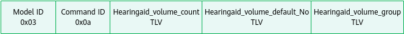

-   应答帧结构：
    -   返回成功：

        

    -   返回失败：

        

### 获取耳机统计数据<a name="ZH-CN_TOPIC_0000001492012680"></a>

**表 1**  获取耳机统计数据字段描述

<a name="table184004175322"></a>
<table><thead align="left"><tr id="row342521703216"><th class="cellrowborder" valign="top" width="13.33%" id="mcps1.2.8.1.1"><p id="p104251717203212"><a name="p104251717203212"></a><a name="p104251717203212"></a>字段名称</p>
</th>
<th class="cellrowborder" valign="top" width="10.42%" id="mcps1.2.8.1.2"><p id="p742610177321"><a name="p742610177321"></a><a name="p742610177321"></a>Type(bit0～bit6)</p>
</th>
<th class="cellrowborder" valign="top" width="14.32%" id="mcps1.2.8.1.3"><p id="p19426111783215"><a name="p19426111783215"></a><a name="p19426111783215"></a>Length Size(Oct)</p>
</th>
<th class="cellrowborder" valign="top" width="12.479999999999999%" id="mcps1.2.8.1.4"><p id="p15426171718328"><a name="p15426171718328"></a><a name="p15426171718328"></a>Value数据类型</p>
</th>
<th class="cellrowborder" valign="top" width="22.79%" id="mcps1.2.8.1.5"><p id="p9426181719326"><a name="p9426181719326"></a><a name="p9426181719326"></a>说明</p>
</th>
<th class="cellrowborder" valign="top" width="14.610000000000001%" id="mcps1.2.8.1.6"><p id="p1426181717324"><a name="p1426181717324"></a><a name="p1426181717324"></a>必选/可选（M/O）</p>
</th>
<th class="cellrowborder" valign="top" width="12.049999999999999%" id="mcps1.2.8.1.7"><p id="p14261117193213"><a name="p14261117193213"></a><a name="p14261117193213"></a>版本</p>
</th>
</tr>
</thead>
<tbody><tr id="row2426517193210"><td class="cellrowborder" valign="top" width="13.33%" headers="mcps1.2.8.1.1 "><p id="p1572415519476"><a name="p1572415519476"></a><a name="p1572415519476"></a>Audio_time_get</p>
</td>
<td class="cellrowborder" valign="top" width="10.42%" headers="mcps1.2.8.1.2 "><p id="p17426131714321"><a name="p17426131714321"></a><a name="p17426131714321"></a>0x01</p>
</td>
<td class="cellrowborder" valign="top" width="14.32%" headers="mcps1.2.8.1.3 "><p id="p9426121717329"><a name="p9426121717329"></a><a name="p9426121717329"></a>4</p>
</td>
<td class="cellrowborder" valign="top" width="12.479999999999999%" headers="mcps1.2.8.1.4 "><p id="p1015816157440"><a name="p1015816157440"></a><a name="p1015816157440"></a>uint32</p>
</td>
<td class="cellrowborder" valign="top" width="22.79%" headers="mcps1.2.8.1.5 "><p id="p1188472015114"><a name="p1188472015114"></a><a name="p1188472015114"></a>音频播放累计时长。单位：s</p>
<p id="p18884132095119"><a name="p18884132095119"></a><a name="p18884132095119"></a>此数据被读取后，设备从新计数。</p>
</td>
<td class="cellrowborder" valign="top" width="14.610000000000001%" headers="mcps1.2.8.1.6 "><p id="p1342661783214"><a name="p1342661783214"></a><a name="p1342661783214"></a>O</p>
</td>
<td class="cellrowborder" valign="top" width="12.049999999999999%" headers="mcps1.2.8.1.7 "><p id="p17426101723213"><a name="p17426101723213"></a><a name="p17426101723213"></a>1.0/1.0</p>
</td>
</tr>
<tr id="row183611583483"><td class="cellrowborder" valign="top" width="13.33%" headers="mcps1.2.8.1.1 "><p id="p1330415112496"><a name="p1330415112496"></a><a name="p1330415112496"></a>calling_time_get</p>
</td>
<td class="cellrowborder" valign="top" width="10.42%" headers="mcps1.2.8.1.2 "><p id="p15304171124913"><a name="p15304171124913"></a><a name="p15304171124913"></a>0x02</p>
</td>
<td class="cellrowborder" valign="top" width="14.32%" headers="mcps1.2.8.1.3 "><p id="p8304191112491"><a name="p8304191112491"></a><a name="p8304191112491"></a>4</p>
</td>
<td class="cellrowborder" valign="top" width="12.479999999999999%" headers="mcps1.2.8.1.4 "><p id="p1530419116494"><a name="p1530419116494"></a><a name="p1530419116494"></a>uint32</p>
</td>
<td class="cellrowborder" valign="top" width="22.79%" headers="mcps1.2.8.1.5 "><p id="p59119279515"><a name="p59119279515"></a><a name="p59119279515"></a>通话累计时长。单位：s</p>
<p id="p59111727185115"><a name="p59111727185115"></a><a name="p59111727185115"></a>此数据被读取后，设备从新计数。</p>
</td>
<td class="cellrowborder" valign="top" width="14.610000000000001%" headers="mcps1.2.8.1.6 "><p id="p8304181184919"><a name="p8304181184919"></a><a name="p8304181184919"></a>O</p>
</td>
<td class="cellrowborder" valign="top" width="12.049999999999999%" headers="mcps1.2.8.1.7 "><p id="p0304191116498"><a name="p0304191116498"></a><a name="p0304191116498"></a>1.0/1.0</p>
</td>
</tr>
<tr id="row858662114918"><td class="cellrowborder" valign="top" width="13.33%" headers="mcps1.2.8.1.1 "><p id="p17304101134913"><a name="p17304101134913"></a><a name="p17304101134913"></a>Config_time_get</p>
</td>
<td class="cellrowborder" valign="top" width="10.42%" headers="mcps1.2.8.1.2 "><p id="p6304171164920"><a name="p6304171164920"></a><a name="p6304171164920"></a>0x03</p>
</td>
<td class="cellrowborder" valign="top" width="14.32%" headers="mcps1.2.8.1.3 "><p id="p1830420119492"><a name="p1830420119492"></a><a name="p1830420119492"></a>4</p>
</td>
<td class="cellrowborder" valign="top" width="12.479999999999999%" headers="mcps1.2.8.1.4 "><p id="p133041611104915"><a name="p133041611104915"></a><a name="p133041611104915"></a>uint32</p>
</td>
<td class="cellrowborder" valign="top" width="22.79%" headers="mcps1.2.8.1.5 "><p id="p1941103795111"><a name="p1941103795111"></a><a name="p1941103795111"></a>配置APP连接累计时长。单位：s</p>
<p id="p1694111375513"><a name="p1694111375513"></a><a name="p1694111375513"></a>此数据被读取后，设备从新计数。</p>
</td>
<td class="cellrowborder" valign="top" width="14.610000000000001%" headers="mcps1.2.8.1.6 "><p id="p143051811114920"><a name="p143051811114920"></a><a name="p143051811114920"></a>O</p>
</td>
<td class="cellrowborder" valign="top" width="12.049999999999999%" headers="mcps1.2.8.1.7 "><p id="p430561119498"><a name="p430561119498"></a><a name="p430561119498"></a>1.0/1.0</p>
</td>
</tr>
</tbody>
</table>

-   请求帧结构：****

    

-   应答帧结构：
    -   返回成功：

        

    -   返回失败：

        

### 获取助听模式统计数据<a name="ZH-CN_TOPIC_0000001542452617"></a>

> **须知：** 
>-   Type=1：标记出了模式个数；Type=2：顺序记录了每个模式和时长。
>    为避免数据错误，Type=1和Type=2必须同时使用。
>-   Aidmode\_time\_sums统计的是各个模式的使用时长，Aidmode\_order\_get记录的各个模式的使用顺序和时长。
>    如：用户使用顺序模式1使用30min，模式2使用20min，模式1再使用50min，模式3使用50min，则：
>    在Aidmode\_order\_get中记录为：模式1\_30min -\> 模式2\_20min -\> 模式1\_50min -\> 模式3\_50分钟。
>    在Aidmode\_time\_sums中记录为：模式1\_80min -\> 模式2\_20min -\> 模式3\_50分钟。
>    另：因为产品一般会根据设备空间来限定Aidmode\_order\_get记录的切换条数，导致如果有频繁操作，有可能丢失记录。

**表 1**  获取助听模式统计数据字段描述

<a name="table184004175322"></a>
<table><thead align="left"><tr id="row342521703216"><th class="cellrowborder" valign="top" width="13.309999999999999%" id="mcps1.2.8.1.1"><p id="p104251717203212"><a name="p104251717203212"></a><a name="p104251717203212"></a>字段名称</p>
</th>
<th class="cellrowborder" valign="top" width="10.440000000000001%" id="mcps1.2.8.1.2"><p id="p742610177321"><a name="p742610177321"></a><a name="p742610177321"></a>Type(bit0～bit6)</p>
</th>
<th class="cellrowborder" valign="top" width="14.32%" id="mcps1.2.8.1.3"><p id="p19426111783215"><a name="p19426111783215"></a><a name="p19426111783215"></a>Length Size(Oct)</p>
</th>
<th class="cellrowborder" valign="top" width="12.479999999999999%" id="mcps1.2.8.1.4"><p id="p15426171718328"><a name="p15426171718328"></a><a name="p15426171718328"></a>Value数据类型</p>
</th>
<th class="cellrowborder" valign="top" width="22.759999999999998%" id="mcps1.2.8.1.5"><p id="p9426181719326"><a name="p9426181719326"></a><a name="p9426181719326"></a>说明</p>
</th>
<th class="cellrowborder" valign="top" width="14.62%" id="mcps1.2.8.1.6"><p id="p1426181717324"><a name="p1426181717324"></a><a name="p1426181717324"></a>必选/可选（M/O）</p>
</th>
<th class="cellrowborder" valign="top" width="12.07%" id="mcps1.2.8.1.7"><p id="p14261117193213"><a name="p14261117193213"></a><a name="p14261117193213"></a>版本</p>
</th>
</tr>
</thead>
<tbody><tr id="row2426517193210"><td class="cellrowborder" valign="top" width="13.309999999999999%" headers="mcps1.2.8.1.1 "><p id="p18402765213"><a name="p18402765213"></a><a name="p18402765213"></a>Aidmode_count_get</p>
</td>
<td class="cellrowborder" valign="top" width="10.440000000000001%" headers="mcps1.2.8.1.2 "><p id="p17426131714321"><a name="p17426131714321"></a><a name="p17426131714321"></a>0x01</p>
</td>
<td class="cellrowborder" valign="top" width="14.32%" headers="mcps1.2.8.1.3 "><p id="p9426121717329"><a name="p9426121717329"></a><a name="p9426121717329"></a>2</p>
</td>
<td class="cellrowborder" valign="top" width="12.479999999999999%" headers="mcps1.2.8.1.4 "><p id="p1015816157440"><a name="p1015816157440"></a><a name="p1015816157440"></a>uint16</p>
</td>
<td class="cellrowborder" valign="top" width="22.759999999999998%" headers="mcps1.2.8.1.5 "><p id="p391015525317"><a name="p391015525317"></a><a name="p391015525317"></a>顺序记录的助听模式个数。</p>
<p id="p209103535312"><a name="p209103535312"></a><a name="p209103535312"></a>此数据被读取后，设备从新计数。</p>
</td>
<td class="cellrowborder" valign="top" width="14.62%" headers="mcps1.2.8.1.6 "><p id="p1342661783214"><a name="p1342661783214"></a><a name="p1342661783214"></a>O</p>
</td>
<td class="cellrowborder" valign="top" width="12.07%" headers="mcps1.2.8.1.7 "><p id="p17426101723213"><a name="p17426101723213"></a><a name="p17426101723213"></a>1.0/1.0</p>
</td>
</tr>
<tr id="row183611583483"><td class="cellrowborder" valign="top" width="13.309999999999999%" headers="mcps1.2.8.1.1 "><p id="p9975175417521"><a name="p9975175417521"></a><a name="p9975175417521"></a>Aidmode_order_get</p>
</td>
<td class="cellrowborder" valign="top" width="10.440000000000001%" headers="mcps1.2.8.1.2 "><p id="p15304171124913"><a name="p15304171124913"></a><a name="p15304171124913"></a>0x02</p>
</td>
<td class="cellrowborder" valign="top" width="14.32%" headers="mcps1.2.8.1.3 "><p id="p8304191112491"><a name="p8304191112491"></a><a name="p8304191112491"></a>N</p>
</td>
<td class="cellrowborder" valign="top" width="12.479999999999999%" headers="mcps1.2.8.1.4 "><p id="p1530419116494"><a name="p1530419116494"></a><a name="p1530419116494"></a>uint8</p>
</td>
<td class="cellrowborder" valign="top" width="22.759999999999998%" headers="mcps1.2.8.1.5 "><p id="p3126717135318"><a name="p3126717135318"></a><a name="p3126717135318"></a>各助听模式使用时长的顺序记录。单位：min</p>
<p id="p0126181745310"><a name="p0126181745310"></a><a name="p0126181745310"></a>如：（模式1_30min -&gt; 模式2_20min -&gt; 模式1_50min -&gt; 模式3_50分钟）</p>
<p id="p16126201745315"><a name="p16126201745315"></a><a name="p16126201745315"></a>整个数据为4字节数组，每一个4字节表示一种模式和对应的使用时间（单位：min）：第1个字节为助听模式号，后3个字节表示此模式的使用时长。</p>
<p id="p5126191795310"><a name="p5126191795310"></a><a name="p5126191795310"></a>模式号为APP和算法确定的参数，请参见“<a href="#ZH-CN_TOPIC_0000001542452613">助听模式设置</a>”。</p>
<p id="p14126111719539"><a name="p14126111719539"></a><a name="p14126111719539"></a>此数据被读取后，设备从新计数。</p>
</td>
<td class="cellrowborder" valign="top" width="14.62%" headers="mcps1.2.8.1.6 "><p id="p8304181184919"><a name="p8304181184919"></a><a name="p8304181184919"></a>O</p>
</td>
<td class="cellrowborder" valign="top" width="12.07%" headers="mcps1.2.8.1.7 "><p id="p0304191116498"><a name="p0304191116498"></a><a name="p0304191116498"></a>1.0/1.0</p>
</td>
</tr>
<tr id="row116811416133617"><td class="cellrowborder" valign="top" width="13.309999999999999%" headers="mcps1.2.8.1.1 "><p id="p0681116123616"><a name="p0681116123616"></a><a name="p0681116123616"></a>Aidmode_time_sums</p>
</td>
<td class="cellrowborder" valign="top" width="10.440000000000001%" headers="mcps1.2.8.1.2 "><p id="p668181620366"><a name="p668181620366"></a><a name="p668181620366"></a>0x03</p>
</td>
<td class="cellrowborder" valign="top" width="14.32%" headers="mcps1.2.8.1.3 "><p id="p3681151613618"><a name="p3681151613618"></a><a name="p3681151613618"></a>N</p>
</td>
<td class="cellrowborder" valign="top" width="12.479999999999999%" headers="mcps1.2.8.1.4 "><p id="p6681616173618"><a name="p6681616173618"></a><a name="p6681616173618"></a>uint8</p>
</td>
<td class="cellrowborder" valign="top" width="22.759999999999998%" headers="mcps1.2.8.1.5 "><p id="p16819165364"><a name="p16819165364"></a><a name="p16819165364"></a>各助听模式使用时长汇总。单位：min。</p>
<p id="p1335663419502"><a name="p1335663419502"></a><a name="p1335663419502"></a>整个数据为4字节数组，每一个4字节表示一种模式和对应的使用时间（单位：min）：第1个字节为助听模式号，后3个字节表示此模式的使用时长。</p>
<p id="p63562345503"><a name="p63562345503"></a><a name="p63562345503"></a>模式号为APP和算法确定的参数，请参见“<a href="#ZH-CN_TOPIC_0000001542452613">助听模式设置</a>”。</p>
<p id="p10356334175017"><a name="p10356334175017"></a><a name="p10356334175017"></a>此数据被读取后，设备从新计数。</p>
</td>
<td class="cellrowborder" valign="top" width="14.62%" headers="mcps1.2.8.1.6 "><p id="p3681111618365"><a name="p3681111618365"></a><a name="p3681111618365"></a>O</p>
</td>
<td class="cellrowborder" valign="top" width="12.07%" headers="mcps1.2.8.1.7 "><p id="p3681131663618"><a name="p3681131663618"></a><a name="p3681131663618"></a>1.0/1.0</p>
</td>
</tr>
</tbody>
</table>

-   请求帧结构：****

    

-   应答帧结构：
    -   返回成功：

        

    -   返回失败：

        

### 助听模式可设置<a name="ZH-CN_TOPIC_0000001499656764"></a>

**表 1**  助听模式可设置字段描述

<a name="table104611014174613"></a>
<table><thead align="left"><tr id="row949121474610"><th class="cellrowborder" valign="top" width="13.33%" id="mcps1.2.8.1.1"><p id="p1249110147467"><a name="p1249110147467"></a><a name="p1249110147467"></a>字段名称</p>
</th>
<th class="cellrowborder" valign="top" width="10.42%" id="mcps1.2.8.1.2"><p id="p349121454613"><a name="p349121454613"></a><a name="p349121454613"></a>Type(bit0～bit6)</p>
</th>
<th class="cellrowborder" valign="top" width="14.32%" id="mcps1.2.8.1.3"><p id="p11491101410467"><a name="p11491101410467"></a><a name="p11491101410467"></a>Length Size(Oct)</p>
</th>
<th class="cellrowborder" valign="top" width="12.479999999999999%" id="mcps1.2.8.1.4"><p id="p7491121454611"><a name="p7491121454611"></a><a name="p7491121454611"></a>Value数据类型</p>
</th>
<th class="cellrowborder" valign="top" width="22.79%" id="mcps1.2.8.1.5"><p id="p17491121411467"><a name="p17491121411467"></a><a name="p17491121411467"></a>说明</p>
</th>
<th class="cellrowborder" valign="top" width="14.610000000000001%" id="mcps1.2.8.1.6"><p id="p149151474617"><a name="p149151474617"></a><a name="p149151474617"></a>必选/可选（M/O）</p>
</th>
<th class="cellrowborder" valign="top" width="12.049999999999999%" id="mcps1.2.8.1.7"><p id="p104911914174618"><a name="p104911914174618"></a><a name="p104911914174618"></a>版本</p>
</th>
</tr>
</thead>
<tbody><tr id="row134911114164617"><td class="cellrowborder" valign="top" width="13.33%" headers="mcps1.2.8.1.1 "><p id="p1349171474615"><a name="p1349171474615"></a><a name="p1349171474615"></a>Aidmode_control</p>
</td>
<td class="cellrowborder" valign="top" width="10.42%" headers="mcps1.2.8.1.2 "><p id="p0491121484613"><a name="p0491121484613"></a><a name="p0491121484613"></a>0x01</p>
</td>
<td class="cellrowborder" valign="top" width="14.32%" headers="mcps1.2.8.1.3 "><p id="p44928148463"><a name="p44928148463"></a><a name="p44928148463"></a>1</p>
</td>
<td class="cellrowborder" valign="top" width="12.479999999999999%" headers="mcps1.2.8.1.4 "><p id="p1649221413464"><a name="p1649221413464"></a><a name="p1649221413464"></a>uint8</p>
</td>
<td class="cellrowborder" valign="top" width="22.79%" headers="mcps1.2.8.1.5 "><p id="p7492114144615"><a name="p7492114144615"></a><a name="p7492114144615"></a>助听模式可设置控制：</p>
<a name="ul6248104151010"></a><a name="ul6248104151010"></a><ul id="ul6248104151010"><li>1：设备上设置助听模式失效（无法在设备上调节助听模式）。</li><li>2：设备上可以设置助听模式（设备的默认设置）。</li></ul>
</td>
<td class="cellrowborder" valign="top" width="14.610000000000001%" headers="mcps1.2.8.1.6 "><p id="p19492101414612"><a name="p19492101414612"></a><a name="p19492101414612"></a>O</p>
</td>
<td class="cellrowborder" valign="top" width="12.049999999999999%" headers="mcps1.2.8.1.7 "><p id="p5492914154616"><a name="p5492914154616"></a><a name="p5492914154616"></a>1.0/1.0</p>
</td>
</tr>
</tbody>
</table>

-   请求帧结构：****

    

-   应答帧结构：
    -   返回成功：

        

    -   返回失败：

        

### 设备调节参数可保存<a name="ZH-CN_TOPIC_0000001550296649"></a>

**表 1**  设备调节参数可保存字段描述

<a name="table06321317174710"></a>
<table><thead align="left"><tr id="row5656111724714"><th class="cellrowborder" valign="top" width="13.33%" id="mcps1.2.8.1.1"><p id="p96561817134714"><a name="p96561817134714"></a><a name="p96561817134714"></a>字段名称</p>
</th>
<th class="cellrowborder" valign="top" width="10.42%" id="mcps1.2.8.1.2"><p id="p156569179474"><a name="p156569179474"></a><a name="p156569179474"></a>Type(bit0～bit6)</p>
</th>
<th class="cellrowborder" valign="top" width="14.32%" id="mcps1.2.8.1.3"><p id="p66566177475"><a name="p66566177475"></a><a name="p66566177475"></a>Length Size(Oct)</p>
</th>
<th class="cellrowborder" valign="top" width="12.479999999999999%" id="mcps1.2.8.1.4"><p id="p1656917174713"><a name="p1656917174713"></a><a name="p1656917174713"></a>Value数据类型</p>
</th>
<th class="cellrowborder" valign="top" width="22.79%" id="mcps1.2.8.1.5"><p id="p206560173472"><a name="p206560173472"></a><a name="p206560173472"></a>说明</p>
</th>
<th class="cellrowborder" valign="top" width="14.610000000000001%" id="mcps1.2.8.1.6"><p id="p06563177471"><a name="p06563177471"></a><a name="p06563177471"></a>必选/可选（M/O）</p>
</th>
<th class="cellrowborder" valign="top" width="12.049999999999999%" id="mcps1.2.8.1.7"><p id="p0656917184711"><a name="p0656917184711"></a><a name="p0656917184711"></a>版本</p>
</th>
</tr>
</thead>
<tbody><tr id="row1565613172478"><td class="cellrowborder" valign="top" width="13.33%" headers="mcps1.2.8.1.1 "><p id="p14656191734713"><a name="p14656191734713"></a><a name="p14656191734713"></a>Aidmode_save</p>
</td>
<td class="cellrowborder" valign="top" width="10.42%" headers="mcps1.2.8.1.2 "><p id="p136565179473"><a name="p136565179473"></a><a name="p136565179473"></a>0x01</p>
</td>
<td class="cellrowborder" valign="top" width="14.32%" headers="mcps1.2.8.1.3 "><p id="p36561417174713"><a name="p36561417174713"></a><a name="p36561417174713"></a>1</p>
</td>
<td class="cellrowborder" valign="top" width="12.479999999999999%" headers="mcps1.2.8.1.4 "><p id="p86561417134710"><a name="p86561417134710"></a><a name="p86561417134710"></a>uint8</p>
</td>
<td class="cellrowborder" valign="top" width="22.79%" headers="mcps1.2.8.1.5 "><p id="p5656181712472"><a name="p5656181712472"></a><a name="p5656181712472"></a>用户在设备上设置助听模式后是否可以保存：</p>
<a name="ul460619151498"></a><a name="ul460619151498"></a><ul id="ul460619151498"><li>1：用户在设备上设置助听模式不保存，只是单次生效。（重启后丢失）</li><li>2：用户在设备上设置助听模式保存。</li></ul>
</td>
<td class="cellrowborder" valign="top" width="14.610000000000001%" headers="mcps1.2.8.1.6 "><p id="p20656181784713"><a name="p20656181784713"></a><a name="p20656181784713"></a>O</p>
</td>
<td class="cellrowborder" valign="top" width="12.049999999999999%" headers="mcps1.2.8.1.7 "><p id="p14656161720478"><a name="p14656161720478"></a><a name="p14656161720478"></a>1.0/1.0</p>
</td>
</tr>
<tr id="row2065661720474"><td class="cellrowborder" valign="top" width="13.33%" headers="mcps1.2.8.1.1 "><p id="p1265621784711"><a name="p1265621784711"></a><a name="p1265621784711"></a>Hearingaid_volume_save</p>
</td>
<td class="cellrowborder" valign="top" width="10.42%" headers="mcps1.2.8.1.2 "><p id="p8656217184713"><a name="p8656217184713"></a><a name="p8656217184713"></a>0x02</p>
</td>
<td class="cellrowborder" valign="top" width="14.32%" headers="mcps1.2.8.1.3 "><p id="p176567174477"><a name="p176567174477"></a><a name="p176567174477"></a>1</p>
</td>
<td class="cellrowborder" valign="top" width="12.479999999999999%" headers="mcps1.2.8.1.4 "><p id="p11656181794718"><a name="p11656181794718"></a><a name="p11656181794718"></a>uint8</p>
</td>
<td class="cellrowborder" valign="top" width="22.79%" headers="mcps1.2.8.1.5 "><p id="p865671784713"><a name="p865671784713"></a><a name="p865671784713"></a>用户在设备上调节助听音量后是否可以保存：</p>
<a name="ul188809234913"></a><a name="ul188809234913"></a><ul id="ul188809234913"><li>1：用户在设备上调节助听音量不保存，只是单次生效。（重启后丢失）</li><li>2：用户在设备上调节助听音量保存。</li></ul>
</td>
<td class="cellrowborder" valign="top" width="14.610000000000001%" headers="mcps1.2.8.1.6 "><p id="p2065641784711"><a name="p2065641784711"></a><a name="p2065641784711"></a>O</p>
</td>
<td class="cellrowborder" valign="top" width="12.049999999999999%" headers="mcps1.2.8.1.7 "><p id="p665710179475"><a name="p665710179475"></a><a name="p665710179475"></a>1.0/1.0</p>
</td>
</tr>
</tbody>
</table>

-   请求帧结构：****

    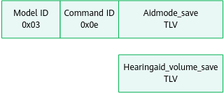

-   应答帧结构：
    -   返回成功：

        

    -   返回失败：

        

### 助听验配过程事件上报<a name="ZH-CN_TOPIC_0000001554623873"></a>

**表 1**  助听验配过程事件上报字段描述

<a name="table12635154162"></a>
<table><thead align="left"><tr id="row112791515181616"><th class="cellrowborder" valign="top" width="13.33%" id="mcps1.2.8.1.1"><p id="p827911531619"><a name="p827911531619"></a><a name="p827911531619"></a>字段名称</p>
</th>
<th class="cellrowborder" valign="top" width="10.42%" id="mcps1.2.8.1.2"><p id="p152798152167"><a name="p152798152167"></a><a name="p152798152167"></a>Type(bit0～bit6)</p>
</th>
<th class="cellrowborder" valign="top" width="14.32%" id="mcps1.2.8.1.3"><p id="p112796158167"><a name="p112796158167"></a><a name="p112796158167"></a>Length Size(Oct)</p>
</th>
<th class="cellrowborder" valign="top" width="12.479999999999999%" id="mcps1.2.8.1.4"><p id="p1728011511611"><a name="p1728011511611"></a><a name="p1728011511611"></a>Value数据类型</p>
</th>
<th class="cellrowborder" valign="top" width="22.79%" id="mcps1.2.8.1.5"><p id="p82801715151618"><a name="p82801715151618"></a><a name="p82801715151618"></a>说明</p>
</th>
<th class="cellrowborder" valign="top" width="14.610000000000001%" id="mcps1.2.8.1.6"><p id="p928081591610"><a name="p928081591610"></a><a name="p928081591610"></a>必选/可选（M/O）</p>
</th>
<th class="cellrowborder" valign="top" width="12.049999999999999%" id="mcps1.2.8.1.7"><p id="p192804159169"><a name="p192804159169"></a><a name="p192804159169"></a>版本</p>
</th>
</tr>
</thead>
<tbody><tr id="row122801115191616"><td class="cellrowborder" valign="top" width="13.33%" headers="mcps1.2.8.1.1 "><p id="p132801515111617"><a name="p132801515111617"></a><a name="p132801515111617"></a>Telephone_event</p>
</td>
<td class="cellrowborder" valign="top" width="10.42%" headers="mcps1.2.8.1.2 "><p id="p1028041551614"><a name="p1028041551614"></a><a name="p1028041551614"></a>0x1</p>
</td>
<td class="cellrowborder" valign="top" width="14.32%" headers="mcps1.2.8.1.3 "><p id="p42805156165"><a name="p42805156165"></a><a name="p42805156165"></a>1</p>
</td>
<td class="cellrowborder" valign="top" width="12.479999999999999%" headers="mcps1.2.8.1.4 "><p id="p17280915191612"><a name="p17280915191612"></a><a name="p17280915191612"></a>uint8</p>
</td>
<td class="cellrowborder" valign="top" width="22.79%" headers="mcps1.2.8.1.5 "><p id="p152807159164"><a name="p152807159164"></a><a name="p152807159164"></a>助听验配过程中，出现打断或者干扰验配的事件，需要上报给验配师：</p>
<a name="ul15360181133715"></a><a name="ul15360181133715"></a><ul id="ul15360181133715"><li>1：来电提醒</li><li>2：通话中</li><li>3：通话结束</li></ul>
</td>
<td class="cellrowborder" valign="top" width="14.610000000000001%" headers="mcps1.2.8.1.6 "><p id="p928081561619"><a name="p928081561619"></a><a name="p928081561619"></a>O</p>
</td>
<td class="cellrowborder" valign="top" width="12.049999999999999%" headers="mcps1.2.8.1.7 "><p id="p182807151165"><a name="p182807151165"></a><a name="p182807151165"></a>1.0/1.0</p>
</td>
</tr>
</tbody>
</table>

> **说明：** 
>助听验配过程中，给予验配师最大的权限，不对除“生产”和“升级”以外的其他事件进行屏蔽， 但是对其过程中产生的干扰事件需上报给验配师知晓，以决定后续操作。具体干扰事件，由厂家自行定义。

-   请求帧结构：

    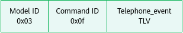

-   应答帧结构：
    -   返回成功：

        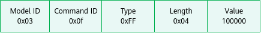

    -   返回失败：

        

### 助听业务查询<a name="ZH-CN_TOPIC_0000001510938232"></a>

**表 1**  助听业务查询字段描述

<a name="table3724104115453"></a>
<table><thead align="left"><tr id="row107496410455"><th class="cellrowborder" valign="top" width="13.33%" id="mcps1.2.8.1.1"><p id="p1774994113452"><a name="p1774994113452"></a><a name="p1774994113452"></a>字段名称</p>
</th>
<th class="cellrowborder" valign="top" width="10.42%" id="mcps1.2.8.1.2"><p id="p117491418451"><a name="p117491418451"></a><a name="p117491418451"></a>Type(bit0～bit6)</p>
</th>
<th class="cellrowborder" valign="top" width="14.32%" id="mcps1.2.8.1.3"><p id="p274944134518"><a name="p274944134518"></a><a name="p274944134518"></a>Length Size(Oct)</p>
</th>
<th class="cellrowborder" valign="top" width="12.479999999999999%" id="mcps1.2.8.1.4"><p id="p1774944118458"><a name="p1774944118458"></a><a name="p1774944118458"></a>Value数据类型</p>
</th>
<th class="cellrowborder" valign="top" width="22.79%" id="mcps1.2.8.1.5"><p id="p774954110450"><a name="p774954110450"></a><a name="p774954110450"></a>说明</p>
</th>
<th class="cellrowborder" valign="top" width="14.610000000000001%" id="mcps1.2.8.1.6"><p id="p12749154164511"><a name="p12749154164511"></a><a name="p12749154164511"></a>必选/可选（M/O）</p>
</th>
<th class="cellrowborder" valign="top" width="12.049999999999999%" id="mcps1.2.8.1.7"><p id="p1674964110458"><a name="p1674964110458"></a><a name="p1674964110458"></a>版本</p>
</th>
</tr>
</thead>
<tbody><tr id="row37491641194514"><td class="cellrowborder" valign="top" width="13.33%" headers="mcps1.2.8.1.1 "><p id="p16749204134519"><a name="p16749204134519"></a><a name="p16749204134519"></a>Hearingaid_mode_get</p>
</td>
<td class="cellrowborder" valign="top" width="10.42%" headers="mcps1.2.8.1.2 "><p id="p127499412454"><a name="p127499412454"></a><a name="p127499412454"></a>0x01</p>
</td>
<td class="cellrowborder" valign="top" width="14.32%" headers="mcps1.2.8.1.3 "><p id="p17749341114513"><a name="p17749341114513"></a><a name="p17749341114513"></a>1</p>
</td>
<td class="cellrowborder" valign="top" width="12.479999999999999%" headers="mcps1.2.8.1.4 "><p id="p1474912410450"><a name="p1474912410450"></a><a name="p1474912410450"></a>uint8</p>
</td>
<td class="cellrowborder" valign="top" width="22.79%" headers="mcps1.2.8.1.5 "><p id="p15749144144514"><a name="p15749144144514"></a><a name="p15749144144514"></a>助听模式查询，算法和产品确定不同的模式参数，此命令可以查询对应的模式序列号：</p>
<a name="ul1648122483912"></a><a name="ul1648122483912"></a><ul id="ul1648122483912"><li>0：自动检测模式</li><li>1：模式1</li><li>2：模式2</li><li>3：模式3</li><li>4：模式4</li><li>5：模式5</li><li>6～10：模式6～模式10</li></ul>
</td>
<td class="cellrowborder" valign="top" width="14.610000000000001%" headers="mcps1.2.8.1.6 "><p id="p374912418458"><a name="p374912418458"></a><a name="p374912418458"></a>O</p>
</td>
<td class="cellrowborder" valign="top" width="12.049999999999999%" headers="mcps1.2.8.1.7 "><p id="p16749164113456"><a name="p16749164113456"></a><a name="p16749164113456"></a>1.0/1.0</p>
</td>
</tr>
<tr id="row17738163743213"><td class="cellrowborder" valign="top" width="13.33%" headers="mcps1.2.8.1.1 "><p id="p373810372329"><a name="p373810372329"></a><a name="p373810372329"></a>Audio_aid_mix_get</p>
</td>
<td class="cellrowborder" valign="top" width="10.42%" headers="mcps1.2.8.1.2 "><p id="p1173814379329"><a name="p1173814379329"></a><a name="p1173814379329"></a>0x02</p>
</td>
<td class="cellrowborder" valign="top" width="14.32%" headers="mcps1.2.8.1.3 "><p id="p973863714324"><a name="p973863714324"></a><a name="p973863714324"></a>1</p>
</td>
<td class="cellrowborder" valign="top" width="12.479999999999999%" headers="mcps1.2.8.1.4 "><p id="p167381376327"><a name="p167381376327"></a><a name="p167381376327"></a>uint8</p>
</td>
<td class="cellrowborder" valign="top" width="22.79%" headers="mcps1.2.8.1.5 "><p id="p18738163714322"><a name="p18738163714322"></a><a name="p18738163714322"></a>音频和助听混音模式查询：（参数根据“<a href="#ZH-CN_TOPIC_0000001542572813">5.3.5-混音模式设置</a>” 确定）</p>
<a name="ul78421321184515"></a><a name="ul78421321184515"></a><ul id="ul78421321184515"><li>1：蓝牙音频（蓝牙通话和音乐）和助听模式混音。</li><li>2：蓝牙音频（蓝牙通话和音乐）和助听模式互斥。</li><li>3：蓝牙通话和助听模式混音，音乐和助听模式互斥。</li><li>4：蓝牙音乐和助听模式混音，蓝牙通话和助听模式互。</li></ul>
</td>
<td class="cellrowborder" valign="top" width="14.610000000000001%" headers="mcps1.2.8.1.6 "><p id="p54782524019"><a name="p54782524019"></a><a name="p54782524019"></a>O</p>
</td>
<td class="cellrowborder" valign="top" width="12.049999999999999%" headers="mcps1.2.8.1.7 "><p id="p144783510408"><a name="p144783510408"></a><a name="p144783510408"></a>1.0/1.0</p>
</td>
</tr>
<tr id="row1985014484514"><td class="cellrowborder" valign="top" width="13.33%" headers="mcps1.2.8.1.1 "><p id="p4653155815213"><a name="p4653155815213"></a><a name="p4653155815213"></a>BTmusic_adjust_get</p>
</td>
<td class="cellrowborder" valign="top" width="10.42%" headers="mcps1.2.8.1.2 "><p id="p59713419315"><a name="p59713419315"></a><a name="p59713419315"></a>0x03</p>
</td>
<td class="cellrowborder" valign="top" width="14.32%" headers="mcps1.2.8.1.3 "><p id="p14971734539"><a name="p14971734539"></a><a name="p14971734539"></a>1</p>
</td>
<td class="cellrowborder" valign="top" width="12.479999999999999%" headers="mcps1.2.8.1.4 "><p id="p17977343312"><a name="p17977343312"></a><a name="p17977343312"></a>uint8</p>
</td>
<td class="cellrowborder" valign="top" width="22.79%" headers="mcps1.2.8.1.5 "><p id="p49713344312"><a name="p49713344312"></a><a name="p49713344312"></a>蓝牙音乐是否通过助听参数调节查询：</p>
<a name="ul597163415319"></a><a name="ul597163415319"></a><ul id="ul597163415319"><li>1：不通过助听参数调节蓝牙音乐。</li><li>2：通过助听参数调节蓝牙音乐。</li></ul>
</td>
<td class="cellrowborder" valign="top" width="14.610000000000001%" headers="mcps1.2.8.1.6 "><p id="p169753414313"><a name="p169753414313"></a><a name="p169753414313"></a>O</p>
</td>
<td class="cellrowborder" valign="top" width="12.049999999999999%" headers="mcps1.2.8.1.7 "><p id="p99713343316"><a name="p99713343316"></a><a name="p99713343316"></a>1.0/1.0</p>
</td>
</tr>
<tr id="row1875911538515"><td class="cellrowborder" valign="top" width="13.33%" headers="mcps1.2.8.1.1 "><p id="p198681307413"><a name="p198681307413"></a><a name="p198681307413"></a>call_adjust_get</p>
</td>
<td class="cellrowborder" valign="top" width="10.42%" headers="mcps1.2.8.1.2 "><p id="p1397123412318"><a name="p1397123412318"></a><a name="p1397123412318"></a>0x04</p>
</td>
<td class="cellrowborder" valign="top" width="14.32%" headers="mcps1.2.8.1.3 "><p id="p1797434535"><a name="p1797434535"></a><a name="p1797434535"></a>1</p>
</td>
<td class="cellrowborder" valign="top" width="12.479999999999999%" headers="mcps1.2.8.1.4 "><p id="p189713343316"><a name="p189713343316"></a><a name="p189713343316"></a>uint8</p>
</td>
<td class="cellrowborder" valign="top" width="22.79%" headers="mcps1.2.8.1.5 "><p id="p139718344318"><a name="p139718344318"></a><a name="p139718344318"></a>通话音频是否通过助听参数调节查询：</p>
<a name="ul209703417312"></a><a name="ul209703417312"></a><ul id="ul209703417312"><li>1：不通过助听参数调节通话音频。</li><li>2：通过助听参数调节通话音频。</li></ul>
</td>
<td class="cellrowborder" valign="top" width="14.610000000000001%" headers="mcps1.2.8.1.6 "><p id="p89715344312"><a name="p89715344312"></a><a name="p89715344312"></a>O</p>
</td>
<td class="cellrowborder" valign="top" width="12.049999999999999%" headers="mcps1.2.8.1.7 "><p id="p189713341938"><a name="p189713341938"></a><a name="p189713341938"></a>1.0/1.</p>
</td>
</tr>
<tr id="row12821158133715"><td class="cellrowborder" valign="top" width="13.33%" headers="mcps1.2.8.1.1 "><p id="p05908285010"><a name="p05908285010"></a><a name="p05908285010"></a>Hearingaid_mode_mask_get</p>
</td>
<td class="cellrowborder" valign="top" width="10.42%" headers="mcps1.2.8.1.2 "><p id="p85918282014"><a name="p85918282014"></a><a name="p85918282014"></a>0x05</p>
</td>
<td class="cellrowborder" valign="top" width="14.32%" headers="mcps1.2.8.1.3 "><p id="p15912287016"><a name="p15912287016"></a><a name="p15912287016"></a>2</p>
</td>
<td class="cellrowborder" valign="top" width="12.479999999999999%" headers="mcps1.2.8.1.4 "><p id="p3591182812013"><a name="p3591182812013"></a><a name="p3591182812013"></a>uint16</p>
</td>
<td class="cellrowborder" valign="top" width="22.79%" headers="mcps1.2.8.1.5 "><p id="p18591202813018"><a name="p18591202813018"></a><a name="p18591202813018"></a>使用掩码设置助听模式的有效性，从低到高位每bit代表一个助听模式（最低位为“自动检测模式”），每bit位的值表示该模式的有效性：（请参见“<a href="#ZH-CN_TOPIC_0000001542452613">助听模式设置</a>”的使用，与Type0x01=Hearingaid_mode_get一起使用）。</p>
<a name="ul1669583871916"></a><a name="ul1669583871916"></a><ul id="ul1669583871916"><li>每bit值＝0：代表该模式不生效，用户无法设置耳机到该模式。</li><li>每bit值＝1：代表该模式生效，用户可以设置耳机到该模式。</li></ul>
</td>
<td class="cellrowborder" valign="top" width="14.610000000000001%" headers="mcps1.2.8.1.6 "><p id="p11591028303"><a name="p11591028303"></a><a name="p11591028303"></a>O</p>
</td>
<td class="cellrowborder" valign="top" width="12.049999999999999%" headers="mcps1.2.8.1.7 "><p id="p2591112812018"><a name="p2591112812018"></a><a name="p2591112812018"></a>1.0/1.0</p>
</td>
</tr>
<tr id="row033272815185"><td class="cellrowborder" valign="top" width="13.33%" headers="mcps1.2.8.1.1 "><p id="p1572415519476"><a name="p1572415519476"></a><a name="p1572415519476"></a>Hearingaid_volume_count_get</p>
</td>
<td class="cellrowborder" valign="top" width="10.42%" headers="mcps1.2.8.1.2 "><p id="p17426131714321"><a name="p17426131714321"></a><a name="p17426131714321"></a>0x06</p>
</td>
<td class="cellrowborder" valign="top" width="14.32%" headers="mcps1.2.8.1.3 "><p id="p9426121717329"><a name="p9426121717329"></a><a name="p9426121717329"></a>2</p>
</td>
<td class="cellrowborder" valign="top" width="12.479999999999999%" headers="mcps1.2.8.1.4 "><p id="p1015816157440"><a name="p1015816157440"></a><a name="p1015816157440"></a>uint16</p>
</td>
<td class="cellrowborder" valign="top" width="22.79%" headers="mcps1.2.8.1.5 "><p id="p1148510337149"><a name="p1148510337149"></a><a name="p1148510337149"></a>获取设备中助听音量的可调解总阶数（范围：≤20，且≥1）。</p>
</td>
<td class="cellrowborder" valign="top" width="14.610000000000001%" headers="mcps1.2.8.1.6 "><p id="p1342661783214"><a name="p1342661783214"></a><a name="p1342661783214"></a>O</p>
</td>
<td class="cellrowborder" valign="top" width="12.049999999999999%" headers="mcps1.2.8.1.7 "><p id="p17426101723213"><a name="p17426101723213"></a><a name="p17426101723213"></a>1.0/1.0</p>
</td>
</tr>
<tr id="row21254347184"><td class="cellrowborder" valign="top" width="13.33%" headers="mcps1.2.8.1.1 "><p id="p1330415112496"><a name="p1330415112496"></a><a name="p1330415112496"></a>Hearingaid_volume_default_No_get</p>
</td>
<td class="cellrowborder" valign="top" width="10.42%" headers="mcps1.2.8.1.2 "><p id="p15304171124913"><a name="p15304171124913"></a><a name="p15304171124913"></a>0x07</p>
</td>
<td class="cellrowborder" valign="top" width="14.32%" headers="mcps1.2.8.1.3 "><p id="p8304191112491"><a name="p8304191112491"></a><a name="p8304191112491"></a>2</p>
</td>
<td class="cellrowborder" valign="top" width="12.479999999999999%" headers="mcps1.2.8.1.4 "><p id="p1530419116494"><a name="p1530419116494"></a><a name="p1530419116494"></a>uint16</p>
</td>
<td class="cellrowborder" valign="top" width="22.79%" headers="mcps1.2.8.1.5 "><p id="p83041511104911"><a name="p83041511104911"></a><a name="p83041511104911"></a>获取默认的助听音量阶数（表示助听音量数组中第几阶为默认助听音量）。</p>
</td>
<td class="cellrowborder" valign="top" width="14.610000000000001%" headers="mcps1.2.8.1.6 "><p id="p8304181184919"><a name="p8304181184919"></a><a name="p8304181184919"></a>O</p>
</td>
<td class="cellrowborder" valign="top" width="12.049999999999999%" headers="mcps1.2.8.1.7 "><p id="p0304191116498"><a name="p0304191116498"></a><a name="p0304191116498"></a>1.0/1.0</p>
</td>
</tr>
<tr id="row85501437131817"><td class="cellrowborder" valign="top" width="13.33%" headers="mcps1.2.8.1.1 "><p id="p17304101134913"><a name="p17304101134913"></a><a name="p17304101134913"></a>Hearingaid_volume_group_get</p>
</td>
<td class="cellrowborder" valign="top" width="10.42%" headers="mcps1.2.8.1.2 "><p id="p6304171164920"><a name="p6304171164920"></a><a name="p6304171164920"></a>0x08</p>
</td>
<td class="cellrowborder" valign="top" width="14.32%" headers="mcps1.2.8.1.3 "><p id="p1830420119492"><a name="p1830420119492"></a><a name="p1830420119492"></a>N</p>
</td>
<td class="cellrowborder" valign="top" width="12.479999999999999%" headers="mcps1.2.8.1.4 "><p id="p133041611104915"><a name="p133041611104915"></a><a name="p133041611104915"></a>int32</p>
</td>
<td class="cellrowborder" valign="top" width="22.79%" headers="mcps1.2.8.1.5 "><p id="p930511112491"><a name="p930511112491"></a><a name="p930511112491"></a>获取助听音量数组设置，为减少复杂度，请由小到大排序音量。（音量单位为0.001dB，如：以设置音量为2.13dB为例，下发的参数为2130）。</p>
</td>
<td class="cellrowborder" valign="top" width="14.610000000000001%" headers="mcps1.2.8.1.6 "><p id="p143051811114920"><a name="p143051811114920"></a><a name="p143051811114920"></a>O</p>
</td>
<td class="cellrowborder" valign="top" width="12.049999999999999%" headers="mcps1.2.8.1.7 "><p id="p430561119498"><a name="p430561119498"></a><a name="p430561119498"></a>1.0/1.0</p>
</td>
</tr>
<tr id="row34032391235"><td class="cellrowborder" valign="top" width="13.33%" headers="mcps1.2.8.1.1 "><p id="p640393914317"><a name="p640393914317"></a><a name="p640393914317"></a>Hearingaid_get</p>
</td>
<td class="cellrowborder" valign="top" width="10.42%" headers="mcps1.2.8.1.2 "><p id="p164031939136"><a name="p164031939136"></a><a name="p164031939136"></a>0x09</p>
</td>
<td class="cellrowborder" valign="top" width="14.32%" headers="mcps1.2.8.1.3 "><p id="p124031639436"><a name="p124031639436"></a><a name="p124031639436"></a>1</p>
</td>
<td class="cellrowborder" valign="top" width="12.479999999999999%" headers="mcps1.2.8.1.4 "><p id="p12403203916319"><a name="p12403203916319"></a><a name="p12403203916319"></a>uint8</p>
</td>
<td class="cellrowborder" valign="top" width="22.79%" headers="mcps1.2.8.1.5 "><p id="p940315391433"><a name="p940315391433"></a><a name="p940315391433"></a>查询助听功能是否开启状态：</p>
<a name="ul186031944246"></a><a name="ul186031944246"></a><ul id="ul186031944246"><li>1：助听功能开启。</li><li>2：助听功能关闭。</li></ul>
</td>
<td class="cellrowborder" valign="top" width="14.610000000000001%" headers="mcps1.2.8.1.6 "><p id="p12968281357"><a name="p12968281357"></a><a name="p12968281357"></a>O</p>
</td>
<td class="cellrowborder" valign="top" width="12.049999999999999%" headers="mcps1.2.8.1.7 "><p id="p10968181550"><a name="p10968181550"></a><a name="p10968181550"></a>1.0/1.0</p>
</td>
</tr>
<tr id="row14769204275516"><td class="cellrowborder" valign="top" width="13.33%" headers="mcps1.2.8.1.1 "><p id="p15769942125513"><a name="p15769942125513"></a><a name="p15769942125513"></a>Hearingaid_Whistle_Calib_Get</p>
</td>
<td class="cellrowborder" valign="top" width="10.42%" headers="mcps1.2.8.1.2 "><p id="p1676964212553"><a name="p1676964212553"></a><a name="p1676964212553"></a>0x0A</p>
</td>
<td class="cellrowborder" valign="top" width="14.32%" headers="mcps1.2.8.1.3 "><p id="p187701742115515"><a name="p187701742115515"></a><a name="p187701742115515"></a>1</p>
</td>
<td class="cellrowborder" valign="top" width="12.479999999999999%" headers="mcps1.2.8.1.4 "><p id="p12770144210553"><a name="p12770144210553"></a><a name="p12770144210553"></a>uint8</p>
</td>
<td class="cellrowborder" valign="top" width="22.79%" headers="mcps1.2.8.1.5 "><p id="p1888710246013"><a name="p1888710246013"></a><a name="p1888710246013"></a>查询设备是否在“助听啸叫校准”状态中：</p>
<a name="ul2088716241300"></a><a name="ul2088716241300"></a><ul id="ul2088716241300"><li>1：未开启助听啸叫校准业务。</li><li>2：正在进行助听啸叫校准业务。</li></ul>
</td>
<td class="cellrowborder" valign="top" width="14.610000000000001%" headers="mcps1.2.8.1.6 "><p id="p97701242135518"><a name="p97701242135518"></a><a name="p97701242135518"></a>O</p>
</td>
<td class="cellrowborder" valign="top" width="12.049999999999999%" headers="mcps1.2.8.1.7 "><p id="p16770442135510"><a name="p16770442135510"></a><a name="p16770442135510"></a>1.0/1.0</p>
</td>
</tr>
</tbody>
</table>

> **说明：** 
>其他Type=0x06 0x07 0x08根据“[助听音量调节参数设置](#ZH-CN_TOPIC_0000001491852776)”章节定义，同时尽量一起使用。

-   请求帧结构：

    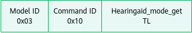

-   应答帧结构：
    -   返回成功：

        

    -   返回失败：

        

### 音频调节设置查询<a name="ZH-CN_TOPIC_0000001608182877"></a>

**表 1**  音频调节设置字段描述

<a name="table1450317281000"></a>
<table><thead align="left"><tr id="row12590228103"><th class="cellrowborder" valign="top" width="13.33%" id="mcps1.2.8.1.1"><p id="p1059010281207"><a name="p1059010281207"></a><a name="p1059010281207"></a>字段名称</p>
</th>
<th class="cellrowborder" valign="top" width="10.42%" id="mcps1.2.8.1.2"><p id="p1059018286020"><a name="p1059018286020"></a><a name="p1059018286020"></a>Type(bit0~bit6)</p>
</th>
<th class="cellrowborder" valign="top" width="14.32%" id="mcps1.2.8.1.3"><p id="p1759013285020"><a name="p1759013285020"></a><a name="p1759013285020"></a>Length Size(Oct)</p>
</th>
<th class="cellrowborder" valign="top" width="12.479999999999999%" id="mcps1.2.8.1.4"><p id="p2590122811011"><a name="p2590122811011"></a><a name="p2590122811011"></a>Value数据类型</p>
</th>
<th class="cellrowborder" valign="top" width="22.79%" id="mcps1.2.8.1.5"><p id="p3590162813016"><a name="p3590162813016"></a><a name="p3590162813016"></a>说明</p>
</th>
<th class="cellrowborder" valign="top" width="14.610000000000001%" id="mcps1.2.8.1.6"><p id="p19590628602"><a name="p19590628602"></a><a name="p19590628602"></a>必选/可选（M/O）</p>
</th>
<th class="cellrowborder" valign="top" width="12.049999999999999%" id="mcps1.2.8.1.7"><p id="p155907284014"><a name="p155907284014"></a><a name="p155907284014"></a>版本</p>
</th>
</tr>
</thead>
<tbody><tr id="row7590112820013"><td class="cellrowborder" valign="top" width="13.33%" headers="mcps1.2.8.1.1 "><p id="p05908285010"><a name="p05908285010"></a><a name="p05908285010"></a>BTmusic_adjust</p>
</td>
<td class="cellrowborder" valign="top" width="10.42%" headers="mcps1.2.8.1.2 "><p id="p85918282014"><a name="p85918282014"></a><a name="p85918282014"></a>0x01</p>
</td>
<td class="cellrowborder" valign="top" width="14.32%" headers="mcps1.2.8.1.3 "><p id="p15912287016"><a name="p15912287016"></a><a name="p15912287016"></a>1</p>
</td>
<td class="cellrowborder" valign="top" width="12.479999999999999%" headers="mcps1.2.8.1.4 "><p id="p3591182812013"><a name="p3591182812013"></a><a name="p3591182812013"></a>uint8</p>
</td>
<td class="cellrowborder" valign="top" width="22.79%" headers="mcps1.2.8.1.5 "><p id="p18591202813018"><a name="p18591202813018"></a><a name="p18591202813018"></a>设置蓝牙音乐是否通过助听参数调节：</p>
<a name="ul1669583871916"></a><a name="ul1669583871916"></a><ul id="ul1669583871916"><li>1：不通过助听参数调节蓝牙音乐。</li><li>2：通过助听参数调节蓝牙音乐。</li></ul>
</td>
<td class="cellrowborder" valign="top" width="14.610000000000001%" headers="mcps1.2.8.1.6 "><p id="p11591028303"><a name="p11591028303"></a><a name="p11591028303"></a>O</p>
</td>
<td class="cellrowborder" valign="top" width="12.049999999999999%" headers="mcps1.2.8.1.7 "><p id="p2591112812018"><a name="p2591112812018"></a><a name="p2591112812018"></a>1.0/1.0</p>
</td>
</tr>
<tr id="row155919282013"><td class="cellrowborder" valign="top" width="13.33%" headers="mcps1.2.8.1.1 "><p id="p1059115283010"><a name="p1059115283010"></a><a name="p1059115283010"></a>call_adjust</p>
</td>
<td class="cellrowborder" valign="top" width="10.42%" headers="mcps1.2.8.1.2 "><p id="p135911728506"><a name="p135911728506"></a><a name="p135911728506"></a>0x02</p>
</td>
<td class="cellrowborder" valign="top" width="14.32%" headers="mcps1.2.8.1.3 "><p id="p95911728505"><a name="p95911728505"></a><a name="p95911728505"></a>1</p>
</td>
<td class="cellrowborder" valign="top" width="12.479999999999999%" headers="mcps1.2.8.1.4 "><p id="p15915282013"><a name="p15915282013"></a><a name="p15915282013"></a>uint8</p>
</td>
<td class="cellrowborder" valign="top" width="22.79%" headers="mcps1.2.8.1.5 "><p id="p1591928406"><a name="p1591928406"></a><a name="p1591928406"></a>设置通话音频是否通过助听参数调节：</p>
<a name="ul72341142151912"></a><a name="ul72341142151912"></a><ul id="ul72341142151912"><li>1：不通过助听参数调节通话音频。</li><li>2：通过助听参数调节通话音频。</li></ul>
</td>
<td class="cellrowborder" valign="top" width="14.610000000000001%" headers="mcps1.2.8.1.6 "><p id="p85916281013"><a name="p85916281013"></a><a name="p85916281013"></a>O</p>
</td>
<td class="cellrowborder" valign="top" width="12.049999999999999%" headers="mcps1.2.8.1.7 "><p id="p115913281108"><a name="p115913281108"></a><a name="p115913281108"></a>1.0/1.0</p>
</td>
</tr>
</tbody>
</table>

-   请求帧结构：

    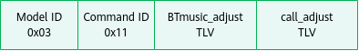

-   应答帧结构：
    -   返回成功：

        

    -   返回失败：

        

        > **说明：** 
        >单独发送Type=0x01或者Type=0x02指令，只能单独设置蓝牙音乐是否通过助听参数调节，或者单独设置蓝牙通话是否通过助听参数调节。如果需要一起设置蓝牙音乐和蓝牙通话，需要在一条指令同时下发Type=0x01和Type=0x02的配置。

### 生产测试业务<a name="ZH-CN_TOPIC_0000001760267769"></a>

**表 1**  生产测试业务字段描述

<a name="table1450317281000"></a>
<table><thead align="left"><tr id="row12590228103"><th class="cellrowborder" valign="top" width="13.33%" id="mcps1.2.8.1.1"><p id="p1059010281207"><a name="p1059010281207"></a><a name="p1059010281207"></a>字段名称</p>
</th>
<th class="cellrowborder" valign="top" width="10.42%" id="mcps1.2.8.1.2"><p id="p1059018286020"><a name="p1059018286020"></a><a name="p1059018286020"></a>Type(bit0~bit6)</p>
</th>
<th class="cellrowborder" valign="top" width="14.32%" id="mcps1.2.8.1.3"><p id="p1759013285020"><a name="p1759013285020"></a><a name="p1759013285020"></a>Length Size(Oct)</p>
</th>
<th class="cellrowborder" valign="top" width="12.479999999999999%" id="mcps1.2.8.1.4"><p id="p2590122811011"><a name="p2590122811011"></a><a name="p2590122811011"></a>Value数据类型</p>
</th>
<th class="cellrowborder" valign="top" width="22.79%" id="mcps1.2.8.1.5"><p id="p3590162813016"><a name="p3590162813016"></a><a name="p3590162813016"></a>说明</p>
</th>
<th class="cellrowborder" valign="top" width="14.610000000000001%" id="mcps1.2.8.1.6"><p id="p19590628602"><a name="p19590628602"></a><a name="p19590628602"></a>必选/可选（M/O）</p>
</th>
<th class="cellrowborder" valign="top" width="12.049999999999999%" id="mcps1.2.8.1.7"><p id="p155907284014"><a name="p155907284014"></a><a name="p155907284014"></a>版本</p>
</th>
</tr>
</thead>
<tbody><tr id="row7590112820013"><td class="cellrowborder" valign="top" width="13.33%" headers="mcps1.2.8.1.1 "><p id="p05908285010"><a name="p05908285010"></a><a name="p05908285010"></a>Hearingaid_Medical_test_set</p>
</td>
<td class="cellrowborder" valign="top" width="10.42%" headers="mcps1.2.8.1.2 "><p id="p85918282014"><a name="p85918282014"></a><a name="p85918282014"></a>0x01</p>
</td>
<td class="cellrowborder" valign="top" width="14.32%" headers="mcps1.2.8.1.3 "><p id="p15912287016"><a name="p15912287016"></a><a name="p15912287016"></a>1</p>
</td>
<td class="cellrowborder" valign="top" width="12.479999999999999%" headers="mcps1.2.8.1.4 "><p id="p3591182812013"><a name="p3591182812013"></a><a name="p3591182812013"></a>uint8</p>
</td>
<td class="cellrowborder" valign="top" width="22.79%" headers="mcps1.2.8.1.5 "><p id="p18591202813018"><a name="p18591202813018"></a><a name="p18591202813018"></a>助听医规测试控制：</p>
<a name="ul1669583871916"></a><a name="ul1669583871916"></a><ul id="ul1669583871916"><li>1：开启助听医规测试。</li><li>2：关闭助听医规测试。</li></ul>
</td>
<td class="cellrowborder" valign="top" width="14.610000000000001%" headers="mcps1.2.8.1.6 "><p id="p11591028303"><a name="p11591028303"></a><a name="p11591028303"></a>O</p>
</td>
<td class="cellrowborder" valign="top" width="12.049999999999999%" headers="mcps1.2.8.1.7 "><p id="p2591112812018"><a name="p2591112812018"></a><a name="p2591112812018"></a>1.0/1.0</p>
</td>
</tr>
<tr id="row89751510315"><td class="cellrowborder" valign="top" width="13.33%" headers="mcps1.2.8.1.1 "><p id="p117689291138"><a name="p117689291138"></a><a name="p117689291138"></a>Hearingaid_Medical_test_get</p>
</td>
<td class="cellrowborder" valign="top" width="10.42%" headers="mcps1.2.8.1.2 "><p id="p176817295320"><a name="p176817295320"></a><a name="p176817295320"></a>0x02</p>
</td>
<td class="cellrowborder" valign="top" width="14.32%" headers="mcps1.2.8.1.3 "><p id="p147687291536"><a name="p147687291536"></a><a name="p147687291536"></a>1</p>
</td>
<td class="cellrowborder" valign="top" width="12.479999999999999%" headers="mcps1.2.8.1.4 "><p id="p4768142914314"><a name="p4768142914314"></a><a name="p4768142914314"></a>uint8</p>
</td>
<td class="cellrowborder" valign="top" width="22.79%" headers="mcps1.2.8.1.5 "><p id="p18768192910319"><a name="p18768192910319"></a><a name="p18768192910319"></a>查询是否进入助听医规测试：</p>
<a name="ul14768122919317"></a><a name="ul14768122919317"></a><ul id="ul14768122919317"><li>1：已经进入助听医规测试。</li><li>2：没有进入助听医规测试。</li></ul>
</td>
<td class="cellrowborder" valign="top" width="14.610000000000001%" headers="mcps1.2.8.1.6 "><p id="p13768172913311"><a name="p13768172913311"></a><a name="p13768172913311"></a>O</p>
</td>
<td class="cellrowborder" valign="top" width="12.049999999999999%" headers="mcps1.2.8.1.7 "><p id="p10768729435"><a name="p10768729435"></a><a name="p10768729435"></a>1.0/1.0</p>
</td>
</tr>
</tbody>
</table>

> **须知：** 
>该Command ID字段下业务主要用于生产测试，不能直接用于正常用户使用模式下，以免出现异常场景。
>注意Typ＝0x02时，是查询帧格式，不能使用设置帧格式。

-   请求帧结构：

    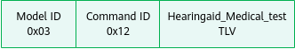

-   应答帧结构：
    -   返回成功：

        

    -   返回失败：

        

### 助听业务设置<a name="ZH-CN_TOPIC_0000001818601285"></a>

**表 1**  助听业务设置字段描述

<a name="table1450317281000"></a>
<table><thead align="left"><tr id="row12590228103"><th class="cellrowborder" valign="top" width="13.33%" id="mcps1.2.8.1.1"><p id="p1059010281207"><a name="p1059010281207"></a><a name="p1059010281207"></a>字段名称</p>
</th>
<th class="cellrowborder" valign="top" width="10.42%" id="mcps1.2.8.1.2"><p id="p1059018286020"><a name="p1059018286020"></a><a name="p1059018286020"></a>Type(bit0~bit6)</p>
</th>
<th class="cellrowborder" valign="top" width="14.32%" id="mcps1.2.8.1.3"><p id="p1759013285020"><a name="p1759013285020"></a><a name="p1759013285020"></a>Length Size(Oct)</p>
</th>
<th class="cellrowborder" valign="top" width="12.479999999999999%" id="mcps1.2.8.1.4"><p id="p2590122811011"><a name="p2590122811011"></a><a name="p2590122811011"></a>Value数据类型</p>
</th>
<th class="cellrowborder" valign="top" width="22.79%" id="mcps1.2.8.1.5"><p id="p3590162813016"><a name="p3590162813016"></a><a name="p3590162813016"></a>说明</p>
</th>
<th class="cellrowborder" valign="top" width="14.610000000000001%" id="mcps1.2.8.1.6"><p id="p19590628602"><a name="p19590628602"></a><a name="p19590628602"></a>必选/可选（M/O）</p>
</th>
<th class="cellrowborder" valign="top" width="12.049999999999999%" id="mcps1.2.8.1.7"><p id="p155907284014"><a name="p155907284014"></a><a name="p155907284014"></a>版本</p>
</th>
</tr>
</thead>
<tbody><tr id="row7590112820013"><td class="cellrowborder" valign="top" width="13.33%" headers="mcps1.2.8.1.1 "><p id="p05908285010"><a name="p05908285010"></a><a name="p05908285010"></a>Hearingaid_Open</p>
</td>
<td class="cellrowborder" valign="top" width="10.42%" headers="mcps1.2.8.1.2 "><p id="p85918282014"><a name="p85918282014"></a><a name="p85918282014"></a>0x01</p>
</td>
<td class="cellrowborder" valign="top" width="14.32%" headers="mcps1.2.8.1.3 "><p id="p15912287016"><a name="p15912287016"></a><a name="p15912287016"></a>1</p>
</td>
<td class="cellrowborder" valign="top" width="12.479999999999999%" headers="mcps1.2.8.1.4 "><p id="p3591182812013"><a name="p3591182812013"></a><a name="p3591182812013"></a>uint8</p>
</td>
<td class="cellrowborder" valign="top" width="22.79%" headers="mcps1.2.8.1.5 "><p id="p18591202813018"><a name="p18591202813018"></a><a name="p18591202813018"></a>控制助听功能开关：</p>
<a name="ul1669583871916"></a><a name="ul1669583871916"></a><ul id="ul1669583871916"><li>1：开启助听功能。</li><li>2：关闭助听功能。</li></ul>
</td>
<td class="cellrowborder" valign="top" width="14.610000000000001%" headers="mcps1.2.8.1.6 "><p id="p11591028303"><a name="p11591028303"></a><a name="p11591028303"></a>O</p>
</td>
<td class="cellrowborder" valign="top" width="12.049999999999999%" headers="mcps1.2.8.1.7 "><p id="p2591112812018"><a name="p2591112812018"></a><a name="p2591112812018"></a>1.0/1.0</p>
</td>
</tr>
<tr id="row11859174385219"><td class="cellrowborder" valign="top" width="13.33%" headers="mcps1.2.8.1.1 "><p id="p11859443115214"><a name="p11859443115214"></a><a name="p11859443115214"></a>Hearingaid_Whistle_Calib</p>
</td>
<td class="cellrowborder" valign="top" width="10.42%" headers="mcps1.2.8.1.2 "><p id="p88594431523"><a name="p88594431523"></a><a name="p88594431523"></a>0x02</p>
</td>
<td class="cellrowborder" valign="top" width="14.32%" headers="mcps1.2.8.1.3 "><p id="p19859184325219"><a name="p19859184325219"></a><a name="p19859184325219"></a>1</p>
</td>
<td class="cellrowborder" valign="top" width="12.479999999999999%" headers="mcps1.2.8.1.4 "><p id="p1859124313521"><a name="p1859124313521"></a><a name="p1859124313521"></a>uint8</p>
</td>
<td class="cellrowborder" valign="top" width="22.79%" headers="mcps1.2.8.1.5 "><p id="p10859154317525"><a name="p10859154317525"></a><a name="p10859154317525"></a>助听啸叫校准时间设置，单位：s。</p>
<p id="p14404182916244"><a name="p14404182916244"></a><a name="p14404182916244"></a>发送该命令时，表明开启助听啸叫校准，且校准时间由该字段设置。</p>
</td>
<td class="cellrowborder" valign="top" width="14.610000000000001%" headers="mcps1.2.8.1.6 "><p id="p118594438529"><a name="p118594438529"></a><a name="p118594438529"></a>O</p>
</td>
<td class="cellrowborder" valign="top" width="12.049999999999999%" headers="mcps1.2.8.1.7 "><p id="p0859154385215"><a name="p0859154385215"></a><a name="p0859154385215"></a>1.0/1.0</p>
</td>
</tr>
</tbody>
</table>

-   请求帧格式

    

-   应答帧格式
    -   返回成功

        

    -   返回失败

        

### 助听业务上报<a name="ZH-CN_TOPIC_0000001854932317"></a>

**表 1**  助听业务上报描述

<a name="table1450317281000"></a>
<table><thead align="left"><tr id="row12590228103"><th class="cellrowborder" valign="top" width="13.33%" id="mcps1.2.8.1.1"><p id="p1059010281207"><a name="p1059010281207"></a><a name="p1059010281207"></a>字段名称</p>
</th>
<th class="cellrowborder" valign="top" width="10.42%" id="mcps1.2.8.1.2"><p id="p1059018286020"><a name="p1059018286020"></a><a name="p1059018286020"></a>Type(bit0~bit6)</p>
</th>
<th class="cellrowborder" valign="top" width="14.32%" id="mcps1.2.8.1.3"><p id="p1759013285020"><a name="p1759013285020"></a><a name="p1759013285020"></a>Length Size(Oct)</p>
</th>
<th class="cellrowborder" valign="top" width="12.479999999999999%" id="mcps1.2.8.1.4"><p id="p2590122811011"><a name="p2590122811011"></a><a name="p2590122811011"></a>Value数据类型</p>
</th>
<th class="cellrowborder" valign="top" width="22.79%" id="mcps1.2.8.1.5"><p id="p3590162813016"><a name="p3590162813016"></a><a name="p3590162813016"></a>说明</p>
</th>
<th class="cellrowborder" valign="top" width="14.610000000000001%" id="mcps1.2.8.1.6"><p id="p19590628602"><a name="p19590628602"></a><a name="p19590628602"></a>必选/可选（M/O）</p>
</th>
<th class="cellrowborder" valign="top" width="12.049999999999999%" id="mcps1.2.8.1.7"><p id="p155907284014"><a name="p155907284014"></a><a name="p155907284014"></a>版本</p>
</th>
</tr>
</thead>
<tbody><tr id="row7590112820013"><td class="cellrowborder" valign="top" width="13.33%" headers="mcps1.2.8.1.1 "><p id="p05908285010"><a name="p05908285010"></a><a name="p05908285010"></a><span>Hearingaid_Whistle_Calib_Finish</span></p>
</td>
<td class="cellrowborder" valign="top" width="10.42%" headers="mcps1.2.8.1.2 "><p id="p85918282014"><a name="p85918282014"></a><a name="p85918282014"></a>0x01</p>
</td>
<td class="cellrowborder" valign="top" width="14.32%" headers="mcps1.2.8.1.3 "><p id="p15912287016"><a name="p15912287016"></a><a name="p15912287016"></a>1</p>
</td>
<td class="cellrowborder" valign="top" width="12.479999999999999%" headers="mcps1.2.8.1.4 "><p id="p3591182812013"><a name="p3591182812013"></a><a name="p3591182812013"></a>uint8</p>
</td>
<td class="cellrowborder" valign="top" width="22.79%" headers="mcps1.2.8.1.5 "><p id="p18591202813018"><a name="p18591202813018"></a><a name="p18591202813018"></a>助听啸叫校准设备主动上报业务状态：</p>
<a name="ul1669583871916"></a><a name="ul1669583871916"></a><ul id="ul1669583871916"><li>1：未开启助听啸叫校准业务。</li><li>2：正在进行助听啸叫校准业务。</li><li>3：助听啸叫校准业务已经完成。</li><li>4：助听啸叫校准业务失败。</li></ul>
</td>
<td class="cellrowborder" valign="top" width="14.610000000000001%" headers="mcps1.2.8.1.6 "><p id="p11591028303"><a name="p11591028303"></a><a name="p11591028303"></a>O</p>
</td>
<td class="cellrowborder" valign="top" width="12.049999999999999%" headers="mcps1.2.8.1.7 "><p id="p2591112812018"><a name="p2591112812018"></a><a name="p2591112812018"></a>1.0/1.0</p>
</td>
</tr>
</tbody>
</table>

-   请求帧格式

    

-   应答帧格式
    -   返回成功

        

    -   返回失败

        

## 助听参数配置<a name="ZH-CN_TOPIC_0000001542666893"></a>

-   **[指定模式下所有参数配置](#ZH-CN_TOPIC_0000001509611912)**  

-   **[指定模式下部分参数配置](#ZH-CN_TOPIC_0000001572999857)**  

-   **[指定模式下具体参数配置](#ZH-CN_TOPIC_0000001574026189)**  

-   **[私有参数配置](#ZH-CN_TOPIC_0000001605645653)**  

-   **[获取指定模式下助听参数](#ZH-CN_TOPIC_0000001557058438)**  

-   **[获取指定模式下部分助听参数](#ZH-CN_TOPIC_0000001759993761)**  

### 指定模式下所有参数配置<a name="ZH-CN_TOPIC_0000001509611912"></a>

**表 1**  指定模式下所有参数配置字段描述

<a name="table184004175322"></a>
<table><thead align="left"><tr id="row342521703216"><th class="cellrowborder" valign="top" width="13.320000000000002%" id="mcps1.2.8.1.1"><p id="p104251717203212"><a name="p104251717203212"></a><a name="p104251717203212"></a>字段名称</p>
</th>
<th class="cellrowborder" valign="top" width="10.43%" id="mcps1.2.8.1.2"><p id="p742610177321"><a name="p742610177321"></a><a name="p742610177321"></a>Type(bit0～bit6)</p>
</th>
<th class="cellrowborder" valign="top" width="14.32%" id="mcps1.2.8.1.3"><p id="p19426111783215"><a name="p19426111783215"></a><a name="p19426111783215"></a>Length Size(Oct)</p>
</th>
<th class="cellrowborder" valign="top" width="12.479999999999999%" id="mcps1.2.8.1.4"><p id="p15426171718328"><a name="p15426171718328"></a><a name="p15426171718328"></a>Value数据类型</p>
</th>
<th class="cellrowborder" valign="top" width="22.79%" id="mcps1.2.8.1.5"><p id="p9426181719326"><a name="p9426181719326"></a><a name="p9426181719326"></a>说明</p>
</th>
<th class="cellrowborder" valign="top" width="14.610000000000001%" id="mcps1.2.8.1.6"><p id="p1426181717324"><a name="p1426181717324"></a><a name="p1426181717324"></a>必选/可选（M/O）</p>
</th>
<th class="cellrowborder" valign="top" width="12.049999999999999%" id="mcps1.2.8.1.7"><p id="p14261117193213"><a name="p14261117193213"></a><a name="p14261117193213"></a>版本</p>
</th>
</tr>
</thead>
<tbody><tr id="row2426517193210"><td class="cellrowborder" valign="top" width="13.320000000000002%" headers="mcps1.2.8.1.1 "><p id="p24268176322"><a name="p24268176322"></a><a name="p24268176322"></a>Hearingaid_scene</p>
</td>
<td class="cellrowborder" valign="top" width="10.43%" headers="mcps1.2.8.1.2 "><p id="p17426131714321"><a name="p17426131714321"></a><a name="p17426131714321"></a>0x01</p>
</td>
<td class="cellrowborder" valign="top" width="14.32%" headers="mcps1.2.8.1.3 "><p id="p9426121717329"><a name="p9426121717329"></a><a name="p9426121717329"></a>1</p>
</td>
<td class="cellrowborder" valign="top" width="12.479999999999999%" headers="mcps1.2.8.1.4 "><p id="p1442618174329"><a name="p1442618174329"></a><a name="p1442618174329"></a>uint8</p>
</td>
<td class="cellrowborder" valign="top" width="22.79%" headers="mcps1.2.8.1.5 "><p id="p13233161319375"><a name="p13233161319375"></a><a name="p13233161319375"></a>助听模式</p>
</td>
<td class="cellrowborder" valign="top" width="14.610000000000001%" headers="mcps1.2.8.1.6 "><p id="p1342661783214"><a name="p1342661783214"></a><a name="p1342661783214"></a>M</p>
</td>
<td class="cellrowborder" valign="top" width="12.049999999999999%" headers="mcps1.2.8.1.7 "><p id="p17426101723213"><a name="p17426101723213"></a><a name="p17426101723213"></a>1.0/1.0</p>
</td>
</tr>
<tr id="row1510731611583"><td class="cellrowborder" valign="top" width="13.320000000000002%" headers="mcps1.2.8.1.1 "><p id="p252802011587"><a name="p252802011587"></a><a name="p252802011587"></a>Hearingaid_parameters</p>
</td>
<td class="cellrowborder" valign="top" width="10.43%" headers="mcps1.2.8.1.2 "><p id="p111071216145817"><a name="p111071216145817"></a><a name="p111071216145817"></a>0x02</p>
</td>
<td class="cellrowborder" valign="top" width="14.32%" headers="mcps1.2.8.1.3 "><p id="p121071168583"><a name="p121071168583"></a><a name="p121071168583"></a>助听参数的长度</p>
</td>
<td class="cellrowborder" valign="top" width="12.479999999999999%" headers="mcps1.2.8.1.4 "><p id="p97769817437"><a name="p97769817437"></a><a name="p97769817437"></a>uint8</p>
</td>
<td class="cellrowborder" valign="top" width="22.79%" headers="mcps1.2.8.1.5 "><p id="p210781625818"><a name="p210781625818"></a><a name="p210781625818"></a>指定助听模式下的参数</p>
</td>
<td class="cellrowborder" valign="top" width="14.610000000000001%" headers="mcps1.2.8.1.6 "><p id="p7531183610597"><a name="p7531183610597"></a><a name="p7531183610597"></a>M</p>
</td>
<td class="cellrowborder" valign="top" width="12.049999999999999%" headers="mcps1.2.8.1.7 "><p id="p105318365593"><a name="p105318365593"></a><a name="p105318365593"></a>1.0/1.0</p>
</td>
</tr>
</tbody>
</table>

-   请求帧结构：****

    

-   应答帧结构：
    -   返回成功：

        

    -   返回失败：

        

-   示例

    0x04,0x01,0x81,0x81,0x01,0x82,0x02,0x00,0x02,......（需要设置的助听参数）

    作用：配置模式1下的助听参数。

    > **说明：** 
    >助听参数长度：512Byte
    >助听的模式：
    >auto（自动识别场景）：0
    >transportation（交通场景）：1
    >socializing（社交场景）：2
    >party（聚会场景）：3
    >quiet（安静场景）：4
    >ext0（扩展场景0）：5
    >ext1（扩展场景1）：6
    >test（医规场景）：7

### 指定模式下部分参数配置<a name="ZH-CN_TOPIC_0000001572999857"></a>

**表 1**  指定模式下部分参数配置字段描述

<a name="table184004175322"></a>
<table><thead align="left"><tr id="row342521703216"><th class="cellrowborder" valign="top" width="13.33%" id="mcps1.2.8.1.1"><p id="p104251717203212"><a name="p104251717203212"></a><a name="p104251717203212"></a>字段名称</p>
</th>
<th class="cellrowborder" valign="top" width="10.42%" id="mcps1.2.8.1.2"><p id="p742610177321"><a name="p742610177321"></a><a name="p742610177321"></a>Type(bit0～bit6)</p>
</th>
<th class="cellrowborder" valign="top" width="14.32%" id="mcps1.2.8.1.3"><p id="p19426111783215"><a name="p19426111783215"></a><a name="p19426111783215"></a>Length Size(Oct)</p>
</th>
<th class="cellrowborder" valign="top" width="12.479999999999999%" id="mcps1.2.8.1.4"><p id="p15426171718328"><a name="p15426171718328"></a><a name="p15426171718328"></a>Value 数据类型</p>
</th>
<th class="cellrowborder" valign="top" width="22.79%" id="mcps1.2.8.1.5"><p id="p9426181719326"><a name="p9426181719326"></a><a name="p9426181719326"></a>说明</p>
</th>
<th class="cellrowborder" valign="top" width="14.610000000000001%" id="mcps1.2.8.1.6"><p id="p1426181717324"><a name="p1426181717324"></a><a name="p1426181717324"></a>必选/可选（M/O）</p>
</th>
<th class="cellrowborder" valign="top" width="12.049999999999999%" id="mcps1.2.8.1.7"><p id="p14261117193213"><a name="p14261117193213"></a><a name="p14261117193213"></a>版本</p>
</th>
</tr>
</thead>
<tbody><tr id="row2426517193210"><td class="cellrowborder" valign="top" width="13.33%" headers="mcps1.2.8.1.1 "><p id="p24268176322"><a name="p24268176322"></a><a name="p24268176322"></a>Hearingaid_scene</p>
</td>
<td class="cellrowborder" valign="top" width="10.42%" headers="mcps1.2.8.1.2 "><p id="p17426131714321"><a name="p17426131714321"></a><a name="p17426131714321"></a>0x01</p>
</td>
<td class="cellrowborder" valign="top" width="14.32%" headers="mcps1.2.8.1.3 "><p id="p9426121717329"><a name="p9426121717329"></a><a name="p9426121717329"></a>1</p>
</td>
<td class="cellrowborder" valign="top" width="12.479999999999999%" headers="mcps1.2.8.1.4 "><p id="p1442618174329"><a name="p1442618174329"></a><a name="p1442618174329"></a>uint8</p>
</td>
<td class="cellrowborder" valign="top" width="22.79%" headers="mcps1.2.8.1.5 "><p id="p13233161319375"><a name="p13233161319375"></a><a name="p13233161319375"></a>指定模式</p>
</td>
<td class="cellrowborder" valign="top" width="14.610000000000001%" headers="mcps1.2.8.1.6 "><p id="p1342661783214"><a name="p1342661783214"></a><a name="p1342661783214"></a>M</p>
</td>
<td class="cellrowborder" valign="top" width="12.049999999999999%" headers="mcps1.2.8.1.7 "><p id="p17426101723213"><a name="p17426101723213"></a><a name="p17426101723213"></a>1.0/1.0</p>
</td>
</tr>
<tr id="row1766416431313"><td class="cellrowborder" valign="top" width="13.33%" headers="mcps1.2.8.1.1 "><p id="p126653433317"><a name="p126653433317"></a><a name="p126653433317"></a>Hearingaid_offset</p>
</td>
<td class="cellrowborder" valign="top" width="10.42%" headers="mcps1.2.8.1.2 "><p id="p12582103510419"><a name="p12582103510419"></a><a name="p12582103510419"></a>0x02</p>
</td>
<td class="cellrowborder" valign="top" width="14.32%" headers="mcps1.2.8.1.3 "><p id="p158210355414"><a name="p158210355414"></a><a name="p158210355414"></a>2</p>
</td>
<td class="cellrowborder" valign="top" width="12.479999999999999%" headers="mcps1.2.8.1.4 "><p id="p458211351742"><a name="p458211351742"></a><a name="p458211351742"></a>uint16</p>
</td>
<td class="cellrowborder" valign="top" width="22.79%" headers="mcps1.2.8.1.5 "><p id="p135821835643"><a name="p135821835643"></a><a name="p135821835643"></a>参数位置</p>
</td>
<td class="cellrowborder" valign="top" width="14.610000000000001%" headers="mcps1.2.8.1.6 "><p id="p5994175711418"><a name="p5994175711418"></a><a name="p5994175711418"></a>M</p>
</td>
<td class="cellrowborder" valign="top" width="12.049999999999999%" headers="mcps1.2.8.1.7 "><p id="p19949571248"><a name="p19949571248"></a><a name="p19949571248"></a>1.0/1.0</p>
</td>
</tr>
<tr id="row15102926753"><td class="cellrowborder" valign="top" width="13.33%" headers="mcps1.2.8.1.1 "><p id="p710212619517"><a name="p710212619517"></a><a name="p710212619517"></a>Hearingaid_value</p>
</td>
<td class="cellrowborder" valign="top" width="10.42%" headers="mcps1.2.8.1.2 "><p id="p9366185214512"><a name="p9366185214512"></a><a name="p9366185214512"></a>0x03</p>
</td>
<td class="cellrowborder" valign="top" width="14.32%" headers="mcps1.2.8.1.3 "><p id="p153662521659"><a name="p153662521659"></a><a name="p153662521659"></a>N</p>
</td>
<td class="cellrowborder" valign="top" width="12.479999999999999%" headers="mcps1.2.8.1.4 "><p id="p103662524511"><a name="p103662524511"></a><a name="p103662524511"></a>uint8</p>
</td>
<td class="cellrowborder" valign="top" width="22.79%" headers="mcps1.2.8.1.5 "><p id="p23669521555"><a name="p23669521555"></a><a name="p23669521555"></a>设定的参数值</p>
</td>
<td class="cellrowborder" valign="top" width="14.610000000000001%" headers="mcps1.2.8.1.6 "><p id="p2665711520"><a name="p2665711520"></a><a name="p2665711520"></a>M</p>
</td>
<td class="cellrowborder" valign="top" width="12.049999999999999%" headers="mcps1.2.8.1.7 "><p id="p116651611724"><a name="p116651611724"></a><a name="p116651611724"></a>1.0/1.0</p>
</td>
</tr>
</tbody>
</table>

-   请求帧结构：****

    

-   应答帧结构：
    -   返回成功：

        

    -   返回失败：

        

-   请求帧示例：

    0x04,0x02,0x81,0x81,0x01,0x82,0x82,0x04,0x00,0x83,0x81,0x01,0x81,0x81,0x02,0x82,0x82,0x01,0x00,0x83,0x82,0x01,0x00

    请求帧含义如下所示：

    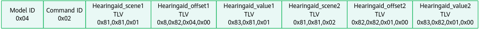

    配置模式1下，偏移为4，长度为1的参数，设置为0x01；

    配置模式2下，偏移为1，长度为2的参数，设置为0x01,0x00。

    > **说明：** 
    >助听的模式：
    >auto（自动识别场景）：0
    >transportation（交通场景）：1
    >socializing（社交场景）：2
    >party（聚会场景）：3
    >quiet（安静场景）：4
    >ext0（扩展场景0）：5
    >ext1（扩展场景1）：6
    >test（医规场景）：7
    >偏移值加上设置的参数长度，需要≤512Byte。
    >请求帧长度，需要≤530Byte。
    >请求帧支持多组TLV发送需求。
    >获取助听参数偏移地址请参见《Melody 音频 开发指南》的“助听算法参数说明”章节。

### 指定模式下具体参数配置<a name="ZH-CN_TOPIC_0000001574026189"></a>

**表 1**  指定模式下具体参数配置字段描述

<a name="table184004175322"></a>
<table><thead align="left"><tr id="row342521703216"><th class="cellrowborder" valign="top" width="13.33%" id="mcps1.2.8.1.1"><p id="p104251717203212"><a name="p104251717203212"></a><a name="p104251717203212"></a>字段名称</p>
</th>
<th class="cellrowborder" valign="top" width="10.42%" id="mcps1.2.8.1.2"><p id="p742610177321"><a name="p742610177321"></a><a name="p742610177321"></a>Type(bit0～bit6)</p>
</th>
<th class="cellrowborder" valign="top" width="14.32%" id="mcps1.2.8.1.3"><p id="p19426111783215"><a name="p19426111783215"></a><a name="p19426111783215"></a>Length Size(Oct)</p>
</th>
<th class="cellrowborder" valign="top" width="12.479999999999999%" id="mcps1.2.8.1.4"><p id="p15426171718328"><a name="p15426171718328"></a><a name="p15426171718328"></a>Value数据类型</p>
</th>
<th class="cellrowborder" valign="top" width="22.79%" id="mcps1.2.8.1.5"><p id="p9426181719326"><a name="p9426181719326"></a><a name="p9426181719326"></a>说明</p>
</th>
<th class="cellrowborder" valign="top" width="14.610000000000001%" id="mcps1.2.8.1.6"><p id="p1426181717324"><a name="p1426181717324"></a><a name="p1426181717324"></a>必选/可选（M/O）</p>
</th>
<th class="cellrowborder" valign="top" width="12.049999999999999%" id="mcps1.2.8.1.7"><p id="p14261117193213"><a name="p14261117193213"></a><a name="p14261117193213"></a>版本</p>
</th>
</tr>
</thead>
<tbody><tr id="row2426517193210"><td class="cellrowborder" valign="top" width="13.33%" headers="mcps1.2.8.1.1 "><p id="p24268176322"><a name="p24268176322"></a><a name="p24268176322"></a>Hearingaid_scene</p>
</td>
<td class="cellrowborder" valign="top" width="10.42%" headers="mcps1.2.8.1.2 "><p id="p17426131714321"><a name="p17426131714321"></a><a name="p17426131714321"></a>0x01</p>
</td>
<td class="cellrowborder" valign="top" width="14.32%" headers="mcps1.2.8.1.3 "><p id="p9426121717329"><a name="p9426121717329"></a><a name="p9426121717329"></a>1</p>
</td>
<td class="cellrowborder" valign="top" width="12.479999999999999%" headers="mcps1.2.8.1.4 "><p id="p1442618174329"><a name="p1442618174329"></a><a name="p1442618174329"></a>uint8</p>
</td>
<td class="cellrowborder" valign="top" width="22.79%" headers="mcps1.2.8.1.5 "><p id="p13233161319375"><a name="p13233161319375"></a><a name="p13233161319375"></a>指定模式</p>
</td>
<td class="cellrowborder" valign="top" width="14.610000000000001%" headers="mcps1.2.8.1.6 "><p id="p1342661783214"><a name="p1342661783214"></a><a name="p1342661783214"></a>M</p>
</td>
<td class="cellrowborder" valign="top" width="12.049999999999999%" headers="mcps1.2.8.1.7 "><p id="p17426101723213"><a name="p17426101723213"></a><a name="p17426101723213"></a>1.0/1.0</p>
</td>
</tr>
<tr id="row1766416431313"><td class="cellrowborder" valign="top" width="13.33%" headers="mcps1.2.8.1.1 "><p id="p126653433317"><a name="p126653433317"></a><a name="p126653433317"></a>Hearingaid_parameter1</p>
</td>
<td class="cellrowborder" valign="top" width="10.42%" headers="mcps1.2.8.1.2 "><p id="p12582103510419"><a name="p12582103510419"></a><a name="p12582103510419"></a>0x02</p>
</td>
<td class="cellrowborder" valign="top" width="14.32%" headers="mcps1.2.8.1.3 "><p id="p158210355414"><a name="p158210355414"></a><a name="p158210355414"></a>1</p>
</td>
<td class="cellrowborder" valign="top" width="12.479999999999999%" headers="mcps1.2.8.1.4 "><p id="p458211351742"><a name="p458211351742"></a><a name="p458211351742"></a>uint8</p>
</td>
<td class="cellrowborder" valign="top" width="22.79%" headers="mcps1.2.8.1.5 "><p id="p135821835643"><a name="p135821835643"></a><a name="p135821835643"></a>设定参数值</p>
</td>
<td class="cellrowborder" valign="top" width="14.610000000000001%" headers="mcps1.2.8.1.6 "><p id="p5994175711418"><a name="p5994175711418"></a><a name="p5994175711418"></a>O</p>
</td>
<td class="cellrowborder" valign="top" width="12.049999999999999%" headers="mcps1.2.8.1.7 "><p id="p19949571248"><a name="p19949571248"></a><a name="p19949571248"></a>1.0/1.0</p>
</td>
</tr>
<tr id="row15102926753"><td class="cellrowborder" valign="top" width="13.33%" headers="mcps1.2.8.1.1 "><p id="p710212619517"><a name="p710212619517"></a><a name="p710212619517"></a>Hearingaid_parameter2</p>
</td>
<td class="cellrowborder" valign="top" width="10.42%" headers="mcps1.2.8.1.2 "><p id="p9366185214512"><a name="p9366185214512"></a><a name="p9366185214512"></a>0x03</p>
</td>
<td class="cellrowborder" valign="top" width="14.32%" headers="mcps1.2.8.1.3 "><p id="p153662521659"><a name="p153662521659"></a><a name="p153662521659"></a>1</p>
</td>
<td class="cellrowborder" valign="top" width="12.479999999999999%" headers="mcps1.2.8.1.4 "><p id="p103662524511"><a name="p103662524511"></a><a name="p103662524511"></a>uint8</p>
</td>
<td class="cellrowborder" valign="top" width="22.79%" headers="mcps1.2.8.1.5 "><p id="p539581216165"><a name="p539581216165"></a><a name="p539581216165"></a>设定参数值</p>
</td>
<td class="cellrowborder" valign="top" width="14.610000000000001%" headers="mcps1.2.8.1.6 "><p id="p2665711520"><a name="p2665711520"></a><a name="p2665711520"></a>O</p>
</td>
<td class="cellrowborder" valign="top" width="12.049999999999999%" headers="mcps1.2.8.1.7 "><p id="p116651611724"><a name="p116651611724"></a><a name="p116651611724"></a>1.0/1.0</p>
</td>
</tr>
<tr id="row7249183415285"><td class="cellrowborder" valign="top" width="13.33%" headers="mcps1.2.8.1.1 "><p id="p105662038152813"><a name="p105662038152813"></a><a name="p105662038152813"></a>Hearingaid_parameter3</p>
</td>
<td class="cellrowborder" valign="top" width="10.42%" headers="mcps1.2.8.1.2 "><p id="p4566103862820"><a name="p4566103862820"></a><a name="p4566103862820"></a>0x04</p>
</td>
<td class="cellrowborder" valign="top" width="14.32%" headers="mcps1.2.8.1.3 "><p id="p17566173892814"><a name="p17566173892814"></a><a name="p17566173892814"></a>1</p>
</td>
<td class="cellrowborder" valign="top" width="12.479999999999999%" headers="mcps1.2.8.1.4 "><p id="p18566163814286"><a name="p18566163814286"></a><a name="p18566163814286"></a>uint8</p>
</td>
<td class="cellrowborder" valign="top" width="22.79%" headers="mcps1.2.8.1.5 "><p id="p195661838152817"><a name="p195661838152817"></a><a name="p195661838152817"></a>设定参数值</p>
</td>
<td class="cellrowborder" valign="top" width="14.610000000000001%" headers="mcps1.2.8.1.6 "><p id="p156653882815"><a name="p156653882815"></a><a name="p156653882815"></a>O</p>
</td>
<td class="cellrowborder" valign="top" width="12.049999999999999%" headers="mcps1.2.8.1.7 "><p id="p18566123852812"><a name="p18566123852812"></a><a name="p18566123852812"></a>1.0/1.0</p>
</td>
</tr>
</tbody>
</table>

**表 2**  type描述

<a name="table1552208181819"></a>
<table><thead align="left"><tr id="row1152216817181"><th class="cellrowborder" valign="top" width="47.89%" id="mcps1.2.3.1.1"><p id="p1097645481815"><a name="p1097645481815"></a><a name="p1097645481815"></a>Type(bit0～bit6)</p>
</th>
<th class="cellrowborder" valign="top" width="52.11%" id="mcps1.2.3.1.2"><p id="p45236812185"><a name="p45236812185"></a><a name="p45236812185"></a>功能</p>
</th>
</tr>
</thead>
<tbody><tr id="row165239812182"><td class="cellrowborder" valign="top" width="47.89%" headers="mcps1.2.3.1.1 "><p id="p1352388191816"><a name="p1352388191816"></a><a name="p1352388191816"></a>0x02</p>
</td>
<td class="cellrowborder" valign="top" width="52.11%" headers="mcps1.2.3.1.2 "><p id="p115231783183"><a name="p115231783183"></a><a name="p115231783183"></a>降噪开关</p>
</td>
</tr>
<tr id="row145235871815"><td class="cellrowborder" valign="top" width="47.89%" headers="mcps1.2.3.1.1 "><p id="p3290145904718"><a name="p3290145904718"></a><a name="p3290145904718"></a>0x03</p>
</td>
<td class="cellrowborder" valign="top" width="52.11%" headers="mcps1.2.3.1.2 "><p id="p175236811814"><a name="p175236811814"></a><a name="p175236811814"></a>波束开关</p>
</td>
</tr>
<tr id="row1652368101814"><td class="cellrowborder" valign="top" width="47.89%" headers="mcps1.2.3.1.1 "><p id="p1239261164817"><a name="p1239261164817"></a><a name="p1239261164817"></a>0x04</p>
</td>
<td class="cellrowborder" valign="top" width="52.11%" headers="mcps1.2.3.1.2 "><p id="p195239881811"><a name="p195239881811"></a><a name="p195239881811"></a>抗啸叫开关</p>
</td>
</tr>
</tbody>
</table>

-   请求帧结构：****

    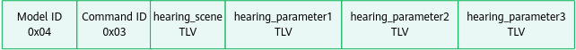

-   应答帧结构：
    -   返回成功：

        

    -   返回失败：

        

-   示例

    0x04,0x03,0x81,0x81,0x01,0x82,0x81,0x00,0x83,0x81,0x01,0x84,0x81,0x00

    作用：配置模式1下，降噪关闭，波束打开，抗啸叫关闭。

    > **说明：** 
    >-   type=0x01指定助听的模式，value表示具体的模式，助听各个场景对应的value如下：
    >    auto（自动识别场景）：0
    >    transportation（交通场景）：1
    >    socializing（社交场景）：2
    >    party（聚会场景）：3
    >    quiet（安静场景）：4
    >    ext0（扩展场景0）：5
    >    ext1（扩展场景1）：6
    >    test（医规场景）：7
    >-   type=0x02表示在指定助听模式下的降噪开关（0表示关，非0表示开）。
    >-   type=0x03表示在指定助听模式下的波束开关（0表示关，非0表示开）。
    >-   type=0x04表示在指定助听模式下的抗啸叫开关（0表示关，非0表示开）。

### 私有参数配置<a name="ZH-CN_TOPIC_0000001605645653"></a>

> **说明：** 
>暂不支持，需要与产品沟通。

**表 1**  私有参数配置字段描述

<a name="table184004175322"></a>
<table><thead align="left"><tr id="row342521703216"><th class="cellrowborder" valign="top" width="13.33%" id="mcps1.2.8.1.1"><p id="p104251717203212"><a name="p104251717203212"></a><a name="p104251717203212"></a>字段名称</p>
</th>
<th class="cellrowborder" valign="top" width="10.42%" id="mcps1.2.8.1.2"><p id="p742610177321"><a name="p742610177321"></a><a name="p742610177321"></a>Type(bit0～bit6)</p>
</th>
<th class="cellrowborder" valign="top" width="14.32%" id="mcps1.2.8.1.3"><p id="p19426111783215"><a name="p19426111783215"></a><a name="p19426111783215"></a>Length Size(Oct)</p>
</th>
<th class="cellrowborder" valign="top" width="12.479999999999999%" id="mcps1.2.8.1.4"><p id="p15426171718328"><a name="p15426171718328"></a><a name="p15426171718328"></a>Value数据类型</p>
</th>
<th class="cellrowborder" valign="top" width="22.79%" id="mcps1.2.8.1.5"><p id="p9426181719326"><a name="p9426181719326"></a><a name="p9426181719326"></a>说明</p>
</th>
<th class="cellrowborder" valign="top" width="14.610000000000001%" id="mcps1.2.8.1.6"><p id="p1426181717324"><a name="p1426181717324"></a><a name="p1426181717324"></a>必选/可选（M/O）</p>
</th>
<th class="cellrowborder" valign="top" width="12.049999999999999%" id="mcps1.2.8.1.7"><p id="p14261117193213"><a name="p14261117193213"></a><a name="p14261117193213"></a>版本</p>
</th>
</tr>
</thead>
<tbody><tr id="row2426517193210"><td class="cellrowborder" valign="top" width="13.33%" headers="mcps1.2.8.1.1 "><p id="p24268176322"><a name="p24268176322"></a><a name="p24268176322"></a>private_parameters_setting</p>
</td>
<td class="cellrowborder" valign="top" width="10.42%" headers="mcps1.2.8.1.2 "><p id="p17426131714321"><a name="p17426131714321"></a><a name="p17426131714321"></a>0x01</p>
</td>
<td class="cellrowborder" valign="top" width="14.32%" headers="mcps1.2.8.1.3 "><p id="p9426121717329"><a name="p9426121717329"></a><a name="p9426121717329"></a>xxx</p>
</td>
<td class="cellrowborder" valign="top" width="12.479999999999999%" headers="mcps1.2.8.1.4 "><p id="p1442618174329"><a name="p1442618174329"></a><a name="p1442618174329"></a>uint8</p>
</td>
<td class="cellrowborder" valign="top" width="22.79%" headers="mcps1.2.8.1.5 "><p id="p13233161319375"><a name="p13233161319375"></a><a name="p13233161319375"></a>私有参数配置</p>
</td>
<td class="cellrowborder" valign="top" width="14.610000000000001%" headers="mcps1.2.8.1.6 "><p id="p1342661783214"><a name="p1342661783214"></a><a name="p1342661783214"></a>O</p>
</td>
<td class="cellrowborder" valign="top" width="12.049999999999999%" headers="mcps1.2.8.1.7 "><p id="p17426101723213"><a name="p17426101723213"></a><a name="p17426101723213"></a>1.0/1.0</p>
</td>
</tr>
</tbody>
</table>

-   请求帧结构：****

    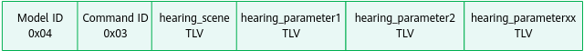

-   应答帧结构：
    -   返回成功：

        

    -   返回失败：

        

### 获取指定模式下助听参数<a name="ZH-CN_TOPIC_0000001557058438"></a>

**表 1**  获取指定模式下助听参数字段描述

<a name="table184004175322"></a>
<table><thead align="left"><tr id="row342521703216"><th class="cellrowborder" valign="top" width="13.33%" id="mcps1.2.8.1.1"><p id="p104251717203212"><a name="p104251717203212"></a><a name="p104251717203212"></a>字段名称</p>
</th>
<th class="cellrowborder" valign="top" width="10.42%" id="mcps1.2.8.1.2"><p id="p742610177321"><a name="p742610177321"></a><a name="p742610177321"></a>Type(bit0～bit6)</p>
</th>
<th class="cellrowborder" valign="top" width="14.32%" id="mcps1.2.8.1.3"><p id="p19426111783215"><a name="p19426111783215"></a><a name="p19426111783215"></a>Length Size(Oct)</p>
</th>
<th class="cellrowborder" valign="top" width="12.479999999999999%" id="mcps1.2.8.1.4"><p id="p15426171718328"><a name="p15426171718328"></a><a name="p15426171718328"></a>Value数据类型</p>
</th>
<th class="cellrowborder" valign="top" width="22.79%" id="mcps1.2.8.1.5"><p id="p9426181719326"><a name="p9426181719326"></a><a name="p9426181719326"></a>说明</p>
</th>
<th class="cellrowborder" valign="top" width="14.610000000000001%" id="mcps1.2.8.1.6"><p id="p1426181717324"><a name="p1426181717324"></a><a name="p1426181717324"></a>必选/可选（M/O）</p>
</th>
<th class="cellrowborder" valign="top" width="12.049999999999999%" id="mcps1.2.8.1.7"><p id="p14261117193213"><a name="p14261117193213"></a><a name="p14261117193213"></a>版本</p>
</th>
</tr>
</thead>
<tbody><tr id="row2426517193210"><td class="cellrowborder" valign="top" width="13.33%" headers="mcps1.2.8.1.1 "><p id="p24268176322"><a name="p24268176322"></a><a name="p24268176322"></a>Hearingaid_scene</p>
</td>
<td class="cellrowborder" valign="top" width="10.42%" headers="mcps1.2.8.1.2 "><p id="p17426131714321"><a name="p17426131714321"></a><a name="p17426131714321"></a>0x01</p>
</td>
<td class="cellrowborder" valign="top" width="14.32%" headers="mcps1.2.8.1.3 "><p id="p9426121717329"><a name="p9426121717329"></a><a name="p9426121717329"></a>1</p>
</td>
<td class="cellrowborder" valign="top" width="12.479999999999999%" headers="mcps1.2.8.1.4 "><p id="p1442618174329"><a name="p1442618174329"></a><a name="p1442618174329"></a>uint8</p>
</td>
<td class="cellrowborder" valign="top" width="22.79%" headers="mcps1.2.8.1.5 "><p id="p13233161319375"><a name="p13233161319375"></a><a name="p13233161319375"></a>助听模式</p>
</td>
<td class="cellrowborder" valign="top" width="14.610000000000001%" headers="mcps1.2.8.1.6 "><p id="p1342661783214"><a name="p1342661783214"></a><a name="p1342661783214"></a>M</p>
</td>
<td class="cellrowborder" valign="top" width="12.049999999999999%" headers="mcps1.2.8.1.7 "><p id="p17426101723213"><a name="p17426101723213"></a><a name="p17426101723213"></a>1.0/1.0</p>
</td>
</tr>
<tr id="row750712454412"><td class="cellrowborder" valign="top" width="13.33%" headers="mcps1.2.8.1.1 "><p id="p62704301753"><a name="p62704301753"></a><a name="p62704301753"></a>Hearingaid_parameters</p>
</td>
<td class="cellrowborder" valign="top" width="10.42%" headers="mcps1.2.8.1.2 "><p id="p45077451043"><a name="p45077451043"></a><a name="p45077451043"></a>0x02</p>
</td>
<td class="cellrowborder" valign="top" width="14.32%" headers="mcps1.2.8.1.3 "><p id="p121071168583"><a name="p121071168583"></a><a name="p121071168583"></a>助听参数的长度</p>
</td>
<td class="cellrowborder" valign="top" width="12.479999999999999%" headers="mcps1.2.8.1.4 "><p id="p97769817437"><a name="p97769817437"></a><a name="p97769817437"></a>uint8</p>
</td>
<td class="cellrowborder" valign="top" width="22.79%" headers="mcps1.2.8.1.5 "><p id="p45070451743"><a name="p45070451743"></a><a name="p45070451743"></a>指定模式下助听参数</p>
</td>
<td class="cellrowborder" valign="top" width="14.610000000000001%" headers="mcps1.2.8.1.6 "><p id="p850744519419"><a name="p850744519419"></a><a name="p850744519419"></a>M</p>
</td>
<td class="cellrowborder" valign="top" width="12.049999999999999%" headers="mcps1.2.8.1.7 "><p id="p56091038469"><a name="p56091038469"></a><a name="p56091038469"></a>1.0/1.0</p>
</td>
</tr>
</tbody>
</table>

-   请求帧结构：

    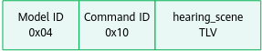

-   应答帧结构：
    -   返回成功：

        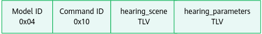

    -   返回失败：

        

-   示例

    0x04,0x10,0x81,0x81,0x01

    作用：获取模式1下的助听参数。

    > **说明：** 
    >助听参数的长度为512Byte。
    >助听的模式：
    >auto（自动识别场景）：0
    >transportation（交通场景）：1
    >socializing（社交场景）：2
    >party（聚会场景）：3
    >quiet（安静场景）：4
    >ext0（扩展场景0）：5
    >ext1（扩展场景1）：6
    >test（医规场景）：7

### 获取指定模式下部分助听参数<a name="ZH-CN_TOPIC_0000001759993761"></a>

**表 1**  获取指定模式下部分助听参数字段描述

<a name="table184004175322"></a>
<table><thead align="left"><tr id="row342521703216"><th class="cellrowborder" valign="top" width="13.309999999999999%" id="mcps1.2.8.1.1"><p id="p104251717203212"><a name="p104251717203212"></a><a name="p104251717203212"></a>字段名称</p>
</th>
<th class="cellrowborder" valign="top" width="10.41%" id="mcps1.2.8.1.2"><p id="p742610177321"><a name="p742610177321"></a><a name="p742610177321"></a>Type(bit0～bit6)</p>
</th>
<th class="cellrowborder" valign="top" width="14.35%" id="mcps1.2.8.1.3"><p id="p19426111783215"><a name="p19426111783215"></a><a name="p19426111783215"></a>Length Size(Oct)</p>
</th>
<th class="cellrowborder" valign="top" width="12.46%" id="mcps1.2.8.1.4"><p id="p15426171718328"><a name="p15426171718328"></a><a name="p15426171718328"></a>Value数据类型</p>
</th>
<th class="cellrowborder" valign="top" width="22.81%" id="mcps1.2.8.1.5"><p id="p9426181719326"><a name="p9426181719326"></a><a name="p9426181719326"></a>说明</p>
</th>
<th class="cellrowborder" valign="top" width="14.610000000000001%" id="mcps1.2.8.1.6"><p id="p1426181717324"><a name="p1426181717324"></a><a name="p1426181717324"></a>必选/可选（M/O）</p>
</th>
<th class="cellrowborder" valign="top" width="12.049999999999999%" id="mcps1.2.8.1.7"><p id="p14261117193213"><a name="p14261117193213"></a><a name="p14261117193213"></a>版本</p>
</th>
</tr>
</thead>
<tbody><tr id="row2426517193210"><td class="cellrowborder" valign="top" width="13.309999999999999%" headers="mcps1.2.8.1.1 "><p id="p24268176322"><a name="p24268176322"></a><a name="p24268176322"></a>Hearingaid_scene</p>
</td>
<td class="cellrowborder" valign="top" width="10.41%" headers="mcps1.2.8.1.2 "><p id="p17426131714321"><a name="p17426131714321"></a><a name="p17426131714321"></a>0x01</p>
</td>
<td class="cellrowborder" valign="top" width="14.35%" headers="mcps1.2.8.1.3 "><p id="p9426121717329"><a name="p9426121717329"></a><a name="p9426121717329"></a>1</p>
</td>
<td class="cellrowborder" valign="top" width="12.46%" headers="mcps1.2.8.1.4 "><p id="p1442618174329"><a name="p1442618174329"></a><a name="p1442618174329"></a>uint8</p>
</td>
<td class="cellrowborder" valign="top" width="22.81%" headers="mcps1.2.8.1.5 "><p id="p13233161319375"><a name="p13233161319375"></a><a name="p13233161319375"></a>指定模式</p>
</td>
<td class="cellrowborder" valign="top" width="14.610000000000001%" headers="mcps1.2.8.1.6 "><p id="p1342661783214"><a name="p1342661783214"></a><a name="p1342661783214"></a>M</p>
</td>
<td class="cellrowborder" valign="top" width="12.049999999999999%" headers="mcps1.2.8.1.7 "><p id="p17426101723213"><a name="p17426101723213"></a><a name="p17426101723213"></a>1.0/1.0</p>
</td>
</tr>
<tr id="row1766416431313"><td class="cellrowborder" valign="top" width="13.309999999999999%" headers="mcps1.2.8.1.1 "><p id="p126653433317"><a name="p126653433317"></a><a name="p126653433317"></a>Hearingaid_offset</p>
</td>
<td class="cellrowborder" valign="top" width="10.41%" headers="mcps1.2.8.1.2 "><p id="p12582103510419"><a name="p12582103510419"></a><a name="p12582103510419"></a>0x02</p>
</td>
<td class="cellrowborder" valign="top" width="14.35%" headers="mcps1.2.8.1.3 "><p id="p158210355414"><a name="p158210355414"></a><a name="p158210355414"></a>N</p>
</td>
<td class="cellrowborder" valign="top" width="12.46%" headers="mcps1.2.8.1.4 "><p id="p458211351742"><a name="p458211351742"></a><a name="p458211351742"></a>uint8</p>
</td>
<td class="cellrowborder" valign="top" width="22.81%" headers="mcps1.2.8.1.5 "><p id="p135821835643"><a name="p135821835643"></a><a name="p135821835643"></a>参数位置</p>
</td>
<td class="cellrowborder" valign="top" width="14.610000000000001%" headers="mcps1.2.8.1.6 "><p id="p5994175711418"><a name="p5994175711418"></a><a name="p5994175711418"></a>M</p>
</td>
<td class="cellrowborder" valign="top" width="12.049999999999999%" headers="mcps1.2.8.1.7 "><p id="p19949571248"><a name="p19949571248"></a><a name="p19949571248"></a>1.0/1.0</p>
</td>
</tr>
<tr id="row15102926753"><td class="cellrowborder" valign="top" width="13.309999999999999%" headers="mcps1.2.8.1.1 "><p id="p710212619517"><a name="p710212619517"></a><a name="p710212619517"></a>Hearingaid_value</p>
</td>
<td class="cellrowborder" valign="top" width="10.41%" headers="mcps1.2.8.1.2 "><p id="p9366185214512"><a name="p9366185214512"></a><a name="p9366185214512"></a>0x03</p>
</td>
<td class="cellrowborder" valign="top" width="14.35%" headers="mcps1.2.8.1.3 "><p id="p153662521659"><a name="p153662521659"></a><a name="p153662521659"></a>N</p>
</td>
<td class="cellrowborder" valign="top" width="12.46%" headers="mcps1.2.8.1.4 "><p id="p103662524511"><a name="p103662524511"></a><a name="p103662524511"></a>uint8</p>
</td>
<td class="cellrowborder" valign="top" width="22.81%" headers="mcps1.2.8.1.5 "><p id="p23669521555"><a name="p23669521555"></a><a name="p23669521555"></a>获取的参数</p>
</td>
<td class="cellrowborder" valign="top" width="14.610000000000001%" headers="mcps1.2.8.1.6 "><p id="p2665711520"><a name="p2665711520"></a><a name="p2665711520"></a>M</p>
</td>
<td class="cellrowborder" valign="top" width="12.049999999999999%" headers="mcps1.2.8.1.7 "><p id="p116651611724"><a name="p116651611724"></a><a name="p116651611724"></a>1.0/1.0</p>
</td>
</tr>
<tr id="row12531228346"><td class="cellrowborder" valign="top" width="13.309999999999999%" headers="mcps1.2.8.1.1 "><p id="p17556219143712"><a name="p17556219143712"></a><a name="p17556219143712"></a>Hearingaid_value_length</p>
</td>
<td class="cellrowborder" valign="top" width="10.41%" headers="mcps1.2.8.1.2 "><p id="p19532129345"><a name="p19532129345"></a><a name="p19532129345"></a>0x04</p>
</td>
<td class="cellrowborder" valign="top" width="14.35%" headers="mcps1.2.8.1.3 "><p id="p121071168583"><a name="p121071168583"></a><a name="p121071168583"></a>N</p>
</td>
<td class="cellrowborder" valign="top" width="12.46%" headers="mcps1.2.8.1.4 "><p id="p65323215346"><a name="p65323215346"></a><a name="p65323215346"></a>uint8</p>
</td>
<td class="cellrowborder" valign="top" width="22.81%" headers="mcps1.2.8.1.5 "><p id="p353216263420"><a name="p353216263420"></a><a name="p353216263420"></a>参数长度</p>
</td>
<td class="cellrowborder" valign="top" width="14.610000000000001%" headers="mcps1.2.8.1.6 "><p id="p15321213341"><a name="p15321213341"></a><a name="p15321213341"></a>M</p>
</td>
<td class="cellrowborder" valign="top" width="12.049999999999999%" headers="mcps1.2.8.1.7 "><p id="p185321722343"><a name="p185321722343"></a><a name="p185321722343"></a>1.0/1.0</p>
</td>
</tr>
</tbody>
</table>

-   请求帧结构：

    

-   应答帧结构：
    -   返回成功：

        

    -   返回失败：

        

-   请求帧示例：

    0x04,0x06,0x81,0x81,0x01,0x82,0x81,0x00,0x84,0x81,01,0x81,0x81,0x02,0x82,0x82,0x00,0x01,0x84,0x82,80,00

    请求帧含义如下所示：

    

    获取模式1，偏移为0，长度为1的参数值；

    获取模式2，偏移为256，长度为128的参数值。

    > **说明：** 
    >助听的模式：
    >auto（自动识别场景）：0
    >transportation（交通场景）：1
    >socializing（社交场景）：2
    >party（聚会场景）：3
    >quiet（安静场景）：4
    >ext0（扩展场景0）：5
    >ext1（扩展场景1）：6
    >test（医规场景）：7
    >偏移值加上获取的参数长度，需要≤512Byte。
    >应答帧长度，需要≤530Byte。
    >获取助听参数偏移地址请参见《Melody 音频 开发指南》的“助听算法参数说明”章节。

## 可维可测<a name="ZH-CN_TOPIC_0000001542572821"></a>

待补充。

## 文件传输<a name="ZH-CN_TOPIC_0000001491533000"></a>

**图 1**  文件传输流程<a name="fig19417920162211"></a>  


> **说明：** 
>1.  不论上传还是下载，都由手机APP侧发起文件传输，发起时可以使用传输开始命令或传输协商命令。
>    -   传输协商命令可以与设备协商传输相关的两个参数：每组传输的次数（data\_block\_number）、每次传输数据的大小（data\_block\_size）。
>    -   传输开始命令不能协商上述两个参数，因此只能使用默认参数传输：每组传输次数data\_block\_number＝8次，每次传输数据的大小data\_block\_size＝256Byte。
>2.  整个传输过程分为若干组，每组由一个传输请求命令和若干个传输回应命令组成。
>    -   传输请求命令由文件接收方发送，请求对端发送一段数据，在命令中指定这一组需要传输的数据大小以及该段数据在文件中的偏移，数据大小＝min（待传输剩余大小，data\_block\_number \* data\_block\_size）。
>    -   文件发送方在收到传输请求命令后，应连续发送最多data\_block\_number个传输回应命令，每个传输回应命令携带的数据大小＝min（待传输剩余大小，data\_block\_size）。
>    -   文件的数据必须顺序请求和发送。文件接收方在顺序收到请求的这一组全部数据后，再请求下一组数据。
>    -   文件接收方如果连续1秒内没有收到任何传输回应命令，应再次发送传输请求命令，重新请求未收到的数据，直到这一组的数据全部收到。如接收方连续30秒收不到数据，应结束这次传输。
>3.  接收方在收到全部数据后，通过传输通知命令通知对端，结束这次传输。

-   **[传输开始](#ZH-CN_TOPIC_0000001506992142)**  

-   **[传输参数协商](#ZH-CN_TOPIC_0000001506832254)**  

-   **[传输请求](#ZH-CN_TOPIC_0000001557791829)**  

-   **[传输回应](#ZH-CN_TOPIC_0000001507152038)**  

-   **[传输通知](#ZH-CN_TOPIC_0000001507311914)**  

-   **[传输停止](#ZH-CN_TOPIC_0000001557711697)**  

-   **[文件列举](#ZH-CN_TOPIC_0000001508005852)**  

-   **[文件删除](#ZH-CN_TOPIC_0000001507686084)**  

-   **[获取bitmap](#ZH-CN_TOPIC_0000001558525665)**  

### 传输开始<a name="ZH-CN_TOPIC_0000001506992142"></a>

**表 1**  传输开始字段描述

<a name="table1670093634213"></a>
<table><thead align="left"><tr id="row1373613369423"><th class="cellrowborder" valign="top" width="13.33%" id="mcps1.2.8.1.1"><p id="p37361936194210"><a name="p37361936194210"></a><a name="p37361936194210"></a>字段名称</p>
</th>
<th class="cellrowborder" valign="top" width="10.42%" id="mcps1.2.8.1.2"><p id="p57360364427"><a name="p57360364427"></a><a name="p57360364427"></a>Type(bit0～bit6)</p>
</th>
<th class="cellrowborder" valign="top" width="14.32%" id="mcps1.2.8.1.3"><p id="p1736103611420"><a name="p1736103611420"></a><a name="p1736103611420"></a>Length Size(Oct)</p>
</th>
<th class="cellrowborder" valign="top" width="12.479999999999999%" id="mcps1.2.8.1.4"><p id="p137369364429"><a name="p137369364429"></a><a name="p137369364429"></a>Value数据类型</p>
</th>
<th class="cellrowborder" valign="top" width="22.79%" id="mcps1.2.8.1.5"><p id="p67361236124217"><a name="p67361236124217"></a><a name="p67361236124217"></a>说明</p>
</th>
<th class="cellrowborder" valign="top" width="14.610000000000001%" id="mcps1.2.8.1.6"><p id="p1473723617427"><a name="p1473723617427"></a><a name="p1473723617427"></a>必选/可选（M/O）</p>
</th>
<th class="cellrowborder" valign="top" width="12.049999999999999%" id="mcps1.2.8.1.7"><p id="p107371636204213"><a name="p107371636204213"></a><a name="p107371636204213"></a>版本</p>
</th>
</tr>
</thead>
<tbody><tr id="row16737536164215"><td class="cellrowborder" valign="top" width="13.33%" headers="mcps1.2.8.1.1 "><p id="p204492040172519"><a name="p204492040172519"></a><a name="p204492040172519"></a>transmit_start</p>
</td>
<td class="cellrowborder" valign="top" width="10.42%" headers="mcps1.2.8.1.2 "><p id="p20737163624215"><a name="p20737163624215"></a><a name="p20737163624215"></a>0x01</p>
</td>
<td class="cellrowborder" valign="top" width="14.32%" headers="mcps1.2.8.1.3 "><p id="p47371436104216"><a name="p47371436104216"></a><a name="p47371436104216"></a>sizeof(transmit_start_pkt_t) + sizeof(info)</p>
</td>
<td class="cellrowborder" valign="top" width="12.479999999999999%" headers="mcps1.2.8.1.4 "><p id="p1856941213265"><a name="p1856941213265"></a><a name="p1856941213265"></a>struct</p>
</td>
<td class="cellrowborder" valign="top" width="22.79%" headers="mcps1.2.8.1.5 "><a name="ul1226059154613"></a><a name="ul1226059154613"></a><ul id="ul1226059154613"><li>uint32_t transmit_id：单次传输唯一标识。</li><li>uint16_t src_send:1：传输方向（占1bit）。</li><li>uint16_t struct_ver:2：结构版本，助听器项目为0（占2bit）。</li><li>uint16_t re_trans:1：是否使能断电续传，助听器项目值为0，不支持（占1bit）。</li><li>uint16_t bitmap_enable:1:是否使能位域，默认为0（占1bit）。</li><li>uint16_t pad:11：预留bit（占11bit）。</li><li>uint16_t transmit_type：交互类型，详情参考代码枚举值transmit_type_t。</li><li>uint32_t total_size：文件大小。</li><li>uint32_t info_size：info内容大小，如文件路径名长度。</li><li>uint8_t info[0]：info数据内容。</li></ul>
</td>
<td class="cellrowborder" valign="top" width="14.610000000000001%" headers="mcps1.2.8.1.6 "><p id="p973714361424"><a name="p973714361424"></a><a name="p973714361424"></a>O</p>
</td>
<td class="cellrowborder" valign="top" width="12.049999999999999%" headers="mcps1.2.8.1.7 "><p id="p373753615423"><a name="p373753615423"></a><a name="p373753615423"></a>1.0/1.0</p>
</td>
</tr>
</tbody>
</table>

发送帧结构：


### 传输参数协商<a name="ZH-CN_TOPIC_0000001506832254"></a>

**表 1**  传输参数协商字段描述

<a name="table1670093634213"></a>
<table><thead align="left"><tr id="row1373613369423"><th class="cellrowborder" valign="top" width="13.33%" id="mcps1.2.8.1.1"><p id="p37361936194210"><a name="p37361936194210"></a><a name="p37361936194210"></a>字段名称</p>
</th>
<th class="cellrowborder" valign="top" width="10.41%" id="mcps1.2.8.1.2"><p id="p57360364427"><a name="p57360364427"></a><a name="p57360364427"></a>Type(bit0～bit6)</p>
</th>
<th class="cellrowborder" valign="top" width="14.330000000000002%" id="mcps1.2.8.1.3"><p id="p1736103611420"><a name="p1736103611420"></a><a name="p1736103611420"></a>Length Size(Oct)</p>
</th>
<th class="cellrowborder" valign="top" width="12.479999999999999%" id="mcps1.2.8.1.4"><p id="p137369364429"><a name="p137369364429"></a><a name="p137369364429"></a>Value数据类型</p>
</th>
<th class="cellrowborder" valign="top" width="22.79%" id="mcps1.2.8.1.5"><p id="p67361236124217"><a name="p67361236124217"></a><a name="p67361236124217"></a>说明</p>
</th>
<th class="cellrowborder" valign="top" width="14.610000000000001%" id="mcps1.2.8.1.6"><p id="p1473723617427"><a name="p1473723617427"></a><a name="p1473723617427"></a>必选/可选（M/O）</p>
</th>
<th class="cellrowborder" valign="top" width="12.049999999999999%" id="mcps1.2.8.1.7"><p id="p107371636204213"><a name="p107371636204213"></a><a name="p107371636204213"></a>版本</p>
</th>
</tr>
</thead>
<tbody><tr id="row16737536164215"><td class="cellrowborder" valign="top" width="13.33%" headers="mcps1.2.8.1.1 "><p id="p204492040172519"><a name="p204492040172519"></a><a name="p204492040172519"></a>transmit_negotiate</p>
</td>
<td class="cellrowborder" valign="top" width="10.41%" headers="mcps1.2.8.1.2 "><p id="p20737163624215"><a name="p20737163624215"></a><a name="p20737163624215"></a>0x01</p>
</td>
<td class="cellrowborder" valign="top" width="14.330000000000002%" headers="mcps1.2.8.1.3 "><p id="p47371436104216"><a name="p47371436104216"></a><a name="p47371436104216"></a>sizeof(transmit_negotiate_pkt_t) + sizeof(info)</p>
</td>
<td class="cellrowborder" valign="top" width="12.479999999999999%" headers="mcps1.2.8.1.4 "><p id="p1856941213265"><a name="p1856941213265"></a><a name="p1856941213265"></a>struct</p>
</td>
<td class="cellrowborder" valign="top" width="22.79%" headers="mcps1.2.8.1.5 "><a name="ul1226059154613"></a><a name="ul1226059154613"></a><ul id="ul1226059154613"><li>uint32_t transmit_id：单次传输唯一标识。</li><li>uint16_t src_send:1：传输方向（占1bit）。</li><li>uint16_t struct_ver:2：结构版本，助听器项目为0（占2bit）。</li><li>uint16_t re_trans:1：是否使能断电续传，助听器项目值为0，不支持（占1bit）。</li><li>uint16_t bitmap_enable:1:是否使能位域，默认为0（占1bit）。</li><li>uint16_t pad:11：预留bit（占11bit）。</li><li>uint16_t transmit_type：交互类型，详情参考代码枚举值transmit_type_t。</li><li>uint32_t total_size：文件大小。单位：Byte。</li><li>uint16_t data_block_num; 每组传输次数。</li><li>uint16_t data_block_size; 每次传输大小。单位：Byte。</li><li>uint32_t info_size：info内容大小，如文件路径名长度。单位：Byte。</li><li>uint8_t info[0]：info数据内容。</li></ul>
</td>
<td class="cellrowborder" valign="top" width="14.610000000000001%" headers="mcps1.2.8.1.6 "><p id="p973714361424"><a name="p973714361424"></a><a name="p973714361424"></a>M</p>
</td>
<td class="cellrowborder" valign="top" width="12.049999999999999%" headers="mcps1.2.8.1.7 "><p id="p373753615423"><a name="p373753615423"></a><a name="p373753615423"></a>1.0/1.0</p>
</td>
</tr>
<tr id="row8293168121110"><td class="cellrowborder" valign="top" width="13.33%" headers="mcps1.2.8.1.1 "><p id="p02935818110"><a name="p02935818110"></a><a name="p02935818110"></a>transmit_negotiate_ack</p>
</td>
<td class="cellrowborder" valign="top" width="10.41%" headers="mcps1.2.8.1.2 "><p id="p829378101116"><a name="p829378101116"></a><a name="p829378101116"></a>0x02</p>
</td>
<td class="cellrowborder" valign="top" width="14.330000000000002%" headers="mcps1.2.8.1.3 "><p id="p9293198121119"><a name="p9293198121119"></a><a name="p9293198121119"></a>sizeof(transmit_negotiate_ack_pkt_t) + sizeof(info)</p>
</td>
<td class="cellrowborder" valign="top" width="12.479999999999999%" headers="mcps1.2.8.1.4 "><p id="p42933812114"><a name="p42933812114"></a><a name="p42933812114"></a>struct</p>
</td>
<td class="cellrowborder" valign="top" width="22.79%" headers="mcps1.2.8.1.5 "><a name="ul18702134832417"></a><a name="ul18702134832417"></a><ul id="ul18702134832417"><li>uint32_t transmit_id：单次传输唯一标识。</li><li>uint16_t data_block_number：每组传输次数。</li><li>uint16_t data_block_size：每次传输大小。单位：Byte。</li><li>uint32_t info_size：info内容大小。</li><li>uint8_t info[0]：info数据内容。</li></ul>
</td>
<td class="cellrowborder" valign="top" width="14.610000000000001%" headers="mcps1.2.8.1.6 "><p id="p16293284112"><a name="p16293284112"></a><a name="p16293284112"></a>O</p>
</td>
<td class="cellrowborder" valign="top" width="12.049999999999999%" headers="mcps1.2.8.1.7 "><p id="p18293178111118"><a name="p18293178111118"></a><a name="p18293178111118"></a>1.0/1.0</p>
</td>
</tr>
</tbody>
</table>

发送帧结构：


### 传输请求<a name="ZH-CN_TOPIC_0000001557791829"></a>

**表 1**  传输请求字段描述

<a name="table1670093634213"></a>
<table><thead align="left"><tr id="row1373613369423"><th class="cellrowborder" valign="top" width="13.33%" id="mcps1.2.8.1.1"><p id="p37361936194210"><a name="p37361936194210"></a><a name="p37361936194210"></a>字段名称</p>
</th>
<th class="cellrowborder" valign="top" width="10.42%" id="mcps1.2.8.1.2"><p id="p57360364427"><a name="p57360364427"></a><a name="p57360364427"></a>Type(bit0～bit6)</p>
</th>
<th class="cellrowborder" valign="top" width="14.32%" id="mcps1.2.8.1.3"><p id="p1736103611420"><a name="p1736103611420"></a><a name="p1736103611420"></a>Length Size(Oct)</p>
</th>
<th class="cellrowborder" valign="top" width="12.479999999999999%" id="mcps1.2.8.1.4"><p id="p137369364429"><a name="p137369364429"></a><a name="p137369364429"></a>Value数据类型</p>
</th>
<th class="cellrowborder" valign="top" width="22.79%" id="mcps1.2.8.1.5"><p id="p67361236124217"><a name="p67361236124217"></a><a name="p67361236124217"></a>说明</p>
</th>
<th class="cellrowborder" valign="top" width="14.610000000000001%" id="mcps1.2.8.1.6"><p id="p1473723617427"><a name="p1473723617427"></a><a name="p1473723617427"></a>必选/可选（M/O）</p>
</th>
<th class="cellrowborder" valign="top" width="12.049999999999999%" id="mcps1.2.8.1.7"><p id="p107371636204213"><a name="p107371636204213"></a><a name="p107371636204213"></a>版本</p>
</th>
</tr>
</thead>
<tbody><tr id="row16737536164215"><td class="cellrowborder" valign="top" width="13.33%" headers="mcps1.2.8.1.1 "><p id="p204492040172519"><a name="p204492040172519"></a><a name="p204492040172519"></a>transmit_request</p>
</td>
<td class="cellrowborder" valign="top" width="10.42%" headers="mcps1.2.8.1.2 "><p id="p20737163624215"><a name="p20737163624215"></a><a name="p20737163624215"></a>0x01</p>
</td>
<td class="cellrowborder" valign="top" width="14.32%" headers="mcps1.2.8.1.3 "><p id="p47371436104216"><a name="p47371436104216"></a><a name="p47371436104216"></a>sizeof(transmit_request_pkt_t)</p>
</td>
<td class="cellrowborder" valign="top" width="12.479999999999999%" headers="mcps1.2.8.1.4 "><p id="p1856941213265"><a name="p1856941213265"></a><a name="p1856941213265"></a>struct</p>
</td>
<td class="cellrowborder" valign="top" width="22.79%" headers="mcps1.2.8.1.5 "><a name="ul1226059154613"></a><a name="ul1226059154613"></a><ul id="ul1226059154613"><li>uint32_t transmit_id：单次传输唯一标识。</li><li>uint32_t cnt：默认为1，后续支持扩展传入多组offset和size。</li><li>uint32_t offset：文件具体偏移值。</li><li>uint32_t size：基于文件偏移offset的传输大小值。单位：Byte。</li></ul>
</td>
<td class="cellrowborder" valign="top" width="14.610000000000001%" headers="mcps1.2.8.1.6 "><p id="p973714361424"><a name="p973714361424"></a><a name="p973714361424"></a>M</p>
</td>
<td class="cellrowborder" valign="top" width="12.049999999999999%" headers="mcps1.2.8.1.7 "><p id="p373753615423"><a name="p373753615423"></a><a name="p373753615423"></a>1.0/1.0</p>
</td>
</tr>
</tbody>
</table>

发送帧结构：


### 传输回应<a name="ZH-CN_TOPIC_0000001507152038"></a>

**表 1**  传输回应字段描述

<a name="table1670093634213"></a>
<table><thead align="left"><tr id="row1373613369423"><th class="cellrowborder" valign="top" width="13.33%" id="mcps1.2.8.1.1"><p id="p37361936194210"><a name="p37361936194210"></a><a name="p37361936194210"></a>字段名称</p>
</th>
<th class="cellrowborder" valign="top" width="10.42%" id="mcps1.2.8.1.2"><p id="p57360364427"><a name="p57360364427"></a><a name="p57360364427"></a>Type(bit0～bit6)</p>
</th>
<th class="cellrowborder" valign="top" width="14.32%" id="mcps1.2.8.1.3"><p id="p1736103611420"><a name="p1736103611420"></a><a name="p1736103611420"></a>Length Size(Oct)</p>
</th>
<th class="cellrowborder" valign="top" width="12.479999999999999%" id="mcps1.2.8.1.4"><p id="p137369364429"><a name="p137369364429"></a><a name="p137369364429"></a>Value数据类型</p>
</th>
<th class="cellrowborder" valign="top" width="22.79%" id="mcps1.2.8.1.5"><p id="p67361236124217"><a name="p67361236124217"></a><a name="p67361236124217"></a>说明</p>
</th>
<th class="cellrowborder" valign="top" width="14.610000000000001%" id="mcps1.2.8.1.6"><p id="p1473723617427"><a name="p1473723617427"></a><a name="p1473723617427"></a>必选/可选（M/O）</p>
</th>
<th class="cellrowborder" valign="top" width="12.049999999999999%" id="mcps1.2.8.1.7"><p id="p107371636204213"><a name="p107371636204213"></a><a name="p107371636204213"></a>版本</p>
</th>
</tr>
</thead>
<tbody><tr id="row16737536164215"><td class="cellrowborder" valign="top" width="13.33%" headers="mcps1.2.8.1.1 "><p id="p204492040172519"><a name="p204492040172519"></a><a name="p204492040172519"></a>transmit_reply</p>
</td>
<td class="cellrowborder" valign="top" width="10.42%" headers="mcps1.2.8.1.2 "><p id="p20737163624215"><a name="p20737163624215"></a><a name="p20737163624215"></a>0x01</p>
</td>
<td class="cellrowborder" valign="top" width="14.32%" headers="mcps1.2.8.1.3 "><p id="p47371436104216"><a name="p47371436104216"></a><a name="p47371436104216"></a>sizeof(transmit_reply_pkt_t) + sizeof(data)</p>
</td>
<td class="cellrowborder" valign="top" width="12.479999999999999%" headers="mcps1.2.8.1.4 "><p id="p1856941213265"><a name="p1856941213265"></a><a name="p1856941213265"></a>struct</p>
</td>
<td class="cellrowborder" valign="top" width="22.79%" headers="mcps1.2.8.1.5 "><a name="ul1226059154613"></a><a name="ul1226059154613"></a><ul id="ul1226059154613"><li>uint32_t transmit_id：单次传输唯一标识。</li><li>uint32_t offset：文件具体偏移值。</li><li>uint32_t size：本次传输大小值。单位：Byte。</li><li>uint8_t data[0]：数据内容。</li></ul>
</td>
<td class="cellrowborder" valign="top" width="14.610000000000001%" headers="mcps1.2.8.1.6 "><p id="p973714361424"><a name="p973714361424"></a><a name="p973714361424"></a>M</p>
</td>
<td class="cellrowborder" valign="top" width="12.049999999999999%" headers="mcps1.2.8.1.7 "><p id="p373753615423"><a name="p373753615423"></a><a name="p373753615423"></a>1.0/1.0</p>
</td>
</tr>
</tbody>
</table>

发送帧结构：


### 传输通知<a name="ZH-CN_TOPIC_0000001507311914"></a>

**表 1**  传输通知字段描述

<a name="table1670093634213"></a>
<table><thead align="left"><tr id="row1373613369423"><th class="cellrowborder" valign="top" width="13.33%" id="mcps1.2.8.1.1"><p id="p37361936194210"><a name="p37361936194210"></a><a name="p37361936194210"></a>字段名称</p>
</th>
<th class="cellrowborder" valign="top" width="10.42%" id="mcps1.2.8.1.2"><p id="p57360364427"><a name="p57360364427"></a><a name="p57360364427"></a>Type(bit0～bit6)</p>
</th>
<th class="cellrowborder" valign="top" width="14.32%" id="mcps1.2.8.1.3"><p id="p1736103611420"><a name="p1736103611420"></a><a name="p1736103611420"></a>Length Size(Oct)</p>
</th>
<th class="cellrowborder" valign="top" width="12.479999999999999%" id="mcps1.2.8.1.4"><p id="p137369364429"><a name="p137369364429"></a><a name="p137369364429"></a>Value数据类型</p>
</th>
<th class="cellrowborder" valign="top" width="22.79%" id="mcps1.2.8.1.5"><p id="p67361236124217"><a name="p67361236124217"></a><a name="p67361236124217"></a>说明</p>
</th>
<th class="cellrowborder" valign="top" width="14.610000000000001%" id="mcps1.2.8.1.6"><p id="p1473723617427"><a name="p1473723617427"></a><a name="p1473723617427"></a>必选/可选（M/O）</p>
</th>
<th class="cellrowborder" valign="top" width="12.049999999999999%" id="mcps1.2.8.1.7"><p id="p107371636204213"><a name="p107371636204213"></a><a name="p107371636204213"></a>版本</p>
</th>
</tr>
</thead>
<tbody><tr id="row16737536164215"><td class="cellrowborder" valign="top" width="13.33%" headers="mcps1.2.8.1.1 "><p id="p204492040172519"><a name="p204492040172519"></a><a name="p204492040172519"></a>transmit_notify</p>
</td>
<td class="cellrowborder" valign="top" width="10.42%" headers="mcps1.2.8.1.2 "><p id="p20737163624215"><a name="p20737163624215"></a><a name="p20737163624215"></a>0x01</p>
</td>
<td class="cellrowborder" valign="top" width="14.32%" headers="mcps1.2.8.1.3 "><p id="p47371436104216"><a name="p47371436104216"></a><a name="p47371436104216"></a>sizeof(transmit_state_notify_pkt_t) + sizeof(data)</p>
</td>
<td class="cellrowborder" valign="top" width="12.479999999999999%" headers="mcps1.2.8.1.4 "><p id="p1856941213265"><a name="p1856941213265"></a><a name="p1856941213265"></a>struct</p>
</td>
<td class="cellrowborder" valign="top" width="22.79%" headers="mcps1.2.8.1.5 "><a name="ul1226059154613"></a><a name="ul1226059154613"></a><ul id="ul1226059154613"><li>uint32_t transmit_id：单次传输唯一标识。</li><li>uint32_t state_code：详见枚举transmit_state_notify_code_t。</li><li>uint32_t len：数据内容大小值。单位：Byte。</li><li>uint8_t data[0]：数据内容。</li></ul>
</td>
<td class="cellrowborder" valign="top" width="14.610000000000001%" headers="mcps1.2.8.1.6 "><p id="p973714361424"><a name="p973714361424"></a><a name="p973714361424"></a>M</p>
</td>
<td class="cellrowborder" valign="top" width="12.049999999999999%" headers="mcps1.2.8.1.7 "><p id="p373753615423"><a name="p373753615423"></a><a name="p373753615423"></a>1.0/1.0</p>
</td>
</tr>
</tbody>
</table>

```
typedef enum {
    TRANSMIT_STATE_NOTIFY_INVALID_ID = 10, /* transmit id无效 */
    TRANSMIT_STATE_NOTIFY_FINISH,          /* 传输结束 */
    TRANSMIT_STATE_NOTIFY_FINISH_2,        /* 传输结束，暂未使用 */
    TRANSMIT_STATE_NOTIFY_DUPLICATE_ID,    /* transmit id重复，暂未使用 */
    TRANSMIT_STATE_NOTIFY_STOP_ID = 16,    /* 传输中止 */
    TRANSMIT_STATE_NOTIFY_SAVE_FAILED_ID,  /* 传输出错 */
} transmit_state_notify_code_t;
```

发送帧结构：


### 传输停止<a name="ZH-CN_TOPIC_0000001557711697"></a>

**表 1**  传输停止字段描述

<a name="table1670093634213"></a>
<table><thead align="left"><tr id="row1373613369423"><th class="cellrowborder" valign="top" width="13.33%" id="mcps1.2.8.1.1"><p id="p37361936194210"><a name="p37361936194210"></a><a name="p37361936194210"></a>字段名称</p>
</th>
<th class="cellrowborder" valign="top" width="10.42%" id="mcps1.2.8.1.2"><p id="p57360364427"><a name="p57360364427"></a><a name="p57360364427"></a>Type(bit0～bit6)</p>
</th>
<th class="cellrowborder" valign="top" width="14.32%" id="mcps1.2.8.1.3"><p id="p1736103611420"><a name="p1736103611420"></a><a name="p1736103611420"></a>Length Size(Oct)</p>
</th>
<th class="cellrowborder" valign="top" width="12.479999999999999%" id="mcps1.2.8.1.4"><p id="p137369364429"><a name="p137369364429"></a><a name="p137369364429"></a>Value数据类型</p>
</th>
<th class="cellrowborder" valign="top" width="22.79%" id="mcps1.2.8.1.5"><p id="p67361236124217"><a name="p67361236124217"></a><a name="p67361236124217"></a>说明</p>
</th>
<th class="cellrowborder" valign="top" width="14.610000000000001%" id="mcps1.2.8.1.6"><p id="p1473723617427"><a name="p1473723617427"></a><a name="p1473723617427"></a>必选/可选（M/O）</p>
</th>
<th class="cellrowborder" valign="top" width="12.049999999999999%" id="mcps1.2.8.1.7"><p id="p107371636204213"><a name="p107371636204213"></a><a name="p107371636204213"></a>版本</p>
</th>
</tr>
</thead>
<tbody><tr id="row16737536164215"><td class="cellrowborder" valign="top" width="13.33%" headers="mcps1.2.8.1.1 "><p id="p204492040172519"><a name="p204492040172519"></a><a name="p204492040172519"></a>transmit_stop</p>
</td>
<td class="cellrowborder" valign="top" width="10.42%" headers="mcps1.2.8.1.2 "><p id="p20737163624215"><a name="p20737163624215"></a><a name="p20737163624215"></a>0x01</p>
</td>
<td class="cellrowborder" valign="top" width="14.32%" headers="mcps1.2.8.1.3 "><p id="p47371436104216"><a name="p47371436104216"></a><a name="p47371436104216"></a>sizeof(transmit_stop_pkt_t)</p>
</td>
<td class="cellrowborder" valign="top" width="12.479999999999999%" headers="mcps1.2.8.1.4 "><p id="p1856941213265"><a name="p1856941213265"></a><a name="p1856941213265"></a>struct</p>
</td>
<td class="cellrowborder" valign="top" width="22.79%" headers="mcps1.2.8.1.5 "><a name="ul1226059154613"></a><a name="ul1226059154613"></a><ul id="ul1226059154613"><li>uint32_t transmit_id：单次传输唯一标识。</li><li>uint32_t reason：预留，默认为0。</li></ul>
</td>
<td class="cellrowborder" valign="top" width="14.610000000000001%" headers="mcps1.2.8.1.6 "><p id="p973714361424"><a name="p973714361424"></a><a name="p973714361424"></a>O</p>
</td>
<td class="cellrowborder" valign="top" width="12.049999999999999%" headers="mcps1.2.8.1.7 "><p id="p373753615423"><a name="p373753615423"></a><a name="p373753615423"></a>1.0/1.0</p>
</td>
</tr>
<tr id="row116451408117"><td class="cellrowborder" valign="top" width="13.33%" headers="mcps1.2.8.1.1 "><p id="p12646401120"><a name="p12646401120"></a><a name="p12646401120"></a>transmit_stop_ack</p>
</td>
<td class="cellrowborder" valign="top" width="10.42%" headers="mcps1.2.8.1.2 "><p id="p106464012118"><a name="p106464012118"></a><a name="p106464012118"></a>0x02</p>
</td>
<td class="cellrowborder" valign="top" width="14.32%" headers="mcps1.2.8.1.3 "><p id="p18646501113"><a name="p18646501113"></a><a name="p18646501113"></a>sizeof(transmit_stop_pkt_t)</p>
</td>
<td class="cellrowborder" valign="top" width="12.479999999999999%" headers="mcps1.2.8.1.4 "><p id="p6646130712"><a name="p6646130712"></a><a name="p6646130712"></a>struct</p>
</td>
<td class="cellrowborder" valign="top" width="22.79%" headers="mcps1.2.8.1.5 "><a name="ul1295233217"></a><a name="ul1295233217"></a><ul id="ul1295233217"><li>uint32_t transmit_id：单次传输唯一标识。</li><li>uint32_t reason：预留，默认为0。</li></ul>
</td>
<td class="cellrowborder" valign="top" width="14.610000000000001%" headers="mcps1.2.8.1.6 "><p id="p136461301116"><a name="p136461301116"></a><a name="p136461301116"></a>O</p>
</td>
<td class="cellrowborder" valign="top" width="12.049999999999999%" headers="mcps1.2.8.1.7 "><p id="p5646801111"><a name="p5646801111"></a><a name="p5646801111"></a>1.0/1.0</p>
</td>
</tr>
</tbody>
</table>

发送帧结构：


### 文件列举<a name="ZH-CN_TOPIC_0000001508005852"></a>

> **说明：** 
>Melody暂不涉及。

**表 1**  文件列举字段描述

<a name="table1670093634213"></a>
<table><thead align="left"><tr id="row1373613369423"><th class="cellrowborder" valign="top" width="13.33%" id="mcps1.2.8.1.1"><p id="p37361936194210"><a name="p37361936194210"></a><a name="p37361936194210"></a>字段名称</p>
</th>
<th class="cellrowborder" valign="top" width="10.42%" id="mcps1.2.8.1.2"><p id="p57360364427"><a name="p57360364427"></a><a name="p57360364427"></a>Type(bit0～bit6)</p>
</th>
<th class="cellrowborder" valign="top" width="14.32%" id="mcps1.2.8.1.3"><p id="p1736103611420"><a name="p1736103611420"></a><a name="p1736103611420"></a>Length Size(Oct)</p>
</th>
<th class="cellrowborder" valign="top" width="12.479999999999999%" id="mcps1.2.8.1.4"><p id="p137369364429"><a name="p137369364429"></a><a name="p137369364429"></a>Value数据类型</p>
</th>
<th class="cellrowborder" valign="top" width="22.79%" id="mcps1.2.8.1.5"><p id="p67361236124217"><a name="p67361236124217"></a><a name="p67361236124217"></a>说明</p>
</th>
<th class="cellrowborder" valign="top" width="14.610000000000001%" id="mcps1.2.8.1.6"><p id="p1473723617427"><a name="p1473723617427"></a><a name="p1473723617427"></a>必选/可选（M/O）</p>
</th>
<th class="cellrowborder" valign="top" width="12.049999999999999%" id="mcps1.2.8.1.7"><p id="p107371636204213"><a name="p107371636204213"></a><a name="p107371636204213"></a>版本</p>
</th>
</tr>
</thead>
<tbody><tr id="row16737536164215"><td class="cellrowborder" valign="top" width="13.33%" headers="mcps1.2.8.1.1 "><p id="p204492040172519"><a name="p204492040172519"></a><a name="p204492040172519"></a>transmit_ls</p>
</td>
<td class="cellrowborder" valign="top" width="10.42%" headers="mcps1.2.8.1.2 "><p id="p20737163624215"><a name="p20737163624215"></a><a name="p20737163624215"></a>0x01</p>
</td>
<td class="cellrowborder" valign="top" width="14.32%" headers="mcps1.2.8.1.3 "><p id="p47371436104216"><a name="p47371436104216"></a><a name="p47371436104216"></a>sizeof(diag_ls_cmd_t) + sizeof（path）</p>
</td>
<td class="cellrowborder" valign="top" width="12.479999999999999%" headers="mcps1.2.8.1.4 "><p id="p1856941213265"><a name="p1856941213265"></a><a name="p1856941213265"></a>struct</p>
</td>
<td class="cellrowborder" valign="top" width="22.79%" headers="mcps1.2.8.1.5 "><a name="ul1226059154613"></a><a name="ul1226059154613"></a><ul id="ul1226059154613"><li>uint32_t dir_len：strlen(path)+1。</li><li>uint8_t path[0]：路径名称，要带结束符，对应长度为路径名长度+1字节结束符。</li></ul>
</td>
<td class="cellrowborder" valign="top" width="14.610000000000001%" headers="mcps1.2.8.1.6 "><p id="p973714361424"><a name="p973714361424"></a><a name="p973714361424"></a>O</p>
</td>
<td class="cellrowborder" valign="top" width="12.049999999999999%" headers="mcps1.2.8.1.7 "><p id="p373753615423"><a name="p373753615423"></a><a name="p373753615423"></a>1.0/1.0</p>
</td>
</tr>
<tr id="row18305332411"><td class="cellrowborder" valign="top" width="13.33%" headers="mcps1.2.8.1.1 "><p id="p14689104424118"><a name="p14689104424118"></a><a name="p14689104424118"></a>transmit_ls_ack</p>
</td>
<td class="cellrowborder" valign="top" width="10.42%" headers="mcps1.2.8.1.2 "><p id="p631733114113"><a name="p631733114113"></a><a name="p631733114113"></a>0x02</p>
</td>
<td class="cellrowborder" valign="top" width="14.32%" headers="mcps1.2.8.1.3 "><p id="p93153314419"><a name="p93153314419"></a><a name="p93153314419"></a>sizeof(diag_ls_ind_t + sizeof(file_name)</p>
</td>
<td class="cellrowborder" valign="top" width="12.479999999999999%" headers="mcps1.2.8.1.4 "><p id="p1342181816454"><a name="p1342181816454"></a><a name="p1342181816454"></a>struct</p>
</td>
<td class="cellrowborder" valign="top" width="22.79%" headers="mcps1.2.8.1.5 "><a name="ul208461215154719"></a><a name="ul208461215154719"></a><ul id="ul208461215154719"><li>uint16_t idx：文件序号。</li><li>uint8_t path_len：strlen(file name)+1。</li><li>uint8_t file_type：文件类型，文件为0，文件夹为1。</li><li>uint32_t file_size：文件大小，单位：Byte。</li><li>uint8_t file_name[0]：文件名，对应长度为路径名长度+1字节结束符。</li></ul>
</td>
<td class="cellrowborder" valign="top" width="14.610000000000001%" headers="mcps1.2.8.1.6 "><p id="p19799154710499"><a name="p19799154710499"></a><a name="p19799154710499"></a>O</p>
</td>
<td class="cellrowborder" valign="top" width="12.049999999999999%" headers="mcps1.2.8.1.7 "><p id="p9799547134916"><a name="p9799547134916"></a><a name="p9799547134916"></a>1.0/1.0</p>
</td>
</tr>
</tbody>
</table>

发送帧结构：


### 文件删除<a name="ZH-CN_TOPIC_0000001507686084"></a>

> **说明：** 
>Melody暂不涉及。

**表 1**  文件删除字段描述

<a name="table1670093634213"></a>
<table><thead align="left"><tr id="row1373613369423"><th class="cellrowborder" valign="top" width="13.33%" id="mcps1.2.8.1.1"><p id="p37361936194210"><a name="p37361936194210"></a><a name="p37361936194210"></a>字段名称</p>
</th>
<th class="cellrowborder" valign="top" width="10.42%" id="mcps1.2.8.1.2"><p id="p57360364427"><a name="p57360364427"></a><a name="p57360364427"></a>Type(bit0～bit6)</p>
</th>
<th class="cellrowborder" valign="top" width="14.32%" id="mcps1.2.8.1.3"><p id="p1736103611420"><a name="p1736103611420"></a><a name="p1736103611420"></a>Length Size(Oct)</p>
</th>
<th class="cellrowborder" valign="top" width="12.479999999999999%" id="mcps1.2.8.1.4"><p id="p137369364429"><a name="p137369364429"></a><a name="p137369364429"></a>Value数据类型</p>
</th>
<th class="cellrowborder" valign="top" width="22.79%" id="mcps1.2.8.1.5"><p id="p67361236124217"><a name="p67361236124217"></a><a name="p67361236124217"></a>说明</p>
</th>
<th class="cellrowborder" valign="top" width="14.610000000000001%" id="mcps1.2.8.1.6"><p id="p1473723617427"><a name="p1473723617427"></a><a name="p1473723617427"></a>必选/可选（M/O）</p>
</th>
<th class="cellrowborder" valign="top" width="12.049999999999999%" id="mcps1.2.8.1.7"><p id="p107371636204213"><a name="p107371636204213"></a><a name="p107371636204213"></a>版本</p>
</th>
</tr>
</thead>
<tbody><tr id="row16737536164215"><td class="cellrowborder" valign="top" width="13.33%" headers="mcps1.2.8.1.1 "><p id="p204492040172519"><a name="p204492040172519"></a><a name="p204492040172519"></a>transmit_delete</p>
</td>
<td class="cellrowborder" valign="top" width="10.42%" headers="mcps1.2.8.1.2 "><p id="p20737163624215"><a name="p20737163624215"></a><a name="p20737163624215"></a>0x01</p>
</td>
<td class="cellrowborder" valign="top" width="14.32%" headers="mcps1.2.8.1.3 "><p id="p47371436104216"><a name="p47371436104216"></a><a name="p47371436104216"></a>sizeof(diag_del_cmd_t) + sizeof(name)</p>
</td>
<td class="cellrowborder" valign="top" width="12.479999999999999%" headers="mcps1.2.8.1.4 "><p id="p1856941213265"><a name="p1856941213265"></a><a name="p1856941213265"></a>struct</p>
</td>
<td class="cellrowborder" valign="top" width="22.79%" headers="mcps1.2.8.1.5 "><a name="ul1226059154613"></a><a name="ul1226059154613"></a><ul id="ul1226059154613"><li>uint16_t dir_len：strlen(path name)+1。</li><li>uint8_t rev：保留字段。</li><li>uint8_t file_type: 文件类型：文件为0，文件夹为1。</li><li>uint8_t name[0]：对应长度为路径名长度+1字节结束符。</li></ul>
</td>
<td class="cellrowborder" valign="top" width="14.610000000000001%" headers="mcps1.2.8.1.6 "><p id="p973714361424"><a name="p973714361424"></a><a name="p973714361424"></a>O</p>
</td>
<td class="cellrowborder" valign="top" width="12.049999999999999%" headers="mcps1.2.8.1.7 "><p id="p373753615423"><a name="p373753615423"></a><a name="p373753615423"></a>1.0/1.0</p>
</td>
</tr>
<tr id="row67713540712"><td class="cellrowborder" valign="top" width="13.33%" headers="mcps1.2.8.1.1 "><p id="p1443255880"><a name="p1443255880"></a><a name="p1443255880"></a>transmit_delete_ack</p>
</td>
<td class="cellrowborder" valign="top" width="10.42%" headers="mcps1.2.8.1.2 "><p id="p1777116542075"><a name="p1777116542075"></a><a name="p1777116542075"></a>0x02</p>
</td>
<td class="cellrowborder" valign="top" width="14.32%" headers="mcps1.2.8.1.3 "><p id="p1377235413718"><a name="p1377235413718"></a><a name="p1377235413718"></a>4</p>
</td>
<td class="cellrowborder" valign="top" width="12.479999999999999%" headers="mcps1.2.8.1.4 "><p id="p67722541470"><a name="p67722541470"></a><a name="p67722541470"></a>uint32</p>
</td>
<td class="cellrowborder" valign="top" width="22.79%" headers="mcps1.2.8.1.5 "><p id="p37721254670"><a name="p37721254670"></a><a name="p37721254670"></a>返回值</p>
</td>
<td class="cellrowborder" valign="top" width="14.610000000000001%" headers="mcps1.2.8.1.6 "><p id="p669925511817"><a name="p669925511817"></a><a name="p669925511817"></a>O</p>
</td>
<td class="cellrowborder" valign="top" width="12.049999999999999%" headers="mcps1.2.8.1.7 "><p id="p76999550816"><a name="p76999550816"></a><a name="p76999550816"></a>1.0/1.0</p>
</td>
</tr>
</tbody>
</table>

发送帧结构：


### 获取bitmap<a name="ZH-CN_TOPIC_0000001558525665"></a>

> **说明：** 
>Melody暂不涉及。

**表 1**  获取bitmap字段描述

<a name="table1670093634213"></a>
<table><thead align="left"><tr id="row1373613369423"><th class="cellrowborder" valign="top" width="13.33%" id="mcps1.2.8.1.1"><p id="p37361936194210"><a name="p37361936194210"></a><a name="p37361936194210"></a>字段名称</p>
</th>
<th class="cellrowborder" valign="top" width="10.42%" id="mcps1.2.8.1.2"><p id="p57360364427"><a name="p57360364427"></a><a name="p57360364427"></a>Type(bit0～bit6)</p>
</th>
<th class="cellrowborder" valign="top" width="14.32%" id="mcps1.2.8.1.3"><p id="p1736103611420"><a name="p1736103611420"></a><a name="p1736103611420"></a>Length Size(Oct)</p>
</th>
<th class="cellrowborder" valign="top" width="12.479999999999999%" id="mcps1.2.8.1.4"><p id="p137369364429"><a name="p137369364429"></a><a name="p137369364429"></a>Value数据类型</p>
</th>
<th class="cellrowborder" valign="top" width="22.79%" id="mcps1.2.8.1.5"><p id="p67361236124217"><a name="p67361236124217"></a><a name="p67361236124217"></a>说明</p>
</th>
<th class="cellrowborder" valign="top" width="14.610000000000001%" id="mcps1.2.8.1.6"><p id="p1473723617427"><a name="p1473723617427"></a><a name="p1473723617427"></a>必选/可选（M/O）</p>
</th>
<th class="cellrowborder" valign="top" width="12.049999999999999%" id="mcps1.2.8.1.7"><p id="p107371636204213"><a name="p107371636204213"></a><a name="p107371636204213"></a>版本</p>
</th>
</tr>
</thead>
<tbody><tr id="row16737536164215"><td class="cellrowborder" valign="top" width="13.33%" headers="mcps1.2.8.1.1 "><p id="p204492040172519"><a name="p204492040172519"></a><a name="p204492040172519"></a>transmit_bitmap</p>
</td>
<td class="cellrowborder" valign="top" width="10.42%" headers="mcps1.2.8.1.2 "><p id="p20737163624215"><a name="p20737163624215"></a><a name="p20737163624215"></a>0x01</p>
</td>
<td class="cellrowborder" valign="top" width="14.32%" headers="mcps1.2.8.1.3 "><p id="p47371436104216"><a name="p47371436104216"></a><a name="p47371436104216"></a>sizeof(transmit_bitmap_pkt_t)</p>
</td>
<td class="cellrowborder" valign="top" width="12.479999999999999%" headers="mcps1.2.8.1.4 "><p id="p1856941213265"><a name="p1856941213265"></a><a name="p1856941213265"></a>struct</p>
</td>
<td class="cellrowborder" valign="top" width="22.79%" headers="mcps1.2.8.1.5 "><a name="ul1226059154613"></a><a name="ul1226059154613"></a><ul id="ul1226059154613"><li>transmit_id：单次传输唯一标识。</li><li>offset：相对文件的偏移地址。</li><li>len：从offset开始的长度。单位：Byte。</li></ul>
</td>
<td class="cellrowborder" valign="top" width="14.610000000000001%" headers="mcps1.2.8.1.6 "><p id="p973714361424"><a name="p973714361424"></a><a name="p973714361424"></a>O</p>
</td>
<td class="cellrowborder" valign="top" width="12.049999999999999%" headers="mcps1.2.8.1.7 "><p id="p373753615423"><a name="p373753615423"></a><a name="p373753615423"></a>1.0/1.0</p>
</td>
</tr>
<tr id="row139432037201114"><td class="cellrowborder" valign="top" width="13.33%" headers="mcps1.2.8.1.1 "><p id="p129431937181113"><a name="p129431937181113"></a><a name="p129431937181113"></a>transmit_bitmap_ack</p>
</td>
<td class="cellrowborder" valign="top" width="10.42%" headers="mcps1.2.8.1.2 "><p id="p17943103720111"><a name="p17943103720111"></a><a name="p17943103720111"></a>0x02</p>
</td>
<td class="cellrowborder" valign="top" width="14.32%" headers="mcps1.2.8.1.3 "><p id="p189434372118"><a name="p189434372118"></a><a name="p189434372118"></a>sizeof(transmit_bitmap_ack_pkt_t)</p>
</td>
<td class="cellrowborder" valign="top" width="12.479999999999999%" headers="mcps1.2.8.1.4 "><p id="p9384113131215"><a name="p9384113131215"></a><a name="p9384113131215"></a>struct</p>
</td>
<td class="cellrowborder" valign="top" width="22.79%" headers="mcps1.2.8.1.5 "><a name="ul3289174319131"></a><a name="ul3289174319131"></a><ul id="ul3289174319131"><li>transmit_id：单次传输唯一标识。</li><li>offset：相对文件的偏移地址。</li><li>bitsize：bit对应的数据位数。</li><li>len：等价于bitsize/8，向上取整。</li><li>data：bitmap值，每bit对应协商的每次传输长度是否写入。</li></ul>
</td>
<td class="cellrowborder" valign="top" width="14.610000000000001%" headers="mcps1.2.8.1.6 "><p id="p894313372116"><a name="p894313372116"></a><a name="p894313372116"></a>O</p>
</td>
<td class="cellrowborder" valign="top" width="12.049999999999999%" headers="mcps1.2.8.1.7 "><p id="p17943123711117"><a name="p17943123711117"></a><a name="p17943123711117"></a>1.0/1.0</p>
</td>
</tr>
</tbody>
</table>

发送帧结构：


## 设备设置<a name="ZH-CN_TOPIC_0000001491692864"></a>

-   **[恢复出厂设置](#ZH-CN_TOPIC_0000001542652801)**  

-   **[耳机入耳状态设置](#ZH-CN_TOPIC_0000001542772677)**  

-   **[设备音量及效果设置](#ZH-CN_TOPIC_0000001491852780)**  

-   **[耳机上下滑动控制](#ZH-CN_TOPIC_0000001492012684)**  

-   **[频点提示音设置](#ZH-CN_TOPIC_0000001503199508)**  

-   **[持续提示音提醒设置](#ZH-CN_TOPIC_0000001554039193)**  

-   **[按键控制](#ZH-CN_TOPIC_0000001581716061)**  

-   **[麦克风喇叭回环测试](#ZH-CN_TOPIC_0000001616804801)**  

-   **[喇叭频响校准值设置](#ZH-CN_TOPIC_0000001566568440)**  

-   **[喇叭频响校准值保存NV设置](#ZH-CN_TOPIC_0000001617154809)**  

-   **[切换麦克风设置](#ZH-CN_TOPIC_0000001566595674)**  

-   **[麦克风增益校准值设置](#ZH-CN_TOPIC_0000001616835901)**  

-   **[麦克风增益校准值保存NV设置](#ZH-CN_TOPIC_0000001566755950)**  

-   **[设备重启](#ZH-CN_TOPIC_0000001688900589)**  

-   **[设备蓝牙名称设置](#ZH-CN_TOPIC_0000001662460192)**  

-   **[设备国家设置](#ZH-CN_TOPIC_0000001711636865)**  

### 恢复出厂设置<a name="ZH-CN_TOPIC_0000001542652801"></a>

**表 1**  恢复出厂设置字段描述

<a name="table1670093634213"></a>
<table><thead align="left"><tr id="row1373613369423"><th class="cellrowborder" valign="top" width="13.33%" id="mcps1.2.8.1.1"><p id="p37361936194210"><a name="p37361936194210"></a><a name="p37361936194210"></a>字段名称</p>
</th>
<th class="cellrowborder" valign="top" width="10.42%" id="mcps1.2.8.1.2"><p id="p57360364427"><a name="p57360364427"></a><a name="p57360364427"></a>Type(bit0～bit6)</p>
</th>
<th class="cellrowborder" valign="top" width="14.32%" id="mcps1.2.8.1.3"><p id="p1736103611420"><a name="p1736103611420"></a><a name="p1736103611420"></a>Length Size(Oct)</p>
</th>
<th class="cellrowborder" valign="top" width="12.479999999999999%" id="mcps1.2.8.1.4"><p id="p137369364429"><a name="p137369364429"></a><a name="p137369364429"></a>Value数据类型</p>
</th>
<th class="cellrowborder" valign="top" width="22.79%" id="mcps1.2.8.1.5"><p id="p67361236124217"><a name="p67361236124217"></a><a name="p67361236124217"></a>说明</p>
</th>
<th class="cellrowborder" valign="top" width="14.610000000000001%" id="mcps1.2.8.1.6"><p id="p1473723617427"><a name="p1473723617427"></a><a name="p1473723617427"></a>必选/可选（M/O）</p>
</th>
<th class="cellrowborder" valign="top" width="12.049999999999999%" id="mcps1.2.8.1.7"><p id="p107371636204213"><a name="p107371636204213"></a><a name="p107371636204213"></a>版本</p>
</th>
</tr>
</thead>
<tbody><tr id="row16737536164215"><td class="cellrowborder" valign="top" width="13.33%" headers="mcps1.2.8.1.1 "><p id="p171527425462"><a name="p171527425462"></a><a name="p171527425462"></a>restore_factory_set</p>
</td>
<td class="cellrowborder" valign="top" width="10.42%" headers="mcps1.2.8.1.2 "><p id="p20737163624215"><a name="p20737163624215"></a><a name="p20737163624215"></a>0x01</p>
</td>
<td class="cellrowborder" valign="top" width="14.32%" headers="mcps1.2.8.1.3 "><p id="p47371436104216"><a name="p47371436104216"></a><a name="p47371436104216"></a>1</p>
</td>
<td class="cellrowborder" valign="top" width="12.479999999999999%" headers="mcps1.2.8.1.4 "><p id="p18932042104518"><a name="p18932042104518"></a><a name="p18932042104518"></a>uint8</p>
</td>
<td class="cellrowborder" valign="top" width="22.79%" headers="mcps1.2.8.1.5 "><p id="p47804211478"><a name="p47804211478"></a><a name="p47804211478"></a>恢复出厂设置：</p>
<p id="p10905195717469"><a name="p10905195717469"></a><a name="p10905195717469"></a>1：默认恢复出厂设置。</p>
<p id="p13205358143820"><a name="p13205358143820"></a><a name="p13205358143820"></a>2：自定义恢复出厂设置。</p>
</td>
<td class="cellrowborder" valign="top" width="14.610000000000001%" headers="mcps1.2.8.1.6 "><p id="p973714361424"><a name="p973714361424"></a><a name="p973714361424"></a>O</p>
</td>
<td class="cellrowborder" valign="top" width="12.049999999999999%" headers="mcps1.2.8.1.7 "><p id="p373753615423"><a name="p373753615423"></a><a name="p373753615423"></a>1.0/1.0</p>
</td>
</tr>
</tbody>
</table>

> **说明：** 
>默认恢复出厂设置：删除所有在产品出厂后，用户使用过程中产生的数据，如：统计数据、音量调节、助听参数配置数据、蓝牙配对连接数据等。
>自定义恢复出厂设置：需要删除和保留的数据，由客户自行在产品定义中明确，该命令下发后，接收端直接按照定义执行。

-   发送帧结构：

    

-   接收帧结构：
    -   返回成功：

        

    -   返回失败：

        

### 耳机入耳状态设置<a name="ZH-CN_TOPIC_0000001542772677"></a>

**表 1**  耳机入耳状态设置字段描述

<a name="table1670093634213"></a>
<table><thead align="left"><tr id="row1373613369423"><th class="cellrowborder" valign="top" width="13.33%" id="mcps1.2.8.1.1"><p id="p37361936194210"><a name="p37361936194210"></a><a name="p37361936194210"></a>字段名称</p>
</th>
<th class="cellrowborder" valign="top" width="10.42%" id="mcps1.2.8.1.2"><p id="p57360364427"><a name="p57360364427"></a><a name="p57360364427"></a>Type(bit0～bit6)</p>
</th>
<th class="cellrowborder" valign="top" width="14.32%" id="mcps1.2.8.1.3"><p id="p1736103611420"><a name="p1736103611420"></a><a name="p1736103611420"></a>Length Size(Oct)</p>
</th>
<th class="cellrowborder" valign="top" width="12.479999999999999%" id="mcps1.2.8.1.4"><p id="p137369364429"><a name="p137369364429"></a><a name="p137369364429"></a>Value数据类型</p>
</th>
<th class="cellrowborder" valign="top" width="22.79%" id="mcps1.2.8.1.5"><p id="p67361236124217"><a name="p67361236124217"></a><a name="p67361236124217"></a>说明</p>
</th>
<th class="cellrowborder" valign="top" width="14.610000000000001%" id="mcps1.2.8.1.6"><p id="p1473723617427"><a name="p1473723617427"></a><a name="p1473723617427"></a>必选/可选（M/O）</p>
</th>
<th class="cellrowborder" valign="top" width="12.049999999999999%" id="mcps1.2.8.1.7"><p id="p107371636204213"><a name="p107371636204213"></a><a name="p107371636204213"></a>版本</p>
</th>
</tr>
</thead>
<tbody><tr id="row16737536164215"><td class="cellrowborder" valign="top" width="13.33%" headers="mcps1.2.8.1.1 "><p id="p107372369424"><a name="p107372369424"></a><a name="p107372369424"></a>control_wearing_status</p>
</td>
<td class="cellrowborder" valign="top" width="10.42%" headers="mcps1.2.8.1.2 "><p id="p20737163624215"><a name="p20737163624215"></a><a name="p20737163624215"></a>0x01</p>
</td>
<td class="cellrowborder" valign="top" width="14.32%" headers="mcps1.2.8.1.3 "><p id="p47371436104216"><a name="p47371436104216"></a><a name="p47371436104216"></a>1</p>
</td>
<td class="cellrowborder" valign="top" width="12.479999999999999%" headers="mcps1.2.8.1.4 "><p id="p18932042104518"><a name="p18932042104518"></a><a name="p18932042104518"></a>uint8</p>
</td>
<td class="cellrowborder" valign="top" width="22.79%" headers="mcps1.2.8.1.5 "><p id="p1073713644211"><a name="p1073713644211"></a><a name="p1073713644211"></a>入耳状态控制：</p>
<a name="ul1226059154613"></a><a name="ul1226059154613"></a><ul id="ul1226059154613"><li>1：强制设置耳机持续在入耳状态。</li><li>2：强制设置耳机持续不在入耳状态。</li><li>3：取消强制设置耳机状态，由设备自身的Sensor和算法检测入耳状态。</li></ul>
</td>
<td class="cellrowborder" valign="top" width="14.610000000000001%" headers="mcps1.2.8.1.6 "><p id="p973714361424"><a name="p973714361424"></a><a name="p973714361424"></a>O</p>
</td>
<td class="cellrowborder" valign="top" width="12.049999999999999%" headers="mcps1.2.8.1.7 "><p id="p373753615423"><a name="p373753615423"></a><a name="p373753615423"></a>1.0/1.0</p>
</td>
</tr>
</tbody>
</table>

-   发送帧结构：

    

-   接收帧结构：
    -   返回成功：

        

    -   返回失败：

        

### 设备音量及效果设置<a name="ZH-CN_TOPIC_0000001491852780"></a>

**表 1**  设备音量设置字段描述

<a name="table1670093634213"></a>
<table><thead align="left"><tr id="row1373613369423"><th class="cellrowborder" valign="top" width="13.33%" id="mcps1.2.8.1.1"><p id="p37361936194210"><a name="p37361936194210"></a><a name="p37361936194210"></a>字段名称</p>
</th>
<th class="cellrowborder" valign="top" width="10.42%" id="mcps1.2.8.1.2"><p id="p57360364427"><a name="p57360364427"></a><a name="p57360364427"></a>Type(bit0～bit6)</p>
</th>
<th class="cellrowborder" valign="top" width="14.32%" id="mcps1.2.8.1.3"><p id="p1736103611420"><a name="p1736103611420"></a><a name="p1736103611420"></a>Length Size(Oct)</p>
</th>
<th class="cellrowborder" valign="top" width="12.479999999999999%" id="mcps1.2.8.1.4"><p id="p137369364429"><a name="p137369364429"></a><a name="p137369364429"></a>Value数据类型</p>
</th>
<th class="cellrowborder" valign="top" width="22.79%" id="mcps1.2.8.1.5"><p id="p67361236124217"><a name="p67361236124217"></a><a name="p67361236124217"></a>说明</p>
</th>
<th class="cellrowborder" valign="top" width="14.610000000000001%" id="mcps1.2.8.1.6"><p id="p1473723617427"><a name="p1473723617427"></a><a name="p1473723617427"></a>必选/可选（M/O）</p>
</th>
<th class="cellrowborder" valign="top" width="12.049999999999999%" id="mcps1.2.8.1.7"><p id="p107371636204213"><a name="p107371636204213"></a><a name="p107371636204213"></a>版本</p>
</th>
</tr>
</thead>
<tbody><tr id="row16737536164215"><td class="cellrowborder" valign="top" width="13.33%" headers="mcps1.2.8.1.1 "><p id="p107372369424"><a name="p107372369424"></a><a name="p107372369424"></a>hearingaid_volume_set</p>
</td>
<td class="cellrowborder" valign="top" width="10.42%" headers="mcps1.2.8.1.2 "><p id="p20737163624215"><a name="p20737163624215"></a><a name="p20737163624215"></a>0x01</p>
</td>
<td class="cellrowborder" valign="top" width="14.32%" headers="mcps1.2.8.1.3 "><p id="p47371436104216"><a name="p47371436104216"></a><a name="p47371436104216"></a>4</p>
</td>
<td class="cellrowborder" valign="top" width="12.479999999999999%" headers="mcps1.2.8.1.4 "><p id="p073718367423"><a name="p073718367423"></a><a name="p073718367423"></a>int32</p>
</td>
<td class="cellrowborder" valign="top" width="22.79%" headers="mcps1.2.8.1.5 "><p id="p1073713644211"><a name="p1073713644211"></a><a name="p1073713644211"></a>助听音量设置（单位为0.001dB，如：以设置音量为2.13dB为例，下发的参数为2130）。</p>
</td>
<td class="cellrowborder" valign="top" width="14.610000000000001%" headers="mcps1.2.8.1.6 "><p id="p973714361424"><a name="p973714361424"></a><a name="p973714361424"></a>O</p>
</td>
<td class="cellrowborder" valign="top" width="12.049999999999999%" headers="mcps1.2.8.1.7 "><p id="p373753615423"><a name="p373753615423"></a><a name="p373753615423"></a>1.0/1.0</p>
</td>
</tr>
<tr id="row1273773610429"><td class="cellrowborder" valign="top" width="13.33%" headers="mcps1.2.8.1.1 "><p id="p47376362428"><a name="p47376362428"></a><a name="p47376362428"></a>music_volume_set</p>
</td>
<td class="cellrowborder" valign="top" width="10.42%" headers="mcps1.2.8.1.2 "><p id="p0737193654213"><a name="p0737193654213"></a><a name="p0737193654213"></a>0x02</p>
</td>
<td class="cellrowborder" valign="top" width="14.32%" headers="mcps1.2.8.1.3 "><p id="p7737636134215"><a name="p7737636134215"></a><a name="p7737636134215"></a>4</p>
</td>
<td class="cellrowborder" valign="top" width="12.479999999999999%" headers="mcps1.2.8.1.4 "><p id="p9737173614424"><a name="p9737173614424"></a><a name="p9737173614424"></a>int32</p>
</td>
<td class="cellrowborder" valign="top" width="22.79%" headers="mcps1.2.8.1.5 "><p id="p10737836204219"><a name="p10737836204219"></a><a name="p10737836204219"></a>音乐音量设置（单位为0.001dB，如：以设置音量为2.13dB为例，下发的参数为2130）。</p>
</td>
<td class="cellrowborder" valign="top" width="14.610000000000001%" headers="mcps1.2.8.1.6 "><p id="p107371036134211"><a name="p107371036134211"></a><a name="p107371036134211"></a>O</p>
</td>
<td class="cellrowborder" valign="top" width="12.049999999999999%" headers="mcps1.2.8.1.7 "><p id="p37372369426"><a name="p37372369426"></a><a name="p37372369426"></a>1.0/1.0</p>
</td>
</tr>
<tr id="row11737536184215"><td class="cellrowborder" valign="top" width="13.33%" headers="mcps1.2.8.1.1 "><p id="p157375364421"><a name="p157375364421"></a><a name="p157375364421"></a>phone_volume_set</p>
</td>
<td class="cellrowborder" valign="top" width="10.42%" headers="mcps1.2.8.1.2 "><p id="p18737036144210"><a name="p18737036144210"></a><a name="p18737036144210"></a>0x03</p>
</td>
<td class="cellrowborder" valign="top" width="14.32%" headers="mcps1.2.8.1.3 "><p id="p27371536124220"><a name="p27371536124220"></a><a name="p27371536124220"></a>4</p>
</td>
<td class="cellrowborder" valign="top" width="12.479999999999999%" headers="mcps1.2.8.1.4 "><p id="p14737163614214"><a name="p14737163614214"></a><a name="p14737163614214"></a>int32</p>
</td>
<td class="cellrowborder" valign="top" width="22.79%" headers="mcps1.2.8.1.5 "><p id="p10737153620429"><a name="p10737153620429"></a><a name="p10737153620429"></a>通话音量设置（单位为0.001dB，如：以设置音量为2.13dB为例，下发的参数为2130）。</p>
</td>
<td class="cellrowborder" valign="top" width="14.610000000000001%" headers="mcps1.2.8.1.6 "><p id="p273753684213"><a name="p273753684213"></a><a name="p273753684213"></a>O</p>
</td>
<td class="cellrowborder" valign="top" width="12.049999999999999%" headers="mcps1.2.8.1.7 "><p id="p2737183611425"><a name="p2737183611425"></a><a name="p2737183611425"></a>1.0/1.0</p>
</td>
</tr>
<tr id="row1973712360428"><td class="cellrowborder" valign="top" width="13.33%" headers="mcps1.2.8.1.1 "><p id="p11737183611421"><a name="p11737183611421"></a><a name="p11737183611421"></a>message_volume_set</p>
</td>
<td class="cellrowborder" valign="top" width="10.42%" headers="mcps1.2.8.1.2 "><p id="p1373723644214"><a name="p1373723644214"></a><a name="p1373723644214"></a>0x04</p>
</td>
<td class="cellrowborder" valign="top" width="14.32%" headers="mcps1.2.8.1.3 "><p id="p27371936144217"><a name="p27371936144217"></a><a name="p27371936144217"></a>4</p>
</td>
<td class="cellrowborder" valign="top" width="12.479999999999999%" headers="mcps1.2.8.1.4 "><p id="p1737173613424"><a name="p1737173613424"></a><a name="p1737173613424"></a>int32</p>
</td>
<td class="cellrowborder" valign="top" width="22.79%" headers="mcps1.2.8.1.5 "><p id="p197372369423"><a name="p197372369423"></a><a name="p197372369423"></a>信息提醒音量设置（单位为0.001dB，如：以设置音量为2.13dB为例，下发的参数为2130）。</p>
</td>
<td class="cellrowborder" valign="top" width="14.610000000000001%" headers="mcps1.2.8.1.6 "><p id="p173743694217"><a name="p173743694217"></a><a name="p173743694217"></a>O</p>
</td>
<td class="cellrowborder" valign="top" width="12.049999999999999%" headers="mcps1.2.8.1.7 "><p id="p137371336174215"><a name="p137371336174215"></a><a name="p137371336174215"></a>1.0/1.0</p>
</td>
</tr>
<tr id="row15737113644217"><td class="cellrowborder" valign="top" width="13.33%" headers="mcps1.2.8.1.1 "><p id="p873773684215"><a name="p873773684215"></a><a name="p873773684215"></a>ring_volume_set</p>
</td>
<td class="cellrowborder" valign="top" width="10.42%" headers="mcps1.2.8.1.2 "><p id="p127375365428"><a name="p127375365428"></a><a name="p127375365428"></a>0x05</p>
</td>
<td class="cellrowborder" valign="top" width="14.32%" headers="mcps1.2.8.1.3 "><p id="p11737836184218"><a name="p11737836184218"></a><a name="p11737836184218"></a>4</p>
</td>
<td class="cellrowborder" valign="top" width="12.479999999999999%" headers="mcps1.2.8.1.4 "><p id="p673783684220"><a name="p673783684220"></a><a name="p673783684220"></a>int32</p>
</td>
<td class="cellrowborder" valign="top" width="22.79%" headers="mcps1.2.8.1.5 "><p id="p6737436104218"><a name="p6737436104218"></a><a name="p6737436104218"></a>提示音音量设置（单位为0.001dB，如：以设置音量为2.13dB为例，下发的参数为2130）。</p>
<p id="p1744623252718"><a name="p1744623252718"></a><a name="p1744623252718"></a>提示音音量范围[-70dB,0dB]，建议音量值设置不低于-35dB。可通过设置不同的dB值实现提示音大、中、小等音量等级控制。</p>
</td>
<td class="cellrowborder" valign="top" width="14.610000000000001%" headers="mcps1.2.8.1.6 "><p id="p15737153674216"><a name="p15737153674216"></a><a name="p15737153674216"></a>O</p>
</td>
<td class="cellrowborder" valign="top" width="12.049999999999999%" headers="mcps1.2.8.1.7 "><p id="p8737163664218"><a name="p8737163664218"></a><a name="p8737163664218"></a>1.0/1.0</p>
</td>
</tr>
<tr id="row1616143287"><td class="cellrowborder" valign="top" width="13.33%" headers="mcps1.2.8.1.1 "><p id="p1511314122813"><a name="p1511314122813"></a><a name="p1511314122813"></a>ring_volume_close</p>
</td>
<td class="cellrowborder" valign="top" width="10.42%" headers="mcps1.2.8.1.2 "><p id="p9119149287"><a name="p9119149287"></a><a name="p9119149287"></a>0x06</p>
</td>
<td class="cellrowborder" valign="top" width="14.32%" headers="mcps1.2.8.1.3 "><p id="p171814142812"><a name="p171814142812"></a><a name="p171814142812"></a>1</p>
</td>
<td class="cellrowborder" valign="top" width="12.479999999999999%" headers="mcps1.2.8.1.4 "><p id="p1017141281"><a name="p1017141281"></a><a name="p1017141281"></a>uint8</p>
</td>
<td class="cellrowborder" valign="top" width="22.79%" headers="mcps1.2.8.1.5 "><p id="p119140281"><a name="p119140281"></a><a name="p119140281"></a>提示音开启/关闭控制：</p>
<a name="ul15709164816113"></a><a name="ul15709164816113"></a><ul id="ul15709164816113"><li>0：关闭设备所有提示音。</li><li>1：开启设备所有提示音。</li></ul>
</td>
<td class="cellrowborder" valign="top" width="14.610000000000001%" headers="mcps1.2.8.1.6 "><p id="p110144282"><a name="p110144282"></a><a name="p110144282"></a>O</p>
</td>
<td class="cellrowborder" valign="top" width="12.049999999999999%" headers="mcps1.2.8.1.7 "><p id="p146083536297"><a name="p146083536297"></a><a name="p146083536297"></a>1.0/1.0</p>
</td>
</tr>
<tr id="row11758145163415"><td class="cellrowborder" valign="top" width="13.33%" headers="mcps1.2.8.1.1 "><p id="p1675813515343"><a name="p1675813515343"></a><a name="p1675813515343"></a>3A_Algorithm_set</p>
</td>
<td class="cellrowborder" valign="top" width="10.42%" headers="mcps1.2.8.1.2 "><p id="p11758951193415"><a name="p11758951193415"></a><a name="p11758951193415"></a>0x07</p>
</td>
<td class="cellrowborder" valign="top" width="14.32%" headers="mcps1.2.8.1.3 "><p id="p075814514342"><a name="p075814514342"></a><a name="p075814514342"></a>1</p>
</td>
<td class="cellrowborder" valign="top" width="12.479999999999999%" headers="mcps1.2.8.1.4 "><p id="p875818514345"><a name="p875818514345"></a><a name="p875818514345"></a>uint8</p>
</td>
<td class="cellrowborder" valign="top" width="22.79%" headers="mcps1.2.8.1.5 "><p id="p1775811516345"><a name="p1775811516345"></a><a name="p1775811516345"></a>对音频3A算法开启/关闭控制：</p>
<a name="ul050664117394"></a><a name="ul050664117394"></a><ul id="ul050664117394"><li>0：关闭3A算法。</li><li>1：开启3A算法。</li></ul>
</td>
<td class="cellrowborder" valign="top" width="14.610000000000001%" headers="mcps1.2.8.1.6 "><p id="p17216118518"><a name="p17216118518"></a><a name="p17216118518"></a>O</p>
</td>
<td class="cellrowborder" valign="top" width="12.049999999999999%" headers="mcps1.2.8.1.7 "><p id="p321711814118"><a name="p321711814118"></a><a name="p321711814118"></a>1.0/1.0</p>
</td>
</tr>
</tbody>
</table>

> **说明：** 
>用于实时音量调节。
>设置实时音量时，注意在设备中定义和设置的音量阶数，如果本次设置的实时音量，与产品定义和设置的音量不一致，可能导致本次设置的实时音量无法生效。

-   发送帧结构：

    

-   接收帧结构：
    -   返回成功：

        

    -   返回失败：

        

### 耳机上下滑动控制<a name="ZH-CN_TOPIC_0000001492012684"></a>

**表 1**  耳机上下滑动控制字段描述

<a name="table13341031184120"></a>
<table><thead align="left"><tr id="row43542312416"><th class="cellrowborder" valign="top" width="13.33%" id="mcps1.2.8.1.1"><p id="p11354231154117"><a name="p11354231154117"></a><a name="p11354231154117"></a>字段名称</p>
</th>
<th class="cellrowborder" valign="top" width="10.42%" id="mcps1.2.8.1.2"><p id="p435416315411"><a name="p435416315411"></a><a name="p435416315411"></a>Type(bit0～bit6)</p>
</th>
<th class="cellrowborder" valign="top" width="14.32%" id="mcps1.2.8.1.3"><p id="p0354163104111"><a name="p0354163104111"></a><a name="p0354163104111"></a>Length Size(Oct)</p>
</th>
<th class="cellrowborder" valign="top" width="12.479999999999999%" id="mcps1.2.8.1.4"><p id="p103551931134115"><a name="p103551931134115"></a><a name="p103551931134115"></a>Value数据类型</p>
</th>
<th class="cellrowborder" valign="top" width="22.79%" id="mcps1.2.8.1.5"><p id="p1435573114113"><a name="p1435573114113"></a><a name="p1435573114113"></a>说明</p>
</th>
<th class="cellrowborder" valign="top" width="14.610000000000001%" id="mcps1.2.8.1.6"><p id="p935513314415"><a name="p935513314415"></a><a name="p935513314415"></a>必选/可选（M/O）</p>
</th>
<th class="cellrowborder" valign="top" width="12.049999999999999%" id="mcps1.2.8.1.7"><p id="p3355531114113"><a name="p3355531114113"></a><a name="p3355531114113"></a>版本</p>
</th>
</tr>
</thead>
<tbody><tr id="row23553314418"><td class="cellrowborder" valign="top" width="13.33%" headers="mcps1.2.8.1.1 "><p id="p83551931194111"><a name="p83551931194111"></a><a name="p83551931194111"></a>Touch_config</p>
</td>
<td class="cellrowborder" valign="top" width="10.42%" headers="mcps1.2.8.1.2 "><p id="p8355113124120"><a name="p8355113124120"></a><a name="p8355113124120"></a>0x01</p>
</td>
<td class="cellrowborder" valign="top" width="14.32%" headers="mcps1.2.8.1.3 "><p id="p33551331114115"><a name="p33551331114115"></a><a name="p33551331114115"></a>1</p>
</td>
<td class="cellrowborder" valign="top" width="12.479999999999999%" headers="mcps1.2.8.1.4 "><p id="p1435533134119"><a name="p1435533134119"></a><a name="p1435533134119"></a>uint8</p>
</td>
<td class="cellrowborder" valign="top" width="22.79%" headers="mcps1.2.8.1.5 "><p id="p23551431144118"><a name="p23551431144118"></a><a name="p23551431144118"></a>耳机上下滑动控制：</p>
<a name="ul19711197420"></a><a name="ul19711197420"></a><ul id="ul19711197420"><li>1：耳机上下滑动效果失效。</li><li>2：耳机上下滑动效果生效，上滑加音量，下滑减音量。</li></ul>
</td>
<td class="cellrowborder" valign="top" width="14.610000000000001%" headers="mcps1.2.8.1.6 "><p id="p16355153104114"><a name="p16355153104114"></a><a name="p16355153104114"></a>O</p>
</td>
<td class="cellrowborder" valign="top" width="12.049999999999999%" headers="mcps1.2.8.1.7 "><p id="p2355331204112"><a name="p2355331204112"></a><a name="p2355331204112"></a>1.0/1.0</p>
</td>
</tr>
</tbody>
</table>

-   发送帧结构：

    

-   接收帧结构：
    -   返回成功：

        

    -   返回失败：

        

### 频点提示音设置<a name="ZH-CN_TOPIC_0000001503199508"></a>

**表 1**  频点提示音设置字段描述

<a name="table13341031184120"></a>
<table><thead align="left"><tr id="row43542312416"><th class="cellrowborder" valign="top" width="13.33%" id="mcps1.2.8.1.1"><p id="p11354231154117"><a name="p11354231154117"></a><a name="p11354231154117"></a>字段名称</p>
</th>
<th class="cellrowborder" valign="top" width="10.42%" id="mcps1.2.8.1.2"><p id="p435416315411"><a name="p435416315411"></a><a name="p435416315411"></a>Type(bit0～bit6)</p>
</th>
<th class="cellrowborder" valign="top" width="14.32%" id="mcps1.2.8.1.3"><p id="p0354163104111"><a name="p0354163104111"></a><a name="p0354163104111"></a>Length Size(Oct)</p>
</th>
<th class="cellrowborder" valign="top" width="12.479999999999999%" id="mcps1.2.8.1.4"><p id="p103551931134115"><a name="p103551931134115"></a><a name="p103551931134115"></a>Value数据类型</p>
</th>
<th class="cellrowborder" valign="top" width="22.79%" id="mcps1.2.8.1.5"><p id="p1435573114113"><a name="p1435573114113"></a><a name="p1435573114113"></a>说明</p>
</th>
<th class="cellrowborder" valign="top" width="14.610000000000001%" id="mcps1.2.8.1.6"><p id="p935513314415"><a name="p935513314415"></a><a name="p935513314415"></a>必选/可选（M/O）</p>
</th>
<th class="cellrowborder" valign="top" width="12.049999999999999%" id="mcps1.2.8.1.7"><p id="p3355531114113"><a name="p3355531114113"></a><a name="p3355531114113"></a>版本</p>
</th>
</tr>
</thead>
<tbody><tr id="row23553314418"><td class="cellrowborder" valign="top" width="13.33%" headers="mcps1.2.8.1.1 "><p id="p59986359575"><a name="p59986359575"></a><a name="p59986359575"></a>Tone_No</p>
</td>
<td class="cellrowborder" valign="top" width="10.42%" headers="mcps1.2.8.1.2 "><p id="p5998635155716"><a name="p5998635155716"></a><a name="p5998635155716"></a>0x01</p>
</td>
<td class="cellrowborder" valign="top" width="14.32%" headers="mcps1.2.8.1.3 "><p id="p1399813510571"><a name="p1399813510571"></a><a name="p1399813510571"></a>1</p>
</td>
<td class="cellrowborder" valign="top" width="12.479999999999999%" headers="mcps1.2.8.1.4 "><p id="p10998835145719"><a name="p10998835145719"></a><a name="p10998835145719"></a>uint8</p>
</td>
<td class="cellrowborder" valign="top" width="22.79%" headers="mcps1.2.8.1.5 "><p id="p19987358575"><a name="p19987358575"></a><a name="p19987358575"></a>提示音编号：厂家在进行产品配置时，定义的提示音编号。</p>
<a name="ul1912573419589"></a><a name="ul1912573419589"></a><ul id="ul1912573419589"><li>1：Tone1</li><li>2：Tone2</li></ul>
<p id="p1999812358571"><a name="p1999812358571"></a><a name="p1999812358571"></a>……..</p>
</td>
<td class="cellrowborder" valign="top" width="14.610000000000001%" headers="mcps1.2.8.1.6 "><p id="p13998113516577"><a name="p13998113516577"></a><a name="p13998113516577"></a>O</p>
</td>
<td class="cellrowborder" valign="top" width="12.049999999999999%" headers="mcps1.2.8.1.7 "><p id="p119981735155720"><a name="p119981735155720"></a><a name="p119981735155720"></a>1.0/1.0</p>
</td>
</tr>
<tr id="row145341810185817"><td class="cellrowborder" valign="top" width="13.33%" headers="mcps1.2.8.1.1 "><p id="p142453208585"><a name="p142453208585"></a><a name="p142453208585"></a>Tone_volume_set</p>
</td>
<td class="cellrowborder" valign="top" width="10.42%" headers="mcps1.2.8.1.2 "><p id="p102451420145819"><a name="p102451420145819"></a><a name="p102451420145819"></a>0x02</p>
</td>
<td class="cellrowborder" valign="top" width="14.32%" headers="mcps1.2.8.1.3 "><p id="p1224552045816"><a name="p1224552045816"></a><a name="p1224552045816"></a>4</p>
</td>
<td class="cellrowborder" valign="top" width="12.479999999999999%" headers="mcps1.2.8.1.4 "><p id="p12457205582"><a name="p12457205582"></a><a name="p12457205582"></a>int32</p>
</td>
<td class="cellrowborder" valign="top" width="22.79%" headers="mcps1.2.8.1.5 "><p id="p5245192015812"><a name="p5245192015812"></a><a name="p5245192015812"></a>提示音音量大小设置（单位为0.001dB，如：以设置音量为2.13dB为例，下发的参数为2130）。</p>
</td>
<td class="cellrowborder" valign="top" width="14.610000000000001%" headers="mcps1.2.8.1.6 "><p id="p1024582065817"><a name="p1024582065817"></a><a name="p1024582065817"></a>O</p>
</td>
<td class="cellrowborder" valign="top" width="12.049999999999999%" headers="mcps1.2.8.1.7 "><p id="p924572014588"><a name="p924572014588"></a><a name="p924572014588"></a>1.0/1.0</p>
</td>
</tr>
<tr id="row22904665819"><td class="cellrowborder" valign="top" width="13.33%" headers="mcps1.2.8.1.1 "><p id="p5245112075812"><a name="p5245112075812"></a><a name="p5245112075812"></a>Tone_rate_set</p>
</td>
<td class="cellrowborder" valign="top" width="10.42%" headers="mcps1.2.8.1.2 "><p id="p1424517207583"><a name="p1424517207583"></a><a name="p1424517207583"></a>0x03</p>
</td>
<td class="cellrowborder" valign="top" width="14.32%" headers="mcps1.2.8.1.3 "><p id="p13245142095814"><a name="p13245142095814"></a><a name="p13245142095814"></a>2</p>
</td>
<td class="cellrowborder" valign="top" width="12.479999999999999%" headers="mcps1.2.8.1.4 "><p id="p10245172045816"><a name="p10245172045816"></a><a name="p10245172045816"></a>uint16</p>
</td>
<td class="cellrowborder" valign="top" width="22.79%" headers="mcps1.2.8.1.5 "><p id="p2024520203586"><a name="p2024520203586"></a><a name="p2024520203586"></a>提示音频率设置（单位：Hz）。</p>
</td>
<td class="cellrowborder" valign="top" width="14.610000000000001%" headers="mcps1.2.8.1.6 "><p id="p324518207581"><a name="p324518207581"></a><a name="p324518207581"></a>O</p>
</td>
<td class="cellrowborder" valign="top" width="12.049999999999999%" headers="mcps1.2.8.1.7 "><p id="p1424519201589"><a name="p1424519201589"></a><a name="p1424519201589"></a>1.0/1.0</p>
</td>
</tr>
<tr id="row0866125819573"><td class="cellrowborder" valign="top" width="13.33%" headers="mcps1.2.8.1.1 "><p id="p924522017588"><a name="p924522017588"></a><a name="p924522017588"></a>Tone_play_time</p>
</td>
<td class="cellrowborder" valign="top" width="10.42%" headers="mcps1.2.8.1.2 "><p id="p1624512203589"><a name="p1624512203589"></a><a name="p1624512203589"></a>0x04</p>
</td>
<td class="cellrowborder" valign="top" width="14.32%" headers="mcps1.2.8.1.3 "><p id="p6245132016581"><a name="p6245132016581"></a><a name="p6245132016581"></a>2</p>
</td>
<td class="cellrowborder" valign="top" width="12.479999999999999%" headers="mcps1.2.8.1.4 "><p id="p424552065817"><a name="p424552065817"></a><a name="p424552065817"></a>uint16</p>
</td>
<td class="cellrowborder" valign="top" width="22.79%" headers="mcps1.2.8.1.5 "><p id="p2245920135810"><a name="p2245920135810"></a><a name="p2245920135810"></a>提示音播放时间设置（单位：ms）。</p>
</td>
<td class="cellrowborder" valign="top" width="14.610000000000001%" headers="mcps1.2.8.1.6 "><p id="p1524582020589"><a name="p1524582020589"></a><a name="p1524582020589"></a>O</p>
</td>
<td class="cellrowborder" valign="top" width="12.049999999999999%" headers="mcps1.2.8.1.7 "><p id="p122457209586"><a name="p122457209586"></a><a name="p122457209586"></a>1.0/1.0</p>
</td>
</tr>
</tbody>
</table>

> **说明：** 
>用于设置单音频为提示音的相关参数。

-   发送帧结构：

    

-   接收帧结构：
    -   返回成功：

        

    -   返回失败：

        

### 持续提示音提醒设置<a name="ZH-CN_TOPIC_0000001554039193"></a>

**表 1**  持续提示音提醒设置字段描述

<a name="table133231722738"></a>
<table><thead align="left"><tr id="row1936020221932"><th class="cellrowborder" valign="top" width="13.33%" id="mcps1.2.8.1.1"><p id="p103600221033"><a name="p103600221033"></a><a name="p103600221033"></a>字段名称</p>
</th>
<th class="cellrowborder" valign="top" width="10.42%" id="mcps1.2.8.1.2"><p id="p9360162211310"><a name="p9360162211310"></a><a name="p9360162211310"></a>Type(bit0～bit6)</p>
</th>
<th class="cellrowborder" valign="top" width="14.32%" id="mcps1.2.8.1.3"><p id="p03608221739"><a name="p03608221739"></a><a name="p03608221739"></a>Length Size(Oct)</p>
</th>
<th class="cellrowborder" valign="top" width="12.479999999999999%" id="mcps1.2.8.1.4"><p id="p936012214320"><a name="p936012214320"></a><a name="p936012214320"></a>Value数据类型</p>
</th>
<th class="cellrowborder" valign="top" width="22.79%" id="mcps1.2.8.1.5"><p id="p536012221930"><a name="p536012221930"></a><a name="p536012221930"></a>说明</p>
</th>
<th class="cellrowborder" valign="top" width="14.610000000000001%" id="mcps1.2.8.1.6"><p id="p53603222315"><a name="p53603222315"></a><a name="p53603222315"></a>必选/可选（M/O）</p>
</th>
<th class="cellrowborder" valign="top" width="12.049999999999999%" id="mcps1.2.8.1.7"><p id="p5360112220319"><a name="p5360112220319"></a><a name="p5360112220319"></a>版本</p>
</th>
</tr>
</thead>
<tbody><tr id="row23609221332"><td class="cellrowborder" valign="top" width="13.33%" headers="mcps1.2.8.1.1 "><p id="p193607221738"><a name="p193607221738"></a><a name="p193607221738"></a>busness_type</p>
</td>
<td class="cellrowborder" valign="top" width="10.42%" headers="mcps1.2.8.1.2 "><p id="p236032218316"><a name="p236032218316"></a><a name="p236032218316"></a>0x01</p>
</td>
<td class="cellrowborder" valign="top" width="14.32%" headers="mcps1.2.8.1.3 "><p id="p1236016221331"><a name="p1236016221331"></a><a name="p1236016221331"></a>1</p>
</td>
<td class="cellrowborder" valign="top" width="12.479999999999999%" headers="mcps1.2.8.1.4 "><p id="p33601122438"><a name="p33601122438"></a><a name="p33601122438"></a>uint8</p>
</td>
<td class="cellrowborder" valign="top" width="22.79%" headers="mcps1.2.8.1.5 "><p id="p53609220319"><a name="p53609220319"></a><a name="p53609220319"></a>需要持续提示音提醒的业务类型：</p>
<p id="p336032211314"><a name="p336032211314"></a><a name="p336032211314"></a>1：低电提醒</p>
<p id="p736002216310"><a name="p736002216310"></a><a name="p736002216310"></a>……..</p>
</td>
<td class="cellrowborder" valign="top" width="14.610000000000001%" headers="mcps1.2.8.1.6 "><p id="p1136011221730"><a name="p1136011221730"></a><a name="p1136011221730"></a>O</p>
</td>
<td class="cellrowborder" valign="top" width="12.049999999999999%" headers="mcps1.2.8.1.7 "><p id="p236022211318"><a name="p236022211318"></a><a name="p236022211318"></a>1.0/1.0</p>
</td>
</tr>
<tr id="row336012213312"><td class="cellrowborder" valign="top" width="13.33%" headers="mcps1.2.8.1.1 "><p id="p1836015225320"><a name="p1836015225320"></a><a name="p1836015225320"></a>Tone_No</p>
</td>
<td class="cellrowborder" valign="top" width="10.42%" headers="mcps1.2.8.1.2 "><p id="p1036032212315"><a name="p1036032212315"></a><a name="p1036032212315"></a>0x02</p>
</td>
<td class="cellrowborder" valign="top" width="14.32%" headers="mcps1.2.8.1.3 "><p id="p936020222319"><a name="p936020222319"></a><a name="p936020222319"></a>1</p>
</td>
<td class="cellrowborder" valign="top" width="12.479999999999999%" headers="mcps1.2.8.1.4 "><p id="p73619228318"><a name="p73619228318"></a><a name="p73619228318"></a>uint8</p>
</td>
<td class="cellrowborder" valign="top" width="22.79%" headers="mcps1.2.8.1.5 "><p id="p143611522631"><a name="p143611522631"></a><a name="p143611522631"></a>使用的提示音编号：</p>
<a name="ul4433527441"></a><a name="ul4433527441"></a><ul id="ul4433527441"><li>0：表示使用设备内部保存好的音频文件</li><li>1：Tone1（见“<a href="#ZH-CN_TOPIC_0000001503199508">频点提示音设置</a>”）</li><li>2：Tone2</li></ul>
<p id="p113611122232"><a name="p113611122232"></a><a name="p113611122232"></a>……..</p>
</td>
<td class="cellrowborder" valign="top" width="14.610000000000001%" headers="mcps1.2.8.1.6 "><p id="p43613227314"><a name="p43613227314"></a><a name="p43613227314"></a>O</p>
</td>
<td class="cellrowborder" valign="top" width="12.049999999999999%" headers="mcps1.2.8.1.7 "><p id="p33611722136"><a name="p33611722136"></a><a name="p33611722136"></a>1.0/1.0</p>
</td>
</tr>
<tr id="row133612221310"><td class="cellrowborder" valign="top" width="13.33%" headers="mcps1.2.8.1.1 "><p id="p63614221439"><a name="p63614221439"></a><a name="p63614221439"></a>Tone_time</p>
</td>
<td class="cellrowborder" valign="top" width="10.42%" headers="mcps1.2.8.1.2 "><p id="p153617222039"><a name="p153617222039"></a><a name="p153617222039"></a>0x03</p>
</td>
<td class="cellrowborder" valign="top" width="14.32%" headers="mcps1.2.8.1.3 "><p id="p123612221434"><a name="p123612221434"></a><a name="p123612221434"></a>4</p>
</td>
<td class="cellrowborder" valign="top" width="12.479999999999999%" headers="mcps1.2.8.1.4 "><p id="p17361622736"><a name="p17361622736"></a><a name="p17361622736"></a>Uint32</p>
</td>
<td class="cellrowborder" valign="top" width="22.79%" headers="mcps1.2.8.1.5 "><p id="p23611122437"><a name="p23611122437"></a><a name="p23611122437"></a>提示音持续提醒时间（单位：s）。</p>
<a name="ul12910559417"></a><a name="ul12910559417"></a><ul id="ul12910559417"><li>0：表示不持续提醒</li><li>0xFFFFFFFF：表示一直持续下去</li></ul>
</td>
<td class="cellrowborder" valign="top" width="14.610000000000001%" headers="mcps1.2.8.1.6 "><p id="p123616223314"><a name="p123616223314"></a><a name="p123616223314"></a>O</p>
</td>
<td class="cellrowborder" valign="top" width="12.049999999999999%" headers="mcps1.2.8.1.7 "><p id="p1936117221236"><a name="p1936117221236"></a><a name="p1936117221236"></a>1.0/1.0</p>
</td>
</tr>
<tr id="row103618220317"><td class="cellrowborder" valign="top" width="13.33%" headers="mcps1.2.8.1.1 "><p id="p6361722633"><a name="p6361722633"></a><a name="p6361722633"></a>Tone_interval</p>
</td>
<td class="cellrowborder" valign="top" width="10.42%" headers="mcps1.2.8.1.2 "><p id="p143619228311"><a name="p143619228311"></a><a name="p143619228311"></a>0x04</p>
</td>
<td class="cellrowborder" valign="top" width="14.32%" headers="mcps1.2.8.1.3 "><p id="p1436111222039"><a name="p1436111222039"></a><a name="p1436111222039"></a>2</p>
</td>
<td class="cellrowborder" valign="top" width="12.479999999999999%" headers="mcps1.2.8.1.4 "><p id="p163612225313"><a name="p163612225313"></a><a name="p163612225313"></a>uint16</p>
</td>
<td class="cellrowborder" valign="top" width="22.79%" headers="mcps1.2.8.1.5 "><p id="p83610227319"><a name="p83610227319"></a><a name="p83610227319"></a>提示音播放时间间隔设置（单位：s）。</p>
</td>
<td class="cellrowborder" valign="top" width="14.610000000000001%" headers="mcps1.2.8.1.6 "><p id="p1136182217316"><a name="p1136182217316"></a><a name="p1136182217316"></a>O</p>
</td>
<td class="cellrowborder" valign="top" width="12.049999999999999%" headers="mcps1.2.8.1.7 "><p id="p73617229312"><a name="p73617229312"></a><a name="p73617229312"></a>1.0/1.0</p>
</td>
</tr>
</tbody>
</table>

-   发送帧结构：

    

-   接收帧结构：
    -   返回成功：

        

    -   返回失败：

        

### 按键控制<a name="ZH-CN_TOPIC_0000001581716061"></a>

**表 1**  按键控制字段描述

<a name="table1991449133310"></a>
<table><thead align="left"><tr id="row1455107339"><th class="cellrowborder" valign="top" width="13.33%" id="mcps1.2.8.1.1"><p id="p1651910183312"><a name="p1651910183312"></a><a name="p1651910183312"></a>字段名称</p>
</th>
<th class="cellrowborder" valign="top" width="10.42%" id="mcps1.2.8.1.2"><p id="p115171023314"><a name="p115171023314"></a><a name="p115171023314"></a>Type(bit0～bit6)</p>
</th>
<th class="cellrowborder" valign="top" width="14.32%" id="mcps1.2.8.1.3"><p id="p959106331"><a name="p959106331"></a><a name="p959106331"></a>Length Size(Oct)</p>
</th>
<th class="cellrowborder" valign="top" width="12.479999999999999%" id="mcps1.2.8.1.4"><p id="p16531015331"><a name="p16531015331"></a><a name="p16531015331"></a>Value数据类型</p>
</th>
<th class="cellrowborder" valign="top" width="22.79%" id="mcps1.2.8.1.5"><p id="p115201010331"><a name="p115201010331"></a><a name="p115201010331"></a>说明</p>
</th>
<th class="cellrowborder" valign="top" width="14.610000000000001%" id="mcps1.2.8.1.6"><p id="p9521033313"><a name="p9521033313"></a><a name="p9521033313"></a>必选/可选（M/O）</p>
</th>
<th class="cellrowborder" valign="top" width="12.049999999999999%" id="mcps1.2.8.1.7"><p id="p11691043316"><a name="p11691043316"></a><a name="p11691043316"></a>版本</p>
</th>
</tr>
</thead>
<tbody><tr id="row96141014331"><td class="cellrowborder" valign="top" width="13.33%" headers="mcps1.2.8.1.1 "><p id="p14651043311"><a name="p14651043311"></a><a name="p14651043311"></a>Long_button</p>
</td>
<td class="cellrowborder" valign="top" width="10.42%" headers="mcps1.2.8.1.2 "><p id="p1641011336"><a name="p1641011336"></a><a name="p1641011336"></a>0x01</p>
</td>
<td class="cellrowborder" valign="top" width="14.32%" headers="mcps1.2.8.1.3 "><p id="p16610106332"><a name="p16610106332"></a><a name="p16610106332"></a>1</p>
</td>
<td class="cellrowborder" valign="top" width="12.479999999999999%" headers="mcps1.2.8.1.4 "><p id="p56201013312"><a name="p56201013312"></a><a name="p56201013312"></a>uint8</p>
</td>
<td class="cellrowborder" valign="top" width="22.79%" headers="mcps1.2.8.1.5 "><p id="p10661073310"><a name="p10661073310"></a><a name="p10661073310"></a>设备长按键功能控制：</p>
<a name="ul1379115365265"></a><a name="ul1379115365265"></a><ul id="ul1379115365265"><li>1：设备长按键功能失效</li><li>2：设备长按键功能生效</li></ul>
</td>
<td class="cellrowborder" valign="top" width="14.610000000000001%" headers="mcps1.2.8.1.6 "><p id="p16510113313"><a name="p16510113313"></a><a name="p16510113313"></a>O</p>
</td>
<td class="cellrowborder" valign="top" width="12.049999999999999%" headers="mcps1.2.8.1.7 "><p id="p76191003317"><a name="p76191003317"></a><a name="p76191003317"></a>1.0/1.0</p>
</td>
</tr>
<tr id="row106181043317"><td class="cellrowborder" valign="top" width="13.33%" headers="mcps1.2.8.1.1 "><p id="p1461106334"><a name="p1461106334"></a><a name="p1461106334"></a>Short_button</p>
</td>
<td class="cellrowborder" valign="top" width="10.42%" headers="mcps1.2.8.1.2 "><p id="p76191093319"><a name="p76191093319"></a><a name="p76191093319"></a>0x02</p>
</td>
<td class="cellrowborder" valign="top" width="14.32%" headers="mcps1.2.8.1.3 "><p id="p0681013316"><a name="p0681013316"></a><a name="p0681013316"></a>1</p>
</td>
<td class="cellrowborder" valign="top" width="12.479999999999999%" headers="mcps1.2.8.1.4 "><p id="p7651010331"><a name="p7651010331"></a><a name="p7651010331"></a>uint8</p>
</td>
<td class="cellrowborder" valign="top" width="22.79%" headers="mcps1.2.8.1.5 "><p id="p126201013338"><a name="p126201013338"></a><a name="p126201013338"></a>设备短按键功能控制：</p>
<a name="ul1131534013264"></a><a name="ul1131534013264"></a><ul id="ul1131534013264"><li>1：设备短按键功能失效</li><li>2：设备短按键功能生效</li></ul>
</td>
<td class="cellrowborder" valign="top" width="14.610000000000001%" headers="mcps1.2.8.1.6 "><p id="p0641083316"><a name="p0641083316"></a><a name="p0641083316"></a>O</p>
</td>
<td class="cellrowborder" valign="top" width="12.049999999999999%" headers="mcps1.2.8.1.7 "><p id="p166103336"><a name="p166103336"></a><a name="p166103336"></a>1.0/1.0</p>
</td>
</tr>
</tbody>
</table>

-   发送帧格式：

    

-   接收帧格式：
    -   返回成功：

        

    -   返回失败：

        

### 麦克风喇叭回环测试<a name="ZH-CN_TOPIC_0000001616804801"></a>

**表 1**  麦克风喇叭回环测试字段描述

<a name="table18695141174"></a>
<table><thead align="left"><tr id="row106951414715"><th class="cellrowborder" valign="top" width="13.33%" id="mcps1.2.8.1.1"><p id="p1651910183312"><a name="p1651910183312"></a><a name="p1651910183312"></a>字段名称</p>
</th>
<th class="cellrowborder" valign="top" width="10.42%" id="mcps1.2.8.1.2"><p id="p115171023314"><a name="p115171023314"></a><a name="p115171023314"></a>Type(bit0～bit6)</p>
</th>
<th class="cellrowborder" valign="top" width="14.32%" id="mcps1.2.8.1.3"><p id="p959106331"><a name="p959106331"></a><a name="p959106331"></a>Length Size(Oct)</p>
</th>
<th class="cellrowborder" valign="top" width="12.479999999999999%" id="mcps1.2.8.1.4"><p id="p16531015331"><a name="p16531015331"></a><a name="p16531015331"></a>Value数据类型</p>
</th>
<th class="cellrowborder" valign="top" width="22.79%" id="mcps1.2.8.1.5"><p id="p115201010331"><a name="p115201010331"></a><a name="p115201010331"></a>说明</p>
</th>
<th class="cellrowborder" valign="top" width="14.610000000000001%" id="mcps1.2.8.1.6"><p id="p9521033313"><a name="p9521033313"></a><a name="p9521033313"></a>必选/可选（M/O）</p>
</th>
<th class="cellrowborder" valign="top" width="12.049999999999999%" id="mcps1.2.8.1.7"><p id="p11691043316"><a name="p11691043316"></a><a name="p11691043316"></a>版本</p>
</th>
</tr>
</thead>
<tbody><tr id="row3695141676"><td class="cellrowborder" valign="top" width="13.33%" headers="mcps1.2.8.1.1 "><p id="p6695349717"><a name="p6695349717"></a><a name="p6695349717"></a>mic_speaker_loopback</p>
</td>
<td class="cellrowborder" valign="top" width="10.42%" headers="mcps1.2.8.1.2 "><p id="p569518411710"><a name="p569518411710"></a><a name="p569518411710"></a>0x01</p>
</td>
<td class="cellrowborder" valign="top" width="14.32%" headers="mcps1.2.8.1.3 "><p id="p66954419715"><a name="p66954419715"></a><a name="p66954419715"></a>1</p>
</td>
<td class="cellrowborder" valign="top" width="12.479999999999999%" headers="mcps1.2.8.1.4 "><p id="p56201013312"><a name="p56201013312"></a><a name="p56201013312"></a>uint8</p>
</td>
<td class="cellrowborder" valign="top" width="22.79%" headers="mcps1.2.8.1.5 "><p id="p917341442819"><a name="p917341442819"></a><a name="p917341442819"></a>value值表示切换到第几个麦克风进行回环测试。</p>
<a name="ul388917339287"></a><a name="ul388917339287"></a><ul id="ul388917339287"><li>0：mic0到speaker回环测试。</li><li>1：mic1到speaker回环测试。</li></ul>
</td>
<td class="cellrowborder" valign="top" width="14.610000000000001%" headers="mcps1.2.8.1.6 "><p id="p76951141973"><a name="p76951141973"></a><a name="p76951141973"></a>O</p>
</td>
<td class="cellrowborder" valign="top" width="12.049999999999999%" headers="mcps1.2.8.1.7 "><p id="p069514071"><a name="p069514071"></a><a name="p069514071"></a>1.0/1.0</p>
</td>
</tr>
<tr id="row149341928144613"><td class="cellrowborder" valign="top" width="13.33%" headers="mcps1.2.8.1.1 "><p id="p1368613819466"><a name="p1368613819466"></a><a name="p1368613819466"></a>mic_speaker_loopback_mask</p>
</td>
<td class="cellrowborder" valign="top" width="10.42%" headers="mcps1.2.8.1.2 "><p id="p1266112624718"><a name="p1266112624718"></a><a name="p1266112624718"></a>0x02</p>
</td>
<td class="cellrowborder" valign="top" width="14.32%" headers="mcps1.2.8.1.3 "><p id="p56614614718"><a name="p56614614718"></a><a name="p56614614718"></a>1</p>
</td>
<td class="cellrowborder" valign="top" width="12.479999999999999%" headers="mcps1.2.8.1.4 "><p id="p1866136184711"><a name="p1866136184711"></a><a name="p1866136184711"></a>uint8</p>
</td>
<td class="cellrowborder" valign="top" width="22.79%" headers="mcps1.2.8.1.5 "><p id="p85543233289"><a name="p85543233289"></a><a name="p85543233289"></a>value值表示开启测试和关闭测试。</p>
<a name="ul49801236132817"></a><a name="ul49801236132817"></a><ul id="ul49801236132817"><li>1：开启麦克风喇叭回环测试。</li><li>0：关闭麦克风喇叭回环测试。</li></ul>
</td>
<td class="cellrowborder" valign="top" width="14.610000000000001%" headers="mcps1.2.8.1.6 "><p id="p1801351511"><a name="p1801351511"></a><a name="p1801351511"></a>O</p>
</td>
<td class="cellrowborder" valign="top" width="12.049999999999999%" headers="mcps1.2.8.1.7 "><p id="p1897137181510"><a name="p1897137181510"></a><a name="p1897137181510"></a>1.0/1.0</p>
</td>
</tr>
</tbody>
</table>

-   发送帧格式

    

-   接收帧格式
    -   返回成功

        

    -   返回失败

        

### 喇叭频响校准值设置<a name="ZH-CN_TOPIC_0000001566568440"></a>

**表 1**  喇叭频响校准值设置字段描述

<a name="table85481122185212"></a>
<table><thead align="left"><tr id="row13596222135218"><th class="cellrowborder" valign="top" width="13.33%" id="mcps1.2.8.1.1"><p id="p1651910183312"><a name="p1651910183312"></a><a name="p1651910183312"></a>字段名称</p>
</th>
<th class="cellrowborder" valign="top" width="10.42%" id="mcps1.2.8.1.2"><p id="p115171023314"><a name="p115171023314"></a><a name="p115171023314"></a>Type(bit0～bit6)</p>
</th>
<th class="cellrowborder" valign="top" width="14.32%" id="mcps1.2.8.1.3"><p id="p959106331"><a name="p959106331"></a><a name="p959106331"></a>Length Size(Oct)</p>
</th>
<th class="cellrowborder" valign="top" width="12.479999999999999%" id="mcps1.2.8.1.4"><p id="p16531015331"><a name="p16531015331"></a><a name="p16531015331"></a>Value数据类型</p>
</th>
<th class="cellrowborder" valign="top" width="22.79%" id="mcps1.2.8.1.5"><p id="p115201010331"><a name="p115201010331"></a><a name="p115201010331"></a>说明</p>
</th>
<th class="cellrowborder" valign="top" width="14.610000000000001%" id="mcps1.2.8.1.6"><p id="p9521033313"><a name="p9521033313"></a><a name="p9521033313"></a>必选/可选（M/O）</p>
</th>
<th class="cellrowborder" valign="top" width="12.049999999999999%" id="mcps1.2.8.1.7"><p id="p11691043316"><a name="p11691043316"></a><a name="p11691043316"></a>版本</p>
</th>
</tr>
</thead>
<tbody><tr id="row4596162210525"><td class="cellrowborder" valign="top" width="13.33%" headers="mcps1.2.8.1.1 "><p id="p20596162210529"><a name="p20596162210529"></a><a name="p20596162210529"></a>Speaker_cali_filters_coefs</p>
</td>
<td class="cellrowborder" valign="top" width="10.42%" headers="mcps1.2.8.1.2 "><p id="p1596102265220"><a name="p1596102265220"></a><a name="p1596102265220"></a>0x01</p>
</td>
<td class="cellrowborder" valign="top" width="14.32%" headers="mcps1.2.8.1.3 "><p id="p18596322125214"><a name="p18596322125214"></a><a name="p18596322125214"></a>48</p>
</td>
<td class="cellrowborder" valign="top" width="12.479999999999999%" headers="mcps1.2.8.1.4 "><p id="p2596322135218"><a name="p2596322135218"></a><a name="p2596322135218"></a>int16[24]</p>
</td>
<td class="cellrowborder" valign="top" width="22.79%" headers="mcps1.2.8.1.5 "><p id="p6596202205212"><a name="p6596202205212"></a><a name="p6596202205212"></a>48个字节共24个int16型数值</p>
<a name="ul15966222528"></a><a name="ul15966222528"></a><ul id="ul15966222528"><li>每3个int16为一组表示一个peak型滤波器参数</li><li>8个滤波器的8组参数共48Byte。</li></ul>
<p id="p125971322125220"><a name="p125971322125220"></a><a name="p125971322125220"></a>每组3个参数依次表示：</p>
<a name="ul20597152295215"></a><a name="ul20597152295215"></a><ul id="ul20597152295215"><li>滤波器中心频率，以Hz为单位，取值范围20～20000。</li><li>滤波器品质因数，取值范围10～1000，为Q值乘以100，即Q值范围为0.10～10.00。</li><li>滤波器峰值增益，取值-1200～1200，为gain值乘以100，即gain范围为-12.00～12.00 dB。</li></ul>
<p id="p359712211521"><a name="p359712211521"></a><a name="p359712211521"></a>滤波器设置成功返回通用错误码的“成功”100000。</p>
</td>
<td class="cellrowborder" valign="top" width="14.610000000000001%" headers="mcps1.2.8.1.6 "><p id="p459752215521"><a name="p459752215521"></a><a name="p459752215521"></a>O</p>
</td>
<td class="cellrowborder" valign="top" width="12.049999999999999%" headers="mcps1.2.8.1.7 "><p id="p1159719226521"><a name="p1159719226521"></a><a name="p1159719226521"></a>1.0/1.0</p>
</td>
</tr>
</tbody>
</table>

-   发送帧格式

    

-   接收帧格式
    -   返回成功

        

    -   返回失败

        

-   示例

    0x07,0x09,0x81,0xB0,25,40,-500,100,200,-500,350,100,-350,500,500,800,1000,150,400,1600,10,-500,2500,141,1000,10000,100,200

    对应系数：

    

> **说明：** 
>产测流程测试Mic频响时建议关闭3A算法。如果开启3A算法，频响曲线需要一段时间收敛，收敛时间为10秒。
>此协议主要用于产测需要校准喇叭时，此协议具体需要配置的值由产测上位机计算给出。

### 喇叭频响校准值保存NV设置<a name="ZH-CN_TOPIC_0000001617154809"></a>

**表 1**  喇叭频响校准值保存NV设置字段描述

<a name="table1412811810394"></a>
<table><thead align="left"><tr id="row17128888395"><th class="cellrowborder" valign="top" width="13.33%" id="mcps1.2.8.1.1"><p id="p1651910183312"><a name="p1651910183312"></a><a name="p1651910183312"></a>字段名称</p>
</th>
<th class="cellrowborder" valign="top" width="10.42%" id="mcps1.2.8.1.2"><p id="p115171023314"><a name="p115171023314"></a><a name="p115171023314"></a>Type(bit0～bit6)</p>
</th>
<th class="cellrowborder" valign="top" width="14.32%" id="mcps1.2.8.1.3"><p id="p959106331"><a name="p959106331"></a><a name="p959106331"></a>Length Size(Oct)</p>
</th>
<th class="cellrowborder" valign="top" width="12.479999999999999%" id="mcps1.2.8.1.4"><p id="p16531015331"><a name="p16531015331"></a><a name="p16531015331"></a>Value数据类型</p>
</th>
<th class="cellrowborder" valign="top" width="22.79%" id="mcps1.2.8.1.5"><p id="p115201010331"><a name="p115201010331"></a><a name="p115201010331"></a>说明</p>
</th>
<th class="cellrowborder" valign="top" width="14.610000000000001%" id="mcps1.2.8.1.6"><p id="p9521033313"><a name="p9521033313"></a><a name="p9521033313"></a>必选/可选（M/O）</p>
</th>
<th class="cellrowborder" valign="top" width="12.049999999999999%" id="mcps1.2.8.1.7"><p id="p11691043316"><a name="p11691043316"></a><a name="p11691043316"></a>版本</p>
</th>
</tr>
</thead>
<tbody><tr id="row1212818183916"><td class="cellrowborder" valign="top" width="13.33%" headers="mcps1.2.8.1.1 "><p id="p101285819395"><a name="p101285819395"></a><a name="p101285819395"></a>Speaker_cali_filters_coefs</p>
</td>
<td class="cellrowborder" valign="top" width="10.42%" headers="mcps1.2.8.1.2 "><p id="p612815812390"><a name="p612815812390"></a><a name="p612815812390"></a>0x01</p>
</td>
<td class="cellrowborder" valign="top" width="14.32%" headers="mcps1.2.8.1.3 "><p id="p19128681395"><a name="p19128681395"></a><a name="p19128681395"></a>48</p>
</td>
<td class="cellrowborder" valign="top" width="12.479999999999999%" headers="mcps1.2.8.1.4 "><p id="p1512817811395"><a name="p1512817811395"></a><a name="p1512817811395"></a>int16[24]</p>
</td>
<td class="cellrowborder" valign="top" width="22.79%" headers="mcps1.2.8.1.5 "><p id="p13358161002015"><a name="p13358161002015"></a><a name="p13358161002015"></a>48个字节共24个int16型数值</p>
<a name="ul118121313209"></a><a name="ul118121313209"></a><ul id="ul118121313209"><li>每3个int16为一组表示一个peak型滤波器参数。</li><li>8个滤波器的8组参数共48Byte。</li><li>参数长度错误时返回“参数个数错误”错误码112001。</li></ul>
<p id="p35931357194914"><a name="p35931357194914"></a><a name="p35931357194914"></a>每组3个参数依次表示：</p>
<a name="ul95211125105715"></a><a name="ul95211125105715"></a><ul id="ul95211125105715"><li>滤波器中心频率，单位：Hz，取值范围20～20000。</li><li>滤波器品质因数，取值范围10～1000，为Q值乘以100，即Q值范围为0.10～10.00。</li><li>滤波器峰值增益，取值-1200～1200，为gain值乘以100，即gain范围为-12～12 dB。</li><li>当参数值超过以上范围，返回“参数值错误”错误码112002。</li></ul>
<p id="p22385616310"><a name="p22385616310"></a><a name="p22385616310"></a>滤波器设置成功返回通用错误码的“成功”100000。</p>
</td>
<td class="cellrowborder" valign="top" width="14.610000000000001%" headers="mcps1.2.8.1.6 "><p id="p13128128133916"><a name="p13128128133916"></a><a name="p13128128133916"></a>O</p>
</td>
<td class="cellrowborder" valign="top" width="12.049999999999999%" headers="mcps1.2.8.1.7 "><p id="p111280815390"><a name="p111280815390"></a><a name="p111280815390"></a>1.0/1.0</p>
</td>
</tr>
</tbody>
</table>

-   发送帧格式

    

-   接收帧格式
    -   返回成功

        

    -   返回失败

        

        > **说明：** 
        >此协议主要用于产测需要校准喇叭时。

### 切换麦克风设置<a name="ZH-CN_TOPIC_0000001566595674"></a>

**表 1**  切换麦克风设置字段描述

<a name="table18695141174"></a>
<table><thead align="left"><tr id="row106951414715"><th class="cellrowborder" valign="top" width="13.33%" id="mcps1.2.8.1.1"><p id="p1651910183312"><a name="p1651910183312"></a><a name="p1651910183312"></a>字段名称</p>
</th>
<th class="cellrowborder" valign="top" width="10.42%" id="mcps1.2.8.1.2"><p id="p115171023314"><a name="p115171023314"></a><a name="p115171023314"></a>Type(bit0～bit6)</p>
</th>
<th class="cellrowborder" valign="top" width="14.32%" id="mcps1.2.8.1.3"><p id="p959106331"><a name="p959106331"></a><a name="p959106331"></a>Length Size(Oct)</p>
</th>
<th class="cellrowborder" valign="top" width="12.479999999999999%" id="mcps1.2.8.1.4"><p id="p16531015331"><a name="p16531015331"></a><a name="p16531015331"></a>Value数据类型</p>
</th>
<th class="cellrowborder" valign="top" width="22.79%" id="mcps1.2.8.1.5"><p id="p115201010331"><a name="p115201010331"></a><a name="p115201010331"></a>说明</p>
</th>
<th class="cellrowborder" valign="top" width="14.610000000000001%" id="mcps1.2.8.1.6"><p id="p9521033313"><a name="p9521033313"></a><a name="p9521033313"></a>必选/可选（M/O）</p>
</th>
<th class="cellrowborder" valign="top" width="12.049999999999999%" id="mcps1.2.8.1.7"><p id="p11691043316"><a name="p11691043316"></a><a name="p11691043316"></a>版本</p>
</th>
</tr>
</thead>
<tbody><tr id="row3695141676"><td class="cellrowborder" valign="top" width="13.33%" headers="mcps1.2.8.1.1 "><p id="p6695349717"><a name="p6695349717"></a><a name="p6695349717"></a>Mic_Switch</p>
</td>
<td class="cellrowborder" valign="top" width="10.42%" headers="mcps1.2.8.1.2 "><p id="p569518411710"><a name="p569518411710"></a><a name="p569518411710"></a>0x01</p>
</td>
<td class="cellrowborder" valign="top" width="14.32%" headers="mcps1.2.8.1.3 "><p id="p66954419715"><a name="p66954419715"></a><a name="p66954419715"></a>1</p>
</td>
<td class="cellrowborder" valign="top" width="12.479999999999999%" headers="mcps1.2.8.1.4 "><p id="p56201013312"><a name="p56201013312"></a><a name="p56201013312"></a>uint8</p>
</td>
<td class="cellrowborder" valign="top" width="22.79%" headers="mcps1.2.8.1.5 "><p id="p1833213518324"><a name="p1833213518324"></a><a name="p1833213518324"></a>value值表示切换到第几个麦克风。</p>
<a name="ul20877151710326"></a><a name="ul20877151710326"></a><ul id="ul20877151710326"><li>0：mic0。</li><li>1：mic1。</li></ul>
</td>
<td class="cellrowborder" valign="top" width="14.610000000000001%" headers="mcps1.2.8.1.6 "><p id="p76951141973"><a name="p76951141973"></a><a name="p76951141973"></a>O</p>
</td>
<td class="cellrowborder" valign="top" width="12.049999999999999%" headers="mcps1.2.8.1.7 "><p id="p069514071"><a name="p069514071"></a><a name="p069514071"></a>1.0/1.0</p>
</td>
</tr>
</tbody>
</table>

-   发送帧格式

    

-   接收帧格式
    -   返回成功

        

    -   返回失败

        

### 麦克风增益校准值设置<a name="ZH-CN_TOPIC_0000001616835901"></a>

**表 1**  麦克风增益校准值设置字段描述

<a name="table1991449133310"></a>
<table><thead align="left"><tr id="row1455107339"><th class="cellrowborder" valign="top" width="13.33%" id="mcps1.2.8.1.1"><p id="p1651910183312"><a name="p1651910183312"></a><a name="p1651910183312"></a>字段名称</p>
</th>
<th class="cellrowborder" valign="top" width="10.42%" id="mcps1.2.8.1.2"><p id="p115171023314"><a name="p115171023314"></a><a name="p115171023314"></a>Type(bit0～bit6)</p>
</th>
<th class="cellrowborder" valign="top" width="14.32%" id="mcps1.2.8.1.3"><p id="p959106331"><a name="p959106331"></a><a name="p959106331"></a>Length Size(Oct)</p>
</th>
<th class="cellrowborder" valign="top" width="12.479999999999999%" id="mcps1.2.8.1.4"><p id="p16531015331"><a name="p16531015331"></a><a name="p16531015331"></a>Value数据类型</p>
</th>
<th class="cellrowborder" valign="top" width="22.79%" id="mcps1.2.8.1.5"><p id="p115201010331"><a name="p115201010331"></a><a name="p115201010331"></a>说明</p>
</th>
<th class="cellrowborder" valign="top" width="14.59%" id="mcps1.2.8.1.6"><p id="p12695441710"><a name="p12695441710"></a><a name="p12695441710"></a>必选/可选（M/O）</p>
</th>
<th class="cellrowborder" valign="top" width="12.07%" id="mcps1.2.8.1.7"><p id="p11691043316"><a name="p11691043316"></a><a name="p11691043316"></a>版本</p>
</th>
</tr>
</thead>
<tbody><tr id="row96141014331"><td class="cellrowborder" valign="top" width="13.33%" headers="mcps1.2.8.1.1 "><p id="p14651043311"><a name="p14651043311"></a><a name="p14651043311"></a>Mic</p>
</td>
<td class="cellrowborder" valign="top" width="10.42%" headers="mcps1.2.8.1.2 "><p id="p1641011336"><a name="p1641011336"></a><a name="p1641011336"></a>0x01</p>
</td>
<td class="cellrowborder" valign="top" width="14.32%" headers="mcps1.2.8.1.3 "><p id="p16610106332"><a name="p16610106332"></a><a name="p16610106332"></a>1</p>
</td>
<td class="cellrowborder" valign="top" width="12.479999999999999%" headers="mcps1.2.8.1.4 "><p id="p56201013312"><a name="p56201013312"></a><a name="p56201013312"></a>uint8</p>
</td>
<td class="cellrowborder" valign="top" width="22.79%" headers="mcps1.2.8.1.5 "><p id="p81291853153220"><a name="p81291853153220"></a><a name="p81291853153220"></a>value值表示第几个麦克风。</p>
<a name="ul13367191123319"></a><a name="ul13367191123319"></a><ul id="ul13367191123319"><li>0：mic0。</li><li>1：mic1。</li></ul>
</td>
<td class="cellrowborder" valign="top" width="14.59%" headers="mcps1.2.8.1.6 "><p id="p16510113313"><a name="p16510113313"></a><a name="p16510113313"></a>O</p>
</td>
<td class="cellrowborder" valign="top" width="12.07%" headers="mcps1.2.8.1.7 "><p id="p76191003317"><a name="p76191003317"></a><a name="p76191003317"></a>1.0/1.0</p>
</td>
</tr>
<tr id="row106181043317"><td class="cellrowborder" valign="top" width="13.33%" headers="mcps1.2.8.1.1 "><p id="p1461106334"><a name="p1461106334"></a><a name="p1461106334"></a>Gain</p>
</td>
<td class="cellrowborder" valign="top" width="10.42%" headers="mcps1.2.8.1.2 "><p id="p76191093319"><a name="p76191093319"></a><a name="p76191093319"></a>0x02</p>
</td>
<td class="cellrowborder" valign="top" width="14.32%" headers="mcps1.2.8.1.3 "><p id="p0681013316"><a name="p0681013316"></a><a name="p0681013316"></a>2</p>
</td>
<td class="cellrowborder" valign="top" width="12.479999999999999%" headers="mcps1.2.8.1.4 "><p id="p166951748710"><a name="p166951748710"></a><a name="p166951748710"></a>int16</p>
</td>
<td class="cellrowborder" valign="top" width="22.79%" headers="mcps1.2.8.1.5 "><p id="p422716247618"><a name="p422716247618"></a><a name="p422716247618"></a>麦克风增益补偿的dB数，数值等于dB数乘以1000。</p>
<p id="p1539833315113"><a name="p1539833315113"></a><a name="p1539833315113"></a>补偿范围-12～12 dB，参数值为-12000～12000。例如补偿-3.125dB（音频通道需要衰减3.125dB），参数值取-3125。</p>
</td>
<td class="cellrowborder" valign="top" width="14.59%" headers="mcps1.2.8.1.6 "><p id="p0641083316"><a name="p0641083316"></a><a name="p0641083316"></a>O</p>
</td>
<td class="cellrowborder" valign="top" width="12.07%" headers="mcps1.2.8.1.7 "><p id="p166103336"><a name="p166103336"></a><a name="p166103336"></a>1.0/1.0</p>
</td>
</tr>
</tbody>
</table>

-   发送帧格式：

    

-   接收帧格式：
    -   返回成功：

        

    -   返回失败：

        

        > **说明：** 
        >此协议主要用于产测需要校准麦克风时。gain的步长为0.125dB。如果设置的gain不是0.125dB的倍数，会将gain向下取整为0.125dB的倍数。

### 麦克风增益校准值保存NV设置<a name="ZH-CN_TOPIC_0000001566755950"></a>

**表 1**  麦克风增益校准值保存NV设置字段描述

<a name="table1991449133310"></a>
<table><thead align="left"><tr id="row1455107339"><th class="cellrowborder" valign="top" width="13.33%" id="mcps1.2.8.1.1"><p id="p1651910183312"><a name="p1651910183312"></a><a name="p1651910183312"></a>字段名称</p>
</th>
<th class="cellrowborder" valign="top" width="10.42%" id="mcps1.2.8.1.2"><p id="p115171023314"><a name="p115171023314"></a><a name="p115171023314"></a>Type(bit0～bit6)</p>
</th>
<th class="cellrowborder" valign="top" width="14.32%" id="mcps1.2.8.1.3"><p id="p959106331"><a name="p959106331"></a><a name="p959106331"></a>Length Size(Oct)</p>
</th>
<th class="cellrowborder" valign="top" width="12.479999999999999%" id="mcps1.2.8.1.4"><p id="p16531015331"><a name="p16531015331"></a><a name="p16531015331"></a>Value数据类型</p>
</th>
<th class="cellrowborder" valign="top" width="22.79%" id="mcps1.2.8.1.5"><p id="p115201010331"><a name="p115201010331"></a><a name="p115201010331"></a>说明</p>
</th>
<th class="cellrowborder" valign="top" width="14.610000000000001%" id="mcps1.2.8.1.6"><p id="p12695441710"><a name="p12695441710"></a><a name="p12695441710"></a>必选/可选（M/O）</p>
</th>
<th class="cellrowborder" valign="top" width="12.049999999999999%" id="mcps1.2.8.1.7"><p id="p11691043316"><a name="p11691043316"></a><a name="p11691043316"></a>版本</p>
</th>
</tr>
</thead>
<tbody><tr id="row96141014331"><td class="cellrowborder" valign="top" width="13.33%" headers="mcps1.2.8.1.1 "><p id="p14651043311"><a name="p14651043311"></a><a name="p14651043311"></a>Mic</p>
</td>
<td class="cellrowborder" valign="top" width="10.42%" headers="mcps1.2.8.1.2 "><p id="p1641011336"><a name="p1641011336"></a><a name="p1641011336"></a>0x01</p>
</td>
<td class="cellrowborder" valign="top" width="14.32%" headers="mcps1.2.8.1.3 "><p id="p16610106332"><a name="p16610106332"></a><a name="p16610106332"></a>1</p>
</td>
<td class="cellrowborder" valign="top" width="12.479999999999999%" headers="mcps1.2.8.1.4 "><p id="p56201013312"><a name="p56201013312"></a><a name="p56201013312"></a>uint8</p>
</td>
<td class="cellrowborder" valign="top" width="22.79%" headers="mcps1.2.8.1.5 "><p id="p7111619103411"><a name="p7111619103411"></a><a name="p7111619103411"></a>value值表示第几个麦克风。</p>
<a name="ul11882132913342"></a><a name="ul11882132913342"></a><ul id="ul11882132913342"><li>0：mic0。</li><li>1：mic1。</li></ul>
</td>
<td class="cellrowborder" valign="top" width="14.610000000000001%" headers="mcps1.2.8.1.6 "><p id="p16510113313"><a name="p16510113313"></a><a name="p16510113313"></a>O</p>
</td>
<td class="cellrowborder" valign="top" width="12.049999999999999%" headers="mcps1.2.8.1.7 "><p id="p76191003317"><a name="p76191003317"></a><a name="p76191003317"></a>1.0/1.0</p>
</td>
</tr>
<tr id="row106181043317"><td class="cellrowborder" valign="top" width="13.33%" headers="mcps1.2.8.1.1 "><p id="p1461106334"><a name="p1461106334"></a><a name="p1461106334"></a>Gain</p>
</td>
<td class="cellrowborder" valign="top" width="10.42%" headers="mcps1.2.8.1.2 "><p id="p76191093319"><a name="p76191093319"></a><a name="p76191093319"></a>0x02</p>
</td>
<td class="cellrowborder" valign="top" width="14.32%" headers="mcps1.2.8.1.3 "><p id="p0681013316"><a name="p0681013316"></a><a name="p0681013316"></a>2</p>
</td>
<td class="cellrowborder" valign="top" width="12.479999999999999%" headers="mcps1.2.8.1.4 "><p id="p166951748710"><a name="p166951748710"></a><a name="p166951748710"></a>int16</p>
</td>
<td class="cellrowborder" valign="top" width="22.79%" headers="mcps1.2.8.1.5 "><p id="p422716247618"><a name="p422716247618"></a><a name="p422716247618"></a>麦克风增益补偿的dB数，数值等于dB数乘以1000。</p>
<p id="p1539833315113"><a name="p1539833315113"></a><a name="p1539833315113"></a>补偿范围-12～12 dB，参数值为-12000～12000。例如补偿-3.125dB（音频通道需要衰减3.125dB），参数值取-3125。</p>
</td>
<td class="cellrowborder" valign="top" width="14.610000000000001%" headers="mcps1.2.8.1.6 "><p id="p0641083316"><a name="p0641083316"></a><a name="p0641083316"></a>O</p>
</td>
<td class="cellrowborder" valign="top" width="12.049999999999999%" headers="mcps1.2.8.1.7 "><p id="p166103336"><a name="p166103336"></a><a name="p166103336"></a>1.0/1.0</p>
</td>
</tr>
</tbody>
</table>

-   发送帧格式：

    

-   接收帧格式：
    -   返回成功：

        

    -   返回失败：

        

        > **说明：** 
        >此协议主要用于产测需要校准麦克风时。gain的步长是0.125dB。

### 设备重启<a name="ZH-CN_TOPIC_0000001688900589"></a>

> **须知：** 
>该命令仅限于用户商用版本中使用，在生产过程中使用时，需要根据具体产品和生产流程确定。

**表 1**  设备重启字段描述

<a name="table1991449133310"></a>
<table><thead align="left"><tr id="row1455107339"><th class="cellrowborder" valign="top" width="13.33%" id="mcps1.2.8.1.1"><p id="p1651910183312"><a name="p1651910183312"></a><a name="p1651910183312"></a>字段名称</p>
</th>
<th class="cellrowborder" valign="top" width="10.42%" id="mcps1.2.8.1.2"><p id="p115171023314"><a name="p115171023314"></a><a name="p115171023314"></a>Type(bit0～bit6)</p>
</th>
<th class="cellrowborder" valign="top" width="14.32%" id="mcps1.2.8.1.3"><p id="p959106331"><a name="p959106331"></a><a name="p959106331"></a>Length Size(Oct)</p>
</th>
<th class="cellrowborder" valign="top" width="12.479999999999999%" id="mcps1.2.8.1.4"><p id="p16531015331"><a name="p16531015331"></a><a name="p16531015331"></a>Value数据类型</p>
</th>
<th class="cellrowborder" valign="top" width="22.79%" id="mcps1.2.8.1.5"><p id="p115201010331"><a name="p115201010331"></a><a name="p115201010331"></a>说明</p>
</th>
<th class="cellrowborder" valign="top" width="14.610000000000001%" id="mcps1.2.8.1.6"><p id="p12695441710"><a name="p12695441710"></a><a name="p12695441710"></a>必选/可选（M/O）</p>
</th>
<th class="cellrowborder" valign="top" width="12.049999999999999%" id="mcps1.2.8.1.7"><p id="p11691043316"><a name="p11691043316"></a><a name="p11691043316"></a>版本</p>
</th>
</tr>
</thead>
<tbody><tr id="row96141014331"><td class="cellrowborder" valign="top" width="13.33%" headers="mcps1.2.8.1.1 "><p id="p14651043311"><a name="p14651043311"></a><a name="p14651043311"></a>reset</p>
</td>
<td class="cellrowborder" valign="top" width="10.42%" headers="mcps1.2.8.1.2 "><p id="p1641011336"><a name="p1641011336"></a><a name="p1641011336"></a>0x01</p>
</td>
<td class="cellrowborder" valign="top" width="14.32%" headers="mcps1.2.8.1.3 "><p id="p16610106332"><a name="p16610106332"></a><a name="p16610106332"></a>1</p>
</td>
<td class="cellrowborder" valign="top" width="12.479999999999999%" headers="mcps1.2.8.1.4 "><p id="p56201013312"><a name="p56201013312"></a><a name="p56201013312"></a>uint8</p>
</td>
<td class="cellrowborder" valign="top" width="22.79%" headers="mcps1.2.8.1.5 "><a name="ul11882132913342"></a><a name="ul11882132913342"></a><ul id="ul11882132913342"><li>1：表示设备正常重启</li></ul>
</td>
<td class="cellrowborder" valign="top" width="14.610000000000001%" headers="mcps1.2.8.1.6 "><p id="p16510113313"><a name="p16510113313"></a><a name="p16510113313"></a>O</p>
</td>
<td class="cellrowborder" valign="top" width="12.049999999999999%" headers="mcps1.2.8.1.7 "><p id="p76191003317"><a name="p76191003317"></a><a name="p76191003317"></a>1.0/1.0</p>
</td>
</tr>
</tbody>
</table>

-   发送帧格式

    

-   接收帧格式
    -   返回成功：

        

    -   返回失败：

        

### 设备蓝牙名称设置<a name="ZH-CN_TOPIC_0000001662460192"></a>

**表 1**  设备蓝牙名称设置字段描述

<a name="table1991449133310"></a>
<table><thead align="left"><tr id="row1455107339"><th class="cellrowborder" valign="top" width="13.33%" id="mcps1.2.8.1.1"><p id="p1651910183312"><a name="p1651910183312"></a><a name="p1651910183312"></a>字段名称</p>
</th>
<th class="cellrowborder" valign="top" width="10.42%" id="mcps1.2.8.1.2"><p id="p115171023314"><a name="p115171023314"></a><a name="p115171023314"></a>Type(bit0～bit6)</p>
</th>
<th class="cellrowborder" valign="top" width="14.32%" id="mcps1.2.8.1.3"><p id="p959106331"><a name="p959106331"></a><a name="p959106331"></a>Length Size(Oct)</p>
</th>
<th class="cellrowborder" valign="top" width="12.479999999999999%" id="mcps1.2.8.1.4"><p id="p16531015331"><a name="p16531015331"></a><a name="p16531015331"></a>Value数据类型</p>
</th>
<th class="cellrowborder" valign="top" width="22.79%" id="mcps1.2.8.1.5"><p id="p115201010331"><a name="p115201010331"></a><a name="p115201010331"></a>说明</p>
</th>
<th class="cellrowborder" valign="top" width="14.610000000000001%" id="mcps1.2.8.1.6"><p id="p12695441710"><a name="p12695441710"></a><a name="p12695441710"></a>必选/可选（M/O）</p>
</th>
<th class="cellrowborder" valign="top" width="12.049999999999999%" id="mcps1.2.8.1.7"><p id="p11691043316"><a name="p11691043316"></a><a name="p11691043316"></a>版本</p>
</th>
</tr>
</thead>
<tbody><tr id="row96141014331"><td class="cellrowborder" valign="top" width="13.33%" headers="mcps1.2.8.1.1 "><p id="p14651043311"><a name="p14651043311"></a><a name="p14651043311"></a>BT_Name_set</p>
</td>
<td class="cellrowborder" valign="top" width="10.42%" headers="mcps1.2.8.1.2 "><p id="p1641011336"><a name="p1641011336"></a><a name="p1641011336"></a>0x01</p>
</td>
<td class="cellrowborder" valign="top" width="14.32%" headers="mcps1.2.8.1.3 "><p id="p16610106332"><a name="p16610106332"></a><a name="p16610106332"></a>N</p>
</td>
<td class="cellrowborder" valign="top" width="12.479999999999999%" headers="mcps1.2.8.1.4 "><p id="p56201013312"><a name="p56201013312"></a><a name="p56201013312"></a>uint8</p>
</td>
<td class="cellrowborder" valign="top" width="22.79%" headers="mcps1.2.8.1.5 "><p id="p597020865516"><a name="p597020865516"></a><a name="p597020865516"></a>BT蓝牙名称设置：字符串，使用时根据具体的长度封包。</p>
</td>
<td class="cellrowborder" valign="top" width="14.610000000000001%" headers="mcps1.2.8.1.6 "><p id="p16510113313"><a name="p16510113313"></a><a name="p16510113313"></a>O</p>
</td>
<td class="cellrowborder" valign="top" width="12.049999999999999%" headers="mcps1.2.8.1.7 "><p id="p76191003317"><a name="p76191003317"></a><a name="p76191003317"></a>1.0/1.0</p>
</td>
</tr>
<tr id="row1268744945310"><td class="cellrowborder" valign="top" width="13.33%" headers="mcps1.2.8.1.1 "><p id="p268744917536"><a name="p268744917536"></a><a name="p268744917536"></a>BLE_Name_set</p>
</td>
<td class="cellrowborder" valign="top" width="10.42%" headers="mcps1.2.8.1.2 "><p id="p468774945313"><a name="p468774945313"></a><a name="p468774945313"></a>0x02</p>
</td>
<td class="cellrowborder" valign="top" width="14.32%" headers="mcps1.2.8.1.3 "><p id="p1368734955317"><a name="p1368734955317"></a><a name="p1368734955317"></a>N</p>
</td>
<td class="cellrowborder" valign="top" width="12.479999999999999%" headers="mcps1.2.8.1.4 "><p id="p1068716492538"><a name="p1068716492538"></a><a name="p1068716492538"></a>uint8</p>
</td>
<td class="cellrowborder" valign="top" width="22.79%" headers="mcps1.2.8.1.5 "><p id="p1868724915538"><a name="p1868724915538"></a><a name="p1868724915538"></a>BLE蓝牙名称设置：字符串，使用时根据具体的长度封包。</p>
</td>
<td class="cellrowborder" valign="top" width="14.610000000000001%" headers="mcps1.2.8.1.6 "><p id="p166877497533"><a name="p166877497533"></a><a name="p166877497533"></a>O</p>
</td>
<td class="cellrowborder" valign="top" width="12.049999999999999%" headers="mcps1.2.8.1.7 "><p id="p1068784915318"><a name="p1068784915318"></a><a name="p1068784915318"></a>1.0/1.0</p>
</td>
</tr>
</tbody>
</table>

> **说明：** 
>蓝牙名称的具体长度，请根据具体产品设计来确定。
>BT名称修改设置后需要重启才能生效。
>BLE名称修改设置后需重新广播才能生效。

-   发送帧格式

    

-   接收帧格式
    -   返回成功：

        

    -   返回失败：

        

### 设备国家设置<a name="ZH-CN_TOPIC_0000001711636865"></a>

**表 1**  设备国家设置字段描述

<a name="table1991449133310"></a>
<table><thead align="left"><tr id="row1455107339"><th class="cellrowborder" valign="top" width="13.33%" id="mcps1.2.8.1.1"><p id="p1651910183312"><a name="p1651910183312"></a><a name="p1651910183312"></a>字段名称</p>
</th>
<th class="cellrowborder" valign="top" width="10.42%" id="mcps1.2.8.1.2"><p id="p115171023314"><a name="p115171023314"></a><a name="p115171023314"></a>Type(bit0～bit6)</p>
</th>
<th class="cellrowborder" valign="top" width="14.32%" id="mcps1.2.8.1.3"><p id="p959106331"><a name="p959106331"></a><a name="p959106331"></a>Length Size(Oct)</p>
</th>
<th class="cellrowborder" valign="top" width="12.479999999999999%" id="mcps1.2.8.1.4"><p id="p16531015331"><a name="p16531015331"></a><a name="p16531015331"></a>Value数据类型</p>
</th>
<th class="cellrowborder" valign="top" width="22.79%" id="mcps1.2.8.1.5"><p id="p115201010331"><a name="p115201010331"></a><a name="p115201010331"></a>说明</p>
</th>
<th class="cellrowborder" valign="top" width="14.610000000000001%" id="mcps1.2.8.1.6"><p id="p12695441710"><a name="p12695441710"></a><a name="p12695441710"></a>必选/可选（M/O）</p>
</th>
<th class="cellrowborder" valign="top" width="12.049999999999999%" id="mcps1.2.8.1.7"><p id="p11691043316"><a name="p11691043316"></a><a name="p11691043316"></a>版本</p>
</th>
</tr>
</thead>
<tbody><tr id="row96141014331"><td class="cellrowborder" valign="top" width="13.33%" headers="mcps1.2.8.1.1 "><p id="p14651043311"><a name="p14651043311"></a><a name="p14651043311"></a>Tone_Country</p>
</td>
<td class="cellrowborder" valign="top" width="10.42%" headers="mcps1.2.8.1.2 "><p id="p1641011336"><a name="p1641011336"></a><a name="p1641011336"></a>0x01</p>
</td>
<td class="cellrowborder" valign="top" width="14.32%" headers="mcps1.2.8.1.3 "><p id="p16610106332"><a name="p16610106332"></a><a name="p16610106332"></a>1</p>
</td>
<td class="cellrowborder" valign="top" width="12.479999999999999%" headers="mcps1.2.8.1.4 "><p id="p56201013312"><a name="p56201013312"></a><a name="p56201013312"></a>uint8</p>
</td>
<td class="cellrowborder" valign="top" width="22.79%" headers="mcps1.2.8.1.5 "><p id="p597020865516"><a name="p597020865516"></a><a name="p597020865516"></a>提示音播报语言设置：</p>
<p id="p15634113131612"><a name="p15634113131612"></a><a name="p15634113131612"></a>0：中文</p>
<p id="p61531826151617"><a name="p61531826151617"></a><a name="p61531826151617"></a>1：英文</p>
<p id="p99131309512"><a name="p99131309512"></a><a name="p99131309512"></a>语言ID由nv中的值定义。</p>
</td>
<td class="cellrowborder" valign="top" width="14.610000000000001%" headers="mcps1.2.8.1.6 "><p id="p16510113313"><a name="p16510113313"></a><a name="p16510113313"></a>O</p>
</td>
<td class="cellrowborder" valign="top" width="12.049999999999999%" headers="mcps1.2.8.1.7 "><p id="p76191003317"><a name="p76191003317"></a><a name="p76191003317"></a>1.0/1.0</p>
</td>
</tr>
</tbody>
</table>

-   发送帧格式

    

-   接收帧格式
    -   返回成功：

        

    -   返回失败：

        

## MCU业务维测<a name="ZH-CN_TOPIC_0000001606811725"></a>

-   **[检测调试](#ZH-CN_TOPIC_0000002451241922)**  

### 检测调试<a name="ZH-CN_TOPIC_0000002451241922"></a>

待开发。

**表 1**  电容传感器调试字段描述

<a name="table1991449133310"></a>
<table><thead align="left"><tr id="row1455107339"><th class="cellrowborder" valign="top" width="13.33%" id="mcps1.2.8.1.1"><p id="p1651910183312"><a name="p1651910183312"></a><a name="p1651910183312"></a>字段名称</p>
</th>
<th class="cellrowborder" valign="top" width="10.42%" id="mcps1.2.8.1.2"><p id="p115171023314"><a name="p115171023314"></a><a name="p115171023314"></a>Type(bit0～bit6)</p>
</th>
<th class="cellrowborder" valign="top" width="14.32%" id="mcps1.2.8.1.3"><p id="p959106331"><a name="p959106331"></a><a name="p959106331"></a>Length Size(Oct)</p>
</th>
<th class="cellrowborder" valign="top" width="12.479999999999999%" id="mcps1.2.8.1.4"><p id="p16531015331"><a name="p16531015331"></a><a name="p16531015331"></a>Value数据类型</p>
</th>
<th class="cellrowborder" valign="top" width="22.79%" id="mcps1.2.8.1.5"><p id="p115201010331"><a name="p115201010331"></a><a name="p115201010331"></a>说明</p>
</th>
<th class="cellrowborder" valign="top" width="14.610000000000001%" id="mcps1.2.8.1.6"><p id="p12695441710"><a name="p12695441710"></a><a name="p12695441710"></a>必选/可选（M/O）</p>
</th>
<th class="cellrowborder" valign="top" width="12.049999999999999%" id="mcps1.2.8.1.7"><p id="p11691043316"><a name="p11691043316"></a><a name="p11691043316"></a>版本</p>
</th>
</tr>
</thead>
<tbody><tr id="row96141014331"><td class="cellrowborder" valign="top" width="13.33%" headers="mcps1.2.8.1.1 "><p id="p1546106154314"><a name="p1546106154314"></a><a name="p1546106154314"></a>capsensor_test</p>
</td>
<td class="cellrowborder" valign="top" width="10.42%" headers="mcps1.2.8.1.2 "><p id="p1641011336"><a name="p1641011336"></a><a name="p1641011336"></a>0x01</p>
</td>
<td class="cellrowborder" valign="top" width="14.32%" headers="mcps1.2.8.1.3 "><p id="p16610106332"><a name="p16610106332"></a><a name="p16610106332"></a>sizeof(capsensor_data_t)</p>
</td>
<td class="cellrowborder" valign="top" width="12.479999999999999%" headers="mcps1.2.8.1.4 "><p id="p107761728204216"><a name="p107761728204216"></a><a name="p107761728204216"></a>capsensor_data_t</p>
</td>
<td class="cellrowborder" valign="top" width="22.79%" headers="mcps1.2.8.1.5 "><a name="ul631318148489"></a><a name="ul631318148489"></a><ul id="ul631318148489"><li>uint32_t index：序号</li><li>int16_t  data0：第1个Capsensor电容值</li><li>int16_t  data1：第2个Capsensor电容值</li><li>int16_t  data2：第3个Capsensor电容值</li><li>int16_t  data3：第4个Capsensor电容值</li><li>int16_t  data4：第5个Capsensor电容值</li><li>int8_t   data5：第1个温度传感器的温度值</li><li>int8_t   left_ear：左右耳（1：左耳； 2：右耳）</li><li>uint64_t tws_timestamp：本地时间戳（毫秒）</li><li>int8_t   press_event：触控事件</li><li>int8_t   wear_event：佩戴事件</li><li>int16_t  reserve0：预留字段</li><li>int16_t  reserve1：预留字段</li><li>int16_t  reserve2：预留字段</li><li>int16_t  reserve3：预留字段</li><li>int16_t  reserve4：预留字段</li><li>int16_t  reserve5：预留字段</li><li>int16_t  reserve6：预留字段</li><li>int16_t  reserve7：预留字段</li><li>int16_t  reserve8：预留字段</li><li>int16_t  reserve9：预留字段</li></ul>
</td>
<td class="cellrowborder" valign="top" width="14.610000000000001%" headers="mcps1.2.8.1.6 "><p id="p16510113313"><a name="p16510113313"></a><a name="p16510113313"></a>O</p>
</td>
<td class="cellrowborder" valign="top" width="12.049999999999999%" headers="mcps1.2.8.1.7 "><p id="p76191003317"><a name="p76191003317"></a><a name="p76191003317"></a>1.0/1.0</p>
</td>
</tr>
</tbody>
</table>

发送帧结构：


## BT业务维测<a name="ZH-CN_TOPIC_0000001556172512"></a>

预留。

## Media业务维测<a name="ZH-CN_TOPIC_0000001556331780"></a>

预留。

## Graphic业务维测<a name="ZH-CN_TOPIC_0000001606731265"></a>

预留。

## Audio业务维测<a name="ZH-CN_TOPIC_0000001650807840"></a>

-   **[通话录音功能](#ZH-CN_TOPIC_0000002188937584)**  

### 通话录音功能<a name="ZH-CN_TOPIC_0000002188937584"></a>

**表 1**  通话录音功能配置字段描述

<a name="table12335194815719"></a>
<table><thead align="left"><tr id="row153361748165714"><th class="cellrowborder" valign="top" width="13.33%" id="mcps1.2.8.1.1"><p id="p03364487573"><a name="p03364487573"></a><a name="p03364487573"></a>字段</p>
</th>
<th class="cellrowborder" valign="top" width="10.42%" id="mcps1.2.8.1.2"><p id="p19336104885719"><a name="p19336104885719"></a><a name="p19336104885719"></a>Type(bit0～bit6)</p>
</th>
<th class="cellrowborder" valign="top" width="14.32%" id="mcps1.2.8.1.3"><p id="p333620484577"><a name="p333620484577"></a><a name="p333620484577"></a>Length Size(Oct)</p>
</th>
<th class="cellrowborder" valign="top" width="12.479999999999999%" id="mcps1.2.8.1.4"><p id="p5336194875710"><a name="p5336194875710"></a><a name="p5336194875710"></a>Value数据类型</p>
</th>
<th class="cellrowborder" valign="top" width="22.79%" id="mcps1.2.8.1.5"><p id="p15336134814572"><a name="p15336134814572"></a><a name="p15336134814572"></a>说明</p>
</th>
<th class="cellrowborder" valign="top" width="14.610000000000001%" id="mcps1.2.8.1.6"><p id="p863915825919"><a name="p863915825919"></a><a name="p863915825919"></a>必选/可选（M/O）</p>
</th>
<th class="cellrowborder" valign="top" width="12.049999999999999%" id="mcps1.2.8.1.7"><p id="p154471317593"><a name="p154471317593"></a><a name="p154471317593"></a>版本</p>
</th>
</tr>
</thead>
<tbody><tr id="row1833616484572"><td class="cellrowborder" valign="top" width="13.33%" headers="mcps1.2.8.1.1 "><p id="p12336114815573"><a name="p12336114815573"></a><a name="p12336114815573"></a>start_func</p>
</td>
<td class="cellrowborder" valign="top" width="10.42%" headers="mcps1.2.8.1.2 "><p id="p10336194835716"><a name="p10336194835716"></a><a name="p10336194835716"></a>0x01</p>
</td>
<td class="cellrowborder" valign="top" width="14.32%" headers="mcps1.2.8.1.3 "><p id="p53364489579"><a name="p53364489579"></a><a name="p53364489579"></a>2</p>
</td>
<td class="cellrowborder" valign="top" width="12.479999999999999%" headers="mcps1.2.8.1.4 "><a name="ul993011181313"></a><a name="ul993011181313"></a><ul id="ul993011181313"><li>字节1：<p id="p461117717"><a name="p461117717"></a><a name="p461117717"></a>bit[3:0]：功能（b7=1有效）</p>
<p id="p14676221320"><a name="p14676221320"></a><a name="p14676221320"></a>bit[6:4]：系统信息（b7=1有效）</p>
<p id="p157895181723"><a name="p157895181723"></a><a name="p157895181723"></a>bit[7]：开始/停止</p>
</li><li>字节2：<p id="p157141511115"><a name="p157141511115"></a><a name="p157141511115"></a>bit[3:0]：编码格式</p>
<p id="p350994014212"><a name="p350994014212"></a><a name="p350994014212"></a>bit[7:4]：预留</p>
</li></ul>
</td>
<td class="cellrowborder" valign="top" width="22.79%" headers="mcps1.2.8.1.5 "><a name="ul148661926175"></a><a name="ul148661926175"></a><ul id="ul148661926175"><li>设备系统：<p id="p1542151313313"><a name="p1542151313313"></a><a name="p1542151313313"></a>0：无系统信息</p>
<p id="p599420171235"><a name="p599420171235"></a><a name="p599420171235"></a>1：安卓系统</p>
<p id="p10282112219313"><a name="p10282112219313"></a><a name="p10282112219313"></a>2：ios系统</p>
<p id="p1579962618316"><a name="p1579962618316"></a><a name="p1579962618316"></a>3:   鸿蒙系统</p>
</li><li>开始/停止：<p id="p12353945335"><a name="p12353945335"></a><a name="p12353945335"></a>0：停止</p>
<p id="p1982016481334"><a name="p1982016481334"></a><a name="p1982016481334"></a>1:  开始</p>
</li><li>功能：<p id="p4540083419"><a name="p4540083419"></a><a name="p4540083419"></a>0：通话录音实时上传</p>
<p id="p993319151644"><a name="p993319151644"></a><a name="p993319151644"></a>其他功能待扩展</p>
</li><li>编码格式：<p id="p1055316247413"><a name="p1055316247413"></a><a name="p1055316247413"></a>0：OPUS</p>
<p id="p175575303411"><a name="p175575303411"></a><a name="p175575303411"></a>其他编码格式待扩展</p>
</li></ul>
</td>
<td class="cellrowborder" valign="top" width="14.610000000000001%" headers="mcps1.2.8.1.6 "><p id="p86399865917"><a name="p86399865917"></a><a name="p86399865917"></a>O</p>
</td>
<td class="cellrowborder" valign="top" width="12.049999999999999%" headers="mcps1.2.8.1.7 "><p id="p76191003317"><a name="p76191003317"></a><a name="p76191003317"></a>1.0/1.0</p>
</td>
</tr>
<tr id="row333664845711"><td class="cellrowborder" valign="top" width="13.33%" headers="mcps1.2.8.1.1 "><p id="p1033614820578"><a name="p1033614820578"></a><a name="p1033614820578"></a>send_data</p>
</td>
<td class="cellrowborder" valign="top" width="10.42%" headers="mcps1.2.8.1.2 "><p id="p9336148105713"><a name="p9336148105713"></a><a name="p9336148105713"></a>0x2</p>
</td>
<td class="cellrowborder" valign="top" width="14.32%" headers="mcps1.2.8.1.3 "><p id="p233654812572"><a name="p233654812572"></a><a name="p233654812572"></a>N</p>
</td>
<td class="cellrowborder" valign="top" width="12.479999999999999%" headers="mcps1.2.8.1.4 "><p id="p833610485571"><a name="p833610485571"></a><a name="p833610485571"></a>SN号：(1Byte) + 音频数据</p>
<p id="p182884308718"><a name="p182884308718"></a><a name="p182884308718"></a>bit[7]：上下行方向</p>
<p id="p76177592415"><a name="p76177592415"></a><a name="p76177592415"></a>bit[6:0]：SN</p>
</td>
<td class="cellrowborder" valign="top" width="22.79%" headers="mcps1.2.8.1.5 "><p id="p193361948175718"><a name="p193361948175718"></a><a name="p193361948175718"></a>上下行方向：</p>
<p id="p1237913431770"><a name="p1237913431770"></a><a name="p1237913431770"></a>0：上行</p>
<p id="p13120149174"><a name="p13120149174"></a><a name="p13120149174"></a>1：下行</p>
</td>
<td class="cellrowborder" valign="top" width="14.610000000000001%" headers="mcps1.2.8.1.6 "><p id="p76391487592"><a name="p76391487592"></a><a name="p76391487592"></a>O</p>
</td>
<td class="cellrowborder" valign="top" width="12.049999999999999%" headers="mcps1.2.8.1.7 "><p id="p1754431355917"><a name="p1754431355917"></a><a name="p1754431355917"></a>1.0/1.0</p>
</td>
</tr>
<tr id="row163368484571"><td class="cellrowborder" valign="top" width="13.33%" headers="mcps1.2.8.1.1 "><p id="p43361348175710"><a name="p43361348175710"></a><a name="p43361348175710"></a>report_state</p>
</td>
<td class="cellrowborder" valign="top" width="10.42%" headers="mcps1.2.8.1.2 "><p id="p333614820577"><a name="p333614820577"></a><a name="p333614820577"></a>0x3</p>
</td>
<td class="cellrowborder" valign="top" width="14.32%" headers="mcps1.2.8.1.3 "><p id="p17336184810576"><a name="p17336184810576"></a><a name="p17336184810576"></a>2</p>
</td>
<td class="cellrowborder" valign="top" width="12.479999999999999%" headers="mcps1.2.8.1.4 "><a name="ul1986491820"></a><a name="ul1986491820"></a><ul id="ul1986491820"><li>字节1：状态类型</li><li>字节2：状态值</li></ul>
</td>
<td class="cellrowborder" valign="top" width="22.79%" headers="mcps1.2.8.1.5 "><a name="ul920812399518"></a><a name="ul920812399518"></a><ul id="ul920812399518"><li>状态类型：<p id="p1142956378"><a name="p1142956378"></a><a name="p1142956378"></a>通话：1</p>
<p id="p10440411087"><a name="p10440411087"></a><a name="p10440411087"></a>其他类型待扩展</p>
</li><li>状态值：<p id="p38937613195"><a name="p38937613195"></a><a name="p38937613195"></a>0：预留</p>
<p id="p24411591981"><a name="p24411591981"></a><a name="p24411591981"></a>1：来电</p>
<p id="p19463112241412"><a name="p19463112241412"></a><a name="p19463112241412"></a>2：去电</p>
<p id="p94556246145"><a name="p94556246145"></a><a name="p94556246145"></a>3：接通</p>
<p id="p1033213253146"><a name="p1033213253146"></a><a name="p1033213253146"></a>4：挂断</p>
<p id="p1670292691418"><a name="p1670292691418"></a><a name="p1670292691418"></a>5：拒接</p>
<p id="p19320329161411"><a name="p19320329161411"></a><a name="p19320329161411"></a>6：通话切换到听筒</p>
<p id="p8176175616179"><a name="p8176175616179"></a><a name="p8176175616179"></a>7： 通话切回到蓝牙</p>
</li></ul>
</td>
<td class="cellrowborder" valign="top" width="14.610000000000001%" headers="mcps1.2.8.1.6 "><p id="p96391284594"><a name="p96391284594"></a><a name="p96391284594"></a>O</p>
</td>
<td class="cellrowborder" valign="top" width="12.049999999999999%" headers="mcps1.2.8.1.7 "><p id="p45441113125918"><a name="p45441113125918"></a><a name="p45441113125918"></a>1.0/1.0</p>
</td>
</tr>
</tbody>
</table>

-   发送帧格式

    

    

    

-   接收帧格式
    -   返回成功：

        

    -   返回失败：

        

## MsgCenter业务<a name="ZH-CN_TOPIC_0000001674891025"></a>

消息中心业务会不断演进，为防止客户私有定制业务冲突，客户私有定制业务建议从5.13.100开始。

-   **[小度语音](#ZH-CN_TOPIC_0000001674891669)**  

-   **[百度导航](#ZH-CN_TOPIC_0000001626171920)**  

-   **[百度矢量地图](#ZH-CN_TOPIC_0000001714411096)**  

-   **[阿里乘车码](#ZH-CN_TOPIC_0000001772213234)**  

-   **[内部使用1](#ZH-CN_TOPIC_0000002196697716)**  

-   **[内部使用2](#ZH-CN_TOPIC_0000002232297493)**  

-   **[内部使用3](#ZH-CN_TOPIC_0000002232143001)**  

-   **[WatchConnectKit](#ZH-CN_TOPIC_0000002120975754)**  

-   **[AppStore](#ZH-CN_TOPIC_0000002156215873)**  

-   **[表盘市场](#ZH-CN_TOPIC_0000002196857352)**  

-   **[远端消息通知](#ZH-CN_TOPIC_0000002240518369)**  

-   **[设备信息](#ZH-CN_TOPIC_0000002240398521)**  

### 小度语音<a name="ZH-CN_TOPIC_0000001674891669"></a>

**表 1**  小度语音字段描述

<a name="table1991449133310"></a>
<table><thead align="left"><tr id="row1455107339"><th class="cellrowborder" valign="top" width="13.33%" id="mcps1.2.8.1.1"><p id="p1651910183312"><a name="p1651910183312"></a><a name="p1651910183312"></a>字段名称</p>
</th>
<th class="cellrowborder" valign="top" width="10.42%" id="mcps1.2.8.1.2"><p id="p115171023314"><a name="p115171023314"></a><a name="p115171023314"></a>Type(bit0～bit6)</p>
</th>
<th class="cellrowborder" valign="top" width="14.32%" id="mcps1.2.8.1.3"><p id="p959106331"><a name="p959106331"></a><a name="p959106331"></a>Length Size(Oct)</p>
</th>
<th class="cellrowborder" valign="top" width="12.479999999999999%" id="mcps1.2.8.1.4"><p id="p16531015331"><a name="p16531015331"></a><a name="p16531015331"></a>Value数据类型</p>
</th>
<th class="cellrowborder" valign="top" width="22.79%" id="mcps1.2.8.1.5"><p id="p115201010331"><a name="p115201010331"></a><a name="p115201010331"></a>说明</p>
</th>
<th class="cellrowborder" valign="top" width="14.610000000000001%" id="mcps1.2.8.1.6"><p id="p12695441710"><a name="p12695441710"></a><a name="p12695441710"></a>必选/可选（M/O）</p>
</th>
<th class="cellrowborder" valign="top" width="12.049999999999999%" id="mcps1.2.8.1.7"><p id="p11691043316"><a name="p11691043316"></a><a name="p11691043316"></a>版本</p>
</th>
</tr>
</thead>
<tbody><tr id="row96141014331"><td class="cellrowborder" valign="top" width="13.33%" headers="mcps1.2.8.1.1 "><p id="p14651043311"><a name="p14651043311"></a><a name="p14651043311"></a>Start_Xiaodu</p>
</td>
<td class="cellrowborder" valign="top" width="10.42%" headers="mcps1.2.8.1.2 "><p id="p1641011336"><a name="p1641011336"></a><a name="p1641011336"></a>0x01</p>
</td>
<td class="cellrowborder" valign="top" width="14.32%" headers="mcps1.2.8.1.3 "><p id="p16610106332"><a name="p16610106332"></a><a name="p16610106332"></a>1</p>
</td>
<td class="cellrowborder" valign="top" width="12.479999999999999%" headers="mcps1.2.8.1.4 "><p id="p56201013312"><a name="p56201013312"></a><a name="p56201013312"></a>uint8</p>
</td>
<td class="cellrowborder" valign="top" width="22.79%" headers="mcps1.2.8.1.5 "><p id="p597020865516"><a name="p597020865516"></a><a name="p597020865516"></a>手机侧APP拉起板侧JS小度语音。</p>
</td>
<td class="cellrowborder" valign="top" width="14.610000000000001%" headers="mcps1.2.8.1.6 "><p id="p16510113313"><a name="p16510113313"></a><a name="p16510113313"></a>O</p>
</td>
<td class="cellrowborder" valign="top" width="12.049999999999999%" headers="mcps1.2.8.1.7 "><p id="p76191003317"><a name="p76191003317"></a><a name="p76191003317"></a>1.0/1.0</p>
</td>
</tr>
<tr id="row12982162719379"><td class="cellrowborder" valign="top" width="13.33%" headers="mcps1.2.8.1.1 "><p id="p16906122923718"><a name="p16906122923718"></a><a name="p16906122923718"></a>Recv_Xiaodu</p>
</td>
<td class="cellrowborder" valign="top" width="10.42%" headers="mcps1.2.8.1.2 "><p id="p13906122920377"><a name="p13906122920377"></a><a name="p13906122920377"></a>0x02</p>
</td>
<td class="cellrowborder" valign="top" width="14.32%" headers="mcps1.2.8.1.3 "><p id="p20907162963715"><a name="p20907162963715"></a><a name="p20907162963715"></a>N</p>
</td>
<td class="cellrowborder" valign="top" width="12.479999999999999%" headers="mcps1.2.8.1.4 "><p id="p1490716292371"><a name="p1490716292371"></a><a name="p1490716292371"></a>uint8</p>
</td>
<td class="cellrowborder" valign="top" width="22.79%" headers="mcps1.2.8.1.5 "><p id="p7907142919375"><a name="p7907142919375"></a><a name="p7907142919375"></a>板侧JS小度语音收到手机侧APP的问题数据流。</p>
</td>
<td class="cellrowborder" valign="top" width="14.610000000000001%" headers="mcps1.2.8.1.6 "><p id="p9907192913716"><a name="p9907192913716"></a><a name="p9907192913716"></a>O</p>
</td>
<td class="cellrowborder" valign="top" width="12.049999999999999%" headers="mcps1.2.8.1.7 "><p id="p10907129143713"><a name="p10907129143713"></a><a name="p10907129143713"></a>1.0/1.0</p>
</td>
</tr>
<tr id="row1095253819373"><td class="cellrowborder" valign="top" width="13.33%" headers="mcps1.2.8.1.1 "><p id="p1953410404370"><a name="p1953410404370"></a><a name="p1953410404370"></a>Recv_Wenxin</p>
</td>
<td class="cellrowborder" valign="top" width="10.42%" headers="mcps1.2.8.1.2 "><p id="p175348409376"><a name="p175348409376"></a><a name="p175348409376"></a>0x03</p>
</td>
<td class="cellrowborder" valign="top" width="14.32%" headers="mcps1.2.8.1.3 "><p id="p553474053714"><a name="p553474053714"></a><a name="p553474053714"></a>N</p>
</td>
<td class="cellrowborder" valign="top" width="12.479999999999999%" headers="mcps1.2.8.1.4 "><p id="p15534140103717"><a name="p15534140103717"></a><a name="p15534140103717"></a>uint8</p>
</td>
<td class="cellrowborder" valign="top" width="22.79%" headers="mcps1.2.8.1.5 "><p id="p2534124018371"><a name="p2534124018371"></a><a name="p2534124018371"></a>板侧JS小度语音收到手机侧APP的回答数据流。</p>
</td>
<td class="cellrowborder" valign="top" width="14.610000000000001%" headers="mcps1.2.8.1.6 "><p id="p2053410409372"><a name="p2053410409372"></a><a name="p2053410409372"></a>O</p>
</td>
<td class="cellrowborder" valign="top" width="12.049999999999999%" headers="mcps1.2.8.1.7 "><p id="p553444043715"><a name="p553444043715"></a><a name="p553444043715"></a>1.0/1.0</p>
</td>
</tr>
<tr id="row17103103651119"><td class="cellrowborder" valign="top" width="13.33%" headers="mcps1.2.8.1.1 "><p id="p19570337181114"><a name="p19570337181114"></a><a name="p19570337181114"></a>Recv_Tts</p>
</td>
<td class="cellrowborder" valign="top" width="10.42%" headers="mcps1.2.8.1.2 "><p id="p857003731112"><a name="p857003731112"></a><a name="p857003731112"></a>0x04</p>
</td>
<td class="cellrowborder" valign="top" width="14.32%" headers="mcps1.2.8.1.3 "><p id="p657043717119"><a name="p657043717119"></a><a name="p657043717119"></a>N</p>
</td>
<td class="cellrowborder" valign="top" width="12.479999999999999%" headers="mcps1.2.8.1.4 "><p id="p957013771114"><a name="p957013771114"></a><a name="p957013771114"></a>uint8</p>
</td>
<td class="cellrowborder" valign="top" width="22.79%" headers="mcps1.2.8.1.5 "><p id="p1570153701118"><a name="p1570153701118"></a><a name="p1570153701118"></a>板侧JS小度语音收到手机侧APP的tts语音数据。</p>
</td>
<td class="cellrowborder" valign="top" width="14.610000000000001%" headers="mcps1.2.8.1.6 "><p id="p1757023715110"><a name="p1757023715110"></a><a name="p1757023715110"></a>O</p>
</td>
<td class="cellrowborder" valign="top" width="12.049999999999999%" headers="mcps1.2.8.1.7 "><p id="p357083711116"><a name="p357083711116"></a><a name="p357083711116"></a>1.0/1.0</p>
</td>
</tr>
<tr id="row16584133414182"><td class="cellrowborder" valign="top" width="13.33%" headers="mcps1.2.8.1.1 "><p id="p182391236151810"><a name="p182391236151810"></a><a name="p182391236151810"></a>Start_record</p>
</td>
<td class="cellrowborder" valign="top" width="10.42%" headers="mcps1.2.8.1.2 "><p id="p122391236101811"><a name="p122391236101811"></a><a name="p122391236101811"></a>0x05</p>
</td>
<td class="cellrowborder" valign="top" width="14.32%" headers="mcps1.2.8.1.3 "><p id="p22391836161812"><a name="p22391836161812"></a><a name="p22391836161812"></a>N</p>
</td>
<td class="cellrowborder" valign="top" width="12.479999999999999%" headers="mcps1.2.8.1.4 "><p id="p112391236191810"><a name="p112391236191810"></a><a name="p112391236191810"></a>uint8</p>
</td>
<td class="cellrowborder" valign="top" width="22.79%" headers="mcps1.2.8.1.5 "><p id="p6239173621816"><a name="p6239173621816"></a><a name="p6239173621816"></a>板侧准备开始给手机侧发送pcm流。</p>
</td>
<td class="cellrowborder" valign="top" width="14.610000000000001%" headers="mcps1.2.8.1.6 "><p id="p623953611817"><a name="p623953611817"></a><a name="p623953611817"></a>O</p>
</td>
<td class="cellrowborder" valign="top" width="12.049999999999999%" headers="mcps1.2.8.1.7 "><p id="p9239736131810"><a name="p9239736131810"></a><a name="p9239736131810"></a>1.0/1.0</p>
</td>
</tr>
<tr id="row185351116132819"><td class="cellrowborder" valign="top" width="13.33%" headers="mcps1.2.8.1.1 "><p id="p1917731872811"><a name="p1917731872811"></a><a name="p1917731872811"></a>Send_pcm_stream</p>
</td>
<td class="cellrowborder" valign="top" width="10.42%" headers="mcps1.2.8.1.2 "><p id="p4177818142814"><a name="p4177818142814"></a><a name="p4177818142814"></a>0x06</p>
</td>
<td class="cellrowborder" valign="top" width="14.32%" headers="mcps1.2.8.1.3 "><p id="p817791842811"><a name="p817791842811"></a><a name="p817791842811"></a>N</p>
</td>
<td class="cellrowborder" valign="top" width="12.479999999999999%" headers="mcps1.2.8.1.4 "><p id="p15177141810288"><a name="p15177141810288"></a><a name="p15177141810288"></a>sizeof(uint8)*frame_size</p>
</td>
<td class="cellrowborder" valign="top" width="22.79%" headers="mcps1.2.8.1.5 "><p id="p1417711181288"><a name="p1417711181288"></a><a name="p1417711181288"></a>发送板侧录音的实时音频流数据，frame_size表示pcm音频流大小，当前为960Byte。</p>
</td>
<td class="cellrowborder" valign="top" width="14.610000000000001%" headers="mcps1.2.8.1.6 "><p id="p101771018202810"><a name="p101771018202810"></a><a name="p101771018202810"></a>O</p>
</td>
<td class="cellrowborder" valign="top" width="12.049999999999999%" headers="mcps1.2.8.1.7 "><p id="p717717183283"><a name="p717717183283"></a><a name="p717717183283"></a>1.0/1.0</p>
</td>
</tr>
<tr id="row8636916112613"><td class="cellrowborder" valign="top" width="13.33%" headers="mcps1.2.8.1.1 "><p id="p1096781722620"><a name="p1096781722620"></a><a name="p1096781722620"></a>End_record</p>
</td>
<td class="cellrowborder" valign="top" width="10.42%" headers="mcps1.2.8.1.2 "><p id="p496717171266"><a name="p496717171266"></a><a name="p496717171266"></a>0x07</p>
</td>
<td class="cellrowborder" valign="top" width="14.32%" headers="mcps1.2.8.1.3 "><p id="p0967717122618"><a name="p0967717122618"></a><a name="p0967717122618"></a>N</p>
</td>
<td class="cellrowborder" valign="top" width="12.479999999999999%" headers="mcps1.2.8.1.4 "><p id="p79671617112616"><a name="p79671617112616"></a><a name="p79671617112616"></a>uint8</p>
</td>
<td class="cellrowborder" valign="top" width="22.79%" headers="mcps1.2.8.1.5 "><p id="p199679171269"><a name="p199679171269"></a><a name="p199679171269"></a>板侧录音结束。</p>
<p id="p37871631185415"><a name="p37871631185415"></a><a name="p37871631185415"></a>按下结束录音按钮时：</p>
<p id="p78860593532"><a name="p78860593532"></a><a name="p78860593532"></a>JS下发0，表示AI对话使用语音；</p>
<p id="p2260724125418"><a name="p2260724125418"></a><a name="p2260724125418"></a>JS下发1，表示表盘生成使用语音；</p>
<p id="p277545611540"><a name="p277545611540"></a><a name="p277545611540"></a>JS下发2，表示矢量地图使用语音。</p>
</td>
<td class="cellrowborder" valign="top" width="14.610000000000001%" headers="mcps1.2.8.1.6 "><p id="p14967121742613"><a name="p14967121742613"></a><a name="p14967121742613"></a>O</p>
</td>
<td class="cellrowborder" valign="top" width="12.049999999999999%" headers="mcps1.2.8.1.7 "><p id="p10967101714268"><a name="p10967101714268"></a><a name="p10967101714268"></a>1.0/1.0</p>
</td>
</tr>
<tr id="row794182014516"><td class="cellrowborder" valign="top" width="13.33%" headers="mcps1.2.8.1.1 "><p id="p1994212200514"><a name="p1994212200514"></a><a name="p1994212200514"></a>JS_Exit</p>
</td>
<td class="cellrowborder" valign="top" width="10.42%" headers="mcps1.2.8.1.2 "><p id="p9942172011518"><a name="p9942172011518"></a><a name="p9942172011518"></a>0x8</p>
</td>
<td class="cellrowborder" valign="top" width="14.32%" headers="mcps1.2.8.1.3 "><p id="p149429207517"><a name="p149429207517"></a><a name="p149429207517"></a>1</p>
</td>
<td class="cellrowborder" valign="top" width="12.479999999999999%" headers="mcps1.2.8.1.4 "><p id="p199421201550"><a name="p199421201550"></a><a name="p199421201550"></a>uint8</p>
</td>
<td class="cellrowborder" valign="top" width="22.79%" headers="mcps1.2.8.1.5 "><p id="p1994217202512"><a name="p1994217202512"></a><a name="p1994217202512"></a>JS退出时，与APP联动处理。</p>
<p id="p434217232613"><a name="p434217232613"></a><a name="p434217232613"></a>JS正常退出时，发0给APP或者不发；</p>
<p id="p4289503714"><a name="p4289503714"></a><a name="p4289503714"></a>JS不正常退出时，发1给APP，JS与APP做对应的资源清理。</p>
</td>
<td class="cellrowborder" valign="top" width="14.610000000000001%" headers="mcps1.2.8.1.6 "><p id="p199420207514"><a name="p199420207514"></a><a name="p199420207514"></a>O</p>
</td>
<td class="cellrowborder" valign="top" width="12.049999999999999%" headers="mcps1.2.8.1.7 "><p id="p9424174412713"><a name="p9424174412713"></a><a name="p9424174412713"></a>1.0/1.0</p>
</td>
</tr>
</tbody>
</table>

-   请求帧结构：

    

-   应答帧结构：
    -   返回成功：

        

    -   返回失败：

        

-   请求帧结构：

    

-   应答帧结构：
    -   返回成功：

        

    -   返回失败：

        

-   请求帧结构：

    

-   应答帧结构：
    -   返回成功：

        

    -   返回失败：

        

-   请求帧结构：

    

-   应答帧结构：
    -   返回成功：

        

    -   返回失败：

        

-   请求帧结构：

    

-   应答帧结构：
    -   返回成功：

        

    -   返回失败：

        

-   请求帧结构：

    

-   应答帧结构：
    -   返回成功：

        

    -   返回失败：

        

### 百度导航<a name="ZH-CN_TOPIC_0000001626171920"></a>

**表 1**  百度导航字段描述

<a name="table1991449133310"></a>
<table><thead align="left"><tr id="row1455107339"><th class="cellrowborder" valign="top" width="13.33%" id="mcps1.2.8.1.1"><p id="p1651910183312"><a name="p1651910183312"></a><a name="p1651910183312"></a>字段名称</p>
</th>
<th class="cellrowborder" valign="top" width="10.42%" id="mcps1.2.8.1.2"><p id="p115171023314"><a name="p115171023314"></a><a name="p115171023314"></a>Type(bit0～bit6)</p>
</th>
<th class="cellrowborder" valign="top" width="14.32%" id="mcps1.2.8.1.3"><p id="p959106331"><a name="p959106331"></a><a name="p959106331"></a>Length Size(Oct)</p>
</th>
<th class="cellrowborder" valign="top" width="12.479999999999999%" id="mcps1.2.8.1.4"><p id="p16531015331"><a name="p16531015331"></a><a name="p16531015331"></a>Value数据类型</p>
</th>
<th class="cellrowborder" valign="top" width="22.79%" id="mcps1.2.8.1.5"><p id="p115201010331"><a name="p115201010331"></a><a name="p115201010331"></a>说明</p>
</th>
<th class="cellrowborder" valign="top" width="14.610000000000001%" id="mcps1.2.8.1.6"><p id="p12695441710"><a name="p12695441710"></a><a name="p12695441710"></a>必选/可选（M/O）</p>
</th>
<th class="cellrowborder" valign="top" width="12.049999999999999%" id="mcps1.2.8.1.7"><p id="p11691043316"><a name="p11691043316"></a><a name="p11691043316"></a>版本</p>
</th>
</tr>
</thead>
<tbody><tr id="row96141014331"><td class="cellrowborder" valign="top" width="13.33%" headers="mcps1.2.8.1.1 "><p id="p14651043311"><a name="p14651043311"></a><a name="p14651043311"></a>Start_Navigation</p>
</td>
<td class="cellrowborder" valign="top" width="10.42%" headers="mcps1.2.8.1.2 "><p id="p1641011336"><a name="p1641011336"></a><a name="p1641011336"></a>0x01</p>
</td>
<td class="cellrowborder" valign="top" width="14.32%" headers="mcps1.2.8.1.3 "><p id="p16610106332"><a name="p16610106332"></a><a name="p16610106332"></a>1</p>
</td>
<td class="cellrowborder" valign="top" width="12.479999999999999%" headers="mcps1.2.8.1.4 "><p id="p56201013312"><a name="p56201013312"></a><a name="p56201013312"></a>uint8</p>
</td>
<td class="cellrowborder" valign="top" width="22.79%" headers="mcps1.2.8.1.5 "><p id="p597020865516"><a name="p597020865516"></a><a name="p597020865516"></a>手机侧APP拉起板侧JS百度导航。</p>
</td>
<td class="cellrowborder" valign="top" width="14.610000000000001%" headers="mcps1.2.8.1.6 "><p id="p16510113313"><a name="p16510113313"></a><a name="p16510113313"></a>O</p>
</td>
<td class="cellrowborder" valign="top" width="12.049999999999999%" headers="mcps1.2.8.1.7 "><p id="p76191003317"><a name="p76191003317"></a><a name="p76191003317"></a>1.0/1.0</p>
</td>
</tr>
<tr id="row1268744945310"><td class="cellrowborder" valign="top" width="13.33%" headers="mcps1.2.8.1.1 "><p id="p268744917536"><a name="p268744917536"></a><a name="p268744917536"></a>Recv_Navigation</p>
</td>
<td class="cellrowborder" valign="top" width="10.42%" headers="mcps1.2.8.1.2 "><p id="p468774945313"><a name="p468774945313"></a><a name="p468774945313"></a>0x02</p>
</td>
<td class="cellrowborder" valign="top" width="14.32%" headers="mcps1.2.8.1.3 "><p id="p1368734955317"><a name="p1368734955317"></a><a name="p1368734955317"></a>N</p>
</td>
<td class="cellrowborder" valign="top" width="12.479999999999999%" headers="mcps1.2.8.1.4 "><p id="p1068716492538"><a name="p1068716492538"></a><a name="p1068716492538"></a>uint8</p>
</td>
<td class="cellrowborder" valign="top" width="22.79%" headers="mcps1.2.8.1.5 "><p id="p1868724915538"><a name="p1868724915538"></a><a name="p1868724915538"></a>板侧JS百度导航收到手机侧导航APP数据流。</p>
</td>
<td class="cellrowborder" valign="top" width="14.610000000000001%" headers="mcps1.2.8.1.6 "><p id="p166877497533"><a name="p166877497533"></a><a name="p166877497533"></a>O</p>
</td>
<td class="cellrowborder" valign="top" width="12.049999999999999%" headers="mcps1.2.8.1.7 "><p id="p1068784915318"><a name="p1068784915318"></a><a name="p1068784915318"></a>1.0/1.0</p>
</td>
</tr>
</tbody>
</table>

-   请求帧结构：

    

-   应答帧结构：
    -   返回成功：

        

    -   返回失败：

        

-   请求帧结构：

    

-   应答帧结构：
    -   返回成功：

        

    -   返回失败：

        

帧格式说明：

报文0D 02 81 8F XX XX XX...

-   Model ID＝0D
-   Command ID＝02 （表示JS百度导航）
-   Type＝81（81二进制为1000 0001，无子节点，Type为1）
-   Length＝F（8F二进制为1000 1111，所以Length为15Byte）

### 百度矢量地图<a name="ZH-CN_TOPIC_0000001714411096"></a>

**表 1**  矢量地图字段描述

<a name="table11982105522219"></a>
<table><thead align="left"><tr id="row231125618223"><th class="cellrowborder" valign="top" width="13.33%" id="mcps1.2.8.1.1"><p id="p1651910183312"><a name="p1651910183312"></a><a name="p1651910183312"></a>字段名称</p>
</th>
<th class="cellrowborder" valign="top" width="10.42%" id="mcps1.2.8.1.2"><p id="p115171023314"><a name="p115171023314"></a><a name="p115171023314"></a>Type(bit0～bit6)</p>
</th>
<th class="cellrowborder" valign="top" width="14.32%" id="mcps1.2.8.1.3"><p id="p959106331"><a name="p959106331"></a><a name="p959106331"></a>Length Size(Oct)</p>
</th>
<th class="cellrowborder" valign="top" width="12.479999999999999%" id="mcps1.2.8.1.4"><p id="p16531015331"><a name="p16531015331"></a><a name="p16531015331"></a>Value数据类型</p>
</th>
<th class="cellrowborder" valign="top" width="22.79%" id="mcps1.2.8.1.5"><p id="p115201010331"><a name="p115201010331"></a><a name="p115201010331"></a>说明</p>
</th>
<th class="cellrowborder" valign="top" width="14.610000000000001%" id="mcps1.2.8.1.6"><p id="p12695441710"><a name="p12695441710"></a><a name="p12695441710"></a>必选/可选（M/O）</p>
</th>
<th class="cellrowborder" valign="top" width="12.049999999999999%" id="mcps1.2.8.1.7"><p id="p11691043316"><a name="p11691043316"></a><a name="p11691043316"></a>版本</p>
</th>
</tr>
</thead>
<tbody><tr id="row432156112214"><td class="cellrowborder" valign="top" width="13.33%" headers="mcps1.2.8.1.1 "><p id="p183245622213"><a name="p183245622213"></a><a name="p183245622213"></a>Pull_up_vector_navi</p>
</td>
<td class="cellrowborder" valign="top" width="10.42%" headers="mcps1.2.8.1.2 "><p id="p4322560224"><a name="p4322560224"></a><a name="p4322560224"></a>0x01</p>
</td>
<td class="cellrowborder" valign="top" width="14.32%" headers="mcps1.2.8.1.3 "><p id="p18321565224"><a name="p18321565224"></a><a name="p18321565224"></a>1</p>
</td>
<td class="cellrowborder" valign="top" width="12.479999999999999%" headers="mcps1.2.8.1.4 "><p id="p5321056182211"><a name="p5321056182211"></a><a name="p5321056182211"></a>uint8</p>
</td>
<td class="cellrowborder" valign="top" width="22.79%" headers="mcps1.2.8.1.5 "><p id="p15325567227"><a name="p15325567227"></a><a name="p15325567227"></a>手机侧APP拉起手表侧JS百度矢量地图。</p>
</td>
<td class="cellrowborder" valign="top" width="14.610000000000001%" headers="mcps1.2.8.1.6 "><p id="p1732155622216"><a name="p1732155622216"></a><a name="p1732155622216"></a>O</p>
</td>
<td class="cellrowborder" valign="top" width="12.049999999999999%" headers="mcps1.2.8.1.7 "><p id="p7321356102211"><a name="p7321356102211"></a><a name="p7321356102211"></a>1.0/1.0</p>
</td>
</tr>
<tr id="row12320565221"><td class="cellrowborder" valign="top" width="13.33%" headers="mcps1.2.8.1.1 "><p id="p13322564225"><a name="p13322564225"></a><a name="p13322564225"></a>Rec_svg</p>
</td>
<td class="cellrowborder" valign="top" width="10.42%" headers="mcps1.2.8.1.2 "><p id="p123210562229"><a name="p123210562229"></a><a name="p123210562229"></a>0x02</p>
</td>
<td class="cellrowborder" valign="top" width="14.32%" headers="mcps1.2.8.1.3 "><p id="p133215616227"><a name="p133215616227"></a><a name="p133215616227"></a>N</p>
</td>
<td class="cellrowborder" valign="top" width="12.479999999999999%" headers="mcps1.2.8.1.4 "><p id="p193225614221"><a name="p193225614221"></a><a name="p193225614221"></a>uint8</p>
</td>
<td class="cellrowborder" valign="top" width="22.79%" headers="mcps1.2.8.1.5 "><p id="p4321856192218"><a name="p4321856192218"></a><a name="p4321856192218"></a>手机侧发送svg到手表侧。</p>
</td>
<td class="cellrowborder" valign="top" width="14.610000000000001%" headers="mcps1.2.8.1.6 "><p id="p232115612226"><a name="p232115612226"></a><a name="p232115612226"></a>O</p>
</td>
<td class="cellrowborder" valign="top" width="12.049999999999999%" headers="mcps1.2.8.1.7 "><p id="p163213562220"><a name="p163213562220"></a><a name="p163213562220"></a>1.0/1.0</p>
</td>
</tr>
<tr id="row6327565220"><td class="cellrowborder" valign="top" width="13.33%" headers="mcps1.2.8.1.1 "><p id="p1232115616226"><a name="p1232115616226"></a><a name="p1232115616226"></a>Req_svg</p>
</td>
<td class="cellrowborder" valign="top" width="10.42%" headers="mcps1.2.8.1.2 "><p id="p16321356172215"><a name="p16321356172215"></a><a name="p16321356172215"></a>0x03</p>
</td>
<td class="cellrowborder" valign="top" width="14.32%" headers="mcps1.2.8.1.3 "><p id="p1132456182214"><a name="p1132456182214"></a><a name="p1132456182214"></a>N</p>
</td>
<td class="cellrowborder" valign="top" width="12.479999999999999%" headers="mcps1.2.8.1.4 "><p id="p93255642212"><a name="p93255642212"></a><a name="p93255642212"></a>uint8</p>
</td>
<td class="cellrowborder" valign="top" width="22.79%" headers="mcps1.2.8.1.5 "><p id="p33219560229"><a name="p33219560229"></a><a name="p33219560229"></a>超出地图范围时请求svg数据。</p>
</td>
<td class="cellrowborder" valign="top" width="14.610000000000001%" headers="mcps1.2.8.1.6 "><p id="p19321956172220"><a name="p19321956172220"></a><a name="p19321956172220"></a>O</p>
</td>
<td class="cellrowborder" valign="top" width="12.049999999999999%" headers="mcps1.2.8.1.7 "><p id="p163216563225"><a name="p163216563225"></a><a name="p163216563225"></a>1.0/1.0</p>
</td>
</tr>
<tr id="row10328569228"><td class="cellrowborder" valign="top" width="13.33%" headers="mcps1.2.8.1.1 "><p id="p1321856142217"><a name="p1321856142217"></a><a name="p1321856142217"></a>Req_dst_by_text</p>
</td>
<td class="cellrowborder" valign="top" width="10.42%" headers="mcps1.2.8.1.2 "><p id="p532155610223"><a name="p532155610223"></a><a name="p532155610223"></a>0x04</p>
</td>
<td class="cellrowborder" valign="top" width="14.32%" headers="mcps1.2.8.1.3 "><p id="p10321756172211"><a name="p10321756172211"></a><a name="p10321756172211"></a>N</p>
</td>
<td class="cellrowborder" valign="top" width="12.479999999999999%" headers="mcps1.2.8.1.4 "><p id="p1332856192217"><a name="p1332856192217"></a><a name="p1332856192217"></a>uint8_t</p>
</td>
<td class="cellrowborder" valign="top" width="22.79%" headers="mcps1.2.8.1.5 "><p id="p73255612213"><a name="p73255612213"></a><a name="p73255612213"></a>文本输入目的地。</p>
</td>
<td class="cellrowborder" valign="top" width="14.610000000000001%" headers="mcps1.2.8.1.6 "><p id="p123215566223"><a name="p123215566223"></a><a name="p123215566223"></a>O</p>
</td>
<td class="cellrowborder" valign="top" width="12.049999999999999%" headers="mcps1.2.8.1.7 "><p id="p4326569221"><a name="p4326569221"></a><a name="p4326569221"></a>1.0/1.0</p>
</td>
</tr>
<tr id="row103205611227"><td class="cellrowborder" valign="top" width="13.33%" headers="mcps1.2.8.1.1 "><p id="p193235622217"><a name="p193235622217"></a><a name="p193235622217"></a>Req_dst_by_pcm</p>
</td>
<td class="cellrowborder" valign="top" width="10.42%" headers="mcps1.2.8.1.2 "><p id="p932156172213"><a name="p932156172213"></a><a name="p932156172213"></a>0x05</p>
</td>
<td class="cellrowborder" valign="top" width="14.32%" headers="mcps1.2.8.1.3 "><p id="p5321756162212"><a name="p5321756162212"></a><a name="p5321756162212"></a>sizeof(send_pcm_info_t)</p>
</td>
<td class="cellrowborder" valign="top" width="12.479999999999999%" headers="mcps1.2.8.1.4 "><p id="p1532165610228"><a name="p1532165610228"></a><a name="p1532165610228"></a>send_pcm_info_t</p>
</td>
<td class="cellrowborder" valign="top" width="22.79%" headers="mcps1.2.8.1.5 "><p id="p11329567222"><a name="p11329567222"></a><a name="p11329567222"></a>语音输入目的地。</p>
</td>
<td class="cellrowborder" valign="top" width="14.610000000000001%" headers="mcps1.2.8.1.6 "><p id="p163225610225"><a name="p163225610225"></a><a name="p163225610225"></a>O</p>
</td>
<td class="cellrowborder" valign="top" width="12.049999999999999%" headers="mcps1.2.8.1.7 "><p id="p183225662217"><a name="p183225662217"></a><a name="p183225662217"></a>1.0/1.0</p>
</td>
</tr>
<tr id="row143255612219"><td class="cellrowborder" valign="top" width="13.33%" headers="mcps1.2.8.1.1 "><p id="p103212568224"><a name="p103212568224"></a><a name="p103212568224"></a>Rec_dst_list</p>
</td>
<td class="cellrowborder" valign="top" width="10.42%" headers="mcps1.2.8.1.2 "><p id="p19321456152220"><a name="p19321456152220"></a><a name="p19321456152220"></a>0x06</p>
</td>
<td class="cellrowborder" valign="top" width="14.32%" headers="mcps1.2.8.1.3 "><p id="p9321956132216"><a name="p9321956132216"></a><a name="p9321956132216"></a>N*sizeof(navi_dst_list_t)</p>
</td>
<td class="cellrowborder" valign="top" width="12.479999999999999%" headers="mcps1.2.8.1.4 "><p id="p20328565220"><a name="p20328565220"></a><a name="p20328565220"></a>结构体数组</p>
<pre class="codeblock" id="codeblock8366162714173"><a name="codeblock8366162714173"></a><a name="codeblock8366162714173"></a>typedef struct {
    char dst[NAVI_DST_NAME_LEN];
    char info[NAVI_DST_INFO_LEN];
} navi_dst_list_t;</pre>
</td>
<td class="cellrowborder" valign="top" width="22.79%" headers="mcps1.2.8.1.5 "><p id="p43285692215"><a name="p43285692215"></a><a name="p43285692215"></a>手机侧返回目的地检索列表。</p>
</td>
<td class="cellrowborder" valign="top" width="14.610000000000001%" headers="mcps1.2.8.1.6 "><p id="p1832185602217"><a name="p1832185602217"></a><a name="p1832185602217"></a>O</p>
</td>
<td class="cellrowborder" valign="top" width="12.049999999999999%" headers="mcps1.2.8.1.7 "><p id="p43235682214"><a name="p43235682214"></a><a name="p43235682214"></a>1.0/1.0</p>
</td>
</tr>
<tr id="row20324565225"><td class="cellrowborder" valign="top" width="13.33%" headers="mcps1.2.8.1.1 "><p id="p13255682213"><a name="p13255682213"></a><a name="p13255682213"></a>Start_vector_navi_from_watch</p>
</td>
<td class="cellrowborder" valign="top" width="10.42%" headers="mcps1.2.8.1.2 "><p id="p1032856142212"><a name="p1032856142212"></a><a name="p1032856142212"></a>0x07</p>
</td>
<td class="cellrowborder" valign="top" width="14.32%" headers="mcps1.2.8.1.3 "><p id="p63235617222"><a name="p63235617222"></a><a name="p63235617222"></a>1</p>
</td>
<td class="cellrowborder" valign="top" width="12.479999999999999%" headers="mcps1.2.8.1.4 "><p id="p1732125613222"><a name="p1732125613222"></a><a name="p1732125613222"></a>uint8_t</p>
<p id="p33285615228"><a name="p33285615228"></a><a name="p33285615228"></a>value取值如下：</p>
<p id="p1032115612212"><a name="p1032115612212"></a><a name="p1032115612212"></a>1：步行矢量模式</p>
<p id="p183265672217"><a name="p183265672217"></a><a name="p183265672217"></a>2：骑行矢量模式</p>
<p id="p6324566222"><a name="p6324566222"></a><a name="p6324566222"></a>3：步行文本模式</p>
<p id="p1732175622219"><a name="p1732175622219"></a><a name="p1732175622219"></a>4：骑行文本模式</p>
<p id="p63225632211"><a name="p63225632211"></a><a name="p63225632211"></a>5：公共交通文本模式</p>
</td>
<td class="cellrowborder" valign="top" width="22.79%" headers="mcps1.2.8.1.5 "><p id="p13321756162215"><a name="p13321756162215"></a><a name="p13321756162215"></a>手表侧发起开始导航的请求。</p>
</td>
<td class="cellrowborder" valign="top" width="14.610000000000001%" headers="mcps1.2.8.1.6 "><p id="p93385612222"><a name="p93385612222"></a><a name="p93385612222"></a>O</p>
</td>
<td class="cellrowborder" valign="top" width="12.049999999999999%" headers="mcps1.2.8.1.7 "><p id="p17331456182215"><a name="p17331456182215"></a><a name="p17331456182215"></a>1.0/1.0</p>
</td>
</tr>
<tr id="row173365619224"><td class="cellrowborder" valign="top" width="13.33%" headers="mcps1.2.8.1.1 "><p id="p2331856102217"><a name="p2331856102217"></a><a name="p2331856102217"></a>Rec_vector_navi_info</p>
</td>
<td class="cellrowborder" valign="top" width="10.42%" headers="mcps1.2.8.1.2 "><p id="p333115642215"><a name="p333115642215"></a><a name="p333115642215"></a>0x08</p>
</td>
<td class="cellrowborder" valign="top" width="14.32%" headers="mcps1.2.8.1.3 "><p id="p113395614220"><a name="p113395614220"></a><a name="p113395614220"></a>N</p>
</td>
<td class="cellrowborder" valign="top" width="12.479999999999999%" headers="mcps1.2.8.1.4 "><p id="p10339567228"><a name="p10339567228"></a><a name="p10339567228"></a>uint8_t</p>
</td>
<td class="cellrowborder" valign="top" width="22.79%" headers="mcps1.2.8.1.5 "><p id="p73335662214"><a name="p73335662214"></a><a name="p73335662214"></a>手表侧收到手机侧实时导航信息。</p>
</td>
<td class="cellrowborder" valign="top" width="14.610000000000001%" headers="mcps1.2.8.1.6 "><p id="p73385613226"><a name="p73385613226"></a><a name="p73385613226"></a>O</p>
</td>
<td class="cellrowborder" valign="top" width="12.049999999999999%" headers="mcps1.2.8.1.7 "><p id="p83385652218"><a name="p83385652218"></a><a name="p83385652218"></a>1.0/1.0</p>
</td>
</tr>
<tr id="row033656112212"><td class="cellrowborder" valign="top" width="13.33%" headers="mcps1.2.8.1.1 "><p id="p9331156102217"><a name="p9331156102217"></a><a name="p9331156102217"></a>Start_vector_navi_from_phone</p>
</td>
<td class="cellrowborder" valign="top" width="10.42%" headers="mcps1.2.8.1.2 "><p id="p3331856172213"><a name="p3331856172213"></a><a name="p3331856172213"></a>0x09</p>
</td>
<td class="cellrowborder" valign="top" width="14.32%" headers="mcps1.2.8.1.3 "><p id="p73315567224"><a name="p73315567224"></a><a name="p73315567224"></a>1</p>
</td>
<td class="cellrowborder" valign="top" width="12.479999999999999%" headers="mcps1.2.8.1.4 "><p id="p13316567226"><a name="p13316567226"></a><a name="p13316567226"></a>uint8_t</p>
<p id="p1133105622215"><a name="p1133105622215"></a><a name="p1133105622215"></a>value取值如下：</p>
<p id="p833115672214"><a name="p833115672214"></a><a name="p833115672214"></a>1：步行矢量模式</p>
<p id="p533356142219"><a name="p533356142219"></a><a name="p533356142219"></a>2：骑行矢量模式</p>
<p id="p17331956162218"><a name="p17331956162218"></a><a name="p17331956162218"></a>3：步行文本模式</p>
<p id="p1933165672214"><a name="p1933165672214"></a><a name="p1933165672214"></a>4：骑行文本模式</p>
<p id="p233145622214"><a name="p233145622214"></a><a name="p233145622214"></a>5：公共交通文本模式</p>
</td>
<td class="cellrowborder" valign="top" width="22.79%" headers="mcps1.2.8.1.5 "><p id="p633356172213"><a name="p633356172213"></a><a name="p633356172213"></a>手机侧发起开始导航。</p>
</td>
<td class="cellrowborder" valign="top" width="14.610000000000001%" headers="mcps1.2.8.1.6 "><p id="p93375682218"><a name="p93375682218"></a><a name="p93375682218"></a>O</p>
</td>
<td class="cellrowborder" valign="top" width="12.049999999999999%" headers="mcps1.2.8.1.7 "><p id="p13305612220"><a name="p13305612220"></a><a name="p13305612220"></a>1.0/1.0</p>
</td>
</tr>
<tr id="row8331656122214"><td class="cellrowborder" valign="top" width="13.33%" headers="mcps1.2.8.1.1 "><p id="p433125615227"><a name="p433125615227"></a><a name="p433125615227"></a>Req_poi</p>
</td>
<td class="cellrowborder" valign="top" width="10.42%" headers="mcps1.2.8.1.2 "><p id="p1233556152211"><a name="p1233556152211"></a><a name="p1233556152211"></a>0x0A</p>
</td>
<td class="cellrowborder" valign="top" width="14.32%" headers="mcps1.2.8.1.3 "><p id="p3335566224"><a name="p3335566224"></a><a name="p3335566224"></a>1</p>
</td>
<td class="cellrowborder" valign="top" width="12.479999999999999%" headers="mcps1.2.8.1.4 "><p id="p63315632220"><a name="p63315632220"></a><a name="p63315632220"></a>uint8_t</p>
</td>
<td class="cellrowborder" valign="top" width="22.79%" headers="mcps1.2.8.1.5 "><p id="p1233155612218"><a name="p1233155612218"></a><a name="p1233155612218"></a>手表侧发起POI查询。</p>
</td>
<td class="cellrowborder" valign="top" width="14.610000000000001%" headers="mcps1.2.8.1.6 "><p id="p73314563228"><a name="p73314563228"></a><a name="p73314563228"></a>O</p>
</td>
<td class="cellrowborder" valign="top" width="12.049999999999999%" headers="mcps1.2.8.1.7 "><p id="p1833165602217"><a name="p1833165602217"></a><a name="p1833165602217"></a>1.0/1.0</p>
</td>
</tr>
<tr id="row1333155652210"><td class="cellrowborder" valign="top" width="13.33%" headers="mcps1.2.8.1.1 "><p id="p11331956202214"><a name="p11331956202214"></a><a name="p11331956202214"></a>Rec_poi</p>
</td>
<td class="cellrowborder" valign="top" width="10.42%" headers="mcps1.2.8.1.2 "><p id="p10331156142213"><a name="p10331156142213"></a><a name="p10331156142213"></a>0x0B</p>
</td>
<td class="cellrowborder" valign="top" width="14.32%" headers="mcps1.2.8.1.3 "><p id="p033456152217"><a name="p033456152217"></a><a name="p033456152217"></a>N</p>
</td>
<td class="cellrowborder" valign="top" width="12.479999999999999%" headers="mcps1.2.8.1.4 "><p id="p1633115617229"><a name="p1633115617229"></a><a name="p1633115617229"></a>uint8_t</p>
</td>
<td class="cellrowborder" valign="top" width="22.79%" headers="mcps1.2.8.1.5 "><p id="p193355662210"><a name="p193355662210"></a><a name="p193355662210"></a>手表侧收到POI查询结果。</p>
</td>
<td class="cellrowborder" valign="top" width="14.610000000000001%" headers="mcps1.2.8.1.6 "><p id="p203385662218"><a name="p203385662218"></a><a name="p203385662218"></a>O</p>
</td>
<td class="cellrowborder" valign="top" width="12.049999999999999%" headers="mcps1.2.8.1.7 "><p id="p23365692211"><a name="p23365692211"></a><a name="p23365692211"></a>1.0/1.0</p>
</td>
</tr>
<tr id="row83310566229"><td class="cellrowborder" valign="top" width="13.33%" headers="mcps1.2.8.1.1 "><p id="p1033155692219"><a name="p1033155692219"></a><a name="p1033155692219"></a>Rec_finish_vector_navi_form_watch</p>
</td>
<td class="cellrowborder" valign="top" width="10.42%" headers="mcps1.2.8.1.2 "><p id="p03355618221"><a name="p03355618221"></a><a name="p03355618221"></a>0x0C</p>
</td>
<td class="cellrowborder" valign="top" width="14.32%" headers="mcps1.2.8.1.3 "><p id="p13331566226"><a name="p13331566226"></a><a name="p13331566226"></a>1</p>
</td>
<td class="cellrowborder" valign="top" width="12.479999999999999%" headers="mcps1.2.8.1.4 "><p id="p163315672218"><a name="p163315672218"></a><a name="p163315672218"></a>uint8_t</p>
</td>
<td class="cellrowborder" valign="top" width="22.79%" headers="mcps1.2.8.1.5 "><p id="p113315620228"><a name="p113315620228"></a><a name="p113315620228"></a>手表侧结束导航。</p>
</td>
<td class="cellrowborder" valign="top" width="14.610000000000001%" headers="mcps1.2.8.1.6 "><p id="p183315672212"><a name="p183315672212"></a><a name="p183315672212"></a>O</p>
</td>
<td class="cellrowborder" valign="top" width="12.049999999999999%" headers="mcps1.2.8.1.7 "><p id="p133355613224"><a name="p133355613224"></a><a name="p133355613224"></a>1.0/1.0</p>
</td>
</tr>
<tr id="row113365622217"><td class="cellrowborder" valign="top" width="13.33%" headers="mcps1.2.8.1.1 "><p id="p233155616227"><a name="p233155616227"></a><a name="p233155616227"></a>Rec_finish_vector_navi_form_phone</p>
</td>
<td class="cellrowborder" valign="top" width="10.42%" headers="mcps1.2.8.1.2 "><p id="p1333956152210"><a name="p1333956152210"></a><a name="p1333956152210"></a>0x0D</p>
</td>
<td class="cellrowborder" valign="top" width="14.32%" headers="mcps1.2.8.1.3 "><p id="p103355632217"><a name="p103355632217"></a><a name="p103355632217"></a>1</p>
</td>
<td class="cellrowborder" valign="top" width="12.479999999999999%" headers="mcps1.2.8.1.4 "><p id="p1933256202210"><a name="p1933256202210"></a><a name="p1933256202210"></a>uint8_t</p>
</td>
<td class="cellrowborder" valign="top" width="22.79%" headers="mcps1.2.8.1.5 "><p id="p63318560223"><a name="p63318560223"></a><a name="p63318560223"></a>手机侧结束导航（包含主动与到达目的地结束导航）。</p>
</td>
<td class="cellrowborder" valign="top" width="14.610000000000001%" headers="mcps1.2.8.1.6 "><p id="p1633456122211"><a name="p1633456122211"></a><a name="p1633456122211"></a>O</p>
</td>
<td class="cellrowborder" valign="top" width="12.049999999999999%" headers="mcps1.2.8.1.7 "><p id="p193313561220"><a name="p193313561220"></a><a name="p193313561220"></a>1.0/1.0</p>
</td>
</tr>
</tbody>
</table>

-   请求帧结构：

    

-   应答帧结构：
    -   返回成功：

        

    -   返回失败：

        

-   请求帧结构：

    

-   应答帧结构：
    -   返回成功：

        

    -   返回失败：

        

-   请求帧结构：

    

-   应答帧结构：
    -   返回成功：

        

    -   返回失败：

        

-   请求帧结构：

    

-   应答帧结构：
    -   返回成功：

        

    -   返回失败：

        

-   请求帧结构：

    

-   应答帧结构：
    -   返回成功：

        

    -   返回失败：

        

-   请求帧结构：

    

-   应答帧结构：
    -   返回成功：

        

    -   返回失败：

        

-   请求帧结构：

    

-   应答帧结构：
    -   返回成功：

        

    -   返回失败：

        

-   请求帧结构：

    

-   应答帧结构：
    -   返回成功：

        

    -   返回失败：

        

-   请求帧结构：

    

-   应答帧结构：
    -   返回成功：

        

    -   返回失败：

        

-   请求帧结构：

    

-   应答帧结构：
    -   返回成功：

        

    -   返回失败：

        

-   请求帧结构：

    

-   应答帧结构：
    -   返回成功：

        

    -   返回失败：

        

-   请求帧结构：

    

-   应答帧结构：
    -   返回成功：

        

    -   返回失败：

        

-   请求帧结构：

    

-   应答帧结构：
    -   返回成功：

        

    -   返回失败：

        

### 阿里乘车码<a name="ZH-CN_TOPIC_0000001772213234"></a>

-   **[网络状态更新指令](#ZH-CN_TOPIC_0000001819052893)**  

-   **[域名解析请求指令](#ZH-CN_TOPIC_0000001772372886)**  

-   **[建立TCP连接指令](#ZH-CN_TOPIC_0000001818892929)**  

-   **[TCP上网请求的数据指令](#ZH-CN_TOPIC_0000001772213238)**  

-   **[TCP响应数据指令](#ZH-CN_TOPIC_0000001819052897)**  

-   **[TCP关闭指令](#ZH-CN_TOPIC_0000001772372890)**  

#### 网络状态更新指令<a name="ZH-CN_TOPIC_0000001819052893"></a>

**表 1**  网络状态字段描述

<a name="table11329153320192"></a>
<table><thead align="left"><tr id="row113666331197"><th class="cellrowborder" valign="top" width="13.33%" id="mcps1.2.8.1.1"><p id="p1814123410164"><a name="p1814123410164"></a><a name="p1814123410164"></a>字段名称</p>
</th>
<th class="cellrowborder" valign="top" width="10.42%" id="mcps1.2.8.1.2"><p id="p914163411160"><a name="p914163411160"></a><a name="p914163411160"></a>Type(bit0～bit6)</p>
</th>
<th class="cellrowborder" valign="top" width="14.32%" id="mcps1.2.8.1.3"><p id="p814934131610"><a name="p814934131610"></a><a name="p814934131610"></a>Length Size(Oct)</p>
</th>
<th class="cellrowborder" valign="top" width="12.479999999999999%" id="mcps1.2.8.1.4"><p id="p5149341164"><a name="p5149341164"></a><a name="p5149341164"></a>Value数据类型</p>
</th>
<th class="cellrowborder" valign="top" width="22.79%" id="mcps1.2.8.1.5"><p id="p614534131618"><a name="p614534131618"></a><a name="p614534131618"></a>说明</p>
</th>
<th class="cellrowborder" valign="top" width="14.610000000000001%" id="mcps1.2.8.1.6"><p id="p1314173421611"><a name="p1314173421611"></a><a name="p1314173421611"></a>必选/可选（M/O）</p>
</th>
<th class="cellrowborder" valign="top" width="12.049999999999999%" id="mcps1.2.8.1.7"><p id="p1814133410166"><a name="p1814133410166"></a><a name="p1814133410166"></a>版本</p>
</th>
</tr>
</thead>
<tbody><tr id="row1736733391912"><td class="cellrowborder" valign="top" width="13.33%" headers="mcps1.2.8.1.1 "><p id="p5367133313195"><a name="p5367133313195"></a><a name="p5367133313195"></a>Network_status</p>
</td>
<td class="cellrowborder" valign="top" width="10.42%" headers="mcps1.2.8.1.2 "><p id="p9367183315190"><a name="p9367183315190"></a><a name="p9367183315190"></a>0x01</p>
</td>
<td class="cellrowborder" valign="top" width="14.32%" headers="mcps1.2.8.1.3 "><p id="p193671033151916"><a name="p193671033151916"></a><a name="p193671033151916"></a>1</p>
</td>
<td class="cellrowborder" valign="top" width="12.479999999999999%" headers="mcps1.2.8.1.4 "><p id="p236733381919"><a name="p236733381919"></a><a name="p236733381919"></a>uint8</p>
</td>
<td class="cellrowborder" valign="top" width="22.79%" headers="mcps1.2.8.1.5 "><p id="p132124255013"><a name="p132124255013"></a><a name="p132124255013"></a>表示当前网络是否可用。</p>
<a name="ul111281822512"></a><a name="ul111281822512"></a><ul id="ul111281822512"><li>value值为0：网络不可用。</li><li>value值为1：网络可用。</li></ul>
</td>
<td class="cellrowborder" valign="top" width="14.610000000000001%" headers="mcps1.2.8.1.6 "><p id="p15367533131917"><a name="p15367533131917"></a><a name="p15367533131917"></a>M</p>
</td>
<td class="cellrowborder" valign="top" width="12.049999999999999%" headers="mcps1.2.8.1.7 "><p id="p10367173381912"><a name="p10367173381912"></a><a name="p10367173381912"></a>1.0/1.0</p>
</td>
</tr>
</tbody>
</table>

-   请求帧结构：

    

-   应答帧结构：
    -   返回成功：

        

    -   返回失败：

        

#### 域名解析请求指令<a name="ZH-CN_TOPIC_0000001772372886"></a>

**表 1**  域名解析字段描述

<a name="table0666112182117"></a>
<table><thead align="left"><tr id="row81315132213"><th class="cellrowborder" valign="top" width="13.33%" id="mcps1.2.8.1.1"><p id="p1814123410164"><a name="p1814123410164"></a><a name="p1814123410164"></a>字段名称</p>
</th>
<th class="cellrowborder" valign="top" width="10.42%" id="mcps1.2.8.1.2"><p id="p914163411160"><a name="p914163411160"></a><a name="p914163411160"></a>Type(bit0～bit6)</p>
</th>
<th class="cellrowborder" valign="top" width="14.32%" id="mcps1.2.8.1.3"><p id="p814934131610"><a name="p814934131610"></a><a name="p814934131610"></a>Length Size(Oct)</p>
</th>
<th class="cellrowborder" valign="top" width="12.479999999999999%" id="mcps1.2.8.1.4"><p id="p5149341164"><a name="p5149341164"></a><a name="p5149341164"></a>Value数据类型</p>
</th>
<th class="cellrowborder" valign="top" width="22.79%" id="mcps1.2.8.1.5"><p id="p614534131618"><a name="p614534131618"></a><a name="p614534131618"></a>说明</p>
</th>
<th class="cellrowborder" valign="top" width="14.610000000000001%" id="mcps1.2.8.1.6"><p id="p1314173421611"><a name="p1314173421611"></a><a name="p1314173421611"></a>必选/可选（M/O）</p>
</th>
<th class="cellrowborder" valign="top" width="12.049999999999999%" id="mcps1.2.8.1.7"><p id="p1814133410166"><a name="p1814133410166"></a><a name="p1814133410166"></a>版本</p>
</th>
</tr>
</thead>
<tbody><tr id="row151321813172118"><td class="cellrowborder" valign="top" width="13.33%" headers="mcps1.2.8.1.1 "><p id="p10132201362110"><a name="p10132201362110"></a><a name="p10132201362110"></a>request_data</p>
</td>
<td class="cellrowborder" valign="top" width="10.42%" headers="mcps1.2.8.1.2 "><p id="p313241392114"><a name="p313241392114"></a><a name="p313241392114"></a>0x02</p>
</td>
<td class="cellrowborder" valign="top" width="14.32%" headers="mcps1.2.8.1.3 "><p id="p613213131219"><a name="p613213131219"></a><a name="p613213131219"></a>var</p>
</td>
<td class="cellrowborder" valign="top" width="12.479999999999999%" headers="mcps1.2.8.1.4 "><p id="p141323134214"><a name="p141323134214"></a><a name="p141323134214"></a>uint8[N]</p>
</td>
<td class="cellrowborder" valign="top" width="22.79%" headers="mcps1.2.8.1.5 "><p id="p5132121316211"><a name="p5132121316211"></a><a name="p5132121316211"></a>域名信息</p>
</td>
<td class="cellrowborder" valign="top" width="14.610000000000001%" headers="mcps1.2.8.1.6 "><p id="p2013216138212"><a name="p2013216138212"></a><a name="p2013216138212"></a>M</p>
</td>
<td class="cellrowborder" valign="top" width="12.049999999999999%" headers="mcps1.2.8.1.7 "><p id="p15132191392115"><a name="p15132191392115"></a><a name="p15132191392115"></a>1.0/1.0</p>
<p id="p41325136214"><a name="p41325136214"></a><a name="p41325136214"></a></p>
</td>
</tr>
<tr id="row14132201382110"><td class="cellrowborder" valign="top" width="13.33%" headers="mcps1.2.8.1.1 "><p id="p51321813122116"><a name="p51321813122116"></a><a name="p51321813122116"></a>reponse_data</p>
</td>
<td class="cellrowborder" valign="top" width="10.42%" headers="mcps1.2.8.1.2 "><p id="p10132141382116"><a name="p10132141382116"></a><a name="p10132141382116"></a>0x02</p>
</td>
<td class="cellrowborder" valign="top" width="14.32%" headers="mcps1.2.8.1.3 "><p id="p213231314217"><a name="p213231314217"></a><a name="p213231314217"></a>var</p>
</td>
<td class="cellrowborder" valign="top" width="12.479999999999999%" headers="mcps1.2.8.1.4 "><p id="p2013219138216"><a name="p2013219138216"></a><a name="p2013219138216"></a>uint8[4]</p>
</td>
<td class="cellrowborder" valign="top" width="22.79%" headers="mcps1.2.8.1.5 "><p id="p16132151312213"><a name="p16132151312213"></a><a name="p16132151312213"></a>IPV4信息</p>
</td>
<td class="cellrowborder" valign="top" width="14.610000000000001%" headers="mcps1.2.8.1.6 "><p id="p313281312115"><a name="p313281312115"></a><a name="p313281312115"></a>M</p>
</td>
<td class="cellrowborder" valign="top" width="12.049999999999999%" headers="mcps1.2.8.1.7 "><p id="p113251302116"><a name="p113251302116"></a><a name="p113251302116"></a>1.0/1.0</p>
</td>
</tr>
</tbody>
</table>

-   请求帧结构：

    

-   应答帧结构：

    

#### 建立TCP连接指令<a name="ZH-CN_TOPIC_0000001818892929"></a>

**表 1**  建立连接字段描述

<a name="table19114415249"></a>
<table><thead align="left"><tr id="row18328414248"><th class="cellrowborder" valign="top" width="13.33%" id="mcps1.2.8.1.1"><p id="p1814123410164"><a name="p1814123410164"></a><a name="p1814123410164"></a>字段名称</p>
</th>
<th class="cellrowborder" valign="top" width="10.42%" id="mcps1.2.8.1.2"><p id="p914163411160"><a name="p914163411160"></a><a name="p914163411160"></a>Type(bit0～bit6)</p>
</th>
<th class="cellrowborder" valign="top" width="14.32%" id="mcps1.2.8.1.3"><p id="p814934131610"><a name="p814934131610"></a><a name="p814934131610"></a>Length Size(Oct)</p>
</th>
<th class="cellrowborder" valign="top" width="12.479999999999999%" id="mcps1.2.8.1.4"><p id="p5149341164"><a name="p5149341164"></a><a name="p5149341164"></a>Value数据类型</p>
</th>
<th class="cellrowborder" valign="top" width="22.79%" id="mcps1.2.8.1.5"><p id="p614534131618"><a name="p614534131618"></a><a name="p614534131618"></a>说明</p>
</th>
<th class="cellrowborder" valign="top" width="14.610000000000001%" id="mcps1.2.8.1.6"><p id="p1314173421611"><a name="p1314173421611"></a><a name="p1314173421611"></a>必选/可选（M/O）</p>
</th>
<th class="cellrowborder" valign="top" width="12.049999999999999%" id="mcps1.2.8.1.7"><p id="p1814133410166"><a name="p1814133410166"></a><a name="p1814133410166"></a>版本</p>
</th>
</tr>
</thead>
<tbody><tr id="row183215492417"><td class="cellrowborder" valign="top" width="13.33%" headers="mcps1.2.8.1.1 "><p id="p183213432416"><a name="p183213432416"></a><a name="p183213432416"></a>request_data</p>
</td>
<td class="cellrowborder" valign="top" width="10.42%" headers="mcps1.2.8.1.2 "><p id="p933549245"><a name="p933549245"></a><a name="p933549245"></a>0x03</p>
</td>
<td class="cellrowborder" valign="top" width="14.32%" headers="mcps1.2.8.1.3 "><p id="p133847249"><a name="p133847249"></a><a name="p133847249"></a>6</p>
</td>
<td class="cellrowborder" valign="top" width="12.479999999999999%" headers="mcps1.2.8.1.4 "><p id="p113316472419"><a name="p113316472419"></a><a name="p113316472419"></a>ip_info</p>
</td>
<td class="cellrowborder" valign="top" width="22.79%" headers="mcps1.2.8.1.5 "><pre class="codeblock" id="codeblock585092619525"><a name="codeblock585092619525"></a><a name="codeblock585092619525"></a>Struct ip_info{
    uint8 dst_ip[4]
    uint16 dsp_port
}</pre>
<p id="p1733645247"><a name="p1733645247"></a><a name="p1733645247"></a>dst_ip：目的地址</p>
<p id="p1733164172413"><a name="p1733164172413"></a><a name="p1733164172413"></a>dsp_port：目的端口</p>
</td>
<td class="cellrowborder" valign="top" width="14.610000000000001%" headers="mcps1.2.8.1.6 "><p id="p12335432416"><a name="p12335432416"></a><a name="p12335432416"></a>M</p>
</td>
<td class="cellrowborder" valign="top" width="12.049999999999999%" headers="mcps1.2.8.1.7 "><p id="p113319411241"><a name="p113319411241"></a><a name="p113319411241"></a>1.0/1.0</p>
</td>
</tr>
<tr id="row153315412248"><td class="cellrowborder" valign="top" width="13.33%" headers="mcps1.2.8.1.1 "><p id="p23314162410"><a name="p23314162410"></a><a name="p23314162410"></a>reponse_data</p>
</td>
<td class="cellrowborder" valign="top" width="10.42%" headers="mcps1.2.8.1.2 "><p id="p233174122415"><a name="p233174122415"></a><a name="p233174122415"></a>0x03</p>
</td>
<td class="cellrowborder" valign="top" width="14.32%" headers="mcps1.2.8.1.3 "><p id="p1338432412"><a name="p1338432412"></a><a name="p1338432412"></a>4</p>
</td>
<td class="cellrowborder" valign="top" width="12.479999999999999%" headers="mcps1.2.8.1.4 "><p id="p17331044246"><a name="p17331044246"></a><a name="p17331044246"></a>connect_result</p>
</td>
<td class="cellrowborder" valign="top" width="22.79%" headers="mcps1.2.8.1.5 "><pre class="codeblock" id="codeblock83891058155214"><a name="codeblock83891058155214"></a><a name="codeblock83891058155214"></a>Struct connect_result{
    int32 ret
    int32 fd
}</pre>
<p id="p933144142414"><a name="p933144142414"></a><a name="p933144142414"></a>ret：0连接成功，其他为错误码。</p>
<p id="p1433124152411"><a name="p1433124152411"></a><a name="p1433124152411"></a>ret为0时，fd为TCP连接句柄（fd取值需要大于0）。</p>
</td>
<td class="cellrowborder" valign="top" width="14.610000000000001%" headers="mcps1.2.8.1.6 "><p id="p53304192417"><a name="p53304192417"></a><a name="p53304192417"></a>M</p>
</td>
<td class="cellrowborder" valign="top" width="12.049999999999999%" headers="mcps1.2.8.1.7 "><p id="p1833248240"><a name="p1833248240"></a><a name="p1833248240"></a>1.0/1.0</p>
</td>
</tr>
</tbody>
</table>

-   请求帧结构：

    

-   应答帧结构：

    

#### TCP上网请求的数据指令<a name="ZH-CN_TOPIC_0000001772213238"></a>

**表 1**  TCP上网请求字段描述

<a name="table13701142917269"></a>
<table><thead align="left"><tr id="row5717182902614"><th class="cellrowborder" valign="top" width="13.33%" id="mcps1.2.8.1.1"><p id="p1814123410164"><a name="p1814123410164"></a><a name="p1814123410164"></a>字段名称</p>
</th>
<th class="cellrowborder" valign="top" width="10.42%" id="mcps1.2.8.1.2"><p id="p914163411160"><a name="p914163411160"></a><a name="p914163411160"></a>Type(bit0～bit6)</p>
</th>
<th class="cellrowborder" valign="top" width="14.32%" id="mcps1.2.8.1.3"><p id="p814934131610"><a name="p814934131610"></a><a name="p814934131610"></a>Length Size(Oct)</p>
</th>
<th class="cellrowborder" valign="top" width="12.479999999999999%" id="mcps1.2.8.1.4"><p id="p5149341164"><a name="p5149341164"></a><a name="p5149341164"></a>Value数据类型</p>
</th>
<th class="cellrowborder" valign="top" width="22.79%" id="mcps1.2.8.1.5"><p id="p614534131618"><a name="p614534131618"></a><a name="p614534131618"></a>说明</p>
</th>
<th class="cellrowborder" valign="top" width="14.610000000000001%" id="mcps1.2.8.1.6"><p id="p1314173421611"><a name="p1314173421611"></a><a name="p1314173421611"></a>必选/可选（M/O）</p>
</th>
<th class="cellrowborder" valign="top" width="12.049999999999999%" id="mcps1.2.8.1.7"><p id="p1814133410166"><a name="p1814133410166"></a><a name="p1814133410166"></a>版本</p>
</th>
</tr>
</thead>
<tbody><tr id="row671816293262"><td class="cellrowborder" valign="top" width="13.33%" headers="mcps1.2.8.1.1 "><p id="p1671852982612"><a name="p1671852982612"></a><a name="p1671852982612"></a>request_data</p>
</td>
<td class="cellrowborder" valign="top" width="10.42%" headers="mcps1.2.8.1.2 "><p id="p571862919268"><a name="p571862919268"></a><a name="p571862919268"></a>0x04</p>
</td>
<td class="cellrowborder" valign="top" width="14.32%" headers="mcps1.2.8.1.3 "><p id="p127181529192620"><a name="p127181529192620"></a><a name="p127181529192620"></a>var</p>
</td>
<td class="cellrowborder" valign="top" width="12.479999999999999%" headers="mcps1.2.8.1.4 "><p id="p1171842962618"><a name="p1171842962618"></a><a name="p1171842962618"></a>uint8[N]</p>
</td>
<td class="cellrowborder" valign="top" width="22.79%" headers="mcps1.2.8.1.5 "><p id="p1171892913268"><a name="p1171892913268"></a><a name="p1171892913268"></a>此处为TCP的上网请求数据。</p>
</td>
<td class="cellrowborder" valign="top" width="14.610000000000001%" headers="mcps1.2.8.1.6 "><p id="p1171882917266"><a name="p1171882917266"></a><a name="p1171882917266"></a>M</p>
</td>
<td class="cellrowborder" valign="top" width="12.049999999999999%" headers="mcps1.2.8.1.7 "><p id="p16718112962612"><a name="p16718112962612"></a><a name="p16718112962612"></a>1.0/1.0</p>
</td>
</tr>
</tbody>
</table>

-   请求帧结构：

    

-   应答帧结构：
    -   返回成功：

        

    -   返回失败：

        

#### TCP响应数据指令<a name="ZH-CN_TOPIC_0000001819052897"></a>

**表 1**  服务器TCP响应数据字段描述

<a name="table31759122814"></a>
<table><thead align="left"><tr id="row11944119281"><th class="cellrowborder" valign="top" width="13.33%" id="mcps1.2.8.1.1"><p id="p1814123410164"><a name="p1814123410164"></a><a name="p1814123410164"></a>字段名称</p>
</th>
<th class="cellrowborder" valign="top" width="10.42%" id="mcps1.2.8.1.2"><p id="p914163411160"><a name="p914163411160"></a><a name="p914163411160"></a>Type(bit0～bit6)</p>
</th>
<th class="cellrowborder" valign="top" width="14.32%" id="mcps1.2.8.1.3"><p id="p814934131610"><a name="p814934131610"></a><a name="p814934131610"></a>Length Size(Oct)</p>
</th>
<th class="cellrowborder" valign="top" width="12.479999999999999%" id="mcps1.2.8.1.4"><p id="p5149341164"><a name="p5149341164"></a><a name="p5149341164"></a>Value数据类型</p>
</th>
<th class="cellrowborder" valign="top" width="22.79%" id="mcps1.2.8.1.5"><p id="p614534131618"><a name="p614534131618"></a><a name="p614534131618"></a>说明</p>
</th>
<th class="cellrowborder" valign="top" width="14.610000000000001%" id="mcps1.2.8.1.6"><p id="p1314173421611"><a name="p1314173421611"></a><a name="p1314173421611"></a>必选/可选（M/O）</p>
</th>
<th class="cellrowborder" valign="top" width="12.049999999999999%" id="mcps1.2.8.1.7"><p id="p1814133410166"><a name="p1814133410166"></a><a name="p1814133410166"></a>版本</p>
</th>
</tr>
</thead>
<tbody><tr id="row1194171122813"><td class="cellrowborder" valign="top" width="13.33%" headers="mcps1.2.8.1.1 "><p id="p2019411111281"><a name="p2019411111281"></a><a name="p2019411111281"></a>reponse_data</p>
</td>
<td class="cellrowborder" valign="top" width="10.42%" headers="mcps1.2.8.1.2 "><p id="p1119418142819"><a name="p1119418142819"></a><a name="p1119418142819"></a>0x04</p>
</td>
<td class="cellrowborder" valign="top" width="14.32%" headers="mcps1.2.8.1.3 "><p id="p121941014286"><a name="p121941014286"></a><a name="p121941014286"></a>var</p>
</td>
<td class="cellrowborder" valign="top" width="12.479999999999999%" headers="mcps1.2.8.1.4 "><p id="p219481112812"><a name="p219481112812"></a><a name="p219481112812"></a>uint8[N]</p>
</td>
<td class="cellrowborder" valign="top" width="22.79%" headers="mcps1.2.8.1.5 "><p id="p519510120285"><a name="p519510120285"></a><a name="p519510120285"></a>此处为TCP的响应报文数据。</p>
</td>
<td class="cellrowborder" valign="top" width="14.610000000000001%" headers="mcps1.2.8.1.6 "><p id="p161956117285"><a name="p161956117285"></a><a name="p161956117285"></a>M</p>
</td>
<td class="cellrowborder" valign="top" width="12.049999999999999%" headers="mcps1.2.8.1.7 "><p id="p161950122814"><a name="p161950122814"></a><a name="p161950122814"></a>1.0/1.0</p>
</td>
</tr>
</tbody>
</table>

-   请求帧结构：

    

-   应答帧结构：
    -   返回成功：

        

    -   返回失败：

        

#### TCP关闭指令<a name="ZH-CN_TOPIC_0000001772372890"></a>

**表 1**  TCP关闭字段描述

<a name="table106251916192912"></a>
<table><thead align="left"><tr id="row1564611620292"><th class="cellrowborder" valign="top" width="13.33%" id="mcps1.2.8.1.1"><p id="p1814123410164"><a name="p1814123410164"></a><a name="p1814123410164"></a>字段名称</p>
</th>
<th class="cellrowborder" valign="top" width="10.42%" id="mcps1.2.8.1.2"><p id="p914163411160"><a name="p914163411160"></a><a name="p914163411160"></a>Type(bit0～bit6)</p>
</th>
<th class="cellrowborder" valign="top" width="14.32%" id="mcps1.2.8.1.3"><p id="p814934131610"><a name="p814934131610"></a><a name="p814934131610"></a>Length Size(Oct)</p>
</th>
<th class="cellrowborder" valign="top" width="12.479999999999999%" id="mcps1.2.8.1.4"><p id="p5149341164"><a name="p5149341164"></a><a name="p5149341164"></a>Value数据类型</p>
</th>
<th class="cellrowborder" valign="top" width="22.79%" id="mcps1.2.8.1.5"><p id="p614534131618"><a name="p614534131618"></a><a name="p614534131618"></a>说明</p>
</th>
<th class="cellrowborder" valign="top" width="14.610000000000001%" id="mcps1.2.8.1.6"><p id="p1314173421611"><a name="p1314173421611"></a><a name="p1314173421611"></a>必选/可选（M/O）</p>
</th>
<th class="cellrowborder" valign="top" width="12.049999999999999%" id="mcps1.2.8.1.7"><p id="p1814133410166"><a name="p1814133410166"></a><a name="p1814133410166"></a>版本</p>
</th>
</tr>
</thead>
<tbody><tr id="row1364661616296"><td class="cellrowborder" valign="top" width="13.33%" headers="mcps1.2.8.1.1 "><p id="p13646216112914"><a name="p13646216112914"></a><a name="p13646216112914"></a>request_type</p>
</td>
<td class="cellrowborder" valign="top" width="10.42%" headers="mcps1.2.8.1.2 "><p id="p1864611692913"><a name="p1864611692913"></a><a name="p1864611692913"></a>0x05</p>
</td>
<td class="cellrowborder" valign="top" width="14.32%" headers="mcps1.2.8.1.3 "><p id="p4646181618295"><a name="p4646181618295"></a><a name="p4646181618295"></a>1</p>
</td>
<td class="cellrowborder" valign="top" width="12.479999999999999%" headers="mcps1.2.8.1.4 "><p id="p264610167295"><a name="p264610167295"></a><a name="p264610167295"></a>uint8</p>
</td>
<td class="cellrowborder" valign="top" width="22.79%" headers="mcps1.2.8.1.5 "><p id="p1257715425819"><a name="p1257715425819"></a><a name="p1257715425819"></a>请求类型。</p>
<a name="ul10810849142511"></a><a name="ul10810849142511"></a><ul id="ul10810849142511"><li>value值为1时手机发起关闭。</li><li>value值为2时手表发起关闭。</li></ul>
</td>
<td class="cellrowborder" valign="top" width="14.610000000000001%" headers="mcps1.2.8.1.6 "><p id="p26471168297"><a name="p26471168297"></a><a name="p26471168297"></a>M</p>
</td>
<td class="cellrowborder" valign="top" width="12.049999999999999%" headers="mcps1.2.8.1.7 "><p id="p964781692910"><a name="p964781692910"></a><a name="p964781692910"></a>1.0/1.0</p>
</td>
</tr>
</tbody>
</table>

-   请求帧结构：

    

-   应答帧结构：
    -   返回成功：

        

    -   返回失败：

        

### 内部使用1<a name="ZH-CN_TOPIC_0000002196697716"></a>

### 内部使用2<a name="ZH-CN_TOPIC_0000002232297493"></a>

### 内部使用3<a name="ZH-CN_TOPIC_0000002232143001"></a>

### WatchConnectKit<a name="ZH-CN_TOPIC_0000002120975754"></a>

**表 1**  字段说明

<a name="table12116151719209"></a>
<table><thead align="left"><tr id="row425431714205"><th class="cellrowborder" valign="top" width="13.600000000000003%" id="mcps1.2.7.1.1"><p id="p12541117122011"><a name="p12541117122011"></a><a name="p12541117122011"></a>字段名称</p>
</th>
<th class="cellrowborder" valign="top" width="13.820000000000002%" id="mcps1.2.7.1.2"><p id="p52541717172015"><a name="p52541717172015"></a><a name="p52541717172015"></a>Length Size(Oct)</p>
</th>
<th class="cellrowborder" valign="top" width="14.730000000000002%" id="mcps1.2.7.1.3"><p id="p5254101710207"><a name="p5254101710207"></a><a name="p5254101710207"></a>Value数据类型</p>
</th>
<th class="cellrowborder" valign="top" width="32.300000000000004%" id="mcps1.2.7.1.4"><p id="p1525441732016"><a name="p1525441732016"></a><a name="p1525441732016"></a>说明</p>
</th>
<th class="cellrowborder" valign="top" width="13.920000000000002%" id="mcps1.2.7.1.5"><p id="p4254017122017"><a name="p4254017122017"></a><a name="p4254017122017"></a>必选/可选（M/O）</p>
</th>
<th class="cellrowborder" valign="top" width="11.63%" id="mcps1.2.7.1.6"><p id="p425491732016"><a name="p425491732016"></a><a name="p425491732016"></a>版本</p>
</th>
</tr>
</thead>
<tbody><tr id="row4254111719206"><td class="cellrowborder" valign="top" width="13.600000000000003%" headers="mcps1.2.7.1.1 "><p id="p2254121732018"><a name="p2254121732018"></a><a name="p2254121732018"></a>msg_type</p>
</td>
<td class="cellrowborder" valign="top" width="13.820000000000002%" headers="mcps1.2.7.1.2 "><p id="p1025451719201"><a name="p1025451719201"></a><a name="p1025451719201"></a>1</p>
</td>
<td class="cellrowborder" valign="top" width="14.730000000000002%" headers="mcps1.2.7.1.3 "><p id="p9254121710202"><a name="p9254121710202"></a><a name="p9254121710202"></a>uint8_t</p>
</td>
<td class="cellrowborder" valign="top" width="32.300000000000004%" headers="mcps1.2.7.1.4 "><p id="p1425415179207"><a name="p1425415179207"></a><a name="p1425415179207"></a>主动发送填1，应答填2。</p>
</td>
<td class="cellrowborder" valign="top" width="13.920000000000002%" headers="mcps1.2.7.1.5 "><p id="p9254181772015"><a name="p9254181772015"></a><a name="p9254181772015"></a>M</p>
</td>
<td class="cellrowborder" valign="top" width="11.63%" headers="mcps1.2.7.1.6 "><p id="p325411718209"><a name="p325411718209"></a><a name="p325411718209"></a>1.0/1.0</p>
</td>
</tr>
<tr id="row122541017162019"><td class="cellrowborder" valign="top" width="13.600000000000003%" headers="mcps1.2.7.1.1 "><p id="p825461712204"><a name="p825461712204"></a><a name="p825461712204"></a>seq_id</p>
</td>
<td class="cellrowborder" valign="top" width="13.820000000000002%" headers="mcps1.2.7.1.2 "><p id="p14254417202012"><a name="p14254417202012"></a><a name="p14254417202012"></a>2</p>
</td>
<td class="cellrowborder" valign="top" width="14.730000000000002%" headers="mcps1.2.7.1.3 "><p id="p1025471722012"><a name="p1025471722012"></a><a name="p1025471722012"></a>uint16_t</p>
</td>
<td class="cellrowborder" valign="top" width="32.300000000000004%" headers="mcps1.2.7.1.4 "><p id="p10254131712015"><a name="p10254131712015"></a><a name="p10254131712015"></a>消息序列，发送生成，接收方在回复时携带此值。</p>
</td>
<td class="cellrowborder" valign="top" width="13.920000000000002%" headers="mcps1.2.7.1.5 "><p id="p925471752017"><a name="p925471752017"></a><a name="p925471752017"></a>M</p>
</td>
<td class="cellrowborder" valign="top" width="11.63%" headers="mcps1.2.7.1.6 "><p id="p14254131719201"><a name="p14254131719201"></a><a name="p14254131719201"></a>1.0/1.0</p>
</td>
</tr>
<tr id="row142541017132012"><td class="cellrowborder" valign="top" width="13.600000000000003%" headers="mcps1.2.7.1.1 "><p id="p1625401717204"><a name="p1625401717204"></a><a name="p1625401717204"></a>src_pkg_name_len</p>
</td>
<td class="cellrowborder" valign="top" width="13.820000000000002%" headers="mcps1.2.7.1.2 "><p id="p13254517142016"><a name="p13254517142016"></a><a name="p13254517142016"></a>2</p>
</td>
<td class="cellrowborder" valign="top" width="14.730000000000002%" headers="mcps1.2.7.1.3 "><p id="p10255191782020"><a name="p10255191782020"></a><a name="p10255191782020"></a>uint16_t</p>
</td>
<td class="cellrowborder" valign="top" width="32.300000000000004%" headers="mcps1.2.7.1.4 "><p id="p725521732015"><a name="p725521732015"></a><a name="p725521732015"></a>发送命令的源模块名长度。</p>
</td>
<td class="cellrowborder" valign="top" width="13.920000000000002%" headers="mcps1.2.7.1.5 "><p id="p10255111772014"><a name="p10255111772014"></a><a name="p10255111772014"></a>M</p>
</td>
<td class="cellrowborder" valign="top" width="11.63%" headers="mcps1.2.7.1.6 "><p id="p625531782011"><a name="p625531782011"></a><a name="p625531782011"></a>1.0/1.0</p>
</td>
</tr>
<tr id="row142551717132017"><td class="cellrowborder" valign="top" width="13.600000000000003%" headers="mcps1.2.7.1.1 "><p id="p425518178203"><a name="p425518178203"></a><a name="p425518178203"></a>src_pkg_name</p>
</td>
<td class="cellrowborder" valign="top" width="13.820000000000002%" headers="mcps1.2.7.1.2 "><p id="p6255111722015"><a name="p6255111722015"></a><a name="p6255111722015"></a>n</p>
</td>
<td class="cellrowborder" valign="top" width="14.730000000000002%" headers="mcps1.2.7.1.3 "><p id="p1425571719201"><a name="p1425571719201"></a><a name="p1425571719201"></a>uint8_t[]</p>
</td>
<td class="cellrowborder" valign="top" width="32.300000000000004%" headers="mcps1.2.7.1.4 "><p id="p16255417102015"><a name="p16255417102015"></a><a name="p16255417102015"></a>发送命令的源模块名。</p>
</td>
<td class="cellrowborder" valign="top" width="13.920000000000002%" headers="mcps1.2.7.1.5 "><p id="p225511782016"><a name="p225511782016"></a><a name="p225511782016"></a>M</p>
</td>
<td class="cellrowborder" valign="top" width="11.63%" headers="mcps1.2.7.1.6 "><p id="p4255111742017"><a name="p4255111742017"></a><a name="p4255111742017"></a>1.0/1.0</p>
</td>
</tr>
<tr id="row425541732015"><td class="cellrowborder" valign="top" width="13.600000000000003%" headers="mcps1.2.7.1.1 "><p id="p22551117132017"><a name="p22551117132017"></a><a name="p22551117132017"></a>des_pkg_name_len</p>
</td>
<td class="cellrowborder" valign="top" width="13.820000000000002%" headers="mcps1.2.7.1.2 "><p id="p19255151742011"><a name="p19255151742011"></a><a name="p19255151742011"></a>2</p>
</td>
<td class="cellrowborder" valign="top" width="14.730000000000002%" headers="mcps1.2.7.1.3 "><p id="p102551717182017"><a name="p102551717182017"></a><a name="p102551717182017"></a>uint16_t</p>
</td>
<td class="cellrowborder" valign="top" width="32.300000000000004%" headers="mcps1.2.7.1.4 "><p id="p325561716203"><a name="p325561716203"></a><a name="p325561716203"></a>命令目的模块名长度。</p>
</td>
<td class="cellrowborder" valign="top" width="13.920000000000002%" headers="mcps1.2.7.1.5 "><p id="p22551817132017"><a name="p22551817132017"></a><a name="p22551817132017"></a>M</p>
</td>
<td class="cellrowborder" valign="top" width="11.63%" headers="mcps1.2.7.1.6 "><p id="p22551017142018"><a name="p22551017142018"></a><a name="p22551017142018"></a>1.0/1.0</p>
</td>
</tr>
<tr id="row11255101702011"><td class="cellrowborder" valign="top" width="13.600000000000003%" headers="mcps1.2.7.1.1 "><p id="p132559171202"><a name="p132559171202"></a><a name="p132559171202"></a>dest_pkg_name</p>
</td>
<td class="cellrowborder" valign="top" width="13.820000000000002%" headers="mcps1.2.7.1.2 "><p id="p12255217132012"><a name="p12255217132012"></a><a name="p12255217132012"></a>n</p>
</td>
<td class="cellrowborder" valign="top" width="14.730000000000002%" headers="mcps1.2.7.1.3 "><p id="p13255121702018"><a name="p13255121702018"></a><a name="p13255121702018"></a>uint8_t[]</p>
</td>
<td class="cellrowborder" valign="top" width="32.300000000000004%" headers="mcps1.2.7.1.4 "><p id="p182551017202016"><a name="p182551017202016"></a><a name="p182551017202016"></a>命令目的模块名。</p>
</td>
<td class="cellrowborder" valign="top" width="13.920000000000002%" headers="mcps1.2.7.1.5 "><p id="p18255101742019"><a name="p18255101742019"></a><a name="p18255101742019"></a>M</p>
</td>
<td class="cellrowborder" valign="top" width="11.63%" headers="mcps1.2.7.1.6 "><p id="p02551817162012"><a name="p02551817162012"></a><a name="p02551817162012"></a>1.0/1.0</p>
</td>
</tr>
<tr id="row02559170209"><td class="cellrowborder" valign="top" width="13.600000000000003%" headers="mcps1.2.7.1.1 "><p id="p122551717182016"><a name="p122551717182016"></a><a name="p122551717182016"></a>payload_len</p>
</td>
<td class="cellrowborder" valign="top" width="13.820000000000002%" headers="mcps1.2.7.1.2 "><p id="p1025511174208"><a name="p1025511174208"></a><a name="p1025511174208"></a>2</p>
</td>
<td class="cellrowborder" valign="top" width="14.730000000000002%" headers="mcps1.2.7.1.3 "><p id="p142551017162011"><a name="p142551017162011"></a><a name="p142551017162011"></a>uint16_t</p>
</td>
<td class="cellrowborder" valign="top" width="32.300000000000004%" headers="mcps1.2.7.1.4 "><p id="p19255171762010"><a name="p19255171762010"></a><a name="p19255171762010"></a>消息内容长度。</p>
</td>
<td class="cellrowborder" valign="top" width="13.920000000000002%" headers="mcps1.2.7.1.5 "><p id="p025514178207"><a name="p025514178207"></a><a name="p025514178207"></a>M</p>
</td>
<td class="cellrowborder" valign="top" width="11.63%" headers="mcps1.2.7.1.6 "><p id="p1825517177204"><a name="p1825517177204"></a><a name="p1825517177204"></a>1.0/1.0</p>
</td>
</tr>
<tr id="row152551117192019"><td class="cellrowborder" valign="top" width="13.600000000000003%" headers="mcps1.2.7.1.1 "><p id="p16255917162012"><a name="p16255917162012"></a><a name="p16255917162012"></a>payload</p>
</td>
<td class="cellrowborder" valign="top" width="13.820000000000002%" headers="mcps1.2.7.1.2 "><p id="p132559170208"><a name="p132559170208"></a><a name="p132559170208"></a>n</p>
</td>
<td class="cellrowborder" valign="top" width="14.730000000000002%" headers="mcps1.2.7.1.3 "><p id="p12255191742017"><a name="p12255191742017"></a><a name="p12255191742017"></a>uint8_t[]</p>
</td>
<td class="cellrowborder" valign="top" width="32.300000000000004%" headers="mcps1.2.7.1.4 "><p id="p122551917142015"><a name="p122551917142015"></a><a name="p122551917142015"></a>消息内容。</p>
</td>
<td class="cellrowborder" valign="top" width="13.920000000000002%" headers="mcps1.2.7.1.5 "><p id="p225581719209"><a name="p225581719209"></a><a name="p225581719209"></a>O</p>
</td>
<td class="cellrowborder" valign="top" width="11.63%" headers="mcps1.2.7.1.6 "><p id="p2256111702020"><a name="p2256111702020"></a><a name="p2256111702020"></a>1.0/1.0</p>
</td>
</tr>
<tr id="row725641715203"><td class="cellrowborder" valign="top" width="13.600000000000003%" headers="mcps1.2.7.1.1 "><p id="p1325671711204"><a name="p1325671711204"></a><a name="p1325671711204"></a>response</p>
</td>
<td class="cellrowborder" valign="top" width="13.820000000000002%" headers="mcps1.2.7.1.2 "><p id="p425611174206"><a name="p425611174206"></a><a name="p425611174206"></a>4</p>
</td>
<td class="cellrowborder" valign="top" width="14.730000000000002%" headers="mcps1.2.7.1.3 "><p id="p162561117152016"><a name="p162561117152016"></a><a name="p162561117152016"></a>uint32_t</p>
</td>
<td class="cellrowborder" valign="top" width="32.300000000000004%" headers="mcps1.2.7.1.4 "><p id="p1325613176205"><a name="p1325613176205"></a><a name="p1325613176205"></a>命令返回码。</p>
</td>
<td class="cellrowborder" valign="top" width="13.920000000000002%" headers="mcps1.2.7.1.5 "><p id="p20256191713202"><a name="p20256191713202"></a><a name="p20256191713202"></a>M</p>
</td>
<td class="cellrowborder" valign="top" width="11.63%" headers="mcps1.2.7.1.6 "><p id="p12567176208"><a name="p12567176208"></a><a name="p12567176208"></a>1.0/1.0</p>
</td>
</tr>
</tbody>
</table>

-   **[ping消息](#ZH-CN_TOPIC_0000002156301105)**  

-   **[手机与手表消息](#ZH-CN_TOPIC_0000002120821298)**  

-   **[获取版本号消息](#ZH-CN_TOPIC_0000002120979430)**  

-   **[应用是否安装消息](#ZH-CN_TOPIC_0000002156219521)**  

-   **[手机与手表文件传输](#ZH-CN_TOPIC_0000002156301117)**  

-   **[查询存储剩余空间](#ZH-CN_TOPIC_0000002156219525)**  

#### ping消息<a name="ZH-CN_TOPIC_0000002156301105"></a>

**表 1**  ping消息字段描述

<a name="table1523315216212"></a>
<table><thead align="left"><tr id="row142521210219"><th class="cellrowborder" valign="top" width="13.33%" id="mcps1.2.8.1.1"><p id="p10147429399"><a name="p10147429399"></a><a name="p10147429399"></a>字段名称</p>
</th>
<th class="cellrowborder" valign="top" width="10.42%" id="mcps1.2.8.1.2"><p id="p1714184216398"><a name="p1714184216398"></a><a name="p1714184216398"></a>Type(bit0～bit6)</p>
</th>
<th class="cellrowborder" valign="top" width="14.32%" id="mcps1.2.8.1.3"><p id="p121410425396"><a name="p121410425396"></a><a name="p121410425396"></a>Length Size(Oct)</p>
</th>
<th class="cellrowborder" valign="top" width="12.479999999999999%" id="mcps1.2.8.1.4"><p id="p914104215395"><a name="p914104215395"></a><a name="p914104215395"></a>Value数据类型</p>
</th>
<th class="cellrowborder" valign="top" width="22.79%" id="mcps1.2.8.1.5"><p id="p161417423393"><a name="p161417423393"></a><a name="p161417423393"></a>说明</p>
</th>
<th class="cellrowborder" valign="top" width="14.610000000000001%" id="mcps1.2.8.1.6"><p id="p614194214396"><a name="p614194214396"></a><a name="p614194214396"></a>必选/可选（M/O）</p>
</th>
<th class="cellrowborder" valign="top" width="12.049999999999999%" id="mcps1.2.8.1.7"><p id="p1014104213919"><a name="p1014104213919"></a><a name="p1014104213919"></a>版本</p>
</th>
</tr>
</thead>
<tbody><tr id="row025215217212"><td class="cellrowborder" valign="top" width="13.33%" headers="mcps1.2.8.1.1 "><p id="p125220217219"><a name="p125220217219"></a><a name="p125220217219"></a>watch_connect_ping</p>
</td>
<td class="cellrowborder" valign="top" width="10.42%" headers="mcps1.2.8.1.2 "><p id="p10252321214"><a name="p10252321214"></a><a name="p10252321214"></a>0x01</p>
</td>
<td class="cellrowborder" valign="top" width="14.32%" headers="mcps1.2.8.1.3 "><p id="p16252327219"><a name="p16252327219"></a><a name="p16252327219"></a>sizeof(struct watchConectPingMsg)</p>
</td>
<td class="cellrowborder" valign="top" width="12.479999999999999%" headers="mcps1.2.8.1.4 "><p id="p32526212214"><a name="p32526212214"></a><a name="p32526212214"></a>struct</p>
</td>
<td class="cellrowborder" valign="top" width="22.79%" headers="mcps1.2.8.1.5 "><p id="p125212262115"><a name="p125212262115"></a><a name="p125212262115"></a>uint8_t msg_type</p>
<p id="p192521921218"><a name="p192521921218"></a><a name="p192521921218"></a>uint16_t seq_id</p>
<p id="p17252192182119"><a name="p17252192182119"></a><a name="p17252192182119"></a>uint16_t src_pkg_name_len</p>
<p id="p112526216213"><a name="p112526216213"></a><a name="p112526216213"></a>uint8_t src_pkg_name[0]</p>
<p id="p2252172192119"><a name="p2252172192119"></a><a name="p2252172192119"></a>uint16_t des_pkg_name_len</p>
<p id="p225272132112"><a name="p225272132112"></a><a name="p225272132112"></a>uint8_t dest_pkg_name[0]</p>
<p id="p1025219215213"><a name="p1025219215213"></a><a name="p1025219215213"></a>uint16_t payload_len</p>
<p id="p725272162117"><a name="p725272162117"></a><a name="p725272162117"></a>uint8_t payload[0]</p>
<p id="p122521220214"><a name="p122521220214"></a><a name="p122521220214"></a>uint32_t response</p>
</td>
<td class="cellrowborder" valign="top" width="14.610000000000001%" headers="mcps1.2.8.1.6 "><p id="p125217252114"><a name="p125217252114"></a><a name="p125217252114"></a>M</p>
</td>
<td class="cellrowborder" valign="top" width="12.049999999999999%" headers="mcps1.2.8.1.7 "><p id="p2252132182114"><a name="p2252132182114"></a><a name="p2252132182114"></a>1.0/1.0</p>
</td>
</tr>
</tbody>
</table>

-   发送帧结构：

    

-   应答帧结构：

    

#### 手机与手表消息<a name="ZH-CN_TOPIC_0000002120821298"></a>

**表 1**  手机与手表消息字段描述

<a name="table27111228172213"></a>
<table><thead align="left"><tr id="row1072962811224"><th class="cellrowborder" valign="top" width="13.33%" id="mcps1.2.8.1.1"><p id="p10147429399"><a name="p10147429399"></a><a name="p10147429399"></a>字段名称</p>
</th>
<th class="cellrowborder" valign="top" width="10.42%" id="mcps1.2.8.1.2"><p id="p1714184216398"><a name="p1714184216398"></a><a name="p1714184216398"></a>Type(bit0～bit6)</p>
</th>
<th class="cellrowborder" valign="top" width="14.32%" id="mcps1.2.8.1.3"><p id="p121410425396"><a name="p121410425396"></a><a name="p121410425396"></a>Length Size(Oct)</p>
</th>
<th class="cellrowborder" valign="top" width="12.479999999999999%" id="mcps1.2.8.1.4"><p id="p914104215395"><a name="p914104215395"></a><a name="p914104215395"></a>Value数据类型</p>
</th>
<th class="cellrowborder" valign="top" width="22.79%" id="mcps1.2.8.1.5"><p id="p161417423393"><a name="p161417423393"></a><a name="p161417423393"></a>说明</p>
</th>
<th class="cellrowborder" valign="top" width="14.610000000000001%" id="mcps1.2.8.1.6"><p id="p614194214396"><a name="p614194214396"></a><a name="p614194214396"></a>必选/可选（M/O）</p>
</th>
<th class="cellrowborder" valign="top" width="12.049999999999999%" id="mcps1.2.8.1.7"><p id="p1014104213919"><a name="p1014104213919"></a><a name="p1014104213919"></a>版本</p>
</th>
</tr>
</thead>
<tbody><tr id="row1372922819229"><td class="cellrowborder" valign="top" width="13.33%" headers="mcps1.2.8.1.1 "><p id="p2729928132210"><a name="p2729928132210"></a><a name="p2729928132210"></a>watch_connect_send</p>
</td>
<td class="cellrowborder" valign="top" width="10.42%" headers="mcps1.2.8.1.2 "><p id="p672918282223"><a name="p672918282223"></a><a name="p672918282223"></a>0x2</p>
</td>
<td class="cellrowborder" valign="top" width="14.32%" headers="mcps1.2.8.1.3 "><p id="p1372912810222"><a name="p1372912810222"></a><a name="p1372912810222"></a>sizeof(struct watchConectSendMsg)</p>
</td>
<td class="cellrowborder" valign="top" width="12.479999999999999%" headers="mcps1.2.8.1.4 "><p id="p187297282228"><a name="p187297282228"></a><a name="p187297282228"></a>struct</p>
</td>
<td class="cellrowborder" valign="top" width="22.79%" headers="mcps1.2.8.1.5 "><p id="p67291728152212"><a name="p67291728152212"></a><a name="p67291728152212"></a>uint8_t msg_type</p>
<p id="p127292285229"><a name="p127292285229"></a><a name="p127292285229"></a>uint16_t seq_id</p>
<p id="p117290288224"><a name="p117290288224"></a><a name="p117290288224"></a>uint16_t src_pkg_name_len</p>
<p id="p15729202852213"><a name="p15729202852213"></a><a name="p15729202852213"></a>uint8_t src_pkg_name[0]</p>
<p id="p107291728172210"><a name="p107291728172210"></a><a name="p107291728172210"></a>uint16_t des_pkg_name_len</p>
<p id="p77291628182219"><a name="p77291628182219"></a><a name="p77291628182219"></a>uint8_t dest_pkg_name[0]</p>
<p id="p157293281220"><a name="p157293281220"></a><a name="p157293281220"></a>uint16_t payload_len</p>
<p id="p2072942815222"><a name="p2072942815222"></a><a name="p2072942815222"></a>uint8_t payload [0]</p>
<p id="p572942810225"><a name="p572942810225"></a><a name="p572942810225"></a>uint32_t response</p>
</td>
<td class="cellrowborder" valign="top" width="14.610000000000001%" headers="mcps1.2.8.1.6 "><p id="p37291328152220"><a name="p37291328152220"></a><a name="p37291328152220"></a>M</p>
</td>
<td class="cellrowborder" valign="top" width="12.049999999999999%" headers="mcps1.2.8.1.7 "><p id="p137294287228"><a name="p137294287228"></a><a name="p137294287228"></a>1.0/1.0</p>
</td>
</tr>
</tbody>
</table>

-   发送帧结构：

    

-   应答帧结构：

    

#### 获取版本号消息<a name="ZH-CN_TOPIC_0000002120979430"></a>

**表 1**  获取版本号消息字段描述

<a name="table49222051192214"></a>
<table><thead align="left"><tr id="row7940115132212"><th class="cellrowborder" valign="top" width="13.33%" id="mcps1.2.8.1.1"><p id="p10147429399"><a name="p10147429399"></a><a name="p10147429399"></a>字段名称</p>
</th>
<th class="cellrowborder" valign="top" width="10.42%" id="mcps1.2.8.1.2"><p id="p1714184216398"><a name="p1714184216398"></a><a name="p1714184216398"></a>Type(bit0～bit6)</p>
</th>
<th class="cellrowborder" valign="top" width="14.32%" id="mcps1.2.8.1.3"><p id="p121410425396"><a name="p121410425396"></a><a name="p121410425396"></a>Length Size(Oct)</p>
</th>
<th class="cellrowborder" valign="top" width="12.479999999999999%" id="mcps1.2.8.1.4"><p id="p914104215395"><a name="p914104215395"></a><a name="p914104215395"></a>Value数据类型</p>
</th>
<th class="cellrowborder" valign="top" width="22.79%" id="mcps1.2.8.1.5"><p id="p161417423393"><a name="p161417423393"></a><a name="p161417423393"></a>说明</p>
</th>
<th class="cellrowborder" valign="top" width="14.610000000000001%" id="mcps1.2.8.1.6"><p id="p614194214396"><a name="p614194214396"></a><a name="p614194214396"></a>必选/可选（M/O）</p>
</th>
<th class="cellrowborder" valign="top" width="12.049999999999999%" id="mcps1.2.8.1.7"><p id="p1014104213919"><a name="p1014104213919"></a><a name="p1014104213919"></a>版本</p>
</th>
</tr>
</thead>
<tbody><tr id="row1994055132217"><td class="cellrowborder" valign="top" width="13.33%" headers="mcps1.2.8.1.1 "><p id="p1994014510221"><a name="p1994014510221"></a><a name="p1994014510221"></a>watch_connect_get_version</p>
</td>
<td class="cellrowborder" valign="top" width="10.42%" headers="mcps1.2.8.1.2 "><p id="p1994065110226"><a name="p1994065110226"></a><a name="p1994065110226"></a>0x03</p>
</td>
<td class="cellrowborder" valign="top" width="14.32%" headers="mcps1.2.8.1.3 "><p id="p494155115228"><a name="p494155115228"></a><a name="p494155115228"></a>sizeof(struct watchGetVersionMsg)</p>
</td>
<td class="cellrowborder" valign="top" width="12.479999999999999%" headers="mcps1.2.8.1.4 "><p id="p1394112519228"><a name="p1394112519228"></a><a name="p1394112519228"></a>struct</p>
</td>
<td class="cellrowborder" valign="top" width="22.79%" headers="mcps1.2.8.1.5 "><p id="p89411251152215"><a name="p89411251152215"></a><a name="p89411251152215"></a>uint8_t msg_type</p>
<p id="p1394165172215"><a name="p1394165172215"></a><a name="p1394165172215"></a>uint16_t seq_id</p>
<p id="p20941165110225"><a name="p20941165110225"></a><a name="p20941165110225"></a>uint16_t src_pkg_name_len</p>
<p id="p1941165112226"><a name="p1941165112226"></a><a name="p1941165112226"></a>uint8_t src_pkg_name[0]</p>
<p id="p4941105122218"><a name="p4941105122218"></a><a name="p4941105122218"></a>uint16_t des_pkg_name_len</p>
<p id="p494175162220"><a name="p494175162220"></a><a name="p494175162220"></a>uint8_t dest_pkg_name[0]</p>
<p id="p19411251122215"><a name="p19411251122215"></a><a name="p19411251122215"></a>uint16_t payload_len</p>
<p id="p994125112216"><a name="p994125112216"></a><a name="p994125112216"></a>uint8_t payload[0]</p>
<p id="p16941251172218"><a name="p16941251172218"></a><a name="p16941251172218"></a>uint32_t response</p>
</td>
<td class="cellrowborder" valign="top" width="14.610000000000001%" headers="mcps1.2.8.1.6 "><p id="p394175142212"><a name="p394175142212"></a><a name="p394175142212"></a>M</p>
</td>
<td class="cellrowborder" valign="top" width="12.049999999999999%" headers="mcps1.2.8.1.7 "><p id="p17941851172217"><a name="p17941851172217"></a><a name="p17941851172217"></a>1.0/1.0</p>
</td>
</tr>
</tbody>
</table>

-   发送帧结构：

    

-   发送帧结构：

    

#### 应用是否安装消息<a name="ZH-CN_TOPIC_0000002156219521"></a>

**表 1**  应用是否安装消息字段描述

<a name="table14980101012310"></a>
<table><thead align="left"><tr id="row2981119233"><th class="cellrowborder" valign="top" width="13.33%" id="mcps1.2.8.1.1"><p id="p10147429399"><a name="p10147429399"></a><a name="p10147429399"></a>字段名称</p>
</th>
<th class="cellrowborder" valign="top" width="10.42%" id="mcps1.2.8.1.2"><p id="p1714184216398"><a name="p1714184216398"></a><a name="p1714184216398"></a>Type(bit0～bit6)</p>
</th>
<th class="cellrowborder" valign="top" width="14.32%" id="mcps1.2.8.1.3"><p id="p121410425396"><a name="p121410425396"></a><a name="p121410425396"></a>Length Size(Oct)</p>
</th>
<th class="cellrowborder" valign="top" width="12.479999999999999%" id="mcps1.2.8.1.4"><p id="p914104215395"><a name="p914104215395"></a><a name="p914104215395"></a>Value数据类型</p>
</th>
<th class="cellrowborder" valign="top" width="22.79%" id="mcps1.2.8.1.5"><p id="p161417423393"><a name="p161417423393"></a><a name="p161417423393"></a>说明</p>
</th>
<th class="cellrowborder" valign="top" width="14.610000000000001%" id="mcps1.2.8.1.6"><p id="p614194214396"><a name="p614194214396"></a><a name="p614194214396"></a>必选/可选（M/O）</p>
</th>
<th class="cellrowborder" valign="top" width="12.049999999999999%" id="mcps1.2.8.1.7"><p id="p1014104213919"><a name="p1014104213919"></a><a name="p1014104213919"></a>版本</p>
</th>
</tr>
</thead>
<tbody><tr id="row18921162313"><td class="cellrowborder" valign="top" width="13.33%" headers="mcps1.2.8.1.1 "><p id="p6915114238"><a name="p6915114238"></a><a name="p6915114238"></a>watch_connect_check_app_install</p>
</td>
<td class="cellrowborder" valign="top" width="10.42%" headers="mcps1.2.8.1.2 "><p id="p5913114236"><a name="p5913114236"></a><a name="p5913114236"></a>0x04</p>
</td>
<td class="cellrowborder" valign="top" width="14.32%" headers="mcps1.2.8.1.3 "><p id="p1095117236"><a name="p1095117236"></a><a name="p1095117236"></a>sizeof(struct watchConectCheckAppInstallMsg)</p>
</td>
<td class="cellrowborder" valign="top" width="12.479999999999999%" headers="mcps1.2.8.1.4 "><p id="p693114230"><a name="p693114230"></a><a name="p693114230"></a>struct</p>
</td>
<td class="cellrowborder" valign="top" width="22.79%" headers="mcps1.2.8.1.5 "><p id="p29101162319"><a name="p29101162319"></a><a name="p29101162319"></a>uint8_t msg_type</p>
<p id="p69181114232"><a name="p69181114232"></a><a name="p69181114232"></a>uint16_t seq_id</p>
<p id="p139911192311"><a name="p139911192311"></a><a name="p139911192311"></a>uint16_t src_pkg_name_len</p>
<p id="p149161112314"><a name="p149161112314"></a><a name="p149161112314"></a>uint8_t src_pkg_name[0]</p>
<p id="p891411172312"><a name="p891411172312"></a><a name="p891411172312"></a>uint16_t des_pkg_name_len</p>
<p id="p16971118237"><a name="p16971118237"></a><a name="p16971118237"></a>uint8_t dest_pkg_name[0]</p>
<p id="p15971182312"><a name="p15971182312"></a><a name="p15971182312"></a>uint16_t payload_len</p>
<p id="p13941120238"><a name="p13941120238"></a><a name="p13941120238"></a>uint8_t payload[0]</p>
<p id="p39151122319"><a name="p39151122319"></a><a name="p39151122319"></a>uint32_t response</p>
</td>
<td class="cellrowborder" valign="top" width="14.610000000000001%" headers="mcps1.2.8.1.6 "><p id="p19711102317"><a name="p19711102317"></a><a name="p19711102317"></a>M</p>
</td>
<td class="cellrowborder" valign="top" width="12.049999999999999%" headers="mcps1.2.8.1.7 "><p id="p19931115232"><a name="p19931115232"></a><a name="p19931115232"></a>1.0/1.0</p>
</td>
</tr>
</tbody>
</table>

-   发送帧结构：

    

-   应答帧结构：

    

#### 手机与手表文件传输<a name="ZH-CN_TOPIC_0000002156301117"></a>

**表 1**  手机与手表文件传输字段描述

<a name="table1348514347237"></a>
<table><thead align="left"><tr id="row8506133420237"><th class="cellrowborder" valign="top" width="13.33%" id="mcps1.2.8.1.1"><p id="p10147429399"><a name="p10147429399"></a><a name="p10147429399"></a>字段名称</p>
</th>
<th class="cellrowborder" valign="top" width="10.42%" id="mcps1.2.8.1.2"><p id="p1714184216398"><a name="p1714184216398"></a><a name="p1714184216398"></a>Type(bit0～bit6)</p>
</th>
<th class="cellrowborder" valign="top" width="14.32%" id="mcps1.2.8.1.3"><p id="p121410425396"><a name="p121410425396"></a><a name="p121410425396"></a>Length Size(Oct)</p>
</th>
<th class="cellrowborder" valign="top" width="12.479999999999999%" id="mcps1.2.8.1.4"><p id="p914104215395"><a name="p914104215395"></a><a name="p914104215395"></a>Value数据类型</p>
</th>
<th class="cellrowborder" valign="top" width="22.79%" id="mcps1.2.8.1.5"><p id="p161417423393"><a name="p161417423393"></a><a name="p161417423393"></a>说明</p>
</th>
<th class="cellrowborder" valign="top" width="14.610000000000001%" id="mcps1.2.8.1.6"><p id="p614194214396"><a name="p614194214396"></a><a name="p614194214396"></a>必选/可选（M/O）</p>
</th>
<th class="cellrowborder" valign="top" width="12.049999999999999%" id="mcps1.2.8.1.7"><p id="p1014104213919"><a name="p1014104213919"></a><a name="p1014104213919"></a>版本</p>
</th>
</tr>
</thead>
<tbody><tr id="row7506163410239"><td class="cellrowborder" valign="top" width="13.33%" headers="mcps1.2.8.1.1 "><p id="p1450615342233"><a name="p1450615342233"></a><a name="p1450615342233"></a>watch_connect_file_transfer</p>
</td>
<td class="cellrowborder" valign="top" width="10.42%" headers="mcps1.2.8.1.2 "><p id="p13506134172313"><a name="p13506134172313"></a><a name="p13506134172313"></a>0x05</p>
</td>
<td class="cellrowborder" valign="top" width="14.32%" headers="mcps1.2.8.1.3 "><p id="p1450603410233"><a name="p1450603410233"></a><a name="p1450603410233"></a>sizeof(struct watchConectFileTransfer)</p>
</td>
<td class="cellrowborder" valign="top" width="12.479999999999999%" headers="mcps1.2.8.1.4 "><p id="p1550633417239"><a name="p1550633417239"></a><a name="p1550633417239"></a>struct</p>
</td>
<td class="cellrowborder" valign="top" width="22.79%" headers="mcps1.2.8.1.5 "><p id="p185066342234"><a name="p185066342234"></a><a name="p185066342234"></a>uint8_t msg_type</p>
<p id="p2506133419236"><a name="p2506133419236"></a><a name="p2506133419236"></a>uint16_t seq_id</p>
<p id="p1950613416231"><a name="p1950613416231"></a><a name="p1950613416231"></a>uint16_t src_pkg_name_len</p>
<p id="p4506834192316"><a name="p4506834192316"></a><a name="p4506834192316"></a>uint8_t src_pkg_name[0]</p>
<p id="p13506123452318"><a name="p13506123452318"></a><a name="p13506123452318"></a>uint16_t des_pkg_name_len</p>
<p id="p25061234182319"><a name="p25061234182319"></a><a name="p25061234182319"></a>uint8_t dest_pkg_name[0]</p>
<p id="p15063345237"><a name="p15063345237"></a><a name="p15063345237"></a>uint16_t payload_len</p>
<p id="p250663472310"><a name="p250663472310"></a><a name="p250663472310"></a>uint8_t payload[0]</p>
<p id="p1150613412234"><a name="p1150613412234"></a><a name="p1150613412234"></a>uint32_t response</p>
</td>
<td class="cellrowborder" valign="top" width="14.610000000000001%" headers="mcps1.2.8.1.6 "><p id="p125067345233"><a name="p125067345233"></a><a name="p125067345233"></a>M</p>
</td>
<td class="cellrowborder" valign="top" width="12.049999999999999%" headers="mcps1.2.8.1.7 "><p id="p25062344231"><a name="p25062344231"></a><a name="p25062344231"></a>1.0/1.0</p>
</td>
</tr>
</tbody>
</table>

-   发送帧结构：

    

-   应答帧结构：

    

-   **[JsApp推送文件到手机流程](#ZH-CN_TOPIC_0000002120821302)**  

-   **[手机推送文件到JsApp流程](#ZH-CN_TOPIC_0000002120979434)**  

##### JsApp推送文件到手机流程<a name="ZH-CN_TOPIC_0000002120821302"></a>

**图 1**  JsApp推送文件到手机流程图<a name="fig284674534514"></a>  


WatchConnect发给APP的消息，携带payload时，格式如下：

```
struct fileDesc{
    uint32_t file_size
    uint8_t file_name[128]
    uint8_t file_path[128]
}
```

APP使用file\_path路径发起文件数传，无需做路径拼接（WatchConnect会把沙箱路径转成绝对路径）。

##### 手机推送文件到JsApp流程<a name="ZH-CN_TOPIC_0000002120979434"></a>

**图 1**  手机推送文件到JsApp流程图<a name="fig57131735195011"></a>  


APP给WatchConnect的消息，携带payload时，内容为json格式字符串（WatchConnect会直接透传给JsApp，文件路径需要提前转成沙箱路径）。

#### 查询存储剩余空间<a name="ZH-CN_TOPIC_0000002156219525"></a>

**表 1**  查询存储剩余空间字段描述

<a name="table128562036172519"></a>
<table><thead align="left"><tr id="row3873936162517"><th class="cellrowborder" valign="top" width="13.33%" id="mcps1.2.8.1.1"><p id="p10147429399"><a name="p10147429399"></a><a name="p10147429399"></a>字段名称</p>
</th>
<th class="cellrowborder" valign="top" width="10.42%" id="mcps1.2.8.1.2"><p id="p1714184216398"><a name="p1714184216398"></a><a name="p1714184216398"></a>Type(bit0～bit6)</p>
</th>
<th class="cellrowborder" valign="top" width="14.32%" id="mcps1.2.8.1.3"><p id="p121410425396"><a name="p121410425396"></a><a name="p121410425396"></a>Length Size(Oct)</p>
</th>
<th class="cellrowborder" valign="top" width="12.479999999999999%" id="mcps1.2.8.1.4"><p id="p914104215395"><a name="p914104215395"></a><a name="p914104215395"></a>Value数据类型</p>
</th>
<th class="cellrowborder" valign="top" width="22.79%" id="mcps1.2.8.1.5"><p id="p161417423393"><a name="p161417423393"></a><a name="p161417423393"></a>说明</p>
</th>
<th class="cellrowborder" valign="top" width="14.610000000000001%" id="mcps1.2.8.1.6"><p id="p614194214396"><a name="p614194214396"></a><a name="p614194214396"></a>必选/可选（M/O）</p>
</th>
<th class="cellrowborder" valign="top" width="12.049999999999999%" id="mcps1.2.8.1.7"><p id="p1014104213919"><a name="p1014104213919"></a><a name="p1014104213919"></a>版本</p>
</th>
</tr>
</thead>
<tbody><tr id="row18731336122515"><td class="cellrowborder" valign="top" width="13.33%" headers="mcps1.2.8.1.1 "><p id="p13873036162517"><a name="p13873036162517"></a><a name="p13873036162517"></a>watch_connect_space_query</p>
</td>
<td class="cellrowborder" valign="top" width="10.42%" headers="mcps1.2.8.1.2 "><p id="p1687318368252"><a name="p1687318368252"></a><a name="p1687318368252"></a>0x06</p>
</td>
<td class="cellrowborder" valign="top" width="14.32%" headers="mcps1.2.8.1.3 "><p id="p2873173619257"><a name="p2873173619257"></a><a name="p2873173619257"></a>sizeof(struct watchConectSpaceInfo)</p>
</td>
<td class="cellrowborder" valign="top" width="12.479999999999999%" headers="mcps1.2.8.1.4 "><p id="p10873153617254"><a name="p10873153617254"></a><a name="p10873153617254"></a>struct</p>
</td>
<td class="cellrowborder" valign="top" width="22.79%" headers="mcps1.2.8.1.5 "><pre class="codeblock" id="codeblock966514511013"><a name="codeblock966514511013"></a><a name="codeblock966514511013"></a>Struct  watchConectSpaceInfo {
    uint32_t  totalSize
    uint32_t  freeSize
}</pre>
</td>
<td class="cellrowborder" valign="top" width="14.610000000000001%" headers="mcps1.2.8.1.6 "><p id="p1687353615255"><a name="p1687353615255"></a><a name="p1687353615255"></a>M</p>
</td>
<td class="cellrowborder" valign="top" width="12.049999999999999%" headers="mcps1.2.8.1.7 "><p id="p487393614254"><a name="p487393614254"></a><a name="p487393614254"></a>1.0/1.0</p>
</td>
</tr>
</tbody>
</table>

-   发送帧结构：

    

-   应答帧结构：

    

### AppStore<a name="ZH-CN_TOPIC_0000002156215873"></a>

-   **[JsApp安装和卸载](#ZH-CN_TOPIC_0000002120876256)**  

-   **[设备侧应用安装、卸载、状态上报](#ZH-CN_TOPIC_0000002156356057)**  

-   **[获取设备侧安装的应用列表](#ZH-CN_TOPIC_0000002156274477)**  

-   **[获取指定bundleName的应用详情](#ZH-CN_TOPIC_0000002304019322)**  

#### JsApp安装和卸载<a name="ZH-CN_TOPIC_0000002120876256"></a>

**表 1**  appStoreOperation结构体

<a name="table164831338172118"></a>
<table><thead align="left"><tr id="row1504153812214"><th class="cellrowborder" valign="top" width="18.888111188881112%" id="mcps1.2.7.1.1"><p id="p6504138142111"><a name="p6504138142111"></a><a name="p6504138142111"></a>字段名称</p>
</th>
<th class="cellrowborder" valign="top" width="17.68823117688231%" id="mcps1.2.7.1.2"><p id="p15504438182113"><a name="p15504438182113"></a><a name="p15504438182113"></a>Length Size(Oct)</p>
</th>
<th class="cellrowborder" valign="top" width="13.828617138286173%" id="mcps1.2.7.1.3"><p id="p17504123842112"><a name="p17504123842112"></a><a name="p17504123842112"></a>Value数据类型</p>
</th>
<th class="cellrowborder" valign="top" width="21.95780421957804%" id="mcps1.2.7.1.4"><p id="p250412384213"><a name="p250412384213"></a><a name="p250412384213"></a>说明</p>
</th>
<th class="cellrowborder" valign="top" width="16.07839216078392%" id="mcps1.2.7.1.5"><p id="p1450416383213"><a name="p1450416383213"></a><a name="p1450416383213"></a>必选/可选（M/O）</p>
</th>
<th class="cellrowborder" valign="top" width="11.55884411558844%" id="mcps1.2.7.1.6"><p id="p150417383215"><a name="p150417383215"></a><a name="p150417383215"></a>版本</p>
</th>
</tr>
</thead>
<tbody><tr id="row18504153815211"><td class="cellrowborder" valign="top" width="18.888111188881112%" headers="mcps1.2.7.1.1 "><p id="p35047381213"><a name="p35047381213"></a><a name="p35047381213"></a>operation_type</p>
</td>
<td class="cellrowborder" valign="top" width="17.68823117688231%" headers="mcps1.2.7.1.2 "><p id="p1504193852114"><a name="p1504193852114"></a><a name="p1504193852114"></a>1</p>
</td>
<td class="cellrowborder" valign="top" width="13.828617138286173%" headers="mcps1.2.7.1.3 "><p id="p25041938182111"><a name="p25041938182111"></a><a name="p25041938182111"></a>uint8_t</p>
</td>
<td class="cellrowborder" valign="top" width="21.95780421957804%" headers="mcps1.2.7.1.4 "><p id="p650423862110"><a name="p650423862110"></a><a name="p650423862110"></a>操作类型：</p>
<p id="p550411383212"><a name="p550411383212"></a><a name="p550411383212"></a>0：安装；</p>
<p id="p850483816214"><a name="p850483816214"></a><a name="p850483816214"></a>1：删除。</p>
</td>
<td class="cellrowborder" valign="top" width="16.07839216078392%" headers="mcps1.2.7.1.5 "><p id="p85040386212"><a name="p85040386212"></a><a name="p85040386212"></a>M</p>
</td>
<td class="cellrowborder" valign="top" width="11.55884411558844%" headers="mcps1.2.7.1.6 "><p id="p16504173818210"><a name="p16504173818210"></a><a name="p16504173818210"></a>1.0/1.0</p>
</td>
</tr>
<tr id="row19504038162116"><td class="cellrowborder" valign="top" width="18.888111188881112%" headers="mcps1.2.7.1.1 "><p id="p165044387214"><a name="p165044387214"></a><a name="p165044387214"></a>pkg_name</p>
</td>
<td class="cellrowborder" valign="top" width="17.68823117688231%" headers="mcps1.2.7.1.2 "><p id="p850415388213"><a name="p850415388213"></a><a name="p850415388213"></a>128</p>
</td>
<td class="cellrowborder" valign="top" width="13.828617138286173%" headers="mcps1.2.7.1.3 "><p id="p1950414387212"><a name="p1950414387212"></a><a name="p1950414387212"></a>uint8_t[]</p>
</td>
<td class="cellrowborder" valign="top" width="21.95780421957804%" headers="mcps1.2.7.1.4 "><p id="p18504123817216"><a name="p18504123817216"></a><a name="p18504123817216"></a>安装时为应用文件名，删除时为应用包名。</p>
</td>
<td class="cellrowborder" valign="top" width="16.07839216078392%" headers="mcps1.2.7.1.5 "><p id="p750410388211"><a name="p750410388211"></a><a name="p750410388211"></a>M</p>
</td>
<td class="cellrowborder" valign="top" width="11.55884411558844%" headers="mcps1.2.7.1.6 "><p id="p105041938152111"><a name="p105041938152111"></a><a name="p105041938152111"></a>1.0/1.0</p>
</td>
</tr>
</tbody>
</table>

**表 2**  安装、卸载字段描述

<a name="table567174842117"></a>
<table><thead align="left"><tr id="row178416488215"><th class="cellrowborder" valign="top" width="13.33%" id="mcps1.2.8.1.1"><p id="p10147429399"><a name="p10147429399"></a><a name="p10147429399"></a>字段名称</p>
</th>
<th class="cellrowborder" valign="top" width="10.42%" id="mcps1.2.8.1.2"><p id="p1714184216398"><a name="p1714184216398"></a><a name="p1714184216398"></a>Type(bit0～bit6)</p>
</th>
<th class="cellrowborder" valign="top" width="14.32%" id="mcps1.2.8.1.3"><p id="p121410425396"><a name="p121410425396"></a><a name="p121410425396"></a>Length Size(Oct)</p>
</th>
<th class="cellrowborder" valign="top" width="12.479999999999999%" id="mcps1.2.8.1.4"><p id="p914104215395"><a name="p914104215395"></a><a name="p914104215395"></a>Value数据类型</p>
</th>
<th class="cellrowborder" valign="top" width="22.79%" id="mcps1.2.8.1.5"><p id="p161417423393"><a name="p161417423393"></a><a name="p161417423393"></a>说明</p>
</th>
<th class="cellrowborder" valign="top" width="14.610000000000001%" id="mcps1.2.8.1.6"><p id="p614194214396"><a name="p614194214396"></a><a name="p614194214396"></a>必选/可选（M/O）</p>
</th>
<th class="cellrowborder" valign="top" width="12.049999999999999%" id="mcps1.2.8.1.7"><p id="p1014104213919"><a name="p1014104213919"></a><a name="p1014104213919"></a>版本</p>
</th>
</tr>
</thead>
<tbody><tr id="row884448132115"><td class="cellrowborder" valign="top" width="13.33%" headers="mcps1.2.8.1.1 "><p id="p1384164815217"><a name="p1384164815217"></a><a name="p1384164815217"></a>app_store_operation</p>
</td>
<td class="cellrowborder" valign="top" width="10.42%" headers="mcps1.2.8.1.2 "><p id="p138410488216"><a name="p138410488216"></a><a name="p138410488216"></a>0x01</p>
</td>
<td class="cellrowborder" valign="top" width="14.32%" headers="mcps1.2.8.1.3 "><p id="p98534882118"><a name="p98534882118"></a><a name="p98534882118"></a>sizeof(struct appStoreOperation)</p>
</td>
<td class="cellrowborder" valign="top" width="12.479999999999999%" headers="mcps1.2.8.1.4 "><p id="p8852048112117"><a name="p8852048112117"></a><a name="p8852048112117"></a>struct</p>
</td>
<td class="cellrowborder" valign="top" width="22.79%" headers="mcps1.2.8.1.5 "><p id="p188564882117"><a name="p188564882117"></a><a name="p188564882117"></a>请参考“<a href="#table164831338172118">表1</a>”。</p>
</td>
<td class="cellrowborder" valign="top" width="14.610000000000001%" headers="mcps1.2.8.1.6 "><p id="p1785174814216"><a name="p1785174814216"></a><a name="p1785174814216"></a>M</p>
</td>
<td class="cellrowborder" valign="top" width="12.049999999999999%" headers="mcps1.2.8.1.7 "><p id="p158554822119"><a name="p158554822119"></a><a name="p158554822119"></a>1.0/1.0</p>
</td>
</tr>
</tbody>
</table>

-   发送帧结构：

    

-   应答帧结构
    -   返回成功：

        

    -   返回失败：

        

#### 设备侧应用安装、卸载、状态上报<a name="ZH-CN_TOPIC_0000002156356057"></a>

**表 1**  pkgResultReport结构体

<a name="table443261182415"></a>
<table><thead align="left"><tr id="row3472711152414"><th class="cellrowborder" valign="top" width="19.358064193580642%" id="mcps1.2.7.1.1"><p id="p6472151117241"><a name="p6472151117241"></a><a name="p6472151117241"></a>字段名称</p>
</th>
<th class="cellrowborder" valign="top" width="15.22847715228477%" id="mcps1.2.7.1.2"><p id="p9472191122410"><a name="p9472191122410"></a><a name="p9472191122410"></a>Length Size(Oct)</p>
</th>
<th class="cellrowborder" valign="top" width="15.418458154184583%" id="mcps1.2.7.1.3"><p id="p12472171111243"><a name="p12472171111243"></a><a name="p12472171111243"></a>Value数据类型</p>
</th>
<th class="cellrowborder" valign="top" width="22.85771422857714%" id="mcps1.2.7.1.4"><p id="p847311112248"><a name="p847311112248"></a><a name="p847311112248"></a>说明</p>
</th>
<th class="cellrowborder" valign="top" width="15.338466153384664%" id="mcps1.2.7.1.5"><p id="p1547371113249"><a name="p1547371113249"></a><a name="p1547371113249"></a>必选/可选（M/O）</p>
</th>
<th class="cellrowborder" valign="top" width="11.798820117988202%" id="mcps1.2.7.1.6"><p id="p19473161119248"><a name="p19473161119248"></a><a name="p19473161119248"></a>版本</p>
</th>
</tr>
</thead>
<tbody><tr id="row1473131122415"><td class="cellrowborder" valign="top" width="19.358064193580642%" headers="mcps1.2.7.1.1 "><p id="p1247391116242"><a name="p1247391116242"></a><a name="p1247391116242"></a>install_progress</p>
</td>
<td class="cellrowborder" valign="top" width="15.22847715228477%" headers="mcps1.2.7.1.2 "><p id="p247391115243"><a name="p247391115243"></a><a name="p247391115243"></a>1</p>
</td>
<td class="cellrowborder" valign="top" width="15.418458154184583%" headers="mcps1.2.7.1.3 "><p id="p647391132415"><a name="p647391132415"></a><a name="p647391132415"></a>uint8_t</p>
</td>
<td class="cellrowborder" valign="top" width="22.85771422857714%" headers="mcps1.2.7.1.4 "><p id="p84738113247"><a name="p84738113247"></a><a name="p84738113247"></a>操作状态以及结果：</p>
<p id="p15473171120249"><a name="p15473171120249"></a><a name="p15473171120249"></a>0~100：操作进度；</p>
<p id="p11473101118245"><a name="p11473101118245"></a><a name="p11473101118245"></a>101：正在安装；</p>
<p id="p1547321182415"><a name="p1547321182415"></a><a name="p1547321182415"></a>102：安装完成；</p>
<p id="p15473181112410"><a name="p15473181112410"></a><a name="p15473181112410"></a>103：安装失败；</p>
<p id="p18473211152412"><a name="p18473211152412"></a><a name="p18473211152412"></a>104：正在卸载；</p>
<p id="p7473191113246"><a name="p7473191113246"></a><a name="p7473191113246"></a>105：卸载完成；</p>
<p id="p11473101119246"><a name="p11473101119246"></a><a name="p11473101119246"></a>106：卸载失败；</p>
<p id="p3473131102417"><a name="p3473131102417"></a><a name="p3473131102417"></a>107：应用安装数量超上限。</p>
</td>
<td class="cellrowborder" valign="top" width="15.338466153384664%" headers="mcps1.2.7.1.5 "><p id="p17473151132417"><a name="p17473151132417"></a><a name="p17473151132417"></a>M</p>
</td>
<td class="cellrowborder" valign="top" width="11.798820117988202%" headers="mcps1.2.7.1.6 "><p id="p147317113245"><a name="p147317113245"></a><a name="p147317113245"></a>1.0/1.0</p>
</td>
</tr>
<tr id="row194731011102412"><td class="cellrowborder" valign="top" width="19.358064193580642%" headers="mcps1.2.7.1.1 "><p id="p147317115248"><a name="p147317115248"></a><a name="p147317115248"></a>pkg_name</p>
</td>
<td class="cellrowborder" valign="top" width="15.22847715228477%" headers="mcps1.2.7.1.2 "><p id="p047331192419"><a name="p047331192419"></a><a name="p047331192419"></a>128</p>
</td>
<td class="cellrowborder" valign="top" width="15.418458154184583%" headers="mcps1.2.7.1.3 "><p id="p9473711152414"><a name="p9473711152414"></a><a name="p9473711152414"></a>uint8_t[]</p>
</td>
<td class="cellrowborder" valign="top" width="22.85771422857714%" headers="mcps1.2.7.1.4 "><p id="p1247391118242"><a name="p1247391118242"></a><a name="p1247391118242"></a>应用包名。</p>
</td>
<td class="cellrowborder" valign="top" width="15.338466153384664%" headers="mcps1.2.7.1.5 "><p id="p1147331172419"><a name="p1147331172419"></a><a name="p1147331172419"></a>M</p>
</td>
<td class="cellrowborder" valign="top" width="11.798820117988202%" headers="mcps1.2.7.1.6 "><p id="p20473511192419"><a name="p20473511192419"></a><a name="p20473511192419"></a>1.0/1.0</p>
</td>
</tr>
</tbody>
</table>

**表 2**  安装、卸载、状态上报字段描述

<a name="table6404113710245"></a>
<table><thead align="left"><tr id="row843393717249"><th class="cellrowborder" valign="top" width="13.33%" id="mcps1.2.8.1.1"><p id="p10147429399"><a name="p10147429399"></a><a name="p10147429399"></a>字段名称</p>
</th>
<th class="cellrowborder" valign="top" width="10.42%" id="mcps1.2.8.1.2"><p id="p1714184216398"><a name="p1714184216398"></a><a name="p1714184216398"></a>Type(bit0～bit6)</p>
</th>
<th class="cellrowborder" valign="top" width="14.32%" id="mcps1.2.8.1.3"><p id="p121410425396"><a name="p121410425396"></a><a name="p121410425396"></a>Length Size(Oct)</p>
</th>
<th class="cellrowborder" valign="top" width="12.479999999999999%" id="mcps1.2.8.1.4"><p id="p914104215395"><a name="p914104215395"></a><a name="p914104215395"></a>Value数据类型</p>
</th>
<th class="cellrowborder" valign="top" width="22.79%" id="mcps1.2.8.1.5"><p id="p161417423393"><a name="p161417423393"></a><a name="p161417423393"></a>说明</p>
</th>
<th class="cellrowborder" valign="top" width="14.610000000000001%" id="mcps1.2.8.1.6"><p id="p614194214396"><a name="p614194214396"></a><a name="p614194214396"></a>必选/可选（M/O）</p>
</th>
<th class="cellrowborder" valign="top" width="12.049999999999999%" id="mcps1.2.8.1.7"><p id="p1014104213919"><a name="p1014104213919"></a><a name="p1014104213919"></a>版本</p>
</th>
</tr>
</thead>
<tbody><tr id="row74339374243"><td class="cellrowborder" valign="top" width="13.33%" headers="mcps1.2.8.1.1 "><p id="p18433103710245"><a name="p18433103710245"></a><a name="p18433103710245"></a>pkg_result_report</p>
</td>
<td class="cellrowborder" valign="top" width="10.42%" headers="mcps1.2.8.1.2 "><p id="p8433137142414"><a name="p8433137142414"></a><a name="p8433137142414"></a>0x02</p>
</td>
<td class="cellrowborder" valign="top" width="14.32%" headers="mcps1.2.8.1.3 "><p id="p04333373246"><a name="p04333373246"></a><a name="p04333373246"></a>sizeof(struct pkgResultReport)</p>
</td>
<td class="cellrowborder" valign="top" width="12.479999999999999%" headers="mcps1.2.8.1.4 "><p id="p14331537162412"><a name="p14331537162412"></a><a name="p14331537162412"></a>struct</p>
</td>
<td class="cellrowborder" valign="top" width="22.79%" headers="mcps1.2.8.1.5 "><p id="p1943312370249"><a name="p1943312370249"></a><a name="p1943312370249"></a>请参考“<a href="#table443261182415">表1</a>”。</p>
</td>
<td class="cellrowborder" valign="top" width="14.610000000000001%" headers="mcps1.2.8.1.6 "><p id="p10434137152418"><a name="p10434137152418"></a><a name="p10434137152418"></a>M</p>
</td>
<td class="cellrowborder" valign="top" width="12.049999999999999%" headers="mcps1.2.8.1.7 "><p id="p64341375248"><a name="p64341375248"></a><a name="p64341375248"></a>1.0/1.0</p>
</td>
</tr>
</tbody>
</table>

发送帧结构：


#### 获取设备侧安装的应用列表<a name="ZH-CN_TOPIC_0000002156274477"></a>

**表 1**  pkgUnitInfo结构体

<a name="table17909829152511"></a>
<table><thead align="left"><tr id="row17923162917251"><th class="cellrowborder" valign="top" width="17.88178817881788%" id="mcps1.2.7.1.1"><p id="p692382912517"><a name="p692382912517"></a><a name="p692382912517"></a>字段名称</p>
</th>
<th class="cellrowborder" valign="top" width="16.29162916291629%" id="mcps1.2.7.1.2"><p id="p992352916253"><a name="p992352916253"></a><a name="p992352916253"></a>Length Size(Oct)</p>
</th>
<th class="cellrowborder" valign="top" width="15.321532153215323%" id="mcps1.2.7.1.3"><p id="p792322942510"><a name="p792322942510"></a><a name="p792322942510"></a>Value数据类型</p>
</th>
<th class="cellrowborder" valign="top" width="26.772677267726774%" id="mcps1.2.7.1.4"><p id="p792342912259"><a name="p792342912259"></a><a name="p792342912259"></a>说明</p>
</th>
<th class="cellrowborder" valign="top" width="12.79127912791279%" id="mcps1.2.7.1.5"><p id="p792352913257"><a name="p792352913257"></a><a name="p792352913257"></a>必选/可选（M/O）</p>
</th>
<th class="cellrowborder" valign="top" width="10.94109410941094%" id="mcps1.2.7.1.6"><p id="p8923162917251"><a name="p8923162917251"></a><a name="p8923162917251"></a>版本</p>
</th>
</tr>
</thead>
<tbody><tr id="row592322913258"><td class="cellrowborder" valign="top" width="17.88178817881788%" headers="mcps1.2.7.1.1 "><p id="p1792317292258"><a name="p1792317292258"></a><a name="p1792317292258"></a>pkgName</p>
</td>
<td class="cellrowborder" valign="top" width="16.29162916291629%" headers="mcps1.2.7.1.2 "><p id="p692332913251"><a name="p692332913251"></a><a name="p692332913251"></a>128</p>
</td>
<td class="cellrowborder" valign="top" width="15.321532153215323%" headers="mcps1.2.7.1.3 "><p id="p2924132917256"><a name="p2924132917256"></a><a name="p2924132917256"></a>uint8_t[]</p>
</td>
<td class="cellrowborder" valign="top" width="26.772677267726774%" headers="mcps1.2.7.1.4 "><p id="p39245295259"><a name="p39245295259"></a><a name="p39245295259"></a>应用包名，用户不可见。</p>
</td>
<td class="cellrowborder" valign="top" width="12.79127912791279%" headers="mcps1.2.7.1.5 "><p id="p109241729102512"><a name="p109241729102512"></a><a name="p109241729102512"></a>M</p>
</td>
<td class="cellrowborder" valign="top" width="10.94109410941094%" headers="mcps1.2.7.1.6 "><p id="p139241829192510"><a name="p139241829192510"></a><a name="p139241829192510"></a>1.0/1.0</p>
</td>
</tr>
<tr id="row17861718102310"><td class="cellrowborder" valign="top" width="17.88178817881788%" headers="mcps1.2.7.1.1 "><p id="p3861161832315"><a name="p3861161832315"></a><a name="p3861161832315"></a>versionCode</p>
</td>
<td class="cellrowborder" valign="top" width="16.29162916291629%" headers="mcps1.2.7.1.2 "><p id="p16861318162312"><a name="p16861318162312"></a><a name="p16861318162312"></a>4</p>
</td>
<td class="cellrowborder" valign="top" width="15.321532153215323%" headers="mcps1.2.7.1.3 "><p id="p6862121862311"><a name="p6862121862311"></a><a name="p6862121862311"></a>uint32</p>
</td>
<td class="cellrowborder" valign="top" width="26.772677267726774%" headers="mcps1.2.7.1.4 "><p id="p68621118172314"><a name="p68621118172314"></a><a name="p68621118172314"></a>应用版本号，用户不可见，应用更新使用。</p>
</td>
<td class="cellrowborder" valign="top" width="12.79127912791279%" headers="mcps1.2.7.1.5 "><p id="p158621918172313"><a name="p158621918172313"></a><a name="p158621918172313"></a>M</p>
</td>
<td class="cellrowborder" valign="top" width="10.94109410941094%" headers="mcps1.2.7.1.6 "><p id="p8696140172319"><a name="p8696140172319"></a><a name="p8696140172319"></a>1.0/1.0</p>
</td>
</tr>
<tr id="row8625723192315"><td class="cellrowborder" valign="top" width="17.88178817881788%" headers="mcps1.2.7.1.1 "><p id="p162517237232"><a name="p162517237232"></a><a name="p162517237232"></a>versionName</p>
</td>
<td class="cellrowborder" valign="top" width="16.29162916291629%" headers="mcps1.2.7.1.2 "><p id="p562512318235"><a name="p562512318235"></a><a name="p562512318235"></a>128</p>
</td>
<td class="cellrowborder" valign="top" width="15.321532153215323%" headers="mcps1.2.7.1.3 "><p id="p0625423192317"><a name="p0625423192317"></a><a name="p0625423192317"></a>uint8_t[]</p>
</td>
<td class="cellrowborder" valign="top" width="26.772677267726774%" headers="mcps1.2.7.1.4 "><p id="p1239541613220"><a name="p1239541613220"></a><a name="p1239541613220"></a>应用版本号，用户可见。</p>
</td>
<td class="cellrowborder" valign="top" width="12.79127912791279%" headers="mcps1.2.7.1.5 "><p id="p9625123132314"><a name="p9625123132314"></a><a name="p9625123132314"></a>M</p>
</td>
<td class="cellrowborder" valign="top" width="10.94109410941094%" headers="mcps1.2.7.1.6 "><p id="p1533810424235"><a name="p1533810424235"></a><a name="p1533810424235"></a>1.0/1.0</p>
</td>
</tr>
<tr id="row6369142982314"><td class="cellrowborder" valign="top" width="17.88178817881788%" headers="mcps1.2.7.1.1 "><p id="p9369929162319"><a name="p9369929162319"></a><a name="p9369929162319"></a>labelName</p>
</td>
<td class="cellrowborder" valign="top" width="16.29162916291629%" headers="mcps1.2.7.1.2 "><p id="p1736914297235"><a name="p1736914297235"></a><a name="p1736914297235"></a>256</p>
</td>
<td class="cellrowborder" valign="top" width="15.321532153215323%" headers="mcps1.2.7.1.3 "><p id="p736918292237"><a name="p736918292237"></a><a name="p736918292237"></a>uint8_t[]</p>
</td>
<td class="cellrowborder" valign="top" width="26.772677267726774%" headers="mcps1.2.7.1.4 "><p id="p63697298235"><a name="p63697298235"></a><a name="p63697298235"></a>应用名，用户可见。</p>
</td>
<td class="cellrowborder" valign="top" width="12.79127912791279%" headers="mcps1.2.7.1.5 "><p id="p536962915232"><a name="p536962915232"></a><a name="p536962915232"></a>M</p>
</td>
<td class="cellrowborder" valign="top" width="10.94109410941094%" headers="mcps1.2.7.1.6 "><p id="p1342914362316"><a name="p1342914362316"></a><a name="p1342914362316"></a>1.0/1.0</p>
</td>
</tr>
</tbody>
</table>

**表 2**  pkgListReport结构体

<a name="table17011145162516"></a>
<table><thead align="left"><tr id="row1373964542514"><th class="cellrowborder" valign="top" width="19.040000000000003%" id="mcps1.2.7.1.1"><p id="p1739745182513"><a name="p1739745182513"></a><a name="p1739745182513"></a>字段名称</p>
</th>
<th class="cellrowborder" valign="top" width="22.06%" id="mcps1.2.7.1.2"><p id="p167393459250"><a name="p167393459250"></a><a name="p167393459250"></a>Length Size(Oct)</p>
</th>
<th class="cellrowborder" valign="top" width="17.25%" id="mcps1.2.7.1.3"><p id="p16739345112514"><a name="p16739345112514"></a><a name="p16739345112514"></a>Value数据类型</p>
</th>
<th class="cellrowborder" valign="top" width="15.920000000000002%" id="mcps1.2.7.1.4"><p id="p1273916451252"><a name="p1273916451252"></a><a name="p1273916451252"></a>说明</p>
</th>
<th class="cellrowborder" valign="top" width="13.74%" id="mcps1.2.7.1.5"><p id="p1973917455250"><a name="p1973917455250"></a><a name="p1973917455250"></a>必选/可选（M/O）</p>
</th>
<th class="cellrowborder" valign="top" width="11.99%" id="mcps1.2.7.1.6"><p id="p157398457251"><a name="p157398457251"></a><a name="p157398457251"></a>版本</p>
</th>
</tr>
</thead>
<tbody><tr id="row773964518251"><td class="cellrowborder" valign="top" width="19.040000000000003%" headers="mcps1.2.7.1.1 "><p id="p12739144519256"><a name="p12739144519256"></a><a name="p12739144519256"></a>pkgUnitCount</p>
</td>
<td class="cellrowborder" valign="top" width="22.06%" headers="mcps1.2.7.1.2 "><p id="p1673914518253"><a name="p1673914518253"></a><a name="p1673914518253"></a>1</p>
</td>
<td class="cellrowborder" valign="top" width="17.25%" headers="mcps1.2.7.1.3 "><p id="p10739345142519"><a name="p10739345142519"></a><a name="p10739345142519"></a>uint8</p>
</td>
<td class="cellrowborder" valign="top" width="15.920000000000002%" headers="mcps1.2.7.1.4 "><p id="p2739184582511"><a name="p2739184582511"></a><a name="p2739184582511"></a>应用个数。</p>
</td>
<td class="cellrowborder" valign="top" width="13.74%" headers="mcps1.2.7.1.5 "><p id="p47391245102520"><a name="p47391245102520"></a><a name="p47391245102520"></a>M</p>
</td>
<td class="cellrowborder" valign="top" width="11.99%" headers="mcps1.2.7.1.6 "><p id="p1873954592517"><a name="p1873954592517"></a><a name="p1873954592517"></a>1.0/1.0</p>
</td>
</tr>
<tr id="row10739194572516"><td class="cellrowborder" valign="top" width="19.040000000000003%" headers="mcps1.2.7.1.1 "><p id="p147391452258"><a name="p147391452258"></a><a name="p147391452258"></a>pkgUnitList</p>
</td>
<td class="cellrowborder" valign="top" width="22.06%" headers="mcps1.2.7.1.2 "><p id="p3739845182515"><a name="p3739845182515"></a><a name="p3739845182515"></a>n*sizeof(pkgUnitInfo)</p>
</td>
<td class="cellrowborder" valign="top" width="17.25%" headers="mcps1.2.7.1.3 "><p id="p1073944502514"><a name="p1073944502514"></a><a name="p1073944502514"></a>pkgUnitInfo</p>
</td>
<td class="cellrowborder" valign="top" width="15.920000000000002%" headers="mcps1.2.7.1.4 "><p id="p7739745142510"><a name="p7739745142510"></a><a name="p7739745142510"></a>应用包名列表。</p>
</td>
<td class="cellrowborder" valign="top" width="13.74%" headers="mcps1.2.7.1.5 "><p id="p5739204514255"><a name="p5739204514255"></a><a name="p5739204514255"></a>O</p>
</td>
<td class="cellrowborder" valign="top" width="11.99%" headers="mcps1.2.7.1.6 "><p id="p47395454253"><a name="p47395454253"></a><a name="p47395454253"></a>1.0/1.0</p>
</td>
</tr>
</tbody>
</table>

**表 3**  获取设备侧安装的应用列表字段描述

<a name="table27681956152512"></a>
<table><thead align="left"><tr id="row1678911568256"><th class="cellrowborder" valign="top" width="13.33%" id="mcps1.2.8.1.1"><p id="p10147429399"><a name="p10147429399"></a><a name="p10147429399"></a>字段名称</p>
</th>
<th class="cellrowborder" valign="top" width="10.42%" id="mcps1.2.8.1.2"><p id="p1714184216398"><a name="p1714184216398"></a><a name="p1714184216398"></a>Type(bit0～bit6)</p>
</th>
<th class="cellrowborder" valign="top" width="14.32%" id="mcps1.2.8.1.3"><p id="p121410425396"><a name="p121410425396"></a><a name="p121410425396"></a>Length Size(Oct)</p>
</th>
<th class="cellrowborder" valign="top" width="12.479999999999999%" id="mcps1.2.8.1.4"><p id="p914104215395"><a name="p914104215395"></a><a name="p914104215395"></a>Value数据类型</p>
</th>
<th class="cellrowborder" valign="top" width="22.79%" id="mcps1.2.8.1.5"><p id="p161417423393"><a name="p161417423393"></a><a name="p161417423393"></a>说明</p>
</th>
<th class="cellrowborder" valign="top" width="14.610000000000001%" id="mcps1.2.8.1.6"><p id="p614194214396"><a name="p614194214396"></a><a name="p614194214396"></a>必选/可选（M/O）</p>
</th>
<th class="cellrowborder" valign="top" width="12.049999999999999%" id="mcps1.2.8.1.7"><p id="p1014104213919"><a name="p1014104213919"></a><a name="p1014104213919"></a>版本</p>
</th>
</tr>
</thead>
<tbody><tr id="row1878935619251"><td class="cellrowborder" valign="top" width="13.33%" headers="mcps1.2.8.1.1 "><p id="p127891956162510"><a name="p127891956162510"></a><a name="p127891956162510"></a>pkg_list_report</p>
</td>
<td class="cellrowborder" valign="top" width="10.42%" headers="mcps1.2.8.1.2 "><p id="p13789155610252"><a name="p13789155610252"></a><a name="p13789155610252"></a>0x03</p>
</td>
<td class="cellrowborder" valign="top" width="14.32%" headers="mcps1.2.8.1.3 "><p id="p16789145612510"><a name="p16789145612510"></a><a name="p16789145612510"></a>sizeof(struct pkgListReport)</p>
</td>
<td class="cellrowborder" valign="top" width="12.479999999999999%" headers="mcps1.2.8.1.4 "><p id="p15789656152510"><a name="p15789656152510"></a><a name="p15789656152510"></a>struct</p>
</td>
<td class="cellrowborder" valign="top" width="22.79%" headers="mcps1.2.8.1.5 "><p id="p1878935672518"><a name="p1878935672518"></a><a name="p1878935672518"></a>请参考“<a href="#table17011145162516">表2</a>”。</p>
</td>
<td class="cellrowborder" valign="top" width="14.610000000000001%" headers="mcps1.2.8.1.6 "><p id="p1978955602515"><a name="p1978955602515"></a><a name="p1978955602515"></a>M</p>
</td>
<td class="cellrowborder" valign="top" width="12.049999999999999%" headers="mcps1.2.8.1.7 "><p id="p187891656132520"><a name="p187891656132520"></a><a name="p187891656132520"></a>1.0/1.0</p>
</td>
</tr>
</tbody>
</table>

-   发送帧结构：

    

-   应答帧结构

    

#### 获取指定bundleName的应用详情<a name="ZH-CN_TOPIC_0000002304019322"></a>

结构体同[表1](#table17909829152511)。

-   发送帧结构：

    

-   应答帧结构

    

### 表盘市场<a name="ZH-CN_TOPIC_0000002196857352"></a>

-   **[获取手表系统信息](#ZH-CN_TOPIC_0000002232246489)**  

-   **[获取手表设备能力集](#ZH-CN_TOPIC_0000002197120796)**  

-   **[获取指定表盘信息](#ZH-CN_TOPIC_0000002196961204)**  

-   **[表盘安装](#ZH-CN_TOPIC_0000002232246497)**  

-   **[表盘卸载](#ZH-CN_TOPIC_0000002233328561)**  

-   **[设置表盘](#ZH-CN_TOPIC_0000002197120804)**  

-   **[获取所有已安装的表盘信息](#ZH-CN_TOPIC_0000002196961224)**  

-   **[获取当前表盘信息](#ZH-CN_TOPIC_0000002232400973)**  

#### 获取手表系统信息<a name="ZH-CN_TOPIC_0000002232246489"></a>

**表 1**  获取手表系统信息字段描述

<a name="table1670093634213"></a>
<table><thead align="left"><tr id="row1373613369423"><th class="cellrowborder" valign="top" width="13.33%" id="mcps1.2.8.1.1"><p id="p37361936194210"><a name="p37361936194210"></a><a name="p37361936194210"></a>字段名称</p>
</th>
<th class="cellrowborder" valign="top" width="10.42%" id="mcps1.2.8.1.2"><p id="p57360364427"><a name="p57360364427"></a><a name="p57360364427"></a>Type(bit0～bit6)</p>
</th>
<th class="cellrowborder" valign="top" width="14.32%" id="mcps1.2.8.1.3"><p id="p1736103611420"><a name="p1736103611420"></a><a name="p1736103611420"></a>Length Size(Oct)</p>
</th>
<th class="cellrowborder" valign="top" width="12.479999999999999%" id="mcps1.2.8.1.4"><p id="p137369364429"><a name="p137369364429"></a><a name="p137369364429"></a>Value数据类型</p>
</th>
<th class="cellrowborder" valign="top" width="22.79%" id="mcps1.2.8.1.5"><p id="p67361236124217"><a name="p67361236124217"></a><a name="p67361236124217"></a>说明</p>
</th>
<th class="cellrowborder" valign="top" width="14.610000000000001%" id="mcps1.2.8.1.6"><p id="p1473723617427"><a name="p1473723617427"></a><a name="p1473723617427"></a>必选/可选（M/O）</p>
</th>
<th class="cellrowborder" valign="top" width="12.049999999999999%" id="mcps1.2.8.1.7"><p id="p107371636204213"><a name="p107371636204213"></a><a name="p107371636204213"></a>版本</p>
</th>
</tr>
</thead>
<tbody><tr id="row16737536164215"><td class="cellrowborder" valign="top" width="13.33%" headers="mcps1.2.8.1.1 "><p id="p204492040172519"><a name="p204492040172519"></a><a name="p204492040172519"></a>watch_sys_info</p>
</td>
<td class="cellrowborder" valign="top" width="10.42%" headers="mcps1.2.8.1.2 "><p id="p20737163624215"><a name="p20737163624215"></a><a name="p20737163624215"></a>0x01</p>
</td>
<td class="cellrowborder" valign="top" width="14.32%" headers="mcps1.2.8.1.3 "><p id="p192111244153"><a name="p192111244153"></a><a name="p192111244153"></a>sizeof(watch_sys_info)</p>
</td>
<td class="cellrowborder" valign="top" width="12.479999999999999%" headers="mcps1.2.8.1.4 "><p id="p1856941213265"><a name="p1856941213265"></a><a name="p1856941213265"></a>struct</p>
</td>
<td class="cellrowborder" valign="top" width="22.79%" headers="mcps1.2.8.1.5 "><a name="ul1226059154613"></a><a name="ul1226059154613"></a><ul id="ul1226059154613"><li>uint8_t chip_platform[5]：芯片平台标识。</li><li>uint8_t chip_model[5]：芯片型号。</li><li>uint8_t os_version[23]：系统版本号。</li><li>uint8_t api_level[3]：JS API版本。</li><li>uint8_t watch_proto_support_cnt：当前支持的表盘协议个数。</li><li>uint8_t watch_protocol_version[8][4]：支持的表盘协议版本号集合，如同时支持2.0和3.0。</li><li>uint8_t resolution[8]：分辨率，宽*高。</li></ul>
</td>
<td class="cellrowborder" valign="top" width="14.610000000000001%" headers="mcps1.2.8.1.6 "><p id="p973714361424"><a name="p973714361424"></a><a name="p973714361424"></a>M</p>
</td>
<td class="cellrowborder" valign="top" width="12.049999999999999%" headers="mcps1.2.8.1.7 "><p id="p373753615423"><a name="p373753615423"></a><a name="p373753615423"></a>1.0/1.0</p>
</td>
</tr>
</tbody>
</table>

-   发送帧结构：

    

-   应答帧结构
    -   返回成功：

        

    -   返回失败：

        

#### 获取手表设备能力集<a name="ZH-CN_TOPIC_0000002197120796"></a>

**表 1**  获取手表设备能力信息字段描述

<a name="table1670093634213"></a>
<table><thead align="left"><tr id="row1373613369423"><th class="cellrowborder" valign="top" width="13.33%" id="mcps1.2.8.1.1"><p id="p37361936194210"><a name="p37361936194210"></a><a name="p37361936194210"></a>字段名称</p>
</th>
<th class="cellrowborder" valign="top" width="10.42%" id="mcps1.2.8.1.2"><p id="p57360364427"><a name="p57360364427"></a><a name="p57360364427"></a>Type(bit0～bit6)</p>
</th>
<th class="cellrowborder" valign="top" width="14.32%" id="mcps1.2.8.1.3"><p id="p1736103611420"><a name="p1736103611420"></a><a name="p1736103611420"></a>Length Size(Oct)</p>
</th>
<th class="cellrowborder" valign="top" width="12.479999999999999%" id="mcps1.2.8.1.4"><p id="p137369364429"><a name="p137369364429"></a><a name="p137369364429"></a>Value数据类型</p>
</th>
<th class="cellrowborder" valign="top" width="22.79%" id="mcps1.2.8.1.5"><p id="p67361236124217"><a name="p67361236124217"></a><a name="p67361236124217"></a>说明</p>
</th>
<th class="cellrowborder" valign="top" width="14.610000000000001%" id="mcps1.2.8.1.6"><p id="p1473723617427"><a name="p1473723617427"></a><a name="p1473723617427"></a>必选/可选（M/O）</p>
</th>
<th class="cellrowborder" valign="top" width="12.049999999999999%" id="mcps1.2.8.1.7"><p id="p107371636204213"><a name="p107371636204213"></a><a name="p107371636204213"></a>版本</p>
</th>
</tr>
</thead>
<tbody><tr id="row16737536164215"><td class="cellrowborder" valign="top" width="13.33%" headers="mcps1.2.8.1.1 "><p id="p204492040172519"><a name="p204492040172519"></a><a name="p204492040172519"></a>watch_dev_cap_info</p>
</td>
<td class="cellrowborder" valign="top" width="10.42%" headers="mcps1.2.8.1.2 "><p id="p20737163624215"><a name="p20737163624215"></a><a name="p20737163624215"></a>0x02</p>
</td>
<td class="cellrowborder" valign="top" width="14.32%" headers="mcps1.2.8.1.3 "><p id="p192111244153"><a name="p192111244153"></a><a name="p192111244153"></a>sizeof(watch_dev_cap_info)</p>
</td>
<td class="cellrowborder" valign="top" width="12.479999999999999%" headers="mcps1.2.8.1.4 "><p id="p1856941213265"><a name="p1856941213265"></a><a name="p1856941213265"></a>struct</p>
</td>
<td class="cellrowborder" valign="top" width="22.79%" headers="mcps1.2.8.1.5 "><a name="ul1226059154613"></a><a name="ul1226059154613"></a><ul id="ul1226059154613"><li>uint8_t kaleidoscope：万花筒能力。</li><li>uint8_t effect_3D：3D效果能力。</li><li>uint8_t interaction：表盘交互能力。</li><li>uint8_t video：视频表盘能力。</li><li>uint32_t video_format：视频编码能力集。按照CodecFormat做位映射形成能力集。<p id="p118551511111717"><a name="p118551511111717"></a><a name="p118551511111717"></a>typedef enum {</p>
<p id="p76081758151616"><a name="p76081758151616"></a><a name="p76081758151616"></a>CODEC_H264 = 0, /**&lt; H264 or AVC */</p>
<p id="p196087584167"><a name="p196087584167"></a><a name="p196087584167"></a>CODEC_H265,     /**&lt; H265 or HEVC */</p>
<p id="p56081758131611"><a name="p56081758131611"></a><a name="p56081758131611"></a>CODEC_JPEG,     /**&lt; JPEG */</p>
<p id="p260975818169"><a name="p260975818169"></a><a name="p260975818169"></a>CODEC_MJPEG,    /**&lt; MJPEG */</p>
<p id="p1060975810168"><a name="p1060975810168"></a><a name="p1060975810168"></a>CODEC_AAC,      /**&lt; AAC */</p>
<p id="p11609165811618"><a name="p11609165811618"></a><a name="p11609165811618"></a>CODEC_G711A,    /**&lt; G711A */</p>
<p id="p660935891619"><a name="p660935891619"></a><a name="p660935891619"></a>CODEC_G711U,    /**&lt; G711u */</p>
<p id="p146096586169"><a name="p146096586169"></a><a name="p146096586169"></a>CODEC_PCM,      /**&lt; PCM */</p>
<p id="p8609758191616"><a name="p8609758191616"></a><a name="p8609758191616"></a>CODEC_MP3,      /**&lt; MP3 */</p>
<p id="p12609185811611"><a name="p12609185811611"></a><a name="p12609185811611"></a>CODEC_G726,     /**&lt; G726 */</p>
<p id="p1960945841610"><a name="p1960945841610"></a><a name="p1960945841610"></a>CODEC_OPUS,     /**&lt; OPUS */</p>
<p id="p0609165814166"><a name="p0609165814166"></a><a name="p0609165814166"></a>CODEC_FLAC,     /**&lt; FLAC */</p>
<p id="p11609185811617"><a name="p11609185811617"></a><a name="p11609185811617"></a>CODEC_VORBIS,   /**&lt; VORBIS */</p>
<p id="p11609105813169"><a name="p11609105813169"></a><a name="p11609105813169"></a>CODEC_APE,      /**&lt; APE */</p>
<p id="p36091958101613"><a name="p36091958101613"></a><a name="p36091958101613"></a>CODEC_SILK,     /**&lt; SILK */</p>
<p id="p560919589164"><a name="p560919589164"></a><a name="p560919589164"></a>CODEC_SBC,      /**&lt; SBC */</p>
<p id="p1560917585161"><a name="p1560917585161"></a><a name="p1560917585161"></a>CODEC_BUT,      /**&lt; Undefined format */</p>
<p id="p46091158141614"><a name="p46091158141614"></a><a name="p46091158141614"></a>} CodecFormat;</p>
</li></ul>
</td>
<td class="cellrowborder" valign="top" width="14.610000000000001%" headers="mcps1.2.8.1.6 "><p id="p973714361424"><a name="p973714361424"></a><a name="p973714361424"></a>M</p>
</td>
<td class="cellrowborder" valign="top" width="12.049999999999999%" headers="mcps1.2.8.1.7 "><p id="p373753615423"><a name="p373753615423"></a><a name="p373753615423"></a>1.0/1.0</p>
</td>
</tr>
</tbody>
</table>

-   发送帧结构：

    

-   应答帧结构
    -   返回成功：

        

    -   返回失败：

        

#### 获取指定表盘信息<a name="ZH-CN_TOPIC_0000002196961204"></a>

**表 1**  获取指定表盘信息字段描述

<a name="table1670093634213"></a>
<table><thead align="left"><tr id="row1373613369423"><th class="cellrowborder" valign="top" width="13.33%" id="mcps1.2.8.1.1"><p id="p37361936194210"><a name="p37361936194210"></a><a name="p37361936194210"></a>字段名称</p>
</th>
<th class="cellrowborder" valign="top" width="10.42%" id="mcps1.2.8.1.2"><p id="p57360364427"><a name="p57360364427"></a><a name="p57360364427"></a>Type(bit0～bit6)</p>
</th>
<th class="cellrowborder" valign="top" width="14.32%" id="mcps1.2.8.1.3"><p id="p1736103611420"><a name="p1736103611420"></a><a name="p1736103611420"></a>Length Size(Oct)</p>
</th>
<th class="cellrowborder" valign="top" width="12.479999999999999%" id="mcps1.2.8.1.4"><p id="p137369364429"><a name="p137369364429"></a><a name="p137369364429"></a>Value数据类型</p>
</th>
<th class="cellrowborder" valign="top" width="22.79%" id="mcps1.2.8.1.5"><p id="p67361236124217"><a name="p67361236124217"></a><a name="p67361236124217"></a>说明</p>
</th>
<th class="cellrowborder" valign="top" width="14.610000000000001%" id="mcps1.2.8.1.6"><p id="p1473723617427"><a name="p1473723617427"></a><a name="p1473723617427"></a>必选/可选（M/O）</p>
</th>
<th class="cellrowborder" valign="top" width="12.049999999999999%" id="mcps1.2.8.1.7"><p id="p107371636204213"><a name="p107371636204213"></a><a name="p107371636204213"></a>版本</p>
</th>
</tr>
</thead>
<tbody><tr id="row16737536164215"><td class="cellrowborder" valign="top" width="13.33%" headers="mcps1.2.8.1.1 "><p id="p204492040172519"><a name="p204492040172519"></a><a name="p204492040172519"></a>watch_dial_info</p>
</td>
<td class="cellrowborder" valign="top" width="10.42%" headers="mcps1.2.8.1.2 "><p id="p20737163624215"><a name="p20737163624215"></a><a name="p20737163624215"></a>0x03</p>
</td>
<td class="cellrowborder" valign="top" width="14.32%" headers="mcps1.2.8.1.3 "><p id="p192111244153"><a name="p192111244153"></a><a name="p192111244153"></a>sizeof(watch_dial_info)</p>
</td>
<td class="cellrowborder" valign="top" width="12.479999999999999%" headers="mcps1.2.8.1.4 "><p id="p1856941213265"><a name="p1856941213265"></a><a name="p1856941213265"></a>struct</p>
</td>
<td class="cellrowborder" valign="top" width="22.79%" headers="mcps1.2.8.1.5 "><a name="ul1226059154613"></a><a name="ul1226059154613"></a><ul id="ul1226059154613"><li>uint32_t uuid：表盘唯一标识。</li><li>uint8_t install_state：表盘安装状态，0表示未安装，1表示已安装。</li><li>uint8_t is_current_watch：是否是当前表盘。</li><li>uint8_t watch_protocol_version[4]：表盘协议版本。</li><li>uint8_t watch_version[6]：表盘版本（用于标识此表盘是否可以升级）。</li></ul>
</td>
<td class="cellrowborder" valign="top" width="14.610000000000001%" headers="mcps1.2.8.1.6 "><p id="p973714361424"><a name="p973714361424"></a><a name="p973714361424"></a>M</p>
</td>
<td class="cellrowborder" valign="top" width="12.049999999999999%" headers="mcps1.2.8.1.7 "><p id="p373753615423"><a name="p373753615423"></a><a name="p373753615423"></a>1.0/1.0</p>
</td>
</tr>
</tbody>
</table>

-   发送帧结构：

    

-   应答帧结构
    -   返回成功：

        

    -   返回失败：

        

#### 表盘安装<a name="ZH-CN_TOPIC_0000002232246497"></a>

此章节表示从手机测向手表数传表盘，路径：/user/dial/xxx.bin，此部分复用文件数传，数传成功后通知此章节协议。

**表 1**  表盘安装字段描述

<a name="table1670093634213"></a>
<table><thead align="left"><tr id="row1373613369423"><th class="cellrowborder" valign="top" width="13.33%" id="mcps1.2.8.1.1"><p id="p37361936194210"><a name="p37361936194210"></a><a name="p37361936194210"></a>字段名称</p>
</th>
<th class="cellrowborder" valign="top" width="10.42%" id="mcps1.2.8.1.2"><p id="p57360364427"><a name="p57360364427"></a><a name="p57360364427"></a>Type(bit0～bit6)</p>
</th>
<th class="cellrowborder" valign="top" width="14.32%" id="mcps1.2.8.1.3"><p id="p1736103611420"><a name="p1736103611420"></a><a name="p1736103611420"></a>Length Size(Oct)</p>
</th>
<th class="cellrowborder" valign="top" width="12.479999999999999%" id="mcps1.2.8.1.4"><p id="p137369364429"><a name="p137369364429"></a><a name="p137369364429"></a>Value数据类型</p>
</th>
<th class="cellrowborder" valign="top" width="22.79%" id="mcps1.2.8.1.5"><p id="p67361236124217"><a name="p67361236124217"></a><a name="p67361236124217"></a>说明</p>
</th>
<th class="cellrowborder" valign="top" width="14.610000000000001%" id="mcps1.2.8.1.6"><p id="p1473723617427"><a name="p1473723617427"></a><a name="p1473723617427"></a>必选/可选（M/O）</p>
</th>
<th class="cellrowborder" valign="top" width="12.049999999999999%" id="mcps1.2.8.1.7"><p id="p107371636204213"><a name="p107371636204213"></a><a name="p107371636204213"></a>版本</p>
</th>
</tr>
</thead>
<tbody><tr id="row16737536164215"><td class="cellrowborder" valign="top" width="13.33%" headers="mcps1.2.8.1.1 "><p id="p204492040172519"><a name="p204492040172519"></a><a name="p204492040172519"></a>path</p>
</td>
<td class="cellrowborder" valign="top" width="10.42%" headers="mcps1.2.8.1.2 "><p id="p20737163624215"><a name="p20737163624215"></a><a name="p20737163624215"></a>0x04</p>
</td>
<td class="cellrowborder" valign="top" width="14.32%" headers="mcps1.2.8.1.3 "><p id="p192111244153"><a name="p192111244153"></a><a name="p192111244153"></a>N * sizeof(uint8_t)</p>
</td>
<td class="cellrowborder" valign="top" width="12.479999999999999%" headers="mcps1.2.8.1.4 "><p id="p1856941213265"><a name="p1856941213265"></a><a name="p1856941213265"></a>str</p>
</td>
<td class="cellrowborder" valign="top" width="22.79%" headers="mcps1.2.8.1.5 "><p id="p758239184519"><a name="p758239184519"></a><a name="p758239184519"></a>char * path：表盘的下载路径。</p>
</td>
<td class="cellrowborder" valign="top" width="14.610000000000001%" headers="mcps1.2.8.1.6 "><p id="p973714361424"><a name="p973714361424"></a><a name="p973714361424"></a>M</p>
</td>
<td class="cellrowborder" valign="top" width="12.049999999999999%" headers="mcps1.2.8.1.7 "><p id="p373753615423"><a name="p373753615423"></a><a name="p373753615423"></a>1.0/1.0</p>
</td>
</tr>
</tbody>
</table>

-   发送帧结构：

    

-   应答帧结构
    -   返回成功：

        

    -   返回失败：

        数传通知错误码，请参考“[传输通知](#ZH-CN_TOPIC_0000001507311914)”。

#### 表盘卸载<a name="ZH-CN_TOPIC_0000002233328561"></a>

**表 1**  表盘卸载字段描述

<a name="table1670093634213"></a>
<table><thead align="left"><tr id="row1373613369423"><th class="cellrowborder" valign="top" width="13.33%" id="mcps1.2.8.1.1"><p id="p37361936194210"><a name="p37361936194210"></a><a name="p37361936194210"></a>字段名称</p>
</th>
<th class="cellrowborder" valign="top" width="10.42%" id="mcps1.2.8.1.2"><p id="p57360364427"><a name="p57360364427"></a><a name="p57360364427"></a>Type(bit0～bit6)</p>
</th>
<th class="cellrowborder" valign="top" width="14.32%" id="mcps1.2.8.1.3"><p id="p1736103611420"><a name="p1736103611420"></a><a name="p1736103611420"></a>Length Size(Oct)</p>
</th>
<th class="cellrowborder" valign="top" width="12.479999999999999%" id="mcps1.2.8.1.4"><p id="p137369364429"><a name="p137369364429"></a><a name="p137369364429"></a>Value数据类型</p>
</th>
<th class="cellrowborder" valign="top" width="22.79%" id="mcps1.2.8.1.5"><p id="p67361236124217"><a name="p67361236124217"></a><a name="p67361236124217"></a>说明</p>
</th>
<th class="cellrowborder" valign="top" width="14.610000000000001%" id="mcps1.2.8.1.6"><p id="p1473723617427"><a name="p1473723617427"></a><a name="p1473723617427"></a>必选/可选（M/O）</p>
</th>
<th class="cellrowborder" valign="top" width="12.049999999999999%" id="mcps1.2.8.1.7"><p id="p107371636204213"><a name="p107371636204213"></a><a name="p107371636204213"></a>版本</p>
</th>
</tr>
</thead>
<tbody><tr id="row16737536164215"><td class="cellrowborder" valign="top" width="13.33%" headers="mcps1.2.8.1.1 "><p id="p204492040172519"><a name="p204492040172519"></a><a name="p204492040172519"></a>op_ret</p>
</td>
<td class="cellrowborder" valign="top" width="10.42%" headers="mcps1.2.8.1.2 "><p id="p20737163624215"><a name="p20737163624215"></a><a name="p20737163624215"></a>0x05</p>
</td>
<td class="cellrowborder" valign="top" width="14.32%" headers="mcps1.2.8.1.3 "><p id="p192111244153"><a name="p192111244153"></a><a name="p192111244153"></a>sizeof(uint8_t)</p>
</td>
<td class="cellrowborder" valign="top" width="12.479999999999999%" headers="mcps1.2.8.1.4 "><p id="p1856941213265"><a name="p1856941213265"></a><a name="p1856941213265"></a>uint8_t</p>
</td>
<td class="cellrowborder" valign="top" width="22.79%" headers="mcps1.2.8.1.5 "><p id="p52217282479"><a name="p52217282479"></a><a name="p52217282479"></a>uint8_t op_ret：卸载结果。0表示失败，1表示成功。</p>
</td>
<td class="cellrowborder" valign="top" width="14.610000000000001%" headers="mcps1.2.8.1.6 "><p id="p973714361424"><a name="p973714361424"></a><a name="p973714361424"></a>M</p>
</td>
<td class="cellrowborder" valign="top" width="12.049999999999999%" headers="mcps1.2.8.1.7 "><p id="p373753615423"><a name="p373753615423"></a><a name="p373753615423"></a>1.0/1.0</p>
</td>
</tr>
</tbody>
</table>

-   发送帧结构：

    

-   应答帧结构
    -   返回成功：

        

    -   返回失败：

        

#### 设置表盘<a name="ZH-CN_TOPIC_0000002197120804"></a>

**表 1**  表盘设置字段描述

<a name="table1670093634213"></a>
<table><thead align="left"><tr id="row1373613369423"><th class="cellrowborder" valign="top" width="13.33%" id="mcps1.2.8.1.1"><p id="p37361936194210"><a name="p37361936194210"></a><a name="p37361936194210"></a>字段名称</p>
</th>
<th class="cellrowborder" valign="top" width="10.42%" id="mcps1.2.8.1.2"><p id="p57360364427"><a name="p57360364427"></a><a name="p57360364427"></a>Type(bit0～bit6)</p>
</th>
<th class="cellrowborder" valign="top" width="14.32%" id="mcps1.2.8.1.3"><p id="p1736103611420"><a name="p1736103611420"></a><a name="p1736103611420"></a>Length Size(Oct)</p>
</th>
<th class="cellrowborder" valign="top" width="12.479999999999999%" id="mcps1.2.8.1.4"><p id="p137369364429"><a name="p137369364429"></a><a name="p137369364429"></a>Value数据类型</p>
</th>
<th class="cellrowborder" valign="top" width="22.79%" id="mcps1.2.8.1.5"><p id="p67361236124217"><a name="p67361236124217"></a><a name="p67361236124217"></a>说明</p>
</th>
<th class="cellrowborder" valign="top" width="14.610000000000001%" id="mcps1.2.8.1.6"><p id="p1473723617427"><a name="p1473723617427"></a><a name="p1473723617427"></a>必选/可选（M/O）</p>
</th>
<th class="cellrowborder" valign="top" width="12.049999999999999%" id="mcps1.2.8.1.7"><p id="p107371636204213"><a name="p107371636204213"></a><a name="p107371636204213"></a>版本</p>
</th>
</tr>
</thead>
<tbody><tr id="row16737536164215"><td class="cellrowborder" valign="top" width="13.33%" headers="mcps1.2.8.1.1 "><p id="p204492040172519"><a name="p204492040172519"></a><a name="p204492040172519"></a>op_ret</p>
</td>
<td class="cellrowborder" valign="top" width="10.42%" headers="mcps1.2.8.1.2 "><p id="p20737163624215"><a name="p20737163624215"></a><a name="p20737163624215"></a>0x06</p>
</td>
<td class="cellrowborder" valign="top" width="14.32%" headers="mcps1.2.8.1.3 "><p id="p192111244153"><a name="p192111244153"></a><a name="p192111244153"></a>sizeof(uint8_t)</p>
</td>
<td class="cellrowborder" valign="top" width="12.479999999999999%" headers="mcps1.2.8.1.4 "><p id="p1856941213265"><a name="p1856941213265"></a><a name="p1856941213265"></a>uint8_t</p>
</td>
<td class="cellrowborder" valign="top" width="22.79%" headers="mcps1.2.8.1.5 "><p id="p388975318478"><a name="p388975318478"></a><a name="p388975318478"></a>uint8_t op_ret：设置结果。0表示失败，1表示成功。</p>
</td>
<td class="cellrowborder" valign="top" width="14.610000000000001%" headers="mcps1.2.8.1.6 "><p id="p973714361424"><a name="p973714361424"></a><a name="p973714361424"></a>M</p>
</td>
<td class="cellrowborder" valign="top" width="12.049999999999999%" headers="mcps1.2.8.1.7 "><p id="p373753615423"><a name="p373753615423"></a><a name="p373753615423"></a>1.0/1.0</p>
</td>
</tr>
</tbody>
</table>

-   发送帧结构：

    

-   应答帧结构
    -   返回成功：

        

    -   返回失败：

        

#### 获取所有已安装的表盘信息<a name="ZH-CN_TOPIC_0000002196961224"></a>

**表 1**  获取所有已安装表盘信息字段描述

<a name="table1670093634213"></a>
<table><thead align="left"><tr id="row1373613369423"><th class="cellrowborder" valign="top" width="13.33%" id="mcps1.2.8.1.1"><p id="p37361936194210"><a name="p37361936194210"></a><a name="p37361936194210"></a>字段名称</p>
</th>
<th class="cellrowborder" valign="top" width="10.42%" id="mcps1.2.8.1.2"><p id="p57360364427"><a name="p57360364427"></a><a name="p57360364427"></a>Type(bit0～bit6)</p>
</th>
<th class="cellrowborder" valign="top" width="14.32%" id="mcps1.2.8.1.3"><p id="p1736103611420"><a name="p1736103611420"></a><a name="p1736103611420"></a>Length Size(Oct)</p>
</th>
<th class="cellrowborder" valign="top" width="12.479999999999999%" id="mcps1.2.8.1.4"><p id="p137369364429"><a name="p137369364429"></a><a name="p137369364429"></a>Value数据类型</p>
</th>
<th class="cellrowborder" valign="top" width="22.79%" id="mcps1.2.8.1.5"><p id="p67361236124217"><a name="p67361236124217"></a><a name="p67361236124217"></a>说明</p>
</th>
<th class="cellrowborder" valign="top" width="14.610000000000001%" id="mcps1.2.8.1.6"><p id="p1473723617427"><a name="p1473723617427"></a><a name="p1473723617427"></a>必选/可选（M/O）</p>
</th>
<th class="cellrowborder" valign="top" width="12.049999999999999%" id="mcps1.2.8.1.7"><p id="p107371636204213"><a name="p107371636204213"></a><a name="p107371636204213"></a>版本</p>
</th>
</tr>
</thead>
<tbody><tr id="row16737536164215"><td class="cellrowborder" valign="top" width="13.33%" headers="mcps1.2.8.1.1 "><p id="p204492040172519"><a name="p204492040172519"></a><a name="p204492040172519"></a>watch_dial_info</p>
</td>
<td class="cellrowborder" valign="top" width="10.42%" headers="mcps1.2.8.1.2 "><p id="p20737163624215"><a name="p20737163624215"></a><a name="p20737163624215"></a>0x07</p>
</td>
<td class="cellrowborder" valign="top" width="14.32%" headers="mcps1.2.8.1.3 "><p id="p192111244153"><a name="p192111244153"></a><a name="p192111244153"></a>N * sizeof(watch_dial_info)</p>
</td>
<td class="cellrowborder" valign="top" width="12.479999999999999%" headers="mcps1.2.8.1.4 "><p id="p1856941213265"><a name="p1856941213265"></a><a name="p1856941213265"></a>struct</p>
</td>
<td class="cellrowborder" valign="top" width="22.79%" headers="mcps1.2.8.1.5 "><a name="ul1226059154613"></a><a name="ul1226059154613"></a><ul id="ul1226059154613"><li>uint32_t uuid：表盘唯一标识。</li><li>uint8_t install_state：表盘安装状态。0表示未安装，1表示已安装。</li><li>uint8_t current_watch：是否是当前表盘。</li><li>uint8_t watch_protocol_version[4]：表盘协议版本。</li><li>uint8_t watch_version[4]：表盘版本（用于标识此表盘是否可以升级）。</li></ul>
</td>
<td class="cellrowborder" valign="top" width="14.610000000000001%" headers="mcps1.2.8.1.6 "><p id="p973714361424"><a name="p973714361424"></a><a name="p973714361424"></a>M</p>
</td>
<td class="cellrowborder" valign="top" width="12.049999999999999%" headers="mcps1.2.8.1.7 "><p id="p373753615423"><a name="p373753615423"></a><a name="p373753615423"></a>1.0/1.0</p>
</td>
</tr>
</tbody>
</table>

-   发送帧结构：

    

-   应答帧结构
    -   返回成功：

        

    -   返回失败：

        

#### 获取当前表盘信息<a name="ZH-CN_TOPIC_0000002232400973"></a>

**表 1**  获取当前表盘信息字段描述

<a name="table1670093634213"></a>
<table><thead align="left"><tr id="row1373613369423"><th class="cellrowborder" valign="top" width="13.33%" id="mcps1.2.8.1.1"><p id="p37361936194210"><a name="p37361936194210"></a><a name="p37361936194210"></a>字段名称</p>
</th>
<th class="cellrowborder" valign="top" width="10.42%" id="mcps1.2.8.1.2"><p id="p57360364427"><a name="p57360364427"></a><a name="p57360364427"></a>Type(bit0～bit6)</p>
</th>
<th class="cellrowborder" valign="top" width="14.32%" id="mcps1.2.8.1.3"><p id="p1736103611420"><a name="p1736103611420"></a><a name="p1736103611420"></a>Length Size(Oct)</p>
</th>
<th class="cellrowborder" valign="top" width="12.479999999999999%" id="mcps1.2.8.1.4"><p id="p137369364429"><a name="p137369364429"></a><a name="p137369364429"></a>Value数据类型</p>
</th>
<th class="cellrowborder" valign="top" width="22.79%" id="mcps1.2.8.1.5"><p id="p67361236124217"><a name="p67361236124217"></a><a name="p67361236124217"></a>说明</p>
</th>
<th class="cellrowborder" valign="top" width="14.610000000000001%" id="mcps1.2.8.1.6"><p id="p1473723617427"><a name="p1473723617427"></a><a name="p1473723617427"></a>必选/可选（M/O）</p>
</th>
<th class="cellrowborder" valign="top" width="12.049999999999999%" id="mcps1.2.8.1.7"><p id="p107371636204213"><a name="p107371636204213"></a><a name="p107371636204213"></a>版本</p>
</th>
</tr>
</thead>
<tbody><tr id="row16737536164215"><td class="cellrowborder" valign="top" width="13.33%" headers="mcps1.2.8.1.1 "><p id="p204492040172519"><a name="p204492040172519"></a><a name="p204492040172519"></a>watch_dial_info</p>
</td>
<td class="cellrowborder" valign="top" width="10.42%" headers="mcps1.2.8.1.2 "><p id="p20737163624215"><a name="p20737163624215"></a><a name="p20737163624215"></a>0x08</p>
</td>
<td class="cellrowborder" valign="top" width="14.32%" headers="mcps1.2.8.1.3 "><p id="p192111244153"><a name="p192111244153"></a><a name="p192111244153"></a>sizeof(watch_dial_info)</p>
</td>
<td class="cellrowborder" valign="top" width="12.479999999999999%" headers="mcps1.2.8.1.4 "><p id="p1856941213265"><a name="p1856941213265"></a><a name="p1856941213265"></a>struct</p>
</td>
<td class="cellrowborder" valign="top" width="22.79%" headers="mcps1.2.8.1.5 "><a name="ul1226059154613"></a><a name="ul1226059154613"></a><ul id="ul1226059154613"><li>uint32_t uuid：表盘唯一标识。</li><li>uint8_t install_state：表盘安装状态。0表示未安装，1表示已安装。</li><li>uint8_t current_watch：是否是当前表盘。</li><li>uint8_t watch_protocol_version[4]：表盘协议版本。</li><li>uint8_t watch_version[4]：表盘版本（用于标识此表盘是否可以升级）。</li></ul>
</td>
<td class="cellrowborder" valign="top" width="14.610000000000001%" headers="mcps1.2.8.1.6 "><p id="p973714361424"><a name="p973714361424"></a><a name="p973714361424"></a>M</p>
</td>
<td class="cellrowborder" valign="top" width="12.049999999999999%" headers="mcps1.2.8.1.7 "><p id="p373753615423"><a name="p373753615423"></a><a name="p373753615423"></a>1.0/1.0</p>
</td>
</tr>
</tbody>
</table>

-   发送帧结构：

    

-   应答帧结构
    -   返回成功：

        

    -   返回失败：

        

### 远端消息通知<a name="ZH-CN_TOPIC_0000002240518369"></a>

-   **[三方应用通知](#ZH-CN_TOPIC_0000002404143089)**  

-   **[短信通知](#ZH-CN_TOPIC_0000002370583422)**  

-   **[电话通知](#ZH-CN_TOPIC_0000002370423550)**  

-   **[同步常用联系人](#ZH-CN_TOPIC_0000002376046606)**  

-   **[查询常用联系人](#ZH-CN_TOPIC_0000002375886726)**  

#### 三方应用通知<a name="ZH-CN_TOPIC_0000002404143089"></a>

**表 1**  三方应用字段描述

<a name="table1670093634213"></a>
<table><thead align="left"><tr id="row1373613369423"><th class="cellrowborder" valign="top" width="13.33%" id="mcps1.2.8.1.1"><p id="p37361936194210"><a name="p37361936194210"></a><a name="p37361936194210"></a>字段名称</p>
</th>
<th class="cellrowborder" valign="top" width="10.42%" id="mcps1.2.8.1.2"><p id="p57360364427"><a name="p57360364427"></a><a name="p57360364427"></a>Type(bit0～bit6)</p>
</th>
<th class="cellrowborder" valign="top" width="14.32%" id="mcps1.2.8.1.3"><p id="p1736103611420"><a name="p1736103611420"></a><a name="p1736103611420"></a>Length Size(Oct)</p>
</th>
<th class="cellrowborder" valign="top" width="12.479999999999999%" id="mcps1.2.8.1.4"><p id="p137369364429"><a name="p137369364429"></a><a name="p137369364429"></a>Value数据类型</p>
</th>
<th class="cellrowborder" valign="top" width="22.79%" id="mcps1.2.8.1.5"><p id="p67361236124217"><a name="p67361236124217"></a><a name="p67361236124217"></a>说明</p>
</th>
<th class="cellrowborder" valign="top" width="14.610000000000001%" id="mcps1.2.8.1.6"><p id="p1473723617427"><a name="p1473723617427"></a><a name="p1473723617427"></a>必选/可选（M/O）</p>
</th>
<th class="cellrowborder" valign="top" width="12.049999999999999%" id="mcps1.2.8.1.7"><p id="p107371636204213"><a name="p107371636204213"></a><a name="p107371636204213"></a>版本</p>
</th>
</tr>
</thead>
<tbody><tr id="row16737536164215"><td class="cellrowborder" valign="top" width="13.33%" headers="mcps1.2.8.1.1 "><p id="p204492040172519"><a name="p204492040172519"></a><a name="p204492040172519"></a>3rd_app_notification</p>
</td>
<td class="cellrowborder" valign="top" width="10.42%" headers="mcps1.2.8.1.2 "><p id="p20737163624215"><a name="p20737163624215"></a><a name="p20737163624215"></a>0x01</p>
</td>
<td class="cellrowborder" valign="top" width="14.32%" headers="mcps1.2.8.1.3 "><p id="p192111244153"><a name="p192111244153"></a><a name="p192111244153"></a>sizeof(uint8_t)</p>
</td>
<td class="cellrowborder" valign="top" width="12.479999999999999%" headers="mcps1.2.8.1.4 "><p id="p1856941213265"><a name="p1856941213265"></a><a name="p1856941213265"></a>uint8_t</p>
</td>
<td class="cellrowborder" valign="top" width="22.79%" headers="mcps1.2.8.1.5 "><p id="p388975318478"><a name="p388975318478"></a><a name="p388975318478"></a>uint8_t 3rd_app_notification[]，通知的内容是JSON对象字符串。</p>
</td>
<td class="cellrowborder" valign="top" width="14.610000000000001%" headers="mcps1.2.8.1.6 "><p id="p973714361424"><a name="p973714361424"></a><a name="p973714361424"></a>O</p>
</td>
<td class="cellrowborder" valign="top" width="12.049999999999999%" headers="mcps1.2.8.1.7 "><p id="p373753615423"><a name="p373753615423"></a><a name="p373753615423"></a>1.0/1.0</p>
</td>
</tr>
</tbody>
</table>

-   发送帧结构：

    

三方应用消息举例：

```
{
    "appName": "微信",
    "packageName": "com.tencent.mm",
    "title": "往事情殇一场梦",
    "content": "塞北的雪"
}
```

#### 短信通知<a name="ZH-CN_TOPIC_0000002370583422"></a>

**表 1**  短信通知字段描述

<a name="table1670093634213"></a>
<table><thead align="left"><tr id="row1373613369423"><th class="cellrowborder" valign="top" width="13.33%" id="mcps1.2.8.1.1"><p id="p37361936194210"><a name="p37361936194210"></a><a name="p37361936194210"></a>字段名称</p>
</th>
<th class="cellrowborder" valign="top" width="10.42%" id="mcps1.2.8.1.2"><p id="p57360364427"><a name="p57360364427"></a><a name="p57360364427"></a>Type(bit0～bit6)</p>
</th>
<th class="cellrowborder" valign="top" width="14.32%" id="mcps1.2.8.1.3"><p id="p1736103611420"><a name="p1736103611420"></a><a name="p1736103611420"></a>Length Size(Oct)</p>
</th>
<th class="cellrowborder" valign="top" width="12.479999999999999%" id="mcps1.2.8.1.4"><p id="p137369364429"><a name="p137369364429"></a><a name="p137369364429"></a>Value数据类型</p>
</th>
<th class="cellrowborder" valign="top" width="22.79%" id="mcps1.2.8.1.5"><p id="p67361236124217"><a name="p67361236124217"></a><a name="p67361236124217"></a>说明</p>
</th>
<th class="cellrowborder" valign="top" width="14.610000000000001%" id="mcps1.2.8.1.6"><p id="p1473723617427"><a name="p1473723617427"></a><a name="p1473723617427"></a>必选/可选（M/O）</p>
</th>
<th class="cellrowborder" valign="top" width="12.049999999999999%" id="mcps1.2.8.1.7"><p id="p107371636204213"><a name="p107371636204213"></a><a name="p107371636204213"></a>版本</p>
</th>
</tr>
</thead>
<tbody><tr id="row16737536164215"><td class="cellrowborder" valign="top" width="13.33%" headers="mcps1.2.8.1.1 "><p id="p204492040172519"><a name="p204492040172519"></a><a name="p204492040172519"></a>text_msg_notification</p>
</td>
<td class="cellrowborder" valign="top" width="10.42%" headers="mcps1.2.8.1.2 "><p id="p20737163624215"><a name="p20737163624215"></a><a name="p20737163624215"></a>0x01</p>
</td>
<td class="cellrowborder" valign="top" width="14.32%" headers="mcps1.2.8.1.3 "><p id="p192111244153"><a name="p192111244153"></a><a name="p192111244153"></a>sizeof(uint8_t)</p>
</td>
<td class="cellrowborder" valign="top" width="12.479999999999999%" headers="mcps1.2.8.1.4 "><p id="p1856941213265"><a name="p1856941213265"></a><a name="p1856941213265"></a>uint8_t</p>
</td>
<td class="cellrowborder" valign="top" width="22.79%" headers="mcps1.2.8.1.5 "><p id="p388975318478"><a name="p388975318478"></a><a name="p388975318478"></a>uint8_t text_msg_notification[]，通知的内容是JSON对象字符串。</p>
</td>
<td class="cellrowborder" valign="top" width="14.610000000000001%" headers="mcps1.2.8.1.6 "><p id="p973714361424"><a name="p973714361424"></a><a name="p973714361424"></a>O</p>
</td>
<td class="cellrowborder" valign="top" width="12.049999999999999%" headers="mcps1.2.8.1.7 "><p id="p373753615423"><a name="p373753615423"></a><a name="p373753615423"></a>1.0/1.0</p>
</td>
</tr>
</tbody>
</table>

-   发送帧结构：

    

短信消息举例：

```
{
    "appName": "短信",
    "packageName": "com.android.mms",
    "title": "+86181****2231",
    "content": "你好，我是短信消息。"
}
```

#### 电话通知<a name="ZH-CN_TOPIC_0000002370423550"></a>

**表 1**  电话通知字段描述

<a name="table1670093634213"></a>
<table><thead align="left"><tr id="row1373613369423"><th class="cellrowborder" valign="top" width="13.33%" id="mcps1.2.8.1.1"><p id="p37361936194210"><a name="p37361936194210"></a><a name="p37361936194210"></a>字段名称</p>
</th>
<th class="cellrowborder" valign="top" width="10.42%" id="mcps1.2.8.1.2"><p id="p57360364427"><a name="p57360364427"></a><a name="p57360364427"></a>Type(bit0～bit6)</p>
</th>
<th class="cellrowborder" valign="top" width="14.32%" id="mcps1.2.8.1.3"><p id="p1736103611420"><a name="p1736103611420"></a><a name="p1736103611420"></a>Length Size(Oct)</p>
</th>
<th class="cellrowborder" valign="top" width="12.479999999999999%" id="mcps1.2.8.1.4"><p id="p137369364429"><a name="p137369364429"></a><a name="p137369364429"></a>Value数据类型</p>
</th>
<th class="cellrowborder" valign="top" width="22.79%" id="mcps1.2.8.1.5"><p id="p67361236124217"><a name="p67361236124217"></a><a name="p67361236124217"></a>说明</p>
</th>
<th class="cellrowborder" valign="top" width="14.610000000000001%" id="mcps1.2.8.1.6"><p id="p1473723617427"><a name="p1473723617427"></a><a name="p1473723617427"></a>必选/可选（M/O）</p>
</th>
<th class="cellrowborder" valign="top" width="12.049999999999999%" id="mcps1.2.8.1.7"><p id="p107371636204213"><a name="p107371636204213"></a><a name="p107371636204213"></a>版本</p>
</th>
</tr>
</thead>
<tbody><tr id="row16737536164215"><td class="cellrowborder" valign="top" width="13.33%" headers="mcps1.2.8.1.1 "><p id="p204492040172519"><a name="p204492040172519"></a><a name="p204492040172519"></a>phone_notification</p>
</td>
<td class="cellrowborder" valign="top" width="10.42%" headers="mcps1.2.8.1.2 "><p id="p20737163624215"><a name="p20737163624215"></a><a name="p20737163624215"></a>0x01</p>
</td>
<td class="cellrowborder" valign="top" width="14.32%" headers="mcps1.2.8.1.3 "><p id="p192111244153"><a name="p192111244153"></a><a name="p192111244153"></a>sizeof(uint8_t)</p>
</td>
<td class="cellrowborder" valign="top" width="12.479999999999999%" headers="mcps1.2.8.1.4 "><p id="p1856941213265"><a name="p1856941213265"></a><a name="p1856941213265"></a>uint8_t</p>
</td>
<td class="cellrowborder" valign="top" width="22.79%" headers="mcps1.2.8.1.5 "><p id="p388975318478"><a name="p388975318478"></a><a name="p388975318478"></a>uint8_t phone_notification[]，通知的内容是JSON对象字符串。</p>
</td>
<td class="cellrowborder" valign="top" width="14.610000000000001%" headers="mcps1.2.8.1.6 "><p id="p973714361424"><a name="p973714361424"></a><a name="p973714361424"></a>O</p>
</td>
<td class="cellrowborder" valign="top" width="12.049999999999999%" headers="mcps1.2.8.1.7 "><p id="p373753615423"><a name="p373753615423"></a><a name="p373753615423"></a>1.0/1.0</p>
</td>
</tr>
</tbody>
</table>

-   发送帧结构：

    

电话通知举例：

```
{
    "appName": "电话本",
    "packageName": "com.android.contacts",
    "title": "181****8296",
    "content": "甘肃兰州 电信"
}
```

#### 同步常用联系人<a name="ZH-CN_TOPIC_0000002376046606"></a>

从手机APP同步常用联系人到手表侧。

**表 1**  同步常用联系人字段描述

<a name="table1670093634213"></a>
<table><thead align="left"><tr id="row1373613369423"><th class="cellrowborder" valign="top" width="13.33%" id="mcps1.2.8.1.1"><p id="p37361936194210"><a name="p37361936194210"></a><a name="p37361936194210"></a>字段名称</p>
</th>
<th class="cellrowborder" valign="top" width="10.42%" id="mcps1.2.8.1.2"><p id="p57360364427"><a name="p57360364427"></a><a name="p57360364427"></a>Type(bit0～bit6)</p>
</th>
<th class="cellrowborder" valign="top" width="14.32%" id="mcps1.2.8.1.3"><p id="p1736103611420"><a name="p1736103611420"></a><a name="p1736103611420"></a>Length Size(Oct)</p>
</th>
<th class="cellrowborder" valign="top" width="12.479999999999999%" id="mcps1.2.8.1.4"><p id="p137369364429"><a name="p137369364429"></a><a name="p137369364429"></a>Value数据类型</p>
</th>
<th class="cellrowborder" valign="top" width="22.79%" id="mcps1.2.8.1.5"><p id="p67361236124217"><a name="p67361236124217"></a><a name="p67361236124217"></a>说明</p>
</th>
<th class="cellrowborder" valign="top" width="14.610000000000001%" id="mcps1.2.8.1.6"><p id="p1473723617427"><a name="p1473723617427"></a><a name="p1473723617427"></a>必选/可选（M/O）</p>
</th>
<th class="cellrowborder" valign="top" width="12.049999999999999%" id="mcps1.2.8.1.7"><p id="p107371636204213"><a name="p107371636204213"></a><a name="p107371636204213"></a>版本</p>
</th>
</tr>
</thead>
<tbody><tr id="row16737536164215"><td class="cellrowborder" valign="top" width="13.33%" headers="mcps1.2.8.1.1 "><p id="p204492040172519"><a name="p204492040172519"></a><a name="p204492040172519"></a>syn_common_contacts</p>
</td>
<td class="cellrowborder" valign="top" width="10.42%" headers="mcps1.2.8.1.2 "><p id="p20737163624215"><a name="p20737163624215"></a><a name="p20737163624215"></a>0x04</p>
</td>
<td class="cellrowborder" valign="top" width="14.32%" headers="mcps1.2.8.1.3 "><p id="p192111244153"><a name="p192111244153"></a><a name="p192111244153"></a>sizeof(uint8_t)</p>
</td>
<td class="cellrowborder" valign="top" width="12.479999999999999%" headers="mcps1.2.8.1.4 "><p id="p1856941213265"><a name="p1856941213265"></a><a name="p1856941213265"></a>uint8_t</p>
</td>
<td class="cellrowborder" valign="top" width="22.79%" headers="mcps1.2.8.1.5 "><p id="p388975318478"><a name="p388975318478"></a><a name="p388975318478"></a>内容是JSON字符串。</p>
</td>
<td class="cellrowborder" valign="top" width="14.610000000000001%" headers="mcps1.2.8.1.6 "><p id="p973714361424"><a name="p973714361424"></a><a name="p973714361424"></a>O</p>
</td>
<td class="cellrowborder" valign="top" width="12.049999999999999%" headers="mcps1.2.8.1.7 "><p id="p373753615423"><a name="p373753615423"></a><a name="p373753615423"></a>1.0/1.0</p>
</td>
</tr>
</tbody>
</table>

-   发送帧结构：

    

同步常用联系人举例：

```
[{
    "cid": "2",
    "name": "华为消费者服务热线",
    "phone": "950800",
}, {
    "cid": "8",
    "name": "X总监",
    "phone": "123456789",
}
]
```

#### 查询常用联系人<a name="ZH-CN_TOPIC_0000002375886726"></a>

手机APP查询手表侧的常用联系人。

**表 1**  查询常用联系人字段描述

<a name="table1670093634213"></a>
<table><thead align="left"><tr id="row1373613369423"><th class="cellrowborder" valign="top" width="13.33%" id="mcps1.2.8.1.1"><p id="p37361936194210"><a name="p37361936194210"></a><a name="p37361936194210"></a>字段名称</p>
</th>
<th class="cellrowborder" valign="top" width="10.42%" id="mcps1.2.8.1.2"><p id="p57360364427"><a name="p57360364427"></a><a name="p57360364427"></a>Type(bit0～bit6)</p>
</th>
<th class="cellrowborder" valign="top" width="14.32%" id="mcps1.2.8.1.3"><p id="p1736103611420"><a name="p1736103611420"></a><a name="p1736103611420"></a>Length Size(Oct)</p>
</th>
<th class="cellrowborder" valign="top" width="12.479999999999999%" id="mcps1.2.8.1.4"><p id="p137369364429"><a name="p137369364429"></a><a name="p137369364429"></a>Value数据类型</p>
</th>
<th class="cellrowborder" valign="top" width="22.79%" id="mcps1.2.8.1.5"><p id="p67361236124217"><a name="p67361236124217"></a><a name="p67361236124217"></a>说明</p>
</th>
<th class="cellrowborder" valign="top" width="14.610000000000001%" id="mcps1.2.8.1.6"><p id="p1473723617427"><a name="p1473723617427"></a><a name="p1473723617427"></a>必选/可选（M/O）</p>
</th>
<th class="cellrowborder" valign="top" width="12.049999999999999%" id="mcps1.2.8.1.7"><p id="p107371636204213"><a name="p107371636204213"></a><a name="p107371636204213"></a>版本</p>
</th>
</tr>
</thead>
<tbody><tr id="row16737536164215"><td class="cellrowborder" valign="top" width="13.33%" headers="mcps1.2.8.1.1 "><p id="p204492040172519"><a name="p204492040172519"></a><a name="p204492040172519"></a>lookup_common_contacts</p>
</td>
<td class="cellrowborder" valign="top" width="10.42%" headers="mcps1.2.8.1.2 "><p id="p20737163624215"><a name="p20737163624215"></a><a name="p20737163624215"></a>0x05</p>
</td>
<td class="cellrowborder" valign="top" width="14.32%" headers="mcps1.2.8.1.3 "><p id="p192111244153"><a name="p192111244153"></a><a name="p192111244153"></a>sizeof(uint8_t)</p>
</td>
<td class="cellrowborder" valign="top" width="12.479999999999999%" headers="mcps1.2.8.1.4 "><p id="p1856941213265"><a name="p1856941213265"></a><a name="p1856941213265"></a>uint8_t</p>
</td>
<td class="cellrowborder" valign="top" width="22.79%" headers="mcps1.2.8.1.5 "><p id="p388975318478"><a name="p388975318478"></a><a name="p388975318478"></a>内容是JSON字符串。</p>
</td>
<td class="cellrowborder" valign="top" width="14.610000000000001%" headers="mcps1.2.8.1.6 "><p id="p973714361424"><a name="p973714361424"></a><a name="p973714361424"></a>O</p>
</td>
<td class="cellrowborder" valign="top" width="12.049999999999999%" headers="mcps1.2.8.1.7 "><p id="p373753615423"><a name="p373753615423"></a><a name="p373753615423"></a>1.0/1.0</p>
</td>
</tr>
</tbody>
</table>

-   发送帧结构：

    

查询常用联系人举例：

```
[{
    "cid": "2",
    "name": "华为消费者服务热线",
    "phone": "950800",
}, {
    "cid": "8",
    "name": "X总监",
    "phone": "123456789",
}
]
```

### 设备信息<a name="ZH-CN_TOPIC_0000002240398521"></a>

-   **[获取电量](#ZH-CN_TOPIC_0000002404063261)**  

-   **[获取文件系统容量](#ZH-CN_TOPIC_0000002404143093)**  

-   **[获取手表类型](#ZH-CN_TOPIC_0000002370583426)**  

-   **[获取系统语言](#ZH-CN_TOPIC_0000002370423554)**  

-   **[设置系统语言](#ZH-CN_TOPIC_0000002404063265)**  

-   **[心率信息上报](#ZH-CN_TOPIC_0000002404143097)**  

-   **[步数信息上报](#ZH-CN_TOPIC_0000002370583430)**  

-   **[血氧信息上报](#ZH-CN_TOPIC_0000002370423558)**  

-   **[下发运动控制](#ZH-CN_TOPIC_0000002404063269)**  

-   **[上报运动控制](#ZH-CN_TOPIC_0000002404143101)**  

-   **[上报运动数据](#ZH-CN_TOPIC_0000002370583434)**  

-   **[运动记录同步](#ZH-CN_TOPIC_0000002370423562)**  

-   **[设置在线日志通道](#ZH-CN_TOPIC_0000002404063273)**  

-   **[设置在线日志级别](#ZH-CN_TOPIC_0000002404143105)**  

-   **[设置离线日志开关](#ZH-CN_TOPIC_0000002376117102)**  

-   **[在线日志上报](#ZH-CN_TOPIC_0000002409716573)**  

-   **[开始查找手机](#ZH-CN_TOPIC_0000002409796425)**  

-   **[停止查找手机](#ZH-CN_TOPIC_0000002376276982)**  

-   **[睡眠数据上报](#ZH-CN_TOPIC_0000002376117106)**  

-   **[拍照控制](#ZH-CN_TOPIC_0000002409716577)**  

-   **[手表上报退出相机](#ZH-CN_TOPIC_0000002409796429)**  

-   **[手机下发退出相机](#ZH-CN_TOPIC_0000002376276986)**  

-   **[手表请求拉起APP相机](#ZH-CN_TOPIC_0000002376117110)**  

-   **[APP相机拉起结果](#ZH-CN_TOPIC_0000002378965688)**  

-   **[手机发起OTA初始化](#ZH-CN_TOPIC_0000002519900727)**  

-   **[手机发起OTA开始](#ZH-CN_TOPIC_0000002519820723)**  

-   **[手表请求天气信息](#ZH-CN_TOPIC_0000002487740866)**  

-   **[手表收到天气信息](#ZH-CN_TOPIC_0000002487620888)**  

-   **[手表请求日程信息](#ZH-CN_TOPIC_0000002519900729)**  

-   **[手表收到日程信息](#ZH-CN_TOPIC_0000002519820725)**  

-   **[手机下发网络时间](#ZH-CN_TOPIC_0000002487740868)**  

#### 获取电量<a name="ZH-CN_TOPIC_0000002404063261"></a>

**表 1**  获取电量字段描述

<a name="table1670093634213"></a>
<table><thead align="left"><tr id="row1373613369423"><th class="cellrowborder" valign="top" width="13.33%" id="mcps1.2.8.1.1"><p id="p37361936194210"><a name="p37361936194210"></a><a name="p37361936194210"></a>字段名称</p>
</th>
<th class="cellrowborder" valign="top" width="10.42%" id="mcps1.2.8.1.2"><p id="p57360364427"><a name="p57360364427"></a><a name="p57360364427"></a>Type(bit0～bit6)</p>
</th>
<th class="cellrowborder" valign="top" width="14.32%" id="mcps1.2.8.1.3"><p id="p1736103611420"><a name="p1736103611420"></a><a name="p1736103611420"></a>Length Size(Oct)</p>
</th>
<th class="cellrowborder" valign="top" width="12.479999999999999%" id="mcps1.2.8.1.4"><p id="p137369364429"><a name="p137369364429"></a><a name="p137369364429"></a>Value数据类型</p>
</th>
<th class="cellrowborder" valign="top" width="22.79%" id="mcps1.2.8.1.5"><p id="p67361236124217"><a name="p67361236124217"></a><a name="p67361236124217"></a>说明</p>
</th>
<th class="cellrowborder" valign="top" width="14.610000000000001%" id="mcps1.2.8.1.6"><p id="p1473723617427"><a name="p1473723617427"></a><a name="p1473723617427"></a>必选/可选（M/O）</p>
</th>
<th class="cellrowborder" valign="top" width="12.049999999999999%" id="mcps1.2.8.1.7"><p id="p107371636204213"><a name="p107371636204213"></a><a name="p107371636204213"></a>版本</p>
</th>
</tr>
</thead>
<tbody><tr id="row16737536164215"><td class="cellrowborder" valign="top" width="13.33%" headers="mcps1.2.8.1.1 "><p id="p204492040172519"><a name="p204492040172519"></a><a name="p204492040172519"></a>battery_level_info</p>
</td>
<td class="cellrowborder" valign="top" width="10.42%" headers="mcps1.2.8.1.2 "><p id="p20737163624215"><a name="p20737163624215"></a><a name="p20737163624215"></a>0x01</p>
</td>
<td class="cellrowborder" valign="top" width="14.32%" headers="mcps1.2.8.1.3 "><p id="p192111244153"><a name="p192111244153"></a><a name="p192111244153"></a>1</p>
</td>
<td class="cellrowborder" valign="top" width="12.479999999999999%" headers="mcps1.2.8.1.4 "><p id="p1856941213265"><a name="p1856941213265"></a><a name="p1856941213265"></a>uint8_t</p>
</td>
<td class="cellrowborder" valign="top" width="22.79%" headers="mcps1.2.8.1.5 "><p id="p15741252559"><a name="p15741252559"></a><a name="p15741252559"></a>uint8_t battery_level：电量值。</p>
</td>
<td class="cellrowborder" valign="top" width="14.610000000000001%" headers="mcps1.2.8.1.6 "><p id="p973714361424"><a name="p973714361424"></a><a name="p973714361424"></a>M</p>
</td>
<td class="cellrowborder" valign="top" width="12.049999999999999%" headers="mcps1.2.8.1.7 "><p id="p373753615423"><a name="p373753615423"></a><a name="p373753615423"></a>1.0/1.0</p>
</td>
</tr>
</tbody>
</table>

-   发送帧结构：

    

-   应答帧结构
    -   返回成功：

        

    -   返回失败：

        

#### 获取文件系统容量<a name="ZH-CN_TOPIC_0000002404143093"></a>

**表 1**  获取文件系统容量字段描述

<a name="table1670093634213"></a>
<table><thead align="left"><tr id="row1373613369423"><th class="cellrowborder" valign="top" width="13.33%" id="mcps1.2.8.1.1"><p id="p37361936194210"><a name="p37361936194210"></a><a name="p37361936194210"></a>字段名称</p>
</th>
<th class="cellrowborder" valign="top" width="10.42%" id="mcps1.2.8.1.2"><p id="p57360364427"><a name="p57360364427"></a><a name="p57360364427"></a>Type(bit0～bit6)</p>
</th>
<th class="cellrowborder" valign="top" width="14.32%" id="mcps1.2.8.1.3"><p id="p1736103611420"><a name="p1736103611420"></a><a name="p1736103611420"></a>Length Size(Oct)</p>
</th>
<th class="cellrowborder" valign="top" width="12.479999999999999%" id="mcps1.2.8.1.4"><p id="p137369364429"><a name="p137369364429"></a><a name="p137369364429"></a>Value数据类型</p>
</th>
<th class="cellrowborder" valign="top" width="22.79%" id="mcps1.2.8.1.5"><p id="p67361236124217"><a name="p67361236124217"></a><a name="p67361236124217"></a>说明</p>
</th>
<th class="cellrowborder" valign="top" width="14.610000000000001%" id="mcps1.2.8.1.6"><p id="p1473723617427"><a name="p1473723617427"></a><a name="p1473723617427"></a>必选/可选（M/O）</p>
</th>
<th class="cellrowborder" valign="top" width="12.049999999999999%" id="mcps1.2.8.1.7"><p id="p107371636204213"><a name="p107371636204213"></a><a name="p107371636204213"></a>版本</p>
</th>
</tr>
</thead>
<tbody><tr id="row16737536164215"><td class="cellrowborder" valign="top" width="13.33%" headers="mcps1.2.8.1.1 "><p id="p204492040172519"><a name="p204492040172519"></a><a name="p204492040172519"></a>fs_info</p>
</td>
<td class="cellrowborder" valign="top" width="10.42%" headers="mcps1.2.8.1.2 "><p id="p20737163624215"><a name="p20737163624215"></a><a name="p20737163624215"></a>0x02</p>
</td>
<td class="cellrowborder" valign="top" width="14.32%" headers="mcps1.2.8.1.3 "><p id="p192111244153"><a name="p192111244153"></a><a name="p192111244153"></a>12</p>
</td>
<td class="cellrowborder" valign="top" width="12.479999999999999%" headers="mcps1.2.8.1.4 "><p id="p1856941213265"><a name="p1856941213265"></a><a name="p1856941213265"></a>uint32_t[]</p>
</td>
<td class="cellrowborder" valign="top" width="22.79%" headers="mcps1.2.8.1.5 "><p id="p070913533205"><a name="p070913533205"></a><a name="p070913533205"></a>uint32_t sys_info[3]</p>
<a name="ul1226059154613"></a><a name="ul1226059154613"></a><ul id="ul1226059154613"><li>sys_info[0]：总空间</li><li>sys_info[1]：已用空间</li><li>sys_info[2]：剩余空间</li></ul>
</td>
<td class="cellrowborder" valign="top" width="14.610000000000001%" headers="mcps1.2.8.1.6 "><p id="p973714361424"><a name="p973714361424"></a><a name="p973714361424"></a>M</p>
</td>
<td class="cellrowborder" valign="top" width="12.049999999999999%" headers="mcps1.2.8.1.7 "><p id="p373753615423"><a name="p373753615423"></a><a name="p373753615423"></a>1.0/1.0</p>
</td>
</tr>
</tbody>
</table>

-   发送帧结构：

    

-   应答帧结构
    -   返回成功：

        

    -   返回失败：

        

#### 获取手表类型<a name="ZH-CN_TOPIC_0000002370583426"></a>

**表 1**  获取手表类型字段描述

<a name="table1670093634213"></a>
<table><thead align="left"><tr id="row1373613369423"><th class="cellrowborder" valign="top" width="13.33%" id="mcps1.2.8.1.1"><p id="p37361936194210"><a name="p37361936194210"></a><a name="p37361936194210"></a>字段名称</p>
</th>
<th class="cellrowborder" valign="top" width="10.42%" id="mcps1.2.8.1.2"><p id="p57360364427"><a name="p57360364427"></a><a name="p57360364427"></a>Type(bit0～bit6)</p>
</th>
<th class="cellrowborder" valign="top" width="14.32%" id="mcps1.2.8.1.3"><p id="p1736103611420"><a name="p1736103611420"></a><a name="p1736103611420"></a>Length Size(Oct)</p>
</th>
<th class="cellrowborder" valign="top" width="12.479999999999999%" id="mcps1.2.8.1.4"><p id="p137369364429"><a name="p137369364429"></a><a name="p137369364429"></a>Value数据类型</p>
</th>
<th class="cellrowborder" valign="top" width="22.79%" id="mcps1.2.8.1.5"><p id="p67361236124217"><a name="p67361236124217"></a><a name="p67361236124217"></a>说明</p>
</th>
<th class="cellrowborder" valign="top" width="14.610000000000001%" id="mcps1.2.8.1.6"><p id="p1473723617427"><a name="p1473723617427"></a><a name="p1473723617427"></a>必选/可选（M/O）</p>
</th>
<th class="cellrowborder" valign="top" width="12.049999999999999%" id="mcps1.2.8.1.7"><p id="p107371636204213"><a name="p107371636204213"></a><a name="p107371636204213"></a>版本</p>
</th>
</tr>
</thead>
<tbody><tr id="row16737536164215"><td class="cellrowborder" valign="top" width="13.33%" headers="mcps1.2.8.1.1 "><p id="p204492040172519"><a name="p204492040172519"></a><a name="p204492040172519"></a>watch_type</p>
</td>
<td class="cellrowborder" valign="top" width="10.42%" headers="mcps1.2.8.1.2 "><p id="p20737163624215"><a name="p20737163624215"></a><a name="p20737163624215"></a>0x03</p>
</td>
<td class="cellrowborder" valign="top" width="14.32%" headers="mcps1.2.8.1.3 "><p id="p192111244153"><a name="p192111244153"></a><a name="p192111244153"></a>sizeof(string)</p>
</td>
<td class="cellrowborder" valign="top" width="12.479999999999999%" headers="mcps1.2.8.1.4 "><p id="p1856941213265"><a name="p1856941213265"></a><a name="p1856941213265"></a>string</p>
</td>
<td class="cellrowborder" valign="top" width="22.79%" headers="mcps1.2.8.1.5 "><p id="p5698136160"><a name="p5698136160"></a><a name="p5698136160"></a>watch_type：客户可自定义产品型号。</p>
</td>
<td class="cellrowborder" valign="top" width="14.610000000000001%" headers="mcps1.2.8.1.6 "><p id="p973714361424"><a name="p973714361424"></a><a name="p973714361424"></a>M</p>
</td>
<td class="cellrowborder" valign="top" width="12.049999999999999%" headers="mcps1.2.8.1.7 "><p id="p373753615423"><a name="p373753615423"></a><a name="p373753615423"></a>1.0/1.0</p>
</td>
</tr>
</tbody>
</table>

-   发送帧结构：

    

-   应答帧结构
    -   返回成功：

        

    -   返回失败：

        

#### 获取系统语言<a name="ZH-CN_TOPIC_0000002370423554"></a>

**表 1**  获取系统语言字段描述

<a name="table1670093634213"></a>
<table><thead align="left"><tr id="row1373613369423"><th class="cellrowborder" valign="top" width="13.33%" id="mcps1.2.8.1.1"><p id="p37361936194210"><a name="p37361936194210"></a><a name="p37361936194210"></a>字段名称</p>
</th>
<th class="cellrowborder" valign="top" width="10.42%" id="mcps1.2.8.1.2"><p id="p57360364427"><a name="p57360364427"></a><a name="p57360364427"></a>Type(bit0～bit6)</p>
</th>
<th class="cellrowborder" valign="top" width="14.32%" id="mcps1.2.8.1.3"><p id="p1736103611420"><a name="p1736103611420"></a><a name="p1736103611420"></a>Length Size(Oct)</p>
</th>
<th class="cellrowborder" valign="top" width="12.479999999999999%" id="mcps1.2.8.1.4"><p id="p137369364429"><a name="p137369364429"></a><a name="p137369364429"></a>Value数据类型</p>
</th>
<th class="cellrowborder" valign="top" width="22.79%" id="mcps1.2.8.1.5"><p id="p67361236124217"><a name="p67361236124217"></a><a name="p67361236124217"></a>说明</p>
</th>
<th class="cellrowborder" valign="top" width="14.610000000000001%" id="mcps1.2.8.1.6"><p id="p1473723617427"><a name="p1473723617427"></a><a name="p1473723617427"></a>必选/可选（M/O）</p>
</th>
<th class="cellrowborder" valign="top" width="12.049999999999999%" id="mcps1.2.8.1.7"><p id="p107371636204213"><a name="p107371636204213"></a><a name="p107371636204213"></a>版本</p>
</th>
</tr>
</thead>
<tbody><tr id="row16737536164215"><td class="cellrowborder" valign="top" width="13.33%" headers="mcps1.2.8.1.1 "><p id="p204492040172519"><a name="p204492040172519"></a><a name="p204492040172519"></a>get_sys_language</p>
</td>
<td class="cellrowborder" valign="top" width="10.42%" headers="mcps1.2.8.1.2 "><p id="p20737163624215"><a name="p20737163624215"></a><a name="p20737163624215"></a>0x04</p>
</td>
<td class="cellrowborder" valign="top" width="14.32%" headers="mcps1.2.8.1.3 "><p id="p192111244153"><a name="p192111244153"></a><a name="p192111244153"></a>1</p>
</td>
<td class="cellrowborder" valign="top" width="12.479999999999999%" headers="mcps1.2.8.1.4 "><p id="p1856941213265"><a name="p1856941213265"></a><a name="p1856941213265"></a>uint8_t</p>
</td>
<td class="cellrowborder" valign="top" width="22.79%" headers="mcps1.2.8.1.5 "><p id="p54698574481"><a name="p54698574481"></a><a name="p54698574481"></a>-</p>
</td>
<td class="cellrowborder" valign="top" width="14.610000000000001%" headers="mcps1.2.8.1.6 "><p id="p973714361424"><a name="p973714361424"></a><a name="p973714361424"></a>M</p>
</td>
<td class="cellrowborder" valign="top" width="12.049999999999999%" headers="mcps1.2.8.1.7 "><p id="p373753615423"><a name="p373753615423"></a><a name="p373753615423"></a>1.0/1.0</p>
</td>
</tr>
</tbody>
</table>

-   发送帧结构：

    

-   应答帧结构
    -   返回成功：

        

    -   返回失败：

        

#### 设置系统语言<a name="ZH-CN_TOPIC_0000002404063265"></a>

**表 1**  设置系统语言字段描述

<a name="table1670093634213"></a>
<table><thead align="left"><tr id="row1373613369423"><th class="cellrowborder" valign="top" width="13.33%" id="mcps1.2.8.1.1"><p id="p37361936194210"><a name="p37361936194210"></a><a name="p37361936194210"></a>字段名称</p>
</th>
<th class="cellrowborder" valign="top" width="10.42%" id="mcps1.2.8.1.2"><p id="p57360364427"><a name="p57360364427"></a><a name="p57360364427"></a>Type(bit0～bit6)</p>
</th>
<th class="cellrowborder" valign="top" width="14.32%" id="mcps1.2.8.1.3"><p id="p1736103611420"><a name="p1736103611420"></a><a name="p1736103611420"></a>Length Size(Oct)</p>
</th>
<th class="cellrowborder" valign="top" width="12.479999999999999%" id="mcps1.2.8.1.4"><p id="p137369364429"><a name="p137369364429"></a><a name="p137369364429"></a>Value数据类型</p>
</th>
<th class="cellrowborder" valign="top" width="22.79%" id="mcps1.2.8.1.5"><p id="p67361236124217"><a name="p67361236124217"></a><a name="p67361236124217"></a>说明</p>
</th>
<th class="cellrowborder" valign="top" width="14.610000000000001%" id="mcps1.2.8.1.6"><p id="p1473723617427"><a name="p1473723617427"></a><a name="p1473723617427"></a>必选/可选（M/O）</p>
</th>
<th class="cellrowborder" valign="top" width="12.049999999999999%" id="mcps1.2.8.1.7"><p id="p107371636204213"><a name="p107371636204213"></a><a name="p107371636204213"></a>版本</p>
</th>
</tr>
</thead>
<tbody><tr id="row16737536164215"><td class="cellrowborder" valign="top" width="13.33%" headers="mcps1.2.8.1.1 "><p id="p204492040172519"><a name="p204492040172519"></a><a name="p204492040172519"></a>set_sys_language</p>
</td>
<td class="cellrowborder" valign="top" width="10.42%" headers="mcps1.2.8.1.2 "><p id="p20737163624215"><a name="p20737163624215"></a><a name="p20737163624215"></a>0x05</p>
</td>
<td class="cellrowborder" valign="top" width="14.32%" headers="mcps1.2.8.1.3 "><p id="p192111244153"><a name="p192111244153"></a><a name="p192111244153"></a>1</p>
</td>
<td class="cellrowborder" valign="top" width="12.479999999999999%" headers="mcps1.2.8.1.4 "><p id="p1856941213265"><a name="p1856941213265"></a><a name="p1856941213265"></a>uint8_t</p>
</td>
<td class="cellrowborder" valign="top" width="22.79%" headers="mcps1.2.8.1.5 "><p id="p54698574481"><a name="p54698574481"></a><a name="p54698574481"></a>0：错误</p>
<p id="p28061501545"><a name="p28061501545"></a><a name="p28061501545"></a>1：中文</p>
<p id="p189948413546"><a name="p189948413546"></a><a name="p189948413546"></a>2：英文</p>
<p id="p12654287310"><a name="p12654287310"></a><a name="p12654287310"></a>当前只支持中英文。</p>
</td>
<td class="cellrowborder" valign="top" width="14.610000000000001%" headers="mcps1.2.8.1.6 "><p id="p973714361424"><a name="p973714361424"></a><a name="p973714361424"></a>M</p>
</td>
<td class="cellrowborder" valign="top" width="12.049999999999999%" headers="mcps1.2.8.1.7 "><p id="p373753615423"><a name="p373753615423"></a><a name="p373753615423"></a>1.0/1.0</p>
</td>
</tr>
</tbody>
</table>

-   发送帧结构：

    

-   应答帧结构
    -   返回成功：

        

    -   返回失败：

        

#### 心率信息上报<a name="ZH-CN_TOPIC_0000002404143097"></a>

**表 1**  心率字段描述

<a name="table1670093634213"></a>
<table><thead align="left"><tr id="row1373613369423"><th class="cellrowborder" valign="top" width="13.33%" id="mcps1.2.8.1.1"><p id="p37361936194210"><a name="p37361936194210"></a><a name="p37361936194210"></a>字段名称</p>
</th>
<th class="cellrowborder" valign="top" width="10.42%" id="mcps1.2.8.1.2"><p id="p57360364427"><a name="p57360364427"></a><a name="p57360364427"></a>Type(bit0～bit6)</p>
</th>
<th class="cellrowborder" valign="top" width="14.32%" id="mcps1.2.8.1.3"><p id="p1736103611420"><a name="p1736103611420"></a><a name="p1736103611420"></a>Length Size(Oct)</p>
</th>
<th class="cellrowborder" valign="top" width="12.479999999999999%" id="mcps1.2.8.1.4"><p id="p137369364429"><a name="p137369364429"></a><a name="p137369364429"></a>Value数据类型</p>
</th>
<th class="cellrowborder" valign="top" width="22.79%" id="mcps1.2.8.1.5"><p id="p67361236124217"><a name="p67361236124217"></a><a name="p67361236124217"></a>说明</p>
</th>
<th class="cellrowborder" valign="top" width="14.610000000000001%" id="mcps1.2.8.1.6"><p id="p1473723617427"><a name="p1473723617427"></a><a name="p1473723617427"></a>必选/可选（M/O）</p>
</th>
<th class="cellrowborder" valign="top" width="12.049999999999999%" id="mcps1.2.8.1.7"><p id="p107371636204213"><a name="p107371636204213"></a><a name="p107371636204213"></a>版本</p>
</th>
</tr>
</thead>
<tbody><tr id="row16737536164215"><td class="cellrowborder" valign="top" width="13.33%" headers="mcps1.2.8.1.1 "><p id="p204492040172519"><a name="p204492040172519"></a><a name="p204492040172519"></a>rate_info</p>
</td>
<td class="cellrowborder" valign="top" width="10.42%" headers="mcps1.2.8.1.2 "><p id="p20737163624215"><a name="p20737163624215"></a><a name="p20737163624215"></a>0x06</p>
</td>
<td class="cellrowborder" valign="top" width="14.32%" headers="mcps1.2.8.1.3 "><p id="p192111244153"><a name="p192111244153"></a><a name="p192111244153"></a>1</p>
</td>
<td class="cellrowborder" valign="top" width="12.479999999999999%" headers="mcps1.2.8.1.4 "><p id="p1856941213265"><a name="p1856941213265"></a><a name="p1856941213265"></a>uint8_t</p>
</td>
<td class="cellrowborder" valign="top" width="22.79%" headers="mcps1.2.8.1.5 "><p id="p11114122018218"><a name="p11114122018218"></a><a name="p11114122018218"></a>每分钟平均心率。</p>
</td>
<td class="cellrowborder" valign="top" width="14.610000000000001%" headers="mcps1.2.8.1.6 "><p id="p973714361424"><a name="p973714361424"></a><a name="p973714361424"></a>M</p>
</td>
<td class="cellrowborder" valign="top" width="12.049999999999999%" headers="mcps1.2.8.1.7 "><p id="p373753615423"><a name="p373753615423"></a><a name="p373753615423"></a>1.0/1.0</p>
</td>
</tr>
</tbody>
</table>

-   发送帧结构：

    

-   应答帧结构
    -   返回成功：

        

    -   返回失败：

        

#### 步数信息上报<a name="ZH-CN_TOPIC_0000002370583430"></a>

**表 1**  步数字段描述

<a name="table1670093634213"></a>
<table><thead align="left"><tr id="row1373613369423"><th class="cellrowborder" valign="top" width="13.33%" id="mcps1.2.8.1.1"><p id="p37361936194210"><a name="p37361936194210"></a><a name="p37361936194210"></a>字段名称</p>
</th>
<th class="cellrowborder" valign="top" width="10.42%" id="mcps1.2.8.1.2"><p id="p57360364427"><a name="p57360364427"></a><a name="p57360364427"></a>Type(bit0～bit6)</p>
</th>
<th class="cellrowborder" valign="top" width="14.32%" id="mcps1.2.8.1.3"><p id="p1736103611420"><a name="p1736103611420"></a><a name="p1736103611420"></a>Length Size(Oct)</p>
</th>
<th class="cellrowborder" valign="top" width="12.479999999999999%" id="mcps1.2.8.1.4"><p id="p137369364429"><a name="p137369364429"></a><a name="p137369364429"></a>Value数据类型</p>
</th>
<th class="cellrowborder" valign="top" width="22.79%" id="mcps1.2.8.1.5"><p id="p67361236124217"><a name="p67361236124217"></a><a name="p67361236124217"></a>说明</p>
</th>
<th class="cellrowborder" valign="top" width="14.610000000000001%" id="mcps1.2.8.1.6"><p id="p1473723617427"><a name="p1473723617427"></a><a name="p1473723617427"></a>必选/可选（M/O）</p>
</th>
<th class="cellrowborder" valign="top" width="12.049999999999999%" id="mcps1.2.8.1.7"><p id="p107371636204213"><a name="p107371636204213"></a><a name="p107371636204213"></a>版本</p>
</th>
</tr>
</thead>
<tbody><tr id="row16737536164215"><td class="cellrowborder" valign="top" width="13.33%" headers="mcps1.2.8.1.1 "><p id="p204492040172519"><a name="p204492040172519"></a><a name="p204492040172519"></a>step_info</p>
</td>
<td class="cellrowborder" valign="top" width="10.42%" headers="mcps1.2.8.1.2 "><p id="p20737163624215"><a name="p20737163624215"></a><a name="p20737163624215"></a>0x07</p>
</td>
<td class="cellrowborder" valign="top" width="14.32%" headers="mcps1.2.8.1.3 "><p id="p192111244153"><a name="p192111244153"></a><a name="p192111244153"></a>4</p>
</td>
<td class="cellrowborder" valign="top" width="12.479999999999999%" headers="mcps1.2.8.1.4 "><p id="p1856941213265"><a name="p1856941213265"></a><a name="p1856941213265"></a>uint32_t</p>
</td>
<td class="cellrowborder" valign="top" width="22.79%" headers="mcps1.2.8.1.5 "><p id="p11114122018218"><a name="p11114122018218"></a><a name="p11114122018218"></a>累计的步数。</p>
</td>
<td class="cellrowborder" valign="top" width="14.610000000000001%" headers="mcps1.2.8.1.6 "><p id="p973714361424"><a name="p973714361424"></a><a name="p973714361424"></a>M</p>
</td>
<td class="cellrowborder" valign="top" width="12.049999999999999%" headers="mcps1.2.8.1.7 "><p id="p373753615423"><a name="p373753615423"></a><a name="p373753615423"></a>1.0/1.0</p>
</td>
</tr>
</tbody>
</table>

-   发送帧结构：

    

-   应答帧结构
    -   返回成功：

        

    -   返回失败：

        

#### 血氧信息上报<a name="ZH-CN_TOPIC_0000002370423558"></a>

**表 1**  血氧字段描述

<a name="table1670093634213"></a>
<table><thead align="left"><tr id="row1373613369423"><th class="cellrowborder" valign="top" width="13.33%" id="mcps1.2.8.1.1"><p id="p37361936194210"><a name="p37361936194210"></a><a name="p37361936194210"></a>字段名称</p>
</th>
<th class="cellrowborder" valign="top" width="10.42%" id="mcps1.2.8.1.2"><p id="p57360364427"><a name="p57360364427"></a><a name="p57360364427"></a>Type(bit0～bit6)</p>
</th>
<th class="cellrowborder" valign="top" width="14.32%" id="mcps1.2.8.1.3"><p id="p1736103611420"><a name="p1736103611420"></a><a name="p1736103611420"></a>Length Size(Oct)</p>
</th>
<th class="cellrowborder" valign="top" width="12.479999999999999%" id="mcps1.2.8.1.4"><p id="p137369364429"><a name="p137369364429"></a><a name="p137369364429"></a>Value数据类型</p>
</th>
<th class="cellrowborder" valign="top" width="22.79%" id="mcps1.2.8.1.5"><p id="p67361236124217"><a name="p67361236124217"></a><a name="p67361236124217"></a>说明</p>
</th>
<th class="cellrowborder" valign="top" width="14.610000000000001%" id="mcps1.2.8.1.6"><p id="p1473723617427"><a name="p1473723617427"></a><a name="p1473723617427"></a>必选/可选（M/O）</p>
</th>
<th class="cellrowborder" valign="top" width="12.049999999999999%" id="mcps1.2.8.1.7"><p id="p107371636204213"><a name="p107371636204213"></a><a name="p107371636204213"></a>版本</p>
</th>
</tr>
</thead>
<tbody><tr id="row16737536164215"><td class="cellrowborder" valign="top" width="13.33%" headers="mcps1.2.8.1.1 "><p id="p204492040172519"><a name="p204492040172519"></a><a name="p204492040172519"></a>blood_oxygen_info</p>
</td>
<td class="cellrowborder" valign="top" width="10.42%" headers="mcps1.2.8.1.2 "><p id="p20737163624215"><a name="p20737163624215"></a><a name="p20737163624215"></a>0x08</p>
</td>
<td class="cellrowborder" valign="top" width="14.32%" headers="mcps1.2.8.1.3 "><p id="p192111244153"><a name="p192111244153"></a><a name="p192111244153"></a>1</p>
</td>
<td class="cellrowborder" valign="top" width="12.479999999999999%" headers="mcps1.2.8.1.4 "><p id="p1856941213265"><a name="p1856941213265"></a><a name="p1856941213265"></a>uint8_t</p>
</td>
<td class="cellrowborder" valign="top" width="22.79%" headers="mcps1.2.8.1.5 "><p id="p11114122018218"><a name="p11114122018218"></a><a name="p11114122018218"></a>血氧百分比。</p>
</td>
<td class="cellrowborder" valign="top" width="14.610000000000001%" headers="mcps1.2.8.1.6 "><p id="p973714361424"><a name="p973714361424"></a><a name="p973714361424"></a>M</p>
</td>
<td class="cellrowborder" valign="top" width="12.049999999999999%" headers="mcps1.2.8.1.7 "><p id="p373753615423"><a name="p373753615423"></a><a name="p373753615423"></a>1.0/1.0</p>
</td>
</tr>
</tbody>
</table>

-   发送帧结构：

    

-   应答帧结构
    -   返回成功：

        

    -   返回失败：

        

#### 下发运动控制<a name="ZH-CN_TOPIC_0000002404063269"></a>

**表 1**  手机下发运动控制字段描述

<a name="table1670093634213"></a>
<table><thead align="left"><tr id="row1373613369423"><th class="cellrowborder" valign="top" width="13.33%" id="mcps1.2.8.1.1"><p id="p37361936194210"><a name="p37361936194210"></a><a name="p37361936194210"></a>字段名称</p>
</th>
<th class="cellrowborder" valign="top" width="10.42%" id="mcps1.2.8.1.2"><p id="p57360364427"><a name="p57360364427"></a><a name="p57360364427"></a>Type(bit0～bit6)</p>
</th>
<th class="cellrowborder" valign="top" width="14.32%" id="mcps1.2.8.1.3"><p id="p1736103611420"><a name="p1736103611420"></a><a name="p1736103611420"></a>Length Size(Oct)</p>
</th>
<th class="cellrowborder" valign="top" width="12.479999999999999%" id="mcps1.2.8.1.4"><p id="p137369364429"><a name="p137369364429"></a><a name="p137369364429"></a>Value数据类型</p>
</th>
<th class="cellrowborder" valign="top" width="22.79%" id="mcps1.2.8.1.5"><p id="p67361236124217"><a name="p67361236124217"></a><a name="p67361236124217"></a>说明</p>
</th>
<th class="cellrowborder" valign="top" width="14.610000000000001%" id="mcps1.2.8.1.6"><p id="p1473723617427"><a name="p1473723617427"></a><a name="p1473723617427"></a>必选/可选（M/O）</p>
</th>
<th class="cellrowborder" valign="top" width="12.049999999999999%" id="mcps1.2.8.1.7"><p id="p107371636204213"><a name="p107371636204213"></a><a name="p107371636204213"></a>版本</p>
</th>
</tr>
</thead>
<tbody><tr id="row16737536164215"><td class="cellrowborder" valign="top" width="13.33%" headers="mcps1.2.8.1.1 "><p id="p204492040172519"><a name="p204492040172519"></a><a name="p204492040172519"></a>sport_control</p>
</td>
<td class="cellrowborder" valign="top" width="10.42%" headers="mcps1.2.8.1.2 "><p id="p20737163624215"><a name="p20737163624215"></a><a name="p20737163624215"></a>0x09</p>
</td>
<td class="cellrowborder" valign="top" width="14.32%" headers="mcps1.2.8.1.3 "><p id="p192111244153"><a name="p192111244153"></a><a name="p192111244153"></a>sizeof(struct)</p>
</td>
<td class="cellrowborder" valign="top" width="12.479999999999999%" headers="mcps1.2.8.1.4 "><p id="p1856941213265"><a name="p1856941213265"></a><a name="p1856941213265"></a>struct</p>
</td>
<td class="cellrowborder" valign="top" width="22.79%" headers="mcps1.2.8.1.5 "><a name="ul113111349124220"></a><a name="ul113111349124220"></a><ul id="ul113111349124220"><li>uint8_t action：1.开始运动；2.暂停运动；3.恢复运动；4.停止运动。</li></ul>
<a name="ul1246064614313"></a><a name="ul1246064614313"></a><ul id="ul1246064614313"><li>uint8_t type：0.户外跑步；1.室内跑步；2.骑行；3.登山；4.室内游泳；5.户外游泳。</li></ul>
</td>
<td class="cellrowborder" valign="top" width="14.610000000000001%" headers="mcps1.2.8.1.6 "><p id="p973714361424"><a name="p973714361424"></a><a name="p973714361424"></a>M</p>
</td>
<td class="cellrowborder" valign="top" width="12.049999999999999%" headers="mcps1.2.8.1.7 "><p id="p373753615423"><a name="p373753615423"></a><a name="p373753615423"></a>1.0/1.0</p>
</td>
</tr>
</tbody>
</table>

-   发送帧结构：

    

-   应答帧结构
    -   返回成功：

        

    -   返回失败：

        

#### 上报运动控制<a name="ZH-CN_TOPIC_0000002404143101"></a>

**表 1**  手表上报运动控制字段描述

<a name="table1670093634213"></a>
<table><thead align="left"><tr id="row1373613369423"><th class="cellrowborder" valign="top" width="13.33%" id="mcps1.2.8.1.1"><p id="p37361936194210"><a name="p37361936194210"></a><a name="p37361936194210"></a>字段名称</p>
</th>
<th class="cellrowborder" valign="top" width="10.42%" id="mcps1.2.8.1.2"><p id="p57360364427"><a name="p57360364427"></a><a name="p57360364427"></a>Type(bit0～bit6)</p>
</th>
<th class="cellrowborder" valign="top" width="14.32%" id="mcps1.2.8.1.3"><p id="p1736103611420"><a name="p1736103611420"></a><a name="p1736103611420"></a>Length Size(Oct)</p>
</th>
<th class="cellrowborder" valign="top" width="12.479999999999999%" id="mcps1.2.8.1.4"><p id="p137369364429"><a name="p137369364429"></a><a name="p137369364429"></a>Value数据类型</p>
</th>
<th class="cellrowborder" valign="top" width="22.79%" id="mcps1.2.8.1.5"><p id="p67361236124217"><a name="p67361236124217"></a><a name="p67361236124217"></a>说明</p>
</th>
<th class="cellrowborder" valign="top" width="14.610000000000001%" id="mcps1.2.8.1.6"><p id="p1473723617427"><a name="p1473723617427"></a><a name="p1473723617427"></a>必选/可选（M/O）</p>
</th>
<th class="cellrowborder" valign="top" width="12.049999999999999%" id="mcps1.2.8.1.7"><p id="p107371636204213"><a name="p107371636204213"></a><a name="p107371636204213"></a>版本</p>
</th>
</tr>
</thead>
<tbody><tr id="row16737536164215"><td class="cellrowborder" valign="top" width="13.33%" headers="mcps1.2.8.1.1 "><p id="p204492040172519"><a name="p204492040172519"></a><a name="p204492040172519"></a>sport_control</p>
</td>
<td class="cellrowborder" valign="top" width="10.42%" headers="mcps1.2.8.1.2 "><p id="p20737163624215"><a name="p20737163624215"></a><a name="p20737163624215"></a>0x0a</p>
</td>
<td class="cellrowborder" valign="top" width="14.32%" headers="mcps1.2.8.1.3 "><p id="p192111244153"><a name="p192111244153"></a><a name="p192111244153"></a>sizeof(struct)</p>
</td>
<td class="cellrowborder" valign="top" width="12.479999999999999%" headers="mcps1.2.8.1.4 "><p id="p1856941213265"><a name="p1856941213265"></a><a name="p1856941213265"></a>struct</p>
</td>
<td class="cellrowborder" valign="top" width="22.79%" headers="mcps1.2.8.1.5 "><a name="ul184771344144412"></a><a name="ul184771344144412"></a><ul id="ul184771344144412"><li>uint8_t action：1.开始运动；2.暂停运动；3.恢复运动；4.停止运动。</li></ul>
<a name="ul2061935054419"></a><a name="ul2061935054419"></a><ul id="ul2061935054419"><li>uint8_t type：0.户外跑步；1.室内跑步；2.骑行；3.登山；4.室内游泳；5.户外游泳。</li></ul>
<p id="p143683559271"><a name="p143683559271"></a><a name="p143683559271"></a>注：action只会收到暂停、恢复、停止，不会收到开始。</p>
</td>
<td class="cellrowborder" valign="top" width="14.610000000000001%" headers="mcps1.2.8.1.6 "><p id="p973714361424"><a name="p973714361424"></a><a name="p973714361424"></a>M</p>
</td>
<td class="cellrowborder" valign="top" width="12.049999999999999%" headers="mcps1.2.8.1.7 "><p id="p373753615423"><a name="p373753615423"></a><a name="p373753615423"></a>1.0/1.0</p>
</td>
</tr>
</tbody>
</table>

-   发送帧结构：

    

-   应答帧结构
    -   返回成功：

        

    -   返回失败：

        

#### 上报运动数据<a name="ZH-CN_TOPIC_0000002370583434"></a>

**表 1**  手表上报运动数据字段描述

<a name="table1670093634213"></a>
<table><thead align="left"><tr id="row1373613369423"><th class="cellrowborder" valign="top" width="13.33%" id="mcps1.2.8.1.1"><p id="p37361936194210"><a name="p37361936194210"></a><a name="p37361936194210"></a>字段名称</p>
</th>
<th class="cellrowborder" valign="top" width="10.42%" id="mcps1.2.8.1.2"><p id="p57360364427"><a name="p57360364427"></a><a name="p57360364427"></a>Type(bit0～bit6)</p>
</th>
<th class="cellrowborder" valign="top" width="14.32%" id="mcps1.2.8.1.3"><p id="p1736103611420"><a name="p1736103611420"></a><a name="p1736103611420"></a>Length Size(Oct)</p>
</th>
<th class="cellrowborder" valign="top" width="12.479999999999999%" id="mcps1.2.8.1.4"><p id="p137369364429"><a name="p137369364429"></a><a name="p137369364429"></a>Value数据类型</p>
</th>
<th class="cellrowborder" valign="top" width="22.79%" id="mcps1.2.8.1.5"><p id="p67361236124217"><a name="p67361236124217"></a><a name="p67361236124217"></a>说明</p>
</th>
<th class="cellrowborder" valign="top" width="14.610000000000001%" id="mcps1.2.8.1.6"><p id="p1473723617427"><a name="p1473723617427"></a><a name="p1473723617427"></a>必选/可选（M/O）</p>
</th>
<th class="cellrowborder" valign="top" width="12.049999999999999%" id="mcps1.2.8.1.7"><p id="p107371636204213"><a name="p107371636204213"></a><a name="p107371636204213"></a>版本</p>
</th>
</tr>
</thead>
<tbody><tr id="row16737536164215"><td class="cellrowborder" valign="top" width="13.33%" headers="mcps1.2.8.1.1 "><p id="p204492040172519"><a name="p204492040172519"></a><a name="p204492040172519"></a>sport_data</p>
</td>
<td class="cellrowborder" valign="top" width="10.42%" headers="mcps1.2.8.1.2 "><p id="p20737163624215"><a name="p20737163624215"></a><a name="p20737163624215"></a>0x0b</p>
</td>
<td class="cellrowborder" valign="top" width="14.32%" headers="mcps1.2.8.1.3 "><p id="p192111244153"><a name="p192111244153"></a><a name="p192111244153"></a>sizeof(struct)</p>
</td>
<td class="cellrowborder" valign="top" width="12.479999999999999%" headers="mcps1.2.8.1.4 "><p id="p1856941213265"><a name="p1856941213265"></a><a name="p1856941213265"></a>struct</p>
</td>
<td class="cellrowborder" valign="top" width="22.79%" headers="mcps1.2.8.1.5 "><a name="ul166148194613"></a><a name="ul166148194613"></a><ul id="ul166148194613"><li>uint8_t type：0.户外跑步；1.室内跑步；2.骑行；3.登山；4.室内游泳；5.户外游泳</li></ul>
<a name="ul24318916467"></a><a name="ul24318916467"></a><ul id="ul24318916467"><li>uint16_t heartrate：心率。</li><li>uint16_t calorie：热量。</li><li>uint16_t altitude：高度。</li><li>uint16_t ascent：海拔上升。</li><li>uint16_t descent：海拔下降。</li><li>uint32_t distance：距离，单位：米。</li><li>uint32_t lap：趟数。</li><li>uint32_t startTime：运动开始时间。（unix时间戳）</li><li>uint32_t endTime：运动结束时间。（unix时间戳）</li><li>uint32_t elapsedTime：运动总时间，单位：秒。</li></ul>
</td>
<td class="cellrowborder" valign="top" width="14.610000000000001%" headers="mcps1.2.8.1.6 "><p id="p973714361424"><a name="p973714361424"></a><a name="p973714361424"></a>M</p>
</td>
<td class="cellrowborder" valign="top" width="12.049999999999999%" headers="mcps1.2.8.1.7 "><p id="p373753615423"><a name="p373753615423"></a><a name="p373753615423"></a>1.0/1.0</p>
</td>
</tr>
</tbody>
</table>

-   发送帧结构：

    

-   应答帧结构
    -   返回成功：

        

    -   返回失败：

        

#### 运动记录同步<a name="ZH-CN_TOPIC_0000002370423562"></a>

**表 1**  手表运动记录同步手机字段描述

<a name="table1670093634213"></a>
<table><thead align="left"><tr id="row1373613369423"><th class="cellrowborder" valign="top" width="13.33%" id="mcps1.2.8.1.1"><p id="p37361936194210"><a name="p37361936194210"></a><a name="p37361936194210"></a>字段名称</p>
</th>
<th class="cellrowborder" valign="top" width="10.42%" id="mcps1.2.8.1.2"><p id="p57360364427"><a name="p57360364427"></a><a name="p57360364427"></a>Type(bit0～bit6)</p>
</th>
<th class="cellrowborder" valign="top" width="14.32%" id="mcps1.2.8.1.3"><p id="p1736103611420"><a name="p1736103611420"></a><a name="p1736103611420"></a>Length Size(Oct)</p>
</th>
<th class="cellrowborder" valign="top" width="12.479999999999999%" id="mcps1.2.8.1.4"><p id="p137369364429"><a name="p137369364429"></a><a name="p137369364429"></a>Value数据类型</p>
</th>
<th class="cellrowborder" valign="top" width="22.79%" id="mcps1.2.8.1.5"><p id="p67361236124217"><a name="p67361236124217"></a><a name="p67361236124217"></a>说明</p>
</th>
<th class="cellrowborder" valign="top" width="14.610000000000001%" id="mcps1.2.8.1.6"><p id="p1473723617427"><a name="p1473723617427"></a><a name="p1473723617427"></a>必选/可选（M/O）</p>
</th>
<th class="cellrowborder" valign="top" width="12.049999999999999%" id="mcps1.2.8.1.7"><p id="p107371636204213"><a name="p107371636204213"></a><a name="p107371636204213"></a>版本</p>
</th>
</tr>
</thead>
<tbody><tr id="row16737536164215"><td class="cellrowborder" valign="top" width="13.33%" headers="mcps1.2.8.1.1 "><p id="p204492040172519"><a name="p204492040172519"></a><a name="p204492040172519"></a>sync_sport_record</p>
</td>
<td class="cellrowborder" valign="top" width="10.42%" headers="mcps1.2.8.1.2 "><p id="p20737163624215"><a name="p20737163624215"></a><a name="p20737163624215"></a>0x0c</p>
</td>
<td class="cellrowborder" valign="top" width="14.32%" headers="mcps1.2.8.1.3 "><p id="p192111244153"><a name="p192111244153"></a><a name="p192111244153"></a>sizeof(struct)</p>
</td>
<td class="cellrowborder" valign="top" width="12.479999999999999%" headers="mcps1.2.8.1.4 "><p id="p1856941213265"><a name="p1856941213265"></a><a name="p1856941213265"></a>struct</p>
</td>
<td class="cellrowborder" valign="top" width="22.79%" headers="mcps1.2.8.1.5 "><a name="ul1827144195120"></a><a name="ul1827144195120"></a><ul id="ul1827144195120"><li>uint16_t num：运动记录个数。</li><li>uint8_t type：0.户外跑步；1.室内跑步；2.骑行；3.登山；4.室内游泳；5.户外游泳。</li></ul>
<a name="ul576210590522"></a><a name="ul576210590522"></a><ul id="ul576210590522"><li>uint16_t heartrate：心率。</li><li>uint16_t calorie：热量。</li><li>uint16_t altitude：高度。</li><li>uint16_t ascent：海拔上升。</li><li>uint16_t descent：海拔下降。</li><li>uint32_t distance：距离，单位：米。</li><li>uint32_t lap：趟数。</li><li>uint32_t startTime：运动开始时间。（unix时间戳）</li><li>uint32_t endTime：运动结束时间。（unix时间戳）</li><li>uint32_t elapsedTime：运动总时间，单位：秒。</li></ul>
</td>
<td class="cellrowborder" valign="top" width="14.610000000000001%" headers="mcps1.2.8.1.6 "><p id="p973714361424"><a name="p973714361424"></a><a name="p973714361424"></a>M</p>
</td>
<td class="cellrowborder" valign="top" width="12.049999999999999%" headers="mcps1.2.8.1.7 "><p id="p373753615423"><a name="p373753615423"></a><a name="p373753615423"></a>1.0/1.0</p>
</td>
</tr>
</tbody>
</table>

-   发送帧结构：

    

-   应答帧结构
    -   返回成功：

        

    -   返回失败：

        

#### 设置在线日志通道<a name="ZH-CN_TOPIC_0000002404063273"></a>

**表 1**  步数字段描述

<a name="table1670093634213"></a>
<table><thead align="left"><tr id="row1373613369423"><th class="cellrowborder" valign="top" width="13.33%" id="mcps1.2.8.1.1"><p id="p37361936194210"><a name="p37361936194210"></a><a name="p37361936194210"></a>字段名称</p>
</th>
<th class="cellrowborder" valign="top" width="10.42%" id="mcps1.2.8.1.2"><p id="p57360364427"><a name="p57360364427"></a><a name="p57360364427"></a>Type(bit0～bit6)</p>
</th>
<th class="cellrowborder" valign="top" width="14.32%" id="mcps1.2.8.1.3"><p id="p1736103611420"><a name="p1736103611420"></a><a name="p1736103611420"></a>Length Size(Oct)</p>
</th>
<th class="cellrowborder" valign="top" width="12.479999999999999%" id="mcps1.2.8.1.4"><p id="p137369364429"><a name="p137369364429"></a><a name="p137369364429"></a>Value数据类型</p>
</th>
<th class="cellrowborder" valign="top" width="22.79%" id="mcps1.2.8.1.5"><p id="p67361236124217"><a name="p67361236124217"></a><a name="p67361236124217"></a>说明</p>
</th>
<th class="cellrowborder" valign="top" width="14.610000000000001%" id="mcps1.2.8.1.6"><p id="p1473723617427"><a name="p1473723617427"></a><a name="p1473723617427"></a>必选/可选（M/O）</p>
</th>
<th class="cellrowborder" valign="top" width="12.049999999999999%" id="mcps1.2.8.1.7"><p id="p107371636204213"><a name="p107371636204213"></a><a name="p107371636204213"></a>版本</p>
</th>
</tr>
</thead>
<tbody><tr id="row16737536164215"><td class="cellrowborder" valign="top" width="13.33%" headers="mcps1.2.8.1.1 "><p id="p204492040172519"><a name="p204492040172519"></a><a name="p204492040172519"></a>set_online_log</p>
</td>
<td class="cellrowborder" valign="top" width="10.42%" headers="mcps1.2.8.1.2 "><p id="p20737163624215"><a name="p20737163624215"></a><a name="p20737163624215"></a>0x0d</p>
</td>
<td class="cellrowborder" valign="top" width="14.32%" headers="mcps1.2.8.1.3 "><p id="p192111244153"><a name="p192111244153"></a><a name="p192111244153"></a>1</p>
</td>
<td class="cellrowborder" valign="top" width="12.479999999999999%" headers="mcps1.2.8.1.4 "><p id="p1856941213265"><a name="p1856941213265"></a><a name="p1856941213265"></a>uint8_t</p>
</td>
<td class="cellrowborder" valign="top" width="22.79%" headers="mcps1.2.8.1.5 "><p id="p178409325617"><a name="p178409325617"></a><a name="p178409325617"></a>0x01：设置日志串口通道；</p>
<p id="p641318275610"><a name="p641318275610"></a><a name="p641318275610"></a>0x02：设置日志BR通道；</p>
<p id="p54134285611"><a name="p54134285611"></a><a name="p54134285611"></a>0x03：设置日志BLE通道。</p>
</td>
<td class="cellrowborder" valign="top" width="14.610000000000001%" headers="mcps1.2.8.1.6 "><p id="p973714361424"><a name="p973714361424"></a><a name="p973714361424"></a>M</p>
</td>
<td class="cellrowborder" valign="top" width="12.049999999999999%" headers="mcps1.2.8.1.7 "><p id="p373753615423"><a name="p373753615423"></a><a name="p373753615423"></a>1.0/1.0</p>
</td>
</tr>
</tbody>
</table>

-   发送帧结构：

    

-   应答帧结构
    -   返回成功：

        

    -   返回失败：

        

#### 设置在线日志级别<a name="ZH-CN_TOPIC_0000002404143105"></a>

**表 1**  在线日志级别字段描述

<a name="table1670093634213"></a>
<table><thead align="left"><tr id="row1373613369423"><th class="cellrowborder" valign="top" width="13.33%" id="mcps1.2.8.1.1"><p id="p37361936194210"><a name="p37361936194210"></a><a name="p37361936194210"></a>字段名称</p>
</th>
<th class="cellrowborder" valign="top" width="10.42%" id="mcps1.2.8.1.2"><p id="p57360364427"><a name="p57360364427"></a><a name="p57360364427"></a>Type(bit0～bit6)</p>
</th>
<th class="cellrowborder" valign="top" width="14.32%" id="mcps1.2.8.1.3"><p id="p1736103611420"><a name="p1736103611420"></a><a name="p1736103611420"></a>Length Size(Oct)</p>
</th>
<th class="cellrowborder" valign="top" width="12.479999999999999%" id="mcps1.2.8.1.4"><p id="p137369364429"><a name="p137369364429"></a><a name="p137369364429"></a>Value数据类型</p>
</th>
<th class="cellrowborder" valign="top" width="22.79%" id="mcps1.2.8.1.5"><p id="p67361236124217"><a name="p67361236124217"></a><a name="p67361236124217"></a>说明</p>
</th>
<th class="cellrowborder" valign="top" width="14.610000000000001%" id="mcps1.2.8.1.6"><p id="p1473723617427"><a name="p1473723617427"></a><a name="p1473723617427"></a>必选/可选（M/O）</p>
</th>
<th class="cellrowborder" valign="top" width="12.049999999999999%" id="mcps1.2.8.1.7"><p id="p107371636204213"><a name="p107371636204213"></a><a name="p107371636204213"></a>版本</p>
</th>
</tr>
</thead>
<tbody><tr id="row16737536164215"><td class="cellrowborder" valign="top" width="13.33%" headers="mcps1.2.8.1.1 "><p id="p204492040172519"><a name="p204492040172519"></a><a name="p204492040172519"></a>set_online_log_level</p>
</td>
<td class="cellrowborder" valign="top" width="10.42%" headers="mcps1.2.8.1.2 "><p id="p20737163624215"><a name="p20737163624215"></a><a name="p20737163624215"></a>0x0e</p>
</td>
<td class="cellrowborder" valign="top" width="14.32%" headers="mcps1.2.8.1.3 "><p id="p192111244153"><a name="p192111244153"></a><a name="p192111244153"></a>1</p>
</td>
<td class="cellrowborder" valign="top" width="12.479999999999999%" headers="mcps1.2.8.1.4 "><p id="p1856941213265"><a name="p1856941213265"></a><a name="p1856941213265"></a>uint8_t</p>
</td>
<td class="cellrowborder" valign="top" width="22.79%" headers="mcps1.2.8.1.5 "><p id="p4181155035718"><a name="p4181155035718"></a><a name="p4181155035718"></a>0x01：打开debug；</p>
<p id="p104311048165712"><a name="p104311048165712"></a><a name="p104311048165712"></a>0x02：打开info；</p>
<p id="p1043115486577"><a name="p1043115486577"></a><a name="p1043115486577"></a>0x04：打开warn；</p>
<p id="p13431174835712"><a name="p13431174835712"></a><a name="p13431174835712"></a>0x08：打开 error。</p>
<p id="p643134885715"><a name="p643134885715"></a><a name="p643134885715"></a>如果需要同时打开多个日志级数按照位或运算。</p>
</td>
<td class="cellrowborder" valign="top" width="14.610000000000001%" headers="mcps1.2.8.1.6 "><p id="p973714361424"><a name="p973714361424"></a><a name="p973714361424"></a>M</p>
</td>
<td class="cellrowborder" valign="top" width="12.049999999999999%" headers="mcps1.2.8.1.7 "><p id="p373753615423"><a name="p373753615423"></a><a name="p373753615423"></a>1.0/1.0</p>
</td>
</tr>
</tbody>
</table>

-   发送帧结构：

    

-   应答帧结构
    -   返回成功：

        

    -   返回失败：

        

#### 设置离线日志开关<a name="ZH-CN_TOPIC_0000002376117102"></a>

**表 1**  离线日志开关字段描述

<a name="table1670093634213"></a>
<table><thead align="left"><tr id="row1373613369423"><th class="cellrowborder" valign="top" width="13.33%" id="mcps1.2.8.1.1"><p id="p37361936194210"><a name="p37361936194210"></a><a name="p37361936194210"></a>字段名称</p>
</th>
<th class="cellrowborder" valign="top" width="10.42%" id="mcps1.2.8.1.2"><p id="p57360364427"><a name="p57360364427"></a><a name="p57360364427"></a>Type(bit0～bit6)</p>
</th>
<th class="cellrowborder" valign="top" width="14.32%" id="mcps1.2.8.1.3"><p id="p1736103611420"><a name="p1736103611420"></a><a name="p1736103611420"></a>Length Size(Oct)</p>
</th>
<th class="cellrowborder" valign="top" width="12.479999999999999%" id="mcps1.2.8.1.4"><p id="p137369364429"><a name="p137369364429"></a><a name="p137369364429"></a>Value数据类型</p>
</th>
<th class="cellrowborder" valign="top" width="22.79%" id="mcps1.2.8.1.5"><p id="p67361236124217"><a name="p67361236124217"></a><a name="p67361236124217"></a>说明</p>
</th>
<th class="cellrowborder" valign="top" width="14.610000000000001%" id="mcps1.2.8.1.6"><p id="p1473723617427"><a name="p1473723617427"></a><a name="p1473723617427"></a>必选/可选（M/O）</p>
</th>
<th class="cellrowborder" valign="top" width="12.049999999999999%" id="mcps1.2.8.1.7"><p id="p107371636204213"><a name="p107371636204213"></a><a name="p107371636204213"></a>版本</p>
</th>
</tr>
</thead>
<tbody><tr id="row16737536164215"><td class="cellrowborder" valign="top" width="13.33%" headers="mcps1.2.8.1.1 "><p id="p204492040172519"><a name="p204492040172519"></a><a name="p204492040172519"></a>set_offline_log_enable</p>
</td>
<td class="cellrowborder" valign="top" width="10.42%" headers="mcps1.2.8.1.2 "><p id="p20737163624215"><a name="p20737163624215"></a><a name="p20737163624215"></a>0x0f</p>
</td>
<td class="cellrowborder" valign="top" width="14.32%" headers="mcps1.2.8.1.3 "><p id="p192111244153"><a name="p192111244153"></a><a name="p192111244153"></a>1</p>
</td>
<td class="cellrowborder" valign="top" width="12.479999999999999%" headers="mcps1.2.8.1.4 "><p id="p1856941213265"><a name="p1856941213265"></a><a name="p1856941213265"></a>uint8_t</p>
</td>
<td class="cellrowborder" valign="top" width="22.79%" headers="mcps1.2.8.1.5 "><p id="p4181155035718"><a name="p4181155035718"></a><a name="p4181155035718"></a>0x01：使能；</p>
<p id="p643134885715"><a name="p643134885715"></a><a name="p643134885715"></a>0x00：去使能。</p>
</td>
<td class="cellrowborder" valign="top" width="14.610000000000001%" headers="mcps1.2.8.1.6 "><p id="p973714361424"><a name="p973714361424"></a><a name="p973714361424"></a>M</p>
</td>
<td class="cellrowborder" valign="top" width="12.049999999999999%" headers="mcps1.2.8.1.7 "><p id="p373753615423"><a name="p373753615423"></a><a name="p373753615423"></a>1.0/1.0</p>
</td>
</tr>
</tbody>
</table>

-   发送帧结构：

    

-   应答帧结构
    -   返回成功：

        

    -   返回失败：

        

#### 在线日志上报<a name="ZH-CN_TOPIC_0000002409716573"></a>

**表 1**  在线日志内容上报字段描述

<a name="table1670093634213"></a>
<table><thead align="left"><tr id="row1373613369423"><th class="cellrowborder" valign="top" width="13.33%" id="mcps1.2.8.1.1"><p id="p37361936194210"><a name="p37361936194210"></a><a name="p37361936194210"></a>字段名称</p>
</th>
<th class="cellrowborder" valign="top" width="10.42%" id="mcps1.2.8.1.2"><p id="p57360364427"><a name="p57360364427"></a><a name="p57360364427"></a>Type(bit0～bit6)</p>
</th>
<th class="cellrowborder" valign="top" width="14.32%" id="mcps1.2.8.1.3"><p id="p1736103611420"><a name="p1736103611420"></a><a name="p1736103611420"></a>Length Size(Oct)</p>
</th>
<th class="cellrowborder" valign="top" width="12.479999999999999%" id="mcps1.2.8.1.4"><p id="p137369364429"><a name="p137369364429"></a><a name="p137369364429"></a>Value数据类型</p>
</th>
<th class="cellrowborder" valign="top" width="22.79%" id="mcps1.2.8.1.5"><p id="p67361236124217"><a name="p67361236124217"></a><a name="p67361236124217"></a>说明</p>
</th>
<th class="cellrowborder" valign="top" width="14.610000000000001%" id="mcps1.2.8.1.6"><p id="p1473723617427"><a name="p1473723617427"></a><a name="p1473723617427"></a>必选/可选（M/O）</p>
</th>
<th class="cellrowborder" valign="top" width="12.049999999999999%" id="mcps1.2.8.1.7"><p id="p107371636204213"><a name="p107371636204213"></a><a name="p107371636204213"></a>版本</p>
</th>
</tr>
</thead>
<tbody><tr id="row16737536164215"><td class="cellrowborder" valign="top" width="13.33%" headers="mcps1.2.8.1.1 "><p id="p204492040172519"><a name="p204492040172519"></a><a name="p204492040172519"></a>online_log</p>
</td>
<td class="cellrowborder" valign="top" width="10.42%" headers="mcps1.2.8.1.2 "><p id="p20737163624215"><a name="p20737163624215"></a><a name="p20737163624215"></a>0x10</p>
</td>
<td class="cellrowborder" valign="top" width="14.32%" headers="mcps1.2.8.1.3 "><p id="p192111244153"><a name="p192111244153"></a><a name="p192111244153"></a>N * sizeof(uint8_t)</p>
</td>
<td class="cellrowborder" valign="top" width="12.479999999999999%" headers="mcps1.2.8.1.4 "><p id="p1856941213265"><a name="p1856941213265"></a><a name="p1856941213265"></a>uint8_t</p>
</td>
<td class="cellrowborder" valign="top" width="22.79%" headers="mcps1.2.8.1.5 "><p id="p108641548223"><a name="p108641548223"></a><a name="p108641548223"></a>uint8_t log[1024]；</p>
</td>
<td class="cellrowborder" valign="top" width="14.610000000000001%" headers="mcps1.2.8.1.6 "><p id="p973714361424"><a name="p973714361424"></a><a name="p973714361424"></a>M</p>
</td>
<td class="cellrowborder" valign="top" width="12.049999999999999%" headers="mcps1.2.8.1.7 "><p id="p373753615423"><a name="p373753615423"></a><a name="p373753615423"></a>1.0/1.0</p>
</td>
</tr>
</tbody>
</table>

-   发送帧结构：

    

-   应答帧结构
    -   返回成功：

        

    -   返回失败：

        

#### 开始查找手机<a name="ZH-CN_TOPIC_0000002409796425"></a>

**表 1**  开始查找手机字段描述

<a name="table1670093634213"></a>
<table><thead align="left"><tr id="row1373613369423"><th class="cellrowborder" valign="top" width="13.33%" id="mcps1.2.8.1.1"><p id="p37361936194210"><a name="p37361936194210"></a><a name="p37361936194210"></a>字段名称</p>
</th>
<th class="cellrowborder" valign="top" width="10.42%" id="mcps1.2.8.1.2"><p id="p57360364427"><a name="p57360364427"></a><a name="p57360364427"></a>Type(bit0～bit6)</p>
</th>
<th class="cellrowborder" valign="top" width="14.32%" id="mcps1.2.8.1.3"><p id="p1736103611420"><a name="p1736103611420"></a><a name="p1736103611420"></a>Length Size(Oct)</p>
</th>
<th class="cellrowborder" valign="top" width="12.479999999999999%" id="mcps1.2.8.1.4"><p id="p137369364429"><a name="p137369364429"></a><a name="p137369364429"></a>Value数据类型</p>
</th>
<th class="cellrowborder" valign="top" width="22.79%" id="mcps1.2.8.1.5"><p id="p67361236124217"><a name="p67361236124217"></a><a name="p67361236124217"></a>说明</p>
</th>
<th class="cellrowborder" valign="top" width="14.610000000000001%" id="mcps1.2.8.1.6"><p id="p1473723617427"><a name="p1473723617427"></a><a name="p1473723617427"></a>必选/可选（M/O）</p>
</th>
<th class="cellrowborder" valign="top" width="12.049999999999999%" id="mcps1.2.8.1.7"><p id="p107371636204213"><a name="p107371636204213"></a><a name="p107371636204213"></a>版本</p>
</th>
</tr>
</thead>
<tbody><tr id="row16737536164215"><td class="cellrowborder" valign="top" width="13.33%" headers="mcps1.2.8.1.1 "><p id="p204492040172519"><a name="p204492040172519"></a><a name="p204492040172519"></a>start_find_phone</p>
</td>
<td class="cellrowborder" valign="top" width="10.42%" headers="mcps1.2.8.1.2 "><p id="p20737163624215"><a name="p20737163624215"></a><a name="p20737163624215"></a>0x11</p>
</td>
<td class="cellrowborder" valign="top" width="14.32%" headers="mcps1.2.8.1.3 "><p id="p192111244153"><a name="p192111244153"></a><a name="p192111244153"></a>sizeof(uint8_t)</p>
</td>
<td class="cellrowborder" valign="top" width="12.479999999999999%" headers="mcps1.2.8.1.4 "><p id="p1856941213265"><a name="p1856941213265"></a><a name="p1856941213265"></a>uint8_t</p>
</td>
<td class="cellrowborder" valign="top" width="22.79%" headers="mcps1.2.8.1.5 "><p id="p193584321776"><a name="p193584321776"></a><a name="p193584321776"></a>无需value。</p>
</td>
<td class="cellrowborder" valign="top" width="14.610000000000001%" headers="mcps1.2.8.1.6 "><p id="p973714361424"><a name="p973714361424"></a><a name="p973714361424"></a>M</p>
</td>
<td class="cellrowborder" valign="top" width="12.049999999999999%" headers="mcps1.2.8.1.7 "><p id="p373753615423"><a name="p373753615423"></a><a name="p373753615423"></a>1.0/1.0</p>
</td>
</tr>
</tbody>
</table>

-   发送帧结构：

    

-   应答帧结构
    -   返回成功：

        

    -   返回失败：

        

#### 停止查找手机<a name="ZH-CN_TOPIC_0000002376276982"></a>

**表 1**  开始查找手机字段描述

<a name="table1670093634213"></a>
<table><thead align="left"><tr id="row1373613369423"><th class="cellrowborder" valign="top" width="13.33%" id="mcps1.2.8.1.1"><p id="p37361936194210"><a name="p37361936194210"></a><a name="p37361936194210"></a>字段名称</p>
</th>
<th class="cellrowborder" valign="top" width="10.42%" id="mcps1.2.8.1.2"><p id="p57360364427"><a name="p57360364427"></a><a name="p57360364427"></a>Type(bit0～bit6)</p>
</th>
<th class="cellrowborder" valign="top" width="14.32%" id="mcps1.2.8.1.3"><p id="p1736103611420"><a name="p1736103611420"></a><a name="p1736103611420"></a>Length Size(Oct)</p>
</th>
<th class="cellrowborder" valign="top" width="12.479999999999999%" id="mcps1.2.8.1.4"><p id="p137369364429"><a name="p137369364429"></a><a name="p137369364429"></a>Value数据类型</p>
</th>
<th class="cellrowborder" valign="top" width="22.79%" id="mcps1.2.8.1.5"><p id="p67361236124217"><a name="p67361236124217"></a><a name="p67361236124217"></a>说明</p>
</th>
<th class="cellrowborder" valign="top" width="14.610000000000001%" id="mcps1.2.8.1.6"><p id="p1473723617427"><a name="p1473723617427"></a><a name="p1473723617427"></a>必选/可选（M/O）</p>
</th>
<th class="cellrowborder" valign="top" width="12.049999999999999%" id="mcps1.2.8.1.7"><p id="p107371636204213"><a name="p107371636204213"></a><a name="p107371636204213"></a>版本</p>
</th>
</tr>
</thead>
<tbody><tr id="row16737536164215"><td class="cellrowborder" valign="top" width="13.33%" headers="mcps1.2.8.1.1 "><p id="p204492040172519"><a name="p204492040172519"></a><a name="p204492040172519"></a>stop_find_phone</p>
</td>
<td class="cellrowborder" valign="top" width="10.42%" headers="mcps1.2.8.1.2 "><p id="p20737163624215"><a name="p20737163624215"></a><a name="p20737163624215"></a>0x12</p>
</td>
<td class="cellrowborder" valign="top" width="14.32%" headers="mcps1.2.8.1.3 "><p id="p192111244153"><a name="p192111244153"></a><a name="p192111244153"></a>sizeof(uint8_t)</p>
</td>
<td class="cellrowborder" valign="top" width="12.479999999999999%" headers="mcps1.2.8.1.4 "><p id="p1856941213265"><a name="p1856941213265"></a><a name="p1856941213265"></a>uint8_t</p>
</td>
<td class="cellrowborder" valign="top" width="22.79%" headers="mcps1.2.8.1.5 "><p id="p193584321776"><a name="p193584321776"></a><a name="p193584321776"></a>无需value。</p>
</td>
<td class="cellrowborder" valign="top" width="14.610000000000001%" headers="mcps1.2.8.1.6 "><p id="p973714361424"><a name="p973714361424"></a><a name="p973714361424"></a>M</p>
</td>
<td class="cellrowborder" valign="top" width="12.049999999999999%" headers="mcps1.2.8.1.7 "><p id="p373753615423"><a name="p373753615423"></a><a name="p373753615423"></a>1.0/1.0</p>
</td>
</tr>
</tbody>
</table>

-   发送帧结构：

    

-   应答帧结构
    -   返回成功：

        

    -   返回失败：

        

#### 睡眠数据上报<a name="ZH-CN_TOPIC_0000002376117106"></a>

**表 1**  手表上报睡眠数据字段描述

<a name="table1670093634213"></a>
<table><thead align="left"><tr id="row1373613369423"><th class="cellrowborder" valign="top" width="13.33%" id="mcps1.2.8.1.1"><p id="p37361936194210"><a name="p37361936194210"></a><a name="p37361936194210"></a>字段名称</p>
</th>
<th class="cellrowborder" valign="top" width="10.42%" id="mcps1.2.8.1.2"><p id="p57360364427"><a name="p57360364427"></a><a name="p57360364427"></a>Type(bit0～bit6)</p>
</th>
<th class="cellrowborder" valign="top" width="14.32%" id="mcps1.2.8.1.3"><p id="p1736103611420"><a name="p1736103611420"></a><a name="p1736103611420"></a>Length Size(Oct)</p>
</th>
<th class="cellrowborder" valign="top" width="12.479999999999999%" id="mcps1.2.8.1.4"><p id="p137369364429"><a name="p137369364429"></a><a name="p137369364429"></a>Value数据类型</p>
</th>
<th class="cellrowborder" valign="top" width="22.79%" id="mcps1.2.8.1.5"><p id="p67361236124217"><a name="p67361236124217"></a><a name="p67361236124217"></a>说明</p>
</th>
<th class="cellrowborder" valign="top" width="14.610000000000001%" id="mcps1.2.8.1.6"><p id="p1473723617427"><a name="p1473723617427"></a><a name="p1473723617427"></a>必选/可选（M/O）</p>
</th>
<th class="cellrowborder" valign="top" width="12.049999999999999%" id="mcps1.2.8.1.7"><p id="p107371636204213"><a name="p107371636204213"></a><a name="p107371636204213"></a>版本</p>
</th>
</tr>
</thead>
<tbody><tr id="row16737536164215"><td class="cellrowborder" valign="top" width="13.33%" headers="mcps1.2.8.1.1 "><p id="p204492040172519"><a name="p204492040172519"></a><a name="p204492040172519"></a>sleep_data</p>
</td>
<td class="cellrowborder" valign="top" width="10.42%" headers="mcps1.2.8.1.2 "><p id="p20737163624215"><a name="p20737163624215"></a><a name="p20737163624215"></a>0x13</p>
</td>
<td class="cellrowborder" valign="top" width="14.32%" headers="mcps1.2.8.1.3 "><p id="p192111244153"><a name="p192111244153"></a><a name="p192111244153"></a>sizeof(struct)</p>
</td>
<td class="cellrowborder" valign="top" width="12.479999999999999%" headers="mcps1.2.8.1.4 "><p id="p1856941213265"><a name="p1856941213265"></a><a name="p1856941213265"></a>struct</p>
</td>
<td class="cellrowborder" valign="top" width="22.79%" headers="mcps1.2.8.1.5 "><a name="ul166148194613"></a><a name="ul166148194613"></a><ul id="ul166148194613"><li>bool isSended：此睡眠数据是否已发送。</li><li>char data[11]：睡眠日期，如2025-06-03。</li><li>uint8_t type：睡眠类型。0：深睡，1：浅睡，2：快速眼动，3：清醒。</li></ul>
<a name="ul24318916467"></a><a name="ul24318916467"></a><ul id="ul24318916467"><li>uint8_t typeSleepStart[20]：类型睡眠开始时间，如2025-06-03 00:00:00。</li><li>uint8_t typeSleepEnd[20]：类型睡眠结束时间，如2025-06-03 00:00:00。</li><li>uint8_t SleepStart[20]：整个睡眠开始时间，如2025-06-03 00:00:00。</li><li>uint8_t SleepStart[20]：整个睡眠开始时间，如2025-06-03 00:00:00。</li></ul>
</td>
<td class="cellrowborder" valign="top" width="14.610000000000001%" headers="mcps1.2.8.1.6 "><p id="p973714361424"><a name="p973714361424"></a><a name="p973714361424"></a>M</p>
</td>
<td class="cellrowborder" valign="top" width="12.049999999999999%" headers="mcps1.2.8.1.7 "><p id="p373753615423"><a name="p373753615423"></a><a name="p373753615423"></a>1.0/1.0</p>
</td>
</tr>
</tbody>
</table>

-   发送帧结构：

    

-   应答帧结构
    -   返回成功：

        

    -   返回失败：

        

#### 拍照控制<a name="ZH-CN_TOPIC_0000002409716577"></a>

**表 1**  拍照控制字段描述

<a name="table1670093634213"></a>
<table><thead align="left"><tr id="row1373613369423"><th class="cellrowborder" valign="top" width="13.33%" id="mcps1.2.8.1.1"><p id="p37361936194210"><a name="p37361936194210"></a><a name="p37361936194210"></a>字段名称</p>
</th>
<th class="cellrowborder" valign="top" width="10.42%" id="mcps1.2.8.1.2"><p id="p57360364427"><a name="p57360364427"></a><a name="p57360364427"></a>Type(bit0～bit6)</p>
</th>
<th class="cellrowborder" valign="top" width="14.32%" id="mcps1.2.8.1.3"><p id="p1736103611420"><a name="p1736103611420"></a><a name="p1736103611420"></a>Length Size(Oct)</p>
</th>
<th class="cellrowborder" valign="top" width="12.479999999999999%" id="mcps1.2.8.1.4"><p id="p137369364429"><a name="p137369364429"></a><a name="p137369364429"></a>Value数据类型</p>
</th>
<th class="cellrowborder" valign="top" width="22.79%" id="mcps1.2.8.1.5"><p id="p67361236124217"><a name="p67361236124217"></a><a name="p67361236124217"></a>说明</p>
</th>
<th class="cellrowborder" valign="top" width="14.610000000000001%" id="mcps1.2.8.1.6"><p id="p1473723617427"><a name="p1473723617427"></a><a name="p1473723617427"></a>必选/可选（M/O）</p>
</th>
<th class="cellrowborder" valign="top" width="12.049999999999999%" id="mcps1.2.8.1.7"><p id="p107371636204213"><a name="p107371636204213"></a><a name="p107371636204213"></a>版本</p>
</th>
</tr>
</thead>
<tbody><tr id="row16737536164215"><td class="cellrowborder" valign="top" width="13.33%" headers="mcps1.2.8.1.1 "><p id="p204492040172519"><a name="p204492040172519"></a><a name="p204492040172519"></a>take_photo_control</p>
</td>
<td class="cellrowborder" valign="top" width="10.42%" headers="mcps1.2.8.1.2 "><p id="p20737163624215"><a name="p20737163624215"></a><a name="p20737163624215"></a>0x14</p>
</td>
<td class="cellrowborder" valign="top" width="14.32%" headers="mcps1.2.8.1.3 "><p id="p192111244153"><a name="p192111244153"></a><a name="p192111244153"></a>1</p>
</td>
<td class="cellrowborder" valign="top" width="12.479999999999999%" headers="mcps1.2.8.1.4 "><p id="p1856941213265"><a name="p1856941213265"></a><a name="p1856941213265"></a>uint8_t</p>
</td>
<td class="cellrowborder" valign="top" width="22.79%" headers="mcps1.2.8.1.5 "><p id="p20616141612218"><a name="p20616141612218"></a><a name="p20616141612218"></a>拍照控制。</p>
</td>
<td class="cellrowborder" valign="top" width="14.610000000000001%" headers="mcps1.2.8.1.6 "><p id="p973714361424"><a name="p973714361424"></a><a name="p973714361424"></a>M</p>
</td>
<td class="cellrowborder" valign="top" width="12.049999999999999%" headers="mcps1.2.8.1.7 "><p id="p373753615423"><a name="p373753615423"></a><a name="p373753615423"></a>1.0/1.0</p>
</td>
</tr>
</tbody>
</table>

-   发送帧结构：

    

-   应答帧结构
    -   返回成功：

        

    -   返回失败：

        

#### 手表上报退出相机<a name="ZH-CN_TOPIC_0000002409796429"></a>

**表 1**  手表上报退出相机字段描述

<a name="table1670093634213"></a>
<table><thead align="left"><tr id="row1373613369423"><th class="cellrowborder" valign="top" width="13.33%" id="mcps1.2.8.1.1"><p id="p37361936194210"><a name="p37361936194210"></a><a name="p37361936194210"></a>字段名称</p>
</th>
<th class="cellrowborder" valign="top" width="10.42%" id="mcps1.2.8.1.2"><p id="p57360364427"><a name="p57360364427"></a><a name="p57360364427"></a>Type(bit0～bit6)</p>
</th>
<th class="cellrowborder" valign="top" width="14.32%" id="mcps1.2.8.1.3"><p id="p1736103611420"><a name="p1736103611420"></a><a name="p1736103611420"></a>Length Size(Oct)</p>
</th>
<th class="cellrowborder" valign="top" width="12.479999999999999%" id="mcps1.2.8.1.4"><p id="p137369364429"><a name="p137369364429"></a><a name="p137369364429"></a>Value数据类型</p>
</th>
<th class="cellrowborder" valign="top" width="22.79%" id="mcps1.2.8.1.5"><p id="p67361236124217"><a name="p67361236124217"></a><a name="p67361236124217"></a>说明</p>
</th>
<th class="cellrowborder" valign="top" width="14.610000000000001%" id="mcps1.2.8.1.6"><p id="p1473723617427"><a name="p1473723617427"></a><a name="p1473723617427"></a>必选/可选（M/O）</p>
</th>
<th class="cellrowborder" valign="top" width="12.049999999999999%" id="mcps1.2.8.1.7"><p id="p107371636204213"><a name="p107371636204213"></a><a name="p107371636204213"></a>版本</p>
</th>
</tr>
</thead>
<tbody><tr id="row16737536164215"><td class="cellrowborder" valign="top" width="13.33%" headers="mcps1.2.8.1.1 "><p id="p204492040172519"><a name="p204492040172519"></a><a name="p204492040172519"></a>watch_exit_camera</p>
</td>
<td class="cellrowborder" valign="top" width="10.42%" headers="mcps1.2.8.1.2 "><p id="p20737163624215"><a name="p20737163624215"></a><a name="p20737163624215"></a>0x15</p>
</td>
<td class="cellrowborder" valign="top" width="14.32%" headers="mcps1.2.8.1.3 "><p id="p192111244153"><a name="p192111244153"></a><a name="p192111244153"></a>1</p>
</td>
<td class="cellrowborder" valign="top" width="12.479999999999999%" headers="mcps1.2.8.1.4 "><p id="p1856941213265"><a name="p1856941213265"></a><a name="p1856941213265"></a>uint8_t</p>
</td>
<td class="cellrowborder" valign="top" width="22.79%" headers="mcps1.2.8.1.5 "><p id="p20616141612218"><a name="p20616141612218"></a><a name="p20616141612218"></a>手表发起退出相机。</p>
</td>
<td class="cellrowborder" valign="top" width="14.610000000000001%" headers="mcps1.2.8.1.6 "><p id="p973714361424"><a name="p973714361424"></a><a name="p973714361424"></a>M</p>
</td>
<td class="cellrowborder" valign="top" width="12.049999999999999%" headers="mcps1.2.8.1.7 "><p id="p373753615423"><a name="p373753615423"></a><a name="p373753615423"></a>1.0/1.0</p>
</td>
</tr>
</tbody>
</table>

-   发送帧结构：

    

-   应答帧结构
    -   返回成功：

        

    -   返回失败：

        

#### 手机下发退出相机<a name="ZH-CN_TOPIC_0000002376276986"></a>

**表 1**  手机下发退出相机字段描述

<a name="table1670093634213"></a>
<table><thead align="left"><tr id="row1373613369423"><th class="cellrowborder" valign="top" width="13.33%" id="mcps1.2.8.1.1"><p id="p37361936194210"><a name="p37361936194210"></a><a name="p37361936194210"></a>字段名称</p>
</th>
<th class="cellrowborder" valign="top" width="10.42%" id="mcps1.2.8.1.2"><p id="p57360364427"><a name="p57360364427"></a><a name="p57360364427"></a>Type(bit0～bit6)</p>
</th>
<th class="cellrowborder" valign="top" width="14.32%" id="mcps1.2.8.1.3"><p id="p1736103611420"><a name="p1736103611420"></a><a name="p1736103611420"></a>Length Size(Oct)</p>
</th>
<th class="cellrowborder" valign="top" width="12.479999999999999%" id="mcps1.2.8.1.4"><p id="p137369364429"><a name="p137369364429"></a><a name="p137369364429"></a>Value数据类型</p>
</th>
<th class="cellrowborder" valign="top" width="22.79%" id="mcps1.2.8.1.5"><p id="p67361236124217"><a name="p67361236124217"></a><a name="p67361236124217"></a>说明</p>
</th>
<th class="cellrowborder" valign="top" width="14.610000000000001%" id="mcps1.2.8.1.6"><p id="p1473723617427"><a name="p1473723617427"></a><a name="p1473723617427"></a>必选/可选（M/O）</p>
</th>
<th class="cellrowborder" valign="top" width="12.049999999999999%" id="mcps1.2.8.1.7"><p id="p107371636204213"><a name="p107371636204213"></a><a name="p107371636204213"></a>版本</p>
</th>
</tr>
</thead>
<tbody><tr id="row16737536164215"><td class="cellrowborder" valign="top" width="13.33%" headers="mcps1.2.8.1.1 "><p id="p204492040172519"><a name="p204492040172519"></a><a name="p204492040172519"></a>phone_exit_camera</p>
</td>
<td class="cellrowborder" valign="top" width="10.42%" headers="mcps1.2.8.1.2 "><p id="p20737163624215"><a name="p20737163624215"></a><a name="p20737163624215"></a>0x16</p>
</td>
<td class="cellrowborder" valign="top" width="14.32%" headers="mcps1.2.8.1.3 "><p id="p192111244153"><a name="p192111244153"></a><a name="p192111244153"></a>1</p>
</td>
<td class="cellrowborder" valign="top" width="12.479999999999999%" headers="mcps1.2.8.1.4 "><p id="p1856941213265"><a name="p1856941213265"></a><a name="p1856941213265"></a>uint8_t</p>
</td>
<td class="cellrowborder" valign="top" width="22.79%" headers="mcps1.2.8.1.5 "><p id="p20616141612218"><a name="p20616141612218"></a><a name="p20616141612218"></a>手机下发退出相机。</p>
</td>
<td class="cellrowborder" valign="top" width="14.610000000000001%" headers="mcps1.2.8.1.6 "><p id="p973714361424"><a name="p973714361424"></a><a name="p973714361424"></a>M</p>
</td>
<td class="cellrowborder" valign="top" width="12.049999999999999%" headers="mcps1.2.8.1.7 "><p id="p373753615423"><a name="p373753615423"></a><a name="p373753615423"></a>1.0/1.0</p>
</td>
</tr>
</tbody>
</table>

-   发送帧结构：

    

-   应答帧结构
    -   返回成功：

        

    -   返回失败：

        

#### 手表请求拉起APP相机<a name="ZH-CN_TOPIC_0000002376117110"></a>

**表 1**  手表请求拉起相机字段描述

<a name="table1670093634213"></a>
<table><thead align="left"><tr id="row1373613369423"><th class="cellrowborder" valign="top" width="13.33%" id="mcps1.2.8.1.1"><p id="p37361936194210"><a name="p37361936194210"></a><a name="p37361936194210"></a>字段名称</p>
</th>
<th class="cellrowborder" valign="top" width="10.42%" id="mcps1.2.8.1.2"><p id="p57360364427"><a name="p57360364427"></a><a name="p57360364427"></a>Type(bit0～bit6)</p>
</th>
<th class="cellrowborder" valign="top" width="14.32%" id="mcps1.2.8.1.3"><p id="p1736103611420"><a name="p1736103611420"></a><a name="p1736103611420"></a>Length Size(Oct)</p>
</th>
<th class="cellrowborder" valign="top" width="12.479999999999999%" id="mcps1.2.8.1.4"><p id="p137369364429"><a name="p137369364429"></a><a name="p137369364429"></a>Value数据类型</p>
</th>
<th class="cellrowborder" valign="top" width="22.79%" id="mcps1.2.8.1.5"><p id="p67361236124217"><a name="p67361236124217"></a><a name="p67361236124217"></a>说明</p>
</th>
<th class="cellrowborder" valign="top" width="14.610000000000001%" id="mcps1.2.8.1.6"><p id="p1473723617427"><a name="p1473723617427"></a><a name="p1473723617427"></a>必选/可选（M/O）</p>
</th>
<th class="cellrowborder" valign="top" width="12.049999999999999%" id="mcps1.2.8.1.7"><p id="p107371636204213"><a name="p107371636204213"></a><a name="p107371636204213"></a>版本</p>
</th>
</tr>
</thead>
<tbody><tr id="row16737536164215"><td class="cellrowborder" valign="top" width="13.33%" headers="mcps1.2.8.1.1 "><p id="p204492040172519"><a name="p204492040172519"></a><a name="p204492040172519"></a>req_pull_up_camera</p>
</td>
<td class="cellrowborder" valign="top" width="10.42%" headers="mcps1.2.8.1.2 "><p id="p20737163624215"><a name="p20737163624215"></a><a name="p20737163624215"></a>0x17</p>
</td>
<td class="cellrowborder" valign="top" width="14.32%" headers="mcps1.2.8.1.3 "><p id="p192111244153"><a name="p192111244153"></a><a name="p192111244153"></a>1</p>
</td>
<td class="cellrowborder" valign="top" width="12.479999999999999%" headers="mcps1.2.8.1.4 "><p id="p1856941213265"><a name="p1856941213265"></a><a name="p1856941213265"></a>uint8_t</p>
</td>
<td class="cellrowborder" valign="top" width="22.79%" headers="mcps1.2.8.1.5 "><p id="p20616141612218"><a name="p20616141612218"></a><a name="p20616141612218"></a>手表请求拉起相机。</p>
</td>
<td class="cellrowborder" valign="top" width="14.610000000000001%" headers="mcps1.2.8.1.6 "><p id="p973714361424"><a name="p973714361424"></a><a name="p973714361424"></a>M</p>
</td>
<td class="cellrowborder" valign="top" width="12.049999999999999%" headers="mcps1.2.8.1.7 "><p id="p373753615423"><a name="p373753615423"></a><a name="p373753615423"></a>1.0/1.0</p>
</td>
</tr>
</tbody>
</table>

-   发送帧结构：

    

-   应答帧结构
    -   返回成功：

        

    -   返回失败：

        

#### APP相机拉起结果<a name="ZH-CN_TOPIC_0000002378965688"></a>

**表 1**  拉起APP相机结果字段描述

<a name="table1670093634213"></a>
<table><thead align="left"><tr id="row1373613369423"><th class="cellrowborder" valign="top" width="13.33%" id="mcps1.2.8.1.1"><p id="p37361936194210"><a name="p37361936194210"></a><a name="p37361936194210"></a>字段名称</p>
</th>
<th class="cellrowborder" valign="top" width="10.42%" id="mcps1.2.8.1.2"><p id="p57360364427"><a name="p57360364427"></a><a name="p57360364427"></a>Type(bit0～bit6)</p>
</th>
<th class="cellrowborder" valign="top" width="14.32%" id="mcps1.2.8.1.3"><p id="p1736103611420"><a name="p1736103611420"></a><a name="p1736103611420"></a>Length Size(Oct)</p>
</th>
<th class="cellrowborder" valign="top" width="12.479999999999999%" id="mcps1.2.8.1.4"><p id="p137369364429"><a name="p137369364429"></a><a name="p137369364429"></a>Value数据类型</p>
</th>
<th class="cellrowborder" valign="top" width="22.79%" id="mcps1.2.8.1.5"><p id="p67361236124217"><a name="p67361236124217"></a><a name="p67361236124217"></a>说明</p>
</th>
<th class="cellrowborder" valign="top" width="14.610000000000001%" id="mcps1.2.8.1.6"><p id="p1473723617427"><a name="p1473723617427"></a><a name="p1473723617427"></a>必选/可选（M/O）</p>
</th>
<th class="cellrowborder" valign="top" width="12.049999999999999%" id="mcps1.2.8.1.7"><p id="p107371636204213"><a name="p107371636204213"></a><a name="p107371636204213"></a>版本</p>
</th>
</tr>
</thead>
<tbody><tr id="row16737536164215"><td class="cellrowborder" valign="top" width="13.33%" headers="mcps1.2.8.1.1 "><p id="p204492040172519"><a name="p204492040172519"></a><a name="p204492040172519"></a>pull_up_camera_ret</p>
</td>
<td class="cellrowborder" valign="top" width="10.42%" headers="mcps1.2.8.1.2 "><p id="p20737163624215"><a name="p20737163624215"></a><a name="p20737163624215"></a>0x18</p>
</td>
<td class="cellrowborder" valign="top" width="14.32%" headers="mcps1.2.8.1.3 "><p id="p192111244153"><a name="p192111244153"></a><a name="p192111244153"></a>1</p>
</td>
<td class="cellrowborder" valign="top" width="12.479999999999999%" headers="mcps1.2.8.1.4 "><p id="p1856941213265"><a name="p1856941213265"></a><a name="p1856941213265"></a>uint8_t</p>
</td>
<td class="cellrowborder" valign="top" width="22.79%" headers="mcps1.2.8.1.5 "><p id="p20616141612218"><a name="p20616141612218"></a><a name="p20616141612218"></a>APP相机是否拉起的结果通知。</p>
</td>
<td class="cellrowborder" valign="top" width="14.610000000000001%" headers="mcps1.2.8.1.6 "><p id="p973714361424"><a name="p973714361424"></a><a name="p973714361424"></a>M</p>
</td>
<td class="cellrowborder" valign="top" width="12.049999999999999%" headers="mcps1.2.8.1.7 "><p id="p373753615423"><a name="p373753615423"></a><a name="p373753615423"></a>1.0/1.0</p>
</td>
</tr>
</tbody>
</table>

-   发送帧结构：

    

-   应答帧结构
    -   返回成功：

        

    -   返回失败：

        

#### 手机发起OTA初始化<a name="ZH-CN_TOPIC_0000002519900727"></a>

**表 1**  手机发起OTA初始化字段描述

<a name="table1670093634213"></a>
<table><thead align="left"><tr id="row1373613369423"><th class="cellrowborder" valign="top" width="13.33%" id="mcps1.2.8.1.1"><p id="p37361936194210"><a name="p37361936194210"></a><a name="p37361936194210"></a>字段名称</p>
</th>
<th class="cellrowborder" valign="top" width="10.42%" id="mcps1.2.8.1.2"><p id="p57360364427"><a name="p57360364427"></a><a name="p57360364427"></a>Type(bit0～bit6)</p>
</th>
<th class="cellrowborder" valign="top" width="14.32%" id="mcps1.2.8.1.3"><p id="p1736103611420"><a name="p1736103611420"></a><a name="p1736103611420"></a>Length Size(Oct)</p>
</th>
<th class="cellrowborder" valign="top" width="12.479999999999999%" id="mcps1.2.8.1.4"><p id="p137369364429"><a name="p137369364429"></a><a name="p137369364429"></a>Value数据类型</p>
</th>
<th class="cellrowborder" valign="top" width="22.79%" id="mcps1.2.8.1.5"><p id="p67361236124217"><a name="p67361236124217"></a><a name="p67361236124217"></a>说明</p>
</th>
<th class="cellrowborder" valign="top" width="14.610000000000001%" id="mcps1.2.8.1.6"><p id="p1473723617427"><a name="p1473723617427"></a><a name="p1473723617427"></a>必选/可选（M/O）</p>
</th>
<th class="cellrowborder" valign="top" width="12.049999999999999%" id="mcps1.2.8.1.7"><p id="p107371636204213"><a name="p107371636204213"></a><a name="p107371636204213"></a>版本</p>
</th>
</tr>
</thead>
<tbody><tr id="row16737536164215"><td class="cellrowborder" valign="top" width="13.33%" headers="mcps1.2.8.1.1 "><p id="p204492040172519"><a name="p204492040172519"></a><a name="p204492040172519"></a>ota_init</p>
</td>
<td class="cellrowborder" valign="top" width="10.42%" headers="mcps1.2.8.1.2 "><p id="p20737163624215"><a name="p20737163624215"></a><a name="p20737163624215"></a>0x19</p>
</td>
<td class="cellrowborder" valign="top" width="14.32%" headers="mcps1.2.8.1.3 "><p id="p192111244153"><a name="p192111244153"></a><a name="p192111244153"></a>1</p>
</td>
<td class="cellrowborder" valign="top" width="12.479999999999999%" headers="mcps1.2.8.1.4 "><p id="p1856941213265"><a name="p1856941213265"></a><a name="p1856941213265"></a>uint8_t</p>
</td>
<td class="cellrowborder" valign="top" width="22.79%" headers="mcps1.2.8.1.5 "><p id="p20616141612218"><a name="p20616141612218"></a><a name="p20616141612218"></a>手机发起OTA流程初始化。</p>
</td>
<td class="cellrowborder" valign="top" width="14.610000000000001%" headers="mcps1.2.8.1.6 "><p id="p973714361424"><a name="p973714361424"></a><a name="p973714361424"></a>M</p>
</td>
<td class="cellrowborder" valign="top" width="12.049999999999999%" headers="mcps1.2.8.1.7 "><p id="p373753615423"><a name="p373753615423"></a><a name="p373753615423"></a>1.0/1.0</p>
</td>
</tr>
</tbody>
</table>

-   发送帧结构：

    

-   应答帧结构
    -   返回成功：

        

    -   返回失败：

        

#### 手机发起OTA开始<a name="ZH-CN_TOPIC_0000002519820723"></a>

**表 1**  手机发起OTA开始字段描述

<a name="table1670093634213"></a>
<table><thead align="left"><tr id="row1373613369423"><th class="cellrowborder" valign="top" width="13.33%" id="mcps1.2.8.1.1"><p id="p37361936194210"><a name="p37361936194210"></a><a name="p37361936194210"></a>字段名称</p>
</th>
<th class="cellrowborder" valign="top" width="10.42%" id="mcps1.2.8.1.2"><p id="p57360364427"><a name="p57360364427"></a><a name="p57360364427"></a>Type(bit0～bit6)</p>
</th>
<th class="cellrowborder" valign="top" width="14.32%" id="mcps1.2.8.1.3"><p id="p1736103611420"><a name="p1736103611420"></a><a name="p1736103611420"></a>Length Size(Oct)</p>
</th>
<th class="cellrowborder" valign="top" width="12.479999999999999%" id="mcps1.2.8.1.4"><p id="p137369364429"><a name="p137369364429"></a><a name="p137369364429"></a>Value数据类型</p>
</th>
<th class="cellrowborder" valign="top" width="22.79%" id="mcps1.2.8.1.5"><p id="p67361236124217"><a name="p67361236124217"></a><a name="p67361236124217"></a>说明</p>
</th>
<th class="cellrowborder" valign="top" width="14.610000000000001%" id="mcps1.2.8.1.6"><p id="p1473723617427"><a name="p1473723617427"></a><a name="p1473723617427"></a>必选/可选（M/O）</p>
</th>
<th class="cellrowborder" valign="top" width="12.049999999999999%" id="mcps1.2.8.1.7"><p id="p107371636204213"><a name="p107371636204213"></a><a name="p107371636204213"></a>版本</p>
</th>
</tr>
</thead>
<tbody><tr id="row16737536164215"><td class="cellrowborder" valign="top" width="13.33%" headers="mcps1.2.8.1.1 "><p id="p204492040172519"><a name="p204492040172519"></a><a name="p204492040172519"></a>ota_info</p>
</td>
<td class="cellrowborder" valign="top" width="10.42%" headers="mcps1.2.8.1.2 "><p id="p20737163624215"><a name="p20737163624215"></a><a name="p20737163624215"></a>0x1a</p>
</td>
<td class="cellrowborder" valign="top" width="14.32%" headers="mcps1.2.8.1.3 "><p id="p192111244153"><a name="p192111244153"></a><a name="p192111244153"></a>1</p>
</td>
<td class="cellrowborder" valign="top" width="12.479999999999999%" headers="mcps1.2.8.1.4 "><p id="p1856941213265"><a name="p1856941213265"></a><a name="p1856941213265"></a>uint32_t</p>
</td>
<td class="cellrowborder" valign="top" width="22.79%" headers="mcps1.2.8.1.5 "><p id="p20616141612218"><a name="p20616141612218"></a><a name="p20616141612218"></a>升级包长度。</p>
</td>
<td class="cellrowborder" valign="top" width="14.610000000000001%" headers="mcps1.2.8.1.6 "><p id="p973714361424"><a name="p973714361424"></a><a name="p973714361424"></a>M</p>
</td>
<td class="cellrowborder" valign="top" width="12.049999999999999%" headers="mcps1.2.8.1.7 "><p id="p373753615423"><a name="p373753615423"></a><a name="p373753615423"></a>1.0/1.0</p>
</td>
</tr>
</tbody>
</table>

-   发送帧结构：

    

-   应答帧结构
    -   返回成功：

        

    -   返回失败：

        

#### 手表请求天气信息<a name="ZH-CN_TOPIC_0000002487740866"></a>

**表 1**  手表请求天气字段描述

<a name="table1670093634213"></a>
<table><thead align="left"><tr id="row1373613369423"><th class="cellrowborder" valign="top" width="13.33%" id="mcps1.2.8.1.1"><p id="p37361936194210"><a name="p37361936194210"></a><a name="p37361936194210"></a>字段名称</p>
</th>
<th class="cellrowborder" valign="top" width="10.42%" id="mcps1.2.8.1.2"><p id="p57360364427"><a name="p57360364427"></a><a name="p57360364427"></a>Type(bit0～bit6)</p>
</th>
<th class="cellrowborder" valign="top" width="14.32%" id="mcps1.2.8.1.3"><p id="p1736103611420"><a name="p1736103611420"></a><a name="p1736103611420"></a>Length Size(Oct)</p>
</th>
<th class="cellrowborder" valign="top" width="12.479999999999999%" id="mcps1.2.8.1.4"><p id="p137369364429"><a name="p137369364429"></a><a name="p137369364429"></a>Value数据类型</p>
</th>
<th class="cellrowborder" valign="top" width="22.79%" id="mcps1.2.8.1.5"><p id="p67361236124217"><a name="p67361236124217"></a><a name="p67361236124217"></a>说明</p>
</th>
<th class="cellrowborder" valign="top" width="14.610000000000001%" id="mcps1.2.8.1.6"><p id="p1473723617427"><a name="p1473723617427"></a><a name="p1473723617427"></a>必选/可选（M/O）</p>
</th>
<th class="cellrowborder" valign="top" width="12.049999999999999%" id="mcps1.2.8.1.7"><p id="p107371636204213"><a name="p107371636204213"></a><a name="p107371636204213"></a>版本</p>
</th>
</tr>
</thead>
<tbody><tr id="row16737536164215"><td class="cellrowborder" valign="top" width="13.33%" headers="mcps1.2.8.1.1 "><p id="p204492040172519"><a name="p204492040172519"></a><a name="p204492040172519"></a>weather_req</p>
</td>
<td class="cellrowborder" valign="top" width="10.42%" headers="mcps1.2.8.1.2 "><p id="p20737163624215"><a name="p20737163624215"></a><a name="p20737163624215"></a>0x1b</p>
</td>
<td class="cellrowborder" valign="top" width="14.32%" headers="mcps1.2.8.1.3 "><p id="p192111244153"><a name="p192111244153"></a><a name="p192111244153"></a>1</p>
</td>
<td class="cellrowborder" valign="top" width="12.479999999999999%" headers="mcps1.2.8.1.4 "><p id="p1856941213265"><a name="p1856941213265"></a><a name="p1856941213265"></a>uint8_t</p>
</td>
<td class="cellrowborder" valign="top" width="22.79%" headers="mcps1.2.8.1.5 "><p id="p20616141612218"><a name="p20616141612218"></a><a name="p20616141612218"></a>无value约束。</p>
</td>
<td class="cellrowborder" valign="top" width="14.610000000000001%" headers="mcps1.2.8.1.6 "><p id="p973714361424"><a name="p973714361424"></a><a name="p973714361424"></a>M</p>
</td>
<td class="cellrowborder" valign="top" width="12.049999999999999%" headers="mcps1.2.8.1.7 "><p id="p373753615423"><a name="p373753615423"></a><a name="p373753615423"></a>1.0/1.0</p>
</td>
</tr>
</tbody>
</table>

-   发送帧结构：

    

-   应答帧结构
    -   返回成功：

        

    -   返回失败：

        

#### 手表收到天气信息<a name="ZH-CN_TOPIC_0000002487620888"></a>

**表 1**  手表收到天气字段描述

<a name="table1670093634213"></a>
<table><thead align="left"><tr id="row1373613369423"><th class="cellrowborder" valign="top" width="13.33%" id="mcps1.2.8.1.1"><p id="p37361936194210"><a name="p37361936194210"></a><a name="p37361936194210"></a>字段名称</p>
</th>
<th class="cellrowborder" valign="top" width="10.42%" id="mcps1.2.8.1.2"><p id="p57360364427"><a name="p57360364427"></a><a name="p57360364427"></a>Type(bit0～bit6)</p>
</th>
<th class="cellrowborder" valign="top" width="14.32%" id="mcps1.2.8.1.3"><p id="p1736103611420"><a name="p1736103611420"></a><a name="p1736103611420"></a>Length Size(Oct)</p>
</th>
<th class="cellrowborder" valign="top" width="9.33%" id="mcps1.2.8.1.4"><p id="p137369364429"><a name="p137369364429"></a><a name="p137369364429"></a>Value数据类型</p>
</th>
<th class="cellrowborder" valign="top" width="25.94%" id="mcps1.2.8.1.5"><p id="p67361236124217"><a name="p67361236124217"></a><a name="p67361236124217"></a>说明</p>
</th>
<th class="cellrowborder" valign="top" width="14.610000000000001%" id="mcps1.2.8.1.6"><p id="p1473723617427"><a name="p1473723617427"></a><a name="p1473723617427"></a>必选/可选（M/O）</p>
</th>
<th class="cellrowborder" valign="top" width="12.049999999999999%" id="mcps1.2.8.1.7"><p id="p107371636204213"><a name="p107371636204213"></a><a name="p107371636204213"></a>版本</p>
</th>
</tr>
</thead>
<tbody><tr id="row16737536164215"><td class="cellrowborder" valign="top" width="13.33%" headers="mcps1.2.8.1.1 "><p id="p204492040172519"><a name="p204492040172519"></a><a name="p204492040172519"></a>weather_rec</p>
</td>
<td class="cellrowborder" valign="top" width="10.42%" headers="mcps1.2.8.1.2 "><p id="p20737163624215"><a name="p20737163624215"></a><a name="p20737163624215"></a>0x1c</p>
</td>
<td class="cellrowborder" valign="top" width="14.32%" headers="mcps1.2.8.1.3 "><p id="p192111244153"><a name="p192111244153"></a><a name="p192111244153"></a>1</p>
</td>
<td class="cellrowborder" valign="top" width="9.33%" headers="mcps1.2.8.1.4 "><p id="p1856941213265"><a name="p1856941213265"></a><a name="p1856941213265"></a>uint8_t</p>
</td>
<td class="cellrowborder" valign="top" width="25.94%" headers="mcps1.2.8.1.5 "><p id="p20616141612218"><a name="p20616141612218"></a><a name="p20616141612218"></a>数传天气文件后发送此协议给手表。</p>
</td>
<td class="cellrowborder" valign="top" width="14.610000000000001%" headers="mcps1.2.8.1.6 "><p id="p973714361424"><a name="p973714361424"></a><a name="p973714361424"></a>M</p>
</td>
<td class="cellrowborder" valign="top" width="12.049999999999999%" headers="mcps1.2.8.1.7 "><p id="p373753615423"><a name="p373753615423"></a><a name="p373753615423"></a>1.0/1.0</p>
</td>
</tr>
</tbody>
</table>

-   发送帧结构：

    

-   应答帧结构
    -   返回成功：

        

    -   返回失败：

        

#### 手表请求日程信息<a name="ZH-CN_TOPIC_0000002519900729"></a>

**表 1**  手表请求日程字段描述

<a name="table1670093634213"></a>
<table><thead align="left"><tr id="row1373613369423"><th class="cellrowborder" valign="top" width="13.33%" id="mcps1.2.8.1.1"><p id="p37361936194210"><a name="p37361936194210"></a><a name="p37361936194210"></a>字段名称</p>
</th>
<th class="cellrowborder" valign="top" width="10.42%" id="mcps1.2.8.1.2"><p id="p57360364427"><a name="p57360364427"></a><a name="p57360364427"></a>Type(bit0～bit6)</p>
</th>
<th class="cellrowborder" valign="top" width="14.32%" id="mcps1.2.8.1.3"><p id="p1736103611420"><a name="p1736103611420"></a><a name="p1736103611420"></a>Length Size(Oct)</p>
</th>
<th class="cellrowborder" valign="top" width="9.33%" id="mcps1.2.8.1.4"><p id="p137369364429"><a name="p137369364429"></a><a name="p137369364429"></a>Value数据类型</p>
</th>
<th class="cellrowborder" valign="top" width="25.94%" id="mcps1.2.8.1.5"><p id="p67361236124217"><a name="p67361236124217"></a><a name="p67361236124217"></a>说明</p>
</th>
<th class="cellrowborder" valign="top" width="14.610000000000001%" id="mcps1.2.8.1.6"><p id="p1473723617427"><a name="p1473723617427"></a><a name="p1473723617427"></a>必选/可选（M/O）</p>
</th>
<th class="cellrowborder" valign="top" width="12.049999999999999%" id="mcps1.2.8.1.7"><p id="p107371636204213"><a name="p107371636204213"></a><a name="p107371636204213"></a>版本</p>
</th>
</tr>
</thead>
<tbody><tr id="row16737536164215"><td class="cellrowborder" valign="top" width="13.33%" headers="mcps1.2.8.1.1 "><p id="p204492040172519"><a name="p204492040172519"></a><a name="p204492040172519"></a>date_req</p>
</td>
<td class="cellrowborder" valign="top" width="10.42%" headers="mcps1.2.8.1.2 "><p id="p20737163624215"><a name="p20737163624215"></a><a name="p20737163624215"></a>0x1d</p>
</td>
<td class="cellrowborder" valign="top" width="14.32%" headers="mcps1.2.8.1.3 "><p id="p192111244153"><a name="p192111244153"></a><a name="p192111244153"></a>1</p>
</td>
<td class="cellrowborder" valign="top" width="9.33%" headers="mcps1.2.8.1.4 "><p id="p1856941213265"><a name="p1856941213265"></a><a name="p1856941213265"></a>uint8_t</p>
</td>
<td class="cellrowborder" valign="top" width="25.94%" headers="mcps1.2.8.1.5 "><p id="p20616141612218"><a name="p20616141612218"></a><a name="p20616141612218"></a>无value约束。</p>
</td>
<td class="cellrowborder" valign="top" width="14.610000000000001%" headers="mcps1.2.8.1.6 "><p id="p973714361424"><a name="p973714361424"></a><a name="p973714361424"></a>M</p>
</td>
<td class="cellrowborder" valign="top" width="12.049999999999999%" headers="mcps1.2.8.1.7 "><p id="p373753615423"><a name="p373753615423"></a><a name="p373753615423"></a>1.0/1.0</p>
</td>
</tr>
</tbody>
</table>

-   发送帧结构：

    

-   应答帧结构
    -   返回成功：

        

    -   返回失败：

        

#### 手表收到日程信息<a name="ZH-CN_TOPIC_0000002519820725"></a>

**表 1**  手表收到日程字段描述

<a name="table1670093634213"></a>
<table><thead align="left"><tr id="row1373613369423"><th class="cellrowborder" valign="top" width="13.33%" id="mcps1.2.8.1.1"><p id="p37361936194210"><a name="p37361936194210"></a><a name="p37361936194210"></a>字段名称</p>
</th>
<th class="cellrowborder" valign="top" width="10.42%" id="mcps1.2.8.1.2"><p id="p57360364427"><a name="p57360364427"></a><a name="p57360364427"></a>Type(bit0～bit6)</p>
</th>
<th class="cellrowborder" valign="top" width="16.18%" id="mcps1.2.8.1.3"><p id="p1736103611420"><a name="p1736103611420"></a><a name="p1736103611420"></a>Length Size(Oct)</p>
</th>
<th class="cellrowborder" valign="top" width="11.64%" id="mcps1.2.8.1.4"><p id="p137369364429"><a name="p137369364429"></a><a name="p137369364429"></a>Value数据类型</p>
</th>
<th class="cellrowborder" valign="top" width="21.77%" id="mcps1.2.8.1.5"><p id="p67361236124217"><a name="p67361236124217"></a><a name="p67361236124217"></a>说明</p>
</th>
<th class="cellrowborder" valign="top" width="14.610000000000001%" id="mcps1.2.8.1.6"><p id="p1473723617427"><a name="p1473723617427"></a><a name="p1473723617427"></a>必选/可选（M/O）</p>
</th>
<th class="cellrowborder" valign="top" width="12.049999999999999%" id="mcps1.2.8.1.7"><p id="p107371636204213"><a name="p107371636204213"></a><a name="p107371636204213"></a>版本</p>
</th>
</tr>
</thead>
<tbody><tr id="row16737536164215"><td class="cellrowborder" valign="top" width="13.33%" headers="mcps1.2.8.1.1 "><p id="p204492040172519"><a name="p204492040172519"></a><a name="p204492040172519"></a>date_rec</p>
</td>
<td class="cellrowborder" valign="top" width="10.42%" headers="mcps1.2.8.1.2 "><p id="p20737163624215"><a name="p20737163624215"></a><a name="p20737163624215"></a>0x1e</p>
</td>
<td class="cellrowborder" valign="top" width="16.18%" headers="mcps1.2.8.1.3 "><p id="p192111244153"><a name="p192111244153"></a><a name="p192111244153"></a>N*sizeof(uint8_t)</p>
</td>
<td class="cellrowborder" valign="top" width="11.64%" headers="mcps1.2.8.1.4 "><p id="p1856941213265"><a name="p1856941213265"></a><a name="p1856941213265"></a>uint8_t</p>
</td>
<td class="cellrowborder" valign="top" width="21.77%" headers="mcps1.2.8.1.5 "><p id="p20616141612218"><a name="p20616141612218"></a><a name="p20616141612218"></a>日程json格式字符串。</p>
</td>
<td class="cellrowborder" valign="top" width="14.610000000000001%" headers="mcps1.2.8.1.6 "><p id="p973714361424"><a name="p973714361424"></a><a name="p973714361424"></a>M</p>
</td>
<td class="cellrowborder" valign="top" width="12.049999999999999%" headers="mcps1.2.8.1.7 "><p id="p373753615423"><a name="p373753615423"></a><a name="p373753615423"></a>1.0/1.0</p>
</td>
</tr>
</tbody>
</table>

-   发送帧结构：

    

-   应答帧结构
    -   返回成功：

        

    -   返回失败：

        

#### 手机下发网络时间<a name="ZH-CN_TOPIC_0000002487740868"></a>

**表 1**  网络时间字段描述

<a name="table1670093634213"></a>
<table><thead align="left"><tr id="row1373613369423"><th class="cellrowborder" valign="top" width="13.33%" id="mcps1.2.8.1.1"><p id="p37361936194210"><a name="p37361936194210"></a><a name="p37361936194210"></a>字段名称</p>
</th>
<th class="cellrowborder" valign="top" width="10.42%" id="mcps1.2.8.1.2"><p id="p57360364427"><a name="p57360364427"></a><a name="p57360364427"></a>Type(bit0～bit6)</p>
</th>
<th class="cellrowborder" valign="top" width="16.18%" id="mcps1.2.8.1.3"><p id="p1736103611420"><a name="p1736103611420"></a><a name="p1736103611420"></a>Length Size(Oct)</p>
</th>
<th class="cellrowborder" valign="top" width="10.190000000000001%" id="mcps1.2.8.1.4"><p id="p137369364429"><a name="p137369364429"></a><a name="p137369364429"></a>Value数据类型</p>
</th>
<th class="cellrowborder" valign="top" width="28.4%" id="mcps1.2.8.1.5"><p id="p67361236124217"><a name="p67361236124217"></a><a name="p67361236124217"></a>说明</p>
</th>
<th class="cellrowborder" valign="top" width="11.85%" id="mcps1.2.8.1.6"><p id="p1473723617427"><a name="p1473723617427"></a><a name="p1473723617427"></a>必选/可选（M/O）</p>
</th>
<th class="cellrowborder" valign="top" width="9.629999999999999%" id="mcps1.2.8.1.7"><p id="p107371636204213"><a name="p107371636204213"></a><a name="p107371636204213"></a>版本</p>
</th>
</tr>
</thead>
<tbody><tr id="row16737536164215"><td class="cellrowborder" valign="top" width="13.33%" headers="mcps1.2.8.1.1 "><p id="p204492040172519"><a name="p204492040172519"></a><a name="p204492040172519"></a>time_sync</p>
</td>
<td class="cellrowborder" valign="top" width="10.42%" headers="mcps1.2.8.1.2 "><p id="p20737163624215"><a name="p20737163624215"></a><a name="p20737163624215"></a>0x1f</p>
</td>
<td class="cellrowborder" valign="top" width="16.18%" headers="mcps1.2.8.1.3 "><p id="p192111244153"><a name="p192111244153"></a><a name="p192111244153"></a>N*sizeof(uint8_t)</p>
</td>
<td class="cellrowborder" valign="top" width="10.190000000000001%" headers="mcps1.2.8.1.4 "><p id="p1856941213265"><a name="p1856941213265"></a><a name="p1856941213265"></a>uint8_t</p>
</td>
<td class="cellrowborder" valign="top" width="28.4%" headers="mcps1.2.8.1.5 "><p id="p1487911714135"><a name="p1487911714135"></a><a name="p1487911714135"></a>时间格式：</p>
<p id="p10819435127"><a name="p10819435127"></a><a name="p10819435127"></a>“year-mon-day-hour-min-sec”。</p>
</td>
<td class="cellrowborder" valign="top" width="11.85%" headers="mcps1.2.8.1.6 "><p id="p973714361424"><a name="p973714361424"></a><a name="p973714361424"></a>M</p>
</td>
<td class="cellrowborder" valign="top" width="9.629999999999999%" headers="mcps1.2.8.1.7 "><p id="p373753615423"><a name="p373753615423"></a><a name="p373753615423"></a>1.0/1.0</p>
</td>
</tr>
</tbody>
</table>

-   发送帧结构：

    

-   应答帧结构
    -   返回成功：

        

    -   返回失败：

        

## 组网设备业务<a name="ZH-CN_TOPIC_0000002362593397"></a>

-   **[音频状态查询](#ZH-CN_TOPIC_0000002362753321)**  

-   **[音频参数设置](#ZH-CN_TOPIC_0000002328755026)**  

-   **[设备状态查询](#ZH-CN_TOPIC_0000002362593401)**  

-   **[设备参数设置](#ZH-CN_TOPIC_0000002362753325)**  

### 音频状态查询<a name="ZH-CN_TOPIC_0000002362753321"></a>

**表 1**  音频状态查询字段描述

<a name="table4236726185010"></a>
<table><thead align="left"><tr id="row11236142625015"><th class="cellrowborder" valign="top" width="13.33%" id="mcps1.2.8.1.1"><p id="p37361936194210"><a name="p37361936194210"></a><a name="p37361936194210"></a>字段名称</p>
</th>
<th class="cellrowborder" valign="top" width="10.42%" id="mcps1.2.8.1.2"><p id="p57360364427"><a name="p57360364427"></a><a name="p57360364427"></a>Type(bit0～bit6)</p>
</th>
<th class="cellrowborder" valign="top" width="14.32%" id="mcps1.2.8.1.3"><p id="p1736103611420"><a name="p1736103611420"></a><a name="p1736103611420"></a>Length Size(Oct)</p>
</th>
<th class="cellrowborder" valign="top" width="12.479999999999999%" id="mcps1.2.8.1.4"><p id="p137369364429"><a name="p137369364429"></a><a name="p137369364429"></a>Value数据类型</p>
</th>
<th class="cellrowborder" valign="top" width="22.79%" id="mcps1.2.8.1.5"><p id="p67361236124217"><a name="p67361236124217"></a><a name="p67361236124217"></a>说明</p>
</th>
<th class="cellrowborder" valign="top" width="14.610000000000001%" id="mcps1.2.8.1.6"><p id="p1473723617427"><a name="p1473723617427"></a><a name="p1473723617427"></a>必选/可选（M/O）</p>
</th>
<th class="cellrowborder" valign="top" width="12.049999999999999%" id="mcps1.2.8.1.7"><p id="p107371636204213"><a name="p107371636204213"></a><a name="p107371636204213"></a>版本</p>
</th>
</tr>
</thead>
<tbody><tr id="row1023612675013"><td class="cellrowborder" valign="top" width="13.33%" headers="mcps1.2.8.1.1 "><p id="p823616269505"><a name="p823616269505"></a><a name="p823616269505"></a>device_id</p>
</td>
<td class="cellrowborder" valign="top" width="10.42%" headers="mcps1.2.8.1.2 "><p id="p15236162611502"><a name="p15236162611502"></a><a name="p15236162611502"></a>0x01</p>
</td>
<td class="cellrowborder" valign="top" width="14.32%" headers="mcps1.2.8.1.3 "><p id="p1323610261505"><a name="p1323610261505"></a><a name="p1323610261505"></a>1</p>
</td>
<td class="cellrowborder" valign="top" width="12.479999999999999%" headers="mcps1.2.8.1.4 "><p id="p20236152685017"><a name="p20236152685017"></a><a name="p20236152685017"></a>uint8</p>
</td>
<td class="cellrowborder" valign="top" width="22.79%" headers="mcps1.2.8.1.5 "><p id="p20236142645012"><a name="p20236142645012"></a><a name="p20236142645012"></a>设备号，非设置项，作为后续type查询目标识别标识使用。</p>
<p id="p635204355916"><a name="p635204355916"></a><a name="p635204355916"></a>0：主机</p>
<p id="p1744110506590"><a name="p1744110506590"></a><a name="p1744110506590"></a>1：从机1</p>
<p id="p743117543593"><a name="p743117543593"></a><a name="p743117543593"></a>2：从机2</p>
<p id="p27631456105913"><a name="p27631456105913"></a><a name="p27631456105913"></a>3：从机3</p>
<p id="p258713598592"><a name="p258713598592"></a><a name="p258713598592"></a>4：从机4</p>
</td>
<td class="cellrowborder" valign="top" width="14.610000000000001%" headers="mcps1.2.8.1.6 "><p id="p123642610505"><a name="p123642610505"></a><a name="p123642610505"></a>M</p>
</td>
<td class="cellrowborder" valign="top" width="12.049999999999999%" headers="mcps1.2.8.1.7 "><p id="p1923652612505"><a name="p1923652612505"></a><a name="p1923652612505"></a>1.0/1.0</p>
</td>
</tr>
<tr id="row82368268508"><td class="cellrowborder" valign="top" width="13.33%" headers="mcps1.2.8.1.1 "><p id="p16236926155016"><a name="p16236926155016"></a><a name="p16236926155016"></a>energy_value</p>
</td>
<td class="cellrowborder" valign="top" width="10.42%" headers="mcps1.2.8.1.2 "><p id="p1923622618508"><a name="p1923622618508"></a><a name="p1923622618508"></a>0x02</p>
</td>
<td class="cellrowborder" valign="top" width="14.32%" headers="mcps1.2.8.1.3 "><p id="p023618261503"><a name="p023618261503"></a><a name="p023618261503"></a>4</p>
</td>
<td class="cellrowborder" valign="top" width="12.479999999999999%" headers="mcps1.2.8.1.4 "><p id="p123616262509"><a name="p123616262509"></a><a name="p123616262509"></a>int32</p>
</td>
<td class="cellrowborder" valign="top" width="22.79%" headers="mcps1.2.8.1.5 "><p id="p223672614505"><a name="p223672614505"></a><a name="p223672614505"></a>音频信号能量。</p>
</td>
<td class="cellrowborder" valign="top" width="14.610000000000001%" headers="mcps1.2.8.1.6 "><p id="p1223616268507"><a name="p1223616268507"></a><a name="p1223616268507"></a>O</p>
</td>
<td class="cellrowborder" valign="top" width="12.049999999999999%" headers="mcps1.2.8.1.7 "><p id="p1675111716119"><a name="p1675111716119"></a><a name="p1675111716119"></a>1.0/1.0</p>
</td>
</tr>
<tr id="row1123632615016"><td class="cellrowborder" valign="top" width="13.33%" headers="mcps1.2.8.1.1 "><p id="p1523610266508"><a name="p1523610266508"></a><a name="p1523610266508"></a>anr_mode</p>
</td>
<td class="cellrowborder" valign="top" width="10.42%" headers="mcps1.2.8.1.2 "><p id="p0236226195016"><a name="p0236226195016"></a><a name="p0236226195016"></a>0x03</p>
</td>
<td class="cellrowborder" valign="top" width="14.32%" headers="mcps1.2.8.1.3 "><p id="p3236112665011"><a name="p3236112665011"></a><a name="p3236112665011"></a>1</p>
</td>
<td class="cellrowborder" valign="top" width="12.479999999999999%" headers="mcps1.2.8.1.4 "><p id="p6237182618508"><a name="p6237182618508"></a><a name="p6237182618508"></a>uint8</p>
</td>
<td class="cellrowborder" valign="top" width="22.79%" headers="mcps1.2.8.1.5 "><p id="p17237132612508"><a name="p17237132612508"></a><a name="p17237132612508"></a>拾音降噪模式</p>
<p id="p144035379114"><a name="p144035379114"></a><a name="p144035379114"></a>0：关闭降噪</p>
<p id="p196943401119"><a name="p196943401119"></a><a name="p196943401119"></a>1：普通降噪模式</p>
<p id="p7655134410118"><a name="p7655134410118"></a><a name="p7655134410118"></a>2：增强降噪模式</p>
</td>
<td class="cellrowborder" valign="top" width="14.610000000000001%" headers="mcps1.2.8.1.6 "><p id="p1423712610509"><a name="p1423712610509"></a><a name="p1423712610509"></a>O</p>
</td>
<td class="cellrowborder" valign="top" width="12.049999999999999%" headers="mcps1.2.8.1.7 "><p id="p1125021818110"><a name="p1125021818110"></a><a name="p1125021818110"></a>1.0/1.0</p>
</td>
</tr>
<tr id="row1523719260500"><td class="cellrowborder" valign="top" width="13.33%" headers="mcps1.2.8.1.1 "><p id="p1523711262503"><a name="p1523711262503"></a><a name="p1523711262503"></a>volume_level</p>
</td>
<td class="cellrowborder" valign="top" width="10.42%" headers="mcps1.2.8.1.2 "><p id="p142371926155016"><a name="p142371926155016"></a><a name="p142371926155016"></a>0x04</p>
</td>
<td class="cellrowborder" valign="top" width="14.32%" headers="mcps1.2.8.1.3 "><p id="p2237192619500"><a name="p2237192619500"></a><a name="p2237192619500"></a>1</p>
</td>
<td class="cellrowborder" valign="top" width="12.479999999999999%" headers="mcps1.2.8.1.4 "><p id="p19237126105014"><a name="p19237126105014"></a><a name="p19237126105014"></a>uint8</p>
</td>
<td class="cellrowborder" valign="top" width="22.79%" headers="mcps1.2.8.1.5 "><p id="p2023762613508"><a name="p2023762613508"></a><a name="p2023762613508"></a>音量挡位，范围[0, 24]</p>
</td>
<td class="cellrowborder" valign="top" width="14.610000000000001%" headers="mcps1.2.8.1.6 "><p id="p152371126165014"><a name="p152371126165014"></a><a name="p152371126165014"></a>O</p>
</td>
<td class="cellrowborder" valign="top" width="12.049999999999999%" headers="mcps1.2.8.1.7 "><p id="p1714141811116"><a name="p1714141811116"></a><a name="p1714141811116"></a>1.0/1.0</p>
</td>
</tr>
</tbody>
</table>

> **说明：** 
>用于通过主机查询各个从机的状态信息，通过device\_id区分发射机，指令格式：Model ID + Command ID + TLV\(device\_id\) + TL\(other\)，device\_id必须放在第一个TLV，第二个TL根据需要查询的type填写。
>查询时除了device\_id需要根据查询目标设置value字段，其他type类型的len字段填0不需要填写value字段。

-   发送帧结构：

    

-   接收帧结构：
    -   返回成功：

        

    -   返回失败：

        

### 音频参数设置<a name="ZH-CN_TOPIC_0000002328755026"></a>

**表 1**  音频参数设置字段描述

<a name="table7273229191818"></a>
<table><thead align="left"><tr id="row427414297185"><th class="cellrowborder" valign="top" width="13.33%" id="mcps1.2.8.1.1"><p id="p37361936194210"><a name="p37361936194210"></a><a name="p37361936194210"></a>字段名称</p>
</th>
<th class="cellrowborder" valign="top" width="10.42%" id="mcps1.2.8.1.2"><p id="p57360364427"><a name="p57360364427"></a><a name="p57360364427"></a>Type(bit0～bit6)</p>
</th>
<th class="cellrowborder" valign="top" width="14.32%" id="mcps1.2.8.1.3"><p id="p1736103611420"><a name="p1736103611420"></a><a name="p1736103611420"></a>Length Size(Oct)</p>
</th>
<th class="cellrowborder" valign="top" width="12.479999999999999%" id="mcps1.2.8.1.4"><p id="p137369364429"><a name="p137369364429"></a><a name="p137369364429"></a>Value数据类型</p>
</th>
<th class="cellrowborder" valign="top" width="22.79%" id="mcps1.2.8.1.5"><p id="p67361236124217"><a name="p67361236124217"></a><a name="p67361236124217"></a>说明</p>
</th>
<th class="cellrowborder" valign="top" width="14.610000000000001%" id="mcps1.2.8.1.6"><p id="p1473723617427"><a name="p1473723617427"></a><a name="p1473723617427"></a>必选/可选（M/O）</p>
</th>
<th class="cellrowborder" valign="top" width="12.049999999999999%" id="mcps1.2.8.1.7"><p id="p107371636204213"><a name="p107371636204213"></a><a name="p107371636204213"></a>版本</p>
</th>
</tr>
</thead>
<tbody><tr id="row17274202931810"><td class="cellrowborder" valign="top" width="13.33%" headers="mcps1.2.8.1.1 "><p id="p823616269505"><a name="p823616269505"></a><a name="p823616269505"></a>device_id</p>
</td>
<td class="cellrowborder" valign="top" width="10.42%" headers="mcps1.2.8.1.2 "><p id="p15236162611502"><a name="p15236162611502"></a><a name="p15236162611502"></a>0x01</p>
</td>
<td class="cellrowborder" valign="top" width="14.32%" headers="mcps1.2.8.1.3 "><p id="p1323610261505"><a name="p1323610261505"></a><a name="p1323610261505"></a>1</p>
</td>
<td class="cellrowborder" valign="top" width="12.479999999999999%" headers="mcps1.2.8.1.4 "><p id="p20236152685017"><a name="p20236152685017"></a><a name="p20236152685017"></a>uint8</p>
</td>
<td class="cellrowborder" valign="top" width="22.79%" headers="mcps1.2.8.1.5 "><p id="p20236142645012"><a name="p20236142645012"></a><a name="p20236142645012"></a>设备号，非设置项，作为后续type查询目标识别标识使用。</p>
<p id="p635204355916"><a name="p635204355916"></a><a name="p635204355916"></a>0：主机</p>
<p id="p1744110506590"><a name="p1744110506590"></a><a name="p1744110506590"></a>1：从机1</p>
<p id="p743117543593"><a name="p743117543593"></a><a name="p743117543593"></a>2：从机2</p>
<p id="p27631456105913"><a name="p27631456105913"></a><a name="p27631456105913"></a>3：从机3</p>
<p id="p258713598592"><a name="p258713598592"></a><a name="p258713598592"></a>4：从机4</p>
</td>
<td class="cellrowborder" valign="top" width="14.610000000000001%" headers="mcps1.2.8.1.6 "><p id="p123642610505"><a name="p123642610505"></a><a name="p123642610505"></a>M</p>
</td>
<td class="cellrowborder" valign="top" width="12.049999999999999%" headers="mcps1.2.8.1.7 "><p id="p1923652612505"><a name="p1923652612505"></a><a name="p1923652612505"></a>1.0/1.0</p>
</td>
</tr>
<tr id="row0274142913182"><td class="cellrowborder" valign="top" width="13.33%" headers="mcps1.2.8.1.1 "><p id="p1523610266508"><a name="p1523610266508"></a><a name="p1523610266508"></a>anr_mode</p>
</td>
<td class="cellrowborder" valign="top" width="10.42%" headers="mcps1.2.8.1.2 "><p id="p0236226195016"><a name="p0236226195016"></a><a name="p0236226195016"></a>0x02</p>
</td>
<td class="cellrowborder" valign="top" width="14.32%" headers="mcps1.2.8.1.3 "><p id="p3236112665011"><a name="p3236112665011"></a><a name="p3236112665011"></a>1</p>
</td>
<td class="cellrowborder" valign="top" width="12.479999999999999%" headers="mcps1.2.8.1.4 "><p id="p6237182618508"><a name="p6237182618508"></a><a name="p6237182618508"></a>uint8</p>
</td>
<td class="cellrowborder" valign="top" width="22.79%" headers="mcps1.2.8.1.5 "><p id="p17237132612508"><a name="p17237132612508"></a><a name="p17237132612508"></a>拾音降噪模式</p>
<p id="p144035379114"><a name="p144035379114"></a><a name="p144035379114"></a>0：关闭降噪</p>
<p id="p196943401119"><a name="p196943401119"></a><a name="p196943401119"></a>1：普通降噪模式</p>
<p id="p7655134410118"><a name="p7655134410118"></a><a name="p7655134410118"></a>2：增强降噪模式</p>
</td>
<td class="cellrowborder" valign="top" width="14.610000000000001%" headers="mcps1.2.8.1.6 "><p id="p1423712610509"><a name="p1423712610509"></a><a name="p1423712610509"></a>O</p>
</td>
<td class="cellrowborder" valign="top" width="12.049999999999999%" headers="mcps1.2.8.1.7 "><p id="p1125021818110"><a name="p1125021818110"></a><a name="p1125021818110"></a>1.0/1.0</p>
</td>
</tr>
<tr id="row1227412961815"><td class="cellrowborder" valign="top" width="13.33%" headers="mcps1.2.8.1.1 "><p id="p1523711262503"><a name="p1523711262503"></a><a name="p1523711262503"></a>volume_level</p>
</td>
<td class="cellrowborder" valign="top" width="10.42%" headers="mcps1.2.8.1.2 "><p id="p142371926155016"><a name="p142371926155016"></a><a name="p142371926155016"></a>0x03</p>
</td>
<td class="cellrowborder" valign="top" width="14.32%" headers="mcps1.2.8.1.3 "><p id="p2237192619500"><a name="p2237192619500"></a><a name="p2237192619500"></a>1</p>
</td>
<td class="cellrowborder" valign="top" width="12.479999999999999%" headers="mcps1.2.8.1.4 "><p id="p19237126105014"><a name="p19237126105014"></a><a name="p19237126105014"></a>uint8</p>
</td>
<td class="cellrowborder" valign="top" width="22.79%" headers="mcps1.2.8.1.5 "><p id="p2023762613508"><a name="p2023762613508"></a><a name="p2023762613508"></a>音量挡位，范围[0, 24]</p>
</td>
<td class="cellrowborder" valign="top" width="14.610000000000001%" headers="mcps1.2.8.1.6 "><p id="p152371126165014"><a name="p152371126165014"></a><a name="p152371126165014"></a>O</p>
</td>
<td class="cellrowborder" valign="top" width="12.049999999999999%" headers="mcps1.2.8.1.7 "><p id="p1714141811116"><a name="p1714141811116"></a><a name="p1714141811116"></a>1.0/1.0</p>
</td>
</tr>
</tbody>
</table>

> **说明：** 
>用于通过主机设置各个从机的参数信息，通过device\_id区分发射机，指令格式：Model ID + Command ID + TLV\(device\_id\) + TL\(other\)，device\_id必须放在第一个TLV，第二个TLV根据需要设置的type填写。

-   发送帧结构：

    

-   接收帧结构：
    -   返回成功：

        

    -   返回失败：

        

### 设备状态查询<a name="ZH-CN_TOPIC_0000002362593401"></a>

待补充。

### 设备参数设置<a name="ZH-CN_TOPIC_0000002362753325"></a>

待补充。

