# 一、前置条件
1、操作系统要求：支持64位Windows10或64位Windows11

2、确保PC已安装版本为1.80.2及以上的Visual Studio Code

# 二、HiSpark Studio插件安装

## 方式一：插件市场直接搜索安装
在Visual Studio Code“扩展”中直接搜索“HiSpark Studio”，安装26.06.1版本及以上的插件

 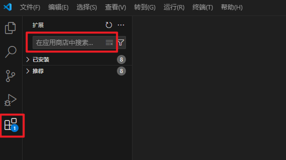

点击“自动更新”右侧齿轮可下载特定版本

 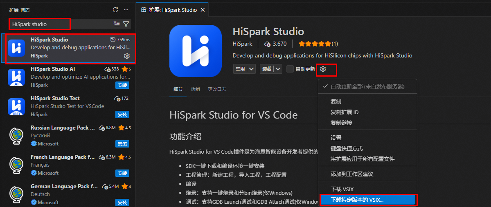

## 方式二：手动在gitcode上下载插件包进行安装
在HiSpark/vscode-hispark-studio的gitcode代码仓的发行版中下载26.06.1版本及以上的插件包：
gitcode网址：https://gitcode.com/HiSpark/vscode-hispark-studio
下载最新插件安装包：

 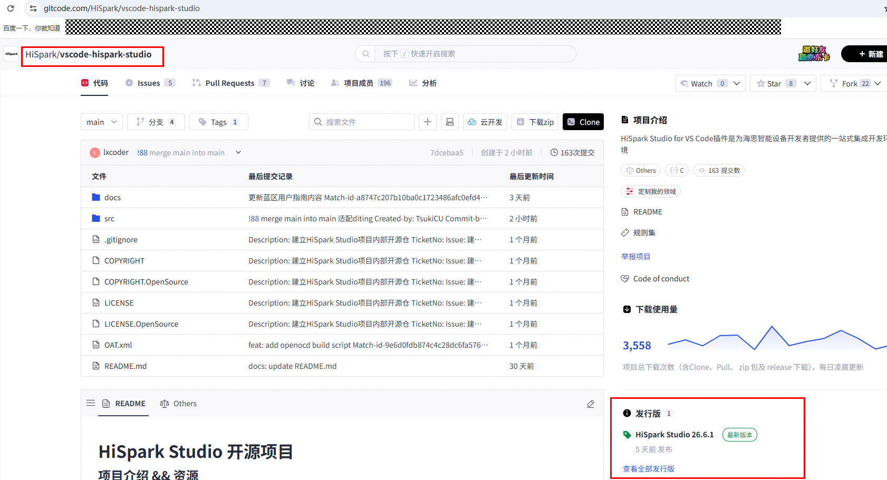

将解压后的vsix插件包直接移动至Visual Studio Code“扩展”界面

 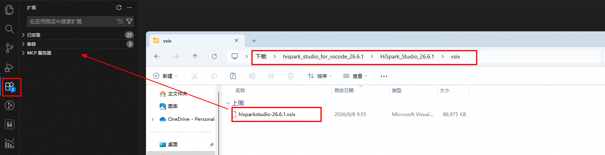

或者在Visual Studio Code“扩展”界面点击“更多”将vsix导入

 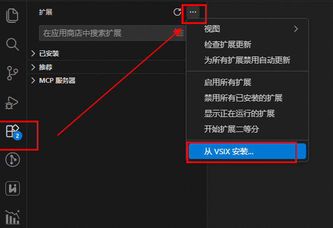

安装成功后会在Visual Studio Code侧边栏出现HiSpark Studio插件图标

 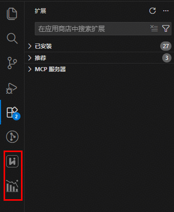

# 三、工具链下载
HiSpark Studio for VS Code插件在对工程进行编译等操作需要依赖工具链、python以及pip.pyz依赖的环境。可以使用插件中的Download Toolchain功能进行工具链等的自动下载和安装。

 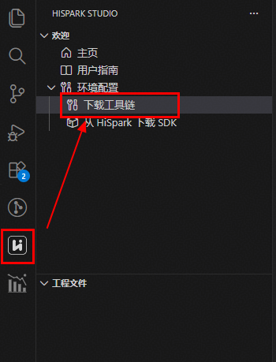

点击功能后，会弹出一个文件夹选择框用于下载并安装工具链，尽量选择一个空文件夹。

 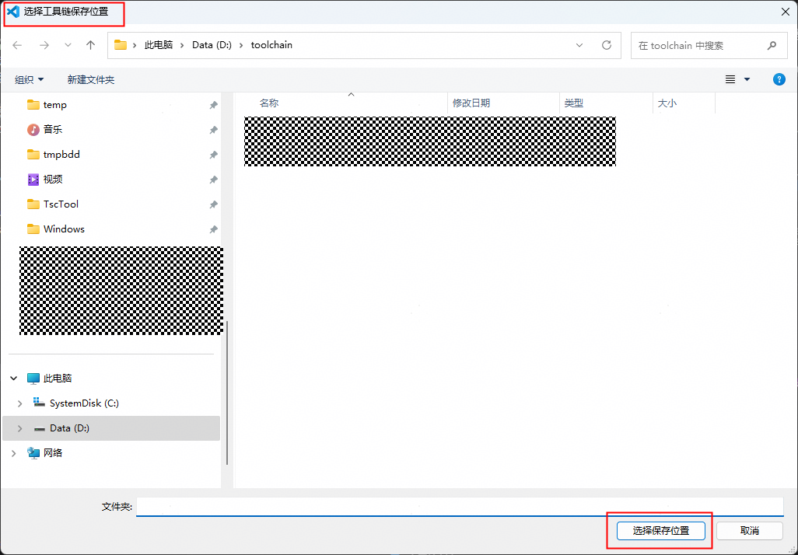

文件夹选择路径不能包含中文或者空格，否则会有提示框弹出，此时选择“再次选择文件夹路径”会重新进入到工具链保存位置选择界面，选择“取消”则会退出工具链的选择安装。

 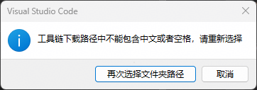

下载过程VS Code右下角通知栏会有对应的工具下载提示以及进度展示。compiler由于文件比较大，下载时间较长，请耐心等待。

 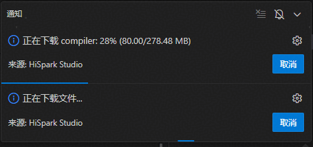

出现“环境准备完成”则代表工具链下载完成。

 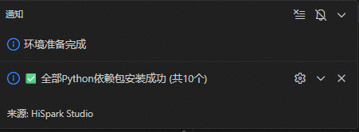

# 四、SDK下载
下载创建工程所需要的SDK软件包，可以直接在工具界面在线下载HiDiTing的SDK包

 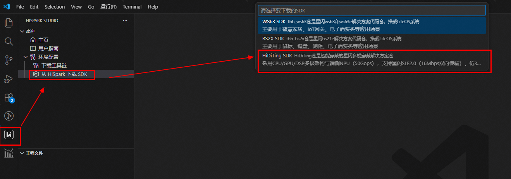

或者在gitcode官网中手动下载，下载链接：https://gitcode.com/HiSpark/hs-fbb

注：由于Windows10和Windows11的路径的长度限制，为后续编译操作，建议SDK存放路径不宜过长。

# 五、bash环境准备
HiDiTing工程如果要在windows环境下成功编译，需要配置bash环境，如果Windows系统System32下默认有“bash.exe”，需要删除其系统下的“bash.exe”，使用安装的git下内置的“bash.exe”。
## 步骤一：检查并删除Windows系统System32下默认的“bash.exe”
查看C盘Windows/System32目录下是否有bash.exe文件，如果有，则删除或者重命名

 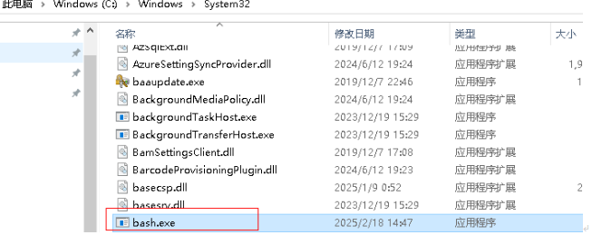

若删除Windows系统库下的bash时提示没权限，可以在需要删除的bash.exe上右键点击，选择“属性”，在弹出的窗口中依次点击“安全”标签页→“高级”→点击“所有者”标签页下的“更改”按钮。选择一个新的所有者（例如当前用户），点击“应用”和“确定”。返回“安全”标签页，点击“编辑”。为当前添加的用户或组分配适当的权限（如完全控制、读取等）。点“应用”和“确定”后即可删掉或者重命名选择的bash.exe文件。

 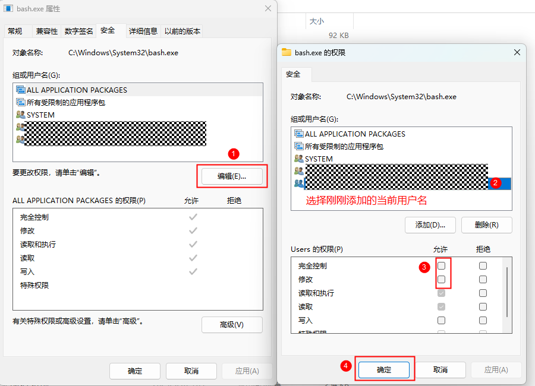

 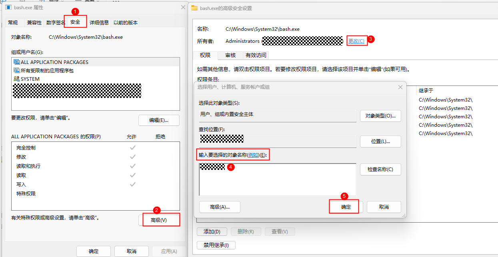

## 步骤二：手动安装bash并配置环境变量
bash下载链接：https://github.com/git-for-windows/git/releases/download/v2.48.1.windows.1/Git-2.48.1-64-bit.exe
下载后双击安装，并将安装后的目录下的bin和usr/bin添加至环境变量，且有限顺序在默认的System32之上，以安装目录为D盘根目录为例，安装目录结构：

 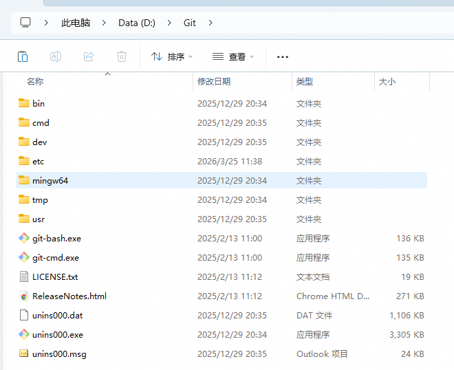

添加环境变量：

 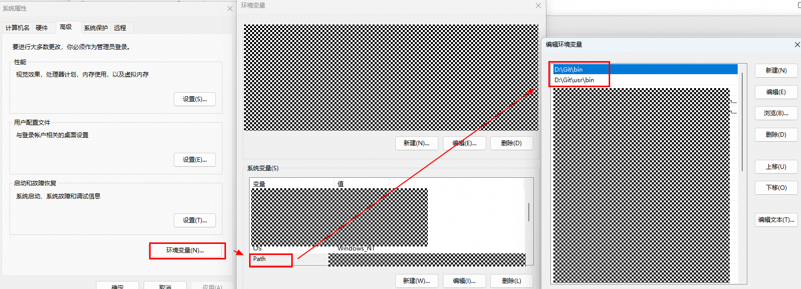

## 步骤三：验证bash环境
起任意命令提示符(cmd)，输入where bash 以及where tar，查看输出结果，需要保证bash和tar的第一个输出结果不是系统C:\Windows\System32默认的，并且bash的输出结果中不能有C:\Windows\System32字样，tar的输出结果需要保留Git目录下的atr以及系统默认System32目录下的atr：

 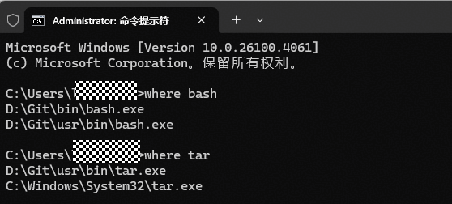

# 六、新建工程
环境均准备完成后，可以用HiSpark Studio中提供的“新建工程”功能创建工程

 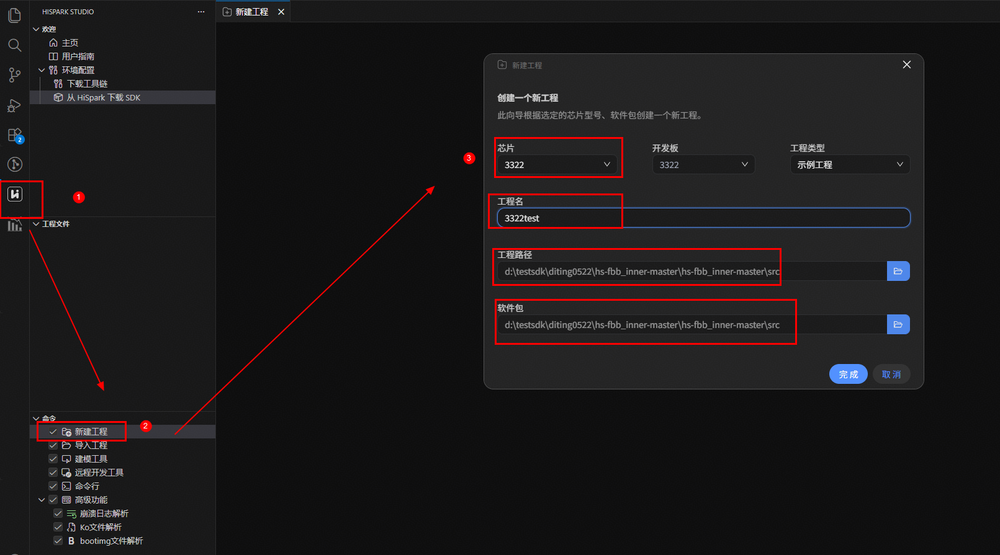

新建工程页面中，芯片选择3322，工程名由用户自定义，工程路径和软件包路径选择下载好的sdk目录下的src目录。
点击完成即可创建工程，工程创建完成后会在插件中的“工程文件”页面中打开工程文件夹，并生成一个.hiproj文件，文件名为创建工程时用户命名的“工程名”

 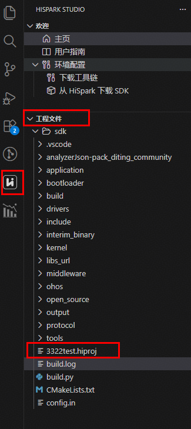

# 七、工程编译
## 编译前准备：配置毕昇工具链
在编译之前，需要给HiDiTing工程配置毕昇编译器，首先在海思生态社区下载26.03.1版本毕昇编译器。
下载链接：https://developers.hisilicon.com/cn/developerTool

 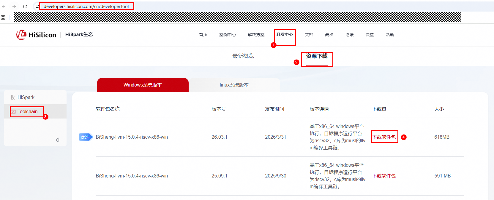

 下载后，需要对压缩包进行解压，需要检查解压后的BiSheng-llvm-15.0.4-riscv-x86-win-26.03.1\BiSheng-llvm-binary-release-win-musl\bin目录下是否存在.symlink的类型格式的文件：

 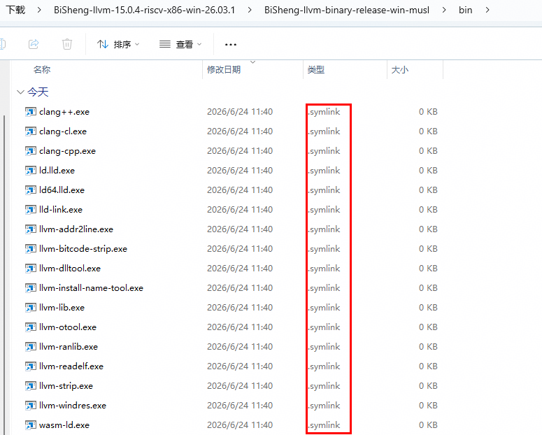

 如果不存在，建议用7z的解压缩工具用管理员权限进行工具链的解压。
 7z下载链接：https://www.7-zip.org/
 下载安装后，在7z的安装目录下右键7zFM.exe，用管理员权限打开：

 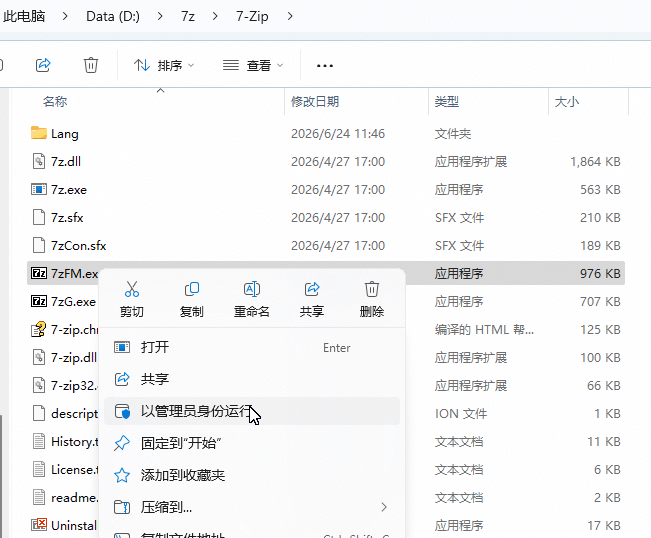

 选择需要解压的压缩包及需要解压到的路径进行解压

 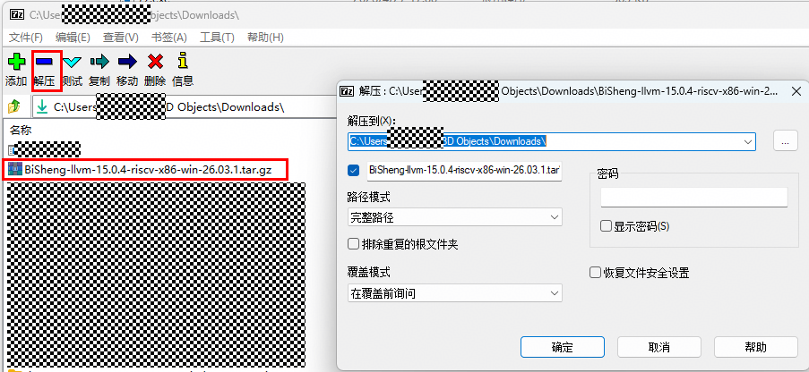
 
 注：编译器需要解压两次，也就是首次解压后的文件夹下还存在一个待解压的压缩包
 
 解压完成后，将解压后的文件夹也就是“BiSheng-llvm-binary-release-win-musl”重命名为“BiSheng-llvm-15.0.4-riscv-x86-win-26.03.1”

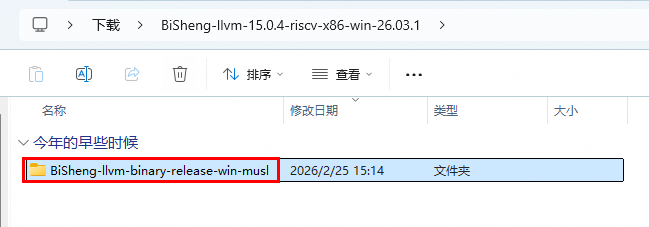

然后将重命名后的毕昇工具链整个文件夹复制到创建好的HiDiTing工程路径下的src/tools/bin/compiler/bisheng_26_03_1中，需要保证目录结构与下图一致：

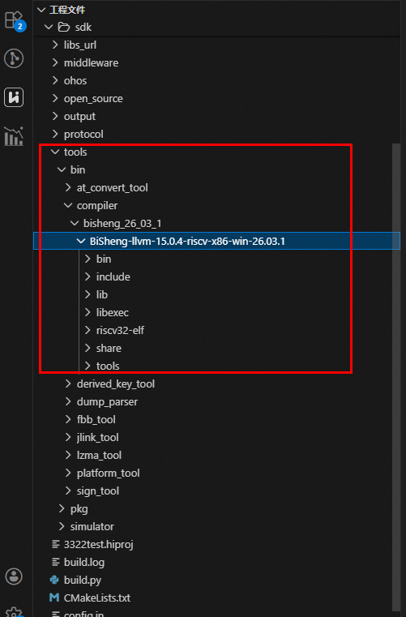

## 编译前准备：开放CONFIG_PUBLIC_OPTION_IN_FILES宏
HiDiTing工程在windows下进行编译时，需要手动修改工程目录下的“build/config/target_config/3322/config.py”文件中的代码，将默认注释的宏“CONFIG_PUBLIC_OPTION_IN_FILES”开放，如不开放，在编译过程会报“is command line too long”的错误。

 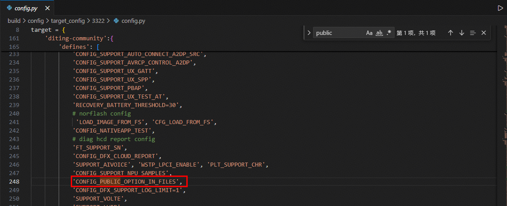

## 编译
环境均准备完成后，可以点击插件页面中的编译按钮，开始编译，编译结束后显示“success”表示编译成功

 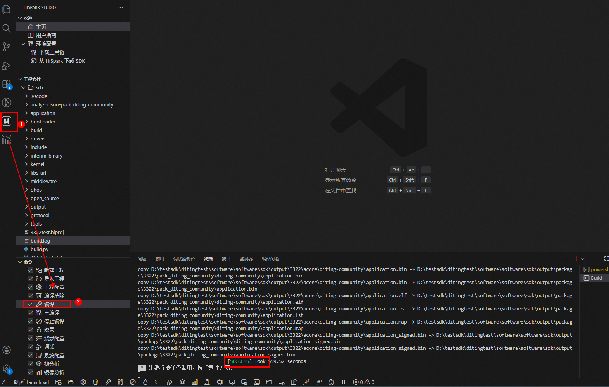

# 八、栈分析镜像分析
编译成功后可以使用工具提供的栈分析和镜像分析功能。

 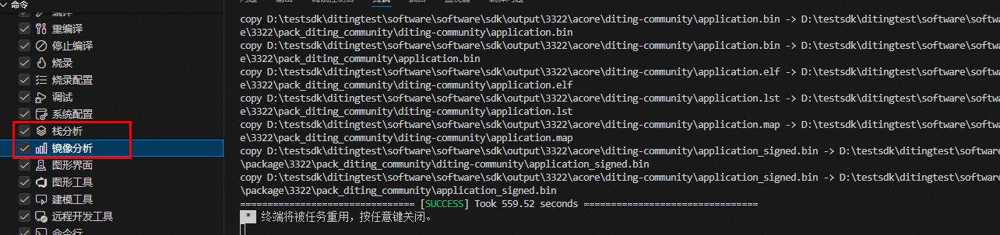

栈分析：

 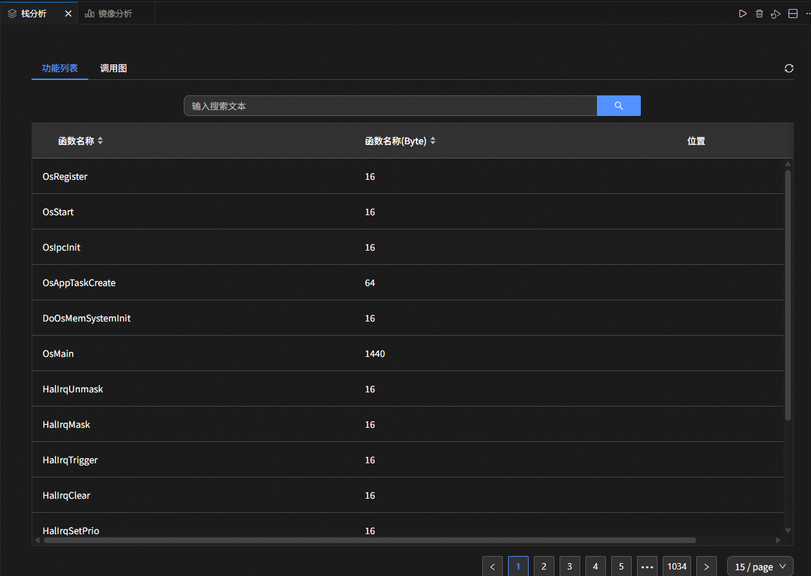

镜像分析：

 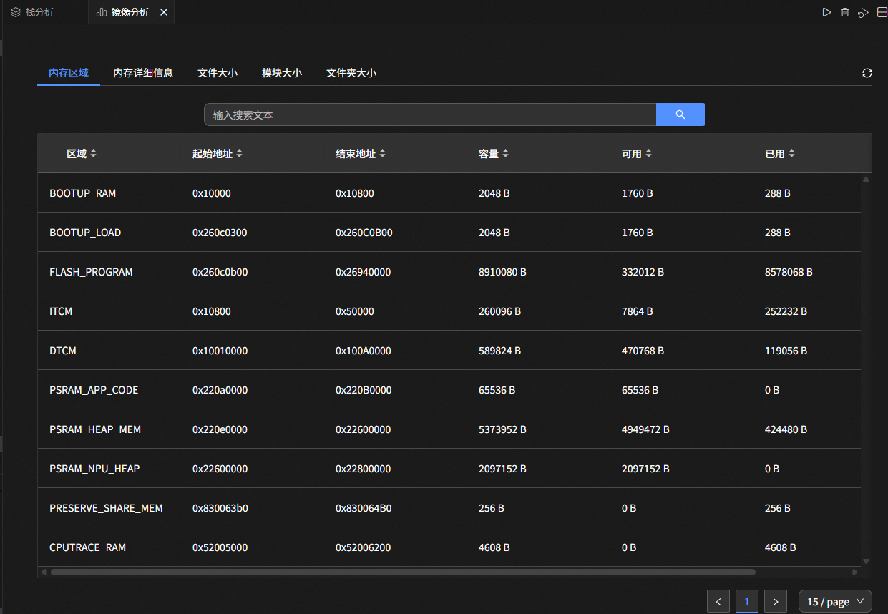

 # 九、烧录
 将运行HiSpark Studio for VS Code插件的电脑和目标板用串口线连接。常见的串口线有标准的串口线和USB转串口线两种。如果使用USB转串口线，需提前安装USB转串口驱动。

 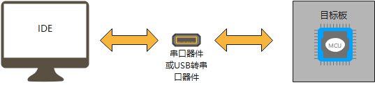

 在工程配置界面，选择实际的端口号，以及波特率，波特率默认750000

 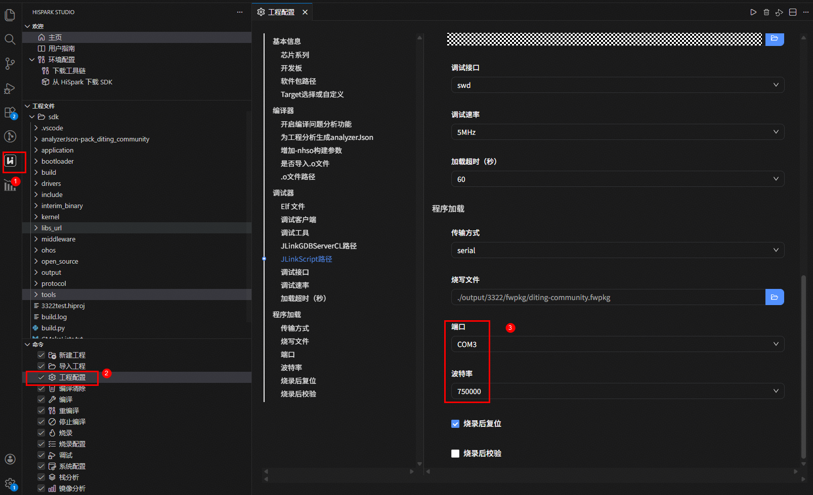

 点击“烧录”按钮，根据提示“Reset the device……”按一下复位键，即可开始烧录：

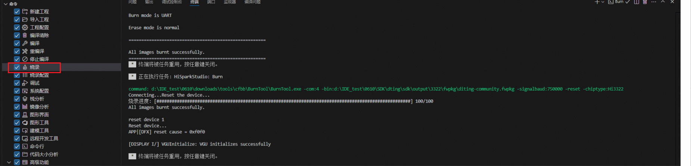 

 若只想烧录单个或者部分bin文件，可以点击“烧录配置”按钮，选择需要烧写的bin文件，再点击“烧录配置”界面中的“烧录”按钮，即可烧写选择的bin文件：
 
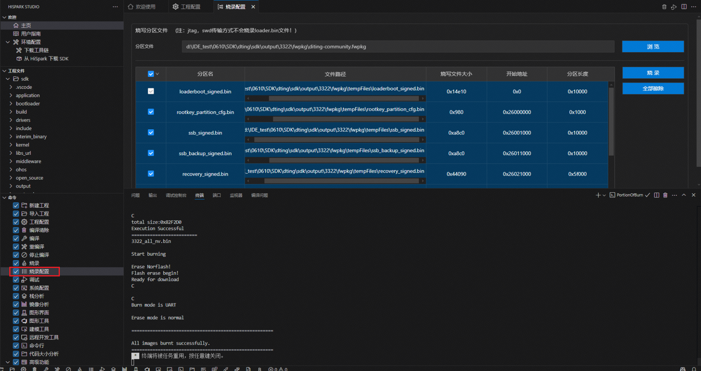 

 # 十、应用开发进阶

在完成基础环境搭建、编译烧录后，开发者可以根据自身业务需求，从“Hello World”开始，选择以下进阶方向深入学习：

- **[应用开发]**：Native JS应用和Native组件开发，掌握应用层能力扩展

- **[多媒体开发]**：UIKit、多媒体软件、图形视频驱动开发，掌握界面和媒体能力

- **[通信能力开发]**: 蓝牙/星闪、LwIP，掌握通信能力集成

- **[系统底软开发]**：设备驱动、音频驱动，掌握底层能力定制

- **[安全特性开发]**：安全启动、安全软件，构建安全可信系统

相关特性开发指南参考:
- [开发文档快速入口](../../../overview/HiDiTingV100%20开发文档快速入门/HiDiTingV100%20开发文档快速入门.md) - 平台文档概述
