# 一、前置条件
1. 确保PC网络可以正常访问Web，如Microsoft Store
2. 系统要求： Windows 10（版本1903或更高） 或 Windows 11
3. CPU虚拟化已启用（任务管理器 -> 性能 -CPU查看 -> 虚拟化：已启用）
4. 磁盘剩余空间不低于100GB

# 二、启用WSL 2功能
以管理员身份打开PowerShell，执行下面指令。

**1. 启用 WSL和虚拟机平台命令**

    dism.exe /online /enable-feature /featurename:Microsoft-Windows-Subsystem-Linux /all /norestart
    
    dism.exe /online /enable-feature /featurename:VirtualMachinePlatform /all /norestart

**2. 设置WSL 2为默认版本命令**

    wsl --set-default-version 2

**执行上述指令，若出现"未安装适用于Linux的Windows子系统"时，根据提示直接回车安装**

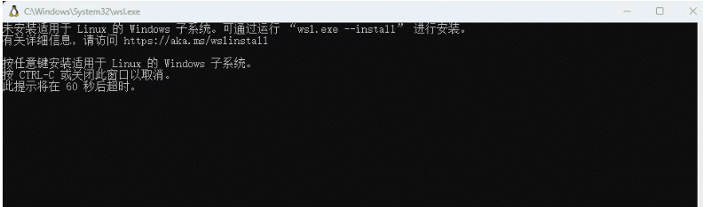

**或在PowerShell中执行下面指令单独安装**

    wsl.exe --install

**若执行wsl命令报错，如下图**

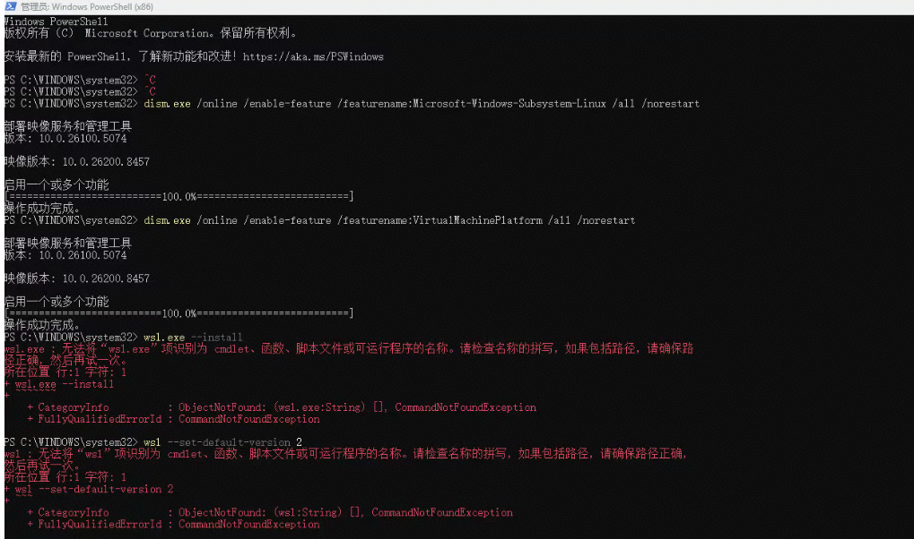

**请在Windows开始菜单中，直接搜索wsl，手动启动wsl，并按提示安装**

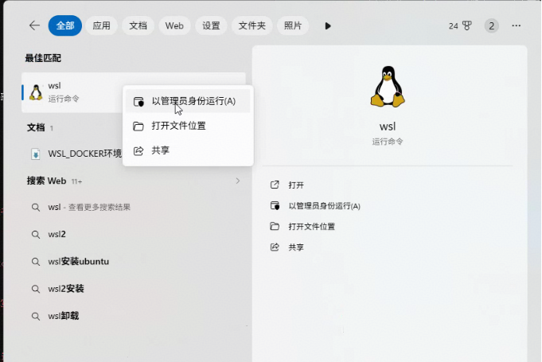


**3. 安装完成后，重启系统**

# 三、安装Linux发行版
**1. 开始菜单中，打开Microsoft Store**

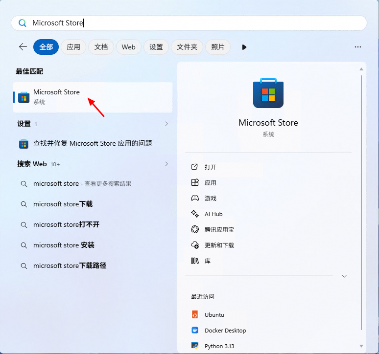

**2. 在Microsoft Store中搜索并点击直接安装Ubuntu**

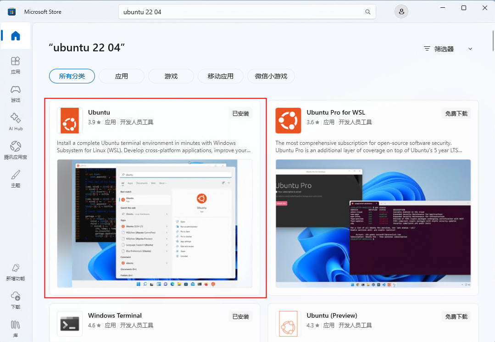

**3. 安装完成后，从Windows启动菜单中搜索并启动Ubuntu。按照系统提示，初始化用户名和密码**

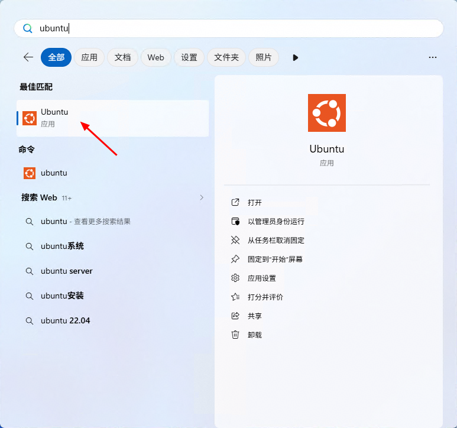

# 四、安装Docker Desktop
**1. 从Microsoft Store中搜索并安装Docker Desktop。**

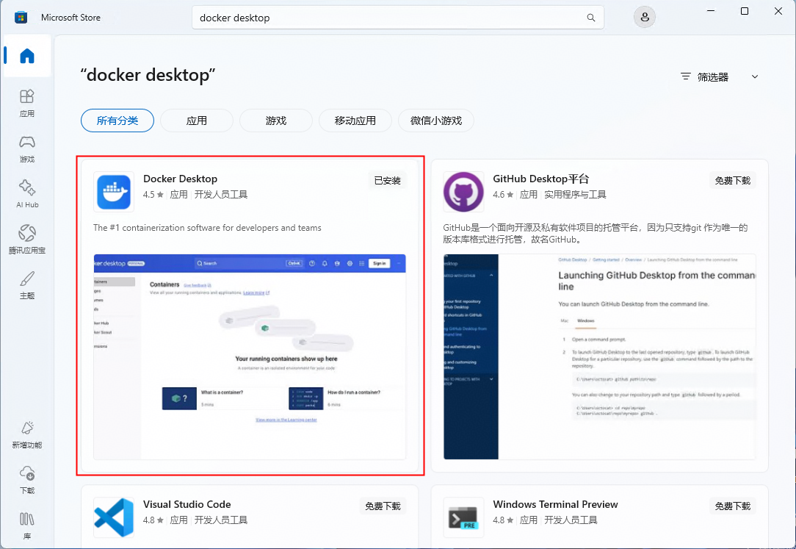

**2. 安装后，Windows开始菜单中启动Docker Desktop。**

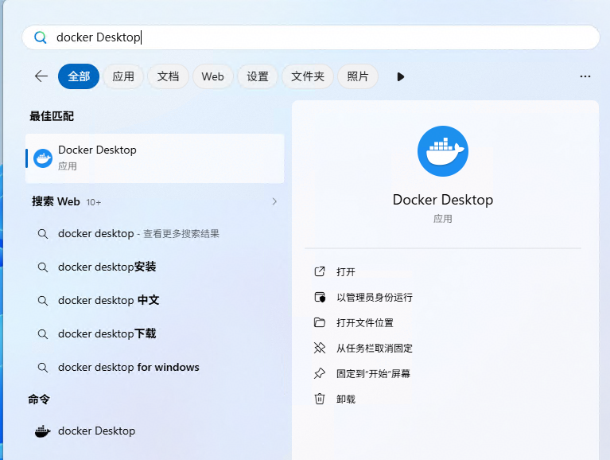

**3. 在"设置 > 通用"中勾选"使用基于 WSL 2 的引擎"（Use the WSL 2 based engine）。**

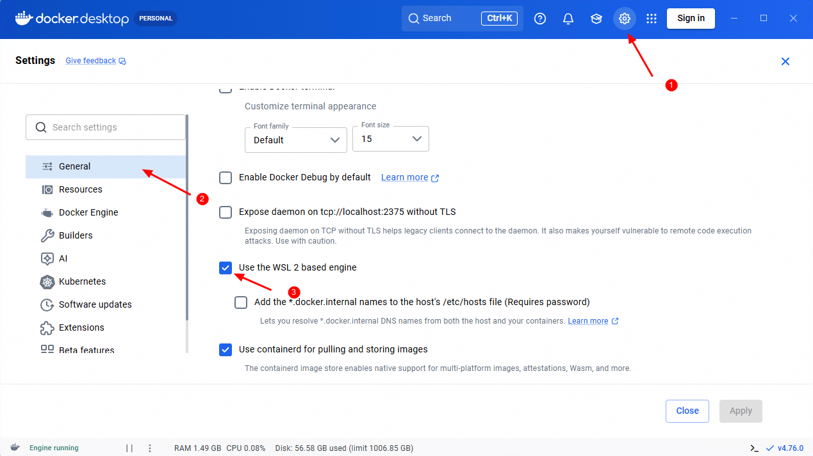

**4. 在 "设置>资源>WSL 集成"，启用 Docker 集成的已安装 WSL 2 分发版。（Enable integration with my default WSL distro）。**

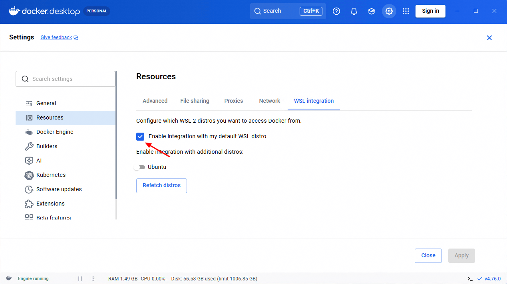

**5. 在 "设置>资源>高级"中，可以更改Disk images location路径（默认为C盘。建议修改到其他磁盘，且磁盘剩余空间大于100GB）。**

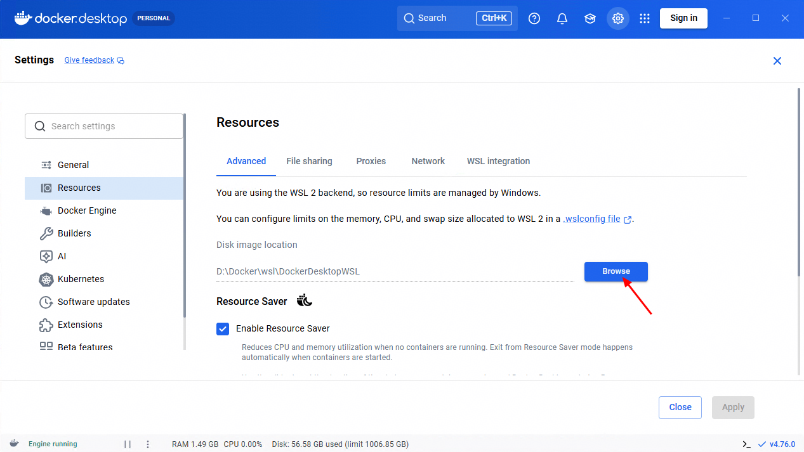

*更多docker设置，可以参考指导文档：https://learn.microsoft.com/zh-cn/windows/wsl/tutorials/wsl-containers*


# 五、检查WSL环境
**1. 从Windows开始菜单中搜索WSL，点击启动。在终端界面输入**

    sudo docker info

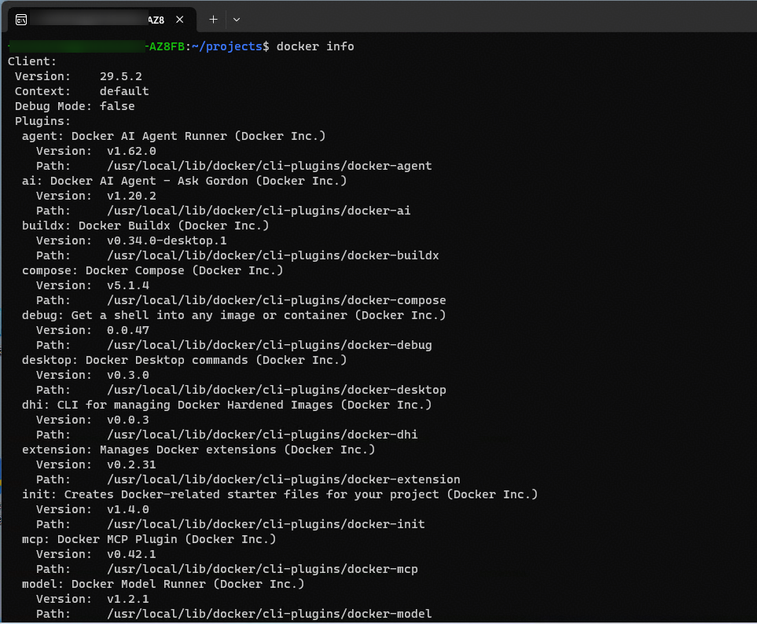

 有上述输出信息，即表明docker环境已运行正常

**2. 在PowerShell中，执行如下命令，查看WSL已安装的发行版及版本**

    wsl --list --verbose

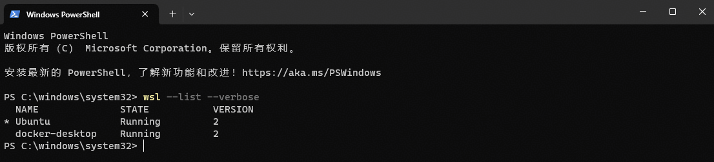

*因下载WSL、Ubuntu、Docker的顺序不同，可能默认的WSL发行版不是Ubuntu，可通过 wsl --set-default Ubuntu 命令切换*

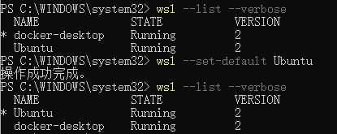


# 六、配置WSL中代码下载环境
**1. 在 WSL 的/home/下创建项目目录**

*因为宿主机Windows的磁盘路径，默认挂载在/mnt下，所以不建议将代码目录创建到/mnt下，这样会导致数据读取效率低下，容易卡顿。*
    
**2. 安装和配置git信息**

（1）安装git和git lfs

在WSL中输入`git --version`命令检查版本，如git未安装或git版本低于1.8.2，需要通过下方命令安装git

    sudo apt update && sudo apt install git -y

执行下方命令安装git lfs

    sudo apt update && sudo apt install git-lfs -y

（2）配置git

    git config --global http.sslVerify false

    git config --global https.sslVerify false

    git config --global credential.helper store

# 七、WSL中运行docker环境
**1. 在 WSL 命令界面，将当前用户加入到docker用户组，可以免sudo使用Docker**

    sudo usermod -aG docker $USER

**2. 加载docker镜像**

2.1 从docker仓库中下载docker镜像文件

    git clone https://gitcode.com/HiSpark/hispark-docker.git

 按照界面提示，首次执行git clone命令时，需要输入gitcode账号和令牌信息，按照提示输入即可。

- *如果每次克隆都需要输入凭证信息，请检查`git config --global credential.helper store`是否有执行*


2.2 加载镜像

    cd hispark-docker
    docker load -i ubuntu22.04_dt_env.tar
执行`docker load`命令后，如无异常，则会输出当前加载镜像名，如Loaded image: swr.cn-north-4.myhuaweicloud.com/hispark_docker/ubuntu22.04_dt:env

**3. 创建容器**

使用`docker run`命令创建容器。镜像名为上一步骤加载的镜像名，如下：

    docker run -d -it swr.cn-north-4.myhuaweicloud.com/hispark_docker/ubuntu22.04_dt:env bash
如无异常情况，会输出64位的容器ID号，如744c012a440e11c4c25211452fe01e80658c4f0995e27513311de418bfb48d2f

**4. 进入容器**

使用`docker exec`可进入容器，容器ID为上一步骤创建的ID号，如下：

    docker exec -it 744c012a440e11c4c25211452fe01e80658c4f0995e27513311de418bfb48d2f bash

*完整执行流程如下*

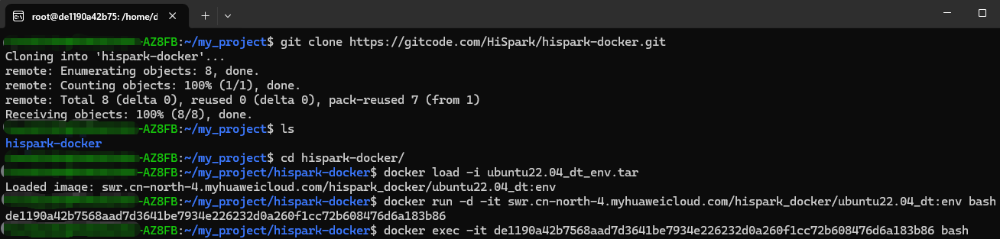

*如果忘记容器ID号，可通过下面命令找到指定的容器ID*

    docker ps -a
    docker exec -it ${CONTAINER ID} bash

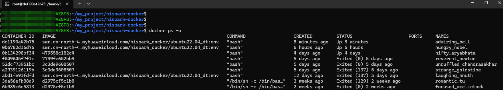

# 八、docker中代码下载与编译
**1. 源码获取**
```bash
# 进入home目录下创建工程目录，如“diting”，进入下载，将工程源码存放其中
# 建议docker镜像中首次下载gitcode托管的代码，可在docker中参考上述“六、配置代码下载环境”的“2. 安装和配置git信息”进行git配置以保存口令
git clone https://gitcode.com/HiSpark/hs-fbb.git
```
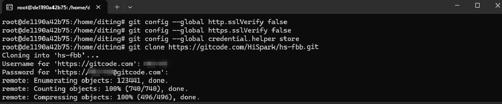

**2. 编译器获取**
```bash
# 进入工程目录
cd hs-fbb

# 初始化git submodule
git submodule init

# 下载编译器
git submodule update --remote
```
编译器下载完成后，会存放到工程目录 src/tools/bin/compiler/bisheng_26_03_1/BiSheng-llvm-15.0.4-riscv-x86-linux-26.03.1 下：

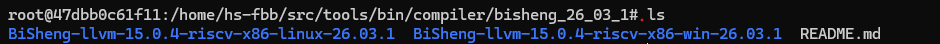

**3. SDK编译**
```bash
# 进入sdk目录
cd src

# ./build.py可选编译target，也可直接输入target名
./build.py pack_diting_community
```
编译脚本：

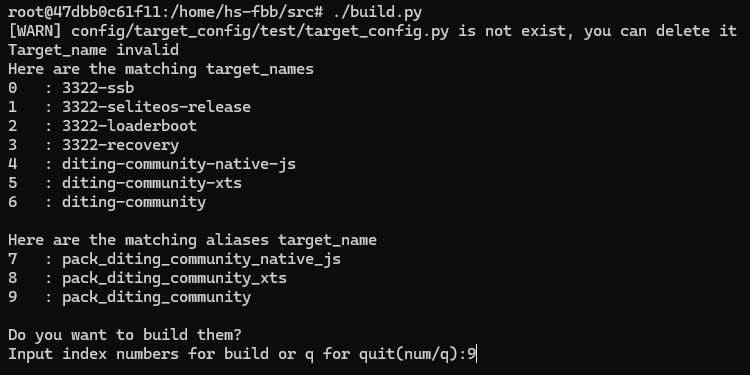

编译结果：

 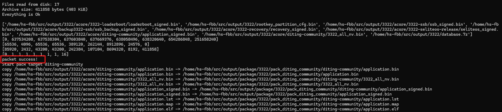

**4. 固件获取**

编译完成后，从工程目录的 src/output/3322/fwpkg 中获取固件包 diting-community.fwpkg，WSL中可通过docker命令拷贝到PC上
**[docker命令参考](#ZH-CN_TOPIC_DOCKER_CMD01)** 

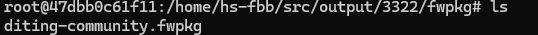

# 九、烧写与调试
## 工具获取

**1. BurnTool**

1）下载链接：https://developers.hisilicon.com/cn/developerTool HiSpark资源下载中的BurnTool 26.03.3

2）功能支持：
- 支持多种烧写协议（基于脚本集成）
- 支持eFuse读写
- 支持Flash导出
- 支持cmd命令行烧写或者BurnTool GUI烧写
- 支持一拖多

**2. DebugKits**

1）下载链接：https://developers.hisilicon.com/cn/developerTool HiSpark资源下载中的DebugKits 26.03.3

2）功能支持：
- 支持日志查看
- 支持自定义参数配置
- 支持自定义维测命令
- 支持多种数据导入导出
- 支持寄存器读写
- 支持死机分析

**3. 串口工具**

*推荐SSCOM V5.13.1- 用于串口调试，不单独提供，可自行百度下载安装*

## 开发板
开发板接线图：

待补充，敬请期待！

实体开发板：

待补充，敬请期待！

- 电源：type-c 5V电源供电
- 屏幕：MIPI/QSPI屏幕
- USB转串口：USB转串口板两块，分别用于烧写和调试（推荐FT232RL USB To TTL UART，可淘宝/京东采购）；PC端需要安装对应驱动才可识别串口板（推荐：CDM21228串口驱动，可百度下载安装）
- 波特率：串口工具/BurnTool波特率为750000；DebugKits波特率为921600
- 开关键：支持上下电
- Power键：亮屏、切页面
- 接线：开发板上T2用于烧写和串口通信，T3用于DebugKits调试，开发板的RX/TX与串口小板的RX/TX反接，即：开发板RX接串口板TX，开发板TX接串口板RX，开发板地线GND任选与串口板地线GND连接

开发板详情详见[HiDiTingV100 硬件 用户指南](../../../hardware-guide/HiDiTingV100%20硬件%20用户指南/HiDiTingV100%20硬件%20用户指南.md)

## 固件烧写
**BurnTool配置与烧写**

*因串口工具和烧写工具共用一个串口，所以烧写固件时，串口工具里要关闭串口*

 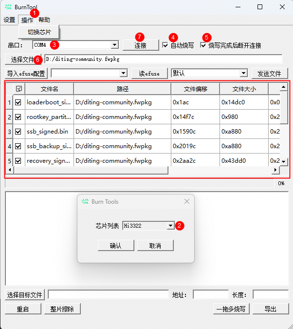

- ① 操作按钮中切换芯片
- ② 选择Hi3222
- ③ 切换串口为烧写串口（与串口工具共用一个串口，可在串口工具中设置波特率750000上电看串口是否有日志打印，选择有打印的串口作为烧写串口，如图中COM4）
- ④ 勾选“自动烧写”
- ⑤ 勾选“烧写完成后断开连接”
- ⑥ 选择文件，选择SDK编译后的固件包“diting-community.fwpkg”，下方列表中会展开各镜像信息
- ⑦ 点击“连接”按钮开始烧写，如下图所示：

 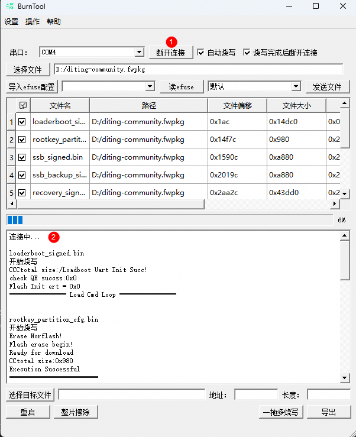

- ① 点击“连接”并将开发板断电后重新上电，开始烧写；“连接”变成“断开连接”，点击可以终止烧写
- ② 烧写进度显示，烧写完成后，自动断开连接，显示所有镜像烧写成功

 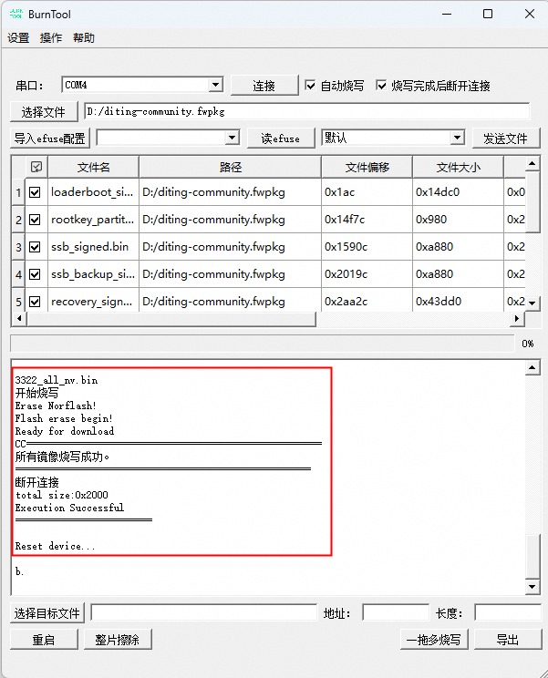

 烧写完成后，双击“Power键”亮屏进入APP list，下滑找到Hello World应用，点击应用进入，屏幕显示“Hello World”。

BurnTool工具更多用法和介绍，可参考[HiDiTingV100 BurnTool工具 使用指南](../../../tools/HiDiTingV100%20BurnTool工具%20使用指南/HiDiTingV100%20BurnTool工具%20使用指南.md)

## 串口调试
固件烧写完成后，打开串口工具，开启串口，输入正确的波特率，单板上下电会打印启动日志，后续开发板运行日志也在日志区域显示，如下图所示：

 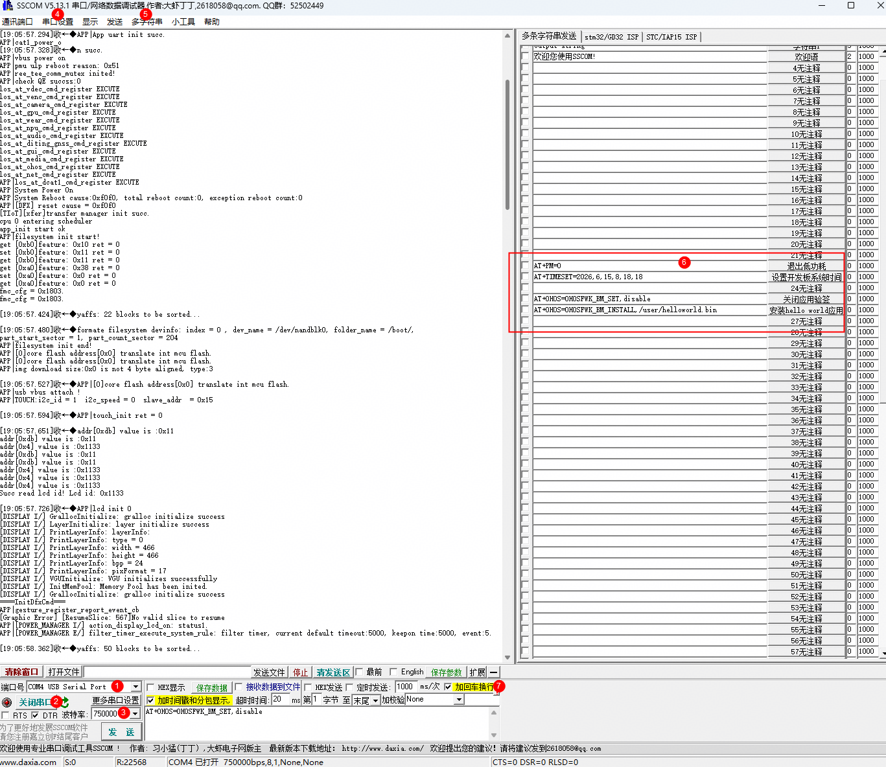

- ① 选择端口号，与烧写端口一致
- ② 开启串口
- ③ 串口波特率750000
- ④ ①到③也可在“串口设置”中设置
- ⑤ 点击“多字符串”，可以显示多字符串列表
- ⑥ 多字符串列表中填写AT调试命令，可以进行调试，如设置“退出低功耗模式”、设置“开发板系统时间”
- ⑦ 多字符串命令发送需要先勾选“加回车换行”

## DebugKits调试
以"Hello World"js应用开发为例，应用开发完成后，使用DebugKits推送应用安装包到开发板上进行日志调试

**1. 获取examples代码**
从hs-fbb工程目录下的examples/oh-jsapp/js_sample目录中将Hello World应用工程源码拷贝到Windows上

**2. js应用编译**
使用DevEco Studio For OpenHarmony（[链接下载](https://developer.huawei.com/consumer/cn/download/deveco-studio)，以下简称DevEco Studio）打开js工程; 点击Build -> Build Hap(s)进行应用编译

 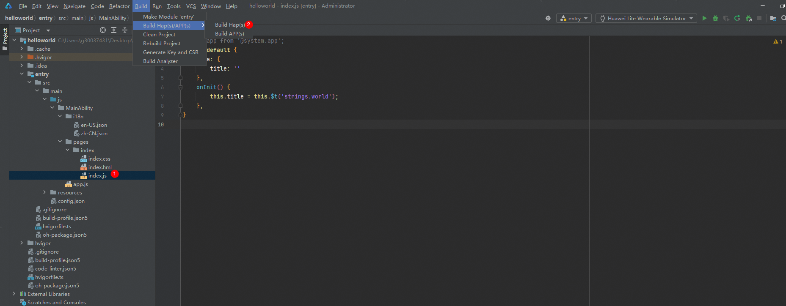

*DevEco Studio是基于IntelliJ IDEA Community开源版本打造，用作开发穿戴JS应用。当前HiDiTing产品使用的IDE版本为DevEco Studio 5.0 Release*。

更多 OpenHarmony JS应用开发可参考工程目录下examples/oh-jsapp/js_sample目录中的样例代码，js应用开发指南可参考[HiDiTingV100 OpenHarmony JS应用开发 用户指南.md](../../../api-reference/HiDiTingV100%20OpenHarmony%20JS应用开发%20用户指南/HiDiTingV100%20OpenHarmony%20JS应用开发%20用户指南.md)

**3. DebugKits配置**
- 选择芯片3322

 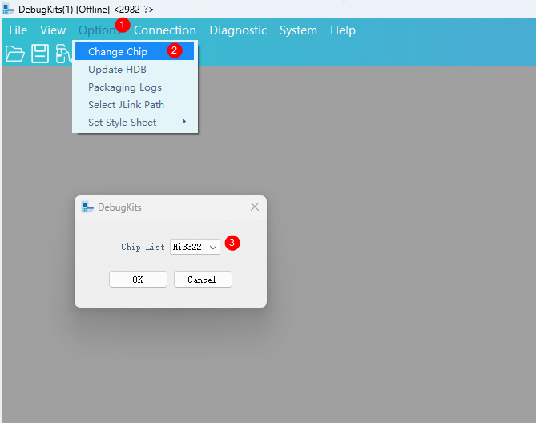


- 配置端口号和波特率

 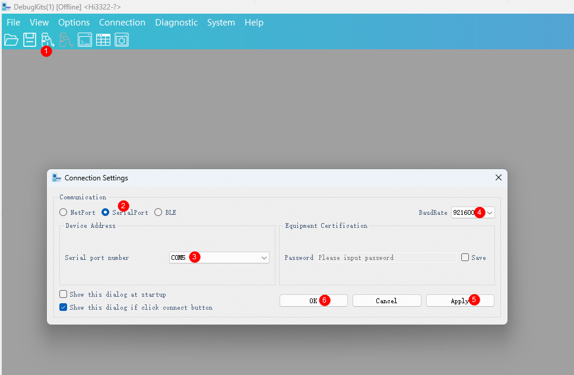

**3. 应用包推送**
编译成功后，从应用工程下entry/build/default/outputs/default/bin中找到应用包，并拷贝其在windows上的磁盘路径到DebugKits工具上进行推送，如："D:\332x\entry-default-unsigned.bin"；原生SDK已有归档examples/oh-jsapp/js_sample下对应的应用二进制，在src/application/wearable/res/js/IDE5.0下，如“hello world”应用包为“com.vendor.helloworld.bin”
 
 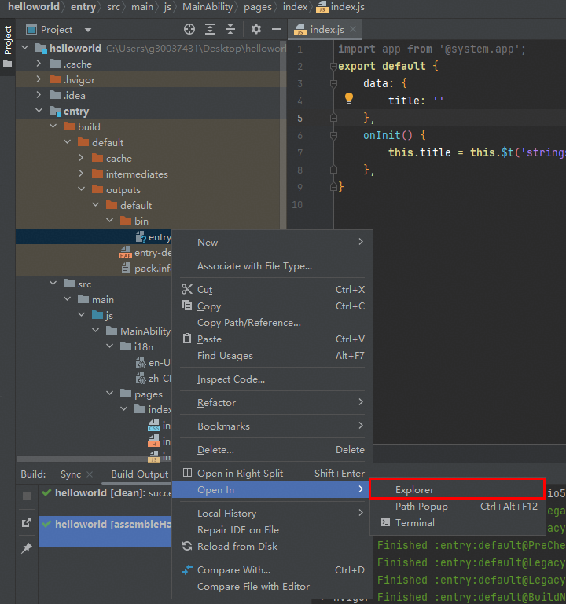

使用DebugKits推送应用包，从system页面推送到开发板指定路径并改名，方便后续使用（此路径应用安装时需要使用）

 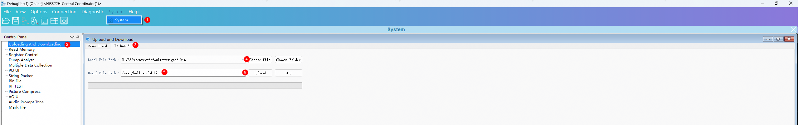

**4. 应用安装**
在串口工具中使用多字符串AT指令“AT+OHOS=OHOSFWK_BM_INSTALL,/user/helloworld.bin”进行安装，*应用如果没有使用OpenHarmony应用市场签名，可先使用AT指令“AT+OHOS=OHOSFWK_BM_SET,disable”关闭签名后安装*

 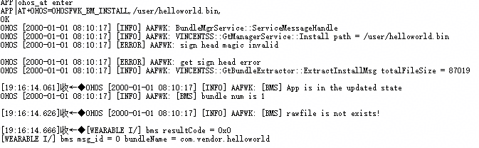

更多AT调试指令用法和介绍，可参考[HiDiTingV100 AT指令 使用指南](../../../api-reference/HiDiTingV100%20AT指令%20使用指南/HiDiTingV100%20AT指令%20使用指南.md)

**5. 应用运行**
应用安装完成后，双击 Power 键进入 APP list，滑动 APP list 找到 Hello World 应用，点击应用运行，显示如下：

 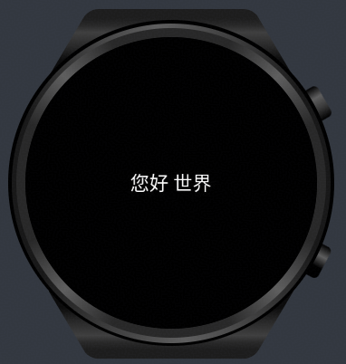

DebugKits工具更多用法和介绍，可参考[HiDiTingV100 DebugKits工具 使用指南](../../../tools/HiDiTingV100%20DebugKits工具%20使用指南/HiDiTingV100%20DebugKits工具%20使用指南.md)

# 十、其他
## HiDiTing 开发进阶
更多Native/Native-js应用开发、外设驱动开发、蓝牙/星闪开发可参考[开发文档快速入口](../../../overview/HiDiTingV100%20开发文档快速入门/HiDiTingV100%20开发文档快速入门.md)
HiDiTing也提供了一些外设驱动的Demo和Demo开发指南，请参考“/docs/docs-zh_CN/HiDiTingV100/samples/”路径下的指南，跟随指南可快速上手相关外设的应用开发

## WSL+Docker环境搭建注意事项
**1. 避免C盘空间占用**

将Docker数据目录迁移到其他分区（需通过Docker Desktop 设置 -> Advanced 调整磁盘路径）。在WSL中将项目代码存储在Linux文件系统（如~/project），而非/mnt/c/路径，避免占用C盘空间。

**2. 将docker中的文件拷贝到宿主机目录下<a name="ZH-CN_TOPIC_DOCKER_CMD01"></a>**

在WSL中，通过

    docker ps -a

获取目标容器ID（CONTAINER ID），通过下列命令，将docker容器中/home/{PATH}/{FILE_NAME}的文件，复制到宿主机的指定{LOCAL_PATH}路径下

    docker cp {CONTAINER ID}:/home/{PATH}/{FILE_NAME} ${LOCAL_PATH}

如需要将CONTAINER ID为744c012a440e中的/home/diting下的images.tar.gz文件，拷贝到宿主机/home/build/projects下。执行命令如下：

    docker cp 744c012a440e:/home/diting/images.tar.gz /home/build/projects

**3. 将宿主机上的文件复制到WSL**

    在宿主机的左侧文件管理树结构中，找到Linux图标下的Ubuntu，展开找到文件需要复制到的目标目录，直接复制即可。
   
    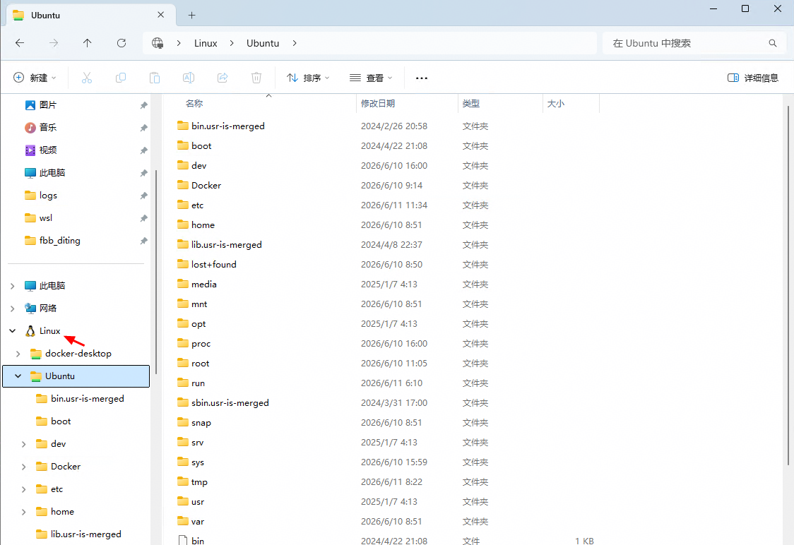

    在文件管理地址栏中，输入下面命令，也可以列出当前Ubuntu中的文件结构

    \\wsl.localhost\Ubuntu

**4. 其他docker命令参考**

    以下为部分可能会用到的docker命令，供参考。

    容器停止：

        docker stop {容器ID}

    容器删除:

        docker rm {容器ID}

    镜像删除：

        docker rmi {镜像ID} 或者 docker rmi {镜像名称}

    退出容器：

        exit

**5. 更多的git和git lfs相关配置指引参考**

    https://geek-blogs.com/blog/installing-git-in-linux/