# 前言

**概述**

本文档提供HiDiTingV100芯片管脚列表、单板设计指导及关键器件选型指导建议，对客户如何成功实现芯片板级设计给出指导。

**读者对象**

本文档主要适用于以下工程师：

-   技术支持工程师
-   产品硬件开发工程师
-   PCB设计工程师

**符号约定**

在本文中可能出现下列标志，它们所代表的含义如下。

<table><thead align="left"><tr id="row1530720816410"><th class="cellrowborder" valign="top" width="20.580000000000002%" id="mcps1.1.3.1.1">
<strong id="b2136615816410">符号</strong>

</th>
<th class="cellrowborder" valign="top" width="79.42%" id="mcps1.1.3.1.2">
<strong id="b5941558116410">说明</strong>

</th>
</tr>
</thead>
<tbody><tr id="row1372280416410"><td class="cellrowborder" valign="top" width="20.580000000000002%" headers="mcps1.1.3.1.1 ">

</td>
<td class="cellrowborder" valign="top" width="79.42%" headers="mcps1.1.3.1.2 ">
表示如不避免则将会导致死亡或严重伤害的具有高等级风险的危害。

</td>
</tr>
<tr id="row466863216410"><td class="cellrowborder" valign="top" width="20.580000000000002%" headers="mcps1.1.3.1.1 ">

</td>
<td class="cellrowborder" valign="top" width="79.42%" headers="mcps1.1.3.1.2 ">
表示如不避免则可能导致死亡或严重伤害的具有中等级风险的危害。

</td>
</tr>
<tr id="row123863216410"><td class="cellrowborder" valign="top" width="20.580000000000002%" headers="mcps1.1.3.1.1 ">

</td>
<td class="cellrowborder" valign="top" width="79.42%" headers="mcps1.1.3.1.2 ">
表示如不避免则可能导致轻微或中度伤害的具有低等级风险的危害。

</td>
</tr>
<tr id="row5786682116410"><td class="cellrowborder" valign="top" width="20.580000000000002%" headers="mcps1.1.3.1.1 ">

</td>
<td class="cellrowborder" valign="top" width="79.42%" headers="mcps1.1.3.1.2 ">
用于传递设备或环境安全警示信息。如不避免则可能会导致设备损坏、数据丢失、设备性能降低或其它不可预知的结果。

“须知”不涉及人身伤害。

</td>
</tr>
<tr id="row2856923116410"><td class="cellrowborder" valign="top" width="20.580000000000002%" headers="mcps1.1.3.1.1 ">

</td>
<td class="cellrowborder" valign="top" width="79.42%" headers="mcps1.1.3.1.2 ">
对正文中重点信息的补充说明。

“说明”不是安全警示信息，不涉及人身、设备及环境伤害信息。

</td>
</tr>
</tbody>
</table>

# 模组封装与管脚定义

-   **[模组封装](#ZH-CN_TOPIC_0000002514301630)**  

-   **[管脚分布图](#ZH-CN_TOPIC_0000002545781583)**  

-   **[管脚类型说明](#ZH-CN_TOPIC_0000002514141708)**  

-   **[管脚数量统计](#ZH-CN_TOPIC_0000002545901577)**  

-   **[管脚描述](#ZH-CN_TOPIC_0000002514301632)**  

## 模组封装

模组封装如[图1](#p1179mcpsimp)、[图2](#p1181mcpsimp)、[图3](#p1183mcpsimp)所示。

**图 1**  模组封装俯视及侧视图  
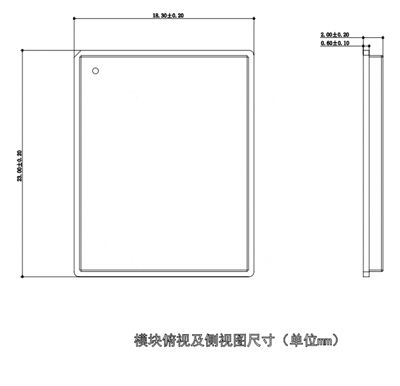

**图 2**  模组封装底视图  
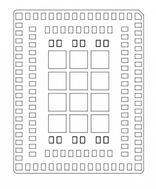

**图 3**  模组推荐封装尺寸  
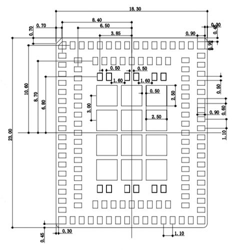

## 管脚分布图

HiDiTingV100管脚分布如[图1](#_fig13815123319534)所示。

**图 1**  管脚分布图（视图方向：TOP VIEW，即从封装的顶部往下看）  

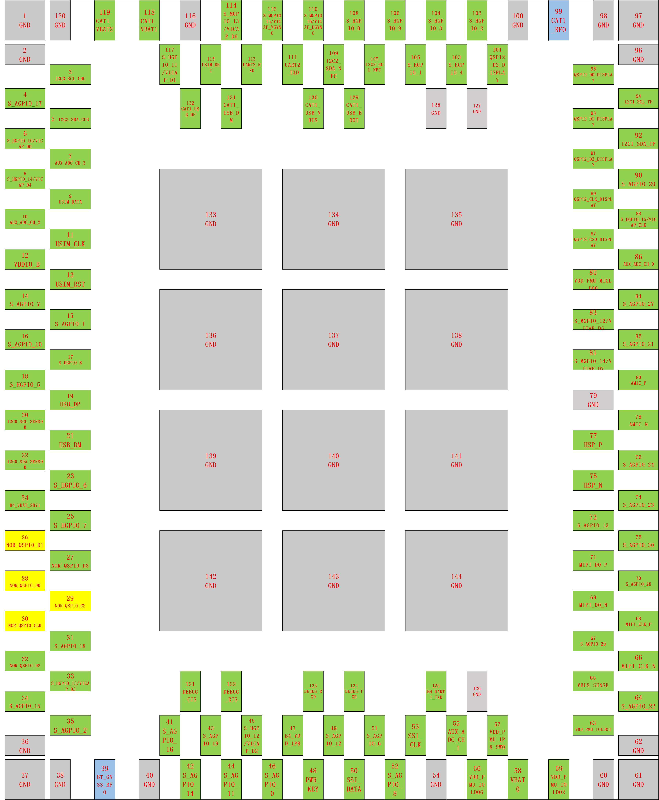

## 管脚类型说明

管脚I/O类型和电平类型如[表1](#__Toc470247167)所示。

**表 1**  管脚I/O类型和电平类型说明

<table><thead align="left"><tr id="row2127mcpsimp"><th class="cellrowborder" valign="top" width="28.999999999999996%" id="mcps1.2.3.1.1">
类型

</th>
<th class="cellrowborder" valign="top" width="71%" id="mcps1.2.3.1.2">
说明

</th>
</tr>
</thead>
<tbody><tr id="row2133mcpsimp"><td class="cellrowborder" valign="top" width="28.999999999999996%" headers="mcps1.2.3.1.1 ">
I

</td>
<td class="cellrowborder" valign="top" width="71%" headers="mcps1.2.3.1.2 ">
数字管脚，普通输入端口。

</td>
</tr>
<tr id="row2138mcpsimp"><td class="cellrowborder" valign="top" width="28.999999999999996%" headers="mcps1.2.3.1.1 ">
O

</td>
<td class="cellrowborder" valign="top" width="71%" headers="mcps1.2.3.1.2 ">
数字管脚，普通输出端口。

</td>
</tr>
<tr id="row2143mcpsimp"><td class="cellrowborder" valign="top" width="28.999999999999996%" headers="mcps1.2.3.1.1 ">
IPU

</td>
<td class="cellrowborder" valign="top" width="71%" headers="mcps1.2.3.1.2 ">
数字管脚，带有内部上拉的输入端口。

</td>
</tr>
<tr id="row2149mcpsimp"><td class="cellrowborder" valign="top" width="28.999999999999996%" headers="mcps1.2.3.1.1 ">
IPD

</td>
<td class="cellrowborder" valign="top" width="71%" headers="mcps1.2.3.1.2 ">
数字管脚，带有内部下拉的输入端口。

</td>
</tr>
<tr id="row2155mcpsimp"><td class="cellrowborder" valign="top" width="28.999999999999996%" headers="mcps1.2.3.1.1 ">
IANA

</td>
<td class="cellrowborder" valign="top" width="71%" headers="mcps1.2.3.1.2 ">
模拟管脚，输入端口。

</td>
</tr>
<tr id="row2161mcpsimp"><td class="cellrowborder" valign="top" width="28.999999999999996%" headers="mcps1.2.3.1.1 ">
OANA

</td>
<td class="cellrowborder" valign="top" width="71%" headers="mcps1.2.3.1.2 ">
模拟管脚，输出端口。

</td>
</tr>
<tr id="row2167mcpsimp"><td class="cellrowborder" valign="top" width="28.999999999999996%" headers="mcps1.2.3.1.1 ">
IORF

</td>
<td class="cellrowborder" valign="top" width="71%" headers="mcps1.2.3.1.2 ">
RF管脚，输入输出端口。

</td>
</tr>
<tr id="row2173mcpsimp"><td class="cellrowborder" valign="top" width="28.999999999999996%" headers="mcps1.2.3.1.1 ">
IPMU

</td>
<td class="cellrowborder" valign="top" width="71%" headers="mcps1.2.3.1.2 ">
电源管脚，输入端口。

</td>
</tr>
<tr id="row2179mcpsimp"><td class="cellrowborder" valign="top" width="28.999999999999996%" headers="mcps1.2.3.1.1 ">
OPMU

</td>
<td class="cellrowborder" valign="top" width="71%" headers="mcps1.2.3.1.2 ">
电源管脚，输出端口。

</td>
</tr>
</tbody>
</table>

## 管脚数量统计

各功能管脚数量信息如[表1](#__Toc139708563)所示。

**表 1**  管脚数量统计

<table><thead align="left"><tr id="row3618mcpsimp"><th class="cellrowborder" valign="top" width="44.24%" id="mcps1.2.3.1.1">
管脚类别

</th>
<th class="cellrowborder" valign="top" width="55.76%" id="mcps1.2.3.1.2">
数量

</th>
</tr>
</thead>
<tbody><tr id="row3624mcpsimp"><td class="cellrowborder" valign="top" width="44.24%" headers="mcps1.2.3.1.1 ">
RFIO接口

</td>
<td class="cellrowborder" valign="top" width="55.76%" headers="mcps1.2.3.1.2 ">
2

</td>
</tr>
<tr id="row3629mcpsimp"><td class="cellrowborder" valign="top" width="44.24%" headers="mcps1.2.3.1.1 ">
电源

</td>
<td class="cellrowborder" valign="top" width="55.76%" headers="mcps1.2.3.1.2 ">
13

</td>
</tr>
<tr id="row3634mcpsimp"><td class="cellrowborder" valign="top" width="44.24%" headers="mcps1.2.3.1.1 ">
音频信号

</td>
<td class="cellrowborder" valign="top" width="55.76%" headers="mcps1.2.3.1.2 ">
4

</td>
</tr>
<tr id="row3639mcpsimp"><td class="cellrowborder" valign="top" width="44.24%" headers="mcps1.2.3.1.1 ">
MIPI信号

</td>
<td class="cellrowborder" valign="top" width="55.76%" headers="mcps1.2.3.1.2 ">
4

</td>
</tr>
<tr id="row3644mcpsimp"><td class="cellrowborder" valign="top" width="44.24%" headers="mcps1.2.3.1.1 ">
AUXADC接口

</td>
<td class="cellrowborder" valign="top" width="55.76%" headers="mcps1.2.3.1.2 ">
8，其中4个与GPIO复用

</td>
</tr>
<tr id="row3649mcpsimp"><td class="cellrowborder" valign="top" width="44.24%" headers="mcps1.2.3.1.1 ">
USB接口

</td>
<td class="cellrowborder" valign="top" width="55.76%" headers="mcps1.2.3.1.2 ">
6

</td>
</tr>
<tr id="row3654mcpsimp"><td class="cellrowborder" valign="top" width="44.24%" headers="mcps1.2.3.1.1 ">
USIM接口

</td>
<td class="cellrowborder" valign="top" width="55.76%" headers="mcps1.2.3.1.2 ">
4

</td>
</tr>
<tr id="row3659mcpsimp"><td class="cellrowborder" valign="top" width="44.24%" headers="mcps1.2.3.1.1 ">
上电控制信号

</td>
<td class="cellrowborder" valign="top" width="55.76%" headers="mcps1.2.3.1.2 ">
2

</td>
</tr>
<tr id="row3664mcpsimp"><td class="cellrowborder" valign="top" width="44.24%" headers="mcps1.2.3.1.1 ">
GND

</td>
<td class="cellrowborder" valign="top" width="55.76%" headers="mcps1.2.3.1.2 ">
30

</td>
</tr>
<tr id="row3669mcpsimp"><td class="cellrowborder" valign="top" width="44.24%" headers="mcps1.2.3.1.1 ">
数字IO

</td>
<td class="cellrowborder" valign="top" width="55.76%" headers="mcps1.2.3.1.2 ">
70

</td>
</tr>
<tr id="row3674mcpsimp"><td class="cellrowborder" valign="top" width="44.24%" headers="mcps1.2.3.1.1 ">
维测管脚

</td>
<td class="cellrowborder" valign="top" width="55.76%" headers="mcps1.2.3.1.2 ">
5

</td>
</tr>
<tr id="row3679mcpsimp"><td class="cellrowborder" valign="top" width="44.24%" headers="mcps1.2.3.1.1 ">
总计

</td>
<td class="cellrowborder" valign="top" width="55.76%" headers="mcps1.2.3.1.2 ">
144

</td>
</tr>
</tbody>
</table>

## 管脚描述

本小节描述HiDiTingV100的各个管脚，包括电源、RF、显示、音频、AUXADC、数字管脚、地等。

-   **[电源管脚](#ZH-CN_TOPIC_0000002545781587)**  

-   **[上电控制信号](#ZH-CN_TOPIC_0000002514141710)**  

-   **[RF接口](#ZH-CN_TOPIC_0000002545901579)**  

-   **[音频信号管脚](#ZH-CN_TOPIC_0000002514301636)**  

-   **[MIPI信号管脚](#ZH-CN_TOPIC_0000002545781589)**  

-   **[AUX ADC接口](#ZH-CN_TOPIC_0000002514141714)**  

-   **[USB接口](#ZH-CN_TOPIC_0000002545901583)**  

-   **[GND管脚](#ZH-CN_TOPIC_0000002514301638)**  

-   **[USIM管脚](#ZH-CN_TOPIC_0000002545781593)**  

-   **[数字管脚](#ZH-CN_TOPIC_0000002514141716)**  

-   **[维测管脚](#ZH-CN_TOPIC_0000002545901585)**  

### 电源管脚

HiDiTingV100电源管脚如[表1](#__Ref438453666)所示。

**表 1**  电源管脚列表

<table><thead align="left"><tr id="row2556mcpsimp"><th class="cellrowborder" valign="top" width="13.200000000000001%" id="mcps1.2.6.1.1">
管脚编号

</th>
<th class="cellrowborder" valign="top" width="24.529999999999998%" id="mcps1.2.6.1.2">
管脚名称

</th>
<th class="cellrowborder" valign="top" width="11.25%" id="mcps1.2.6.1.3">
类型

</th>
<th class="cellrowborder" valign="top" width="34.04%" id="mcps1.2.6.1.4">
管脚说明

</th>
<th class="cellrowborder" valign="top" width="16.98%" id="mcps1.2.6.1.5">
电压（典型值）

</th>
</tr>
</thead>
<tbody><tr id="row2568mcpsimp"><td class="cellrowborder" valign="top" width="13.200000000000001%" headers="mcps1.2.6.1.1 ">
58

</td>
<td class="cellrowborder" valign="top" width="24.529999999999998%" headers="mcps1.2.6.1.2 ">
VSYS

</td>
<td class="cellrowborder" valign="top" width="11.25%" headers="mcps1.2.6.1.3 ">
IPMU

</td>
<td class="cellrowborder" valign="top" width="34.04%" headers="mcps1.2.6.1.4 ">
板级接charger后级，主控芯片电源输入。

</td>
<td class="cellrowborder" valign="top" width="16.98%" headers="mcps1.2.6.1.5 ">
3.8V

</td>
</tr>
<tr id="row2580mcpsimp"><td class="cellrowborder" valign="top" width="13.200000000000001%" headers="mcps1.2.6.1.1 ">
57

</td>
<td class="cellrowborder" valign="top" width="24.529999999999998%" headers="mcps1.2.6.1.2 ">
VDD_PMU_1P8_SW0

</td>
<td class="cellrowborder" valign="top" width="11.25%" headers="mcps1.2.6.1.3 ">
OPMU

</td>
<td class="cellrowborder" valign="top" width="34.04%" headers="mcps1.2.6.1.4 ">
主控芯片1.8V switch输出。

用于Nand Flash供电。

</td>
<td class="cellrowborder" valign="top" width="16.98%" headers="mcps1.2.6.1.5 ">
1.8V

</td>
</tr>
<tr id="row2593mcpsimp"><td class="cellrowborder" valign="top" width="13.200000000000001%" headers="mcps1.2.6.1.1 ">
85

</td>
<td class="cellrowborder" valign="top" width="24.529999999999998%" headers="mcps1.2.6.1.2 ">
VDD_PMU_MICLDO0

</td>
<td class="cellrowborder" valign="top" width="11.25%" headers="mcps1.2.6.1.3 ">
OPMU

</td>
<td class="cellrowborder" valign="top" width="34.04%" headers="mcps1.2.6.1.4 ">
MICBIAS供电，电压0.9/1.2/1.8 V。

</td>
<td class="cellrowborder" valign="top" width="16.98%" headers="mcps1.2.6.1.5 ">
1.8V

</td>
</tr>
<tr id="row2605mcpsimp"><td class="cellrowborder" valign="top" width="13.200000000000001%" headers="mcps1.2.6.1.1 ">
59

</td>
<td class="cellrowborder" valign="top" width="24.529999999999998%" headers="mcps1.2.6.1.2 ">
VDD_PMU_IOLDO2

</td>
<td class="cellrowborder" valign="top" width="11.25%" headers="mcps1.2.6.1.3 ">
OPMU

</td>
<td class="cellrowborder" valign="top" width="34.04%" headers="mcps1.2.6.1.4 ">
IOLDO2电源输出，AUXADC基准电源。

</td>
<td class="cellrowborder" valign="top" width="16.98%" headers="mcps1.2.6.1.5 ">
1.8V

</td>
</tr>
<tr id="row2617mcpsimp"><td class="cellrowborder" valign="top" width="13.200000000000001%" headers="mcps1.2.6.1.1 ">
63

</td>
<td class="cellrowborder" valign="top" width="24.529999999999998%" headers="mcps1.2.6.1.2 ">
VDD_PMU_IOLDO3

</td>
<td class="cellrowborder" valign="top" width="11.25%" headers="mcps1.2.6.1.3 ">
OPMU

</td>
<td class="cellrowborder" valign="top" width="34.04%" headers="mcps1.2.6.1.4 ">
IOLDO3电源输出。

</td>
<td class="cellrowborder" valign="top" width="16.98%" headers="mcps1.2.6.1.5 ">
3.3V

</td>
</tr>
<tr id="row2629mcpsimp"><td class="cellrowborder" valign="top" width="13.200000000000001%" headers="mcps1.2.6.1.1 ">
56

</td>
<td class="cellrowborder" valign="top" width="24.529999999999998%" headers="mcps1.2.6.1.2 ">
VDD_PMU_IOLDO6

</td>
<td class="cellrowborder" valign="top" width="11.25%" headers="mcps1.2.6.1.3 ">
OPMU

</td>
<td class="cellrowborder" valign="top" width="34.04%" headers="mcps1.2.6.1.4 ">
IOLDO6电源输出，用于Nor Flash供电。

</td>
<td class="cellrowborder" valign="top" width="16.98%" headers="mcps1.2.6.1.5 ">
1.8V

</td>
</tr>
<tr id="row2641mcpsimp"><td class="cellrowborder" valign="top" width="13.200000000000001%" headers="mcps1.2.6.1.1 ">
24

</td>
<td class="cellrowborder" valign="top" width="24.529999999999998%" headers="mcps1.2.6.1.2 ">
B4_VBAT_2871

</td>
<td class="cellrowborder" valign="top" width="11.25%" headers="mcps1.2.6.1.3 ">
IPMU

</td>
<td class="cellrowborder" valign="top" width="34.04%" headers="mcps1.2.6.1.4 ">
GNSS芯片VSYS供电。

</td>
<td class="cellrowborder" valign="top" width="16.98%" headers="mcps1.2.6.1.5 ">
3.3V

</td>
</tr>
<tr id="row2653mcpsimp"><td class="cellrowborder" valign="top" width="13.200000000000001%" headers="mcps1.2.6.1.1 ">
47

</td>
<td class="cellrowborder" valign="top" width="24.529999999999998%" headers="mcps1.2.6.1.2 ">
B4_VDD_1PB

</td>
<td class="cellrowborder" valign="top" width="11.25%" headers="mcps1.2.6.1.3 ">
IPMU

</td>
<td class="cellrowborder" valign="top" width="34.04%" headers="mcps1.2.6.1.4 ">
GNSS芯片VDD18供电。

</td>
<td class="cellrowborder" valign="top" width="16.98%" headers="mcps1.2.6.1.5 ">
1.8V

</td>
</tr>
<tr id="row2665mcpsimp"><td class="cellrowborder" valign="top" width="13.200000000000001%" headers="mcps1.2.6.1.1 ">
12

</td>
<td class="cellrowborder" valign="top" width="24.529999999999998%" headers="mcps1.2.6.1.2 ">
VDDIO_B

</td>
<td class="cellrowborder" valign="top" width="11.25%" headers="mcps1.2.6.1.3 ">
OPMU

</td>
<td class="cellrowborder" valign="top" width="34.04%" headers="mcps1.2.6.1.4 ">
USIM电源。

</td>
<td class="cellrowborder" valign="top" width="16.98%" headers="mcps1.2.6.1.5 ">
1.8V/3V

</td>
</tr>
<tr id="row2677mcpsimp"><td class="cellrowborder" valign="top" width="13.200000000000001%" headers="mcps1.2.6.1.1 ">
118

</td>
<td class="cellrowborder" valign="top" width="24.529999999999998%" headers="mcps1.2.6.1.2 ">
CAT1_VBAT1

</td>
<td class="cellrowborder" valign="top" width="11.25%" headers="mcps1.2.6.1.3 ">
IPMU

</td>
<td class="cellrowborder" valign="top" width="34.04%" headers="mcps1.2.6.1.4 ">
CAT1 PA供电电源。

</td>
<td class="cellrowborder" valign="top" width="16.98%" headers="mcps1.2.6.1.5 ">
3.8V

</td>
</tr>
<tr id="row2689mcpsimp"><td class="cellrowborder" valign="top" width="13.200000000000001%" headers="mcps1.2.6.1.1 ">
119

</td>
<td class="cellrowborder" valign="top" width="24.529999999999998%" headers="mcps1.2.6.1.2 ">
CAT1_VBAT2

</td>
<td class="cellrowborder" valign="top" width="11.25%" headers="mcps1.2.6.1.3 ">
IPMU

</td>
<td class="cellrowborder" valign="top" width="34.04%" headers="mcps1.2.6.1.4 ">
CAT1芯片供电电源。

</td>
<td class="cellrowborder" valign="top" width="16.98%" headers="mcps1.2.6.1.5 ">
3.8V

</td>
</tr>
</tbody>
</table>

### 上电控制信号

上电控制信号如[表1](#__Toc367870709)所示。

**表 1**  上电控制信号管脚列表

<table><thead align="left"><tr id="row2711mcpsimp"><th class="cellrowborder" valign="top" width="17.17171717171717%" id="mcps1.2.5.1.1">
管脚编号

</th>
<th class="cellrowborder" valign="top" width="21.962196219621962%" id="mcps1.2.5.1.2">
管脚名称

</th>
<th class="cellrowborder" valign="top" width="13.971397139713973%" id="mcps1.2.5.1.3">
类型

</th>
<th class="cellrowborder" valign="top" width="46.8946894689469%" id="mcps1.2.5.1.4">
描述

</th>
</tr>
</thead>
<tbody><tr id="row2721mcpsimp"><td class="cellrowborder" valign="top" width="17.17171717171717%" headers="mcps1.2.5.1.1 ">
48

</td>
<td class="cellrowborder" valign="top" width="21.962196219621962%" headers="mcps1.2.5.1.2 ">
PWR_KEY

</td>
<td class="cellrowborder" valign="top" width="13.971397139713973%" headers="mcps1.2.5.1.3 ">
IPMU

</td>
<td class="cellrowborder" valign="top" width="46.8946894689469%" headers="mcps1.2.5.1.4 ">
开关机按键，下降沿有效。

</td>
</tr>
<tr id="row2731mcpsimp"><td class="cellrowborder" valign="top" width="17.17171717171717%" headers="mcps1.2.5.1.1 ">
65

</td>
<td class="cellrowborder" valign="top" width="21.962196219621962%" headers="mcps1.2.5.1.2 ">
VBUS_SENSE

</td>
<td class="cellrowborder" valign="top" width="13.971397139713973%" headers="mcps1.2.5.1.3 ">
IPMU

</td>
<td class="cellrowborder" valign="top" width="46.8946894689469%" headers="mcps1.2.5.1.4 ">
上电检测，充电开机专用管脚，高电平有效。

高电平有效范围：0.8V&lt;VBUS_SENSE&lt;1.8V。

</td>
</tr>
</tbody>
</table>

> **说明：** 
>上述上电控制信号管脚属于专用管脚，不可复用GPIO。

### RF接口

射频RF口如[表1](#__Toc367870719)所示。

**表 1**  RF接口管脚列表

<table><thead align="left"><tr id="row114mcpsimp"><th class="cellrowborder" valign="top" width="16.421642164216426%" id="mcps1.2.6.1.1">
管脚编号

</th>
<th class="cellrowborder" valign="top" width="20.072007200720073%" id="mcps1.2.6.1.2">
管脚名称

</th>
<th class="cellrowborder" valign="top" width="10.961096109610962%" id="mcps1.2.6.1.3">
类型

</th>
<th class="cellrowborder" valign="top" width="14.281428142814281%" id="mcps1.2.6.1.4">
电压（V）

</th>
<th class="cellrowborder" valign="top" width="38.263826382638264%" id="mcps1.2.6.1.5">
功能描述

</th>
</tr>
</thead>
<tbody><tr id="row126mcpsimp"><td class="cellrowborder" valign="top" width="16.421642164216426%" headers="mcps1.2.6.1.1 ">
39

</td>
<td class="cellrowborder" valign="top" width="20.072007200720073%" headers="mcps1.2.6.1.2 ">
BT_GNSS_RFO

</td>
<td class="cellrowborder" valign="top" width="10.961096109610962%" headers="mcps1.2.6.1.3 ">
IORF

</td>
<td class="cellrowborder" valign="top" width="14.281428142814281%" headers="mcps1.2.6.1.4 ">
-

</td>
<td class="cellrowborder" valign="top" width="38.263826382638264%" headers="mcps1.2.6.1.5 ">
BT和GNSS合路射频TX/RX接口。

</td>
</tr>
<tr id="row138mcpsimp"><td class="cellrowborder" valign="top" width="16.421642164216426%" headers="mcps1.2.6.1.1 ">
99

</td>
<td class="cellrowborder" valign="top" width="20.072007200720073%" headers="mcps1.2.6.1.2 ">
CAT1_RFO

</td>
<td class="cellrowborder" valign="top" width="10.961096109610962%" headers="mcps1.2.6.1.3 ">
IORF

</td>
<td class="cellrowborder" valign="top" width="14.281428142814281%" headers="mcps1.2.6.1.4 ">
-

</td>
<td class="cellrowborder" valign="top" width="38.263826382638264%" headers="mcps1.2.6.1.5 ">
CAT_1射频接口。

</td>
</tr>
</tbody>
</table>

### 音频信号管脚

音频信号管脚如[表1](#__Ref54941678)所示。

模组支持1路模拟AMIC、1路模拟输出接口。

**表 1**  CODEC信号管脚列表

<table><thead align="left"><tr id="row2205mcpsimp"><th class="cellrowborder" valign="top" width="17.82178217821782%" id="mcps1.2.5.1.1">
管脚编号

</th>
<th class="cellrowborder" valign="top" width="23.762376237623766%" id="mcps1.2.5.1.2">
管脚名称

</th>
<th class="cellrowborder" valign="top" width="16.011601160116008%" id="mcps1.2.5.1.3">
类型

</th>
<th class="cellrowborder" valign="top" width="42.404240424042406%" id="mcps1.2.5.1.4">
描述

</th>
</tr>
</thead>
<tbody><tr id="row2215mcpsimp"><td class="cellrowborder" valign="top" width="17.82178217821782%" headers="mcps1.2.5.1.1 ">
80

</td>
<td class="cellrowborder" valign="top" width="23.762376237623766%" headers="mcps1.2.5.1.2 ">
AMIC_P

</td>
<td class="cellrowborder" valign="top" width="16.011601160116008%" headers="mcps1.2.5.1.3 ">
IANA

</td>
<td class="cellrowborder" valign="top" width="42.404240424042406%" headers="mcps1.2.5.1.4 ">
AMIC接口输入信号正。

</td>
</tr>
<tr id="row2225mcpsimp"><td class="cellrowborder" valign="top" width="17.82178217821782%" headers="mcps1.2.5.1.1 ">
78

</td>
<td class="cellrowborder" valign="top" width="23.762376237623766%" headers="mcps1.2.5.1.2 ">
AMIC_N

</td>
<td class="cellrowborder" valign="top" width="16.011601160116008%" headers="mcps1.2.5.1.3 ">
IANA

</td>
<td class="cellrowborder" valign="top" width="42.404240424042406%" headers="mcps1.2.5.1.4 ">
AMIC接口输入信号负。

</td>
</tr>
<tr id="row2235mcpsimp"><td class="cellrowborder" valign="top" width="17.82178217821782%" headers="mcps1.2.5.1.1 ">
77

</td>
<td class="cellrowborder" valign="top" width="23.762376237623766%" headers="mcps1.2.5.1.2 ">
HSP_P

</td>
<td class="cellrowborder" valign="top" width="16.011601160116008%" headers="mcps1.2.5.1.3 ">
OANA

</td>
<td class="cellrowborder" valign="top" width="42.404240424042406%" headers="mcps1.2.5.1.4 ">
HS接口输出信号正。

</td>
</tr>
<tr id="row2245mcpsimp"><td class="cellrowborder" valign="top" width="17.82178217821782%" headers="mcps1.2.5.1.1 ">
75

</td>
<td class="cellrowborder" valign="top" width="23.762376237623766%" headers="mcps1.2.5.1.2 ">
HSP_N

</td>
<td class="cellrowborder" valign="top" width="16.011601160116008%" headers="mcps1.2.5.1.3 ">
OANA

</td>
<td class="cellrowborder" valign="top" width="42.404240424042406%" headers="mcps1.2.5.1.4 ">
HS接口输出信号负。

</td>
</tr>
</tbody>
</table>

### MIPI信号管脚

MIPI显示信号管脚如[表1](#__Ref54941516)所示。

芯片支持1lane MIPI显示接口，高速数字IO口。

**表 1**  MIPI显示信号管脚列表

<table><thead align="left"><tr id="row3108mcpsimp"><th class="cellrowborder" valign="top" width="18%" id="mcps1.2.6.1.1">
管脚编号

</th>
<th class="cellrowborder" valign="top" width="21%" id="mcps1.2.6.1.2">
管脚名称

</th>
<th class="cellrowborder" valign="top" width="12%" id="mcps1.2.6.1.3">
类型

</th>
<th class="cellrowborder" valign="top" width="24.55%" id="mcps1.2.6.1.4">
电平标准

</th>
<th class="cellrowborder" valign="top" width="24.45%" id="mcps1.2.6.1.5">
功能描述

</th>
</tr>
</thead>
<tbody><tr id="row3120mcpsimp"><td class="cellrowborder" valign="top" width="18%" headers="mcps1.2.6.1.1 ">
68

</td>
<td class="cellrowborder" valign="top" width="21%" headers="mcps1.2.6.1.2 ">
MIPI_CLK_P

</td>
<td class="cellrowborder" valign="top" width="12%" headers="mcps1.2.6.1.3 ">
O

</td>
<td class="cellrowborder" valign="top" width="24.55%" headers="mcps1.2.6.1.4 ">
满足DSI接口协议。

</td>
<td class="cellrowborder" valign="top" width="24.45%" headers="mcps1.2.6.1.5 ">
MIPI显示接口CLK正。

</td>
</tr>
<tr id="row3131mcpsimp"><td class="cellrowborder" valign="top" width="18%" headers="mcps1.2.6.1.1 ">
66

</td>
<td class="cellrowborder" valign="top" width="21%" headers="mcps1.2.6.1.2 ">
MIPI_CLK_N

</td>
<td class="cellrowborder" valign="top" width="12%" headers="mcps1.2.6.1.3 ">
O

</td>
<td class="cellrowborder" valign="top" width="24.55%" headers="mcps1.2.6.1.4 ">
满足DSI接口协议。

</td>
<td class="cellrowborder" valign="top" width="24.45%" headers="mcps1.2.6.1.5 ">
MIPI显示接口CLK负。

</td>
</tr>
<tr id="row3142mcpsimp"><td class="cellrowborder" valign="top" width="18%" headers="mcps1.2.6.1.1 ">
71

</td>
<td class="cellrowborder" valign="top" width="21%" headers="mcps1.2.6.1.2 ">
MIPI_D0_P

</td>
<td class="cellrowborder" valign="top" width="12%" headers="mcps1.2.6.1.3 ">
IO

</td>
<td class="cellrowborder" valign="top" width="24.55%" headers="mcps1.2.6.1.4 ">
满足DSI接口协议。

</td>
<td class="cellrowborder" valign="top" width="24.45%" headers="mcps1.2.6.1.5 ">
MIPI显示接口DATA0正。

</td>
</tr>
<tr id="row3153mcpsimp"><td class="cellrowborder" valign="top" width="18%" headers="mcps1.2.6.1.1 ">
69

</td>
<td class="cellrowborder" valign="top" width="21%" headers="mcps1.2.6.1.2 ">
MIPI_D0_N

</td>
<td class="cellrowborder" valign="top" width="12%" headers="mcps1.2.6.1.3 ">
IO

</td>
<td class="cellrowborder" valign="top" width="24.55%" headers="mcps1.2.6.1.4 ">
满足DSI接口协议。

</td>
<td class="cellrowborder" valign="top" width="24.45%" headers="mcps1.2.6.1.5 ">
MIPI显示接口DATA0负。

</td>
</tr>
</tbody>
</table>

### AUX ADC接口

ADC信号管脚如[表1](#_Ref218523819)所示。模组支持8路ADC，其中AUX\_ADC\_CH\_4、AUX\_ADC\_CH\_5、AUX\_ADC\_CH\_6、AUX\_ADC\_CH\_7与数字管脚复用。

**表 1**  AUX\_ADC信号管脚列表

<table><thead align="left"><tr id="row2773mcpsimp"><th class="cellrowborder" valign="top" width="13.861386138613863%" id="mcps1.2.5.1.1">
管脚编号

</th>
<th class="cellrowborder" valign="top" width="24.752475247524753%" id="mcps1.2.5.1.2">
管脚名称

</th>
<th class="cellrowborder" valign="top" width="14.85148514851485%" id="mcps1.2.5.1.3">
类型

</th>
<th class="cellrowborder" valign="top" width="46.53465346534653%" id="mcps1.2.5.1.4">
描述

</th>
</tr>
</thead>
<tbody><tr id="row2783mcpsimp"><td class="cellrowborder" valign="top" width="13.861386138613863%" headers="mcps1.2.5.1.1 ">
86

</td>
<td class="cellrowborder" valign="top" width="24.752475247524753%" headers="mcps1.2.5.1.2 ">
AUX_ADC_CH_0

</td>
<td class="cellrowborder" valign="top" width="14.85148514851485%" headers="mcps1.2.5.1.3 ">
IANA

</td>
<td class="cellrowborder" valign="top" width="46.53465346534653%" headers="mcps1.2.5.1.4 ">
ADC通道0。支持电平输入范围：0V～1.8V。

</td>
</tr>
<tr id="row2793mcpsimp"><td class="cellrowborder" valign="top" width="13.861386138613863%" headers="mcps1.2.5.1.1 ">
55

</td>
<td class="cellrowborder" valign="top" width="24.752475247524753%" headers="mcps1.2.5.1.2 ">
AUX_ADC_CH_1

</td>
<td class="cellrowborder" valign="top" width="14.85148514851485%" headers="mcps1.2.5.1.3 ">
IANA

</td>
<td class="cellrowborder" valign="top" width="46.53465346534653%" headers="mcps1.2.5.1.4 ">
ADC通道1。支持电平输入范围：0V～1.8V。

</td>
</tr>
<tr id="row2803mcpsimp"><td class="cellrowborder" valign="top" width="13.861386138613863%" headers="mcps1.2.5.1.1 ">
10

</td>
<td class="cellrowborder" valign="top" width="24.752475247524753%" headers="mcps1.2.5.1.2 ">
AUX_ADC_CH_2

</td>
<td class="cellrowborder" valign="top" width="14.85148514851485%" headers="mcps1.2.5.1.3 ">
IANA

</td>
<td class="cellrowborder" valign="top" width="46.53465346534653%" headers="mcps1.2.5.1.4 ">
ADC通道2。支持电平输入范围：0V～1.8V。

</td>
</tr>
<tr id="row2813mcpsimp"><td class="cellrowborder" valign="top" width="13.861386138613863%" headers="mcps1.2.5.1.1 ">
7

</td>
<td class="cellrowborder" valign="top" width="24.752475247524753%" headers="mcps1.2.5.1.2 ">
AUX_ADC_CH_3

</td>
<td class="cellrowborder" valign="top" width="14.85148514851485%" headers="mcps1.2.5.1.3 ">
IANA

</td>
<td class="cellrowborder" valign="top" width="46.53465346534653%" headers="mcps1.2.5.1.4 ">
ADC通道3。支持电平输入范围：0V～1.8V。

</td>
</tr>
<tr id="row2823mcpsimp"><td class="cellrowborder" valign="top" width="13.861386138613863%" headers="mcps1.2.5.1.1 ">
44

</td>
<td class="cellrowborder" valign="top" width="24.752475247524753%" headers="mcps1.2.5.1.2 ">
AUX_ADC_CH_4

</td>
<td class="cellrowborder" valign="top" width="14.85148514851485%" headers="mcps1.2.5.1.3 ">
IANA

</td>
<td class="cellrowborder" valign="top" width="46.53465346534653%" headers="mcps1.2.5.1.4 ">
ADC通道4。支持电平输入范围：0V～1.8V。

</td>
</tr>
<tr id="row2833mcpsimp"><td class="cellrowborder" valign="top" width="13.861386138613863%" headers="mcps1.2.5.1.1 ">
34

</td>
<td class="cellrowborder" valign="top" width="24.752475247524753%" headers="mcps1.2.5.1.2 ">
AUX_ADC_CH_5

</td>
<td class="cellrowborder" valign="top" width="14.85148514851485%" headers="mcps1.2.5.1.3 ">
IANA

</td>
<td class="cellrowborder" valign="top" width="46.53465346534653%" headers="mcps1.2.5.1.4 ">
ADC通道5。支持电平输入范围：0V～1.8V。

</td>
</tr>
<tr id="row2843mcpsimp"><td class="cellrowborder" valign="top" width="13.861386138613863%" headers="mcps1.2.5.1.1 ">
52

</td>
<td class="cellrowborder" valign="top" width="24.752475247524753%" headers="mcps1.2.5.1.2 ">
AUX_ADC_CH_6

</td>
<td class="cellrowborder" valign="top" width="14.85148514851485%" headers="mcps1.2.5.1.3 ">
IANA

</td>
<td class="cellrowborder" valign="top" width="46.53465346534653%" headers="mcps1.2.5.1.4 ">
ADC通道6。支持电平输入范围：0V～1.8V。

</td>
</tr>
<tr id="row2853mcpsimp"><td class="cellrowborder" valign="top" width="13.861386138613863%" headers="mcps1.2.5.1.1 ">
41

</td>
<td class="cellrowborder" valign="top" width="24.752475247524753%" headers="mcps1.2.5.1.2 ">
AUX_ADC_CH_7

</td>
<td class="cellrowborder" valign="top" width="14.85148514851485%" headers="mcps1.2.5.1.3 ">
IANA

</td>
<td class="cellrowborder" valign="top" width="46.53465346534653%" headers="mcps1.2.5.1.4 ">
ADC通道7。支持电平输入范围：0V～1.8V。

</td>
</tr>
</tbody>
</table>

### USB接口

模组支持USB 2.0接口。

USB信号如[表1](#_d1e2531)所示。

> **须知：** 
>CAT1\_USB\_VBUS上电应在CAT1\_VBAT之后，产测烧录时应注意。

**表 1**  USB信号管脚列表

<table><thead align="left"><tr id="row2365mcpsimp"><th class="cellrowborder" valign="top" width="13.861386138613863%" id="mcps1.2.5.1.1">
管脚编号

</th>
<th class="cellrowborder" valign="top" width="24.752475247524753%" id="mcps1.2.5.1.2">
管脚名称

</th>
<th class="cellrowborder" valign="top" width="14.85148514851485%" id="mcps1.2.5.1.3">
类型

</th>
<th class="cellrowborder" valign="top" width="46.53465346534653%" id="mcps1.2.5.1.4">
描述

</th>
</tr>
</thead>
<tbody><tr id="row2375mcpsimp"><td class="cellrowborder" valign="top" width="13.861386138613863%" headers="mcps1.2.5.1.1 ">
19

</td>
<td class="cellrowborder" valign="top" width="24.752475247524753%" headers="mcps1.2.5.1.2 ">
USB_DP

</td>
<td class="cellrowborder" valign="top" width="14.85148514851485%" headers="mcps1.2.5.1.3 ">
IO

</td>
<td class="cellrowborder" valign="top" width="46.53465346534653%" headers="mcps1.2.5.1.4 ">
主控USB_DP差分信号管脚。

</td>
</tr>
<tr id="row2384mcpsimp"><td class="cellrowborder" valign="top" width="13.861386138613863%" headers="mcps1.2.5.1.1 ">
21

</td>
<td class="cellrowborder" valign="top" width="24.752475247524753%" headers="mcps1.2.5.1.2 ">
USB _DM

</td>
<td class="cellrowborder" valign="top" width="14.85148514851485%" headers="mcps1.2.5.1.3 ">
IO

</td>
<td class="cellrowborder" valign="top" width="46.53465346534653%" headers="mcps1.2.5.1.4 ">
主控USB_DM差分信号管脚。

</td>
</tr>
<tr id="row2393mcpsimp"><td class="cellrowborder" valign="top" width="13.861386138613863%" headers="mcps1.2.5.1.1 ">
132

</td>
<td class="cellrowborder" valign="top" width="24.752475247524753%" headers="mcps1.2.5.1.2 ">
CAT1_USB_DP

</td>
<td class="cellrowborder" valign="top" width="14.85148514851485%" headers="mcps1.2.5.1.3 ">
IO

</td>
<td class="cellrowborder" valign="top" width="46.53465346534653%" headers="mcps1.2.5.1.4 ">
CAT1 USB_DP差分信号管脚

</td>
</tr>
<tr id="row2402mcpsimp"><td class="cellrowborder" valign="top" width="13.861386138613863%" headers="mcps1.2.5.1.1 ">
131

</td>
<td class="cellrowborder" valign="top" width="24.752475247524753%" headers="mcps1.2.5.1.2 ">
CAT1_USB_DM

</td>
<td class="cellrowborder" valign="top" width="14.85148514851485%" headers="mcps1.2.5.1.3 ">
IO

</td>
<td class="cellrowborder" valign="top" width="46.53465346534653%" headers="mcps1.2.5.1.4 ">
CAT1 USB_DM差分信号管脚。

</td>
</tr>
<tr id="row2411mcpsimp"><td class="cellrowborder" valign="top" width="13.861386138613863%" headers="mcps1.2.5.1.1 ">
130

</td>
<td class="cellrowborder" valign="top" width="24.752475247524753%" headers="mcps1.2.5.1.2 ">
CAT1_USB_VBUS

</td>
<td class="cellrowborder" valign="top" width="14.85148514851485%" headers="mcps1.2.5.1.3 ">
IO

</td>
<td class="cellrowborder" valign="top" width="46.53465346534653%" headers="mcps1.2.5.1.4 ">
CAT1 USB插拔检测引脚。

</td>
</tr>
<tr id="row2420mcpsimp"><td class="cellrowborder" valign="top" width="13.861386138613863%" headers="mcps1.2.5.1.1 ">
129

</td>
<td class="cellrowborder" valign="top" width="24.752475247524753%" headers="mcps1.2.5.1.2 ">
CAT1_USB_BOOT

</td>
<td class="cellrowborder" valign="top" width="14.85148514851485%" headers="mcps1.2.5.1.3 ">
IO

</td>
<td class="cellrowborder" valign="top" width="46.53465346534653%" headers="mcps1.2.5.1.4 ">
CAT1 USB加载引脚。

</td>
</tr>
</tbody>
</table>

### GND管脚

GND管脚如[表1](#table8841mcpsimp)所示。

**表 1**  GND管脚列表

<table><thead align="left"><tr id="row2513mcpsimp"><th class="cellrowborder" valign="top" width="17.71%" id="mcps1.2.4.1.1">
管脚名称

</th>
<th class="cellrowborder" valign="top" width="51.38%" id="mcps1.2.4.1.2">
管脚编号

</th>
<th class="cellrowborder" valign="top" width="30.91%" id="mcps1.2.4.1.3">
功能描述

</th>
</tr>
</thead>
<tbody><tr id="row2521mcpsimp"><td class="cellrowborder" valign="top" width="17.71%" headers="mcps1.2.4.1.1 ">
GND

</td>
<td class="cellrowborder" valign="top" width="51.38%" headers="mcps1.2.4.1.2 ">
1，2，36，37，38，40，54，60，61，62，79，96

97，98，100，116，120，126，127，128，133

</td>
<td class="cellrowborder" valign="top" width="30.91%" headers="mcps1.2.4.1.3 ">
地。

</td>
</tr>
<tr id="row2529mcpsimp"><td class="cellrowborder" valign="top" width="17.71%" headers="mcps1.2.4.1.1 ">
GND_ePAD

</td>
<td class="cellrowborder" valign="top" width="51.38%" headers="mcps1.2.4.1.2 ">
133,134,135,136,137,138,139,140,141,142,143,144

</td>
<td class="cellrowborder" valign="top" width="30.91%" headers="mcps1.2.4.1.3 ">
-

</td>
</tr>
</tbody>
</table>

### USIM管脚

模组内SIM卡功能遵守SIM卡协议标准，详细的接口分配管脚如[表1](#_Ref218524178)所示。

**表 1**  USIM管脚列表

<table><thead align="left"><tr id="row2948mcpsimp"><th class="cellrowborder" valign="top" width="13.861386138613863%" id="mcps1.2.5.1.1">
管脚编号

</th>
<th class="cellrowborder" valign="top" width="24.752475247524753%" id="mcps1.2.5.1.2">
管脚名称

</th>
<th class="cellrowborder" valign="top" width="14.85148514851485%" id="mcps1.2.5.1.3">
类型

</th>
<th class="cellrowborder" valign="top" width="46.53465346534654%" id="mcps1.2.5.1.4">
描述

</th>
</tr>
</thead>
<tbody><tr id="row2958mcpsimp"><td class="cellrowborder" valign="top" width="13.861386138613863%" headers="mcps1.2.5.1.1 ">
13

</td>
<td class="cellrowborder" valign="top" width="24.752475247524753%" headers="mcps1.2.5.1.2 ">
USIM_RST

</td>
<td class="cellrowborder" valign="top" width="14.85148514851485%" headers="mcps1.2.5.1.3 ">
IO

</td>
<td class="cellrowborder" valign="top" width="46.53465346534654%" headers="mcps1.2.5.1.4 ">
USIM卡复位

</td>
</tr>
<tr id="row2967mcpsimp"><td class="cellrowborder" valign="top" width="13.861386138613863%" headers="mcps1.2.5.1.1 ">
11

</td>
<td class="cellrowborder" valign="top" width="24.752475247524753%" headers="mcps1.2.5.1.2 ">
USIM_CLK

</td>
<td class="cellrowborder" valign="top" width="14.85148514851485%" headers="mcps1.2.5.1.3 ">
IO

</td>
<td class="cellrowborder" valign="top" width="46.53465346534654%" headers="mcps1.2.5.1.4 ">
USIM卡时钟。

</td>
</tr>
<tr id="row2976mcpsimp"><td class="cellrowborder" valign="top" width="13.861386138613863%" headers="mcps1.2.5.1.1 ">
9

</td>
<td class="cellrowborder" valign="top" width="24.752475247524753%" headers="mcps1.2.5.1.2 ">
USIM_DATA

</td>
<td class="cellrowborder" valign="top" width="14.85148514851485%" headers="mcps1.2.5.1.3 ">
IO

</td>
<td class="cellrowborder" valign="top" width="46.53465346534654%" headers="mcps1.2.5.1.4 ">
USIM卡数据。

</td>
</tr>
<tr id="row2985mcpsimp"><td class="cellrowborder" valign="top" width="13.861386138613863%" headers="mcps1.2.5.1.1 ">
115

</td>
<td class="cellrowborder" valign="top" width="24.752475247524753%" headers="mcps1.2.5.1.2 ">
USIM_DET

</td>
<td class="cellrowborder" valign="top" width="14.85148514851485%" headers="mcps1.2.5.1.3 ">
IO

</td>
<td class="cellrowborder" valign="top" width="46.53465346534654%" headers="mcps1.2.5.1.4 ">
USIM卡插拔检测。

</td>
</tr>
</tbody>
</table>

### 数字管脚

> **须知：** 
>-   不使用的管脚，不允许直接悬空，需板级进行处理或禁止输入使能。
>-   各管脚需结合对接器件的电平状态，确认不同工作模式下的管脚上下拉及输入使能配置。

HiDiTingV100模组共有70个通用数字管脚，数字功能包括：GPIO、QSPI、SPI、I2C、UART、eMMC、JLINK、PDM、I2S、PWM、FEM控制等。部分管脚复用模拟功能，如：AUX ADC等。

管脚描述如[表1](#table290mcpsimp)所示。

**表 1**  数字管脚描述

<table><thead align="left"><tr id="row299mcpsimp"><th class="cellrowborder" valign="top" width="11.341134113411341%" id="mcps1.2.7.1.1">
管脚编号

</th>
<th class="cellrowborder" valign="top" width="20.432043204320433%" id="mcps1.2.7.1.2">
管脚名称

</th>
<th class="cellrowborder" valign="top" width="20.7020702070207%" id="mcps1.2.7.1.3">
VDDIO电源域

</th>
<th class="cellrowborder" valign="top" width="8.6008600860086%" id="mcps1.2.7.1.4">
类型

</th>
<th class="cellrowborder" valign="top" width="26.05260526052605%" id="mcps1.2.7.1.5">
数字功能复用

</th>
<th class="cellrowborder" valign="top" width="12.871287128712872%" id="mcps1.2.7.1.6">
模拟复用

</th>
</tr>
</thead>
<tbody><tr id="row313mcpsimp"><td class="cellrowborder" valign="top" width="11.341134113411341%" headers="mcps1.2.7.1.1 ">
111

</td>
<td class="cellrowborder" valign="top" width="20.432043204320433%" headers="mcps1.2.7.1.2 ">
UART2_TXD

</td>
<td class="cellrowborder" valign="top" width="20.7020702070207%" headers="mcps1.2.7.1.3 ">
IOLDO1（1.8V）

</td>
<td class="cellrowborder" valign="top" width="8.6008600860086%" headers="mcps1.2.7.1.4 ">
IO

</td>
<td class="cellrowborder" valign="top" width="26.05260526052605%" headers="mcps1.2.7.1.5 ">
UART2_TXD

</td>
<td class="cellrowborder" valign="top" width="12.871287128712872%" headers="mcps1.2.7.1.6 ">
-

</td>
</tr>
<tr id="row325mcpsimp"><td class="cellrowborder" valign="top" width="11.341134113411341%" headers="mcps1.2.7.1.1 ">
113

</td>
<td class="cellrowborder" valign="top" width="20.432043204320433%" headers="mcps1.2.7.1.2 ">
UART2_RXD

</td>
<td class="cellrowborder" valign="top" width="20.7020702070207%" headers="mcps1.2.7.1.3 ">
IOLDO1（1.8V）

</td>
<td class="cellrowborder" valign="top" width="8.6008600860086%" headers="mcps1.2.7.1.4 ">
IO

</td>
<td class="cellrowborder" valign="top" width="26.05260526052605%" headers="mcps1.2.7.1.5 ">
UART2_RXD/ MPWM0_N

</td>
<td class="cellrowborder" valign="top" width="12.871287128712872%" headers="mcps1.2.7.1.6 ">
-

</td>
</tr>
<tr id="row337mcpsimp"><td class="cellrowborder" valign="top" width="11.341134113411341%" headers="mcps1.2.7.1.1 ">
53

</td>
<td class="cellrowborder" valign="top" width="20.432043204320433%" headers="mcps1.2.7.1.2 ">
SSI_CLK

</td>
<td class="cellrowborder" valign="top" width="20.7020702070207%" headers="mcps1.2.7.1.3 ">
IOLDO4（1.8V）

</td>
<td class="cellrowborder" valign="top" width="8.6008600860086%" headers="mcps1.2.7.1.4 ">
IO

</td>
<td class="cellrowborder" valign="top" width="26.05260526052605%" headers="mcps1.2.7.1.5 ">
SWD_CLK

</td>
<td class="cellrowborder" valign="top" width="12.871287128712872%" headers="mcps1.2.7.1.6 ">
-

</td>
</tr>
<tr id="row349mcpsimp"><td class="cellrowborder" valign="top" width="11.341134113411341%" headers="mcps1.2.7.1.1 ">
50

</td>
<td class="cellrowborder" valign="top" width="20.432043204320433%" headers="mcps1.2.7.1.2 ">
SSI_DATA

</td>
<td class="cellrowborder" valign="top" width="20.7020702070207%" headers="mcps1.2.7.1.3 ">
IOLDO4（1.8V）

</td>
<td class="cellrowborder" valign="top" width="8.6008600860086%" headers="mcps1.2.7.1.4 ">
IO

</td>
<td class="cellrowborder" valign="top" width="26.05260526052605%" headers="mcps1.2.7.1.5 ">
SWD_DATA

</td>
<td class="cellrowborder" valign="top" width="12.871287128712872%" headers="mcps1.2.7.1.6 ">
-

</td>
</tr>
<tr id="row361mcpsimp"><td class="cellrowborder" valign="top" width="11.341134113411341%" headers="mcps1.2.7.1.1 ">
20

</td>
<td class="cellrowborder" valign="top" width="20.432043204320433%" headers="mcps1.2.7.1.2 ">
I2C0_SCL_SENSOR

</td>
<td class="cellrowborder" valign="top" width="20.7020702070207%" headers="mcps1.2.7.1.3 ">
IOLDO1（1.8V）

</td>
<td class="cellrowborder" valign="top" width="8.6008600860086%" headers="mcps1.2.7.1.4 ">
IO

</td>
<td class="cellrowborder" valign="top" width="26.05260526052605%" headers="mcps1.2.7.1.5 ">
I2C0_SCL/UART1_TXD

</td>
<td class="cellrowborder" valign="top" width="12.871287128712872%" headers="mcps1.2.7.1.6 ">
-

</td>
</tr>
<tr id="row373mcpsimp"><td class="cellrowborder" valign="top" width="11.341134113411341%" headers="mcps1.2.7.1.1 ">
22

</td>
<td class="cellrowborder" valign="top" width="20.432043204320433%" headers="mcps1.2.7.1.2 ">
I2C0_SDA_SENSOR

</td>
<td class="cellrowborder" valign="top" width="20.7020702070207%" headers="mcps1.2.7.1.3 ">
IOLDO1（1.8V）

</td>
<td class="cellrowborder" valign="top" width="8.6008600860086%" headers="mcps1.2.7.1.4 ">
IO

</td>
<td class="cellrowborder" valign="top" width="26.05260526052605%" headers="mcps1.2.7.1.5 ">
I2C0_SDA/UART1_RXD

</td>
<td class="cellrowborder" valign="top" width="12.871287128712872%" headers="mcps1.2.7.1.6 ">
-

</td>
</tr>
<tr id="row385mcpsimp"><td class="cellrowborder" valign="top" width="11.341134113411341%" headers="mcps1.2.7.1.1 ">
94

</td>
<td class="cellrowborder" valign="top" width="20.432043204320433%" headers="mcps1.2.7.1.2 ">
I2C1_SCL_TP

</td>
<td class="cellrowborder" valign="top" width="20.7020702070207%" headers="mcps1.2.7.1.3 ">
IOLDO1（1.8V）

</td>
<td class="cellrowborder" valign="top" width="8.6008600860086%" headers="mcps1.2.7.1.4 ">
IO

</td>
<td class="cellrowborder" valign="top" width="26.05260526052605%" headers="mcps1.2.7.1.5 ">
I2C1_SCL/UART1_CTS

</td>
<td class="cellrowborder" valign="top" width="12.871287128712872%" headers="mcps1.2.7.1.6 ">
-

</td>
</tr>
<tr id="row397mcpsimp"><td class="cellrowborder" valign="top" width="11.341134113411341%" headers="mcps1.2.7.1.1 ">
92

</td>
<td class="cellrowborder" valign="top" width="20.432043204320433%" headers="mcps1.2.7.1.2 ">
I2C1_SDA_TP

</td>
<td class="cellrowborder" valign="top" width="20.7020702070207%" headers="mcps1.2.7.1.3 ">
IOLDO1（1.8V）

</td>
<td class="cellrowborder" valign="top" width="8.6008600860086%" headers="mcps1.2.7.1.4 ">
IO

</td>
<td class="cellrowborder" valign="top" width="26.05260526052605%" headers="mcps1.2.7.1.5 ">
I2C1_SDA/UART1_RTS

</td>
<td class="cellrowborder" valign="top" width="12.871287128712872%" headers="mcps1.2.7.1.6 ">
-

</td>
</tr>
<tr id="row409mcpsimp"><td class="cellrowborder" valign="top" width="11.341134113411341%" headers="mcps1.2.7.1.1 ">
107

</td>
<td class="cellrowborder" valign="top" width="20.432043204320433%" headers="mcps1.2.7.1.2 ">
I2C2_SCL_NFC

</td>
<td class="cellrowborder" valign="top" width="20.7020702070207%" headers="mcps1.2.7.1.3 ">
IOLDO1（1.8V）

</td>
<td class="cellrowborder" valign="top" width="8.6008600860086%" headers="mcps1.2.7.1.4 ">
IO

</td>
<td class="cellrowborder" valign="top" width="26.05260526052605%" headers="mcps1.2.7.1.5 ">
I2C2_SCL/SPI1_DI

</td>
<td class="cellrowborder" valign="top" width="12.871287128712872%" headers="mcps1.2.7.1.6 ">
-

</td>
</tr>
<tr id="row421mcpsimp"><td class="cellrowborder" valign="top" width="11.341134113411341%" headers="mcps1.2.7.1.1 ">
109

</td>
<td class="cellrowborder" valign="top" width="20.432043204320433%" headers="mcps1.2.7.1.2 ">
I2C2_SDA_NFC

</td>
<td class="cellrowborder" valign="top" width="20.7020702070207%" headers="mcps1.2.7.1.3 ">
IOLDO1（1.8V）

</td>
<td class="cellrowborder" valign="top" width="8.6008600860086%" headers="mcps1.2.7.1.4 ">
IO

</td>
<td class="cellrowborder" valign="top" width="26.05260526052605%" headers="mcps1.2.7.1.5 ">
I2C2_SDA/SPI1_DO

</td>
<td class="cellrowborder" valign="top" width="12.871287128712872%" headers="mcps1.2.7.1.6 ">
-

</td>
</tr>
<tr id="row433mcpsimp"><td class="cellrowborder" valign="top" width="11.341134113411341%" headers="mcps1.2.7.1.1 ">
3

</td>
<td class="cellrowborder" valign="top" width="20.432043204320433%" headers="mcps1.2.7.1.2 ">
I2C3_SCL

</td>
<td class="cellrowborder" valign="top" width="20.7020702070207%" headers="mcps1.2.7.1.3 ">
IOLDO1（1.8V）

</td>
<td class="cellrowborder" valign="top" width="8.6008600860086%" headers="mcps1.2.7.1.4 ">
IO

</td>
<td class="cellrowborder" valign="top" width="26.05260526052605%" headers="mcps1.2.7.1.5 ">
I2C3_SCL/SPI1_CLK

</td>
<td class="cellrowborder" valign="top" width="12.871287128712872%" headers="mcps1.2.7.1.6 ">
-

</td>
</tr>
<tr id="row445mcpsimp"><td class="cellrowborder" valign="top" width="11.341134113411341%" headers="mcps1.2.7.1.1 ">
5

</td>
<td class="cellrowborder" valign="top" width="20.432043204320433%" headers="mcps1.2.7.1.2 ">
I2C3_SDA

</td>
<td class="cellrowborder" valign="top" width="20.7020702070207%" headers="mcps1.2.7.1.3 ">
IOLDO1（1.8V）

</td>
<td class="cellrowborder" valign="top" width="8.6008600860086%" headers="mcps1.2.7.1.4 ">
IO

</td>
<td class="cellrowborder" valign="top" width="26.05260526052605%" headers="mcps1.2.7.1.5 ">
I2C3_SDA/SPI1_CS

</td>
<td class="cellrowborder" valign="top" width="12.871287128712872%" headers="mcps1.2.7.1.6 ">
-

</td>
</tr>
<tr id="row457mcpsimp"><td class="cellrowborder" valign="top" width="11.341134113411341%" headers="mcps1.2.7.1.1 ">
6

</td>
<td class="cellrowborder" valign="top" width="20.432043204320433%" headers="mcps1.2.7.1.2 ">
S_HGPIO_10/VICAP_D0

</td>
<td class="cellrowborder" valign="top" width="20.7020702070207%" headers="mcps1.2.7.1.3 ">
IOLDO1（1.8V）

</td>
<td class="cellrowborder" valign="top" width="8.6008600860086%" headers="mcps1.2.7.1.4 ">
IO

</td>
<td class="cellrowborder" valign="top" width="26.05260526052605%" headers="mcps1.2.7.1.5 ">
SDIO_D0/VICAP_D0

</td>
<td class="cellrowborder" valign="top" width="12.871287128712872%" headers="mcps1.2.7.1.6 ">
-

</td>
</tr>
<tr id="row469mcpsimp"><td class="cellrowborder" valign="top" width="11.341134113411341%" headers="mcps1.2.7.1.1 ">
117

</td>
<td class="cellrowborder" valign="top" width="20.432043204320433%" headers="mcps1.2.7.1.2 ">
S_HGPIO_11/VICAP_D1

</td>
<td class="cellrowborder" valign="top" width="20.7020702070207%" headers="mcps1.2.7.1.3 ">
IOLDO1（1.8V）

</td>
<td class="cellrowborder" valign="top" width="8.6008600860086%" headers="mcps1.2.7.1.4 ">
IO

</td>
<td class="cellrowborder" valign="top" width="26.05260526052605%" headers="mcps1.2.7.1.5 ">
SDIO_D1/ VICAP_D1

</td>
<td class="cellrowborder" valign="top" width="12.871287128712872%" headers="mcps1.2.7.1.6 ">
-

</td>
</tr>
<tr id="row481mcpsimp"><td class="cellrowborder" valign="top" width="11.341134113411341%" headers="mcps1.2.7.1.1 ">
45

</td>
<td class="cellrowborder" valign="top" width="20.432043204320433%" headers="mcps1.2.7.1.2 ">
S_HGPIO_12/VICAP_D2

</td>
<td class="cellrowborder" valign="top" width="20.7020702070207%" headers="mcps1.2.7.1.3 ">
IOLDO1（1.8V）

</td>
<td class="cellrowborder" valign="top" width="8.6008600860086%" headers="mcps1.2.7.1.4 ">
IO

</td>
<td class="cellrowborder" valign="top" width="26.05260526052605%" headers="mcps1.2.7.1.5 ">
SDIO_D2/VICAP_D2

</td>
<td class="cellrowborder" valign="top" width="12.871287128712872%" headers="mcps1.2.7.1.6 ">
-

</td>
</tr>
<tr id="row493mcpsimp"><td class="cellrowborder" valign="top" width="11.341134113411341%" headers="mcps1.2.7.1.1 ">
33

</td>
<td class="cellrowborder" valign="top" width="20.432043204320433%" headers="mcps1.2.7.1.2 ">
S_HGPIO_13/VICAP_D3

</td>
<td class="cellrowborder" valign="top" width="20.7020702070207%" headers="mcps1.2.7.1.3 ">
IOLDO1（1.8V）

</td>
<td class="cellrowborder" valign="top" width="8.6008600860086%" headers="mcps1.2.7.1.4 ">
IO

</td>
<td class="cellrowborder" valign="top" width="26.05260526052605%" headers="mcps1.2.7.1.5 ">
SDIO_D3/VICAP_D3

</td>
<td class="cellrowborder" valign="top" width="12.871287128712872%" headers="mcps1.2.7.1.6 ">
-

</td>
</tr>
<tr id="row505mcpsimp"><td class="cellrowborder" valign="top" width="11.341134113411341%" headers="mcps1.2.7.1.1 ">
8

</td>
<td class="cellrowborder" valign="top" width="20.432043204320433%" headers="mcps1.2.7.1.2 ">
S_HGPIO_14/VICAP_D4

</td>
<td class="cellrowborder" valign="top" width="20.7020702070207%" headers="mcps1.2.7.1.3 ">
IOLDO1（1.8V）

</td>
<td class="cellrowborder" valign="top" width="8.6008600860086%" headers="mcps1.2.7.1.4 ">
IO

</td>
<td class="cellrowborder" valign="top" width="26.05260526052605%" headers="mcps1.2.7.1.5 ">
SDIO_CMD/VICAP_D4

</td>
<td class="cellrowborder" valign="top" width="12.871287128712872%" headers="mcps1.2.7.1.6 ">
-

</td>
</tr>
<tr id="row517mcpsimp"><td class="cellrowborder" valign="top" width="11.341134113411341%" headers="mcps1.2.7.1.1 ">
88

</td>
<td class="cellrowborder" valign="top" width="20.432043204320433%" headers="mcps1.2.7.1.2 ">
S_HGPIO_15/VICAP_CLK

</td>
<td class="cellrowborder" valign="top" width="20.7020702070207%" headers="mcps1.2.7.1.3 ">
IOLDO1（1.8V）

</td>
<td class="cellrowborder" valign="top" width="8.6008600860086%" headers="mcps1.2.7.1.4 ">
IO

</td>
<td class="cellrowborder" valign="top" width="26.05260526052605%" headers="mcps1.2.7.1.5 ">
SDIO_CLK/VICAP_CLK

</td>
<td class="cellrowborder" valign="top" width="12.871287128712872%" headers="mcps1.2.7.1.6 ">
-

</td>
</tr>
<tr id="row529mcpsimp"><td class="cellrowborder" valign="top" width="11.341134113411341%" headers="mcps1.2.7.1.1 ">
83

</td>
<td class="cellrowborder" valign="top" width="20.432043204320433%" headers="mcps1.2.7.1.2 ">
S_MGPIO_12/VICAP_D5

</td>
<td class="cellrowborder" valign="top" width="20.7020702070207%" headers="mcps1.2.7.1.3 ">
IOLDO1（1.8V）

</td>
<td class="cellrowborder" valign="top" width="8.6008600860086%" headers="mcps1.2.7.1.4 ">
IO

</td>
<td class="cellrowborder" valign="top" width="26.05260526052605%" headers="mcps1.2.7.1.5 ">
SPI0_DI/UART0_TXD/VICAP_D5

</td>
<td class="cellrowborder" valign="top" width="12.871287128712872%" headers="mcps1.2.7.1.6 ">
-

</td>
</tr>
<tr id="row541mcpsimp"><td class="cellrowborder" valign="top" width="11.341134113411341%" headers="mcps1.2.7.1.1 ">
114

</td>
<td class="cellrowborder" valign="top" width="20.432043204320433%" headers="mcps1.2.7.1.2 ">
S_MGPIO_13/VICAP_D6

</td>
<td class="cellrowborder" valign="top" width="20.7020702070207%" headers="mcps1.2.7.1.3 ">
IOLDO1（1.8V）

</td>
<td class="cellrowborder" valign="top" width="8.6008600860086%" headers="mcps1.2.7.1.4 ">
IO

</td>
<td class="cellrowborder" valign="top" width="26.05260526052605%" headers="mcps1.2.7.1.5 ">
SPI0_DO/UART0_RXD/VICAP_D6

</td>
<td class="cellrowborder" valign="top" width="12.871287128712872%" headers="mcps1.2.7.1.6 ">
-

</td>
</tr>
<tr id="row553mcpsimp"><td class="cellrowborder" valign="top" width="11.341134113411341%" headers="mcps1.2.7.1.1 ">
81

</td>
<td class="cellrowborder" valign="top" width="20.432043204320433%" headers="mcps1.2.7.1.2 ">
S_MGPIO_14/VICAP_D7

</td>
<td class="cellrowborder" valign="top" width="20.7020702070207%" headers="mcps1.2.7.1.3 ">
IOLDO1（1.8V）

</td>
<td class="cellrowborder" valign="top" width="8.6008600860086%" headers="mcps1.2.7.1.4 ">
IO

</td>
<td class="cellrowborder" valign="top" width="26.05260526052605%" headers="mcps1.2.7.1.5 ">
SPI0_CLK/UART0_CTS/VICAP_D7

</td>
<td class="cellrowborder" valign="top" width="12.871287128712872%" headers="mcps1.2.7.1.6 ">
-

</td>
</tr>
<tr id="row565mcpsimp"><td class="cellrowborder" valign="top" width="11.341134113411341%" headers="mcps1.2.7.1.1 ">
112

</td>
<td class="cellrowborder" valign="top" width="20.432043204320433%" headers="mcps1.2.7.1.2 ">
S_MGPIO_15/VICAP_VSYNC

</td>
<td class="cellrowborder" valign="top" width="20.7020702070207%" headers="mcps1.2.7.1.3 ">
IOLDO1（1.8V）

</td>
<td class="cellrowborder" valign="top" width="8.6008600860086%" headers="mcps1.2.7.1.4 ">
IO

</td>
<td class="cellrowborder" valign="top" width="26.05260526052605%" headers="mcps1.2.7.1.5 ">
SPI0_CS/UART0_RTS/VICAP_VSYNC

</td>
<td class="cellrowborder" valign="top" width="12.871287128712872%" headers="mcps1.2.7.1.6 ">
-

</td>
</tr>
<tr id="row577mcpsimp"><td class="cellrowborder" valign="top" width="11.341134113411341%" headers="mcps1.2.7.1.1 ">
110

</td>
<td class="cellrowborder" valign="top" width="20.432043204320433%" headers="mcps1.2.7.1.2 ">
S_MGPIO_16/VICAP_HSYNC

</td>
<td class="cellrowborder" valign="top" width="20.7020702070207%" headers="mcps1.2.7.1.3 ">
IOLDO1（1.8V）

</td>
<td class="cellrowborder" valign="top" width="8.6008600860086%" headers="mcps1.2.7.1.4 ">
IO

</td>
<td class="cellrowborder" valign="top" width="26.05260526052605%" headers="mcps1.2.7.1.5 ">
SPI0_CS1/MPWM0_P/VICAP_HSYNC

</td>
<td class="cellrowborder" valign="top" width="12.871287128712872%" headers="mcps1.2.7.1.6 ">
-

</td>
</tr>
<tr id="row589mcpsimp"><td class="cellrowborder" valign="top" width="11.341134113411341%" headers="mcps1.2.7.1.1 ">
95

</td>
<td class="cellrowborder" valign="top" width="20.432043204320433%" headers="mcps1.2.7.1.2 ">
QSPI2_D0_DISPLAY

</td>
<td class="cellrowborder" valign="top" width="20.7020702070207%" headers="mcps1.2.7.1.3 ">
IOLDO1（1.8V）

</td>
<td class="cellrowborder" valign="top" width="8.6008600860086%" headers="mcps1.2.7.1.4 ">
IO

</td>
<td class="cellrowborder" valign="top" width="26.05260526052605%" headers="mcps1.2.7.1.5 ">
QSPI2_D0

</td>
<td class="cellrowborder" valign="top" width="12.871287128712872%" headers="mcps1.2.7.1.6 ">
-

</td>
</tr>
<tr id="row601mcpsimp"><td class="cellrowborder" valign="top" width="11.341134113411341%" headers="mcps1.2.7.1.1 ">
93

</td>
<td class="cellrowborder" valign="top" width="20.432043204320433%" headers="mcps1.2.7.1.2 ">
QSPI2_D1_DISPLAY

</td>
<td class="cellrowborder" valign="top" width="20.7020702070207%" headers="mcps1.2.7.1.3 ">
IOLDO1（1.8V）

</td>
<td class="cellrowborder" valign="top" width="8.6008600860086%" headers="mcps1.2.7.1.4 ">
IO

</td>
<td class="cellrowborder" valign="top" width="26.05260526052605%" headers="mcps1.2.7.1.5 ">
QSPI2_D1

</td>
<td class="cellrowborder" valign="top" width="12.871287128712872%" headers="mcps1.2.7.1.6 ">
-

</td>
</tr>
<tr id="row613mcpsimp"><td class="cellrowborder" valign="top" width="11.341134113411341%" headers="mcps1.2.7.1.1 ">
101

</td>
<td class="cellrowborder" valign="top" width="20.432043204320433%" headers="mcps1.2.7.1.2 ">
QSPI2_D2_DISPLAY

</td>
<td class="cellrowborder" valign="top" width="20.7020702070207%" headers="mcps1.2.7.1.3 ">
IOLDO1（1.8V）

</td>
<td class="cellrowborder" valign="top" width="8.6008600860086%" headers="mcps1.2.7.1.4 ">
IO

</td>
<td class="cellrowborder" valign="top" width="26.05260526052605%" headers="mcps1.2.7.1.5 ">
QSPI2_D2

</td>
<td class="cellrowborder" valign="top" width="12.871287128712872%" headers="mcps1.2.7.1.6 ">
-

</td>
</tr>
<tr id="row625mcpsimp"><td class="cellrowborder" valign="top" width="11.341134113411341%" headers="mcps1.2.7.1.1 ">
91

</td>
<td class="cellrowborder" valign="top" width="20.432043204320433%" headers="mcps1.2.7.1.2 ">
QSPI2_D3_DISPLAY

</td>
<td class="cellrowborder" valign="top" width="20.7020702070207%" headers="mcps1.2.7.1.3 ">
IOLDO1（1.8V）

</td>
<td class="cellrowborder" valign="top" width="8.6008600860086%" headers="mcps1.2.7.1.4 ">
IO

</td>
<td class="cellrowborder" valign="top" width="26.05260526052605%" headers="mcps1.2.7.1.5 ">
QSPI2_D3

</td>
<td class="cellrowborder" valign="top" width="12.871287128712872%" headers="mcps1.2.7.1.6 ">
-

</td>
</tr>
<tr id="row637mcpsimp"><td class="cellrowborder" valign="top" width="11.341134113411341%" headers="mcps1.2.7.1.1 ">
87

</td>
<td class="cellrowborder" valign="top" width="20.432043204320433%" headers="mcps1.2.7.1.2 ">
QSPI2_CS0_DISPLAY

</td>
<td class="cellrowborder" valign="top" width="20.7020702070207%" headers="mcps1.2.7.1.3 ">
IOLDO1（1.8V）

</td>
<td class="cellrowborder" valign="top" width="8.6008600860086%" headers="mcps1.2.7.1.4 ">
IO

</td>
<td class="cellrowborder" valign="top" width="26.05260526052605%" headers="mcps1.2.7.1.5 ">
QSPI2_CS

</td>
<td class="cellrowborder" valign="top" width="12.871287128712872%" headers="mcps1.2.7.1.6 ">
-

</td>
</tr>
<tr id="row649mcpsimp"><td class="cellrowborder" valign="top" width="11.341134113411341%" headers="mcps1.2.7.1.1 ">
89

</td>
<td class="cellrowborder" valign="top" width="20.432043204320433%" headers="mcps1.2.7.1.2 ">
QSPI2_CLK_DISPLAY

</td>
<td class="cellrowborder" valign="top" width="20.7020702070207%" headers="mcps1.2.7.1.3 ">
IOLDO1（1.8V）

</td>
<td class="cellrowborder" valign="top" width="8.6008600860086%" headers="mcps1.2.7.1.4 ">
IO

</td>
<td class="cellrowborder" valign="top" width="26.05260526052605%" headers="mcps1.2.7.1.5 ">
QSPI2_CLK

</td>
<td class="cellrowborder" valign="top" width="12.871287128712872%" headers="mcps1.2.7.1.6 ">
-

</td>
</tr>
<tr id="row661mcpsimp"><td class="cellrowborder" valign="top" width="11.341134113411341%" headers="mcps1.2.7.1.1 ">
28

</td>
<td class="cellrowborder" valign="top" width="20.432043204320433%" headers="mcps1.2.7.1.2 ">
NOR_QSPI0_D0

</td>
<td class="cellrowborder" valign="top" width="20.7020702070207%" headers="mcps1.2.7.1.3 ">
IOLDO1（1.8V）

</td>
<td class="cellrowborder" valign="top" width="8.6008600860086%" headers="mcps1.2.7.1.4 ">
IO

</td>
<td class="cellrowborder" valign="top" width="26.05260526052605%" headers="mcps1.2.7.1.5 ">
QSPI0_D0

</td>
<td class="cellrowborder" valign="top" width="12.871287128712872%" headers="mcps1.2.7.1.6 ">
-

</td>
</tr>
<tr id="row673mcpsimp"><td class="cellrowborder" valign="top" width="11.341134113411341%" headers="mcps1.2.7.1.1 ">
26

</td>
<td class="cellrowborder" valign="top" width="20.432043204320433%" headers="mcps1.2.7.1.2 ">
NOR_QSPI0_D1

</td>
<td class="cellrowborder" valign="top" width="20.7020702070207%" headers="mcps1.2.7.1.3 ">
IOLDO1（1.8V）

</td>
<td class="cellrowborder" valign="top" width="8.6008600860086%" headers="mcps1.2.7.1.4 ">
IO

</td>
<td class="cellrowborder" valign="top" width="26.05260526052605%" headers="mcps1.2.7.1.5 ">
QSPI0_D1

</td>
<td class="cellrowborder" valign="top" width="12.871287128712872%" headers="mcps1.2.7.1.6 ">
-

</td>
</tr>
<tr id="row685mcpsimp"><td class="cellrowborder" valign="top" width="11.341134113411341%" headers="mcps1.2.7.1.1 ">
32

</td>
<td class="cellrowborder" valign="top" width="20.432043204320433%" headers="mcps1.2.7.1.2 ">
NOR_QSPI0_D2

</td>
<td class="cellrowborder" valign="top" width="20.7020702070207%" headers="mcps1.2.7.1.3 ">
IOLDO1（1.8V）

</td>
<td class="cellrowborder" valign="top" width="8.6008600860086%" headers="mcps1.2.7.1.4 ">
IO

</td>
<td class="cellrowborder" valign="top" width="26.05260526052605%" headers="mcps1.2.7.1.5 ">
QSPI0_D2

</td>
<td class="cellrowborder" valign="top" width="12.871287128712872%" headers="mcps1.2.7.1.6 ">
-

</td>
</tr>
<tr id="row697mcpsimp"><td class="cellrowborder" valign="top" width="11.341134113411341%" headers="mcps1.2.7.1.1 ">
27

</td>
<td class="cellrowborder" valign="top" width="20.432043204320433%" headers="mcps1.2.7.1.2 ">
NOR_QSPI0_D3

</td>
<td class="cellrowborder" valign="top" width="20.7020702070207%" headers="mcps1.2.7.1.3 ">
IOLDO1（1.8V）

</td>
<td class="cellrowborder" valign="top" width="8.6008600860086%" headers="mcps1.2.7.1.4 ">
IO

</td>
<td class="cellrowborder" valign="top" width="26.05260526052605%" headers="mcps1.2.7.1.5 ">
QSPI0_D3

</td>
<td class="cellrowborder" valign="top" width="12.871287128712872%" headers="mcps1.2.7.1.6 ">
-

</td>
</tr>
<tr id="row709mcpsimp"><td class="cellrowborder" valign="top" width="11.341134113411341%" headers="mcps1.2.7.1.1 ">
29

</td>
<td class="cellrowborder" valign="top" width="20.432043204320433%" headers="mcps1.2.7.1.2 ">
NOR_QSPI0_CS

</td>
<td class="cellrowborder" valign="top" width="20.7020702070207%" headers="mcps1.2.7.1.3 ">
IOLDO1（1.8V）

</td>
<td class="cellrowborder" valign="top" width="8.6008600860086%" headers="mcps1.2.7.1.4 ">
IO

</td>
<td class="cellrowborder" valign="top" width="26.05260526052605%" headers="mcps1.2.7.1.5 ">
QSPI0_CS

</td>
<td class="cellrowborder" valign="top" width="12.871287128712872%" headers="mcps1.2.7.1.6 ">
-

</td>
</tr>
<tr id="row721mcpsimp"><td class="cellrowborder" valign="top" width="11.341134113411341%" headers="mcps1.2.7.1.1 ">
30

</td>
<td class="cellrowborder" valign="top" width="20.432043204320433%" headers="mcps1.2.7.1.2 ">
NOR_QSPI0_CLK

</td>
<td class="cellrowborder" valign="top" width="20.7020702070207%" headers="mcps1.2.7.1.3 ">
IOLDO1（1.8V）

</td>
<td class="cellrowborder" valign="top" width="8.6008600860086%" headers="mcps1.2.7.1.4 ">
IO

</td>
<td class="cellrowborder" valign="top" width="26.05260526052605%" headers="mcps1.2.7.1.5 ">
QSPI0_CLK

</td>
<td class="cellrowborder" valign="top" width="12.871287128712872%" headers="mcps1.2.7.1.6 ">
-

</td>
</tr>
<tr id="row733mcpsimp"><td class="cellrowborder" valign="top" width="11.341134113411341%" headers="mcps1.2.7.1.1 ">
108

</td>
<td class="cellrowborder" valign="top" width="20.432043204320433%" headers="mcps1.2.7.1.2 ">
S_HGPIO_0

</td>
<td class="cellrowborder" valign="top" width="20.7020702070207%" headers="mcps1.2.7.1.3 ">
IOLDO1（1.8V）

</td>
<td class="cellrowborder" valign="top" width="8.6008600860086%" headers="mcps1.2.7.1.4 ">
IO

</td>
<td class="cellrowborder" valign="top" width="26.05260526052605%" headers="mcps1.2.7.1.5 ">
eMMC_D0/QSPI1_D0

</td>
<td class="cellrowborder" valign="top" width="12.871287128712872%" headers="mcps1.2.7.1.6 ">
-

</td>
</tr>
<tr id="row745mcpsimp"><td class="cellrowborder" valign="top" width="11.341134113411341%" headers="mcps1.2.7.1.1 ">
105

</td>
<td class="cellrowborder" valign="top" width="20.432043204320433%" headers="mcps1.2.7.1.2 ">
S_HGPIO_1

</td>
<td class="cellrowborder" valign="top" width="20.7020702070207%" headers="mcps1.2.7.1.3 ">
IOLDO1（1.8V）

</td>
<td class="cellrowborder" valign="top" width="8.6008600860086%" headers="mcps1.2.7.1.4 ">
IO

</td>
<td class="cellrowborder" valign="top" width="26.05260526052605%" headers="mcps1.2.7.1.5 ">
eMMC_D1/QSPI1_D1

</td>
<td class="cellrowborder" valign="top" width="12.871287128712872%" headers="mcps1.2.7.1.6 ">
-

</td>
</tr>
<tr id="row757mcpsimp"><td class="cellrowborder" valign="top" width="11.341134113411341%" headers="mcps1.2.7.1.1 ">
102

</td>
<td class="cellrowborder" valign="top" width="20.432043204320433%" headers="mcps1.2.7.1.2 ">
S_HGPIO_2

</td>
<td class="cellrowborder" valign="top" width="20.7020702070207%" headers="mcps1.2.7.1.3 ">
IOLDO1（1.8V）

</td>
<td class="cellrowborder" valign="top" width="8.6008600860086%" headers="mcps1.2.7.1.4 ">
IO

</td>
<td class="cellrowborder" valign="top" width="26.05260526052605%" headers="mcps1.2.7.1.5 ">
eMMC_D2/QSPI1_D2

</td>
<td class="cellrowborder" valign="top" width="12.871287128712872%" headers="mcps1.2.7.1.6 ">
-

</td>
</tr>
<tr id="row769mcpsimp"><td class="cellrowborder" valign="top" width="11.341134113411341%" headers="mcps1.2.7.1.1 ">
104

</td>
<td class="cellrowborder" valign="top" width="20.432043204320433%" headers="mcps1.2.7.1.2 ">
S_HGPIO_3

</td>
<td class="cellrowborder" valign="top" width="20.7020702070207%" headers="mcps1.2.7.1.3 ">
IOLDO1（1.8V）

</td>
<td class="cellrowborder" valign="top" width="8.6008600860086%" headers="mcps1.2.7.1.4 ">
IO

</td>
<td class="cellrowborder" valign="top" width="26.05260526052605%" headers="mcps1.2.7.1.5 ">
eMMC_D3/QSPI1_D3

</td>
<td class="cellrowborder" valign="top" width="12.871287128712872%" headers="mcps1.2.7.1.6 ">
-

</td>
</tr>
<tr id="row781mcpsimp"><td class="cellrowborder" valign="top" width="11.341134113411341%" headers="mcps1.2.7.1.1 ">
103

</td>
<td class="cellrowborder" valign="top" width="20.432043204320433%" headers="mcps1.2.7.1.2 ">
S_HGPIO_4

</td>
<td class="cellrowborder" valign="top" width="20.7020702070207%" headers="mcps1.2.7.1.3 ">
IOLDO1（1.8V）

</td>
<td class="cellrowborder" valign="top" width="8.6008600860086%" headers="mcps1.2.7.1.4 ">
IO

</td>
<td class="cellrowborder" valign="top" width="26.05260526052605%" headers="mcps1.2.7.1.5 ">
eMMC_D4/QSPI1_CS

</td>
<td class="cellrowborder" valign="top" width="12.871287128712872%" headers="mcps1.2.7.1.6 ">
-

</td>
</tr>
<tr id="row793mcpsimp"><td class="cellrowborder" valign="top" width="11.341134113411341%" headers="mcps1.2.7.1.1 ">
18

</td>
<td class="cellrowborder" valign="top" width="20.432043204320433%" headers="mcps1.2.7.1.2 ">
S_HGPIO_5

</td>
<td class="cellrowborder" valign="top" width="20.7020702070207%" headers="mcps1.2.7.1.3 ">
IOLDO1（1.8V）

</td>
<td class="cellrowborder" valign="top" width="8.6008600860086%" headers="mcps1.2.7.1.4 ">
IO

</td>
<td class="cellrowborder" valign="top" width="26.05260526052605%" headers="mcps1.2.7.1.5 ">
eMMC_D5

</td>
<td class="cellrowborder" valign="top" width="12.871287128712872%" headers="mcps1.2.7.1.6 ">
-

</td>
</tr>
<tr id="row805mcpsimp"><td class="cellrowborder" valign="top" width="11.341134113411341%" headers="mcps1.2.7.1.1 ">
23

</td>
<td class="cellrowborder" valign="top" width="20.432043204320433%" headers="mcps1.2.7.1.2 ">
S_HGPIO_6

</td>
<td class="cellrowborder" valign="top" width="20.7020702070207%" headers="mcps1.2.7.1.3 ">
IOLDO1（1.8V）

</td>
<td class="cellrowborder" valign="top" width="8.6008600860086%" headers="mcps1.2.7.1.4 ">
IO

</td>
<td class="cellrowborder" valign="top" width="26.05260526052605%" headers="mcps1.2.7.1.5 ">
eMMC_D6

</td>
<td class="cellrowborder" valign="top" width="12.871287128712872%" headers="mcps1.2.7.1.6 ">
-

</td>
</tr>
<tr id="row817mcpsimp"><td class="cellrowborder" valign="top" width="11.341134113411341%" headers="mcps1.2.7.1.1 ">
25

</td>
<td class="cellrowborder" valign="top" width="20.432043204320433%" headers="mcps1.2.7.1.2 ">
S_HGPIO_7

</td>
<td class="cellrowborder" valign="top" width="20.7020702070207%" headers="mcps1.2.7.1.3 ">
IOLDO1（1.8V）

</td>
<td class="cellrowborder" valign="top" width="8.6008600860086%" headers="mcps1.2.7.1.4 ">
IO

</td>
<td class="cellrowborder" valign="top" width="26.05260526052605%" headers="mcps1.2.7.1.5 ">
eMMC_D7

</td>
<td class="cellrowborder" valign="top" width="12.871287128712872%" headers="mcps1.2.7.1.6 ">
-

</td>
</tr>
<tr id="row829mcpsimp"><td class="cellrowborder" valign="top" width="11.341134113411341%" headers="mcps1.2.7.1.1 ">
17

</td>
<td class="cellrowborder" valign="top" width="20.432043204320433%" headers="mcps1.2.7.1.2 ">
S_HGPIO_8

</td>
<td class="cellrowborder" valign="top" width="20.7020702070207%" headers="mcps1.2.7.1.3 ">
IOLDO1（1.8V）

</td>
<td class="cellrowborder" valign="top" width="8.6008600860086%" headers="mcps1.2.7.1.4 ">
IO

</td>
<td class="cellrowborder" valign="top" width="26.05260526052605%" headers="mcps1.2.7.1.5 ">
eMMC_CMD

</td>
<td class="cellrowborder" valign="top" width="12.871287128712872%" headers="mcps1.2.7.1.6 ">
-

</td>
</tr>
<tr id="row841mcpsimp"><td class="cellrowborder" valign="top" width="11.341134113411341%" headers="mcps1.2.7.1.1 ">
106

</td>
<td class="cellrowborder" valign="top" width="20.432043204320433%" headers="mcps1.2.7.1.2 ">
S_HGPIO_9

</td>
<td class="cellrowborder" valign="top" width="20.7020702070207%" headers="mcps1.2.7.1.3 ">
IOLDO1（1.8V）

</td>
<td class="cellrowborder" valign="top" width="8.6008600860086%" headers="mcps1.2.7.1.4 ">
IO

</td>
<td class="cellrowborder" valign="top" width="26.05260526052605%" headers="mcps1.2.7.1.5 ">
eMMC_CLK/QSPI1_CLK

</td>
<td class="cellrowborder" valign="top" width="12.871287128712872%" headers="mcps1.2.7.1.6 ">
-

</td>
</tr>
<tr id="row853mcpsimp"><td class="cellrowborder" valign="top" width="11.341134113411341%" headers="mcps1.2.7.1.1 ">
46

</td>
<td class="cellrowborder" valign="top" width="20.432043204320433%" headers="mcps1.2.7.1.2 ">
S_AGPIO_0

</td>
<td class="cellrowborder" valign="top" width="20.7020702070207%" headers="mcps1.2.7.1.3 ">
IOLDO1（1.8V）

</td>
<td class="cellrowborder" valign="top" width="8.6008600860086%" headers="mcps1.2.7.1.4 ">
IO

</td>
<td class="cellrowborder" valign="top" width="26.05260526052605%" headers="mcps1.2.7.1.5 ">
BT_WIFI_SW/I2C0_SCL

</td>
<td class="cellrowborder" valign="top" width="12.871287128712872%" headers="mcps1.2.7.1.6 ">
-

</td>
</tr>
<tr id="row865mcpsimp"><td class="cellrowborder" valign="top" width="11.341134113411341%" headers="mcps1.2.7.1.1 ">
15

</td>
<td class="cellrowborder" valign="top" width="20.432043204320433%" headers="mcps1.2.7.1.2 ">
S_AGPIO_1

</td>
<td class="cellrowborder" valign="top" width="20.7020702070207%" headers="mcps1.2.7.1.3 ">
IOLDO1（1.8V）

</td>
<td class="cellrowborder" valign="top" width="8.6008600860086%" headers="mcps1.2.7.1.4 ">
IO

</td>
<td class="cellrowborder" valign="top" width="26.05260526052605%" headers="mcps1.2.7.1.5 ">
RF_TEST_IP/BT_ACT/I2C0_SDA

</td>
<td class="cellrowborder" valign="top" width="12.871287128712872%" headers="mcps1.2.7.1.6 ">
-

</td>
</tr>
<tr id="row877mcpsimp"><td class="cellrowborder" valign="top" width="11.341134113411341%" headers="mcps1.2.7.1.1 ">
35

</td>
<td class="cellrowborder" valign="top" width="20.432043204320433%" headers="mcps1.2.7.1.2 ">
S_AGPIO_2

</td>
<td class="cellrowborder" valign="top" width="20.7020702070207%" headers="mcps1.2.7.1.3 ">
IOLDO1（1.8V）

</td>
<td class="cellrowborder" valign="top" width="8.6008600860086%" headers="mcps1.2.7.1.4 ">
IO

</td>
<td class="cellrowborder" valign="top" width="26.05260526052605%" headers="mcps1.2.7.1.5 ">
BTS_SAMPLE/I2C1_SCL

</td>
<td class="cellrowborder" valign="top" width="12.871287128712872%" headers="mcps1.2.7.1.6 ">
-

</td>
</tr>
<tr id="row889mcpsimp"><td class="cellrowborder" valign="top" width="11.341134113411341%" headers="mcps1.2.7.1.1 ">
51

</td>
<td class="cellrowborder" valign="top" width="20.432043204320433%" headers="mcps1.2.7.1.2 ">
S_AGPIO_6

</td>
<td class="cellrowborder" valign="top" width="20.7020702070207%" headers="mcps1.2.7.1.3 ">
IOLDO1（1.8V）

</td>
<td class="cellrowborder" valign="top" width="8.6008600860086%" headers="mcps1.2.7.1.4 ">
IO

</td>
<td class="cellrowborder" valign="top" width="26.05260526052605%" headers="mcps1.2.7.1.5 ">
WLAN_ACT/CLK_IN

</td>
<td class="cellrowborder" valign="top" width="12.871287128712872%" headers="mcps1.2.7.1.6 ">
-

</td>
</tr>
<tr id="row901mcpsimp"><td class="cellrowborder" valign="top" width="11.341134113411341%" headers="mcps1.2.7.1.1 ">
14

</td>
<td class="cellrowborder" valign="top" width="20.432043204320433%" headers="mcps1.2.7.1.2 ">
S_AGPIO_7

</td>
<td class="cellrowborder" valign="top" width="20.7020702070207%" headers="mcps1.2.7.1.3 ">
IOLDO1（1.8V）

</td>
<td class="cellrowborder" valign="top" width="8.6008600860086%" headers="mcps1.2.7.1.4 ">
IO

</td>
<td class="cellrowborder" valign="top" width="26.05260526052605%" headers="mcps1.2.7.1.5 ">
UART3_TXD/I2C3_SCL

</td>
<td class="cellrowborder" valign="top" width="12.871287128712872%" headers="mcps1.2.7.1.6 ">
-

</td>
</tr>
<tr id="row913mcpsimp"><td class="cellrowborder" valign="top" width="11.341134113411341%" headers="mcps1.2.7.1.1 ">
52

</td>
<td class="cellrowborder" valign="top" width="20.432043204320433%" headers="mcps1.2.7.1.2 ">
S_AGPIO_8

</td>
<td class="cellrowborder" valign="top" width="20.7020702070207%" headers="mcps1.2.7.1.3 ">
IOLDO1（1.8V）

</td>
<td class="cellrowborder" valign="top" width="8.6008600860086%" headers="mcps1.2.7.1.4 ">
IO

</td>
<td class="cellrowborder" valign="top" width="26.05260526052605%" headers="mcps1.2.7.1.5 ">
UART3_RXD/I2C3_SDA

</td>
<td class="cellrowborder" valign="top" width="12.871287128712872%" headers="mcps1.2.7.1.6 ">
AUX_ADC_CH_6

</td>
</tr>
<tr id="row926mcpsimp"><td class="cellrowborder" valign="top" width="11.341134113411341%" headers="mcps1.2.7.1.1 ">
16

</td>
<td class="cellrowborder" valign="top" width="20.432043204320433%" headers="mcps1.2.7.1.2 ">
S_AGPIO_10

</td>
<td class="cellrowborder" valign="top" width="20.7020702070207%" headers="mcps1.2.7.1.3 ">
IOLDO1（1.8V）

</td>
<td class="cellrowborder" valign="top" width="8.6008600860086%" headers="mcps1.2.7.1.4 ">
IO

</td>
<td class="cellrowborder" valign="top" width="26.05260526052605%" headers="mcps1.2.7.1.5 ">
CLKOUT1/UART3_RXD

</td>
<td class="cellrowborder" valign="top" width="12.871287128712872%" headers="mcps1.2.7.1.6 ">
-

</td>
</tr>
<tr id="row938mcpsimp"><td class="cellrowborder" valign="top" width="11.341134113411341%" headers="mcps1.2.7.1.1 ">
44

</td>
<td class="cellrowborder" valign="top" width="20.432043204320433%" headers="mcps1.2.7.1.2 ">
S_AGPIO_11

</td>
<td class="cellrowborder" valign="top" width="20.7020702070207%" headers="mcps1.2.7.1.3 ">
IOLDO1（1.8V）

</td>
<td class="cellrowborder" valign="top" width="8.6008600860086%" headers="mcps1.2.7.1.4 ">
IO

</td>
<td class="cellrowborder" valign="top" width="26.05260526052605%" headers="mcps1.2.7.1.5 ">
UART4_TXD/APWM1_P

</td>
<td class="cellrowborder" valign="top" width="12.871287128712872%" headers="mcps1.2.7.1.6 ">
AUX_ADC_CH_4

</td>
</tr>
<tr id="row951mcpsimp"><td class="cellrowborder" valign="top" width="11.341134113411341%" headers="mcps1.2.7.1.1 ">
49

</td>
<td class="cellrowborder" valign="top" width="20.432043204320433%" headers="mcps1.2.7.1.2 ">
S_AGPIO_12

</td>
<td class="cellrowborder" valign="top" width="20.7020702070207%" headers="mcps1.2.7.1.3 ">
IOLDO1（1.8V）

</td>
<td class="cellrowborder" valign="top" width="8.6008600860086%" headers="mcps1.2.7.1.4 ">
IO

</td>
<td class="cellrowborder" valign="top" width="26.05260526052605%" headers="mcps1.2.7.1.5 ">
UART4_RXD/APWM1_N

</td>
<td class="cellrowborder" valign="top" width="12.871287128712872%" headers="mcps1.2.7.1.6 ">
-

</td>
</tr>
<tr id="row963mcpsimp"><td class="cellrowborder" valign="top" width="11.341134113411341%" headers="mcps1.2.7.1.1 ">
73

</td>
<td class="cellrowborder" valign="top" width="20.432043204320433%" headers="mcps1.2.7.1.2 ">
S_AGPIO_13

</td>
<td class="cellrowborder" valign="top" width="20.7020702070207%" headers="mcps1.2.7.1.3 ">
IOLDO1（1.8V）

</td>
<td class="cellrowborder" valign="top" width="8.6008600860086%" headers="mcps1.2.7.1.4 ">
IO

</td>
<td class="cellrowborder" valign="top" width="26.05260526052605%" headers="mcps1.2.7.1.5 ">
UART4_CTS/CLKOUT0

</td>
<td class="cellrowborder" valign="top" width="12.871287128712872%" headers="mcps1.2.7.1.6 ">
-

</td>
</tr>
<tr id="row975mcpsimp"><td class="cellrowborder" valign="top" width="11.341134113411341%" headers="mcps1.2.7.1.1 ">
42

</td>
<td class="cellrowborder" valign="top" width="20.432043204320433%" headers="mcps1.2.7.1.2 ">
S_AGPIO_14

</td>
<td class="cellrowborder" valign="top" width="20.7020702070207%" headers="mcps1.2.7.1.3 ">
IOLDO1（1.8V）

</td>
<td class="cellrowborder" valign="top" width="8.6008600860086%" headers="mcps1.2.7.1.4 ">
IO

</td>
<td class="cellrowborder" valign="top" width="26.05260526052605%" headers="mcps1.2.7.1.5 ">
UART4_RTS/CLKOUT1

</td>
<td class="cellrowborder" valign="top" width="12.871287128712872%" headers="mcps1.2.7.1.6 ">
-

</td>
</tr>
<tr id="row987mcpsimp"><td class="cellrowborder" valign="top" width="11.341134113411341%" headers="mcps1.2.7.1.1 ">
34

</td>
<td class="cellrowborder" valign="top" width="20.432043204320433%" headers="mcps1.2.7.1.2 ">
S_AGPIO_15

</td>
<td class="cellrowborder" valign="top" width="20.7020702070207%" headers="mcps1.2.7.1.3 ">
IOLDO1（1.8V）

</td>
<td class="cellrowborder" valign="top" width="8.6008600860086%" headers="mcps1.2.7.1.4 ">
IO

</td>
<td class="cellrowborder" valign="top" width="26.05260526052605%" headers="mcps1.2.7.1.5 ">
APWM0_P/FEM_CTRL3

</td>
<td class="cellrowborder" valign="top" width="12.871287128712872%" headers="mcps1.2.7.1.6 ">
AUX_ADC_CH_5

</td>
</tr>
<tr id="row1000mcpsimp"><td class="cellrowborder" valign="top" width="11.341134113411341%" headers="mcps1.2.7.1.1 ">
41

</td>
<td class="cellrowborder" valign="top" width="20.432043204320433%" headers="mcps1.2.7.1.2 ">
S_AGPIO_16

</td>
<td class="cellrowborder" valign="top" width="20.7020702070207%" headers="mcps1.2.7.1.3 ">
IOLDO1（1.8V）

</td>
<td class="cellrowborder" valign="top" width="8.6008600860086%" headers="mcps1.2.7.1.4 ">
IO

</td>
<td class="cellrowborder" valign="top" width="26.05260526052605%" headers="mcps1.2.7.1.5 ">
APWM0_N/FEM_CTRL2

</td>
<td class="cellrowborder" valign="top" width="12.871287128712872%" headers="mcps1.2.7.1.6 ">
AUX_ADC_CH_7

</td>
</tr>
<tr id="row1013mcpsimp"><td class="cellrowborder" valign="top" width="11.341134113411341%" headers="mcps1.2.7.1.1 ">
4

</td>
<td class="cellrowborder" valign="top" width="20.432043204320433%" headers="mcps1.2.7.1.2 ">
S_AGPIO_17

</td>
<td class="cellrowborder" valign="top" width="20.7020702070207%" headers="mcps1.2.7.1.3 ">
IOLDO1（1.8V）

</td>
<td class="cellrowborder" valign="top" width="8.6008600860086%" headers="mcps1.2.7.1.4 ">
IO

</td>
<td class="cellrowborder" valign="top" width="26.05260526052605%" headers="mcps1.2.7.1.5 ">
GLP_SYNCP/USB_OVR_CUR

</td>
<td class="cellrowborder" valign="top" width="12.871287128712872%" headers="mcps1.2.7.1.6 ">
-

</td>
</tr>
<tr id="row1025mcpsimp"><td class="cellrowborder" valign="top" width="11.341134113411341%" headers="mcps1.2.7.1.1 ">
31

</td>
<td class="cellrowborder" valign="top" width="20.432043204320433%" headers="mcps1.2.7.1.2 ">
S_AGPIO_18

</td>
<td class="cellrowborder" valign="top" width="20.7020702070207%" headers="mcps1.2.7.1.3 ">
IOLDO1（1.8V）

</td>
<td class="cellrowborder" valign="top" width="8.6008600860086%" headers="mcps1.2.7.1.4 ">
IO

</td>
<td class="cellrowborder" valign="top" width="26.05260526052605%" headers="mcps1.2.7.1.5 ">
USB_VBUS/DIAG0

</td>
<td class="cellrowborder" valign="top" width="12.871287128712872%" headers="mcps1.2.7.1.6 ">
-

</td>
</tr>
<tr id="row1037mcpsimp"><td class="cellrowborder" valign="top" width="11.341134113411341%" headers="mcps1.2.7.1.1 ">
43

</td>
<td class="cellrowborder" valign="top" width="20.432043204320433%" headers="mcps1.2.7.1.2 ">
S_AGPIO_19

</td>
<td class="cellrowborder" valign="top" width="20.7020702070207%" headers="mcps1.2.7.1.3 ">
IOLDO1（1.8V）

</td>
<td class="cellrowborder" valign="top" width="8.6008600860086%" headers="mcps1.2.7.1.4 ">
IO

</td>
<td class="cellrowborder" valign="top" width="26.05260526052605%" headers="mcps1.2.7.1.5 ">
DSI_TE

</td>
<td class="cellrowborder" valign="top" width="12.871287128712872%" headers="mcps1.2.7.1.6 ">
-

</td>
</tr>
<tr id="row1049mcpsimp"><td class="cellrowborder" valign="top" width="11.341134113411341%" headers="mcps1.2.7.1.1 ">
90

</td>
<td class="cellrowborder" valign="top" width="20.432043204320433%" headers="mcps1.2.7.1.2 ">
S_AGPIO_20

</td>
<td class="cellrowborder" valign="top" width="20.7020702070207%" headers="mcps1.2.7.1.3 ">
IOLDO1（1.8V）

</td>
<td class="cellrowborder" valign="top" width="8.6008600860086%" headers="mcps1.2.7.1.4 ">
IO

</td>
<td class="cellrowborder" valign="top" width="26.05260526052605%" headers="mcps1.2.7.1.5 ">
USB_PWR_EN

</td>
<td class="cellrowborder" valign="top" width="12.871287128712872%" headers="mcps1.2.7.1.6 ">
-

</td>
</tr>
<tr id="row1061mcpsimp"><td class="cellrowborder" valign="top" width="11.341134113411341%" headers="mcps1.2.7.1.1 ">
82

</td>
<td class="cellrowborder" valign="top" width="20.432043204320433%" headers="mcps1.2.7.1.2 ">
S_AGPIO_21

</td>
<td class="cellrowborder" valign="top" width="20.7020702070207%" headers="mcps1.2.7.1.3 ">
IOLDO1（1.8V）

</td>
<td class="cellrowborder" valign="top" width="8.6008600860086%" headers="mcps1.2.7.1.4 ">
IO

</td>
<td class="cellrowborder" valign="top" width="26.05260526052605%" headers="mcps1.2.7.1.5 ">
I2S0_CLK

</td>
<td class="cellrowborder" valign="top" width="12.871287128712872%" headers="mcps1.2.7.1.6 ">
-

</td>
</tr>
<tr id="row1073mcpsimp"><td class="cellrowborder" valign="top" width="11.341134113411341%" headers="mcps1.2.7.1.1 ">
64

</td>
<td class="cellrowborder" valign="top" width="20.432043204320433%" headers="mcps1.2.7.1.2 ">
S_AGPIO_22

</td>
<td class="cellrowborder" valign="top" width="20.7020702070207%" headers="mcps1.2.7.1.3 ">
IOLDO1（1.8V）

</td>
<td class="cellrowborder" valign="top" width="8.6008600860086%" headers="mcps1.2.7.1.4 ">
IO

</td>
<td class="cellrowborder" valign="top" width="26.05260526052605%" headers="mcps1.2.7.1.5 ">
I2S0_DO

</td>
<td class="cellrowborder" valign="top" width="12.871287128712872%" headers="mcps1.2.7.1.6 ">
-

</td>
</tr>
<tr id="row1085mcpsimp"><td class="cellrowborder" valign="top" width="11.341134113411341%" headers="mcps1.2.7.1.1 ">
74

</td>
<td class="cellrowborder" valign="top" width="20.432043204320433%" headers="mcps1.2.7.1.2 ">
S_AGPIO_23

</td>
<td class="cellrowborder" valign="top" width="20.7020702070207%" headers="mcps1.2.7.1.3 ">
IOLDO1（1.8V）

</td>
<td class="cellrowborder" valign="top" width="8.6008600860086%" headers="mcps1.2.7.1.4 ">
IO

</td>
<td class="cellrowborder" valign="top" width="26.05260526052605%" headers="mcps1.2.7.1.5 ">
I2S0_DI

</td>
<td class="cellrowborder" valign="top" width="12.871287128712872%" headers="mcps1.2.7.1.6 ">
-

</td>
</tr>
<tr id="row1097mcpsimp"><td class="cellrowborder" valign="top" width="11.341134113411341%" headers="mcps1.2.7.1.1 ">
76

</td>
<td class="cellrowborder" valign="top" width="20.432043204320433%" headers="mcps1.2.7.1.2 ">
S_AGPIO_24

</td>
<td class="cellrowborder" valign="top" width="20.7020702070207%" headers="mcps1.2.7.1.3 ">
IOLDO1（1.8V）

</td>
<td class="cellrowborder" valign="top" width="8.6008600860086%" headers="mcps1.2.7.1.4 ">
IO

</td>
<td class="cellrowborder" valign="top" width="26.05260526052605%" headers="mcps1.2.7.1.5 ">
I2S0_WS

</td>
<td class="cellrowborder" valign="top" width="12.871287128712872%" headers="mcps1.2.7.1.6 ">
-

</td>
</tr>
<tr id="row1109mcpsimp"><td class="cellrowborder" valign="top" width="11.341134113411341%" headers="mcps1.2.7.1.1 ">
84

</td>
<td class="cellrowborder" valign="top" width="20.432043204320433%" headers="mcps1.2.7.1.2 ">
S_AGPIO_27

</td>
<td class="cellrowborder" valign="top" width="20.7020702070207%" headers="mcps1.2.7.1.3 ">
IOLDO1（1.8V）

</td>
<td class="cellrowborder" valign="top" width="8.6008600860086%" headers="mcps1.2.7.1.4 ">
IO

</td>
<td class="cellrowborder" valign="top" width="26.05260526052605%" headers="mcps1.2.7.1.5 ">
I2S1_DI

</td>
<td class="cellrowborder" valign="top" width="12.871287128712872%" headers="mcps1.2.7.1.6 ">
-

</td>
</tr>
<tr id="row1121mcpsimp"><td class="cellrowborder" valign="top" width="11.341134113411341%" headers="mcps1.2.7.1.1 ">
70

</td>
<td class="cellrowborder" valign="top" width="20.432043204320433%" headers="mcps1.2.7.1.2 ">
S_AGPIO_28

</td>
<td class="cellrowborder" valign="top" width="20.7020702070207%" headers="mcps1.2.7.1.3 ">
IOLDO1（1.8V）)

</td>
<td class="cellrowborder" valign="top" width="8.6008600860086%" headers="mcps1.2.7.1.4 ">
IO

</td>
<td class="cellrowborder" valign="top" width="26.05260526052605%" headers="mcps1.2.7.1.5 ">
I2S1_WS

</td>
<td class="cellrowborder" valign="top" width="12.871287128712872%" headers="mcps1.2.7.1.6 ">
-

</td>
</tr>
<tr id="row1133mcpsimp"><td class="cellrowborder" valign="top" width="11.341134113411341%" headers="mcps1.2.7.1.1 ">
67

</td>
<td class="cellrowborder" valign="top" width="20.432043204320433%" headers="mcps1.2.7.1.2 ">
S_AGPIO_29

</td>
<td class="cellrowborder" valign="top" width="20.7020702070207%" headers="mcps1.2.7.1.3 ">
IOLDO1（1.8V）

</td>
<td class="cellrowborder" valign="top" width="8.6008600860086%" headers="mcps1.2.7.1.4 ">
IO

</td>
<td class="cellrowborder" valign="top" width="26.05260526052605%" headers="mcps1.2.7.1.5 ">
PDM_RX_CLK

</td>
<td class="cellrowborder" valign="top" width="12.871287128712872%" headers="mcps1.2.7.1.6 ">
-

</td>
</tr>
<tr id="row1145mcpsimp"><td class="cellrowborder" valign="top" width="11.341134113411341%" headers="mcps1.2.7.1.1 ">
72

</td>
<td class="cellrowborder" valign="top" width="20.432043204320433%" headers="mcps1.2.7.1.2 ">
S_AGPIO_30

</td>
<td class="cellrowborder" valign="top" width="20.7020702070207%" headers="mcps1.2.7.1.3 ">
IOLDO1（1.8V）

</td>
<td class="cellrowborder" valign="top" width="8.6008600860086%" headers="mcps1.2.7.1.4 ">
IO

</td>
<td class="cellrowborder" valign="top" width="26.05260526052605%" headers="mcps1.2.7.1.5 ">
PDM_RX_DI

</td>
<td class="cellrowborder" valign="top" width="12.871287128712872%" headers="mcps1.2.7.1.6 ">
-

</td>
</tr>
</tbody>
</table>

> **说明：** 
>S\_AGPIO18为USB插入检测管脚，使用USB功能时需对接分压后的USB供电电源平面。

### 维测管脚

模组内有4个管脚用于CAT1维测，1个管脚用于GNSS维测，详细的接口分配管脚如[表1](#_Ref218688493)所示。

**表 1**  维测管脚列表

<table><thead align="left"><tr id="row3004mcpsimp"><th class="cellrowborder" valign="top" width="15.46154615461546%" id="mcps1.2.5.1.1">
管脚编号

</th>
<th class="cellrowborder" valign="top" width="23.152315231523154%" id="mcps1.2.5.1.2">
管脚名称

</th>
<th class="cellrowborder" valign="top" width="14.85148514851485%" id="mcps1.2.5.1.3">
类型

</th>
<th class="cellrowborder" valign="top" width="46.53465346534653%" id="mcps1.2.5.1.4">
描述

</th>
</tr>
</thead>
<tbody><tr id="row3014mcpsimp"><td class="cellrowborder" valign="top" width="15.46154615461546%" headers="mcps1.2.5.1.1 ">
124

</td>
<td class="cellrowborder" valign="top" width="23.152315231523154%" headers="mcps1.2.5.1.2 ">
DEBUG_TXD

</td>
<td class="cellrowborder" valign="top" width="14.85148514851485%" headers="mcps1.2.5.1.3 ">
IO

</td>
<td class="cellrowborder" valign="top" width="46.53465346534653%" headers="mcps1.2.5.1.4 ">
CAT1维测。

</td>
</tr>
<tr id="row3023mcpsimp"><td class="cellrowborder" valign="top" width="15.46154615461546%" headers="mcps1.2.5.1.1 ">
123

</td>
<td class="cellrowborder" valign="top" width="23.152315231523154%" headers="mcps1.2.5.1.2 ">
DEBUG_RXD

</td>
<td class="cellrowborder" valign="top" width="14.85148514851485%" headers="mcps1.2.5.1.3 ">
IO

</td>
<td class="cellrowborder" valign="top" width="46.53465346534653%" headers="mcps1.2.5.1.4 ">
CAT1维测。

</td>
</tr>
<tr id="row3032mcpsimp"><td class="cellrowborder" valign="top" width="15.46154615461546%" headers="mcps1.2.5.1.1 ">
121

</td>
<td class="cellrowborder" valign="top" width="23.152315231523154%" headers="mcps1.2.5.1.2 ">
DEBUG_CTS

</td>
<td class="cellrowborder" valign="top" width="14.85148514851485%" headers="mcps1.2.5.1.3 ">
IO

</td>
<td class="cellrowborder" valign="top" width="46.53465346534653%" headers="mcps1.2.5.1.4 ">
CAT1维测。

</td>
</tr>
<tr id="row3041mcpsimp"><td class="cellrowborder" valign="top" width="15.46154615461546%" headers="mcps1.2.5.1.1 ">
122

</td>
<td class="cellrowborder" valign="top" width="23.152315231523154%" headers="mcps1.2.5.1.2 ">
DEBUG_RTS

</td>
<td class="cellrowborder" valign="top" width="14.85148514851485%" headers="mcps1.2.5.1.3 ">
IO

</td>
<td class="cellrowborder" valign="top" width="46.53465346534653%" headers="mcps1.2.5.1.4 ">
CAT1维测。

</td>
</tr>
<tr id="row3050mcpsimp"><td class="cellrowborder" valign="top" width="15.46154615461546%" headers="mcps1.2.5.1.1 ">
125

</td>
<td class="cellrowborder" valign="top" width="23.152315231523154%" headers="mcps1.2.5.1.2 ">
B4_UART1_TXD

</td>
<td class="cellrowborder" valign="top" width="14.85148514851485%" headers="mcps1.2.5.1.3 ">
IO

</td>
<td class="cellrowborder" valign="top" width="46.53465346534653%" headers="mcps1.2.5.1.4 ">
GNSS维测。

</td>
</tr>
</tbody>
</table>

# 原理图设计指导

-   **[模组内模块电路框图](#ZH-CN_TOPIC_0000002549710745)**  

-   **[电源参考设计](#ZH-CN_TOPIC_0000002545781595)**  

-   **[射频电路设计](#ZH-CN_TOPIC_0000002514141720)**  

-   **[接口参考设计](#ZH-CN_TOPIC_0000002514301644)**  

-   **[下载调测接口](#ZH-CN_TOPIC_0000002545781611)**  

## 模组内模块电路框图

模组内模块电路框图如[图1](#fig8430125517115)所示。

**图 1**  模组内模块电路框图  
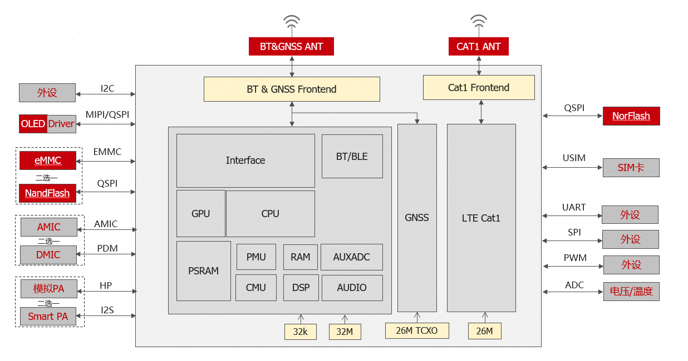

## 电源参考设计

本小节介绍模组电源参考设计，模组内芯片的电源管理模块为芯片其他模块提供所需要的电源。电源供电框图如[图1](#fig887135116260)所示，上电检测方案如[图2](#fig110712498194)所示，原理图设计时建议采用相同方案。

**图 1**  模组供电框图  
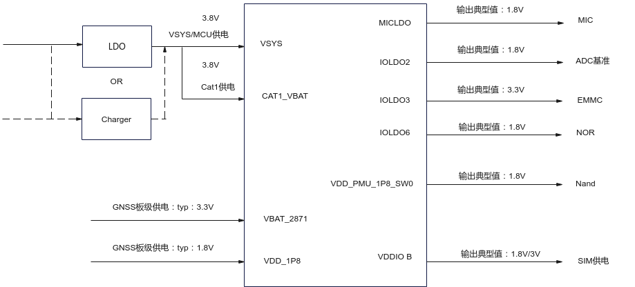

**图 2**  开机电路参考  

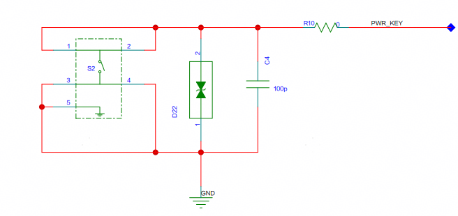

> **说明：** 
>VBUS\_SENSE为充电开机上电检测管脚，高电平有效。高电平有效范围：0.8V<VBUS\_SENSE<1.8V，通过电阻分压方式实现上电开机功能。
>PWR\_KEY为按键开机上电检测管脚，下降沿有效。芯片内部上拉，板级通过按键实现开机功能。

## 射频电路设计

-   **[RFIO电路](#ZH-CN_TOPIC_0000002545901589)**  

### RFIO电路

GNSS、CAT1天线连接参考电路设计请参考[图1](#fig161813557119)所示。

**图 1**  RF参考电路图  
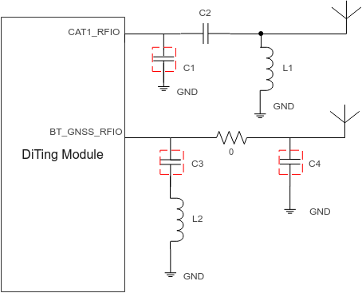

> **说明：** 
>红色方框为选焊器件。
>滤波网络的电容/电感取值需要根据PCB、整机天线等环境调试得到。

## 接口参考设计

-   **[GPIO口](#ZH-CN_TOPIC_0000002545781599)**  

-   **[QSPI接口](#ZH-CN_TOPIC_0000002514141724)**  

-   **[SPI接口](#ZH-CN_TOPIC_0000002545901591)**  

-   **[UART接口](#ZH-CN_TOPIC_0000002514301648)**  

-   **[I2C接口](#ZH-CN_TOPIC_0000002545781601)**  

-   **[eMMC](#ZH-CN_TOPIC_0000002514141726)**  

-   **[SDIO](#ZH-CN_TOPIC_0000002545901595)**  

-   **[PWM接口](#ZH-CN_TOPIC_0000002514301650)**  

-   **[MIPI接口](#ZH-CN_TOPIC_0000002545781605)**  

-   **[ADC接口](#ZH-CN_TOPIC_0000002514141728)**  

-   **[USB电路设计](#ZH-CN_TOPIC_0000002545901597)**  

-   **[I2S接口](#ZH-CN_TOPIC_0000002514301654)**  

-   **[PDM输入接口](#ZH-CN_TOPIC_0000002545781607)**  

-   **[AMIC接口](#ZH-CN_TOPIC_0000002514141732)**  

-   **[VICAP接口](#ZH-CN_TOPIC_0000002545901601)**  

-   **[HS音频输出接口](#ZH-CN_TOPIC_0000002514301658)**  

### GPIO口

模组有70个IO口，每个都可以配置为GPIO口模式。用于生成或采集特性应用的输出或输入信号。

-   GPIO每个管脚可以独立配置为输入或者输出。
    -   作为输入管脚时，可作用为中断源。
    -   作为输出管脚时，每个GPIO都可以独立输出高电平、低电平。

-   每个管脚都可独立配置上下拉、驱动等参数。

1.8V IO口DC特性可参考[表1](#__Ref8920216)所示。

**表 1**  1.8V IO口DC特性

<table><thead align="left"><tr id="row1319mcpsimp"><th class="cellrowborder" valign="top" width="16%" id="mcps1.2.8.1.1">
参数

</th>
<th class="cellrowborder" valign="top" width="17%" id="mcps1.2.8.1.2">
标识

</th>
<th class="cellrowborder" valign="top" width="14.32%" id="mcps1.2.8.1.3">
测试条件

</th>
<th class="cellrowborder" valign="top" width="15.659999999999998%" id="mcps1.2.8.1.4">
最小值

</th>
<th class="cellrowborder" valign="top" width="13.81%" id="mcps1.2.8.1.5">
典型值

</th>
<th class="cellrowborder" valign="top" width="16.21%" id="mcps1.2.8.1.6">
最大值

</th>
<th class="cellrowborder" valign="top" width="7.000000000000001%" id="mcps1.2.8.1.7">
单位

</th>
</tr>
</thead>
<tbody><tr id="row1335mcpsimp"><td class="cellrowborder" valign="top" width="16%" headers="mcps1.2.8.1.1 ">
I/O电压

</td>
<td class="cellrowborder" valign="top" width="17%" headers="mcps1.2.8.1.2 ">
IOLDO1/IOLDO4

</td>
<td class="cellrowborder" valign="top" width="14.32%" headers="mcps1.2.8.1.3 ">
-

</td>
<td class="cellrowborder" valign="top" width="15.659999999999998%" headers="mcps1.2.8.1.4 ">
1.62

</td>
<td class="cellrowborder" valign="top" width="13.81%" headers="mcps1.2.8.1.5 ">
1.8

</td>
<td class="cellrowborder" valign="top" width="16.21%" headers="mcps1.2.8.1.6 ">
1.98

</td>
<td class="cellrowborder" valign="top" width="7.000000000000001%" headers="mcps1.2.8.1.7 ">
V

</td>
</tr>
<tr id="row1350mcpsimp"><td class="cellrowborder" valign="top" width="16%" headers="mcps1.2.8.1.1 ">
输入高电平

</td>
<td class="cellrowborder" valign="top" width="17%" headers="mcps1.2.8.1.2 ">
VIH

</td>
<td class="cellrowborder" valign="top" width="14.32%" headers="mcps1.2.8.1.3 ">
-

</td>
<td class="cellrowborder" valign="top" width="15.659999999999998%" headers="mcps1.2.8.1.4 ">
0.65×VDDIO

</td>
<td class="cellrowborder" valign="top" width="13.81%" headers="mcps1.2.8.1.5 ">
-

</td>
<td class="cellrowborder" valign="top" width="16.21%" headers="mcps1.2.8.1.6 ">
1.98＋0.3

</td>
<td class="cellrowborder" valign="top" width="7.000000000000001%" headers="mcps1.2.8.1.7 ">
V

</td>
</tr>
<tr id="row1366mcpsimp"><td class="cellrowborder" valign="top" width="16%" headers="mcps1.2.8.1.1 ">
输入低电平

</td>
<td class="cellrowborder" valign="top" width="17%" headers="mcps1.2.8.1.2 ">
VIL

</td>
<td class="cellrowborder" valign="top" width="14.32%" headers="mcps1.2.8.1.3 ">
-

</td>
<td class="cellrowborder" valign="top" width="15.659999999999998%" headers="mcps1.2.8.1.4 ">
-0.3

</td>
<td class="cellrowborder" valign="top" width="13.81%" headers="mcps1.2.8.1.5 ">
-

</td>
<td class="cellrowborder" valign="top" width="16.21%" headers="mcps1.2.8.1.6 ">
0.35×VDDIO

</td>
<td class="cellrowborder" valign="top" width="7.000000000000001%" headers="mcps1.2.8.1.7 ">
V

</td>
</tr>
<tr id="row1382mcpsimp"><td class="cellrowborder" valign="top" width="16%" headers="mcps1.2.8.1.1 ">
输出高电平

</td>
<td class="cellrowborder" valign="top" width="17%" headers="mcps1.2.8.1.2 ">
VOH

</td>
<td class="cellrowborder" valign="top" width="14.32%" headers="mcps1.2.8.1.3 ">
-

</td>
<td class="cellrowborder" valign="top" width="15.659999999999998%" headers="mcps1.2.8.1.4 ">
0.75×VDDIO

</td>
<td class="cellrowborder" valign="top" width="13.81%" headers="mcps1.2.8.1.5 ">
-

</td>
<td class="cellrowborder" valign="top" width="16.21%" headers="mcps1.2.8.1.6 ">
-

</td>
<td class="cellrowborder" valign="top" width="7.000000000000001%" headers="mcps1.2.8.1.7 ">
V

</td>
</tr>
<tr id="row1398mcpsimp"><td class="cellrowborder" valign="top" width="16%" headers="mcps1.2.8.1.1 ">
输出低电平

</td>
<td class="cellrowborder" valign="top" width="17%" headers="mcps1.2.8.1.2 ">
VOL

</td>
<td class="cellrowborder" valign="top" width="14.32%" headers="mcps1.2.8.1.3 ">
-

</td>
<td class="cellrowborder" valign="top" width="15.659999999999998%" headers="mcps1.2.8.1.4 ">
-

</td>
<td class="cellrowborder" valign="top" width="13.81%" headers="mcps1.2.8.1.5 ">
-

</td>
<td class="cellrowborder" valign="top" width="16.21%" headers="mcps1.2.8.1.6 ">
0.25×VDDIO

</td>
<td class="cellrowborder" valign="top" width="7.000000000000001%" headers="mcps1.2.8.1.7 ">
V

</td>
</tr>
<tr id="row1414mcpsimp"><td class="cellrowborder" valign="top" width="16%" headers="mcps1.2.8.1.1 ">
上拉电阻

</td>
<td class="cellrowborder" valign="top" width="17%" headers="mcps1.2.8.1.2 ">
RPU

</td>
<td class="cellrowborder" valign="top" width="14.32%" headers="mcps1.2.8.1.3 ">
-

</td>
<td class="cellrowborder" valign="top" width="15.659999999999998%" headers="mcps1.2.8.1.4 ">
35k

</td>
<td class="cellrowborder" valign="top" width="13.81%" headers="mcps1.2.8.1.5 ">
51k

</td>
<td class="cellrowborder" valign="top" width="16.21%" headers="mcps1.2.8.1.6 ">
79k

</td>
<td class="cellrowborder" valign="top" width="7.000000000000001%" headers="mcps1.2.8.1.7 ">
Ω

</td>
</tr>
<tr id="row1425mcpsimp"><td class="cellrowborder" valign="top" width="16%" headers="mcps1.2.8.1.1 ">
下拉电阻

</td>
<td class="cellrowborder" valign="top" width="17%" headers="mcps1.2.8.1.2 ">
RPD

</td>
<td class="cellrowborder" valign="top" width="14.32%" headers="mcps1.2.8.1.3 ">
-

</td>
<td class="cellrowborder" valign="top" width="15.659999999999998%" headers="mcps1.2.8.1.4 ">
29k

</td>
<td class="cellrowborder" valign="top" width="13.81%" headers="mcps1.2.8.1.5 ">
48k

</td>
<td class="cellrowborder" valign="top" width="16.21%" headers="mcps1.2.8.1.6 ">
88k

</td>
<td class="cellrowborder" valign="top" width="7.000000000000001%" headers="mcps1.2.8.1.7 ">
Ω

</td>
</tr>
</tbody>
</table>

> **说明：** 
>上表中VDDIO代表各个IO电源域电压，如IOLDO1、IOLDO4等。
>GPIO唤醒源说明：
>GPIO分为3组，分别是S\_AGPIO、S \_MGPIO、S\_HGPIO。
>S\_AGPIO在芯片深睡时可以作为唤醒源来唤醒芯片，并在深睡时上述管脚的PINMUX功能和PAD功能（包括驱动能力配置、输入使能配置、上下拉配置）都能正常保持。S\_HGPIO、S\_MGPIO在深睡时不能作为唤醒源，并且深睡时PINMUX功能失效，只有PAD功能可以进行保持。
>对于S\_HGPIO、S\_MGPIO管脚，在深睡时PINMUX功能会丢失，在唤醒恢复前其PINMUX是作为GPIO的功能。对于睡眠时上下拉有强约束的管脚，需要进行特殊配置。例如对于SPI的CS管脚，需要在深睡中持续保持高，可以通过配置默认上拉来进行保证；对于I2C的管脚，空闲态为高，需要配置外部上拉电阻或者配置上拉。

### QSPI接口

模组支持3路QSPI接口，其中默认QSPI0对接Nor Flash；QSPI1默认对接Nand Flash；QSPI2默认对接屏幕。外接NorFlash最高频率100MHz；外接NandFlash接口最高频率100MHz；外接屏幕扩展，支持SDR/HDR（55MHz）。

Nor Flash/Nand Flash进行电路设计时，WP、CS、HOLD管脚要配置上拉电阻。以NorFlash为例，其参考设计如[图1](#fig5883194812123)所示，Nand Flash同理。QSPI2接屏幕仅要求CS配置上拉电阻。

**图 1**  QSPI接口设计  
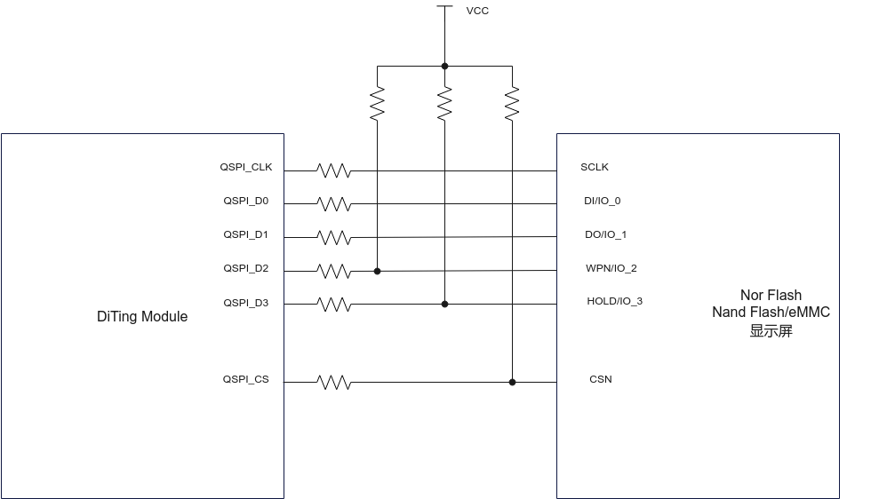

> **说明：** 
>-   对于送显等需要长走线的应用，为达到接口最高速率规格，建议QSPI接口信号线源端都预留串接电阻。
>-   对于QSPI Nor Flash等应用场景建议QSPI\_CS/QSPI\_D3/QSPI\_D2预留上拉电阻，其他应用场景按需增加。
>-   NorFlash上拉电阻使用的电源IOLDO6为器件供电电源。NandFlash使用的上拉电源为VDD\_PMU\_1P8\_SW0，供电电源应保持一致。

### SPI接口

HiDiTingV100模组支持1个SPI接口，支持Master/Slave模式，Master模式，最大频率32MHz；Slave模式，最大频率16MHz。

> **须知：** 
>-   SPI相关数据线不支持Master、Slave数据方向自动切换。
>-   须确保SPI上拉电压VDD和SPI外设VDD的供电保持一致，以避免因电压不一致而导致电源通过IO管脚漏电现象。

以SPI0接口且对端设备片选信号低有效为例，其接口设计如[图1](#fig0208190103917)所示。

**图 1**  SPI接口设计参考  
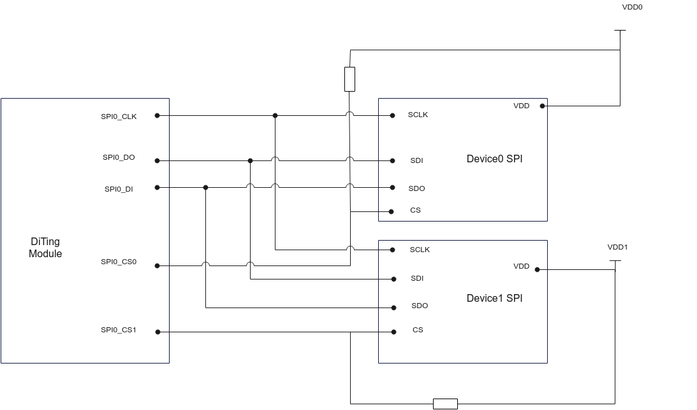

### UART接口

模组有三路UART（UART2、UART3、UART4）用于调测，如需对接外设，请适配软件使用UART2或UART3。以四线UART为例，其接口设计如[图1](#fig206311755153914)所示。

> **须知：** 
>UART4不能用于对接外设。

**图 1**  UART接口参考设计  
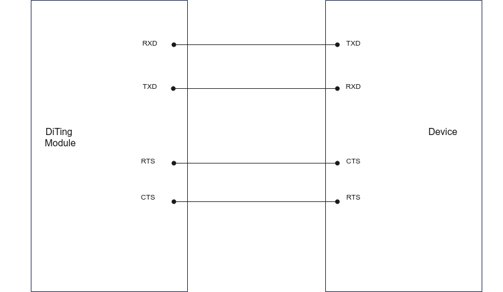

> **说明：** 
>示意图仅表示连线关系。

### I2C接口

模组内提供4路I2C接口，支持Master和Slave。可以工作在以下速度模式下：标准模式（100kbit/s）、快速模式（400kbit/s）、快速模式+（1Mbit/s）。

-   I2C总线协议，既支持Master模式，也支持Slave模式。
-   I2C主机可以向从机写入数据，也可以接收从机发来的数据。

以I2C0为例，典型电路如[图1](#fig132192044422)所示。

**图 1**  I2C接口  
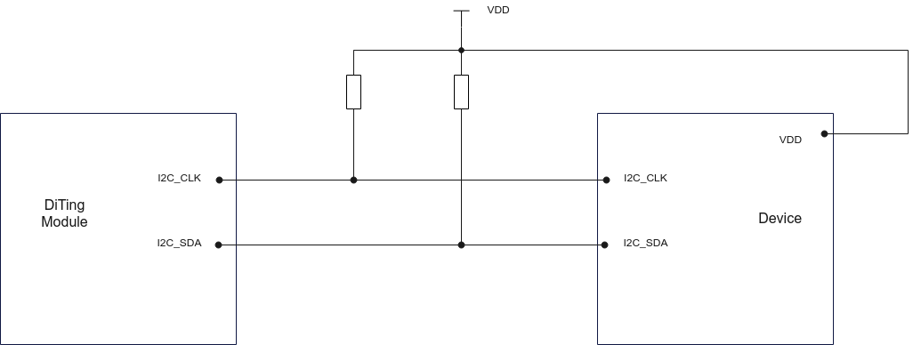

> **须知：** 
>-   须确保I2C上拉电压VDD和I2C外设VDD的供电保持一致，以避免因电压不一致而导致电源通过IO管脚漏电现象。
>-   为确保可靠性，慎用I2C的SCL、SDA可自动识别的器件选型，推荐使用固定I2C管脚定义的器件。

### eMMC

-   模组支持10线eMMC接口，接口最高时钟频率100MHz。
-   CMD、D0管脚增加上拉电阻，CLK管脚增加pF级滤波电容，其余管脚不作要求。
-   外部的eMMC存储芯片，不使用的通信DATA口可悬空处理。
-   外部的eMMC存储芯片，RST\_N信号建议进行上拉处理。

以两路供电eMMC芯片为例：VCC电源为3.3V，VCCQ电源为1.8V。具体参考eMMC器件手册，硬件设计时需满足其电源上电时序，典型设计如[图1](#fig460113464217)所示。

**图 1**  eMMC接口设计  
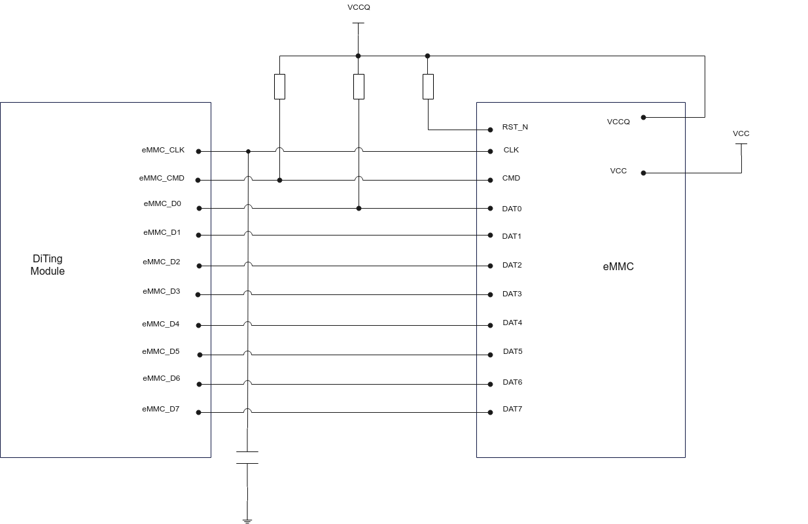

> **须知：** 
>须确保eMMC上拉电压VCCQ和eMMC外设VCCQ供电保持一致，以避免因电压不一致而导致电源通过IO管脚漏电现象。

### SDIO

支持1组SDIO接口，仅支持Master模式，接口最高时钟频率为50MHz。上下拉电阻的设置根据对端器件使用要求进行设计，板级空间充裕的情况下，建议CMD管脚、D0～D3管脚预留上拉电阻，CLK管脚预留pF级滤波电容，如[图1](#fig467610105437)所示。

**图 1**  SDIO接口参考  
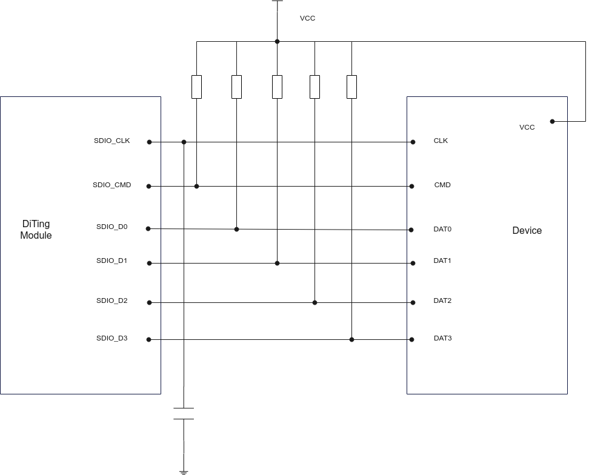

> **须知：** 
>须确保SDIO上拉电压VCC和SDIO外设VCC供电保持一致，以避免因电压不一致而导致电源通过IO管脚漏电现象。

### PWM接口

模组支持同时输出多组不同的互补输出PWM信号：APWM0\_N/APWM0\_P、APWM1\_N/APWM1\_P、MPWM0\_N/MPWM0\_P。

支持对多路PWM进行分组，位于同一组内的PWM同步输出（软件可合理通过配置周期、相位和占空比实现同频同相、互补等功能）。

> **须知：** 
>受芯片设计、后端设计和物理实现的影响，同一组内的PWM之间可能存在1～2个PWM时钟周期的相位误差，无法做到完全同步，应用需要评估影响。

PWM接口使用32MHz时钟作为计数时钟，占空比可调，其高电平为对应管脚电源域电压。

如果需要使用1MHz以上PWM信号，PCB设计时需要特别注意控制阻抗匹配，确保信号完整性。

### MIPI接口

-   支持1lane的MIPI显示接口。
-   由于高速接口可能带来辐射，建议预留共模电感，抑制辐射。
-   外设屏幕送出的帧同步信号DSI\_TE，必须接到对应的复用管脚上，不能作为普通输入信号处理。

    **图 1**  MIPI连接参考  
    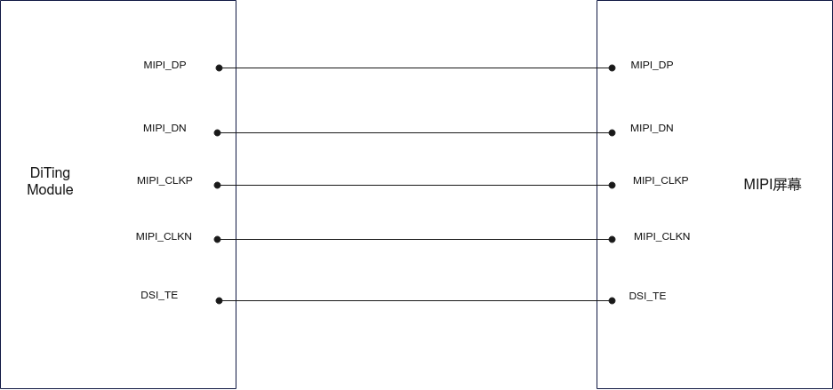

### ADC接口

-   HiDiTingV100模组内有集成AUXADC（Auxiliary Analog-to-Digital Converter），12bit精度，主要用于电压检测场景。
-   其中IOLDO2为ADC参考源，最大供电30mA，可以作为外部ADC信号的输入参考源，但注意不要给外部器件供电。
-   ADC采样速率越高，对外部电路驱动能力要求越强。
-   推荐外置BUFFER作为ADC的输入源。如果需要使用分压采样的方式给ADC输入，建议在管脚处预留对地10nF电容；其中上拉电阻R1和下拉电阻R2的并联值建议＜100kΩ（随着采样速率增加，阻值需对应降低）。

ADC典型应用场景如[图1](#fig115700184441)所示。

**图 1**  ADC使用场景  
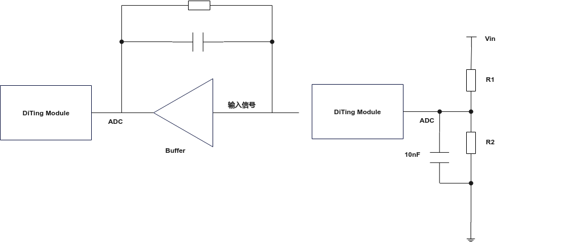

> **说明：** 
>-   对于电池电压检测等对电压检测精度有需求的应用场景，首选AUX\_ADC0/AUX\_ADC1/AUX\_ADC2/AUX\_ADC3。
>-   为保证AUX\_ADC测量精度，AUX\_ADC管脚输入电压范围控制在0.2V～1.6V之间。
>-   AUX\_ADC分压电阻建议选用1%精度电阻。

### USB电路设计

模组主控芯片支持USB Host/Device，支持USB 2.0接口：

-   芯片不支持5V直接供电，如果使用USB的VBUS给系统供电，中间必须增加LDO/BUCK/CHARGER等做电压转换，为了确保电源安全，建议预留板级防浪涌器件。
-   VBUS的插入识别，可以使用S\_AGPIO\_18的USB\_VBUS来实现。USB\_VBUS只能用来判断插入/拔出，无法测试VBUS电压。
-   USB DP/DM为通信管脚，建议预留串阻（2.2Ω级别）或者共模电感、ESD器件等，以抑制长线和PC端可能引起的ESD破坏。

模组内CAT1芯片提供一个USB2.0 Device接口，支持FS（Full-Speed）、HS（High-Speed）两种模式，速率分别可达12Mbit/s和480Mbit/s。可用于AT命令传送、数据传输、抓取log和固件升级。详细的接口分配如[表1](#_Ref218589330)所示。

**表 1**  模组CAT1芯片接口分配

<table><thead align="left"><tr id="row2076mcpsimp"><th class="cellrowborder" valign="top" width="15%" id="mcps1.2.4.1.1">
功能

</th>
<th class="cellrowborder" valign="top" width="28.000000000000004%" id="mcps1.2.4.1.2">
引脚定义

</th>
<th class="cellrowborder" valign="top" width="56.99999999999999%" id="mcps1.2.4.1.3">
备注

</th>
</tr>
</thead>
<tbody><tr id="row2084mcpsimp"><td class="cellrowborder" rowspan="4" valign="top" width="15%" headers="mcps1.2.4.1.1 ">
USB

</td>
<td class="cellrowborder" valign="top" width="28.000000000000004%" headers="mcps1.2.4.1.2 ">
CAT1_USB_DP

</td>
<td class="cellrowborder" valign="top" width="56.99999999999999%" headers="mcps1.2.4.1.3 ">
USB差分数据＋，需要做90Ω差分阻抗控制，不用则悬空。

</td>
</tr>
<tr id="row2091mcpsimp"><td class="cellrowborder" valign="top" headers="mcps1.2.4.1.1 ">
CAT1_USB_DM

</td>
<td class="cellrowborder" valign="top" headers="mcps1.2.4.1.2 ">
USB差分数据－，需要做90Ω差分阻抗控制，不用则悬空。

</td>
</tr>
<tr id="row2096mcpsimp"><td class="cellrowborder" valign="top" headers="mcps1.2.4.1.1 ">
CAT1_USB_BOOT

</td>
<td class="cellrowborder" valign="top" headers="mcps1.2.4.1.2 ">
强制加载引脚，拉低芯片在开机时进入强制加载模式，可通过USB接口进行固件升级。

</td>
</tr>
<tr id="row2101mcpsimp"><td class="cellrowborder" valign="top" headers="mcps1.2.4.1.1 ">
CAT1_USB_VBUS

</td>
<td class="cellrowborder" valign="top" headers="mcps1.2.4.1.2 ">
USB插拔检测，不用则悬空。

</td>
</tr>
</tbody>
</table>

### I2S接口

模组支持1路I2S（Inter-IC Sound）口（I2S0），可以外接Smart PA与音频外设。

-   支持I2S/PCM/TDM 16bit、20bit、24bit、32bit通道有效位宽（数据精度）可选。
-   I2S的时钟源频率支持：12.288MHz、24.576MHz（标准采样率）；12.8MHz、25.6MHz（非标采样率）。
-   支持16.7k/50k/100k/200k/400k Hz非标采样率，位宽16/24 bit。
-   支持8k/16k/32k/48k/96k/192k/384k Hz标准采样率，位宽16/24 bit。

SmartPA可选用商用芯片，配置接口使用I2C等，数字信号选择I2S信号。

模组对接SmartPA参考图如[图1](#fig1373516171415)所示。

**图 1**  I2S接口  
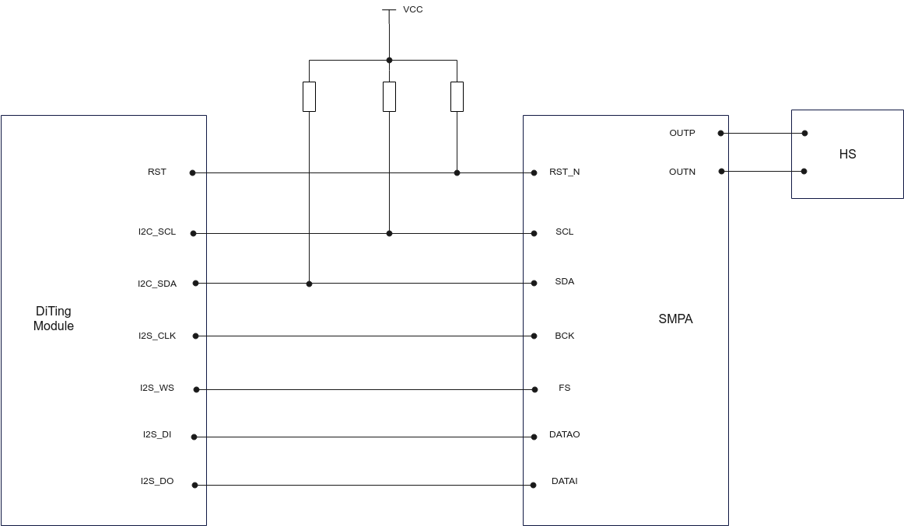

> **说明：** 
>为防止I2S工作异常，软件配置上I2S\_CLK/I2S\_WS/I2S\_DI/I2S\_DO需要遵循如下操作：
>-   芯片上电初始化时，保持接口为上拉。
>-   复用为I2S功能时，推荐配置接口为下拉（其中I2S\_DI需要根据对端器件选择上拉/下拉）。
>-   业务使用时，接口不做上下拉配置。
>-   业务结束后，配置接口为输入下拉IPD。

### PDM输入接口

模组支持1组PDM接口，支持对接DMIC器件。每组接口支持对接两个DMIC，PDM数据和时钟信号复用到GPIO管脚。通过L/R选择管脚区分两个声道。

DMIC的时钟频率为768kHz～3.2MHz，其中支持频点：1.536MHz、3.072MHz（标准采样率）、1.6MHz、3.2MHz（非标采样率）。

[图1](#fig10637511162115)为PDM接口对接2个DMIC器件的参考电路。

**图 1**  DMIC设计  
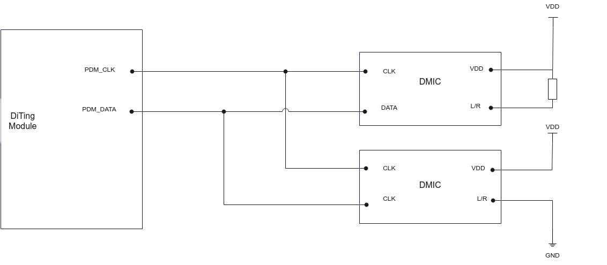

### AMIC接口

模组支持1路模拟MIC输入，模拟MIC输入为差分信号，芯片侧有0.9V偏置。

AMIC器件与模组端须加隔直电容，隔直电容必须选用2.2μF及以上电容（建议选用2.2μF，可以根据单板情况调整）。

为保证信号质量，建议：

-   AMIC器件的偏置电源输入放置去耦电容（建议470nF）。
-   放置在射频天线区域的AMIC，在Codec输出管脚处需预留串联电感的位置，用于抑制EMI干扰。
-   模组侧AMIC差分输入信号线上增加33pF滤波电容，如果走线临近射频区域，两边都预留33pF电容。
-   当AMIC在副板时，建议在主板侧BTB连接器旁的AMIC信号和MICBIAS电压上增加33pF滤波电容。

    **图 1**  模拟AMIC设计  
    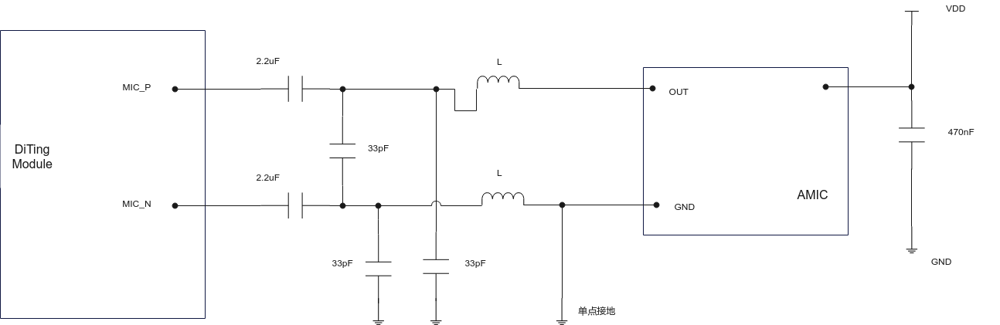

如模拟MIC为单端输出方式，模组的MIC\_N端通过隔直电容单点接地。

**图 2**  驻极体MIC设计  
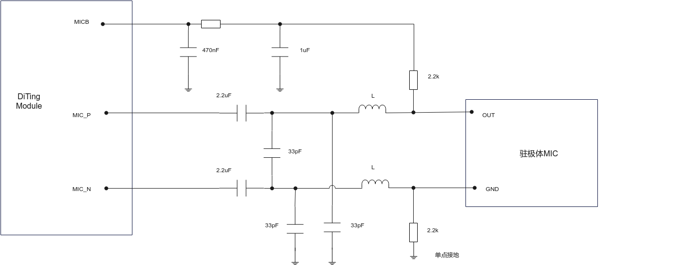

如驻极体MIC为单端输出方式，驻极体MIC的GND端建议串接2.2kΩ电阻后单点接地。

驻极体的OUT信号输出端，需要串接2.2kΩ到MICB，给驻极体MIC供电。

> **说明：** 
>-   模拟AMIC功能不使用时，相应管脚悬空即可。
>-   如果芯片MIC输入端接2.2μF电容，需要约束电容的有效容值为±20%（容值以仪器测试结果为准）。

### VICAP接口

模组支持VICAP对接摄像头模组，摄像头时钟建议使用板级时钟。

为保证信号质量，建议：

-   VICAP的DATA与CLK建议同向走线等长，保证并行信号线信号质量。
-   有源晶振需要靠近摄像头连接器放置。

**图 1**  VICAP设计  
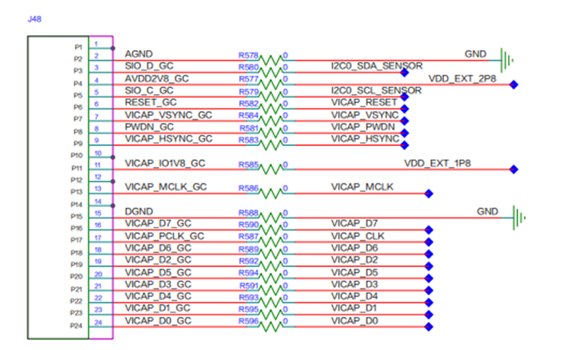

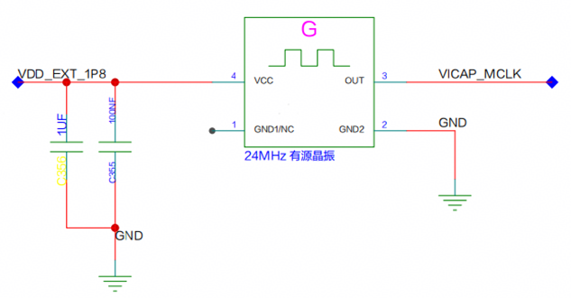

### HS音频输出接口

模组支持两路HeadSet（HS）下行差分输出，共模偏置0.9V，可对接模拟音频PA。

为保证信号质量，建议：

-   模组DAC输出为Class D，靠近模组侧建议增加固定RC滤波电路，串阻47Ω，对地电容100nF，对高频载波进行有效过滤，避免影响后级模拟PA放大。
-   模拟PA侧匹配需根据器件型号进行调整。

    **图 1**  HS接口外接模拟PA设计  
    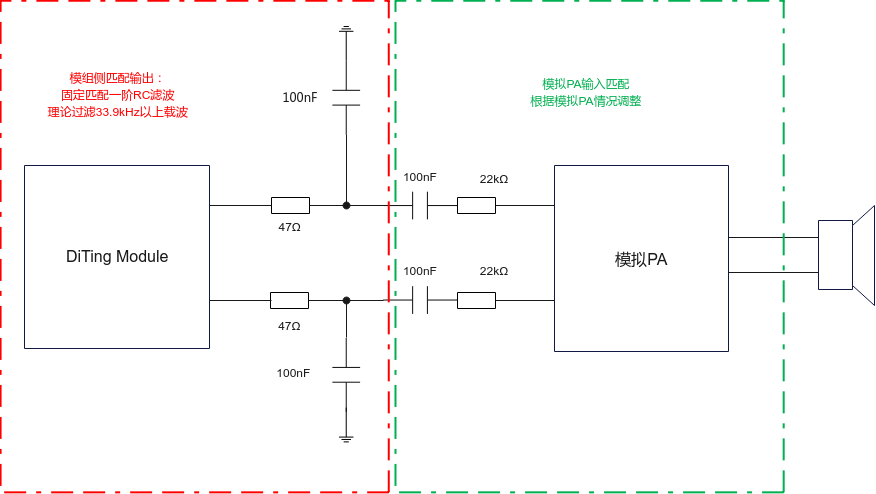

## 下载调测接口

> **说明：** 
>JLINK调试管脚、UART管脚等调测接口建议预留板级TP点。

-   **[主控芯片下载调测接口](#ZH-CN_TOPIC_0000002514141736)**  

-   **[CAT1与GNSS下载调测接口](#ZH-CN_TOPIC_0000002545901603)**  

### 主控芯片下载调测接口

HiDiTingV100模组提供多种调测接口满足不同的调测需求，其中主控芯片调测接口包含JLINK、UART、USB等接口，参考[表1](#table1949mcpsimp)。

-   USB用于主控空片烧录（高速），使用USB烧录时S\_AGPIO 18需配置为USB\_VBUS作为插入检测功能，UART2\_RX同时需要拉低接地处理。
-   UART\_2用于主控烧录、AT指令口，UART\_3用于连接DebugKits工具，支持在线压缩日志、资源文件加载、虚拟Shell命令。
-   JLINK调试接口建议采用1.8V电平，对接JLINK调试盒子时，接口电平必须为1.8V，不建议通过中间加电平转换芯片将其转换成3.3V。

**表 1**  主控芯片调测接口说明

<table><thead align="left"><tr id="row1955mcpsimp"><th class="cellrowborder" valign="top" width="17.731773177317734%" id="mcps1.2.4.1.1">
管脚编号

</th>
<th class="cellrowborder" valign="top" width="23.832383238323835%" id="mcps1.2.4.1.2">
管脚功能

</th>
<th class="cellrowborder" valign="top" width="58.43584358435844%" id="mcps1.2.4.1.3">
功能描述

</th>
</tr>
</thead>
<tbody><tr id="row1963mcpsimp"><td class="cellrowborder" valign="top" width="17.731773177317734%" headers="mcps1.2.4.1.1 ">
19

</td>
<td class="cellrowborder" valign="top" width="23.832383238323835%" headers="mcps1.2.4.1.2 ">
USB_DP

</td>
<td class="cellrowborder" valign="top" width="58.43584358435844%" headers="mcps1.2.4.1.3 ">
主控芯片差分信号管脚。

</td>
</tr>
<tr id="row1970mcpsimp"><td class="cellrowborder" valign="top" width="17.731773177317734%" headers="mcps1.2.4.1.1 ">
21

</td>
<td class="cellrowborder" valign="top" width="23.832383238323835%" headers="mcps1.2.4.1.2 ">
USB_DM

</td>
<td class="cellrowborder" valign="top" width="58.43584358435844%" headers="mcps1.2.4.1.3 ">
主控芯片差分信号管脚。

</td>
</tr>
<tr id="row1977mcpsimp"><td class="cellrowborder" valign="top" width="17.731773177317734%" headers="mcps1.2.4.1.1 ">
111

</td>
<td class="cellrowborder" valign="top" width="23.832383238323835%" headers="mcps1.2.4.1.2 ">
UART2_TXD

</td>
<td class="cellrowborder" valign="top" width="58.43584358435844%" headers="mcps1.2.4.1.3 ">
芯片空片时：默认复用为UART2_TXD（空片烧录使用）。

</td>
</tr>
<tr id="row1984mcpsimp"><td class="cellrowborder" valign="top" width="17.731773177317734%" headers="mcps1.2.4.1.1 ">
113

</td>
<td class="cellrowborder" valign="top" width="23.832383238323835%" headers="mcps1.2.4.1.2 ">
UART2_RXD

</td>
<td class="cellrowborder" valign="top" width="58.43584358435844%" headers="mcps1.2.4.1.3 ">
芯片空片时：默认复用为UART2_RXD（空片烧录使用）。

</td>
</tr>
<tr id="row1991mcpsimp"><td class="cellrowborder" valign="top" width="17.731773177317734%" headers="mcps1.2.4.1.1 ">
53

</td>
<td class="cellrowborder" valign="top" width="23.832383238323835%" headers="mcps1.2.4.1.2 ">
SWD_CLK

</td>
<td class="cellrowborder" valign="top" width="58.43584358435844%" headers="mcps1.2.4.1.3 ">
为保证芯片正常工作，管脚禁止外接上拉电阻、外挂电容负载等。

</td>
</tr>
<tr id="row1998mcpsimp"><td class="cellrowborder" valign="top" width="17.731773177317734%" headers="mcps1.2.4.1.1 ">
50

</td>
<td class="cellrowborder" valign="top" width="23.832383238323835%" headers="mcps1.2.4.1.2 ">
SWD_DATA

</td>
<td class="cellrowborder" valign="top" width="58.43584358435844%" headers="mcps1.2.4.1.3 ">
为保证芯片正常工作，管脚禁止外接上拉电阻、外挂电容负载等。

</td>
</tr>
</tbody>
</table>

### CAT1与GNSS下载调测接口

-   CAT1芯片调测接口包含USB、UART等接口。

    其中USB2.0 Device接口支持FS（Full-Speed）、HS（High-Speed）两种模式，速率分别可达12Mbit/s和480Mbit/s。可用于AT命令传送、数据传输、抓取log和固件升级。

    CAT1 DEBUG\_UART仅用于内部调测。

-   GNSS芯片留有一个B4\_UART1\_TXD调测接口用于DEBUG日志上报。

**表 1**  CAT1与GNSS调测接口说明

<table><thead align="left"><tr id="row2017mcpsimp"><th class="cellrowborder" valign="top" width="20.5020502050205%" id="mcps1.2.4.1.1">
管脚编号

</th>
<th class="cellrowborder" valign="top" width="30.993099309930994%" id="mcps1.2.4.1.2">
管脚功能

</th>
<th class="cellrowborder" valign="top" width="48.5048504850485%" id="mcps1.2.4.1.3">
功能描述

</th>
</tr>
</thead>
<tbody><tr id="row2025mcpsimp"><td class="cellrowborder" valign="top" width="20.5020502050205%" headers="mcps1.2.4.1.1 ">
132

</td>
<td class="cellrowborder" valign="top" width="30.993099309930994%" headers="mcps1.2.4.1.2 ">
CAT1_USB_DP

</td>
<td class="cellrowborder" valign="top" width="48.5048504850485%" headers="mcps1.2.4.1.3 ">
CAT1芯片USB差分输入输出管脚。

</td>
</tr>
<tr id="row2032mcpsimp"><td class="cellrowborder" valign="top" width="20.5020502050205%" headers="mcps1.2.4.1.1 ">
131

</td>
<td class="cellrowborder" valign="top" width="30.993099309930994%" headers="mcps1.2.4.1.2 ">
CAT1_USB_DM

</td>
<td class="cellrowborder" valign="top" width="48.5048504850485%" headers="mcps1.2.4.1.3 ">
CAT1芯片USB差分输入输出管脚。

</td>
</tr>
<tr id="row2039mcpsimp"><td class="cellrowborder" valign="top" width="20.5020502050205%" headers="mcps1.2.4.1.1 ">
130

</td>
<td class="cellrowborder" valign="top" width="30.993099309930994%" headers="mcps1.2.4.1.2 ">
CAT1_USB_VBUS

</td>
<td class="cellrowborder" valign="top" width="48.5048504850485%" headers="mcps1.2.4.1.3 ">
CAT1芯片USB检测信号。

</td>
</tr>
<tr id="row2046mcpsimp"><td class="cellrowborder" valign="top" width="20.5020502050205%" headers="mcps1.2.4.1.1 ">
129

</td>
<td class="cellrowborder" valign="top" width="30.993099309930994%" headers="mcps1.2.4.1.2 ">
CAT1_USB_BOOT

</td>
<td class="cellrowborder" valign="top" width="48.5048504850485%" headers="mcps1.2.4.1.3 ">
CAT1芯片USB强制加载信号，低电平有效。

</td>
</tr>
<tr id="row2053mcpsimp"><td class="cellrowborder" valign="top" width="20.5020502050205%" headers="mcps1.2.4.1.1 ">
125

</td>
<td class="cellrowborder" valign="top" width="30.993099309930994%" headers="mcps1.2.4.1.2 ">
B4_UART1_TXD

</td>
<td class="cellrowborder" valign="top" width="48.5048504850485%" headers="mcps1.2.4.1.3 ">
GNSS DEBUG日志输出管脚。

</td>
</tr>
</tbody>
</table>

# PCB设计指导

-   **[通流参考](#ZH-CN_TOPIC_0000002545781613)**  

-   **[关键信号约束](#ZH-CN_TOPIC_0000002514141738)**  

## 通流参考

Layout走线通流请参考[表1](#d1e7175)。

**表 1**  通流参考

<table><thead align="left"><tr id="row170mcpsimp"><th class="cellrowborder" valign="top" width="27%" id="mcps1.2.4.1.1">
管脚编号

</th>
<th class="cellrowborder" valign="top" width="42.51%" id="mcps1.2.4.1.2">
管脚名称

</th>
<th class="cellrowborder" valign="top" width="30.490000000000002%" id="mcps1.2.4.1.3">
参考通流（mA）

</th>
</tr>
</thead>
<tbody><tr id="row178mcpsimp"><td class="cellrowborder" valign="top" width="27%" headers="mcps1.2.4.1.1 ">
58

</td>
<td class="cellrowborder" valign="top" width="42.51%" headers="mcps1.2.4.1.2 ">
VSYS

</td>
<td class="cellrowborder" valign="top" width="30.490000000000002%" headers="mcps1.2.4.1.3 ">
900

</td>
</tr>
<tr id="row185mcpsimp"><td class="cellrowborder" valign="top" width="27%" headers="mcps1.2.4.1.1 ">
57

</td>
<td class="cellrowborder" valign="top" width="42.51%" headers="mcps1.2.4.1.2 ">
VDD_PMU_1P8_SW0

</td>
<td class="cellrowborder" valign="top" width="30.490000000000002%" headers="mcps1.2.4.1.3 ">
80

</td>
</tr>
<tr id="row192mcpsimp"><td class="cellrowborder" valign="top" width="27%" headers="mcps1.2.4.1.1 ">
85

</td>
<td class="cellrowborder" valign="top" width="42.51%" headers="mcps1.2.4.1.2 ">
VDD_PMU_MICLDO0

</td>
<td class="cellrowborder" valign="top" width="30.490000000000002%" headers="mcps1.2.4.1.3 ">
10

</td>
</tr>
<tr id="row199mcpsimp"><td class="cellrowborder" valign="top" width="27%" headers="mcps1.2.4.1.1 ">
59

</td>
<td class="cellrowborder" valign="top" width="42.51%" headers="mcps1.2.4.1.2 ">
VDD_PMU_IOLDO2

</td>
<td class="cellrowborder" valign="top" width="30.490000000000002%" headers="mcps1.2.4.1.3 ">
100

</td>
</tr>
<tr id="row206mcpsimp"><td class="cellrowborder" valign="top" width="27%" headers="mcps1.2.4.1.1 ">
63

</td>
<td class="cellrowborder" valign="top" width="42.51%" headers="mcps1.2.4.1.2 ">
VDD_PMU_IOLDO3

</td>
<td class="cellrowborder" valign="top" width="30.490000000000002%" headers="mcps1.2.4.1.3 ">
300

</td>
</tr>
<tr id="row213mcpsimp"><td class="cellrowborder" valign="top" width="27%" headers="mcps1.2.4.1.1 ">
56

</td>
<td class="cellrowborder" valign="top" width="42.51%" headers="mcps1.2.4.1.2 ">
VDD_PMU_IOLDO6

</td>
<td class="cellrowborder" valign="top" width="30.490000000000002%" headers="mcps1.2.4.1.3 ">
100

</td>
</tr>
<tr id="row220mcpsimp"><td class="cellrowborder" valign="top" width="27%" headers="mcps1.2.4.1.1 ">
24

</td>
<td class="cellrowborder" valign="top" width="42.51%" headers="mcps1.2.4.1.2 ">
B4_VBAT_2871

</td>
<td class="cellrowborder" valign="top" width="30.490000000000002%" headers="mcps1.2.4.1.3 ">
300

</td>
</tr>
<tr id="row227mcpsimp"><td class="cellrowborder" valign="top" width="27%" headers="mcps1.2.4.1.1 ">
47

</td>
<td class="cellrowborder" valign="top" width="42.51%" headers="mcps1.2.4.1.2 ">
B4_VDD_1P8

</td>
<td class="cellrowborder" valign="top" width="30.490000000000002%" headers="mcps1.2.4.1.3 ">
200

</td>
</tr>
<tr id="row234mcpsimp"><td class="cellrowborder" valign="top" width="27%" headers="mcps1.2.4.1.1 ">
12

</td>
<td class="cellrowborder" valign="top" width="42.51%" headers="mcps1.2.4.1.2 ">
VDDIO_B

</td>
<td class="cellrowborder" valign="top" width="30.490000000000002%" headers="mcps1.2.4.1.3 ">
50

</td>
</tr>
<tr id="row241mcpsimp"><td class="cellrowborder" valign="top" width="27%" headers="mcps1.2.4.1.1 ">
118

</td>
<td class="cellrowborder" valign="top" width="42.51%" headers="mcps1.2.4.1.2 ">
CAT1_VBAT1

</td>
<td class="cellrowborder" valign="top" width="30.490000000000002%" headers="mcps1.2.4.1.3 ">
900

</td>
</tr>
<tr id="row248mcpsimp"><td class="cellrowborder" valign="top" width="27%" headers="mcps1.2.4.1.1 ">
119

</td>
<td class="cellrowborder" valign="top" width="42.51%" headers="mcps1.2.4.1.2 ">
CAT1_VBAT2

</td>
<td class="cellrowborder" valign="top" width="30.490000000000002%" headers="mcps1.2.4.1.3 ">
1000

</td>
</tr>
</tbody>
</table>

## 关键信号约束

-   MIPI高速信号，需要同层等长走线和包地处理，尽量走表层，MIPI信号按照单端50Ω、差分100Ω走线阻抗处理，以保证信号完整性。
-   高速IO和高速时钟信号如QSPI0，尽量在内层同层等长走线，包地隔离处理。
-   AUX ADC模拟信号应该内层走线，包地保护。
-   AMIC差分输入信号按照差分紧耦合走线，四面包地（非射频地）；走线通路，在空间上（不同层之间）尽量避免电源、时钟、射频线等强干扰信号的交叉、并行走线；尽量避免表层布线，不能避免时表层连续走线尽量短；隔直电容和33pF滤波电容靠近MIC器件处放置；MICLDO等为AMIC供电走线尽量四面包地。
-   AMIC单端连接方式下，AMIC器件地需要单点接地 ，且需要通过2.2μF电容连接至芯片MIC0\_N/MIC1\_N/MIC2\_N管脚。
-   HSP/N峰值电流225mA，到负载端的电阻控制在0.05Ω以下，建议走线宽度不小于6mil。按照差分紧耦合走线，四面包地（非射频地）；走线通路，在空间上（不同层之间）尽量避免电源、时钟、射频线等强干扰信号的交叉、并行走线；尽量避免表层布线，不能避免时表层连续走线尽量短。
-   高速IO和高速时钟信号线走内层，包地隔离处理，远离辐射干扰。
-   USB\_DP/USB\_DM差分走线，差分阻抗控制90Ω；要求立体包地，减少干扰。

# 射频特性

-   **[蜂窝网络](#ZH-CN_TOPIC_0000002518194218)**  

-   **[BT](#ZH-CN_TOPIC_0000002518194220)**  

-   **[GNSS](#ZH-CN_TOPIC_0000002549833987)**  

## 蜂窝网络

-   **[工作频段](#ZH-CN_TOPIC_0000002549833985)**  

-   **[发射功率](#ZH-CN_TOPIC_0000002518354138)**  

-   **[接收灵敏度](#ZH-CN_TOPIC_0000002549713993)**  

### 工作频段

**表 1**  工作频段

<table><thead align="left"><tr id="row16971858171416"><th class="cellrowborder" valign="top" width="32.653265326532654%" id="mcps1.2.4.1.1">
工作频段

</th>
<th class="cellrowborder" valign="top" width="32.653265326532654%" id="mcps1.2.4.1.2">
发送（MHz）

</th>
<th class="cellrowborder" valign="top" width="34.69346934693469%" id="mcps1.2.4.1.3">
接收（MHz）

</th>
</tr>
</thead>
<tbody><tr id="row14698105831411"><td class="cellrowborder" valign="top" width="32.653265326532654%" headers="mcps1.2.4.1.1 ">
LTE-FDD B1

</td>
<td class="cellrowborder" valign="top" width="32.653265326532654%" headers="mcps1.2.4.1.2 ">
1920～1980

</td>
<td class="cellrowborder" valign="top" width="34.69346934693469%" headers="mcps1.2.4.1.3 ">
2110～2170

</td>
</tr>
<tr id="row206981058111417"><td class="cellrowborder" valign="top" width="32.653265326532654%" headers="mcps1.2.4.1.1 ">
LTE-FDD B3

</td>
<td class="cellrowborder" valign="top" width="32.653265326532654%" headers="mcps1.2.4.1.2 ">
1710～1785

</td>
<td class="cellrowborder" valign="top" width="34.69346934693469%" headers="mcps1.2.4.1.3 ">
1805～1880

</td>
</tr>
<tr id="row1469811580145"><td class="cellrowborder" valign="top" width="32.653265326532654%" headers="mcps1.2.4.1.1 ">
LTE-FDD B5

</td>
<td class="cellrowborder" valign="top" width="32.653265326532654%" headers="mcps1.2.4.1.2 ">
824～849

</td>
<td class="cellrowborder" valign="top" width="34.69346934693469%" headers="mcps1.2.4.1.3 ">
869～894

</td>
</tr>
<tr id="row1169815891417"><td class="cellrowborder" valign="top" width="32.653265326532654%" headers="mcps1.2.4.1.1 ">
LTE-FDD B8

</td>
<td class="cellrowborder" valign="top" width="32.653265326532654%" headers="mcps1.2.4.1.2 ">
880～915

</td>
<td class="cellrowborder" valign="top" width="34.69346934693469%" headers="mcps1.2.4.1.3 ">
925～960

</td>
</tr>
<tr id="row3698205818141"><td class="cellrowborder" valign="top" width="32.653265326532654%" headers="mcps1.2.4.1.1 ">
LTE-TDD B34

</td>
<td class="cellrowborder" valign="top" width="32.653265326532654%" headers="mcps1.2.4.1.2 ">
2010～2025

</td>
<td class="cellrowborder" valign="top" width="34.69346934693469%" headers="mcps1.2.4.1.3 ">
2010～2025

</td>
</tr>
<tr id="row5698858141417"><td class="cellrowborder" valign="top" width="32.653265326532654%" headers="mcps1.2.4.1.1 ">
LTE-TDD B38

</td>
<td class="cellrowborder" valign="top" width="32.653265326532654%" headers="mcps1.2.4.1.2 ">
2570～2620

</td>
<td class="cellrowborder" valign="top" width="34.69346934693469%" headers="mcps1.2.4.1.3 ">
2570～2620

</td>
</tr>
<tr id="row3698145811146"><td class="cellrowborder" valign="top" width="32.653265326532654%" headers="mcps1.2.4.1.1 ">
LTE-TDD B39

</td>
<td class="cellrowborder" valign="top" width="32.653265326532654%" headers="mcps1.2.4.1.2 ">
1880～1920

</td>
<td class="cellrowborder" valign="top" width="34.69346934693469%" headers="mcps1.2.4.1.3 ">
1880～1920

</td>
</tr>
<tr id="row86981158131418"><td class="cellrowborder" valign="top" width="32.653265326532654%" headers="mcps1.2.4.1.1 ">
LTE-TDD B40

</td>
<td class="cellrowborder" valign="top" width="32.653265326532654%" headers="mcps1.2.4.1.2 ">
2300～2400

</td>
<td class="cellrowborder" valign="top" width="34.69346934693469%" headers="mcps1.2.4.1.3 ">
2300～2400

</td>
</tr>
<tr id="row1669815810145"><td class="cellrowborder" valign="top" width="32.653265326532654%" headers="mcps1.2.4.1.1 ">
LTE-TDD B41

</td>
<td class="cellrowborder" valign="top" width="32.653265326532654%" headers="mcps1.2.4.1.2 ">
2535～2675

</td>
<td class="cellrowborder" valign="top" width="34.69346934693469%" headers="mcps1.2.4.1.3 ">
2535～2675

</td>
</tr>
</tbody>
</table>

### 发射功率

**表 1**  射频发射功率

<table><thead align="left"><tr id="row1543017375166"><th class="cellrowborder" rowspan="1" valign="top" width="44.620000000000005%" id="mcps1.2.4.1.1">
频段

</th>
<th class="cellrowborder" rowspan="1" valign="top" width="25.830000000000002%" id="mcps1.2.4.1.2">
最大值

</th>
<th class="cellrowborder" rowspan="1" valign="top" width="29.550000000000004%" id="mcps1.2.4.1.3">
最小值

</th>
</tr>
</thead>
<tbody><tr id="row1643143716166"><td class="cellrowborder" valign="top" width="44.620000000000005%" headers="mcps1.2.4.1.1 ">
LTE-FDD B1/B3/B5/B8

</td>
<td class="cellrowborder" valign="top" width="25.830000000000002%" headers="mcps1.2.4.1.2 ">
23dBm&plusmn;2dB

</td>
<td class="cellrowborder" valign="top" width="29.550000000000004%" headers="mcps1.2.4.1.3 ">
&lt;-39dBm

</td>
</tr>
<tr id="row1643133713160"><td class="cellrowborder" valign="top" width="44.620000000000005%" headers="mcps1.2.4.1.1 ">
LTE-TDD B34/B38/B39/B40/B41

</td>
<td class="cellrowborder" valign="top" width="25.830000000000002%" headers="mcps1.2.4.1.2 ">
23dBm&plusmn;2dB

</td>
<td class="cellrowborder" valign="top" width="29.550000000000004%" headers="mcps1.2.4.1.3 ">
&lt;-39dBm

</td>
</tr>
</tbody>
</table>

### 接收灵敏度

**表 1**  射频接收灵敏度

<table><thead align="left"><tr id="row16501175718168"><th class="cellrowborder" valign="top" width="41.760000000000005%" id="mcps1.2.4.1.1">
频段

</th>
<th class="cellrowborder" valign="top" width="29.12%" id="mcps1.2.4.1.2">
典型值（dBm）

</th>
<th class="cellrowborder" valign="top" width="29.12%" id="mcps1.2.4.1.3">
CAT1规范要求（dBm）

</th>
</tr>
</thead>
<tbody><tr id="row125012573162"><td class="cellrowborder" valign="top" width="41.760000000000005%" headers="mcps1.2.4.1.1 ">
LTE-FDD B1（10MHz）

</td>
<td class="cellrowborder" valign="top" width="29.12%" headers="mcps1.2.4.1.2 ">
-99

</td>
<td class="cellrowborder" valign="top" width="29.12%" headers="mcps1.2.4.1.3 ">
-94

</td>
</tr>
<tr id="row15011057131617"><td class="cellrowborder" valign="top" width="41.760000000000005%" headers="mcps1.2.4.1.1 ">
LTE-FDD B3（10MHz）

</td>
<td class="cellrowborder" valign="top" width="29.12%" headers="mcps1.2.4.1.2 ">
-99

</td>
<td class="cellrowborder" valign="top" width="29.12%" headers="mcps1.2.4.1.3 ">
-91

</td>
</tr>
<tr id="row15501185714169"><td class="cellrowborder" valign="top" width="41.760000000000005%" headers="mcps1.2.4.1.1 ">
LTE-FDD B5（10MHz）

</td>
<td class="cellrowborder" valign="top" width="29.12%" headers="mcps1.2.4.1.2 ">
-99

</td>
<td class="cellrowborder" valign="top" width="29.12%" headers="mcps1.2.4.1.3 ">
-92.5

</td>
</tr>
<tr id="row95018572163"><td class="cellrowborder" valign="top" width="41.760000000000005%" headers="mcps1.2.4.1.1 ">
LTE-FDD B8（10MHz）

</td>
<td class="cellrowborder" valign="top" width="29.12%" headers="mcps1.2.4.1.2 ">
-98.5

</td>
<td class="cellrowborder" valign="top" width="29.12%" headers="mcps1.2.4.1.3 ">
-91.5

</td>
</tr>
<tr id="row195011757161619"><td class="cellrowborder" valign="top" width="41.760000000000005%" headers="mcps1.2.4.1.1 ">
LTE-TDD B34（10MHz）

</td>
<td class="cellrowborder" valign="top" width="29.12%" headers="mcps1.2.4.1.2 ">
-101

</td>
<td class="cellrowborder" valign="top" width="29.12%" headers="mcps1.2.4.1.3 ">
-94.5

</td>
</tr>
<tr id="row19502155751611"><td class="cellrowborder" valign="top" width="41.760000000000005%" headers="mcps1.2.4.1.1 ">
LTE-TDD B38（10MHz）

</td>
<td class="cellrowborder" valign="top" width="29.12%" headers="mcps1.2.4.1.2 ">
-101

</td>
<td class="cellrowborder" valign="top" width="29.12%" headers="mcps1.2.4.1.3 ">
-92.5

</td>
</tr>
<tr id="row18502165741611"><td class="cellrowborder" valign="top" width="41.760000000000005%" headers="mcps1.2.4.1.1 ">
LTE-TDD B39（10MHz）

</td>
<td class="cellrowborder" valign="top" width="29.12%" headers="mcps1.2.4.1.2 ">
-100.5

</td>
<td class="cellrowborder" valign="top" width="29.12%" headers="mcps1.2.4.1.3 ">
-94.5

</td>
</tr>
<tr id="row850214576169"><td class="cellrowborder" valign="top" width="41.760000000000005%" headers="mcps1.2.4.1.1 ">
LTE-TDD B40（10MHz）

</td>
<td class="cellrowborder" valign="top" width="29.12%" headers="mcps1.2.4.1.2 ">
-100.5

</td>
<td class="cellrowborder" valign="top" width="29.12%" headers="mcps1.2.4.1.3 ">
-94.5

</td>
</tr>
<tr id="row1850215716161"><td class="cellrowborder" valign="top" width="41.760000000000005%" headers="mcps1.2.4.1.1 ">
LTE-TDD B41（10MHz）

</td>
<td class="cellrowborder" valign="top" width="29.12%" headers="mcps1.2.4.1.2 ">
-101

</td>
<td class="cellrowborder" valign="top" width="29.12%" headers="mcps1.2.4.1.3 ">
-92.5

</td>
</tr>
</tbody>
</table>

## BT

-   **[工作频段](#ZH-CN_TOPIC_0000002549834557)**  

-   **[发射功率及灵敏度](#ZH-CN_TOPIC_0000002518194802)**  

### 工作频段

**表 1**  BT工作频段

<table><thead align="left"><tr id="row792715071920"><th class="cellrowborder" valign="top" width="41.54%" id="mcps1.2.3.1.1">
类型

</th>
<th class="cellrowborder" valign="top" width="58.46%" id="mcps1.2.3.1.2">
频段（MHz）

</th>
</tr>
</thead>
<tbody><tr id="row189271250131913"><td class="cellrowborder" valign="top" width="41.54%" headers="mcps1.2.3.1.1 ">
BT/SLE（星闪）

</td>
<td class="cellrowborder" valign="top" width="58.46%" headers="mcps1.2.3.1.2 ">
2402～2480

</td>
</tr>
</tbody>
</table>

### 发射功率及灵敏度

**表 1**  发射功率及灵敏度

<table><thead align="left"><tr id="row7109141616205"><th class="cellrowborder" valign="top" width="26.919999999999998%" id="mcps1.2.4.1.1">
类型

</th>
<th class="cellrowborder" valign="top" width="36.78%" id="mcps1.2.4.1.2">
参数

</th>
<th class="cellrowborder" valign="top" width="36.3%" id="mcps1.2.4.1.3">
典型值（dBm）

</th>
</tr>
</thead>
<tbody><tr id="row310991615201"><td class="cellrowborder" rowspan="8" valign="top" width="26.919999999999998%" headers="mcps1.2.4.1.1 ">
TX Power(dBm)

</td>
<td class="cellrowborder" valign="top" width="36.78%" headers="mcps1.2.4.1.2 ">
BR（GFSK）

</td>
<td class="cellrowborder" valign="top" width="36.3%" headers="mcps1.2.4.1.3 ">
10

</td>
</tr>
<tr id="row510961613205"><td class="cellrowborder" valign="top" headers="mcps1.2.4.1.1 ">
2EDR（QPSK）

</td>
<td class="cellrowborder" valign="top" headers="mcps1.2.4.1.2 ">
6

</td>
</tr>
<tr id="row31091416102011"><td class="cellrowborder" valign="top" headers="mcps1.2.4.1.1 ">
3EDR（8PSK）

</td>
<td class="cellrowborder" valign="top" headers="mcps1.2.4.1.2 ">
6

</td>
</tr>
<tr id="row611013161206"><td class="cellrowborder" valign="top" headers="mcps1.2.4.1.1 ">
BLE 1M

</td>
<td class="cellrowborder" valign="top" headers="mcps1.2.4.1.2 ">
10

</td>
</tr>
<tr id="row811021615202"><td class="cellrowborder" valign="top" headers="mcps1.2.4.1.1 ">
BLE 2M

</td>
<td class="cellrowborder" valign="top" headers="mcps1.2.4.1.2 ">
10

</td>
</tr>
<tr id="row3110101652011"><td class="cellrowborder" valign="top" headers="mcps1.2.4.1.1 ">
SLE（FT1）

</td>
<td class="cellrowborder" valign="top" headers="mcps1.2.4.1.2 ">
10

</td>
</tr>
<tr id="row111014161205"><td class="cellrowborder" valign="top" headers="mcps1.2.4.1.1 ">
SLE（FT2）

</td>
<td class="cellrowborder" valign="top" headers="mcps1.2.4.1.2 ">
6

</td>
</tr>
<tr id="row17110181618206"><td class="cellrowborder" valign="top" headers="mcps1.2.4.1.1 ">
SLE（FT4）

</td>
<td class="cellrowborder" valign="top" headers="mcps1.2.4.1.2 ">
6

</td>
</tr>
<tr id="row21101616142018"><td class="cellrowborder" rowspan="8" valign="top" width="26.919999999999998%" headers="mcps1.2.4.1.1 ">
RX Sensitivity(dBm)

</td>
<td class="cellrowborder" valign="top" width="36.78%" headers="mcps1.2.4.1.2 ">
BR（GFSK）

</td>
<td class="cellrowborder" valign="top" width="36.3%" headers="mcps1.2.4.1.3 ">
-94

</td>
</tr>
<tr id="row211001614203"><td class="cellrowborder" valign="top" headers="mcps1.2.4.1.1 ">
2EDR（QPSK）

</td>
<td class="cellrowborder" valign="top" headers="mcps1.2.4.1.2 ">
-93

</td>
</tr>
<tr id="row1811011618201"><td class="cellrowborder" valign="top" headers="mcps1.2.4.1.1 ">
3EDR（8PSK）

</td>
<td class="cellrowborder" valign="top" headers="mcps1.2.4.1.2 ">
-87

</td>
</tr>
<tr id="row611011162207"><td class="cellrowborder" valign="top" headers="mcps1.2.4.1.1 ">
BLE 1M

</td>
<td class="cellrowborder" valign="top" headers="mcps1.2.4.1.2 ">
-96

</td>
</tr>
<tr id="row17110181619206"><td class="cellrowborder" valign="top" headers="mcps1.2.4.1.1 ">
BLE 2M

</td>
<td class="cellrowborder" valign="top" headers="mcps1.2.4.1.2 ">
-93

</td>
</tr>
<tr id="row91101816112011"><td class="cellrowborder" valign="top" headers="mcps1.2.4.1.1 ">
SLE（FT1）

</td>
<td class="cellrowborder" valign="top" headers="mcps1.2.4.1.2 ">
-96

</td>
</tr>
<tr id="row3111616102018"><td class="cellrowborder" valign="top" headers="mcps1.2.4.1.1 ">
SLE（FT2）

</td>
<td class="cellrowborder" valign="top" headers="mcps1.2.4.1.2 ">
-99

</td>
</tr>
<tr id="row141111016152017"><td class="cellrowborder" valign="top" headers="mcps1.2.4.1.1 ">
SLE（FT4）

</td>
<td class="cellrowborder" valign="top" headers="mcps1.2.4.1.2 ">
-107

</td>
</tr>
</tbody>
</table>

## GNSS

-   **[工作频段](#ZH-CN_TOPIC_0000002549714553)**  

-   **[GNSS灵敏度](#ZH-CN_TOPIC_0000002518354712)**  

### 工作频段

**表 1**  GNSS工作频段

<table><thead align="left"><tr id="row6228193715201"><th class="cellrowborder" valign="top" width="41.69%" id="mcps1.2.3.1.1">
GNSS星系类型

</th>
<th class="cellrowborder" valign="top" width="58.309999999999995%" id="mcps1.2.3.1.2">
频段（MHz）

</th>
</tr>
</thead>
<tbody><tr id="row322883792016"><td class="cellrowborder" valign="top" width="41.69%" headers="mcps1.2.3.1.1 ">
GPS

</td>
<td class="cellrowborder" valign="top" width="58.309999999999995%" headers="mcps1.2.3.1.2 ">
1575.42&plusmn;1.023（L1）

</td>
</tr>
<tr id="row2022812377204"><td class="cellrowborder" valign="top" width="41.69%" headers="mcps1.2.3.1.1 ">
BDS

</td>
<td class="cellrowborder" valign="top" width="58.309999999999995%" headers="mcps1.2.3.1.2 ">
1561.098&plusmn;2.046（B1I）

</td>
</tr>
<tr id="row1822863720205"><td class="cellrowborder" valign="top" width="41.69%" headers="mcps1.2.3.1.1 ">
Galileo

</td>
<td class="cellrowborder" valign="top" width="58.309999999999995%" headers="mcps1.2.3.1.2 ">
1575.42&plusmn;2.046（E1）

</td>
</tr>
<tr id="row4228137142017"><td class="cellrowborder" valign="top" width="41.69%" headers="mcps1.2.3.1.1 ">
GLONASS

</td>
<td class="cellrowborder" valign="top" width="58.309999999999995%" headers="mcps1.2.3.1.2 ">
1597.5～1605.8（L1）

</td>
</tr>
</tbody>
</table>

### GNSS灵敏度

**表 1**  GNSS灵敏度

<table><thead align="left"><tr id="row13200115212202"><th class="cellrowborder" valign="top" width="30.946905309469052%" id="mcps1.2.4.1.1">
参数

</th>
<th class="cellrowborder" valign="top" width="32.14678532146785%" id="mcps1.2.4.1.2">
描述

</th>
<th class="cellrowborder" valign="top" width="36.906309369063095%" id="mcps1.2.4.1.3">
典型值（dBm）

</th>
</tr>
</thead>
<tbody><tr id="row15200185282012"><td class="cellrowborder" rowspan="3" valign="top" width="30.946905309469052%" headers="mcps1.2.4.1.1 ">
灵敏度

</td>
<td class="cellrowborder" valign="top" width="32.14678532146785%" headers="mcps1.2.4.1.2 ">
冷启动捕获灵敏度

</td>
<td class="cellrowborder" valign="top" width="36.906309369063095%" headers="mcps1.2.4.1.3 ">
-149

</td>
</tr>
<tr id="row172003526207"><td class="cellrowborder" valign="top" headers="mcps1.2.4.1.1 ">
热启动捕获灵敏度

</td>
<td class="cellrowborder" valign="top" headers="mcps1.2.4.1.2 ">
-159

</td>
</tr>
<tr id="row8200252132018"><td class="cellrowborder" valign="top" headers="mcps1.2.4.1.1 ">
跟踪灵敏度

</td>
<td class="cellrowborder" valign="top" headers="mcps1.2.4.1.2 ">
-162

</td>
</tr>
</tbody>
</table>

# 热设计建议

-   **[工作温度环境](#ZH-CN_TOPIC_0000002514301662)**  

-   **[电路热设计参考](#ZH-CN_TOPIC_0000002545781615)**  

## 工作温度环境

模组的工作温度环境参数如[表1](#table1877mcpsimp)所示。

> **须知：** 
>超过扩展工作环境参数数值，可能导致模组内芯片物理损伤。
>-   TN温度范围表示当模块在此温度范围工作时，模块的相关性能满足3GPP标准要求。
>-   TE温度范围表示当模块在此温度范围工作时，模块仍能保持各功能正常工作状态。

**表 1**  极限工作环境参数

<table><thead align="left"><tr id="row1885mcpsimp"><th class="cellrowborder" valign="top" width="35%" id="mcps1.2.6.1.1">
参数

</th>
<th class="cellrowborder" valign="top" width="15.000000000000002%" id="mcps1.2.6.1.2">
符号

</th>
<th class="cellrowborder" valign="top" width="19.000000000000004%" id="mcps1.2.6.1.3">
最小值

</th>
<th class="cellrowborder" valign="top" width="18.000000000000004%" id="mcps1.2.6.1.4">
最大值

</th>
<th class="cellrowborder" valign="top" width="13.000000000000004%" id="mcps1.2.6.1.5">
单位

</th>
</tr>
</thead>
<tbody><tr id="row1897mcpsimp"><td class="cellrowborder" valign="top" width="35%" headers="mcps1.2.6.1.1 ">
正常工作温度

</td>
<td class="cellrowborder" valign="top" width="15.000000000000002%" headers="mcps1.2.6.1.2 ">
TN

</td>
<td class="cellrowborder" valign="top" width="19.000000000000004%" headers="mcps1.2.6.1.3 ">
-30

</td>
<td class="cellrowborder" valign="top" width="18.000000000000004%" headers="mcps1.2.6.1.4 ">
75

</td>
<td class="cellrowborder" valign="top" width="13.000000000000004%" headers="mcps1.2.6.1.5 ">
℃

</td>
</tr>
<tr id="row1909mcpsimp"><td class="cellrowborder" valign="top" width="35%" headers="mcps1.2.6.1.1 ">
扩展工作温度

</td>
<td class="cellrowborder" valign="top" width="15.000000000000002%" headers="mcps1.2.6.1.2 ">
TE

</td>
<td class="cellrowborder" valign="top" width="19.000000000000004%" headers="mcps1.2.6.1.3 ">
-40

</td>
<td class="cellrowborder" valign="top" width="18.000000000000004%" headers="mcps1.2.6.1.4 ">
85

</td>
<td class="cellrowborder" valign="top" width="13.000000000000004%" headers="mcps1.2.6.1.5 ">
℃

</td>
</tr>
<tr id="row1921mcpsimp"><td class="cellrowborder" valign="top" width="35%" headers="mcps1.2.6.1.1 ">
焊接温度

</td>
<td class="cellrowborder" valign="top" width="15.000000000000002%" headers="mcps1.2.6.1.2 ">
TP

</td>
<td class="cellrowborder" valign="top" width="19.000000000000004%" headers="mcps1.2.6.1.3 ">
-

</td>
<td class="cellrowborder" valign="top" width="18.000000000000004%" headers="mcps1.2.6.1.4 ">
260

</td>
<td class="cellrowborder" valign="top" width="13.000000000000004%" headers="mcps1.2.6.1.5 ">
℃

</td>
</tr>
</tbody>
</table>

## 电路热设计参考

结合产品结构和热设计，器件布局建议如下：

-   单板上大功耗且易产生热量器件要均匀分布，避免局部过热，影响器件可靠性和散热效率。
-   合理设计结构，保证产品内部与外界有热交换途径。
-   对单板关键发热器件充分进行极端应用场景的温升测试，确保器件在安全的温度范围内长期可靠工作。
-   必要情况下，关键发热器件可以增加散热片，进一步提升散热效果。

# 焊接工艺建议

-   **[概述](#ZH-CN_TOPIC_0000002545901609)**  

-   **[无铅回流焊工艺参数要求](#ZH-CN_TOPIC_0000002514301664)**  

-   **[混合回流焊工艺参数要求](#ZH-CN_TOPIC_0000002545781617)**  

## 概述

【目的】Objective

本章提供了客户端在用模组SMT（Surface Mount Technology）时各温区温度基本设置的参数建议。

【适用范围】Scope

HiDiTingV100模组相关产品。

【基本信息】Basic information

提供给客户端的产品均为RoHS产品，即均是Lead-free（无铅）产品；本章主要介绍客户端在使用模组做回流焊时工艺控制：主要是无铅工艺和混合工艺两类。

【回流焊工艺控制】Reflow Chart

定义说明：

模组：给客户的模组均为RoHS产品，均满足无铅要求。

无铅工艺：所有器件（主板/所有IC/电容电阻等）均为无铅器件，并使用无铅锡膏的纯无铅工艺。

## 无铅回流焊工艺参数要求

-   无铅回流焊接工艺曲线如[图1](#_fig0760045811)所示。

    **图 1**  无铅回流焊接工艺曲线  
    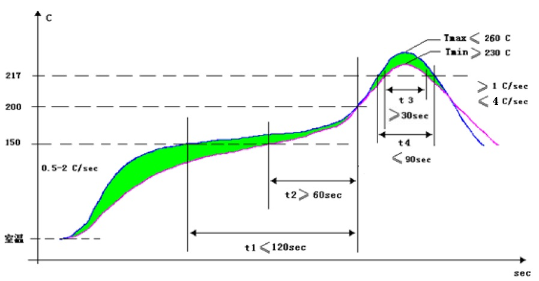

-   无铅回流焊工艺参数如[表1](#_table3079mcpsimp)所示。

    **表 1**  无铅回流焊工艺参数

    
    <table><thead align="left"><tr id="row2270mcpsimp"><th class="cellrowborder" valign="top" width="30%" id="mcps1.2.6.1.1">
区域

    </th>
    <th class="cellrowborder" valign="top" width="14.000000000000002%" id="mcps1.2.6.1.2">
时间

    </th>
    <th class="cellrowborder" valign="top" width="14.000000000000002%" id="mcps1.2.6.1.3">
升温速率

    </th>
    <th class="cellrowborder" valign="top" width="17%" id="mcps1.2.6.1.4">
峰值温度

    </th>
    <th class="cellrowborder" valign="top" width="25%" id="mcps1.2.6.1.5">
降温速率

    </th>
    </tr>
    </thead>
    <tbody><tr id="row2282mcpsimp"><td class="cellrowborder" valign="top" width="30%" headers="mcps1.2.6.1.1 ">
预热区（40～150℃）

    </td>
    <td class="cellrowborder" valign="top" width="14.000000000000002%" headers="mcps1.2.6.1.2 ">
60s～150s

    </td>
    <td class="cellrowborder" valign="top" width="14.000000000000002%" headers="mcps1.2.6.1.3 ">
≤2.0℃/s

    </td>
    <td class="cellrowborder" valign="top" width="17%" headers="mcps1.2.6.1.4 ">
-

    </td>
    <td class="cellrowborder" valign="top" width="25%" headers="mcps1.2.6.1.5 ">
-

    </td>
    </tr>
    <tr id="row2293mcpsimp"><td class="cellrowborder" valign="top" width="30%" headers="mcps1.2.6.1.1 ">
均温区（150～200℃）

    </td>
    <td class="cellrowborder" valign="top" width="14.000000000000002%" headers="mcps1.2.6.1.2 ">
60s～120s

    </td>
    <td class="cellrowborder" valign="top" width="14.000000000000002%" headers="mcps1.2.6.1.3 ">
＜1.0℃/s

    </td>
    <td class="cellrowborder" valign="top" width="17%" headers="mcps1.2.6.1.4 ">
-

    </td>
    <td class="cellrowborder" valign="top" width="25%" headers="mcps1.2.6.1.5 ">
-

    </td>
    </tr>
    <tr id="row2304mcpsimp"><td class="cellrowborder" valign="top" width="30%" headers="mcps1.2.6.1.1 ">
回流区（＞217℃）

    </td>
    <td class="cellrowborder" valign="top" width="14.000000000000002%" headers="mcps1.2.6.1.2 ">
30s～90s

    </td>
    <td class="cellrowborder" valign="top" width="14.000000000000002%" headers="mcps1.2.6.1.3 ">
-

    </td>
    <td class="cellrowborder" valign="top" width="17%" headers="mcps1.2.6.1.4 ">
230℃～260℃

    </td>
    <td class="cellrowborder" valign="top" width="25%" headers="mcps1.2.6.1.5 ">
-

    </td>
    </tr>
    <tr id="row2315mcpsimp"><td class="cellrowborder" valign="top" width="30%" headers="mcps1.2.6.1.1 ">
冷却区（Tmax～180℃）

    </td>
    <td class="cellrowborder" valign="top" width="14.000000000000002%" headers="mcps1.2.6.1.2 ">
-

    </td>
    <td class="cellrowborder" valign="top" width="14.000000000000002%" headers="mcps1.2.6.1.3 ">
-

    </td>
    <td class="cellrowborder" valign="top" width="17%" headers="mcps1.2.6.1.4 ">
-

    </td>
    <td class="cellrowborder" valign="top" width="25%" headers="mcps1.2.6.1.5 ">
1.0℃/s≤Slope≤4.0℃/s

    </td>
    </tr>
    </tbody>
    </table>

> **说明：** 
>-   预热区：温度40℃～150℃，温度上升速率控制在2℃/s左右，该温区时间为60～150 s。
>-   均温区：温度150℃～200℃，稳定缓慢升温，温度上升速率小于1℃/s，且该区域时间控制在60s\~120s**（注意：该区域一定缓慢受热，否则易导致焊接不良）**。
>-   回流区：温度217℃～Tmax～217℃，整个区间时间控制在30s～90s。
>-   冷却区：温度Tmax～180℃，温度下降速率最大不能超过4℃/s。
>-   温度从室温25℃升温到250℃时间不应该超过6分钟。
>-   该回流焊曲线仅为推荐值，客户端需根据实际生产情况做相应调整。
>-   回流时间以60s～90s为目标，对于一些热容较大无法满足时间要求的单板可将回流时间放宽至120s。封装体耐温标准参考IPC/JEDEC J-STD-020D标准，封装体测温方法参考JEP 140标准。

回流焊接工艺曲线测量方法：

JEP140推荐：对于厚度较小的器件，测量封装体温度时，直接将热电偶贴放在器件表面，对于厚度较大的器件，在器件表面钻孔埋入热电偶进行测量。由于量化器件厚度的要求，推荐全部采用在封装体表面钻孔埋入热电偶的方式（特别是薄器件，无法钻孔除外），如[图2](#_fig9143421646)所示。

**图 2**  封装体测温示意图  
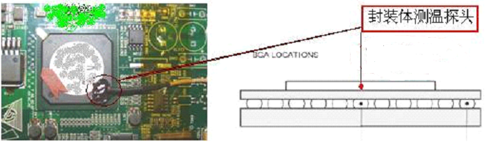

> **说明：** 
>上图仅为测温示意图，并非模组实际照片；仅供参考使用。

## 混合回流焊工艺参数要求

回流焊接过程中，如果出现器件混装现象，应首先保证无铅器件的正常焊接。具体要求如[表1](#_table3225mcpsimp)所示。

**表 1**  混装回流焊工艺参数表

<table><thead align="left"><tr id="row2874mcpsimp"><th class="cellrowborder" colspan="2" valign="top" id="mcps1.2.6.1.1">
数值要求

</th>
<th class="cellrowborder" valign="top" id="mcps1.2.6.1.2">
有铅BGA

</th>
<th class="cellrowborder" valign="top" id="mcps1.2.6.1.3">
无铅BGA

</th>
<th class="cellrowborder" valign="top" id="mcps1.2.6.1.4">
其他器件

</th>
</tr>
</thead>
<tbody><tr id="row2884mcpsimp"><td class="cellrowborder" rowspan="2" valign="top" headers="mcps1.2.6.1.1 ">
预热区（40℃～150℃）

</td>
<td class="cellrowborder" valign="top" headers="mcps1.2.6.1.1 ">
时间

</td>
<td class="cellrowborder" colspan="3" valign="top" headers="mcps1.2.6.1.2 mcps1.2.6.1.3 mcps1.2.6.1.4 ">
60s～150s

</td>
</tr>
<tr id="row2891mcpsimp"><td class="cellrowborder" valign="top" headers="mcps1.2.6.1.1 ">
升温斜率

</td>
<td class="cellrowborder" colspan="3" valign="top" headers="mcps1.2.6.1.1 mcps1.2.6.1.2 mcps1.2.6.1.3 ">
＜2.5℃/s

</td>
</tr>
<tr id="row2896mcpsimp"><td class="cellrowborder" rowspan="2" valign="top" headers="mcps1.2.6.1.1 ">
均温区（150℃～183℃）

</td>
<td class="cellrowborder" valign="top" headers="mcps1.2.6.1.1 ">
时间

</td>
<td class="cellrowborder" colspan="3" valign="top" headers="mcps1.2.6.1.2 mcps1.2.6.1.3 mcps1.2.6.1.4 ">
30s～90s

</td>
</tr>
<tr id="row2903mcpsimp"><td class="cellrowborder" valign="top" headers="mcps1.2.6.1.1 ">
升温斜率

</td>
<td class="cellrowborder" colspan="3" valign="top" headers="mcps1.2.6.1.1 mcps1.2.6.1.2 mcps1.2.6.1.3 ">
＜1.0℃/s

</td>
</tr>
<tr id="row2908mcpsimp"><td class="cellrowborder" rowspan="2" valign="top" width="27.722772277227726%" headers="mcps1.2.6.1.1 ">
回流区（＞183℃）

</td>
<td class="cellrowborder" valign="top" width="15.841584158415841%" headers="mcps1.2.6.1.1 ">
峰值温度

</td>
<td class="cellrowborder" valign="top" width="17.82178217821782%" headers="mcps1.2.6.1.2 ">
210℃～240℃

</td>
<td class="cellrowborder" valign="top" width="17.82178217821782%" headers="mcps1.2.6.1.3 ">
220℃～240℃

</td>
<td class="cellrowborder" valign="top" width="20.792079207920793%" headers="mcps1.2.6.1.4 ">
210℃～245℃

</td>
</tr>
<tr id="row2919mcpsimp"><td class="cellrowborder" valign="top" headers="mcps1.2.6.1.1 ">
时间

</td>
<td class="cellrowborder" valign="top" headers="mcps1.2.6.1.1 ">
30s～120s

</td>
<td class="cellrowborder" valign="top" headers="mcps1.2.6.1.2 ">
60s～120s

</td>
<td class="cellrowborder" valign="top" headers="mcps1.2.6.1.3 ">
30s～120s

</td>
</tr>
<tr id="row2928mcpsimp"><td class="cellrowborder" valign="top" headers="mcps1.2.6.1.1 ">
冷却区（Tmax～150℃）

</td>
<td class="cellrowborder" valign="top" headers="mcps1.2.6.1.1 ">
降温斜率

</td>
<td class="cellrowborder" colspan="3" valign="top" headers="mcps1.2.6.1.2 mcps1.2.6.1.3 mcps1.2.6.1.4 ">
1.0℃/s≤Slope≤4.0℃/s

</td>
</tr>
</tbody>
</table>

> **说明：** 
>以上工艺参数要求均针对焊点温度。单板上焊点最热点和最冷点均需要满足以上规范要求。

曲线调制中，还需要满足单板上元器件的封装体耐温要求。封装体耐温标准按照IPC/JEDEC J-STD-020D标准，封装体测温方法按照JEP 140标准。

# 存储和包装

-   **[存放与使用](#ZH-CN_TOPIC_0000002545901611)**  

-   **[重新烘烤](#ZH-CN_TOPIC_0000002514301666)**  

-   **[包装规格](#ZH-CN_TOPIC_0000002545781619)**  

## 存放与使用

**【**使用范围】

所有HiDiTingV100模组的存放和使用。

**【**存放环境】

建议产品真空包装存放，-40℃≤存放温度≤150℃。推荐存放在25℃的环境温度下。

**【**存储期限】（shelf life）

存放环境<30°C/60% RH下，真空包装存放，存储期限（shelf life）不少于12个月。

**【**车间寿命】（floor life）

在环境条件<30°C/60%下，floor life参照表如[表1](#_table659mcpsimp)所示。

**表 1**  车间寿命（floor life）参照表

<table><thead align="left"><tr id="row2450mcpsimp"><th class="cellrowborder" valign="top" width="20.150000000000002%" id="mcps1.2.3.1.1">
潮湿敏感等级

（MSL）

</th>
<th class="cellrowborder" valign="top" width="79.85%" id="mcps1.2.3.1.2">
含义（即拆分后放存条件及最长时间）

</th>
</tr>
</thead>
<tbody><tr id="row2457mcpsimp"><td class="cellrowborder" valign="top" width="20.150000000000002%" headers="mcps1.2.3.1.1 ">
1

</td>
<td class="cellrowborder" valign="top" width="79.85%" headers="mcps1.2.3.1.2 ">
无限制，环境温湿度≦30℃/85% RH（Relative Humidity）

</td>
</tr>
<tr id="row2462mcpsimp"><td class="cellrowborder" valign="top" width="20.150000000000002%" headers="mcps1.2.3.1.1 ">
2

</td>
<td class="cellrowborder" valign="top" width="79.85%" headers="mcps1.2.3.1.2 ">
1年，30℃/60%RH。

</td>
</tr>
<tr id="row2467mcpsimp"><td class="cellrowborder" valign="top" width="20.150000000000002%" headers="mcps1.2.3.1.1 ">
2a

</td>
<td class="cellrowborder" valign="top" width="79.85%" headers="mcps1.2.3.1.2 ">
1月，30℃/60%RH。

</td>
</tr>
<tr id="row2472mcpsimp"><td class="cellrowborder" valign="top" width="20.150000000000002%" headers="mcps1.2.3.1.1 ">
3

</td>
<td class="cellrowborder" valign="top" width="79.85%" headers="mcps1.2.3.1.2 ">
1周，30℃/60%RH。

</td>
</tr>
<tr id="row2477mcpsimp"><td class="cellrowborder" valign="top" width="20.150000000000002%" headers="mcps1.2.3.1.1 ">
4

</td>
<td class="cellrowborder" valign="top" width="79.85%" headers="mcps1.2.3.1.2 ">
72h，30℃/60%RH。

</td>
</tr>
<tr id="row2482mcpsimp"><td class="cellrowborder" valign="top" width="20.150000000000002%" headers="mcps1.2.3.1.1 ">
5

</td>
<td class="cellrowborder" valign="top" width="79.85%" headers="mcps1.2.3.1.2 ">
48h，30℃/60%RH。

</td>
</tr>
<tr id="row2487mcpsimp"><td class="cellrowborder" valign="top" width="20.150000000000002%" headers="mcps1.2.3.1.1 ">
5a

</td>
<td class="cellrowborder" valign="top" width="79.85%" headers="mcps1.2.3.1.2 ">
24h，30℃/60%RH。

</td>
</tr>
<tr id="row2492mcpsimp"><td class="cellrowborder" valign="top" width="20.150000000000002%" headers="mcps1.2.3.1.1 ">
6

</td>
<td class="cellrowborder" valign="top" width="79.85%" headers="mcps1.2.3.1.2 ">
Time on Label，30℃/60%RH。

</td>
</tr>
</tbody>
</table>

**【**潮敏产品的使用】

-   产品在≦30℃/60%RH下连续或累计暴露超过2个小时，建议进行重新烘烤后再真空干燥包装。
-   产品在≦30℃/60%RH下暴露累计没有超过2个小时，可以不用重新烘烤，但要更换新的干燥剂，进行真空干燥包装。
-   本产品的潮敏参数等级为：3级。
-   本文没有提到的存储及使用原则，请直接参考JEDEC J-STD-033A。

## 重新烘烤

【适用产品】

所有HiDiTingV100模组（潮敏产品）

【使用范围】

需要重新烘烤的模组（潮敏产品）

【重新烘烤参考表】

重新烘烤要求如[表1](#_table4462mcpsimp)所示。

**表 1**  模组重新烘烤参考表

<table><thead align="left"><tr id="row1461mcpsimp"><th class="cellrowborder" valign="top" width="17.82178217821782%" id="mcps1.2.6.1.1">
模组厚度

</th>
<th class="cellrowborder" valign="top" width="13.861386138613863%" id="mcps1.2.6.1.2">
MSL潮敏等级

</th>
<th class="cellrowborder" valign="top" width="18.81188118811881%" id="mcps1.2.6.1.3">
烘烤125℃

</th>
<th class="cellrowborder" valign="top" width="25.742574257425744%" id="mcps1.2.6.1.4">
烘烤90℃/≦5% RH

</th>
<th class="cellrowborder" valign="top" width="23.762376237623766%" id="mcps1.2.6.1.5">
烘烤40℃/≦5% RH

</th>
</tr>
</thead>
<tbody><tr id="row1473mcpsimp"><td class="cellrowborder" rowspan="5" valign="top" width="17.82178217821782%" headers="mcps1.2.6.1.1 ">
≤2.0mm

</td>
<td class="cellrowborder" valign="top" width="13.861386138613863%" headers="mcps1.2.6.1.2 ">
2a

</td>
<td class="cellrowborder" valign="top" width="18.81188118811881%" headers="mcps1.2.6.1.3 ">
16h

</td>
<td class="cellrowborder" valign="top" width="25.742574257425744%" headers="mcps1.2.6.1.4 ">
2days

</td>
<td class="cellrowborder" valign="top" width="23.762376237623766%" headers="mcps1.2.6.1.5 ">
22days

</td>
</tr>
<tr id="row1484mcpsimp"><td class="cellrowborder" valign="top" headers="mcps1.2.6.1.1 ">
3

</td>
<td class="cellrowborder" valign="top" headers="mcps1.2.6.1.2 ">
17h

</td>
<td class="cellrowborder" valign="top" headers="mcps1.2.6.1.3 ">
2days

</td>
<td class="cellrowborder" valign="top" headers="mcps1.2.6.1.4 ">
23days

</td>
</tr>
<tr id="row1493mcpsimp"><td class="cellrowborder" valign="top" headers="mcps1.2.6.1.1 ">
4

</td>
<td class="cellrowborder" valign="top" headers="mcps1.2.6.1.2 ">
20h

</td>
<td class="cellrowborder" valign="top" headers="mcps1.2.6.1.3 ">
3days

</td>
<td class="cellrowborder" valign="top" headers="mcps1.2.6.1.4 ">
28days

</td>
</tr>
<tr id="row1502mcpsimp"><td class="cellrowborder" valign="top" headers="mcps1.2.6.1.1 ">
5

</td>
<td class="cellrowborder" valign="top" headers="mcps1.2.6.1.2 ">
25h

</td>
<td class="cellrowborder" valign="top" headers="mcps1.2.6.1.3 ">
4days

</td>
<td class="cellrowborder" valign="top" headers="mcps1.2.6.1.4 ">
35days

</td>
</tr>
<tr id="row1511mcpsimp"><td class="cellrowborder" valign="top" headers="mcps1.2.6.1.1 ">
5a

</td>
<td class="cellrowborder" valign="top" headers="mcps1.2.6.1.2 ">
40h

</td>
<td class="cellrowborder" valign="top" headers="mcps1.2.6.1.3 ">
6days

</td>
<td class="cellrowborder" valign="top" headers="mcps1.2.6.1.4 ">
56days

</td>
</tr>
<tr id="row1520mcpsimp"><td class="cellrowborder" rowspan="5" valign="top" width="17.82178217821782%" headers="mcps1.2.6.1.1 ">
≤4.5mm

</td>
<td class="cellrowborder" valign="top" width="13.861386138613863%" headers="mcps1.2.6.1.2 ">
2a

</td>
<td class="cellrowborder" valign="top" width="18.81188118811881%" headers="mcps1.2.6.1.3 ">
48h

</td>
<td class="cellrowborder" valign="top" width="25.742574257425744%" headers="mcps1.2.6.1.4 ">
7days

</td>
<td class="cellrowborder" valign="top" width="23.762376237623766%" headers="mcps1.2.6.1.5 ">
67days

</td>
</tr>
<tr id="row1531mcpsimp"><td class="cellrowborder" valign="top" headers="mcps1.2.6.1.1 ">
3

</td>
<td class="cellrowborder" valign="top" headers="mcps1.2.6.1.2 ">
48h

</td>
<td class="cellrowborder" valign="top" headers="mcps1.2.6.1.3 ">
8days

</td>
<td class="cellrowborder" valign="top" headers="mcps1.2.6.1.4 ">
67days

</td>
</tr>
<tr id="row1540mcpsimp"><td class="cellrowborder" valign="top" headers="mcps1.2.6.1.1 ">
4

</td>
<td class="cellrowborder" valign="top" headers="mcps1.2.6.1.2 ">
48h

</td>
<td class="cellrowborder" valign="top" headers="mcps1.2.6.1.3 ">
10days

</td>
<td class="cellrowborder" valign="top" headers="mcps1.2.6.1.4 ">
67days

</td>
</tr>
<tr id="row1549mcpsimp"><td class="cellrowborder" valign="top" headers="mcps1.2.6.1.1 ">
5

</td>
<td class="cellrowborder" valign="top" headers="mcps1.2.6.1.2 ">
48h

</td>
<td class="cellrowborder" valign="top" headers="mcps1.2.6.1.3 ">
10days

</td>
<td class="cellrowborder" valign="top" headers="mcps1.2.6.1.4 ">
67days

</td>
</tr>
<tr id="row1558mcpsimp"><td class="cellrowborder" valign="top" headers="mcps1.2.6.1.1 ">
5a

</td>
<td class="cellrowborder" valign="top" headers="mcps1.2.6.1.2 ">
48h

</td>
<td class="cellrowborder" valign="top" headers="mcps1.2.6.1.3 ">
10days

</td>
<td class="cellrowborder" valign="top" headers="mcps1.2.6.1.4 ">
67days

</td>
</tr>
</tbody>
</table>

对于HiDiTingV100芯片默认卷带包装，厚度1.02mm的建议烘烤条件为：

-   tray包装类为温度125±5℃，相对湿度不大于60%，烘烤7小时；或者温度90±5℃，相对湿度不大于5%，烘烤23小时。
-   料带包装类（不耐高温，烘烤前注意包装耐高温度）为温度40℃，相对湿度不大于5%，烘烤216小时。

> **说明：** 
>[表1](#_table4462mcpsimp)中显示的均是受潮后，必须的最小烘烤时间。重新烘烤优先选择低温烘烤。详细情况请参考JEDEC。

## 包装规格

载带包装的尺寸图标如下。

**图 1**  载带尺寸图  
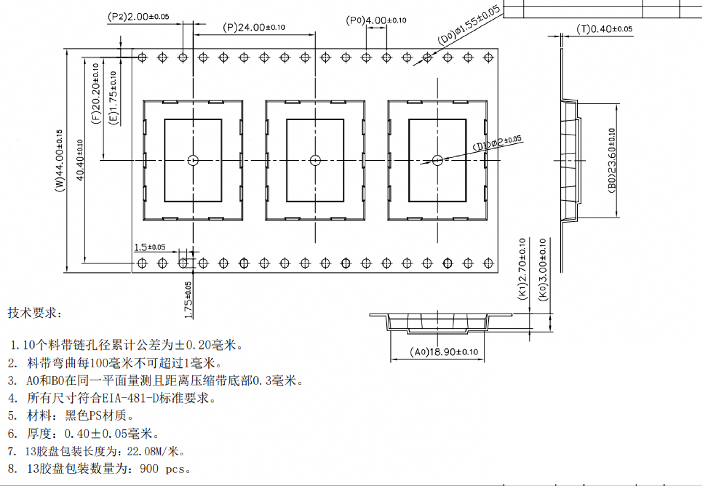

**图 2**  胶盘尺寸图  
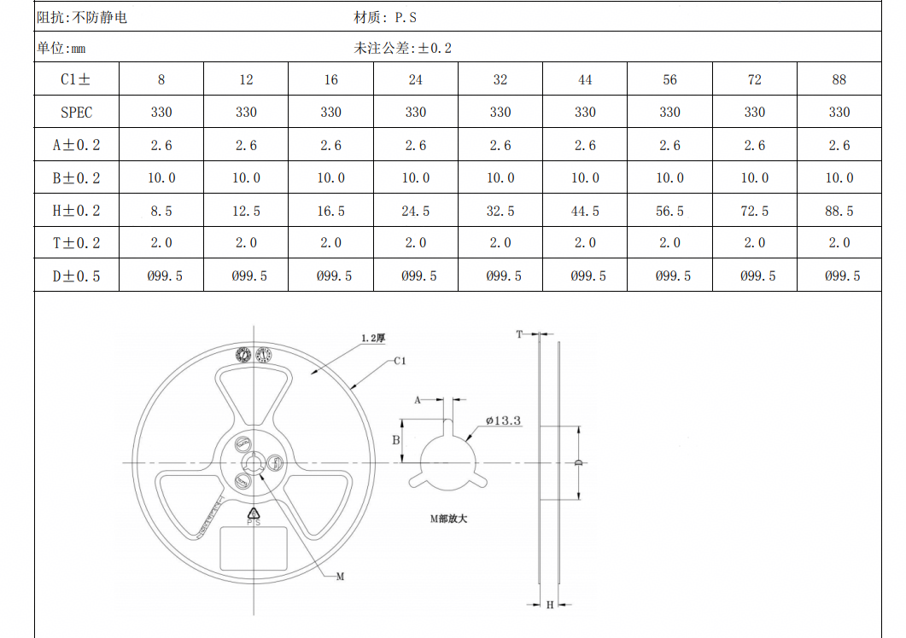

**图 3**  胶盘实物样品图  
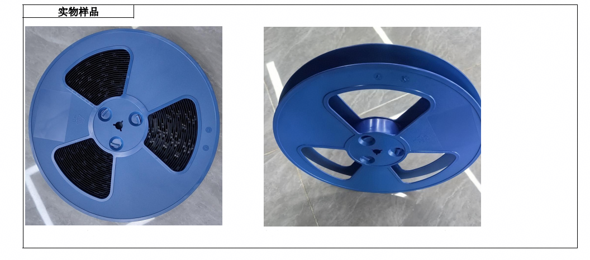

# 关键器件规格

本文提到的关键器件是指器件参数会直接影响产品的关键性能、系统可靠性等关键指标，客户要遵循下面的器件选型建议。

-   **[Nor Flash](#ZH-CN_TOPIC_0000002545901613)**  

-   **[Nand Flash](#ZH-CN_TOPIC_0000002514141746)**  

## Nor Flash

-   **[Nor Flash规格](#ZH-CN_TOPIC_0000002514301668)**  

-   **[Nor Flash测试指导](#ZH-CN_TOPIC_0000002545781621)**  

### Nor Flash规格

单芯片SPI Nor Flash基本要求：

-   支持单线SPI及4线QSPI接口。
-   主芯片Nor Flash接口最高工作速率100MHz。
-   根据实际应用规模进行容量选型：≥128Mbit。
-   工作电压：1.8V（1.7V～1.95V）。
-   支持4KB sector/32KB block/64KB block/chip ERASE。

### Nor Flash测试指导

建议针对Nor Flash器件做如下测试：

-   单块写、读：成功读出并跟写入的数据相同。
-   多块写、读：成功读出并跟写入的数据相同。
-   擦除：可成功擦除访问地址的数据。
-   测试最大100MHz速率下，可正常读写。
-   可靠性测试：低温-40℃/高温85℃环境下，循环读写操作＞24h，检测写入数据正确性。

## Nand Flash

-   **[Nand Flash规格](#ZH-CN_TOPIC_0000002545901615)**  

-   **[Nand Flash测试指导](#ZH-CN_TOPIC_0000002514301670)**  

### Nand Flash规格

单芯片SPI Nand Flash基本要求：

-   支持单线SPI及4线QSPI接口。
-   主芯片Nand Flash接口最高工作速率67MHz。
-   根据实际应用规模进行容量选型：推荐1Gbit。
-   工作电压：1.8V（1.7V～1.95V）。
-   IO驱动可调：优选IO的Driver strength有多档位可调。
-   Flash ID唯一。

### Nand Flash测试指导

建议针对Nand Flash器件做如下测试：

-   单块写、读：成功读出并跟写入的数据相同。
-   多块写、读：成功读出并跟写入的数据相同。
-   擦除：可成功擦除访问地址的数据。
-   测试最大67MHz速率下，可正常读写。
-   可靠性测试：低温-40℃/高温85℃环境下，循环读写操作＞24h，检测写入数据正确性。

# 硬件设计Checklist

用户进行原理图、PCB设计时，需要按照如下checklist进行自检。

**表 1**  HiDiTingV100原理图设计checklist

<table><thead align="left"><tr id="row1591mcpsimp"><th class="cellrowborder" valign="top" width="6.93%" id="mcps1.2.6.1.1">
序号

</th>
<th class="cellrowborder" valign="top" width="10.89%" id="mcps1.2.6.1.2">
模块

</th>
<th class="cellrowborder" valign="top" width="61.39%" id="mcps1.2.6.1.3">
描述

</th>
<th class="cellrowborder" valign="top" width="10.89%" id="mcps1.2.6.1.4">
必要性

</th>
<th class="cellrowborder" valign="top" width="9.9%" id="mcps1.2.6.1.5">
自检结果

</th>
</tr>
</thead>
<tbody><tr id="row1603mcpsimp"><td class="cellrowborder" valign="top" width="6.93%" headers="mcps1.2.6.1.1 ">
1

</td>
<td class="cellrowborder" valign="top" width="10.89%" headers="mcps1.2.6.1.2 ">
PMU

</td>
<td class="cellrowborder" valign="top" width="61.39%" headers="mcps1.2.6.1.3 ">
IOLDO2外部仅可用作AUX_ADC采样上拉电阻电源，不要直接给外设供电。

</td>
<td class="cellrowborder" valign="top" width="10.89%" headers="mcps1.2.6.1.4 ">
必须

</td>
<td class="cellrowborder" valign="top" width="9.9%" headers="mcps1.2.6.1.5 ">&nbsp;&nbsp;</td>
</tr>
<tr id="row1613mcpsimp"><td class="cellrowborder" valign="top" width="6.93%" headers="mcps1.2.6.1.1 ">
2

</td>
<td class="cellrowborder" valign="top" width="10.89%" headers="mcps1.2.6.1.2 ">
PMU

</td>
<td class="cellrowborder" valign="top" width="61.39%" headers="mcps1.2.6.1.3 ">
IOLDO6仅限于给Nor Flash供电以及作为其上拉电源域使用。

</td>
<td class="cellrowborder" valign="top" width="10.89%" headers="mcps1.2.6.1.4 ">
必须

</td>
<td class="cellrowborder" valign="top" width="9.9%" headers="mcps1.2.6.1.5 ">&nbsp;&nbsp;</td>
</tr>
<tr id="row1623mcpsimp"><td class="cellrowborder" valign="top" width="6.93%" headers="mcps1.2.6.1.1 ">
3

</td>
<td class="cellrowborder" valign="top" width="10.89%" headers="mcps1.2.6.1.2 ">
上电复位

</td>
<td class="cellrowborder" valign="top" width="61.39%" headers="mcps1.2.6.1.3 ">
PWR_KEY管脚芯片内部有上拉电阻，按键低电平开机。不使用时悬空。

</td>
<td class="cellrowborder" valign="top" width="10.89%" headers="mcps1.2.6.1.4 ">
必须

</td>
<td class="cellrowborder" valign="top" width="9.9%" headers="mcps1.2.6.1.5 ">&nbsp;&nbsp;</td>
</tr>
<tr id="row1633mcpsimp"><td class="cellrowborder" valign="top" width="6.93%" headers="mcps1.2.6.1.1 ">
4

</td>
<td class="cellrowborder" valign="top" width="10.89%" headers="mcps1.2.6.1.2 ">
上电复位

</td>
<td class="cellrowborder" valign="top" width="61.39%" headers="mcps1.2.6.1.3 ">
VBUS_SENSE管脚电压上限1.8V，当使用VBUS开机时需要外接分压电阻。

管脚不使用时，外接下拉电阻到地，不允许悬空。

</td>
<td class="cellrowborder" valign="top" width="10.89%" headers="mcps1.2.6.1.4 ">
建议

</td>
<td class="cellrowborder" valign="top" width="9.9%" headers="mcps1.2.6.1.5 ">&nbsp;&nbsp;</td>
</tr>
<tr id="row1644mcpsimp"><td class="cellrowborder" valign="top" width="6.93%" headers="mcps1.2.6.1.1 ">
5

</td>
<td class="cellrowborder" valign="top" width="10.89%" headers="mcps1.2.6.1.2 ">
上电复位

</td>
<td class="cellrowborder" valign="top" width="61.39%" headers="mcps1.2.6.1.3 ">
CAT1默认上电启动，如需控制其上下电，请预留GPIO控制CAT1_VBAT通断。

</td>
<td class="cellrowborder" valign="top" width="10.89%" headers="mcps1.2.6.1.4 ">
建议

</td>
<td class="cellrowborder" valign="top" width="9.9%" headers="mcps1.2.6.1.5 ">&nbsp;&nbsp;</td>
</tr>
<tr id="row1654mcpsimp"><td class="cellrowborder" valign="top" width="6.93%" headers="mcps1.2.6.1.1 ">
6

</td>
<td class="cellrowborder" valign="top" width="10.89%" headers="mcps1.2.6.1.2 ">
RF

</td>
<td class="cellrowborder" valign="top" width="61.39%" headers="mcps1.2.6.1.3 ">
RFIO通道建议预留pi型匹配。

</td>
<td class="cellrowborder" valign="top" width="10.89%" headers="mcps1.2.6.1.4 ">
建议

</td>
<td class="cellrowborder" valign="top" width="9.9%" headers="mcps1.2.6.1.5 ">&nbsp;&nbsp;</td>
</tr>
<tr id="row1664mcpsimp"><td class="cellrowborder" valign="top" width="6.93%" headers="mcps1.2.6.1.1 ">
7

</td>
<td class="cellrowborder" valign="top" width="10.89%" headers="mcps1.2.6.1.2 ">
接口

</td>
<td class="cellrowborder" valign="top" width="61.39%" headers="mcps1.2.6.1.3 ">
外接显示屏使用QSPI2、Nand Flash使用QSPI1、Nor Flash使用QSPI0。

</td>
<td class="cellrowborder" valign="top" width="10.89%" headers="mcps1.2.6.1.4 ">
建议

</td>
<td class="cellrowborder" valign="top" width="9.9%" headers="mcps1.2.6.1.5 ">&nbsp;&nbsp;</td>
</tr>
<tr id="row1674mcpsimp"><td class="cellrowborder" valign="top" width="6.93%" headers="mcps1.2.6.1.1 ">
8

</td>
<td class="cellrowborder" valign="top" width="10.89%" headers="mcps1.2.6.1.2 ">
接口

</td>
<td class="cellrowborder" valign="top" width="61.39%" headers="mcps1.2.6.1.3 ">
S_AGPIO17/S_AGPIO18为空片烧录管脚，板级预留测试点用于产线烧录。模组默认USB烧录。

</td>
<td class="cellrowborder" valign="top" width="10.89%" headers="mcps1.2.6.1.4 ">
必须

</td>
<td class="cellrowborder" valign="top" width="9.9%" headers="mcps1.2.6.1.5 ">&nbsp;&nbsp;</td>
</tr>
<tr id="row1684mcpsimp"><td class="cellrowborder" valign="top" width="6.93%" headers="mcps1.2.6.1.1 ">
9

</td>
<td class="cellrowborder" valign="top" width="10.89%" headers="mcps1.2.6.1.2 ">
接口

</td>
<td class="cellrowborder" valign="top" width="61.39%" headers="mcps1.2.6.1.3 ">
模组内芯片不支持防倒灌，不支持使用1.8V IO倒灌方式驱动LED。

</td>
<td class="cellrowborder" valign="top" width="10.89%" headers="mcps1.2.6.1.4 ">
必须

</td>
<td class="cellrowborder" valign="top" width="9.9%" headers="mcps1.2.6.1.5 ">&nbsp;&nbsp;</td>
</tr>
<tr id="row1694mcpsimp"><td class="cellrowborder" valign="top" width="6.93%" headers="mcps1.2.6.1.1 ">
10

</td>
<td class="cellrowborder" valign="top" width="10.89%" headers="mcps1.2.6.1.2 ">
接口

</td>
<td class="cellrowborder" valign="top" width="61.39%" headers="mcps1.2.6.1.3 ">
所有对外接口建议全部预留ESD防护管。

</td>
<td class="cellrowborder" valign="top" width="10.89%" headers="mcps1.2.6.1.4 ">
建议

</td>
<td class="cellrowborder" valign="top" width="9.9%" headers="mcps1.2.6.1.5 ">&nbsp;&nbsp;</td>
</tr>
<tr id="row1704mcpsimp"><td class="cellrowborder" valign="top" width="6.93%" headers="mcps1.2.6.1.1 ">
11

</td>
<td class="cellrowborder" valign="top" width="10.89%" headers="mcps1.2.6.1.2 ">
音频

</td>
<td class="cellrowborder" valign="top" width="61.39%" headers="mcps1.2.6.1.3 ">
支持1路模拟MIC输入，AMIC器件与模组端须加隔直电容，隔直电容必须选用2.2μF及以上电容。

</td>
<td class="cellrowborder" valign="top" width="10.89%" headers="mcps1.2.6.1.4 ">
必须

</td>
<td class="cellrowborder" valign="top" width="9.9%" headers="mcps1.2.6.1.5 ">&nbsp;&nbsp;</td>
</tr>
<tr id="row1714mcpsimp"><td class="cellrowborder" valign="top" width="6.93%" headers="mcps1.2.6.1.1 ">
12

</td>
<td class="cellrowborder" valign="top" width="10.89%" headers="mcps1.2.6.1.2 ">
音频

</td>
<td class="cellrowborder" valign="top" width="61.39%" headers="mcps1.2.6.1.3 ">
芯片HS为差分输出，芯片输出端通过RC滤波后，再给到模拟PA。

</td>
<td class="cellrowborder" valign="top" width="10.89%" headers="mcps1.2.6.1.4 ">
必须

</td>
<td class="cellrowborder" valign="top" width="9.9%" headers="mcps1.2.6.1.5 ">&nbsp;&nbsp;</td>
</tr>
</tbody>
</table>

**表 2**  HiDiTingV100 PCB设计checklist

<table><thead align="left"><tr id="row1732mcpsimp"><th class="cellrowborder" valign="top" width="7.000000000000001%" id="mcps1.2.6.1.1">
序号

</th>
<th class="cellrowborder" valign="top" width="11%" id="mcps1.2.6.1.2">
模块

</th>
<th class="cellrowborder" valign="top" width="62%" id="mcps1.2.6.1.3">
描述

</th>
<th class="cellrowborder" valign="top" width="10%" id="mcps1.2.6.1.4">
必要性

</th>
<th class="cellrowborder" valign="top" width="10%" id="mcps1.2.6.1.5">
自检结果

</th>
</tr>
</thead>
<tbody><tr id="row1744mcpsimp"><td class="cellrowborder" valign="top" width="7.000000000000001%" headers="mcps1.2.6.1.1 ">
1

</td>
<td class="cellrowborder" valign="top" width="11%" headers="mcps1.2.6.1.2 ">
RF

</td>
<td class="cellrowborder" valign="top" width="62%" headers="mcps1.2.6.1.3 ">
芯片到pi型匹配的射频表层走线尽量短；建议内层走线。射频前端走线阻抗控制50Ω。

</td>
<td class="cellrowborder" valign="top" width="10%" headers="mcps1.2.6.1.4 ">
建议

</td>
<td class="cellrowborder" valign="top" width="10%" headers="mcps1.2.6.1.5 ">&nbsp;&nbsp;</td>
</tr>
<tr id="row1754mcpsimp"><td class="cellrowborder" valign="top" width="7.000000000000001%" headers="mcps1.2.6.1.1 ">
2

</td>
<td class="cellrowborder" valign="top" width="11%" headers="mcps1.2.6.1.2 ">
RF

</td>
<td class="cellrowborder" valign="top" width="62%" headers="mcps1.2.6.1.3 ">
RFIO的layout阻抗配置要求：VSWR＝1.5，Phase＝-90&deg;～-80&deg;。

</td>
<td class="cellrowborder" valign="top" width="10%" headers="mcps1.2.6.1.4 ">
必须

</td>
<td class="cellrowborder" valign="top" width="10%" headers="mcps1.2.6.1.5 ">&nbsp;&nbsp;</td>
</tr>
<tr id="row1764mcpsimp"><td class="cellrowborder" valign="top" width="7.000000000000001%" headers="mcps1.2.6.1.1 ">
3

</td>
<td class="cellrowborder" valign="top" width="11%" headers="mcps1.2.6.1.2 ">
模拟

</td>
<td class="cellrowborder" valign="top" width="62%" headers="mcps1.2.6.1.3 ">
ADC模拟信号立体包地保护。

</td>
<td class="cellrowborder" valign="top" width="10%" headers="mcps1.2.6.1.4 ">
建议

</td>
<td class="cellrowborder" valign="top" width="10%" headers="mcps1.2.6.1.5 ">&nbsp;&nbsp;</td>
</tr>
<tr id="row1774mcpsimp"><td class="cellrowborder" valign="top" width="7.000000000000001%" headers="mcps1.2.6.1.1 ">
4

</td>
<td class="cellrowborder" valign="top" width="11%" headers="mcps1.2.6.1.2 ">
CODEC

</td>
<td class="cellrowborder" valign="top" width="62%" headers="mcps1.2.6.1.3 ">
AMIC差分输入信号按照差分紧耦合走线，四面包地。

</td>
<td class="cellrowborder" valign="top" width="10%" headers="mcps1.2.6.1.4 ">
建议

</td>
<td class="cellrowborder" valign="top" width="10%" headers="mcps1.2.6.1.5 ">&nbsp;&nbsp;</td>
</tr>
<tr id="row1784mcpsimp"><td class="cellrowborder" valign="top" width="7.000000000000001%" headers="mcps1.2.6.1.1 ">
5

</td>
<td class="cellrowborder" valign="top" width="11%" headers="mcps1.2.6.1.2 ">
CODEC

</td>
<td class="cellrowborder" valign="top" width="62%" headers="mcps1.2.6.1.3 ">
HSP/N到负载端的电阻控制在0.05Ω以下，走线宽度不小于6mil。按照差分紧耦合走线，四面包地（非射频地）。

</td>
<td class="cellrowborder" valign="top" width="10%" headers="mcps1.2.6.1.4 ">
建议

</td>
<td class="cellrowborder" valign="top" width="10%" headers="mcps1.2.6.1.5 ">&nbsp;&nbsp;</td>
</tr>
<tr id="row1794mcpsimp"><td class="cellrowborder" valign="top" width="7.000000000000001%" headers="mcps1.2.6.1.1 ">
6

</td>
<td class="cellrowborder" valign="top" width="11%" headers="mcps1.2.6.1.2 ">
接口

</td>
<td class="cellrowborder" valign="top" width="62%" headers="mcps1.2.6.1.3 ">
高速IO、USB等接口避免stub走线。

</td>
<td class="cellrowborder" valign="top" width="10%" headers="mcps1.2.6.1.4 ">
建议

</td>
<td class="cellrowborder" valign="top" width="10%" headers="mcps1.2.6.1.5 ">&nbsp;&nbsp;</td>
</tr>
</tbody>
</table>

# 缩略语

<table><tbody><tr id="row3171mcpsimp"><td class="nocellnorowborder" style="border:none" valign="top" width="21.33%">
<strong id="b3174mcpsimp">A</strong>

</td>
<td class="nocellnorowborder" style="border:none" valign="top" width="44.67%">&nbsp;&nbsp;</td>
<td class="cell-norowborder" style="border:none" valign="top" width="34%">&nbsp;&nbsp;</td>
</tr>
<tr id="row3177mcpsimp"><td class="nocellnorowborder" style="border:none" valign="top" width="21.33%">
<strong id="b3180mcpsimp">ADC</strong>

</td>
<td class="nocellnorowborder" style="border:none" valign="top" width="44.67%">
Analog-to-Digital Converter

</td>
<td class="cell-norowborder" style="border:none" valign="top" width="34%">
模拟数字转换器

</td>
</tr>
<tr id="row3185mcpsimp"><td class="nocellnorowborder" style="border:none" valign="top" width="21.33%">
<strong id="b3188mcpsimp">AMIC</strong>

</td>
<td class="nocellnorowborder" style="border:none" valign="top" width="44.67%">
Analog Microphone

</td>
<td class="cell-norowborder" style="border:none" valign="top" width="34%">
模拟麦克风

</td>
</tr>
<tr id="row3193mcpsimp"><td class="nocellnorowborder" style="border:none" valign="top" width="21.33%">
<strong id="b3196mcpsimp">AUXADC</strong>

</td>
<td class="nocellnorowborder" style="border:none" valign="top" width="44.67%">
Auxiliary Digital-to-Analog Converter

</td>
<td class="cell-norowborder" style="border:none" valign="top" width="34%">
辅助模拟数字转换器

</td>
</tr>
<tr id="row3201mcpsimp"><td class="nocellnorowborder" style="border:none" valign="top" width="21.33%">&nbsp;&nbsp;</td>
<td class="nocellnorowborder" style="border:none" valign="top" width="44.67%">&nbsp;&nbsp;</td>
<td class="cell-norowborder" style="border:none" valign="top" width="34%">&nbsp;&nbsp;</td>
</tr>
<tr id="row3205mcpsimp"><td class="nocellnorowborder" style="border:none" valign="top" width="21.33%">
<strong id="b3208mcpsimp">C</strong>

</td>
<td class="nocellnorowborder" style="border:none" valign="top" width="44.67%">&nbsp;&nbsp;</td>
<td class="cell-norowborder" style="border:none" valign="top" width="34%">&nbsp;&nbsp;</td>
</tr>
<tr id="row144971407424"><td class="cellrowborder" style="border:none" valign="top" width="21.33%">
<strong id="b186686634214">CAT1</strong>

</td>
<td class="cellrowborder" style="border:none" valign="top" width="44.67%">
Category 1

</td>
<td class="cellrowborder" style="border:none" valign="top" width="34%">
4G物联网终端

</td>
</tr>
<tr id="row3219mcpsimp"><td class="nocellnorowborder" style="border:none" valign="top" width="21.33%">&nbsp;&nbsp;</td>
<td class="nocellnorowborder" style="border:none" valign="top" width="44.67%">&nbsp;&nbsp;</td>
<td class="cell-norowborder" style="border:none" valign="top" width="34%">&nbsp;&nbsp;</td>
</tr>
<tr id="row3223mcpsimp"><td class="nocellnorowborder" style="border:none" valign="top" width="21.33%">
<strong id="b3226mcpsimp">D</strong>

</td>
<td class="nocellnorowborder" style="border:none" valign="top" width="44.67%">&nbsp;&nbsp;</td>
<td class="cell-norowborder" style="border:none" valign="top" width="34%">&nbsp;&nbsp;</td>
</tr>
<tr id="row3237mcpsimp"><td class="nocellnorowborder" style="border:none" valign="top" width="21.33%">
<strong id="b3240mcpsimp">DMIC</strong>

</td>
<td class="nocellnorowborder" style="border:none" valign="top" width="44.67%">
Digital Microphone

</td>
<td class="cell-norowborder" style="border:none" valign="top" width="34%">
数字麦克风

</td>
</tr>
<tr id="row15605144024310"><td class="cellrowborder" style="border:none" valign="top" width="21.33%">
<strong id="b162184453437">DSI</strong>

</td>
<td class="cellrowborder" style="border:none" valign="top" width="44.67%">
Display Serial Interface

</td>
<td class="cellrowborder" style="border:none" valign="top" width="34%">
显示串行接口

</td>
</tr>
<tr id="row3253mcpsimp"><td class="nocellnorowborder" style="border:none" valign="top" width="21.33%">&nbsp;&nbsp;</td>
<td class="nocellnorowborder" style="border:none" valign="top" width="44.67%">&nbsp;&nbsp;</td>
<td class="cell-norowborder" style="border:none" valign="top" width="34%">&nbsp;&nbsp;</td>
</tr>
<tr id="row3257mcpsimp"><td class="nocellnorowborder" style="border:none" valign="top" width="21.33%">
<strong id="b3260mcpsimp">E</strong>

</td>
<td class="nocellnorowborder" style="border:none" valign="top" width="44.67%">&nbsp;&nbsp;</td>
<td class="cell-norowborder" style="border:none" valign="top" width="34%">&nbsp;&nbsp;</td>
</tr>
<tr id="row1898883964410"><td class="cellrowborder" style="border:none" valign="top" width="21.33%">
<strong id="b1150775034418">eMMC</strong>

</td>
<td class="cellrowborder" style="border:none" valign="top" width="44.67%">
Embedded MultiMediaCard

</td>
<td class="cellrowborder" style="border:none" valign="top" width="34%">
嵌入式多媒体卡

</td>
</tr>
<tr id="row3263mcpsimp"><td class="nocellnorowborder" style="border:none" valign="top" width="21.33%">
<strong id="b3266mcpsimp">ESD</strong>

</td>
<td class="nocellnorowborder" style="border:none" valign="top" width="44.67%">
Electrostatic Discharge

</td>
<td class="cell-norowborder" style="border:none" valign="top" width="34%">
静电放电

</td>
</tr>
<tr id="row3279mcpsimp"><td class="nocellnorowborder" style="border:none" valign="top" width="21.33%">&nbsp;&nbsp;</td>
<td class="nocellnorowborder" style="border:none" valign="top" width="44.67%">&nbsp;&nbsp;</td>
<td class="cell-norowborder" style="border:none" valign="top" width="34%">&nbsp;&nbsp;</td>
</tr>
<tr id="row3283mcpsimp"><td class="nocellnorowborder" style="border:none" valign="top" width="21.33%">
<strong id="b3286mcpsimp">F</strong>

</td>
<td class="nocellnorowborder" style="border:none" valign="top" width="44.67%">&nbsp;&nbsp;</td>
<td class="cell-norowborder" style="border:none" valign="top" width="34%">&nbsp;&nbsp;</td>
</tr>
<tr id="row3289mcpsimp"><td class="nocellnorowborder" style="border:none" valign="top" width="21.33%">
<strong id="b3292mcpsimp">FEM</strong>

</td>
<td class="nocellnorowborder" style="border:none" valign="top" width="44.67%">
Front End Module

</td>
<td class="cell-norowborder" style="border:none" valign="top" width="34%">
射频前端模组

</td>
</tr>
<tr id="row1952346165613"><td class="cellrowborder" style="border:none" valign="top" width="21.33%">
<strong id="b195421648302">FS</strong>

</td>
<td class="cellrowborder" style="border:none" valign="top" width="44.67%">
Full-Speed

</td>
<td class="cellrowborder" style="border:none" valign="top" width="34%">
全速

</td>
</tr>
<tr id="row3297mcpsimp"><td class="nocellnorowborder" style="border:none" valign="top" width="21.33%">&nbsp;&nbsp;</td>
<td class="nocellnorowborder" style="border:none" valign="top" width="44.67%">&nbsp;&nbsp;</td>
<td class="cell-norowborder" style="border:none" valign="top" width="34%">&nbsp;&nbsp;</td>
</tr>
<tr id="row3301mcpsimp"><td class="nocellnorowborder" style="border:none" valign="top" width="21.33%">
<strong id="b3304mcpsimp">G</strong>

</td>
<td class="nocellnorowborder" style="border:none" valign="top" width="44.67%">&nbsp;&nbsp;</td>
<td class="cell-norowborder" style="border:none" valign="top" width="34%">&nbsp;&nbsp;</td>
</tr>
<tr id="row92491249174112"><td class="cellrowborder" style="border:none" valign="top" width="21.33%">
<strong id="b4839356184110">GNSS</strong>

</td>
<td class="cellrowborder" style="border:none" valign="top" width="44.67%">
Global Navigation Satellite System

</td>
<td class="cellrowborder" style="border:none" valign="top" width="34%">
全球卫星导航系统

</td>
</tr>
<tr id="row3307mcpsimp"><td class="nocellnorowborder" style="border:none" valign="top" width="21.33%">
<strong id="b3310mcpsimp">GPIO</strong>

</td>
<td class="nocellnorowborder" style="border:none" valign="top" width="44.67%">
General Purpose Input/Output

</td>
<td class="cell-norowborder" style="border:none" valign="top" width="34%">
通用输入输出

</td>
</tr>
<tr id="row3315mcpsimp"><td class="nocellnorowborder" style="border:none" valign="top" width="21.33%">&nbsp;&nbsp;</td>
<td class="nocellnorowborder" style="border:none" valign="top" width="44.67%">&nbsp;&nbsp;</td>
<td class="cell-norowborder" style="border:none" valign="top" width="34%">&nbsp;&nbsp;</td>
</tr>
<tr id="row257715884319"><td class="cellrowborder" style="border:none" valign="top" width="21.33%">
<strong id="b611571444310">H</strong>

</td>
<td class="cellrowborder" style="border:none" valign="top" width="44.67%">&nbsp;&nbsp;</td>
<td class="cellrowborder" style="border:none" valign="top" width="34%">&nbsp;&nbsp;</td>
</tr>
<tr id="row141251250153112"><td class="cellrowborder" style="border:none" valign="top" width="21.33%">
<strong id="b17117114164316">HS</strong>

</td>
<td class="cellrowborder" style="border:none" valign="top" width="44.67%">
High-Speed

</td>
<td class="cellrowborder" style="border:none" valign="top" width="34%">
高速

</td>
</tr>
<tr id="row11578688431"><td class="cellrowborder" style="border:none" valign="top" width="21.33%">&nbsp;&nbsp;</td>
<td class="cellrowborder" style="border:none" valign="top" width="44.67%">&nbsp;&nbsp;</td>
<td class="cellrowborder" style="border:none" valign="top" width="34%">&nbsp;&nbsp;</td>
</tr>
<tr id="row3319mcpsimp"><td class="nocellnorowborder" style="border:none" valign="top" width="21.33%">
<strong id="b3322mcpsimp">I</strong>

</td>
<td class="nocellnorowborder" style="border:none" valign="top" width="44.67%">&nbsp;&nbsp;</td>
<td class="cell-norowborder" style="border:none" valign="top" width="34%">&nbsp;&nbsp;</td>
</tr>
<tr id="row3325mcpsimp"><td class="nocellnorowborder" style="border:none" valign="top" width="21.33%">
<strong id="b3328mcpsimp">I2C</strong>

</td>
<td class="nocellnorowborder" style="border:none" valign="top" width="44.67%">
Inter-Integrated Circuit

</td>
<td class="cell-norowborder" style="border:none" valign="top" width="34%">
内部整合电路

</td>
</tr>
<tr id="row3333mcpsimp"><td class="nocellnorowborder" style="border:none" valign="top" width="21.33%">
<strong id="b3336mcpsimp">I2S</strong>

</td>
<td class="nocellnorowborder" style="border:none" valign="top" width="44.67%">
Inter-IC Sound

</td>
<td class="cell-norowborder" style="border:none" valign="top" width="34%">
I2S总线

</td>
</tr>
<tr id="row3341mcpsimp"><td class="nocellnorowborder" style="border:none" valign="top" width="21.33%">
<strong id="b3344mcpsimp">IPC</strong>

</td>
<td class="nocellnorowborder" style="border:none" valign="top" width="44.67%">
Inter-Processor Communication

</td>
<td class="cell-norowborder" style="border:none" valign="top" width="34%">
核间通信

</td>
</tr>
<tr id="row163860219546"><td class="cellrowborder" style="border:none" valign="top" width="21.33%">&nbsp;&nbsp;</td>
<td class="cellrowborder" style="border:none" valign="top" width="44.67%">&nbsp;&nbsp;</td>
<td class="cellrowborder" style="border:none" valign="top" width="34%">&nbsp;&nbsp;</td>
</tr>
<tr id="row3353mcpsimp"><td class="nocellnorowborder" style="border:none" valign="top" width="21.33%">
<strong id="b3356mcpsimp">M</strong>

</td>
<td class="nocellnorowborder" style="border:none" valign="top" width="44.67%">&nbsp;&nbsp;</td>
<td class="cell-norowborder" style="border:none" valign="top" width="34%">&nbsp;&nbsp;</td>
</tr>
<tr id="row3359mcpsimp"><td class="nocellnorowborder" style="border:none" valign="top" width="21.33%">
<strong id="b3362mcpsimp">MCU</strong>

</td>
<td class="nocellnorowborder" style="border:none" valign="top" width="44.67%">
Micro Controller Unit

</td>
<td class="cell-norowborder" style="border:none" valign="top" width="34%">
微控制单元

</td>
</tr>
<tr id="row3367mcpsimp"><td class="nocellnorowborder" style="border:none" valign="top" width="21.33%">
<strong id="b3370mcpsimp">MIC</strong>

</td>
<td class="nocellnorowborder" style="border:none" valign="top" width="44.67%">
Microphone

</td>
<td class="cell-norowborder" style="border:none" valign="top" width="34%">
麦克风

</td>
</tr>
<tr id="row3375mcpsimp"><td class="nocellnorowborder" style="border:none" valign="top" width="21.33%">&nbsp;&nbsp;</td>
<td class="nocellnorowborder" style="border:none" valign="top" width="44.67%">&nbsp;&nbsp;</td>
<td class="cell-norowborder" style="border:none" valign="top" width="34%">&nbsp;&nbsp;</td>
</tr>
<tr id="row3397mcpsimp"><td class="nocellnorowborder" style="border:none" valign="top" width="21.33%">
<strong id="b3400mcpsimp">P</strong>

</td>
<td class="nocellnorowborder" style="border:none" valign="top" width="44.67%">&nbsp;&nbsp;</td>
<td class="cell-norowborder" style="border:none" valign="top" width="34%">&nbsp;&nbsp;</td>
</tr>
<tr id="row3403mcpsimp"><td class="nocellnorowborder" style="border:none" valign="top" width="21.33%">
<strong id="b3406mcpsimp">PA</strong>

</td>
<td class="nocellnorowborder" style="border:none" valign="top" width="44.67%">
Power Amplifier

</td>
<td class="cell-norowborder" style="border:none" valign="top" width="34%">
功率放大器

</td>
</tr>
<tr id="row3411mcpsimp"><td class="nocellnorowborder" style="border:none" valign="top" width="21.33%">
<strong id="b3414mcpsimp">PCB</strong>

</td>
<td class="nocellnorowborder" style="border:none" valign="top" width="44.67%">
Printed Circuit Board

</td>
<td class="cell-norowborder" style="border:none" valign="top" width="34%">
印刷电路板

</td>
</tr>
<tr id="row3427mcpsimp"><td class="nocellnorowborder" style="border:none" valign="top" width="21.33%">
<strong id="b3430mcpsimp">PCM</strong>

</td>
<td class="nocellnorowborder" style="border:none" valign="top" width="44.67%">
Pulse Code Modulation

</td>
<td class="cell-norowborder" style="border:none" valign="top" width="34%">
脉冲编码调制

</td>
</tr>
<tr id="row3435mcpsimp"><td class="nocellnorowborder" style="border:none" valign="top" width="21.33%">
<strong id="b3438mcpsimp">PDM</strong>

</td>
<td class="nocellnorowborder" style="border:none" valign="top" width="44.67%">
Pulse Density Modulation

</td>
<td class="cell-norowborder" style="border:none" valign="top" width="34%">
脉冲密度调制

</td>
</tr>
<tr id="row3451mcpsimp"><td class="nocellnorowborder" style="border:none" valign="top" width="21.33%">
<strong id="b3454mcpsimp">PMU</strong>

</td>
<td class="nocellnorowborder" style="border:none" valign="top" width="44.67%">
Power Management Unit

</td>
<td class="cell-norowborder" style="border:none" valign="top" width="34%">
电源管理单元

</td>
</tr>
<tr id="row3459mcpsimp"><td class="nocellnorowborder" style="border:none" valign="top" width="21.33%">
<strong id="b3462mcpsimp">PWM</strong>

</td>
<td class="nocellnorowborder" style="border:none" valign="top" width="44.67%">
Pulse-Width Modulation

</td>
<td class="cell-norowborder" style="border:none" valign="top" width="34%">
脉冲宽度调制

</td>
</tr>
<tr id="row3467mcpsimp"><td class="nocellnorowborder" style="border:none" valign="top" width="21.33%">&nbsp;&nbsp;</td>
<td class="nocellnorowborder" style="border:none" valign="top" width="44.67%">&nbsp;&nbsp;</td>
<td class="cell-norowborder" style="border:none" valign="top" width="34%">&nbsp;&nbsp;</td>
</tr>
<tr id="row3471mcpsimp"><td class="nocellnorowborder" style="border:none" valign="top" width="21.33%">
<strong id="b3474mcpsimp">Q</strong>

</td>
<td class="nocellnorowborder" style="border:none" valign="top" width="44.67%">&nbsp;&nbsp;</td>
<td class="cell-norowborder" style="border:none" valign="top" width="34%">&nbsp;&nbsp;</td>
</tr>
<tr id="row3477mcpsimp"><td class="nocellnorowborder" style="border:none" valign="top" width="21.33%">
<strong id="b3480mcpsimp">QSPI</strong>

</td>
<td class="nocellnorowborder" style="border:none" valign="top" width="44.67%">
Queued Serial Peripheral Interface

</td>
<td class="cell-norowborder" style="border:none" valign="top" width="34%">
队列串行外设接口

</td>
</tr>
<tr id="row3485mcpsimp"><td class="nocellnorowborder" style="border:none" valign="top" width="21.33%">&nbsp;&nbsp;</td>
<td class="nocellnorowborder" style="border:none" valign="top" width="44.67%">&nbsp;&nbsp;</td>
<td class="cell-norowborder" style="border:none" valign="top" width="34%">&nbsp;&nbsp;</td>
</tr>
<tr id="row3489mcpsimp"><td class="nocellnorowborder" style="border:none" valign="top" width="21.33%">
<strong id="b3492mcpsimp">S</strong>

</td>
<td class="nocellnorowborder" style="border:none" valign="top" width="44.67%">&nbsp;&nbsp;</td>
<td class="cell-norowborder" style="border:none" valign="top" width="34%">&nbsp;&nbsp;</td>
</tr>
<tr id="row12101742134617"><td class="cellrowborder" style="border:none" valign="top" width="21.33%">
<strong id="b913565313463">SCL</strong>

</td>
<td class="cellrowborder" style="border:none" valign="top" width="44.67%">
Serial Clock

</td>
<td class="cellrowborder" style="border:none" valign="top" width="34%">
串行时钟线

</td>
</tr>
<tr id="row1281684815466"><td class="cellrowborder" style="border:none" valign="top" width="21.33%">
<strong id="b191362053114610">SDA</strong>

</td>
<td class="cellrowborder" style="border:none" valign="top" width="44.67%">
Serial Data

</td>
<td class="cellrowborder" style="border:none" valign="top" width="34%">
串行数据线

</td>
</tr>
<tr id="row3495mcpsimp"><td class="nocellnorowborder" style="border:none" valign="top" width="21.33%">
<strong id="b3498mcpsimp">SDIO</strong>

</td>
<td class="nocellnorowborder" style="border:none" valign="top" width="44.67%">
Secure Digital Input/Output

</td>
<td class="cell-norowborder" style="border:none" valign="top" width="34%">
安全数字输入输出接口

</td>
</tr>
<tr id="row3503mcpsimp"><td class="nocellnorowborder" style="border:none" valign="top" width="21.33%">
<strong id="b3506mcpsimp">SMT</strong>

</td>
<td class="nocellnorowborder" style="border:none" valign="top" width="44.67%">
Surface Mount Technology

</td>
<td class="cell-norowborder" style="border:none" valign="top" width="34%">
表面贴装技术

</td>
</tr>
<tr id="row3511mcpsimp"><td class="nocellnorowborder" style="border:none" valign="top" width="21.33%">
<strong id="b3514mcpsimp">SPI</strong>

</td>
<td class="nocellnorowborder" style="border:none" valign="top" width="44.67%">
Synchronous Peripheral Interface

</td>
<td class="cell-norowborder" style="border:none" valign="top" width="34%">
串行外设接口

</td>
</tr>
<tr id="row3519mcpsimp"><td class="nocellnorowborder" style="border:none" valign="top" width="21.33%">&nbsp;&nbsp;</td>
<td class="nocellnorowborder" style="border:none" valign="top" width="44.67%">&nbsp;&nbsp;</td>
<td class="cell-norowborder" style="border:none" valign="top" width="34%">&nbsp;&nbsp;</td>
</tr>
<tr id="row3523mcpsimp"><td class="nocellnorowborder" style="border:none" valign="top" width="21.33%">
<strong id="b3526mcpsimp">T</strong>

</td>
<td class="nocellnorowborder" style="border:none" valign="top" width="44.67%">&nbsp;&nbsp;</td>
<td class="cell-norowborder" style="border:none" valign="top" width="34%">&nbsp;&nbsp;</td>
</tr>
<tr id="row7349135911489"><td class="cellrowborder" style="border:none" valign="top" width="21.33%">
<strong id="b14360171316491">TDM</strong>

</td>
<td class="cellrowborder" style="border:none" valign="top" width="44.67%">
Time Division Multiplexing

</td>
<td class="cellrowborder" style="border:none" valign="top" width="34%">
时分复用

</td>
</tr>
<tr id="row3537mcpsimp"><td class="nocellnorowborder" style="border:none" valign="top" width="21.33%">&nbsp;&nbsp;</td>
<td class="nocellnorowborder" style="border:none" valign="top" width="44.67%">&nbsp;&nbsp;</td>
<td class="cell-norowborder" style="border:none" valign="top" width="34%">&nbsp;&nbsp;</td>
</tr>
<tr id="row3541mcpsimp"><td class="nocellnorowborder" style="border:none" valign="top" width="21.33%">
<strong id="b3544mcpsimp">U</strong>

</td>
<td class="nocellnorowborder" style="border:none" valign="top" width="44.67%">&nbsp;&nbsp;</td>
<td class="cell-norowborder" style="border:none" valign="top" width="34%">&nbsp;&nbsp;</td>
</tr>
<tr id="row3547mcpsimp"><td class="nocellnorowborder" style="border:none" valign="top" width="21.33%">
<strong id="b3550mcpsimp">UART</strong>

</td>
<td class="nocellnorowborder" style="border:none" valign="top" width="44.67%">
Universal Asynchronous Receiver/Transmitter

</td>
<td class="cell-norowborder" style="border:none" valign="top" width="34%">
通用异步收发器

</td>
</tr>
<tr id="row3563mcpsimp"><td class="nocellnorowborder" style="border:none" valign="top" width="21.33%">
<strong id="b3566mcpsimp">USB</strong>

</td>
<td class="nocellnorowborder" style="border:none" valign="top" width="44.67%">
Universal Serial Bus

</td>
<td class="cell-norowborder" style="border:none" valign="top" width="34%">
通用串行总线

</td>
</tr>
<tr id="row14987102617409"><td class="cellrowborder" style="border:none" valign="top" width="21.33%">
<strong id="b627234164014">USIM</strong>

</td>
<td class="cellrowborder" style="border:none" valign="top" width="44.67%">
Universal Subscriber Identity Module

</td>
<td class="cellrowborder" style="border:none" valign="top" width="34%">
通用用户识别模块

</td>
</tr>
</tbody>
</table>

