# 前言<a name="ZH-CN_TOPIC_0000002483901560"></a>

**概述<a name="zh-cn_topic_0000002444725749_section4537382116410"></a>**

本文档详细的描述了HiDiTingV100芯片产线装备相关的测试指导 ，主要包括烧录、内存自检、关键信息读取等装备测试相关信息，用于指导用户快速搭建产线装备。

**读者对象<a name="zh-cn_topic_0000002444725749_section4378592816410"></a>**

本文档主要适用于以下工程师：

-   技术支持工程师
-   软件研发工程师
-   装备软件工程师

**符号约定<a name="zh-cn_topic_0000002444725749_section133020216410"></a>**

在本文中可能出现下列标志，它们所代表的含义如下。

<a name="zh-cn_topic_0000002444725749_table2622507016410"></a>
<table><thead align="left"><tr id="zh-cn_topic_0000002444725749_row1530720816410"><th class="cellrowborder" valign="top" width="20.580000000000002%" id="mcps1.1.3.1.1"><p id="zh-cn_topic_0000002444725749_p6450074116410"><a name="zh-cn_topic_0000002444725749_p6450074116410"></a><a name="zh-cn_topic_0000002444725749_p6450074116410"></a><strong id="zh-cn_topic_0000002444725749_b2136615816410"><a name="zh-cn_topic_0000002444725749_b2136615816410"></a><a name="zh-cn_topic_0000002444725749_b2136615816410"></a>符号</strong></p>
</th>
<th class="cellrowborder" valign="top" width="79.42%" id="mcps1.1.3.1.2"><p id="zh-cn_topic_0000002444725749_p5435366816410"><a name="zh-cn_topic_0000002444725749_p5435366816410"></a><a name="zh-cn_topic_0000002444725749_p5435366816410"></a><strong id="zh-cn_topic_0000002444725749_b5941558116410"><a name="zh-cn_topic_0000002444725749_b5941558116410"></a><a name="zh-cn_topic_0000002444725749_b5941558116410"></a>说明</strong></p>
</th>
</tr>
</thead>
<tbody><tr id="zh-cn_topic_0000002444725749_row1372280416410"><td class="cellrowborder" valign="top" width="20.580000000000002%" headers="mcps1.1.3.1.1 "><p id="zh-cn_topic_0000002444725749_p3734547016410"><a name="zh-cn_topic_0000002444725749_p3734547016410"></a><a name="zh-cn_topic_0000002444725749_p3734547016410"></a><a name="zh-cn_topic_0000002444725749_image2670064316410"></a><a name="zh-cn_topic_0000002444725749_image2670064316410"></a><span></span></p>
</td>
<td class="cellrowborder" valign="top" width="79.42%" headers="mcps1.1.3.1.2 "><p id="zh-cn_topic_0000002444725749_p1757432116410"><a name="zh-cn_topic_0000002444725749_p1757432116410"></a><a name="zh-cn_topic_0000002444725749_p1757432116410"></a>表示如不避免则将会导致死亡或严重伤害的具有高等级风险的危害。</p>
</td>
</tr>
<tr id="zh-cn_topic_0000002444725749_row466863216410"><td class="cellrowborder" valign="top" width="20.580000000000002%" headers="mcps1.1.3.1.1 "><p id="zh-cn_topic_0000002444725749_p1432579516410"><a name="zh-cn_topic_0000002444725749_p1432579516410"></a><a name="zh-cn_topic_0000002444725749_p1432579516410"></a><a name="zh-cn_topic_0000002444725749_image4895582316410"></a><a name="zh-cn_topic_0000002444725749_image4895582316410"></a><span></span></p>
</td>
<td class="cellrowborder" valign="top" width="79.42%" headers="mcps1.1.3.1.2 "><p id="zh-cn_topic_0000002444725749_p959197916410"><a name="zh-cn_topic_0000002444725749_p959197916410"></a><a name="zh-cn_topic_0000002444725749_p959197916410"></a>表示如不避免则可能导致死亡或严重伤害的具有中等级风险的危害。</p>
</td>
</tr>
<tr id="zh-cn_topic_0000002444725749_row123863216410"><td class="cellrowborder" valign="top" width="20.580000000000002%" headers="mcps1.1.3.1.1 "><p id="zh-cn_topic_0000002444725749_p1232579516410"><a name="zh-cn_topic_0000002444725749_p1232579516410"></a><a name="zh-cn_topic_0000002444725749_p1232579516410"></a><a name="zh-cn_topic_0000002444725749_image1235582316410"></a><a name="zh-cn_topic_0000002444725749_image1235582316410"></a><span></span></p>
</td>
<td class="cellrowborder" valign="top" width="79.42%" headers="mcps1.1.3.1.2 "><p id="zh-cn_topic_0000002444725749_p123197916410"><a name="zh-cn_topic_0000002444725749_p123197916410"></a><a name="zh-cn_topic_0000002444725749_p123197916410"></a>表示如不避免则可能导致轻微或中度伤害的具有低等级风险的危害。</p>
</td>
</tr>
<tr id="zh-cn_topic_0000002444725749_row5786682116410"><td class="cellrowborder" valign="top" width="20.580000000000002%" headers="mcps1.1.3.1.1 "><p id="zh-cn_topic_0000002444725749_p2204984716410"><a name="zh-cn_topic_0000002444725749_p2204984716410"></a><a name="zh-cn_topic_0000002444725749_p2204984716410"></a><a name="zh-cn_topic_0000002444725749_image4504446716410"></a><a name="zh-cn_topic_0000002444725749_image4504446716410"></a><span></span></p>
</td>
<td class="cellrowborder" valign="top" width="79.42%" headers="mcps1.1.3.1.2 "><p id="zh-cn_topic_0000002444725749_p4388861916410"><a name="zh-cn_topic_0000002444725749_p4388861916410"></a><a name="zh-cn_topic_0000002444725749_p4388861916410"></a>用于传递设备或环境安全警示信息。如不避免则可能会导致设备损坏、数据丢失、设备性能降低或其它不可预知的结果。</p>
<p id="zh-cn_topic_0000002444725749_p1238861916410"><a name="zh-cn_topic_0000002444725749_p1238861916410"></a><a name="zh-cn_topic_0000002444725749_p1238861916410"></a>“须知”不涉及人身伤害。</p>
</td>
</tr>
<tr id="zh-cn_topic_0000002444725749_row2856923116410"><td class="cellrowborder" valign="top" width="20.580000000000002%" headers="mcps1.1.3.1.1 "><p id="zh-cn_topic_0000002444725749_p5555360116410"><a name="zh-cn_topic_0000002444725749_p5555360116410"></a><a name="zh-cn_topic_0000002444725749_p5555360116410"></a><a name="zh-cn_topic_0000002444725749_image799324016410"></a><a name="zh-cn_topic_0000002444725749_image799324016410"></a><span></span></p>
</td>
<td class="cellrowborder" valign="top" width="79.42%" headers="mcps1.1.3.1.2 "><p id="zh-cn_topic_0000002444725749_p4612588116410"><a name="zh-cn_topic_0000002444725749_p4612588116410"></a><a name="zh-cn_topic_0000002444725749_p4612588116410"></a>对正文中重点信息的补充说明。</p>
<p id="zh-cn_topic_0000002444725749_p1232588116410"><a name="zh-cn_topic_0000002444725749_p1232588116410"></a><a name="zh-cn_topic_0000002444725749_p1232588116410"></a>“说明”不是安全警示信息，不涉及人身、设备及环境伤害信息。</p>
</td>
</tr>
</tbody>
</table>

# 产品产线测试流程概述<a name="ZH-CN_TOPIC_0000002524818227"></a>

本文档主要以用到HiDiTingV100的穿戴产测为例，介绍产线测试中的几个关键方案。主要涉及DBC、PT、WBT、AT项测试工位。

> **说明：** 
>-   DBC（Download and Board Check）工位是指资源烧录和板级校验的工作站，主要进行“[离线日志](#ZH-CN_TOPIC_0000002524818229)～[DieID读取](#ZH-CN_TOPIC_0000002524738265)”四个章节测试项。
>-   PT（Power Test）工位是指功耗测试，如直流电测试，主要进行“[电流测试（低功耗未交付，暂不支持）](#ZH-CN_TOPIC_0000002524738269)”章节的测试项。
>-   WBT（Wireless Boardband Test）工位是指无线射频信号测试，如蓝牙、GPS传导测试，主要进行“[BT传导测试](#ZH-CN_TOPIC_0000002524738271)、[产线无线AT方案](#ZH-CN_TOPIC_0000002492738546)”两个章节的测试项。
>-   AT （Audio Test）工位是指对音频相关的性能测试，如mic、喇叭、听筒等的功能测试，主要进行“[音频回环测试](#ZH-CN_TOPIC_0000002492738548)”章节的测试项。

# 镜像制作<a name="ZH-CN_TOPIC_0000002524738257"></a>

产线版本镜像制作需要考虑如下因素：

1.  选择日志输出方式，在线日志或离线日志，详细内容请参见“[离线日志](#ZH-CN_TOPIC_0000002524818229)”章节。
2.  低功耗功能开关，添加或删除对应编译宏，详细内容请参见“[电流测试（低功耗未交付，暂不支持）](#ZH-CN_TOPIC_0000002524738269)”章节。
3.  镜像包中是否需要包含资源文件，详细内容请参见《文件系统 使用指南》中“YAFFS文件系统镜像制作与烧录”章节。

# 产测编译与通用输出串口<a name="ZH-CN_TOPIC_0000002492738528"></a>

针对只有一个输出串口的硬件状况，本章提供了一种通过增加编译宏来切换HSO日志通道的方法，以适配产测需求。如[表1](#zh-cn_topic_0000002519074893_table650142914245)所示。具体方案内容请参考下述章节内容。

**表 1**  产测编译宏及方案

<a name="zh-cn_topic_0000002519074893_table650142914245"></a>
<table><thead align="left"><tr id="zh-cn_topic_0000002519074893_row650242916248"><th class="cellrowborder" valign="top" width="22.882288228822883%" id="mcps1.2.4.1.1"><p id="zh-cn_topic_0000002519074893_p15502112952411"><a name="zh-cn_topic_0000002519074893_p15502112952411"></a><a name="zh-cn_topic_0000002519074893_p15502112952411"></a>编译宏</p>
</th>
<th class="cellrowborder" valign="top" width="24.102410241024103%" id="mcps1.2.4.1.2"><p id="zh-cn_topic_0000002519074893_p1750212292242"><a name="zh-cn_topic_0000002519074893_p1750212292242"></a><a name="zh-cn_topic_0000002519074893_p1750212292242"></a>产测方案</p>
</th>
<th class="cellrowborder" valign="top" width="53.01530153015301%" id="mcps1.2.4.1.3"><p id="zh-cn_topic_0000002519074893_p1750222916248"><a name="zh-cn_topic_0000002519074893_p1750222916248"></a><a name="zh-cn_topic_0000002519074893_p1750222916248"></a>适配场景</p>
</th>
</tr>
</thead>
<tbody><tr id="zh-cn_topic_0000002519074893_row8945238132513"><td class="cellrowborder" valign="top" width="22.882288228822883%" headers="mcps1.2.4.1.1 "><p id="zh-cn_topic_0000002519074893_p169454384250"><a name="zh-cn_topic_0000002519074893_p169454384250"></a><a name="zh-cn_topic_0000002519074893_p169454384250"></a>'FT_SINGLE_UART'</p>
</td>
<td class="cellrowborder" valign="top" width="24.102410241024103%" headers="mcps1.2.4.1.2 "><p id="zh-cn_topic_0000002519074893_p18945193802516"><a name="zh-cn_topic_0000002519074893_p18945193802516"></a><a name="zh-cn_topic_0000002519074893_p18945193802516"></a>单UART方案</p>
</td>
<td class="cellrowborder" valign="top" width="53.01530153015301%" headers="mcps1.2.4.1.3 "><p id="zh-cn_topic_0000002519074893_p11945638192511"><a name="zh-cn_topic_0000002519074893_p11945638192511"></a><a name="zh-cn_topic_0000002519074893_p11945638192511"></a>应用于单板段，适用于MCU仅剩余一个UART口供产线测试时使用。</p>
</td>
</tr>
</tbody>
</table>

编译宏添加方法：在“src\\build\\config\\target\_config\\3322\\config.py”中找到对应target，添加编译宏如[图1](#zh-cn_topic_0000002519074893_fig8574182716153)所示。

**图 1**  添加编译宏<a name="zh-cn_topic_0000002519074893_fig8574182716153"></a>  
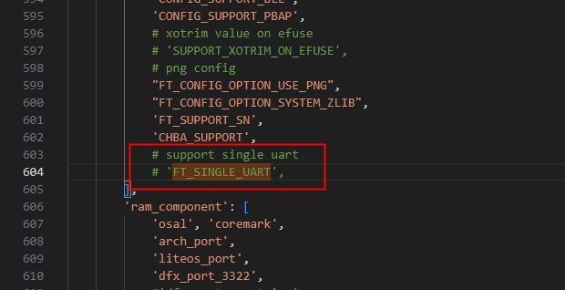

-   **[单UART方案](#ZH-CN_TOPIC_0000002492578556)**  

## 单UART方案<a name="ZH-CN_TOPIC_0000002492578556"></a>

单UART方案需要打开编译宏‘FT\_SINGLE\_UART’，打开后原HS\_UART口合并到AT UART口，波特率为750000，此UART口同时支持DebugKits工具和AT命令，但要求芯片启动完成后，再连接Debugkits工具或串口工具。

> **说明：** 
>如果开启A核低功耗时，串口首次输入AT命令会先唤醒A核，存在AT指令回流现象，第二次下发AT命令即可正常执行。
>执行“AT+PM=0”命令可以关闭A核低功耗时，避免AT指令回流现象。

1.  烧录完成后，使用串口工具打开烧录口，波特率750000。
2.  等待MCU心跳起来后，按照不同测试项发送对应AT命令。

**图 1**  FT\_SINGLE\_UART 烧录口示例<a name="zh-cn_topic_0000002519000719_fig181213113305"></a>  
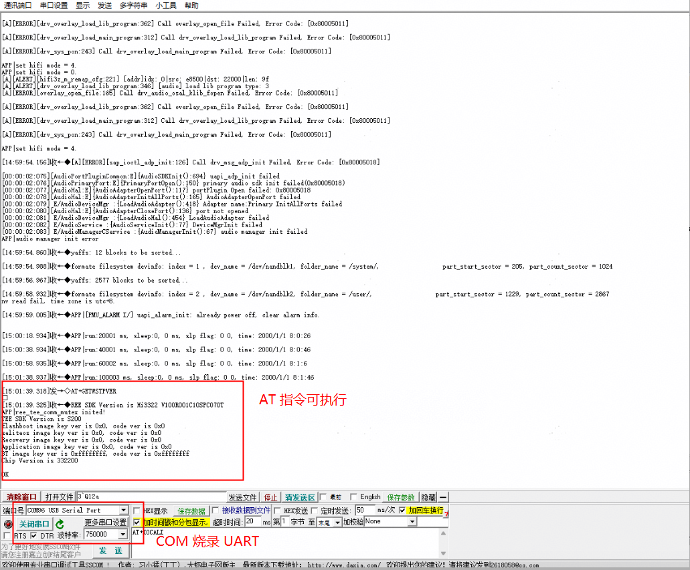

**图 2**  FT\_SINGLE\_UART hso口示例<a name="zh-cn_topic_0000002519000719_fig168951817133015"></a>  
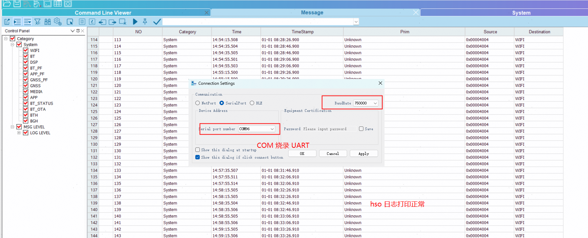

# 离线日志<a name="ZH-CN_TOPIC_0000002524818229"></a>

> **须知：** 
>从芯片启动至未打印心跳（app\_main run start）期间，不允许发送AT命令或连接使用DebugKits。

-   **[简介](#ZH-CN_TOPIC_0000002524738259)**  

-   **[离线日志开关](#ZH-CN_TOPIC_0000002492738530)**  

## 简介<a name="ZH-CN_TOPIC_0000002524738259"></a>

离线日志可以在“/user/log/”路径下导出。

**图 1**  离线日志存储路径<a name="zh-cn_topic_0000002411046692_fig56671556172218"></a>  
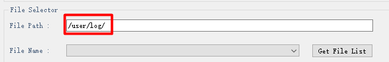

## 离线日志开关<a name="ZH-CN_TOPIC_0000002492738530"></a>

离线日志可以在打包前修改配置文件实现开闭，在“middleware\\chips\\3322\\nv\\nv\_config\\cfg\\acore\\app.json”文件进行如下配置然后打包镜像即可。

**图 1**  离线日志开关1<a name="zh-cn_topic_0000002411046780_fig5890173753410"></a>  
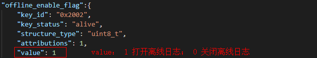

也可以在DebugKits中使用Command Line Viewer对NV进行修改后重启完成配置。

**图 2**  离线日志开关2<a name="zh-cn_topic_0000002411046780_fig1194412184910"></a>  
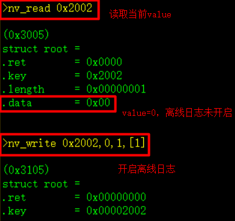

# Memory Test（本版本暂不支持）<a name="ZH-CN_TOPIC_0000002492578558"></a>

-   **[测试目的](#ZH-CN_TOPIC_0000002524818231)**  

-   **[校验空间](#ZH-CN_TOPIC_0000002524738261)**  

-   **[环境要求](#ZH-CN_TOPIC_0000002492738532)**  

-   **[使用步骤](#ZH-CN_TOPIC_0000002492578560)**  

## 测试目的<a name="ZH-CN_TOPIC_0000002524818231"></a>

HiDiTingV100装备测试的Memory Test是为了在产线测试阶段再增加一道Memory失效和芯片内RAM失效拦截，加上芯片ATE测试阶段的MBIST和Function BIST，以确保Memory失效问题可以在产品出厂前被有效拦截。

> **说明：** 
>Memory Test使用特殊镜像，重启后即为空片状态。后续执行正常的镜像烧录流程即可。

## 校验空间<a name="ZH-CN_TOPIC_0000002524738261"></a>

HiDiTingV100装备Memory Test主要校验以下空间：

-   MCPU ROM
-   COMMON RAM
-   BT RAM
-   PSRAM

## 环境要求<a name="ZH-CN_TOPIC_0000002492738532"></a>

**硬件环境要求<a name="zh-cn_topic_0000002444645729_section345111225540"></a>**

USB转UART串口板（1.8V）。

**软件环境要求<a name="zh-cn_topic_0000002444645729_section1997110285547"></a>**

安装BurnTool工具。安装Python 3.7以上版本，并安装pyserial，步骤如下所示。

1.  配置环境变量：

    **图 1**  配置windows环境变量<a name="zh-cn_topic_0000002444645729_fig12456201995"></a>  
    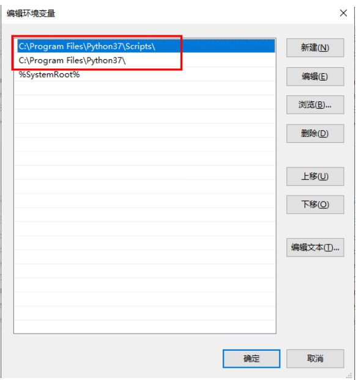

2.  环境变量配置完成后，以管理员身份打开命令行。

    **图 2**  开始菜单用管理员身份打开命令行<a name="zh-cn_topic_0000002444645729_fig1315873410919"></a>  
    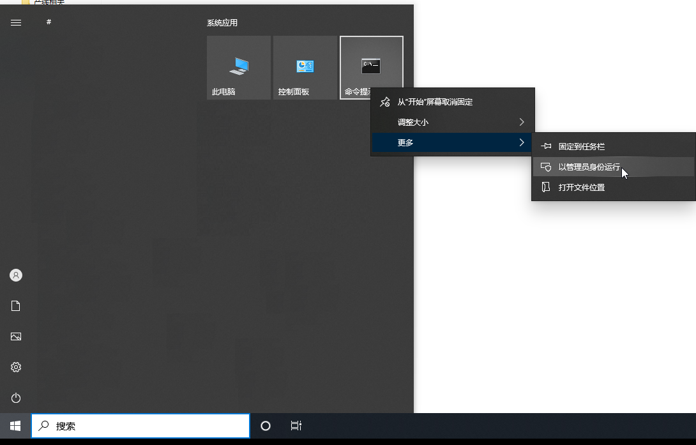

3.  命令行界面输入“pip --help”，根据打印结果确保pip命令可以正常使用。

    **图 3**  pip命令打印<a name="zh-cn_topic_0000002444645729_fig19949746994"></a>  
    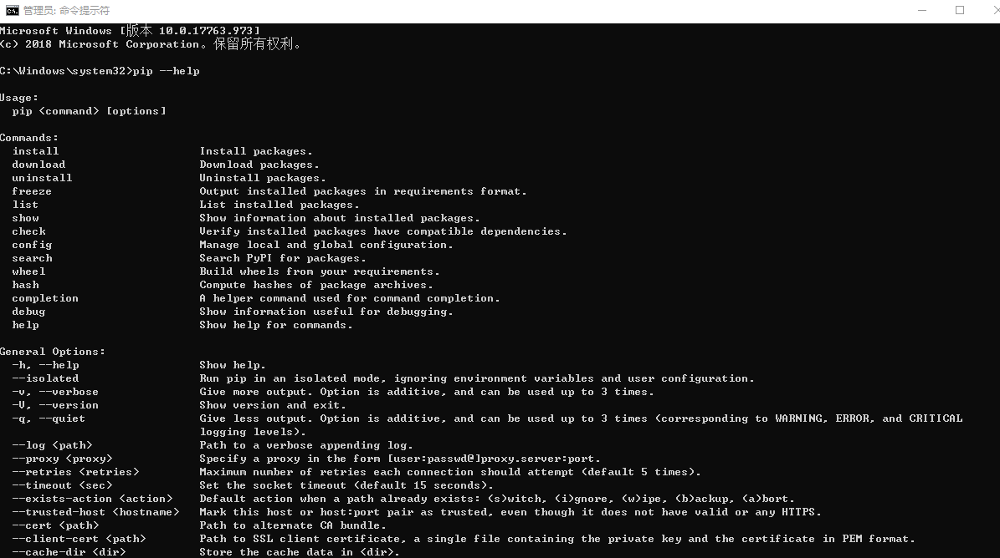

4.  通过执行“pip install pyserial”命令安装pyserial。

## 使用步骤<a name="ZH-CN_TOPIC_0000002492578560"></a>

1.  打开“software\\3322\_software\\release\_pkg\\sdk\\tools\\bin”路径中的memcheck文件夹，根据BurnTool安装路径和目标芯片烧录口所连串口修改burntools.txt和com.txt文本。

    **图 1**  memcheck工具修改配置信息<a name="zh-cn_topic_0000002444725893_fig5955323104620"></a>  
    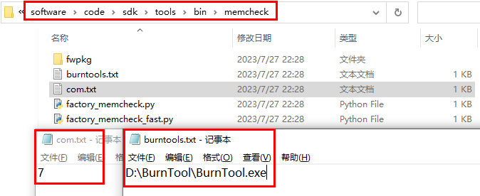

2.  双击打开“factory\_memcheck.py”（全空间）或“factory\_memcheck\_fast.py”（部分空间）脚本（或在命令行中输入“python xxx\\memcheck\\factory\_memcheck.py”，xxx为路径），对目标芯片重新上电，等待打印结果即可。

    **图 2**  Memory Check Succ log<a name="zh-cn_topic_0000002444725893_fig14842323548"></a>  
    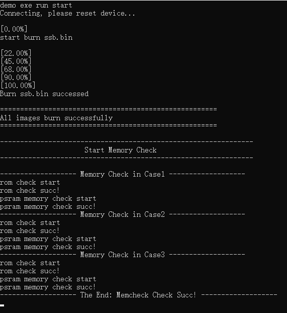

    **图 3**  Memory Check Fail log<a name="zh-cn_topic_0000002444725893_fig625102917487"></a>  
    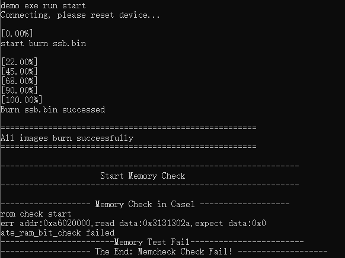

# 程序烧录<a name="ZH-CN_TOPIC_0000002524818235"></a>

-   **[原理说明](#ZH-CN_TOPIC_0000002524738263)**  

-   **[通过BurnTool工具烧录](#ZH-CN_TOPIC_0000002492738534)**  

-   **[文件系统先烧后贴适配说明](#ZH-CN_TOPIC_0000002492578562)**  

-   **[USB烧录](#ZH-CN_TOPIC_0000002524818237)**  

-   **[2131E程序烧录](#ZH-CN_TOPIC_0000002557644543)**  

## 原理说明<a name="ZH-CN_TOPIC_0000002524738263"></a>

HiDiTingV100内部无Flash，须通过PC将bin文件烧录到HiDiTingV100外接的NorFlash和NandFlash/eMMC之中。HiDiTingV100配套提供了BurnTool工具，可以通过UART端口来完成bin镜像的烧录。

## 通过BurnTool工具烧录<a name="ZH-CN_TOPIC_0000002492738534"></a>

烧录方法详情请参见《BurnTool工具 使用指南》。

## 文件系统先烧后贴适配说明<a name="ZH-CN_TOPIC_0000002492578562"></a>

文件系统的先烧后贴适配步骤如下：

1.  文件系统（nand）适配：

    1.  需要将“drivers\\chips\\3322\\fmc\\nand\\nand\_init.c”文件中的YF\_VOLUMES\_NUM修改为3，YF\_NAME\_STRS修改为 "/boot/", "/system/", "/user/"，yf\_volume\_percent修改为\{5, 25, 70\}。当前配置如下所示：

        ```
        #define YF_VOLUMES_NUM 3
        #define YF_NAME_STRS "/boot/", "/system/", "/user/"
        uint32_t yf_volume_percent[YF_VOLUMES_NUM] = {5, 25, 70};
        ```

    2.  文件系统镜像生成脚本的适配，适配为三个分区镜像。

        需要修改“\\build\\config\\target\_config\\3322\\mk\_fs\_image\\mkyaffs2tool.py”文件中的partition\_list。

        ```
        partition_list = [
            [os.path.join(cur_dir, 'fs', 'boot'), "0x1980000"],
            [os.path.join(cur_dir, 'fs', 'systerm'), "0x8000000"],
            [os.path.join(cur_dir, 'fs', 'user'), "null"],
        ]
        ```

    文件系统（emmc）适配：

    1.  文件系统适配

        如果需要调整分区大小，可以在“product\_evb\_standard.h”文件中修改分区大小。

        ```
        // Emmc一共五个分区，前四个分区大小固定，最后一个user分区使用剩余空间。
        #define EMMC_VOLUME_BOOT_SECTOR_COUNT       12000ULL
        #define EMMC_VOLUME_SYS_SECTOR_COUNT       3145666ULL
        #define EMMC_VOLUME_INNER_SECTOR_COUNT     262144ULL
        #define EMMC_VOLUME_SYS_BK_SECTOR_COUNT    524288ULL
        ```

        如果需要调整分区名称，可以在“mmc\_init.c”文件中修改分区名称。

        ```
        #define FF_VOLUMES_NUM              5
        #define FF_VOLUME_NAME_BOOT          "/boot/"
        #define FF_VOLUME_NAME_SYS          "/system/"
        #define FF_VOLUME_NAME_INNER        "/inner/"
        #define FF_VOLUME_NAME_SYS_BK       "/systembk/"
        #define FF_VOLUME_NAME_USER         "/user/"
        struct ff_volume_info {
            const char *name;
            uint64_t sector_count;
        };
        static struct ff_volume_info g_ff_volume_infos [FF_VOLUMES_NUM] = {
            {FF_VOLUME_NAME_BOOT, EMMC_VOLUME_BOOT_SECTOR_COUNT},
            {FF_VOLUME_NAME_SYS, EMMC_VOLUME_SYS_SECTOR_COUNT},
            {FF_VOLUME_NAME_INNER, EMMC_VOLUME_INNER_SECTOR_COUNT},
            {FF_VOLUME_NAME_SYS_BK, EMMC_VOLUME_SYS_BK_SECTOR_COUNT},
            {FF_VOLUME_NAME_USER, 0xffffffff} // 运行时修正为剩余扇区数
        };
        ```

    2.  FAT文件系统镜像生成脚本的适配

        ```
        partition_list = [
            [os.path.join(cur_dir, 'fs', 'boot'), "6000", "file_boot.bin"],   # boot, 分区大小不能大于6000KB
            [os.path.join(cur_dir, 'fs', 'system'), "1572833", "file_system.bin"],   # system, 分区大小不能大于1572833KB
            [os.path.join(cur_dir, 'fs', 'inner'), "131072", "file_inner.bin"],     # inner, 分区大小不能大于131072KB
            [os.path.join(cur_dir, 'fs', 'systembk'), "262144", "file_systembk.bin"],   # systembk, 分区大小不能大于262144KB
            [os.path.join(cur_dir, 'fs', 'user'), "263000", "file_user.bin"],       # user, 分区大小不能大于emmc剩余大小
        ]
        ```

        以上参数格式为\[资源文件路径， 分区大小， 生成的镜像文件名\]，其中资源文件路径为装有烧录资源文件的路径，默认为脚本当前目录下的fs目录。

        分区大小为要生成镜像的KB大小。

2.  镜像编译，重新编译“loadboot\_signed.bin”和“application\_signed.bin”。
3.  修改验证，验证BurnTool烧录是否正常，将“file.bin”、“loadboot\_signed.bin”、“application\_signed.bin”镜像通过BurnTool工具烧录到主板中，观测文件系统是否可以正常启动，如果可以正常浏览文件，检查预置在文件系统中的文件内容是否完整，若文件完整则适配成功；如果不能正常启动，请检查以上步骤是否正确。

## USB烧录<a name="ZH-CN_TOPIC_0000002524818237"></a>

HiDiTingV100使用USB进行程序烧录的操作步骤如下：

1.  使用管理员权限打开 BurnTool 。

    **图 1**  打开BurnTool 工具<a name="zh-cn_topic_0000002485905512_fig168560317417"></a>  
    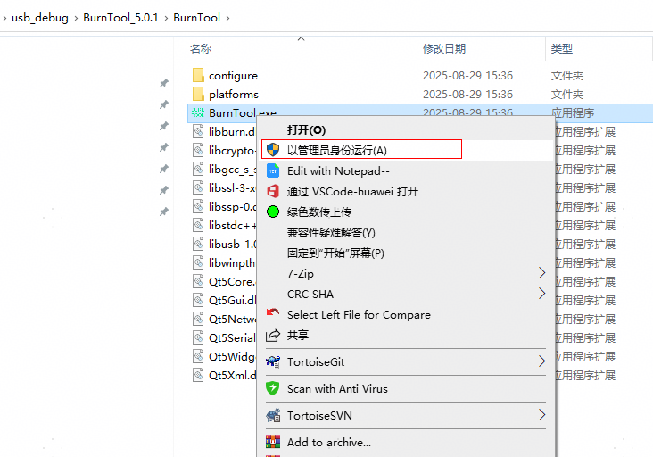

2.  使用 BurnTool 工具，点击“Option”--\> “Change chip”，选择“Hi3322-USB”。

    **图 2**  切换到 Hi3322-USB<a name="zh-cn_topic_0000002485905512_fig197511551414"></a>  
    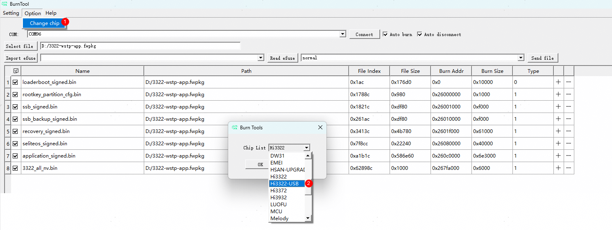

3.  配置USB ver id 和 product id。

    ver id：为图中0x3361，poduct id为图中0x3322；都是固定值，需手动填写。

    **图 3**  配置 USB vid 和 pid<a name="zh-cn_topic_0000002485905512_fig1432315196410"></a>  
    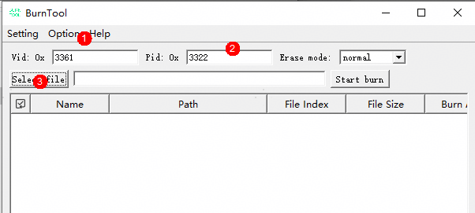

4.  启动烧录，点击“Start burn”后重启即可。

    **图 4**  启动烧录<a name="zh-cn_topic_0000002485905512_fig19781911135"></a>  
    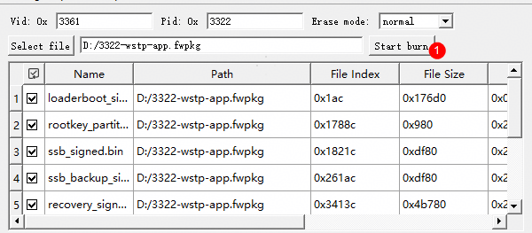

5.  BurnTool工具窗口显示出如下打印，表示烧录成功。

    **图 5**  烧录成功打印<a name="zh-cn_topic_0000002485905512_fig1632884917215"></a>  
    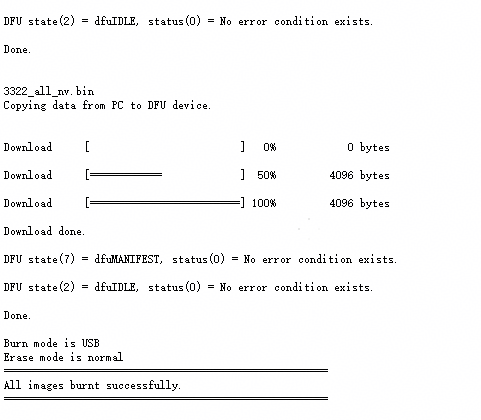

> **说明：** 
>满足以下两个条件才可以正常进行USB烧录。
>1.  S\_AGPIO18 作为USB\_VBUS插入检测功能，外部接入1.8V高电平。
>2.  S\_MGPIO\_18作为UART2\_RXD接地，使芯片进入USB烧录状态；产线烧录夹具上需要预留下拉电阻。

## 2131E程序烧录<a name="ZH-CN_TOPIC_0000002557644543"></a>

Hi2131E程序烧录流程与注意事项详见《HiDiTingV100 BurnTool工具 使用指南》的“CAT1 USB烧写”章节。

# DieID读取<a name="ZH-CN_TOPIC_0000002524738265"></a>

-   **[简介](#ZH-CN_TOPIC_0000002492738536)**  

-   **[NandFlash ID读取](#ZH-CN_TOPIC_0000002492578564)**  

-   **[eMMC ID读取](#ZH-CN_TOPIC_0000002524818239)**  

-   **[SOC ID读取](#ZH-CN_TOPIC_0000002524738267)**  

-   **[PSRAM ID读取](#ZH-CN_TOPIC_0000002492738538)**  

-   **[SDK ID读取](#ZH-CN_TOPIC_0000002492578566)**  

-   **[NorFlash ID读取](#ZH-CN_TOPIC_0000002524818241)**  

## 简介<a name="ZH-CN_TOPIC_0000002492738536"></a>

HiDiTingV100的关键器件ID包括NandFlash ID、NorFlash ID、SOC ID、SDK ID。其中ID指DIEID，是芯片Die的一组编号，用来记录芯片在制造加工时的wafer位置、加工时间、ATE测试版本、芯片IDDQ、批次等信息，类似芯片的“身份证”编号，每颗芯片都不相同。记录DieID作用是为了跟进追溯芯片在生产制造、板级生产制造、设备现网应用的整个E2E环节。

产线测试获取芯片的DieID，并将每块芯片的DieID记录在测试结果中，用于跟进在产线及后续市场时的应用情况。当出现失效时，通过产线记录的DieID追溯到芯片在制作加工时候的一系列信息，对于E2E监控产品质量至关重要。章节“[NandFlash ID读取](#ZH-CN_TOPIC_0000002492578564)～[NorFlash ID读取](#ZH-CN_TOPIC_0000002524818241)”提供对应的AT指令用于产线实现DieID的获取。

## NandFlash ID读取<a name="ZH-CN_TOPIC_0000002492578564"></a>

通过AT指令读取当前NandFlash ID。

**表 1**  AT指令读取NandFlash ID

<a name="zh-cn_topic_0000002411206620_table2787121117212"></a>
<table><thead align="left"><tr id="zh-cn_topic_0000002411206620_row147878111927"><th class="cellrowborder" valign="top" width="20.27%" id="mcps1.2.5.1.1"><p id="zh-cn_topic_0000002411206620_p20787011827"><a name="zh-cn_topic_0000002411206620_p20787011827"></a><a name="zh-cn_topic_0000002411206620_p20787011827"></a>命令描述</p>
</th>
<th class="cellrowborder" valign="top" width="22.62%" id="mcps1.2.5.1.2"><p id="zh-cn_topic_0000002411206620_p678718111423"><a name="zh-cn_topic_0000002411206620_p678718111423"></a><a name="zh-cn_topic_0000002411206620_p678718111423"></a>产测AT指令</p>
</th>
<th class="cellrowborder" valign="top" width="32.11%" id="mcps1.2.5.1.3"><p id="zh-cn_topic_0000002411206620_p77871111129"><a name="zh-cn_topic_0000002411206620_p77871111129"></a><a name="zh-cn_topic_0000002411206620_p77871111129"></a>示例</p>
</th>
<th class="cellrowborder" valign="top" width="25%" id="mcps1.2.5.1.4"><p id="zh-cn_topic_0000002411206620_p878712111021"><a name="zh-cn_topic_0000002411206620_p878712111021"></a><a name="zh-cn_topic_0000002411206620_p878712111021"></a>命令说明</p>
</th>
</tr>
</thead>
<tbody><tr id="zh-cn_topic_0000002411206620_row17787131110216"><td class="cellrowborder" valign="top" width="20.27%" headers="mcps1.2.5.1.1 "><p id="zh-cn_topic_0000002411206620_p8632193113118"><a name="zh-cn_topic_0000002411206620_p8632193113118"></a><a name="zh-cn_topic_0000002411206620_p8632193113118"></a>读取当前环境器件ID</p>
</td>
<td class="cellrowborder" valign="top" width="22.62%" headers="mcps1.2.5.1.2 "><p id="zh-cn_topic_0000002411206620_p1242844151312"><a name="zh-cn_topic_0000002411206620_p1242844151312"></a><a name="zh-cn_topic_0000002411206620_p1242844151312"></a>AT+PERIPHERALSID</p>
</td>
<td class="cellrowborder" valign="top" width="32.11%" headers="mcps1.2.5.1.3 "><p id="zh-cn_topic_0000002411206620_p17112152591413"><a name="zh-cn_topic_0000002411206620_p17112152591413"></a><a name="zh-cn_topic_0000002411206620_p17112152591413"></a>“AT+PERIPHERALSID=1”获取当前环境下NandFlash ID。</p>
</td>
<td class="cellrowborder" valign="top" width="25%" headers="mcps1.2.5.1.4 "><p id="zh-cn_topic_0000002411206620_p10629139171216"><a name="zh-cn_topic_0000002411206620_p10629139171216"></a><a name="zh-cn_topic_0000002411206620_p10629139171216"></a>成功：OK</p>
<p id="zh-cn_topic_0000002411206620_p111602199426"><a name="zh-cn_topic_0000002411206620_p111602199426"></a><a name="zh-cn_topic_0000002411206620_p111602199426"></a>失败：ERROR</p>
</td>
</tr>
</tbody>
</table>

**图 1**  AT指令读取当前NandFlash示例<a name="zh-cn_topic_0000002411206620_fig1216113234512"></a>  
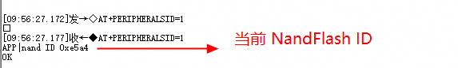

## eMMC ID读取<a name="ZH-CN_TOPIC_0000002524818239"></a>

通过AT指令读取当前eMMC ID。

**表 1**  AT指令读取当前eMMC ID

<a name="zh-cn_topic_0000002487802846_table2787121117212"></a>
<table><thead align="left"><tr id="zh-cn_topic_0000002487802846_row147878111927"><th class="cellrowborder" valign="top" width="20.27%" id="mcps1.2.5.1.1"><p id="zh-cn_topic_0000002487802846_p20787011827"><a name="zh-cn_topic_0000002487802846_p20787011827"></a><a name="zh-cn_topic_0000002487802846_p20787011827"></a>命令描述</p>
</th>
<th class="cellrowborder" valign="top" width="22.62%" id="mcps1.2.5.1.2"><p id="zh-cn_topic_0000002487802846_p678718111423"><a name="zh-cn_topic_0000002487802846_p678718111423"></a><a name="zh-cn_topic_0000002487802846_p678718111423"></a>产测AT指令</p>
</th>
<th class="cellrowborder" valign="top" width="32.11%" id="mcps1.2.5.1.3"><p id="zh-cn_topic_0000002487802846_p77871111129"><a name="zh-cn_topic_0000002487802846_p77871111129"></a><a name="zh-cn_topic_0000002487802846_p77871111129"></a>示例</p>
</th>
<th class="cellrowborder" valign="top" width="25%" id="mcps1.2.5.1.4"><p id="zh-cn_topic_0000002487802846_p878712111021"><a name="zh-cn_topic_0000002487802846_p878712111021"></a><a name="zh-cn_topic_0000002487802846_p878712111021"></a>命令说明</p>
</th>
</tr>
</thead>
<tbody><tr id="zh-cn_topic_0000002487802846_row17787131110216"><td class="cellrowborder" valign="top" width="20.27%" headers="mcps1.2.5.1.1 "><p id="zh-cn_topic_0000002487802846_p8632193113118"><a name="zh-cn_topic_0000002487802846_p8632193113118"></a><a name="zh-cn_topic_0000002487802846_p8632193113118"></a>读取当前环境器件ID</p>
</td>
<td class="cellrowborder" valign="top" width="22.62%" headers="mcps1.2.5.1.2 "><p id="zh-cn_topic_0000002487802846_p1242844151312"><a name="zh-cn_topic_0000002487802846_p1242844151312"></a><a name="zh-cn_topic_0000002487802846_p1242844151312"></a>AT+PERIPHERALSID</p>
</td>
<td class="cellrowborder" valign="top" width="32.11%" headers="mcps1.2.5.1.3 "><p id="zh-cn_topic_0000002487802846_p17112152591413"><a name="zh-cn_topic_0000002487802846_p17112152591413"></a><a name="zh-cn_topic_0000002487802846_p17112152591413"></a>“AT+PERIPHERALSID=0”获取当前环境下eMMC ID。</p>
</td>
<td class="cellrowborder" valign="top" width="25%" headers="mcps1.2.5.1.4 "><p id="zh-cn_topic_0000002487802846_p10629139171216"><a name="zh-cn_topic_0000002487802846_p10629139171216"></a><a name="zh-cn_topic_0000002487802846_p10629139171216"></a>成功：OK</p>
<p id="zh-cn_topic_0000002487802846_p111602199426"><a name="zh-cn_topic_0000002487802846_p111602199426"></a><a name="zh-cn_topic_0000002487802846_p111602199426"></a>失败：ERROR</p>
</td>
</tr>
</tbody>
</table>

**图 1**  AT指令读取当前eMMC示例<a name="zh-cn_topic_0000002487802846_fig1295711414611"></a>  
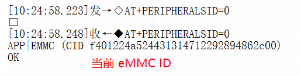

## SOC ID读取<a name="ZH-CN_TOPIC_0000002524738267"></a>

通过AT指令读取当前芯片的SOC ID。

**表 1**  AT指令读取当前芯片的SOC ID

<a name="zh-cn_topic_0000002444725909_table2787121117212"></a>
<table><thead align="left"><tr id="zh-cn_topic_0000002444725909_row147878111927"><th class="cellrowborder" valign="top" width="20.27%" id="mcps1.2.5.1.1"><p id="zh-cn_topic_0000002444725909_p20787011827"><a name="zh-cn_topic_0000002444725909_p20787011827"></a><a name="zh-cn_topic_0000002444725909_p20787011827"></a>命令描述</p>
</th>
<th class="cellrowborder" valign="top" width="22.62%" id="mcps1.2.5.1.2"><p id="zh-cn_topic_0000002444725909_p678718111423"><a name="zh-cn_topic_0000002444725909_p678718111423"></a><a name="zh-cn_topic_0000002444725909_p678718111423"></a>产测AT指令</p>
</th>
<th class="cellrowborder" valign="top" width="32.11%" id="mcps1.2.5.1.3"><p id="zh-cn_topic_0000002444725909_p77871111129"><a name="zh-cn_topic_0000002444725909_p77871111129"></a><a name="zh-cn_topic_0000002444725909_p77871111129"></a>示例</p>
</th>
<th class="cellrowborder" valign="top" width="25%" id="mcps1.2.5.1.4"><p id="zh-cn_topic_0000002444725909_p878712111021"><a name="zh-cn_topic_0000002444725909_p878712111021"></a><a name="zh-cn_topic_0000002444725909_p878712111021"></a>命令说明</p>
</th>
</tr>
</thead>
<tbody><tr id="zh-cn_topic_0000002444725909_row17787131110216"><td class="cellrowborder" valign="top" width="20.27%" headers="mcps1.2.5.1.1 "><p id="zh-cn_topic_0000002444725909_p8632193113118"><a name="zh-cn_topic_0000002444725909_p8632193113118"></a><a name="zh-cn_topic_0000002444725909_p8632193113118"></a>读取当前环境芯片 DIEID</p>
</td>
<td class="cellrowborder" valign="top" width="22.62%" headers="mcps1.2.5.1.2 "><p id="zh-cn_topic_0000002444725909_p1242844151312"><a name="zh-cn_topic_0000002444725909_p1242844151312"></a><a name="zh-cn_topic_0000002444725909_p1242844151312"></a>AT+GETDIEID</p>
</td>
<td class="cellrowborder" valign="top" width="32.11%" headers="mcps1.2.5.1.3 "><p id="zh-cn_topic_0000002444725909_p17112152591413"><a name="zh-cn_topic_0000002444725909_p17112152591413"></a><a name="zh-cn_topic_0000002444725909_p17112152591413"></a>“AT+GETDIEID”获取当前环境芯片的DIEID。</p>
</td>
<td class="cellrowborder" valign="top" width="25%" headers="mcps1.2.5.1.4 "><p id="zh-cn_topic_0000002444725909_p10629139171216"><a name="zh-cn_topic_0000002444725909_p10629139171216"></a><a name="zh-cn_topic_0000002444725909_p10629139171216"></a>成功：OK</p>
<p id="zh-cn_topic_0000002444725909_p111602199426"><a name="zh-cn_topic_0000002444725909_p111602199426"></a><a name="zh-cn_topic_0000002444725909_p111602199426"></a>失败：ERROR</p>
</td>
</tr>
</tbody>
</table>

**图 1**  AT指令读取当前芯片的SOC ID示例<a name="zh-cn_topic_0000002444725909_fig1789844504613"></a>  
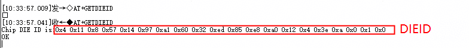

## PSRAM ID读取<a name="ZH-CN_TOPIC_0000002492738538"></a>

通过AT指令读取环境PSRAM的EID。

**表 1**  AT指令读取环境PSRAM的EID

<a name="zh-cn_topic_0000002411046672_table2787121117212"></a>
<table><thead align="left"><tr id="zh-cn_topic_0000002411046672_row147878111927"><th class="cellrowborder" valign="top" width="20.27%" id="mcps1.2.5.1.1"><p id="zh-cn_topic_0000002411046672_p20787011827"><a name="zh-cn_topic_0000002411046672_p20787011827"></a><a name="zh-cn_topic_0000002411046672_p20787011827"></a>命令描述</p>
</th>
<th class="cellrowborder" valign="top" width="22.62%" id="mcps1.2.5.1.2"><p id="zh-cn_topic_0000002411046672_p678718111423"><a name="zh-cn_topic_0000002411046672_p678718111423"></a><a name="zh-cn_topic_0000002411046672_p678718111423"></a>产测AT指令</p>
</th>
<th class="cellrowborder" valign="top" width="32.11%" id="mcps1.2.5.1.3"><p id="zh-cn_topic_0000002411046672_p77871111129"><a name="zh-cn_topic_0000002411046672_p77871111129"></a><a name="zh-cn_topic_0000002411046672_p77871111129"></a>示例</p>
</th>
<th class="cellrowborder" valign="top" width="25%" id="mcps1.2.5.1.4"><p id="zh-cn_topic_0000002411046672_p878712111021"><a name="zh-cn_topic_0000002411046672_p878712111021"></a><a name="zh-cn_topic_0000002411046672_p878712111021"></a>命令说明</p>
</th>
</tr>
</thead>
<tbody><tr id="zh-cn_topic_0000002411046672_row17787131110216"><td class="cellrowborder" valign="top" width="20.27%" headers="mcps1.2.5.1.1 "><p id="zh-cn_topic_0000002411046672_p8632193113118"><a name="zh-cn_topic_0000002411046672_p8632193113118"></a><a name="zh-cn_topic_0000002411046672_p8632193113118"></a>读取当前环境 PSRAM 的 EID</p>
</td>
<td class="cellrowborder" valign="top" width="22.62%" headers="mcps1.2.5.1.2 "><p id="zh-cn_topic_0000002411046672_p1242844151312"><a name="zh-cn_topic_0000002411046672_p1242844151312"></a><a name="zh-cn_topic_0000002411046672_p1242844151312"></a>AT+PERIPHERALSID=3</p>
</td>
<td class="cellrowborder" valign="top" width="32.11%" headers="mcps1.2.5.1.3 "><p id="zh-cn_topic_0000002411046672_p17112152591413"><a name="zh-cn_topic_0000002411046672_p17112152591413"></a><a name="zh-cn_topic_0000002411046672_p17112152591413"></a>“AT+PERIPHERALSID=3”获取当前环境 PSRAM 的 EID。</p>
</td>
<td class="cellrowborder" valign="top" width="25%" headers="mcps1.2.5.1.4 "><p id="zh-cn_topic_0000002411046672_p10629139171216"><a name="zh-cn_topic_0000002411046672_p10629139171216"></a><a name="zh-cn_topic_0000002411046672_p10629139171216"></a>成功：OK</p>
<p id="zh-cn_topic_0000002411046672_p111602199426"><a name="zh-cn_topic_0000002411046672_p111602199426"></a><a name="zh-cn_topic_0000002411046672_p111602199426"></a>失败：ERROR</p>
</td>
</tr>
</tbody>
</table>

**图 1**  AT指令读取环境PSRAM EID示例<a name="zh-cn_topic_0000002411046672_fig124548716484"></a>  
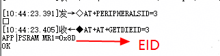

## SDK ID读取<a name="ZH-CN_TOPIC_0000002492578566"></a>

通过AT指令读取当前环境的SDK ID。

**表 1**  AT指令读取当前环境的SDK ID

<a name="zh-cn_topic_0000002444645689_table2787121117212"></a>
<table><thead align="left"><tr id="zh-cn_topic_0000002444645689_row147878111927"><th class="cellrowborder" valign="top" width="20.27%" id="mcps1.2.5.1.1"><p id="zh-cn_topic_0000002444645689_p20787011827"><a name="zh-cn_topic_0000002444645689_p20787011827"></a><a name="zh-cn_topic_0000002444645689_p20787011827"></a>命令描述</p>
</th>
<th class="cellrowborder" valign="top" width="22.62%" id="mcps1.2.5.1.2"><p id="zh-cn_topic_0000002444645689_p678718111423"><a name="zh-cn_topic_0000002444645689_p678718111423"></a><a name="zh-cn_topic_0000002444645689_p678718111423"></a>产测AT指令</p>
</th>
<th class="cellrowborder" valign="top" width="32.11%" id="mcps1.2.5.1.3"><p id="zh-cn_topic_0000002444645689_p77871111129"><a name="zh-cn_topic_0000002444645689_p77871111129"></a><a name="zh-cn_topic_0000002444645689_p77871111129"></a>示例</p>
</th>
<th class="cellrowborder" valign="top" width="25%" id="mcps1.2.5.1.4"><p id="zh-cn_topic_0000002444645689_p878712111021"><a name="zh-cn_topic_0000002444645689_p878712111021"></a><a name="zh-cn_topic_0000002444645689_p878712111021"></a>命令说明</p>
</th>
</tr>
</thead>
<tbody><tr id="zh-cn_topic_0000002444645689_row17787131110216"><td class="cellrowborder" valign="top" width="20.27%" headers="mcps1.2.5.1.1 "><p id="zh-cn_topic_0000002444645689_p8632193113118"><a name="zh-cn_topic_0000002444645689_p8632193113118"></a><a name="zh-cn_topic_0000002444645689_p8632193113118"></a>读取当前环境的SDK ID</p>
</td>
<td class="cellrowborder" valign="top" width="22.62%" headers="mcps1.2.5.1.2 "><p id="zh-cn_topic_0000002444645689_p1242844151312"><a name="zh-cn_topic_0000002444645689_p1242844151312"></a><a name="zh-cn_topic_0000002444645689_p1242844151312"></a>AT+GETWSTPVER</p>
</td>
<td class="cellrowborder" valign="top" width="32.11%" headers="mcps1.2.5.1.3 "><p id="zh-cn_topic_0000002444645689_p17112152591413"><a name="zh-cn_topic_0000002444645689_p17112152591413"></a><a name="zh-cn_topic_0000002444645689_p17112152591413"></a>“AT+GETWSTPVER”获取当前环境 SDK ID。</p>
</td>
<td class="cellrowborder" valign="top" width="25%" headers="mcps1.2.5.1.4 "><p id="zh-cn_topic_0000002444645689_p10629139171216"><a name="zh-cn_topic_0000002444645689_p10629139171216"></a><a name="zh-cn_topic_0000002444645689_p10629139171216"></a>成功：OK</p>
<p id="zh-cn_topic_0000002444645689_p111602199426"><a name="zh-cn_topic_0000002444645689_p111602199426"></a><a name="zh-cn_topic_0000002444645689_p111602199426"></a>失败：ERROR</p>
</td>
</tr>
</tbody>
</table>

**图 1**  AT指令读取当前环境的SDK ID示例<a name="zh-cn_topic_0000002444645689_fig11855849204816"></a>  
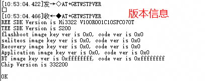

## NorFlash ID读取<a name="ZH-CN_TOPIC_0000002524818241"></a>

通过AT指令读取当前环境的NorFlash ID

**表 1**  AT指令读取当前环境的NorFlash ID

<a name="zh-cn_topic_0000002444645765_table2787121117212"></a>
<table><thead align="left"><tr id="zh-cn_topic_0000002444645765_row147878111927"><th class="cellrowborder" valign="top" width="20.27%" id="mcps1.2.5.1.1"><p id="zh-cn_topic_0000002444645765_p20787011827"><a name="zh-cn_topic_0000002444645765_p20787011827"></a><a name="zh-cn_topic_0000002444645765_p20787011827"></a>命令描述</p>
</th>
<th class="cellrowborder" valign="top" width="22.62%" id="mcps1.2.5.1.2"><p id="zh-cn_topic_0000002444645765_p678718111423"><a name="zh-cn_topic_0000002444645765_p678718111423"></a><a name="zh-cn_topic_0000002444645765_p678718111423"></a>产测AT指令</p>
</th>
<th class="cellrowborder" valign="top" width="32.11%" id="mcps1.2.5.1.3"><p id="zh-cn_topic_0000002444645765_p77871111129"><a name="zh-cn_topic_0000002444645765_p77871111129"></a><a name="zh-cn_topic_0000002444645765_p77871111129"></a>示例</p>
</th>
<th class="cellrowborder" valign="top" width="25%" id="mcps1.2.5.1.4"><p id="zh-cn_topic_0000002444645765_p878712111021"><a name="zh-cn_topic_0000002444645765_p878712111021"></a><a name="zh-cn_topic_0000002444645765_p878712111021"></a>命令说明</p>
</th>
</tr>
</thead>
<tbody><tr id="zh-cn_topic_0000002444645765_row17787131110216"><td class="cellrowborder" valign="top" width="20.27%" headers="mcps1.2.5.1.1 "><p id="zh-cn_topic_0000002444645765_p8632193113118"><a name="zh-cn_topic_0000002444645765_p8632193113118"></a><a name="zh-cn_topic_0000002444645765_p8632193113118"></a>读取当前环境的NorFlash ID</p>
</td>
<td class="cellrowborder" valign="top" width="22.62%" headers="mcps1.2.5.1.2 "><p id="zh-cn_topic_0000002444645765_p1242844151312"><a name="zh-cn_topic_0000002444645765_p1242844151312"></a><a name="zh-cn_topic_0000002444645765_p1242844151312"></a>AT+GETWSTPVER</p>
</td>
<td class="cellrowborder" valign="top" width="32.11%" headers="mcps1.2.5.1.3 "><p id="zh-cn_topic_0000002444645765_p17112152591413"><a name="zh-cn_topic_0000002444645765_p17112152591413"></a><a name="zh-cn_topic_0000002444645765_p17112152591413"></a>“AT+GETWSTPVER”获取当前环境 SDK ID。</p>
</td>
<td class="cellrowborder" valign="top" width="25%" headers="mcps1.2.5.1.4 "><p id="zh-cn_topic_0000002444645765_p10629139171216"><a name="zh-cn_topic_0000002444645765_p10629139171216"></a><a name="zh-cn_topic_0000002444645765_p10629139171216"></a>成功：OK</p>
<p id="zh-cn_topic_0000002444645765_p111602199426"><a name="zh-cn_topic_0000002444645765_p111602199426"></a><a name="zh-cn_topic_0000002444645765_p111602199426"></a>失败：ERROR</p>
</td>
</tr>
</tbody>
</table>

**图 1**  AT指令读取当前环境的NorFlash ID示例<a name="zh-cn_topic_0000002444645765_fig19642151064919"></a>  
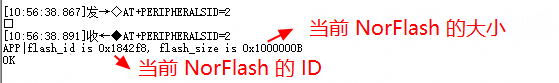

# 电流测试（低功耗未交付，暂不支持）<a name="ZH-CN_TOPIC_0000002524738269"></a>

-   **[测试目的](#ZH-CN_TOPIC_0000002492738540)**  

-   **[待机电流测试步骤](#ZH-CN_TOPIC_0000002492578568)**  

-   **[休眠电流测试步骤](#ZH-CN_TOPIC_0000002524818243)**  

## 测试目的<a name="ZH-CN_TOPIC_0000002492738540"></a>

测试芯片底电流的目的是评估芯片的功耗和电源管理性能。通过测试底电流，可以确定芯片在不同的待机或休眠模式下的电流消耗情况，从而评估芯片的功耗和电源管理性能。这对于设计低功耗的移动设备和延长电池寿命非常重要。

> **说明：** 
>底电流是指芯片在待机或休眠状态下的电流消耗，它对于移动设备等电池供电的应用非常重要。

## 待机电流测试步骤<a name="ZH-CN_TOPIC_0000002492578568"></a>

**编译深睡模式镜像<a name="zh-cn_topic_0000002411046760_section1771013910501"></a>**

1.  添加编译宏，在路径“\\build\\config\\target\_config\\3322\\config.py”的对应target中添加编译宏 'WSTP\_LPCI\_ENABLE'。（当前默认已添加）

    **图 1**  添加编译宏<a name="zh-cn_topic_0000002411046760_fig391043612427"></a>  
    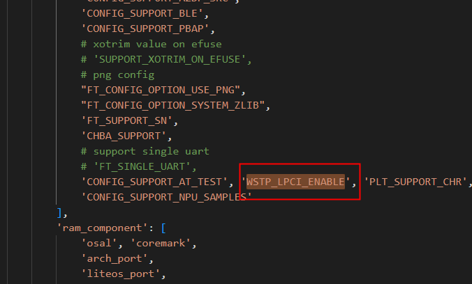

1.  在根目录下执行命令“./build.py -c 3322”，选择需要生成的target。编译生成深睡模式镜像。

**获取镜像<a name="zh-cn_topic_0000002411046760_section270324714503"></a>**

在“output/3322/acore”目录下，在对应的目录下获取镜像“application.bin”。

**深睡模式下测试底电流<a name="zh-cn_topic_0000002411046760_section1927441113109"></a>**

1.  将“application.bin”镜像通过UART加载到芯片中。
2.  将芯片接到稳压电源上给芯片提供3.8V的外供电源。

1.  监控稳压电源上电流的变化，建议监测底电流时需要观测时间大于10s，查看电流凹值。

> **说明：** 
>深睡模式下，为方便查看系统的状态，A核会根据预设的唤醒时间，定时从睡眠中唤醒进行一次消息打印。

**深睡相关AT命令<a name="zh-cn_topic_0000002411046760_section64421821111015"></a>**

<a name="zh-cn_topic_0000002411046760_table2787121117212"></a>
<table><thead align="left"><tr id="zh-cn_topic_0000002411046760_row147878111927"><th class="cellrowborder" valign="top" width="30.209999999999997%" id="mcps1.1.5.1.1"><p id="zh-cn_topic_0000002411046760_p20787011827"><a name="zh-cn_topic_0000002411046760_p20787011827"></a><a name="zh-cn_topic_0000002411046760_p20787011827"></a>命令描述</p>
</th>
<th class="cellrowborder" valign="top" width="21.73%" id="mcps1.1.5.1.2"><p id="zh-cn_topic_0000002411046760_p678718111423"><a name="zh-cn_topic_0000002411046760_p678718111423"></a><a name="zh-cn_topic_0000002411046760_p678718111423"></a>产测AT指令</p>
</th>
<th class="cellrowborder" valign="top" width="13.16%" id="mcps1.1.5.1.3"><p id="zh-cn_topic_0000002411046760_p77871111129"><a name="zh-cn_topic_0000002411046760_p77871111129"></a><a name="zh-cn_topic_0000002411046760_p77871111129"></a>示例</p>
</th>
<th class="cellrowborder" valign="top" width="34.9%" id="mcps1.1.5.1.4"><p id="zh-cn_topic_0000002411046760_p878712111021"><a name="zh-cn_topic_0000002411046760_p878712111021"></a><a name="zh-cn_topic_0000002411046760_p878712111021"></a>命令说明</p>
</th>
</tr>
</thead>
<tbody><tr id="zh-cn_topic_0000002411046760_row17787131110216"><td class="cellrowborder" valign="top" width="30.209999999999997%" headers="mcps1.1.5.1.1 "><p id="zh-cn_topic_0000002411046760_p8632193113118"><a name="zh-cn_topic_0000002411046760_p8632193113118"></a><a name="zh-cn_topic_0000002411046760_p8632193113118"></a>唤醒MCU核，并持锁保持MCU不再进入深睡中。</p>
</td>
<td class="cellrowborder" valign="top" width="21.73%" headers="mcps1.1.5.1.2 "><p id="zh-cn_topic_0000002411046760_p1071643814111"><a name="zh-cn_topic_0000002411046760_p1071643814111"></a><a name="zh-cn_topic_0000002411046760_p1071643814111"></a>AT^PMADDVOTE</p>
</td>
<td class="cellrowborder" valign="top" width="13.16%" headers="mcps1.1.5.1.3 "><p id="zh-cn_topic_0000002411046760_p97871911027"><a name="zh-cn_topic_0000002411046760_p97871911027"></a><a name="zh-cn_topic_0000002411046760_p97871911027"></a>NA</p>
</td>
<td class="cellrowborder" valign="top" width="34.9%" headers="mcps1.1.5.1.4 "><a name="zh-cn_topic_0000002411046760_ul1855433212717"></a><a name="zh-cn_topic_0000002411046760_ul1855433212717"></a><ul id="zh-cn_topic_0000002411046760_ul1855433212717"><li>成功：OK~（连续间隔1s发送2～5次，直到收到返回值）</li><li>错误：ERR~</li></ul>
</td>
</tr>
<tr id="zh-cn_topic_0000002411046760_row1056922417112"><td class="cellrowborder" valign="top" width="30.209999999999997%" headers="mcps1.1.5.1.1 "><p id="zh-cn_topic_0000002411046760_p845815229121"><a name="zh-cn_topic_0000002411046760_p845815229121"></a><a name="zh-cn_topic_0000002411046760_p845815229121"></a>释放MCU的test锁，使得MCU可以进入深睡中。</p>
</td>
<td class="cellrowborder" valign="top" width="21.73%" headers="mcps1.1.5.1.2 "><p id="zh-cn_topic_0000002411046760_p175691324101114"><a name="zh-cn_topic_0000002411046760_p175691324101114"></a><a name="zh-cn_topic_0000002411046760_p175691324101114"></a>AT^PMRMVOTE</p>
</td>
<td class="cellrowborder" valign="top" width="13.16%" headers="mcps1.1.5.1.3 "><p id="zh-cn_topic_0000002411046760_p18569162461110"><a name="zh-cn_topic_0000002411046760_p18569162461110"></a><a name="zh-cn_topic_0000002411046760_p18569162461110"></a>NA</p>
</td>
<td class="cellrowborder" valign="top" width="34.9%" headers="mcps1.1.5.1.4 "><a name="zh-cn_topic_0000002411046760_ul166501038974"></a><a name="zh-cn_topic_0000002411046760_ul166501038974"></a><ul id="zh-cn_topic_0000002411046760_ul166501038974"><li>成功：OK~</li><li>错误：ERR~</li></ul>
</td>
</tr>
</tbody>
</table>

> **说明：** 
>-   AT^PMADDVOTE：唤醒。
>-   AT^PMRMVOTE：重新进入睡眠（要求业务已经完全完成）。
>-   进入睡眠模式后，需要先发送“AT^PMADDVOTE”进行唤醒，再执行其他命令。

## 休眠电流测试步骤<a name="ZH-CN_TOPIC_0000002524818243"></a>

1.  发送AT命令“AT^SYSSHIPMODE”让芯片进入关机或者shipmode模式。
2.  使用电流计或者稳压电源来测试芯片的电流。

> **说明：** 
>发送“AT^SYSSHIPMODE”命令进入关机状态后，再次启动芯片，只能通过重新上电的方式启动。

# BT传导测试<a name="ZH-CN_TOPIC_0000002524738271"></a>

-   **[测试目的](#ZH-CN_TOPIC_0000002492738542)**  

-   **[射频测试步骤](#ZH-CN_TOPIC_0000002492578570)**  

-   **[蓝牙信令模式传导测试示例](#ZH-CN_TOPIC_0000002524818245)**  

-   **[蓝牙非信令模式传导测试示例](#ZH-CN_TOPIC_0000002524738273)**  

-   **[可视化界面](#ZH-CN_TOPIC_0000002524818247)**  

## 测试目的<a name="ZH-CN_TOPIC_0000002492738542"></a>

BT传导测试是为了在产线测试阶段增加一道蓝牙射频通路异常问题的拦截，通过测试被测设备发射信号的质量和接收信号的性能，以确保设备出厂后射频性能符合要求。

## 射频测试步骤<a name="ZH-CN_TOPIC_0000002492578570"></a>

环境搭建：

**图 1**  频偏环境示意图<a name="zh-cn_topic_0000002444645849_fig14318124102014"></a>  
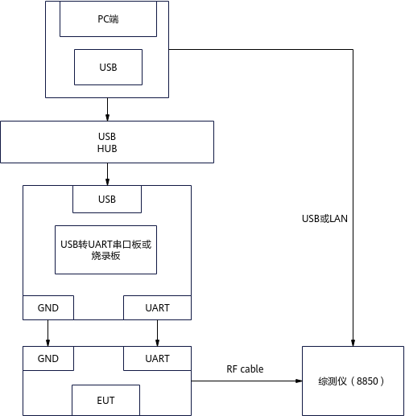

标准手动频偏校准：将被测机与仪器连接，被测机发送蓝牙信号。观察仪器显示的频偏值并通过AT命令单步修改容值进行调整，使得仪器显示的频偏值达到合理范围。校准结束后使用AT命令将频偏值保存至FLASH中。

参考流程如[图2](#zh-cn_topic_0000002444645849_fig19932714122119)所示。

**图 2**  频偏设置流程<a name="zh-cn_topic_0000002444645849_fig19932714122119"></a>  
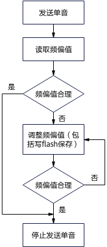

下面是基于BR的实现，仅供参考：

1.  PC/测试机台发送“AT^BTTXLO=<freq\>,<mode\>”，向对接仪器发送单音。
2.  <a name="zh-cn_topic_0000002444645849_li7291185016219"></a>根据频偏情况PC/测试机台发送“AT^XOCALI=<increase\>,<step\_num\>”调整电容值，increase = 0代表减少电容值，1代表增加电容值，step\_num取值范围是【0,255】。
3.  重复[2](#zh-cn_topic_0000002444645849_li7291185016219)，直到频偏符合目标值为止，调整电容值时直接写NV值，不需要额外保存参数。
4.  PC/测试机台发送“AT^BTTXLO=<freq\>,<mode\>”，结束发送单音。

**表1**  射频测试相关指令

<a name="zh-cn_topic_0000002444645849_table924mcpsimp"></a>
<table><thead align="left"><tr id="zh-cn_topic_0000002444645849_row929mcpsimp"><th class="cellrowborder" valign="top" width="37.54%" id="mcps1.1.3.1.1"><p id="zh-cn_topic_0000002444645849_p931mcpsimp"><a name="zh-cn_topic_0000002444645849_p931mcpsimp"></a><a name="zh-cn_topic_0000002444645849_p931mcpsimp"></a>指令</p>
</th>
<th class="cellrowborder" valign="top" width="62.46000000000001%" id="mcps1.1.3.1.2"><p id="zh-cn_topic_0000002444645849_p933mcpsimp"><a name="zh-cn_topic_0000002444645849_p933mcpsimp"></a><a name="zh-cn_topic_0000002444645849_p933mcpsimp"></a>描述</p>
</th>
</tr>
</thead>
<tbody><tr id="zh-cn_topic_0000002444645849_row62124430577"><td class="cellrowborder" valign="top" width="37.54%" headers="mcps1.1.3.1.1 "><p id="zh-cn_topic_0000002444645849_p11817185910398"><a name="zh-cn_topic_0000002444645849_p11817185910398"></a><a name="zh-cn_topic_0000002444645849_p11817185910398"></a>AT^BTENABLE</p>
</td>
<td class="cellrowborder" valign="top" width="62.46000000000001%" headers="mcps1.1.3.1.2 "><p id="zh-cn_topic_0000002444645849_p108172059123915"><a name="zh-cn_topic_0000002444645849_p108172059123915"></a><a name="zh-cn_topic_0000002444645849_p108172059123915"></a>BT使能指令（没有相应退出操作）。</p>
</td>
</tr>
<tr id="zh-cn_topic_0000002444645849_row8198182553811"><td class="cellrowborder" valign="top" width="37.54%" headers="mcps1.1.3.1.1 "><p id="zh-cn_topic_0000002444645849_p48177593393"><a name="zh-cn_topic_0000002444645849_p48177593393"></a><a name="zh-cn_topic_0000002444645849_p48177593393"></a>AT^BTFACCALLBACK</p>
</td>
<td class="cellrowborder" valign="top" width="62.46000000000001%" headers="mcps1.1.3.1.2 "><p id="zh-cn_topic_0000002444645849_p18817135914392"><a name="zh-cn_topic_0000002444645849_p18817135914392"></a><a name="zh-cn_topic_0000002444645849_p18817135914392"></a>注册BT命令上报回调（没有相应退出操作）。</p>
</td>
</tr>
<tr id="zh-cn_topic_0000002444645849_row1764463389"><td class="cellrowborder" valign="top" width="37.54%" headers="mcps1.1.3.1.1 "><p id="zh-cn_topic_0000002444645849_p12817659103914"><a name="zh-cn_topic_0000002444645849_p12817659103914"></a><a name="zh-cn_topic_0000002444645849_p12817659103914"></a>AT^BTTX</p>
</td>
<td class="cellrowborder" valign="top" width="62.46000000000001%" headers="mcps1.1.3.1.2 "><p id="zh-cn_topic_0000002444645849_p208175595393"><a name="zh-cn_topic_0000002444645849_p208175595393"></a><a name="zh-cn_topic_0000002444645849_p208175595393"></a>BT常发指令。</p>
</td>
</tr>
<tr id="zh-cn_topic_0000002444645849_row153504492381"><td class="cellrowborder" valign="top" width="37.54%" headers="mcps1.1.3.1.1 "><p id="zh-cn_topic_0000002444645849_p19817125914391"><a name="zh-cn_topic_0000002444645849_p19817125914391"></a><a name="zh-cn_topic_0000002444645849_p19817125914391"></a>AT^BTRX</p>
</td>
<td class="cellrowborder" valign="top" width="62.46000000000001%" headers="mcps1.1.3.1.2 "><p id="zh-cn_topic_0000002444645849_p1181711599391"><a name="zh-cn_topic_0000002444645849_p1181711599391"></a><a name="zh-cn_topic_0000002444645849_p1181711599391"></a>BT常收指令。</p>
</td>
</tr>
<tr id="zh-cn_topic_0000002444645849_row101421152193813"><td class="cellrowborder" valign="top" width="37.54%" headers="mcps1.1.3.1.1 "><p id="zh-cn_topic_0000002444645849_p1481795920398"><a name="zh-cn_topic_0000002444645849_p1481795920398"></a><a name="zh-cn_topic_0000002444645849_p1481795920398"></a>AT^BTTRXEND</p>
</td>
<td class="cellrowborder" valign="top" width="62.46000000000001%" headers="mcps1.1.3.1.2 "><p id="zh-cn_topic_0000002444645849_p19817155943910"><a name="zh-cn_topic_0000002444645849_p19817155943910"></a><a name="zh-cn_topic_0000002444645849_p19817155943910"></a>BT常发、常收停止指令。</p>
</td>
</tr>
<tr id="zh-cn_topic_0000002444645849_row5861155623812"><td class="cellrowborder" valign="top" width="37.54%" headers="mcps1.1.3.1.1 "><p id="zh-cn_topic_0000002444645849_p2081745963919"><a name="zh-cn_topic_0000002444645849_p2081745963919"></a><a name="zh-cn_topic_0000002444645849_p2081745963919"></a>AT^BTRST</p>
</td>
<td class="cellrowborder" valign="top" width="62.46000000000001%" headers="mcps1.1.3.1.2 "><p id="zh-cn_topic_0000002444645849_p8817259163913"><a name="zh-cn_topic_0000002444645849_p8817259163913"></a><a name="zh-cn_topic_0000002444645849_p8817259163913"></a>BT软件复位指令。</p>
</td>
</tr>
<tr id="zh-cn_topic_0000002444645849_row88931655133815"><td class="cellrowborder" valign="top" width="37.54%" headers="mcps1.1.3.1.1 "><p id="zh-cn_topic_0000002444645849_p1462791573911"><a name="zh-cn_topic_0000002444645849_p1462791573911"></a><a name="zh-cn_topic_0000002444645849_p1462791573911"></a>AT^BLEENABLE</p>
</td>
<td class="cellrowborder" valign="top" width="62.46000000000001%" headers="mcps1.1.3.1.2 "><p id="zh-cn_topic_0000002444645849_p1362715154396"><a name="zh-cn_topic_0000002444645849_p1362715154396"></a><a name="zh-cn_topic_0000002444645849_p1362715154396"></a>BLE使能指令（没有相应退出操作）。</p>
</td>
</tr>
<tr id="zh-cn_topic_0000002444645849_row1695745417388"><td class="cellrowborder" valign="top" width="37.54%" headers="mcps1.1.3.1.1 "><p id="zh-cn_topic_0000002444645849_p1162861517398"><a name="zh-cn_topic_0000002444645849_p1162861517398"></a><a name="zh-cn_topic_0000002444645849_p1162861517398"></a>AT^BLEFACCALLBACK</p>
</td>
<td class="cellrowborder" valign="top" width="62.46000000000001%" headers="mcps1.1.3.1.2 "><p id="zh-cn_topic_0000002444645849_p562821533917"><a name="zh-cn_topic_0000002444645849_p562821533917"></a><a name="zh-cn_topic_0000002444645849_p562821533917"></a>注册BLE命令上报回调（没有相应退出操作）。</p>
</td>
</tr>
<tr id="zh-cn_topic_0000002444645849_row1478135373817"><td class="cellrowborder" valign="top" width="37.54%" headers="mcps1.1.3.1.1 "><p id="zh-cn_topic_0000002444645849_p4628181553912"><a name="zh-cn_topic_0000002444645849_p4628181553912"></a><a name="zh-cn_topic_0000002444645849_p4628181553912"></a>AT^BLETX</p>
</td>
<td class="cellrowborder" valign="top" width="62.46000000000001%" headers="mcps1.1.3.1.2 "><p id="zh-cn_topic_0000002444645849_p26284150392"><a name="zh-cn_topic_0000002444645849_p26284150392"></a><a name="zh-cn_topic_0000002444645849_p26284150392"></a>BLE常发指令。</p>
</td>
</tr>
<tr id="zh-cn_topic_0000002444645849_row11902175012383"><td class="cellrowborder" valign="top" width="37.54%" headers="mcps1.1.3.1.1 "><p id="zh-cn_topic_0000002444645849_p14628191583913"><a name="zh-cn_topic_0000002444645849_p14628191583913"></a><a name="zh-cn_topic_0000002444645849_p14628191583913"></a>AT^BLERX</p>
</td>
<td class="cellrowborder" valign="top" width="62.46000000000001%" headers="mcps1.1.3.1.2 "><p id="zh-cn_topic_0000002444645849_p662891513910"><a name="zh-cn_topic_0000002444645849_p662891513910"></a><a name="zh-cn_topic_0000002444645849_p662891513910"></a>BLE常收指令。</p>
</td>
</tr>
<tr id="zh-cn_topic_0000002444645849_row5317131593814"><td class="cellrowborder" valign="top" width="37.54%" headers="mcps1.1.3.1.1 "><p id="zh-cn_topic_0000002444645849_p2628111520396"><a name="zh-cn_topic_0000002444645849_p2628111520396"></a><a name="zh-cn_topic_0000002444645849_p2628111520396"></a>AT^BLETRXEND</p>
</td>
<td class="cellrowborder" valign="top" width="62.46000000000001%" headers="mcps1.1.3.1.2 "><p id="zh-cn_topic_0000002444645849_p1562891563911"><a name="zh-cn_topic_0000002444645849_p1562891563911"></a><a name="zh-cn_topic_0000002444645849_p1562891563911"></a>BLE常发、常收停止指令。</p>
</td>
</tr>
<tr id="zh-cn_topic_0000002444645849_row1645464353817"><td class="cellrowborder" valign="top" width="37.54%" headers="mcps1.1.3.1.1 "><p id="zh-cn_topic_0000002444645849_p1162811152398"><a name="zh-cn_topic_0000002444645849_p1162811152398"></a><a name="zh-cn_topic_0000002444645849_p1162811152398"></a>AT^BLERST</p>
</td>
<td class="cellrowborder" valign="top" width="62.46000000000001%" headers="mcps1.1.3.1.2 "><p id="zh-cn_topic_0000002444645849_p11628121553920"><a name="zh-cn_topic_0000002444645849_p11628121553920"></a><a name="zh-cn_topic_0000002444645849_p11628121553920"></a>BLE软件复位指令。</p>
</td>
</tr>
<tr id="zh-cn_topic_0000002444645849_row106370376445"><td class="cellrowborder" valign="top" width="37.54%" headers="mcps1.1.3.1.1 "><p id="zh-cn_topic_0000002444645849_p648144317444"><a name="zh-cn_topic_0000002444645849_p648144317444"></a><a name="zh-cn_topic_0000002444645849_p648144317444"></a>AT^SLEENABLE</p>
</td>
<td class="cellrowborder" valign="top" width="62.46000000000001%" headers="mcps1.1.3.1.2 "><p id="zh-cn_topic_0000002444645849_p4637153717449"><a name="zh-cn_topic_0000002444645849_p4637153717449"></a><a name="zh-cn_topic_0000002444645849_p4637153717449"></a>SLE使能指令（没有相应退出操作）。</p>
</td>
</tr>
<tr id="zh-cn_topic_0000002444645849_row148978381669"><td class="cellrowborder" valign="top" width="37.54%" headers="mcps1.1.3.1.1 "><p id="zh-cn_topic_0000002444645849_p38982431364"><a name="zh-cn_topic_0000002444645849_p38982431364"></a><a name="zh-cn_topic_0000002444645849_p38982431364"></a>AT^SLEFACCALLBACK</p>
</td>
<td class="cellrowborder" valign="top" width="62.46000000000001%" headers="mcps1.1.3.1.2 "><p id="zh-cn_topic_0000002444645849_p163352047560"><a name="zh-cn_topic_0000002444645849_p163352047560"></a><a name="zh-cn_topic_0000002444645849_p163352047560"></a>注册SLE命令上报回调（没有相应退出操作）。</p>
</td>
</tr>
<tr id="zh-cn_topic_0000002444645849_row958mcpsimp"><td class="cellrowborder" valign="top" width="37.54%" headers="mcps1.1.3.1.1 "><p id="zh-cn_topic_0000002444645849_p960mcpsimp"><a name="zh-cn_topic_0000002444645849_p960mcpsimp"></a><a name="zh-cn_topic_0000002444645849_p960mcpsimp"></a>AT^SLETX</p>
</td>
<td class="cellrowborder" valign="top" width="62.46000000000001%" headers="mcps1.1.3.1.2 "><p id="zh-cn_topic_0000002444645849_p963mcpsimp"><a name="zh-cn_topic_0000002444645849_p963mcpsimp"></a><a name="zh-cn_topic_0000002444645849_p963mcpsimp"></a>SLE常发指令。</p>
</td>
</tr>
<tr id="zh-cn_topic_0000002444645849_row964mcpsimp"><td class="cellrowborder" valign="top" width="37.54%" headers="mcps1.1.3.1.1 "><p id="zh-cn_topic_0000002444645849_p966mcpsimp"><a name="zh-cn_topic_0000002444645849_p966mcpsimp"></a><a name="zh-cn_topic_0000002444645849_p966mcpsimp"></a>AT^SLERX</p>
</td>
<td class="cellrowborder" valign="top" width="62.46000000000001%" headers="mcps1.1.3.1.2 "><p id="zh-cn_topic_0000002444645849_p969mcpsimp"><a name="zh-cn_topic_0000002444645849_p969mcpsimp"></a><a name="zh-cn_topic_0000002444645849_p969mcpsimp"></a>SLE常收指令。</p>
</td>
</tr>
<tr id="zh-cn_topic_0000002444645849_row970mcpsimp"><td class="cellrowborder" valign="top" width="37.54%" headers="mcps1.1.3.1.1 "><p id="zh-cn_topic_0000002444645849_p972mcpsimp"><a name="zh-cn_topic_0000002444645849_p972mcpsimp"></a><a name="zh-cn_topic_0000002444645849_p972mcpsimp"></a>AT^SLETRXEND</p>
</td>
<td class="cellrowborder" valign="top" width="62.46000000000001%" headers="mcps1.1.3.1.2 "><p id="zh-cn_topic_0000002444645849_p975mcpsimp"><a name="zh-cn_topic_0000002444645849_p975mcpsimp"></a><a name="zh-cn_topic_0000002444645849_p975mcpsimp"></a>SLE常发、常收停止指令。</p>
</td>
</tr>
<tr id="zh-cn_topic_0000002444645849_row976mcpsimp"><td class="cellrowborder" valign="top" width="37.54%" headers="mcps1.1.3.1.1 "><p id="zh-cn_topic_0000002444645849_p978mcpsimp"><a name="zh-cn_topic_0000002444645849_p978mcpsimp"></a><a name="zh-cn_topic_0000002444645849_p978mcpsimp"></a>AT^SLERST</p>
</td>
<td class="cellrowborder" valign="top" width="62.46000000000001%" headers="mcps1.1.3.1.2 "><p id="zh-cn_topic_0000002444645849_p981mcpsimp"><a name="zh-cn_topic_0000002444645849_p981mcpsimp"></a><a name="zh-cn_topic_0000002444645849_p981mcpsimp"></a>SLE软件复位指令。</p>
</td>
</tr>
<tr id="zh-cn_topic_0000002444645849_row550171118411"><td class="cellrowborder" valign="top" width="37.54%" headers="mcps1.1.3.1.1 "><p id="zh-cn_topic_0000002444645849_p25019118410"><a name="zh-cn_topic_0000002444645849_p25019118410"></a><a name="zh-cn_topic_0000002444645849_p25019118410"></a>AT^BTSIGNAL</p>
</td>
<td class="cellrowborder" valign="top" width="62.46000000000001%" headers="mcps1.1.3.1.2 "><p id="zh-cn_topic_0000002444645849_p7501111184113"><a name="zh-cn_topic_0000002444645849_p7501111184113"></a><a name="zh-cn_topic_0000002444645849_p7501111184113"></a>BT进入信令模式指令。</p>
</td>
</tr>
<tr id="zh-cn_topic_0000002444645849_row988mcpsimp"><td class="cellrowborder" valign="top" width="37.54%" headers="mcps1.1.3.1.1 "><p id="zh-cn_topic_0000002444645849_p990mcpsimp"><a name="zh-cn_topic_0000002444645849_p990mcpsimp"></a><a name="zh-cn_topic_0000002444645849_p990mcpsimp"></a>AT^BTTXLO</p>
</td>
<td class="cellrowborder" valign="top" width="62.46000000000001%" headers="mcps1.1.3.1.2 "><p id="zh-cn_topic_0000002444645849_p993mcpsimp"><a name="zh-cn_topic_0000002444645849_p993mcpsimp"></a><a name="zh-cn_topic_0000002444645849_p993mcpsimp"></a>射频单音指令。</p>
</td>
</tr>
<tr id="zh-cn_topic_0000002444645849_row1000mcpsimp"><td class="cellrowborder" valign="top" width="37.54%" headers="mcps1.1.3.1.1 "><p id="zh-cn_topic_0000002444645849_p1002mcpsimp"><a name="zh-cn_topic_0000002444645849_p1002mcpsimp"></a><a name="zh-cn_topic_0000002444645849_p1002mcpsimp"></a>AT^XOCALI</p>
</td>
<td class="cellrowborder" valign="top" width="62.46000000000001%" headers="mcps1.1.3.1.2 "><p id="zh-cn_topic_0000002444645849_p1006mcpsimp"><a name="zh-cn_topic_0000002444645849_p1006mcpsimp"></a><a name="zh-cn_topic_0000002444645849_p1006mcpsimp"></a>晶体频偏校准指令。</p>
</td>
</tr>
<tr id="zh-cn_topic_0000002444645849_row9588191717108"><td class="cellrowborder" valign="top" width="37.54%" headers="mcps1.1.3.1.1 "><p id="zh-cn_topic_0000002444645849_p3679192811112"><a name="zh-cn_topic_0000002444645849_p3679192811112"></a><a name="zh-cn_topic_0000002444645849_p3679192811112"></a>AT^BTAUTOCALI</p>
</td>
<td class="cellrowborder" valign="top" width="62.46000000000001%" headers="mcps1.1.3.1.2 "><p id="zh-cn_topic_0000002444645849_p2588111711102"><a name="zh-cn_topic_0000002444645849_p2588111711102"></a><a name="zh-cn_topic_0000002444645849_p2588111711102"></a>晶体自动频偏校准指令。</p>
</td>
</tr>
</tbody>
</table>

具体参数说明请参见 《射频 测试指南》中“射频测试AT指令”章节。

## 蓝牙信令模式传导测试示例<a name="ZH-CN_TOPIC_0000002524818245"></a>

1.  打开串口工具输入AT命令“AT^BTDUTMODE=01”。

    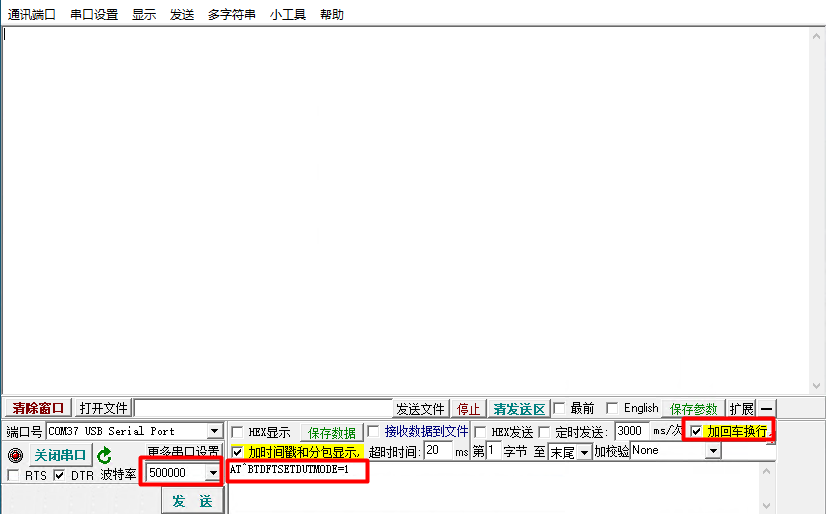

1.  通过电脑连接无线综测仪后，如[图1](#zh-cn_topic_0000002411206540_fig47221211112020)所示红框位置勾选Bluetooth模块下面的“Signaling 1”，打开信令测试功能。

    **图 1**  信令测试主界面<a name="zh-cn_topic_0000002411206540_fig47221211112020"></a>  
    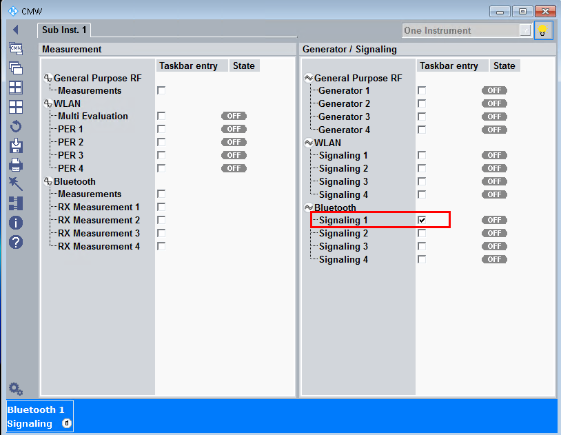

2.  如[图2](#zh-cn_topic_0000002411206540_fig81121938102010)中①所示，右键打开蓝牙信令连接开关。

    **图 2**  信令测试主界面<a name="zh-cn_topic_0000002411206540_fig81121938102010"></a>  
    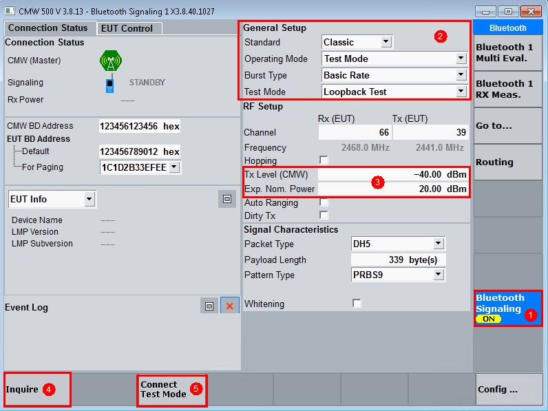

3.  如[图2](#zh-cn_topic_0000002411206540_fig81121938102010)中②所示，设置“Standard”为“Classic”，“Operating Mode”为“Test Mode”，“Burst Type”为“Basic Rate”，“Test Mode”为“Loopback Test”。
4.  如[图2](#zh-cn_topic_0000002411206540_fig81121938102010)中③所示，设置“Tx Level（CMW）”为“-40dBm”，“Exp.Nom.Power”为“20dBm”（此处以实际功率为准，建议在实际功率基础上增加3～5 dB）。
5.  如[图2](#zh-cn_topic_0000002411206540_fig81121938102010)中④所示，点击“Inquire”按钮，等待直到界面左下角出现蓝牙地址，如[图3](#zh-cn_topic_0000002411206540_fig11837135812215)所示出现蓝牙地址。

    **图 3**  蓝牙地址<a name="zh-cn_topic_0000002411206540_fig11837135812215"></a>  
    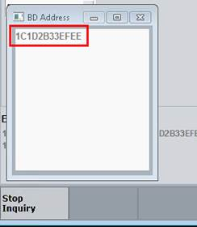

6.  点击[图2](#zh-cn_topic_0000002411206540_fig81121938102010)中⑤所示的“Connect Test Mode”按钮，连接成功后会出现如[图4](#zh-cn_topic_0000002411206540_fig4712121533817)所示界面，即界面左下角出现“Detach”按钮，然后就可以开始进行信令测试。其中[图4](#zh-cn_topic_0000002411206540_fig4712121533817)中①表示的是TX测试，②表示的是RX测试，③可以对一些基本测试参数进行配置。

    **图 4**  信令连接成功界面<a name="zh-cn_topic_0000002411206540_fig4712121533817"></a>  
    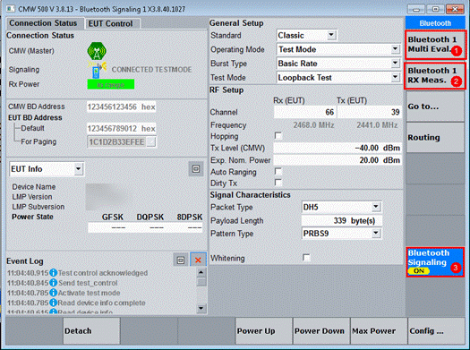

7.  在[图5](#zh-cn_topic_0000002411206540_fig1994812652315)中①所示“Packet Type”选择“DH5”，②所示“Pattern Type”选择“10101010”然后点击③即可看到TX测试界面如[图6](#zh-cn_topic_0000002411206540_fig516213422249)所示。

    **图 5**  信令链接界面<a name="zh-cn_topic_0000002411206540_fig1994812652315"></a>  
    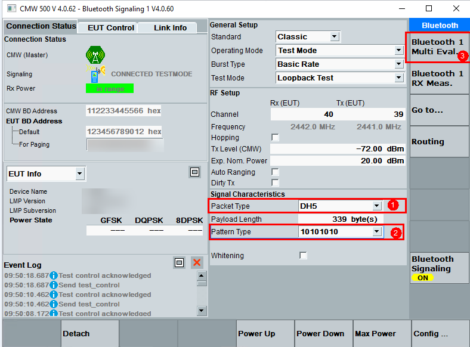

8.  先点击[图6](#zh-cn_topic_0000002411206540_fig516213422249)中①ASSIGN VIEW，然后点击②中的off然后勾选中的③。

    **图 6**  TX测试界面图1<a name="zh-cn_topic_0000002411206540_fig516213422249"></a>  
    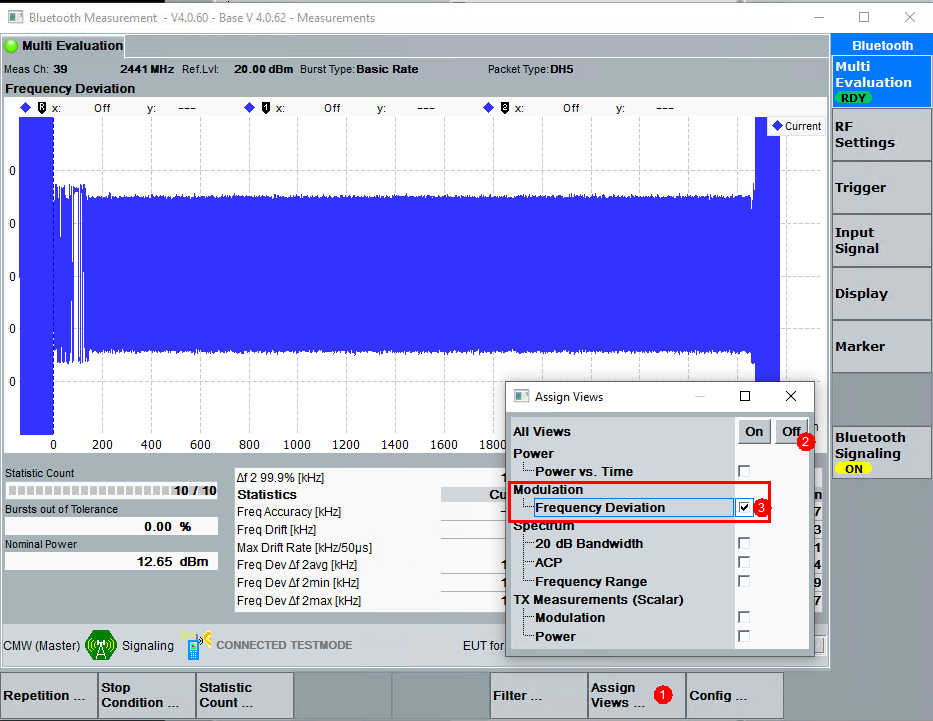

9.  观察频偏结果在[图7](#zh-cn_topic_0000002411206540_fig8133174812245)对应位置观测测试结果。

    **图 7**  TX测试界面图2<a name="zh-cn_topic_0000002411206540_fig8133174812245"></a>  
    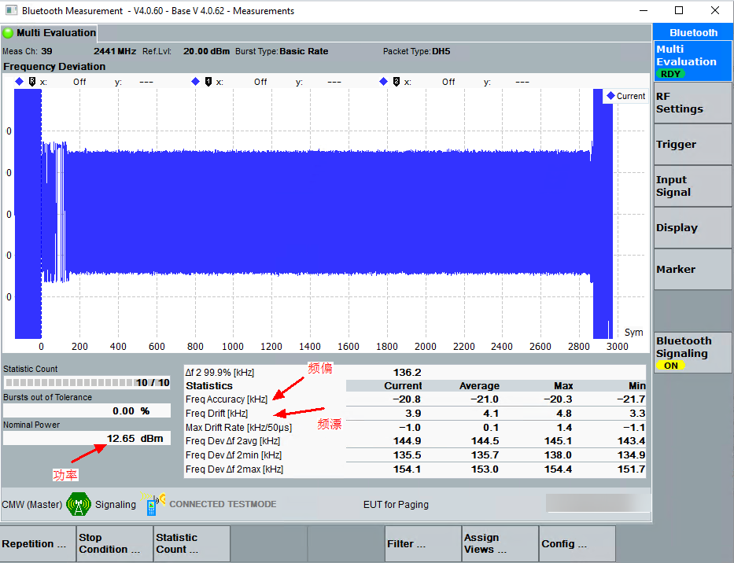

10. 调转观测ACP带内杂散步骤，在[图8](#zh-cn_topic_0000002411206540_fig39381954142418)中观测带内杂散点①点击②，然后勾选③即可观测带内杂散。

    **图 8**  带内杂散配置<a name="zh-cn_topic_0000002411206540_fig39381954142418"></a>  
    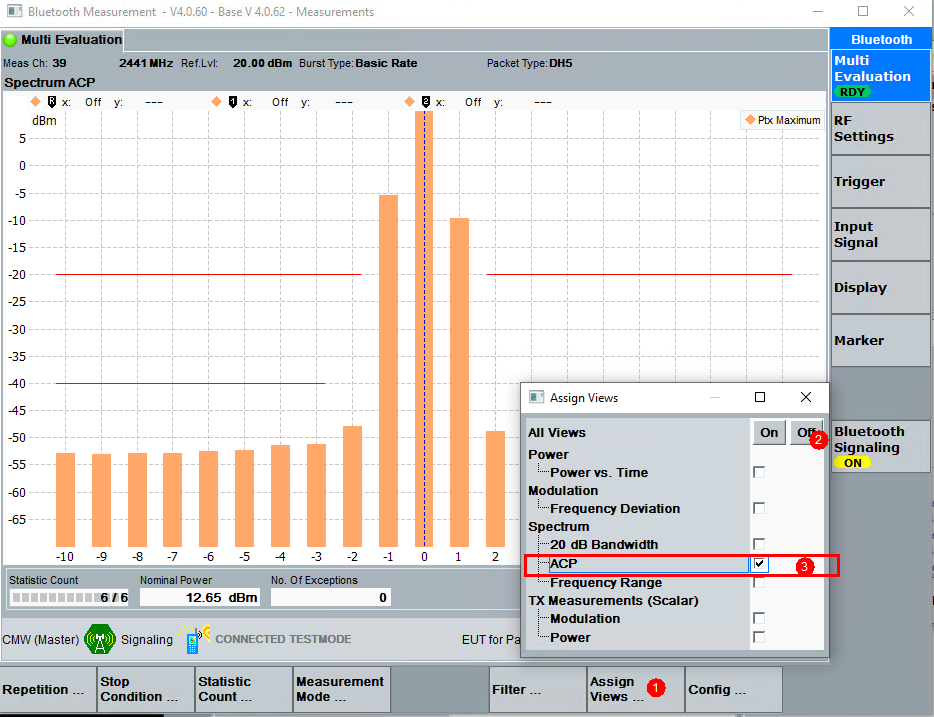

11. 观测带内杂散结果如[图9](#zh-cn_topic_0000002411206540_fig42441466250)所示。

    **图 9**  带内杂散结果<a name="zh-cn_topic_0000002411206540_fig42441466250"></a>  
    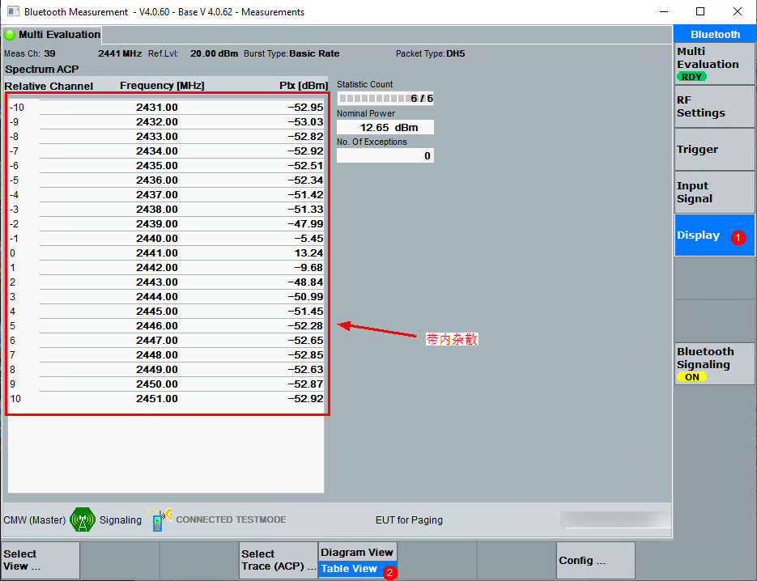

## 蓝牙非信令模式传导测试示例<a name="ZH-CN_TOPIC_0000002524738273"></a>

-   **[蓝牙非信令常发测试示例](#ZH-CN_TOPIC_0000002492738544)**  

-   **[蓝牙非信令常收测试示例](#ZH-CN_TOPIC_0000002492578572)**  

### 蓝牙非信令常发测试示例<a name="ZH-CN_TOPIC_0000002492738544"></a>

1.  将串口线缆与单板的命令下发串口连接后，在设备管理器中可以看到对应的端口号，如[图1](#zh-cn_topic_0000002411046792_fig210mcpsimp)所示。

    **图 1**  设备管理器界面-常发测试<a name="zh-cn_topic_0000002411046792_fig210mcpsimp"></a>  
    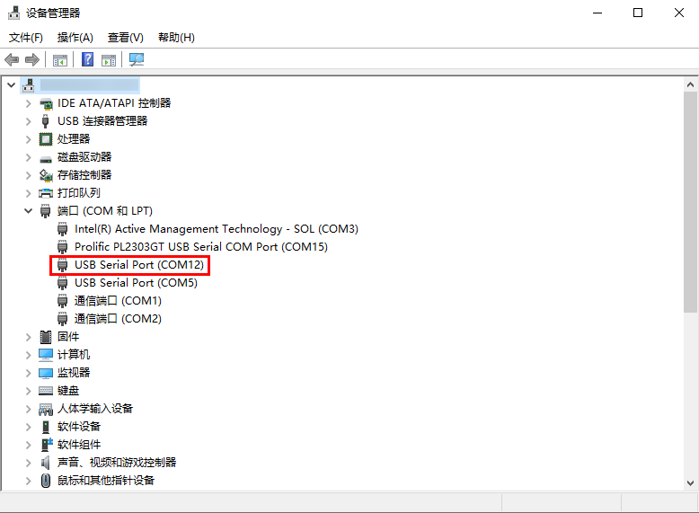

2.  如[图2](#zh-cn_topic_0000002411046792_fig94511351122411)所示，在串口工具中打开蓝牙UART串口，然后发送BT/BLE常发命令，本例为设置BT常发指令，以信道设置为0、编码类型PRBS9、包类型3DH5、包长1021Byte为例，命令为“AT^BTTX=01 02 00 0F FD 03 00 04”。

    **图 2**  串口工具控制界面-常发测试<a name="zh-cn_topic_0000002411046792_fig94511351122411"></a>  
    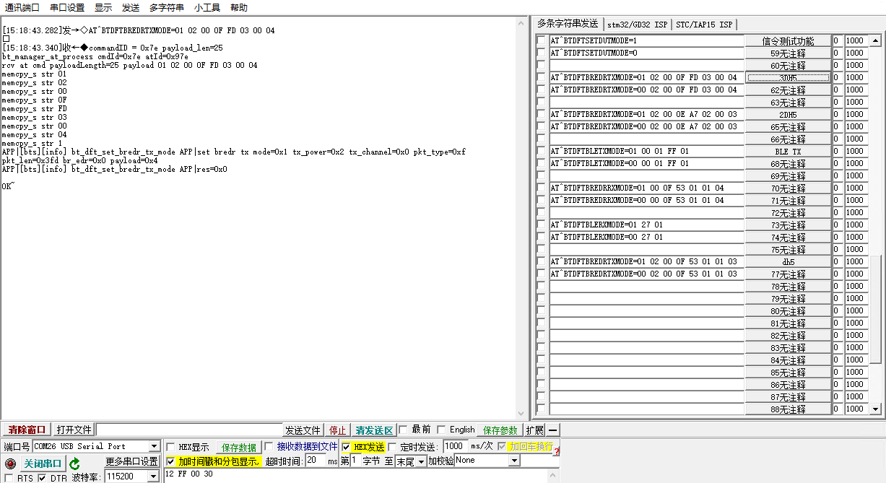

3.  通过远程桌面连接无线综测仪后，如[图3](#zh-cn_topic_0000002411046792_fig4450181813259)所示勾选Bluetooth模块下面的“Measurements”，打开仪表的非信令模式信号测量功能。

    **图 3**  无线综测仪功能界面-信号测量<a name="zh-cn_topic_0000002411046792_fig4450181813259"></a>  
    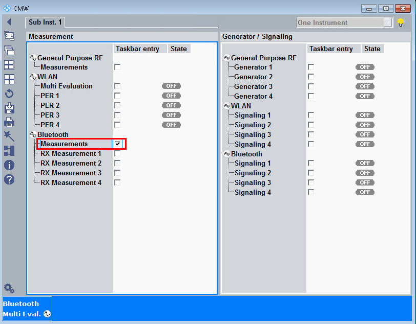

4.  如[图4](#zh-cn_topic_0000002411046792_fig13712173192915)中所示红框位置，选择“Config”进行基本参数配置。

    **图 4**  非信令发送测试主界面<a name="zh-cn_topic_0000002411046792_fig13712173192915"></a>  
    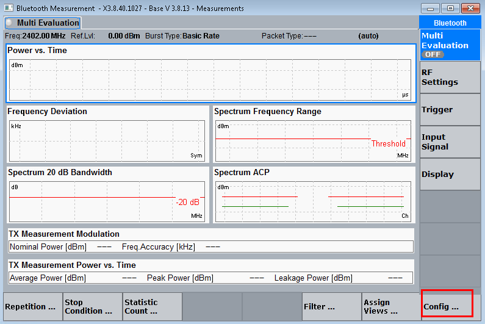

5.  如[图5](#zh-cn_topic_0000002411046792_fig1487534013494)中①所示，设置“Scenario”为“StandAlone（Non Signaling）”，即非信令测试场景。

    **图 5**  非信令发送测试参数配置界面<a name="zh-cn_topic_0000002411046792_fig1487534013494"></a>  
    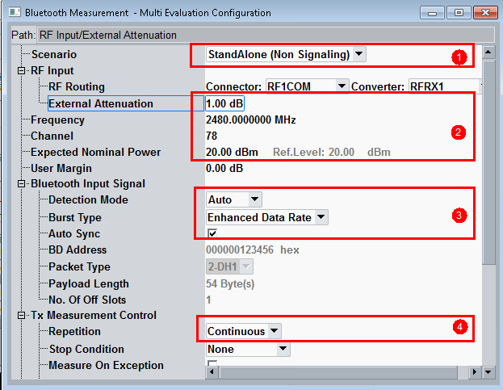

6.  如[图5](#zh-cn_topic_0000002411046792_fig1487534013494)中②所示，设置“External Attenuation”为测试环境的实际损耗，“Frequency”和“Channel”设置为所发送常发命令对应的频率和信道（本例中为78信道），“Expected Nominal Power”设置为“20dBm”（此处以实际功率为准，建议在实际功率基础上增加3dB～5dB）。
7.  如[图5](#zh-cn_topic_0000002411046792_fig1487534013494)中③所示，设置“Detection Mode”为“Auto”，“Burst Type”为所发送常发命令对应包类型（本例中为3DH5，所以选择Enhanced Data Rate），勾选“Auto Sync”。
8.  如[图5](#zh-cn_topic_0000002411046792_fig1487534013494)中④所示，设置“Repetiton”为“Continuous”。
9.  在发送测试主界面，如[图6](#zh-cn_topic_0000002411046792_fig8764430122420)中①所示，点击“Multi Evaluation”打开发送测试后，可在②所示的框图中查询发送相关的射频指标。

    **图 6**  开启发送测试后的非信令发送测试主界面<a name="zh-cn_topic_0000002411046792_fig8764430122420"></a>  
    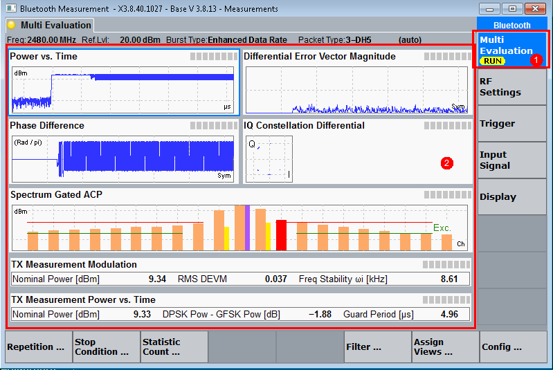

### 蓝牙非信令常收测试示例<a name="ZH-CN_TOPIC_0000002492578572"></a>

> **须知：** 
>测试BT常收功能时，务必将仪表波形文件中的蓝牙地址设置为NAP=1122、UAP=33、LAP=332211。如果不按照此设置，测试将无法正确查询到收包数。

1.  将串口线缆与单板的命令下发串口连接后，在设备管理器中可以看到对应的端口号，如[图1](#zh-cn_topic_0000002411046636_fig18829141195816)所示。

    **图 1**  设备管理器界面-常收测试<a name="zh-cn_topic_0000002411046636_fig18829141195816"></a>  
    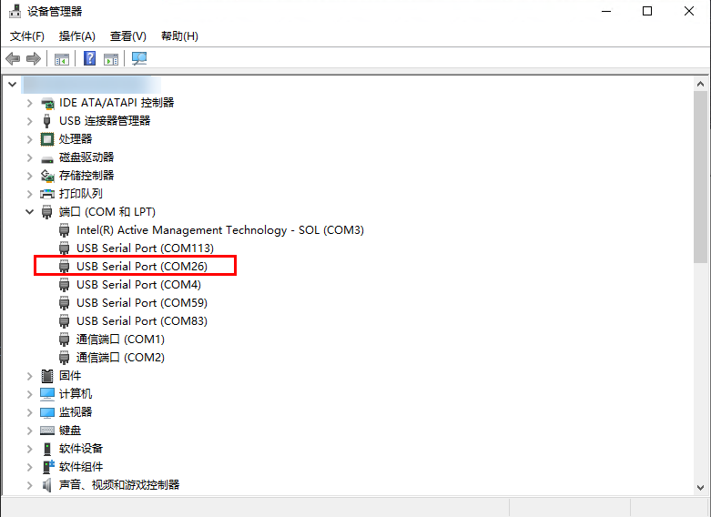

2.  如[图2](#zh-cn_topic_0000002411046636_fig2795133142318)所示，在串口工具中打开蓝牙UART串口，然后发送BT/BLE常发命令，本例以BT常收指令为例，0信道、编码类型PRBS9、包类型DH5、包长339Byte为例，命令为“AT^BTRX=01 00 0F 53 01 01 04”。

    **图 2**  串口工具控制界面-常收测试<a name="zh-cn_topic_0000002411046636_fig2795133142318"></a>  
    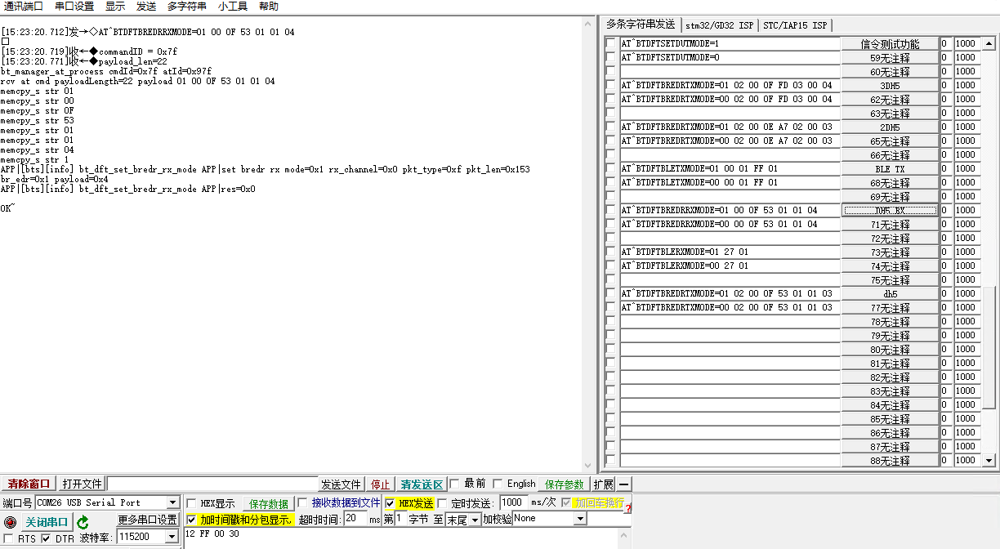

3.  通过远程桌面连接无线综测仪后，如[图3](#zh-cn_topic_0000002411046636_fig1330603019434)所示红框位置勾选General Purpose RF模块下面的“Generator 1”，打开仪器信号发送功能。

    **图 3**  无线综测仪功能界面-常收测试<a name="zh-cn_topic_0000002411046636_fig1330603019434"></a>  
    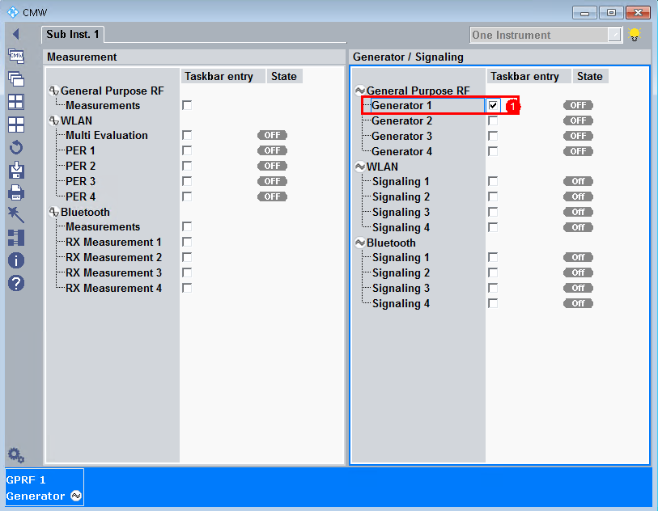

4.  如[图4](#zh-cn_topic_0000002411046636_fig399085072915)中①所示，设置“Ext.Att.（Output）”为测试环境实际的损耗，“Frequency”设置为所发送常发命令对应的频率（本例中为2402MHz），“Level（RMS）”设置为本次计划测试的接收功率大小。

    **图 4**  信号发送功能主界面<a name="zh-cn_topic_0000002411046636_fig399085072915"></a>  
    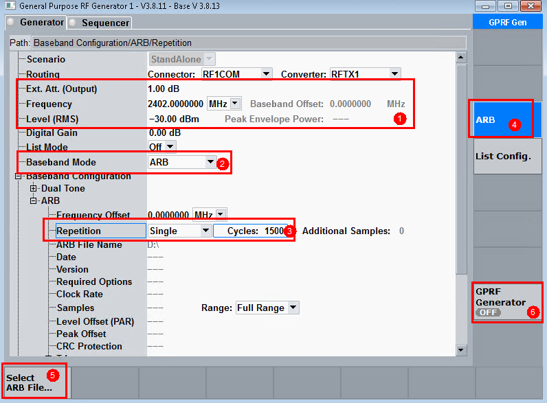

5.  如[图4](#zh-cn_topic_0000002411046636_fig399085072915)中②所示，设置“Baseband Mode”为“ARB”。
6.  如[图4](#zh-cn_topic_0000002411046636_fig399085072915)中③所示，设置“Repetition”为“Single”，"Cycles"为本次计划测试的发送包数（本例中为1500）。
7.  如[图4](#zh-cn_topic_0000002411046636_fig399085072915)中④所示，点击“ARB”按钮，然后在⑤所示位置点击“Select ARB File...”选择本次计划测试包类型对应的波形文件。
8.  如[图4](#zh-cn_topic_0000002411046636_fig399085072915)中⑥所示，右键点击“GPRF Generator”按钮选择“On”，仪器即开始发送选中的波性文件；等待一段时间后（建议大于10s），在相同位置右键点击“GPRF Generator”按钮选择“Off”，仪器即停止发送选中的波性文件。
9.  如[图5](#zh-cn_topic_0000002411046636_fig1017519017392)所示，在串口工具中打开蓝牙UART串口，然后发送查询BT接收包数命令“AT^BTRX=00”，DUT即停止常收功能并返回接收包数统计回显参数，本例收包数为1259，即丢包率为16%。

    **图 5**  串口工具控制界面-常收测试<a name="zh-cn_topic_0000002411046636_fig1017519017392"></a>  
    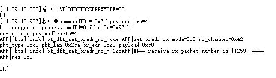

## 可视化界面<a name="ZH-CN_TOPIC_0000002524818247"></a>

根据研发阶段和产测阶段的传导测试需求，分别在DebugKits工具和FactoryTools工具上增加了可视化界面。

-   **[DebugKits RF TEST](#ZH-CN_TOPIC_0000002524738275)**  

### DebugKits RF TEST<a name="ZH-CN_TOPIC_0000002524738275"></a>

**图 1**  RF TEST界面<a name="zh-cn_topic_0000002444725933_fig17399936119"></a>  
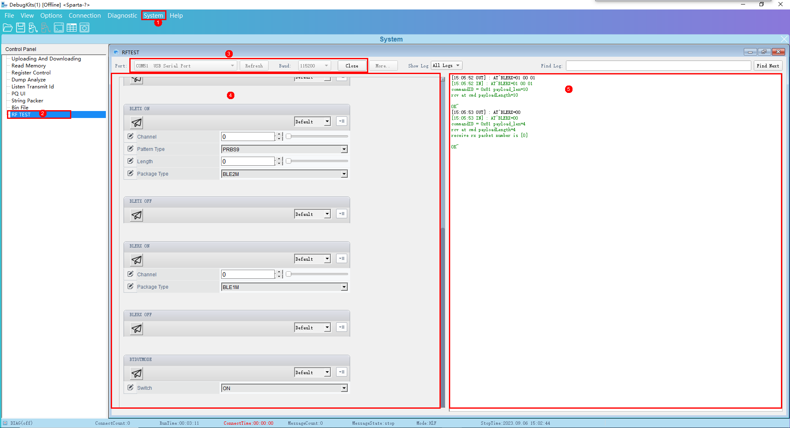

1.  如[图1](#zh-cn_topic_0000002444725933_fig17399936119)所示，选中①system，在②中选中 RF TEST选项。
2.  在③中选择当前AT口，调整UART配置后单机“Open”按钮打开串口。
3.  在④中配置当前需要进行发送的传导测试命令，单击进行发送。
4.  在⑤中打印当前命令及回显。

# 产线无线AT方案<a name="ZH-CN_TOPIC_0000002492738546"></a>

产线中整机段无UART口供调试，故推出产线无线AT方案。如[图1](#zh-cn_topic_0000002411206556_fig7231537133616)所示，产线中通过蓝牙Dongle实现AT命令下发。Dongle通过UART与PC连接，通过BR/BLE与单板通信，实现AT命令的无线交互。

**图 1**  产线无线AT方案硬件框图<a name="zh-cn_topic_0000002411206556_fig7231537133616"></a>  
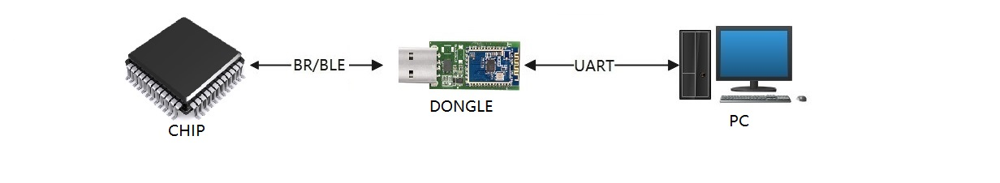

> **说明：** 
>使用蓝牙Dongle首先需添加编译宏‘FT\_DONGLE’。完成烧录后，根据AT命令配置Dongle和芯片实现AT命令下发等功能。

-   **[相关AT命令一览表](#ZH-CN_TOPIC_0000002492578574)**  

-   **[AT指令生成](#ZH-CN_TOPIC_0000002524818249)**  

-   **[示例](#ZH-CN_TOPIC_0000002524738277)**  

## 相关AT命令一览表<a name="ZH-CN_TOPIC_0000002492578574"></a>

产测蓝牙Dongle连接需要用到的部分AT命令如[表1](#zh-cn_topic_0000002411206592_table2787121117212)、[表2](#zh-cn_topic_0000002411206592_table7156125617237)所示。

> **说明：** 
>-   蓝牙Dongle推荐型号请咨询AE。
>-   无线AT方案多使用于整机段，无法通过AT指令配置芯片蓝牙状态，需要在产测阶段进行默认状态的配置及切换。

**表 1**  单板AT命令

<a name="zh-cn_topic_0000002411206592_table2787121117212"></a>
<table><thead align="left"><tr id="zh-cn_topic_0000002411206592_row147878111927"><th class="cellrowborder" valign="top" width="18.27%" id="mcps1.2.5.1.1"><p id="zh-cn_topic_0000002411206592_p20787011827"><a name="zh-cn_topic_0000002411206592_p20787011827"></a><a name="zh-cn_topic_0000002411206592_p20787011827"></a>命令描述</p>
</th>
<th class="cellrowborder" valign="top" width="31.730000000000004%" id="mcps1.2.5.1.2"><p id="zh-cn_topic_0000002411206592_p678718111423"><a name="zh-cn_topic_0000002411206592_p678718111423"></a><a name="zh-cn_topic_0000002411206592_p678718111423"></a>产测AT指令</p>
</th>
<th class="cellrowborder" valign="top" width="25%" id="mcps1.2.5.1.3"><p id="zh-cn_topic_0000002411206592_p77871111129"><a name="zh-cn_topic_0000002411206592_p77871111129"></a><a name="zh-cn_topic_0000002411206592_p77871111129"></a>示例</p>
</th>
<th class="cellrowborder" valign="top" width="25%" id="mcps1.2.5.1.4"><p id="zh-cn_topic_0000002411206592_p878712111021"><a name="zh-cn_topic_0000002411206592_p878712111021"></a><a name="zh-cn_topic_0000002411206592_p878712111021"></a>命令说明</p>
</th>
</tr>
</thead>
<tbody><tr id="zh-cn_topic_0000002411206592_row0787011225"><td class="cellrowborder" valign="top" width="18.27%" headers="mcps1.2.5.1.1 "><p id="zh-cn_topic_0000002411206592_p29351632102018"><a name="zh-cn_topic_0000002411206592_p29351632102018"></a><a name="zh-cn_topic_0000002411206592_p29351632102018"></a>查询蓝牙MAC地址</p>
</td>
<td class="cellrowborder" valign="top" width="31.730000000000004%" headers="mcps1.2.5.1.2 "><p id="zh-cn_topic_0000002411206592_p662834172510"><a name="zh-cn_topic_0000002411206592_p662834172510"></a><a name="zh-cn_topic_0000002411206592_p662834172510"></a>AT^BTCFG？</p>
</td>
<td class="cellrowborder" valign="top" width="25%" headers="mcps1.2.5.1.3 "><p id="zh-cn_topic_0000002411206592_p136121243259"><a name="zh-cn_topic_0000002411206592_p136121243259"></a><a name="zh-cn_topic_0000002411206592_p136121243259"></a>NA</p>
</td>
<td class="cellrowborder" valign="top" width="25%" headers="mcps1.2.5.1.4 "><p id="zh-cn_topic_0000002411206592_p11814113516201"><a name="zh-cn_topic_0000002411206592_p11814113516201"></a><a name="zh-cn_topic_0000002411206592_p11814113516201"></a>返回单板的蓝牙MAC地址（6 Byte）。</p>
</td>
</tr>
<tr id="zh-cn_topic_0000002411206592_row159351732162016"><td class="cellrowborder" valign="top" width="18.27%" headers="mcps1.2.5.1.1 "><p id="zh-cn_topic_0000002411206592_p4338239102016"><a name="zh-cn_topic_0000002411206592_p4338239102016"></a><a name="zh-cn_topic_0000002411206592_p4338239102016"></a>设置蓝牙MAC地址</p>
</td>
<td class="cellrowborder" valign="top" width="31.730000000000004%" headers="mcps1.2.5.1.2 "><p id="zh-cn_topic_0000002411206592_p189355322208"><a name="zh-cn_topic_0000002411206592_p189355322208"></a><a name="zh-cn_topic_0000002411206592_p189355322208"></a>AT^BTCFG=&lt;param1&gt; &lt;param2&gt;</p>
</td>
<td class="cellrowborder" valign="top" width="25%" headers="mcps1.2.5.1.3 "><p id="zh-cn_topic_0000002411206592_p293583211203"><a name="zh-cn_topic_0000002411206592_p293583211203"></a><a name="zh-cn_topic_0000002411206592_p293583211203"></a>AT^BTCFG=addr,112233445566</p>
</td>
<td class="cellrowborder" valign="top" width="25%" headers="mcps1.2.5.1.4 "><a name="zh-cn_topic_0000002411206592_ul125243411427"></a><a name="zh-cn_topic_0000002411206592_ul125243411427"></a><ul id="zh-cn_topic_0000002411206592_ul125243411427"><li>param1：addr(表示设置MAC地址)</li><li>param2：<p id="zh-cn_topic_0000002411206592_p1717823214559"><a name="zh-cn_topic_0000002411206592_p1717823214559"></a><a name="zh-cn_topic_0000002411206592_p1717823214559"></a>MAC地址（6 Byte 十六进制）。</p>
<p id="zh-cn_topic_0000002411206592_p6544610105717"><a name="zh-cn_topic_0000002411206592_p6544610105717"></a><a name="zh-cn_topic_0000002411206592_p6544610105717"></a>注意配置地址后需要重启方能生效</p>
</li></ul>
</td>
</tr>
</tbody>
</table>

**表 2**  Dongle AT命令

<a name="zh-cn_topic_0000002411206592_table7156125617237"></a>
<table><thead align="left"><tr id="zh-cn_topic_0000002411206592_row115625602313"><th class="cellrowborder" valign="top" width="24.97%" id="mcps1.2.5.1.1"><p id="zh-cn_topic_0000002411206592_p4497310118"><a name="zh-cn_topic_0000002411206592_p4497310118"></a><a name="zh-cn_topic_0000002411206592_p4497310118"></a>命令描述</p>
</th>
<th class="cellrowborder" valign="top" width="25.009999999999998%" id="mcps1.2.5.1.2"><p id="zh-cn_topic_0000002411206592_p154911319116"><a name="zh-cn_topic_0000002411206592_p154911319116"></a><a name="zh-cn_topic_0000002411206592_p154911319116"></a>产测AT指令</p>
</th>
<th class="cellrowborder" valign="top" width="25.019999999999996%" id="mcps1.2.5.1.3"><p id="zh-cn_topic_0000002411206592_p049931151117"><a name="zh-cn_topic_0000002411206592_p049931151117"></a><a name="zh-cn_topic_0000002411206592_p049931151117"></a>示例</p>
</th>
<th class="cellrowborder" valign="top" width="25%" id="mcps1.2.5.1.4"><p id="zh-cn_topic_0000002411206592_p84973131110"><a name="zh-cn_topic_0000002411206592_p84973131110"></a><a name="zh-cn_topic_0000002411206592_p84973131110"></a>命令说明</p>
</th>
</tr>
</thead>
<tbody><tr id="zh-cn_topic_0000002411206592_row8156105682316"><td class="cellrowborder" valign="top" width="24.97%" headers="mcps1.2.5.1.1 "><p id="zh-cn_topic_0000002411206592_p19156125614231"><a name="zh-cn_topic_0000002411206592_p19156125614231"></a><a name="zh-cn_topic_0000002411206592_p19156125614231"></a>串口通信测试</p>
</td>
<td class="cellrowborder" valign="top" width="25.009999999999998%" headers="mcps1.2.5.1.2 "><p id="zh-cn_topic_0000002411206592_p151561656132318"><a name="zh-cn_topic_0000002411206592_p151561656132318"></a><a name="zh-cn_topic_0000002411206592_p151561656132318"></a>AT</p>
</td>
<td class="cellrowborder" valign="top" width="25.019999999999996%" headers="mcps1.2.5.1.3 "><p id="zh-cn_topic_0000002411206592_p11156956112314"><a name="zh-cn_topic_0000002411206592_p11156956112314"></a><a name="zh-cn_topic_0000002411206592_p11156956112314"></a>NA</p>
</td>
<td class="cellrowborder" valign="top" width="25%" headers="mcps1.2.5.1.4 "><p id="zh-cn_topic_0000002411206592_p101561356172318"><a name="zh-cn_topic_0000002411206592_p101561356172318"></a><a name="zh-cn_topic_0000002411206592_p101561356172318"></a>测试PC和Dongle间的UART通讯。</p>
</td>
</tr>
<tr id="zh-cn_topic_0000002411206592_row1915685682317"><td class="cellrowborder" valign="top" width="24.97%" headers="mcps1.2.5.1.1 "><p id="zh-cn_topic_0000002411206592_p19156956182316"><a name="zh-cn_topic_0000002411206592_p19156956182316"></a><a name="zh-cn_topic_0000002411206592_p19156956182316"></a>读BR蓝牙MAC地址</p>
</td>
<td class="cellrowborder" valign="top" width="25.009999999999998%" headers="mcps1.2.5.1.2 "><p id="zh-cn_topic_0000002411206592_p8156656152318"><a name="zh-cn_topic_0000002411206592_p8156656152318"></a><a name="zh-cn_topic_0000002411206592_p8156656152318"></a>AT+ADDR</p>
</td>
<td class="cellrowborder" valign="top" width="25.019999999999996%" headers="mcps1.2.5.1.3 "><p id="zh-cn_topic_0000002411206592_p61561456142312"><a name="zh-cn_topic_0000002411206592_p61561456142312"></a><a name="zh-cn_topic_0000002411206592_p61561456142312"></a>NA</p>
</td>
<td class="cellrowborder" valign="top" width="25%" headers="mcps1.2.5.1.4 "><p id="zh-cn_topic_0000002411206592_p215645652318"><a name="zh-cn_topic_0000002411206592_p215645652318"></a><a name="zh-cn_topic_0000002411206592_p215645652318"></a>返回模块的BR MAC地址（6 Byte）。</p>
</td>
</tr>
<tr id="zh-cn_topic_0000002411206592_row1236202584916"><td class="cellrowborder" valign="top" width="24.97%" headers="mcps1.2.5.1.1 "><p id="zh-cn_topic_0000002411206592_p13662514494"><a name="zh-cn_topic_0000002411206592_p13662514494"></a><a name="zh-cn_topic_0000002411206592_p13662514494"></a>打开/关闭串口流控</p>
</td>
<td class="cellrowborder" valign="top" width="25.009999999999998%" headers="mcps1.2.5.1.2 "><p id="zh-cn_topic_0000002411206592_p12391617143015"><a name="zh-cn_topic_0000002411206592_p12391617143015"></a><a name="zh-cn_topic_0000002411206592_p12391617143015"></a>AT+FLOWCTL=&lt;param&gt;</p>
</td>
<td class="cellrowborder" valign="top" width="25.019999999999996%" headers="mcps1.2.5.1.3 "><p id="zh-cn_topic_0000002411206592_p1837102514914"><a name="zh-cn_topic_0000002411206592_p1837102514914"></a><a name="zh-cn_topic_0000002411206592_p1837102514914"></a>AT+FLOWCTL=0</p>
</td>
<td class="cellrowborder" valign="top" width="25%" headers="mcps1.2.5.1.4 "><p id="zh-cn_topic_0000002411206592_p360623910563"><a name="zh-cn_topic_0000002411206592_p360623910563"></a><a name="zh-cn_topic_0000002411206592_p360623910563"></a>param：</p>
<a name="zh-cn_topic_0000002411206592_ul1265193614416"></a><a name="zh-cn_topic_0000002411206592_ul1265193614416"></a><ul id="zh-cn_topic_0000002411206592_ul1265193614416"><li>0：关闭流控。</li><li>1：打开流控。</li></ul>
</td>
</tr>
<tr id="zh-cn_topic_0000002411206592_row1286272016579"><td class="cellrowborder" valign="top" width="24.97%" headers="mcps1.2.5.1.1 "><p id="zh-cn_topic_0000002411206592_p198621420165715"><a name="zh-cn_topic_0000002411206592_p198621420165715"></a><a name="zh-cn_topic_0000002411206592_p198621420165715"></a>读/写串口波特率</p>
</td>
<td class="cellrowborder" valign="top" width="25.009999999999998%" headers="mcps1.2.5.1.2 "><p id="zh-cn_topic_0000002411206592_p11862162065717"><a name="zh-cn_topic_0000002411206592_p11862162065717"></a><a name="zh-cn_topic_0000002411206592_p11862162065717"></a>AT+BAUD{=&lt;param&gt;}</p>
</td>
<td class="cellrowborder" valign="top" width="25.019999999999996%" headers="mcps1.2.5.1.3 "><p id="zh-cn_topic_0000002411206592_p1086242005719"><a name="zh-cn_topic_0000002411206592_p1086242005719"></a><a name="zh-cn_topic_0000002411206592_p1086242005719"></a>AT+BAUD</p>
<p id="zh-cn_topic_0000002411206592_p3388459171913"><a name="zh-cn_topic_0000002411206592_p3388459171913"></a><a name="zh-cn_topic_0000002411206592_p3388459171913"></a>AT+BAUD=921600</p>
</td>
<td class="cellrowborder" valign="top" width="25%" headers="mcps1.2.5.1.4 "><p id="zh-cn_topic_0000002411206592_p1486216206576"><a name="zh-cn_topic_0000002411206592_p1486216206576"></a><a name="zh-cn_topic_0000002411206592_p1486216206576"></a>param：波特率。</p>
</td>
</tr>
<tr id="zh-cn_topic_0000002411206592_row167548535817"><td class="cellrowborder" valign="top" width="24.97%" headers="mcps1.2.5.1.1 "><p id="zh-cn_topic_0000002411206592_p27541653582"><a name="zh-cn_topic_0000002411206592_p27541653582"></a><a name="zh-cn_topic_0000002411206592_p27541653582"></a>打开/关闭透传模式</p>
</td>
<td class="cellrowborder" valign="top" width="25.009999999999998%" headers="mcps1.2.5.1.2 "><p id="zh-cn_topic_0000002411206592_p1475418525814"><a name="zh-cn_topic_0000002411206592_p1475418525814"></a><a name="zh-cn_topic_0000002411206592_p1475418525814"></a>AT+TPMODE{=&lt;param&gt;}</p>
</td>
<td class="cellrowborder" valign="top" width="25.019999999999996%" headers="mcps1.2.5.1.3 "><p id="zh-cn_topic_0000002411206592_p111064194160"><a name="zh-cn_topic_0000002411206592_p111064194160"></a><a name="zh-cn_topic_0000002411206592_p111064194160"></a>AT+TPMODE</p>
<p id="zh-cn_topic_0000002411206592_p1761616258167"><a name="zh-cn_topic_0000002411206592_p1761616258167"></a><a name="zh-cn_topic_0000002411206592_p1761616258167"></a>AT+TPMODE=1</p>
</td>
<td class="cellrowborder" valign="top" width="25%" headers="mcps1.2.5.1.4 "><p id="zh-cn_topic_0000002411206592_p5754155145819"><a name="zh-cn_topic_0000002411206592_p5754155145819"></a><a name="zh-cn_topic_0000002411206592_p5754155145819"></a>param：模式0/1</p>
<a name="zh-cn_topic_0000002411206592_ul18533109554"></a><a name="zh-cn_topic_0000002411206592_ul18533109554"></a><ul id="zh-cn_topic_0000002411206592_ul18533109554"><li>0：指令模式。</li><li>1：透传模式。</li></ul>
<p id="zh-cn_topic_0000002411206592_p5590520121812"><a name="zh-cn_topic_0000002411206592_p5590520121812"></a><a name="zh-cn_topic_0000002411206592_p5590520121812"></a>当在SPP/GATT协议下连接并且打开透传模式时，AT指令将会被禁用，通过UART接收的每个字节将被发送到远端。</p>
</td>
</tr>
<tr id="zh-cn_topic_0000002411206592_row75081014163510"><td class="cellrowborder" valign="top" width="24.97%" headers="mcps1.2.5.1.1 "><p id="zh-cn_topic_0000002411206592_p1150815147359"><a name="zh-cn_topic_0000002411206592_p1150815147359"></a><a name="zh-cn_topic_0000002411206592_p1150815147359"></a>读/写设备类型</p>
</td>
<td class="cellrowborder" valign="top" width="25.009999999999998%" headers="mcps1.2.5.1.2 "><p id="zh-cn_topic_0000002411206592_p155085146358"><a name="zh-cn_topic_0000002411206592_p155085146358"></a><a name="zh-cn_topic_0000002411206592_p155085146358"></a>AT+COD{=&lt;param&gt;}</p>
</td>
<td class="cellrowborder" valign="top" width="25.019999999999996%" headers="mcps1.2.5.1.3 "><p id="zh-cn_topic_0000002411206592_p115082143356"><a name="zh-cn_topic_0000002411206592_p115082143356"></a><a name="zh-cn_topic_0000002411206592_p115082143356"></a>AT+COD</p>
<p id="zh-cn_topic_0000002411206592_p1697919431358"><a name="zh-cn_topic_0000002411206592_p1697919431358"></a><a name="zh-cn_topic_0000002411206592_p1697919431358"></a>AT+COD=009F00</p>
</td>
<td class="cellrowborder" valign="top" width="25%" headers="mcps1.2.5.1.4 "><p id="zh-cn_topic_0000002411206592_p9508111420355"><a name="zh-cn_topic_0000002411206592_p9508111420355"></a><a name="zh-cn_topic_0000002411206592_p9508111420355"></a>param：设备类型（6Byte）</p>
</td>
</tr>
<tr id="zh-cn_topic_0000002411206592_row17229204362120"><td class="cellrowborder" valign="top" width="24.97%" headers="mcps1.2.5.1.1 "><p id="zh-cn_topic_0000002411206592_p922934382118"><a name="zh-cn_topic_0000002411206592_p922934382118"></a><a name="zh-cn_topic_0000002411206592_p922934382118"></a>建立SPP连接</p>
</td>
<td class="cellrowborder" valign="top" width="25.009999999999998%" headers="mcps1.2.5.1.2 "><p id="zh-cn_topic_0000002411206592_p1723084318218"><a name="zh-cn_topic_0000002411206592_p1723084318218"></a><a name="zh-cn_topic_0000002411206592_p1723084318218"></a>AT+SPPCONN=&lt;param&gt;</p>
</td>
<td class="cellrowborder" valign="top" width="25.019999999999996%" headers="mcps1.2.5.1.3 "><p id="zh-cn_topic_0000002411206592_p3230114342118"><a name="zh-cn_topic_0000002411206592_p3230114342118"></a><a name="zh-cn_topic_0000002411206592_p3230114342118"></a>AT+SPPCONN=112233445566</p>
</td>
<td class="cellrowborder" valign="top" width="25%" headers="mcps1.2.5.1.4 "><p id="zh-cn_topic_0000002411206592_p17230124317219"><a name="zh-cn_topic_0000002411206592_p17230124317219"></a><a name="zh-cn_topic_0000002411206592_p17230124317219"></a>param：目标设备MAC地址（12Byte）</p>
</td>
</tr>
</tbody>
</table>

## AT指令生成<a name="ZH-CN_TOPIC_0000002524818249"></a>

无线AT提供封装穿戴协议脚本，可快速生成通过DONGLE发送可以解析AT指令。

工具路径：sdk\\tools\\bin\\at\_convert\_tool\\at\_convert.py

生成方式只需要将脚本中“at\_cmd”变量修改为需要执行的AT指令然后使用python3执行即可。

**图 1**  at\_cmd声明位置<a name="zh-cn_topic_0000002411206504_fig48361328154112"></a>  
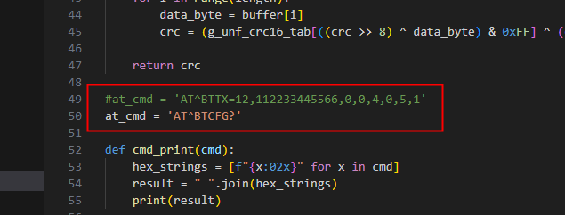

**表 1**  AT命令参数表

<a name="zh-cn_topic_0000002411206504_table83481681511"></a>
<table><thead align="left"><tr id="zh-cn_topic_0000002411206504_row168271651512"><th class="cellrowborder" valign="top" id="mcps1.2.5.1.1"><p id="zh-cn_topic_0000002411206504_p1982191619150"><a name="zh-cn_topic_0000002411206504_p1982191619150"></a><a name="zh-cn_topic_0000002411206504_p1982191619150"></a>领域</p>
</th>
<th class="cellrowborder" valign="top" id="mcps1.2.5.1.2"><p id="zh-cn_topic_0000002411206504_p1782191621510"><a name="zh-cn_topic_0000002411206504_p1782191621510"></a><a name="zh-cn_topic_0000002411206504_p1782191621510"></a>AT命令</p>
</th>
<th class="cellrowborder" colspan="2" valign="top" id="mcps1.2.5.1.3"><p id="zh-cn_topic_0000002411206504_p4824166155"><a name="zh-cn_topic_0000002411206504_p4824166155"></a><a name="zh-cn_topic_0000002411206504_p4824166155"></a>Pkt（参数）均为uint8_t类型字符串</p>
</th>
</tr>
</thead>
<tbody><tr id="zh-cn_topic_0000002411206504_row58271611155"><td class="cellrowborder" rowspan="8" valign="top" headers="mcps1.2.5.1.1 "><p id="zh-cn_topic_0000002411206504_p4870332131719"><a name="zh-cn_topic_0000002411206504_p4870332131719"></a><a name="zh-cn_topic_0000002411206504_p4870332131719"></a>MCU</p>
</td>
<td class="cellrowborder" valign="top" headers="mcps1.2.5.1.2 "><p id="zh-cn_topic_0000002411206504_p1182201617157"><a name="zh-cn_topic_0000002411206504_p1182201617157"></a><a name="zh-cn_topic_0000002411206504_p1182201617157"></a>AT+REBOOT</p>
</td>
<td class="cellrowborder" colspan="2" valign="top" headers="mcps1.2.5.1.3 "><p id="zh-cn_topic_0000002411206504_p1482121614153"><a name="zh-cn_topic_0000002411206504_p1482121614153"></a><a name="zh-cn_topic_0000002411206504_p1482121614153"></a>NA</p>
</td>
</tr>
<tr id="zh-cn_topic_0000002411206504_row48211611152"><td class="cellrowborder" valign="top" headers="mcps1.2.5.1.1 "><p id="zh-cn_topic_0000002411206504_p682171616154"><a name="zh-cn_topic_0000002411206504_p682171616154"></a><a name="zh-cn_topic_0000002411206504_p682171616154"></a>AT+FSRM</p>
</td>
<td class="cellrowborder" colspan="2" valign="top" headers="mcps1.2.5.1.3 "><p id="zh-cn_topic_0000002411206504_p439543722211"><a name="zh-cn_topic_0000002411206504_p439543722211"></a><a name="zh-cn_topic_0000002411206504_p439543722211"></a>"/user/bin/,1"</p>
<p id="zh-cn_topic_0000002411206504_p182511442102213"><a name="zh-cn_topic_0000002411206504_p182511442102213"></a><a name="zh-cn_topic_0000002411206504_p182511442102213"></a>1：文件大小</p>
</td>
</tr>
<tr id="zh-cn_topic_0000002411206504_row8831316191514"><td class="cellrowborder" valign="top" headers="mcps1.2.5.1.1 "><p id="zh-cn_topic_0000002411206504_p108314164156"><a name="zh-cn_topic_0000002411206504_p108314164156"></a><a name="zh-cn_topic_0000002411206504_p108314164156"></a>AT+GETWSTPVER</p>
</td>
<td class="cellrowborder" colspan="2" valign="top" headers="mcps1.2.5.1.3 "><p id="zh-cn_topic_0000002411206504_p28321610154"><a name="zh-cn_topic_0000002411206504_p28321610154"></a><a name="zh-cn_topic_0000002411206504_p28321610154"></a>NA</p>
</td>
</tr>
<tr id="zh-cn_topic_0000002411206504_row108312168159"><td class="cellrowborder" valign="top" headers="mcps1.2.5.1.1 "><p id="zh-cn_topic_0000002411206504_p883161661516"><a name="zh-cn_topic_0000002411206504_p883161661516"></a><a name="zh-cn_topic_0000002411206504_p883161661516"></a>AT+STACKINFO</p>
</td>
<td class="cellrowborder" colspan="2" valign="top" headers="mcps1.2.5.1.3 "><p id="zh-cn_topic_0000002411206504_p98391681520"><a name="zh-cn_topic_0000002411206504_p98391681520"></a><a name="zh-cn_topic_0000002411206504_p98391681520"></a>NA</p>
</td>
</tr>
<tr id="zh-cn_topic_0000002411206504_row98311691514"><td class="cellrowborder" valign="top" headers="mcps1.2.5.1.1 "><p id="zh-cn_topic_0000002411206504_p1611313159211"><a name="zh-cn_topic_0000002411206504_p1611313159211"></a><a name="zh-cn_topic_0000002411206504_p1611313159211"></a>AT+PMRMVOTE</p>
</td>
<td class="cellrowborder" colspan="2" valign="top" headers="mcps1.2.5.1.3 "><p id="zh-cn_topic_0000002411206504_p118381611150"><a name="zh-cn_topic_0000002411206504_p118381611150"></a><a name="zh-cn_topic_0000002411206504_p118381611150"></a>NA</p>
</td>
</tr>
<tr id="zh-cn_topic_0000002411206504_row18835161153"><td class="cellrowborder" valign="top" headers="mcps1.2.5.1.1 "><p id="zh-cn_topic_0000002411206504_p88331641518"><a name="zh-cn_topic_0000002411206504_p88331641518"></a><a name="zh-cn_topic_0000002411206504_p88331641518"></a>AT+PMADDVOTE</p>
</td>
<td class="cellrowborder" colspan="2" valign="top" headers="mcps1.2.5.1.3 "><p id="zh-cn_topic_0000002411206504_p138341620158"><a name="zh-cn_topic_0000002411206504_p138341620158"></a><a name="zh-cn_topic_0000002411206504_p138341620158"></a>NA</p>
</td>
</tr>
<tr id="zh-cn_topic_0000002411206504_row148311168151"><td class="cellrowborder" valign="top" headers="mcps1.2.5.1.1 "><p id="zh-cn_topic_0000002411206504_p1226033517316"><a name="zh-cn_topic_0000002411206504_p1226033517316"></a><a name="zh-cn_topic_0000002411206504_p1226033517316"></a>AT+SHIPMODE</p>
</td>
<td class="cellrowborder" colspan="2" valign="top" headers="mcps1.2.5.1.3 "><p id="zh-cn_topic_0000002411206504_p208331619157"><a name="zh-cn_topic_0000002411206504_p208331619157"></a><a name="zh-cn_topic_0000002411206504_p208331619157"></a>NA</p>
</td>
</tr>
<tr id="zh-cn_topic_0000002411206504_row48351691510"><td class="cellrowborder" valign="top" headers="mcps1.2.5.1.1 "><p id="zh-cn_topic_0000002411206504_p13314634742"><a name="zh-cn_topic_0000002411206504_p13314634742"></a><a name="zh-cn_topic_0000002411206504_p13314634742"></a>AT+PERIPHERALSID</p>
</td>
<td class="cellrowborder" colspan="2" valign="top" headers="mcps1.2.5.1.3 "><p id="zh-cn_topic_0000002411206504_p118301617158"><a name="zh-cn_topic_0000002411206504_p118301617158"></a><a name="zh-cn_topic_0000002411206504_p118301617158"></a>0：emmc</p>
<p id="zh-cn_topic_0000002411206504_p893113568418"><a name="zh-cn_topic_0000002411206504_p893113568418"></a><a name="zh-cn_topic_0000002411206504_p893113568418"></a>1：nand</p>
<p id="zh-cn_topic_0000002411206504_p4164202759"><a name="zh-cn_topic_0000002411206504_p4164202759"></a><a name="zh-cn_topic_0000002411206504_p4164202759"></a>2：nor</p>
<p id="zh-cn_topic_0000002411206504_p12786196159"><a name="zh-cn_topic_0000002411206504_p12786196159"></a><a name="zh-cn_topic_0000002411206504_p12786196159"></a>3：psram</p>
</td>
</tr>
<tr id="zh-cn_topic_0000002411206504_row083101613155"><td class="cellrowborder" rowspan="4" valign="top" headers="mcps1.2.5.1.1 "><p id="zh-cn_topic_0000002411206504_p4442113671718"><a name="zh-cn_topic_0000002411206504_p4442113671718"></a><a name="zh-cn_topic_0000002411206504_p4442113671718"></a>BT</p>
</td>
<td class="cellrowborder" valign="top" headers="mcps1.2.5.1.2 "><p id="zh-cn_topic_0000002411206504_p17831716131514"><a name="zh-cn_topic_0000002411206504_p17831716131514"></a><a name="zh-cn_topic_0000002411206504_p17831716131514"></a>AT^BTCTTX</p>
</td>
<td class="cellrowborder" colspan="2" valign="top" headers="mcps1.2.5.1.3 "><p id="zh-cn_topic_0000002411206504_p7841916131515"><a name="zh-cn_topic_0000002411206504_p7841916131515"></a><a name="zh-cn_topic_0000002411206504_p7841916131515"></a>参数同传导测试AT^BTT。</p>
</td>
</tr>
<tr id="zh-cn_topic_0000002411206504_row984171641516"><td class="cellrowborder" valign="top" headers="mcps1.2.5.1.1 "><p id="zh-cn_topic_0000002411206504_p584316181510"><a name="zh-cn_topic_0000002411206504_p584316181510"></a><a name="zh-cn_topic_0000002411206504_p584316181510"></a>AT^BTCTRX</p>
</td>
<td class="cellrowborder" colspan="2" valign="top" headers="mcps1.2.5.1.3 "><p id="zh-cn_topic_0000002411206504_p108419167150"><a name="zh-cn_topic_0000002411206504_p108419167150"></a><a name="zh-cn_topic_0000002411206504_p108419167150"></a>参数同传导测试AT^BTRX。</p>
</td>
</tr>
<tr id="zh-cn_topic_0000002411206504_row08431671513"><td class="cellrowborder" valign="top" headers="mcps1.2.5.1.1 "><p id="zh-cn_topic_0000002411206504_p6841216121513"><a name="zh-cn_topic_0000002411206504_p6841216121513"></a><a name="zh-cn_topic_0000002411206504_p6841216121513"></a>AT^BLECTTX</p>
</td>
<td class="cellrowborder" colspan="2" valign="top" headers="mcps1.2.5.1.3 "><p id="zh-cn_topic_0000002411206504_p17843167156"><a name="zh-cn_topic_0000002411206504_p17843167156"></a><a name="zh-cn_topic_0000002411206504_p17843167156"></a>参数同传导测试AT^BLETX。</p>
</td>
</tr>
<tr id="zh-cn_topic_0000002411206504_row118412166158"><td class="cellrowborder" valign="top" headers="mcps1.2.5.1.1 "><p id="zh-cn_topic_0000002411206504_p10841816111514"><a name="zh-cn_topic_0000002411206504_p10841816111514"></a><a name="zh-cn_topic_0000002411206504_p10841816111514"></a>AT^BLECTRX</p>
</td>
<td class="cellrowborder" colspan="2" valign="top" headers="mcps1.2.5.1.3 "><p id="zh-cn_topic_0000002411206504_p19841167156"><a name="zh-cn_topic_0000002411206504_p19841167156"></a><a name="zh-cn_topic_0000002411206504_p19841167156"></a>参数同传导测试AT^BLERX。</p>
</td>
</tr>
<tr id="zh-cn_topic_0000002411206504_row165908725411"><td class="cellrowborder" rowspan="3" valign="top" headers="mcps1.2.5.1.1 "><p id="zh-cn_topic_0000002411206504_p115901672547"><a name="zh-cn_topic_0000002411206504_p115901672547"></a><a name="zh-cn_topic_0000002411206504_p115901672547"></a>MEDIA</p>
</td>
<td class="cellrowborder" valign="top" headers="mcps1.2.5.1.2 "><p id="zh-cn_topic_0000002411206504_p20659921125415"><a name="zh-cn_topic_0000002411206504_p20659921125415"></a><a name="zh-cn_topic_0000002411206504_p20659921125415"></a>AT^MEDIA=MUSICPLAY,xx,user/music/mp3_48k_caiqing.mp3,1,0</p>
</td>
<td class="cellrowborder" colspan="2" valign="top" headers="mcps1.2.5.1.3 "><p id="zh-cn_topic_0000002411206504_p52791230135419"><a name="zh-cn_topic_0000002411206504_p52791230135419"></a><a name="zh-cn_topic_0000002411206504_p52791230135419"></a>xx：固定标记；</p>
<p id="zh-cn_topic_0000002411206504_p172155549549"><a name="zh-cn_topic_0000002411206504_p172155549549"></a><a name="zh-cn_topic_0000002411206504_p172155549549"></a>user/music/mp3_48k_caiqing.mp3：码流路径；</p>
<p id="zh-cn_topic_0000002411206504_p62151154175411"><a name="zh-cn_topic_0000002411206504_p62151154175411"></a><a name="zh-cn_topic_0000002411206504_p62151154175411"></a>1,0：固定标记。</p>
</td>
</tr>
<tr id="zh-cn_topic_0000002411206504_row1043113245516"><td class="cellrowborder" valign="top" headers="mcps1.2.5.1.1 "><p id="zh-cn_topic_0000002411206504_p194321217556"><a name="zh-cn_topic_0000002411206504_p194321217556"></a><a name="zh-cn_topic_0000002411206504_p194321217556"></a>AT^MEDIA=MUSICSTOP,stop</p>
</td>
<td class="cellrowborder" colspan="2" valign="top" headers="mcps1.2.5.1.3 "><p id="zh-cn_topic_0000002411206504_p1272241119559"><a name="zh-cn_topic_0000002411206504_p1272241119559"></a><a name="zh-cn_topic_0000002411206504_p1272241119559"></a>停止命令。</p>
</td>
</tr>
<tr id="zh-cn_topic_0000002411206504_row3690201125617"><td class="cellrowborder" valign="top" headers="mcps1.2.5.1.1 "><p id="zh-cn_topic_0000002411206504_p56911115564"><a name="zh-cn_topic_0000002411206504_p56911115564"></a><a name="zh-cn_topic_0000002411206504_p56911115564"></a>AT^MEDIA=AUDIORECORD,xx,mp3,16000,1,16,/user/audio_cap.mp3</p>
</td>
<td class="cellrowborder" colspan="2" valign="top" headers="mcps1.2.5.1.3 "><p id="zh-cn_topic_0000002411206504_p208979126569"><a name="zh-cn_topic_0000002411206504_p208979126569"></a><a name="zh-cn_topic_0000002411206504_p208979126569"></a>xx：固定标记；</p>
<p id="zh-cn_topic_0000002411206504_p089715126569"><a name="zh-cn_topic_0000002411206504_p089715126569"></a><a name="zh-cn_topic_0000002411206504_p089715126569"></a>mp3：编码格式；</p>
<p id="zh-cn_topic_0000002411206504_p1789711123561"><a name="zh-cn_topic_0000002411206504_p1789711123561"></a><a name="zh-cn_topic_0000002411206504_p1789711123561"></a>16000：采样率；</p>
<p id="zh-cn_topic_0000002411206504_p48971129566"><a name="zh-cn_topic_0000002411206504_p48971129566"></a><a name="zh-cn_topic_0000002411206504_p48971129566"></a>1：声道数；</p>
<p id="zh-cn_topic_0000002411206504_p7897212145618"><a name="zh-cn_topic_0000002411206504_p7897212145618"></a><a name="zh-cn_topic_0000002411206504_p7897212145618"></a>16：位宽；</p>
<p id="zh-cn_topic_0000002411206504_p1889791212561"><a name="zh-cn_topic_0000002411206504_p1889791212561"></a><a name="zh-cn_topic_0000002411206504_p1889791212561"></a>/user/audio_cap.mp3：文件存放路径，需注意只能创建文件，不能创建文件夹/目录。</p>
</td>
</tr>
</tbody>
</table>

## 示例<a name="ZH-CN_TOPIC_0000002524738277"></a>

以FT\_DONGLE为例，初次使用Dongle与单板通过SPP连接的命令示例如下：

1.  【Dongle侧】连接Dongle到PC。
2.  【Dongle侧】发送“AT+BAUD＝921600”设置波特率（设置成功后需重选工具波特率）。
3.  【Dongle侧】发送“AT+TPMODE”查看是否开启透传模式，调至开启状态。
4.  【Dongle侧】发送“AT+FLOWCTL”查看是否开启流控，调至关闭状态。
5.  【Dongle侧】发送“AT+COD=009F00”设置设备类型为9F00，防止进入A2DP流程。
6.  【单板侧】发送“AT^BTCFG=addr,112233445566”配置蓝牙MAC地址。
7.  【单板侧】重新上下电，等待上电正常。
8.  【Dongle侧】发送“AT+SPPCONN=112233445566”，连接Dongle与单板。
9.  <a name="zh-cn_topic_0000002444725861_li134451330111812"></a>修改“/tools/bin/at\_convert.py”内“at\_cmd”参数为需要执行的AT指令字符串例如“at\_cmd = 'AT^BTCFG?'”，然后执行脚本“python3 at\_convert.py”生成一串16进制字符串。
10. 【Dongle侧】使用串口工具打开dongle端口发送[9](#zh-cn_topic_0000002444725861_li134451330111812)生成的字符串。

> **说明：** 
>Dongle只需配置一次相关参数，再次使用时无需配置，直接连接即可。

# 音频回环测试<a name="ZH-CN_TOPIC_0000002492738548"></a>

音频回环涉及音频播放、音频录制功能，相关AT功能如[表1](#zh-cn_topic_0000002411206528_table6607954162812)所示。

**表 1**  音频回环测试AT指令集

<a name="zh-cn_topic_0000002411206528_table6607954162812"></a>
<table><thead align="left"><tr id="zh-cn_topic_0000002411206528_row1460819542287"><th class="cellrowborder" valign="top" width="9.959999999999999%" id="mcps1.2.5.1.1"><p id="zh-cn_topic_0000002411206528_p2608254192810"><a name="zh-cn_topic_0000002411206528_p2608254192810"></a><a name="zh-cn_topic_0000002411206528_p2608254192810"></a>命令描述</p>
</th>
<th class="cellrowborder" valign="top" width="36.27%" id="mcps1.2.5.1.2"><p id="zh-cn_topic_0000002411206528_p060815412819"><a name="zh-cn_topic_0000002411206528_p060815412819"></a><a name="zh-cn_topic_0000002411206528_p060815412819"></a>产测AT指令</p>
</th>
<th class="cellrowborder" valign="top" width="28.77%" id="mcps1.2.5.1.3"><p id="zh-cn_topic_0000002411206528_p660885413283"><a name="zh-cn_topic_0000002411206528_p660885413283"></a><a name="zh-cn_topic_0000002411206528_p660885413283"></a>示例</p>
</th>
<th class="cellrowborder" valign="top" width="25%" id="mcps1.2.5.1.4"><p id="zh-cn_topic_0000002411206528_p1760855462817"><a name="zh-cn_topic_0000002411206528_p1760855462817"></a><a name="zh-cn_topic_0000002411206528_p1760855462817"></a>命令说明</p>
</th>
</tr>
</thead>
<tbody><tr id="zh-cn_topic_0000002411206528_row7608145410280"><td class="cellrowborder" valign="top" width="9.959999999999999%" headers="mcps1.2.5.1.1 "><p id="zh-cn_topic_0000002411206528_p35211213305"><a name="zh-cn_topic_0000002411206528_p35211213305"></a><a name="zh-cn_topic_0000002411206528_p35211213305"></a>音频播放</p>
</td>
<td class="cellrowborder" valign="top" width="36.27%" headers="mcps1.2.5.1.2 "><p id="zh-cn_topic_0000002411206528_p18694153614301"><a name="zh-cn_topic_0000002411206528_p18694153614301"></a><a name="zh-cn_topic_0000002411206528_p18694153614301"></a>AT^MEDIAMUSICPLAY=&lt;xx&gt;,&lt;param1&gt;,&lt;param2&gt;,&lt;param3&gt;</p>
</td>
<td class="cellrowborder" valign="top" width="28.77%" headers="mcps1.2.5.1.3 "><p id="zh-cn_topic_0000002411206528_p126082054192811"><a name="zh-cn_topic_0000002411206528_p126082054192811"></a><a name="zh-cn_topic_0000002411206528_p126082054192811"></a>AT^MEDIAMUSICPLAY=xx,/user/music/guyong.mp3,1,0</p>
</td>
<td class="cellrowborder" valign="top" width="25%" headers="mcps1.2.5.1.4 "><a name="zh-cn_topic_0000002411206528_ul1741153112418"></a><a name="zh-cn_topic_0000002411206528_ul1741153112418"></a><ul id="zh-cn_topic_0000002411206528_ul1741153112418"><li>xx：保留值，不可编辑。</li><li>param1：音频文件路径。</li><li>param2：通路。</li><li>param3：预留值，不可编辑。</li></ul>
</td>
</tr>
<tr id="zh-cn_topic_0000002411206528_row17320113124"><td class="cellrowborder" valign="top" width="9.959999999999999%" headers="mcps1.2.5.1.1 "><p id="zh-cn_topic_0000002411206528_p1573214121213"><a name="zh-cn_topic_0000002411206528_p1573214121213"></a><a name="zh-cn_topic_0000002411206528_p1573214121213"></a>音频播放停止</p>
</td>
<td class="cellrowborder" valign="top" width="36.27%" headers="mcps1.2.5.1.2 "><p id="zh-cn_topic_0000002411206528_p97322019124"><a name="zh-cn_topic_0000002411206528_p97322019124"></a><a name="zh-cn_topic_0000002411206528_p97322019124"></a>AT^MEDIAMUSICSTOP</p>
</td>
<td class="cellrowborder" valign="top" width="28.77%" headers="mcps1.2.5.1.3 "><p id="zh-cn_topic_0000002411206528_p10732116120"><a name="zh-cn_topic_0000002411206528_p10732116120"></a><a name="zh-cn_topic_0000002411206528_p10732116120"></a>NA</p>
</td>
<td class="cellrowborder" valign="top" width="25%" headers="mcps1.2.5.1.4 "><p id="zh-cn_topic_0000002411206528_p1373251161214"><a name="zh-cn_topic_0000002411206528_p1373251161214"></a><a name="zh-cn_topic_0000002411206528_p1373251161214"></a>NA</p>
</td>
</tr>
<tr id="zh-cn_topic_0000002411206528_row9720448133220"><td class="cellrowborder" valign="top" width="9.959999999999999%" headers="mcps1.2.5.1.1 "><p id="zh-cn_topic_0000002411206528_p472112489328"><a name="zh-cn_topic_0000002411206528_p472112489328"></a><a name="zh-cn_topic_0000002411206528_p472112489328"></a>音频录制</p>
</td>
<td class="cellrowborder" valign="top" width="36.27%" headers="mcps1.2.5.1.2 "><p id="zh-cn_topic_0000002411206528_p472134873217"><a name="zh-cn_topic_0000002411206528_p472134873217"></a><a name="zh-cn_topic_0000002411206528_p472134873217"></a>AT^MEDIAAUDIORECORD=xx,&lt;param1&gt;,&lt;param2&gt;,&lt;param3&gt;,&lt;param4&gt;,&lt;param5&gt;</p>
</td>
<td class="cellrowborder" valign="top" width="28.77%" headers="mcps1.2.5.1.3 "><p id="zh-cn_topic_0000002411206528_p5721184814328"><a name="zh-cn_topic_0000002411206528_p5721184814328"></a><a name="zh-cn_topic_0000002411206528_p5721184814328"></a>AT^MEDIAAUDIORECORD=xx,mp3,16000,1,16,/user/test/audio_cap.mp3</p>
</td>
<td class="cellrowborder" valign="top" width="25%" headers="mcps1.2.5.1.4 "><a name="zh-cn_topic_0000002411206528_ul76441440114117"></a><a name="zh-cn_topic_0000002411206528_ul76441440114117"></a><ul id="zh-cn_topic_0000002411206528_ul76441440114117"><li>xx：保留值，不可编辑。</li><li>param1：音频格式。</li><li>param2：采样率。</li><li>param3：声道数。</li><li>param4：采样位宽。</li><li>param5：音频文件路径。</li></ul>
</td>
</tr>
</tbody>
</table>

> **说明：** 
>使用“[AT指令生成](#ZH-CN_TOPIC_0000002524818249)”章节内容实现音频回环测试时，只需要填写 '=' 后的参数即可。

# LCD功能测试（暂不支持）<a name="ZH-CN_TOPIC_0000002492578580"></a>

**表 1**  LCD接口说明

<a name="zh-cn_topic_0000002444645773_table1513155872613"></a>
<table><thead align="left"><tr id="zh-cn_topic_0000002444645773_row15131175817267"><th class="cellrowborder" valign="top" width="25%" id="mcps1.2.5.1.1"><p id="zh-cn_topic_0000002444645773_p15131958192616"><a name="zh-cn_topic_0000002444645773_p15131958192616"></a><a name="zh-cn_topic_0000002444645773_p15131958192616"></a>接口函数</p>
</th>
<th class="cellrowborder" valign="top" width="25%" id="mcps1.2.5.1.2"><p id="zh-cn_topic_0000002444645773_p51311258142616"><a name="zh-cn_topic_0000002444645773_p51311258142616"></a><a name="zh-cn_topic_0000002444645773_p51311258142616"></a>头文件</p>
</th>
<th class="cellrowborder" valign="top" width="24.97%" id="mcps1.2.5.1.3"><p id="zh-cn_topic_0000002444645773_p1413145816261"><a name="zh-cn_topic_0000002444645773_p1413145816261"></a><a name="zh-cn_topic_0000002444645773_p1413145816261"></a>功能描述</p>
</th>
<th class="cellrowborder" valign="top" width="25.03%" id="mcps1.2.5.1.4"><p id="zh-cn_topic_0000002444645773_p15131205814267"><a name="zh-cn_topic_0000002444645773_p15131205814267"></a><a name="zh-cn_topic_0000002444645773_p15131205814267"></a>参数说明</p>
</th>
</tr>
</thead>
<tbody><tr id="zh-cn_topic_0000002444645773_row41315584267"><td class="cellrowborder" valign="top" width="25%" headers="mcps1.2.5.1.1 "><p id="zh-cn_topic_0000002444645773_p1713116587266"><a name="zh-cn_topic_0000002444645773_p1713116587266"></a><a name="zh-cn_topic_0000002444645773_p1713116587266"></a>td_s32 uapi_vau_fill(td_handle handle, ext_vau_surface *surface);</p>
</td>
<td class="cellrowborder" valign="top" width="25%" headers="mcps1.2.5.1.2 "><p id="zh-cn_topic_0000002444645773_p913119580268"><a name="zh-cn_topic_0000002444645773_p913119580268"></a><a name="zh-cn_topic_0000002444645773_p913119580268"></a>middleware/utils/common_headers/drivers/gpu/soc_vau_api.h</p>
</td>
<td class="cellrowborder" valign="top" width="24.97%" headers="mcps1.2.5.1.3 "><p id="zh-cn_topic_0000002444645773_p588412337296"><a name="zh-cn_topic_0000002444645773_p588412337296"></a><a name="zh-cn_topic_0000002444645773_p588412337296"></a>快速填充接口，对surface填充的颜色为color值，color的格式支持：ARGB8888、RGB888、RGB565。</p>
</td>
<td class="cellrowborder" valign="top" width="25.03%" headers="mcps1.2.5.1.4 "><a name="zh-cn_topic_0000002444645773_ul1881873113915"></a><a name="zh-cn_topic_0000002444645773_ul1881873113915"></a><ul id="zh-cn_topic_0000002444645773_ul1881873113915"><li>参数handle：任务句柄。</li><li>参数surface：图层填充信息。</li></ul>
</td>
</tr>
<tr id="zh-cn_topic_0000002444645773_row11311758112616"><td class="cellrowborder" valign="top" width="25%" headers="mcps1.2.5.1.1 "><p id="zh-cn_topic_0000002444645773_p11318585266"><a name="zh-cn_topic_0000002444645773_p11318585266"></a><a name="zh-cn_topic_0000002444645773_p11318585266"></a>ext_errno uapi_lcd_set_brightness(uint16_t value);</p>
</td>
<td class="cellrowborder" valign="top" width="25%" headers="mcps1.2.5.1.2 "><p id="zh-cn_topic_0000002444645773_p2131105882611"><a name="zh-cn_topic_0000002444645773_p2131105882611"></a><a name="zh-cn_topic_0000002444645773_p2131105882611"></a>drivers/drivers/driver/lcd/soc_lcd_api.h</p>
</td>
<td class="cellrowborder" valign="top" width="24.97%" headers="mcps1.2.5.1.3 "><p id="zh-cn_topic_0000002444645773_p91314588260"><a name="zh-cn_topic_0000002444645773_p91314588260"></a><a name="zh-cn_topic_0000002444645773_p91314588260"></a>设置亮度。</p>
</td>
<td class="cellrowborder" valign="top" width="25.03%" headers="mcps1.2.5.1.4 "><p id="zh-cn_topic_0000002444645773_p1513113584269"><a name="zh-cn_topic_0000002444645773_p1513113584269"></a><a name="zh-cn_topic_0000002444645773_p1513113584269"></a>参数value：取值范围0～255，数值越大LCD屏幕越亮。</p>
</td>
</tr>
</tbody>
</table>

使用VAU接口绘制屏幕颜色，uapi\_vau\_fill接口使用示例：

```
uint32_t lcd_fill(uint8_t *data, uint32_t data_len)
{
    char *ptr = (char *)data;
    uint32_t color_input = strtoul(ptr, NULL, 16);
    wstp_print("color = %x \r\n", color_input);
    td_handle vau_handle;
    ext_vau_surface src_surface = {0};
    src_surface.width            = 454; // 454 screen width
    src_surface.height           = 454; // 454 screen height
    src_surface.phy_addr         = LCD_FILL_COLOR_ADDR;
    src_surface.vir_addr         = (td_uchar *)src_surface.phy_addr;
    src_surface.color_fmt        = EXT_GFX_FMT_ARGB8888;
    src_surface.compress_mode    = EXT_GFX_COMPRESS_NONE;
    src_surface.argb_order       = EXT_GFX_FMT_ORDER_ARGB;
    src_surface.rect.x           = 0;
    src_surface.rect.y           = 0;
    src_surface.rect.width       = src_surface.width;
    src_surface.rect.height      = src_surface.height;
    src_surface.stride           = 1824; /* 454 * 32 / 8 = 1816 16字节对齐得1824 */
    src_surface.is_color_surface = TD_TRUE;
    src_surface.color            = color_input;
#ifdef MIPI_ULPS_SUPPORT
    uapi_mipi_tx_exit_ulps();
#endif
    vau_handle = uapi_vau_create();
    uapi_vau_fill(vau_handle, &src_surface);
    uapi_vau_submit(vau_handle, TD_FALSE, 1000); /* 1000 ms timeout */
    td_handle dpu_handle;
    ext_dpu_layer_info layer_info = {0};
    ext_dpu_surface dpu_surface = {0};
    layer_info.width          = src_surface.width;
    layer_info.height         = src_surface.height;
    layer_info.layer_id       = EXT_DPU_LAYER_ID1;
    layer_info.layer_fmt      = src_surface.color_fmt;
    layer_info.compress_mode  = src_surface.compress_mode;
    layer_info.buf_mode       = EXT_DPU_BUFFER_MODE_NORMAL;
    dpu_surface.width         = src_surface.width;
    dpu_surface.height        = src_surface.height;
    dpu_surface.stride        = src_surface.stride;
    dpu_surface.phy_addr      = src_surface.phy_addr;
    dpu_surface.vir_addr      = src_surface.vir_addr;
    dpu_surface.update_rect   = TD_NULL;
    dpu_surface.color_fmt     = src_surface.color_fmt;
    dpu_surface.compress_mode = src_surface.compress_mode;
    uapi_dpu_create_layer(&layer_info, &dpu_handle);
    uapi_dpu_set_layer_vblank(dpu_handle, TD_TRUE);
    uapi_dpu_set_layer_info(dpu_handle, &dpu_surface);
    uapi_dpu_refresh_layers();
    return ERRCODE_SUCC;
}
```

# 恢复出厂设置<a name="ZH-CN_TOPIC_0000002524818251"></a>

**表 1**  恢复出厂设置相关AT命令

<a name="zh-cn_topic_0000002411046740_table2787121117212"></a>
<table><thead align="left"><tr id="zh-cn_topic_0000002411046740_row147878111927"><th class="cellrowborder" valign="top" width="20.27%" id="mcps1.2.5.1.1"><p id="zh-cn_topic_0000002411046740_p20787011827"><a name="zh-cn_topic_0000002411046740_p20787011827"></a><a name="zh-cn_topic_0000002411046740_p20787011827"></a>命令描述</p>
</th>
<th class="cellrowborder" valign="top" width="29.73%" id="mcps1.2.5.1.2"><p id="zh-cn_topic_0000002411046740_p678718111423"><a name="zh-cn_topic_0000002411046740_p678718111423"></a><a name="zh-cn_topic_0000002411046740_p678718111423"></a>产测AT指令</p>
</th>
<th class="cellrowborder" valign="top" width="25%" id="mcps1.2.5.1.3"><p id="zh-cn_topic_0000002411046740_p77871111129"><a name="zh-cn_topic_0000002411046740_p77871111129"></a><a name="zh-cn_topic_0000002411046740_p77871111129"></a>示例</p>
</th>
<th class="cellrowborder" valign="top" width="25%" id="mcps1.2.5.1.4"><p id="zh-cn_topic_0000002411046740_p878712111021"><a name="zh-cn_topic_0000002411046740_p878712111021"></a><a name="zh-cn_topic_0000002411046740_p878712111021"></a>命令说明</p>
</th>
</tr>
</thead>
<tbody><tr id="zh-cn_topic_0000002411046740_row17787131110216"><td class="cellrowborder" valign="top" width="20.27%" headers="mcps1.2.5.1.1 "><p id="zh-cn_topic_0000002411046740_p8632193113118"><a name="zh-cn_topic_0000002411046740_p8632193113118"></a><a name="zh-cn_topic_0000002411046740_p8632193113118"></a>清除NV对应区域</p>
</td>
<td class="cellrowborder" valign="top" width="29.73%" headers="mcps1.2.5.1.2 "><p id="zh-cn_topic_0000002411046740_p1242844151312"><a name="zh-cn_topic_0000002411046740_p1242844151312"></a><a name="zh-cn_topic_0000002411046740_p1242844151312"></a>AT^RECOVERY=recovery,fffe</p>
</td>
<td class="cellrowborder" valign="top" width="25%" headers="mcps1.2.5.1.3 "><p id="zh-cn_topic_0000002411046740_p17112152591413"><a name="zh-cn_topic_0000002411046740_p17112152591413"></a><a name="zh-cn_topic_0000002411046740_p17112152591413"></a>AT^RECOVERY=recovery,fffe</p>
</td>
<td class="cellrowborder" valign="top" width="25%" headers="mcps1.2.5.1.4 "><p id="zh-cn_topic_0000002411046740_p15783924311"><a name="zh-cn_topic_0000002411046740_p15783924311"></a><a name="zh-cn_topic_0000002411046740_p15783924311"></a>recovery：表示恢复动作；</p>
<p id="zh-cn_topic_0000002411046740_p67217362316"><a name="zh-cn_topic_0000002411046740_p67217362316"></a><a name="zh-cn_topic_0000002411046740_p67217362316"></a>fffe：范围0x0000~0xFFFF，转换为16位二进制字符串，从右到左开始的第i位为1表示对NV中的region[]恢复出厂设置。</p>
<p id="zh-cn_topic_0000002411046740_p10629139171216"><a name="zh-cn_topic_0000002411046740_p10629139171216"></a><a name="zh-cn_topic_0000002411046740_p10629139171216"></a>成功：OK~</p>
<p id="zh-cn_topic_0000002411046740_p1780216143348"><a name="zh-cn_topic_0000002411046740_p1780216143348"></a><a name="zh-cn_topic_0000002411046740_p1780216143348"></a>失败:  ERROR</p>
</td>
</tr>
</tbody>
</table>

