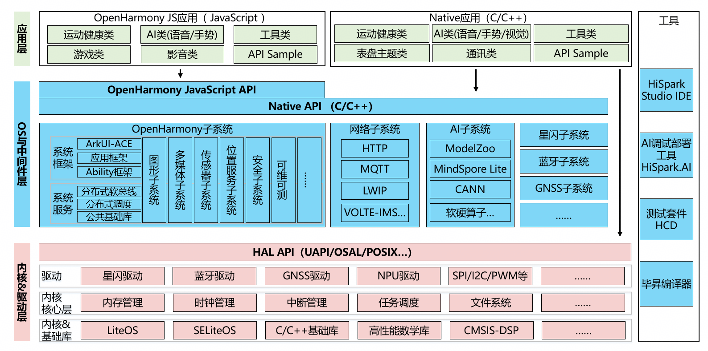

# HiDiTing 架构说明

---

## 简介

HiDiTing（谛听）是基于 Hi3322（RISC-V）芯片的轻智能终端SDK，运行 OpenHarmony 5.1。架构从上到下分为三个层次：**应用层 → OS 与中间件层 → 内核 & 驱动层**，最终对接 3322 SoC 硬件。

---

## 各层说明

### 应用层（Application Layer）

位于图示最顶部，分为两大类别：

- **品牌 / 业务应用**：运行品牌定制 App（健康、运动、消息等），通过 OpenHarmony JS API 调用系统能力。
- **工具 / 开发样例**：包含 HiSpark Studio IDE 集成工具链及 API Sample，供开发者验证接口行为。

向下通过 **OpenHarmony JavaScript API**（JS/ArkTS）和 **Native API**（C/C++）双通道与系统框架交互，屏蔽底层 OS 差异。

---

### OS 与中间件层

图示中间大区，融合 OpenHarmony 框架服务与平台中间件，按功能域划分为以下子系统：

**OpenHarmony**：HiDiTing 以 OpenHarmony 5.1 为操作系统基础，继承其分布式软总线、统一 JS/Native 双通道 API、Ability 管理等核心框架能力。上层各子系统的服务注册、进程间通信及权限管控均依托 OpenHarmony 框架运行，保证生态兼容性与开放性。

**图形子系统**：包含 GUI（UIKit / MinUI）轻量级 UI 渲染框架（面向表盘和应用界面）和 GPU（2D/3D 图形加速），共同构成端侧视觉呈现能力。

**AI 子系统**：AI Engine 提供端侧推理能力，支撑健康算法、手势识别等场景。

**多媒体子系统**：Media（Audio / VDEC）负责音频录制 / 播放与视频解码，核心能力以预编译闭源 `.a` 集成。

**蓝牙子系统**：BT / BLE 提供经典蓝牙和低功耗蓝牙协议栈，支撑手机互联和配件通信。

**星闪子系统**：SLE（SparkLink）为华为自研近场通信协议，面向低延时、高可靠的设备互联场景。

**可维可测**：NV 负责配置参数的持久化存储，DFX 提供故障诊断、日志采集和可测试性框架，保障设备全生命周期的可维护性。

**网络子系统**：基于 LwIP 轻量级 TCP/IP 协议栈，提供 IPv4 / IPv6 网络连接能力，支撑 Wi-Fi、蜂窝数据等上层业务的网络通信需求。

**等等......**

---

### 内核 & 驱动层

图示最底层，为上层所有软件提供运行基础：

- **LiteOS**：主内核，提供任务调度、内存管理、VFS，运行全部应用和中间件服务；
- **SeLiteOS（TEE）**：专用安全OS，提供安全存储、密钥管理和 PSA Crypto；
- **OSAL**：OS 抽象层，统一跨 LiteOS / Non-OS 等场景的线程、锁、消息接口；
- **HAL / Driver**：通过 `UAPI/GPIO/SPI/UART/…` 接口对接 3322 SoC 外设。
