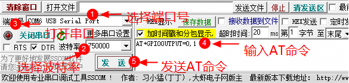
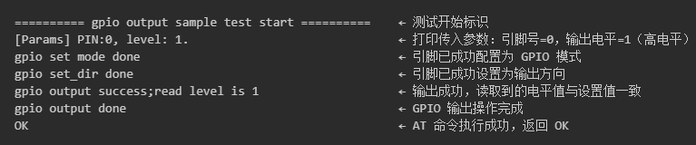
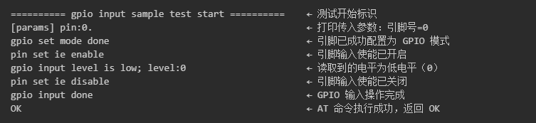
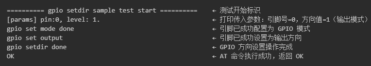
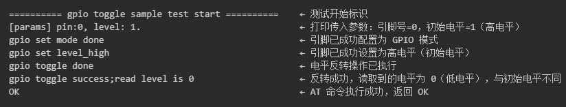
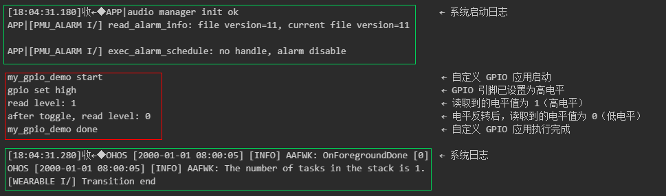
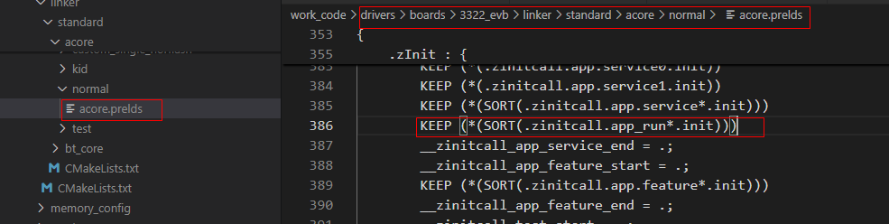

# GPIO 应用开发入门指南

本文档以 `gpio_demo` 为例，带你在 HiDiTing 开发板上快速跑通第一个 GPIO（通用输入输出）控制应用，并了解如何基于它构建自己的 demo。

---

## 目录

1. [GPIO 驱动背景知识](#1-gpio-驱动背景知识)
2. [快速跑通 GPIO Demo](#2-快速跑通-gpio-demo)
3. [文件结构与代码走读](#3-文件结构与代码走读)
4. [基于 GPIO Demo 新建自己的App](#4-基于-gpio-demo-新建自己的应用)
5. [注意事项](#5-注意事项)
6. [常见错误](#6-常见错误)
7. [社区贡献](#7-社区贡献)

---

## 1. GPIO 驱动背景知识

### 1.1 GPIO 工作原理

GPIO（通用输入输出）是微控制器最基本的数字接口，可配置为输入或输出模式：

| 功能 | 说明 | 应用场景 |
|---|---|---|
| **输出模式** | 通过软件控制引脚输出高电平或低电平 | 控制 LED、蜂鸣器、继电器 |
| **输入模式** | 读取引脚上的电平状态（高或低） | 读取按键、传感器信号、开关信号 |
| **设置方向** | 将引脚配置为输入模式或输出模式 | 动态切换引脚功能、复用引脚控制 |
| **电平反转** | 将当前输出电平取反 | 闪烁 LED、脉冲信号生成 |

**设置方向说明：**
- 设置方向是 GPIO 操作的基础步骤，决定了引脚是用于输出控制还是输入读取。
- 通过 `uapi_gpio_set_dir(pin, direction)` 接口配置：
  - `GPIO_DIRECTION_OUTPUT`：配置为输出模式
  - `GPIO_DIRECTION_INPUT`：配置为输入模式
- 在输出和电平反转操作前，必须先将引脚方向设置为输出模式。

### 1.2 操作流程

本示例支持四种 GPIO 操作，每种操作都遵循标准的初始化流程：

**通用初始化步骤（所有操作共享）：**
1. **PIN 初始化**：调用 `uapi_pin_init()` 初始化 PIN 模块。
2. **GPIO 初始化**：调用 `uapi_gpio_init()` 初始化 GPIO 模块。
3. **设置 GPIO 模式**：调用 `uapi_pin_set_mode(pin, PIN_MODE_0)` 将引脚配置为 GPIO 功能。

**各操作特有流程：**

| 操作 | 流程 |
|---|---|
| **GPIO 输出** | 设置方向为输出 → 设置输出电平 → 读取电平验证 |
| **GPIO 输入** | 使能输入 → 读取电平 → 关闭输入使能 |
| **设置方向** | 根据参数设置输出或输入方向 |
| **电平反转** | 设置方向为输出 → 设置初始电平 → 调用反转函数 → 读取电平验证 |

**接口说明**：本示例基于AT命令框架实现，通过串口发送AT指令控制GPIO，每个操作函数都封装了完整的初始化、配置、操作和验证流程。

### 1.3 电平值说明

| 宏定义 | 值 | 说明 |
|---|---|---|
| `GPIO_LEVEL_HIGH` | 1 | 高电平 |
| `GPIO_LEVEL_LOW` | 0 | 低电平 |

---

## 2. 快速跑通 GPIO Demo

### 功能说明

GPIO Demo 通过 AT 命令方式提供交互式控制，支持以下命令：

| AT 命令 | 功能 | 参数说明 |
|---|---|---|
| `AT+GPIOOUTPUT=pin,level` | GPIO 输出电平 | pin: 引脚号（0-5）, level:电平（ 0-1） |
| `AT+GPIOINPUT=pin` | GPIO 输入电平 | pin: 引脚号（0-5） |
| `AT+GPIOSETDIR=pin,dir` | 设置 GPIO 方向 | pin: 引脚号（0-5）, dir: 0(输入)/1(输出) |
| `AT+GPIOTOGGLE=pin,level` | GPIO 电平反转 | pin: 引脚号（0-5）, level:电平（ 0-1） |

### 编译

在 `sdk/` 目录下执行:

```bash
# 编译固件，编译生成的固件从 output/3322/fwpkggt 中获取 diting-community.fwpkg
./build.py pack_diting_community
```

### 使用方式

1. 烧录固件并启动设备
2. 通过串口发送 AT 命令，格式如下：

```bash
# GPIO 输出示例：设置 pin 0 输出高电平
AT+GPIOOUTPUT=0,1

# GPIO 输入示例：读取 pin 0 的电平
AT+GPIOINPUT=0

# 设置方向示例：将 pin 0 设置为输出
AT+GPIOSETDIR=0,1

# 电平反转示例：将 pin 0 从低电平反转为高电平
AT+GPIOTOGGLE=0,0
```



### 预期结果

### GPIO 输出（AT+GPIOOUTPUT）



### GPIO 输入（AT+GPIOINPUT）



### GPIO 设置方向（AT+GPIOSETDIR）



### GPIO 电平反转（AT+GPIOTOGGLE）



---

## 3. 文件结构与代码走读

### 3.1 文件结构

GPIO Demo 的文件位于以下路径：

```
/samples/native_samples/gpio/
├── gpio.c                # GPIO 示例主文件，包含 AT 命令处理函数
├── gpio.h                # GPIO 示例头文件，包含数据结构与命令表定义
└── CMakeLists.txt        # 编译配置
```

### 3.2 各文件职责

| 文件 | 职责 | 关键内容 |
|---|---|---|
| `gpio.c` | GPIO 示例主文件，包含四种 GPIO 操作的实现 | `at_gpio_output()`, `at_gpio_input()`, `at_gpio_setdir()`, `at_gpio_toggle()` |
| `gpio.h` | 头文件，定义数据结构、AT 命令表和函数声明 | `gpio_args_t`, `g_at_gpio_cmd_parse_table[]`, 函数声明 |
| `CMakeLists.txt` | 编译配置，定义源文件、头文件路径和编译选项 | `set(SOURCES ...)`, `build_component()` |

### 3.3 代码走读

#### 3.3.1 CMakeLists.txt 解析

```cmake
set(COMPONENT_NAME "gpio_sample")

set(SOURCES
    ${CMAKE_CURRENT_SOURCE_DIR}/gpio.c
)

set(PUBLIC_HEADER
    ${CMAKE_CURRENT_SOURCE_DIR}
)

set(PRIVATE_HEADER
    ${ROOT_DIR}/src/include/driver
    ${ROOT_DIR}/middleware/utils/at/at
    ${ROOT_DIR}/middleware/utils/at/at/include
    ${ROOT_DIR}/middleware/utils/at/at/src
)

set(PUBLIC_DEFINES
    AT_DITING_EXAMPLE_GPIO
)

set(WHOLE_LINK
    true
)

build_component()
```

**关键配置说明：**
- `COMPONENT_NAME`：组件名称为`gpio_sample`,需在`config.py`中的`diting-community`配置项下添加该组件名。
- `SOURCES`：指定源文件为 `gpio.c`。
- `PUBLIC_HEADER`：公开头文件路径，使其他模块可以引用 `gpio.h`。
- `PRIVATE_HEADER`：私有头文件路径，用于编译时查找依赖头文件。
- `WHOLE_LINK`：设置为 `true`，确保整个组件被链接。
- `PUBLIC_DEFINES`：定义宏 `AT_DITING_EXAMPLE_GPIO`，用于在AT命令适配层文件`at_adapter.c`中条件性的添加AT命令注册。
- 为使该`gpio`文件参与编译，还需在上层`CMakeLists.txt`文件中以宏`CONFIG_ENABLE_GPIO_SAMPLE`为条件添加该`gpio`文件。
- 宏`CONFIG_ENABLE_GPIO_SAMPLE`默认关闭。如需启用`GPIO`示例功能，需要在config.py中的`diting-community`配置项下将其打开。
- `config.py`的路径：`build/config/target_config/3322/config.py`
- `at_adapter.c`的路径：`middleware/chips/3322/at_adapter/at_adapter.c`

#### 3.3.2 gpio.h 解析

**数据结构定义：**

```c
typedef struct {
    uint32_t para_map;    // 参数映射
    uint32_t pin;         // GPIO 引脚号 (0-5)
    uint32_t level;       // 电平值 (0/1)
} gpio_args_t;

typedef struct {
    uint32_t pin;         // GPIO 引脚号
} gpio_intput_args_t;

typedef struct {
    uint32_t para_map;
    uint32_t pin;         // GPIO 引脚号 (0-5)
    uint32_t dir;         // 方向（0输入/1输出）
} gpio_setdir_args_t;

```

**参数语法定义：**

```c
// GPIO 输出/设置方向/反转的参数语法
const at_para_parse_syntax_t g_gpio_args_syntax[] = {
    {
        .type = AT_SYNTAX_TYPE_INT,
        .attribute = AT_SYNTAX_ATTR_AT_MIN_VALUE | AT_SYNTAX_ATTR_AT_MAX_VALUE,
        .entry.int_range.min_val = 0,
        .entry.int_range.max_val = 5,
        .offset = offsetof(gpio_args_t, pin)
    },
    {
        .type = AT_SYNTAX_TYPE_INT,
        .last = true,
        .attribute = AT_SYNTAX_ATTR_AT_MIN_VALUE | AT_SYNTAX_ATTR_AT_MAX_VALUE,
        .entry.int_range.min_val = 0,
        .entry.int_range.max_val = 1,
        .offset = offsetof(gpio_args_t, level)
    },
};

// GPIO 输入的参数语法
const at_para_parse_syntax_t g_gpio_input_args_syntax[] = {
    {
        .type = AT_SYNTAX_TYPE_INT,
        .last = true,
        .attribute = AT_SYNTAX_ATTR_AT_MIN_VALUE | AT_SYNTAX_ATTR_AT_MAX_VALUE,
        .entry.int_range.min_val = 0,
        .entry.int_range.max_val = 5,
        .offset = offsetof(gpio_intput_args_t, pin)
    },
};
```

**AT 命令表定义：**

```c
const at_cmd_entry_t g_at_gpio_cmd_parse_table[] = {
    {
        "GPIOOUTPUT",       // 命令名称
        0x2260,             // 命令 ID
        0,                  // 保留
        g_gpio_args_syntax, // 参数语法
        NULL,               // 查询函数
        (at_set_func_t)at_gpio_output,  // 设置函数
        NULL,               // 执行函数
        NULL,               // 保留
    },
    {
        "GPIOINPUT",
        0x2261,
        0,
        g_gpio_input_args_syntax,
        NULL,
        (at_set_func_t)at_gpio_input,
        NULL,
        NULL,
    },
    {
        "GPIOSETDIR",
        0x2262,
        0,
        g_gpio_setdir_args_syntax,
        NULL,
        (at_set_func_t)at_gpio_setdir,
        NULL,
        NULL,
    },
    {
        "GPIOTOGGLE",
        0x2263,
        0,
        g_gpio_args_syntax,
        NULL,
        (at_set_func_t)at_gpio_toggle,
        NULL,
        NULL,
    },
};
```

**函数声明：**

```c
void at_diting_gpio_example_cmd_register(void);
at_ret_t at_gpio_output(gpio_args_t *args);
at_ret_t at_gpio_input(gpio_intput_args_t *args);
at_ret_t at_gpio_setdir(gpio_setdir_args_t *args);
at_ret_t at_gpio_toggle(gpio_args_t *args);
```

#### 3.3.3 命令注册函数

```c
void at_diting_gpio_example_cmd_register(void)
{
    uapi_at_cmd_table_register(g_at_gpio_cmd_parse_table, AT_GPIO_FUNC_NUM, EXT_AT_GPIO_CMD_MAX_LEN);
}
```

**代码逻辑解析：**
- 调用 `uapi_at_cmd_table_register` 注册 GPIO 命令表。
- `g_at_gpio_cmd_parse_table`：命令表数组。
- `AT_GPIO_FUNC_NUM`：命令数量（通过宏计算数组大小）。
- `EXT_AT_GPIO_CMD_MAX_LEN`：命令最大长度（128）。

#### 3.3.4 初始化
```c
static errcode_t gpio_common_init(uint32_t pin)
{
    // pin初始化
    uapi_pin_init();
    // gpio初始化
    uapi_gpio_init();
    // 设置为gpio模式
    errcode_t ret = ERRCODE_SUCC;
    ret = uapi_pin_set_mode(pin, PIN_MODE_0);
    if (ret != ERRCODE_SUCC) {
        printf("gpio set mode failed\n");
        return AT_RET_RUN_ERROR;
    } else {
        printf("gpio set mode done\n");
    }

    return ret;
}
```

#### 3.3.5 初始化
```c
static errcode_t gpio_common_deinit(void)
{
    // pin去初始化
    uapi_pin_deinit();
    // gpio去初始化
    uapi_gpio_deinit();

    return ERRCODE_SUCC;
}
```

#### 3.3.6 at_gpio_output —— GPIO 输出

```c
at_ret_t at_gpio_output(gpio_args_t *args)
{
    printf("========== gpio output sample test start ==========\n");
    uint32_t pin = (uint32_t)args->pin;
    uint32_t level = (uint32_t)args->level;
    printf("[params] pin:%d, level: %d.\n", (uint32_t)pin, (uint32_t)level);
    // step1: pin和gpio初始化,设置为gpio模式
    errcode_t ret = gpio_common_init(pin);
    if (ret != ERRCODE_SUCC) {
        gpio_common_deinit();
        return AT_RET_RUN_ERROR;
    }
    // step2: 设置为输出模式
    uapi_gpio_set_dir(pin, GPIO_DIRECTION_OUTPUT);
    printf("gpio set_dir done\n");
    // step3: 输出电平
    ret = uapi_gpio_set_val(pin, level);
    if (ret != ERRCODE_SUCC) {
        printf("gpio operate failed , ret = 0x%x\n", ret);
        gpio_common_deinit();
        return AT_RET_RUN_ERROR;
    }
    gpio_level_t read_level;
    // step4: 读取电平
    read_level = uapi_gpio_get_val(pin);
    // step5: 判断输出是否成功
    if (read_level == (gpio_level_t)level) {
        printf("gpio output success;read level is %d\n", read_level);
    } else {
        printf("gpio output failed;read level is %d\n", read_level);
        gpio_common_deinit();
        return AT_RET_RUN_ERROR;
    }
    printf("gpio output done\n");
    // step6: 去初始化
    gpio_common_deinit();

    return AT_RET_OK;
}
```

#### 3.3.7 at_gpio_input —— GPIO 输入

```c
at_ret_t at_gpio_input(gpio_intput_args_t *args)
{
    printf("========== gpio input sample test start ==========\n");
    uint32_t pin = (uint32_t)args->pin;
    printf("[params] pin:%d.\n", pin);
    // step1: pin和gpio初始化,设置为gpio模式
    errcode_t ret = gpio_common_init(pin);
    if (ret != ERRCODE_SUCC) {
        gpio_common_deinit();
        return AT_RET_RUN_ERROR;
    }
    // step2: 设置pin脚的输入使能
    uapi_pin_set_ie(pin, PIN_IE_ENABLE);
    printf("pin set ie enable\n");
    gpio_level_t gpio_level;
    // step3: 读取电平
    gpio_level = uapi_gpio_get_val(pin);
    // step4: 判断输入的是高电平/低电平
    if (gpio_level == GPIO_LEVEL_HIGH) {
        printf("gpio input level is high; level:1\n");
    } else {
        printf("gpio input level is low; level:0\n");
    }
    // step5: 关闭输入使能
    uapi_pin_set_ie(pin, PIN_IE_DISABLE);
    printf("pin set ie disable\n");
    printf("gpio input done\n");
    // step6: 去初始化
    gpio_common_deinit();

    return AT_RET_OK;
}
```

#### 3.3.8 at_gpio_setdir —— 设置方向

```c
at_ret_t at_gpio_setdir(gpio_setdir_args_t *args)
{
    printf("========== gpio setdir sample test start ==========\n");
    uint32_t pin = (uint32_t)args->pin;
    uint32_t dir = (uint32_t)args->dir;
    printf("[params] pin:%d, dir: %d.\n", (uint32_t)pin, (uint32_t)dir);
    // step1: pin和gpio初始化,设置为gpio模式
    errcode_t ret = gpio_common_init(pin);
    if (ret != ERRCODE_SUCC) {
        gpio_common_deinit();
        return AT_RET_RUN_ERROR;
    }
    // step2: 设置方向
    if (dir == 1) {
        ret = uapi_gpio_set_dir(pin, GPIO_DIRECTION_OUTPUT);
        printf("gpio set output\n");
    } else if (dir == 0) {
        ret = uapi_gpio_set_dir(pin, GPIO_DIRECTION_INPUT);
        printf("gpio set input\n");
    } else {
        gpio_common_deinit();
        return AT_RET_RUN_ERROR;
    }
    if (ret != ERRCODE_SUCC) {
        printf("gpio operate failed , ret = 0x%x\n", ret);
        gpio_common_deinit();
        return AT_RET_RUN_ERROR;
    }
    printf("gpio setdir done\n");
    // step6: 去初始化
    gpio_common_deinit();

    return AT_RET_OK;
}
```

#### 3.3.9 at_gpio_toggle —— 电平反转

```c
at_ret_t at_gpio_toggle(gpio_args_t *args)
{
    printf("========== gpio toggle sample test start ==========\n");
    uint32_t pin = (uint32_t)args->pin;
    uint32_t level = (uint32_t)args->level;
    printf("[params] pin:%d, level: %d.\n", (uint32_t)pin, (uint32_t)level);
    // step1: pin和gpio初始化,设置为gpio模式
    errcode_t ret = gpio_common_init(pin);
    if (ret != ERRCODE_SUCC) {
        gpio_common_deinit();
        return AT_RET_RUN_ERROR;
    }
    // step2: 设置为输出模式
    ret = uapi_gpio_set_dir(pin, GPIO_DIRECTION_OUTPUT);
    if (ret != ERRCODE_SUCC) {
        gpio_common_deinit();
        return AT_RET_RUN_ERROR;
    }
    // step3: 设置指定GPIO电平状态
    if (level == 1) {
        uapi_gpio_set_val(pin, GPIO_LEVEL_HIGH);
        printf("gpio set level_high\n");
    } else if (level == 0) {
        uapi_gpio_set_val(pin, GPIO_LEVEL_LOW);
        printf("gpio set level_low\n");
    } else {
        gpio_common_deinit();
        return AT_RET_RUN_ERROR;
    }
    // step4: 电平反转
    ret = uapi_gpio_toggle(pin);
    if (ret != ERRCODE_SUCC) {
        gpio_common_deinit();
        return AT_RET_RUN_ERROR;
    } else {
        printf("gpio toggle done\n");
    }
    gpio_level_t gpio_level;
    // step5: 读取电平
    gpio_level = uapi_gpio_get_val(pin);
    // step6: 判断反转是否成功
    if (gpio_level != (gpio_level_t)level) {
        printf("gpio toggle success;read level is %d\n", gpio_level);
    } else {
        printf("gpio toggle failed;read level is %d\n", gpio_level);
        gpio_common_deinit();
        return AT_RET_RUN_ERROR;
    }
    // step6: 去初始化
    gpio_common_deinit();

    return AT_RET_OK;
}
```

**返回值说明**

| 返回值 | 说明 |
|---|---|
| `AT_RET_OK` | 操作成功 |
| `AT_RET_RUN_ERROR` | 运行时错误 |
---

## 4. 基于 GPIO Demo 新建自己的demo

**上面的demo是使用AT指令触发运行，HiDiTing还支持app_run方式触发应用在系统启动时自动运行，以下示例将以app_run的方式开发一个开发者自己的应用**

- app_run(func) 是HiDiTing中应用层注册应用函数的宏，基于 GCC 编译器属性和自定义段区（section）自动注册来实现集中调用应用函数，系统启动时会自动遍历所有用 app_run 注册过的函数并执行，无需在 系统 main 函数里逐个调用函数。

### 4.1 代码清单

新建一个 GPIO 控制应用（以 `my_gpio_demo` 为例）通常只需要以下改动：

- [ ] 新建 `my_gpio_demo.c` 源文件
- [ ] 新建 `my_gpio_demo.h` 头文件
- [ ] 新建 `CMakeLists.txt` 源文件
- [ ] 在 `my_gpio_demo.c` 中实现GPIO操作函数
- [ ] 在 `my_gpio_demo.h` 中定义宏常量和函数声明
- [ ] 在 `CMakeLists.txt` 源文件编译规则

`my_gpio_demo`文件结构：
```
/samples/native_samples/my_gpio_demo/
├── my_gpio_demo.c
├── my_gpio_demo.h
└── CMakeLists.txt
```

### 4.2 CMakeLists.txt 修改示例

```cmake
# 在新建的 CMakeLists.txt 中添加应用的源文件
set(SOURCES
    ${CMAKE_CURRENT_SOURCE_DIR}/my_gpio_demo.c
)

set(PUBLIC_HEADER
    ${CMAKE_CURRENT_SOURCE_DIR}
)

set(PRIVATE_HEADER

)

set(PUBLIC_DEFINES
    MY_GPIO_DEMO_ENABLE
)

build_component()
```

### 4.3 关键代码片段

**my_gpio_demo.c** —— GPIO 控制实现

```c
#include "my_gpio_demo.h"
#include "pinctrl.h"
#include "pinctrl_porting.h"
#include "errcode.h"
#include "hal_gpio.h"
#include "debug_print.h"
#include "driver/gpio.h"
#include "driver/pinctrl.h"
#include "app_init.h"
#include "soc_osal.h"

#define GPIO_TEST_PIN    1   // 测试使用的引脚号
#define TASK_PRIO        26
#define TASK_STACK_SIZE  0x1000

static void *my_gpio_task(const char *arg)
{
    unused(arg);
    printf("my_gpio_demo start\n");

    // 初始化
    uapi_pin_init();
    uapi_gpio_init();
    uapi_pin_set_mode(GPIO_TEST_PIN, PIN_MODE_0);
    
    // 设置为输出模式
    uapi_gpio_set_dir(GPIO_TEST_PIN, GPIO_DIRECTION_OUTPUT);
    
    // 输出高电平
    uapi_gpio_set_val(GPIO_TEST_PIN, GPIO_LEVEL_HIGH);
    printf("gpio set high\n");
    
    // 读取并验证
    gpio_level_t level = uapi_gpio_get_val(GPIO_TEST_PIN);
    printf("read level: %d\n", level);
    
    // 翻转电平
    uapi_gpio_toggle(GPIO_TEST_PIN);
    level = uapi_gpio_get_val(GPIO_TEST_PIN);
    printf("after toggle, read level: %d\n", level);
    
    printf("my_gpio_demo done\n");
    return NULL;
}

static void my_gpio_entry(void)
{
    osal_task *task_handle = NULL;
    osal_kthread_lock();
    task_handle = osal_kthread_create((osal_kthread_handler)my_gpio_task, 0, "MyGpioTask", TASK_STACK_SIZE);
    if (task_handle != NULL) {
        osal_kthread_set_priority(task_handle, TASK_PRIO);
    }
    osal_kthread_unlock();
}

app_run(my_gpio_entry);

```

### 4.4 测试验证

在 `sdk/` 目录下执行:

```bash
# 编译固件，编译生成的固件从 output/3322/fwpkggt 中获取 diting-community.fwpkg
./build.py pack_diting_community
```
1. 烧录固件并启动设备
2. 通过串口观察输出日志：



**说明**
- 因为`app_run`是在系统启动时运行应用，所以应用的运行日志会被夹在开机启动日志中。

- 为使该`gpio`应用参与编译，还需在上层`CMakeLists.txt`文件中以宏`MY_GPIO_DEMO_ENABLE`为条件添加该`my_gpio_demo`文件。
- 宏`MY_GPIO_DEMO_ENABLE`默认关闭。如需启用新建`GPIO`示例功能，需要在`config.py`中的`diting-community`配置项下将其打开。

### 4.5 app_run运行配置

`app_run`应用默认是关闭的，如需启用此应用，需用户手动在`acore.prelds`文件中添加   `KEEP (*(SORT(.zinitcall.app_run*.init)))`  具体参考示意图如下：



`acore.prelds`路径：drivers/boards/3322_evb/linker/standard/acore/normal/acore.prelds

---

## 5. 注意事项

**引脚配置注意事项：**

- GPIO 引脚号范围为 0-5，具体引脚对应的物理引脚请参考芯片手册。
- 使用前必须依次调用 `uapi_pin_init()` 和 `uapi_gpio_init()` 完成初始化。
- 必须调用 `uapi_pin_set_mode(pin, PIN_MODE_0)` 将引脚配置为 GPIO 模式。

**输入模式注意事项：**

- 读取输入电平前，必须调用 `uapi_pin_set_ie(pin, PIN_IE_ENABLE)` 使能输入功能。
- 读取完成后，建议调用 `uapi_pin_set_ie(pin, PIN_IE_DISABLE)` 关闭输入使能。

**电平反转注意事项：**

- 反转操作前必须将引脚设置为输出模式。
- 反转后的电平应与初始电平不同，否则操作失败。

**AT 命令注意事项：**

- 命令名称为大写字母，如 `GPIOOUTPUT`。
- 参数使用逗号分隔，如 `AT+GPIOOUTPUT=0,1`。
- 参数范围：pin 为 0-5，level 为 0/1。

---

## 6. 常见错误

| 错误现象 | 原因 | 解决方法 |
|---|---|---|
| `undefined reference to 'uapi_gpio_init'` | 未链接 GPIO 驱动库 | 检查 CMakeLists.txt 中是否正确添加了头文件路径 |
| `undefined reference to 'uapi_at_cmd_table_register'` | 未链接 AT 命令库 | 检查 CMakeLists.txt 中是否正确添加了 AT 相关头文件路径 |
| 编译报 `at_ret_t` 未定义 | 未包含 `at.h` 头文件 | 添加 `#include "at.h"` |
| 串口无输出 | AT 命令未注册 | 确认调用了 `at_diting_gpio_example_cmd_register()` |
| 引脚无响应 | 引脚未正确初始化 | 确认依次调用了 `uapi_pin_init()`、`uapi_gpio_init()`、`uapi_pin_set_mode()` |
| 输入读取异常 | 输入使能未开启 | 确认调用了 `uapi_pin_set_ie(pin, PIN_IE_ENABLE)` | |

---

## 7. 社区贡献

向社区贡献代码时，PR 描述建议包含：

```
## 改动说明
新增 <AppName> GPIO 示例应用，展示基于 AT 命令的 GPIO 控制功能。

## 验证结果
- [ ] build.py pack_diting_community 通过
- [ ] 串口发送 AT 命令，GPIO 输出/输入/设置方向/反转功能正常

## 影响范围
仅新增 <demoname>.c 和 <demoname>.h 文件及对应 CMakeLists.txt 修改，未修改其他模块。
```
---