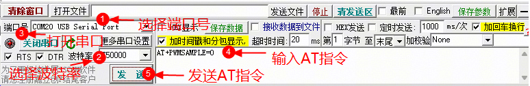
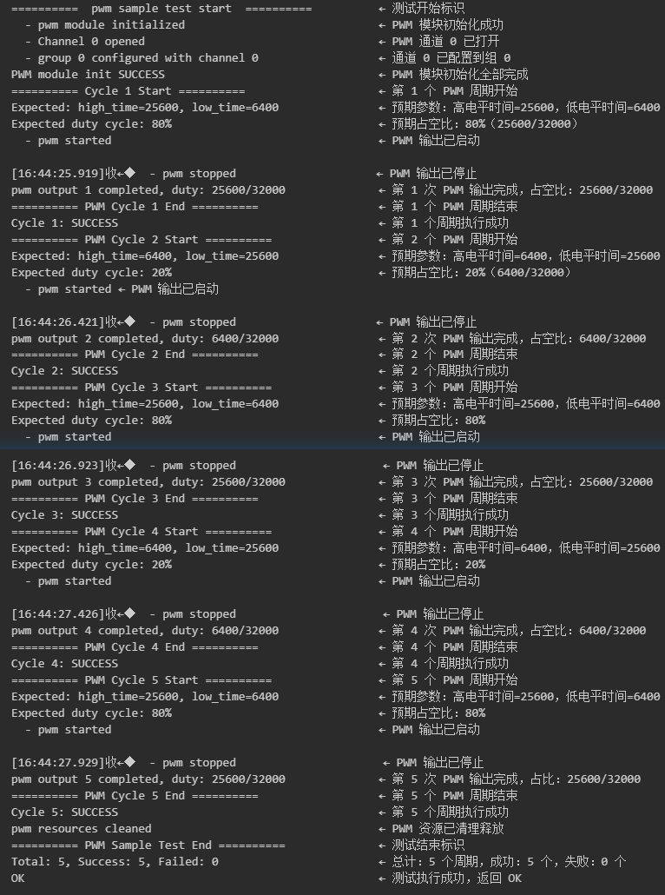
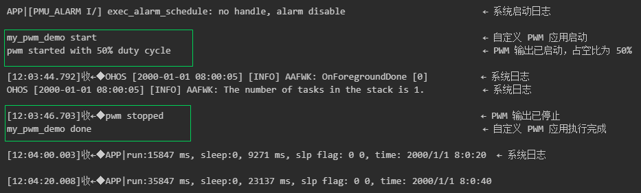
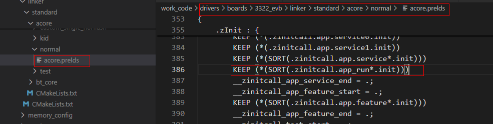

# PWM 应用开发入门指南

本文档以 `pwm_demo.c` 为例，带你在 FBB Diting 可穿戴开发板上快速跑通第一个 PWM（脉冲宽度调制）控制应用，并了解如何基于它构建自己的 demo。

---

## 目录

1. [PWM 驱动背景知识](#1-pwm-驱动背景知识)
2. [快速跑通 PWM Demo](#2-快速跑通-pwm-demo)
3. [文件结构与代码走读](#3-文件结构与代码走读)
4. [基于 PWM Demo 新建自己的应用](#4-基于-pwm-demo-新建自己的应用)
5. [注意事项](#5-注意事项)
6. [常见编译错误](#6-常见编译错误)
7. [社区贡献](#7-社区贡献)

---

## 1. PWM 驱动背景知识

### 1.1 PWM工作原理

PWM（脉冲宽度调制）是一种通过调节脉冲宽度（占空比）来控制输出功率的数字调制技术。PWM 信号由高电平和低电平两部分组成，通过调整高电平时间与周期的比例（即占空比）来控制输出效果。

| 参数 | 说明 | 应用场景 |
|---|---|---|
| **占空比** | 高电平时间与总周期的比例 | 调节 LED 亮度、电机转速、蜂鸣器音量 |
| **频率** | 每秒脉冲周期数 | 决定 PWM 信号的基频 |
| **相位偏移** | 信号的起始相位偏移量 | 多通道 PWM 同步控制 |
| **连续/非连续模式** | 是否持续输出 PWM 信号 | 连续模式用于持续控制，非连续模式用于单次触发 |

**占空比说明：**
- 占空比 = high_time / (high_time + low_time) × 100%
- 本示例中，1KHz 频率对应的时钟周期数为 32000，因此：
  - 80% 占空比：high_time = 25600，low_time = 6400
  - 20% 占空比：high_time = 6400，low_time = 25600

### 1.2 操作流程

本示例通过 AT 命令触发 PWM 输出测试，演示了完整的 PWM 操作流程：

**PWM 初始化流程：**
1. **引脚配置**：调用 `uapi_pin_set_mode()` 将引脚配置为 PWM 功能模式。
2. **PWM 初始化**：调用 `uapi_pwm_init()` 初始化 PWM 模块。
3. **打开通道**：调用 `uapi_pwm_open()` 打开指定 PWM 通道并配置初始参数。
4. **配置组**：调用 `uapi_pwm_set_group()` 将通道添加到指定组。

**PWM 输出流程（循环 5 次）：**
1. **预加载配置**：调用 `uapi_pwm_config_preload()` 设置新的占空比参数。
2. **启动输出**：调用 `uapi_pwm_start_group()` 启动 PWM 组输出。
3. **延时输出**：调用 `uapi_tcxo_delay_ms(500)` 持续输出 500ms。
4. **停止输出**：调用 `uapi_pwm_stop_group()` 停止 PWM 组输出。

**PWM 资源清理流程：**
1. **关闭通道**：调用 `uapi_pwm_close()` 关闭 PWM 通道。
2. **去初始化**：调用 `uapi_pwm_deinit()` 释放 PWM 资源。

### 1.3 关键参数说明

| 宏定义 | 值 | 说明 |
|---|---|---|
| `PWM_FREQ_1KHZ` | 32000 | 1KHz 对应的时钟周期数 |
| `PWM_DUTY_80PCT` | 25600 | 80% 占空比的高电平时间 |
| `PWM_DUTY_20PCT` | 6400 | 20% 占空比的高电平时间 |
| `PWM_OFFSET_0` | 0 | 相位偏移为 0 |
| `PWM_CYCLES_CONTINUOUS` | 0 | 0 表示连续输出模式 |
| `CONFIG_PWM_CHANNEL` | 0 | PWM 通道号 |
| `CONFIG_PWM_GROUP_ID` | 0 | PWM 组 ID |
| `CONFIG_PWM_PIN` | 34 | PWM 输出引脚 |
| `CONFIG_PWM_PIN_MODE` | 1 | PWM 功能对应的引脚复用模式 |

---

## 2. 快速跑通 PWM Demo

### 功能说明

PWM Demo 通过 AT 命令方式提供交互式控制，支持以下命令：

| AT 命令 | 功能 | 参数说明 |
|---|---|---|
| `AT+PWMSAMPLE=0` | 执行 PWM 输出测试 | 参数固定为 0，无需实际解析 |

### 编译

在 `sdk/` 目录下执行:

```bash
# 编译固件，编译生成的固件从 output/3322/fwpkggt 中获取 diting-community.fwpkg
./build.py pack_diting_community
```

### 使用方式

1. 烧录固件并启动设备
2. 通过串口发送 AT 命令，格式如下：

```bash
# 执行 PWM 输出测试
AT+PWMSAMPLE=0
```



### 预期结果

### PWM 输出测试（AT+PWMSAMPLE）

执行后，设备会依次输出 5 次不同占空比的 PWM 信号，每次持续 500ms：



---

## 3. 文件结构与代码走读

### 3.1 文件结构

PWM Demo 的文件位于以下路径：

```
/samples/native_samples/pwm/
├── pwm_demo.c                # PWM 示例主文件，包含 PWM 操作实现
├── pwm_demo.h                # PWM 示例头文件，包含数据结构与命令表定义
└── CMakeLists.txt            # 编译配置
```

### 3.2 各文件职责

| 文件 | 职责 | 关键内容 |
|---|---|---|
| `pwm_demo.c` | PWM 示例主文件，包含 PWM 初始化、输出、资源清理的实现 | `pwm_module_init()`, `pwm_single_output()`, `pwm_module_deinit()`, `at_pwm_sample()` |
| `pwm_demo.h` | 头文件，定义宏常量、AT 命令表和函数声明 | `PWM_DUTY_80PCT`, `PWM_DUTY_20PCT`, `g_at_pwm_cmd_parse_table[]`, 函数声明 |
| `CMakeLists.txt` | 编译配置，定义源文件、头文件路径和编译选项 | `set(SOURCES ...)`, `build_component()` |

### 3.3 代码走读

#### 3.3.1 CMakeLists.txt 解析

```cmake
set(COMPONENT_NAME "pwm_sample")

set(SOURCES
    ${CMAKE_CURRENT_SOURCE_DIR}/pwm_demo.c
)

set(PUBLIC_HEADER
    ${CMAKE_CURRENT_SOURCE_DIR}
)

set(PRIVATE_HEADER
    ${ROOT_DIR}/src/include/driver
    ${ROOT_DIR}/middleware/utils/at/at
    ${ROOT_DIR}/middleware/utils/at/at/include
    ${ROOT_DIR}/middleware/utils/at/at/src
)

set(PRIVATE_DEFINES
)

set(PUBLIC_DEFINES
    AT_DITING_EXAMPLE_PWM
)

set(COMPONENT_CCFLAGS
    -Wincompatible-function-pointer-types
)

set(WHOLE_LINK
    true
)

set(MAIN_COMPONENT
    false
)

build_component()

install_sdk(${CMAKE_CURRENT_SOURCE_DIR} "*.h")
```

**关键配置说明：**
- `COMPONENT_NAME`：组件名称为`pwm_sample`,需在`config.py`中的`diting-community`配置项下添加该组件名。
- `SOURCES`：指定源文件为 `pwm_demo.c`。
- `PUBLIC_HEADER`：公开头文件路径，使其他模块可以引用 `pwm_demo.h`。
- `PRIVATE_HEADER`：私有头文件路径，用于编译时查找依赖头文件。
- `WHOLE_LINK`：设置为 `true`，确保整个组件被链接。
- `MAIN_COMPONENT`：设置为 `false`，表示非主组件。
- `COMPONENT_CCFLAGS`：添加编译选项 `-Wincompatible-function-pointer-types` 用于检查函数指针类型兼容性。
- `PUBLIC_DEFINES`：定义宏 `AT_DITING_EXAMPLE_PWM`，用于在AT命令适配层文件`at_adapter.c`中条件性的添加AT命令注册。
- 为使该`pwm`文件参与编译，还需在上层CMakeLists.txt文件中以宏`CONFIG_ENABLE_PWM_SAMPLE`为条件添加该`pwm`文件。
- 宏`CONFIG_ENABLE_PWM_SAMPLE`默认关闭。如需启用`PWM`示例功能，需要在config.py中的`diting-community`配置项下将其打开。
- `config.py`的路径：`build/config/target_config/3322/config.py`
- `at_adapter.c`的路径：`middleware/chips/3322/at_adapter/at_adapter.c`

#### 3.3.2 pwm_demo.h 解析

**宏定义：**

```c
#define EXT_AT_PWM_CMD_MAX_LEN   128           // AT 命令最大长度

#define AT_PWM_FUNC_NUM (sizeof(g_at_pwm_cmd_parse_table) / sizeof(g_at_pwm_cmd_parse_table[0]))  // 命令数量

#define PWM_FREQ_1KHZ           32000          // 1KHz对应的时钟周期数
#define PWM_DUTY_80PCT          25600          // 80%占空比
#define PWM_DUTY_20PCT          6400           // 20%占空比
#define PWM_OFFSET_0            0              // 相位偏移
#define PWM_CYCLES_CONTINUOUS   0              // 0表示连续输出
#define PWM_CFG_CHANGE_COUNT    5              // 占空比变化次数
#define CONFIG_PWM_PIN_MODE     1              // PWM功能对应的引脚复用模式
#define CONFIG_PWM_CHANNEL      0              // PWM通道号
#define CONFIG_PWM_GROUP_ID     0              // PWM组ID
#define CONFIG_PWM_PIN          34             // PWM输出引脚
#define PWM_CYCLE_MODULO        2              // 占空比变化周期模数
#define PWM_DUTY_CYCLE_HIGH     80             // 高占空比百分比
#define PWM_DUTY_CYCLE_LOW      20             // 低占空比百分比
```

**AT 命令表定义：**

```c
static const at_cmd_entry_t g_at_pwm_cmd_parse_table[] = {
    // AT+PWMSAMPLE=0
    {
        "PWMSAMPLE",        // 命令名称
        0x2264,             // 命令 ID
        0,                  // 保留
        NULL,               // 参数语法（无参数）
        NULL,               // 查询函数
        (at_set_func_t)at_pwm_sample,  // 设置函数
        NULL,               // 执行函数
        NULL,               // 保留
    },
};
```

**函数声明：**

```c
void at_diting_pwm_example_cmd_register(void);
at_ret_t at_pwm_sample(void);
```

#### 3.3.3 命令注册函数

```c
void at_diting_pwm_example_cmd_register(void)
{
    uapi_at_cmd_table_register(g_at_pwm_cmd_parse_table, AT_PWM_FUNC_NUM, EXT_AT_PWM_CMD_MAX_LEN);
}
```

**代码逻辑解析：**
- 调用 `uapi_at_cmd_table_register` 注册 PWM 命令表。
- `g_at_pwm_cmd_parse_table`：命令表数组。
- `AT_PWM_FUNC_NUM`：命令数量（通过宏计算数组大小）。
- `EXT_AT_PWM_CMD_MAX_LEN`：命令最大长度（128）。

#### 3.3.4 pwm_module_init —— PWM 模块初始化

```c
static errcode_t pwm_module_init(void)
{
    // step1: 配置PWM引脚模式
    errcode_t ret = uapi_pin_set_mode(CONFIG_PWM_PIN, CONFIG_PWM_PIN_MODE);
    if (ret != ERRCODE_SUCC) {
        printf("error: pwm set mode failed\n");
    }
    // step2: 初始化PWM模块
    ret = uapi_pwm_init();
    if (ret != ERRCODE_SUCC) {
        printf("error: pwm init failed, ret=%d\n", ret);
        return ret;
    }
    printf("  - pwm module initialized\n");

    // step3: 配置PWM通道初始参数
    pwm_config_t cfg_no_repeat = {
        .low_time = PWM_DUTY_20PCT,           // 20%占空比
        .high_time = PWM_DUTY_80PCT,          // 80%占空比
        .offset_time = PWM_OFFSET_0,          // 相位偏移为0
        .cycles = PWM_CYCLES_CONTINUOUS,      // 连续输出
        .repeat = false                       // 非连续模式
    };
    
    // step4: 打开PWM通道
    ret = uapi_pwm_open(CONFIG_PWM_CHANNEL, &cfg_no_repeat);
    if (ret != ERRCODE_SUCC) {
        printf("error: pwm open channel %d failed, ret=%d\n", CONFIG_PWM_CHANNEL, ret);
        return ret;
    }
    printf("  - Channel %d opened\n", CONFIG_PWM_CHANNEL);

    // step5: 将通道添加到PWM组中
    uint8_t channel_id = CONFIG_PWM_CHANNEL;
    ret = uapi_pwm_set_group(CONFIG_PWM_GROUP_ID, &channel_id, 1);
    if (ret != ERRCODE_SUCC) {
        printf("error: PWM set group failed, ret=%d\n", ret);
        return ret;
    }
    printf("  - group %d configured with channel %d\n", CONFIG_PWM_GROUP_ID, channel_id);
    
    return ERRCODE_SUCC;
}
```

#### 3.3.5 pwm_single_output —— 单次 PWM 输出

```c
static errcode_t pwm_single_output(uint32_t cycle_index)
{
    errcode_t ret;
    printf("========== PWM Cycle %u Start ==========\n", cycle_index + 1);
    
    // step1: 配置新的PWM参数
    pwm_config_t pwm_cfg = {
        .low_time = (cycle_index % 2 == 0) ? PWM_DUTY_20PCT : PWM_DUTY_80PCT,
        .high_time = (cycle_index % 2 == 0) ? PWM_DUTY_80PCT : PWM_DUTY_20PCT,
        .offset_time = PWM_OFFSET_0,
        .cycles = PWM_CYCLES_CONTINUOUS,
        .repeat = true
    };
    
    printf("Expected: high_time=%u, low_time=%u\n", pwm_cfg.high_time, pwm_cfg.low_time);
    printf("Expected duty cycle: %u%%\n",
    (cycle_index % PWM_CYCLE_MODULO == 0) ? PWM_DUTY_CYCLE_HIGH : PWM_DUTY_CYCLE_LOW);

    // step2：预加载新的PWM配置
    ret = uapi_pwm_config_preload(CONFIG_PWM_GROUP_ID, CONFIG_PWM_CHANNEL, &pwm_cfg);
    if (ret != ERRCODE_SUCC) {
        printf("error: pwm config preload failed, ret=%d\n", ret);
        return ret;
    }

    // step3: 启动PWM组输出
    ret = uapi_pwm_start_group(CONFIG_PWM_GROUP_ID);
    if (ret != ERRCODE_SUCC) {
        printf("error: pwm start group failed, ret=%d\n", ret);
        return ret;
    }
    printf("  - pwm started\n");

    // 输出一段时间（例如500ms）
    uapi_tcxo_delay_ms(500);
    
    // step4: 停止PWM组输出
    ret = uapi_pwm_stop_group(CONFIG_PWM_GROUP_ID);
    if (ret != ERRCODE_SUCC) {
        printf("error: pwm stop group failed, ret=%d\n", ret);
        return ret;
    }
    printf("  - pwm stopped\n");

    printf("pwm output %u completed, duty: %u/%u\n",
          cycle_index + 1,
          pwm_cfg.high_time,
          pwm_cfg.high_time + pwm_cfg.low_time);
    printf("========== PWM Cycle %u End ==========\n", cycle_index + 1);

    return ERRCODE_SUCC;
}
```
**特别说明**

- `uapi_pwm_config_preload`这个函数得需要宏`CONFIG_PWM_PRELOAD`启用才生效，因此需在config.py中的`diting-community`配置项下将其打开。

#### 3.3.6 pwm_module_deinit —— PWM 资源清理

```c
static void pwm_module_deinit(void)
{
    uapi_pwm_close(CONFIG_PWM_CHANNEL);
    uapi_pwm_deinit();
    printf("pwm resources cleaned up\n");
}
```

**代码逻辑解析：**
1. 调用 `uapi_pwm_close()` 关闭 PWM 通道。
2. 调用 `uapi_pwm_deinit()` 去初始化 PWM 模块。

#### 3.3.7 at_pwm_sample —— PWM 示例主函数

```c
at_ret_t at_pwm_sample(void)
{
    errcode_t ret;
    uint32_t i;
    uint32_t success_count = 0;
    uint32_t fail_count = 0;
    printf("==========  pwm sample test start  ==========\n");
    
    // step1: 初始化PWM模块
    ret = pwm_module_init();
    if (ret ERRCODE_SUCC) {
        printf("error: pwm module init failed,ret=%d\n", ret);
        return AT_RET_RUN_ERROR;
    }
    printf("PWM module init SUCCESS\n");
    
    // step2: 循环5次，每次改变占空比
    for (i = 0; i < PWM_CFG_CHANGE_COUNT; i++) {
        ret = pwm_single_output(i);
        if (ret == ERRCODE_SUCC) {
            success_count++;
            printf("Cycle %u: SUCCESS\n", i + 1);
        } else {
            fail_count++;
            printf("Cycle %u: FAILED (ret=%d)\n", i + 1, ret);
        }
    }
    
    // step3: 清理资源
    pwm_module_deinit();
    
    printf("========== PWM Sample Test End ==========\n");
    printf("Total: %u, Success: %u, Failed: %u\n", PWM_CFG_CHANGE_COUNT, success_count, fail_count);
    
    if (fail_count > 0) {
        return AT_RET_RUN_ERROR;
    }
    return AT_RET_OK;
}
```

**返回值说明**

| 返回值 | 说明 |
|---|---|
| `AT_RET_OK` | 操作成功 |
| `AT_RET_RUN_ERROR` | 运行时错误 |

---

## 4. 基于 PWM Demo 新建自己的应用

**上面的demo是使用AT指令触发运行，HiDiTing还支持app_run方式触发应用在系统启动时自动运行，以下示例将以app_run的方式开发一个开发者自己的应用**

- app_run(func) 是HiDiTing中应用层注册应用函数的宏，基于 GCC 编译器属性和自定义段区（section）自动注册来实现集中调用应用函数，系统启动时会自动遍历所有用 app_run 注册过的函数并执行，无需在 系统 main 函数里逐个调用函数。

### 4.1 代码清单

新建一个 PWM 控制应用（以 `my_pwm_demo` 为例）通常只需要以下改动：

- [ ] 新建 `my_pwm_demo.c` 源文件
- [ ] 新建 `my_pwm_demo.h` 头文件
- [ ] 新建 `CMakeLists.txt` 源文件
- [ ] 在 `my_pwm_demo.c` 中实现 PWM 操作函数
- [ ] 在 `my_pwm_demo.h` 中定义宏常量和函数声明
- [ ] 在 `CMakeLists.txt` 源文件编译规则

`my_pwm_demo`文件结构：
```
/samples/native_samples/my_pwm_demo/
├── my_pwm_demo.c
├── my_pwm_demo.h
└── CMakeLists.txt
```

### 4.2 CMakeLists.txt 修改示例

```cmake
# 在新建的 CMakeLists.txt 中添加应用的源文件
set(SOURCES
    ${CMAKE_CURRENT_SOURCE_DIR}/my_pwm_demo.c
)

set(PUBLIC_HEADER
    ${CMAKE_CURRENT_SOURCE_DIR}
)

set(PRIVATE_HEADER

)

set(PUBLIC_DEFINES
    MY_PWM_DEMO_ENABLE
)

build_component()
```

### 4.3 关键代码片段

**my_pwm_demo.c** —— PWM 控制实现

```c
#include "my_pwm_demo.h"
#include "pwm.h"
#include "pinctrl.h"
#include "pinctrl_porting.h"
#include "errcode.h"
#include "debug_print.h"
#include "driver/pinctrl.h"
#include "soc_osal.h"
#include "app_init.h"
#include "tcxo.h"

#define MY_PWM_PIN          34      // PWM 输出引脚
#define MY_PWM_PIN_MODE     1       // PWM 功能对应的引脚复用模式
#define MY_PWM_CHANNEL      0       // PWM 通道号
#define MY_PWM_GROUP_ID     0       // PWM 组 ID
#define TASK_PRIO           26
#define TASK_STACK_SIZE     0x1000

static void *my_pwm_task(const char *arg)
{
    unused(arg);
    printf("my_pwm_demo start\n");

    // 初始化
    uapi_pin_set_mode(MY_PWM_PIN, MY_PWM_PIN_MODE);
    uapi_pwm_init();
    
    // 配置 PWM 参数（50% 占空比）
    pwm_config_t pwm_cfg = {
        .low_time = 16000,          // 50% 占空比
        .high_time = 16000,         // 50% 占空比
        .offset_time = 0,
        .cycles = 0,                // 连续输出
        .repeat = true
    };
    
    // 打开通道
    uapi_pwm_open(MY_PWM_CHANNEL, &pwm_cfg);
    
    // 配置组
    uint8_t channel_id = MY_PWM_CHANNEL;
    uapi_pwm_set_group(MY_PWM_GROUP_ID, &channel_id, 1);
    
    // 启动输出
    uapi_pwm_start_group(MY_PWM_GROUP_ID);
    printf("pwm started with 50%% duty cycle\n");
    
    // 输出 2 秒
    uapi_tcxo_delay_ms(2000);
    
    // 停止输出
    uapi_pwm_stop_group(MY_PWM_GROUP_ID);
    printf("pwm stopped\n");
    
    // 清理资源
    uapi_pwm_close(MY_PWM_CHANNEL);
    uapi_pwm_deinit();
    
    printf("my_pwm_demo done\n");
    return NULL;
}

static void my_pwm_entry(void)
{
    osal_task *task_handle = NULL;
    osal_kthread_lock();
    task_handle = osal_kthread_create((osal_kthread_handler)my_pwm_task, 0, "MyPwmTask", TASK_STACK_SIZE);
    if (task_handle != NULL) {
        osal_kthread_set_priority(task_handle, TASK_PRIO);
    }
    osal_kthread_unlock();
}

app_run(my_pwm_entry);
```

**编译说明**
新建`demo`是位于/samples/native_samples/pwm/目录下，暂不支持与`SDK`一同编译。
因此，用户需手动将`pwm`文件夹复制到`src/application/samples/`目录下,完成相应配置后，方可进行编译。

### 4.4 测试验证

在 `sdk/` 目录下执行:

```bash
# 编译固件，编译生成的固件从 output/3322/fwpkggt 中获取 diting-community.fwpkg
./build.py pack_diting_community
```
1. 烧录固件并启动设备
2. 通过串口观察输出日志：



**说明**
- 因为`app_run`是在系统启动时运行应用，所以应用的运行日志会被夹在开机启动日志中。

- 为使该`pwm`应用参与编译，还需在上层`CMakeLists.txt`文件中以宏`MY_PWM_DEMO_ENABLE`为条件添加该`my_pwm_demo`文件。
- 宏`MY_PWM_DEMO_ENABLE`默认关闭。如需启用新建`PWM`示例功能，需要在`config.py`中的`diting-community`配置项下将其打开。

### 4.5 app_run运行配置

`app_run`应用默认是关闭的，如需启用此应用，需用户手动在`acore.prelds`文件中添加   `KEEP (*(SORT(.zinitcall.app_run*.init)))`  具体参考示意图如下：



`acore.prelds`路径：drivers/boards/3322_evb/linker/standard/acore/normal/acore.prelds

---

## 5. 注意事项

**引脚配置注意事项：**

- PWM 输出引脚为 34，具体引脚对应的物理引脚请参考芯片手册。
- 使用前必须调用 `uapi_pin_set_mode()` 将引脚配置为 PWM 功能模式。
- 引脚复用模式 `CONFIG_PWM_PIN_MODE` 设置为 1。

**PWM 初始化注意事项：**

- 必须依次调用 `uapi_pwm_init()` 和 `uapi_pwm_open()` 完成初始化。
- 打开通道时必须提供有效的 `pwm_config_t` 配置结构体。
- 配置组时，通道 ID 必须与打开时使用的通道号一致。

**PWM 输出注意事项：**

- 每次改变占空比前，必须先调用 `uapi_pwm_config_preload()` 预加载新配置。
- 启动输出后，需要通过延时函数控制输出时长。
- 输出完成后，必须调用 `uapi_pwm_stop_group()` 停止输出。

**资源清理注意事项：**

- 使用完成后，必须调用 `uapi_pwm_close()` 关闭通道。
- 最后调用 `uapi_pwm_deinit()` 释放 PWM 资源。

**AT 命令注意事项：**

- 命令名称为大写字母，如 `PWMSAMPLE`。
- 参数固定为 0，无需实际解析。

---

## 6. 常见编译错误

| 错误现象 | 原因 | 解决方法 |
|---|---|---|
| `undefined reference to 'uapi_pwm_init'` | 未链接 PWM 驱动库 | 检查 CMakeLists.txt 中是否正确添加了头文件路径 |
| `undefined reference to 'uapi_at_cmd_table_register'` | 未链接 AT 命令库 | 检查 CMakeLists.txt 中是否正确添加了 AT 相关头文件路径 |
| 编译报 `at_ret_t` 未定义 | 未包含 `at.h` 头文件 | 添加 `#include "at.h"` |
| 串口无输出 | AT 命令未注册 | 确认调用了 `at_diting_pwm_example_cmd_register()` |
| 引脚无响应 | 引脚未正确配置 | 确认调用了 `uapi_pin_set_mode()` 配置为 PWM 模式 |
| PWM 输出异常 | 占空比参数配置错误 | 确认 `high_time` 和 `low_time` 之和等于时钟周期数 |
| 资源泄漏 | 未调用资源清理函数 | 确认调用了 `uapi_pwm_close()` 和 `uapi_pwm_deinit()` |

---

## 7. 社区贡献

向社区贡献代码时，PR 描述建议包含：


```
## 改动说明
新增 <AppName> PWM 示例应用，展示基于 AT 命令的 PWM 控制功能。

## 验证结果
- [ ] build.py pack_diting_community 通过
- [ ] 串口发送 AT 命令，PWM 输出功能正常

## 影响范围
仅新增 <demoname>.c 和 <demoname>.h 文件及对应 CMakeLists.txt 修改，未修改其他模块。
```
---