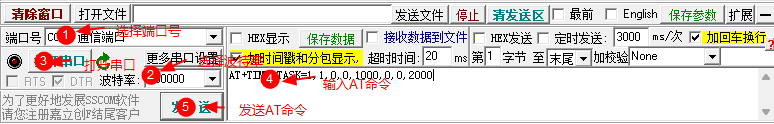
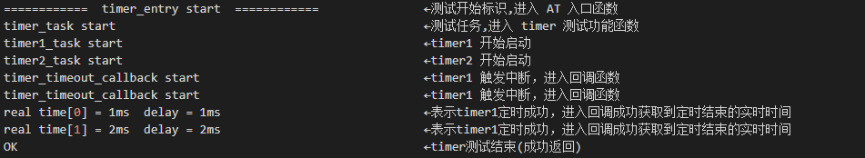
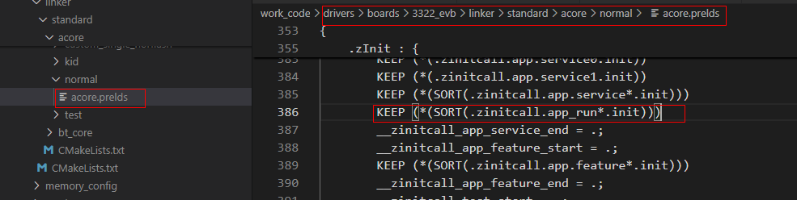

# timer 应用开发入门指南

本文档以 `timer_demo` 为例，带你在 HiDiTing 开发板上快速跑通第一个 timer（定时器）应用，并了解如何基于它构建自己的 demo。

---

## 目录

1. [timer 驱动背景知识](#1-timer-驱动背景知识)
2. [快速跑通 timer_demo](#2-快速跑通-timer_demo)
3. [文件结构与代码走读](#3-文件结构与代码走读)
4. [基于 timer_demo 新建自己的App](#4-基于-timer_demo-新建自己的-demo)
5. [注意事项](#5-注意事项)
6. [常见错误](#6-常见错误)
7. [社区贡献](#7-社区贡献)

---

## 1. timer 驱动背景知识

### 1.1 timer 工作原理

timer 是用于生成周期性或单次定时信号的硬件模块，主要功能包括：

- 生成周期性中断（用于系统心跳、任务调度）
- 生成单次定时事件（用于延时、超时检测）

### 1.2 操作流程
本示例支持定时器的创建、开始、结束、删除步骤，步骤如下。

**timer定时器的工作全流程:**
1. **反初始化定时器**：调用`uapi_timer_deinit();`将timer进行反初始化，消除对后面timer初始化的影响。
2. **初始化定时器**：调用`uapi_timer_init();`将timer进行初始化。
3. **适配定时器配置**：调用`uapi_timer_adapter();`配置定时器索引、定时器中断号和中断优先级。
4. **创建定时器**：调用`uapi_timer_create();`创建一个高精度定时器，函数参数句柄为唯一定时器标
识。
5. **开启定时器**：调用`uapi_timer_start();`设置超时时间、超时回调函数、回调函数入参以及启动定
时器。
6. **停止定时器**：调用`uapi_timer_stop();`停止当前定时器计时。
7. **删除定时器**：调用`uapi_timer_delete();`删除当前定时器。

### 1.3 timer 模式

timer 支持以下工作模式：

| 模式 | 特点 | 适用场景 |
|---|---|---|
| **周期模式** | 定期触发中断 | 系统心跳、周期性任务调度 |
| **单次模式** | 触发一次中断后停止 | 延时、超时检测 |
| **自由运行模式** | 计数器模式 | 时间测量、性能分析 |

---

## 2. 快速跑通 timer_demo

### 配置说明

timer_demo 支持通过AT指令进行 timer 定时器的创建、开启、结束和删除功能。相应的AT指令如下：
```c
AT+TIMERTASK=1,1,0,0,1000,0,0,2000
```
**AT指令参数说明**
| 参数 | 默认值 | 说明 |
|---|---|---|
| `timer_pority` | 1 | 定时器中断优先级 |
| `timer_index_no` | 1 | 定时器索引 |
| `start_time1` | 0 | timer1定时开始时间(ms) |
| `end_time1` | 0 | timer1定时结束时间(ms) |
| `delay_time1` | 1000 | timer1定时间隔时间(ms) |
| `start_time2` | 0 | timer2定时开始时间(ms) |
| `end_time2` | 0 | timer2定时结束时间(ms) |
| `delay_time2` | 2000 | timer2定时间隔时间(ms) |

### 编译

在 `sdk` 目录下执行:

```bash
# 编译固件，编译生成的固件从 output/3322/fwpkgt 中获取 diting-community.fwpkg
build.py pack_diting_community
```

### 使用方式

1. 烧录固件并启动设备
2. 通过串口发送 AT 命令，格式如下：
```bash
# TIMER 设置使用示例：设置定时器中断优先级和定时器索引值，以及定时器1和定时器2开始、结束、延时时间
AT+TIMERTASK=1,1,0,0,1000,0,0,2000
```


### 预期结果



---

## 3. 文件结构与代码走读

### 3.1 文件结构

timer_demo 的文件位于以下路径：

```
/samples/native_samples/timer/
├── timer_demo.c                # timer 示例主文件，包含 AT 命令处理函数
├── timer_demo.h                # timer 示例头文件，包含数据结构与命令表定义
└── CMakeLists.txt              # 编译配置
```

### 3.2 各文件职责

| 文件 | 职责 | 关键内容 |
|---|---|---|
| `timer_demo.c` | timer 示例主文件，包含了定时器的基本操作实现 | `at_start_timer_task()`, `timer_task()` |
| `timer_demo.h` | 头文件，定义数据结构、AT 命令表和函数声明 | `timer_task_args_t`, `g_at_timer_cmd_parse_table[]`, 函数声明 |
| `CMakeLists.txt` | 编译配置，定义源文件、头文件路径和编译选项 | `set(SOURCES ...)`, `build_component()` |

### 3.3 代码走读

#### 3.3.1 CMakeLists.txt 解析

```cmake
set(COMPONENT_NAME "timer_sample")

set(SOURCES
    ${CMAKE_CURRENT_SOURCE_DIR}/timer_demo.c
)

set(PUBLIC_HEADER
    ${CMAKE_CURRENT_SOURCE_DIR}
)

set(PRIVATE_HEADER
    ${ROOT_DIR}/src/include/driver
    ${ROOT_DIR}/middleware/utils/at/at
    ${ROOT_DIR}/middleware/utils/at/at/include
    ${ROOT_DIR}/middleware/utils/at/at/src
)

set(PUBLIC_DEFINES
    AT_DITING_EXAMPLE_TIMER
)

set(WHOLE_LINK
    true
)

build_component()
```

**关键配置说明：**
- `COMPONENT_NAME`：组件名称为`timer_sample`,需在`config.py`中的`diting-community`配置项下添加该组件名。
- `SOURCES`：指定源文件为 `timer_demo.c`。
- `PUBLIC_HEADER`：公开头文件路径，使其他模块可以引用 `timer_demo.h`。
- `PRIVATE_HEADER`：私有头文件路径，用于编译时查找依赖头文件。
- `WHOLE_LINK`：设置为 `true`，确保整个组件被链接。
- `PUBLIC_DEFINES`：定义宏 `AT_DITING_EXAMPLE_TIMER`，用于在AT命令适配层文件`at_adapter.c`中条件性的添加AT命令注册。
- 为使该`timer`文件参与编译，还需在上层`CMakeLists.txt`文件中以宏`CONFIG_ENABLE_TIMER_SAMPLE`为条件添加该`timer`文件。
- 宏`CONFIG_ENABLE_TIMER_SAMPLE`默认关闭。如需启用`timer`示例功能，需要在config.py中的`diting-community`配置项下将其打开。
- `config.py`的路径：`build/config/target_config/3322/config.py`
- `at_adapter.c`的路径：`middleware/chips/3322/at_adapter/at_adapter.c`

#### 3.3.2 timer.h 解析

**数据结构定义：**
```C
typedef struct {
    uint32_t para_map;              // 映射参数
    uint32_t timer_pority;          // 优先级
    uint32_t timer_index_no;        // 序号
    uint32_t start_time1;           // 定时器1开始时间
    uint32_t end_time1;             // 定时器1结束时间
    uint32_t delay_time1;           // 定时器1延时时间
    uint32_t start_time2;           // 定时器1开始时间 
    uint32_t end_time2;             // 定时器1结束时间
    uint32_t delay_time2;           // 定时器1延时时间
} timer_task_args_t;
```
**参数语法定义：**
```c
static const at_para_parse_syntax_t g_timer_task_args_syntax[] = {
    {
        .type = AT_SYNTAX_TYPE_INT,
        .attribute = AT_SYNTAX_ATTR_AT_MIN_VALUE | AT_SYNTAX_ATTR_AT_MAX_VALUE,
        .entry.int_range.min_val = 0,           // 定时器优先级最小值
        .entry.int_range.max_val = 7,           // 定时器优先级最大值
        .offset = offsetof(timer_task_args_t, timer_pority)
    },
    {
        .type = AT_SYNTAX_TYPE_INT,
        .attribute = AT_SYNTAX_ATTR_AT_MIN_VALUE | AT_SYNTAX_ATTR_AT_MAX_VALUE,
        .entry.int_range.min_val = 1,           
        .entry.int_range.max_val = 100000,      // 定时器序号索引值
        .offset = offsetof(timer_task_args_t, timer_index_no)
    },
    {
        .type = AT_SYNTAX_TYPE_INT,
        .attribute = AT_SYNTAX_ATTR_AT_MIN_VALUE | AT_SYNTAX_ATTR_AT_MAX_VALUE,
        .entry.int_range.min_val = 0,
        .entry.int_range.max_val = 10000,       // 定时器1开始时间
        .offset = offsetof(timer_task_args_t, start_time1)
    },
     {
        .type = AT_SYNTAX_TYPE_INT,
        .attribute = AT_SYNTAX_ATTR_AT_MIN_VALUE | AT_SYNTAX_ATTR_AT_MAX_VALUE,
        .entry.int_range.min_val = 0,
        .entry.int_range.max_val = 10000,       // 定时器1结束时间
        .offset = offsetof(timer_task_args_t, end_time1)
    },
     {
        .type = AT_SYNTAX_TYPE_INT,
        .attribute = AT_SYNTAX_ATTR_AT_MIN_VALUE | AT_SYNTAX_ATTR_AT_MAX_VALUE,
        .entry.int_range.min_val = 0,
        .entry.int_range.max_val = 10000,       // 定时器1延时时间
        .offset = offsetof(timer_task_args_t, delay_time1)
    },
    {
        .type = AT_SYNTAX_TYPE_INT,
        .attribute = AT_SYNTAX_ATTR_AT_MIN_VALUE | AT_SYNTAX_ATTR_AT_MAX_VALUE,
        .entry.int_range.min_val = 0,
        .entry.int_range.max_val = 10000,       // 定时器2开始时间
        .offset = offsetof(timer_task_args_t, start_time2)
    },
     {
        .type = AT_SYNTAX_TYPE_INT,
        .attribute = AT_SYNTAX_ATTR_AT_MIN_VALUE | AT_SYNTAX_ATTR_AT_MAX_VALUE,
        .entry.int_range.min_val = 0,
        .entry.int_range.max_val = 10000,        // 定时器2结束时间
        .offset = offsetof(timer_task_args_t, end_time2)
    },
     {
        .type = AT_SYNTAX_TYPE_INT,
        .last = true,
        .attribute = AT_SYNTAX_ATTR_AT_MIN_VALUE | AT_SYNTAX_ATTR_AT_MAX_VALUE,
        .entry.int_range.min_val = 0,
        .entry.int_range.max_val = 10000,       // 定时器2延时时间
        .offset = offsetof(timer_task_args_t, delay_time2)
    },   
};
```
**AT 命令表定义：**
```c
static const at_cmd_entry_t g_at_timer_cmd_parse_table[] = {
    // AT+TIMERTASK=1,1,0,0,1000,0,0,2000
    {
        "TIMERTASK",                            // 指令字符串 - 用户实际输入的AT命令（如"AT+GETADCMANUAL"）
        0x2264,                                 // 指令编码 - 用于内部识别的唯一标识符（十六进制形式）
        0,                                      // 参数数量 - 该指令支持的参数个数
        g_timer_task_args_syntax,               // 指令参数语法定义 - 指向参数格式定义的指针
        NULL,                                   // 测试函数指针 - 用于AT+CMD=?测试命令的响应函数
        (at_set_func_t)at_timer_sample,         // 设置函数指针 - 执行AT+CMD=<...>时的处理函数
        NULL,                                   // 查询函数指针 - 执行AT+CMD?查询命令时的处理函数
        NULL,                                   // 其他功能函数指针 - 保留用于扩展功能
    },
};
```
**函数声明：**
```c
// 定时器AT命令注册
void at_diting_timer_example_cmd_register(void);
// AT命令入口函数
at_ret_t at_start_timer_task(const timer_task_args_t *args);
```
#### 3.3.3 命令注册函数

```c
// 定时器AT命令注册
void at_diting_timer_example_cmd_register(void)
{
    uapi_at_cmd_table_register(g_at_timer_cmd_parse_table, AT_TIMER_FUNC_NUM, EXT_AT_TIMER_CMD_MAX_LEN);
}
```

**代码逻辑解析：**
- 调用 `uapi_at_cmd_table_register` 注册 TIMER 命令表。
- `g_at_timer_cmd_parse_table`：命令表数组。
- `AT_TIMER_FUNC_NUM`：命令数量（通过宏计算数组大小）。
- `EXT_AT_TIMER_CMD_MAX_LEN`：命令最大长度（128）。

#### 3.2.4 AT+TIMERTASK AT 指令具体实现

```c
#define TIMER_MS_2_US       1000        // 时间装换系数1ms=1000us

typedef struct timer_info {
    uint32_t start_time;                // 定时开始时间
    uint32_t end_time;                  // 定时结束时间
    uint32_t delay_time;                // 定时延时时间
} timer_info_t;                         // 定时器时间管理结构体

static uint32_t g_timer_int_count = 0;  // 定时器中断计数
static timer_info_t g_timers_info[2] = {
    {0, 0, 1000}, //1000us              
    {0, 0, 2000}  //2000us
};                                      // 定时器时间管理数组
```
**定时器回调函数**
```c
static void timer_timeout_callback(uintptr_t data)
{
    at_adapter_sample_print("\r\ntimer_timeout_callback start\r\n");
    // step1 定义timer_index接收定时器的索引值
    uint32_t timer_index = (uint32_t)data;
    // step2 获取定时器结束的实时时间
    g_timers_info[timer_index].end_time = uapi_tcxo_get_ms();
    // step3 计数器+1
    g_timer_int_count++;
}
```
**定时器功能实现流程**
```c
static errcode_t timer_run_sample(const timer_task_args_t *args)
{
    at_adapter_sample_print("timer_task start");
    // step1：创建定时器索引
    timer_handle_t timer_index[2] = { 0 };
    // step2：初始化定时器
    errcode_t ret = uapi_timer_init();
    if (ret != ERRCODE_SUCC){
        at_adapter_print("init timer err!");
        uapi_timer_deinit();
        return ERRCODE_INVALID_PARAM;
    }
    // step3：注册定时器中断
    uapi_timer_adapter(args->timer_index_no, TIMER_1_IRQN, args->timer_pority);
    at_adapter_sample_print("timer1_task start");
    // step4：创建定时器1
    errcode_t ret1 = uapi_timer_create(args->timer_index_no, &timer_index[0]);
    if (ret1 == ERRCODE_INVALID_PARAM){
        at_adapter_print("create timer1 err!");
        uapi_timer_deinit();
        return ERRCODE_INVALID_PARAM;
    }
    // step5：获取定时器1的开始时间
    g_timers_info[0].start_time = uapi_tcxo_get_ms();
    // step6：启动定时器1
    errcode_t ret2 = uapi_timer_start(timer_index[0], g_timers_info[0].delay_time, timer_timeout_callback, 0);
    if (ret2 == ERRCODE_INVALID_PARAM){
        at_adapter_print("start timer1 err!");
        uapi_timer_deinit();
        return ERRCODE_INVALID_PARAM;
    }
    at_adapter_sample_print("timer2_task start");
    // step7：创建定时器2
    errcode_t ret3 = uapi_timer_create(args->timer_index_no, &timer_index[1]);
    if (ret3 == ERRCODE_INVALID_PARAM){
        at_adapter_print("start timer2 err!");
        uapi_timer_deinit();
        return ERRCODE_INVALID_PARAM;
    }
    // step8：获取定时器2的开始时间
    g_timers_info[1].start_time = uapi_tcxo_get_ms();
    // step9：启动定时器2
    errcode_t ret4 = uapi_timer_start(timer_index[1], g_timers_info[1].delay_time, timer_timeout_callback, 1);
    if (ret4 == ERRCODE_INVALID_PARAM){
        at_adapter_print("start timer2 err!");
        uapi_timer_deinit();
        return ERRCODE_INVALID_PARAM;
    }
    // step10：等待定时器定时结束
    while (g_timer_int_count < 2) {
        osal_msleep(1);
    }

    // step11：停止定时器并删除定时器，并将真实定时时间和设定的定时器时间作对比
    for (uint32_t i = 0; i < 2; i++) {
        uapi_timer_stop(timer_index[i]);
        uapi_timer_delete(timer_index[i]);
        at_adapter_sample_print("real time[%d] = %dms  delay = %dms\r\n", i,
                    (g_timers_info[i].end_time -  g_timers_info[i].start_time),
                    g_timers_info[i].delay_time / TIMER_MS_2_US);
    }
    // step12：去初始化定时器
    uapi_timer_deinit();
    return ERRCODE_SUCC;
}
```

**返回值说明**

| 返回值 | 说明 |
|---|---|
| `AT_RET_OK` | 操作成功 |
| `AT_RET_RUN_ERROR` | 运行时错误 |
---

## 4. 基于 timer_demo 新建自己的 demo

**上面的demo是使用AT指令触发运行，HiDiTing还支持app_run方式触发应用在系统启动时自动运行，以下示例将以app_run的方式开发一个开发者自己的应用**

- app_run(func) 是HiDiTing中应用层注册应用函数的宏，基于 GCC 编译器属性和自定义段区（section）自动注册来实现集中调用应用函数，系统启动时会自动遍历所有用 app_run 注册过的函数并执行，无需在 系统 main 函数里逐个调用函数。

### 4.1 代码清单

新建一个 timer 应用（以 `my_timer_app` 为例）通常只需要以下改动：

- [ ] 新建 `my_timer_app.c` 源文件
- [ ] 新建 `my_timer_app.h` 源文件
- [ ] 新建 `CMakeLists.txt` 源文件
- [ ] 在 `my_timer_demo.c` 实现timer的初始化，创建、开始操作
- [ ] 在 `my_timer_demo.h` 中对`void my_timer_demo(void)`声明
- [ ] 在 `CMakeLists.txt` 中添加源文件编译规则

`my_timer_demo`文件结构：
```
/samples/native_samples/my_timer_demo/
├── my_timer_demo.c
├── my_timer_demo.h
└── CMakeLists.txt
```

### 4.2 CMakeLists.txt 修改示例

```cmake
# 在新建的 CMakeLists.txt 中添加应用的源文件
set(SOURCES
    ${CMAKE_CURRENT_SOURCE_DIR}/my_timer_demo.c
)

set(PUBLIC_HEADER
    ${CMAKE_CURRENT_SOURCE_DIR}
)

set(PRIVATE_HEADER

)

set(PUBLIC_DEFINES
    MY_TIMER_DEMO_ENABLE
)

build_component()
```

### 4.3 关键代码片段

**my_timer_app.c** —— timer 示例

```c
#include "timer.h"
#include "tcxo.h"
#include "app_init.h"
#include "common_def.h"

#define MY_TIMER_DELAY_MS   10
#define MY_TIMER_PRIO       2

static errcode_t my_timer_callback(uintptr_t data)
{
    UNUSED(data);
    osal_printk("timer timeout!\r\n");
    return ERRCODE_SUCC;
}

void my_timer_demo(void)
{
    osal_printk("my_timer_app start\n");
    uint32_t g_timer_int_count = 0;
    // step1：初始化 timer
    uapi_timer_init();
    uapi_timer_adapter(0, TIMER_1_IRQN, MY_TIMER_PRIO);

    // step2：创建定时器
    timer_handle_t timer_handle;
    uapi_timer_create(0, &timer_handle);

    // step3：启动定时器
    uapi_timer_start(timer_handle, MY_TIMER_DELAY_MS * 1000, my_timer_callback, 0);

    // step4：等待定时器结束
    do {
        osal_msleep(1000);
        osal_printk("Main task running...\r\n");
        g_timer_int_count++;
    }while (g_timer_int_count < MY_TIMER_DELAY_MS);

    // step5: 停止定时器
    uapi_timer_stop(timer_index[i]);
    // step6: 删除定时器
    uapi_timer_delete(timer_index[i]);
    // step7：反初始化 timer
    uapi_timer_init();
}
```
### 4.4 app_run运行配置

`app_run`应用默认是关闭的，如需启用此应用，需用户手动在`acore.prelds`文件中添加   `KEEP (*(SORT(.zinitcall.app_run*.init)))`  具体参考示意图如下：



`acore.prelds`路径：drivers/boards/3322_evb/linker/standard/acore/normal/acore.prelds

### 4.5 测试验证

新demo完成后，逐项验收：

- [ ] 设备启动后串口输出 `my_timer_app start`
- [ ] 每隔1秒输出一次定时器超时信息
- [ ] 主任务每隔500ms输出一次运行信息

---

## 5. 注意事项

**时钟源注意事项：**

- timer是基于外部32MHz晶体为系统提供高精度定时器的功能
- 高精度场景请使用高精度硬件定时器

**优先级注意事项：**

- 中断优先级过高可能影响系统稳定性
- 定时器回调函数应尽量简短

**资源说明：**

- timer 通常为硬件模块，无需额外资源分配
---

## 6. 常见错误

| 错误现象 | 原因 | 解决方法 |
|---|---|---|
| `undefined reference to 'uapi_timer_init'` | 未链接 timer 驱动库 | 检查 CMakeLists.txt 中是否正确添加了源文件 |
| `TIMER_INDEX` not defined | 未定义定时器索引 | 确保在代码中正确定义了定时器索引 |
| `undefined reference to 'uapi_at_cmd_table_register'` | 未链接 AT 命令库 | 检查 CMakeLists.txt 中是否正确添加了 AT 相关头文件路径 |
| 编译报 `at_ret_t` 未定义 | 未包含 `at.h` 头文件 | 添加 `#include "at.h"` |
| 串口无输出 | AT 命令未注册 | 确认调用了 `at_diting_timer_example_cmd_register()` |
| 定时器不触发 | 中断优先级设置过高或未正确初始化 | 检查中断优先级和初始化代码 |


## 7. 社区贡献

**向社区贡献代码时，PR 描述建议包含：**
```
## 改动说明
新增 <AppName> timer 示例应用，展示基本定时功能。

## 验证结果
- [ ] python3 build.py pack_diting_community 通过
- [ ] 设备串口输出定时器超时信息
- [ ] 主任务正常运行

## 影响范围
仅新增 <demoname>.c <demoname>.h文件及对应 CMakeLists.txt 修改，未修改其他模块。
```
