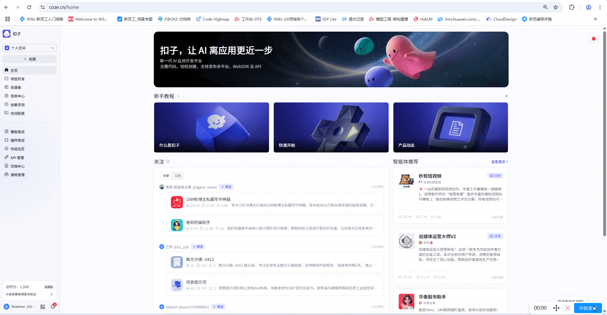
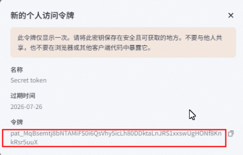
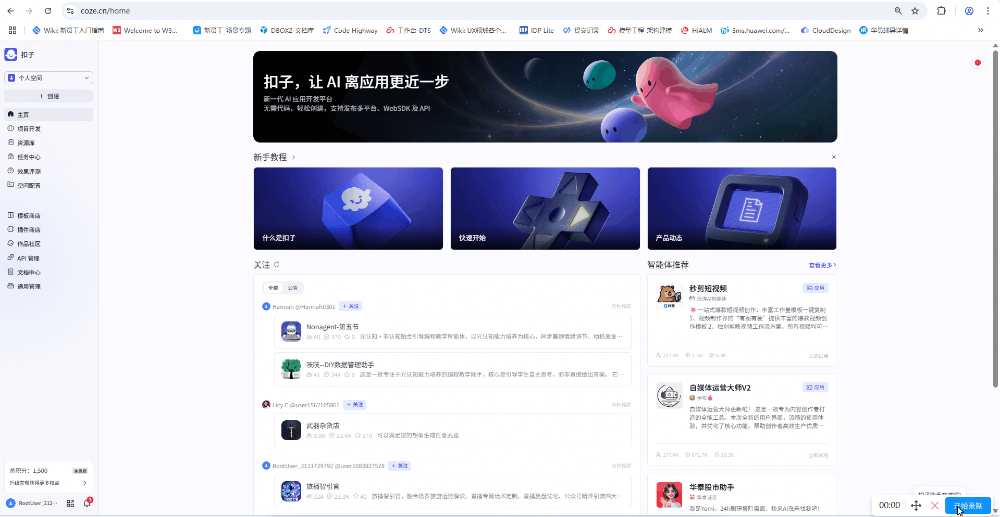

# Diting AI 语音 Demo 入门开发指南

---

## 目录

1. [概述](#1-概述)
2. [快速跑通AI语音Demo](#2-快速跑通ai语音demo)
3. [代码走读](#3-代码走读)
4. [状态机](#4-状态机)
5. [参数配置](#5-参数配置)
6. [高阶开发参考指南](#6-高阶开发参考指南)
7. [第三方依赖清单](#7-第三方依赖清单)
8. [异常排查手册](#8-异常排查手册)
9. [注意事项](#9-注意事项)

---

## 1. 概述

`voice_cloud_LLM` 是谛听（Diting）智能穿戴平台上的**端侧直连云端语音大模型**组件。其实现了一条完整的端到端语音对话流程：

```
本地唤醒 → WebSocket 连接 Coze → PCM 音频上传 → 云端 VAD + LLM + TTS → PCM 音频下发 → 本地播放
```

本文面向基于现有源码的运行、调试和开发；具体实现以源码中的接口、状态机事件和协议解析为准。

> 读者可将本文与对应源码一起提供给 AI 编程工具，用本文快速定位模块职责、开发入口和验证重点，再让 AI 基于实际源码辅助阅读、改造和排查。

---

## 2. 快速跑通AI语音Demo

### 2.1 硬件准备
- DITING单板
- 喇叭（无特定要求，开发调试时使用型号：For 8Ω/1W speaker）
- 表盘（无特定要求）

### 2.2 Coze准备
- 登录 [Coze官网](https://www.coze.cn/home)注册账号
  
- 创建个人访问令牌，获取 `Access token`
  
下图红框中内容即`Access token`  


- 创建智能体，获取`bot id`  
网址最后一串数字即`bot id`，如演示中的`7655531045567086592`


### 2.3 编译烧录
- 切换到 `src` 目录，执行编译命令 `python build.py pack_diting_community`，编译成功后镜像位于 `src/output/3322/fwpkg/diting-community.fwpkg`
- 使用 burntool 工具烧录镜像

### 2.4 上板运行
- 将手机热点打开（注意打开通过蓝牙共享网络），与单板建立蓝牙连接
- 执行 AT 命令 `AT+PM=0` 关闭低功耗，成功会打印 `OK`
- 执行 AT 命令 `AT+NET=NETSTACK_SWITCH,PAN` 切换为通过 BT PAN 获取网络，成功会打印 `pan CONNECTION_CONNECTED`
- 执行 AT 命令 `AT+VOICECLOUDLLM=CONFIG,<bot_id>,<Access token>` 配置对话的智能体 ID 和访问令牌，成功会打印 `[voice_cloud_llm] config auth updated: botId=<bot_id> tokenLen=len(<Access token>)`
- 执行 AT 命令 `AT+VOICECLOUDLLM=START` 启动 AI 语音对话服务，成功会打印 `[voice_cloud_llm] Start ok, awaiting wakeup`
- 说出唤醒词 `小艺小艺` 唤醒服务，开始与云端大模型语音对话（一轮对话结束后连续 15 s 未说话需要重新唤醒）
- 执行 AT 命令 `AT+VOICECLOUDLLM=STOP` 停止 AI 语音对话服务，成功会打印 `[voice_cloud_llm] Stop done`

> 当前版本可触发本 Demo 的唤醒词为：`小艺小艺`、`你好悠悠`、`小薇小薇`、`嗨，塞莉亚`。如需更换唤醒词或模型，请参考 `6.1 更换唤醒词模型`。

---

## 3. 代码走读

### 3.1 代码结构

```
voice_cloud_LLM/
├── voice_cloud_llm.cpp                # 主状态机 + Worker 线程 + ASR 唤醒监听 + 资源管理
├── voice_cloud_llm_at.c               # 独立 AT 命令 AT+VOICECLOUDLLM，开机经 APP_FEATURE_INIT 自注册
├── voice_cloud_llm_audio_capture.cpp  # Capture 线程：麦克风采集，批次投递
├── voice_cloud_llm_audio_player.cpp   # Player 线程：PCM 播放，DAC 节流，断流平滑
├── voice_cloud_llm_ws_client.cpp      # WebSocket 客户端封装：连接/分片重组/鉴权
├── voice_cloud_llm_protocol.cpp       # 协议层：JSON 构造/解析，Base64 编解码
├── voice_cloud_llm_config.cpp         # 配置管理
├── include/
│   ├── voice_cloud_llm.h              # 对外入口 + 内部 API
│   ├── voice_cloud_llm_config.h       # 配置结构 + 编译期常量
│   ├── voice_cloud_llm_protocol.h     # 协议事件枚举 + 内部 API
│   └── voice_cloud_llm_errcode.h      # 错误码
└── CMakeLists.txt                     # 编译配置
```

### 3.2 核心函数

| 函数 | 功能 |
|------|------|
| `VoiceCloudLlmWorker` | 主控工作线程，工作线程消息队列的消费中心 |
| `VoiceCloudLlmHandleServerEvent` | Coze下行事件的处理中心 |
| `VoiceCloudLlmSendSessionUpdate` | 构造更新Coze会话的配置项，将其封装为JSON通过Websocket发送给Coze |
| `VoiceCloudLlmPendingFlush` | 将预采集的音频数据封装为JSON通过websocket发送给Coze |
| `VoiceCloudLlmHandleAudioFrame` | 处理采集线程发送的音频数据，将其封装为JSON通过Websocket发送给Coze |
| `VoiceCloudLlmAudioCaptureStart` | 初始化并启动AudioStreamIn，启动音频采集线程，实时将底层音频驱动采集到的数据送到工作线程 |
| `VoiceCloudLlmAudioPlayerStart` | 初始化并启动AudioStreamOut，启动音频播放线程，实时将播放线程消息队列中的数据送到底层的音频驱动 |
| `VoiceCloudLlmAudioPlayerFeed` | 将Coze下发的音频数据送到播放线程消息队列 |
| `VoiceCloudLlmWsConnect` | 创建Websocket客户端，和Coze建立Websocket连接 |
| `voice_cloud_llm_at_register` | 开机自注册独立 AT 命令 `AT+VOICECLOUDLLM`（START/STOP/CONFIG），位于 `voice_cloud_llm_at.c` |

---

## 4. 状态机

```
                    ┌───────────────┐
                    │  IDLE_WAKEUP  │  ASR 监听中，等待本地唤醒词
                    └───────┬───────┘
                            │ WAKEUP (本地唤醒)   
                            ▼                    
                    ┌─────────────────┐  
                    │ WAKEUP_DETECTED │  停 ASR，启动采集
                    └───────┬─────────┘  
                            │                      
                            ▼                      
                    ┌───────────────┐              
                    │ WS_CONNECTING │  TCP + TLS + WS 握手
                    └───────┬───────┘
                            │ WS OnOpen
                            ▼
                    ┌───────────────┐
                    │ CHAT_CREATING │  等待 chat.created 事件
                    └───────┬───────┘
                            │ chat.created
                            ▼
                    ┌─────────────────────┐
                    │ SESSION_CONFIGURING │ 发送 chat.update → 等待 chat.updated
                    └───────┬─────────────┘
                            │ chat.updated
                            ▼
                    ┌────────────────┐  采集运行，音频流送至服务端 VAD
                    │ IDLE_LISTENING │  等待 speech_started 或空闲超时
                    └───────┬────────┘ 
                ┌───────────│ speech_started (云端 VAD 检测到语音开始)
                │           ▼
                │   ┌──────────────────┐
                │   │ UPLINK_STREAMING │  上传音频
                │   └───────┬──────────┘
                │           │ speech_stopped (云端 VAD 检测到语音结束)
                │           ▼
                │   ┌───────────────────┐
                │   │ AWAITING_RESPONSE │  等待 Coze 回复
                │   └───────┬───────────┘
                │           │ audio.delta  
                │           ▼              
                │   ┌──────────────────┐  
                │   │ DOWNLINK_PLAYING │  播放云端音频 
                │   └───────┬──────────┘
                │           │ audio.completed
                │           ▼
                │   ┌───────────────────┐
                │   │ AWAITING_RESPONSE │  等待 Coze 回复
                │   └───────┬───────────┘    
                │           │ chat.completed
                │           ▼    
                │   ┌────────────────┐  采集运行，音频流送至服务端 VAD
                └───│ IDLE_LISTENING │  等待 speech_started 或空闲超时
                    └───────┬────────┘ 
                            │ 空闲超时
                            ▼
                    ┌───────────────┐  
                    │ RETURN_WAKEUP │  关闭 WS 连接，启动 ASR 监听
                    └───────────────┘
```

---

## 5. 参数配置

代码中相关的参数配置，可在 `voice_cloud_llm_config.h` 中进行修改。

### 5.1 音频规格

| 参数 | 值 | 宏 |
|------|-----|-----|
| 编码格式 | PCM | |
| 上行采样率 | 16000 Hz | `VOICE_CLOUD_LLM_INPUT_SAMPLE_RATE` |
| 下行采样率 | 16000 Hz | `VOICE_CLOUD_LLM_OUTPUT_SAMPLE_RATE` |
| 声道数 | 1 (mono) | `VOICE_CLOUD_LLM_DEFAULT_CHANNELS` |
| 位宽 | 16 bit | `VOICE_CLOUD_LLM_DEFAULT_BITS` |
| 基础帧长 | 20 ms (640 B) | `VOICE_CLOUD_LLM_UPLINK_FRAME_MS` |
| 批次帧数 | 8 (160 ms, 5120 B) | `VOICE_CLOUD_LLM_UPLINK_BATCH_FRAMES` |

### 5.2 超时与容量规格

| 参数 | 值 | 宏 |
|------|-----|-----|
| WS 连接超时 | 10 s | `VOICE_CLOUD_LLM_CONNECT_TIMEOUT_MS` |
| 会话响应超时 | 30 s | `VOICE_CLOUD_LLM_RESPONSE_TIMEOUT_MS` |
| 空闲监听超时 | 15 s | `VOICE_CLOUD_LLM_IDLE_TIMEOUT_MS` |
| Worker 消息队列 | 64 | `VOICE_CLOUD_LLM_QUEUE_DEPTH` |
| 预采集缓存 | 20 批次 (~3.2 s) | `VOICE_CLOUD_LLM_PENDING_FRAMES_MAX` |
| WS 分片上限 | 64 KB | `VOICE_CLOUD_LLM_WS_FRAGMENT_MAX_LEN` |

---

## 6. 高阶开发参考指南

进一步开发通常出现在以下几类场景：

- 更换自己的唤醒词模型。
- 使用自己的语音 WebSocket API。
- 适配自定义麦克风、扬声器、音频前处理、网络或板级硬件。
- 扩展 Coze 上下行事件，或调整 VAD、音频格式、超时、缓存等参数。

### 6.1 更换唤醒词模型

当前 `voice_cloud_LLM` 本身不识别唤醒词文本，它只在 `voice_cloud_llm.cpp` 的 `VoiceCloudLlmAsrListener()` 中监听 `ASR_ENGINE_CMD_WAKEUP_KEYWORD`。因此判断“哪些词能唤醒 Demo”时，以 `intelligent_voice_asr_engine.cpp` 的 `g_kwsEngineCmdInfo` 为准。

| 内容 | 位置 |
|------|------|
| 实际生效词表 | `src/middleware/services/media/foundation/service/intelligent_voice_service/asr_engine/src/intelligent_voice_asr_engine.cpp` 的 `g_kwsEngineCmdInfo` |
| 唤醒词枚举定义 | `src/middleware/services/media/foundation/service/intelligent_voice_service/asr_engine/include/intelligent_voice_asr_engine.h` 的 `AsrEngineWakeupKeyword` |
| ASR/CTC 模型路径 | `src/middleware/services/media/foundation/service/intelligent_voice_service/asr_engine/src/intelligent_voice_asr_engine.cpp` 的 `ASR_MODEL_NAME`、`ASR_MODEL_OFFSET_PATH`、`CTC_MODEL_NAME` 等 |

当前 `g_kwsEngineCmdInfo` 映射的唤醒词为：`小艺小艺`、`你好悠悠`、`小薇小薇`、`嗨，塞莉亚`。`AsrEngineWakeupKeyword` 中还定义了 `小爱`，但当前 KWS 映射未启用它，不能把枚举定义等同于实际可唤醒词表。

替换流程建议：

1. 准备新的唤醒词模型文件，并确认模型输出的 index 与预期唤醒词一一对应。
2. 如新增唤醒词枚举，在 `AsrEngineWakeupKeyword` 中增加枚举值。
3. 在 `g_kwsEngineCmdInfo` 中把模型输出 index 映射为 `ASR_ENGINE_CMD_WAKEUP_KEYWORD` 和对应的 `wakeupKeywordInfo`。
4. 如模型文件路径变化，修改 `ASR_MODEL_NAME`、`ASR_MODEL_OFFSET_PATH`、`CTC_MODEL_NAME` 等模型路径，或在打包阶段保持相同目标路径。
5. 保持 `voice_cloud_LLM` 侧只依赖 `ASR_ENGINE_CMD_WAKEUP_KEYWORD`，除非业务需要区分不同唤醒词；如果需要区分，可在 `VoiceCloudLlmAsrListener()` 中读取 `cmdInfo->wakeupKeywordInfo.wakeupKeyword` 后做分支。

验证时先单独确认 `IntellVoiceAsrEngine` 能稳定上报唤醒事件，再执行 `AT+VOICECLOUDLLM=START` 验证唤醒后能进入云端链路。

### 6.2 替换为自己的 WebSocket API

当前云端适配点集中在三个文件：

| 文件 | 需要关注的内容 |
|------|----------------|
| `voice_cloud_llm_config.cpp/.h` | 默认 WebSocket URL、token、bot id、音频规格和启动前检查 |
| `voice_cloud_llm_ws_client.cpp` | URL 拼接、`Authorization: Bearer <token>` header、WebSocket 连接/发送/接收 |
| `voice_cloud_llm_protocol.cpp/.h` | 上行 JSON 构造、下行事件解析、音频 base64 编解码、事件名映射 |

如果只是接入另一个 Coze 智能体，一般不需要改代码，只需通过 `AT+VOICECLOUDLLM=CONFIG,<bot_id>,<token>` 替换运行时配置。

如果接入自己的 WebSocket 服务，建议按以下顺序修改：

1. 在 `voice_cloud_llm_config.cpp` 修改 `VOICE_CLOUD_LLM_DEFAULT_WS_URL`，或新增运行时配置入口。
2. 在 `voice_cloud_llm_ws_client.cpp` 修改鉴权方式，例如 header 名称、token 格式、URL query 参数或不带鉴权。
3. 在 `voice_cloud_llm_protocol.cpp` 修改会话创建、音频上传、结束、取消等上行 JSON。
4. 在 `voice_cloud_llm_protocol.cpp` 的 `VoiceCloudLlmParseServerMessage()`、`EventTypeFromString()` 中把服务端事件映射为内部 `VoiceCloudLlmServerEventType`。
5. 保持状态机只处理内部事件，尽量不要把云端私有字段扩散到 `voice_cloud_llm.cpp`。

需要保证自定义服务至少能覆盖当前状态机依赖的语义：连接建立、会话配置完成、服务端 VAD 检测到用户说话结束、音频增量下发、音频结束、会话结束或失败。

注意：这些生命周期事件缺失任意一个，都可能让状态机停在 `SESSION_CONFIGURING`、`AWAITING_RESPONSE` 或 `DOWNLINK_PLAYING`，表现为无回复、无法回到唤醒或超时恢复。

### 6.3 扩展 Coze 上下行事件

当仍使用 Coze，但希望订阅更多事件或调整会话配置时，优先只改协议层：

1. 在 `voice_cloud_llm_protocol.h` 添加 `VoiceCloudLlmServerEventType` 枚举值。
2. 在 `voice_cloud_llm_protocol.cpp` 的 `EventTypeFromString()` 添加字符串映射。
3. 在 `voice_cloud_llm_protocol.cpp` 的 `subscriptions[]` 添加云端事件订阅，可订阅事件参考 [Coze 下行事件文档](https://www.coze.cn/open/docs/developer_guides/streaming_chat_downlink_event)。
4. 在 `voice_cloud_llm.cpp` 的 `VoiceCloudLlmHandleServerEvent()` switch 中添加处理分支。
5. 如需新增上行事件，可参考 `voice_cloud_llm_protocol.cpp` 中的 `VoiceCloudLlmBuildSessionStart()` 构造 JSON；事件格式参考 [Coze 上行事件文档](https://www.coze.cn/open/docs/developer_guides/streaming_chat_event)。
6. 如需修改云端 VAD、输入输出音频格式、订阅列表等会话配置，在 `voice_cloud_llm_protocol.cpp` 的 `AddSessionData()` 中调整。

### 6.4 适配自定义硬件

硬件适配优先走参数配置，其次才改采集/播放实现。多数麦克风、扬声器、采样率、声道、位宽、帧长差异，应先参考第 5 章调整 `voice_cloud_llm_config.h`，并确认 `voice_cloud_llm_protocol.cpp` 上报给云端的音频格式同步变化。

| 适配目标 | 建议入口 |
|----------|----------|
| 采样率、声道、位宽、帧长、批次大小 | 优先修改 `voice_cloud_llm_config.h`，再同步检查 `voice_cloud_llm_protocol.cpp` |
| 麦克风前处理、AMIC/DMIC、SEA 开关、采集 stream | 先确认配置项是否覆盖；不够时再改 `voice_cloud_llm_audio_capture.cpp` |
| 扬声器、DAC、播放 buffer、下行采样率 | 先确认配置项是否覆盖；不够时再改 `voice_cloud_llm_audio_player.cpp` |
| 蓝牙 PAN、WiFi、蜂窝网络、DNS/TLS | 网络初始化流程和 `voice_cloud_llm_ws_client.cpp` |
| 板级 GPIO、按键、物理唤醒入口 | 新增外部触发后调用 `VoiceCloudLlmOnWakeup()` |
| 编译裁剪或组件开关 | `src/application/samples/voice_cloud_LLM/CMakeLists.txt`、`src/application/samples/CMakeLists.txt` 以及目标配置中的 `CONFIG_VOICE_CLOUD_LLM_ENABLE` |

适配原则：

1. 采集端输入格式优先通过 `voice_cloud_llm_config.h` 配置，当前采集链路会把采样率、声道和位宽传给 `AudioStreamIn`，并通过 `voice_cloud_llm_protocol.cpp` 上报给云端。
2. 播放端输出格式优先通过 `voice_cloud_llm_config.h` 配置，当前协议层会请求云端按 `outputSampleRate` 返回 PCM，播放器也会把采样率、声道和位宽传给 `AudioStreamOut`；如果硬件或云端不支持目标规格，才需要在云端配置、端侧重采样或播放实现中补适配。
3. `IntellVoiceAsrEngine`、采集、播放会争用音频资源，新增硬件路径时要保证 STOP、错误恢复、返回唤醒时都能释放资源。
4. 语音服务运行期间会占用音频硬件，和低功耗、本地音乐、其它语音服务或蓝牙音频并行时，需要在业务层做互斥控制。
5. 如果不使用本地 ASR 唤醒，而是按键或外部 MCU 唤醒，可不启动 `VoiceCloudLlmStart()` 的本地唤醒路径，改为在外部事件中调用 `VoiceCloudLlmOnWakeup()` 进入云端对话测试路径。

### 6.5 调整音频参数

1. 参考第 5 章修改 `voice_cloud_llm_config.h` 中的对应宏。
2. 同步检查 `voice_cloud_llm_protocol.cpp` 中上报给云端的输入/输出音频格式，保证云端返回格式与端侧播放器一致。
3. 修改 `VOICE_CLOUD_LLM_UPLINK_BATCH_FRAMES` 后，需要重新评估上行包大小、TLS 发送耗时、服务端 VAD 延迟和 `VOICE_CLOUD_LLM_PENDING_FRAMES_MAX` 对应的缓存时长。
4. 修改采样率、声道或位宽后，需要实机验证 `AudioStreamIn`、`AudioStreamOut`、能量门控、断流平滑和播放节流是否仍匹配该 PCM 规格。
5. 修改下行采样率时，需要实机验证 `AudioStreamOut`/底层 adec 是否支持该 PCM 规格。当前默认使用 16 kHz，是因为 24 kHz 原始 PCM 在当前播放路径上会失败。

### 6.6 自定义音频采集方案

一般硬件适配不建议直接替换采集模块，优先使用第 5 章配置项和第 6.4 节的硬件适配入口。只有以下情况才需要自定义采集方案：

- 平台不使用当前 `AudioStreamIn`。
- 麦克风数据来自外部 DSP、协处理器或私有驱动。
- 需要完全替换当前采集线程、缓冲、前处理或音频资源管理。

自定义采集模块需要提供或替换以下内部接口：

- 启动音频采集器接口：`int32_t VoiceCloudLlmAudioCaptureStart(const VoiceCloudLlmConfig *config);`
- 停止音频采集器接口：`int32_t VoiceCloudLlmAudioCaptureStop(void);`

采集线程需要按批次调用 `VoiceCloudLlmPostAudioFrame()` 投递 PCM 数据，并在停止时退出线程、释放音频句柄、释放缓存，避免返回唤醒后麦克风仍被占用。

### 6.7 自定义音频播放方案

一般硬件适配不建议直接替换播放模块，优先调整第 5 章配置项并确认云端返回 PCM 格式。只有以下情况才需要自定义播放方案：

- 平台不使用当前 `AudioStreamOut`。
- 下行音频需要走外部 codec、DSP 或私有播放通道。
- 需要重做播放队列、drain、节流或断流平滑策略。

自定义播放模块需要提供或替换以下内部接口：

- 启动音频播放器接口：`int32_t VoiceCloudLlmAudioPlayerStart(const VoiceCloudLlmConfig *config);`
- 停止音频播放器接口：`int32_t VoiceCloudLlmAudioPlayerStop(void);`
- 播放完停止音频播放器接口：`int32_t VoiceCloudLlmAudioPlayerDrainThenStop(void);`
- 传输音频数据接口：`int32_t VoiceCloudLlmAudioPlayerFeed(const uint8_t *data, uint32_t len);`

播放端要支持云端音频增量连续写入，并处理队列为空、会话结束 drain、STOP 立即释放等情况。若硬件播放 buffer 小于当前默认值，需要同步评估 `voice_cloud_llm_audio_player.cpp` 的节流策略。

---

## 7. 第三方依赖清单

当前 Demo 的云端第三方依赖只有 Coze WebSocket 语音会话接口；其余 WebSocket、cJSON、音频、ASR 能力来自本工程/OpenHarmony/平台 SDK 内部组件。

| 依赖 | 用途 | 接入位置 | 配置方式 |
|------|------|----------|----------|
| Coze WebSocket 语音会话接口 | 云端 VAD、LLM、TTS，接收上行 PCM 并返回下行 PCM | `voice_cloud_llm_config.cpp`、`voice_cloud_llm_ws_client.cpp`、`voice_cloud_llm_protocol.cpp` | `AT+VOICECLOUDLLM=CONFIG,<bot_id>,<token>` 配置 `bot_id` 和 `Access token`；默认 URL 为 `wss://ws.coze.cn/v1/chat` |

使用 Coze 前需要参考第 2.2 章节完成账号、智能体、访问令牌等准备。

---

## 8. 异常排查手册

| 现象 | 优先检查项 |
|------|------------|
| 唤醒无响应 | 是否已执行 `AT+VOICECLOUDLLM=START`；`g_kwsEngineCmdInfo` 是否映射了当前唤醒词；ASR 是否上报 `ASR_ENGINE_CMD_WAKEUP_KEYWORD` |
| WebSocket 连接失败 | BT PAN 是否已连接并打印 `pan CONNECTION_CONNECTED`；`bot_id` 和 `token` 是否正确；设备 DNS/TLS/系统时间是否可用；默认地址是否仍为 `wss://ws.coze.cn/v1/chat` |
| 说话后无云端回复 | 上行音频格式是否与 `AddInputAudio()` 上报一致；能量门控阈值是否过高导致音频被丢弃；云端 VAD 配置是否匹配；是否收到 `input_audio_buffer.speech_stopped` |
|云端响应慢|可以尝试在Coze的智能体配置上换用轻量模型，关闭深度思考|
| 播放卡顿或爆破音 | 下行 PCM 采样率是否为 16 kHz；播放 buffer 是否过小 |
| 频繁自动退回唤醒状态 | 串口日志中是否触发 15 s 空闲超时；串口日志中 WS 是否断连；worker/capture/player 线程是否异常退出；云端是否返回 `error` 或 `conversation.chat.failed` |

## 9. 注意事项

**编译注意事项：**

- 当前版本已默认开启CONFIG_VOICE_CLOUD_LLM_ENABLE宏，若需要关闭编译开关，在src/build/config/target_config/3322/config.py中注释掉CONFIG_VOICE_CLOUD_LLM_ENABLE宏即可。

**向社区贡献代码时，PR 描述建议包含：**

```
## 改动说明
新增 <AppName> AI语音 示例应用，具备语音唤醒、云端语音交互功能。

## 验证结果
- [ ] python3 build.py pack_diting_community 通过
- [ ] 设备可正常进行语音唤醒、云端语音交互功能

## 影响范围
仅新增 <appname> 相关文件及对应 CMakeLists.txt 修改，未修改其他模块。
```