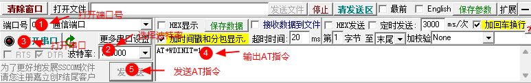
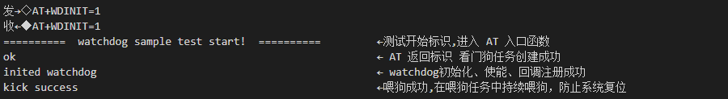
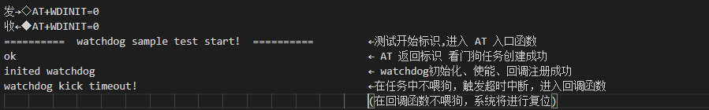
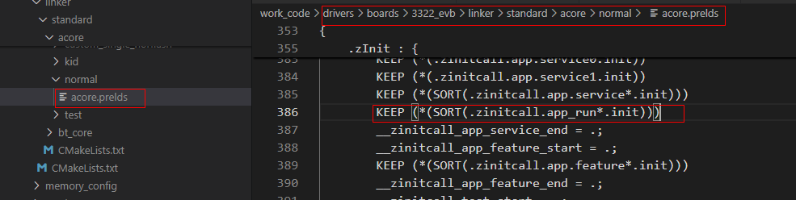

# watchdog 应用开发入门指南

本文档以 `watchdog_demo` 为例，带你在 HiDiTing 开发板上快速跑通第一个 watchdog（看门狗）监控应用，并了解如何基于它构建自己的 demo。

---

## 目录

1. [watchdog 驱动背景知识](#1-watchdog-驱动背景知识)
2. [快速跑通 watchdog_demo](#2-快速跑通-watchdog_demo)
3. [文件结构与代码走读](#3-文件结构与代码走读)
4. [基于 watchdog_demo 新建自己的App](#4-基于-watchdog_demo-新建自己的demo)
5. [注意事项](#5-注意事项)
6. [常见错误](#6-常见错误)
7. [社区贡献](#7-社区贡献)

---

## 1. watchdog 驱动背景知识

### 1.1 watchdog 工作原理

watchdog 是一种监控机制，用于检测系统是否出现死锁或异常状态。其工作原理：

1. 系统定期"喂狗"（kick）
2. 如果超时未喂狗，watchdog 会触发复位或回调函数
3. 通过回调函数可以记录错误信息或执行恢复操作

### 1.2 工作模式

watchdog 支持以下工作模式：

| 模式 | 特点 | 适用场景 |
|---|---|---|
| **复位模式** | 超时触发系统复位 | 关键系统监控 |
| **中断模式** | 超时触发中断回调，未在中断回调中"喂狗"才会复位 | 需要记录错误信息的场景 |

### 1.3 配置参数

基本配置参数包括：
- 超时时间（timeout）
- 工作模式（reset/interrupt）
- 喂狗周期（kick interval）

---

## 2. 快速跑通 watchdog_demo

### 功能说明

WatchDog Demo 通过 AT 命令方式提供交互式控制，可以通过执行下面的 AT 指令实现看门狗的功能。

```c
AT+WDINIT=1(参数`0`不喂狗 `1`喂狗) // 注意：传0表示不喂狗，8s后开发板会重启
```
### 编译

在 `sdk` 目录下执行:

```bash
# 编译固件，编译生成的固件从 output/3322/fwpkgt 中获取 diting-community.fwpkg
build.py pack_diting_community
```

### 使用方式

1. 烧录固件并启动设备
2. 通过串口发送 AT 命令，格式如下：

```bash
# 启动看门狗功能(初始化、使能看门狗，以及注册相应回调函数)
AT+WDINIT=1
```


### 预期结果

**定期喂狗**




**选择不喂狗**



---

## 3. 文件结构与代码走读

### 3.1 文件结构

watchdog_demo 的文件位于以下路径：

```
/samples/native_samples/watchdog/
├── watchdog_demo.c                     # watchdog 示例主文件，包含 AT 命令处理函数
├── watchdog_demo.h                     # watchdog 示例头文件，包含数据结构与命令表定义
└── CMakeLists.txt                      # 编译配置
```

### 3.2 各文件职责

| 文件 | 职责 | 关键内容 |
|---|---|---|
| `watchdog_demo.c` | watchdog 示例主文件，包含初始化、回调和主循环逻辑 | `at_wd_init()`入口函数 |
| `watchdog_demo.h` | 头文件，定义数据结构、AT 命令表和函数声明 | `wd_init_args_t`, `g_at_watchdog_cmd_parse_table`, 函数声明 |
| `CMakeLists.txt` | 编译配置，定义源文件、头文件路径和编译选项 | `set(SOURCES ...)`, `build_component()` |

### 3.3 代码走读

#### 3.3.1 CMakeLists.txt 解析

```cmake
set(COMPONENT_NAME "watchdog_sample")

set(SOURCES
    ${CMAKE_CURRENT_SOURCE_DIR}/watchdog_demo.c
)

set(PUBLIC_HEADER
    ${CMAKE_CURRENT_SOURCE_DIR}
)

set(PRIVATE_HEADER
    ${ROOT_DIR}/src/include/driver
    ${ROOT_DIR}/middleware/utils/at/at
    ${ROOT_DIR}/middleware/utils/at/at/include
    ${ROOT_DIR}/middleware/utils/at/at/src
)

set(PRIVATE_DEFINES
)

set(PUBLIC_DEFINES
    AT_DITING_EXAMPLE_WATCHDOG
)

set(WHOLE_LINK
    true
)

build_component()
```
**关键配置说明：**
- `COMPONENT_NAME`：组件名称为`watchdog_sample`,需在`config.py`中的`diting-community`配置项下添加该组件名。
- `SOURCES`：指定源文件为 `watchdog_demo.c`。
- `PUBLIC_HEADER`：公开头文件路径，使其他模块可以引用 `watchdog_demo.h`。
- `PRIVATE_HEADER`：私有头文件路径，用于编译时查找依赖头文件。
- `WHOLE_LINK`：设置为 `true`，确保整个组件被链接。
- `PUBLIC_DEFINES`：定义宏 `AT_DITING_EXAMPLE_WATCHDOG`，用于在AT命令适配层文件`at_adapter.c`中条件性的添加AT命令注册。
- 为使该`watchdog`文件参与编译，还需在上层`CMakeLists.txt`文件中以宏`CONFIG_ENABLE_WATCHDOG_SAMPLE`为条件添加该`watchdog`文件。
- 宏`CONFIG_ENABLE_WATCHDOG_SAMPLE`默认关闭。如需启用`WATCHDOG`示例功能，需要在config.py中的`diting-community`配置项下将其打开。
- `config.py`的路径：`build/config/target_config/3322/config.py`
- `at_adapter.c`的路径：`middleware/chips/3322/at_adapter/at_adapter.c`

#### 3.3.2 watchdog.h 解析

**数据结构定义：**

```c
typedef struct {
    uint32_t             para_map;      // 参数映射表
    uint32_t             kick_flag;     // 是否喂狗标志
} wd_init_args_t;                       // 看么狗AT命令参数结构体
```

**参数语法定义：**

```c
static const at_para_parse_syntax_t g_wd_init_syntax[] = {
    {
        .type = AT_SYNTAX_TYPE_INT,
        .last = true,
        .attribute = AT_SYNTAX_ATTR_AT_MIN_VALUE | AT_SYNTAX_ATTR_AT_MAX_VALUE,
        .entry.int_range = { 0, 1 },    // 0:不喂狗, 1:喂狗
        .offset = offsetof(wd_init_args_t, kick_flag)
    },
};
```

**AT 命令表定义：**

```c
static const at_cmd_entry_t g_at_watchdog_cmd_parse_table[] = {
    // AT+WDINIT
    {
        "WDINIT",                       // 指令字符串 - 用户实际输入的AT命令（如"AT+WDINIT"）
        0x2260,                         // 指令编码 - 用于内部识别的唯一标识符（十六进制形式）
        0,                              // 参数数量 - 该指令支持的参数个数
        g_wd_init_syntax,               // 指令参数语法定义 - 指向参数格式定义的指针
        NULL,                           // 测试函数指针 - 用于AT+CMD=?测试命令的响应函数
        (at_set_func_t)at_watchdog_sample,  // 设置函数指针 - 执行AT+CMD=<...>时的处理函数
        NULL,                           // 查询函数指针 - 执行AT+CMD?查询命令时的处理函数
        NULL,                           // 其他功能函数指针 - 保留用于扩展功能
    },
};
```

**函数声明：**

```c
// 看门狗 AT 命令注册
void at_diting_watchdog_example_cmd_register(void);
// 看门狗命令处理函数
at_ret_t at_watchdog_sample(wd_init_args_t *args);
```

#### 3.3.3 命令注册函数

```c
// 看门狗 AT 命令注册
void at_diting_watchdog_example_cmd_register(void)
{
    uapi_at_cmd_table_register(g_at_watchdog_cmd_parse_table, AT_WATCHDOG_FUNC_NUM, EXT_AT_WATCHDOG_CMD_MAX_LEN);
}
```

**代码逻辑解析：**
- 调用 `uapi_at_cmd_table_register` 注册 watchdog 命令表。
- `g_at_watchdog_cmd_parse_table`：命令表数组。
- `AT_WATCHDOG_FUNC_NUM`：命令数量（通过宏计算数组大小）。
- `EXT_AT_WATCHDOG_CMD_MAX_LEN`：命令最大长度（128）。


#### 3.3.4 通过 AT 创建一个供看门狗运行的任务

```c
at_ret_t at_watchdog_sample(wd_init_args_t *args)
{
    at_adapter_sample_print("==========  watchdog sample test start!  ==========");
    osal_task *task_handle = NULL;
    // step1 上锁，防止多线程资源抢占
    osal_kthread_lock();
    // step2 创建线程任务
    task_handle = osal_kthread_create((osal_kthread_handler)watchdog_demo, (void*)args, "WatchdogDemo", WDT_TASK_STACK_SIZE);
    // step3 设置线程任务优先级
    if (task_handle != NULL) {
        osal_kthread_set_priority(task_handle, WDT_TASK_PRIO);
    }
    // step4 解锁
    osal_kthread_unlock();

    return AT_RET_OK;
}
```
### 3.3.5 看门狗计数超时回调函数

```c
// 看么狗超时回调函数
static errcode_t watchdog_callback(uintptr_t param)
{
    UNUSED(param);
    at_adapter_sample_print("watchdog kick timeout!\r\n");
    return ERRCODE_SUCC;
}
```

### 3.3.6 看门狗任务运行函数

```c
static void *watchdog_demo(void *arg)
{
    const wd_init_args_t *args = (const wd_init_args_t *)arg;

    // step1：初始化看门狗功能
    errcode_t ret = uapi_watchdog_init(TIME_OUT);
    if (ret == ERRCODE_INVALID_PARAM) {
        uapi_watchdog_deinit();
        at_adapter_sample_print("param is error, timeout is %d.", TIME_OUT);
        return NULL;
    }
    // step2：使能看门狗功能
    errcode_t ret1 = uapi_watchdog_enable((wdt_mode_t)WDT_MODE);
    if (ret1 == ERRCODE_FAIL){
        at_adapter_print("enable watchdog err!");
        uapi_watchdog_deinit();
        return NULL;
    }
    // step3: 注册看门狗回调函数
    errcode_t ret2 = uapi_register_watchdog_callback(watchdog_callback);
    if (ret2 == ERRCODE_FAIL){
        at_adapter_print("register watchdog calllback err!");
        uapi_watchdog_deinit();
        return NULL;
    }
    at_adapter_sample_print("init watchdog");
    // step4：决定是否喂狗，如果不喂狗，8s会重启开发板
    if(args->kick_flag == 1)
    {
        goto KICK;
    }
#if defined(CONFIG_WDT_TIMEOUT_SAMPLE)
    // while循环，模拟系统故障，等待看门狗复位
    while (1) {
    };
#endif

#if defined(CONFIG_WDT_KICK_SAMPLE)
    // while循环，每隔一段时间喂狗一次，模拟系统正常运行
KICK:
    while (1) {
        osal_msleep(WDT_TASK_DURATION_MS);
        (void)uapi_watchdog_kick();
        at_adapter_sample_print("kick success");
    }
#endif
    // step5：去使能看门狗功能
    uapi_watchdog_deinit();
    return NULL;
}
```

**返回值说明**

| 返回值 | 说明 |
|---|---|
| `AT_RET_OK` | 操作成功 |
| `AT_RET_RUN_ERROR` | 运行时错误 |
---

## 4. 基于 watchdog_demo 新建自己的demo

**上面的demo是使用AT指令触发运行，HiDiTing还支持app_run方式触发应用在系统启动时自动运行，以下示例将以app_run的方式开发一个开发者自己的应用**

- app_run(func) 是HiDiTing中应用层注册应用函数的宏，基于 GCC 编译器属性和自定义段区（section）自动注册来实现集中调用应用函数，系统启动时会自动遍历所有用 app_run 注册过的函数并执行，无需在 系统 main 函数里逐个调用函数。

### 4.1 代码清单

新建一个 watchdog 应用（以 `my_watchdog_demo` 为例）通常只需要以下改动：

- [ ] 新建 `my_watchdog_demo.c` 源文件
- [ ] 新建 `my_watchdog_demo.h` 头文件
- [ ] 新建 `CMakeLists.txt` 源文件
- [ ] 在 `my_watchdog_demo.c` 中实现看门狗的初始化，使能和回调函数的注册，以及循环喂狗操作
- [ ] 在 `my_watchdog_demo.h` 中实现看门配置的声明
- [ ] 在 `CMakeLists.txt` 中添加源文件编译规则

`my_watchdog_demo`文件结构：
```
/samples/native_samples/my_watchdog_demo/
├── my_watchdog_demo.c
├── my_watchdog_demo.h
└── CMakeLists.txt
```

### 4.2 CMakeLists.txt 修改示例

```cmake
# 在新建的 CMakeLists.txt 中添加应用的源文件
set(SOURCES
    ${CMAKE_CURRENT_SOURCE_DIR}/my_watchdog_demo.c
)

set(PUBLIC_HEADER
    ${CMAKE_CURRENT_SOURCE_DIR}
)

set(PRIVATE_HEADER

)

set(PUBLIC_DEFINES
    MY_WATCHDOG_DEMO_ENABLE
)

build_component()
```

### 4.4 关键代码片段

**my_watchdog_app.c** —— watchdog 监控

```c
#include "watchdog.h"
#include "app_init.h"
#include "common_def.h"

#define MY_WATCHDOG_TIMEOUT     2
#define KICK_INTERVAL_MS        500

static errcode_t my_watchdog_callback(uintptr_t param)
{
    UNUSED(param);
    osal_printk("watchdog timeout detected!\r\n");
    return ERRCODE_SUCC;
}

void my_watchdog_entry(void)
{
    osal_printk("my_watchdog_app start\n");

    // step1:初始化 watchdog
    errcode_t ret = uapi_watchdog_init(MY_WATCHDOG_TIMEOUT);
    if (ret != ERRCODE_SUCC) {
        osal_printk("watchdog init failed\n");
        return;
    }

    // step2:启用 watchdog 并注册回调
    uapi_watchdog_enable(WDT_MODE_INTERRUPT);
    uapi_register_watchdog_callback(my_watchdog_callback);

    // step3:主循环
    while (1) {
        osal_msleep(KICK_INTERVAL_MS);
        uapi_watchdog_kick();
        osal_printk("Kick watchdog\n");
    }
}

app_run(my_watchdog_entry);
```

### 4.5 app_run运行配置
`app_run`应用默认是关闭的，如需启用此应用，需用户手动在`acore.prelds`文件中添加   `KEEP (*(SORT(.zinitcall.app_run*.init)))`  具体参考示意图如下：



`acore.prelds`路径：drivers/boards/3322_evb/linker/standard/acore/normal/acore.prelds

---

### 4.5 测试验证

新demo完成后，逐项验收：

- [ ] 设备启动后串口输出 `my_watchdog_app start`
- [ ] 每隔 500ms 输出一次喂狗成功的日志
- [ ] 若停止喂狗，会触发回调输出超时信息

---

## 5. 注意事项

**超时时间注意事项：**

- 超时时间不宜过短，否则可能误触发
- 超时时间不宜过长，否则故障检测不及时

**工作模式注意事项：**

- 复位模式适合关键系统，中断模式适合需要记录错误信息的场景
- 中断模式需要正确实现回调函数

**资源说明：**

- watchdog 通常为硬件模块，无需额外资源分配

## 6. 常见错误

| 错误现象 | 原因 | 解决方法 |
|---|---|---|
| `undefined reference to 'uapi_watchdog_init'` | 未链接 watchdog 驱动库 | 检查 CMakeLists.txt 中是否正确添加了源文件 |
| `undefined reference to 'uapi_at_cmd_table_register'` | 未链接 AT 命令库 | 检查 CMakeLists.txt 中是否正确添加了 AT 相关头文件路径 |
| 编译报 `at_ret_t` 未定义 | 未包含 `at.h` 头文件 | 添加 `#include "at.h"` |
| 串口无输出 | AT 命令未注册 | 确认调用了 `at_diting_watchdog_example_cmd_register()` |
| watchdog 不触发 | 超时时间设置过长或未正确初始化 | 检查超时时间设置和初始化代码 |
| 中断回调不触发 | 未正确注册回调函数 | 检查 `uapi_register_watchdog_callback` 调用 |
| watchdog 复位频繁 | 喂狗周期过长或未喂狗 | 调整喂狗周期或确保及时喂狗 |

## 7. 社区贡献

**向社区贡献代码时，PR 描述建议包含：**

```
## 改动说明
新增 <AppName> watchdog 示例应用，展示基本监控功能。

## 验证结果
- [ ] build.py pack_diting_community 通过
- [ ] 设备串口输出喂狗日志
- [ ] 超时测试功能正常

## 影响范围
仅新增 <appname>.c 文件及对应 CMakeLists.txt 修改，未修改其他模块。
```